# Chương 1 — Ứng dụng tin cậy, mở rộng được và dễ bảo trì

*Reliable, Scalable, and Maintainable Applications*

> **Nguồn:** *Designing Data-Intensive Applications*, Martin Kleppmann, O'Reilly, **First Edition (3/2017)**, Chương 1, **tr. 3–26** (trang PDF 25–48).
> "tr. N" là số trang in trong sách. Trang PDF = N + 22.
>
> **Quy ước nhãn:**
> - Nội dung không có nhãn là diễn giải từ sách, kèm số trang.
> - **Bổ sung ngoài sách** là kiến thức thêm để giải thích rõ hơn, kể cả phép tính tự làm từ số liệu của sách.
> - **Ví dụ minh họa do AI xây dựng** là ví dụ hoặc tình huống giả định, không phải của tác giả.

## Mục lục ghi chú

- [A. Tổng quan chương](#a-tong-quan)
- [B. Giải thích chi tiết](#b-chi-tiet)
  - [B1. Ứng dụng data-intensive và các khối xây dựng (tr. 3–4)](#b1)
  - [B2. Thinking About Data Systems (tr. 4–6)](#b2)
  - [B3. Reliability (tr. 6–10)](#b3)
  - [B4. Scalability (tr. 10–18)](#b4)
  - [B5. Maintainability (tr. 18–22)](#b5)
  - [B6. Summary (tr. 22–23)](#b6)
- [C. Sơ đồ minh họa](#c-so-do)
- [D. So sánh các giải pháp](#d-so-sanh)
- [E. Tư duy System Design](#e-system-design)
- [F. Kiến thức cốt lõi](#f-cot-loi)
- [G. Câu hỏi tự kiểm tra](#g-cau-hoi) · [Đáp án](#g-dap-an)
- [Ghi chú kiểm tra nguồn](#kiem-tra)

---

## A. Tổng quan chương

### Chương này muốn giải quyết điều gì?

Chương 1 không trình bày một kỹ thuật cụ thể nào. Nó xây dựng **bộ từ vựng** và **cách đặt câu hỏi** sẽ được dùng xuyên suốt cuốn sách.

Ba từ *reliability*, *scalability*, *maintainability* thường bị dùng như khẩu hiệu, kiểu "hệ thống này scalable". Tác giả nhận xét rằng người ta hay dùng chúng mà không hiểu rõ nghĩa (tr. 6). Vì vậy chương này biến mỗi từ thành một khái niệm có định nghĩa, có cách đo hoặc cách suy luận, và có những hướng tiếp cận chung để đạt được.

Bối cảnh xuất phát là sự khác nhau giữa hai loại ứng dụng (tr. 3):

- **Compute-intensive:** giới hạn chính là sức mạnh CPU.
- **Data-intensive:** CPU hiếm khi là nút thắt. Vấn đề lớn hơn nằm ở **khối lượng** dữ liệu, **độ phức tạp** của dữ liệu và **tốc độ** dữ liệu thay đổi.

Cuốn sách nói về loại thứ hai.

### Mạch lập luận của chương

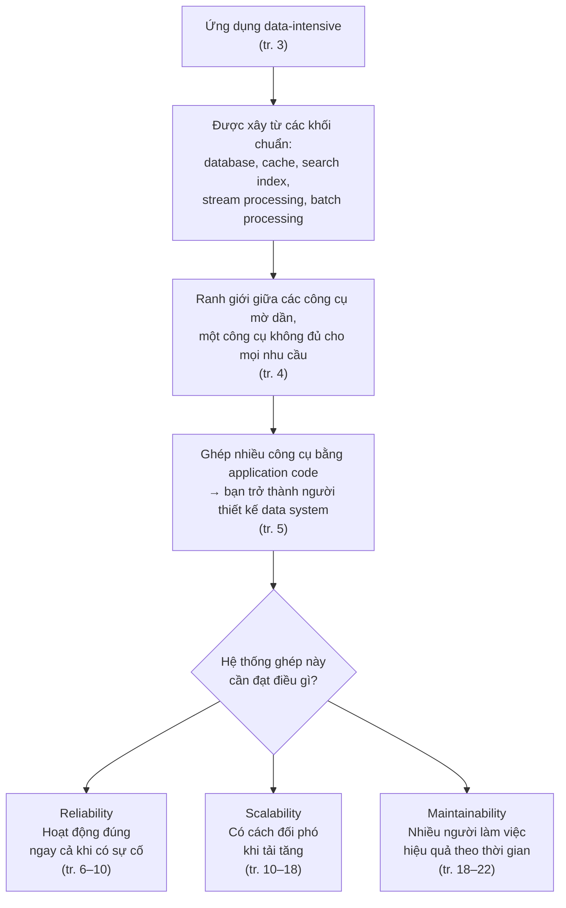

### Liên hệ với các chương khác

Bảng dưới chỉ dựa trên **tham chiếu chéo có trong chương 1** và **Preface**. Nội dung các chương sau sẽ được kiểm chứng khi học đến.

| Ý trong chương 1 | Sẽ gặp lại ở | Căn cứ |
| --- | --- | --- |
| Xây hệ thống tin cậy từ các thành phần không tin cậy | Nhiều kỹ thuật xuyên suốt sách | tr. 7 |
| Rolling upgrade (vá từng node một, không dừng hệ thống) | Chương 4 — Encoding and Evolution | tr. 8 |
| Hệ thống elastic và hệ thống mở rộng thủ công | "Rebalancing Partitions", Chương 6, tr. 209 | tr. 17 |
| Ví dụ Twitter home timeline | Chương 12 | tr. 13 |
| Hệ thống gồm nhiều thành phần như Hình 1-1 | Part III (chương 10–12) | tr. 23 |
| Phân tán dữ liệu ra nhiều máy để mở rộng | Part II (chương 5–9; [ghi chú phần mở đầu](chapter-05.md#part-ii)) | Preface, tr. xvi |
| Shared-nothing architecture | Phần giới thiệu Part II ([chapter-05, mục 0.2](chapter-05.md#shared-nothing)) | Glossary, tr. 557 |

---

## B. Giải thích chi tiết

### B1. Ứng dụng data-intensive và các "khối xây dựng" (tr. 3–4)

#### Ứng dụng được ghép từ những khối quen thuộc

Theo tác giả, phần lớn ứng dụng data-intensive được lắp từ một số khối chức năng tiêu chuẩn (tr. 3):

| Nhu cầu của ứng dụng | Khối xây dựng |
| --- | --- |
| Lưu dữ liệu để chính nó hoặc ứng dụng khác tìm lại sau này | **Database** |
| Ghi nhớ kết quả của một thao tác tốn kém để đọc nhanh hơn | **Cache** |
| Cho phép tìm theo từ khóa hoặc lọc theo nhiều cách | **Search index** |
| Gửi message cho tiến trình khác xử lý bất đồng bộ (*asynchronously*) | **Stream processing** |
| Định kỳ xử lý một khối lớn dữ liệu đã tích lũy | **Batch processing** |

Danh sách này nghe hiển nhiên. Tác giả cho rằng chính vì các *data system* này là những abstraction quá thành công, nên ta dùng chúng hằng ngày mà không cần nghĩ nhiều. Gần như không ai viết storage engine riêng khi xây ứng dụng, vì database đã làm tốt việc đó (tr. 3).

#### Nhưng thực tế không đơn giản như vậy

Có rất nhiều database với đặc tính khác nhau, vì mỗi ứng dụng có yêu cầu khác nhau. Caching có nhiều cách làm, search index cũng có nhiều cách xây. Người thiết kế vẫn phải chọn công cụ và cách tiếp cận phù hợp. Khi một công cụ đơn lẻ không đủ, việc ghép nhiều công cụ lại cũng khó (tr. 4).

Từ đó, tác giả đặt mục tiêu cho cả cuốn sách: tìm hiểu cả **nguyên lý** lẫn **thực tiễn** của data system. Cụ thể là các công cụ giống nhau ở đâu, khác nhau ở đâu, và đạt được đặc tính của mình bằng cách nào. Chương 1 là lớp nền. Các chương sau đi tiếp "từng lớp một" (tr. 4).

---

### B2. Thinking About Data Systems (tr. 4–6)

#### Câu hỏi mở đầu: vì sao gộp chung lại?

Database, message queue và cache thường được xem là những loại công cụ rất khác nhau. Database và queue có điểm giống nhau bề ngoài là cùng lưu dữ liệu trong một khoảng thời gian. Nhưng **mẫu truy cập** (*access pattern*) của chúng khác nhau, nên **đặc tính hiệu năng** khác nhau, và cách **cài đặt** cũng khác nhau (tr. 4).

Vậy tại sao tác giả gộp tất cả dưới một tên chung là ***data systems***? Có hai lý do (tr. 4):

1. **Ranh giới giữa các loại công cụ đang mờ đi.** Nhiều công cụ mới được tối ưu cho những use case đa dạng và không còn nằm gọn trong một loại truyền thống. Ví dụ: Redis là datastore nhưng cũng được dùng làm message queue. Apache Kafka là message queue nhưng có đảm bảo về độ bền (*durability*) giống database.
2. **Một công cụ không còn đáp ứng nổi mọi nhu cầu.** Nhiều ứng dụng có yêu cầu khắt khe hoặc rộng đến mức phải chia việc thành nhiều tác vụ. Mỗi tác vụ chạy trên công cụ làm tốt nhất việc đó, rồi các công cụ được "khâu" lại với nhau bằng **application code**.

Ví dụ của sách: hệ thống có một lớp cache do ứng dụng tự quản lý (như Memcached) hoặc một search server (như Elasticsearch, Solr) tách riêng khỏi database chính. Khi đó, **giữ cache và index đồng bộ với database chính thường là trách nhiệm của application code** (tr. 4).

#### Hình 1-1: một kiến trúc data system ghép từ nhiều thành phần (tr. 5)

Sơ đồ dưới đây vẽ lại Hình 1-1 bằng Mermaid. Tác giả nhấn mạnh đây chỉ là *một* kiến trúc khả dĩ. Chi tiết của từng phần sẽ được bàn ở các chương sau.

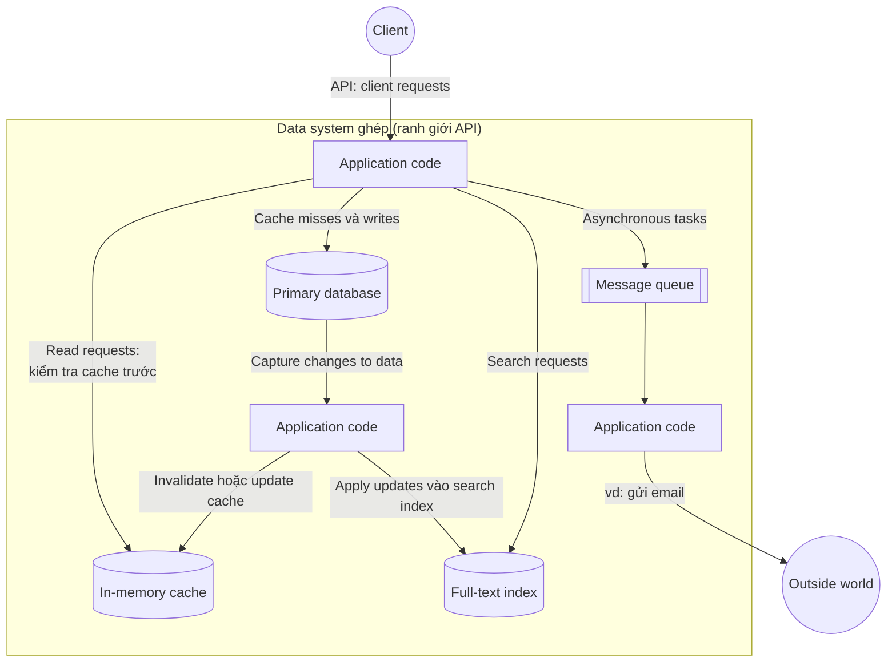

Luồng hoạt động trong hình:

- **Đọc:** application code tìm trong cache trước. Nếu không có (*cache miss*), nó đọc từ primary database.
- **Ghi:** dữ liệu được ghi vào primary database. Các thay đổi trên database được "bắt" lại (*capture changes*), rồi một phần application code khác dùng chúng để **invalidate hoặc cập nhật cache** và **cập nhật full-text index**.
- **Tìm kiếm:** đi thẳng tới full-text index.
- **Tác vụ bất đồng bộ:** được đẩy vào message queue. Một tiến trình khác lấy ra xử lý và tác động ra "thế giới bên ngoài", ví dụ gửi email.

#### Ý quan trọng nhất của mục: bạn đã trở thành người thiết kế data system

Khi ghép nhiều công cụ để cung cấp một dịch vụ, **API** của dịch vụ thường che giấu chi tiết cài đặt bên trong khỏi client. Thực chất, bạn vừa tạo ra một **data system mới, chuyên dụng**, từ các thành phần nhỏ hơn và đa dụng hơn. Hệ thống ghép này có thể cam kết một số **đảm bảo** (*guarantees*). Ví dụ: cache luôn được invalidate hoặc cập nhật đúng khi có ghi, để client bên ngoài thấy kết quả nhất quán. Lúc này bạn không chỉ là lập trình viên ứng dụng mà còn là **người thiết kế data system** (tr. 5).

> **Ví dụ minh họa do AI xây dựng.** Một trang thương mại điện tử cập nhật giá sản phẩm. Lệnh ghi vào database thành công, nhưng tiến trình invalidate cache bị crash ngay sau đó. Kết quả là database chứa giá mới, còn cache vẫn trả giá cũ, có thể kéo dài nhiều giờ. Không công cụ riêng lẻ nào "sai": database đúng, cache cũng làm đúng việc của nó. Cái sai nằm ở **đảm bảo của hệ thống ghép**, thứ mà application code, tức là bạn, phải chịu trách nhiệm. Đó là lý do tác giả nói bạn đã trở thành người thiết kế data system.

#### Những câu hỏi khó xuất hiện

Khi thiết kế một data system hay dịch vụ, nhiều câu hỏi khó sẽ nảy sinh (tr. 5):

- Làm sao để dữ liệu vẫn **đúng và đầy đủ** khi bên trong có sự cố?
- Làm sao để hiệu năng **luôn tốt** cho client, ngay cả khi một phần hệ thống đang suy giảm?
- Làm sao **mở rộng** để chịu được tải tăng lên?
- Một **API tốt** cho dịch vụ trông như thế nào?

Thiết kế còn chịu ảnh hưởng của nhiều yếu tố phụ thuộc hoàn cảnh: kỹ năng và kinh nghiệm của đội, phụ thuộc vào hệ thống cũ (*legacy*), thời hạn giao, mức chấp nhận rủi ro của tổ chức, ràng buộc pháp lý (tr. 5).

#### Ba mối quan tâm của cuốn sách (tr. 6)

Trong số rất nhiều yếu tố, sách tập trung vào ba mối quan tâm quan trọng với hầu hết hệ thống phần mềm:

| Mối quan tâm | Định nghĩa (diễn giải) |
| --- | --- |
| **Reliability** (độ tin cậy) | Hệ thống tiếp tục hoạt động **đúng**, tức thực hiện đúng chức năng ở mức hiệu năng mong muốn, ngay cả khi gặp nghịch cảnh: lỗi phần cứng, lỗi phần mềm, thậm chí lỗi con người. |
| **Scalability** (khả năng mở rộng) | Khi hệ thống lớn lên về lượng dữ liệu, lưu lượng truy cập hoặc độ phức tạp, phải có những cách hợp lý để đối phó với sự tăng trưởng đó. |
| **Maintainability** (khả năng bảo trì) | Theo thời gian, nhiều người khác nhau sẽ làm việc với hệ thống: vận hành, giữ hành vi hiện tại, điều chỉnh cho use case mới. Tất cả họ đều phải làm việc được một cách hiệu quả. |

> **Nhận xét của người viết ghi chú.** Bốn câu hỏi khó ở trên có thể đọc như tiền đề cho ba mối quan tâm. "Đúng và đầy đủ khi có sự cố" dẫn tới reliability. "Hiệu năng ổn định, chịu được tải tăng" dẫn tới scalability. "API tốt" gắn với simplicity, một phần của maintainability. Sách không trực tiếp ghép cặp như vậy. Đây chỉ là cách đọc để dễ nhớ.

---

### B3. Reliability — Độ tin cậy (tr. 6–10)

#### B3.0 "Hoạt động đúng" nghĩa là gì?

Với phần mềm, người dùng thường kỳ vọng những điều sau (tr. 6):

- Ứng dụng thực hiện **đúng chức năng** mà người dùng mong đợi.
- Ứng dụng **chịu được** việc người dùng thao tác sai hoặc dùng theo cách không lường trước.
- **Hiệu năng đủ tốt** cho use case cần thiết, dưới mức tải và lượng dữ liệu dự kiến.
- Hệ thống **ngăn được** truy cập trái phép và lạm dụng.

Nếu tất cả những điều đó cộng lại là "hoạt động đúng", thì reliability có thể hiểu đại khái là ***tiếp tục hoạt động đúng, ngay cả khi có thứ trục trặc*** (tr. 6).

> Đáng chú ý: theo cách hiểu này, **hiệu năng** và **bảo mật** cũng nằm trong khái niệm "hoạt động đúng". Một hệ thống trả kết quả đúng nhưng chậm đến mức không dùng được, hoặc để lộ dữ liệu, thì không được coi là reliable.

#### B3.1 Fault, failure và fault tolerance (tr. 6–7)

**1. What — Là gì?**

- **Fault** (lỗi thành phần): **một thành phần** của hệ thống đi lệch khỏi đặc tả (*spec*) của nó (tr. 7).
- **Failure** (sự cố hệ thống): **toàn bộ hệ thống** ngừng cung cấp dịch vụ cần thiết cho người dùng (tr. 7).
- **Fault-tolerant** hay **resilient**: hệ thống lường trước được fault và đối phó được với chúng (tr. 6). Glossary của sách diễn đạt là có khả năng tự phục hồi khi có thứ trục trặc, ví dụ một máy crash hoặc một đường mạng đứt (tr. 555).

Fault là **nguyên nhân cục bộ**, failure là **hậu quả mà người dùng thấy**. Một fault không nhất thiết dẫn đến failure.

**2. Why — Tại sao cần phân biệt?**

- **Không thể đưa xác suất fault về 0** (tr. 7). Ổ đĩa sẽ hỏng, phần mềm sẽ có bug, con người sẽ nhầm lẫn.
- Vì vậy, mục tiêu thực tế **không phải là loại bỏ mọi fault**. Mục tiêu là thiết kế **cơ chế fault-tolerance** để fault **không biến thành failure** (tr. 7).
- Thuật ngữ "fault-tolerant" dễ gây hiểu lầm, vì nó gợi ý rằng ta chịu được *mọi* loại fault. Điều đó không khả thi. Tác giả đưa ví dụ vui: nếu cả Trái Đất bị hố đen nuốt chửng, muốn chịu được fault này thì phải đặt server ngoài vũ trụ, và khó mà xin được ngân sách. Vì vậy chỉ nên nói về việc chịu được **một số loại fault nhất định** (tr. 6–7).

**3. How — Hoạt động như thế nào?**

Chủ đề của cả cuốn sách là **xây hệ thống tin cậy từ những thành phần không tin cậy** (tr. 7). Chương 1 nêu thêm hai ý về cách làm:

- **Chủ động gây fault.** Nghe có vẻ ngược đời, nhưng trong hệ thống fault-tolerant, việc **cố ý tăng tỷ lệ fault** có thể hợp lý, ví dụ ngẫu nhiên kill các tiến trình mà không báo trước. Lý do: nhiều bug nghiêm trọng thực chất nằm ở **phần xử lý lỗi kém** [3]. Gây fault có chủ đích giúp cơ chế fault-tolerance liên tục được chạy và kiểm tra, từ đó tăng niềm tin rằng hệ thống sẽ xử lý đúng khi fault xảy ra tự nhiên. **Netflix Chaos Monkey** [4] là ví dụ cho cách tiếp cận này (tr. 7).
- **Chịu đựng hay ngăn chặn?** Nhìn chung nên **chịu đựng** (*tolerate*) fault hơn là chỉ cố **ngăn** (*prevent*) chúng. Nhưng có trường hợp phòng bệnh tốt hơn chữa bệnh, vì bệnh không chữa được. **Bảo mật** là ví dụ: kẻ tấn công đã lấy được dữ liệu nhạy cảm thì không thể "hoàn tác" sự kiện đó. Sách chủ yếu bàn về các loại fault **có thể khắc phục** (tr. 7).

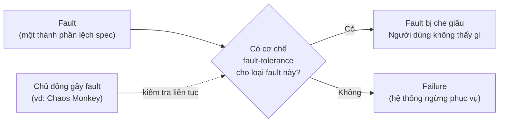

**4. Example — Ví dụ minh họa**

> **Ví dụ minh họa do AI xây dựng.**
> - *Đơn giản:* Một nhà hàng có 3 đầu bếp. Một đầu bếp ốm là **fault**. Nếu hai người còn lại vẫn nấu kịp cho khách thì không có **failure**. Nếu cả 3 cùng ngộ độc vì một món ăn trưa chung thì nhà hàng phải đóng cửa: fault biến thành failure.
> - *Hệ thống thực tế:* Một web service có 3 application server đứng sau load balancer. Một server crash (fault). Load balancer phát hiện và chuyển request sang 2 server còn lại, người dùng không nhận ra gì. Nhưng nếu cả 3 server cùng chạy một phiên bản code có bug và cùng crash trước một input xấu, load balancer không cứu được: failure. (Loại fault "tương quan" này sẽ được bàn ở B3.3.)

**5. Trade-offs — Những đánh đổi**

- **Chọn loại fault nào để chịu đựng là quyết định chi phí.** Chịu được mất một ổ đĩa thì rẻ. Chịu được mất cả datacenter thì đắt hơn nhiều. Chịu được "mất Trái Đất" thì vô lý.
- **Gây fault có chủ đích** đổi một ít rủi ro ngắn hạn lấy niềm tin dài hạn vào cơ chế phục hồi.
- **Tolerance không thay thế được prevention** với những fault không thể đảo ngược, như rò rỉ dữ liệu.

**6. System Design Perspective**

- Khi thiết kế, hãy liệt kê rõ **những loại fault hệ thống sẽ chịu được** và những loại sẽ không. Đó là phạm vi cam kết reliability.
- Một cơ chế fault-tolerance chưa từng được chạy thử là một cơ chế chưa được kiểm chứng. Chủ động gây fault là cách kiểm chứng nó.

> **Bổ sung ngoài sách.** Theo mục lục, Chương 8 có mục "System Model and Reality" (tr. 306). Nhiều khả năng đó là nơi việc "chọn loại fault cần chịu đựng" được hình thức hóa. Điều này sẽ được kiểm chứng khi học Chương 8.

#### B3.2 Hardware Faults — Lỗi phần cứng (tr. 7–8)

**What.** Ổ cứng hỏng, RAM lỗi, lưới điện mất, ai đó rút nhầm cáp mạng. Ai từng làm với datacenter lớn đều biết những chuyện này **xảy ra liên tục** khi có nhiều máy (tr. 7).

**Con số đáng nhớ:** ổ cứng có **MTTF** (*mean time to failure*, thời gian trung bình đến khi hỏng) khoảng **10 đến 50 năm** [5, 6]. Vì vậy, trong một storage cluster có **10.000 ổ đĩa**, trung bình mỗi ngày nên dự kiến **một ổ hỏng** (tr. 7).

> **Bổ sung ngoài sách (phép tính).** 10 năm ≈ 3.650 ngày, nên 10.000 ổ / 3.650 ≈ 2,7 ổ hỏng mỗi ngày. 50 năm ≈ 18.250 ngày, nên 10.000 / 18.250 ≈ 0,55 ổ mỗi ngày. Cỡ "khoảng một ổ mỗi ngày" là đúng bậc độ lớn. Phép tính giả định các ổ hỏng độc lập với tốc độ đều. Bài học: **ở quy mô lớn, sự kiện hiếm trên một máy trở thành chuyện thường ngày trên cả hệ thống.**

**How — hai giai đoạn ứng phó:**

1. **Dư thừa phần cứng** (*hardware redundancy*). Đây là phản ứng đầu tiên: thêm thành phần dự phòng để giảm tỷ lệ failure (tr. 7).
   - Ổ đĩa cấu hình **RAID**, server có **nguồn điện kép** và **CPU thay nóng** (*hot-swappable*), datacenter có **ắc quy và máy phát diesel**.
   - Khi một thành phần hỏng, thành phần dự phòng thay thế trong lúc thay linh kiện hỏng.
   - Cách này không ngăn được hoàn toàn, nhưng đã được hiểu rõ và thường giữ một máy chạy liên tục nhiều năm.
   - Cho đến gần đây, như vậy là **đủ** với đa số ứng dụng. Một máy hỏng hoàn toàn là khá hiếm. Chỉ cần khôi phục backup sang máy mới đủ nhanh thì thời gian downtime không phải thảm họa. Dư thừa ở mức **nhiều máy** chỉ cần cho số ít ứng dụng mà tính sẵn sàng cao (*high availability*) là bắt buộc (tr. 8).

2. **Chịu lỗi bằng phần mềm** (*software fault-tolerance*). Bối cảnh đã thay đổi (tr. 8):
   - Lượng dữ liệu và nhu cầu tính toán tăng nên ứng dụng dùng **nhiều máy hơn**, và **tỷ lệ fault phần cứng tăng theo tỷ lệ thuận**.
   - Trên một số nền tảng cloud như AWS, máy ảo **biến mất không báo trước** là khá phổ biến [7]. Lý do: các nền tảng này được thiết kế để ưu tiên **sự linh hoạt và tính co giãn** (*elasticity*) hơn là độ tin cậy của từng máy.
   - Vì vậy xu hướng chuyển sang hệ thống **chịu được việc mất cả một máy**, dùng kỹ thuật phần mềm **thay cho hoặc bổ sung cho** dư thừa phần cứng.

**Lợi ích vận hành đi kèm** (tr. 8). Hệ thống một server phải có **downtime theo kế hoạch** mỗi khi cần reboot, ví dụ để cài bản vá bảo mật hệ điều hành. Hệ thống chịu được việc mất máy thì có thể **vá từng node một** mà cả hệ thống vẫn chạy. Đó là **rolling upgrade**, sẽ bàn ở Chương 4.

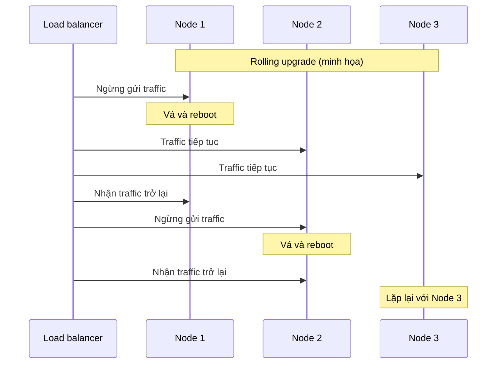

*(Sơ đồ do AI xây dựng để minh họa khái niệm rolling upgrade mà sách nhắc tới ở tr. 8.)*

**Trade-offs.** Xem bảng so sánh ở [D1](#d1).

#### B3.3 Software Errors — Lỗi phần mềm (tr. 8–9)

**What.** Fault phần cứng thường được xem là **ngẫu nhiên và độc lập**: ổ đĩa của máy này hỏng không có nghĩa ổ đĩa máy khác sắp hỏng. Có thể có tương quan yếu, ví dụ do nhiệt độ chung trong rack, nhưng hiếm khi nhiều thành phần phần cứng hỏng cùng lúc (tr. 8).

Lỗi phần mềm là một loại fault khác: **lỗi có tính hệ thống** (*systematic error*) bên trong hệ thống [8] (tr. 8).

**Why — vì sao nguy hiểm hơn?**

- Chúng **khó lường trước**.
- Chúng **tương quan giữa các node** (*correlated across nodes*). Mọi node chạy cùng một code, nên có cùng một bug.
- Vì vậy chúng thường gây **nhiều failure hơn hẳn** so với fault phần cứng không tương quan [5] (tr. 8).

Dư thừa giúp được với fault độc lập. Nhưng nếu mọi bản sao đều có cùng một lỗi, thêm bản sao không giúp gì.

**Các ví dụ trong sách** (tr. 8–9):

| Loại | Ví dụ |
| --- | --- |
| Bug làm **mọi instance cùng crash** trước một input xấu | **Leap second ngày 30/6/2012**: một bug trong Linux kernel khiến nhiều ứng dụng treo **đồng thời** [9]. |
| Tiến trình **chạy mất kiểm soát** (*runaway process*) | Ngốn hết tài nguyên dùng chung: CPU, bộ nhớ, ổ đĩa, băng thông mạng. |
| Dịch vụ phụ thuộc gặp vấn đề | Một dịch vụ mà hệ thống phụ thuộc bị **chậm**, **không phản hồi**, hoặc **trả về dữ liệu hỏng**. |
| **Cascading failures** (lỗi dây chuyền) | Một fault nhỏ ở một thành phần kích hoạt fault ở thành phần khác, rồi lan tiếp [10]. |

**Bản chất chung** (tr. 9). Những bug này thường **nằm im rất lâu** cho đến khi một tổ hợp hoàn cảnh bất thường kích hoạt chúng. Lúc đó mới lộ ra rằng phần mềm đã **giả định** điều gì đó về môi trường. Giả định ấy thường đúng, nhưng đến một lúc nào đó **không còn đúng nữa** [11].

> Ví dụ leap second khớp hoàn hảo với mô tả này. Code ngầm giả định mỗi phút luôn có 60 giây. Giả định đó đúng gần như mọi lúc, cho đến khi gặp một giây nhuận.

**How — không có giải pháp nhanh, chỉ có nhiều việc nhỏ cộng lại** (tr. 9):

- Suy nghĩ kỹ về **các giả định và tương tác** trong hệ thống.
- **Kiểm thử kỹ lưỡng.**
- **Cô lập tiến trình** (*process isolation*).
- **Cho phép tiến trình crash và khởi động lại.**
- **Đo lường, giám sát, phân tích** hành vi hệ thống trong production.
- **Tự kiểm tra trong lúc chạy.** Nếu hệ thống cam kết một đảm bảo, nó có thể liên tục tự kiểm tra và báo động khi phát hiện sai lệch. Ví dụ: với message queue, số message vào phải bằng số message ra [12].

**Ví dụ cascading failure**

> **Ví dụ minh họa do AI xây dựng.** Database bắt đầu chậm vì một truy vấn nặng. Các application server giữ connection lâu hơn, nên thread pool cạn dần. Health check của load balancer bị timeout, nên load balancer đánh dấu server là "không khỏe" và dồn traffic sang các server còn lại. Các server đó cũng quá tải và cũng bị đánh dấu "không khỏe". Cả hệ thống ngừng phục vụ, dù khởi đầu chỉ là một truy vấn chậm.

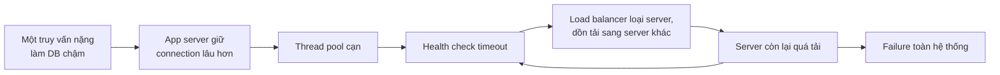

**System Design Perspective.** Cần đặc biệt cảnh giác với **lỗi tương quan**. Dư thừa (thêm máy, thêm bản sao) chỉ bảo vệ trước fault độc lập. Với lỗi có tính hệ thống, cần thêm những thứ như giám sát, tự kiểm tra đảm bảo, cô lập, và triển khai thay đổi từ từ (xem B3.4).

#### B3.4 Human Errors — Lỗi con người (tr. 9–10)

**What và Why.** Con người thiết kế, xây dựng và vận hành hệ thống, và con người thì không đáng tin cậy, dù có thiện chí đến đâu. Một nghiên cứu về các dịch vụ internet lớn cho thấy **lỗi cấu hình do người vận hành** là **nguyên nhân hàng đầu** gây sự cố ngừng dịch vụ. Lỗi phần cứng (server hoặc mạng) chỉ đóng vai trò trong **10–25%** số sự cố [13] (tr. 9).

**How.** Những hệ thống tốt nhất kết hợp nhiều cách (tr. 9–10):

| # | Cách tiếp cận | Vì sao hiệu quả | Lưu ý từ sách |
| --- | --- | --- | --- |
| 1 | **Thiết kế giảm cơ hội mắc lỗi** | Abstraction, API, giao diện quản trị tốt khiến làm "điều đúng" dễ và làm "điều sai" khó. | Nếu giao diện **quá gò bó**, người ta sẽ tìm cách lách, và lợi ích mất đi. Đây là một sự cân bằng khó. |
| 2 | **Tách nơi dễ mắc lỗi khỏi nơi lỗi gây hại** | Cung cấp môi trường **sandbox** ngoài production, đầy đủ tính năng, để thử nghiệm an toàn **với dữ liệu thật** mà không ảnh hưởng người dùng thật. | |
| 3 | **Kiểm thử kỹ ở mọi cấp** | Từ unit test, integration test toàn hệ thống đến test thủ công [3]. | Test tự động đặc biệt có giá trị với các *corner case* hiếm gặp khi vận hành bình thường. |
| 4 | **Phục hồi nhanh và dễ** | Giảm thiệt hại khi lỗi đã xảy ra. | Rollback cấu hình nhanh. **Triển khai code mới từ từ** để bug bất ngờ chỉ ảnh hưởng một nhóm nhỏ người dùng. Có công cụ **tính toán lại dữ liệu** phòng khi phép tính cũ sai. |
| 5 | **Giám sát chi tiết, rõ ràng** | Metric hiệu năng, tỷ lệ lỗi. Ngành khác gọi là **telemetry**: tên lửa đã rời bệ phóng thì telemetry là thứ duy nhất cho biết chuyện gì đang xảy ra [14]. | Cho tín hiệu cảnh báo sớm, kiểm tra xem giả định hay ràng buộc có bị vi phạm không, và giúp chẩn đoán khi có sự cố. |
| 6 | **Quản lý và đào tạo tốt** | | Quan trọng nhưng nằm ngoài phạm vi sách. |

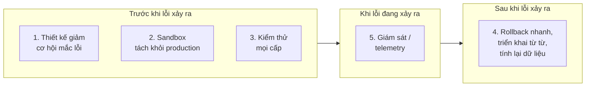

*(Cách nhóm theo "trước / trong / sau" là của người viết ghi chú để dễ nhớ. Sách liệt kê các cách tiếp cận mà không chia nhóm.)*

> **Ví dụ minh họa do AI xây dựng.** Một kỹ sư đổi cấu hình timeout của dịch vụ thanh toán. Hệ thống tốt sẽ làm thế này. Thay đổi phải đi qua giao diện có kiểm tra giá trị hợp lệ (cách 1). Nó được thử trước trên môi trường staging có dữ liệu thật đã ẩn danh (cách 2). Sau đó nó chỉ được áp dụng cho 1% server trước (cách 4), trong khi dashboard theo dõi tỷ lệ lỗi thanh toán (cách 5). Khi tỷ lệ lỗi tăng, chỉ một lệnh là rollback được (cách 4).

#### B3.5 How Important Is Reliability? (tr. 10)

- Reliability **không chỉ dành cho** nhà máy điện hạt nhân hay phần mềm kiểm soát không lưu. Ứng dụng bình thường cũng phải chạy tin cậy.
  - Bug trong ứng dụng doanh nghiệp làm **mất năng suất**, và có thể gây **rủi ro pháp lý** nếu số liệu báo cáo sai.
  - Sự cố ở trang thương mại điện tử gây **mất doanh thu** và **tổn hại uy tín**.
- Ngay cả ứng dụng "không quan trọng" cũng có **trách nhiệm với người dùng**. Ví dụ của sách: một phụ huynh lưu toàn bộ ảnh và video của con mình trong ứng dụng ảnh của bạn [15]. Họ sẽ cảm thấy thế nào nếu database đó đột nhiên hỏng? Họ có biết cách khôi phục từ backup không?
- Có những tình huống có thể **chủ động hy sinh reliability** để giảm:
  - **chi phí phát triển**, ví dụ làm prototype cho một thị trường chưa được kiểm chứng;
  - **chi phí vận hành**, ví dụ dịch vụ có biên lợi nhuận rất mỏng.
- Nhưng phải **ý thức rõ** khi nào mình đang "đi tắt" (tr. 10).

**System Design Perspective.** Reliability là một **quyết định có chủ đích**, không phải mặc định. Giảm reliability là một lựa chọn kinh doanh hợp lệ, miễn là nó được đưa ra một cách có ý thức và minh bạch.

---

### B4. Scalability — Khả năng mở rộng (tr. 10–18)

#### B4.0 Scalability là gì, và vì sao "X is scalable" là câu vô nghĩa?

Hôm nay hệ thống chạy tin cậy không có nghĩa tương lai cũng vậy. Một nguyên nhân phổ biến khiến hệ thống xuống cấp là **tải tăng**: từ 10.000 lên 100.000 người dùng đồng thời, từ 1 triệu lên 10 triệu, hoặc lượng dữ liệu cần xử lý lớn hơn nhiều so với trước (tr. 10).

**What.** *Scalability* là thuật ngữ mô tả **khả năng của hệ thống đối phó với tải tăng** (tr. 10).

**Điểm mấu chốt.** Scalability **không phải một nhãn một chiều** gắn lên hệ thống. Nói "X scalable" hay "Y không scale" là vô nghĩa (tr. 10). Bàn về scalability nghĩa là đặt những câu hỏi như (tr. 11):

- *"Nếu hệ thống tăng trưởng **theo một cách cụ thể**, ta có những lựa chọn nào để đối phó?"*
- *"Làm sao **thêm tài nguyên tính toán** để xử lý tải tăng thêm?"*

Lý do: "tăng trưởng" có rất nhiều chiều (số request, tỷ lệ đọc/ghi, kích thước dữ liệu, số người theo dõi một tài khoản…). Một hệ thống có thể chịu tốt chiều này nhưng sụp đổ ở chiều khác.

Mục Scalability đi theo ba bước:

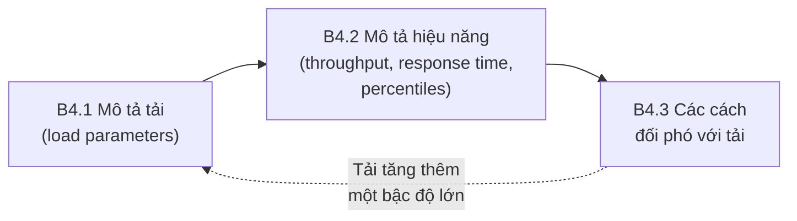

#### B4.1 Describing Load — Mô tả tải (tr. 11–13)

**What.** Trước khi hỏi "nếu tải tăng gấp đôi thì sao?", phải **mô tả ngắn gọn tải hiện tại**. Tải được mô tả bằng vài con số gọi là **load parameters** (tham số tải). Tham số nào tốt nhất phụ thuộc vào kiến trúc hệ thống (tr. 11):

- số request mỗi giây tới web server;
- tỷ lệ đọc / ghi trong database;
- số người dùng hoạt động đồng thời trong một phòng chat;
- tỷ lệ cache hit;
- hoặc thứ gì khác.

Có thể **trường hợp trung bình** là quan trọng nhất với bạn. Cũng có thể **nút thắt bị chi phối bởi một số ít trường hợp cực đoan** (tr. 11).

##### Case study: Twitter (số liệu tháng 11/2012 [16])

Hai thao tác chính của Twitter (tr. 11):

| Thao tác | Mô tả | Tải |
| --- | --- | --- |
| **Post tweet** | Người dùng đăng một tin nhắn mới tới những người theo dõi mình | 4,6k request/s trung bình, **hơn 12k request/s lúc cao điểm** |
| **Home timeline** | Người dùng xem các tweet của những người mình theo dõi | **300k request/s** |

Chỉ xử lý 12.000 lượt ghi mỗi giây thì khá dễ. Thách thức scale của Twitter **không nằm ở số lượng tweet** mà ở **fan-out**: mỗi người theo dõi nhiều người, và được nhiều người theo dõi (tr. 11).

> **Fan-out** (chú thích ii, tr. 11): thuật ngữ mượn từ điện tử, chỉ số đầu vào cổng logic nối vào đầu ra của một cổng khác. Đầu ra phải cấp đủ dòng cho tất cả đầu vào đó. Trong hệ thống xử lý giao dịch, fan-out là **số request tới các dịch vụ khác cần thực hiện để phục vụ một request đến**.

Có hai cách cơ bản để cài đặt hai thao tác này.

**Cách 1 — Tính khi đọc** (tr. 11). Post tweet chỉ chèn tweet mới vào một **tập tweet toàn cục**. Khi người dùng xem home timeline: tìm tất cả những người họ theo dõi, lấy tất cả tweet của từng người, rồi **gộp lại và sắp xếp theo thời gian**.

Với schema quan hệ ở Hình 1-2, đây là một truy vấn join ba bảng. Bảng `tweets` được nối với `users` qua `sender_id` để lấy thông tin người gửi. Bảng `follows` được nối qua `followee_id` (người được theo dõi), và lọc theo `follower_id` = người dùng hiện tại.

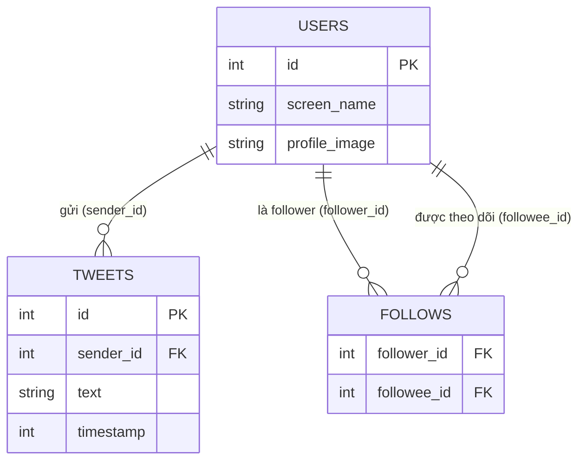

*(Vẽ lại Hình 1-2, tr. 12: schema quan hệ đơn giản cho home timeline.)*

**Cách 2 — Tính sẵn khi ghi** (tr. 12). Duy trì một **cache home timeline cho mỗi người dùng**, giống như một **hộp thư** tweet cho từng người nhận (Hình 1-3). Khi ai đó post tweet: tìm tất cả những người theo dõi họ và **chèn tweet mới vào cache timeline của từng người**. Đọc timeline lúc này rất rẻ, vì kết quả **đã được tính trước**.

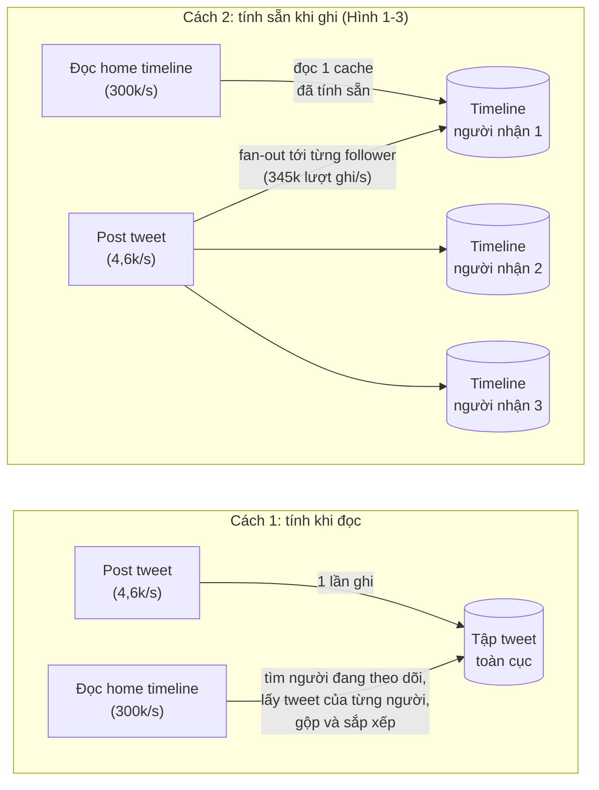

**Vì sao Twitter chuyển từ cách 1 sang cách 2?** (tr. 12)

- Phiên bản đầu dùng cách 1, nhưng hệ thống **không theo kịp tải truy vấn home timeline**.
- Cách 2 tốt hơn vì **tốc độ đăng tweet thấp hơn gần hai bậc độ lớn so với tốc độ đọc timeline**. Trong trường hợp này, nên **làm nhiều việc hơn lúc ghi và ít việc hơn lúc đọc**.

> **Bổ sung ngoài sách (phép tính từ số liệu sách).** 300.000 / 4.600 ≈ 65 lần, tức "gần" hai bậc độ lớn (100 lần).

**Cái giá của cách 2** (tr. 12–13):

- Đăng một tweet giờ tốn **rất nhiều việc thêm**. Trung bình mỗi tweet được gửi tới khoảng **75 follower**, nên **4,6k tweet/s thành 345k lượt ghi/s** vào các cache timeline.
- Con số trung bình đó **che giấu** việc số follower của mỗi người **chênh lệch cực lớn**. Một số người dùng có **hơn 30 triệu follower** (Hình 1-3 ghi "lên tới 31M"). Một tweet của họ có thể sinh ra **hơn 30 triệu lượt ghi**.
- Twitter cố gắng giao tweet tới follower **trong vòng 5 giây**, nên đây là thách thức lớn.

**Load parameter then chốt** (tr. 13). Với Twitter, **phân phối số follower trên mỗi người dùng**, có thể có trọng số theo tần suất đăng tweet của người đó, là tham số tải quan trọng để bàn về scalability, vì nó **quyết định tải fan-out**. Ứng dụng của bạn có thể khác hẳn, nhưng có thể áp dụng cùng cách suy luận.

> **Ví dụ minh họa do AI xây dựng — vì sao cần *phân phối* chứ không chỉ *trung bình*.** Hai mạng xã hội cùng có trung bình 75 follower mỗi người.
> - Mạng A: ai cũng có khoảng 75 follower. Mỗi tweet sinh khoảng 75 lượt ghi, tải ghi đều và dễ dự đoán.
> - Mạng B: hầu hết người dùng có khoảng 50 follower, nhưng vài người nổi tiếng có hàng chục triệu. Phần lớn thời gian tải nhẹ. Nhưng mỗi khi một người nổi tiếng đăng bài, hàng chục triệu lượt ghi dồn vào cùng lúc, và mục tiêu "giao trong 5 giây" có thể bị vỡ.
>
> Cùng một con số trung bình, nhưng hai hệ thống cần kiến trúc khác nhau.

**Nút thắt cuối cùng: cách lai** (tr. 13). Khi cách 2 đã được cài đặt vững chắc, Twitter chuyển sang **kết hợp cả hai cách**:

- Tweet của **đa số người dùng** vẫn được fan-out vào home timeline ngay khi đăng (cách 2).
- **Một số ít người dùng có cực nhiều follower** (người nổi tiếng) được **loại khỏi fan-out**. Tweet của những người nổi tiếng mà một người dùng theo dõi được **lấy riêng và gộp vào timeline lúc đọc**, như cách 1.
- Cách lai này cho **hiệu năng tốt một cách ổn định**. Sách sẽ quay lại ví dụ này ở Chương 12.

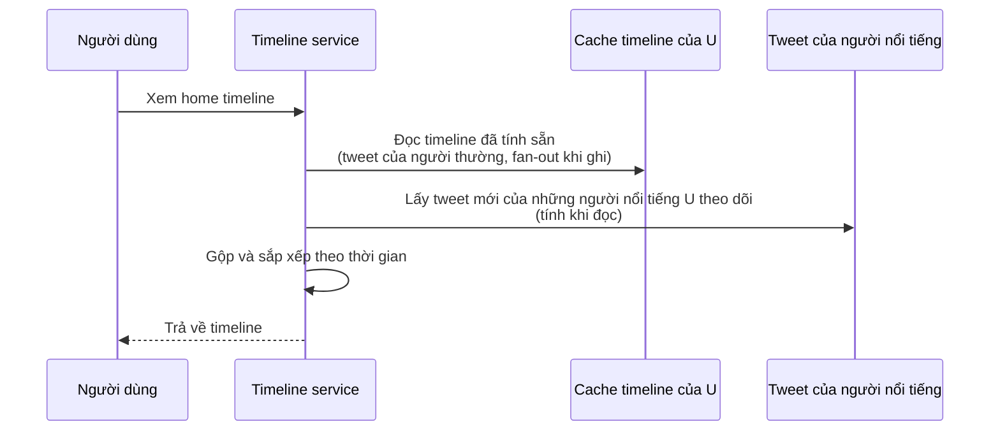

> **Bổ sung ngoài sách.**
> - Trong ngành, cách 1 thường được gọi là ***fan-out on read*** (hay *pull model*), cách 2 là ***fan-out on write*** (hay *push model*). Sách không dùng các tên này ở chương 1.
> - Bài học tổng quát hơn là đánh đổi giữa **tính trước lúc ghi** và **tính lúc đọc**. Theo mục lục, chủ đề này có vẻ sẽ trở lại dưới nhiều dạng, ví dụ "Aggregation: Data Cubes and Materialized Views" (Chương 3, tr. 101) và "Observing Derived State" (Chương 12, tr. 509). Mối liên hệ này sẽ được kiểm chứng khi học các chương đó.

So sánh chi tiết ba cách tiếp cận: xem [D3](#d3).

#### B4.2 Describing Performance — Mô tả hiệu năng (tr. 13–17)

Khi đã mô tả được tải, có thể xét điều gì xảy ra khi tải tăng, theo **hai góc nhìn** (tr. 13):

1. Tăng một load parameter và **giữ nguyên tài nguyên** (CPU, bộ nhớ, băng thông…). **Hiệu năng** bị ảnh hưởng thế nào?
2. Tăng một load parameter. Cần **tăng tài nguyên bao nhiêu** để **giữ nguyên hiệu năng**?

Cả hai câu hỏi đều cần **số đo hiệu năng**.

##### Throughput và response time

| Loại hệ thống | Thường quan tâm | Định nghĩa (tr. 13) |
| --- | --- | --- |
| **Batch processing** (vd: Hadoop) | **Throughput** | Số bản ghi xử lý được mỗi giây, hoặc tổng thời gian chạy một job trên tập dữ liệu kích thước cho trước. |
| **Online system** | **Response time** | Thời gian từ lúc client gửi request đến lúc nhận được response. |

> Chú thích iii (tr. 13): lý tưởng thì thời gian chạy batch job bằng kích thước dữ liệu chia cho throughput. Thực tế thường lâu hơn vì **skew** (dữ liệu không chia đều cho các worker) và vì phải **chờ task chậm nhất** hoàn thành.

##### Latency và response time không phải là một (tr. 14)

Hai từ này hay được dùng như đồng nghĩa, nhưng sách phân biệt:

- **Response time** là thứ **client nhìn thấy**. Ngoài thời gian thực sự xử lý request (**service time**), nó còn gồm **độ trễ mạng** và **độ trễ xếp hàng** (*queueing delay*).
- **Latency** là khoảng thời gian request **nằm chờ được xử lý**, khi nó đang "tiềm ẩn" (*latent*) và chờ phục vụ [17].

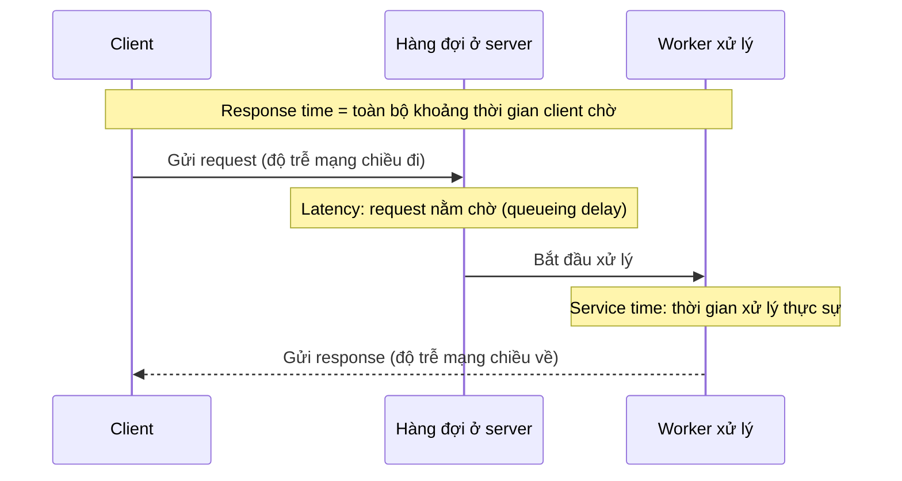

> **Lưu ý khi đọc tiếp.** Ngay ở tr. 15, sách gọi các percentile cao của *response time* là "*tail latencies*". Trong thực tế, hai từ thường bị dùng lẫn. Điều quan trọng là luôn hỏi: con số này đo **từ đâu đến đâu**?

##### Response time là một phân phối, không phải một con số (tr. 14)

Gửi cùng một request lặp đi lặp lại cũng cho response time hơi khác nhau mỗi lần. Hệ thống thật xử lý nhiều loại request khác nhau thì response time dao động rất mạnh. Vì vậy phải xem response time là **một phân phối giá trị có thể đo được**.

Hình 1-4 minh họa 100 request: mỗi cột xám là một request, chiều cao là thời gian xử lý. Đa số request khá nhanh, nhưng thỉnh thoảng có **outlier** chậm hơn nhiều. Nguyên nhân có thể là:

- Request đó **vốn tốn kém hơn**, ví dụ xử lý nhiều dữ liệu hơn.
- Ngay cả khi mọi request lẽ ra mất cùng thời gian, vẫn có **độ trễ ngẫu nhiên** do: chuyển ngữ cảnh (*context switch*) sang tiến trình nền, mất gói tin mạng và TCP gửi lại, tạm dừng do **garbage collection**, **page fault** buộc phải đọc từ đĩa, thậm chí **rung cơ học trong rack server** [18], cùng nhiều nguyên nhân khác (tr. 14).

##### Vì sao trung bình (mean) là thước đo kém?

Người ta hay báo cáo **response time trung bình**. Hiểu theo nghĩa thông thường, đó là trung bình cộng: cộng n giá trị rồi chia cho n. Nhưng mean **không tốt** nếu muốn biết response time "điển hình", vì nó **không cho biết bao nhiêu người dùng thực sự gặp độ trễ đó** (tr. 14).

> **Ví dụ minh họa do AI xây dựng.** 10 request có response time (ms): 20, 22, 25, 25, 30, 31, 35, 40, 45, **1.000**.
> - **Mean** = 1.273 / 10 = **127,3 ms**. Không request nào thực sự mất khoảng 127 ms. 9/10 người dùng được phục vụ dưới 45 ms, còn 1 người phải chờ cả giây.
> - **Median** = (30 + 31) / 2 = **30,5 ms**. Con số này phản ánh đúng trải nghiệm "điển hình".
> - Còn trải nghiệm tệ nhất (1.000 ms) thì phải nhìn vào **percentile cao** mới thấy.

##### Percentile (tr. 14–15)

**What.** Sắp xếp danh sách response time từ nhanh nhất đến chậm nhất:

- **Median** là điểm giữa. Nếu median là 200 ms thì **một nửa** request trả về dưới 200 ms, nửa còn lại lâu hơn. Median còn gọi là **percentile thứ 50**, viết tắt **p50** (tr. 14–15).
- **Percentile cao**: **p95, p99, p999** (percentile thứ 95, 99, 99,9). Đó là các **ngưỡng** mà 95%, 99%, 99,9% số request **nhanh hơn**. Ví dụ: p95 = 1,5 giây nghĩa là 95/100 request mất dưới 1,5 giây, còn 5/100 request mất 1,5 giây trở lên (tr. 15).

**Một bẫy dễ bỏ qua về median** (tr. 15). Median nói về **một request**. Nếu người dùng gửi **nhiều request**, trong một phiên hoặc vì một trang tải nhiều tài nguyên, thì xác suất **ít nhất một** request chậm hơn median **lớn hơn 50% rất nhiều**.

> **Bổ sung ngoài sách (phép tính).** Giả sử các request độc lập, mỗi request có 50% khả năng chậm hơn median. Với n request, xác suất ít nhất một request chậm hơn median là 1 − 0,5ⁿ. Với n = 5, kết quả là khoảng **97%**.

**Why — vì sao percentile cao quan trọng?** Các percentile cao của response time, còn gọi là ***tail latencies***, **ảnh hưởng trực tiếp tới trải nghiệm người dùng** (tr. 15).

- **Amazon** đặt yêu cầu response time cho dịch vụ nội bộ theo **p999**, dù nó chỉ ảnh hưởng 1/1.000 request. Lý do: những khách hàng có request chậm nhất thường là người có **nhiều dữ liệu nhất** trong tài khoản vì đã mua rất nhiều, tức là **khách hàng giá trị nhất** [19].
- Amazon cũng ghi nhận: response time tăng **100 ms** làm doanh số giảm **1%** [20]. Nguồn khác cho biết chậm **1 giây** làm một chỉ số hài lòng của khách hàng giảm **16%** [21, 22].
- **Nhưng** tối ưu **p9999** (1 request chậm nhất trong 10.000) bị Amazon đánh giá là **quá đắt và không đủ lợi ích**. Giảm response time ở percentile rất cao rất khó, vì chúng dễ bị ảnh hưởng bởi các sự kiện ngẫu nhiên ngoài tầm kiểm soát, và lợi ích giảm dần (tr. 15).

##### SLO và SLA (tr. 15)

Percentile thường được dùng trong **service level objectives (SLO)** và **service level agreements (SLA)**, các hợp đồng xác định hiệu năng và tính sẵn sàng kỳ vọng của một dịch vụ. Ví dụ SLA trong sách:

- Dịch vụ được coi là "đang chạy" nếu **median < 200 ms** và **p99 < 1 s**. Chậm hơn thế thì coi như đã sập.
- Dịch vụ phải "đang chạy" ít nhất **99,9%** thời gian.

Những chỉ số này đặt kỳ vọng cho client và cho phép khách hàng **đòi hoàn tiền** nếu SLA không được đáp ứng.

> **Bổ sung ngoài sách.**
> - Trong thực tế, **SLO** thường là *mục tiêu* nội bộ, còn **SLA** là *hợp đồng* có hệ quả (như hoàn tiền) với khách hàng. SLO thường đặt chặt hơn SLA để có vùng đệm. Sách nhắc cả hai cùng lúc mà không phân biệt kỹ.
> - 99,9% thời gian chạy tương đương downtime tối đa khoảng 0,001 × 8.760 giờ ≈ **8,8 giờ mỗi năm**, tức khoảng **43 phút mỗi tháng**.

##### Queueing delay và head-of-line blocking (tr. 15–16)

- **Queueing delay** thường chiếm **phần lớn response time ở percentile cao**.
- Một server chỉ xử lý song song được **một số ít** việc, bị giới hạn chẳng hạn bởi số CPU core. Vì vậy chỉ cần **vài request chậm** là đủ chặn việc xử lý các request phía sau. Hiện tượng này gọi là ***head-of-line blocking***.
- Các request phía sau có thể xử lý rất nhanh trên server, nhưng **client vẫn thấy chậm** vì phải chờ request trước xong.
- **Hệ quả:** phải **đo response time ở phía client** (tr. 16).

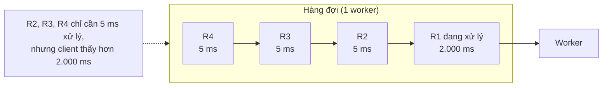

*(Sơ đồ do AI xây dựng để minh họa khái niệm.)*

##### Bẫy khi kiểm thử tải (tr. 16)

Khi tạo tải nhân tạo để thử scalability, **client sinh tải phải gửi request độc lập với response time**. Nếu client **chờ request trước xong mới gửi request tiếp**, hàng đợi trong bài test sẽ **ngắn hơn thực tế một cách giả tạo**, và số đo bị **lệch** [23].

Vì sao? Khi hệ thống chậm đi, client kiểu "chờ rồi mới gửi" cũng tự động gửi chậm lại. Nó vô tình **giảm tải đúng lúc hệ thống đang quá tải**, nên che mất chính vấn đề cần đo. Người dùng thật thì không "lịch sự" như vậy: họ vẫn tiếp tục đến bất kể hệ thống đang chậm.

> **Bổ sung ngoài sách.** Hiện tượng này thường được gọi là ***coordinated omission***, thuật ngữ do Gil Tene, tác giả HdrHistogram, phổ biến. Sách không dùng tên này ở chương 1.

##### Percentiles in Practice: tail latency amplification (tr. 16–17)

Percentile cao **đặc biệt quan trọng** với các backend service được gọi **nhiều lần** để phục vụ **một** request của người dùng cuối.

- Dù gọi các backend **song song**, request của người dùng vẫn phải **chờ lời gọi chậm nhất** xong.
- **Chỉ cần một lời gọi chậm** là cả request chậm (Hình 1-5).
- Dù chỉ một tỷ lệ nhỏ lời gọi backend là chậm, request cần **càng nhiều** lời gọi thì **khả năng dính ít nhất một lời gọi chậm càng cao**. Kết quả là tỷ lệ request người dùng bị chậm tăng lên. Hiệu ứng này gọi là ***tail latency amplification*** [24].

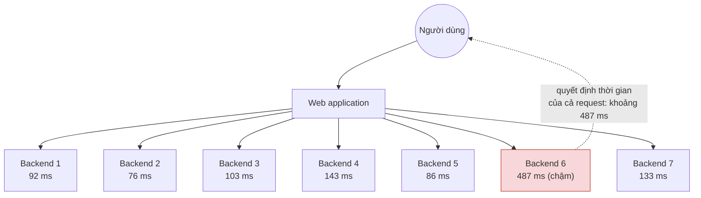

*(Vẽ lại Hình 1-5, tr. 17. Sáu backend trả lời dưới 150 ms, nhưng cả request người dùng phải chờ backend 6 mất 487 ms.)*

> **Bổ sung ngoài sách (phép tính).** Giả sử mỗi lời gọi backend độc lập và có **1%** khả năng chậm (vượt p99 của nó). Một request người dùng gọi n backend thì xác suất **ít nhất một** lời gọi chậm là **1 − 0,99ⁿ**:
>
> | Số lời gọi backend (n) | Xác suất request người dùng bị chậm |
> | --- | --- |
> | 1 | 1% |
> | 10 | khoảng 9,6% |
> | 100 | khoảng 63,4% |
>
> Với 100 backend, p99 của từng backend thực chất quyết định trải nghiệm của **khoảng 2/3** số người dùng.

##### Tính percentile trong thực tế (tr. 16)

Muốn đưa percentile response time lên dashboard giám sát, phải tính chúng **liên tục và hiệu quả**.

- Ví dụ: giữ một **cửa sổ trượt** (*rolling window*) chứa response time của các request trong **10 phút** gần nhất. **Mỗi phút**, tính median và các percentile trên cửa sổ đó rồi vẽ lên đồ thị.
- **Cách ngây thơ:** giữ danh sách response time của mọi request trong cửa sổ và **sắp xếp lại mỗi phút**.
- Nếu cách đó quá tốn kém, có các thuật toán **xấp xỉ percentile tốt** với chi phí CPU và bộ nhớ rất nhỏ: **forward decay** [25], **t-digest** [26], **HdrHistogram** [27].
- **Cảnh báo quan trọng:** **lấy trung bình các percentile** là **vô nghĩa về mặt toán học**, dù để giảm độ phân giải thời gian hay để gộp dữ liệu từ nhiều máy. Cách đúng để gộp dữ liệu response time là **cộng các histogram** [28].

> **Ví dụ minh họa do AI xây dựng — vì sao không được lấy trung bình percentile.**
> - Server A xử lý 900 request, mọi request ≤ 100 ms, nên **p99(A) = 100 ms**.
> - Server B xử lý 100 request: 50 request mất 50 ms, 50 request mất 2.000 ms, nên **p99(B) = 2.000 ms**.
> - **Trung bình hai p99** = (100 + 2.000) / 2 = **1.050 ms**. Sai.
> - **p99 thật của cả hệ thống:** tổng cộng 1.000 request, trong đó 50 request (5%) mất 2.000 ms. 1% chậm nhất (10 request) đều mất 2.000 ms, nên **p99 thật = 2.000 ms**.
>
> Trung bình percentile **đánh giá thấp gần một nửa**, vì nó bỏ qua cả *số lượng request* lẫn *hình dạng phân phối* của từng server. Nếu cộng histogram (đếm số request trong từng khoảng thời gian, cộng dồn qua các server) rồi mới tính p99 thì sẽ ra đúng 2.000 ms.

So sánh các thước đo: xem [D4](#d4).

#### B4.3 Approaches for Coping with Load — Các cách đối phó với tải (tr. 17–18)

Đến đây đã có tham số mô tả tải và thước đo hiệu năng. Câu hỏi chính giờ là: **làm sao giữ hiệu năng tốt khi load parameter tăng?** (tr. 17)

**1. Kiến trúc có "hạn sử dụng" theo bậc tải.** Kiến trúc phù hợp với một mức tải **khó có thể** chịu được tải **gấp 10 lần**. Với dịch vụ tăng trưởng nhanh, có lẽ phải **xem lại kiến trúc mỗi khi tải tăng một bậc độ lớn**, hoặc thường xuyên hơn (tr. 17).

**2. Scale up và scale out** (tr. 17)

- **What:**
  - ***Scaling up*** (*vertical scaling*, mở rộng theo chiều dọc): chuyển sang **một máy mạnh hơn**.
  - ***Scaling out*** (*horizontal scaling*, mở rộng theo chiều ngang): **phân phối tải ra nhiều máy nhỏ hơn**. Phân phối tải qua nhiều máy còn gọi là kiến trúc ***shared-nothing***.
- **Why không chọn tuyệt đối một bên:**
  - Hệ thống chạy trên một máy thường **đơn giản hơn**, nhưng máy cao cấp có thể **rất đắt**. Vì vậy khối lượng công việc rất nặng thường **không tránh được** việc scale out.
  - Thực tế, kiến trúc tốt thường là **sự pha trộn thực dụng**. Ví dụ: dùng **vài máy khá mạnh** vẫn có thể đơn giản và rẻ hơn **rất nhiều máy ảo nhỏ**.

> Glossary của sách (tr. 557) định nghĩa **shared-nothing** là kiến trúc trong đó các node độc lập, mỗi node có CPU, bộ nhớ, ổ đĩa riêng, kết nối qua mạng thông thường. Nó đối lập với kiến trúc shared-memory hoặc shared-disk. Chi tiết nằm ở phần giới thiệu Part II, xem [chapter-05, mục 0](chapter-05.md#shared-architectures).

**3. Elastic và scale thủ công** (tr. 17)

- **Elastic:** hệ thống **tự động thêm tài nguyên** khi phát hiện tải tăng.
- **Thủ công:** con người phân tích năng lực và quyết định thêm máy.
- Elastic hữu ích khi tải **rất khó dự đoán**. Hệ thống scale thủ công **đơn giản hơn** và có thể ít **bất ngờ khi vận hành** hơn. Chương 6, "Rebalancing Partitions", tr. 209, sẽ bàn thêm.

**4. Stateless dễ, stateful khó** (tr. 18)

- Phân phối các dịch vụ **stateless** (không giữ trạng thái) ra nhiều máy **khá đơn giản**.
- Đưa một data system **stateful** (có trạng thái) từ một node sang chạy phân tán thì **thêm rất nhiều độ phức tạp**.
- Vì vậy, kinh nghiệm phổ biến **cho đến gần đây** là **giữ database trên một node** (scale up) cho đến khi **chi phí scale** hoặc **yêu cầu high availability** buộc phải phân tán.
- Khi công cụ và abstraction cho hệ phân tán tốt dần lên, kinh nghiệm này **có thể thay đổi**, ít nhất với một số loại ứng dụng. Có thể hình dung data system phân tán sẽ trở thành **mặc định** trong tương lai, kể cả cho use case không có nhiều dữ liệu hay traffic. Phần còn lại của sách xét nhiều loại data system phân tán, không chỉ về scalability mà cả về **dễ dùng** và **dễ bảo trì**.

**5. Không có "magic scaling sauce"** (tr. 18)

- Kiến trúc của hệ thống quy mô lớn thường **rất đặc thù cho từng ứng dụng**. Không có kiến trúc scalable chung cho mọi trường hợp, thứ mà người ta gọi đùa là ***magic scaling sauce***.
- Vấn đề có thể là: lượng đọc, lượng ghi, lượng dữ liệu cần lưu, độ phức tạp của dữ liệu, yêu cầu response time, mẫu truy cập, hoặc (thường gặp nhất) một hỗn hợp của tất cả những thứ này và nhiều thứ khác.
- **Ví dụ của sách:** hệ thống thiết kế cho **100.000 request/s, mỗi request 1 kB** trông **rất khác** hệ thống cho **3 request/phút, mỗi request 2 GB**, dù **throughput dữ liệu như nhau**.

> **Bổ sung ngoài sách (phép tính kiểm chứng).** 100.000 × 1 kB = 100 MB/s. 3 × 2 GB / 60 s = 100 MB/s. Cùng throughput, nhưng hệ thống đầu cần xử lý **rất nhiều request nhỏ** (chi phí trên mỗi request, số kết nối), còn hệ thống sau cần xử lý **vài request khổng lồ** (truyền dữ liệu lớn, bộ nhớ, khả năng chạy tiếp sau gián đoạn).

**6. Kiến trúc được xây trên các giả định về tải** (tr. 18)

- Kiến trúc scale tốt cho một ứng dụng được xây quanh **giả định về thao tác nào phổ biến, thao tác nào hiếm**, tức là các **load parameters**.
- Nếu giả định **sai**, công sức scale **tốt nhất là phí công**, **tệ nhất là phản tác dụng**.
- Với startup giai đoạn đầu hay sản phẩm chưa được kiểm chứng, **khả năng lặp nhanh trên tính năng** thường quan trọng hơn việc scale cho một mức tải **giả định** trong tương lai.
- Dù đặc thù cho từng ứng dụng, kiến trúc scalable vẫn thường được xây từ **các khối đa dụng**, sắp xếp theo **những mẫu quen thuộc**. Sách sẽ bàn về chính các khối và mẫu đó.

So sánh: xem [D5](#d5) và [D6](#d6).

---

### B5. Maintainability — Khả năng bảo trì (tr. 18–22)

#### B5.0 Vì sao bảo trì là nơi tiêu tốn nhiều chi phí nhất?

Ai cũng biết **phần lớn chi phí phần mềm không nằm ở lúc phát triển ban đầu** mà ở **bảo trì liên tục** (tr. 18):

- sửa bug;
- giữ hệ thống vận hành;
- điều tra sự cố;
- thích ứng với nền tảng mới;
- sửa đổi cho use case mới;
- trả **nợ kỹ thuật** (*technical debt*);
- thêm tính năng mới.

Thế nhưng nhiều người làm phần mềm **không thích bảo trì hệ thống legacy**. Có thể vì phải sửa lỗi của người khác, làm với nền tảng đã lỗi thời, hoặc với hệ thống bị ép làm những việc vốn không được thiết kế để làm. **Mỗi hệ thống legacy khó chịu theo kiểu riêng**, nên khó đưa ra khuyến nghị chung cho chúng (tr. 18–19).

Điều ta *có thể và nên* làm là **thiết kế phần mềm sao cho giảm tối đa nỗi khổ lúc bảo trì**, và nhờ đó **không tự tạo ra phần mềm legacy** (tr. 19). Sách đặc biệt chú ý ba nguyên tắc thiết kế:

| Nguyên tắc | Mục tiêu (tr. 19) | Phục vụ ai |
| --- | --- | --- |
| **Operability** (dễ vận hành) | Giúp đội vận hành dễ giữ hệ thống chạy trơn tru. | Đội vận hành |
| **Simplicity** (đơn giản) | Giúp kỹ sư mới dễ hiểu hệ thống, bằng cách loại bỏ càng nhiều độ phức tạp càng tốt. **Không phải** sự đơn giản của giao diện người dùng. | Kỹ sư mới tham gia |
| **Evolvability** (dễ tiến hóa) | Giúp kỹ sư dễ thay đổi hệ thống trong tương lai, thích ứng với use case không lường trước khi yêu cầu thay đổi. Còn gọi là *extensibility*, *modifiability*, *plasticity*. | Kỹ sư thay đổi hệ thống sau này |

Cũng như reliability và scalability, **không có giải pháp dễ dàng** để đạt các mục tiêu này. Thay vào đó, hãy **luôn nghĩ về hệ thống** với ba nguyên tắc đó trong đầu (tr. 19).

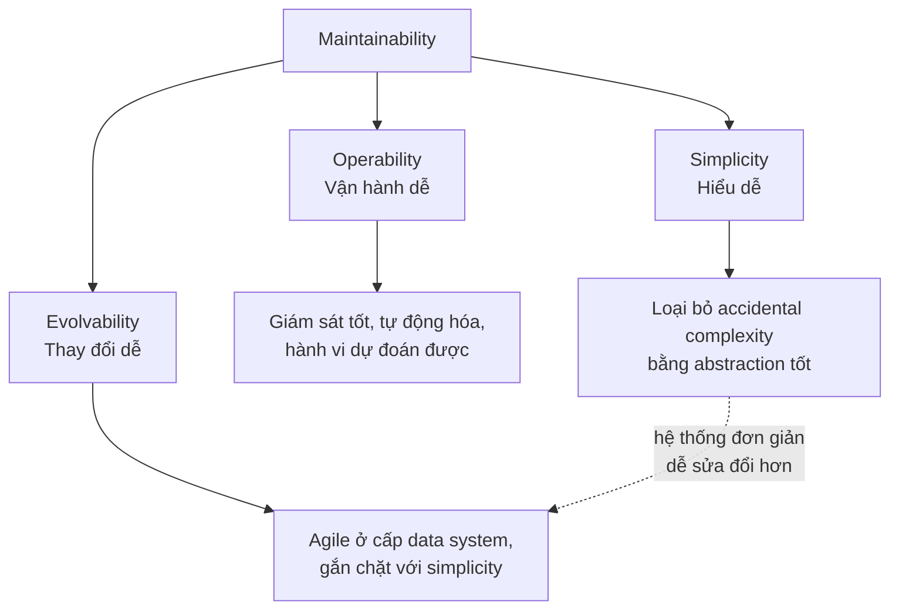

#### B5.1 Operability: giúp đội vận hành dễ thở (tr. 19–20)

**Why.** Sách dẫn một nhận định của Jay Kreps [12]. Đại ý: vận hành tốt thường bù được hạn chế của phần mềm tồi hoặc chưa hoàn chỉnh. Ngược lại, phần mềm tốt không thể chạy tin cậy nếu vận hành tồi. Một số khía cạnh vận hành có thể và nên được tự động hóa, nhưng **vẫn cần con người** thiết lập tự động hóa ban đầu và đảm bảo nó chạy đúng (tr. 19).

**What — đội vận hành tốt chịu trách nhiệm gì?** Danh sách trong sách, dựa trên [29] (tr. 19–20):

1. **Theo dõi sức khỏe** hệ thống và nhanh chóng **khôi phục dịch vụ** khi hệ thống rơi vào trạng thái xấu.
2. **Truy tìm nguyên nhân** sự cố: hệ thống hỏng hoặc hiệu năng suy giảm.
3. **Cập nhật phần mềm và nền tảng**, kể cả bản vá bảo mật.
4. **Nắm được các hệ thống ảnh hưởng lẫn nhau thế nào**, để chặn thay đổi có vấn đề trước khi nó gây hại.
5. **Lường trước vấn đề** và giải quyết trước khi chúng xảy ra, ví dụ *capacity planning* (lập kế hoạch năng lực).
6. Thiết lập **quy trình và công cụ tốt** cho triển khai, quản lý cấu hình…
7. Thực hiện các **tác vụ bảo trì phức tạp**, ví dụ chuyển ứng dụng từ nền tảng này sang nền tảng khác.
8. **Giữ an ninh hệ thống** khi cấu hình thay đổi.
9. Định nghĩa **quy trình giúp vận hành dự đoán được** và giữ môi trường production ổn định.
10. **Lưu giữ tri thức** của tổ chức về hệ thống, kể cả khi từng người đến rồi đi.

**How — data system có thể làm gì để việc thường ngày trở nên dễ?** Operability tốt nghĩa là **làm cho các tác vụ thường ngày trở nên dễ**, để đội vận hành tập trung vào những việc có giá trị cao. Data system có thể (tr. 20):

| Data system nên… | Vì sao giúp vận hành |
| --- | --- |
| Cho **khả năng quan sát** hành vi lúc chạy và bên trong hệ thống, với giám sát tốt | Không thấy thì không quản lý được. |
| Hỗ trợ tốt **tự động hóa** và **tích hợp với công cụ chuẩn** | Giảm thao tác thủ công dễ sai. |
| **Không phụ thuộc vào từng máy riêng lẻ** | Có thể tắt một máy để bảo trì trong khi cả hệ thống vẫn chạy liên tục. |
| Có **tài liệu tốt** và **mô hình vận hành dễ hiểu** ("nếu tôi làm X thì Y sẽ xảy ra") | Người vận hành dự đoán được hậu quả hành động của mình. |
| Có **hành vi mặc định tốt**, nhưng cho quản trị viên **quyền ghi đè** khi cần | Cân bằng giữa tiện lợi và kiểm soát. |
| **Tự phục hồi** khi phù hợp, nhưng vẫn cho quản trị viên **kiểm soát thủ công** trạng thái hệ thống khi cần | Cân bằng giữa tự động và kiểm soát. |
| Có **hành vi dự đoán được**, ít bất ngờ | Bất ngờ là kẻ thù của vận hành. |

> **Nhận xét của người viết ghi chú.** Nhiều mục trong bảng là một cặp **"tự động + quyền can thiệp của con người"**. Thông điệp ngầm là tự động hóa tốt không tước quyền kiểm soát của người vận hành.

#### B5.2 Simplicity: quản lý độ phức tạp (tr. 20–21)

**1. What — độ phức tạp trông như thế nào?**

Dự án nhỏ có thể có code đơn giản, rõ ràng. Nhưng dự án càng lớn thì càng dễ trở nên **phức tạp và khó hiểu**. Độ phức tạp làm chậm tất cả những ai phải làm việc với hệ thống và đẩy chi phí bảo trì lên. Dự án sa lầy trong độ phức tạp đôi khi được gọi là ***big ball of mud*** (một cục bùn to) [30] (tr. 20).

**Triệu chứng của độ phức tạp** (tr. 21):

- **bùng nổ không gian trạng thái** (*explosion of the state space*);
- module **gắn kết chặt** (*tight coupling*);
- phụ thuộc **rối rắm**;
- đặt tên và thuật ngữ **không nhất quán**;
- các **"hack"** để giải quyết vấn đề hiệu năng;
- xử lý **trường hợp đặc biệt** để lách vấn đề ở nơi khác;
- và nhiều thứ khác [31, 32, 33].

**2. Why — vì sao độ phức tạp nguy hiểm?** (tr. 21)

- Khi độ phức tạp làm bảo trì khó khăn, **ngân sách và tiến độ thường bị vượt**.
- Rủi ro **tạo ra bug khi thay đổi** cao hơn. Hệ thống càng khó hiểu và khó suy luận thì các **giả định ẩn**, **hậu quả ngoài ý muốn**, **tương tác bất ngờ** càng dễ bị bỏ sót.
- Ngược lại, **giảm độ phức tạp cải thiện rất nhiều khả năng bảo trì**. Vì vậy simplicity phải là **mục tiêu then chốt**.

**3. How — accidental complexity và abstraction** (tr. 21)

Làm hệ thống đơn giản hơn **không nhất thiết là bớt chức năng**. Nó có thể là **loại bỏ *accidental complexity***.

- Moseley và Marks [32] định nghĩa độ phức tạp là **accidental** (ngẫu nhiên, phát sinh) nếu nó **không vốn có trong vấn đề** mà phần mềm giải quyết (theo góc nhìn người dùng), mà **chỉ phát sinh từ cách cài đặt**.

> **Bổ sung ngoài sách.** Đối lập với accidental complexity là ***essential complexity***: độ phức tạp vốn có của bài toán, không thể loại bỏ mà chỉ có thể quản lý. Cặp khái niệm "essence và accident" xuất phát từ bài *No Silver Bullet* của Fred Brooks, được sách trích ở [31], nhưng phần nội dung chương 1 chỉ định nghĩa accidental complexity.

**Abstraction** là một trong những công cụ tốt nhất để loại bỏ accidental complexity (tr. 21):

- Abstraction tốt **che giấu rất nhiều chi tiết cài đặt** sau một **"mặt tiền" gọn gàng, dễ hiểu**.
- Abstraction tốt **dùng được cho nhiều ứng dụng khác nhau**. Việc tái sử dụng này hiệu quả hơn tự cài lại nhiều lần, và còn **nâng chất lượng phần mềm**: mỗi cải tiến trong thành phần được trừu tượng hóa sẽ có lợi cho mọi ứng dụng dùng nó.

**4. Example — ví dụ trong sách** (tr. 21)

| Abstraction | Che giấu điều gì |
| --- | --- |
| **Ngôn ngữ lập trình bậc cao** | Mã máy, thanh ghi CPU, system call |
| **SQL** | Cấu trúc dữ liệu phức tạp trên đĩa và trong bộ nhớ, request đồng thời từ client khác, trạng thái không nhất quán sau khi crash |

Khi lập trình bằng ngôn ngữ bậc cao, ta **vẫn dùng mã máy**, chỉ là **không dùng trực tiếp**. Abstraction giúp ta không phải nghĩ về nó.

**5. Trade-offs — khó khăn** (tr. 21)

- **Tìm được abstraction tốt rất khó.**
- Trong lĩnh vực **hệ phân tán**, có nhiều thuật toán tốt, nhưng **chưa rõ nên đóng gói chúng thành abstraction như thế nào** để giữ độ phức tạp ở mức kiểm soát được.
- Xuyên suốt sách, tác giả sẽ để ý tìm các **abstraction tốt** cho phép tách các phần của hệ thống lớn thành **thành phần tái sử dụng được, định nghĩa rõ ràng**.

**6. System Design Perspective**

- Hãy liên hệ ngược về B2: API của data system ghép trong Hình 1-1 chính là một **abstraction**. Nó che giấu cache, index, queue khỏi client. Chất lượng của abstraction đó quyết định hệ thống dễ hiểu hay trở thành "big ball of mud".
- Khi đánh giá một thiết kế, hãy hỏi: **phần phức tạp này đến từ bài toán, hay đến từ cách mình đang giải nó?**

#### B5.3 Evolvability: giúp thay đổi dễ dàng (tr. 21–22)

**Why.** Yêu cầu của hệ thống **hầu như chắc chắn sẽ thay đổi liên tục**. Có thể vì: biết thêm sự thật mới, xuất hiện use case chưa từng lường trước, ưu tiên kinh doanh thay đổi, người dùng yêu cầu tính năng mới, nền tảng mới thay nền tảng cũ, yêu cầu pháp lý thay đổi, hoặc tăng trưởng buộc phải đổi kiến trúc (tr. 21–22).

**How — từ Agile ở cấp code lên Agile ở cấp data system** (tr. 22):

- Về quy trình tổ chức, **Agile** cung cấp khung để thích ứng với thay đổi. Cộng đồng Agile cũng phát triển công cụ và mẫu kỹ thuật như **TDD** (*test-driven development*) và **refactoring**.
- Nhưng phần lớn thảo luận về Agile ở **quy mô nhỏ, cục bộ**: vài file mã nguồn trong cùng một ứng dụng.
- Sách tìm cách **tăng sự linh hoạt ở cấp data system lớn hơn**, có thể gồm nhiều ứng dụng hoặc dịch vụ với đặc tính khác nhau. Ví dụ tác giả đặt ra: làm sao **"refactor" kiến trúc home timeline của Twitter** từ cách 1 sang cách 2?
- Khả năng sửa đổi một data system **gắn chặt với simplicity và abstraction** của nó. Hệ thống đơn giản, dễ hiểu thường dễ sửa hơn hệ thống phức tạp.
- Vì ý tưởng này quan trọng, sách dùng một từ riêng cho sự linh hoạt ở cấp data system: ***evolvability*** [34].

> **Ví dụ minh họa do AI xây dựng — vì sao "refactor" ở cấp data system khó hơn refactor code.** Chuyển Twitter từ cách 1 sang cách 2 không chỉ là sửa vài hàm:
> 1. Phải xây cache timeline cho **mọi người dùng hiện có** (*backfill*) từ dữ liệu lịch sử.
> 2. Trong lúc backfill, hệ thống vẫn phải phục vụ 300k lượt đọc/s và nhận tweet mới. Tweet mới phải vào cả đường cũ lẫn đường mới.
> 3. Phải chuyển lượt đọc từ đường cũ sang đường mới một cách từ từ, có khả năng quay lui.
> 4. Chỉ khi chắc chắn mới tắt đường cũ.
>
> Refactor code chỉ thay đổi *logic*. Refactor data system phải thay đổi logic **trong khi dữ liệu và traffic vẫn đang chảy**. Đó là lý do cần một từ riêng là "evolvability". Theo Preface, Chương 4 sẽ bàn về mã hóa dữ liệu và **schema evolution**, một mảnh của bài toán này.

---

### B6. Summary — Tổng kết của tác giả (tr. 22–23)

Tác giả tổng kết bằng cách phân biệt hai loại yêu cầu:

- **Yêu cầu chức năng** (*functional requirements*): ứng dụng **phải làm gì**, ví dụ cho phép lưu, truy xuất, tìm kiếm, xử lý dữ liệu theo nhiều cách.
- **Yêu cầu phi chức năng** (*nonfunctional requirements*): các **thuộc tính chung** như bảo mật, reliability, tuân thủ quy định (*compliance*), scalability, tương thích (*compatibility*), maintainability.

Chương 1 bàn kỹ ba yêu cầu phi chức năng:

| Khái niệm | Tóm tắt của tác giả (tr. 22–23) |
| --- | --- |
| **Reliability** | Làm hệ thống chạy đúng **ngay cả khi có fault**. Fault có thể nằm ở phần cứng (thường ngẫu nhiên, không tương quan), phần mềm (bug thường có tính hệ thống, khó xử lý), và con người (chắc chắn thỉnh thoảng sẽ sai). Kỹ thuật fault-tolerance có thể **che giấu** một số loại fault khỏi người dùng. |
| **Scalability** | Có **chiến lược giữ hiệu năng tốt khi tải tăng**. Muốn bàn về scalability, trước hết phải mô tả tải và hiệu năng **một cách định lượng** (Twitter home timeline cho tải, percentile response time cho hiệu năng). Trong hệ thống scalable, có thể **thêm năng lực xử lý để giữ được độ tin cậy dưới tải cao**. |
| **Maintainability** | Có nhiều khía cạnh, nhưng cốt lõi là **làm cuộc sống tốt hơn cho đội kỹ thuật và đội vận hành**. Abstraction tốt giảm độ phức tạp, giúp hệ thống dễ sửa và dễ thích ứng. Operability tốt nghĩa là nhìn rõ sức khỏe hệ thống và có cách quản lý hiệu quả. |

> **Một chi tiết đáng chú ý.** Trong phần tổng kết, scalability được mô tả là phương tiện để **giữ được reliability dưới tải cao**. Hai khái niệm không tách rời: hệ thống sụp vì quá tải cũng là hệ thống không tin cậy.

**Thông điệp kết:** không có cách sửa nhanh nào làm ứng dụng reliable, scalable hay maintainable. Nhưng có những **mẫu và kỹ thuật lặp đi lặp lại** ở nhiều loại ứng dụng. Các chương tiếp theo xem xét ví dụ về data system và phân tích cách chúng hướng tới các mục tiêu đó. Part III sẽ xem các mẫu cho hệ thống gồm nhiều thành phần phối hợp, như Hình 1-1 (tr. 23).

---

## C. Sơ đồ minh họa

Các sơ đồ gắn trực tiếp với từng mục đã nằm trong phần B:

- Hình 1-1, data system ghép: [B2](#b2)
- Fault → failure: [B3.1](#fault-failure)
- Rolling upgrade, cascading failure, lỗi con người: [B3](#b3)
- Twitter: schema, cách 1 và cách 2, cách lai: [B4.1](#load-parameters)
- Response time, head-of-line blocking, Hình 1-5: [B4.2](#performance)

Phần này bổ sung các sơ đồ **tổng hợp** để ôn tập.

### C1. Bản đồ khái niệm của chương 1

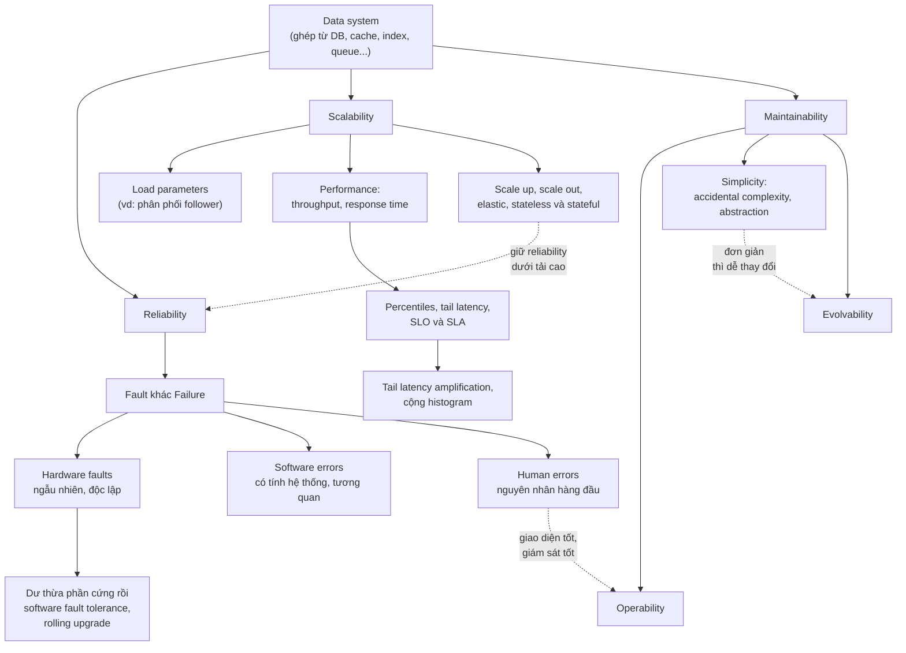

### C2. Các lớp phòng vệ giữa fault và failure

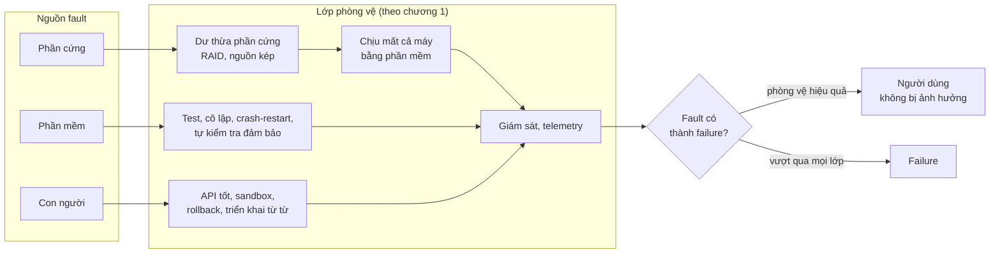

### C3. Quy trình suy luận về scalability

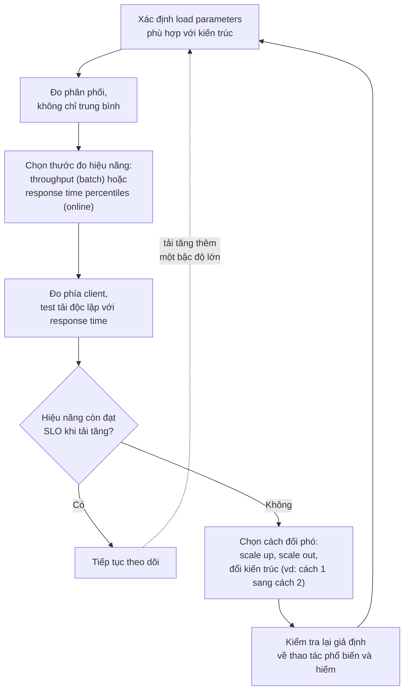

*(Các sơ đồ C1–C3 do người viết ghi chú tổng hợp từ nội dung chương. Chúng không phải hình trong sách.)*

---

## D. So sánh các giải pháp

### D1. Dư thừa phần cứng và chịu lỗi bằng phần mềm (tr. 7–8)

| Tiêu chí | Hardware redundancy | Software fault-tolerance |
| --- | --- | --- |
| **Nguyên lý** | Thêm linh kiện dự phòng trong một máy hoặc một datacenter (RAID, nguồn kép, CPU thay nóng, máy phát điện) | Hệ thống được thiết kế để **chịu được việc mất cả một máy** |
| **Ưu điểm** | Đã được hiểu rõ, có thể giữ một máy chạy nhiều năm | Chịu được máy ảo cloud biến mất; cho phép **rolling upgrade** không downtime |
| **Nhược điểm** | Không ngăn hoàn toàn failure; máy vẫn có thể hỏng toàn bộ; cần downtime theo kế hoạch để reboot | Phức tạp hơn về phần mềm (xem phần stateful ở B4.3) |
| **Trade-off** | Đơn giản, nhưng cả hệ thống phụ thuộc một máy | Linh hoạt và sẵn sàng cao hơn, đổi lại độ phức tạp |
| **Khi nào dùng** | Đủ cho đa số ứng dụng trước đây, khi máy hỏng toàn bộ là hiếm và khôi phục backup đủ nhanh | Khi dùng nhiều máy, chạy trên cloud, hoặc cần high availability. Sách nói có thể dùng **thay cho hoặc bổ sung cho** dư thừa phần cứng |

### D2. Ba loại fault (tr. 7–10)

| Tiêu chí | Hardware faults | Software errors | Human errors |
| --- | --- | --- | --- |
| **Bản chất** | Ngẫu nhiên, gần như độc lập | **Có tính hệ thống** | Không thể tránh |
| **Tương quan giữa các node** | Yếu (vd: nhiệt độ rack) | **Cao**, vì mọi node chạy cùng code | Tùy thao tác: một lỗi cấu hình có thể áp lên cả hệ thống |
| **Ví dụ trong sách** | Ổ đĩa hỏng (MTTF 10–50 năm), RAM lỗi, mất điện, rút nhầm cáp | Leap second 2012, runaway process, dịch vụ phụ thuộc bị chậm, cascading failure | Lỗi cấu hình là nguyên nhân hàng đầu, còn phần cứng chỉ chiếm 10–25% sự cố |
| **Cách giảm thiểu** | Dư thừa phần cứng, chịu lỗi bằng phần mềm | Suy nghĩ về giả định, test, cô lập tiến trình, crash-restart, giám sát, tự kiểm tra đảm bảo | Giao diện tốt, sandbox, test, rollback nhanh, triển khai từ từ, giám sát, đào tạo |
| **Vì sao khó** | Ở quy mô lớn, xảy ra **liên tục** | Bug **nằm im** đến khi một giả định ngừng đúng | Giao diện quá chặt thì người ta lách |

### D3. Twitter home timeline: ba cách tiếp cận (tr. 11–13)

| Tiêu chí | Cách 1: tính khi đọc | Cách 2: tính sẵn khi ghi | Cách lai |
| --- | --- | --- | --- |
| **Nguyên lý** | Ghi 1 lần vào tập tweet toàn cục; khi đọc thì join, gộp, sắp xếp | Khi ghi, fan-out tweet vào cache timeline của từng follower; khi đọc chỉ lấy cache | Fan-out khi ghi cho người dùng thường; tweet người nổi tiếng được lấy và gộp lúc đọc |
| **Ưu điểm** | Ghi rất rẻ, không tốn bộ nhớ cho cache | Đọc rất rẻ, phù hợp khi đọc nhiều hơn ghi khoảng 65 lần | Hiệu năng tốt **ổn định**, tránh trường hợp xấu nhất của cả hai cách |
| **Nhược điểm** | Đọc đắt; Twitter không theo kịp 300k lượt đọc/s | Ghi đắt: 4,6k tweet/s thành 345k lượt ghi/s; người có hơn 30 triệu follower tạo hơn 30 triệu lượt ghi mỗi tweet | Phức tạp hơn: hai đường xử lý, phải phân loại người dùng |
| **Trade-off** | Dồn việc vào lúc đọc | Dồn việc vào lúc ghi | Chia việc theo **phân phối follower** |
| **Khi nào dùng** | Lượt ghi nhiều hơn lượt đọc, hoặc fan-out nhỏ | Lượt đọc áp đảo lượt ghi, phân phối follower không quá lệch | Lượt đọc áp đảo **và** phân phối follower rất lệch (có người nổi tiếng) |

### D4. Các thước đo response time (tr. 14–16)

| Thước đo | Ý nghĩa | Ưu điểm | Nhược điểm hoặc lưu ý | Dùng khi |
| --- | --- | --- | --- | --- |
| **Mean** (trung bình cộng) | Tổng chia cho số lượng | Dễ tính, dễ gộp | Không cho biết bao nhiêu người dùng thực sự gặp độ trễ đó; bị outlier kéo lệch | Ước lượng tổng tài nguyên, ít dùng cho trải nghiệm người dùng |
| **Median (p50)** | Một nửa request nhanh hơn ngưỡng này | Phản ánh trải nghiệm "điển hình" | Nói về **một** request; người dùng gửi nhiều request thì xác suất gặp request chậm hơn median vượt xa 50% | Theo dõi trải nghiệm thông thường |
| **p95, p99, p999** (tail latency) | 95%, 99%, 99,9% request nhanh hơn ngưỡng | Lộ ra trải nghiệm tệ, thường của khách hàng có nhiều dữ liệu nhất | Khó tối ưu; dễ bị nhiễu ngẫu nhiên; p9999 thường không đáng chi phí | SLO và SLA, dịch vụ nội bộ bị gọi nhiều lần |
| **Gộp percentile** | | Cộng histogram rồi tính percentile: **đúng** | Lấy trung bình percentile: **vô nghĩa** | Gộp nhiều máy, giảm độ phân giải thời gian |

### D5. Scale up và scale out (tr. 17–18)

| Tiêu chí | Scale up (vertical) | Scale out (horizontal, shared-nothing) | Pha trộn thực dụng |
| --- | --- | --- | --- |
| **Nguyên lý** | Chuyển sang máy mạnh hơn | Chia tải ra nhiều máy nhỏ hơn | Vài máy khá mạnh |
| **Ưu điểm** | Đơn giản: một máy, không cần lo phân tán | Vượt được giới hạn của một máy; chịu được mất máy | Thường đơn giản và rẻ hơn rất nhiều máy ảo nhỏ |
| **Nhược điểm** | Máy cao cấp rất đắt; có giới hạn trên | Với hệ thống stateful, **thêm rất nhiều độ phức tạp** | Vẫn phải xử lý một mức độ phân tán |
| **Trade-off** | Đơn giản, đổi lại chi phí và giới hạn | Khả năng mở rộng, đổi lại độ phức tạp | Cân bằng hai bên |
| **Khi nào dùng** | Database, cho đến khi chi phí hoặc yêu cầu HA buộc phải phân tán (kinh nghiệm phổ biến cho đến gần đây) | Dịch vụ stateless; workload rất nặng không tránh được | Đa số kiến trúc tốt trong thực tế |

### D6. Elastic và scale thủ công (tr. 17)

| Tiêu chí | Elastic | Scale thủ công |
| --- | --- | --- |
| **Nguyên lý** | Tự động thêm tài nguyên khi phát hiện tải tăng | Con người phân tích năng lực rồi quyết định thêm máy |
| **Ưu điểm** | Phản ứng với tải không dự đoán được | Đơn giản hơn, ít bất ngờ khi vận hành |
| **Nhược điểm** | Phức tạp hơn, có thể gây bất ngờ (Chương 6 sẽ bàn) | Phản ứng chậm hơn |
| **Khi nào dùng** | Tải **rất khó dự đoán** | Tải tăng có thể dự đoán và lập kế hoạch |

### D7. Bảng phân biệt các khái niệm hiệu năng (tr. 13–14)

| Khái niệm | Đo cái gì | Góc nhìn |
| --- | --- | --- |
| **Throughput** | Số bản ghi xử lý mỗi giây, hoặc thời gian chạy job trên tập dữ liệu cho trước | Hệ thống batch |
| **Response time** | Từ lúc client gửi đến lúc nhận response = service time + độ trễ mạng + queueing delay | Client |
| **Service time** | Thời gian thực sự xử lý request | Server |
| **Latency** | Thời gian request **nằm chờ** được xử lý | Request trong hàng đợi |

---

## E. Tư duy System Design

> **Ví dụ minh họa do AI xây dựng.** Tất cả tình huống dưới đây là giả định để luyện cách suy luận. Mỗi bước lập luận đều dẫn về nội dung sách. Hãy thử tự trả lời phần "Câu hỏi cần đặt" trước khi đọc lập luận.

### E1. Thiết kế news feed cho một mạng xã hội đang tăng trưởng

**Bối cảnh.**

- *Giai đoạn 1:* mạng xã hội cho một cộng đồng nhỏ, 20.000 người dùng. Khoảng 500 lượt xem feed/s và 5 bài đăng/s. Người nhiều follower nhất có 2.000 follower.
- *Giai đoạn 2* (3 năm sau): 20 triệu người dùng, 200.000 lượt xem feed/s, 3.000 bài đăng/s. Một số tài khoản người nổi tiếng có 10 triệu follower.

**Câu hỏi cần đặt.** Load parameter nào quan trọng? Mỗi giai đoạn nên chọn cách tính feed nào? Khi nào phải đổi?

**Lập luận.**

1. **Xác định load parameters** (tr. 11). Cần biết tốc độ đọc feed, tốc độ đăng bài, và quan trọng nhất là **phân phối số follower**, có trọng số theo tần suất đăng (tr. 13).
2. **Giai đoạn 1:** đọc gấp khoảng 100 lần ghi, nhưng tổng tải rất nhỏ. Cách 1 (tính khi đọc) chỉ cần một truy vấn join có index, đủ dùng và đơn giản nhất. Sách nhấn mạnh: với sản phẩm giai đoạn đầu, **lặp nhanh trên tính năng** quan trọng hơn scale cho tải giả định (tr. 18). Làm fan-out on write lúc này là tối ưu sớm.
3. **Giai đoạn 2:** đọc gấp khoảng 67 lần ghi và tổng lượt đọc rất lớn, giống tình huống khiến Twitter rời cách 1 (tr. 12). Nhưng phân phối follower **rất lệch**. Fan-out thuần túy sẽ khiến một bài của người nổi tiếng sinh ra 10 triệu lượt ghi. Vì vậy **cách lai** là hợp lý (tr. 13).
4. **Ngưỡng "người nổi tiếng"** không nên là con số cảm tính. Nó nên dựa trên việc fan-out của tài khoản đó có hoàn thành kịp **mục tiêu thời gian giao bài** hay không. Twitter đặt mục tiêu 5 giây (tr. 13).
5. **Kiến trúc có "hạn sử dụng"** (tr. 17). Từ giai đoạn 1 lên giai đoạn 2, số người dùng tăng 1.000 lần và lượt đọc tăng 400 lần, tức gần 3 bậc độ lớn. Vì vậy phải xem lại kiến trúc nhiều lần trên đường đi, không chỉ một lần.

**Nếu yêu cầu thay đổi.**

- Nếu sản phẩm đổi sang dạng **ghi nhiều, đọc ít**, ví dụ một công cụ ghi nhật ký cá nhân hiếm khi xem lại feed, thì lợi thế của cách 2 biến mất. Quay về cách 1.
- Nếu yêu cầu bài của người nổi tiếng hiện **ngay lập tức** thì cách lai vẫn đáp ứng tốt, vì phần đó được tính lúc đọc.

### E2. Đặt SLO cho API checkout gọi 8 backend song song

**Bối cảnh.** API checkout gọi song song 8 backend (giỏ hàng, tồn kho, giá, khuyến mãi, vận chuyển…). Đội sản phẩm muốn: *"p99 của API checkout phía người dùng ≤ 800 ms."*

**Câu hỏi cần đặt.** Nếu mỗi backend đạt p99 ≤ 800 ms thì API checkout có đạt p99 ≤ 800 ms không? Cần đo ở đâu và đo thế nào?

**Lập luận.**

1. **Tail latency amplification** (tr. 16). Request người dùng phải chờ backend **chậm nhất**. Nếu mỗi backend có 1% khả năng vượt 800 ms, thì với 8 lời gọi độc lập, xác suất ít nhất một lời gọi vượt là 1 − 0,99⁸ ≈ **7,7%**. Như vậy p99 phía người dùng **chắc chắn vượt** 800 ms.
2. **Muốn ≤ 1% request người dùng bị chậm**, mỗi backend phải đạt mục tiêu ở percentile cao hơn nhiều. Cần 1 − q⁸ ≤ 0,01, tức q ≥ 0,99^(1/8) ≈ 0,99874. Nói cách khác, mỗi backend phải đạt ngưỡng ở khoảng **p999**, và ngưỡng đó phải trừ hao thời gian mạng và xử lý ở lớp API.
3. **Đo ở phía client** (tr. 16), vì head-of-line blocking làm response time phía server đẹp hơn thực tế.
4. **Gộp số liệu đúng** (tr. 16). API chạy trên nhiều instance, nên phải **cộng histogram** rồi mới tính p99, không lấy trung bình p99 của từng instance.
5. **Kiểm thử tải đúng cách** (tr. 16). Client sinh tải phải gửi request theo tốc độ cố định, độc lập với response time. Nếu không, bài test sẽ che mất queueing delay.
6. **Không đuổi theo p9999** (tr. 15). Mục tiêu quá cao dễ bị nhiễu ngẫu nhiên chi phối và lợi ích giảm dần.

> Sách nêu lý do Amazon dùng p999 cho dịch vụ nội bộ là vì khách hàng chậm nhất thường là khách giá trị nhất (tr. 15). Phép tính ở bước 2 cho thêm một lý do độc lập: **fan-out khiến percentile của từng backend bị "khuếch đại"** ở phía người dùng.
>
> **Bổ sung ngoài sách.** Các kỹ thuật như *hedged requests* (gửi thêm một bản sao request nếu bản đầu chậm) trong bài "The Tail at Scale" mà sách trích ở [24] là cách giảm tail latency khi fan-out. Chương 1 không trình bày kỹ thuật này.

**Nếu yêu cầu thay đổi.**

- Nếu 8 lời gọi phải **tuần tự** thay vì song song, response time là **tổng** chứ không phải **max**. Khi đó ngân sách thời gian phải chia cho từng backend.
- Nếu tăng lên 20 backend, mục tiêu cho từng backend phải chặt hơn nữa: 1 − 0,99²⁰ ≈ 18%.

### E3. Ứng dụng lưu ảnh gia đình của một startup nhỏ

**Bối cảnh.** Đội 4 người xây ứng dụng lưu ảnh và video gia đình, giống ví dụ phụ huynh lưu ảnh con trong sách (tr. 10). Ngân sách hạn chế, cần ra mắt nhanh.

**Câu hỏi cần đặt.** Có thể "đi tắt" về reliability ở đâu, và không được đi tắt ở đâu? Cần chịu được những loại fault nào?

**Lập luận.**

1. **Chọn loại fault cần chịu đựng** (tr. 6–7). Không thể chịu mọi fault. Hãy ưu tiên những fault **chắc chắn xảy ra** và gây **mất dữ liệu không thể lấy lại**.
2. **Hardware faults** (tr. 7). Ổ đĩa sẽ hỏng, nên phải có nhiều bản sao dữ liệu ảnh.
3. **Software errors có tính tương quan** (tr. 8). Một bug xóa nhầm dữ liệu sẽ xóa trên **mọi bản sao** được đồng bộ tự động. Vì vậy chỉ nhân bản là chưa đủ: cần **backup độc lập** với hệ thống chính. *(Đây là suy luận của người viết từ ý "lỗi tương quan" của sách.)*
4. **Human errors** (tr. 9–10): triển khai code mới từ từ, rollback nhanh, có công cụ tính toán lại dữ liệu (ví dụ tạo lại thumbnail), và **thử khôi phục backup định kỳ**. Câu hỏi của sách, "họ có biết cách khôi phục từ backup không?", cũng áp dụng cho chính đội vận hành.
5. **Bảo mật** (tr. 7). Ảnh gia đình bị lộ thì không hoàn tác được, nên đây là chỗ phải **ngăn chặn**, không chỉ chịu đựng.
6. **Nơi có thể đi tắt một cách có ý thức** (tr. 10): tính sẵn sàng (*availability*). Thỉnh thoảng downtime vài phút khi bảo trì có thể chấp nhận ở giai đoạn đầu. **Độ bền dữ liệu** thì không nên là chỗ đi tắt, vì trách nhiệm với người dùng.

**Nếu yêu cầu thay đổi.** Khi sản phẩm có gói trả phí với SLA uptime 99,9% (khoảng 8,8 giờ downtime mỗi năm), downtime khi bảo trì không còn chấp nhận được. Lúc đó cần kiến trúc chịu được việc mất máy và **rolling upgrade** (tr. 8).

### E4. Có nên phân tán database ngay từ đầu?

**Bối cảnh.** Một SaaS B2B có 500 khách hàng doanh nghiệp, 50 GB dữ liệu, tăng gấp đôi mỗi năm. Một kỹ sư đề xuất dùng ngay một database phân tán "để sau này khỏi phải đổi".

**Câu hỏi cần đặt.** Lợi ích và chi phí của việc phân tán sớm là gì? Tín hiệu nào cho thấy đã đến lúc phải phân tán?

**Lập luận.**

1. **Stateless và stateful** (tr. 18). Application server là stateless, có thể scale out ngay khi cần mà không tốn nhiều công sức. Database là stateful, và phân tán nó **thêm rất nhiều độ phức tạp**.
2. **Kinh nghiệm phổ biến** (tr. 18): giữ database trên một node và scale up, cho đến khi **chi phí scale** hoặc **yêu cầu high availability** buộc phải phân tán.
3. **Ước lượng theo load parameters.** Tăng gấp đôi mỗi năm thì sau 5 năm là 50 GB × 2⁵ = 1,6 TB. Một máy mạnh vẫn có thể xử lý mức này, tùy mẫu truy cập. Tín hiệu cần theo dõi là **chi phí** và **yêu cầu sẵn sàng**, chứ không phải "cho chắc".
4. **Giả định có thể sai** (tr. 18). Nếu phân tán sớm dựa trên tải *giả định*, công sức tốt nhất là phí, tệ nhất là phản tác dụng: độ phức tạp tăng, đội chậm lại.
5. **Nhưng** sách cũng lưu ý kinh nghiệm này **có thể thay đổi** khi công cụ phân tán tốt lên (tr. 18). Nếu có dịch vụ phân tán được quản lý sẵn mà chi phí vận hành thấp, cán cân có thể nghiêng về phía khác.

**Nếu yêu cầu thay đổi.** Nếu một khách hàng lớn yêu cầu SLA 99,99% hoặc yêu cầu dữ liệu ở nhiều vùng địa lý, thì việc phân tán bị **ép bởi yêu cầu sẵn sàng hoặc pháp lý**, không phải bởi tải. Đó chính là ngoại lệ "yêu cầu high availability" mà sách nêu.

### E5. Khi load parameters đảo chiều: hệ thống thu thập dữ liệu cảm biến

**Bối cảnh.** 1 triệu cảm biến, mỗi cảm biến gửi một số đo mỗi 10 giây, tức **100.000 lượt ghi/s**. Dashboard chỉ được mở khoảng **100 lượt/s**, chủ yếu xem số liệu tổng hợp theo giờ.

**Câu hỏi cần đặt.** Bài học "làm nhiều việc lúc ghi" từ Twitter có áp dụng được không?

**Lập luận.**

1. Twitter chọn cách 2 **vì đọc nhiều hơn ghi gần hai bậc độ lớn** (tr. 12). Ở đây tỷ lệ **ngược lại**: ghi nhiều hơn đọc khoảng 1.000 lần.
2. Nếu mỗi lượt ghi phải cập nhật thêm nhiều bản tính sẵn, ví dụ cho từng dashboard hay từng chiều tổng hợp, tải ghi vốn đã lớn sẽ bị **nhân lên**. Đây là kiến trúc dựa trên **giả định sai về thao tác phổ biến** (tr. 18).
3. Hợp lý hơn: **ghi càng rẻ càng tốt**, và tính tổng hợp lúc đọc hoặc theo lô định kỳ. Throughput là thước đo chính cho phần xử lý theo lô (tr. 13).
4. **Bài học thực sự từ Twitter** không phải "luôn tính sẵn khi ghi". Bài học là **chọn nơi làm việc nặng dựa trên load parameters**.

**Nếu yêu cầu thay đổi.** Nếu cần **cảnh báo theo thời gian thực** khi một cảm biến vượt ngưỡng, thì phải xử lý ngay khi dữ liệu đến, chứ không chờ lô. Theo Preface, đây là địa hạt của stream processing (Chương 11).

---

## F. Kiến thức cốt lõi

1. **Ứng dụng data-intensive** bị giới hạn bởi khối lượng, độ phức tạp và tốc độ thay đổi của dữ liệu, không phải CPU (tr. 3).
2. Khi ghép database, cache, index, queue bằng application code, **bạn đang thiết kế một data system mới** và phải tự chịu trách nhiệm cho các đảm bảo của nó (tr. 5).
3. **Reliability** là tiếp tục hoạt động đúng khi có trục trặc. **Fault** là một thành phần lệch spec; **failure** là cả hệ thống ngừng phục vụ. Mục tiêu là **ngăn fault thành failure**, vì fault không thể bị loại bỏ (tr. 6–7).
4. Chỉ có thể chịu đựng **một số loại fault đã chọn**. Chủ động gây fault giúp kiểm chứng cơ chế phục hồi (tr. 7).
5. **Phần cứng hỏng liên tục ở quy mô lớn.** Xu hướng là chuyển từ dư thừa phần cứng sang **chịu mất cả máy bằng phần mềm**, đi kèm lợi ích rolling upgrade (tr. 7–8).
6. **Lỗi phần mềm có tính hệ thống và tương quan**, nên thường gây nhiều failure hơn lỗi phần cứng. Thêm bản sao không giải quyết được chúng (tr. 8–9).
7. **Lỗi cấu hình của con người là nguyên nhân hàng đầu** gây sự cố. Hãy thiết kế để giảm cơ hội mắc lỗi và **phục hồi nhanh** khi đã mắc lỗi (tr. 9–10).
8. **"X is scalable" là câu vô nghĩa.** Scalability là câu hỏi "nếu tăng trưởng theo chiều này thì đối phó thế nào?" (tr. 10–11).
9. Mô tả tải bằng **load parameters**, và phải nhìn **phân phối**, không chỉ trung bình. Ví dụ Twitter: phân phối follower quyết định tải fan-out (tr. 11–13).
10. Response time là **một phân phối**. Dùng **percentile** (p50, p95, p99, p999) thay cho mean. Đo **phía client**. **Không lấy trung bình percentile**, hãy cộng histogram (tr. 14–16).
11. **Tail latency amplification:** càng nhiều lời gọi backend cho một request thì percentile cao của backend càng quyết định trải nghiệm người dùng (tr. 16).
12. **Không có magic scaling sauce.** Kiến trúc scale được xây trên **giả định về tải**. Stateless dễ scale out, stateful thì phức tạp. Hãy xem lại kiến trúc mỗi khi tải tăng một bậc độ lớn (tr. 17–18).
13. **Maintainability = operability + simplicity + evolvability.** Công cụ chính để có simplicity là **abstraction tốt**, loại bỏ accidental complexity. Hệ thống đơn giản thì **dễ tiến hóa** (tr. 18–22).

---

## G. Câu hỏi tự kiểm tra

Hãy tự trả lời trước, sau đó mới xem [phần đáp án](#g-dap-an).

1. Phân biệt **fault** và **failure**. Vì sao mục tiêu thiết kế là ngăn fault biến thành failure, thay vì loại bỏ fault? Vì sao một hệ thống fault-tolerant lại **cố tình gây fault**?
2. Vì sao **lỗi phần mềm** thường gây nhiều failure hơn **lỗi phần cứng**, dù phần cứng hỏng "liên tục"? Thêm nhiều replica có giải quyết được không? Nếu **lỗi con người** là nguyên nhân hàng đầu, thiết kế nên ưu tiên gì?
3. Vì sao Twitter chuyển từ cách 1 (tính khi đọc) sang cách 2 (tính sẵn khi ghi)? **Điều gì xảy ra nếu** tỷ lệ đọc/ghi đảo ngược?
4. Vì sao "mỗi tweet trung bình đến 75 follower" **không đủ** để mô tả tải của Twitter? Load parameter nào phù hợp hơn, và nó dẫn tới thiết kế nào?
5. **So sánh** mean, median và p999 khi mô tả response time. Cho một ví dụ mean gây hiểu lầm. Vì sao Amazon quan tâm p999 nhưng **không** tối ưu p9999?
6. Một trang web cần **20 lời gọi backend song song**, mỗi lời gọi có 1% khả năng chậm. Khoảng bao nhiêu phần trăm lượt tải trang gặp ít nhất một lời gọi chậm? Điều này nói gì về percentile cần tối ưu ở backend?
7. Dashboard của đội bạn hiển thị "p99 toàn hệ thống" bằng cách **lấy trung bình p99 của 10 server**. Điều gì sai? Sửa thế nào?
8. Công cụ load test của bạn chỉ gửi request tiếp theo **sau khi nhận response** của request trước. **Điều gì xảy ra** với số liệu đo được? Vì sao phải đo response time **ở phía client**?
9. **So sánh** scale up và scale out. Vì sao kinh nghiệm phổ biến là giữ database trên một node, trong khi application server lại scale out dễ dàng? Điều gì có thể làm kinh nghiệm này thay đổi?
10. **Accidental complexity** là gì? Abstraction giúp giảm nó như thế nào? Vì sao tác giả cần một từ riêng là **evolvability** thay vì chỉ nói "Agile" hay "refactoring"?

### Đáp án và giải thích

<b>Câu 1 — Fault, failure, cố tình gây fault</b>

- **Fault** là một thành phần lệch khỏi spec, ví dụ một ổ đĩa hỏng hay một tiến trình crash. **Failure** là cả hệ thống ngừng cung cấp dịch vụ cho người dùng (tr. 7).
- Xác suất fault **không thể bằng 0**, nên cố loại bỏ mọi fault là vô vọng. Cách thực tế là thiết kế cơ chế để fault **không lan thành failure**. Và vì không thể chịu được *mọi* fault (ví dụ hố đen), ta phải **chọn** những loại fault cần chịu đựng (tr. 6–7).
- **Cố tình gây fault**, như kill tiến trình ngẫu nhiên hay Chaos Monkey, vì nhiều bug nghiêm trọng nằm ở **phần xử lý lỗi**. Đường xử lý lỗi hiếm khi chạy nên hiếm khi được kiểm tra. Gây fault thường xuyên buộc cơ chế phục hồi phải chạy liên tục, và tăng niềm tin rằng nó sẽ hoạt động khi fault xảy ra thật (tr. 7).

<b>Câu 2 — Lỗi phần mềm, replica, lỗi con người</b>

- Lỗi phần cứng gần như **ngẫu nhiên và độc lập**: ổ này hỏng không kéo theo ổ khác. Lỗi phần mềm có **tính hệ thống**: mọi node chạy cùng code nên có cùng bug, và bug được kích hoạt **trên mọi node cùng lúc**. Ví dụ: leap second 2012 làm nhiều ứng dụng treo đồng thời (tr. 8).
- **Thêm replica không giúp được**, vì mọi replica chung một lỗi. Replica chỉ bảo vệ trước fault độc lập. Với lỗi phần mềm, cần một tổ hợp biện pháp: xem xét kỹ các giả định, test, cô lập tiến trình, cho phép crash và restart, giám sát, và tự kiểm tra các đảm bảo trong lúc chạy (tr. 9).
- **Lỗi con người**, chủ yếu là lỗi cấu hình, là nguyên nhân hàng đầu, còn phần cứng chỉ chiếm 10–25% (tr. 9). Vì vậy nên ưu tiên:
  - giao diện khiến làm đúng dễ, làm sai khó, nhưng không quá gò bó;
  - sandbox với dữ liệu thật;
  - test mọi cấp;
  - **rollback nhanh và triển khai từ từ**;
  - giám sát chi tiết (tr. 9–10).

<b>Câu 3 — Twitter và tỷ lệ đọc/ghi</b>

- Cách 1 khiến **mỗi lượt đọc timeline** phải join và gộp tweet của mọi người đang theo dõi. Với 300k lượt đọc/s, hệ thống không theo kịp (tr. 12).
- Lượt đăng tweet (4,6k/s) thấp hơn lượt đọc **gần hai bậc độ lớn**. Vì vậy dồn việc vào lúc ghi (fan-out vào cache timeline) làm lượt đọc rất rẻ, và tổng chi phí giảm (tr. 12).
- **Nếu tỷ lệ đảo ngược** (ghi nhiều, đọc ít), cách 2 sẽ tốn công tính sẵn cho những timeline hiếm khi được đọc. Mỗi lượt ghi nhân lên theo số follower, trong khi lợi ích lúc đọc nhỏ. Khi đó cách 1 hợp lý hơn. Bài học: **nơi làm việc nặng phải được chọn theo load parameters** (tr. 18).

<b>Câu 4 — Vì sao trung bình 75 follower không đủ</b>

- Trung bình **che giấu độ lệch**: một số người dùng có **hơn 30 triệu follower**. Một tweet của họ sinh ra hơn 30 triệu lượt ghi, trong khi Twitter muốn giao trong 5 giây (tr. 12–13).
- Tham số phù hợp hơn là **phân phối số follower trên mỗi người dùng**, có thể có trọng số theo tần suất đăng tweet. Tham số này quyết định **tải fan-out** (tr. 13).
- Thiết kế suy ra từ đó là **cách lai**: fan-out khi ghi cho đa số người dùng; tweet của người nổi tiếng được lấy và gộp lúc đọc (tr. 13).

<b>Câu 5 — Mean, median, p999 và vì sao không tối ưu p9999</b>

- **Mean** không cho biết bao nhiêu người dùng thực sự gặp độ trễ đó. Ví dụ: 9 request khoảng 20–45 ms và 1 request 1.000 ms cho mean khoảng 127 ms, một con số **không ai thực sự trải qua** (tr. 14).
- **Median (p50)** phản ánh trải nghiệm điển hình của **một** request. Nhưng nếu người dùng gửi nhiều request, khả năng gặp ít nhất một request chậm hơn median vượt xa 50% (tr. 15).
- **p999** lộ ra trải nghiệm tệ nhất (trừ những trường hợp cực hiếm). Amazon quan tâm vì khách hàng chậm nhất thường là khách có nhiều dữ liệu nhất, tức **giá trị nhất** (tr. 15).
- **p9999** quá đắt để tối ưu: nó bị chi phối bởi sự kiện ngẫu nhiên ngoài tầm kiểm soát, và lợi ích giảm dần (tr. 15).

<b>Câu 6 — 20 lời gọi backend song song</b>

- Xác suất cả 20 lời gọi đều nhanh là 0,99²⁰ ≈ 0,818. Vậy khoảng **18%** lượt tải trang gặp ít nhất một lời gọi chậm. *(Phép tính này là bổ sung ngoài sách.)*
- Đây là **tail latency amplification** (tr. 16): trang phải chờ lời gọi chậm nhất, nên "1% chậm" ở backend thành gần "1/5 chậm" ở người dùng.
- Hệ quả: muốn trải nghiệm người dùng tốt ở p99, **backend phải được tối ưu ở percentile cao hơn nhiều** (khoảng p999), không chỉ p99.

<b>Câu 7 — Lấy trung bình p99 của 10 server</b>

- Lấy trung bình percentile **vô nghĩa về mặt toán học** (tr. 16). Nó bỏ qua **số lượng request** của mỗi server và **hình dạng phân phối** của từng server. Ví dụ ở B4.2: trung bình hai p99 cho 1.050 ms, trong khi p99 thật là 2.000 ms.
- **Cách sửa:** mỗi server ghi response time vào **histogram**. **Cộng các histogram** lại rồi mới tính p99 trên histogram tổng (tr. 16).
- Để tính hiệu quả trên cửa sổ trượt, dùng các thuật toán xấp xỉ như **t-digest**, **HdrHistogram**, **forward decay** (tr. 16).

<b>Câu 8 — Load test chờ response và đo phía client</b>

- Nếu client chờ response trước rồi mới gửi tiếp, thì khi hệ thống chậm, client **tự động gửi chậm lại**. Hàng đợi trong bài test **ngắn hơn thực tế**, và response time đo được **tốt hơn thực tế**, tức số đo bị lệch theo hướng lạc quan (tr. 16). Người dùng thật không đợi nhau như vậy. Client sinh tải phải gửi request **độc lập với response time**.
- **Phải đo ở phía client** vì queueing delay và **head-of-line blocking**: request nhanh phía sau phải chờ request chậm phía trước. Server chỉ thấy service time ngắn, còn client thấy toàn bộ thời gian chờ (tr. 15–16).

<b>Câu 9 — Scale up, scale out và database một node</b>

- **Scale up:** máy mạnh hơn. Đơn giản, nhưng máy cao cấp rất đắt và có giới hạn. **Scale out:** nhiều máy nhỏ hơn (shared-nothing). Vượt được giới hạn một máy, nhưng phức tạp hơn. Thực tế tốt nhất thường là **pha trộn thực dụng** (tr. 17).
- **Application server là stateless**, nên phân tán khá đơn giản: máy nào cũng xử lý được request nào. **Database là stateful**, và phân tán nó **thêm rất nhiều độ phức tạp**, vì dữ liệu phải được chia và giữ nhất quán giữa các máy. Vì vậy kinh nghiệm phổ biến là giữ database một node cho đến khi **chi phí scale** hoặc **yêu cầu high availability** buộc phải phân tán (tr. 18).
- **Kinh nghiệm này có thể thay đổi** khi công cụ và abstraction cho hệ phân tán tốt dần lên. Data system phân tán có thể trở thành mặc định, kể cả với hệ thống nhỏ (tr. 18).

<b>Câu 10 — Accidental complexity, abstraction, evolvability</b>

- **Accidental complexity** là độ phức tạp **không vốn có trong bài toán** (theo góc nhìn người dùng) mà **chỉ phát sinh từ cách cài đặt**, theo định nghĩa của Moseley và Marks (tr. 21).
- **Abstraction tốt** che giấu chi tiết cài đặt sau một giao diện gọn gàng, và tái sử dụng được cho nhiều ứng dụng. Ví dụ: SQL che giấu cấu trúc dữ liệu trên đĩa, truy cập đồng thời, và trạng thái không nhất quán sau crash. Khó khăn là **tìm được abstraction tốt rất khó**, nhất là trong hệ phân tán (tr. 21).
- **Evolvability:** Agile, TDD, refactoring thường được bàn ở **quy mô vài file trong một ứng dụng**. Tác giả cần một từ cho sự linh hoạt ở **cấp data system**, tức nhiều ứng dụng hoặc dịch vụ với đặc tính khác nhau, như "refactor" Twitter từ cách 1 sang cách 2 (tr. 22). Ở cấp này, thay đổi phải diễn ra **trong khi dữ liệu và traffic vẫn đang chảy**. Evolvability gắn chặt với simplicity: hệ thống đơn giản thì dễ thay đổi hơn.

---

## Ghi chú kiểm tra nguồn

**Đối chiếu với mục lục của chương** (bookmark PDF và tiêu đề trong sách):

| Mục trong sách | Trang in | Mục ghi chú |
| --- | --- | --- |
| *(Mở đầu chương)* | 3–4 | B1 |
| Thinking About Data Systems | 4–6 | B2 |
| Reliability | 6–7 | B3.0, B3.1 |
| Hardware Faults | 7–8 | B3.2 |
| Software Errors | 8–9 | B3.3 |
| Human Errors | 9–10 | B3.4 |
| How Important Is Reliability? | 10 | B3.5 |
| Scalability | 10–11 | B4.0 |
| Describing Load | 11–13 | B4.1 |
| Describing Performance (gồm hộp "Latency and response time" và mục "Percentiles in Practice") | 13–17 | B4.2 |
| Approaches for Coping with Load | 17–18 | B4.3 |
| Maintainability | 18–19 | B5.0 |
| Operability: Making Life Easy for Operations | 19–20 | B5.1 |
| Simplicity: Managing Complexity | 20–21 | B5.2 |
| Evolvability: Making Change Easy | 21–22 | B5.3 |
| Summary | 22–23 | B6 |
| References [1]–[34] | 23–25 | Số [n] trong ghi chú giữ nguyên số thứ tự tài liệu tham khảo của sách |

**Hình và trang đã kiểm tra trực tiếp trên ảnh trang PDF:**

- Bản đồ minh họa đầu chương (tr. 2, PDF 24) gồm ba nhánh: Reliability (lỗi phần cứng, phần mềm, con người), Scalability (đo tải và hiệu năng, latency percentiles, throughput), Maintainability (operability, simplicity, evolvability). Khớp với cấu trúc ghi chú.
- Hình 1-1 (tr. 5), Hình 1-2 và 1-3 (tr. 12), Hình 1-4 (tr. 14), Hình 1-5 (tr. 17). Số liệu trong Hình 1-3 (4,6k ghi/s; 345k ghi/s; 300k đọc/s; tối đa 31M follower) khớp với phần chữ. Hình 1-4 là biểu đồ cột dữ liệu mẫu nên được mô tả bằng lời, không vẽ lại.

**Giới hạn và điểm chưa kiểm chứng:**

- Văn bản chương 1 trích xuất tốt từ PDF. Không có trang nào không đọc được.
- Các số liệu thực tế (MTTF ổ đĩa, nghiên cứu lỗi con người, số liệu Amazon và Twitter) là **số liệu do sách trích dẫn**. Ghi chú không kiểm chứng độc lập với nguồn gốc.
- Các liên hệ tới chương sau chỉ dựa trên **tham chiếu chéo trong chương 1, Preface và mục lục**. Chúng sẽ được kiểm chứng khi học các chương đó.
- Mọi phép tính, thuật ngữ ngành và ví dụ không có trong sách đều được đánh dấu **Bổ sung ngoài sách** hoặc **Ví dụ minh họa do AI xây dựng**.
