# Chương 2 — Mô hình dữ liệu và ngôn ngữ truy vấn

*Data Models and Query Languages*

> **Nguồn:** *Designing Data-Intensive Applications*, Martin Kleppmann, O'Reilly, **First Edition (3/2017)**, Chương 2, **tr. 27–68** (trang PDF 49–90). Bản đồ minh họa của chương nằm ở tr. 26 (PDF 48).
> "tr. N" là số trang in trong sách. Trang PDF = N + 22.
>
> **Quy ước nhãn:**
> - Nội dung không có nhãn là diễn giải từ sách, kèm số trang.
> - **Bổ sung ngoài sách** là kiến thức thêm để giải thích rõ hơn, kể cả phép tính tự làm.
> - **Ví dụ minh họa do AI xây dựng** là ví dụ hoặc tình huống giả định, không phải của tác giả.
>
> Các đoạn code và truy vấn mẫu trong sách (Example 2-1 đến 2-11) được **diễn giải bằng lời** thay vì chép lại. Hãy mở trang tương ứng trong PDF để xem nguyên văn khi cần.

## Mục lục ghi chú

- [A. Tổng quan chương](#a-tong-quan)
- [B. Giải thích chi tiết](#b-chi-tiet)
  - [B1. Mô hình dữ liệu là các lớp abstraction (tr. 27–28)](#b1)
  - [B2. Relational Model Versus Document Model (tr. 28–42)](#b2)
  - [B3. Query Languages for Data (tr. 42–48)](#b3)
  - [B4. Graph-Like Data Models (tr. 49–63)](#b4)
  - [B5. Summary (tr. 63–64)](#b5)
- [C. Sơ đồ minh họa](#c-so-do)
- [D. So sánh các giải pháp](#d-so-sanh)
- [E. Tư duy System Design](#e-system-design)
- [F. Kiến thức cốt lõi](#f-cot-loi)
- [G. Câu hỏi tự kiểm tra](#g-cau-hoi) · [Đáp án](#g-dap-an)
- [Ghi chú kiểm tra nguồn](#kiem-tra)

---

<a id="a-tong-quan"></a>

## A. Tổng quan chương

### Chương này muốn giải quyết điều gì?

Tác giả mở đầu bằng nhận định: **mô hình dữ liệu** (*data model*) có lẽ là phần quan trọng nhất khi phát triển phần mềm. Nó không chỉ quyết định cách viết phần mềm mà còn quyết định **cách ta nghĩ về chính bài toán** đang giải (tr. 27).

Mỗi mô hình dữ liệu ngầm chứa **giả định về cách nó sẽ được dùng** (tr. 28):

- có kiểu sử dụng thì dễ, có kiểu không được hỗ trợ;
- có thao tác thì nhanh, có thao tác thì chậm;
- có phép biến đổi dữ liệu thì tự nhiên, có phép thì gượng ép.

Vì mô hình dữ liệu ảnh hưởng sâu sắc đến những gì phần mềm phía trên làm được và không làm được, việc **chọn mô hình phù hợp với ứng dụng** là rất quan trọng (tr. 28).

Chương này so sánh ba họ mô hình dữ liệu đa dụng: **relational**, **document** và một số mô hình **graph**, cùng các **ngôn ngữ truy vấn** đi kèm. Cách các mô hình này được *cài đặt* bên dưới (storage engine) để dành cho Chương 3 (tr. 28).

### Mạch lập luận của chương

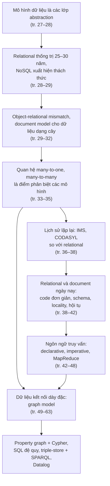

### Liên hệ với các chương khác

| Ý trong chương 2 | Liên hệ | Căn cứ |
| --- | --- | --- |
| Mỗi lớp mô hình che giấu độ phức tạp của lớp dưới | **Chương 1**: abstraction là công cụ chính để loại bỏ accidental complexity ([B5.2 chương 1](chapter-01.md#simplicity)) | tr. 27–28 |
| Query optimizer xây một lần, mọi ứng dụng hưởng lợi | **Chương 1**: abstraction tốt được tái sử dụng, cải tiến có lợi cho mọi ứng dụng | tr. 38 |
| Cách các mô hình được cài đặt trên đĩa, locality, search index | **Chương 3** — Storage and Retrieval | tr. 28, 41, 64 |
| Vấn đề của JSON khi làm định dạng mã hóa, schema evolution | **Chương 4** — Encoding and Evolution | tr. 32, 41 |
| Khác biệt về fault tolerance giữa relational và document | **Chương 5** — Replication | tr. 38 |
| Khác biệt về xử lý đồng thời | **Chương 7** — Transactions | tr. 38 |
| MapReduce, Pregel | **Chương 10** — Batch Processing | tr. 46, 50 |
| Normalization, denormalization, caching, derived data | **Part III** | tr. 34 |

> **Bản đồ đầu chương (tr. 26).** Bản đồ minh họa vẽ "Đế chế Relational" rộng lớn, "Khu Document Data", "Khu Key-Value", "Khu Column-Family", "Đỉnh Graph Data", và hai con sông "Imperative" và "Declarative" chảy qua. Hình ảnh này khớp với ý chính của chương: các mô hình chiếm những "lãnh thổ" ứng dụng khác nhau, và ngôn ngữ truy vấn chia thành hai dòng tư duy.

---

<a id="b-chi-tiet"></a>

## B. Giải thích chi tiết

<a id="b1"></a>

### B1. Mô hình dữ liệu là các lớp abstraction (tr. 27–28)

Hầu hết ứng dụng được xây bằng cách **chồng mô hình dữ liệu này lên mô hình dữ liệu khác**. Ở mỗi lớp, câu hỏi then chốt là: lớp này được **biểu diễn bằng lớp ngay bên dưới** như thế nào? (tr. 27)

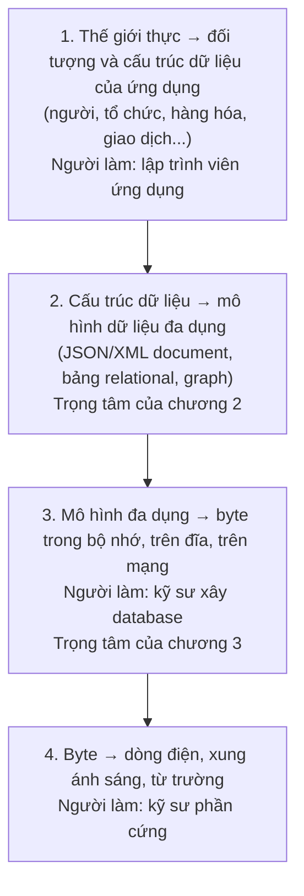

- Ứng dụng phức tạp có thể có thêm lớp trung gian, ví dụ API xây trên API khác. Ý tưởng cơ bản vẫn vậy: **mỗi lớp che giấu độ phức tạp của các lớp bên dưới** bằng cách cung cấp một mô hình dữ liệu gọn gàng (tr. 27).
- Những abstraction này cho phép **các nhóm người khác nhau làm việc cùng nhau hiệu quả**, ví dụ kỹ sư của hãng database và lập trình viên dùng database đó (tr. 28).
- Thành thạo dù chỉ một mô hình dữ liệu cũng tốn rất nhiều công sức. Hãy nghĩ xem có bao nhiêu cuốn sách chỉ về mô hình hóa dữ liệu relational (tr. 28).

> **Liên hệ chương 1.** Đây chính là ý "abstraction loại bỏ accidental complexity" ở [chương 1, B5.2](chapter-01.md#simplicity), áp dụng cho dữ liệu. Lập trình viên ứng dụng không cần biết database lưu byte thế nào. Kỹ sư database không cần biết ứng dụng mô tả thế giới thực ra sao.

---

<a id="b2"></a>

### B2. Relational Model Versus Document Model (tr. 28–42)

#### B2.0 Relational model và 30 năm thống trị (tr. 28–29)

**What.** Mô hình nổi tiếng nhất hiện nay có lẽ là mô hình của SQL, dựa trên **relational model** do **Edgar Codd** đề xuất năm **1970** [1] (tr. 28):

- Dữ liệu được tổ chức thành các **relation** (trong SQL gọi là **table**, bảng).
- Mỗi relation là một **tập hợp không có thứ tự** các **tuple** (trong SQL gọi là **row**, hàng).

**Lịch sử ngắn** (tr. 28–29):

- Ban đầu đây là một đề xuất lý thuyết, và nhiều người nghi ngờ nó có thể cài đặt hiệu quả.
- Đến **giữa thập niên 1980**, RDBMS (*relational database management system*) và SQL đã trở thành công cụ được chọn cho hầu hết nhu cầu lưu và truy vấn dữ liệu có cấu trúc đều đặn.
- Sự thống trị kéo dài khoảng **25–30 năm**, một "vĩnh cửu" trong lịch sử máy tính.

**Nguồn gốc** (tr. 28). Relational database bắt nguồn từ **xử lý dữ liệu doanh nghiệp** trên máy mainframe thập niên 1960–70. Use case của nó nay trông rất bình thường:

- **transaction processing**: nhập giao dịch bán hàng, ngân hàng, đặt vé máy bay, quản lý kho;
- **batch processing**: lập hóa đơn khách hàng, tính lương, báo cáo.

**Why — relational model ra đời để làm gì?** Các database khác thời đó buộc lập trình viên phải **nghĩ nhiều về cách dữ liệu được biểu diễn bên trong database**. Mục tiêu của relational model là **giấu chi tiết cài đặt đó sau một giao diện gọn gàng hơn** (tr. 28).

**Các đối thủ đã đến rồi đi** (tr. 28–29):

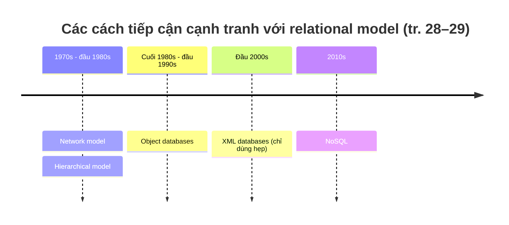

Mỗi đối thủ đều tạo ra nhiều cơn sốt trong thời của nó, nhưng không kéo dài [2]. Đáng chú ý, relational database hóa ra **tổng quát hóa rất tốt**, vượt xa phạm vi xử lý dữ liệu doanh nghiệp ban đầu. Phần lớn những gì ta thấy trên web vẫn chạy trên relational database: xuất bản trực tuyến, diễn đàn, mạng xã hội, thương mại điện tử, game, SaaS… (tr. 29)

#### B2.1 The Birth of NoSQL (tr. 29)

**Cái tên.** "NoSQL" là nỗ lực mới nhất (thập niên 2010) nhằm lật đổ sự thống trị của relational model. Tác giả gọi cái tên này là "không may", vì nó **không chỉ một công nghệ cụ thể nào**. Ban đầu nó chỉ là một **hashtag Twitter** cho một buổi meetup năm **2009** về database phân tán, mã nguồn mở, phi relational [3]. Sau đó nó được diễn giải lại là ***Not Only SQL*** [4].

**Động lực khiến NoSQL được chấp nhận** (tr. 29):

1. Cần **scalability lớn hơn** mức relational database dễ dàng đạt được, gồm dataset rất lớn hoặc **throughput ghi rất cao**.
2. Xu hướng chuộng **phần mềm mã nguồn mở, miễn phí** hơn sản phẩm database thương mại.
3. Cần các **thao tác truy vấn chuyên biệt** mà relational model hỗ trợ kém.
4. Bực bội với **sự gò bó của schema relational**, và mong muốn một mô hình dữ liệu **linh hoạt, biểu đạt tốt hơn** [5].

**Polyglot persistence** (tr. 29). Mỗi ứng dụng có yêu cầu khác nhau, nên công nghệ tốt nhất cho use case này có thể khác use case kia. Vì vậy có vẻ trong tương lai gần, relational database sẽ tiếp tục được dùng **song song** với nhiều loại datastore phi relational. Ý tưởng này đôi khi được gọi là ***polyglot persistence*** [3].

> **Liên hệ chương 1.** Đây là hệ quả của ý "một công cụ không còn đáp ứng nổi mọi nhu cầu" ở [chương 1, B2](chapter-01.md#b2).

<a id="impedance-mismatch"></a>

#### B2.2 The Object-Relational Mismatch (tr. 29–32)

**1. What — impedance mismatch là gì?**

Phần lớn ứng dụng ngày nay viết bằng ngôn ngữ **hướng đối tượng**. Nếu dữ liệu lưu trong bảng relational, cần một **lớp chuyển đổi vụng về** giữa *đối tượng* trong code và *bảng, hàng, cột* trong database. Sự lệch nhau giữa hai mô hình này đôi khi gọi là ***impedance mismatch*** (tr. 29–30).

> Chú thích i (tr. 30): thuật ngữ mượn từ điện tử. Mạch điện nào cũng có trở kháng (*impedance*) ở đầu vào và đầu ra. Nối hai mạch với nhau thì công suất truyền tốt nhất khi trở kháng hai bên **khớp nhau**. Lệch trở kháng gây phản xạ tín hiệu và nhiều rắc rối khác.

**ORM** (*object-relational mapping*) như ActiveRecord, Hibernate giảm lượng code lặp cho lớp chuyển đổi, nhưng **không thể che giấu hoàn toàn** khác biệt giữa hai mô hình (tr. 30).

**2. Example — hồ sơ LinkedIn (Hình 2-1, tr. 30–31)**

Một bản lý lịch (hồ sơ LinkedIn) có:

- Thông tin xuất hiện **đúng một lần** mỗi người: `user_id`, `first_name`, `last_name`, `summary`… Chúng nằm gọn thành cột trong bảng `users`.
- Thông tin xuất hiện **nhiều lần**: nhiều công việc (*positions*), nhiều giai đoạn học tập (*education*), nhiều thông tin liên lạc (*contact info*). Đây là quan hệ **one-to-many** từ người dùng tới các mục đó.

Hình 2-1 biểu diễn dạng relational như sau:

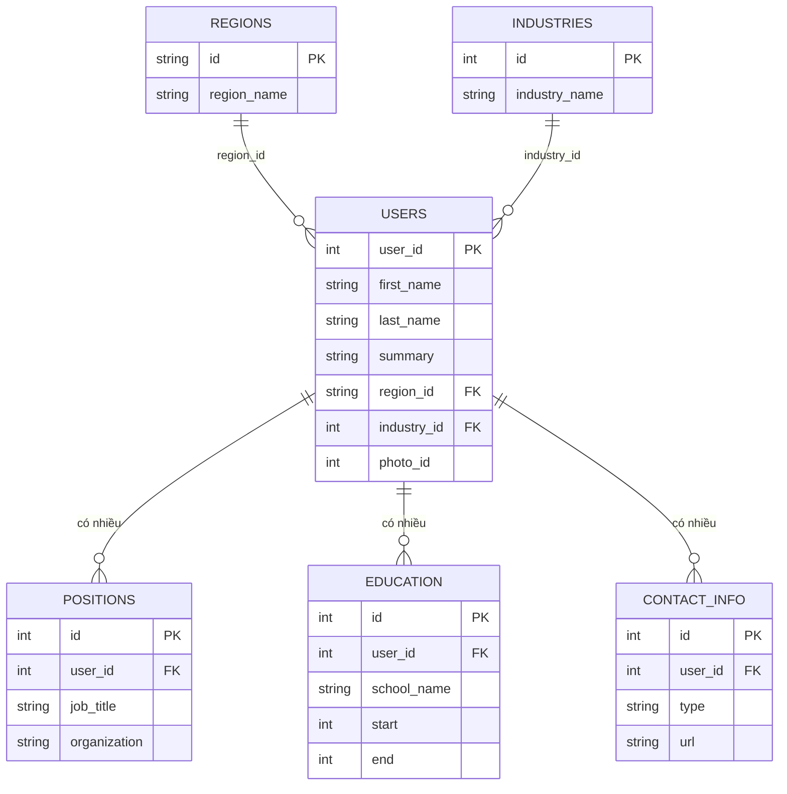

*(Vẽ lại cấu trúc của Hình 2-1, tr. 31.)*

**3. How — ba cách biểu diễn quan hệ one-to-many trong SQL** (tr. 30):

| Cách | Mô tả | Truy vấn bên trong được không? |
| --- | --- | --- |
| **Chuẩn hóa thành bảng riêng** | Cách truyền thống (trước SQL:1999): `positions`, `education`, `contact_info` là các bảng riêng, có foreign key trỏ về `users` (như Hình 2-1). | Được, bằng join |
| **Kiểu dữ liệu có cấu trúc / XML / JSON** | Các phiên bản SQL sau thêm kiểu dữ liệu có cấu trúc và XML, cho phép lưu dữ liệu nhiều giá trị **trong một hàng**, có hỗ trợ truy vấn và đánh index bên trong. Oracle, IBM DB2, MS SQL Server, PostgreSQL hỗ trợ ở các mức khác nhau [6, 7]. Kiểu JSON có trong IBM DB2, MySQL, PostgreSQL [8]. | Được (tùy database) |
| **Mã hóa thành text** | Mã hóa jobs, education, contact info thành JSON hoặc XML, lưu vào **một cột text**, để ứng dụng tự diễn giải. | **Thường không**, database không nhìn được vào bên trong |

**Biểu diễn dạng document.** Với cấu trúc như bản lý lịch, vốn chủ yếu là **một document tự chứa** (*self-contained*), biểu diễn JSON khá phù hợp (Example 2-1, tr. 31–32). JSON hấp dẫn vì **đơn giản hơn XML nhiều**. Các document database như **MongoDB, RethinkDB, CouchDB, Espresso** hỗ trợ mô hình này (tr. 31).

> **Ví dụ minh họa do AI xây dựng** (cùng cấu trúc với Example 2-1 nhưng dữ liệu khác):
>
> ```json
> {
>   "user_id": 1001,
>   "first_name": "Lan",
>   "last_name": "Nguyễn",
>   "region_id": "vn:hcm",
>   "industry_id": 57,
>   "positions": [
>     {"job_title": "Backend Engineer", "organization": "Công ty A"},
>     {"job_title": "Intern", "organization": "Công ty B"}
>   ],
>   "education": [
>     {"school_name": "Đại học X", "start": 2015, "end": 2019}
>   ],
>   "contact_info": {"blog": "https://example.com/lan"}
> }
> ```
>
> Mọi thứ thuộc về một người nằm trong **một khối**. Các mục lặp lại (`positions`, `education`) là **mảng lồng bên trong**.

**4. Why — document có lợi gì ở đây?** (tr. 32)

- Một số lập trình viên cảm thấy JSON **giảm impedance mismatch** giữa code ứng dụng và lớp lưu trữ.
  - *Nhưng*: JSON cũng có vấn đề khi làm định dạng mã hóa dữ liệu (Chương 4).
  - Việc **không có schema** thường được coi là ưu điểm. Sách bàn kỹ ở mục "Schema flexibility" ([B2.5](#schema-flexibility)).
- **Locality tốt hơn.** Với schema nhiều bảng, muốn lấy một hồ sơ phải chạy **nhiều truy vấn** (mỗi bảng một lần, theo `user_id`) hoặc một **join nhiều chiều** rối rắm. Với JSON, mọi thông tin liên quan ở **một chỗ**, và **một truy vấn** là đủ.
- Quan hệ one-to-many từ hồ sơ tới các mục con tạo thành **cấu trúc cây**, và JSON làm cấu trúc cây đó **hiện rõ** (Hình 2-2).

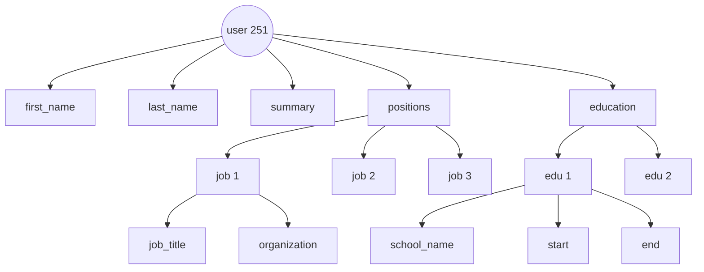

*(Vẽ lại Hình 2-2, tr. 32: quan hệ one-to-many tạo thành cây. Một số nhánh lá được lược bớt.)*

<a id="relationships"></a>

#### B2.3 Many-to-One and Many-to-Many Relationships (tr. 33–35)

##### Câu hỏi mở đầu: vì sao `region_id` là ID chứ không phải chữ?

Trong Example 2-1, `region_id` và `industry_id` là **ID**, không phải chuỗi chữ như "Greater Seattle Area" hay "Philanthropy". Tại sao? (tr. 33)

Nếu giao diện cho người dùng gõ tự do, lưu chuỗi chữ là hợp lý. Nhưng có **danh sách chuẩn hóa** để người dùng chọn từ dropdown hoặc autocomplete thì có nhiều lợi ích (tr. 33):

| Lợi ích | Giải thích |
| --- | --- |
| **Nhất quán** | Cùng cách viết, cùng chính tả trên mọi hồ sơ. |
| **Tránh mơ hồ** | Ví dụ nhiều thành phố trùng tên. |
| **Dễ cập nhật** | Tên chỉ lưu **một chỗ**. Nếu cần đổi (ví dụ thành phố đổi tên vì lý do chính trị), sửa một lần là xong. |
| **Hỗ trợ bản địa hóa** | Khi dịch trang sang ngôn ngữ khác, danh sách chuẩn có thể được dịch, nên vùng và ngành hiện theo ngôn ngữ người xem. |
| **Tìm kiếm tốt hơn** | Danh sách vùng có thể mã hóa sự thật "Seattle thuộc bang Washington", nên tìm "nhà từ thiện ở Washington" sẽ khớp hồ sơ này. Chuỗi chữ "Greater Seattle Area" không thể hiện điều đó. |

<a id="normalization"></a>

##### Normalization: bản chất là câu hỏi về sự trùng lặp

**1. What.** Lưu ID hay lưu chữ là **câu hỏi về sự trùng lặp** (*duplication*) (tr. 33):

- Dùng **ID**: thông tin có nghĩa với con người (chữ "Philanthropy") chỉ lưu **một chỗ**. Mọi thứ tham chiếu đến nó dùng ID, thứ chỉ có nghĩa bên trong database.
- Lưu **chữ trực tiếp**: thông tin có nghĩa với con người bị **nhân bản** trong mọi bản ghi dùng nó.

**2. Why.** ID **không có nghĩa với con người**, nên nó **không bao giờ cần đổi**. ID giữ nguyên dù thông tin nó trỏ tới thay đổi. Còn thứ gì có nghĩa với con người thì sớm muộn có thể phải đổi. Nếu thông tin đó bị nhân bản, **mọi bản sao** phải cập nhật, gây (tr. 33):

- **chi phí ghi** tăng thêm;
- **nguy cơ không nhất quán**: một số bản sao được cập nhật, số khác thì không.

**Loại bỏ trùng lặp như vậy là ý tưởng cốt lõi của normalization** trong database (tr. 33). Glossary của sách định nghĩa *normalized* là cấu trúc không có dư thừa hay trùng lặp: khi một dữ liệu thay đổi, chỉ cần sửa ở một chỗ (tr. 556).

> Chú thích ii (tr. 33): lý thuyết relational phân biệt nhiều *normal form*, nhưng khác biệt ít có giá trị thực tế. Quy tắc kinh nghiệm: **nếu bạn đang nhân bản những giá trị lẽ ra chỉ cần lưu một chỗ, schema chưa được chuẩn hóa.**

**3. How — cái giá: cần quan hệ many-to-one** (tr. 34). Chuẩn hóa dữ liệu này đòi hỏi quan hệ **many-to-one**: nhiều người sống ở một vùng, nhiều người làm trong một ngành. Quan hệ này **không khớp tự nhiên với document model**:

- Trong relational database, tham chiếu hàng ở bảng khác bằng ID là chuyện bình thường, vì **join dễ**.
- Trong document database, quan hệ one-to-many dạng cây không cần join, và hỗ trợ join **thường yếu**.

> Chú thích iii (tr. 34), **tại thời điểm viết sách**: RethinkDB hỗ trợ join, MongoDB không hỗ trợ, CouchDB chỉ hỗ trợ qua view khai báo trước.
>
> **Bổ sung ngoài sách.** Từ sau đó, các document database lớn đã bổ sung thêm khả năng kiểu join (ví dụ toán tử `$lookup` trong aggregation pipeline của MongoDB). Hãy kiểm tra tài liệu của phiên bản bạn đang dùng.

Nếu database không hỗ trợ join, ứng dụng phải **tự giả lập join** bằng nhiều truy vấn. Với danh sách vùng và ngành nhỏ, ít thay đổi, ứng dụng có thể giữ sẵn trong bộ nhớ. Dù vậy, **công việc join đã bị đẩy từ database sang code ứng dụng** (tr. 34).

**4. Trade-offs.** Quản trị viên database và lập trình viên rất thích tranh cãi về **normalization và denormalization**. Tác giả tạm gác phán xét và hứa quay lại ở **Part III**, với các cách hệ thống để xử lý caching, denormalization và derived data (tr. 34). Glossary định nghĩa *denormalize* là cố ý đưa vào một ít dư thừa (thường dưới dạng cache hoặc index) **để đọc nhanh hơn**; giá trị denormalized giống một kết quả truy vấn đã tính sẵn (tr. 554).

> **Liên hệ chương 1.** Đây chính là đánh đổi Twitter ở [chương 1, B4.1](chapter-01.md#load-parameters). Cache timeline của mỗi người dùng là dữ liệu **denormalized**: tính sẵn để đọc nhanh, đổi lại phải cập nhật nhiều bản sao khi ghi.

##### Dữ liệu có xu hướng ngày càng kết nối (tr. 34–35)

Dù phiên bản đầu của ứng dụng khớp tốt với document model không cần join, **dữ liệu có xu hướng ngày càng kết nối hơn khi thêm tính năng**. Ví dụ với bản lý lịch:

- **Tổ chức và trường học thành thực thể.** `organization` và `school_name` vốn chỉ là chuỗi chữ. Nếu chúng trở thành **tham chiếu tới thực thể**, mỗi công ty hay trường có trang riêng (logo, tin tức…), và bản lý lịch có thể liên kết tới chúng (Hình 2-3: tên công ty là link tới trang công ty).
- **Lời giới thiệu** (*recommendations*). Một người viết lời giới thiệu cho người khác. Lời giới thiệu hiện trên hồ sơ người được giới thiệu, **kèm tên và ảnh người viết**. Nếu người viết đổi ảnh, mọi lời giới thiệu của họ phải hiện ảnh mới. Vì vậy lời giới thiệu cần **tham chiếu tới hồ sơ người viết**.

Hình 2-4 cho thấy các tính năng mới này đòi hỏi quan hệ **many-to-many**. Dữ liệu trong mỗi khung nét đứt có thể gộp thành một document, nhưng tham chiếu tới tổ chức, trường học và người dùng khác phải là **tham chiếu**, và **cần join khi truy vấn** (tr. 35).

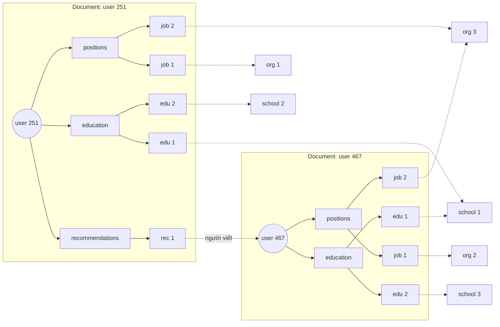

*(Phỏng theo Hình 2-4, tr. 35. Mũi tên nét đứt là tham chiếu ra ngoài document, cần join. Cách nối từng job hay edu tới tổ chức hay trường cụ thể là minh họa, không chép chính xác hình gốc.)*

**Tóm tắt ba loại quan hệ:**

| Loại quan hệ | Ví dụ trong chương | Document model | Relational model |
| --- | --- | --- | --- |
| **One-to-many** (dạng cây) | Một người có nhiều công việc, nhiều giai đoạn học | **Tự nhiên**: lồng vào document cha | Tách bảng con với foreign key, hoặc dùng cột JSON hay XML |
| **Many-to-one** | Nhiều người cùng một vùng, một ngành | Không khớp tự nhiên; join yếu | **Tự nhiên**: foreign key và join |
| **Many-to-many** | Người – tổ chức – trường học; người giới thiệu người | Cần tham chiếu và join, nên gượng | Bảng trung gian và join |

<a id="history"></a>

#### B2.4 Are Document Databases Repeating History? (tr. 36–38)

Many-to-many và join là chuyện thường ngày trong relational database. Document database và NoSQL **mở lại cuộc tranh luận** về cách biểu diễn tốt nhất cho những quan hệ này. Nhưng cuộc tranh luận ấy **cũ hơn NoSQL rất nhiều**: nó có từ những hệ database máy tính đầu tiên (tr. 36).

##### Hierarchical model: IMS

- Database phổ biến nhất cho xử lý dữ liệu doanh nghiệp thập niên 1970 là **IMS** (*Information Management System*) của IBM. Ban đầu nó được phát triển để quản lý kho cho **chương trình không gian Apollo**, phát hành thương mại năm **1968** [13]. Nó vẫn đang được dùng và bảo trì trên mainframe IBM [14] (tr. 36).
- IMS dùng **hierarchical model**, một mô hình **giống đáng kinh ngạc với mô hình JSON** của document database [2]. Mọi dữ liệu là **cây các bản ghi lồng trong bản ghi**, giống cấu trúc JSON ở Hình 2-2.
- Giống document database, IMS **tốt cho one-to-many** nhưng **khó cho many-to-many**, và **không hỗ trợ join**. Lập trình viên phải chọn giữa **nhân bản dữ liệu** (denormalize) hoặc **tự giải quyết tham chiếu** giữa các bản ghi. Những vấn đề của thập niên 60–70 này **rất giống** những vấn đề lập trình viên gặp với document database ngày nay [15] (tr. 36).

Hai giải pháp nổi bật nhất được đề xuất là **relational model** (trở thành SQL và chinh phục thế giới) và **network model** (ban đầu được nhiều người theo nhưng rồi chìm vào quên lãng). Cuộc **"great debate"** giữa hai phe kéo dài gần hết thập niên 1970 [2] (tr. 36).

<a id="codasyl"></a>

##### Network model: CODASYL (tr. 36–37)

**What.**

- Được chuẩn hóa bởi ủy ban **CODASYL** (*Conference on Data Systems Languages*), nên còn gọi là **CODASYL model** [16].
- Đây là **tổng quát hóa của hierarchical model**. Trong cây, mỗi bản ghi có **đúng một cha**. Trong network model, một bản ghi có thể có **nhiều cha**. Ví dụ: một bản ghi cho vùng "Greater Seattle Area", và mọi người sống ở vùng đó được **liên kết tới nó**. Nhờ vậy mô hình biểu diễn được many-to-one và many-to-many.

**How.**

- Liên kết giữa các bản ghi **không phải foreign key**, mà giống **con trỏ** trong ngôn ngữ lập trình, dù vẫn lưu trên đĩa (tr. 37).
- Cách **duy nhất** để truy cập một bản ghi là **đi theo một đường dẫn** từ bản ghi gốc dọc theo chuỗi liên kết. Đường dẫn này gọi là ***access path***.
- Trường hợp đơn giản nhất, access path giống duyệt **linked list**: bắt đầu từ đầu danh sách, xem từng bản ghi đến khi gặp bản ghi cần tìm.
- Với many-to-many, **nhiều đường khác nhau** có thể dẫn tới cùng một bản ghi. Lập trình viên phải **tự nhớ trong đầu** các access path đó.
- Truy vấn CODASYL là **di chuyển một con trỏ** (*cursor*) qua database: lặp qua danh sách bản ghi và đi theo access path. Nếu bản ghi có nhiều cha, code ứng dụng phải tự theo dõi mọi quan hệ. Chính thành viên ủy ban CODASYL thừa nhận việc này giống **điều hướng trong một không gian dữ liệu n chiều** [17].

**Trade-offs.**

- **Ưu điểm:** chọn access path thủ công tận dụng được tối đa phần cứng rất hạn chế của thập niên 1970, ví dụ **ổ băng từ** với thao tác seek cực chậm (tr. 37).
- **Nhược điểm:** code truy vấn và cập nhật database **phức tạp và cứng nhắc**. Nếu không có đường dẫn tới dữ liệu cần lấy, bạn gặp rắc rối. Có thể đổi access path, nhưng phải viết lại rất nhiều code truy vấn viết tay. **Rất khó thay đổi mô hình dữ liệu của ứng dụng** (tr. 37).

> Chú thích iv (tr. 37): ràng buộc foreign key cho phép hạn chế sửa đổi, nhưng relational model **không bắt buộc** chúng. Ngay cả khi có ràng buộc, join trên foreign key được thực hiện **lúc truy vấn**. Còn trong CODASYL, join thực chất được thực hiện **lúc chèn dữ liệu**.

<a id="relational-model"></a>

##### Relational model: bày mọi dữ liệu ra ngoài sáng (tr. 37–38)

**What — relational model làm gì khác?** Nó **bày mọi dữ liệu ra ngoài sáng**: một relation (bảng) chỉ đơn giản là tập hợp các tuple (hàng), vậy thôi (tr. 37).

- **Không** có cấu trúc lồng nhau như mê cung, **không** có access path phức tạp phải đi theo.
- Có thể đọc **bất kỳ hoặc tất cả** các hàng, chọn những hàng khớp một **điều kiện tùy ý**.
- Có thể đọc một hàng cụ thể bằng cách chỉ định vài cột làm **khóa** (*key*) và so khớp.
- Có thể chèn hàng mới vào bất kỳ bảng nào mà **không cần lo** về quan hệ foreign key với bảng khác.

**How — query optimizer tự chọn "access path"** (tr. 37–38):

- **Query optimizer** tự động quyết định thực thi phần nào của truy vấn trước, theo thứ tự nào, dùng index nào. Những lựa chọn đó **thực chất chính là access path**. Khác biệt lớn là chúng được **optimizer chọn tự động**, không phải lập trình viên, nên hiếm khi ta phải nghĩ về chúng.
- Muốn truy vấn dữ liệu theo cách mới? Chỉ cần **khai báo index mới**, và truy vấn **tự động** dùng index phù hợp nhất. **Không cần sửa truy vấn**. Nhờ đó relational model giúp **thêm tính năng mới dễ hơn nhiều**.

**Why — insight then chốt** (tr. 38). Query optimizer là những "con quái vật" phức tạp, tiêu tốn nhiều năm nghiên cứu và phát triển [18]. Nhưng insight then chốt của relational model là: **chỉ cần xây query optimizer một lần**, rồi **mọi ứng dụng** dùng database đều hưởng lợi. Nếu không có optimizer, viết tay access path cho một truy vấn cụ thể thì dễ hơn viết một optimizer đa dụng. **Nhưng về lâu dài, giải pháp đa dụng thắng.**

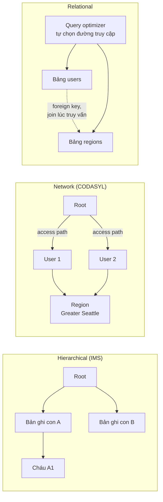

*(Sơ đồ do AI xây dựng để so sánh ba mô hình.)*

<a id="doc-vs-codasyl"></a>

##### So với document database ngày nay (tr. 38)

- Document database **quay lại hierarchical model ở một khía cạnh**: lưu bản ghi lồng nhau (quan hệ one-to-many như `positions`, `education`, `contact_info`) **bên trong bản ghi cha** thay vì ở bảng riêng.
- Nhưng với **many-to-one và many-to-many**, relational và document **không khác nhau về bản chất**. Trong cả hai, mục liên quan được tham chiếu bằng **một định danh duy nhất**: relational gọi là **foreign key**, document gọi là **document reference** [9]. Định danh đó được **giải quyết lúc đọc**, bằng join hoặc truy vấn tiếp theo.
- Đến nay, document database **chưa đi theo con đường của CODASYL**.

<a id="rel-vs-doc-today"></a>

#### B2.5 Relational Versus Document Databases Today (tr. 38–42)

Có nhiều khác biệt giữa relational và document database, ví dụ tính chịu lỗi (Chương 5) và xử lý đồng thời (Chương 7). Chương này **chỉ tập trung vào khác biệt về mô hình dữ liệu** (tr. 38).

| Phe document | Phe relational |
| --- | --- |
| **Schema linh hoạt** | **Hỗ trợ join tốt hơn** |
| **Hiệu năng tốt hơn nhờ locality** | Hỗ trợ tốt **many-to-one** và **many-to-many** |
| Với một số ứng dụng, **gần với cấu trúc dữ liệu của ứng dụng hơn** | |

*(Các luận điểm chính của hai bên, tr. 38.)*

##### Mô hình nào cho code ứng dụng đơn giản hơn? (tr. 38–39)

**Khi document model thắng.** Nếu dữ liệu có **cấu trúc giống document**, tức là một **cây quan hệ one-to-many** và thường **tải cả cây một lần**, thì nên dùng document model. Kỹ thuật relational ***shredding*** (băm một cấu trúc dạng document ra nhiều bảng, như `positions`, `education`, `contact_info` ở Hình 2-1) có thể dẫn tới schema cồng kềnh và code ứng dụng phức tạp không cần thiết (tr. 38–39).

**Giới hạn của document model** (tr. 39):

- **Không thể tham chiếu trực tiếp** tới một mục lồng bên trong document. Phải nói kiểu "mục thứ hai trong danh sách positions của user 251", **giống access path** trong hierarchical model. Nếu document không lồng quá sâu thì thường không phải vấn đề.
- **Hỗ trợ join kém** có thể là vấn đề hoặc không, tùy ứng dụng. Ví dụ: một ứng dụng analytics dùng document database để ghi sự kiện nào xảy ra lúc nào có thể **không bao giờ cần many-to-many** [19].

**Khi ứng dụng có many-to-many**, document model kém hấp dẫn đi (tr. 39):

| Cách xoay xở | Cái giá |
| --- | --- |
| **Denormalize** để giảm nhu cầu join | Code ứng dụng phải làm thêm việc để giữ dữ liệu denormalized **nhất quán** |
| **Giả lập join trong code ứng dụng** bằng nhiều request tới database | Độ phức tạp chuyển sang ứng dụng, và thường **chậm hơn** join do code chuyên biệt bên trong database thực hiện |

Trong những trường hợp đó, document model có thể dẫn tới **code phức tạp hơn đáng kể và hiệu năng tệ hơn** [15] (tr. 39).

**Kết luận của tác giả** (tr. 39). **Không thể nói chung chung** mô hình nào cho code đơn giản hơn. Điều đó **phụ thuộc vào loại quan hệ giữa các mục dữ liệu**. Với dữ liệu **kết nối dày đặc**:

- document model là **gượng gạo**;
- relational model là **chấp nhận được**;
- graph model là **tự nhiên nhất**.

<a id="schema-flexibility"></a>

##### Schema flexibility: schema-on-read và schema-on-write (tr. 39–41)

**1. What — "schemaless" là cách gọi gây hiểu lầm**

- Hầu hết document database, và hỗ trợ JSON trong relational database, **không áp đặt schema** lên dữ liệu trong document. Hỗ trợ XML trong relational database thường có **kiểm tra schema tùy chọn** (tr. 39).
- Không có schema nghĩa là có thể thêm key và value tùy ý vào document. Khi đọc, client **không được đảm bảo** document chứa những trường nào.
- Document database đôi khi được gọi là ***schemaless***, nhưng cách gọi này **gây hiểu lầm**: code đọc dữ liệu thường **giả định một cấu trúc nào đó**. Tức là có một **schema ngầm** (*implicit schema*), chỉ là database không áp đặt nó [20] (tr. 39).
- Thuật ngữ chính xác hơn (tr. 39–40):
  - ***Schema-on-read***: cấu trúc dữ liệu là ngầm định, **chỉ được diễn giải khi đọc**.
  - ***Schema-on-write***: cách truyền thống của relational database, schema **tường minh**, và database **đảm bảo mọi dữ liệu ghi vào đều tuân theo** [21].

**2. Why — tương tự cuộc tranh luận về kiểu dữ liệu** (tr. 40)

- Schema-on-read giống **kiểm tra kiểu động** (lúc chạy) trong ngôn ngữ lập trình.
- Schema-on-write giống **kiểm tra kiểu tĩnh** (lúc biên dịch).
- Giống như những người ủng hộ kiểu tĩnh và kiểu động tranh luận gay gắt [22], việc áp đặt schema trong database là chủ đề gây tranh cãi, và nhìn chung **không có câu trả lời đúng sai tuyệt đối**.

**3. How — khác biệt lộ rõ khi đổi định dạng dữ liệu** (tr. 40)

Ví dụ của sách [23]: đang lưu **họ tên đầy đủ trong một trường**, giờ muốn tách thành **first name** và **last name** riêng.

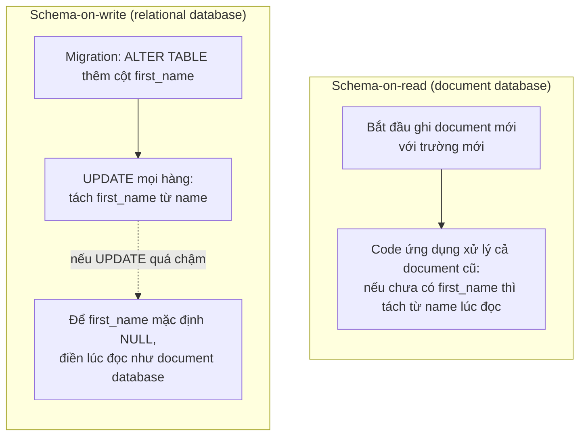

*(Diễn giải hai đoạn code ở tr. 40.)*

**Danh tiếng "schema change chậm" không hoàn toàn đúng** (tr. 40):

- Hầu hết relational database chạy `ALTER TABLE` trong **vài mili giây**.
- **MySQL là ngoại lệ đáng chú ý**: nó sao chép toàn bộ bảng khi `ALTER TABLE`, nên với bảng lớn có thể mất vài phút đến vài giờ downtime. Có nhiều công cụ để lách giới hạn này [24, 25, 26].
- Chạy `UPDATE` trên bảng lớn thì **chậm trên mọi database**, vì phải ghi lại từng hàng. Nếu không chấp nhận được, ứng dụng có thể để `first_name` mặc định là `NULL` và **điền lúc đọc**, giống cách làm với document database.

**4. Example — khi nào schema-on-read có lợi?** (tr. 40–41)

Khi các mục trong collection **không cùng cấu trúc** (dữ liệu **không đồng nhất**, *heterogeneous*), ví dụ:

- Có **nhiều loại đối tượng khác nhau**, và đặt mỗi loại vào một bảng riêng là không thực tế.
- Cấu trúc dữ liệu do **hệ thống bên ngoài** quyết định. Bạn không kiểm soát được nó, và nó có thể đổi bất cứ lúc nào.

Trong những trường hợp này, schema có thể **gây hại nhiều hơn có lợi**, và document không schema là mô hình tự nhiên hơn nhiều.

**5. Trade-offs.** Khi **mọi bản ghi được kỳ vọng có cùng cấu trúc**, schema là cơ chế hữu ích để **ghi lại tài liệu và áp đặt** cấu trúc đó (tr. 41). Chương 4 sẽ bàn chi tiết về schema và schema evolution.

**6. System Design Perspective.** Câu hỏi không phải là "có schema hay không", vì dữ liệu **luôn có** schema. Câu hỏi là schema **được kiểm tra ở đâu và khi nào**: database kiểm tra lúc ghi, hay code ứng dụng xử lý lúc đọc. Chọn schema-on-read nghĩa là chấp nhận rằng **mọi code đọc dữ liệu phải xử lý được mọi phiên bản định dạng** từng được ghi.

<a id="locality"></a>

##### Data locality for queries (tr. 41)

**1. What.** Một document thường được lưu thành **một chuỗi liên tục**, mã hóa dạng JSON, XML hoặc một biến thể nhị phân (như **BSON** của MongoDB). Glossary của sách định nghĩa *locality* là một tối ưu hiệu năng: **đặt những dữ liệu thường được cần cùng lúc vào cùng một chỗ** (tr. 555).

**2. Why.** Nếu ứng dụng thường cần **toàn bộ document**, ví dụ để hiển thị lên trang web, thì locality cho lợi thế hiệu năng. Nếu dữ liệu bị chia ra nhiều bảng như Hình 2-1, cần **nhiều lần tra index** để lấy hết, có thể phải **seek đĩa nhiều hơn** và mất thời gian hơn (tr. 41).

**3. How và Trade-offs — lợi thế có điều kiện** (tr. 41):

- Lợi thế **chỉ áp dụng khi cần phần lớn document cùng lúc**.
- Database thường phải **tải cả document** dù chỉ truy cập một phần nhỏ. Với document lớn, việc này lãng phí.
- Khi **cập nhật**, thường phải **ghi lại toàn bộ document**. Chỉ những sửa đổi **không làm thay đổi kích thước mã hóa** mới dễ thực hiện tại chỗ [19].
- Vì vậy khuyến nghị chung là **giữ document khá nhỏ** và **tránh những lần ghi làm document to lên** [9].
- Những giới hạn hiệu năng này **thu hẹp đáng kể** số tình huống mà document database hữu ích.

**4. Example — locality không độc quyền của document model** (tr. 41):

| Hệ thống | Cách đạt locality |
| --- | --- |
| **Google Spanner** | Schema cho phép khai báo hàng của một bảng được **xen kẽ** (*interleaved*, lồng) bên trong bảng cha [27] |
| **Oracle** | Tính năng ***multi-table index cluster tables*** [28] |
| **Bigtable** (dùng trong Cassandra, HBase) | Khái niệm ***column-family*** có mục đích tương tự: quản lý locality [29] |

Chương 3 sẽ bàn thêm về locality.

> **Ví dụ minh họa do AI xây dựng.** Một document "bài viết" chứa luôn mảng bình luận. Bài viết hot nhận 50.000 bình luận, nên document phình to. Mỗi bình luận mới khiến database ghi lại cả document lớn. Mỗi lần chỉ cần hiện tiêu đề bài, database vẫn tải cả khối. Đây đúng là tình huống sách cảnh báo: document lớn và ghi làm document to dần. Cách hợp lý hơn là tách bình luận thành document hoặc bảng riêng, tham chiếu tới bài viết.

<a id="convergence"></a>

##### Convergence: relational và document đang hội tụ (tr. 41–42)

**Phía relational** (tr. 41–42):

- Hầu hết relational database (trừ MySQL) hỗ trợ **XML từ giữa thập niên 2000**, gồm sửa đổi cục bộ document XML, đánh index và truy vấn bên trong XML. Ứng dụng nhờ đó dùng được mô hình dữ liệu rất giống document database.
- **PostgreSQL từ 9.3** [8], **MySQL từ 5.7**, **IBM DB2 từ 10.5** [30] có mức hỗ trợ JSON tương tự. Với sự phổ biến của JSON trong web API, có lẽ các relational database khác sẽ đi theo.

**Phía document** (tr. 42):

- **RethinkDB** hỗ trợ join kiểu relational trong ngôn ngữ truy vấn.
- Một số **driver MongoDB** tự động giải quyết tham chiếu, thực chất là **join phía client**. Cách này có lẽ chậm hơn join trong database, vì cần thêm round-trip mạng và ít được tối ưu hơn.

**Nhận định của tác giả** (tr. 42). Relational và document database **ngày càng giống nhau**, và đó là **điều tốt**: hai mô hình **bổ sung cho nhau**. Nếu một database xử lý được dữ liệu dạng document **và** chạy được truy vấn relational trên đó, ứng dụng có thể dùng tổ hợp tính năng phù hợp nhất. **Mô hình lai relational–document là hướng đi tốt** cho database trong tương lai.

> Chú thích v (tr. 42): mô tả gốc của Codd về relational model [1] **đã cho phép** thứ gì đó khá giống document JSON bên trong schema relational. Ông gọi là ***nonsimple domains***: giá trị trong một hàng không nhất thiết là kiểu nguyên thủy (số, chuỗi), mà có thể là **một relation lồng bên trong**. Tức là cây lồng tùy ý, giống hỗ trợ JSON và XML mà SQL thêm vào **hơn 30 năm sau**.

---

<a id="b3"></a>

### B3. Query Languages for Data (tr. 42–48)

<a id="declarative"></a>

#### B3.0 Declarative và imperative (tr. 42–43)

Khi relational model ra đời, nó mang theo một cách truy vấn mới: **SQL là ngôn ngữ truy vấn declarative**, còn IMS và CODASYL truy vấn database bằng **code imperative** (tr. 42).

**1. What.**

- **Imperative** (mệnh lệnh): ra lệnh cho máy tính **thực hiện các thao tác theo một thứ tự nhất định**. Có thể hình dung đi qua từng dòng code: đánh giá điều kiện, cập nhật biến, quyết định có lặp thêm vòng nữa không (tr. 43).
- **Declarative** (khai báo): như SQL hay **đại số quan hệ** (*relational algebra*), chỉ mô tả **mẫu dữ liệu muốn lấy**: kết quả phải thỏa điều kiện gì, cần biến đổi thế nào (sắp xếp, nhóm, tổng hợp). Nó **không** mô tả *cách* đạt được. Việc chọn index nào, phương pháp join nào, thực thi phần nào trước là của **query optimizer** (tr. 43). Glossary của sách định nghĩa *declarative* là mô tả thuộc tính mà kết quả phải có, chứ không phải các bước chính xác để đạt được nó (tr. 554).

**Ví dụ của sách** (tr. 42–43): lọc danh sách động vật chỉ lấy cá mập.

| Cách viết | Bản chất |
| --- | --- |
| Hàm JavaScript: tạo mảng rỗng, lặp qua từng con vật, nếu họ là "Sharks" thì thêm vào mảng, rồi trả về mảng | **Imperative**: mô tả *từng bước* |
| Đại số quan hệ: áp toán tử **chọn σ** (sigma) với điều kiện family = "Sharks" lên relation animals | **Declarative**: mô tả *điều kiện* |
| SQL: `SELECT * FROM animals WHERE family = 'Sharks'` | **Declarative**, bám khá sát cấu trúc của đại số quan hệ |

**2. Why — vì sao declarative hấp dẫn?** (tr. 43)

1. **Ngắn gọn và dễ dùng hơn** API imperative.
2. **Quan trọng hơn:** nó **che giấu chi tiết cài đặt** của database engine. Nhờ đó database có thể **cải thiện hiệu năng mà không cần sửa truy vấn**.
   - *Ví dụ của sách:* trong code imperative, danh sách động vật xuất hiện theo một thứ tự. Nếu database muốn thu hồi dung lượng đĩa trống ở hậu trường, nó có thể phải di chuyển bản ghi và làm **đổi thứ tự**. Truy vấn SQL **không đảm bảo thứ tự** nên không sao. Nhưng với code imperative, database **không bao giờ chắc** code có dựa vào thứ tự hay không.
   - Việc **SQL bị giới hạn chức năng hơn** lại cho database **nhiều không gian hơn để tự động tối ưu**.
3. **Dễ thực thi song song.** CPU ngày nay nhanh hơn nhờ **thêm core**, không phải nhờ tăng xung nhịp đáng kể [31]. Code imperative **rất khó song song hóa** trên nhiều core và nhiều máy, vì nó chỉ định các lệnh phải chạy theo thứ tự. Ngôn ngữ declarative chỉ mô tả **mẫu kết quả**, không mô tả thuật toán, nên database **tự do dùng cách cài đặt song song** khi phù hợp [32].

**3. Trade-offs.** Declarative đổi **quyền kiểm soát chi tiết** (lập trình viên không chọn được thuật toán) lấy **khả năng tối ưu tự động, tính di động và song song hóa**. Hệ quả là ta phụ thuộc vào chất lượng của query optimizer.

**4. System Design Perspective.** Đây là cùng một ý với [B2.4](#relational-model): access path do optimizer chọn thay vì lập trình viên viết tay. Ranh giới declarative chính là một **abstraction** giúp database tiến hóa (index mới, layout mới, chạy song song) mà không phá vỡ ứng dụng.

<a id="declarative-web"></a>

#### B3.1 Declarative Queries on the Web (tr. 44–46)

Lợi ích của declarative không chỉ giới hạn ở database. Tác giả minh họa bằng **trình duyệt web** (tr. 44).

**Bối cảnh.** Một trang web về động vật biển có menu điều hướng. Mục "Sharks" đang được chọn, nên phần tử `<li>` của nó có class `selected`. Yêu cầu: **tô nền xanh** cho tiêu đề của trang đang chọn.

| Cách | Mô tả | Đánh giá |
| --- | --- | --- |
| **CSS** (declarative) | Selector `li.selected > p` khai báo **mẫu phần tử**: mọi `<p>` có cha trực tiếp là `<li>` với class `selected`. "Sharks" khớp, "Whales" không khớp. | Ngắn, rõ |
| **XSL / XPath** (declarative) | Biểu thức XPath `li[@class='selected']/p` tương đương selector CSS trên. | Ngắn, rõ |
| **JavaScript + DOM API** (imperative) | Lấy mọi `<li>`, lặp, kiểm tra class, lặp qua con, kiểm tra loại node và tag `P`, rồi đặt style. | Dài, khó hiểu, và có **vấn đề nghiêm trọng** |

**Hai vấn đề của cách imperative** (tr. 45):

1. **Không tự cập nhật khi trạng thái đổi.** Nếu class `selected` bị gỡ (người dùng bấm sang trang khác), màu xanh **không bị gỡ** dù chạy lại code. Mục đó vẫn sáng cho đến khi tải lại cả trang. Với CSS, trình duyệt **tự phát hiện** khi luật không còn áp dụng và gỡ màu ngay.
2. **Không hưởng lợi từ cải tiến mới.** Muốn dùng API mới có thể nhanh hơn (như `getElementsByClassName` hay `document.evaluate`), phải **viết lại code**. Ngược lại, nhà phát triển trình duyệt có thể **tăng hiệu năng CSS và XPath mà không phá vỡ tương thích**.

**Bài học** (tr. 46). Trong trình duyệt, CSS declarative tốt hơn nhiều so với thao tác style imperative bằng JavaScript. Tương tự, trong database, ngôn ngữ declarative như SQL hóa ra **tốt hơn nhiều** so với API truy vấn imperative.

> Chú thích vi (tr. 46): IMS và CODASYL đều dùng API truy vấn imperative. Ứng dụng thường dùng code COBOL để **lặp qua từng bản ghi một** [2, 16].

> **Nhận xét của người viết ghi chú.** Vấn đề 1 cho thấy một ưu điểm sâu hơn của declarative: nó mô tả **trạng thái mong muốn**, và hệ thống **liên tục duy trì** trạng thái đó. Imperative chỉ mô tả **một hành động tại một thời điểm**.

<a id="mapreduce"></a>

#### B3.2 MapReduce Querying (tr. 46–48)

**1. What.**

- **MapReduce** là một **mô hình lập trình** để xử lý khối lượng dữ liệu lớn theo lô trên nhiều máy, được Google phổ biến [33] (tr. 46).
- Một số NoSQL datastore như **MongoDB** và **CouchDB** hỗ trợ một dạng **giới hạn** của MapReduce, để chạy **truy vấn chỉ đọc** trên nhiều document.
- MapReduce tổng quát được mô tả chi tiết ở **Chương 10**. Ở đây chỉ xét cách MongoDB dùng nó.
- MapReduce **không hẳn declarative cũng không hoàn toàn imperative**, mà **ở giữa**: logic truy vấn được viết bằng **đoạn code**, và **framework gọi chúng lặp đi lặp lại**. Nó dựa trên hàm **map** (còn gọi là *collect*) và **reduce** (còn gọi là *fold* hay *inject*) có trong nhiều ngôn ngữ lập trình hàm (tr. 46).

**2. Example — đếm cá mập theo tháng** (tr. 46–48)

Một nhà sinh vật học biển ghi một bản ghi quan sát mỗi lần thấy động vật. Muốn báo cáo **số cá mập quan sát được mỗi tháng**.

- **Bằng SQL (PostgreSQL):** lọc các quan sát thuộc họ Sharks, **nhóm theo tháng** (dùng hàm làm tròn timestamp xuống đầu tháng), rồi **cộng số con vật** trong mỗi tháng.
- **Bằng MapReduce của MongoDB:**

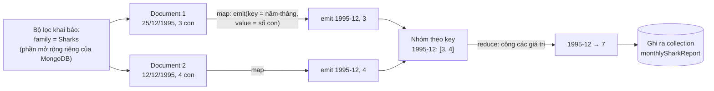

*(Diễn giải Example ở tr. 47–48, dùng đúng hai document mẫu của sách.)*

Các bước:

1. Bộ lọc "chỉ cá mập" được viết **declarative**. Đây là phần mở rộng riêng của MongoDB cho MapReduce.
2. Hàm **map** được gọi **một lần cho mỗi document** khớp bộ lọc, với `this` là document đó.
3. Map **phát ra** (*emit*) một key (chuỗi năm-tháng, như "1995-12") và một value (số con vật trong lần quan sát đó).
4. Các cặp key-value được **nhóm theo key**. Với mỗi key, hàm **reduce** được gọi **một lần**.
5. Reduce **cộng** số con vật của mọi quan sát trong tháng đó.
6. Kết quả được ghi vào một collection.

**3. How — ràng buộc của map và reduce** (tr. 48)

- Chúng phải là **pure function** (hàm thuần): chỉ dùng dữ liệu được truyền vào làm đầu vào, **không được chạy thêm truy vấn database**, và **không có side effect**.
- **Vì sao?** Những ràng buộc này cho phép database **chạy hàm ở bất kỳ đâu, theo bất kỳ thứ tự nào, và chạy lại khi lỗi**.
- Dù vậy chúng **vẫn mạnh**: có thể parse chuỗi, gọi thư viện, tính toán…

**4. Trade-offs** (tr. 48)

- MapReduce là mô hình lập trình **khá cấp thấp** cho thực thi phân tán trên cụm máy.
  - SQL **có thể** được cài đặt thành một chuỗi thao tác MapReduce (Chương 10), nhưng cũng có nhiều cài đặt SQL phân tán **không dùng MapReduce**.
  - **Không có gì trong SQL buộc nó chạy trên một máy**, và MapReduce **không độc quyền** thực thi truy vấn phân tán.
- Dùng JavaScript giữa truy vấn là tính năng hay cho truy vấn nâng cao, nhưng **không riêng MapReduce**: một số SQL database cũng mở rộng được bằng hàm JavaScript [34].
- **Vấn đề khả dụng:** phải viết **hai hàm JavaScript phối hợp cẩn thận**, thường khó hơn viết một truy vấn. Ngoài ra, ngôn ngữ declarative cho optimizer **nhiều cơ hội tối ưu hơn**.
- Vì những lý do đó, **MongoDB 2.2** thêm một ngôn ngữ truy vấn declarative gọi là ***aggregation pipeline*** [9]. Nó có sức biểu đạt tương đương một tập con của SQL, nhưng dùng **cú pháp dựa trên JSON** thay vì cú pháp kiểu câu tiếng Anh của SQL. Khác biệt có lẽ chỉ là chuyện khẩu vị.

**Bài học của câu chuyện** (tr. 48): một hệ NoSQL có thể thấy mình **vô tình phát minh lại SQL**, dù dưới lớp ngụy trang.

---

<a id="b4"></a>

### B4. Graph-Like Data Models (tr. 49–63)

#### B4.0 Khi many-to-many trở nên phổ biến (tr. 49–50)

**Why.** Quan hệ many-to-many là **điểm phân biệt quan trọng** giữa các mô hình dữ liệu (tr. 49):

- Ứng dụng chủ yếu có quan hệ **one-to-many** (dữ liệu dạng cây) hoặc **không có quan hệ** giữa các bản ghi: **document model** phù hợp.
- Many-to-many **đơn giản**: **relational model** xử lý được.
- Kết nối trong dữ liệu **ngày càng phức tạp**: mô hình hóa dữ liệu thành **graph** trở nên tự nhiên hơn.

**What.** Graph gồm hai loại đối tượng (tr. 49):

- **Vertex** (đỉnh), còn gọi là *node* hay *entity*.
- **Edge** (cạnh), còn gọi là *relationship* hay *arc*.

Glossary của sách bổ sung: vertex là những thứ có thể tham chiếu tới, còn edge là kết nối từ vertex này tới vertex khác (tr. 555).

**Ví dụ điển hình** (tr. 49):

| Graph | Vertex | Edge | Thuật toán quen thuộc |
| --- | --- | --- | --- |
| **Social graph** | Người | Ai quen ai | |
| **Web graph** | Trang web | Link HTML | **PageRank**: xác định độ phổ biến của trang để xếp hạng tìm kiếm |
| **Mạng đường bộ, đường sắt** | Giao lộ | Đường, tuyến ray | **Đường đi ngắn nhất**: hệ thống dẫn đường ô tô |

**Graph không chỉ cho dữ liệu đồng nhất** (tr. 49). Trong các ví dụ trên, mọi vertex cùng một loại. Nhưng một cách dùng mạnh không kém là lưu **những loại đối tượng hoàn toàn khác nhau** trong **một datastore duy nhất** một cách nhất quán. Ví dụ: Facebook duy trì **một graph duy nhất** [35]:

- vertex là người, địa điểm, sự kiện, check-in, bình luận;
- edge cho biết ai là bạn ai, check-in nào ở địa điểm nào, ai bình luận bài nào, ai tham dự sự kiện nào…

<a id="figure-2-5"></a>

**Ví dụ xuyên suốt: Hình 2-5** (tr. 49–50). Dữ liệu có thể lấy từ mạng xã hội hoặc database phả hệ: **Lucy** đến từ Idaho (Mỹ), **Alain** đến từ Beaune (Pháp). Họ đã kết hôn và đang sống ở London.

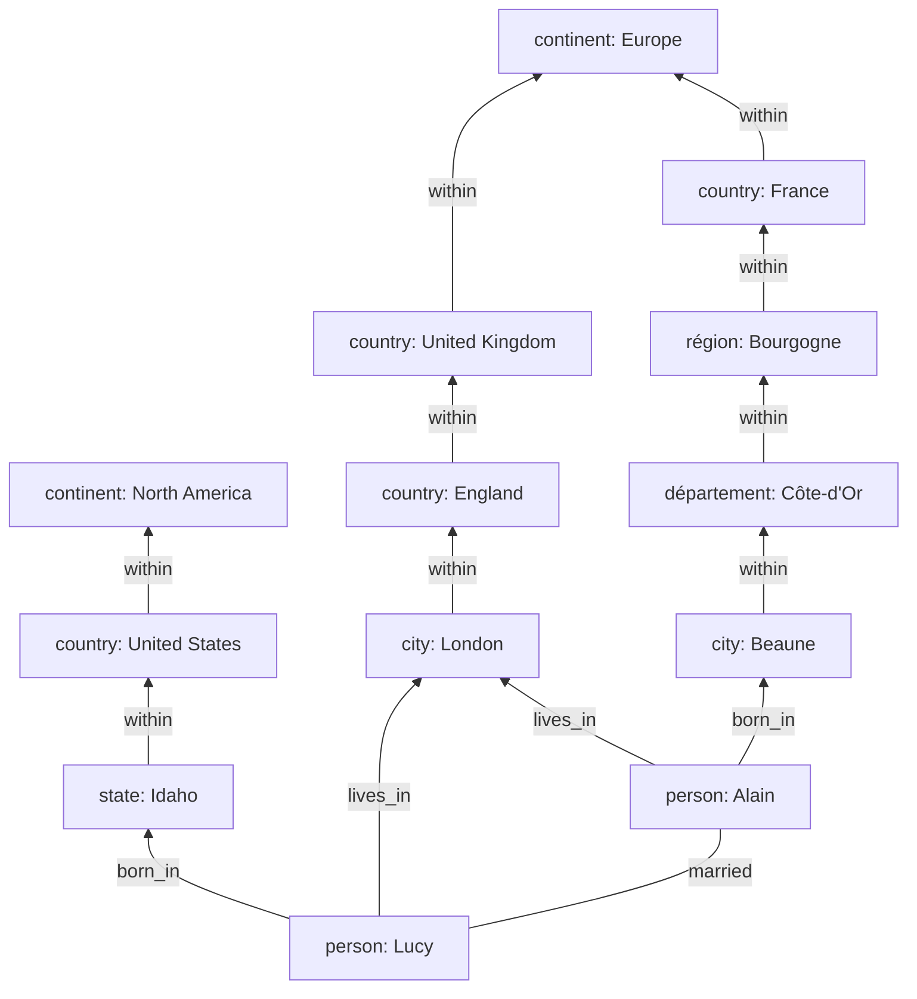

*(Vẽ lại Hình 2-5, tr. 50: mỗi hộp là một vertex, mỗi mũi tên là một edge.)*

**Các cách cấu trúc và truy vấn graph trong chương** (tr. 50):

| Loại | Đại diện |
| --- | --- |
| **Property graph model** | Neo4j, Titan, InfiniteGraph |
| **Triple-store model** | Datomic, AllegroGraph… |
| **Ngôn ngữ truy vấn declarative** | **Cypher**, **SPARQL**, **Datalog** |
| Ngôn ngữ truy vấn graph imperative | Gremlin [36] |
| Framework xử lý graph | Pregel (Chương 10) |

<a id="property-graph"></a>

#### B4.1 Property Graphs (tr. 50–52)

**1. What — cấu trúc của property graph** (tr. 50–51):

| Vertex gồm | Edge gồm |
| --- | --- |
| Định danh duy nhất | Định danh duy nhất |
| Tập **edge đi ra** | Vertex nơi edge **bắt đầu**: ***tail vertex*** |
| Tập **edge đi vào** | Vertex nơi edge **kết thúc**: ***head vertex*** |
| Tập **properties** (cặp key-value) | **Label** mô tả loại quan hệ giữa hai vertex |
| | Tập **properties** (cặp key-value) |

**2. How — có thể hình dung bằng hai bảng relational** (Example 2-2, tr. 51):

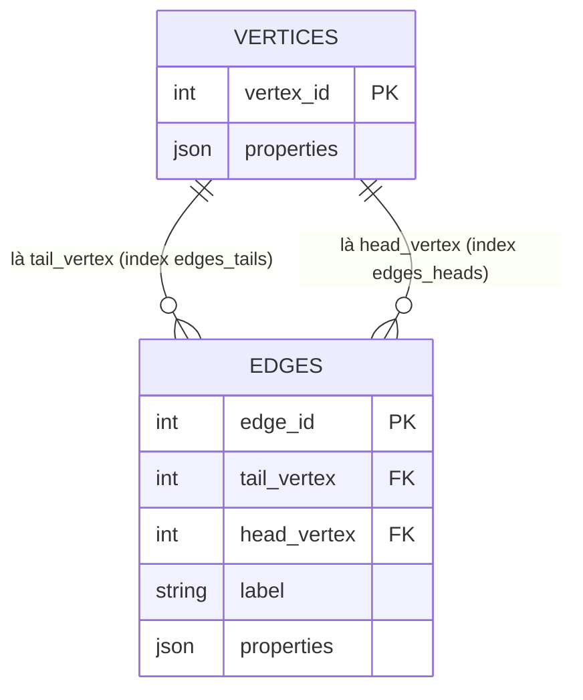

*(Cấu trúc schema của Example 2-2: properties lưu bằng kiểu json của PostgreSQL. Có index trên cả `tail_vertex` và `head_vertex` để tìm nhanh edge đi ra và edge đi vào của một vertex.)*

**3. Why — ba đặc điểm quan trọng** (tr. 51):

1. **Vertex nào cũng nối được với vertex nào**: không có schema hạn chế loại thứ gì được liên kết với loại thứ gì.
2. Với một vertex bất kỳ, tìm được **hiệu quả cả edge đi vào lẫn đi ra**, nên có thể **duyệt** (*traverse*) graph theo **cả hai chiều**. Đó là lý do Example 2-2 có index trên cả hai cột.
3. Dùng **label khác nhau** cho các loại quan hệ khác nhau, nên lưu được nhiều loại thông tin trong **một graph**, mà mô hình dữ liệu vẫn gọn gàng.

**4. Example — những thứ khó biểu diễn bằng schema relational truyền thống** (Hình 2-5, tr. 51–52):

- **Cấu trúc hành chính khác nhau giữa các nước**: Pháp có *département* và *région*, Mỹ có *county* và *state*.
- **Những điều kỳ quặc của lịch sử**: một nước nằm trong một nước (England trong United Kingdom), tạm bỏ qua sự phức tạp của khái niệm quốc gia có chủ quyền.
- **Độ chi tiết khác nhau**: nơi ở hiện tại của Lucy ghi ở mức **thành phố**, còn nơi sinh chỉ ghi ở mức **bang**.

**Mở rộng graph** (tr. 52). Có thể thêm thông tin **dị ứng thực phẩm**: tạo một vertex cho mỗi chất gây dị ứng, thêm edge giữa người và chất gây dị ứng, rồi nối chất gây dị ứng với các vertex thực phẩm chứa chất đó. Khi đó có thể viết truy vấn tìm **món nào an toàn cho từng người**.

**5. Trade-offs và System Design** (tr. 52). **Graph tốt cho evolvability**: khi thêm tính năng, graph dễ dàng mở rộng để chứa những thay đổi trong cấu trúc dữ liệu của ứng dụng. Đổi lại, như B4.4 và B4.5 sẽ cho thấy, graph cũng **không áp đặt schema**, nên cấu trúc phải được đảm bảo ở nơi khác (xem [B5](#b5)).

<a id="cypher"></a>

#### B4.2 The Cypher Query Language (tr. 52–53)

**What.** **Cypher** là ngôn ngữ truy vấn **declarative** cho property graph, được tạo cho graph database **Neo4j** [37]. Tên lấy từ một nhân vật trong phim *The Matrix*, không liên quan đến mật mã học [38] (tr. 52).

**Chèn dữ liệu** (Example 2-3, tr. 52):

- Mỗi vertex được đặt một **tên tượng trưng** (như USA, Idaho), kèm loại (Location, Person) và properties (name, type).
- Các phần khác của truy vấn dùng tên đó để tạo edge bằng **ký hiệu mũi tên**. Ví dụ: viết Idaho, rồi mũi tên có nhãn WITHIN, rồi USA. Lệnh này tạo một edge nhãn WITHIN với **Idaho là tail** và **USA là head**.

**Truy vấn: tìm người di cư từ Mỹ sang châu Âu** (Example 2-4, tr. 52–53). Chính xác hơn: tìm mọi vertex có edge **BORN_IN** tới một địa điểm **nằm trong** Mỹ, **và** có edge **LIVES_IN** tới một địa điểm **nằm trong** châu Âu, rồi trả về property `name`.

Truy vấn dùng mệnh đề MATCH với cùng ký hiệu mũi tên để **tìm mẫu** trong graph. Cách đọc truy vấn (tr. 53): tìm mọi vertex (gọi là `person`) thỏa **cả hai** điều kiện:

1. `person` có edge **BORN_IN** đi ra tới một vertex nào đó. Từ vertex đó, đi theo một **chuỗi edge WITHIN** (không hoặc nhiều lần), cuối cùng tới vertex loại Location có `name` = "United States".
2. Cũng `person` đó có edge **LIVES_IN** đi ra. Đi theo edge đó rồi một chuỗi WITHIN, cuối cùng tới vertex Location có `name` = "Europe".

Với mỗi `person` như vậy, trả về `name`.

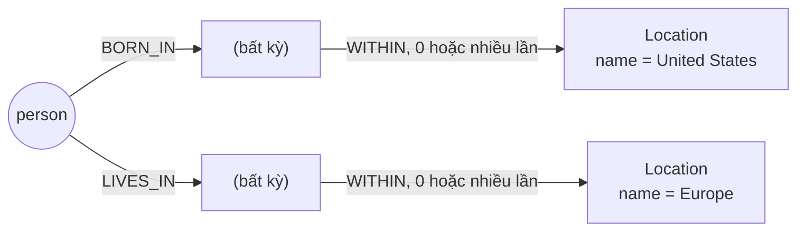

*(Mẫu mà truy vấn Cypher ở Example 2-4 tìm kiếm. Với dữ liệu Hình 2-5: Lucy sinh ở Idaho, thuộc United States, và sống ở London, thuộc Europe, nên khớp. Alain sinh ở Beaune, thuộc Europe, không thuộc United States, nên không khớp.)*

**How — nhiều cách thực thi, optimizer tự chọn** (tr. 53):

- **Cách A (xuôi):** quét **mọi người** trong database, xem nơi sinh và nơi ở của từng người, chỉ trả về người thỏa điều kiện.
- **Cách B (ngược):** bắt đầu từ **hai vertex Location**. Nếu có index trên property `name`, tìm nhanh được vertex "United States" và "Europe". Đi theo mọi edge **WITHIN đi vào** để tìm mọi địa điểm trong Mỹ và châu Âu. Cuối cùng tìm người qua edge BORN_IN hoặc LIVES_IN đi vào tại các địa điểm đó.
- Như mọi ngôn ngữ declarative, **không cần chỉ định chi tiết thực thi**. Optimizer tự chọn chiến lược được dự đoán là hiệu quả nhất.

<a id="graph-sql"></a>

#### B4.3 Graph Queries in SQL (tr. 53–55)

**Câu hỏi.** Example 2-2 cho thấy dữ liệu graph lưu được trong relational database. Vậy có truy vấn bằng SQL được không? **Được, nhưng khó khăn** (tr. 53).

**Why — số lượng join không cố định** (tr. 53–54):

- Trong relational database, ta thường **biết trước** truy vấn cần những join nào.
- Trong truy vấn graph, có thể phải **duyệt qua một số edge không xác định trước** mới tới được vertex cần tìm. Tức là **số join không cố định**.
- Trong ví dụ, đó là phần "WITHIN, 0 hoặc nhiều lần". Edge LIVES_IN có thể trỏ tới **bất kỳ cấp nào**: đường phố, thành phố, quận, vùng, bang… Thành phố có thể WITHIN một vùng, vùng WITHIN một bang, bang WITHIN một nước. Edge LIVES_IN có thể trỏ **thẳng** tới địa điểm cần tìm, hoặc cách **nhiều cấp**.
- Trong Cypher, cú pháp WITHIN kèm `*0..` diễn đạt điều đó rất gọn: "đi theo edge WITHIN, **không hoặc nhiều lần**", giống toán tử `*` trong regular expression.

**How — recursive common table expressions** (tr. 54–55). Từ **SQL:1999**, đường duyệt độ dài thay đổi biểu diễn được bằng ***recursive common table expressions*** (cú pháp `WITH RECURSIVE`), được hỗ trợ trong PostgreSQL, IBM DB2, Oracle, SQL Server. Example 2-5 viết lại truy vấn trên theo các bước:

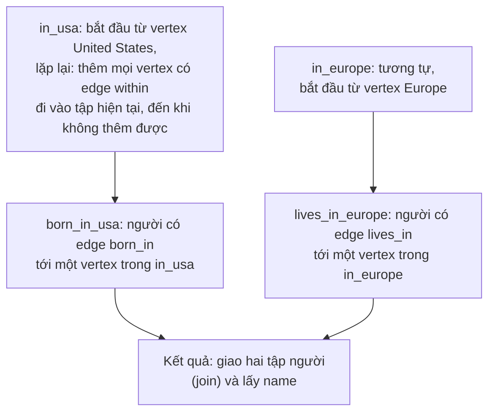

*(Diễn giải các bước của Example 2-5, tr. 54–55.)*

**Trade-offs** (tr. 54–55):

- Cú pháp **rất vụng về** so với Cypher.
- Cùng một truy vấn: **4 dòng** trong ngôn ngữ này, nhưng **29 dòng** trong ngôn ngữ kia. Điều đó chỉ cho thấy **các mô hình dữ liệu khác nhau được thiết kế cho các use case khác nhau**. Quan trọng là **chọn mô hình phù hợp với ứng dụng** (tr. 55).

<a id="triple-store"></a>

#### B4.4 Triple-Stores and SPARQL (tr. 55–59)

**1. What** (tr. 55–56). Triple-store model **gần như tương đương** property graph model, chỉ **dùng từ ngữ khác** cho cùng ý tưởng. Vẫn đáng tìm hiểu vì có nhiều công cụ và ngôn ngữ hữu ích cho triple-store.

Mọi thông tin được lưu dưới dạng **câu ba thành phần rất đơn giản**: (**subject**, **predicate**, **object**). Ví dụ: trong bộ ba (Jim, likes, bananas), Jim là subject, likes là predicate (động từ), bananas là object.

| Thành phần triple | Tương đương trong property graph |
| --- | --- |
| **Subject** | Một vertex |
| **Object** là **giá trị nguyên thủy** (chuỗi, số) | Predicate và object là **key và value của một property** trên vertex subject. Ví dụ: (lucy, age, 33) giống vertex lucy có property age = 33 |
| **Object** là **một vertex khác** | Predicate là **một edge**: subject là tail vertex, object là head vertex. Ví dụ: (lucy, marriedTo, alain) là edge nhãn marriedTo nối lucy tới alain |

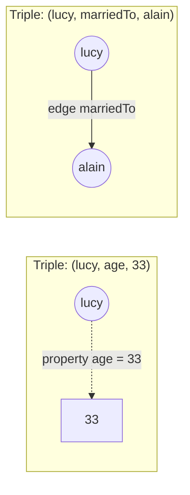

**Turtle format** (Example 2-6, 2-7, tr. 56–57):

- Dữ liệu Hình 2-5 được viết thành triple theo định dạng **Turtle**, một tập con của **Notation3 (N3)** [39].
- Vertex được viết dạng `_:tên`. Tên này **không có nghĩa ngoài file**. Nó tồn tại chỉ để biết những triple nào cùng nói về một vertex.
- Khi predicate là edge thì object là một vertex. Khi predicate là property thì object là một chuỗi literal.
- Lặp lại cùng subject nhiều lần khá dài dòng. Turtle cho phép dùng **dấu chấm phẩy** để nói nhiều điều về cùng một subject trên một dòng, nên dễ đọc hơn.

##### The semantic web (tr. 57)

- Triple-store **hoàn toàn độc lập** với semantic web. Ví dụ, **Datomic** [40] là triple-store không liên quan gì tới semantic web.

  > Chú thích vii (tr. 57): về kỹ thuật, Datomic dùng **5-tuple** thay vì triple. Hai trường thêm là metadata cho việc quản lý phiên bản.

- **Ý tưởng semantic web** về cơ bản đơn giản và hợp lý: website đã xuất bản thông tin dạng chữ và hình cho người đọc, vậy sao không xuất bản thêm dạng **dữ liệu máy đọc được**? **RDF** (*Resource Description Framework*) [41] được thiết kế để các website xuất bản dữ liệu theo định dạng nhất quán, cho phép dữ liệu từ nhiều website **tự động kết hợp** thành một "database của mọi thứ" trên toàn internet.
- **Thực tế:** semantic web bị thổi phồng đầu thập niên 2000 nhưng **chưa thành hiện thực**, khiến nhiều người hoài nghi. Nó còn chịu một rừng từ viết tắt, đề xuất tiêu chuẩn quá phức tạp, và sự ngạo mạn.
- **Nhưng:** dự án semantic web cũng để lại nhiều thành quả tốt. **Triple có thể là mô hình dữ liệu nội bộ tốt cho ứng dụng**, kể cả khi bạn không hề muốn xuất bản dữ liệu RDF lên semantic web.

##### The RDF data model (tr. 57–58)

- Turtle là định dạng **người đọc được** cho dữ liệu RDF. RDF cũng có thể viết bằng **XML** (Example 2-8), làm cùng việc nhưng **dài dòng hơn nhiều**. Công cụ như **Apache Jena** [42] chuyển đổi tự động giữa các định dạng RDF.
- **Điểm kỳ quặc vì RDF thiết kế cho trao đổi dữ liệu toàn internet:** subject, predicate, object thường là **URI**. Ví dụ, predicate không chỉ là `within` mà là một URI đầy đủ trong namespace của công ty bạn.
  - **Lý do:** để kết hợp được dữ liệu của bạn với dữ liệu người khác. Nếu họ hiểu `within` hay `lives_in` theo nghĩa khác thì **không xung đột**, vì predicate của họ nằm trong **namespace khác**.
  - URL đó **không nhất thiết phải truy cập được**: với RDF, nó chỉ là một **namespace**. Các ví dụ trong sách dùng URI dạng `urn:example:` để tránh nhầm với URL http. Prefix chỉ cần khai báo **một lần** ở đầu file.

<a id="sparql"></a>

##### The SPARQL query language (tr. 59)

- **SPARQL** là ngôn ngữ truy vấn cho triple-store dùng mô hình RDF [43]. Tên là từ viết tắt đệ quy *SPARQL Protocol and RDF Query Language*, đọc là "sparkle".
- SPARQL **ra đời trước Cypher**. Cypher **mượn cách so khớp mẫu** (*pattern matching*) từ SPARQL, nên hai ngôn ngữ trông khá giống nhau [37].
- Cùng truy vấn "người di cư từ Mỹ sang châu Âu", SPARQL còn **ngắn gọn hơn** Cypher (Example 2-9).
  - Biến trong SPARQL bắt đầu bằng **dấu hỏi**.
  - Chuỗi edge "bornIn rồi within lặp lại" được viết bằng **đường dẫn predicate** với dấu `/` nối và dấu `*` cho lặp.
  - Vì RDF **không phân biệt property và edge**, mà dùng predicate cho cả hai, nên **cùng cú pháp** được dùng để so khớp property. Ví dụ: tìm vertex có `name` = "United States" viết giống hệt cách đi theo một edge.
- Tác giả đánh giá SPARQL là **ngôn ngữ truy vấn tốt**: dù semantic web không bao giờ thành hiện thực, nó vẫn có thể là công cụ mạnh cho ứng dụng dùng nội bộ.

<a id="graph-vs-codasyl"></a>

#### B4.5 Graph Databases Compared to the Network Model (tr. 60)

**Câu hỏi.** Ở [B2.4](#codasyl), CODASYL và relational model cạnh tranh để giải bài toán many-to-many của IMS. Thoạt nhìn, network model của CODASYL **trông giống graph model**. Vậy graph database có phải là **CODASYL tái sinh trong lớp ngụy trang**? (tr. 60)

**Trả lời: Không.** Chúng khác nhau ở bốn điểm quan trọng:

| Khía cạnh | CODASYL | Graph database |
| --- | --- | --- |
| **Schema** | Có schema quy định loại bản ghi nào được lồng trong loại nào | **Không hạn chế**: vertex nào cũng có edge tới vertex nào. Linh hoạt hơn nhiều khi yêu cầu thay đổi |
| **Truy cập bản ghi** | Cách **duy nhất** là duyệt theo một access path | Tham chiếu **trực tiếp** bất kỳ vertex nào bằng ID, hoặc dùng **index** tìm vertex theo giá trị |
| **Thứ tự** | Con của một bản ghi là **tập có thứ tự**. Database phải duy trì thứ tự (ảnh hưởng layout lưu trữ), và ứng dụng chèn bản ghi phải lo vị trí | Vertex và edge **không có thứ tự**. Chỉ sắp xếp kết quả khi truy vấn |
| **Truy vấn** | **Imperative**, khó viết, dễ hỏng khi schema đổi | Có thể viết duyệt imperative nếu muốn, nhưng phần lớn hỗ trợ ngôn ngữ **declarative** cấp cao như Cypher, SPARQL |

<a id="datalog"></a>

#### B4.6 The Foundation: Datalog (tr. 60–63)

**1. What** (tr. 60–61)

- **Datalog** là ngôn ngữ **cũ hơn nhiều** so với SPARQL hay Cypher. Nó được giới học thuật nghiên cứu kỹ trong thập niên 1980 [44, 45, 46].
- Kỹ sư phần mềm ít biết đến nó, nhưng nó quan trọng vì **cung cấp nền tảng** cho các ngôn ngữ truy vấn sau này.
- Trong thực tế, Datalog được dùng trong vài hệ thống: là ngôn ngữ truy vấn của **Datomic** [40], và **Cascalog** [47] là một cài đặt Datalog để truy vấn dataset lớn trên Hadoop.

  > Chú thích viii (tr. 60): Datomic và Cascalog dùng cú pháp S-expression của Clojure cho Datalog. Sách dùng cú pháp Prolog cho dễ đọc. Không có khác biệt về chức năng.

- **Mô hình dữ liệu** giống triple-store, tổng quát hơn một chút. Thay vì viết (subject, predicate, object), Datalog viết **predicate(subject, object)**. Example 2-10 viết lại dữ liệu ví dụ thành các **fact**, chẳng hạn: usa có tên "United States", usa có loại country, usa nằm trong namerica, lucy sinh ở idaho…

**2. How — xây truy vấn từng bước bằng rule** (Example 2-11, tr. 61–62)

Cypher và SPARQL **nhảy thẳng vào SELECT**. Datalog đi **từng bước nhỏ**: định nghĩa các **rule** để nói với database về **predicate mới**. Ở đây có hai predicate mới là `within_recursive` và `migrated`. Chúng **không phải triple lưu trong database** mà được **suy ra** từ dữ liệu hoặc từ rule khác (tr. 61).

Ba rule trong Example 2-11, diễn giải bằng lời:

| Rule | Ý nghĩa |
| --- | --- |
| **Rule 1** | Một địa điểm có tên N thì "nằm trong (đệ quy)" N. Tức là mỗi địa điểm nằm trong chính nó. |
| **Rule 2** | Nếu địa điểm L nằm trực tiếp trong Via, và Via "nằm trong (đệ quy)" N, thì L cũng "nằm trong (đệ quy)" N. |
| **Rule 3** | Người tên Name "di cư từ BornIn sang LivingIn" nếu người đó sinh ở một nơi nằm trong (đệ quy) BornIn, và sống ở một nơi nằm trong (đệ quy) LivingIn. |

Truy vấn cuối hỏi: ai đã di cư từ "United States" sang "Europe"? Kết quả: **Lucy**.

**Quy tắc hoạt động** (tr. 62):

- Trong rule, từ **viết hoa đầu** là **biến**. Predicate được so khớp giống Cypher và SPARQL. Ví dụ: mẫu "name(Location, Name)" khớp với fact "namerica có tên North America", và gán Location = namerica, Name = 'North America'.
- Một rule **áp dụng** khi hệ thống tìm được kết quả khớp cho **tất cả** predicate ở **vế phải** của toán tử `:-`. Khi rule áp dụng, kết quả giống như **vế trái được thêm vào database** (biến được thay bằng giá trị đã khớp).
- Rule có thể **tham chiếu rule khác**, giống hàm gọi hàm khác hay **gọi đệ quy chính nó**. Nhờ vậy truy vấn phức tạp được xây **từng mảnh nhỏ** (tr. 61).

**Một cách áp dụng rule** (Hình 2-6, tr. 62):

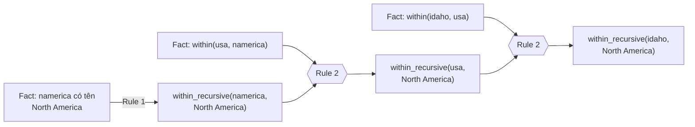

*(Vẽ lại ý của Hình 2-6: suy ra "Idaho nằm trong North America" qua ba bước.)*

Áp dụng lặp lại rule 1 và 2, predicate `within_recursive` cho biết **mọi địa điểm** nằm trong North America, hay trong bất kỳ địa điểm nào khác có trong database. Sau đó rule 3 tìm người sinh ở BornIn và sống ở LivingIn. Truy vấn với BornIn = 'United States', LivingIn = 'Europe', để người là biến Who, nghĩa là yêu cầu hệ thống tìm những giá trị có thể có của Who. Kết quả giống hệt truy vấn Cypher và SPARQL trước đó (tr. 62).

**3. Trade-offs** (tr. 63)

- Datalog đòi hỏi **một kiểu tư duy khác** so với các ngôn ngữ truy vấn khác trong chương.
- Nhưng nó **rất mạnh**, vì **rule có thể kết hợp và tái sử dụng** trong nhiều truy vấn khác nhau.
- **Kém tiện** cho truy vấn đơn giản dùng một lần, nhưng **xử lý tốt hơn** khi dữ liệu phức tạp.

> **Bổ sung ngoài sách.** Cách xây truy vấn từ các rule có tên và tái sử dụng được giống cách xây chương trình từ các hàm nhỏ. Đây là một ví dụ nữa của ý "abstraction tốt được tái sử dụng" ở [chương 1](chapter-01.md#simplicity).

---

<a id="b5"></a>

### B5. Summary — Tổng kết của tác giả (tr. 63–64)

**Lịch sử theo góc nhìn của tác giả:**

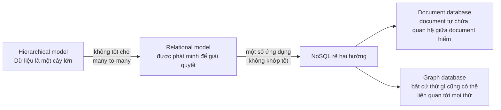

*(Sơ đồ do AI xây dựng, tóm tắt đoạn tổng kết ở tr. 63.)*

**Những điểm chính** (tr. 63):

- Cả ba mô hình (**document, relational, graph**) đều được dùng rộng rãi, mỗi mô hình tốt trong lãnh địa của nó.
- Có thể **giả lập** mô hình này bằng mô hình khác, ví dụ lưu graph trong relational database, nhưng kết quả thường **gượng gạo**. Đó là lý do có **nhiều hệ thống cho nhiều mục đích**, không có giải pháp chung cho mọi thứ.
- Document và graph database thường **không áp đặt schema**, giúp ứng dụng dễ thích ứng với yêu cầu thay đổi. **Nhưng** ứng dụng gần như chắc chắn vẫn **giả định dữ liệu có cấu trúc nhất định**. Vấn đề chỉ là schema **tường minh** (áp đặt khi ghi) hay **ngầm định** (xử lý khi đọc).
- Mỗi mô hình có ngôn ngữ truy vấn hoặc framework riêng: **SQL, MapReduce, aggregation pipeline của MongoDB, Cypher, SPARQL, Datalog**. Sách cũng nhắc tới **CSS và XSL/XPath**, không phải ngôn ngữ truy vấn database nhưng có điểm tương đồng thú vị.

**Những mô hình chưa được nhắc tới** (tr. 63–64):

| Lĩnh vực | Vì sao cần mô hình riêng |
| --- | --- |
| **Dữ liệu gen** | Cần **tìm kiếm tương đồng chuỗi**: lấy một chuỗi rất dài (phân tử DNA) so với một database lớn các chuỗi tương tự nhưng không giống hệt. Không database nào trong chương làm được, nên có phần mềm chuyên dụng như GenBank [48]. |
| **Vật lý hạt** | Phân tích dữ liệu quy mô lớn từ nhiều thập kỷ. Large Hadron Collider làm việc với **hàng trăm petabyte**. Ở quy mô đó cần giải pháp tùy biến để chi phí phần cứng không vượt kiểm soát [49]. |
| **Full-text search** | Có thể coi là một mô hình dữ liệu thường dùng cùng database. Information retrieval là lĩnh vực chuyên sâu mà sách không đi sâu, nhưng sẽ chạm tới search index ở Chương 3 và Part III. |

**Chương tiếp theo** sẽ bàn các đánh đổi khi **cài đặt** những mô hình dữ liệu này (tr. 64).

---

<a id="c-so-do"></a>

## C. Sơ đồ minh họa

Các sơ đồ gắn với từng mục đã nằm trong phần B:

- Các lớp mô hình dữ liệu: [B1](#b1)
- Hình 2-1 và 2-2 (hồ sơ LinkedIn dạng bảng và dạng cây): [B2.2](#impedance-mismatch)
- Hình 2-4 (many-to-many): [B2.3](#relationships)
- Hierarchical, network, relational: [B2.4](#history)
- Schema-on-read và schema-on-write: [B2.5](#schema-flexibility)
- MapReduce: [B3.2](#mapreduce)
- Hình 2-5, property graph, Cypher, SQL đệ quy, triple, Datalog (Hình 2-6): [B4](#b4)

Phần này bổ sung các sơ đồ **tổng hợp** để ôn tập.

### C1. Bản đồ khái niệm của chương 2

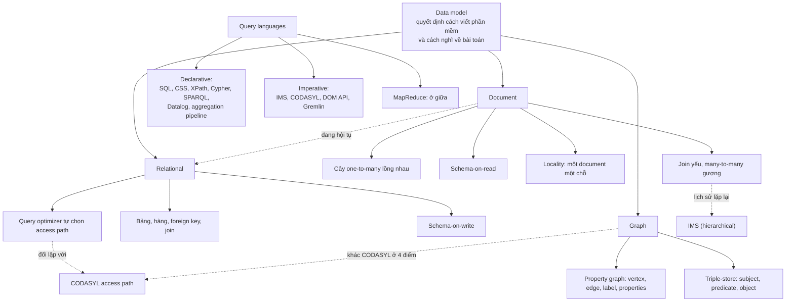

### C2. Chọn mô hình dữ liệu theo loại quan hệ

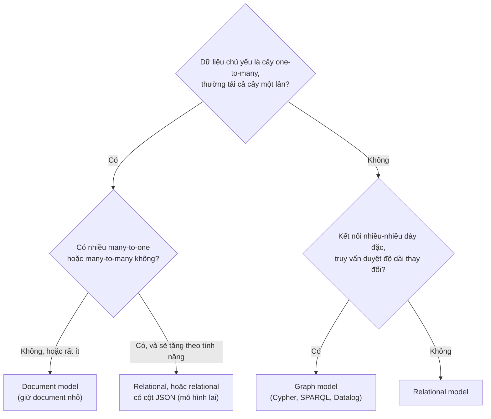

*(Sơ đồ do người viết ghi chú tổng hợp từ lập luận ở tr. 38–39 và 49. Đây là gợi ý suy luận, không phải quy tắc cứng trong sách.)*

### C3. Lịch sử: cùng một bài toán, nhiều lần giải

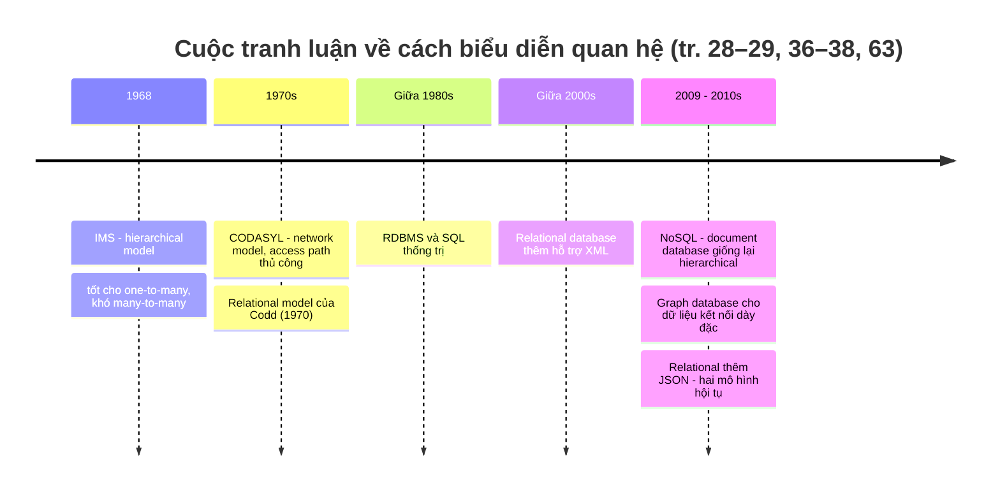

---

<a id="d-so-sanh"></a>

## D. So sánh các giải pháp

<a id="d1"></a>

### D1. Relational, document và graph (tr. 38–42, 49–63)

| Tiêu chí | Relational | Document | Graph |
| --- | --- | --- | --- |
| **Nguyên lý** | Relation (bảng) là tập tuple (hàng). Quan hệ qua foreign key, join lúc truy vấn | Document tự chứa, lồng cây one-to-many bên trong | Vertex và edge có label và properties. Vertex nào cũng nối được với vertex nào |
| **Ưu điểm** | Join tốt, hỗ trợ many-to-one và many-to-many; query optimizer; schema áp đặt giúp nhất quán | Schema linh hoạt; locality khi cần cả document; gần cấu trúc dữ liệu của ứng dụng | Tự nhiên nhất cho dữ liệu kết nối dày đặc; duyệt hai chiều; dễ mở rộng (evolvability); nhiều loại dữ liệu trong một graph |
| **Nhược điểm** | Shredding dữ liệu dạng cây làm schema cồng kềnh; truy vấn duyệt độ dài thay đổi rất vụng (SQL đệ quy) | Không tham chiếu trực tiếp mục lồng; join yếu; phải tải hoặc ghi lại cả document; document lớn lãng phí | Không áp đặt schema; kém tự nhiên cho dữ liệu dạng cây đơn giản (suy luận) |
| **Trade-offs** | Nhất quán và linh hoạt truy vấn, đổi lại phải ánh xạ đối tượng sang bảng | Đơn giản cho dữ liệu dạng cây, đổi lại phức tạp và chậm khi có many-to-many | Biểu đạt quan hệ phức tạp, đổi lại cần cách tư duy và công cụ riêng |
| **Trường hợp sử dụng** | Dữ liệu có cấu trúc đều, nhiều quan hệ đơn giản | Hồ sơ, bản ghi sự kiện, dữ liệu không đồng nhất, cấu trúc do hệ thống ngoài quyết định | Mạng xã hội, web graph, mạng đường, phả hệ, dữ liệu dị thể như graph của Facebook |

<a id="d2"></a>

### D2. Bốn mô hình qua lịch sử (tr. 36–38)

| Tiêu chí | Hierarchical (IMS) | Network (CODASYL) | Relational | Document |
| --- | --- | --- | --- | --- |
| **Cấu trúc** | Cây, mỗi bản ghi đúng một cha | Bản ghi có thể có nhiều cha | Bảng phẳng, tập tuple | Cây lồng trong document |
| **One-to-many** | Tốt | Tốt | Bảng con và join | Tốt (lồng trong cha) |
| **Many-to-many** | Khó: nhân bản hoặc tự giải tham chiếu | Được, qua liên kết kiểu con trỏ | Tốt: foreign key và join | Bằng document reference, join yếu |
| **Cách truy cập** | Duyệt cây | **Access path thủ công** (cursor) | **Query optimizer tự chọn** | Theo ID document; tham chiếu giải lúc đọc |
| **Khi nào "join"** | Không có join | Thực chất lúc chèn dữ liệu | Lúc truy vấn | Lúc đọc (join hoặc truy vấn tiếp theo) |
| **Thay đổi mô hình dữ liệu** | Khó | Rất khó: viết lại code truy vấn | Dễ: thêm index, không sửa truy vấn | Dễ với schema-on-read |

<a id="d3"></a>

### D3. Schema-on-read và schema-on-write (tr. 39–41)

| Tiêu chí | Schema-on-read | Schema-on-write |
| --- | --- | --- |
| **Nguyên lý** | Cấu trúc ngầm định, chỉ diễn giải khi đọc | Schema tường minh, database đảm bảo dữ liệu ghi vào tuân theo |
| **Tương tự** | Kiểm tra kiểu động (lúc chạy) | Kiểm tra kiểu tĩnh (lúc biên dịch) |
| **Đổi định dạng** | Ghi document mới theo định dạng mới; code đọc xử lý cả định dạng cũ | Migration (`ALTER TABLE`, `UPDATE`), hoặc điền lúc đọc nếu `UPDATE` quá chậm |
| **Ưu điểm** | Hợp với dữ liệu không đồng nhất, cấu trúc do hệ thống ngoài quyết định | Ghi lại tài liệu và áp đặt cấu trúc khi mọi bản ghi cùng dạng |
| **Nhược điểm** | Client không được đảm bảo có trường nào; code đọc phải xử lý mọi phiên bản | `UPDATE` bảng lớn chậm; `ALTER TABLE` trên MySQL có thể gây downtime dài |
| **Kết luận** | Không có đúng sai tuyệt đối; phụ thuộc dữ liệu | |

<a id="d4"></a>

### D4. Normalization và denormalization (tr. 33–34, Glossary tr. 554, 556)

| Tiêu chí | Normalized (lưu ID) | Denormalized (lưu bản sao) |
| --- | --- | --- |
| **Nguyên lý** | Thông tin có nghĩa với người lưu một chỗ, nơi khác tham chiếu bằng ID | Nhân bản thông tin vào nơi dùng nó |
| **Ưu điểm** | Nhất quán; dễ cập nhật; hỗ trợ bản địa hóa và tìm kiếm tốt hơn | Đọc nhanh hơn, ít join; giống một kết quả truy vấn tính sẵn |
| **Nhược điểm** | Cần many-to-one và join, gượng trong document model | Chi phí ghi; nguy cơ bản sao không nhất quán; code phải giữ đồng bộ |
| **Ví dụ** | `region_id`, `industry_id` trong hồ sơ LinkedIn | Cache home timeline Twitter ([chương 1](chapter-01.md#load-parameters)) |
| **Sẽ gặp lại** | Part III: caching, denormalization, derived data (tr. 34) | |

<a id="d5"></a>

### D5. Ba cách giải quyết tham chiếu (tr. 34, 39, 42)

| Cách | Ai làm việc join | Ưu điểm | Nhược điểm |
| --- | --- | --- | --- |
| **Join trong database** | Code chuyên biệt bên trong database | Nhanh, được tối ưu | Cần database hỗ trợ join tốt |
| **Join phía ứng dụng** (nhiều truy vấn, hoặc driver tự giải tham chiếu) | Code ứng dụng | Dùng được khi database không hỗ trợ join; danh sách nhỏ có thể giữ trong bộ nhớ | Thêm round-trip mạng; ít tối ưu; độ phức tạp chuyển sang ứng dụng |
| **Denormalize** | Không cần join lúc đọc | Đọc nhanh | Ứng dụng phải giữ các bản sao nhất quán |

<a id="d6"></a>

### D6. Declarative, imperative và MapReduce (tr. 42–48)

| Tiêu chí | Imperative | MapReduce | Declarative |
| --- | --- | --- | --- |
| **Nguyên lý** | Chỉ định từng thao tác theo thứ tự | Đoạn code (map, reduce) được framework gọi lặp lại | Chỉ mô tả mẫu kết quả: điều kiện, biến đổi |
| **Ví dụ** | IMS, CODASYL (COBOL), DOM API, Gremlin | MapReduce của MongoDB, CouchDB | SQL, CSS, XPath, Cypher, SPARQL, Datalog, aggregation pipeline |
| **Ưu điểm** | Toàn quyền kiểm soát; dễ viết tay cho một truy vấn cụ thể | Viết được logic tùy ý (parse, gọi thư viện); hàm thuần nên chạy được ở bất kỳ đâu, theo thứ tự bất kỳ, chạy lại khi lỗi | Ngắn gọn; database tối ưu mà không phải sửa truy vấn; dễ song song hóa |
| **Nhược điểm** | Database không biết code dựa vào giả định gì (như thứ tự), nên khó tối ưu; khó song song | Phải viết hai hàm phối hợp cẩn thận; ít cơ hội tối ưu | Ít kiểm soát chi tiết thực thi; phụ thuộc vào optimizer |
| **Bài học của sách** | Thua trong cả database lẫn trình duyệt | NoSQL có thể vô tình phát minh lại SQL | Thắng về lâu dài |

<a id="d7"></a>

### D7. Các ngôn ngữ truy vấn graph (tr. 52–63)

| Ngôn ngữ | Mô hình | Cách diễn đạt duyệt độ dài thay đổi | Đặc điểm |
| --- | --- | --- | --- |
| **Cypher** | Property graph (Neo4j) | Edge kèm `*0..` ("không hoặc nhiều lần") | Ký hiệu mũi tên trực quan; mượn pattern matching từ SPARQL |
| **SQL** với `WITH RECURSIVE` | Graph lưu trong bảng relational | Recursive common table expression | Được (từ SQL:1999) nhưng rất dài dòng: 29 dòng so với 4 dòng |
| **SPARQL** | Triple-store, RDF | Đường dẫn predicate với `/` và `*` | Ngắn gọn nhất trong ví dụ; dùng cùng cú pháp cho property và edge |
| **Datalog** | Fact dạng predicate(subject, object) | Rule đệ quy | Nền tảng của các ngôn ngữ sau; rule kết hợp và tái sử dụng được; kém tiện cho truy vấn một lần |
| Gremlin | Property graph | Code imperative | Imperative (sách chỉ nhắc tên) |

### D8. Thuật ngữ tương đương: property graph và triple-store (tr. 50–56)

| Property graph | Triple-store / RDF |
| --- | --- |
| Vertex | Subject (hoặc object khi object là vertex) |
| Edge có label | Predicate mà object là một vertex |
| Property (key = value) | Predicate mà object là giá trị nguyên thủy |
| Tail vertex | Subject |
| Head vertex | Object |

---

<a id="e-system-design"></a>

## E. Tư duy System Design

> **Ví dụ minh họa do AI xây dựng.** Tất cả tình huống dưới đây là giả định để luyện cách suy luận. Mỗi bước lập luận dẫn về nội dung sách. Hãy tự trả lời phần "Câu hỏi cần đặt" trước khi đọc lập luận.

### E1. Nền tảng hồ sơ tuyển dụng: từ document đến dữ liệu kết nối

**Bối cảnh.** Một startup xây trang hồ sơ nghề nghiệp. Phiên bản 1 chỉ hiển thị hồ sơ: thông tin cá nhân, danh sách công việc, học vấn. Phiên bản 2 muốn thêm trang công ty (logo, tin tức), lời giới thiệu giữa người dùng, và tìm "người từng làm cùng công ty với tôi".

**Câu hỏi cần đặt.** Mô hình nào cho phiên bản 1? Điều gì thay đổi ở phiên bản 2?

**Lập luận.**

1. **Phiên bản 1:** hồ sơ là **cây one-to-many tự chứa**, thường tải cả hồ sơ một lần để hiển thị. Document model phù hợp: một truy vấn lấy cả hồ sơ, tận dụng locality (tr. 32, 38–41).
2. **Cẩn thận ngay từ đầu với vùng và ngành:** dù dùng document, vẫn nên lưu **ID** thay vì chữ, vì lợi ích về nhất quán, cập nhật, bản địa hóa, tìm kiếm (tr. 33). Danh sách nhỏ, ít đổi, nên ứng dụng có thể giữ trong bộ nhớ để "join" (tr. 34).
3. **Phiên bản 2:** công ty, trường học thành thực thể, và lời giới thiệu tham chiếu người viết. Đây đúng là kịch bản "dữ liệu ngày càng kết nối khi thêm tính năng" của sách (tr. 34–35). Xuất hiện **many-to-many**.
4. Nếu vẫn dùng document thuần, phải **denormalize** (lưu tên và ảnh người viết vào từng lời giới thiệu, rồi cập nhật khi họ đổi ảnh) hoặc **join trong ứng dụng**. Cả hai đều đẩy độ phức tạp sang ứng dụng và có thể chậm hơn (tr. 39).
5. **Lựa chọn hợp lý:** relational database có hỗ trợ JSON. Giữ phần hồ sơ dạng cây trong cột JSON (locality, linh hoạt), còn người dùng, công ty, trường học và lời giới thiệu là bảng có foreign key. Đây là **mô hình lai** mà tác giả đánh giá là hướng đi tốt (tr. 42).

**Nếu yêu cầu thay đổi.** Nếu sản phẩm muốn gợi ý "người quen cách 2–3 bậc" hoặc "đường đi ngắn nhất tới nhà tuyển dụng", thì truy vấn có **độ dài duyệt thay đổi** và dữ liệu kết nối dày đặc. Graph model trở nên tự nhiên nhất (tr. 39, 53–55).

### E2. Hệ thống ghi sự kiện cho analytics

**Bối cảnh.** Ứng dụng di động gửi sự kiện (mở app, bấm nút, thanh toán…) về server. Mỗi loại sự kiện có trường khác nhau. Một số sự kiện đến từ SDK của bên thứ ba và có thể đổi định dạng bất cứ lúc nào.

**Câu hỏi cần đặt.** Schema-on-read hay schema-on-write? Cấu trúc document nên thế nào?

**Lập luận.**

1. Dữ liệu **không đồng nhất**: nhiều loại sự kiện, cấu trúc do **hệ thống bên ngoài** quyết định. Đây đúng là hai tình huống mà schema-on-read có lợi (tr. 40–41).
2. Ứng dụng analytics ghi "sự kiện nào xảy ra lúc nào" thường **không cần many-to-many**, nên join yếu không phải vấn đề (tr. 39).
3. **Locality và kích thước:** mỗi sự kiện là một document nhỏ, ghi một lần, không phình ra. Tránh thiết kế "một document cho mỗi người dùng, append sự kiện vào mảng", vì document sẽ lớn dần và mỗi lần ghi phải ghi lại cả khối (tr. 41).
4. **Cái giá của schema-on-read:** mọi code đọc phải xử lý được mọi phiên bản định dạng từng được ghi (tr. 39–40). Nên có một lớp chuẩn hóa sự kiện khi đọc, tập trung ở một chỗ.

**Nếu yêu cầu thay đổi.** Nếu cần báo cáo kết hợp sự kiện với thông tin khách hàng và gói dịch vụ (many-to-one), cần join. Lúc đó nên đưa dữ liệu vào một hệ thống phân tích có schema. Theo mục lục, Chương 3 sẽ bàn về data warehouse (tr. 91).

### E3. Danh mục sản phẩm với thuộc tính đa dạng

**Bối cảnh.** Sàn thương mại điện tử bán điện thoại (RAM, màn hình), áo (size, chất liệu), sách (tác giả, số trang). Mọi sản phẩm đều có SKU, giá, tồn kho, người bán.

**Câu hỏi cần đặt.** Làm sao vừa đảm bảo nhất quán cho trường chung, vừa linh hoạt cho thuộc tính riêng?

**Lập luận.**

1. **Trường chung** (SKU, giá, tồn kho, người bán) có cùng cấu trúc với mọi sản phẩm, và có quan hệ many-to-one với người bán. Schema-on-write giúp **ghi lại tài liệu và áp đặt** cấu trúc (tr. 41), và join với người bán dễ dàng (tr. 34).
2. **Thuộc tính riêng** mỗi loại là dữ liệu không đồng nhất. Tạo một bảng cho mỗi loại sản phẩm là không thực tế (tr. 40). Lưu chúng trong **cột JSON** là schema-on-read cho phần này.
3. Đây là cách tận dụng **sự hội tụ** relational–document (tr. 41–42). Cần kiểm tra database có hỗ trợ **index và truy vấn bên trong JSON** không: sách nêu PostgreSQL 9.3+, MySQL 5.7+, DB2 10.5+ có hỗ trợ JSON, và mức hỗ trợ khác nhau giữa các hệ (tr. 30, 42).

**Nếu yêu cầu thay đổi.** Nếu một thuộc tính riêng trở thành bộ lọc phổ biến cho mọi loại sản phẩm (ví dụ "thương hiệu"), có thể "nâng" nó thành cột chính thức. Đây là một lần đổi schema: `ALTER TABLE` thường nhanh, còn điền dữ liệu cho hàng cũ có thể làm dần hoặc lúc đọc (tr. 40).

### E4. Phát hiện gian lận qua chuỗi liên kết

**Bối cảnh.** Hệ thống thanh toán muốn phát hiện các tài khoản **liên kết với nhau** qua thiết bị chung, địa chỉ IP chung, thẻ chung, trong vòng tối đa 4 bước, để tìm vòng gian lận.

**Câu hỏi cần đặt.** Relational với SQL hay graph với Cypher? Vì sao?

**Lập luận.**

1. Dữ liệu gồm **nhiều loại thực thể khác nhau** (tài khoản, thiết bị, IP, thẻ) và **nhiều loại quan hệ**. Graph lưu được các loại vertex và edge khác nhau trong một datastore với mô hình gọn gàng, giống graph của Facebook (tr. 49, 51).
2. Truy vấn có **số bước không cố định** ("trong vòng 4 bước"), tức **số join không biết trước** (tr. 53–54). SQL làm được bằng `WITH RECURSIVE`, nhưng vụng về (tr. 54–55). Cypher diễn đạt duyệt độ dài thay đổi rất gọn.
3. Cần **duyệt hai chiều**, ví dụ từ thiết bị tìm mọi tài khoản đã dùng nó, nên property graph với index cả tail và head phù hợp (tr. 51).
4. **Evolvability:** khi thêm loại tín hiệu mới (số điện thoại, địa chỉ giao hàng), chỉ cần thêm loại vertex và edge mới (tr. 52).

**Nếu yêu cầu thay đổi.** Nếu chỉ cần kiểm tra **một bước** ("tài khoản này có dùng chung thẻ với tài khoản bị khóa không?"), số join cố định, và relational đơn giản là đủ. Không cần thêm một hệ thống mới.

### E5. Đổi schema trên bảng 500 triệu hàng

**Bối cảnh.** Bảng `users` có 500 triệu hàng, cột `name` chứa họ tên đầy đủ. Cần tách ra `first_name` để hiển thị lời chào cá nhân hóa. Hệ thống không được downtime.

**Câu hỏi cần đặt.** Chạy migration một lần hay xử lý lúc đọc? Database bạn dùng có ảnh hưởng không?

**Lập luận.**

1. **Thêm cột:** trên hầu hết relational database, `ALTER TABLE` chạy trong vài mili giây. Nếu là **MySQL**, nó có thể sao chép cả bảng, gây downtime hàng giờ, nên cần công cụ online schema change (tr. 40).
2. **Điền dữ liệu:** `UPDATE` 500 triệu hàng sẽ chậm trên **mọi** database, vì phải ghi lại từng hàng (tr. 40).
3. **Phương án của sách:** để `first_name` mặc định `NULL` và **điền lúc đọc**, như document database (tr. 40). Lời chào không cần ngay mọi hàng có dữ liệu, nên cách này đủ.
4. **Cái giá:** code đọc phải xử lý hai trạng thái, tức là trong phần này relational database đang hành xử như schema-on-read.

> **Bổ sung ngoài sách.** Trong thực tế, người ta thường kết hợp: điền lúc đọc cho nhu cầu ngay, đồng thời chạy **backfill theo từng lô nhỏ** ở nền để dần đưa mọi hàng về định dạng mới. Khi backfill xong thì bỏ nhánh xử lý định dạng cũ.

**Nếu yêu cầu thay đổi.** Nếu cần **tìm kiếm và lọc theo `first_name`** ngay lập tức, thì cách điền lúc đọc không đủ. Index chỉ có ích khi dữ liệu đã nằm trong cột, nên bắt buộc phải backfill.

---

<a id="f-cot-loi"></a>

## F. Kiến thức cốt lõi

1. **Mô hình dữ liệu quyết định cả cách viết phần mềm lẫn cách nghĩ về bài toán.** Ứng dụng là nhiều lớp mô hình chồng lên nhau, mỗi lớp che giấu độ phức tạp của lớp dưới (tr. 27–28).
2. **Mỗi mô hình ngầm chứa giả định về cách dùng**: có thao tác dễ và nhanh, có thao tác gượng và chậm (tr. 28).
3. Relational model của Codd (1970) thống trị 25–30 năm và **tổng quát hóa rất tốt**. Mọi đối thủ trước NoSQL đều chỉ là cơn sốt nhất thời (tr. 28–29).
4. NoSQL ra đời vì cần scale, chuộng mã nguồn mở, cần truy vấn chuyên biệt, và muốn schema linh hoạt. Tương lai là **polyglot persistence** (tr. 29).
5. **Impedance mismatch** giữa đối tượng và bảng: ORM giảm nhưng không xóa được nó (tr. 29–30).
6. **Document model hợp với cây one-to-many tự chứa**, có locality tốt. Nhưng join yếu, và nên giữ document nhỏ (tr. 32, 38–41).
7. **Normalization là loại bỏ trùng lặp.** ID không có nghĩa với người nên không bao giờ cần đổi. Đổi lại cần quan hệ many-to-one và join (tr. 33–34).
8. **Dữ liệu có xu hướng ngày càng kết nối khi thêm tính năng**, đẩy ứng dụng về phía many-to-many (tr. 34–35).
9. **Lịch sử lặp lại:** document database giống hierarchical model của IMS. Relational thắng network model (CODASYL) nhờ **query optimizer tự chọn access path**, xây một lần cho mọi ứng dụng (tr. 36–38).
10. **"Schemaless" là hiểu lầm**: luôn có schema. Câu hỏi là *schema-on-read* (ngầm, khi đọc) hay *schema-on-write* (tường minh, khi ghi). Không có đúng sai tuyệt đối (tr. 39–40).
11. Relational và document đang **hội tụ**: relational thêm JSON và XML, document thêm join. Mô hình lai là hướng tốt (tr. 41–42).
12. **Declarative thắng imperative về lâu dài**: ngắn gọn, database tối ưu mà không phải sửa truy vấn, dễ song song hóa. Bài học này đúng cả với SQL lẫn CSS (tr. 42–46).
13. **MapReduce ở giữa** declarative và imperative. Hàm map và reduce phải thuần. NoSQL có thể **vô tình phát minh lại SQL** (aggregation pipeline) (tr. 46–48).
14. **Graph model tự nhiên nhất cho dữ liệu kết nối dày đặc**: vertex nào cũng nối được với vertex nào, duyệt hai chiều, nhiều loại dữ liệu trong một graph, dễ mở rộng (tr. 49–52).
15. Truy vấn graph cần **duyệt độ dài thay đổi**. Cypher và SPARQL diễn đạt gọn; SQL làm được bằng `WITH RECURSIVE` nhưng vụng (tr. 53–55, 59).
16. **Graph database không phải CODASYL tái sinh**: không schema ràng buộc, truy cập trực tiếp bằng ID hoặc index, không có thứ tự, và có ngôn ngữ declarative (tr. 60).
17. **Datalog** là nền tảng: xây truy vấn từ các rule tái sử dụng được, mạnh với dữ liệu phức tạp (tr. 60–63).

---

<a id="g-cau-hoi"></a>

## G. Câu hỏi tự kiểm tra

Hãy tự trả lời trước, sau đó mới xem [phần đáp án](#g-dap-an).

1. **Tại sao** tác giả nói mô hình dữ liệu là phần quan trọng nhất khi phát triển phần mềm? Các lớp mô hình dữ liệu liên quan gì tới ý "abstraction" ở chương 1?
2. **So sánh** ba cách biểu diễn quan hệ one-to-many của bản lý lịch trong SQL. Vì sao biểu diễn JSON có "locality tốt hơn"? Locality có lợi khi nào và **có hại khi nào**?
3. **Tại sao** nên lưu `region_id` thay vì chuỗi "Greater Seattle Area"? Quyết định này kéo theo loại quan hệ nào, và **điều gì xảy ra** với document database khi loại quan hệ đó tăng lên?
4. **Điều gì xảy ra nếu** bạn dùng document database thuần cho tính năng "lời giới thiệu", nơi người viết có thể đổi ảnh đại diện? Nêu hai cách xoay xở và cái giá của mỗi cách.
5. **So sánh** network model (CODASYL) và relational model trong cách truy cập dữ liệu. Vì sao "chỉ cần xây query optimizer một lần" là insight then chốt?
6. **Tại sao** "schemaless" là cách gọi gây hiểu lầm? **So sánh** schema-on-read và schema-on-write khi cần tách cột họ tên thành first name và last name.
7. **Tại sao** ngôn ngữ declarative cho phép database tối ưu mà imperative thì không? Giải thích bằng ví dụ thứ tự bản ghi, và bằng ví dụ CSS so với JavaScript DOM.
8. **Tại sao** map và reduce trong MapReduce phải là pure function? **Điều gì xảy ra** khiến MongoDB thêm aggregation pipeline?
9. **Tại sao** truy vấn "người di cư từ Mỹ sang châu Âu" khó viết bằng SQL thông thường? Recursive CTE giải quyết thế nào, và cái giá là gì?
10. Graph database có phải là **CODASYL tái sinh** không? Nêu các điểm khác biệt. Datalog khác Cypher và SPARQL ở cách xây truy vấn như thế nào?

<a id="g-dap-an"></a>

### Đáp án và giải thích

<details>
<summary><b>Câu 1 — Vì sao mô hình dữ liệu quan trọng nhất</b></summary>

- Mô hình dữ liệu ảnh hưởng không chỉ tới **cách viết phần mềm** mà còn tới **cách ta nghĩ về bài toán** (tr. 27). Mỗi mô hình chứa giả định về cách dùng: thao tác nào dễ, nhanh, tự nhiên, và thao tác nào gượng, chậm, không hỗ trợ (tr. 28). Chọn sai mô hình thì mọi thứ phía trên đều phải "chống lại" nó.
- Ứng dụng là **nhiều lớp mô hình chồng lên nhau**: thế giới thực, rồi đối tượng ứng dụng, rồi mô hình đa dụng (JSON, bảng, graph), rồi byte, rồi tín hiệu vật lý. **Mỗi lớp che giấu độ phức tạp của lớp dưới** bằng một mô hình gọn gàng, giúp các nhóm người khác nhau làm việc cùng nhau (tr. 27–28).
- Đây chính là **abstraction loại bỏ accidental complexity** ở chương 1 (tr. 21 của sách).

</details>

<details>
<summary><b>Câu 2 — Ba cách biểu diễn one-to-many và locality</b></summary>

- **Ba cách** (tr. 30):
  1. Bảng riêng với foreign key: truyền thống, chuẩn hóa, truy vấn bằng join.
  2. Kiểu có cấu trúc, XML hoặc JSON trong một hàng: truy vấn và index được bên trong, tùy database.
  3. JSON hoặc XML mã hóa vào cột text: database không truy vấn được bên trong.
- **Locality của JSON** (tr. 32): mọi thông tin hồ sơ ở một chỗ, nên một truy vấn là đủ. Dạng nhiều bảng cần nhiều truy vấn hoặc join nhiều chiều, tức nhiều lần tra index và seek đĩa (tr. 41).
- **Có lợi** khi thường cần **phần lớn document cùng lúc**, ví dụ hiển thị trang hồ sơ.
- **Có hại** khi chỉ cần một phần nhỏ (vẫn phải tải cả document), hoặc khi cập nhật làm document to ra (phải ghi lại cả document). Vì vậy nên giữ document nhỏ (tr. 41).

</details>

<details>
<summary><b>Câu 3 — Lưu ID và quan hệ many-to-one</b></summary>

- **Lưu ID** cho: nhất quán chính tả, tránh mơ hồ (thành phố trùng tên), dễ cập nhật (tên lưu một chỗ), bản địa hóa, tìm kiếm tốt hơn (biết Seattle thuộc Washington) (tr. 33).
- Bản chất là **loại bỏ trùng lặp**: ID không có nghĩa với người nên không bao giờ cần đổi. Nếu nhân bản chữ, mọi bản sao phải cập nhật, gây tốn chi phí ghi và nguy cơ không nhất quán. Đây là ý cốt lõi của **normalization** (tr. 33).
- Kéo theo quan hệ **many-to-one** (nhiều người cùng một vùng). Quan hệ này **không khớp tự nhiên với document model**, vì join yếu (tr. 34).
- Khi dữ liệu ngày càng kết nối (công ty, trường học thành thực thể, lời giới thiệu), many-to-many xuất hiện. Document database phải join trong ứng dụng hoặc denormalize, dẫn tới code phức tạp hơn và hiệu năng tệ hơn (tr. 34–35, 39).

</details>

<details>
<summary><b>Câu 4 — Lời giới thiệu trong document database thuần</b></summary>

Lời giới thiệu cần hiện tên và ảnh **hiện tại** của người viết. Vì vậy nó cần **tham chiếu tới hồ sơ người viết**, một quan hệ many-to-many (tr. 34–35). Hai cách xoay xở (tr. 39):

1. **Denormalize:** sao chép tên và ảnh người viết vào từng lời giới thiệu. Đọc nhanh, nhưng khi người viết đổi ảnh, **ứng dụng phải tìm và cập nhật mọi bản sao**. Nếu bỏ sót, dữ liệu không nhất quán.
2. **Join trong ứng dụng:** lưu ID người viết, rồi khi hiển thị thì truy vấn thêm để lấy hồ sơ. Luôn đúng, nhưng thêm truy vấn và round-trip, độ phức tạp nằm ở ứng dụng, và thường **chậm hơn** join trong database.

Kết luận của sách: với many-to-many, document model có thể dẫn tới code phức tạp hơn đáng kể và hiệu năng tệ hơn (tr. 39).

</details>

<details>
<summary><b>Câu 5 — CODASYL, relational và query optimizer</b></summary>

- **CODASYL:** bản ghi liên kết bằng con trỏ. Cách duy nhất để tới một bản ghi là **đi theo access path** từ gốc. Lập trình viên phải nhớ các đường đi và viết code duyệt bằng cursor. Muốn truy vấn kiểu mới mà không có đường thì phải đổi access path và viết lại nhiều code. Rất khó đổi mô hình dữ liệu (tr. 36–37).
- **Relational:** bày dữ liệu ra ngoài sáng. Đọc được hàng nào cũng được theo điều kiện tùy ý. **Query optimizer tự chọn** thứ tự thực thi và index, tức là tự chọn "access path". Thêm index mới thì truy vấn tự dùng, không cần sửa (tr. 37–38).
- **Insight then chốt:** optimizer rất phức tạp và tốn nhiều năm R&D, nhưng **chỉ cần xây một lần** và mọi ứng dụng dùng database đều hưởng lợi. Viết tay access path cho một truy vấn thì dễ hơn, nhưng **giải pháp đa dụng thắng về lâu dài** (tr. 38).

</details>

<details>
<summary><b>Câu 6 — Schemaless, schema-on-read và schema-on-write</b></summary>

- **"Schemaless" gây hiểu lầm** vì code đọc dữ liệu **luôn giả định một cấu trúc**. Có một schema ngầm, chỉ là database không áp đặt (tr. 39).
- **Schema-on-read:** cấu trúc ngầm định, diễn giải khi đọc, giống kiểm tra kiểu động. **Schema-on-write:** schema tường minh, database đảm bảo khi ghi, giống kiểm tra kiểu tĩnh (tr. 39–40).
- **Tách họ tên** (tr. 40):
  - *Schema-on-read:* bắt đầu ghi document mới có `first_name`. Code đọc xử lý document cũ bằng cách tách từ `name` nếu thiếu.
  - *Schema-on-write:* migration. `ALTER TABLE` thêm cột (thường vài mili giây, trừ MySQL có thể sao chép cả bảng), rồi `UPDATE` từng hàng (chậm trên mọi database với bảng lớn). Nếu `UPDATE` không chấp nhận được, để `NULL` và điền lúc đọc.
- Schema-on-read có lợi với **dữ liệu không đồng nhất** hoặc cấu trúc do hệ thống ngoài quyết định. Schema-on-write hữu ích khi mọi bản ghi cùng cấu trúc (tr. 40–41).

</details>

<details>
<summary><b>Câu 7 — Vì sao declarative cho phép tối ưu</b></summary>

- **Declarative** chỉ mô tả *kết quả cần có*, không mô tả *cách làm*. Database được tự do chọn cách thực thi (tr. 43).
- **Ví dụ thứ tự bản ghi** (tr. 43): database muốn thu hồi dung lượng trống nên di chuyển bản ghi, làm đổi thứ tự. Truy vấn SQL không đảm bảo thứ tự nên không bị ảnh hưởng. Nhưng với code imperative, database **không biết code có dựa vào thứ tự không**, nên không dám thay đổi. SQL bị giới hạn hơn lại cho database **nhiều chỗ để tối ưu** hơn.
- **Song song hóa** (tr. 43): code imperative chỉ định thứ tự lệnh nên khó chia ra nhiều core hay nhiều máy. Declarative thì database tự do song song hóa.
- **CSS và DOM** (tr. 44–45): CSS khai báo mẫu phần tử. Trình duyệt **tự gỡ** style khi class `selected` bị gỡ, và có thể tăng tốc CSS mà không phá tương thích. Code DOM imperative không tự cập nhật, và phải viết lại để dùng API mới nhanh hơn.

</details>

<details>
<summary><b>Câu 8 — Pure function trong MapReduce và aggregation pipeline</b></summary>

- Map và reduce phải là **pure function**: chỉ dùng dữ liệu đầu vào, không chạy thêm truy vấn database, không có side effect. Nhờ đó database có thể **chạy chúng ở bất kỳ đâu, theo thứ tự bất kỳ, và chạy lại khi lỗi** (tr. 48). Nếu hàm có side effect, chạy lại khi lỗi có thể gây hậu quả hai lần. Nếu hàm đọc thêm database, kết quả phụ thuộc thời điểm và vị trí chạy.
- **Vì sao có aggregation pipeline** (tr. 48): viết hai hàm JavaScript phối hợp cẩn thận thường **khó hơn** viết một truy vấn, và ngôn ngữ declarative cho optimizer **nhiều cơ hội tối ưu** hơn. Vì vậy MongoDB 2.2 thêm aggregation pipeline, có sức biểu đạt tương đương một tập con SQL với cú pháp JSON. Bài học: NoSQL có thể **vô tình phát minh lại SQL**.

</details>

<details>
<summary><b>Câu 9 — Truy vấn graph bằng SQL</b></summary>

- Trong relational, ta thường **biết trước** truy vấn cần bao nhiêu join. Truy vấn "người di cư" phải đi theo chuỗi edge `within` với **số bước không biết trước**: nơi sinh có thể là thành phố, vùng, bang… cách "United States" một hoặc nhiều cấp. Vì vậy **số join không cố định** (tr. 53–54).
- **Recursive CTE** (`WITH RECURSIVE`, từ SQL:1999): bắt đầu từ vertex "United States", lặp lại việc thêm mọi vertex có edge `within` trỏ vào tập hiện tại cho đến khi không thêm được. Làm tương tự với "Europe". Sau đó tìm người có `born_in` vào tập thứ nhất và `lives_in` vào tập thứ hai, rồi giao hai tập (tr. 54–55).
- **Cái giá:** cú pháp rất vụng: 29 dòng so với 4 dòng Cypher. Điều này cho thấy mỗi mô hình được thiết kế cho use case khác nhau, và nên chọn mô hình phù hợp (tr. 55).

</details>

<details>
<summary><b>Câu 10 — Graph và CODASYL, Datalog và Cypher/SPARQL</b></summary>

- **Graph database không phải CODASYL tái sinh** (tr. 60). Bốn khác biệt:
  1. CODASYL có schema ràng buộc loại bản ghi nào lồng trong loại nào; graph cho vertex nào nối vertex nào.
  2. CODASYL chỉ truy cập qua access path; graph tham chiếu trực tiếp bằng ID hoặc tìm qua index.
  3. CODASYL duy trì con của bản ghi theo thứ tự; graph không có thứ tự, chỉ sắp xếp khi truy vấn.
  4. CODASYL chỉ có truy vấn imperative dễ hỏng; graph có ngôn ngữ declarative như Cypher, SPARQL.
- **Datalog khác ở cách xây truy vấn** (tr. 61–63): Cypher và SPARQL nhảy thẳng vào truy vấn. Datalog định nghĩa từng **rule** sinh ra predicate mới (như `within_recursive`, `migrated`) từ dữ liệu hoặc từ rule khác, kể cả đệ quy, rồi truy vấn trên predicate đó. Rule **kết hợp và tái sử dụng được** trong nhiều truy vấn, nên mạnh với dữ liệu phức tạp, nhưng kém tiện cho truy vấn một lần.

</details>

---

<a id="kiem-tra"></a>

## Ghi chú kiểm tra nguồn

**Đối chiếu với mục lục của chương** (bookmark PDF và tiêu đề trong sách):

| Mục trong sách | Trang in | Mục ghi chú |
| --- | --- | --- |
| *(Mở đầu chương)* | 27–28 | A, B1 |
| Relational Model Versus Document Model | 28–29 | B2.0 |
| The Birth of NoSQL | 29 | B2.1 |
| The Object-Relational Mismatch | 29–32 | B2.2 |
| Many-to-One and Many-to-Many Relationships | 33–35 | B2.3 |
| Are Document Databases Repeating History? (The network model; The relational model; Comparison to document databases) | 36–38 | B2.4 |
| Relational Versus Document Databases Today (Which data model leads to simpler application code?; Schema flexibility…; Data locality…; Convergence…) | 38–42 | B2.5 |
| Query Languages for Data | 42–43 | B3.0 |
| Declarative Queries on the Web | 44–46 | B3.1 |
| MapReduce Querying | 46–48 | B3.2 |
| Graph-Like Data Models | 49–50 | B4.0 |
| Property Graphs | 50–52 | B4.1 |
| The Cypher Query Language | 52–53 | B4.2 |
| Graph Queries in SQL | 53–55 | B4.3 |
| Triple-Stores and SPARQL (The semantic web; The RDF data model; The SPARQL query language) | 55–59 | B4.4 |
| Hộp "Graph Databases Compared to the Network Model" | 60 | B4.5 |
| The Foundation: Datalog | 60–63 | B4.6 |
| Summary | 63–64 | B5 |
| References [1]–[49] | 64–67 | Số [n] trong ghi chú giữ nguyên số thứ tự tài liệu tham khảo của sách |

**Hình đã kiểm tra trực tiếp trên ảnh trang PDF:**

- Bản đồ đầu chương (tr. 26, PDF 48).
- Hình 2-1 (tr. 31), Hình 2-2 (tr. 32), Hình 2-3 và 2-4 (tr. 35), Hình 2-5 (tr. 50), Hình 2-6 (tr. 62).
- Hình 2-3 là ảnh chụp màn hình LinkedIn nên chỉ mô tả bằng lời. Hình 2-4 được vẽ lại ở dạng đơn giản hóa: cách nối từng job hay edu tới tổ chức hay trường cụ thể là minh họa.

**Giới hạn và điểm chưa kiểm chứng:**

- Văn bản chương 2 trích xuất tốt từ PDF. Không có trang nào không đọc được.
- Các phát biểu về tính năng của sản phẩm cụ thể (MongoDB, RethinkDB, CouchDB, phiên bản PostgreSQL, MySQL, DB2 hỗ trợ JSON, hành vi `ALTER TABLE` của MySQL) phản ánh **thời điểm viết sách (khoảng 2016–2017)**. Ghi chú không kiểm chứng tình trạng hiện tại của các sản phẩm này.
- Code và truy vấn mẫu (Example 2-1 đến 2-11) được diễn giải bằng lời. Chỉ giữ lại vài cú pháp ngắn cần thiết để giải thích (một câu SQL lọc cá mập, selector CSS, tên cú pháp như `WITH RECURSIVE`). JSON trong B2.2 là ví dụ do AI xây dựng, không phải Example 2-1.
- Các liên hệ tới chương sau chỉ dựa trên tham chiếu chéo trong chương 2 và mục lục. Chúng sẽ được kiểm chứng khi học các chương đó.
