# Chương 3 — Lưu trữ và truy xuất dữ liệu

*Storage and Retrieval*

> **Nguồn:** *Designing Data-Intensive Applications*, Martin Kleppmann, O'Reilly, **First Edition (3/2017)**, Chương 3, **tr. 69–110** (trang PDF 91–132). Bản đồ minh họa của chương nằm ở tr. 68 (PDF 90).
> "tr. N" là số trang in trong sách. Trang PDF = N + 22.
>
> **Quy ước nhãn:**
> - Nội dung không có nhãn là diễn giải từ sách, kèm số trang.
> - **Bổ sung ngoài sách** là kiến thức thêm để giải thích rõ hơn, kể cả phép tính tự làm.
> - **Ví dụ minh họa do AI xây dựng** là ví dụ hoặc tình huống giả định, không phải của tác giả.
>
> Các đoạn code mẫu trong sách (hai hàm Bash, Example 3-1, truy vấn bản đồ nhà hàng) được **diễn giải bằng lời**. Số liệu trong các hình (Hình 3-2, 3-3, 3-11, 3-12) được dùng lại vì chúng là dữ liệu minh họa cần cho việc giải thích.

## Mục lục ghi chú

- [A. Tổng quan chương](#a-tong-quan)
- [B. Giải thích chi tiết](#b-chi-tiet)
  - [B1. Data Structures That Power Your Database (tr. 70–71)](#b1)
  - [B2. Hash Indexes (tr. 72–75)](#b2)
  - [B3. SSTables and LSM-Trees (tr. 76–79)](#b3)
  - [B4. B-Trees (tr. 79–83)](#b4)
  - [B5. Comparing B-Trees and LSM-Trees (tr. 83–85)](#b5)
  - [B6. Other Indexing Structures (tr. 85–90)](#b6)
  - [B7. Transaction Processing or Analytics? (tr. 90–95)](#b7)
  - [B8. Column-Oriented Storage (tr. 95–103)](#b8)
  - [B9. Summary (tr. 103–104)](#b9)
- [C. Sơ đồ minh họa](#c-so-do)
- [D. So sánh các giải pháp](#d-so-sanh)
- [E. Tư duy System Design](#e-system-design)
- [F. Kiến thức cốt lõi](#f-cot-loi)
- [G. Câu hỏi tự kiểm tra](#g-cau-hoi) · [Đáp án](#g-dap-an)
- [Ghi chú kiểm tra nguồn](#kiem-tra)

---

## A. Tổng quan chương

### Chương này muốn giải quyết điều gì?

Ở mức cơ bản nhất, database chỉ cần làm hai việc: **lưu dữ liệu** khi bạn đưa cho nó, và **trả lại dữ liệu** khi bạn hỏi lại sau này (tr. 69).

- Chương 2 nhìn hai việc đó từ góc của **lập trình viên ứng dụng**: đưa dữ liệu vào theo định dạng nào (data model), hỏi lại bằng cơ chế nào (query language).
- Chương 3 nhìn từ góc của **database**: làm sao **lưu** dữ liệu được giao, và làm sao **tìm lại** khi được hỏi.

**Vì sao lập trình viên ứng dụng cần quan tâm?** (tr. 69) Bạn gần như sẽ không tự viết storage engine. Nhưng bạn phải **chọn** một storage engine phù hợp trong số rất nhiều lựa chọn. Muốn **tinh chỉnh** nó cho đúng loại workload của mình, bạn cần hiểu sơ bộ nó làm gì bên dưới.

**Hai phân biệt lớn của chương** (tr. 69–70):

1. Storage engine tối ưu cho **transaction processing (OLTP)** khác rất nhiều storage engine tối ưu cho **analytics (OLAP)**.
2. Trong phía OLTP có hai trường phái: **log-structured** (chỉ ghi nối thêm) và **page-oriented** như **B-tree** (ghi đè từng trang).

### Mạch lập luận của chương

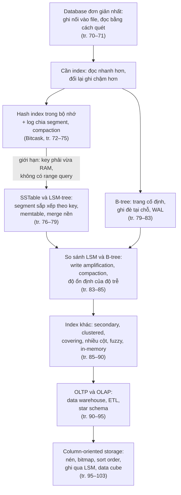

### Liên hệ với các chương khác

| Ý trong chương 3 | Liên hệ | Căn cứ |
| --- | --- | --- |
| Index là dữ liệu dẫn xuất: đọc nhanh, ghi chậm | **Chương 1**: đánh đổi tính trước lúc ghi hay tính lúc đọc (Twitter) | tr. 71 |
| LSM-tree có độ trễ cao ở percentile cao | **Chương 1**: percentile, tail latency ([B4.2 chương 1](chapter-01.md#percentiles)) | tr. 85 |
| Secondary index giúp join hiệu quả, ví dụ index trên `user_id` ở Hình 2-1 | **Chương 2**: hồ sơ LinkedIn ([B2.2 chương 2](chapter-02.md#impedance-mismatch)) | tr. 86 |
| Column-family của Bigtable vẫn chủ yếu là lưu theo hàng | **Chương 2**: locality ([B2.5 chương 2](chapter-02.md#locality)) | tr. 99 |
| Sort order và lưu nhiều bản sao dữ liệu | **Chương 5** — Replication (dữ liệu được nhân bản để chịu lỗi) | tr. 100 |
| Hash dùng để chia partition, secondary index khi partition | **Chương 6** — Partitioning | Glossary tr. 555, 557 |
| ACID, khóa theo khoảng key, snapshot isolation | **Chương 7** — Transactions | tr. 82–83, 85, 90 |
| Batch processing, materialization trạng thái trung gian | **Chương 10** | tr. 90; Glossary tr. 556 |
| Event log như một luồng dữ liệu | **Chương 11** | Glossary tr. 556 |

> **Bản đồ đầu chương (tr. 68).** Bản đồ vẽ "Vùng đất B-tree" (MySQL, PostgreSQL, Oracle, SQL Server…), "Log-structured storage" (LevelDB, RocksDB, Cassandra, HBase, Lucene), "Thung lũng In-memory Storage", "Rừng Secondary Indexes", "Cộng hòa Transaction Processing", và bên kia "Đường cao tốc ETL" là "Vương quốc Analytics" với "Núi Column Storage" và "Tượng đài Star Schema". Hai con tàu chỉ hướng tới Replication (Chương 5) và Bulk Storage (Chương 4, 10).

---

## B. Giải thích chi tiết

### B1. Data Structures That Power Your Database (tr. 70–71)

#### B1.1 Database đơn giản nhất thế giới

Tác giả mở đầu bằng một database chỉ gồm **hai hàm Bash** (tr. 70):

- **`db_set key value`**: ghi một dòng "key,value" **nối vào cuối** một file text.
- **`db_get key`**: tìm mọi dòng bắt đầu bằng key đó và trả về **dòng cuối cùng**, tức giá trị mới nhất.

Đây là một **key-value store** thực thụ. Value gần như có thể là bất cứ thứ gì, kể cả một document JSON. Định dạng lưu rất đơn giản: mỗi dòng một cặp key-value, giống file CSV. Vì mỗi lần `db_set` chỉ nối thêm, cập nhật một key nhiều lần **không ghi đè** giá trị cũ. Muốn lấy giá trị mới nhất phải tìm lần xuất hiện **cuối cùng** của key (tr. 70).

| Thao tác | Hiệu năng | Vì sao |
| --- | --- | --- |
| `db_set` (ghi) | **Khá tốt** | Ghi nối vào file thường rất hiệu quả |
| `db_get` (đọc) | **Rất tệ** khi có nhiều bản ghi | Phải quét toàn bộ file từ đầu đến cuối. Độ phức tạp **O(n)**: số bản ghi gấp đôi thì thời gian tìm cũng gấp đôi |

*(tr. 71)*

#### B1.2 Khái niệm "log"

Nhiều database thật bên trong cũng dùng một **log**: một file dữ liệu **chỉ ghi nối thêm** (*append-only*). Database thật phải xử lý thêm nhiều vấn đề (kiểm soát đồng thời, thu hồi dung lượng để log không phình mãi, xử lý lỗi và bản ghi ghi dở), nhưng nguyên lý cơ bản giống nhau. Log cực kỳ hữu ích và sẽ xuất hiện nhiều lần trong sách (tr. 71).

> **Lưu ý thuật ngữ** (tr. 71). "Log" thường được hiểu là **log ứng dụng**: văn bản mô tả điều đang xảy ra. Trong sách, log mang nghĩa **tổng quát hơn**: **một chuỗi bản ghi chỉ ghi nối thêm**. Nó không cần người đọc được; có thể là nhị phân và chỉ để chương trình khác đọc. Glossary của sách liệt kê nhiều vai trò của log: write-ahead log giúp storage engine chịu crash, log-structured engine dùng log làm định dạng lưu chính, replication log chép dữ liệu từ leader sang follower, event log biểu diễn một luồng dữ liệu (tr. 556).

#### B1.3 Index và đánh đổi quan trọng nhất của storage

**1. What.** Muốn tìm nhanh giá trị của một key, cần một cấu trúc dữ liệu khác: **index**. Ý tưởng chung là giữ thêm một ít **metadata bên cạnh**, đóng vai **biển chỉ đường** giúp định vị dữ liệu cần tìm. Muốn tìm cùng dữ liệu theo nhiều cách thì có thể cần nhiều index trên các phần khác nhau của dữ liệu (tr. 71). Glossary định nghĩa index là cấu trúc dữ liệu giúp tìm hiệu quả mọi bản ghi có một giá trị cụ thể ở một trường cụ thể (tr. 555).

**2. Why — index là dữ liệu dẫn xuất** (tr. 71):

- Index là **cấu trúc phụ được dẫn xuất từ dữ liệu chính** (*primary data*).
- Nhiều database cho phép **thêm hoặc xóa index** mà **không ảnh hưởng nội dung** database. Nó **chỉ ảnh hưởng hiệu năng truy vấn**.

**3. How — cái giá nằm ở lúc ghi** (tr. 71):

- Duy trì cấu trúc phụ tốn chi phí, **đặc biệt khi ghi**.
- Về ghi, khó có gì nhanh hơn **ghi nối vào file**, vì đó là thao tác ghi đơn giản nhất có thể.
- Gần như mọi loại index đều **làm chậm việc ghi**, vì index cũng phải được cập nhật mỗi lần ghi dữ liệu.

**4. Trade-offs — đánh đổi quan trọng của hệ thống lưu trữ** (tr. 71):

> **Index được chọn tốt làm truy vấn đọc nhanh hơn, nhưng mọi index đều làm việc ghi chậm đi.**

Vì vậy database thường **không tự đánh index mọi thứ**. Nó yêu cầu bạn (lập trình viên hoặc quản trị database) **chọn index thủ công**, dựa trên hiểu biết về **mẫu truy vấn điển hình** của ứng dụng. Như vậy bạn chọn được index mang lại lợi ích lớn nhất mà không thêm chi phí thừa.

**5. Example**

> **Ví dụ minh họa do AI xây dựng.** Bảng `orders` có 5 index (theo `customer_id`, `status`, `created_at`, `product_id`, `shop_id`). Mỗi lần chèn một đơn hàng, database phải ghi **1 bản ghi + 5 mục index**. Nếu chỉ có 2 trong số đó thực sự được truy vấn, 3 index còn lại là **chi phí ghi không mang lại gì**.

**6. System Design Perspective.** Index **là một quyết định dựa trên load parameters** ([chương 1, B4.1](chapter-01.md#load-parameters)). Hãy chọn index theo truy vấn thực tế. Khi tỷ lệ đọc/ghi hay mẫu truy vấn đổi, tập index cũng nên được xem lại.

---

### B2. Hash Indexes (tr. 72–75)

#### B2.1 Hash map trong bộ nhớ trỏ vào log trên đĩa

**What.** Bắt đầu với index cho dữ liệu key-value. Đây không phải loại dữ liệu duy nhất cần index, nhưng rất phổ biến và là khối xây dựng cho index phức tạp hơn. Key-value store khá giống kiểu **dictionary** trong ngôn ngữ lập trình, thường được cài bằng **hash map** (hash table). Đã có hash map cho dữ liệu trong bộ nhớ, sao không dùng nó để index dữ liệu trên đĩa? (tr. 72)

**How — chiến lược index đơn giản nhất** (tr. 72, Hình 3-1):

- Dữ liệu vẫn chỉ được **ghi nối vào file**.
- Giữ một **hash map trong bộ nhớ**: mỗi key trỏ tới **byte offset** trong file dữ liệu, tức vị trí tìm thấy value.
- **Ghi:** nối cặp key-value mới vào file, **và** cập nhật hash map trỏ tới offset vừa ghi. Cách này đúng cho cả chèn key mới lẫn cập nhật key cũ.
- **Đọc:** tra hash map lấy offset, **seek** tới vị trí đó trong file, đọc value.

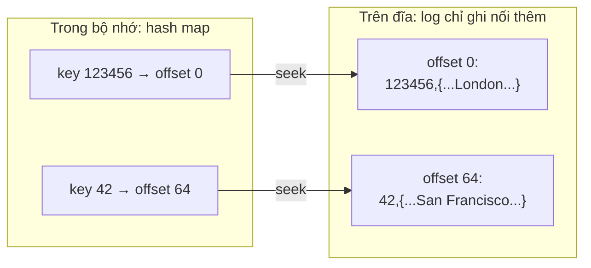

*(Vẽ lại ý của Hình 3-1, tr. 72.)*

**Ví dụ thực tế: Bitcask** (tr. 72–73). Cách làm nghe đơn giản nhưng khả thi. Đây về cơ bản là cách **Bitcask**, storage engine mặc định của **Riak**, hoạt động [3]:

- Đọc và ghi **hiệu năng cao**.
- **Điều kiện:** mọi key phải **vừa RAM**, vì hash map nằm hoàn toàn trong bộ nhớ.
- Value có thể lớn hơn bộ nhớ, vì tải được từ đĩa chỉ bằng **một lần seek**. Nếu phần file đó đã nằm trong filesystem cache thì đọc **không cần I/O đĩa**.

**Phù hợp với workload nào?** (tr. 73) Khi **value của mỗi key được cập nhật thường xuyên**. Ví dụ: key là URL của một video mèo, value là số lượt xem, tăng mỗi lần ai đó bấm play. Workload có **rất nhiều lượt ghi** nhưng **không quá nhiều key khác nhau**: nhiều lượt ghi trên mỗi key, và giữ mọi key trong bộ nhớ là khả thi.

#### B2.2 Segment, compaction và merge

**Why.** Nếu chỉ ghi nối thêm thì làm sao tránh hết dung lượng đĩa? (tr. 73)

**How** (tr. 73–74):

1. **Chia log thành segment:** khi file segment đạt một kích thước nhất định thì đóng lại, các lần ghi sau đi vào file segment mới.
2. **Compaction:** loại bỏ các key **trùng lặp** trong log, chỉ giữ **cập nhật mới nhất** của mỗi key (Hình 3-2).
3. **Merge:** compaction thường làm segment nhỏ đi nhiều (giả sử trung bình một key bị ghi đè nhiều lần trong một segment). Vì vậy có thể **gộp nhiều segment** cùng lúc với compaction (Hình 3-3).
4. Segment **không bao giờ bị sửa** sau khi ghi xong, nên segment gộp được ghi ra **file mới**.
5. Merge và compaction các segment đã "đóng băng" chạy ở **thread nền**. Trong lúc đó vẫn phục vụ đọc và ghi bình thường bằng segment cũ.
6. Merge xong thì **chuyển các lượt đọc** sang segment mới, rồi **xóa** segment cũ.

**Example — dữ liệu trong Hình 3-2 và 3-3** (đếm lượt xem các video mèo):

| | Nội dung |
| --- | --- |
| Segment 1 (trước compaction) | mew: 1078, purr: 2103, purr: 2104, mew: 1079, mew: 1080, mew: 1081, purr: 2105, purr: 2106, purr: 2107, yawn: 511, purr: 2108, mew: 1082 |
| Segment 1 sau compaction (Hình 3-2) | yawn: 511, mew: 1082, purr: 2108 |
| Segment 2 | purr: 2109, purr: 2110, mew: 1083, scratch: 252, mew: 1084, mew: 1085, purr: 2111, mew: 1086, purr: 2112, purr: 2113, mew: 1087, purr: 2114 |
| Merge segment 1 và 2 (Hình 3-3) | yawn: 511, scratch: 252, mew: 1087, purr: 2114 |

24 bản ghi thu lại còn 4. Với key xuất hiện ở cả hai segment (mew, purr), giá trị ở **segment mới hơn** (segment 2) thắng.

**Đọc dữ liệu khi có nhiều segment** (tr. 74). Mỗi segment có **hash table riêng** trong bộ nhớ. Tìm một key: kiểm tra hash map của **segment mới nhất**, không có thì sang segment mới thứ nhì, cứ thế. Quá trình merge giữ cho số segment **ít**, nên lượt đọc không phải kiểm tra nhiều hash map.

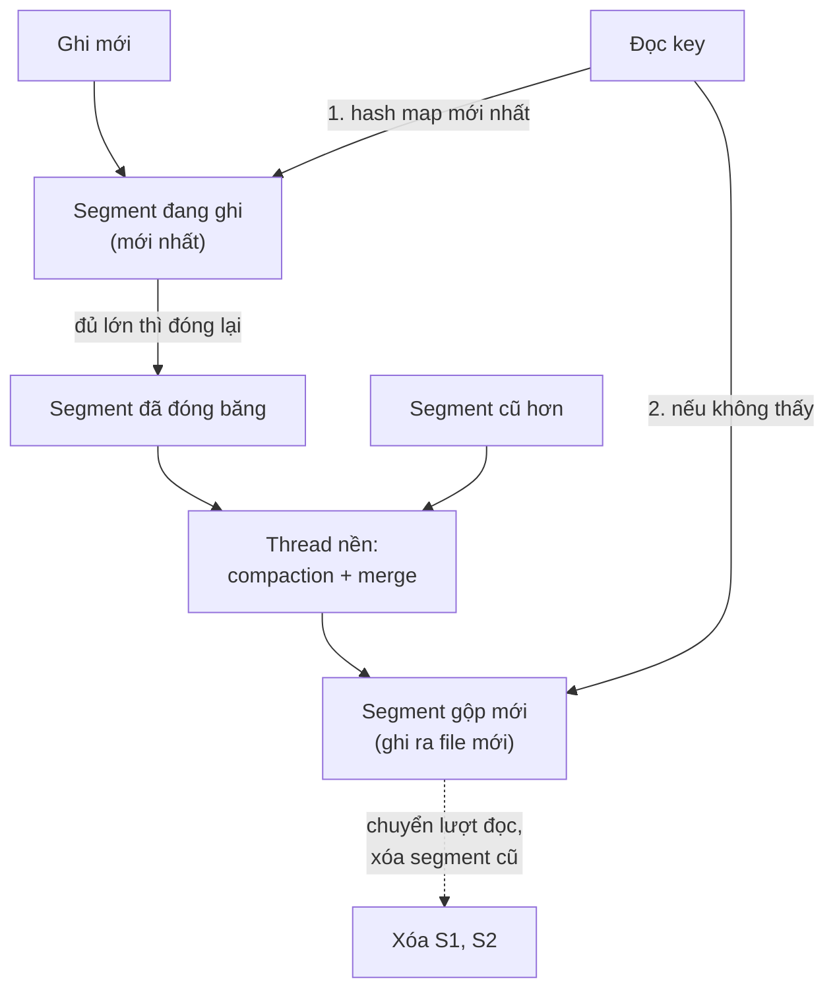

#### B2.3 Những chi tiết cần xử lý trong thực tế (tr. 74–75)

| Vấn đề | Cách giải quyết |
| --- | --- |
| **Định dạng file** | CSV không phải định dạng tốt cho log. Dùng **định dạng nhị phân**: ghi độ dài chuỗi (tính bằng byte) rồi tới chuỗi thô, khỏi phải escape. Nhanh và đơn giản hơn. |
| **Xóa bản ghi** | Nối thêm một **bản ghi xóa đặc biệt**, gọi là ***tombstone***. Khi merge, tombstone báo cho quá trình merge bỏ mọi giá trị cũ của key đã xóa. |
| **Phục hồi sau crash** | Khởi động lại thì hash map trong bộ nhớ mất. Về nguyên tắc có thể dựng lại bằng cách đọc cả segment từ đầu, nhưng với segment lớn sẽ rất lâu. Bitcask lưu **snapshot hash map** của mỗi segment xuống đĩa để tải nhanh hơn. |
| **Bản ghi ghi dở** | Database có thể crash giữa lúc đang ghi một bản ghi. File của Bitcask có **checksum** để phát hiện và bỏ qua phần hỏng. |
| **Kiểm soát đồng thời** | Ghi nối theo thứ tự nghiêm ngặt, nên cách phổ biến là chỉ có **một thread ghi**. Segment chỉ ghi nối thêm và bất biến, nên **nhiều thread đọc đồng thời** được. |

#### B2.4 Vì sao append-only lại tốt? (tr. 75)

Thoạt nhìn, chỉ ghi nối thêm có vẻ **lãng phí**: sao không ghi đè giá trị cũ tại chỗ? Nhưng thiết kế append-only hóa ra tốt vì:

1. **Ghi tuần tự nhanh hơn ghi ngẫu nhiên.** Ghi nối và merge segment đều là ghi tuần tự, thường nhanh hơn nhiều so với ghi ngẫu nhiên, nhất là trên **ổ đĩa từ**. Ở mức độ nào đó, ghi tuần tự cũng tốt hơn trên **SSD** [4]. (Bàn tiếp ở [B5](#b5).)
2. **Đồng thời và phục hồi crash đơn giản hơn nhiều** khi segment chỉ ghi nối thêm hoặc bất biến. Ví dụ: không phải lo trường hợp crash xảy ra **giữa lúc đang ghi đè** một value, để lại file chứa nửa value cũ ghép với nửa value mới.
3. **Merge segment cũ tránh được phân mảnh** file dữ liệu theo thời gian.

#### B2.5 Giới hạn của hash index (tr. 75)

1. **Hash table phải vừa bộ nhớ.** Có quá nhiều key thì hết cách. Về lý thuyết có thể giữ hash map trên đĩa, nhưng rất khó làm nó chạy tốt: cần nhiều I/O truy cập ngẫu nhiên, tốn kém khi phải mở rộng lúc đầy, và xử lý **va chạm hash** (*hash collision*) rất rườm rà [5].
2. **Range query không hiệu quả.** Ví dụ, không thể dễ dàng quét mọi key từ `kitty00000` đến `kitty99999`. Phải tra **từng key riêng lẻ** trong hash map.

Mục tiếp theo giới thiệu một cấu trúc index không có hai giới hạn này.

---

### B3. SSTables and LSM-Trees (tr. 76–79)

#### B3.1 SSTable: segment được sắp xếp theo key

**What** (tr. 76). Trong các segment ở Hình 3-3, cặp key-value nằm theo **thứ tự được ghi**, và value sau thắng value trước của cùng key. Ngoài ra thứ tự trong file không quan trọng.

Giờ thay đổi một chút định dạng segment: yêu cầu chuỗi cặp key-value **được sắp xếp theo key**. Định dạng này gọi là ***Sorted String Table***, viết tắt ***SSTable***. Ngoài ra, mỗi key chỉ xuất hiện **một lần** trong mỗi segment đã merge (compaction vốn đã đảm bảo điều này).

Thoạt nhìn, yêu cầu sắp xếp có vẻ phá vỡ khả năng **ghi tuần tự**. Cách giải quyết nằm ở [B3.2](#memtable).

**Why — ba ưu điểm lớn so với log segment có hash index** (tr. 76–77):

**Ưu điểm 1. Merge đơn giản và hiệu quả, kể cả khi file lớn hơn bộ nhớ.** Cách làm giống thuật toán **mergesort** (Hình 3-4):

- Đọc các file đầu vào **song song**, nhìn key đầu tiên của mỗi file.
- Chép key **nhỏ nhất** (theo thứ tự sắp xếp) sang file đầu ra, rồi lặp lại.
- Kết quả là một segment gộp mới, **cũng được sắp xếp theo key**.
- **Cùng key ở nhiều segment?** Mỗi segment chứa mọi value ghi vào database trong **một khoảng thời gian**. Vì vậy mọi value trong segment này đều mới hơn mọi value trong segment kia (giả sử luôn merge các segment kề nhau). Chỉ cần giữ value của **segment mới nhất** và bỏ value ở segment cũ.

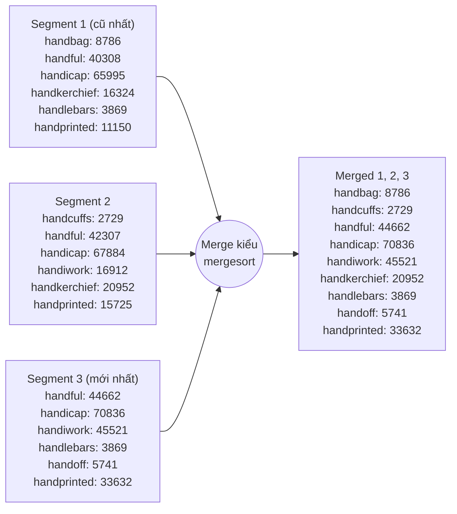

*(Vẽ lại Hình 3-4, tr. 76. Ví dụ: `handful` có ở cả ba segment, giữ giá trị 44662 của segment 3, mới nhất.)*

**Ưu điểm 2. Không cần giữ index của mọi key trong bộ nhớ** (tr. 77, Hình 3-5):

- Giả sử tìm key `handiwork` nhưng không biết offset chính xác của nó.
- Ta biết offset của `handbag` và `handsome`. Vì file đã sắp xếp, `handiwork` **phải nằm giữa** hai key đó.
- Vậy chỉ cần nhảy tới offset của `handbag` rồi **quét tới** khi gặp `handiwork` (hoặc kết luận nó không có).
- Vẫn cần index trong bộ nhớ cho **một số** key, nhưng nó có thể **thưa** (*sparse*): mỗi vài kilobyte của segment một key là đủ, vì quét vài kilobyte rất nhanh.

> Chú thích i (tr. 77): nếu mọi key và value có kích thước **cố định**, có thể tìm nhị phân trên file và bỏ hẳn index trong bộ nhớ. Nhưng thực tế chúng thường **dài ngắn khác nhau**, nên không có index thì khó biết một bản ghi kết thúc và bản ghi tiếp theo bắt đầu ở đâu.

**Ưu điểm 3. Nén theo khối** (tr. 77). Lượt đọc vốn phải quét qua nhiều cặp key-value trong khoảng được hỏi, nên có thể **gom các bản ghi thành một khối và nén** trước khi ghi xuống đĩa. Mỗi mục trong index thưa trỏ tới **đầu một khối nén**. Nén vừa **tiết kiệm dung lượng**, vừa **giảm băng thông I/O**.

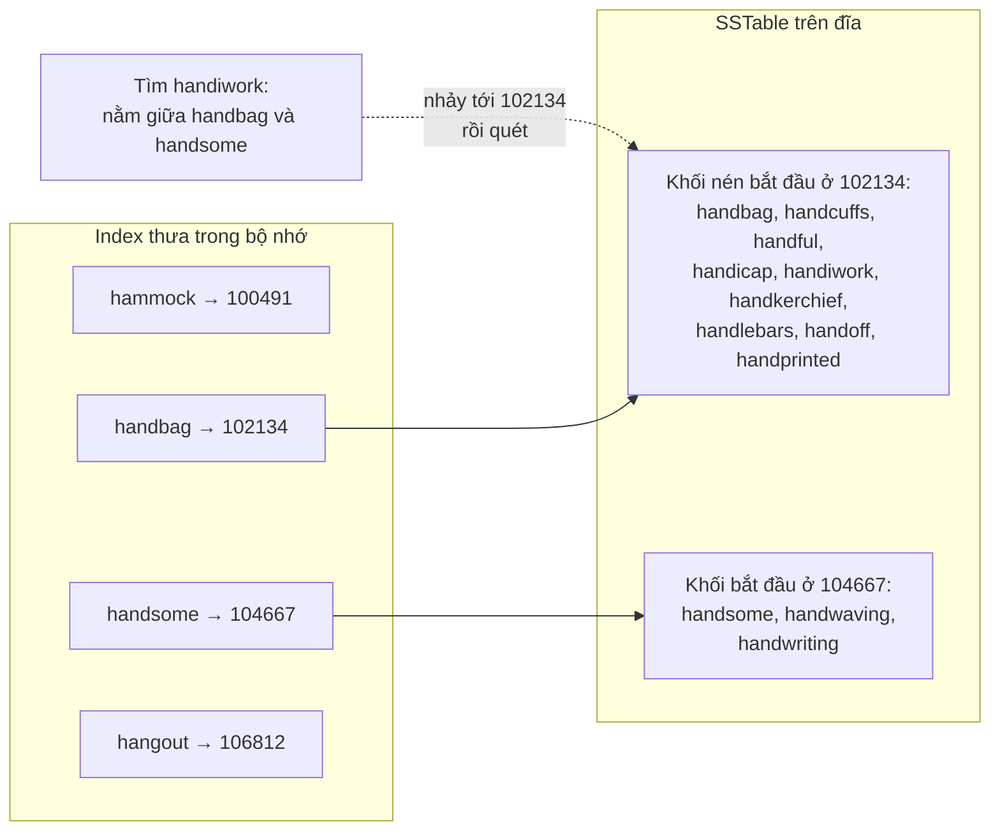

*(Vẽ lại Hình 3-5, tr. 77.)*

#### B3.2 Xây dựng và duy trì SSTable: memtable (tr. 78)

**Câu hỏi.** Lượt ghi đến theo **thứ tự bất kỳ**. Làm sao để dữ liệu được sắp xếp theo key ngay từ đầu?

- Duy trì cấu trúc sắp xếp **trên đĩa** là làm được (đó chính là B-tree, [B4](#b4)), nhưng duy trì **trong bộ nhớ** dễ hơn nhiều.
- Có nhiều cấu trúc cây quen thuộc như **red-black tree** hay **AVL tree** [2]: chèn key theo thứ tự bất kỳ, đọc ra theo thứ tự đã sắp xếp.

**How — storage engine hoạt động như sau** (tr. 78):

1. **Ghi:** thêm vào một cây cân bằng trong bộ nhớ (ví dụ red-black tree). Cây này đôi khi gọi là ***memtable***.
2. **Flush:** khi memtable lớn hơn một ngưỡng (thường **vài megabyte**), ghi nó xuống đĩa thành **file SSTable**. Việc này hiệu quả vì cây đã giữ các cặp key-value **theo thứ tự**. File SSTable mới trở thành **segment mới nhất**. Trong lúc ghi xuống đĩa, các lượt ghi mới đi vào **một memtable mới**.
3. **Đọc:** tìm trong memtable trước, rồi segment mới nhất trên đĩa, rồi segment cũ hơn, cứ thế.
4. **Nền:** thỉnh thoảng chạy merge và compaction để gộp segment, bỏ giá trị bị ghi đè hoặc đã xóa.

**Vấn đề duy nhất: crash** (tr. 78). Nếu database crash, những lượt ghi gần nhất **đang nằm trong memtable** chưa ghi xuống đĩa sẽ **mất**. Giải pháp: giữ một **log riêng trên đĩa**, mọi lượt ghi được **nối vào ngay**. Log này không sắp xếp, nhưng không sao: mục đích duy nhất của nó là **dựng lại memtable sau crash**. Mỗi khi memtable được ghi ra SSTable thì log tương ứng có thể bỏ đi.

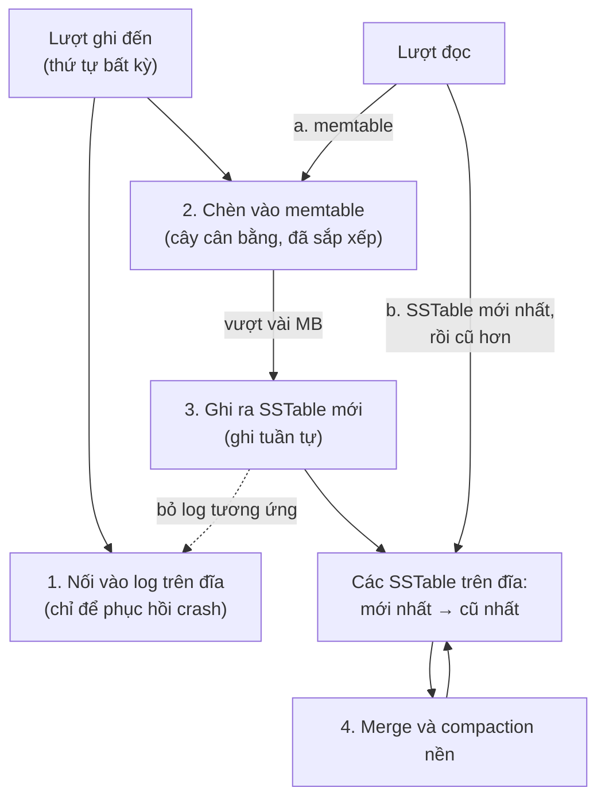

#### B3.3 Từ SSTable thành LSM-tree (tr. 78–79)

**Ai dùng thuật toán này?** (tr. 78–79)

| Hệ thống | Ghi chú |
| --- | --- |
| **LevelDB** [6], **RocksDB** [7] | Thư viện storage engine key-value, thiết kế để **nhúng** vào ứng dụng khác. LevelDB có thể dùng trong Riak thay cho Bitcask. |
| **Cassandra**, **HBase** [8] | Dùng storage engine tương tự, lấy cảm hứng từ bài báo **Bigtable** của Google [9], bài báo đặt ra hai thuật ngữ **SSTable** và **memtable**. |
| **Lucene** (dùng bởi Elasticsearch, Solr) | Dùng cách tương tự để lưu **term dictionary** [12, 13]. |

**Nguồn gốc tên gọi.** Cấu trúc index này ban đầu được Patrick O'Neil và cộng sự mô tả với tên ***Log-Structured Merge-Tree*** (***LSM-Tree***) [10], dựa trên các nghiên cứu trước về **log-structured filesystem** [11]. Storage engine dựa trên nguyên lý **merge và compact các file đã sắp xếp** thường được gọi là **LSM storage engine** (tr. 78–79).

**Full-text index cũng dựa trên ý tưởng này** (tr. 79). Full-text index phức tạp hơn key-value index nhiều, nhưng ý tưởng tương tự: cho một từ trong truy vấn tìm kiếm, tìm mọi document nhắc tới từ đó. Nó được cài bằng cấu trúc key-value:

- **key** là một từ (*term*);
- **value** là danh sách ID của mọi document chứa từ đó, gọi là ***postings list***.

Trong Lucene, ánh xạ từ term sang postings list được giữ trong các **file sắp xếp giống SSTable**, và được merge ở nền khi cần [14].

#### B3.4 Tối ưu hiệu năng (tr. 79)

**1. Bloom filter cho key không tồn tại.** LSM-tree có thể **chậm khi tìm key không có** trong database: phải kiểm tra memtable, rồi mọi segment cho đến segment cũ nhất (có thể phải đọc đĩa cho từng segment) mới chắc key không tồn tại. Vì vậy storage engine thường dùng thêm ***Bloom filter*** [15]: một cấu trúc dữ liệu **tiết kiệm bộ nhớ** để **xấp xỉ nội dung của một tập hợp**. Nó cho biết một key **không có** trong database, nên tiết kiệm nhiều lần đọc đĩa vô ích cho key không tồn tại.

> **Bổ sung ngoài sách.** Bloom filter có thể trả lời "**chắc chắn không có**" hoặc "**có thể có**". Nó không bao giờ báo sai rằng key không có (không có *false negative*), nhưng đôi khi báo "có thể có" cho key thực ra không có (*false positive*). Khi đó engine vẫn phải đọc đĩa để kiểm tra. Tỷ lệ false positive giảm khi dành nhiều bit hơn cho mỗi key.

**2. Chiến lược compaction** (tr. 79). Có nhiều chiến lược quyết định **thứ tự và thời điểm** compact và merge SSTable. Hai lựa chọn phổ biến nhất:

| Chiến lược | Cách hoạt động | Ai dùng |
| --- | --- | --- |
| **Size-tiered compaction** | SSTable **mới hơn, nhỏ hơn** lần lượt được merge vào SSTable **cũ hơn, lớn hơn** | HBase; Cassandra hỗ trợ |
| **Leveled compaction** | Khoảng key được **chia thành nhiều SSTable nhỏ**, dữ liệu cũ được chuyển xuống các **"level"** riêng. Compaction diễn ra **từng bước nhỏ hơn** và **tốn ít dung lượng đĩa hơn** | LevelDB (tên gọi từ đây), RocksDB; Cassandra hỗ trợ |

*(tr. 79, [16])*

#### B3.5 Đánh giá chung về LSM-tree (tr. 79)

Dù có nhiều chi tiết tinh tế, ý tưởng cơ bản của LSM-tree, **giữ một chuỗi SSTable được merge ở nền**, là **đơn giản và hiệu quả**:

- Vẫn chạy tốt khi dataset **lớn hơn nhiều** so với bộ nhớ.
- Dữ liệu được lưu **theo thứ tự**, nên **range query** (quét mọi key từ một giá trị nhỏ nhất đến một giá trị lớn nhất) hiệu quả.
- Ghi đĩa là **tuần tự**, nên LSM-tree hỗ trợ **throughput ghi cao đáng kể**.

---

### B4. B-Trees (tr. 79–83)

#### B4.1 Cấu trúc index phổ biến nhất

**What** (tr. 79–80):

- Index log-structured đang ngày càng được chấp nhận, nhưng **không phải loại phổ biến nhất**. Cấu trúc index **được dùng rộng rãi nhất** khác hẳn: **B-tree**.
- B-tree ra đời năm **1970** [17] và chưa đầy 10 năm sau đã được gọi là "phổ biến khắp nơi" [18]. Nó trụ vững qua thời gian: vẫn là **cài đặt index chuẩn** trong gần như mọi relational database, và nhiều database phi relational cũng dùng.
- Giống SSTable, B-tree giữ cặp key-value **sắp xếp theo key**, nên tra key và range query đều hiệu quả. Nhưng **triết lý thiết kế rất khác**.

| | Log-structured (SSTable, LSM) | B-tree |
| --- | --- | --- |
| Đơn vị chia | **Segment** kích thước thay đổi, thường vài MB trở lên | **Block** hay **page** kích thước cố định, truyền thống là **4 KB** (đôi khi lớn hơn) |
| Cách ghi | Luôn ghi **tuần tự cả segment** | Đọc hoặc ghi **từng page một** |
| Gần với phần cứng | | **Gần hơn**: đĩa cũng chia thành block kích thước cố định |

*(tr. 80)*

**How — cây các page** (tr. 80–81, Hình 3-6):

- Mỗi page có một **địa chỉ**, nên page này có thể **tham chiếu** page khác, giống con trỏ nhưng nằm trên đĩa. Dùng các tham chiếu đó để dựng **cây các page**.
- Một page được chọn làm **root**. Mọi lượt tra key đều bắt đầu từ đây.
- Mỗi page chứa **vài key** và **tham chiếu tới page con**. Mỗi page con chịu trách nhiệm cho **một khoảng key liên tục**. Các key nằm giữa các tham chiếu cho biết **ranh giới** giữa các khoảng.
- Cuối cùng tới **leaf page** (page lá) chứa từng key riêng lẻ. Nó chứa **value ngay bên trong**, hoặc chứa **tham chiếu tới page** chứa value.

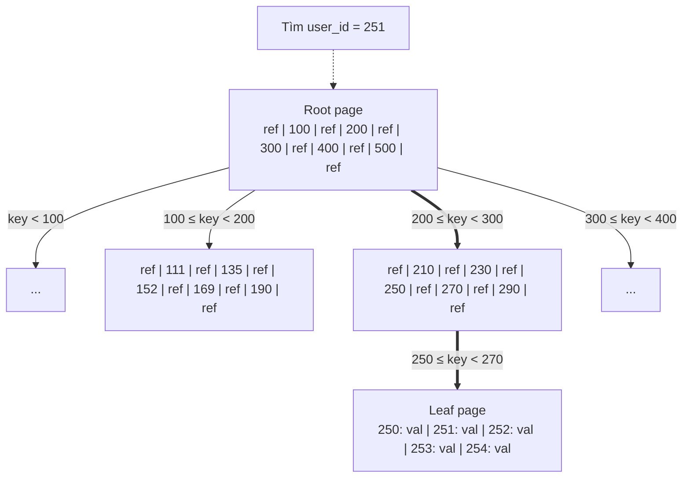

*(Vẽ lại Hình 3-6, tr. 80. Mũi tên đậm là đường đi khi tìm key 251.)*

**Branching factor** (tr. 81). Số tham chiếu tới page con trong một page gọi là ***branching factor***. Trong Hình 3-6 là 6. Thực tế, nó phụ thuộc vào dung lượng cần để lưu tham chiếu và ranh giới, nhưng **thường là vài trăm**.

#### B4.2 Cập nhật và chèn: tách page (tr. 81)

- **Cập nhật value của key có sẵn:** tìm leaf page chứa key, đổi value trong page đó, **ghi page trở lại đĩa**. Mọi tham chiếu tới page đó vẫn đúng.
- **Thêm key mới:** tìm page có khoảng bao trùm key mới và thêm vào. Nếu page **không đủ chỗ trống**, nó được **tách thành hai page đầy một nửa**, và page cha được cập nhật để phản ánh cách chia khoảng key mới (Hình 3-7).

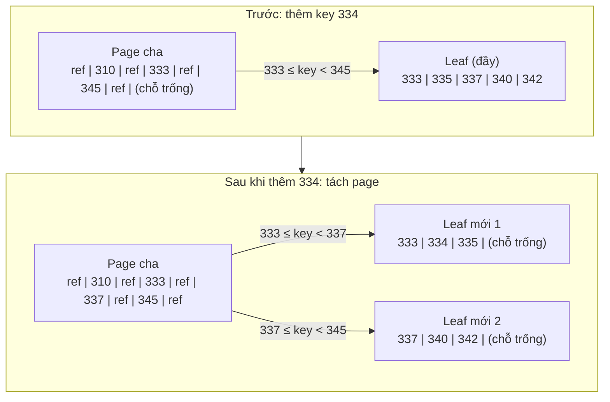

*(Vẽ lại Hình 3-7, tr. 81. Page cha nhận thêm ranh giới mới là 337.)*

> Chú thích ii (tr. 81): chèn key mới vào B-tree khá trực quan, nhưng **xóa** key (mà vẫn giữ cây cân bằng) phức tạp hơn [2].

**Cây luôn cân bằng** (tr. 81). Thuật toán đảm bảo cây **cân bằng**: B-tree có n key luôn có độ sâu **O(log n)**. Hầu hết database vừa trong một B-tree **sâu 3 hoặc 4 tầng**, nên không phải đi qua nhiều tham chiếu. Ví dụ của sách: cây **4 tầng**, page **4 KB**, branching factor **500** có thể chứa tới **256 TB**.

> **Bổ sung ngoài sách (phép tính kiểm chứng).** Số page lá tối đa: 500⁴ = 62.500.000.000. Nhân với 4.096 byte mỗi page: 62,5 tỷ × 4.096 = 256.000.000.000.000 byte = **256 TB**. Như vậy chỉ cần **4 lần đọc page** để tìm một key trong 256 TB dữ liệu, và các page ở tầng trên thường đã nằm sẵn trong bộ nhớ.

#### B4.3 Làm B-tree đáng tin cậy: write-ahead log (tr. 82)

**Why — ghi đè tại chỗ là thao tác nguy hiểm.**

- Thao tác ghi cơ bản của B-tree là **ghi đè một page trên đĩa** bằng dữ liệu mới. Giả định là ghi đè **không đổi vị trí** page, nên mọi tham chiếu tới page vẫn nguyên vẹn. Điều này **trái ngược hoàn toàn** với index log-structured như LSM-tree: chỉ ghi nối vào file (và cuối cùng xóa file lỗi thời), **không bao giờ sửa file tại chỗ** (tr. 82).
- Ghi đè page là một **thao tác phần cứng thực sự**:
  - Trên **ổ đĩa từ**: di chuyển đầu đọc tới đúng chỗ, chờ đúng vị trí trên đĩa quay tới, rồi ghi đè sector.
  - Trên **SSD**: phức tạp hơn, vì SSD phải **xóa và ghi lại những khối khá lớn** của chip nhớ cùng lúc [19].
- Một số thao tác phải **ghi đè nhiều page**. Ví dụ, tách page phải ghi hai page mới tách **và** ghi đè page cha để cập nhật tham chiếu. Nếu database **crash khi mới ghi được một phần**, index bị hỏng, ví dụ có một **page mồ côi** không là con của page nào.

**How — WAL.** Để chịu được crash, cài đặt B-tree thường có thêm một cấu trúc trên đĩa: ***write-ahead log*** (**WAL**, còn gọi là ***redo log***). Đây là file **chỉ ghi nối thêm**. **Mọi thay đổi** trên B-tree phải được ghi vào WAL **trước khi** áp dụng lên các page của cây. Khi database khởi động lại sau crash, log này được dùng để đưa B-tree về **trạng thái nhất quán** [5, 20] (tr. 82).

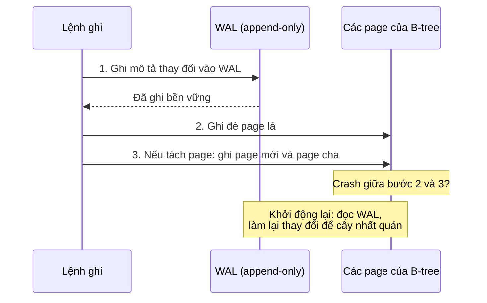

**Kiểm soát đồng thời** (tr. 82). Cập nhật page tại chỗ còn đòi hỏi kiểm soát đồng thời cẩn thận khi nhiều thread truy cập B-tree cùng lúc. Nếu không, một thread có thể thấy cây ở **trạng thái không nhất quán**. Cách thường dùng là bảo vệ cấu trúc dữ liệu của cây bằng ***latch*** (khóa nhẹ). Cách log-structured **đơn giản hơn** ở điểm này: mọi việc merge diễn ra ở nền, không ảnh hưởng truy vấn đang đến, và thỉnh thoảng **hoán đổi nguyên tử** segment cũ bằng segment mới.

#### B4.4 Các tối ưu của B-tree (tr. 82–83)

B-tree đã tồn tại rất lâu nên có nhiều tối ưu. Một vài ví dụ:

| Tối ưu | Ý tưởng | Lợi ích |
| --- | --- | --- |
| **Copy-on-write** (ví dụ LMDB [21]) | Thay vì ghi đè page và duy trì WAL: ghi page đã sửa vào **vị trí khác**, tạo phiên bản mới của các page cha trỏ tới vị trí mới | Phục hồi crash không cần WAL; còn hữu ích cho **kiểm soát đồng thời** (xem "Snapshot Isolation and Repeatable Read", tr. 237, Chương 7) |
| **Viết tắt key** | Không lưu cả key, đặc biệt ở các page bên trong cây: key chỉ cần đủ thông tin làm ranh giới giữa các khoảng | Nhét nhiều key hơn vào một page, nên **branching factor cao hơn** và **ít tầng hơn** |
| **Sắp page lá liên tiếp trên đĩa** | Page có thể nằm bất kỳ đâu trên đĩa. Truy vấn quét một khoảng key lớn theo thứ tự có thể phải **seek cho mỗi page**. Nhiều cài đặt cố gắng đặt page lá theo thứ tự tuần tự | Quét khoảng nhanh hơn. **Nhưng** khó duy trì khi cây lớn dần. LSM-tree ghi lại cả segment lớn khi merge nên **dễ giữ key liên tiếp gần nhau** hơn |
| **Thêm con trỏ anh em** | Mỗi page lá trỏ tới page anh em bên trái và bên phải | Quét key theo thứ tự **không cần quay lại page cha** |
| **Fractal tree** [22] | Biến thể B-tree mượn ý tưởng log-structured | **Giảm seek đĩa** (không liên quan gì đến fractal) |

> Chú thích iii (tr. 83): biến thể viết tắt key đôi khi được gọi là **B+ tree**, dù tối ưu này phổ biến đến mức thường không được phân biệt với các biến thể B-tree khác.

---

### B5. Comparing B-Trees and LSM-Trees (tr. 83–85)

**Quy tắc kinh nghiệm** (tr. 83):

- Cài đặt B-tree thường **trưởng thành hơn**, nhưng LSM-tree đáng chú ý vì đặc tính hiệu năng.
- **LSM-tree thường nhanh hơn khi ghi**, còn **B-tree được cho là nhanh hơn khi đọc** [23].
- LSM đọc chậm hơn vì phải **kiểm tra nhiều cấu trúc dữ liệu** và nhiều SSTable ở các giai đoạn compaction khác nhau.

**Nhưng** benchmark thường **không có kết luận rõ ràng** và **nhạy với chi tiết workload**. Phải **thử với chính workload của bạn** mới so sánh được (tr. 83).

#### B5.1 Ưu điểm của LSM-tree (tr. 84)

**1. Write amplification thấp hơn (đôi khi).**

- B-tree phải ghi mỗi dữ liệu **ít nhất hai lần**: một lần vào WAL, một lần vào page của cây (và có thể thêm lần nữa khi tách page).
- Còn có chi phí phải **ghi cả page** dù chỉ vài byte trong page thay đổi.
- Một số storage engine còn **ghi đè cùng một page hai lần** để tránh page bị cập nhật dở khi mất điện [24, 25].
- Index log-structured **cũng ghi lại dữ liệu nhiều lần** do compaction và merge SSTable lặp đi lặp lại.
- Hiệu ứng **một lần ghi vào database dẫn tới nhiều lần ghi xuống đĩa** trong suốt vòng đời database gọi là ***write amplification***. Nó đặc biệt đáng lo trên **SSD**, vì SSD chỉ ghi đè một block được **số lần giới hạn** trước khi mòn.
- Với ứng dụng **ghi nhiều**, nút thắt có thể là **tốc độ ghi đĩa**. Khi đó write amplification có **chi phí hiệu năng trực tiếp**: storage engine ghi xuống đĩa càng nhiều thì càng xử lý được ít lượt ghi mỗi giây trong băng thông đĩa sẵn có.

**2. Throughput ghi cao hơn.** LSM-tree thường duy trì được **throughput ghi cao hơn** B-tree, một phần vì đôi khi write amplification thấp hơn (tùy cấu hình và workload), một phần vì nó **ghi tuần tự** các file SSTable gọn thay vì ghi đè nhiều page trong cây [26]. Khác biệt này đặc biệt quan trọng trên **ổ đĩa từ**, nơi ghi tuần tự nhanh hơn nhiều so với ghi ngẫu nhiên.

**3. Nén tốt hơn, file nhỏ hơn.** B-tree để lại dung lượng không dùng do **phân mảnh**: khi tách page, hoặc khi một hàng không vừa page có sẵn, một phần page bị bỏ trống. LSM-tree không theo page và **định kỳ ghi lại SSTable** để loại phân mảnh, nên chi phí lưu trữ thấp hơn, nhất là với **leveled compaction** [27].

**4. Trên SSD.** Firmware của nhiều SSD bên trong đã dùng **thuật toán log-structured** để biến ghi ngẫu nhiên thành ghi tuần tự trên chip nhớ, nên ảnh hưởng của mẫu ghi của storage engine ít rõ rệt hơn [19]. Dù vậy, write amplification thấp và ít phân mảnh **vẫn có lợi** trên SSD: dữ liệu gọn hơn thì phục vụ được nhiều lượt đọc và ghi hơn trong băng thông I/O sẵn có.

> **Ví dụ minh họa do AI xây dựng (write amplification).** Ứng dụng ghi 100 MB dữ liệu mới mỗi giây. Storage engine ghi dữ liệu đó một lần vào log, một lần khi flush memtable, rồi qua compaction mỗi byte trung bình bị ghi lại thêm 3 lần. Hệ số write amplification là 5, nên đĩa phải ghi **500 MB/s**. Nếu đĩa chỉ chịu được 400 MB/s, hệ thống sẽ không theo kịp, dù dữ liệu "thật" chỉ có 100 MB/s.

#### B5.2 Nhược điểm của LSM-tree (tr. 84–85)

**1. Compaction ảnh hưởng tới truy vấn đang chạy.**

- Storage engine cố gắng compact từng bước và không ảnh hưởng truy cập đồng thời. Nhưng **tài nguyên đĩa có hạn**, nên một request dễ phải **chờ** đĩa xong một lần compaction tốn kém.
- Ảnh hưởng tới throughput và response time **trung bình** thường nhỏ. Nhưng ở **percentile cao** (xem chương 1), response time của storage engine log-structured đôi khi **khá cao**, còn B-tree **dễ dự đoán hơn** [28].

**2. Compaction có thể không theo kịp lượt ghi.**

- Băng thông ghi đĩa có hạn phải **chia** giữa lần ghi ban đầu (ghi log và flush memtable) và các thread compaction chạy nền.
- Database trống: toàn bộ băng thông dùng cho ghi ban đầu. Database **càng lớn** thì compaction **càng cần nhiều băng thông**.
- Nếu throughput ghi cao và compaction không được cấu hình cẩn thận, compaction có thể **không theo kịp** tốc độ ghi đến. Khi đó số segment chưa merge **tăng mãi** cho đến khi **hết đĩa**, và đọc cũng chậm đi vì phải kiểm tra nhiều segment hơn.
- Storage engine dựa trên SSTable thường **không tự giảm tốc** lượt ghi đến khi compaction không theo kịp. Vì vậy cần **giám sát tường minh** để phát hiện tình huống này [29, 30].

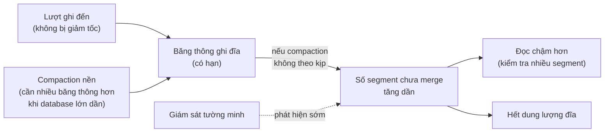

**3. Mỗi key có thể nằm ở nhiều nơi** (tr. 85). Trong B-tree, mỗi key tồn tại **đúng một chỗ** trong index. Storage engine log-structured có thể có **nhiều bản sao** của cùng key ở các segment khác nhau. Điều này làm B-tree hấp dẫn với database muốn có **ngữ nghĩa giao dịch mạnh**: trong nhiều relational database, **transaction isolation** được cài bằng **khóa trên các khoảng key**, và trong B-tree các khóa đó có thể **gắn trực tiếp vào cây** [5]. Chương 7 sẽ bàn chi tiết.

#### B5.3 Kết luận của tác giả (tr. 85)

- B-tree **ăn sâu vào kiến trúc database** và cho **hiệu năng tốt ổn định** với nhiều workload, nên khó biến mất sớm.
- Trong các datastore mới, index log-structured **ngày càng phổ biến**.
- **Không có quy tắc nhanh** để biết loại storage engine nào tốt hơn cho use case của bạn. Hãy **thử nghiệm thực tế**.

So sánh tổng hợp: xem [D1](#d1) và [D2](#d2).

---

### B6. Other Indexing Structures (tr. 85–90)

#### B6.1 Primary index và secondary index (tr. 85–86)

**Primary key index.** Các index ở trên đều là key-value index, giống **primary key index** trong relational model. Primary key **định danh duy nhất** một hàng trong bảng relational, một document trong document database, hay một vertex trong graph database. Các bản ghi khác tham chiếu tới nó bằng primary key (hay ID), và index được dùng để **giải các tham chiếu đó** (tr. 85).

**Secondary index** (tr. 85–86):

- Rất phổ biến. Trong relational database, có thể tạo **nhiều secondary index** trên cùng một bảng bằng lệnh `CREATE INDEX`.
- Chúng thường **thiết yếu để join hiệu quả**. Ví dụ, ở Hình 2-1 (chương 2), gần như chắc chắn cần secondary index trên các cột `user_id` để tìm mọi hàng thuộc cùng người dùng trong từng bảng.
- Secondary index dễ dựng từ key-value index. Khác biệt chính: **key không duy nhất**, có thể nhiều hàng (document, vertex) cùng key. Hai cách giải quyết:
  1. Mỗi value trong index là **danh sách định danh các hàng khớp**, giống postings list trong full-text index.
  2. Làm mỗi key **duy nhất** bằng cách **nối thêm định danh hàng** vào key.
- Cả B-tree lẫn index log-structured đều dùng được làm secondary index.

Glossary của sách định nghĩa secondary index là cấu trúc phụ được duy trì **bên cạnh** nơi lưu dữ liệu chính, giúp tìm hiệu quả các bản ghi khớp một loại điều kiện nào đó (tr. 557).

#### B6.2 Lưu value bên trong index: heap file, clustered, covering (tr. 86–87)

**What.** Key của index là thứ truy vấn tìm kiếm. **Value** có thể là một trong hai (tr. 86):

- **chính hàng dữ liệu** (document, vertex) đó; hoặc
- **tham chiếu** tới hàng được lưu ở chỗ khác. Nơi lưu hàng khi đó gọi là ***heap file***. Heap file lưu dữ liệu **không theo thứ tự nào**: có thể chỉ ghi nối thêm, hoặc theo dõi hàng đã xóa để ghi đè dữ liệu mới vào sau.

**Why heap file phổ biến** (tr. 86). Nó **tránh nhân bản dữ liệu** khi có nhiều secondary index: mỗi index chỉ tham chiếu một vị trí trong heap file, dữ liệu thật nằm **một chỗ**.

**Cập nhật với heap file** (tr. 86):

- Cập nhật value **không đổi key**: khá hiệu quả, có thể ghi đè tại chỗ nếu value mới **không lớn hơn** value cũ.
- Value mới **lớn hơn**: phức tạp hơn, vì có lẽ phải chuyển sang vị trí mới trong heap đủ chỗ. Khi đó hoặc **mọi index** phải cập nhật trỏ tới vị trí mới, hoặc để lại một ***forwarding pointer*** ở vị trí cũ [5].

**Clustered index** (tr. 86). Đôi khi bước nhảy thêm từ index sang heap file là **cái giá quá đắt** cho lượt đọc. Khi đó nên lưu **hàng được index ngay trong index**. Cách này gọi là ***clustered index***.

- Trong storage engine **InnoDB** của MySQL, primary key của bảng **luôn là clustered index**, và secondary index tham chiếu tới **primary key** (không phải vị trí trong heap file) [31].
- Trong **SQL Server**, mỗi bảng có thể chỉ định **một** clustered index [32].

**Covering index** (tr. 86). Một sự thỏa hiệp giữa clustered index (lưu mọi dữ liệu hàng trong index) và nonclustered index (chỉ lưu tham chiếu) là ***covering index***, hay ***index with included columns***: lưu **một số cột** của bảng bên trong index [33]. Nhờ vậy một số truy vấn được trả lời **chỉ bằng index**; khi đó ta nói index **"phủ"** (*covers*) truy vấn [32].

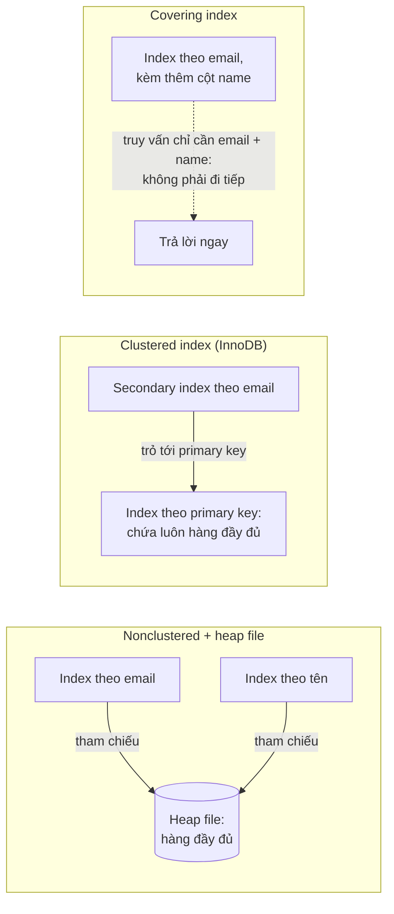

**Trade-offs** (tr. 87). Như mọi dạng **nhân bản dữ liệu**, clustered index và covering index có thể **tăng tốc đọc**, nhưng cần **thêm dung lượng** và có thể **tăng chi phí ghi**. Database cũng phải bỏ thêm công sức để **đảm bảo ngữ nghĩa giao dịch**, vì ứng dụng không được thấy dữ liệu không nhất quán do sự nhân bản.

#### B6.3 Multi-column indexes (tr. 87–88)

Các index ở trên chỉ ánh xạ **một key** tới một value. Như vậy không đủ khi cần truy vấn **nhiều cột** (hay nhiều trường trong document) **cùng lúc** (tr. 87).

**1. Concatenated index** (tr. 87). Loại index nhiều cột phổ biến nhất: **ghép nhiều trường thành một key** bằng cách nối cột này vào sau cột kia. Định nghĩa index chỉ rõ **thứ tự** ghép.

- Giống **danh bạ điện thoại giấy**: index từ (họ, tên) tới số điện thoại.
- Nhờ thứ tự sắp xếp, index dùng được để tìm mọi người **có một họ cụ thể**, hoặc **một tổ hợp họ-tên cụ thể**.
- Nhưng index **vô dụng** khi muốn tìm mọi người **có một tên cụ thể**.

**2. Multi-dimensional index** (tr. 87–88). Cách tổng quát hơn để truy vấn nhiều cột cùng lúc, đặc biệt quan trọng với **dữ liệu không gian địa lý**.

- **Ví dụ của sách:** trang tìm nhà hàng có database lưu vĩ độ và kinh độ mỗi nhà hàng. Khi người dùng xem bản đồ, trang phải tìm mọi nhà hàng **trong khung chữ nhật** đang hiển thị. Đó là một **range query hai chiều**: vĩ độ trong một khoảng **và** kinh độ trong một khoảng.
- B-tree hay LSM-tree tiêu chuẩn **không trả lời hiệu quả** được: nó cho mọi nhà hàng trong một khoảng vĩ độ (ở **bất kỳ** kinh độ nào), hoặc trong một khoảng kinh độ (ở bất kỳ đâu giữa Bắc Cực và Nam Cực), **nhưng không cả hai cùng lúc**.
- **Giải pháp:**
  - Chuyển vị trí hai chiều thành **một con số** bằng ***space-filling curve***, rồi dùng B-tree thường [34].
  - Phổ biến hơn: dùng **spatial index chuyên dụng** như ***R-tree***. Ví dụ, **PostGIS** cài geospatial index bằng R-tree qua cơ chế Generalized Search Tree của PostgreSQL [35].

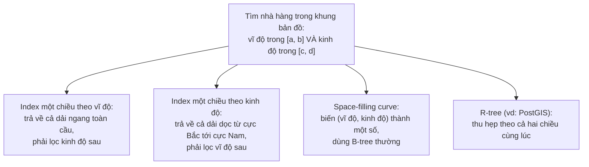

**Không chỉ cho địa lý** (tr. 87–88):

- Trang thương mại điện tử: index ba chiều theo (đỏ, xanh lá, xanh dương) để tìm sản phẩm trong một **khoảng màu**.
- Database quan sát thời tiết: index hai chiều theo (ngày, nhiệt độ) để tìm mọi quan sát **năm 2013** có nhiệt độ **25–30℃**. Với index một chiều, phải quét mọi bản ghi năm 2013 rồi lọc nhiệt độ, hoặc ngược lại. Index 2D thu hẹp theo **cả thời gian lẫn nhiệt độ** cùng lúc. **HyperDex** dùng kỹ thuật này [36].

> **Bổ sung ngoài sách.** Hai space-filling curve hay gặp là **Z-order curve** (Morton code, xen kẽ bit của các tọa độ) và **Hilbert curve**. Ý tưởng chung: các điểm gần nhau trong không gian nhiều chiều thường có số gần nhau trên đường cong. Vì vậy một range query 2D có thể biến thành vài range query 1D trên B-tree.

#### B6.4 Full-text search và fuzzy index (tr. 88)

**Why.** Mọi index ở trên đều giả định dữ liệu **chính xác**: truy vấn giá trị chính xác của key, hoặc một khoảng giá trị theo thứ tự. Chúng **không** cho phép tìm **key tương tự**, ví dụ từ viết sai chính tả. **Truy vấn mờ** (*fuzzy querying*) đòi hỏi kỹ thuật khác (tr. 88).

**What — full-text search engine thường hỗ trợ** (tr. 88):

- mở rộng một từ thành các **từ đồng nghĩa**;
- bỏ qua **biến thể ngữ pháp** của từ;
- tìm các từ **xuất hiện gần nhau** trong cùng document;
- nhiều tính năng khác dựa trên **phân tích ngôn ngữ**.

Để xử lý lỗi gõ, **Lucene** tìm được các từ trong một **edit distance** nhất định. Edit distance bằng 1 nghĩa là **một chữ cái** được thêm, bớt hoặc thay [37].

**How — automaton thay cho index thưa** (tr. 88):

- Như đã nói ở [B3.3](#lsm), Lucene dùng cấu trúc giống SSTable cho term dictionary, cần một index nhỏ trong bộ nhớ chỉ offset để tìm key.
- Trong **LevelDB**, index trong bộ nhớ là **tập thưa một số key**.
- Trong **Lucene**, index trong bộ nhớ là một **finite state automaton** trên các ký tự của key, giống một **trie** [38]. Automaton này có thể biến đổi thành **Levenshtein automaton**, hỗ trợ tìm hiệu quả các từ trong một edit distance cho trước [39].

Các kỹ thuật tìm kiếm mờ khác đi theo hướng **phân loại document** và **machine learning**. Muốn tìm hiểu thêm, xem sách giáo khoa về information retrieval [40].

#### B6.5 Keeping everything in memory (tr. 88–90)

**1. Why — các cấu trúc trên đều là câu trả lời cho giới hạn của đĩa** (tr. 88).

- So với bộ nhớ chính, đĩa **khó làm việc**: với cả ổ đĩa từ lẫn SSD, phải sắp xếp dữ liệu cẩn thận mới đọc ghi nhanh.
- Ta chấp nhận sự khó khăn đó vì đĩa có hai ưu điểm lớn: **bền** (mất điện không mất dữ liệu) và **rẻ hơn RAM tính theo GB**.
- RAM ngày càng rẻ, nên lý lẽ chi phí yếu dần. Nhiều dataset **không lớn đến thế**, nên giữ toàn bộ trong bộ nhớ là khả thi, có thể phân tán trên nhiều máy. Từ đó xuất hiện **in-memory database** (tr. 88–89).

**2. What — hai loại in-memory store** (tr. 89):

| Loại | Đặc điểm | Ví dụ |
| --- | --- | --- |
| **Chỉ để cache** | Chấp nhận mất dữ liệu khi máy khởi động lại | Memcached |
| **Hướng tới độ bền** | Bền nhờ: phần cứng đặc biệt (RAM có pin), **ghi log thay đổi** xuống đĩa, **snapshot định kỳ** xuống đĩa, hoặc **nhân bản** trạng thái sang máy khác | VoltDB, MemSQL, Oracle TimesTen (mô hình relational); RAMCloud (key-value mã nguồn mở, log-structured cả trong bộ nhớ lẫn trên đĩa) [41–43]; Redis, Couchbase (bền yếu: ghi đĩa bất đồng bộ) |

**3. How** (tr. 89):

- Khi khởi động lại, in-memory database phải **tải lại trạng thái**: từ đĩa, hoặc qua mạng từ một replica (trừ khi có phần cứng đặc biệt).
- Dù có ghi đĩa, nó **vẫn là in-memory database**: đĩa chỉ là **log chỉ ghi nối thêm** để đảm bảo độ bền, còn **mọi lượt đọc phục vụ hoàn toàn từ bộ nhớ**.
- Ghi đĩa còn có **lợi ích vận hành**: file trên đĩa dễ backup, kiểm tra, và phân tích bằng công cụ bên ngoài.

**4. Ngược với trực giác: in-memory nhanh không phải vì khỏi đọc đĩa** (tr. 89).

- Ngay cả storage engine dựa trên đĩa cũng có thể **không bao giờ phải đọc đĩa** nếu đủ bộ nhớ, vì hệ điều hành vốn **cache các block đĩa** dùng gần đây trong bộ nhớ.
- In-memory database nhanh hơn vì tránh được **chi phí mã hóa** cấu trúc dữ liệu trong bộ nhớ thành dạng ghi được xuống đĩa [44].

**5. Mô hình dữ liệu khó làm trên đĩa** (tr. 89). Ví dụ, **Redis** cung cấp giao diện giống database cho nhiều cấu trúc dữ liệu như **priority queue** và **set**. Vì giữ mọi dữ liệu trong bộ nhớ, cài đặt của nó **khá đơn giản**.

**6. Anti-caching: vượt quá bộ nhớ** (tr. 89–90). Nghiên cứu gần đây cho thấy kiến trúc in-memory có thể mở rộng để hỗ trợ dataset **lớn hơn bộ nhớ** mà không mang lại chi phí của kiến trúc lấy đĩa làm trung tâm [45]. Cách ***anti-caching***:

- Khi thiếu bộ nhớ, **đẩy dữ liệu ít dùng gần đây nhất** xuống đĩa; khi được truy cập lại thì tải lên bộ nhớ.
- Giống cách hệ điều hành làm với virtual memory và swap file, nhưng database quản lý hiệu quả hơn vì làm ở mức **từng bản ghi** thay vì cả page bộ nhớ.
- Cách này vẫn đòi hỏi **index phải vừa hoàn toàn bộ nhớ**, giống Bitcask ở đầu chương.

**7. Tương lai** (tr. 90). Thiết kế storage engine có lẽ còn phải thay đổi nếu công nghệ **bộ nhớ không mất dữ liệu khi mất điện** (*non-volatile memory*, NVM) được dùng rộng rãi [46]. Hiện đây là lĩnh vực nghiên cứu mới, đáng theo dõi.

---

### B7. Transaction Processing or Analytics? (tr. 90–95)

#### B7.1 OLTP và OLAP (tr. 90–91)

**Nguồn gốc chữ "transaction"** (tr. 90). Thời đầu của xử lý dữ liệu doanh nghiệp, một lần ghi vào database thường ứng với **một giao dịch thương mại**: bán hàng, đặt hàng nhà cung cấp, trả lương. Khi database mở rộng sang những lĩnh vực không liên quan tiền bạc, chữ ***transaction*** vẫn được giữ, chỉ **một nhóm thao tác đọc và ghi tạo thành một đơn vị logic**.

> **Lưu ý của sách** (tr. 90). Transaction **không nhất thiết** có tính chất ACID (atomicity, consistency, isolation, durability). *Transaction processing* chỉ có nghĩa là cho phép client **đọc và ghi với độ trễ thấp**, đối lập với **batch processing** chỉ chạy định kỳ (ví dụ mỗi ngày một lần). ACID ở Chương 7, batch processing ở Chương 10.

**OLTP** (tr. 90). Database được dùng cho đủ loại dữ liệu (bình luận blog, hành động trong game, danh bạ), nhưng **mẫu truy cập cơ bản** vẫn giống xử lý giao dịch kinh doanh:

- ứng dụng **tìm một số ít bản ghi theo key**, dùng index;
- bản ghi được **chèn hoặc cập nhật** theo input của người dùng.

Vì các ứng dụng này mang tính **tương tác**, mẫu truy cập này được gọi là ***online transaction processing*** (**OLTP**). Glossary định nghĩa OLTP là mẫu truy cập đặc trưng bởi truy vấn nhanh đọc hoặc ghi **một số ít bản ghi**, thường được index theo key (tr. 556).

**Analytics** (tr. 90). Database ngày càng được dùng cho **phân tích dữ liệu**, với mẫu truy cập **rất khác**:

- truy vấn phải **quét một số lượng khổng lồ bản ghi**;
- chỉ đọc **vài cột** mỗi bản ghi;
- tính **thống kê tổng hợp** (count, sum, average) thay vì trả dữ liệu thô.

Ví dụ với bảng giao dịch bán hàng (tr. 90):

- Tổng doanh thu của từng cửa hàng trong tháng Một là bao nhiêu?
- Trong đợt khuyến mãi gần nhất bán được nhiều chuối hơn bình thường bao nhiêu?
- Nhãn hiệu thức ăn trẻ em nào hay được mua cùng tã nhãn hiệu X nhất?

Các truy vấn này thường do **business analyst** viết, phục vụ báo cáo giúp ban lãnh đạo ra quyết định tốt hơn (***business intelligence***). Để phân biệt với transaction processing, mẫu dùng database này được gọi là ***online analytic processing*** (**OLAP**) [47] (tr. 91).

> Chú thích iv (tr. 91): nghĩa của chữ "online" trong OLAP **không rõ ràng**. Có lẽ nó ám chỉ việc truy vấn không chỉ cho báo cáo định sẵn, mà analyst dùng hệ thống OLAP **tương tác** để khám phá dữ liệu.

**Bảng 3-1 — So sánh đặc điểm** (tr. 91):

| Đặc điểm | Hệ thống xử lý giao dịch (OLTP) | Hệ thống phân tích (OLAP) |
| --- | --- | --- |
| **Mẫu đọc chính** | Số ít bản ghi mỗi truy vấn, lấy theo key | Tổng hợp trên số lượng lớn bản ghi |
| **Mẫu ghi chính** | Ghi truy cập ngẫu nhiên, độ trễ thấp, từ input người dùng | Nhập hàng loạt (ETL) hoặc luồng sự kiện |
| **Chủ yếu dùng bởi** | Người dùng cuối hoặc khách hàng, qua ứng dụng web | Analyst nội bộ, để hỗ trợ ra quyết định |
| **Dữ liệu biểu diễn gì** | Trạng thái **mới nhất** của dữ liệu (thời điểm hiện tại) | **Lịch sử** các sự kiện đã xảy ra theo thời gian |
| **Kích thước dataset** | Gigabyte đến terabyte | Terabyte đến petabyte |

Ranh giới giữa OLTP và OLAP **không phải lúc nào cũng rạch ròi** (tr. 91).

**Từ một database đến hai** (tr. 91). Lúc đầu, **cùng một database** được dùng cho cả giao dịch lẫn phân tích. SQL hóa ra khá linh hoạt: chạy tốt cả truy vấn kiểu OLTP lẫn OLAP. Dù vậy, cuối thập niên 1980 đến đầu 1990, các công ty có xu hướng **ngừng dùng hệ thống OLTP để phân tích**, và chạy phân tích trên **một database riêng**. Database riêng đó gọi là ***data warehouse***.

#### B7.2 Data Warehousing (tr. 91–93)

**Why — vì sao cần database riêng cho phân tích?** (tr. 91)

- Một doanh nghiệp có thể có **hàng chục hệ thống OLTP**: website cho khách hàng, máy thanh toán ở cửa hàng, quản lý kho, lập lộ trình xe, quản lý nhà cung cấp, quản lý nhân sự… Mỗi hệ thống phức tạp, có đội riêng bảo trì, nên chúng **hoạt động gần như độc lập**.
- Hệ thống OLTP thường được kỳ vọng **sẵn sàng cao** và xử lý giao dịch với **độ trễ thấp**, vì chúng thường **thiết yếu** cho hoạt động kinh doanh.
- Vì vậy quản trị viên database **canh giữ** database OLTP rất kỹ. Họ thường **không muốn** cho analyst chạy **truy vấn phân tích tùy ý** trên đó: các truy vấn ấy thường tốn kém, quét phần lớn dataset, và có thể **làm hại hiệu năng** của các giao dịch đang chạy đồng thời.

**What** (tr. 92). **Data warehouse** là một database **riêng biệt** mà analyst truy vấn thoải mái **mà không ảnh hưởng** hoạt động OLTP [48]. Nó chứa **bản sao chỉ đọc** của dữ liệu từ mọi hệ thống OLTP trong công ty. Glossary: database trong đó dữ liệu từ nhiều hệ thống OLTP được **kết hợp và chuẩn bị** cho mục đích phân tích (tr. 554).

**How — ETL** (tr. 92, Hình 3-8). Dữ liệu được:

1. **Extract**: trích xuất từ database OLTP, bằng bản dump định kỳ hoặc luồng cập nhật liên tục;
2. **Transform**: biến đổi sang **schema thân thiện với phân tích**, làm sạch;
3. **Load**: nạp vào data warehouse.

Quá trình này gọi là ***Extract–Transform–Load*** (**ETL**).

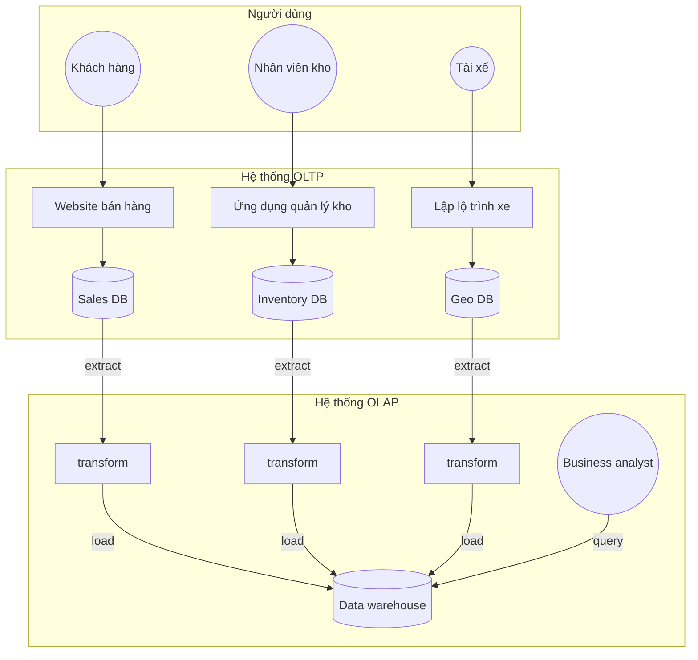

*(Vẽ lại Hình 3-8, tr. 92.)*

**Ai có data warehouse?** (tr. 92) Gần như mọi doanh nghiệp lớn, nhưng công ty nhỏ **hầu như không có**. Có lẽ vì công ty nhỏ không có nhiều hệ thống OLTP khác nhau, và dữ liệu đủ nhỏ để truy vấn bằng SQL database thông thường, thậm chí bằng **bảng tính**. Ở công ty lớn, việc gì đơn giản ở công ty nhỏ cũng cần nhiều công sức.

**Lợi ích lớn** (tr. 92–93). Data warehouse riêng có thể được **tối ưu cho mẫu truy cập phân tích**. Các thuật toán index ở nửa đầu chương **tốt cho OLTP** nhưng **không giỏi** trả lời truy vấn phân tích. Phần còn lại của chương xét các storage engine tối ưu cho analytics.

#### B7.3 Database OLTP và data warehouse ngày càng tách biệt (tr. 93)

- Mô hình dữ liệu của data warehouse **thường là relational**, vì SQL nhìn chung hợp với truy vấn phân tích. Có nhiều công cụ phân tích đồ họa sinh truy vấn SQL, hiển thị kết quả, và cho analyst khám phá dữ liệu bằng các thao tác như ***drill-down*** và ***slicing and dicing***.
- **Bề ngoài** data warehouse và database OLTP relational trông giống nhau vì cùng có giao diện SQL. Nhưng **bên trong** rất khác, vì được tối ưu cho mẫu truy vấn rất khác nhau.
- Nhiều nhà cung cấp database giờ tập trung hỗ trợ **hoặc** transaction processing **hoặc** analytics, không cả hai.
- Một số sản phẩm như **Microsoft SQL Server** và **SAP HANA** hỗ trợ cả hai, nhưng ngày càng trở thành **hai storage engine và query engine riêng**, chỉ tình cờ truy cập qua cùng một giao diện SQL [49, 50, 51].

**Nhà cung cấp** (tr. 93):

| Loại | Ví dụ |
| --- | --- |
| **Thương mại** (giấy phép đắt) | Teradata, Vertica, SAP HANA, ParAccel. **Amazon RedShift** là phiên bản ParAccel được host sẵn. |
| **SQL-on-Hadoop mã nguồn mở** (còn non trẻ, nhắm cạnh tranh với hệ thương mại) | Apache Hive, Spark SQL, Cloudera Impala, Facebook Presto, Apache Tajo, Apache Drill [52, 53]. Một số dựa trên ý tưởng từ **Dremel** của Google [54]. |

#### B7.4 Stars and Snowflakes: Schemas for Analytics (tr. 93–95)

**Why.** Như chương 2 cho thấy, giao dịch dùng **nhiều loại** mô hình dữ liệu tùy nhu cầu. Phân tích thì **ít đa dạng hơn nhiều**. Nhiều data warehouse dùng theo một khuôn khá cố định gọi là ***star schema***, còn gọi là ***dimensional modeling*** [55] (tr. 93).

**What — fact table và dimension table** (tr. 93–95, Hình 3-9):

- **Fact table** (bảng sự kiện, ở đây là `fact_sales`) nằm ở **trung tâm** schema. **Mỗi hàng** là **một sự kiện** xảy ra tại một thời điểm, ở đây là một lần khách mua một sản phẩm. Nếu phân tích lưu lượng web thì mỗi hàng có thể là một lượt xem trang hoặc một cú click.
- Sự kiện thường được ghi **từng cái riêng lẻ**, vì như vậy phân tích sau này **linh hoạt nhất**. Đổi lại, fact table có thể **cực lớn**: doanh nghiệp như Apple, Walmart, eBay có thể có **hàng chục petabyte** lịch sử giao dịch, phần lớn nằm trong fact table [56].
- Một số cột của fact table là **thuộc tính**, ví dụ giá bán và giá mua từ nhà cung cấp (để tính biên lợi nhuận).
- Các cột khác là **foreign key** tới các bảng khác gọi là ***dimension table***. Mỗi hàng của fact table là một sự kiện, nên các dimension biểu diễn **ai, cái gì, ở đâu, khi nào, như thế nào, và tại sao** của sự kiện đó.
  - Ví dụ dimension sản phẩm: mỗi hàng trong `dim_product` là một loại sản phẩm đang bán, với SKU, mô tả, nhãn hiệu, danh mục, hàm lượng chất béo, kích cỡ gói… Mỗi hàng trong `fact_sales` dùng foreign key chỉ ra sản phẩm nào được bán trong giao dịch đó. (Cho đơn giản, nếu khách mua nhiều sản phẩm cùng lúc thì mỗi sản phẩm là một hàng riêng.)
  - Ngay **ngày và giờ** cũng thường là dimension table, để mã hóa thêm thông tin về ngày (như ngày lễ). Nhờ vậy truy vấn phân biệt được doanh số ngày lễ và ngày thường.

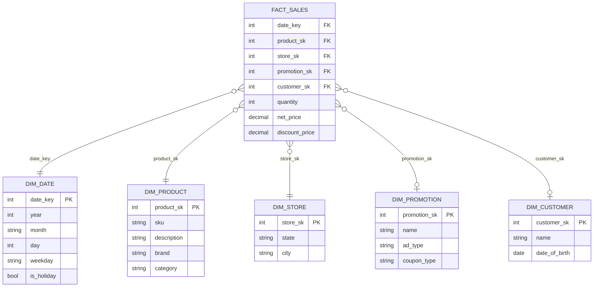

*(Vẽ lại cấu trúc Hình 3-9, tr. 94. Trong hình, `promotion_sk` và `customer_sk` có thể là NULL, nên quan hệ được vẽ là "không bắt buộc".)*

**Vì sao gọi là "star"?** (tr. 95) Khi vẽ quan hệ giữa các bảng, fact table nằm **giữa**, các dimension table bao quanh, các kết nối giống **tia sáng của ngôi sao**.

**Snowflake schema** (tr. 95). Một biến thể trong đó dimension được chia tiếp thành **subdimension**. Ví dụ: có bảng riêng cho nhãn hiệu và danh mục sản phẩm, và mỗi hàng trong `dim_product` tham chiếu chúng bằng foreign key thay vì lưu chuỗi chữ.

| | Star schema | Snowflake schema |
| --- | --- | --- |
| Cấu trúc | Fact table + một tầng dimension table | Dimension được chia tiếp thành subdimension |
| Chuẩn hóa | Ít hơn | **Chuẩn hóa hơn** |
| Được ưa chuộng | **Thường được chọn** vì **đơn giản hơn** cho analyst [55] | |

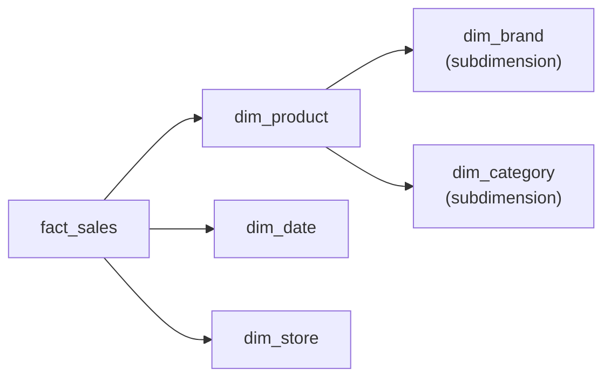

*(Minh họa snowflake theo ví dụ ở tr. 95: nhãn hiệu và danh mục tách thành bảng riêng.)*

**Bảng rất rộng** (tr. 95). Trong data warehouse điển hình, bảng thường **rất rộng**:

- fact table thường có **hơn 100 cột**, đôi khi vài trăm [51];
- dimension table cũng có thể rất rộng, vì chứa mọi metadata có thể liên quan tới phân tích. Ví dụ `dim_store` có thể lưu cửa hàng có những dịch vụ gì, có lò bánh mì không, diện tích, ngày khai trương, ngày cải tạo gần nhất, cách đường cao tốc gần nhất bao xa…

> **Liên hệ chương 2.** Star schema là **relational** và khá **chuẩn hóa**: sản phẩm, cửa hàng, ngày nằm ở bảng riêng, fact table chỉ giữ ID ([B2.3 chương 2](chapter-02.md#normalization)). Snowflake chuẩn hóa thêm một bậc. Analyst chọn star vì ít join hơn, dễ viết truy vấn hơn: lại một đánh đổi giữa chuẩn hóa và sự đơn giản.

---

### B8. Column-Oriented Storage (tr. 95–103)

#### B8.1 Ý tưởng: lưu theo cột thay vì theo hàng (tr. 95–97)

**Why — truy vấn phân tích chỉ cần vài cột của bảng rất rộng** (tr. 95):

- Fact table có thể có **hàng nghìn tỷ hàng** và **petabyte** dữ liệu. Dimension table thường nhỏ hơn nhiều (hàng triệu hàng), nên mục này tập trung vào việc lưu **fact**.
- Fact table thường rộng hơn 100 cột, nhưng một truy vấn data warehouse điển hình chỉ truy cập **4 hoặc 5 cột** cùng lúc. Truy vấn kiểu "SELECT \*" **hiếm khi** cần trong phân tích [51].

**Example 3-1** (tr. 96), diễn giải bằng lời. Truy vấn phân tích xem người ta có xu hướng mua **trái cây tươi** hay **kẹo** nhiều hơn tùy theo **ngày trong tuần**:

- join `fact_sales` với `dim_date` và `dim_product`;
- lọc năm 2013 và hai danh mục "Fresh fruit", "Candy";
- nhóm theo ngày trong tuần và danh mục, cộng số lượng bán.

Truy vấn này truy cập **rất nhiều hàng** (mọi lần mua trái cây hoặc kẹo trong cả năm 2013), nhưng chỉ cần **3 cột** của `fact_sales`: `date_key`, `product_sk`, `quantity`. Mọi cột khác bị bỏ qua (tr. 95).

**Vấn đề của lưu theo hàng** (tr. 96):

- Hầu hết database OLTP lưu theo kiểu ***row-oriented***: mọi giá trị của **một hàng** nằm cạnh nhau. Document database cũng tương tự: cả document thường là một chuỗi byte liên tục (như file CSV ở Hình 3-1).
- Có thể có index trên `fact_sales.date_key` hay `fact_sales.product_sk` để tìm mọi lần bán trong một ngày hay của một sản phẩm. Nhưng storage engine lưu theo hàng **vẫn phải tải mọi hàng đó** (mỗi hàng hơn 100 thuộc tính) từ đĩa vào bộ nhớ, parse, và lọc bỏ những hàng không thỏa điều kiện. Việc này có thể **rất lâu**.

**What — column-oriented storage** (tr. 96–97). Ý tưởng đơn giản: **không lưu mọi giá trị của một hàng cạnh nhau**, mà **lưu mọi giá trị của một cột cạnh nhau**. Nếu mỗi cột là **một file riêng**, truy vấn chỉ cần đọc và parse **những cột nó dùng**, tiết kiệm rất nhiều công (Hình 3-10).

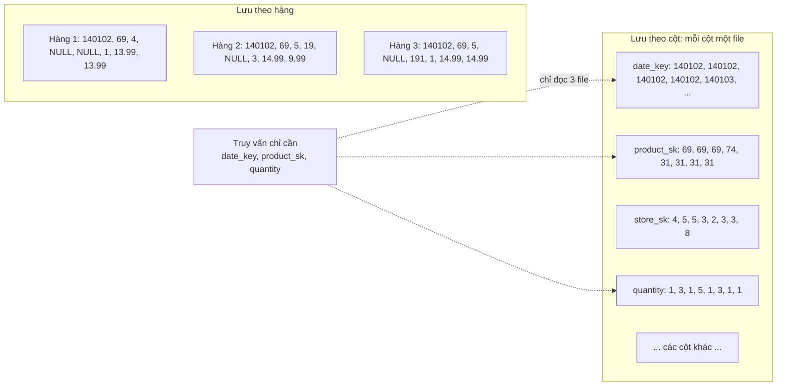

*(Phỏng theo Hình 3-10, tr. 97, dùng số liệu trong hình.)*

**Điều kiện then chốt** (tr. 97). Cách lưu theo cột dựa vào việc **mỗi file cột chứa các hàng theo cùng một thứ tự**. Muốn dựng lại cả hàng thứ 23, lấy **phần tử thứ 23** của từng file cột ghép lại.

> **Không chỉ cho relational** (tr. 96). Lưu theo cột dễ hiểu nhất với mô hình relational, nhưng áp dụng được cho dữ liệu phi relational. Ví dụ, **Parquet** [57] là định dạng lưu theo cột hỗ trợ mô hình document, dựa trên Dremel của Google [54].

#### B8.2 Column Compression: nén cột và bitmap (tr. 97–99)

**Why.** Ngoài việc chỉ tải những cột cần thiết, có thể giảm thêm nhu cầu băng thông đĩa bằng **nén**. Lưu theo cột **rất hợp để nén**: chuỗi giá trị của mỗi cột thường **lặp lại nhiều** (tr. 97).

**How — bitmap encoding** (tr. 97–98, Hình 3-11):

- Số giá trị **khác nhau** trong một cột thường **nhỏ** so với số hàng. Ví dụ, một nhà bán lẻ có hàng tỷ giao dịch nhưng chỉ khoảng **100.000 sản phẩm** khác nhau.
- Cột có n giá trị khác nhau thì biến thành **n bitmap riêng**: mỗi giá trị một bitmap, mỗi hàng một bit. Bit bằng 1 nếu hàng có giá trị đó, bằng 0 nếu không.
- **n rất nhỏ** (ví dụ cột quốc gia có khoảng 200 giá trị): lưu bitmap **một bit mỗi hàng**.
- **n lớn hơn**: hầu hết bitmap có **rất nhiều số 0** (bitmap **thưa**). Khi đó nén thêm bằng ***run-length encoding*** (RLE). Mã hóa cột trở nên **gọn đáng kinh ngạc**.

**Example — dữ liệu trong Hình 3-11** (cột `product_sk` có 18 hàng):

| | Nội dung |
| --- | --- |
| Giá trị cột | 69, 69, 69, 69, 74, 31, 31, 31, 31, 29, 30, 30, 31, 31, 31, 68, 69, 69 |
| Bitmap cho 31 | 0 0 0 0 0 1 1 1 1 0 0 0 1 1 1 0 0 0 |
| RLE cho 31 | **5, 4, 3, 3**: 5 số 0, 4 số 1, 3 số 0, 3 số 1, còn lại là 0 |
| RLE cho 69 | **0, 4, 12, 2**: 0 số 0, 4 số 1, 12 số 0, 2 số 1 |
| RLE cho 29 | **9, 1**: 9 số 0, 1 số 1, còn lại là 0 |

**Bitmap rất hợp với truy vấn data warehouse** (tr. 98–99):

| Điều kiện | Cách xử lý |
| --- | --- |
| `product_sk` thuộc (30, 68, 69) | Tải ba bitmap của 30, 68, 69, tính **OR từng bit**. Rất nhanh. |
| `product_sk` = 31 **và** `store_sk` = 3 | Tải bitmap của `product_sk = 31` và `store_sk = 3`, tính **AND từng bit**. Làm được vì các cột chứa hàng **theo cùng thứ tự**: bit thứ k ở bitmap cột này ứng với **cùng hàng** với bit thứ k ở bitmap cột kia. |

Còn nhiều cách nén khác cho từng loại dữ liệu, xem [58] (tr. 99).

> **Hộp "Column-oriented storage and column families"** (tr. 99). Cassandra và HBase có khái niệm **column family**, thừa hưởng từ Bigtable [9]. Nhưng gọi chúng là column-oriented thì **rất dễ gây hiểu lầm**: trong mỗi column family, chúng lưu **mọi cột của một hàng cùng nhau**, kèm row key, và **không nén theo cột**. Vì vậy mô hình Bigtable **về cơ bản vẫn là lưu theo hàng**. (Xem thêm [locality ở chương 2](chapter-02.md#locality).)

#### B8.3 Memory bandwidth và vectorized processing (tr. 99)

**Why.** Với truy vấn data warehouse phải quét hàng triệu hàng, nút thắt lớn là **băng thông đưa dữ liệu từ đĩa vào bộ nhớ**. Nhưng đó không phải nút thắt duy nhất. Người làm database phân tích còn quan tâm (tr. 99):

- dùng hiệu quả băng thông từ **bộ nhớ chính vào CPU cache**;
- tránh **dự đoán nhánh sai** (*branch misprediction*) và "bong bóng" trong **pipeline** xử lý lệnh của CPU;
- tận dụng lệnh **SIMD** (*single-instruction-multi-data*) của CPU hiện đại [59, 60].

**How** (tr. 99):

- Lưu theo cột không chỉ giảm lượng dữ liệu tải từ đĩa mà còn giúp **dùng chu kỳ CPU hiệu quả**.
- Query engine có thể lấy một **khúc dữ liệu cột đã nén** vừa gọn trong **L1 cache** của CPU, rồi lặp qua nó trong một **vòng lặp chặt** (không gọi hàm). CPU chạy vòng lặp như vậy nhanh hơn nhiều so với code phải gọi hàm và kiểm tra điều kiện cho từng bản ghi.
- Nén cột giúp **nhiều hàng hơn** vừa trong cùng dung lượng L1 cache.
- Các toán tử như AND, OR từng bit ở trên có thể được thiết kế để làm việc **trực tiếp** trên các khúc dữ liệu cột đã nén.

Kỹ thuật này gọi là ***vectorized processing*** [58, 49].

#### B8.4 Sort Order in Column Storage (tr. 99–100)

**What.** Trong column store, thứ tự lưu hàng **không nhất thiết quan trọng**. Dễ nhất là lưu theo **thứ tự chèn**: chèn hàng mới chỉ là nối vào cuối mỗi file cột. Nhưng cũng có thể **áp đặt thứ tự**, như với SSTable, và dùng nó làm **cơ chế index** (tr. 99).

**How — sắp cả hàng, không sắp từng cột** (tr. 100):

- **Không thể** sắp xếp **từng cột độc lập**, vì khi đó không còn biết phần tử nào trong các cột thuộc cùng một hàng. Dựng lại hàng được là nhờ biết phần tử thứ k của cột này cùng hàng với phần tử thứ k của cột kia.
- Dữ liệu phải được **sắp xếp theo từng hàng nguyên vẹn**, dù được lưu theo cột.
- Quản trị viên chọn các cột dùng để sắp xếp, dựa trên hiểu biết về truy vấn phổ biến:
  - Truy vấn hay nhắm vào **khoảng ngày** (như tháng trước) thì đặt `date_key` làm **sort key đầu tiên**. Optimizer chỉ cần quét các hàng của tháng trước, nhanh hơn nhiều so với quét mọi hàng.
  - Cột thứ hai quyết định thứ tự các hàng **cùng giá trị** ở cột thứ nhất. Ví dụ `product_sk` làm sort key thứ hai: mọi lần bán cùng sản phẩm trong cùng ngày nằm cạnh nhau. Điều này giúp truy vấn nhóm hoặc lọc theo sản phẩm trong một khoảng ngày.

**Why — sắp xếp còn giúp nén** (tr. 100):

- Nếu cột sắp xếp chính có **ít giá trị khác nhau**, sau khi sắp xếp nó có những **chuỗi dài** cùng một giá trị lặp lại. RLE đơn giản có thể nén cột đó xuống **vài kilobyte**, kể cả khi bảng có **hàng tỷ hàng**.
- Hiệu quả nén **mạnh nhất ở sort key đầu tiên**. Sort key thứ hai, thứ ba lộn xộn hơn, ít chuỗi lặp dài. Các cột xếp sau trong thứ tự ưu tiên gần như ngẫu nhiên, nên có lẽ nén kém. Dù vậy, sắp được vài cột đầu vẫn là **có lợi tổng thể**.

> **Ví dụ minh họa do AI xây dựng.** Bảng 1 tỷ hàng chứa dữ liệu của 365 ngày, sắp theo `date_key` trước. Cột `date_key` khi đó chỉ gồm 365 chuỗi dài, mỗi chuỗi khoảng 2,7 triệu giá trị giống nhau. RLE lưu nó thành 365 cặp (giá trị, độ dài), chỉ vài kilobyte thay vì vài gigabyte.

#### B8.5 Nhiều thứ tự sắp xếp khác nhau (tr. 100)

**What.** Một mở rộng thông minh được giới thiệu trong **C-Store** và áp dụng trong data warehouse thương mại **Vertica** [61, 62]: truy vấn khác nhau hưởng lợi từ thứ tự sắp xếp khác nhau, vậy sao không **lưu cùng dữ liệu theo nhiều thứ tự khác nhau**?

**Why hợp lý.** Dữ liệu vốn phải được **nhân bản sang nhiều máy** để không mất dữ liệu khi một máy hỏng. Vậy thì cứ lưu các bản dư thừa đó **theo các thứ tự khác nhau**. Khi xử lý truy vấn, dùng phiên bản **khớp nhất** với mẫu truy vấn.

**So với secondary index** (tr. 100):

| | Nhiều sort order trong column store | Nhiều secondary index trong row store |
| --- | --- | --- |
| Dữ liệu hàng nằm ở đâu | Mỗi bản sao **chứa chính các giá trị cột** | Mỗi hàng ở **một chỗ** (heap file hoặc clustered index) |
| Index chứa gì | Không có con trỏ tới dữ liệu ở chỗ khác | Chỉ chứa **con trỏ** tới hàng khớp |

#### B8.6 Writing to Column-Oriented Storage (tr. 101)

**Why khó.** Các tối ưu trên hợp lý cho data warehouse, vì phần lớn tải là **truy vấn đọc lớn** của analyst. Lưu theo cột, nén và sắp xếp đều giúp đọc nhanh hơn, nhưng **làm việc ghi khó hơn** (tr. 101):

- Cập nhật tại chỗ kiểu B-tree **không thể** với cột đã nén.
- Muốn chèn một hàng vào **giữa** một bảng đã sắp xếp, gần như chắc chắn phải **ghi lại mọi file cột**.
- Hàng được định danh bằng **vị trí** trong cột, nên việc chèn phải cập nhật **mọi cột một cách nhất quán**.

**How — dùng lại LSM-tree** (tr. 101). Giải pháp đã có từ đầu chương:

1. Mọi lượt ghi đi vào một **kho trong bộ nhớ**, được thêm vào cấu trúc đã sắp xếp và chuẩn bị ghi xuống đĩa. Kho trong bộ nhớ lưu theo hàng hay theo cột **không quan trọng**.
2. Khi tích lũy đủ, chúng được **merge với các file cột trên đĩa** và ghi ra **file mới hàng loạt**. Về cơ bản đây là cách **Vertica** làm [62].
3. Truy vấn phải xem **cả dữ liệu cột trên đĩa lẫn lượt ghi gần đây trong bộ nhớ**, rồi kết hợp. Query optimizer **che giấu** sự phân biệt này. Với analyst, dữ liệu vừa chèn, cập nhật hay xóa được **phản ánh ngay** trong truy vấn tiếp theo.

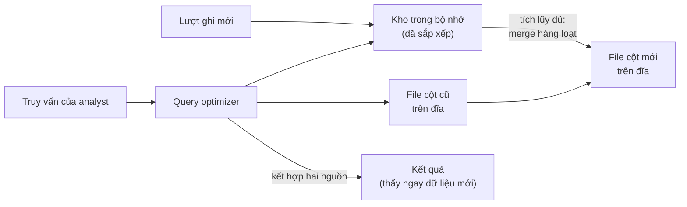

#### B8.7 Aggregation: Data Cubes and Materialized Views (tr. 101–103)

**Bối cảnh** (tr. 101). Không phải data warehouse nào cũng là column store: database lưu theo hàng truyền thống và vài kiến trúc khác cũng được dùng. Nhưng lưu theo cột có thể **nhanh hơn đáng kể** cho truy vấn phân tích tùy ý, nên đang **nhanh chóng phổ biến** [51, 63].

**1. Why — tổng hợp đã tính sẵn** (tr. 101). Truy vấn data warehouse thường dùng hàm tổng hợp như COUNT, SUM, AVG, MIN, MAX. Nếu cùng một phép tổng hợp được nhiều truy vấn dùng, thì tính lại từ dữ liệu thô mỗi lần là **lãng phí**. Sao không **cache** một số count hay sum hay dùng nhất?

**2. What — materialized view** (tr. 101–102):

| | Virtual view (view thường) | Materialized view |
| --- | --- | --- |
| Bản chất | Chỉ là **lối tắt** để viết truy vấn | **Bản sao thật** của kết quả truy vấn, **ghi xuống đĩa** |
| Khi đọc | SQL engine **mở rộng** view thành truy vấn gốc ngay lúc đó, rồi xử lý | Đọc thẳng kết quả đã lưu |
| Khi dữ liệu gốc đổi | Không cần làm gì | **Phải cập nhật**, vì nó là bản sao **denormalized** của dữ liệu. Database có thể làm tự động, nhưng làm **ghi tốn kém hơn** |
| Phù hợp | | Data warehouse **đọc nhiều**. Có thật sự cải thiện đọc hay không thì tùy trường hợp. **Ít dùng trong OLTP** |

Glossary định nghĩa *materialize* là thực hiện phép tính **ngay** và ghi ra kết quả, thay vì tính **theo yêu cầu** khi được hỏi (tr. 556).

**3. How — data cube (OLAP cube)** (tr. 102–103, Hình 3-12). Một trường hợp đặc biệt phổ biến của materialized view là ***data cube*** hay ***OLAP cube*** [64]: một **lưới các giá trị tổng hợp** nhóm theo các dimension.

- Giả sử mỗi fact chỉ có foreign key tới **hai** dimension, ví dụ ngày và sản phẩm. Vẽ một bảng hai chiều: ngày theo một trục, sản phẩm theo trục kia. Mỗi ô chứa tổng hợp (ví dụ SUM) của một thuộc tính (ví dụ `net_price`) của mọi fact có tổ hợp ngày-sản phẩm đó.
- Áp cùng phép tổng hợp **dọc mỗi hàng hoặc cột** sẽ được bản tóm tắt **giảm đi một dimension**: doanh số theo sản phẩm bất kể ngày, hoặc theo ngày bất kể sản phẩm.

**Example — một phần Hình 3-12** (SUM(net_price)):

| date_key \ product_sk | 32 | 33 | 34 | 35 | … | total |
| --- | --- | --- | --- | --- | --- | --- |
| 140101 | 149.60 | 31.01 | 84.58 | 28.18 | … | 40710.53 |
| 140102 | 132.18 | 19.78 | 82.91 | 10.96 | … | 73091.28 |
| 140103 | 196.75 | 0.00 | 12.52 | 64.67 | … | 54688.10 |
| 140104 | 178.36 | 9.98 | 88.75 | 56.16 | … | 95121.09 |
| … | | | | | | |
| **total** | 14967.09 | 5910.43 | 7328.85 | 6885.39 | … | lots |

- Một ô (như 149.60) là tổng `net_price` của sản phẩm 32 trong ngày 140101.
- Cột "total" là tổng theo ngày bất kể sản phẩm; hàng "total" là tổng theo sản phẩm bất kể ngày.

**Nhiều dimension hơn** (tr. 102). Thực tế fact thường có hơn hai dimension. Hình 3-9 có năm: ngày, sản phẩm, cửa hàng, khuyến mãi, khách hàng. Khó hình dung một **siêu khối 5 chiều**, nhưng nguyên lý vẫn vậy: mỗi ô là doanh số của một tổ hợp ngày-sản phẩm-cửa hàng-khuyến mãi-khách hàng, và có thể tóm tắt lặp lại dọc từng dimension.

**4. Trade-offs** (tr. 102–103):

| Ưu điểm | Nhược điểm |
| --- | --- |
| Một số truy vấn **rất nhanh** vì thực chất **đã tính sẵn**. Ví dụ: tổng doanh số mỗi cửa hàng hôm qua chỉ cần nhìn tổng dọc dimension tương ứng, không phải quét hàng triệu hàng | **Kém linh hoạt** hơn truy vấn dữ liệu thô. Ví dụ: không thể tính tỷ lệ doanh số đến từ mặt hàng giá **trên $100**, vì giá **không phải một dimension** |

**5. System Design Perspective** (tr. 103). Vì vậy hầu hết data warehouse **giữ càng nhiều dữ liệu thô càng tốt**, và chỉ dùng tổng hợp như data cube để **tăng tốc một số truy vấn nhất định**.

> **Liên hệ chương 1 và 2.** Materialized view và data cube là cùng một đánh đổi với **cache home timeline của Twitter** ([chương 1](chapter-01.md#load-parameters)) và **denormalization** ([chương 2](chapter-02.md#normalization)): tính sẵn khi ghi để đọc nhanh, đổi lại ghi tốn kém hơn và kém linh hoạt hơn.

---

### B9. Summary — Tổng kết của tác giả (tr. 103–104)

**Hai nhóm storage engine lớn** (tr. 103):

| | OLTP | OLAP (data warehouse) |
| --- | --- | --- |
| Ai dùng | Hướng tới **người dùng cuối**, nên có thể nhận **khối lượng request khổng lồ** | Chủ yếu là **business analyst**, nên ít người biết hơn |
| Mỗi truy vấn | Chạm vào **số ít bản ghi**, tìm theo key qua index | Rất nặng: phải quét **hàng triệu bản ghi** trong thời gian ngắn |
| Số lượng truy vấn | Rất lớn | Thấp hơn nhiều |
| Nút thắt thường gặp | **Thời gian seek đĩa** | **Băng thông đĩa** (không phải thời gian seek) |
| Giải pháp nổi bật | Index (log-structured hoặc B-tree) | **Lưu theo cột**, ngày càng phổ biến |

**Hai trường phái ở phía OLTP** (tr. 103):

| Trường phái | Nguyên tắc | Đại diện |
| --- | --- | --- |
| **Log-structured** | Chỉ cho phép **ghi nối vào file** và **xóa file lỗi thời**, không bao giờ cập nhật file đã ghi | Bitcask, SSTable, LSM-tree, LevelDB, Cassandra, HBase, Lucene… |
| **Update-in-place** | Xem đĩa là tập **page kích thước cố định** có thể **ghi đè** | **B-tree**: dùng trong mọi relational database lớn và nhiều database phi relational |

**Ý tưởng then chốt của log-structured** (tr. 103). Đây là phát triển **tương đối mới**. Ý tưởng chính: **biến có hệ thống các lượt ghi truy cập ngẫu nhiên thành ghi tuần tự** trên đĩa, cho phép throughput ghi cao hơn nhờ đặc tính hiệu năng của ổ cứng và SSD.

**Phần còn lại** (tr. 104). Phía OLTP còn có các cấu trúc index phức tạp hơn và database giữ mọi dữ liệu trong bộ nhớ. Phía phân tích: khi truy vấn phải **quét tuần tự rất nhiều hàng**, index **bớt quan trọng** đi nhiều. Thay vào đó, điều quan trọng là **mã hóa dữ liệu thật gọn** để giảm lượng dữ liệu phải đọc từ đĩa. Lưu theo cột giúp đạt mục tiêu này.

**Thông điệp kết** (tr. 104). Hiểu bên trong storage engine giúp lập trình viên **chọn công cụ phù hợp** cho ứng dụng. Khi cần chỉnh tham số của database, hiểu biết này giúp **hình dung tác động** của việc tăng hay giảm một giá trị. Chương này không biến bạn thành chuyên gia tinh chỉnh một storage engine cụ thể, nhưng cho bạn đủ **từ vựng và ý tưởng** để đọc hiểu tài liệu của database bạn chọn.

---

## C. Sơ đồ minh họa

Các sơ đồ gắn với từng mục đã nằm trong phần B:

- Hash index, compaction, merge (Hình 3-1 đến 3-3): [B2](#b2)
- SSTable, index thưa, memtable (Hình 3-4, 3-5): [B3](#b3)
- B-tree, tách page, WAL (Hình 3-6, 3-7): [B4](#b4)
- Compaction không theo kịp: [B5.2](#lsm-downsides)
- Heap file, clustered, covering; index nhiều chiều: [B6](#b6)
- ETL, star schema, snowflake (Hình 3-8, 3-9): [B7](#b7)
- Lưu theo cột, ghi vào column store (Hình 3-10): [B8](#b8)

Phần này bổ sung các sơ đồ **tổng hợp** để ôn tập.

### C1. Bản đồ khái niệm của chương 3

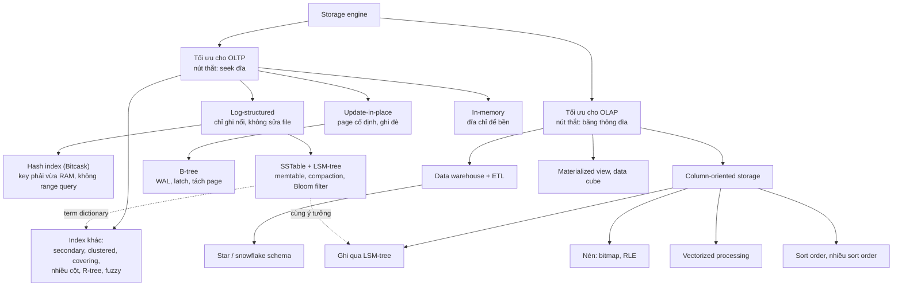

### C2. Chọn storage engine theo workload

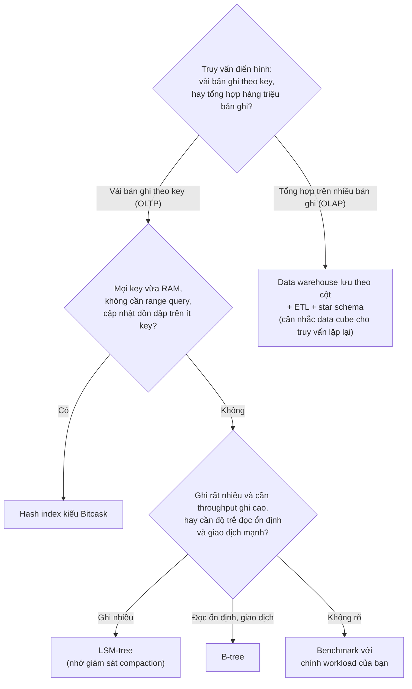

*(Sơ đồ do người viết ghi chú tổng hợp từ tr. 73, 75, 79, 83–85, 90–103. Sách nhấn mạnh: không có quy tắc nhanh, hãy thử nghiệm thực tế.)*

### C3. Hai đường đi của một lượt ghi: LSM-tree và B-tree

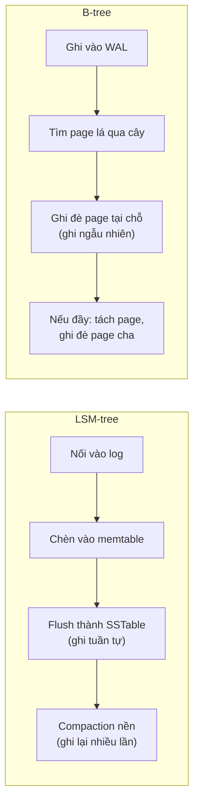

---

## D. So sánh các giải pháp

### D1. Hash index, LSM-tree và B-tree (tr. 72–85)

| Tiêu chí | Hash index (Bitcask) | SSTable / LSM-tree | B-tree |
| --- | --- | --- | --- |
| **Nguyên lý** | Log chỉ ghi nối + hash map trong bộ nhớ trỏ tới offset | Memtable trong bộ nhớ, flush thành SSTable sắp xếp, compaction nền | Cây các page cố định (4 KB), ghi đè tại chỗ, WAL |
| **Ưu điểm** | Đọc ghi rất nhanh; hợp với cập nhật dồn dập trên ít key | Throughput ghi cao (ghi tuần tự); nén tốt, file nhỏ; dataset lớn hơn bộ nhớ; range query | Trưởng thành; đọc thường nhanh; độ trễ dễ dự đoán; mỗi key một chỗ, khóa khoảng key gắn được vào cây |
| **Nhược điểm** | Mọi key phải vừa RAM; không có range query | Đọc phải kiểm tra nhiều nơi; compaction gây độ trễ cao ở percentile cao; compaction có thể không theo kịp | Ghi ít nhất hai lần (WAL + page), ghi cả page; phân mảnh; cần latch cho đồng thời |
| **Trade-off** | Tốc độ, đổi lại giới hạn số key | Tốc độ ghi, đổi lại độ trễ đọc kém ổn định | Đọc ổn định, đổi lại ghi tốn kém hơn |
| **Ví dụ** | Bitcask (Riak) | LevelDB, RocksDB, Cassandra, HBase, Lucene | Gần như mọi relational database |

### D2. Chi tiết: LSM-tree và B-tree (tr. 83–85)

| Khía cạnh | LSM-tree | B-tree |
| --- | --- | --- |
| Quy tắc kinh nghiệm | Thường **nhanh hơn khi ghi** | Được cho là **nhanh hơn khi đọc** |
| Write amplification | Do compaction lặp lại; **đôi khi thấp hơn** (tùy cấu hình, workload) | Ít nhất hai lần (WAL + page), ghi cả page, có thể ghi page hai lần |
| Mẫu ghi | **Tuần tự** (file SSTable gọn) | Ghi đè nhiều page (**ngẫu nhiên**) |
| Dung lượng | **Nén tốt hơn**, ít phân mảnh, nhất là leveled compaction | Phân mảnh khi tách page hoặc hàng không vừa page |
| Độ trễ | Trung bình ổn, nhưng **percentile cao có thể rất cao** do compaction | **Dễ dự đoán hơn** |
| Rủi ro vận hành | Compaction không theo kịp làm hết đĩa và đọc chậm; **cần giám sát** | |
| Giao dịch | Một key có thể ở nhiều segment | **Mỗi key một chỗ**; khóa khoảng key gắn trực tiếp vào cây |
| Kết luận của sách | Ngày càng phổ biến trong datastore mới | Ăn sâu vào database, khó biến mất. **Hãy thử với workload của bạn** |

### D3. Size-tiered và leveled compaction (tr. 79)

| Tiêu chí | Size-tiered | Leveled |
| --- | --- | --- |
| **Nguyên lý** | SSTable mới, nhỏ được merge dần vào SSTable cũ, lớn | Khoảng key chia thành nhiều SSTable nhỏ; dữ liệu cũ chuyển xuống các level |
| **Ưu điểm** | (Sách không nêu chi tiết) | Compaction **từng bước nhỏ hơn**, **tốn ít dung lượng đĩa hơn** |
| **Ai dùng** | HBase; Cassandra hỗ trợ | LevelDB, RocksDB; Cassandra hỗ trợ |

> **Bổ sung ngoài sách.** Theo hiểu biết chung, size-tiered thường có write amplification thấp hơn nhưng cần nhiều dung lượng tạm và có thể phải đọc nhiều SSTable hơn; leveled thường đọc tốt hơn và tiết kiệm dung lượng hơn nhưng ghi lại dữ liệu nhiều lần hơn. Hãy kiểm tra tài liệu của engine cụ thể.

### D4. Nơi lưu dữ liệu hàng: heap file, clustered, covering (tr. 86–87)

| Tiêu chí | Nonclustered + heap file | Clustered index | Covering index |
| --- | --- | --- | --- |
| **Nguyên lý** | Index chứa tham chiếu tới heap file, hàng nằm một chỗ | Hàng nằm ngay trong index | Index chứa thêm một số cột |
| **Ưu điểm** | Không nhân bản dữ liệu khi có nhiều secondary index; cập nhật tại chỗ nếu value không to ra | Bỏ bước nhảy từ index sang heap | Một số truy vấn trả lời chỉ bằng index |
| **Nhược điểm** | Thêm một bước nhảy khi đọc; value to ra thì phải dời chỗ (cập nhật mọi index hoặc forwarding pointer) | Nhân bản dữ liệu: tốn dung lượng, ghi chậm hơn | Tương tự clustered, ở mức nhỏ hơn |
| **Ví dụ** | Cách phổ biến | Primary key của InnoDB (MySQL); một clustered index mỗi bảng ở SQL Server | Index with included columns |

### D5. Index nhiều cột (tr. 87–88)

| Tiêu chí | Concatenated index | Space-filling curve + B-tree | R-tree (spatial index) |
| --- | --- | --- | --- |
| **Nguyên lý** | Nối nhiều cột thành một key theo thứ tự định trước | Biến tọa độ nhiều chiều thành một số | Index chuyên cho dữ liệu nhiều chiều |
| **Trả lời tốt** | Lọc theo cột đầu, hoặc cột đầu + cột sau | Range query nhiều chiều trên B-tree sẵn có | Range query nhiều chiều (bản đồ, màu, ngày + nhiệt độ) |
| **Không trả lời được** | Lọc chỉ theo cột sau (tìm theo tên trong danh bạ họ-tên) | | |
| **Ví dụ** | Danh bạ (họ, tên) | [34] | PostGIS trên PostgreSQL GiST |

### D6. In-memory và disk-based (tr. 88–90)

| Tiêu chí | In-memory database | Disk-based database |
| --- | --- | --- |
| **Phục vụ đọc** | Hoàn toàn từ bộ nhớ | Từ đĩa, nhưng OS cache block đĩa nên có thể cũng không cần đọc đĩa |
| **Độ bền** | Log hoặc snapshot xuống đĩa, nhân bản, hoặc phần cứng đặc biệt; có loại chấp nhận mất (Memcached) | Bền tự nhiên |
| **Vì sao nhanh hơn** | Tránh chi phí **mã hóa** cấu trúc bộ nhớ thành dạng ghi đĩa | |
| **Mô hình dữ liệu** | Dễ cung cấp cấu trúc khó làm trên đĩa (priority queue, set trong Redis) | |
| **Giới hạn** | Dataset phải vừa bộ nhớ (anti-caching nới lỏng, nhưng index vẫn phải vừa RAM) | Chi phí mỗi GB thấp hơn |

### D7. OLTP và OLAP (Bảng 3-1, tr. 91; tổng kết tr. 103)

| Đặc điểm | OLTP | OLAP |
| --- | --- | --- |
| Đọc | Số ít bản ghi theo key | Tổng hợp trên rất nhiều bản ghi |
| Ghi | Ngẫu nhiên, độ trễ thấp, từ người dùng | Hàng loạt (ETL) hoặc luồng sự kiện |
| Người dùng | Người dùng cuối qua web | Analyst nội bộ |
| Dữ liệu | Trạng thái hiện tại | Lịch sử sự kiện |
| Kích thước | GB đến TB | TB đến PB |
| Nút thắt | Seek đĩa | Băng thông đĩa |
| Storage engine | Log-structured hoặc B-tree, có index | Lưu theo cột, nén |

### D8. Lưu theo hàng và lưu theo cột (tr. 96–101)

| Tiêu chí | Row-oriented | Column-oriented |
| --- | --- | --- |
| **Nguyên lý** | Mọi giá trị một hàng nằm cạnh nhau | Mọi giá trị một cột nằm cạnh nhau, mỗi cột một file |
| **Ưu điểm** | Đọc hoặc ghi cả bản ghi nhanh; cập nhật tại chỗ | Chỉ đọc các cột cần; nén rất tốt (bitmap, RLE); vectorized processing; sort order làm index |
| **Nhược điểm** | Truy vấn phân tích phải tải cả hàng rộng hơn 100 cột | Ghi khó: không cập nhật tại chỗ được; chèn giữa bảng phải ghi lại mọi file cột |
| **Cách ghi** | Trực tiếp | Qua kho trong bộ nhớ rồi merge hàng loạt (kiểu LSM, như Vertica) |
| **Dùng cho** | OLTP | Data warehouse, truy vấn phân tích tùy ý |

> Lưu ý: column family của Cassandra, HBase, Bigtable **vẫn là lưu theo hàng** (tr. 99).

### D9. Dữ liệu thô, virtual view, materialized view, data cube (tr. 101–103)

| Tiêu chí | Truy vấn dữ liệu thô | Virtual view | Materialized view | Data cube |
| --- | --- | --- | --- | --- |
| **Bản chất** | Quét fact table | Lối tắt viết truy vấn, mở rộng lúc chạy | Bản sao kết quả truy vấn trên đĩa | Lưới tổng hợp theo các dimension |
| **Tốc độ đọc** | Chậm nhất | Như truy vấn gốc | Nhanh | Rất nhanh với truy vấn khớp dimension |
| **Chi phí ghi** | Không thêm | Không thêm | Phải cập nhật khi dữ liệu gốc đổi | Phải cập nhật |
| **Linh hoạt** | **Cao nhất** | Cao | Chỉ cho truy vấn đã định nghĩa | Thấp: không hỏi được theo thứ không phải dimension (giá > $100) |
| **Khuyến nghị của sách** | Giữ càng nhiều càng tốt | | Hợp với data warehouse đọc nhiều, ít dùng trong OLTP | Chỉ dùng để tăng tốc một số truy vấn |

---

## E. Tư duy System Design

> **Ví dụ minh họa do AI xây dựng.** Tất cả tình huống dưới đây là giả định để luyện cách suy luận. Mỗi bước lập luận dẫn về nội dung sách. Hãy tự trả lời phần "Câu hỏi cần đặt" trước khi đọc lập luận.

### E1. Bộ đếm lượt xem video

**Bối cảnh.** Nền tảng có 2 triệu video. Mỗi lượt bấm play tăng bộ đếm của video đó. Cao điểm có 50.000 lượt tăng mỗi giây. Chỉ cần đọc số lượt xem của một video theo ID.

**Câu hỏi cần đặt.** Loại index nào phù hợp? Khi nào phải đổi?

**Lập luận.**

1. Đây đúng là workload sách mô tả cho **Bitcask**: rất nhiều lượt ghi trên mỗi key, số key không quá lớn (tr. 73). 2 triệu key cùng offset của chúng dễ dàng vừa RAM.
2. Ghi là nối vào log (nhanh, tuần tự), đọc là tra hash map rồi seek một lần, thường trúng filesystem cache nên không cần I/O (tr. 72–73).
3. Mỗi video bị cập nhật hàng nghìn lần, nên **compaction** thu gọn log rất mạnh (tr. 73–74), giống Hình 3-2.
4. Crash: cần snapshot hash map để khởi động lại nhanh, và checksum để bỏ bản ghi ghi dở (tr. 74–75).

**Nếu yêu cầu thay đổi.**

- Cần "top video có lượt xem từ 1 triệu đến 2 triệu": đó là **range query**, hash index không làm được (tr. 75). Chuyển sang engine có thứ tự (LSM-tree hoặc B-tree), hoặc duy trì thêm một cấu trúc riêng cho xếp hạng.
- Số key tăng lên hàng tỷ (ví dụ đếm theo từng cặp người dùng-video): key không còn vừa RAM, nên cần LSM-tree với index thưa (tr. 77).

### E2. Thu thập dữ liệu thiết bị IoT với lượng ghi lớn

**Bối cảnh.** 2 triệu thiết bị, mỗi thiết bị gửi một số đo mỗi 10 giây (200.000 lượt ghi/s). Dữ liệu tăng hàng TB mỗi tháng. Đọc chủ yếu là "lấy dữ liệu một thiết bị trong một khoảng thời gian". Có SLO p99 cho API đọc.

**Câu hỏi cần đặt.** LSM-tree hay B-tree? Cần chuẩn bị gì về vận hành?

**Lập luận.**

1. Ghi rất nhiều, dữ liệu lớn hơn nhiều so với bộ nhớ: LSM-tree hợp vì ghi tuần tự, throughput ghi cao, và chạy tốt khi dataset lớn hơn bộ nhớ (tr. 79, 84).
2. Đọc theo **khoảng thời gian của một thiết bị**: chọn key dạng (device_id, timestamp) để các bản ghi của một thiết bị nằm liên tiếp theo thời gian. LSM-tree giữ dữ liệu có thứ tự nên range query hiệu quả (tr. 79). Đây cũng là ý tưởng concatenated key (tr. 87).
3. **Rủi ro p99:** compaction có thể làm độ trễ ở percentile cao tăng vọt (tr. 84–85). Cần đo p99 phía client ([chương 1](chapter-01.md#percentiles)) và benchmark với workload thật (tr. 83).
4. **Rủi ro vận hành:** ở 200.000 lượt ghi/s, compaction có thể không theo kịp. Engine thường không tự giảm tốc ghi, nên phải **giám sát** số segment chưa merge và dung lượng đĩa (tr. 85).
5. **Write amplification** quan trọng: nếu chạy trên SSD, nó ảnh hưởng cả throughput lẫn tuổi thọ ổ (tr. 84).

**Nếu yêu cầu thay đổi.** Nếu analyst muốn "nhiệt độ trung bình theo giờ của mọi thiết bị trong tỉnh X tháng trước", đó là truy vấn **OLAP**. Không nên chạy trên kho ghi chính. Đưa dữ liệu sang data warehouse lưu theo cột (tr. 91–92, 95).

### E3. Sổ cái tài khoản ngân hàng

**Bối cảnh.** Hệ thống chuyển tiền nội bộ: mỗi giao dịch đọc số dư hai tài khoản, ghi hai bản ghi, cần đảm bảo giao dịch mạnh. Độ trễ phải **ổn định** (cam kết p99.9 với đối tác). Lượng ghi vừa phải.

**Câu hỏi cần đặt.** Storage engine nào? Những thành phần nào đảm bảo an toàn khi crash?

**Lập luận.**

1. Cần ngữ nghĩa giao dịch mạnh: B-tree hấp dẫn vì **mỗi key nằm đúng một chỗ**, và khóa trên khoảng key gắn trực tiếp vào cây (tr. 85).
2. Cần độ trễ **dễ dự đoán** ở percentile cao: B-tree ổn định hơn LSM-tree, vốn có thể bị compaction làm chậm (tr. 84–85).
3. Ghi không quá nhiều, nên lợi thế throughput ghi của LSM-tree không phải yếu tố quyết định (tr. 84).
4. An toàn khi crash: tách page phải ghi nhiều page, crash giữa chừng có thể làm hỏng cây. **WAL** đảm bảo mọi thay đổi được ghi trước và có thể làm lại (tr. 82).

**Nếu yêu cầu thay đổi.** Nếu thêm yêu cầu lưu **toàn bộ lịch sử giao dịch** để kiểm toán và báo cáo, phần lịch sử này giống fact table: ghi nối thêm, đọc theo kiểu phân tích. Có thể tách sang data warehouse qua ETL (tr. 92).

### E4. Analyst làm chậm database production

**Bối cảnh.** Một công ty thương mại điện tử tầm trung. Đội phân tích chạy truy vấn "doanh thu theo danh mục theo ngày trong tuần" trực tiếp trên database OLTP. Mỗi lần chạy, API thanh toán chậm hẳn.

**Câu hỏi cần đặt.** Vì sao? Kiến trúc nên thay đổi thế nào?

**Lập luận.**

1. Đây đúng là lý do sinh ra data warehouse: truy vấn phân tích quét phần lớn dataset và **làm hại hiệu năng** của giao dịch đang chạy (tr. 91).
2. Dựng **data warehouse** riêng, đưa dữ liệu qua **ETL**: trích xuất từ database OLTP (dump định kỳ hoặc luồng cập nhật), biến đổi, nạp vào (tr. 92).
3. Mô hình hóa theo **star schema**: `fact_sales` ở giữa, các dimension ngày, sản phẩm, cửa hàng, khách hàng (tr. 93–95). Dimension ngày có cột ngày lễ, nên phân tích được doanh số ngày lễ (tr. 95).
4. Lưu **theo cột**: truy vấn chỉ cần 3 trong hơn 100 cột (tr. 95–97). Chọn `date_key` làm sort key đầu vì truy vấn thường lọc theo khoảng ngày; sort key thứ hai là `product_sk` (tr. 100).
5. Dashboard lặp đi lặp lại cùng một tổng hợp: cân nhắc **materialized view** hoặc data cube, nhưng vẫn giữ dữ liệu thô cho truy vấn tùy ý (tr. 101–103).

**Nếu yêu cầu thay đổi.** Nếu công ty còn rất nhỏ, dữ liệu vài GB, thì sách nhận xét công ty nhỏ hầu như không cần data warehouse: một bản sao SQL thông thường dành riêng cho phân tích, thậm chí bảng tính, có thể đủ (tr. 92).

### E5. Tìm nhà hàng trên bản đồ

**Bối cảnh.** Ứng dụng giao đồ ăn hiển thị nhà hàng trong khung bản đồ người dùng đang xem. Có 3 triệu nhà hàng. Danh sách hiển thị chỉ cần tên, điểm đánh giá và tọa độ.

**Câu hỏi cần đặt.** Vì sao index (vĩ độ, kinh độ) thông thường không đủ? Nên dùng gì?

**Lập luận.**

1. Truy vấn là **range query hai chiều**. Index B-tree trên vĩ độ trả về cả một dải toàn cầu; concatenated index (vĩ độ, kinh độ) cũng chỉ thu hẹp tốt theo cột đầu (tr. 87).
2. Dùng **spatial index** như R-tree (ví dụ PostGIS), hoặc biến tọa độ thành một số bằng space-filling curve rồi dùng B-tree (tr. 87).
3. Danh sách chỉ cần vài cột: **covering index** chứa thêm tên và điểm đánh giá có thể trả lời mà không phải đọc hàng đầy đủ (tr. 86). Đổi lại, tốn thêm dung lượng và chậm hơn khi ghi (tr. 87).
4. Mỗi index thêm vào đều làm chậm việc ghi (tr. 71). Nếu dữ liệu nhà hàng ít thay đổi thì cái giá này nhỏ.

**Nếu yêu cầu thay đổi.** Nếu thêm điều kiện "đang mở cửa" và "giá trong khoảng", truy vấn trở thành nhiều chiều hơn. Sách gợi ý index nhiều chiều không chỉ cho địa lý (tr. 87–88). Nếu cần tìm theo tên gõ sai chính tả, cần **fuzzy index** kiểu Lucene (tr. 88).

---

## F. Kiến thức cốt lõi

1. Database làm hai việc: **lưu** và **trả lại** dữ liệu. Lập trình viên cần hiểu storage engine để **chọn và tinh chỉnh** đúng (tr. 69).
2. **Log** là chuỗi bản ghi chỉ ghi nối thêm. Ghi nối là cách ghi nhanh nhất; đọc bằng cách quét là O(n) (tr. 70–71).
3. **Index là dữ liệu dẫn xuất**: đọc nhanh hơn, **ghi chậm hơn**. Vì vậy hãy chọn index theo mẫu truy vấn (tr. 71).
4. **Hash index** (Bitcask): hash map trong bộ nhớ trỏ vào log. Nhanh, nhưng mọi key phải vừa RAM và không có range query (tr. 72–75).
5. **Segment + compaction + merge** giữ cho log không phình mãi. Tombstone để xóa, checksum cho bản ghi ghi dở, snapshot hash map để phục hồi nhanh (tr. 73–75).
6. **Append-only tốt** vì ghi tuần tự nhanh, đồng thời và phục hồi crash đơn giản, không phân mảnh (tr. 75).
7. **SSTable** là segment sắp xếp theo key: merge kiểu mergesort, index thưa, nén theo khối (tr. 76–77).
8. **LSM-tree**: memtable trong bộ nhớ, flush thành SSTable, merge nền, log để phục hồi memtable. Bloom filter cho key không có; size-tiered và leveled compaction (tr. 78–79).
9. **B-tree**: cây page 4 KB, branching factor vài trăm, sâu 3–4 tầng, ghi đè tại chỗ, **WAL** để chịu crash, **latch** để đồng thời (tr. 79–83).
10. **LSM nhanh hơn khi ghi, B-tree nhanh hơn khi đọc**, nhưng hãy **benchmark với workload thật** (tr. 83).
11. **Write amplification**: một lần ghi vào database thành nhiều lần ghi xuống đĩa. Quan trọng với workload ghi nhiều và SSD (tr. 84).
12. LSM-tree: compaction có thể làm **độ trễ ở percentile cao** tăng và có thể **không theo kịp** lượt ghi, nên cần giám sát. B-tree dễ dự đoán hơn và hợp với giao dịch mạnh (tr. 84–85).
13. **Secondary index** (key không duy nhất), **heap file**, **clustered index**, **covering index**: nhân bản dữ liệu thì đọc nhanh nhưng ghi đắt (tr. 85–87).
14. **Concatenated index** chỉ giúp với cột đầu; truy vấn nhiều chiều cần **R-tree** hoặc space-filling curve. **Fuzzy search** cần cấu trúc khác như automaton của Lucene (tr. 87–88).
15. **In-memory database** nhanh vì tránh chi phí mã hóa dữ liệu cho đĩa, không phải vì tránh đọc đĩa (tr. 89).
16. **OLTP và OLAP** có mẫu truy cập rất khác. **Data warehouse** tách phân tích khỏi OLTP, nạp dữ liệu qua **ETL**, thường dùng **star schema** (tr. 90–95).
17. **Lưu theo cột** chỉ đọc cột cần, nén bằng bitmap và RLE, tận dụng CPU bằng vectorized processing, dùng sort order như index, và ghi qua cơ chế kiểu LSM (tr. 95–101).
18. **Materialized view và data cube** tính sẵn tổng hợp: đọc nhanh nhưng kém linh hoạt và ghi đắt. Hãy giữ dữ liệu thô (tr. 101–103).

---

## G. Câu hỏi tự kiểm tra

Hãy tự trả lời trước, sau đó mới xem [phần đáp án](#g-dap-an).

1. **Tại sao** database không tự động đánh index mọi cột? Đánh đổi cơ bản nào của hệ thống lưu trữ đứng sau quyết định này?
2. Bitcask phù hợp với workload nào? **Điều gì xảy ra nếu** số key tăng gấp nghìn lần, hoặc ứng dụng cần range query?
3. **Tại sao** thiết kế chỉ ghi nối thêm (append-only) lại tốt, dù thoạt nhìn có vẻ lãng phí so với ghi đè tại chỗ?
4. **So sánh** SSTable với log segment có hash index. Vì sao SSTable chỉ cần index **thưa** trong bộ nhớ?
5. Lượt ghi đến theo thứ tự bất kỳ, vậy LSM-tree tạo ra file **đã sắp xếp** bằng cách nào? **Điều gì xảy ra** với memtable khi database crash, và làm sao tránh mất dữ liệu?
6. **Tại sao** B-tree cần write-ahead log? Thao tác nào trên B-tree đặc biệt nguy hiểm nếu crash giữa chừng?
7. **So sánh** LSM-tree và B-tree về write amplification, độ trễ ở percentile cao, và hỗ trợ giao dịch. Vì sao sách khuyên benchmark với workload thật?
8. **Điều gì xảy ra nếu** compaction của LSM-tree không theo kịp lượt ghi? Vì sao cần giám sát tường minh?
9. **Tại sao** database OLTP và data warehouse tách nhau, dù cùng có giao diện SQL? Star schema gồm những thành phần nào?
10. **Tại sao** lưu theo cột nhanh hơn nhiều cho truy vấn phân tích? Nó xử lý việc **ghi** thế nào, và vì sao data cube không thay thế được dữ liệu thô?

### Đáp án và giải thích

<b>Câu 1 — Vì sao không index mọi thứ</b>

- Index là **cấu trúc dẫn xuất**: thêm hay bỏ index không đổi nội dung database, chỉ đổi hiệu năng truy vấn (tr. 71).
- Duy trì index tốn chi phí, **nhất là khi ghi**: mỗi lần ghi dữ liệu, mọi index liên quan cũng phải cập nhật. Không có gì nhanh hơn việc chỉ nối vào file (tr. 71).
- **Đánh đổi cơ bản:** index được chọn tốt làm đọc nhanh hơn, nhưng **mọi index làm ghi chậm đi**. Vì vậy database để lập trình viên hoặc quản trị viên chọn index dựa trên **mẫu truy vấn điển hình**, nhằm có lợi ích lớn nhất mà không thêm chi phí thừa (tr. 71).

<b>Câu 2 — Bitcask và giới hạn của hash index</b>

- **Phù hợp:** value của mỗi key được cập nhật **rất thường xuyên**, nhưng **số key không quá lớn** để giữ hết trong RAM. Ví dụ: URL video mèo và số lượt xem (tr. 73).
- **Key tăng gấp nghìn lần:** hash map không còn vừa bộ nhớ. Hash map trên đĩa thì khó làm nhanh: nhiều I/O ngẫu nhiên, mở rộng tốn kém, xử lý va chạm rườm rà (tr. 75).
- **Cần range query:** hash index không giữ thứ tự key, nên muốn quét mọi key từ `kitty00000` đến `kitty99999` phải tra từng key (tr. 75).
- Cả hai giới hạn dẫn tới **SSTable và LSM-tree** (tr. 76).

<b>Câu 3 — Vì sao append-only tốt</b>

Ba lý do (tr. 75):

1. **Ghi tuần tự** (nối thêm, merge segment) nhanh hơn nhiều so với ghi ngẫu nhiên, nhất là trên ổ đĩa từ, và ở mức độ nào đó cả trên SSD.
2. **Đồng thời và phục hồi crash đơn giản hơn nhiều** khi segment bất biến. Không bao giờ có chuyện crash giữa lúc ghi đè, để lại value nửa cũ nửa mới.
3. **Merge segment cũ tránh phân mảnh** file theo thời gian.

Phần "lãng phí" (dữ liệu cũ còn nằm trong log) được thu hồi bằng **compaction và merge** chạy nền (tr. 73–74).

<b>Câu 4 — SSTable so với log có hash index</b>

- **SSTable** là segment có cặp key-value **sắp xếp theo key**, mỗi key xuất hiện một lần trong mỗi segment đã merge (tr. 76).
- **Ưu điểm** (tr. 76–77):
  1. Merge đơn giản, hiệu quả kiểu **mergesort**, kể cả khi file lớn hơn bộ nhớ. Key trùng thì giữ value của segment mới nhất.
  2. **Index thưa**: vì file đã sắp xếp, biết offset của `handbag` và `handsome` là đủ để tìm `handiwork` nằm giữa chúng. Nhảy tới `handbag` rồi quét. Mỗi vài KB một key là đủ, vì quét vài KB rất nhanh.
  3. **Nén theo khối**: gom bản ghi thành khối nén, index thưa trỏ tới đầu khối. Tiết kiệm dung lượng và băng thông I/O.
- Log với hash index cần **mọi key** trong bộ nhớ, vì thứ tự trong file là ngẫu nhiên.

<b>Câu 5 — Memtable và phục hồi crash</b>

- Duy trì thứ tự **trong bộ nhớ** dễ hơn nhiều trên đĩa. Lượt ghi được chèn vào một **cây cân bằng** (red-black tree, AVL tree), gọi là **memtable**. Cây này cho chèn theo thứ tự bất kỳ và đọc ra theo thứ tự (tr. 78).
- Khi memtable vượt vài MB, nó được ghi ra thành SSTable. Việc này là **ghi tuần tự**, vì dữ liệu đã có thứ tự. Lượt ghi mới đi vào memtable mới (tr. 78).
- **Crash:** dữ liệu trong memtable chưa ghi xuống đĩa sẽ **mất**. Giải pháp: mỗi lượt ghi được **nối ngay vào một log riêng trên đĩa**. Log không cần sắp xếp, vì mục đích duy nhất là dựng lại memtable. Khi memtable đã thành SSTable, log tương ứng được bỏ (tr. 78).

<b>Câu 6 — Vì sao B-tree cần WAL</b>

- Thao tác ghi cơ bản của B-tree là **ghi đè page tại chỗ** (tr. 82).
- Một số thao tác phải ghi **nhiều page**. Ví dụ, **tách page** khi chèn làm page đầy: ghi hai page mới tách **và** ghi đè page cha để cập nhật tham chiếu. Nếu crash khi mới ghi được một phần, index bị hỏng, ví dụ có **page mồ côi** không thuộc page cha nào (tr. 82).
- **WAL** (redo log) là file chỉ ghi nối thêm: mọi thay đổi phải ghi vào WAL **trước khi** áp dụng lên page. Sau crash, database đọc WAL để đưa cây về trạng thái nhất quán (tr. 82).
- Ngoài ra, nhiều thread cùng truy cập cây đang được sửa tại chỗ thì cần **latch** để không thấy trạng thái nửa vời (tr. 82).

<b>Câu 7 — So sánh LSM-tree và B-tree</b>

- **Write amplification** (tr. 84): B-tree ghi ít nhất hai lần (WAL + page), ghi cả page dù chỉ vài byte đổi. LSM-tree ghi lại dữ liệu nhiều lần do compaction, nhưng **đôi khi** có write amplification thấp hơn và luôn **ghi tuần tự**. Vì vậy LSM thường có **throughput ghi cao hơn**.
- **Độ trễ ở percentile cao** (tr. 84–85): compaction có thể bắt request chờ, nên percentile cao của LSM-tree đôi khi khá cao. B-tree **dễ dự đoán hơn**.
- **Giao dịch** (tr. 85): B-tree có mỗi key ở **đúng một chỗ**, nên khóa trên khoảng key gắn trực tiếp được vào cây. LSM-tree có thể có nhiều bản sao của key ở nhiều segment.
- **Benchmark** (tr. 83): kết quả thường không rõ ràng và rất nhạy với chi tiết workload, nên phải thử với workload của chính bạn.

<b>Câu 8 — Compaction không theo kịp</b>

- Băng thông ghi đĩa có hạn phải chia giữa **lần ghi ban đầu** (log, flush memtable) và **compaction nền**. Database càng lớn thì compaction càng cần nhiều băng thông (tr. 85).
- Nếu throughput ghi cao và compaction cấu hình không cẩn thận, compaction **không theo kịp**. Số segment chưa merge tăng mãi cho đến khi **hết đĩa**, và đọc **chậm dần** vì phải kiểm tra nhiều segment (tr. 85).
- Storage engine dựa trên SSTable thường **không tự giảm tốc** lượt ghi đến khi chuyện này xảy ra, nên hệ thống không tự "kêu cứu". Vì vậy cần **giám sát tường minh** để phát hiện sớm (tr. 85).

<b>Câu 9 — Tách OLTP và data warehouse; star schema</b>

- **Mẫu truy cập khác hẳn** (tr. 90–91): OLTP đọc và ghi số ít bản ghi theo key, độ trễ thấp, phục vụ người dùng cuối. OLAP quét và tổng hợp lượng lớn bản ghi, phục vụ analyst.
- Database OLTP thiết yếu cho kinh doanh, nên quản trị viên **không muốn truy vấn phân tích nặng làm hại giao dịch** (tr. 91). Data warehouse là bản sao chỉ đọc, nạp qua ETL, để analyst truy vấn thoải mái (tr. 92).
- Data warehouse có thể **tối ưu cho phân tích**: index của OLTP không giỏi truy vấn phân tích (tr. 92). Bề ngoài cùng SQL, nhưng bên trong là storage engine và query engine khác (tr. 93).
- **Star schema** (tr. 93–95): **fact table** ở giữa, mỗi hàng là một sự kiện, gồm thuộc tính (giá, chi phí) và foreign key tới các **dimension table** mô tả ai, cái gì, ở đâu, khi nào, như thế nào, tại sao. **Snowflake** chia dimension thành subdimension, chuẩn hóa hơn nhưng analyst thường chọn star vì đơn giản hơn.

<b>Câu 10 — Lưu theo cột, ghi, và data cube</b>

- **Nhanh hơn vì** (tr. 95–99):
  - truy vấn phân tích chỉ cần 4–5 trong hơn 100 cột, và lưu theo cột chỉ đọc những cột đó;
  - giá trị một cột lặp lại nhiều nên **nén rất tốt** (bitmap, RLE), và bitmap cho phép lọc bằng AND, OR từng bit;
  - dữ liệu nén vừa L1 cache, chạy được **vectorized processing**;
  - **sort order** vừa làm index (chỉ quét khoảng ngày cần) vừa giúp nén.
- **Ghi** (tr. 101): không cập nhật tại chỗ được trên cột đã nén và sắp xếp. Lượt ghi vào **kho trong bộ nhớ** trước, rồi **merge hàng loạt** với file cột trên đĩa, giống LSM-tree. Truy vấn kết hợp cả hai nguồn, optimizer che giấu điều này.
- **Data cube không thay thế dữ liệu thô** (tr. 103): nó chỉ trả lời được truy vấn theo **các dimension đã chọn**. Ví dụ, không tính được tỷ lệ doanh số từ mặt hàng giá trên $100, vì giá không phải dimension. Vì vậy data warehouse giữ dữ liệu thô và chỉ dùng data cube để tăng tốc một số truy vấn.

---

## Ghi chú kiểm tra nguồn

**Đối chiếu với mục lục của chương** (bookmark PDF và tiêu đề trong sách):

| Mục trong sách | Trang in | Mục ghi chú |
| --- | --- | --- |
| *(Mở đầu chương)* | 69–70 | A |
| Data Structures That Power Your Database | 70–71 | B1 |
| Hash Indexes | 72–75 | B2 |
| SSTables and LSM-Trees (Constructing and maintaining SSTables; Making an LSM-tree out of SSTables; Performance optimizations) | 76–79 | B3 |
| B-Trees (Making B-trees reliable; B-tree optimizations) | 79–83 | B4 |
| Comparing B-Trees and LSM-Trees (Advantages of LSM-trees; Downsides of LSM-trees) | 83–85 | B5 |
| Other Indexing Structures (Storing values within the index; Multi-column indexes; Full-text search and fuzzy indexes; Keeping everything in memory) | 85–90 | B6 |
| Transaction Processing or Analytics? | 90–91 | B7.1 |
| Data Warehousing (The divergence between OLTP databases and data warehouses) | 91–93 | B7.2, B7.3 |
| Stars and Snowflakes: Schemas for Analytics | 93–95 | B7.4 |
| Column-Oriented Storage | 95–97 | B8.1 |
| Column Compression (Column-oriented storage and column families; Memory bandwidth and vectorized processing) | 97–99 | B8.2, B8.3 |
| Sort Order in Column Storage (Several different sort orders) | 99–100 | B8.4, B8.5 |
| Writing to Column-Oriented Storage | 101 | B8.6 |
| Aggregation: Data Cubes and Materialized Views | 101–103 | B8.7 |
| Summary | 103–104 | B9 |
| References [1]–[64] | 104–110 | Số [n] trong ghi chú giữ nguyên số thứ tự tài liệu tham khảo của sách |

**Hình đã kiểm tra trực tiếp trên ảnh trang PDF:**

- Bản đồ đầu chương (tr. 68, PDF 90).
- Hình 3-1 (tr. 72), 3-2 (tr. 73), 3-3 (tr. 74), 3-4 (tr. 76), 3-5 (tr. 77), 3-6 (tr. 80), 3-7 (tr. 81), 3-8 (tr. 92), 3-9 (tr. 94), 3-10 (tr. 97), 3-11 (tr. 98), 3-12 (tr. 102).
- Số liệu dùng lại trong ghi chú (dãy đếm lượt xem ở Hình 3-2 và 3-3, key ở Hình 3-4 và 3-5, dữ liệu cột ở Hình 3-10, bitmap và RLE ở Hình 3-11, các ô ở Hình 3-12) đã được đối chiếu với ảnh trang. Ví dụ: mã RLE "5, 4, 3, 3" của `product_sk = 31` khớp với chuỗi giá trị cột.

**Giới hạn và điểm chưa kiểm chứng:**

- Văn bản chương 3 trích xuất tốt từ PDF. Không có trang nào không đọc được.
- Các phát biểu về sản phẩm cụ thể (Bitcask, LevelDB, RocksDB, Cassandra, HBase, InnoDB, SQL Server, Vertica, RedShift, các dự án SQL-on-Hadoop, VoltDB, MemSQL, Redis…) phản ánh **thời điểm viết sách (khoảng 2016–2017)**. Ghi chú không kiểm chứng tình trạng hiện tại của chúng.
- Hai hàm Bash ở tr. 70, Example 3-1 ở tr. 96, và truy vấn bản đồ nhà hàng ở tr. 87 được diễn giải bằng lời, không chép lại.
- Nội dung về false positive của Bloom filter, Z-order và Hilbert curve, và so sánh chi tiết size-tiered với leveled compaction là **Bổ sung ngoài sách**.
- Các liên hệ tới chương sau chỉ dựa trên tham chiếu chéo trong chương 3, Glossary và mục lục. Chúng sẽ được kiểm chứng khi học các chương đó.
