# Chương 4 — Mã hóa dữ liệu và tiến hóa schema

*Encoding and Evolution*

> **Nguồn:** *Designing Data-Intensive Applications*, Martin Kleppmann, O'Reilly, **First Edition (3/2017)**, Chương 4, **tr. 111–144** (trang PDF 133–166). Bản đồ minh họa của chương nằm ở tr. 110 (PDF 132).
> "tr. N" là số trang in trong sách. Trang PDF = N + 22.
>
> **Quy ước nhãn:**
> - Nội dung không có nhãn là diễn giải từ sách, kèm số trang.
> - **Bổ sung ngoài sách** là kiến thức thêm để giải thích rõ hơn, kể cả phép tính tự làm.
> - **Ví dụ minh họa do AI xây dựng** là ví dụ hoặc tình huống giả định, không phải của tác giả.
>
> Các schema mẫu (Thrift IDL, Protocol Buffers, Avro IDL và JSON) được trình bày lại dưới dạng **bảng**, không chép nguyên văn. Số byte trong Hình 4-1 đến 4-5 được dùng lại vì đó là dữ liệu cần để giải thích, và đã được kiểm tra lại bằng phép tính.

## Mục lục ghi chú

- [A. Tổng quan chương](#a-tong-quan)
- [B. Giải thích chi tiết](#b-chi-tiet)
  - [B1. Formats for Encoding Data (tr. 112–113)](#b1)
  - [B2. Language-Specific Formats (tr. 113–114)](#b2)
  - [B3. JSON, XML, and Binary Variants (tr. 114–117)](#b3)
  - [B4. Thrift and Protocol Buffers (tr. 117–121)](#b4)
  - [B5. Avro (tr. 122–127)](#b5)
  - [B6. The Merits of Schemas (tr. 127–128)](#b6)
  - [B7. Modes of Dataflow (tr. 128–139)](#b7)
  - [B8. Summary (tr. 139–140)](#b8)
- [C. Sơ đồ minh họa](#c-so-do)
- [D. So sánh các giải pháp](#d-so-sanh)
- [E. Tư duy System Design](#e-system-design)
- [F. Kiến thức cốt lõi](#f-cot-loi)
- [G. Câu hỏi tự kiểm tra](#g-cau-hoi) · [Đáp án](#g-dap-an)
- [Ghi chú kiểm tra nguồn](#kiem-tra)

---

## A. Tổng quan chương

### Chương này muốn giải quyết điều gì?

**Ứng dụng chắc chắn sẽ thay đổi theo thời gian**: thêm hoặc sửa tính năng khi ra sản phẩm mới, khi hiểu rõ hơn yêu cầu người dùng, khi hoàn cảnh kinh doanh thay đổi. Chương 1 đã giới thiệu ý tưởng **evolvability**: nên xây hệ thống dễ thích ứng với thay đổi ([chương 1, B5.3](chapter-01.md#evolvability)) (tr. 111).

Hầu hết thay đổi tính năng kéo theo **thay đổi dữ liệu** được lưu: cần thêm trường mới hay loại bản ghi mới, hoặc trình bày dữ liệu cũ theo cách mới (tr. 111). Các mô hình dữ liệu ở chương 2 đối phó với thay đổi theo những cách khác nhau:

- **Relational database** thường giả định mọi dữ liệu tuân theo **một schema**. Schema có thể đổi (migration, lệnh `ALTER`), nhưng tại mỗi thời điểm chỉ có **đúng một schema có hiệu lực**.
- **Schema-on-read** ("schemaless") database không áp đặt schema, nên database có thể chứa **lẫn lộn** dữ liệu định dạng cũ và mới, ghi ở những thời điểm khác nhau ([chương 2, B2.5](chapter-02.md#schema-flexibility)).

**Vấn đề cốt lõi: code không thể đổi ngay lập tức** (tr. 111–112). Khi định dạng dữ liệu đổi, code ứng dụng thường cũng phải đổi theo. Nhưng trong ứng dụng lớn, code không đổi tức thì được:

- **Phía server:** thường làm **rolling upgrade** (còn gọi là *staged rollout*): triển khai bản mới lên vài node một lúc, kiểm tra chạy ổn, rồi dần dần đi hết các node. Cách này cho phép triển khai **không downtime**, khuyến khích phát hành thường xuyên hơn và evolvability tốt hơn.
- **Phía client:** bạn **phụ thuộc vào người dùng**, họ có thể chưa cài bản cập nhật trong một thời gian dài.

Vì vậy **code cũ và code mới, dữ liệu định dạng cũ và định dạng mới, có thể cùng tồn tại** trong hệ thống. Để hệ thống chạy trơn tru, cần duy trì **tương thích theo cả hai chiều** (tr. 112):

| | Định nghĩa | Độ khó |
| --- | --- | --- |
| ***Backward compatibility*** (tương thích ngược) | **Code mới đọc được dữ liệu do code cũ ghi** | Thường **không khó**: người viết code mới biết định dạng cũ và xử lý được nó, nếu cần thì giữ lại code cũ để đọc dữ liệu cũ |
| ***Forward compatibility*** (tương thích xuôi) | **Code cũ đọc được dữ liệu do code mới ghi** | **Khó hơn**: code cũ phải **bỏ qua** những gì code mới thêm vào, dù nó không biết chúng là gì |

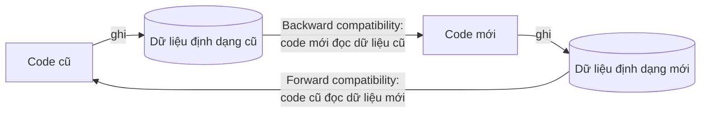

**Nội dung chương** (tr. 112). Xét nhiều định dạng mã hóa dữ liệu: **JSON, XML, Protocol Buffers, Thrift, Avro**, đặc biệt là cách chúng xử lý thay đổi schema và hỗ trợ việc dữ liệu cũ, mới cùng tồn tại. Sau đó xét cách chúng được dùng để **lưu trữ** và **giao tiếp**: web service, **REST**, **RPC**, và hệ thống truyền message như **actor** và **message queue**.

### Mạch lập luận của chương

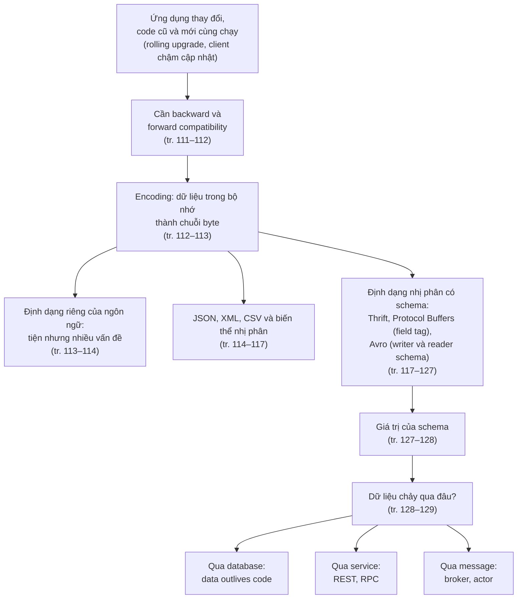

### Liên hệ với các chương khác

| Ý trong chương 4 | Liên hệ | Căn cứ |
| --- | --- | --- |
| Evolvability, rolling upgrade | **Chương 1** ([B5.3](chapter-01.md#evolvability), [B3.2](chapter-01.md#b3)) | tr. 111–112 |
| Schema-on-read, MySQL `ALTER TABLE` sao chép bảng | **Chương 2** ([B2.5](chapter-02.md#schema-flexibility)) | tr. 111, 130 |
| Vấn đề của JSON khi làm định dạng mã hóa (chương 2 hứa sẽ bàn) | **Chương 2**, tr. 32 | tr. 114–115 |
| Dữ liệu nén theo cột, Parquet, data warehouse | **Chương 3** ([B8](chapter-03.md#b8), [B7.2](chapter-03.md#data-warehouse)) | tr. 113, 131 |
| Chữ "serialization" trong transaction | **Chương 7** | tr. 113 |
| Timeout: không biết request có tới nơi không | **Chương 8** | tr. 134 |
| File Avro lớn, archival storage | **Chương 10** | tr. 125, 131 |
| Idempotence, so sánh message broker, nối các topic | **Chương 11** | tr. 134, 137–138 |
| Service discovery | **Chương 6**, "Request Routing", tr. 214 | tr. 135 |

> **Bản đồ đầu chương (tr. 110).** Bản đồ chia "Vịnh Binary Encodings" và "Bờ biển Textual Encodings". Trên đất liền có "Lãnh nguyên Bulk Storage" (CSV, log file, SQL dump, Parquet, Avro), vùng "Random-Access Storage" (JDBC, document database), "Cộng hòa Nhân dân RPC" (Thrift, Protocol Buffers, EJB, CORBA, WSDL, Swagger…), "Vịnh REST", "Vịnh SOAP", dãy núi "Message Passing" (Akka, Erlang), và một "Lâu đài trên không" mang tên *ảo tưởng về RPC trong suốt*. Con đường nối tất cả là "Long Road of Schema Evolution".

---

## B. Giải thích chi tiết

### B1. Formats for Encoding Data (tr. 112–113)

**What — hai cách biểu diễn dữ liệu** (tr. 112–113). Chương trình thường làm việc với dữ liệu ở (ít nhất) hai dạng:

1. **Trong bộ nhớ:** object, struct, list, array, hash table, tree… Các cấu trúc này được tối ưu để CPU truy cập và thao tác hiệu quả, thường dùng **con trỏ**.
2. **Khi ghi ra file hoặc gửi qua mạng:** phải mã hóa thành một **chuỗi byte tự chứa** (ví dụ một document JSON). Con trỏ không có nghĩa với tiến trình khác, nên chuỗi byte này trông **rất khác** cấu trúc dữ liệu trong bộ nhớ.

> Chú thích i (tr. 113): trừ vài trường hợp đặc biệt, như một số memory-mapped file, hoặc khi thao tác trực tiếp trên dữ liệu nén ([chương 3, B8.2](chapter-03.md#column-compression)).

**Thuật ngữ** (tr. 113):

| Chiều chuyển đổi | Tên gọi |
| --- | --- |
| Bộ nhớ → chuỗi byte | ***Encoding***, còn gọi là *serialization* hay *marshalling* |
| Chuỗi byte → bộ nhớ | ***Decoding***, còn gọi là *parsing*, *deserialization*, *unmarshalling* |

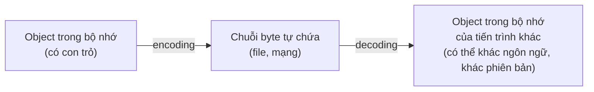

> - Chú thích ii (tr. 113): **encoding không liên quan gì đến encryption** (mã hóa bảo mật). Sách không bàn về encryption.
> - **Hộp "Terminology clash"** (tr. 113): chữ *serialization* cũng được dùng trong ngữ cảnh **transaction** (Chương 7) với nghĩa **hoàn toàn khác**. Để tránh nhầm, sách dùng chữ **encoding**, dù *serialization* có lẽ phổ biến hơn.

Đây là bài toán rất phổ biến, nên có vô số thư viện và định dạng mã hóa để chọn (tr. 113).

---

### B2. Language-Specific Formats (tr. 113–114)

**What.** Nhiều ngôn ngữ có sẵn cách mã hóa object trong bộ nhớ thành chuỗi byte: Java có `java.io.Serializable` [1], Ruby có `Marshal` [2], Python có `pickle` [3]… Cũng có nhiều thư viện bên thứ ba như **Kryo** cho Java [4] (tr. 113).

**Why hấp dẫn.** Rất **tiện**: lưu và khôi phục object với rất ít code thêm (tr. 113).

**Nhưng có nhiều vấn đề sâu** (tr. 113–114):

| Vấn đề | Giải thích |
| --- | --- |
| **Gắn chặt với một ngôn ngữ** | Đọc dữ liệu bằng ngôn ngữ khác rất khó. Lưu hay truyền dữ liệu theo cách này là **tự trói mình vào ngôn ngữ hiện tại** trong thời gian rất dài, và chặn khả năng tích hợp với hệ thống của tổ chức khác (có thể dùng ngôn ngữ khác). |
| **Lỗ hổng bảo mật** | Để khôi phục đúng kiểu object, quá trình decode phải **tạo được object của lớp tùy ý**. Nếu kẻ tấn công khiến ứng dụng decode một chuỗi byte tùy ý, họ có thể tạo object của lớp tùy ý, thường dẫn tới những điều tồi tệ như **thực thi code từ xa** [5, 6, 7]. |
| **Quản lý phiên bản là chuyện tính sau** | Vì nhắm tới mã hóa nhanh và dễ, các thư viện này thường **bỏ qua** vấn đề phiền toái là forward và backward compatibility. |
| **Hiệu năng là chuyện tính sau** | Thời gian CPU để encode, decode và kích thước dữ liệu mã hóa thường không được chú ý. Ví dụ, serialization có sẵn của Java nổi tiếng **chậm và cồng kềnh** [8]. |

**Kết luận của tác giả** (tr. 114): nhìn chung, **dùng định dạng có sẵn của ngôn ngữ là ý tồi**, trừ những mục đích **rất tạm thời**.

> **Ví dụ minh họa do AI xây dựng.** Một dịch vụ Python lưu session người dùng bằng `pickle` vào Redis. Hai năm sau, công ty muốn viết lại một phần bằng Go: dịch vụ Go không đọc được session. Tệ hơn, nếu kẻ tấn công ghi được dữ liệu vào Redis, mỗi lần dịch vụ Python unpickle là một cơ hội thực thi code tùy ý. Đây đúng là hai vấn đề đầu tiên trong bảng trên.

---

### B3. JSON, XML, and Binary Variants (tr. 114–117)

#### B3.1 Định dạng văn bản: JSON, XML, CSV

**What** (tr. 114). Khi chuyển sang định dạng chuẩn mà nhiều ngôn ngữ đọc ghi được, ứng viên hiển nhiên là **JSON** và **XML**: được biết rộng rãi, hỗ trợ rộng rãi, và… bị ghét gần như rộng rãi.

- **XML** thường bị chê **quá dài dòng** và **phức tạp không cần thiết** [9].
- **JSON** phổ biến chủ yếu vì được **trình duyệt hỗ trợ sẵn** (là tập con của JavaScript) và đơn giản hơn XML.
- **CSV** cũng là định dạng phổ biến, độc lập ngôn ngữ, nhưng kém mạnh hơn.

Cả ba là định dạng **văn bản**, nên **người đọc được** ở một mức độ nào đó (dù cú pháp là đề tài tranh cãi).

**Why — những vấn đề tinh tế** (tr. 114–115):

**1. Mơ hồ về số.**

- Trong XML và CSV, không phân biệt được **số** với **chuỗi gồm toàn chữ số** (trừ khi tham chiếu một schema bên ngoài).
- JSON phân biệt chuỗi và số, nhưng **không phân biệt số nguyên và số thực**, và **không quy định độ chính xác**.
- Vấn đề với số lớn: số nguyên **lớn hơn 2⁵³** không biểu diễn chính xác được bằng số thực **IEEE 754 double**, nên bị **sai lệch** khi parse trong ngôn ngữ dùng số thực (như JavaScript).
- Ví dụ thực tế: **Twitter** dùng số 64-bit làm ID cho mỗi tweet. JSON trả về từ API của Twitter chứa ID tweet **hai lần**: một lần dạng số JSON, một lần dạng **chuỗi thập phân**, để lách việc JavaScript parse sai các số này [10].

> **Bổ sung ngoài sách (phép tính).** 2⁵³ = 9.007.199.254.740.992. Số double có 53 bit cho phần định trị, nên mọi số nguyên đến 2⁵³ biểu diễn chính xác, nhưng từ đó trở lên các số nguyên liền kề bắt đầu "trùng" nhau. Ví dụ: 2⁵³ + 1 bị làm tròn thành 2⁵³. ID 64-bit có thể lên tới khoảng 9,2 × 10¹⁸, lớn hơn 2⁵³ khoảng 1.000 lần.

**2. Không có chuỗi nhị phân.** JSON và XML hỗ trợ tốt chuỗi ký tự Unicode (văn bản cho người đọc), nhưng **không hỗ trợ chuỗi byte nhị phân** (chuỗi byte không có character encoding). Người ta lách bằng cách mã hóa dữ liệu nhị phân thành văn bản bằng **Base64**, rồi dùng schema để chỉ ra giá trị cần được hiểu là Base64. Cách này chạy được nhưng hơi "chắp vá", và làm **dữ liệu to thêm 33%**.

> **Bổ sung ngoài sách.** Base64 biểu diễn mỗi 3 byte bằng 4 ký tự ASCII, nên kích thước tăng 4/3, tức thêm khoảng 33%.

**3. Schema chỉ là tùy chọn, và phức tạp** (tr. 115). XML [11] và JSON [12] đều có schema tùy chọn. Các ngôn ngữ schema này **khá mạnh**, nên cũng **khá phức tạp** để học và cài đặt. Dùng XML schema khá phổ biến, nhưng nhiều công cụ JSON **không dùng schema**. Vì cách hiểu đúng dữ liệu (như số và chuỗi nhị phân) phụ thuộc vào thông tin trong schema, ứng dụng không dùng schema có thể phải **hardcode** logic encode, decode phù hợp.

**4. CSV không có schema và mơ hồ** (tr. 115). Ứng dụng tự định nghĩa ý nghĩa mỗi hàng, mỗi cột. Thay đổi thêm hàng hay cột phải xử lý **thủ công**. CSV cũng khá mơ hồ: điều gì xảy ra nếu giá trị chứa dấu phẩy hay ký tự xuống dòng? Quy tắc escape đã được đặc tả chính thức [13], nhưng **không phải parser nào cũng cài đúng**.

**Kết luận** (tr. 115). Dù có các khuyết điểm, JSON, XML và CSV **đủ tốt cho nhiều mục đích**, và có lẽ sẽ còn phổ biến, đặc biệt làm **định dạng trao đổi dữ liệu** giữa các tổ chức. Khi đó, miễn là các bên **đồng ý** về định dạng, việc nó đẹp hay hiệu quả thường không quan trọng: **khó khăn để các tổ chức đồng ý với nhau về bất cứ điều gì lớn hơn hầu hết mối lo khác**.

#### B3.2 Biến thể nhị phân của JSON và XML (tr. 115–117)

**Why.** Với dữ liệu **chỉ dùng nội bộ** tổ chức, áp lực phải dùng định dạng "mẫu số chung nhỏ nhất" ít hơn. Có thể chọn định dạng **gọn hơn** hoặc **parse nhanh hơn**. Với dataset nhỏ, lợi ích không đáng kể; nhưng khi lên tới **terabyte**, lựa chọn định dạng có ảnh hưởng lớn (tr. 115).

**What.** JSON ít dài dòng hơn XML, nhưng cả hai vẫn tốn nhiều dung lượng so với định dạng nhị phân. Từ đó xuất hiện vô số **mã hóa nhị phân cho JSON** (MessagePack, BSON, BJSON, UBJSON, BISON, Smile…) và **cho XML** (WBXML, Fast Infoset…). Chúng được dùng ở một số lĩnh vực hẹp, nhưng không cái nào phổ biến bằng bản văn bản của JSON và XML (tr. 115).

- Một số định dạng **mở rộng tập kiểu dữ liệu** (phân biệt số nguyên và số thực, thêm chuỗi nhị phân), nhưng **giữ nguyên mô hình dữ liệu** của JSON hay XML.
- Đặc biệt, vì **không quy định schema**, chúng phải **chứa mọi tên trường** trong dữ liệu đã mã hóa.

**Example 4-1 — bản ghi mẫu dùng xuyên suốt chương** (tr. 116):

| Trường | Giá trị |
| --- | --- |
| `userName` | "Martin" |
| `favoriteNumber` | 1337 |
| `interests` | danh sách ["daydreaming", "hacking"] |

**MessagePack mã hóa bản ghi này thế nào** (tr. 116, Hình 4-1):

| Byte | Ý nghĩa |
| --- | --- |
| `0x83` | Một **object** (4 bit đầu = 0x80) có **3 trường** (4 bit cuối = 0x03). Nếu object có hơn 15 trường thì dùng một chỉ báo kiểu khác, và số trường được mã hóa bằng 2 hoặc 4 byte. |
| `0xa8` | Một **chuỗi** (4 bit đầu = 0xa0) dài **8 byte** (4 bit cuối = 0x08) |
| 8 byte tiếp theo | Tên trường `userName` dạng ASCII. Độ dài đã được báo trước, nên không cần ký hiệu kết thúc chuỗi hay escape. |
| `0xa6` + 6 byte | Chuỗi giá trị "Martin" |
| … | Tương tự cho các trường còn lại |

**Kết quả:** **66 byte**, chỉ ít hơn một chút so với **81 byte** của JSON văn bản (đã bỏ khoảng trắng). Mọi mã hóa nhị phân của JSON đều tương tự. Không rõ việc giảm chút dung lượng (và có thể parse nhanh hơn chút) có đáng để **mất khả năng đọc bằng mắt** hay không (tr. 116). Các mục sau sẽ mã hóa cùng bản ghi chỉ trong **32 byte**.

> **Bổ sung ngoài sách (phép tính kiểm chứng).**
> - JSON không khoảng trắng: `{"userName":"Martin","favoriteNumber":1337,"interests":["daydreaming","hacking"]}` dài đúng **81 ký tự**.
> - MessagePack: 1 (object) + 1 + 8 (`userName`) + 1 + 6 (`Martin`) + 1 + 14 (`favoriteNumber`) + 1 + 2 (1337 dạng uint16) + 1 + 9 (`interests`) + 1 (mảng 2 phần tử) + 1 + 11 (`daydreaming`) + 1 + 7 (`hacking`) = **66 byte**.
> - Trong đó **31 byte** (gần một nửa) chỉ để chứa **ba tên trường**. Đây chính là phần mà định dạng có schema loại bỏ được.

---

### B4. Thrift and Protocol Buffers (tr. 117–121)

#### B4.1 Schema và code generation (tr. 117–118)

**What.** **Apache Thrift** [15] và **Protocol Buffers** (protobuf) [16] là thư viện mã hóa nhị phân dựa trên **cùng một nguyên lý**. Protocol Buffers được phát triển ở **Google**, Thrift ở **Facebook**, cả hai được mở mã nguồn năm **2007–08** [17] (tr. 117).

Cả hai **bắt buộc có schema** cho mọi dữ liệu được mã hóa. Schema được viết bằng **IDL** (*interface definition language*). Schema cho bản ghi mẫu, diễn giải thành bảng (tr. 117–118):

| Field tag | Tên trường (Thrift / protobuf) | Kiểu | Đánh dấu trong Thrift | Đánh dấu trong protobuf |
| --- | --- | --- | --- | --- |
| **1** | `userName` / `user_name` | chuỗi | `required` | `required` |
| **2** | `favoriteNumber` / `favorite_number` | số nguyên 64-bit | `optional` | `optional` |
| **3** | `interests` | danh sách chuỗi | `optional`, kiểu `list<string>` | `repeated` (không có kiểu list) |

**Code generation** (tr. 118). Thrift và Protocol Buffers đều có công cụ **sinh code**: nhận định nghĩa schema và sinh ra các lớp cài đặt schema đó trong nhiều ngôn ngữ [18]. Code ứng dụng gọi code được sinh ra để encode hoặc decode bản ghi.

#### B4.2 Dữ liệu mã hóa trông như thế nào? (tr. 118–120)

Thrift có **hai** định dạng nhị phân (gây rối): **BinaryProtocol** và **CompactProtocol**.

> Chú thích iii (tr. 118): thực ra có **ba** (thêm DenseProtocol, nhưng chỉ cài đặt bằng C++ nên không tính là đa ngôn ngữ [18]), và còn **hai** định dạng dựa trên JSON [19]. Tác giả bình luận châm biếm: "thú vị thật".

| Định dạng | Kích thước | Cách mã hóa (tr. 118–120) |
| --- | --- | --- |
| **Thrift BinaryProtocol** (Hình 4-2) | **59 byte** | Mỗi trường có **chú thích kiểu** (chuỗi, số nguyên, list…) và khi cần thì có **độ dài** (độ dài chuỗi, số phần tử list). Chuỗi dữ liệu ("Martin", "daydreaming", "hacking") mã hóa dạng UTF-8. **Khác biệt lớn so với MessagePack: không có tên trường**, thay vào đó là **field tag** (1, 2, 3). |
| **Thrift CompactProtocol** (Hình 4-3) | **34 byte** | Tương đương về ngữ nghĩa với BinaryProtocol, nhưng **gộp kiểu trường và số tag vào một byte**, và dùng **số nguyên độ dài thay đổi** (*variable-length integer*). |
| **Protocol Buffers** (Hình 4-4) | **33 byte** | Chỉ có một định dạng nhị phân. Cách gộp bit hơi khác nhưng rất giống CompactProtocol. |

**Field tag là gì?** (tr. 119) Field tag giống **bí danh** của trường: một cách **gọn** để nói đang nói về trường nào mà không phải viết tên trường ra. Đó chính là các con số xuất hiện trong định nghĩa schema.

**Số nguyên độ dài thay đổi** (tr. 119). Thay vì dùng đủ 8 byte cho số 1337, CompactProtocol mã hóa nó bằng **2 byte**. **Bit cao nhất** của mỗi byte cho biết còn byte nữa hay không. Vì vậy số từ –64 đến 63 dùng 1 byte, số từ –8192 đến 8191 dùng 2 byte, số lớn hơn dùng nhiều byte hơn.

> **Bổ sung ngoài sách (kiểm chứng byte trong hình).** 1337 ở dạng nhị phân là `10100111001` (11 bit).
> - **Protocol Buffers** (kiểu int64, varint không có bit dấu): 7 bit thấp `0111001` = 0x39, bật bit "còn nữa" thành **0xb9**; phần còn lại là 1337 >> 7 = 10 = **0x0a**. Ra `b9 0a`, khớp Hình 4-4.
> - **Thrift CompactProtocol và Avro** (Hình 4-3, 4-5 có đánh dấu "sign"): đặt **bit dấu ở cuối**, tức mã hóa 1337 × 2 = 2674 (kỹ thuật thường gọi là *zigzag encoding*). 2674 cho 7 bit thấp `1110010` = 0x72, bật bit "còn nữa" thành **0xf2**; phần còn lại 2674 >> 7 = 20 = **0x14**. Ra `f2 14`, khớp cả hai hình. Nhờ bit dấu ở cuối, số âm nhỏ cũng chỉ tốn ít byte, đúng như sách nói về khoảng –64 đến 63.

**`required` và `optional` không ảnh hưởng mã hóa** (tr. 120). Trong schema, mỗi trường được đánh dấu `required` hoặc `optional`, nhưng điều này **không làm thay đổi** cách trường được mã hóa: không có gì trong dữ liệu nhị phân cho biết trường đó bắt buộc. Khác biệt duy nhất: `required` bật một **kiểm tra lúc chạy**, báo lỗi nếu trường chưa được đặt. Hữu ích để bắt bug.

#### B4.3 Field tag và schema evolution (tr. 120–121)

**What.** Schema chắc chắn phải thay đổi theo thời gian. Việc này gọi là ***schema evolution*** (tr. 120).

**How — bản ghi mã hóa chỉ là chuỗi các trường** (tr. 120):

- Một bản ghi đã mã hóa chỉ là **các trường đã mã hóa nối nhau**.
- Mỗi trường được định danh bằng **số tag** và có **chú thích kiểu dữ liệu**.
- Trường không được đặt giá trị thì **bị bỏ hẳn** khỏi bản ghi.
- Vì vậy **field tag là then chốt** cho ý nghĩa của dữ liệu:
  - **Đổi tên trường** trong schema: **được**, vì dữ liệu mã hóa không bao giờ chứa tên trường.
  - **Đổi tag** của trường: **không được**, vì mọi dữ liệu đã mã hóa sẽ thành vô nghĩa.

**Thêm trường** (tr. 121):

- Được thêm trường mới, miễn mỗi trường có **số tag mới**.
- **Forward compatibility:** code cũ (không biết tag mới) đọc dữ liệu do code mới ghi, gặp tag lạ thì **bỏ qua**. **Chú thích kiểu** cho parser biết phải **nhảy qua bao nhiêu byte**.
- **Backward compatibility:** miễn mỗi trường có tag duy nhất, code mới luôn đọc được dữ liệu cũ vì tag giữ nguyên nghĩa. Chỉ có một chi tiết: **trường mới không được là `required`**. Nếu là `required`, kiểm tra sẽ báo lỗi khi code mới đọc dữ liệu do code cũ ghi (code cũ không ghi trường mới). Vì vậy, **mọi trường thêm sau lần triển khai đầu tiên phải là `optional` hoặc có giá trị mặc định**.

**Xóa trường** (tr. 121). Giống thêm trường nhưng **đảo ngược** mối lo về backward và forward compatibility:

- Chỉ được xóa trường **`optional`**. Trường `required` **không bao giờ** xóa được.
- **Không bao giờ dùng lại** số tag đó, vì có thể vẫn còn dữ liệu ở đâu đó chứa tag cũ, và code mới phải bỏ qua trường đó.

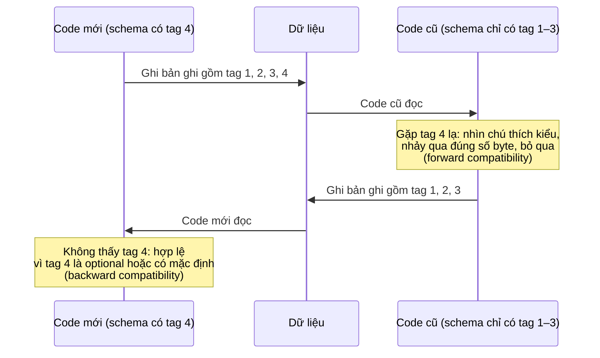

#### B4.4 Kiểu dữ liệu và schema evolution (tr. 121)

**Đổi kiểu dữ liệu của trường.** Có thể làm được (kiểm tra tài liệu), nhưng có **nguy cơ mất độ chính xác hoặc bị cắt cụt**. Ví dụ đổi số nguyên 32-bit thành 64-bit:

- Code mới đọc dữ liệu cũ: **dễ**, parser điền số 0 vào các bit thiếu.
- Code cũ đọc dữ liệu mới: code cũ vẫn dùng biến 32-bit. Nếu giá trị 64-bit không vừa 32 bit, nó bị **cắt cụt**.

**`repeated` của Protocol Buffers** (tr. 121). Protocol Buffers **không có kiểu list hay array**, mà có đánh dấu **`repeated`** cho trường (lựa chọn thứ ba bên cạnh `required` và `optional`). Mã hóa trường `repeated` đúng như tên gọi: **cùng một tag xuất hiện nhiều lần** trong bản ghi (Hình 4-4). Hệ quả hay: được phép đổi một trường **`optional` (một giá trị)** thành **`repeated` (nhiều giá trị)**:

- Code mới đọc dữ liệu cũ: thấy một list có **0 hoặc 1 phần tử** (tùy trường có mặt hay không).
- Code cũ đọc dữ liệu mới: chỉ thấy **phần tử cuối cùng** của list.

**List của Thrift** (tr. 121). Thrift có kiểu **list riêng**, tham số hóa bằng kiểu phần tử. Nó **không** cho phép tiến hóa từ một giá trị sang nhiều giá trị như protobuf, nhưng có ưu điểm hỗ trợ **list lồng nhau**.

---

### B5. Avro (tr. 122–127)

#### B5.1 Schema không có tag, mã hóa gọn nhất (tr. 122–123)

**What.** **Apache Avro** [20] là một định dạng mã hóa nhị phân khác, **khác biệt thú vị** so với Protocol Buffers và Thrift. Nó ra đời năm **2009** như một dự án con của **Hadoop**, vì Thrift không hợp với các use case của Hadoop [21] (tr. 122).

Avro cũng dùng schema để mô tả cấu trúc dữ liệu, với **hai ngôn ngữ schema** (tr. 122):

- **Avro IDL**: để người viết và sửa;
- dạng **dựa trên JSON**: để máy đọc dễ hơn.

Schema cho bản ghi mẫu, diễn giải thành bảng (tr. 122):

| Tên trường | Kiểu | Giá trị mặc định |
| --- | --- | --- |
| `userName` | chuỗi | (không có) |
| `favoriteNumber` | **union** {null, long}: hoặc null, hoặc số nguyên 64-bit | **null** |
| `interests` | mảng chuỗi | (không có) |

**Điểm đầu tiên cần để ý: schema không có số tag** (tr. 122).

**Mã hóa** (tr. 122–123, Hình 4-5). Bản ghi mẫu mã hóa bằng Avro chỉ còn **32 byte**, **gọn nhất** trong mọi cách đã xét.

- Trong chuỗi byte **không có gì** định danh trường hay kiểu dữ liệu. Mã hóa chỉ là **các giá trị nối nhau**.
- Một chuỗi chỉ là **tiền tố độ dài** rồi tới các byte UTF-8, nhưng **không có gì** trong dữ liệu nói rằng đó là chuỗi. Nó cũng có thể là số nguyên, hay thứ khác hẳn.
- Số nguyên dùng mã hóa **độ dài thay đổi** (giống CompactProtocol của Thrift).

| Byte (Hình 4-5) | Ý nghĩa |
| --- | --- |
| `0c` | Độ dài 6 (đã nhân 2 do bit dấu) |
| `4d 61 72 74 69 6e` | "Martin" |
| `02` | Nhánh 1 của union (long, không phải null) |
| `f2 14` | 1337 |
| `04` | Theo sau là 2 phần tử mảng |
| `16` + 11 byte | Độ dài 11, "daydreaming" |
| `0e` + 7 byte | Độ dài 7, "hacking" |
| `00` | Kết thúc mảng |

> **Bổ sung ngoài sách (phép tính kiểm chứng).** 1 + 6 + 1 + 2 + 1 + 1 + 11 + 1 + 7 + 1 = **32 byte**. So với MessagePack (66 byte), Avro bỏ được 31 byte tên trường, và các byte kiểu, tag.

**Hệ quả** (tr. 123). Để parse, phải đi qua các trường **theo thứ tự trong schema** và dùng schema để biết kiểu của từng trường. Nghĩa là dữ liệu nhị phân chỉ decode **đúng** khi code đọc dùng **chính xác cùng schema** với code ghi. Bất kỳ sai lệch schema nào giữa người đọc và người ghi đều cho ra **dữ liệu decode sai**.

Vậy Avro hỗ trợ schema evolution bằng cách nào?

#### B5.2 Writer's schema và reader's schema (tr. 123–124)

**What** (tr. 123):

- ***Writer's schema***: khi ứng dụng **mã hóa** dữ liệu (ghi file, ghi database, gửi qua mạng…), nó dùng **phiên bản schema nó đang biết**, ví dụ schema được biên dịch sẵn vào ứng dụng.
- ***Reader's schema***: khi ứng dụng **giải mã** dữ liệu, nó **kỳ vọng** dữ liệu theo một schema nào đó. Đó là schema mà code ứng dụng dựa vào, có thể code đã được sinh từ schema đó lúc build.

**Ý tưởng then chốt** (tr. 123–124): **writer's schema và reader's schema không cần giống nhau, chỉ cần tương thích**. Khi đọc, thư viện Avro **đặt hai schema cạnh nhau** và **dịch** dữ liệu từ writer's schema sang reader's schema. Đặc tả Avro [20] định nghĩa chính xác quá trình này (Hình 4-6).

**How — quy tắc phân giải** (tr. 124):

- **Thứ tự trường khác nhau: không sao**, vì Avro khớp trường **theo tên**.
- Trường có trong **writer's schema** nhưng không có trong **reader's schema**: **bỏ qua**.
- Trường reader **kỳ vọng** nhưng writer's schema **không có**: điền **giá trị mặc định** khai báo trong reader's schema.

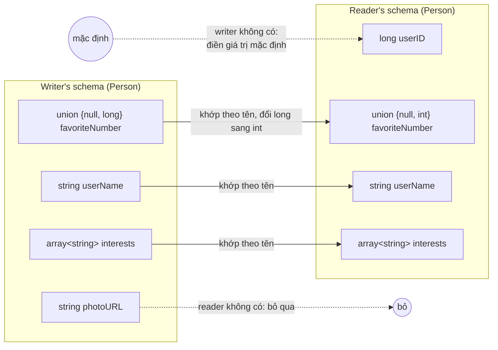

*(Vẽ lại Hình 4-6, tr. 124. Hai schema có thứ tự trường khác nhau mà vẫn phân giải được.)*

#### B5.3 Quy tắc schema evolution của Avro (tr. 124–125)

**Hai chiều tương thích theo cách nói của Avro** (tr. 124):

| | Writer | Reader |
| --- | --- | --- |
| **Forward compatibility** | Schema **mới** | Schema **cũ** |
| **Backward compatibility** | Schema **cũ** | Schema **mới** |

**Quy tắc chính: chỉ được thêm hoặc xóa trường có giá trị mặc định** (tr. 124). (`favoriteNumber` trong schema mẫu có mặc định là null.)

- **Thêm trường có mặc định:** trường mới có ở schema mới nhưng không có ở schema cũ. Reader dùng schema mới đọc bản ghi viết bằng schema cũ thì **điền giá trị mặc định** cho trường thiếu.
- **Thêm trường không có mặc định:** reader mới **không đọc được** dữ liệu do writer cũ ghi, **phá backward compatibility**.
- **Xóa trường không có mặc định:** reader cũ **không đọc được** dữ liệu do writer mới ghi, **phá forward compatibility**.

**Null phải được khai báo tường minh** (tr. 125):

- Trong một số ngôn ngữ, null là giá trị mặc định chấp nhận được cho **mọi** biến. **Avro thì không**: muốn cho phép trường là null, phải dùng **union type**. Ví dụ union {null, long, string} nghĩa là trường có thể là số, chuỗi, hoặc null.
- Chỉ dùng null làm mặc định được nếu null là **một nhánh của union**.

  > Chú thích iv (tr. 125): chính xác hơn, giá trị mặc định phải thuộc kiểu của **nhánh đầu tiên** trong union. Đây là giới hạn riêng của Avro, không phải đặc điểm chung của union type.

- Cách này dài dòng hơn so với cho mọi thứ nullable mặc định, nhưng **giúp tránh bug** nhờ nói rõ cái gì được và không được là null [22].
- Vì vậy Avro **không có** đánh dấu `optional` và `required` như Protocol Buffers và Thrift. Thay vào đó là **union type** và **giá trị mặc định**.

> **Bổ sung ngoài sách.** Tài liệu [22] là bài nói "Null References: The Billion Dollar Mistake" của Tony Hoare, người đưa null reference vào ngôn ngữ ALGOL W năm 1965 và sau này gọi đó là "sai lầm tỷ đô".

**Các thay đổi khác** (tr. 125):

| Thay đổi | Tương thích |
| --- | --- |
| **Đổi kiểu dữ liệu** của trường | Được, miễn Avro **chuyển đổi được** kiểu đó |
| **Đổi tên trường** | Hơi khéo: reader's schema có thể chứa **alias** cho tên trường, nên khớp được tên cũ của writer với alias. Vì vậy đổi tên là **backward compatible nhưng không forward compatible** |
| **Thêm một nhánh vào union** | **Backward compatible nhưng không forward compatible** |

> **Bổ sung ngoài sách (vì sao đổi tên chỉ backward compatible).** Reader mới có alias nên nhận ra tên cũ trong dữ liệu cũ. Nhưng reader cũ không biết tên mới, và không có alias cho nó, nên sẽ coi trường tên mới là trường lạ (bỏ qua) và thiếu trường tên cũ (cần mặc định).

#### B5.4 Vậy writer's schema là gì? (tr. 125–126)

**Câu hỏi quan trọng** (tr. 125). Reader làm sao biết dữ liệu được mã hóa bằng writer's schema nào? **Không thể** kèm cả schema trong mỗi bản ghi: schema có thể lớn hơn dữ liệu nhiều, và mọi khoản tiết kiệm nhờ mã hóa nhị phân sẽ thành vô nghĩa.

**Câu trả lời phụ thuộc ngữ cảnh** (tr. 125–126):

| Ngữ cảnh | Cách làm |
| --- | --- |
| **File lớn chứa nhiều bản ghi** | Cách dùng phổ biến của Avro, đặc biệt với Hadoop: một file lớn chứa hàng triệu bản ghi, **cùng một schema** (Chương 10). Người ghi chỉ cần đặt writer's schema **một lần ở đầu file**. Avro có định dạng file cho việc này: ***object container files***. |
| **Database với các bản ghi ghi riêng lẻ** | Các bản ghi có thể được ghi ở những thời điểm khác nhau bằng writer's schema khác nhau. Cách đơn giản nhất: đặt **số phiên bản** ở đầu mỗi bản ghi, và giữ **danh sách các phiên bản schema** trong database. Reader lấy bản ghi, đọc số phiên bản, lấy writer's schema tương ứng, rồi decode phần còn lại. **Espresso** [23] làm theo cách này. |
| **Gửi bản ghi qua kết nối mạng** | Hai tiến trình giao tiếp qua kết nối mạng hai chiều có thể **thỏa thuận phiên bản schema khi thiết lập kết nối**, rồi dùng schema đó suốt kết nối. Giao thức **Avro RPC** làm như vậy. |

**Database các phiên bản schema** (tr. 126). Dù ở ngữ cảnh nào, một database chứa các phiên bản schema đều **hữu ích**: nó là **tài liệu**, và cho cơ hội **kiểm tra tương thích schema** [24]. Số phiên bản có thể là một số nguyên tăng dần, hoặc **hash của schema**.

> **Bổ sung ngoài sách.** Trong thực tế, thành phần này thường được gọi là ***schema registry***: producer đăng ký schema và đính kèm ID schema vào mỗi message, consumer dùng ID để lấy writer's schema. Registry có thể từ chối schema mới nếu nó phá tương thích.

#### B5.5 Schema sinh động (tr. 126–127)

**Why.** Một ưu điểm của Avro so với Protocol Buffers và Thrift là schema **không chứa số tag**. Vì sao điều đó quan trọng? Giữ vài con số trong schema thì có vấn đề gì? (tr. 126)

**Khác biệt: Avro thân thiện hơn với schema được sinh tự động** (tr. 126).

**Example của sách:**

- Muốn **dump nội dung relational database ra file**, dùng định dạng nhị phân để tránh vấn đề của định dạng văn bản (JSON, CSV, SQL).
- Với Avro: **sinh tự động** Avro schema (dạng JSON) từ relational schema, rồi mã hóa nội dung database bằng schema đó, dump tất cả vào một Avro object container file [25].
  - Mỗi **bảng** thành một **record schema**.
  - Mỗi **cột** thành một **trường**; **tên cột** thành **tên trường**.
- **Khi schema database thay đổi** (ví dụ một bảng thêm một cột và bớt một cột): chỉ cần **sinh Avro schema mới** từ schema database đã cập nhật rồi export. Quá trình export **không cần để ý** thay đổi schema: nó chỉ cần chuyển đổi schema mỗi lần chạy. Ai đọc file mới sẽ thấy các trường thay đổi, nhưng vì trường được định danh **theo tên**, writer's schema mới vẫn khớp được với reader's schema cũ.

**So với Thrift và Protocol Buffers** (tr. 126–127). Field tag có lẽ phải được **gán bằng tay**: mỗi lần schema database đổi, quản trị viên phải **cập nhật thủ công** ánh xạ từ tên cột sang field tag. Có thể tự động hóa, nhưng bộ sinh schema phải rất cẩn thận để **không gán lại tag đã từng dùng**. Schema sinh động đơn giản là **không phải mục tiêu thiết kế** của Thrift hay Protocol Buffers, nhưng **là** mục tiêu của Avro.

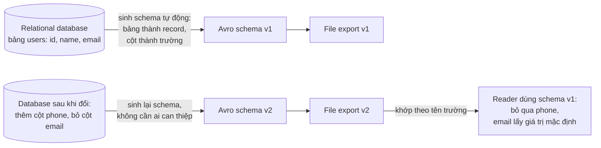

*(Ví dụ minh họa do AI xây dựng theo ý ở tr. 126. Để reader cũ đọc được khi cột email bị bỏ, trường email trong schema của reader cần có giá trị mặc định.)*

#### B5.6 Code generation và ngôn ngữ kiểu động (tr. 127)

| Ngôn ngữ | Code generation |
| --- | --- |
| **Kiểu tĩnh** (Java, C++, C#) | **Hữu ích**: cho phép dùng cấu trúc dữ liệu hiệu quả trong bộ nhớ cho dữ liệu đã decode, **kiểm tra kiểu** và **gợi ý tự động** trong IDE. Thrift và Protocol Buffers **dựa vào** code generation. |
| **Kiểu động** (JavaScript, Ruby, Python) | **Ít ý nghĩa**, vì không có bộ kiểm tra kiểu lúc biên dịch. Code generation thường **không được ưa**, vì các ngôn ngữ này vốn tránh bước biên dịch tường minh. Với **schema sinh động** (như Avro schema sinh từ bảng database), code generation là **trở ngại không cần thiết** để tiếp cận dữ liệu. |

**Avro: code generation là tùy chọn** (tr. 127). Avro có code generation **tùy chọn** cho ngôn ngữ kiểu tĩnh, nhưng dùng tốt **không cần** nó. Với một object container file (có nhúng writer's schema), có thể mở bằng thư viện Avro và xem dữ liệu như xem file JSON. File **tự mô tả** (*self-describing*) vì chứa mọi metadata cần thiết.

Tính chất này đặc biệt hữu ích với ngôn ngữ xử lý dữ liệu kiểu động như **Apache Pig** [26]: mở vài file Avro, bắt đầu phân tích, rồi ghi dataset dẫn xuất ra file Avro, **không cần nghĩ về schema**.

---

### B6. The Merits of Schemas (tr. 127–128)

**Schema đơn giản thì phổ biến** (tr. 127). Protocol Buffers, Thrift và Avro đều dùng schema để mô tả định dạng nhị phân. Ngôn ngữ schema của chúng **đơn giản hơn nhiều** so với XML Schema hay JSON Schema, vốn hỗ trợ quy tắc kiểm tra chi tiết hơn nhiều (ví dụ: "giá trị chuỗi của trường này phải khớp regular expression này", hay "giá trị số nguyên phải trong khoảng 0 đến 100"). Vì đơn giản để cài đặt và sử dụng, chúng được hỗ trợ trong khá nhiều ngôn ngữ lập trình.

**Ý tưởng không mới** (tr. 127–128):

- Chúng có nhiều điểm chung với **ASN.1**, một ngôn ngữ định nghĩa schema được chuẩn hóa lần đầu năm **1984** [27]. ASN.1 được dùng để định nghĩa nhiều giao thức mạng, và mã hóa nhị phân của nó (**DER**) vẫn được dùng để mã hóa **chứng chỉ SSL (X.509)** [28].
- ASN.1 hỗ trợ schema evolution bằng **số tag**, giống Protocol Buffers và Thrift [29].
- Nhưng nó **rất phức tạp** và **tài liệu kém**, nên có lẽ không phải lựa chọn tốt cho ứng dụng mới.

**Mã hóa nhị phân độc quyền** (tr. 128). Nhiều data system cũng có mã hóa nhị phân riêng. Ví dụ, hầu hết relational database có một **giao thức mạng** để gửi truy vấn và nhận kết quả. Giao thức thường riêng cho từng database, và hãng database cung cấp **driver** (ví dụ qua API ODBC hay JDBC) để decode kết quả từ giao thức mạng thành cấu trúc dữ liệu trong bộ nhớ.

**Bốn ưu điểm của mã hóa nhị phân dựa trên schema** (tr. 128):

1. **Gọn hơn nhiều** so với các biến thể "binary JSON", vì bỏ được tên trường khỏi dữ liệu.
2. **Schema là tài liệu quý**. Vì schema **bắt buộc phải có** để decode, có thể chắc chắn nó **luôn cập nhật**, trong khi tài liệu viết tay dễ lệch khỏi thực tế.
3. Giữ một **database các schema** cho phép **kiểm tra forward và backward compatibility** của thay đổi schema **trước khi triển khai**.
4. Với ngôn ngữ kiểu tĩnh, khả năng **sinh code** từ schema rất hữu ích vì cho phép **kiểm tra kiểu lúc biên dịch**.

**Tóm lại** (tr. 128): schema evolution cho **cùng mức linh hoạt** như database JSON schemaless/schema-on-read ([chương 2](chapter-02.md#schema-flexibility)), đồng thời cho **đảm bảo tốt hơn** về dữ liệu và **công cụ tốt hơn**.

---

### B7. Modes of Dataflow (tr. 128–139)

#### B7.0 Dữ liệu chảy giữa các tiến trình (tr. 128–129)

**Why.** Mỗi khi muốn gửi dữ liệu tới một tiến trình **không chung bộ nhớ** (gửi qua mạng, ghi ra file), phải mã hóa thành chuỗi byte. Forward và backward compatibility quan trọng cho evolvability: cho phép **nâng cấp từng phần** hệ thống độc lập, không phải đổi tất cả cùng lúc. **Tương thích là mối quan hệ** giữa một tiến trình **mã hóa** dữ liệu và một tiến trình khác **giải mã** nó (tr. 128).

**Câu hỏi:** ai mã hóa, ai giải mã? Phần còn lại của chương xét ba cách phổ biến nhất mà dữ liệu chảy giữa các tiến trình (tr. 129):

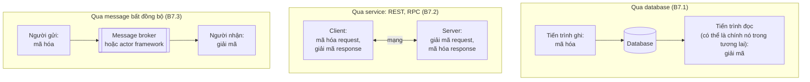

#### B7.1 Dataflow Through Databases (tr. 129–131)

**What** (tr. 129). Tiến trình ghi vào database **mã hóa** dữ liệu, tiến trình đọc **giải mã**.

**Cần cả hai chiều tương thích** (tr. 129):

- **Backward compatibility rõ ràng là cần thiết.** Nếu chỉ một tiến trình truy cập database, người đọc chỉ là phiên bản **sau** của chính tiến trình đó. Lưu thứ gì vào database giống **gửi một thông điệp cho chính mình trong tương lai**. Nếu không có backward compatibility, "bạn trong tương lai" không decode được thứ bạn đã ghi.
- **Forward compatibility cũng thường cần.** Thường có nhiều tiến trình truy cập database cùng lúc: nhiều ứng dụng hay service khác nhau, hoặc nhiều instance của cùng một service (chạy song song để scale hay chịu lỗi). Khi ứng dụng đang thay đổi, có thể một số tiến trình chạy code mới, một số chạy code cũ, ví dụ đang **rolling upgrade**. Vì vậy một giá trị có thể được **code mới ghi** rồi **code cũ đọc**.

**Một trở ngại thêm: giữ nguyên trường lạ** (tr. 129–130, Hình 4-7):

1. Thêm một trường vào schema, code mới ghi giá trị cho trường đó vào database.
2. Sau đó, code cũ (chưa biết trường mới) đọc bản ghi, cập nhật, rồi ghi lại.
3. Hành vi mong muốn thường là code cũ **giữ nguyên** trường mới, dù nó không hiểu trường đó.

Các định dạng mã hóa ở trên hỗ trợ **giữ nguyên trường lạ**, nhưng đôi khi phải cẩn thận **ở tầng ứng dụng**. Ví dụ, nếu decode giá trị trong database thành **model object** của ứng dụng rồi mã hóa lại object đó, trường lạ có thể **mất** trong quá trình chuyển đổi. Giải quyết không khó, chỉ cần **biết** để tránh (tr. 129).

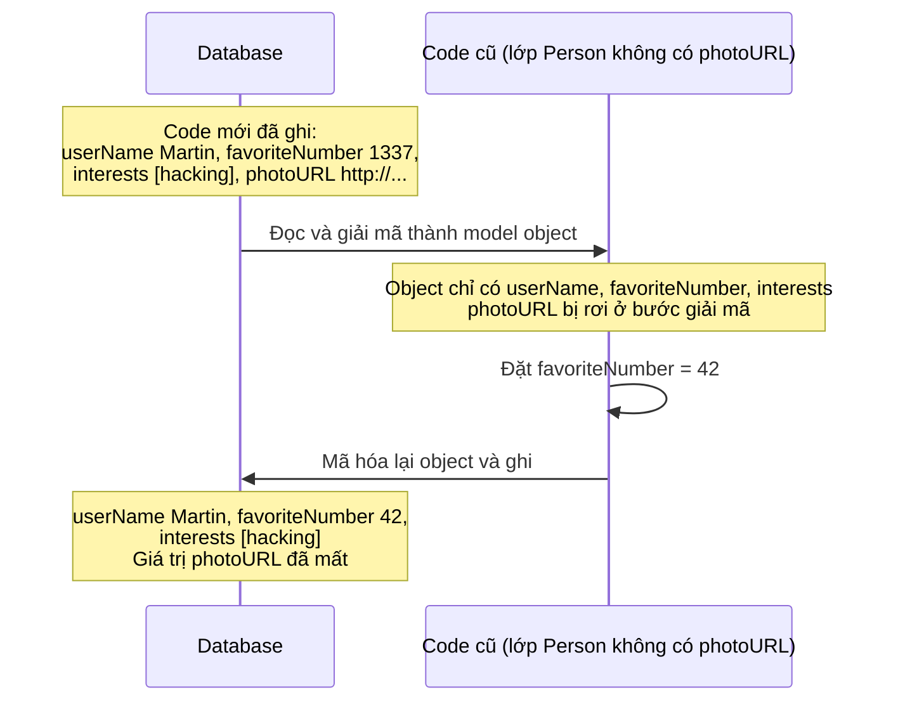

*(Vẽ lại Hình 4-7, tr. 130.)*

**Các giá trị được ghi ở những thời điểm khác nhau** (tr. 130–131):

- Database thường cho phép cập nhật **bất kỳ giá trị nào, bất kỳ lúc nào**. Trong cùng một database có thể có giá trị được ghi **5 mili giây trước** và giá trị được ghi **5 năm trước**.
- Triển khai phiên bản ứng dụng mới (ít nhất là phía server) có thể **thay thế hoàn toàn** bản cũ trong vài phút. Nhưng **nội dung database thì không**: dữ liệu 5 năm tuổi vẫn còn đó, **theo cách mã hóa gốc**, trừ khi đã được ghi lại một cách tường minh. Quan sát này đôi khi được tóm lại là ***data outlives code*** (**dữ liệu sống lâu hơn code**).
- **Migration** (ghi lại dữ liệu theo schema mới) làm được, nhưng **tốn kém** với dataset lớn, nên hầu hết database **tránh nếu có thể**.
- Hầu hết relational database cho phép thay đổi schema đơn giản, như **thêm cột mới với mặc định null**, **mà không ghi lại dữ liệu cũ**. Khi đọc một hàng cũ, database **điền null** cho các cột không có trong dữ liệu trên đĩa.

  > Chú thích v (tr. 130): trừ MySQL, vốn thường ghi lại cả bảng dù không thật sự cần (xem [chương 2](chapter-02.md#schema-flexibility)).

- Document database **Espresso** của LinkedIn dùng **Avro để lưu trữ**, nên dùng được quy tắc schema evolution của Avro [23].
- **Kết quả** (tr. 131): schema evolution cho phép **cả database trông như được mã hóa bằng một schema duy nhất**, dù bên dưới chứa bản ghi mã hóa bằng nhiều phiên bản schema lịch sử.

**Archival storage — lưu trữ lâu dài** (tr. 131):

- Khi chụp **snapshot** database định kỳ (để backup, hoặc để nạp vào data warehouse), bản dump thường được mã hóa bằng **schema mới nhất**, dù database nguồn chứa lẫn nhiều phiên bản schema. Đằng nào cũng sao chép dữ liệu, nên **mã hóa nhất quán** luôn bản sao.
- Bản dump được ghi **một lần** và sau đó **bất biến**, nên định dạng như **Avro object container file** rất hợp.
- Đây cũng là dịp tốt để mã hóa dữ liệu theo định dạng **lưu theo cột** thân thiện với phân tích như **Parquet** ([chương 3](chapter-03.md#column-store)).
- Chương 10 sẽ nói thêm về dữ liệu trong archival storage.

#### B7.2 Dataflow Through Services: REST and RPC (tr. 131–136)

##### Client, server, service (tr. 131–132)

**What.** Khi các tiến trình cần giao tiếp qua mạng, cách sắp xếp phổ biến nhất là hai vai trò: **client** và **server**. Server **phơi ra một API** qua mạng, client kết nối tới server để gửi request tới API đó. API mà server phơi ra gọi là một ***service*** (tr. 131).

- **Web** hoạt động như vậy: trình duyệt gửi request `GET` để tải HTML, CSS, JavaScript, hình ảnh, và `POST` để gửi dữ liệu lên server. API gồm một tập giao thức và định dạng **chuẩn hóa** (HTTP, URL, SSL/TLS, HTML…). Vì trình duyệt, web server và người viết website hầu như đồng ý về các chuẩn này, dùng trình duyệt nào cũng vào được website nào (ít nhất về lý thuyết).
- **Client khác trình duyệt:** ứng dụng native trên điện thoại hay máy tính, hoặc ứng dụng JavaScript chạy trong trình duyệt dùng `XMLHttpRequest` làm HTTP client (kỹ thuật **Ajax** [30]). Khi đó response thường **không phải HTML** cho người xem, mà là dữ liệu mã hóa tiện cho code phía client xử lý tiếp (như JSON). HTTP là giao thức vận chuyển, nhưng API ở trên **riêng cho từng ứng dụng**, và client, server phải đồng ý về chi tiết của API đó.

**SOA và microservices** (tr. 132). Một server có thể **chính là client** của service khác (ví dụ web app server là client của database). Cách này thường được dùng để **chia ứng dụng lớn thành các service nhỏ** theo lĩnh vực chức năng: service này gửi request tới service kia khi cần chức năng hay dữ liệu. Cách xây ứng dụng như vậy truyền thống gọi là ***service-oriented architecture*** (**SOA**), gần đây được tinh chỉnh và đổi tên thành ***microservices architecture*** [31, 32].

**Service giống và khác database** (tr. 132):

- **Giống:** đều cho client gửi và truy vấn dữ liệu.
- **Khác:** database cho phép **truy vấn tùy ý** bằng ngôn ngữ truy vấn (chương 2). Service phơi ra **API riêng cho ứng dụng**, chỉ cho phép input và output **đã định sẵn** bởi business logic [33]. Sự hạn chế này tạo ra **tính đóng gói** (*encapsulation*): service có thể đặt ra giới hạn chi tiết về việc client được làm gì.

**Mục tiêu thiết kế then chốt** (tr. 132). SOA/microservices nhằm làm ứng dụng **dễ thay đổi và bảo trì** bằng cách cho các service **triển khai và tiến hóa độc lập**. Ví dụ, mỗi service do **một đội** sở hữu, và đội đó phát hành phiên bản mới thường xuyên **mà không cần phối hợp** với đội khác. Nói cách khác, phải **kỳ vọng phiên bản cũ và mới của server và client chạy cùng lúc**, nên cách mã hóa dữ liệu phải **tương thích qua các phiên bản API**: đúng chủ đề của chương này.

##### Web services: REST và SOAP (tr. 132–133)

**Web service** (tr. 132). Khi dùng **HTTP** làm giao thức nền để nói chuyện với service, ta gọi đó là ***web service***. Tên này hơi sai, vì web service không chỉ dùng trên web mà trong nhiều ngữ cảnh:

1. Ứng dụng client trên thiết bị người dùng (app native, ứng dụng JavaScript dùng Ajax) gửi request tới service qua HTTP, thường qua **internet công cộng**.
2. Một service gửi request tới service khác **cùng tổ chức**, thường **cùng datacenter**, trong kiến trúc SOA/microservices. (Phần mềm hỗ trợ use case này đôi khi gọi là ***middleware***.)
3. Một service gửi request tới service của **tổ chức khác**, thường qua internet, để trao đổi dữ liệu giữa hệ thống backend của các tổ chức. Gồm cả **API công khai** của dịch vụ trực tuyến, như hệ thống xử lý thẻ tín dụng, hay **OAuth** để chia sẻ quyền truy cập dữ liệu người dùng.

**Hai cách tiếp cận đối lập: REST và SOAP** (tr. 133). Chúng gần như **trái ngược hoàn toàn** về triết lý, và thường là chủ đề tranh cãi gay gắt.

> Chú thích vi (tr. 133): ngay trong mỗi phe cũng tranh cãi nhiều, ví dụ về **HATEOAS** (*hypermedia as the engine of application state*) [35].
> Chú thích vii (tr. 133): dù tên viết tắt giống nhau, **SOAP không bắt buộc cho SOA**. SOAP là một công nghệ cụ thể, SOA là một cách tiếp cận chung để xây hệ thống.

| | REST | SOAP |
| --- | --- | --- |
| **Bản chất** | **Không phải giao thức**, mà là **triết lý thiết kế** dựa trên nguyên tắc của HTTP [34, 35] | **Giao thức dựa trên XML** để gửi request API qua mạng |
| **Quan hệ với HTTP** | Dùng tính năng HTTP: URL định danh **tài nguyên**, cache control, xác thực, thỏa thuận content type | Thường chạy trên HTTP nhưng **muốn độc lập** với HTTP và **tránh dùng** hầu hết tính năng HTTP |
| **Độ phức tạp** | Định dạng dữ liệu **đơn giản** | Đi kèm **rừng tiêu chuẩn** liên quan rất phức tạp (**WS-\***) [37] |
| **Mô tả API** | Định dạng như **OpenAPI** (còn gọi là **Swagger**) [40] để mô tả và sinh tài liệu | **WSDL** (*Web Services Description Language*), ngôn ngữ dựa trên XML. Cho phép sinh code để client gọi service từ xa bằng lớp và phương thức cục bộ |
| **Code generation** | Ít sinh code và công cụ tự động hơn | **Dựa nặng** vào công cụ, code generation, IDE [38], vì WSDL không thiết kế để người đọc và message SOAP quá phức tạp để viết tay |
| **Ngôn ngữ** | | Ngôn ngữ không được hãng SOAP hỗ trợ thì **khó tích hợp**. Hữu ích với ngôn ngữ kiểu tĩnh, kém hơn với kiểu động |
| **Tương thích giữa hãng** | | Dù "được chuẩn hóa", **khả năng tương tác** giữa các cài đặt của các hãng thường gặp vấn đề [39] |
| **Xu hướng** | **Ngày càng phổ biến**, nhất là tích hợp giữa các tổ chức [36], thường gắn với **microservices** [31]. API theo REST gọi là **RESTful** | Vẫn dùng ở nhiều doanh nghiệp lớn, nhưng **không còn được ưa chuộng** ở hầu hết công ty nhỏ hơn |

##### Vấn đề của remote procedure call (RPC) (tr. 134–135)

**Lịch sử** (tr. 134). Web service chỉ là **hiện thân mới nhất** của một chuỗi dài công nghệ gửi request API qua mạng, nhiều cái từng được thổi phồng nhưng có vấn đề nghiêm trọng:

| Công nghệ | Vấn đề |
| --- | --- |
| **EJB** (Enterprise JavaBeans), **RMI** (Java Remote Method Invocation) | Chỉ dùng được với **Java** |
| **DCOM** (Distributed Component Object Model) | Chỉ dùng được trên nền tảng **Microsoft** |
| **CORBA** (Common Object Request Broker Architecture) | **Quá phức tạp**, và **không có** backward hay forward compatibility [41] |

**What — ý tưởng RPC.** Tất cả đều dựa trên ý tưởng ***remote procedure call*** (**RPC**), có từ thập niên **1970** [42]. Mô hình RPC cố làm cho **request tới service từ xa trông giống như gọi một hàm** trong cùng tiến trình. Abstraction này gọi là ***location transparency*** (tr. 134).

**Why — vì sao RPC có lỗi căn bản** [43, 44] (tr. 134–135). Request qua mạng **rất khác** lời gọi hàm cục bộ:

| Khía cạnh | Lời gọi hàm cục bộ | Request qua mạng |
| --- | --- | --- |
| **Khả năng dự đoán** | Dự đoán được: thành công hay thất bại chỉ phụ thuộc tham số **trong tầm kiểm soát** | **Không dự đoán được**: request hay response có thể **mất**, máy ở xa có thể **chậm** hay **không sẵn sàng**, hoàn toàn **ngoài tầm kiểm soát**. Lỗi mạng phổ biến, nên phải lường trước, ví dụ **thử lại** request lỗi |
| **Kết cục** | Trả về kết quả, ném exception, hoặc không bao giờ trả về (vòng lặp vô hạn, tiến trình crash) | Thêm một kết cục: **trả về không có kết quả do timeout**. Khi đó **không biết chuyện gì đã xảy ra**: request có tới nơi không? (Chương 8) |
| **Thử lại** | Không có vấn đề | Có thể request **đã tới nơi**, chỉ **response bị mất**. Thử lại sẽ thực hiện hành động **nhiều lần**, trừ khi giao thức có cơ chế **khử trùng lặp** (***idempotence***) (Chương 11) |
| **Độ trễ** | Mỗi lần gọi mất **gần như cùng thời gian** | **Chậm hơn nhiều**, và độ trễ **biến động dữ dội**: lúc tốt dưới 1 ms, lúc mạng nghẽn hay service quá tải có thể **vài giây** cho cùng việc |
| **Tham số** | Truyền **tham chiếu (con trỏ)** tới object trong bộ nhớ một cách hiệu quả | Mọi tham số phải **mã hóa thành chuỗi byte**. Ổn với số, chuỗi, nhưng nhanh chóng thành vấn đề với object lớn |
| **Ngôn ngữ** | Một tiến trình, một ngôn ngữ | Client và service có thể viết bằng **ngôn ngữ khác nhau**, framework RPC phải **dịch kiểu dữ liệu**. Có thể rất xấu, vì không phải ngôn ngữ nào cũng có cùng kiểu (nhớ vấn đề số lớn hơn 2⁵³ của JavaScript) |

Glossary của sách định nghĩa *idempotent* là thao tác **có thể thử lại an toàn**: thực hiện nhiều lần có cùng hiệu quả như thực hiện một lần (tr. 555).

**Kết luận** (tr. 135). Không có lý do gì để cố làm service từ xa trông **quá giống** object cục bộ, vì về căn bản nó là **thứ khác hẳn**. Một phần sức hấp dẫn của REST là nó **không che giấu** việc mình là giao thức mạng (dù điều này không ngăn người ta xây thư viện RPC trên REST).

> **Ví dụ minh họa do AI xây dựng.** Service thanh toán gọi `charge(order_id, amount)` sang hệ thống ngân hàng. Request tới nơi, ngân hàng trừ tiền, nhưng response bị mất do timeout. Code viết như gọi hàm cục bộ thấy "lỗi" và thử lại: khách bị trừ tiền **hai lần**. Nếu giao thức kèm một khóa idempotency (ví dụ chính `order_id`), ngân hàng nhận ra request trùng và không trừ lần nữa.

##### Hướng đi hiện nay của RPC (tr. 135–136)

Dù có những vấn đề trên, **RPC không biến mất** (tr. 135):

- Nhiều framework RPC được xây trên các định dạng mã hóa của chương này: **Thrift** và **Avro** có sẵn RPC, **gRPC** dùng Protocol Buffers, **Finagle** dùng Thrift, **Rest.li** dùng JSON qua HTTP.
- Thế hệ mới **nói rõ hơn** rằng request từ xa khác lời gọi cục bộ:
  - Finagle và Rest.li dùng ***future*** (*promise*) để đóng gói hành động bất đồng bộ **có thể thất bại**. Future cũng đơn giản hóa việc gửi request **song song** tới nhiều service rồi kết hợp kết quả [45].
  - gRPC hỗ trợ ***stream***: một lời gọi không chỉ gồm một request và một response, mà là **một chuỗi request và response theo thời gian** [46].
- Một số framework còn có ***service discovery***: cho client biết **địa chỉ IP và cổng** của một service. Sách sẽ quay lại ở "Request Routing" (Chương 6, tr. 214).

**RPC nhị phân hay REST?** (tr. 135–136)

| | RPC tùy biến với mã hóa nhị phân | RESTful API (JSON qua HTTP) |
| --- | --- | --- |
| **Hiệu năng** | **Tốt hơn** | Kém hơn |
| **Thử nghiệm, debug** | Cần code generation, cài phần mềm | **Dễ**: gọi thẳng bằng trình duyệt hay `curl` |
| **Hỗ trợ ngôn ngữ, nền tảng** | Tùy framework | **Mọi** ngôn ngữ và nền tảng phổ biến |
| **Hệ sinh thái công cụ** | Hẹp hơn | **Rất lớn**: server, cache, load balancer, proxy, firewall, giám sát, debug, test |
| **Dùng chủ yếu cho** | Request giữa các service **cùng tổ chức**, thường **cùng datacenter** | **API công khai**: REST có vẻ là phong cách thống trị |

##### Mã hóa dữ liệu và tiến hóa cho RPC (tr. 136)

**Giả định đơn giản hóa.** Để có evolvability, client và server RPC phải đổi và triển khai **độc lập**. So với dữ liệu chảy qua database, với service có thể giả định hợp lý: **mọi server được cập nhật trước, mọi client cập nhật sau**. Như vậy chỉ cần:

- **backward compatibility cho request** (server mới đọc request của client cũ);
- **forward compatibility cho response** (client cũ đọc response của server mới).

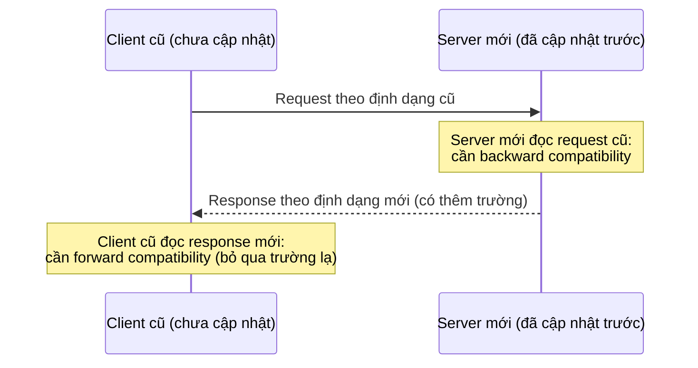

**Tương thích được thừa hưởng từ định dạng mã hóa** (tr. 136):

| Loại | Cách tiến hóa |
| --- | --- |
| **Thrift, gRPC (Protocol Buffers), Avro RPC** | Theo quy tắc tương thích của định dạng mã hóa tương ứng |
| **SOAP** | Request và response đặc tả bằng **XML schema**. Tiến hóa được, nhưng có vài **cạm bẫy tinh tế** [47] |
| **RESTful API** | Thường dùng **JSON** (không có schema chính thức) cho response, và JSON hoặc tham số mã hóa URI/form cho request. **Thêm tham số request tùy chọn** và **thêm trường mới vào object response** thường được coi là thay đổi **giữ tương thích** |

**Khó hơn khi vượt ranh giới tổ chức** (tr. 136). RPC thường được dùng để giao tiếp **giữa các tổ chức**, nên bên cung cấp service thường **không kiểm soát được client** và **không ép được họ nâng cấp**. Vì vậy tương thích phải được duy trì **rất lâu**, có thể **vô thời hạn**. Nếu buộc phải có thay đổi phá tương thích, bên cung cấp thường phải **duy trì nhiều phiên bản API song song**.

**Versioning API** (tr. 136). **Chưa có thống nhất** về cách đánh phiên bản API (tức client chỉ ra phiên bản API muốn dùng thế nào) [48]:

- Với RESTful API: đặt **số phiên bản trong URL**, hoặc trong **header HTTP Accept**.
- Với service dùng **API key** để định danh client: lưu phiên bản API client yêu cầu **ở phía server**, và cho phép đổi lựa chọn đó qua một giao diện quản trị riêng [49].

#### B7.3 Message-Passing Dataflow (tr. 136–139)

##### Ở giữa RPC và database (tr. 136–137)

**What.** Hệ thống truyền message **bất đồng bộ** nằm ở giữa RPC và database (tr. 137):

- **Giống RPC:** request của client (thường gọi là **message**) được chuyển tới tiến trình khác với **độ trễ thấp**.
- **Giống database:** message **không** đi qua kết nối mạng trực tiếp, mà qua một trung gian gọi là ***message broker*** (còn gọi là *message queue* hay *message-oriented middleware*), nơi **lưu tạm** message.

**Why — ưu điểm của message broker so với RPC trực tiếp** (tr. 137):

1. Làm **bộ đệm** khi bên nhận không sẵn sàng hay quá tải, nên **tăng độ tin cậy**.
2. **Tự động gửi lại** message cho tiến trình đã crash, nên **tránh mất message**.
3. Người gửi **không cần biết địa chỉ IP và cổng** của người nhận (đặc biệt hữu ích trên cloud, nơi máy ảo đến rồi đi liên tục).
4. Cho phép gửi **một message tới nhiều người nhận**.
5. **Tách rời về mặt logic** người gửi khỏi người nhận: người gửi chỉ xuất bản message, không quan tâm ai tiêu thụ.

**Khác RPC** (tr. 137). Giao tiếp qua message thường **một chiều**: người gửi thường không kỳ vọng nhận trả lời. Tiến trình có thể gửi trả lời, nhưng thường qua **kênh riêng**. Mẫu giao tiếp này là **bất đồng bộ**: người gửi không chờ message được giao, chỉ gửi rồi quên.

Glossary của sách định nghĩa *asynchronous* là **không chờ** một việc hoàn thành (như gửi dữ liệu qua mạng tới node khác), và **không giả định** việc đó mất bao lâu (tr. 553).

##### Message brokers (tr. 137–138)

- **Trước đây** thị trường do phần mềm doanh nghiệp thương mại thống trị: TIBCO, IBM WebSphere, webMethods. **Gần đây** các cài đặt mã nguồn mở phổ biến: **RabbitMQ, ActiveMQ, HornetQ, NATS, Apache Kafka**. Chương 11 sẽ so sánh chi tiết (tr. 137).
- **Cách dùng chung** (tr. 137): một tiến trình gửi message tới một **queue** hay **topic** có tên, broker đảm bảo message được giao tới **một hoặc nhiều consumer** (hay subscriber) của queue hay topic đó. Có thể có **nhiều producer và nhiều consumer** trên cùng topic. Ngữ nghĩa giao nhận chi tiết tùy cài đặt và cấu hình.
- **Topic chỉ có luồng dữ liệu một chiều** (tr. 138). Nhưng consumer có thể xuất bản message sang **topic khác** (nối chuỗi, Chương 11), hoặc sang một **reply queue** do người gửi ban đầu tiêu thụ (cho phép luồng request/response giống RPC).
- **Broker không áp đặt mô hình dữ liệu** (tr. 138): message chỉ là chuỗi byte kèm metadata, nên dùng **định dạng mã hóa nào cũng được**. Nếu mã hóa có backward và forward compatibility, ta có **linh hoạt lớn nhất** để đổi publisher và consumer độc lập, triển khai **theo bất kỳ thứ tự nào**.
- **Cẩn thận khi chuyển tiếp message** (tr. 138): nếu consumer xuất bản lại message sang topic khác, có thể phải cẩn thận **giữ nguyên trường lạ**, để tránh vấn đề như ở database ([Hình 4-7](#unknown-fields)).

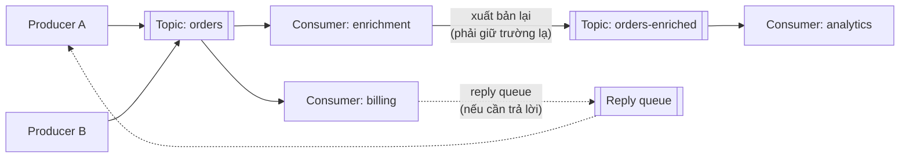

*(Sơ đồ do AI xây dựng để minh họa các ý ở tr. 137–138.)*

##### Distributed actor frameworks (tr. 138–139)

**What — actor model** (tr. 138). Đây là một **mô hình lập trình cho tính đồng thời** trong một tiến trình:

- Thay vì làm việc trực tiếp với thread (và các vấn đề **race condition, locking, deadlock**), logic được đóng gói trong các **actor**.
- Mỗi actor thường đại diện cho **một client hay một thực thể**, có thể có **trạng thái cục bộ** (không chia sẻ với actor khác), và giao tiếp với actor khác bằng cách **gửi và nhận message bất đồng bộ**.
- **Việc giao message không được đảm bảo**: trong một số tình huống lỗi, message sẽ **mất**.
- Mỗi actor chỉ xử lý **một message một lúc**, nên không phải lo về thread, và mỗi actor có thể được framework lập lịch độc lập.

**Distributed actor framework** (tr. 138):

- Dùng mô hình này để **scale ứng dụng qua nhiều node**. Cùng một cơ chế truyền message được dùng, **dù người gửi và người nhận ở cùng node hay khác node**. Nếu khác node, message được **mã hóa trong suốt** thành chuỗi byte, gửi qua mạng, rồi giải mã ở phía bên kia.
- **Location transparency hợp với actor hơn RPC**, vì actor model **vốn đã giả định message có thể mất**, kể cả trong một tiến trình. Độ trễ qua mạng có thể cao hơn, nhưng sự lệch căn bản giữa giao tiếp cục bộ và từ xa **ít hơn**.
- Về bản chất, distributed actor framework **gộp message broker và mô hình lập trình actor** vào một framework.
- **Nhưng** muốn rolling upgrade ứng dụng dựa trên actor, vẫn phải lo forward và backward compatibility, vì message có thể đi từ node chạy bản mới tới node chạy bản cũ, và ngược lại.

**Ba framework phổ biến xử lý mã hóa message** (tr. 139):

| Framework | Mã hóa mặc định | Rolling upgrade |
| --- | --- | --- |
| **Akka** | Serialization có sẵn của **Java**, **không** có forward hay backward compatibility | Thay bằng thứ như **Protocol Buffers** thì làm được rolling upgrade [50] |
| **Orleans** | Định dạng tùy biến **không hỗ trợ** rolling upgrade | Phải dựng **cluster mới**, chuyển traffic từ cluster cũ sang, rồi tắt cluster cũ [51, 52]. Có thể dùng plug-in serialization tùy biến như Akka |
| **Erlang OTP** | Đổi schema bản ghi **khó một cách bất ngờ**, dù hệ thống có nhiều tính năng cho tính sẵn sàng cao | Làm được nhưng phải **lập kế hoạch cẩn thận** [53]. Kiểu **maps** thử nghiệm (cấu trúc giống JSON, có từ Erlang R17 năm 2014) có thể giúp dễ hơn [54] |

> **Liên hệ B2.** Akka mặc định dùng serialization của Java, đúng loại "định dạng riêng của ngôn ngữ" mà [B2](#b2) khuyên chỉ dùng cho mục đích rất tạm thời. Hệ quả cụ thể: không rolling upgrade được.

---

### B8. Summary — Tổng kết của tác giả (tr. 139–140)

**Ý chính** (tr. 139). Chương xét nhiều cách biến cấu trúc dữ liệu thành byte trên mạng hay trên đĩa. Chi tiết của các cách mã hóa không chỉ ảnh hưởng **hiệu quả**, mà quan trọng hơn là ảnh hưởng **kiến trúc ứng dụng** và **các lựa chọn triển khai**.

**Rolling upgrade** (tr. 139). Nhiều service cần hỗ trợ rolling upgrade: triển khai phiên bản mới dần dần lên vài node, thay vì lên mọi node cùng lúc. Rolling upgrade:

- cho phép phát hành **không downtime**, nên khuyến khích **phát hành nhỏ và thường xuyên** thay vì lớn và hiếm;
- giảm **rủi ro triển khai**: phát hiện và rollback bản lỗi **trước khi** ảnh hưởng nhiều người dùng.

Những tính chất này có lợi lớn cho **evolvability**. Trong lúc rolling upgrade (hoặc vì lý do khác), phải giả định các node chạy **các phiên bản code khác nhau**. Vì vậy mọi dữ liệu chảy trong hệ thống phải được mã hóa sao cho có **backward compatibility** (code mới đọc dữ liệu cũ) và **forward compatibility** (code cũ đọc dữ liệu mới).

**Các định dạng mã hóa** (tr. 139–140):

| Loại | Đặc điểm |
| --- | --- |
| **Riêng của ngôn ngữ lập trình** | Bị giới hạn trong một ngôn ngữ, thường **không** có forward và backward compatibility |
| **Văn bản: JSON, XML, CSV** | Phổ biến; tương thích **tùy cách dùng**. Có ngôn ngữ schema tùy chọn, lúc hữu ích lúc cản trở. **Mơ hồ về kiểu dữ liệu**, phải cẩn thận với số và chuỗi nhị phân |
| **Nhị phân có schema: Thrift, Protocol Buffers, Avro** | Mã hóa **gọn, hiệu quả**, ngữ nghĩa forward và backward compatibility **rõ ràng**. Schema hữu ích làm tài liệu và sinh code cho ngôn ngữ kiểu tĩnh. Nhược điểm: phải **decode** mới đọc được bằng mắt |

**Các kiểu luồng dữ liệu** (tr. 140):

| Kiểu | Ai mã hóa, ai giải mã |
| --- | --- |
| **Database** | Tiến trình ghi mã hóa, tiến trình đọc giải mã |
| **RPC và REST API** | Client mã hóa request, server giải mã request và mã hóa response, client giải mã response |
| **Truyền message bất đồng bộ** (message broker hoặc actor) | Node gửi mã hóa message, node nhận giải mã |

**Lời kết** (tr. 140): chỉ cần **một chút cẩn thận**, backward và forward compatibility cùng rolling upgrade là **hoàn toàn đạt được**. Chúc ứng dụng của bạn tiến hóa nhanh và triển khai thường xuyên.

---

## C. Sơ đồ minh họa

Các sơ đồ gắn với từng mục đã nằm trong phần B:

- Backward và forward compatibility: [A](#compatibility)
- Encoding và decoding: [B1](#b1)
- Field tag khi thêm trường: [B4.3](#tag-evolution)
- Writer's schema và reader's schema (Hình 4-6), schema sinh động: [B5](#b5)
- Ba kiểu luồng dữ liệu, mất trường lạ (Hình 4-7): [B7.0](#dataflow), [B7.1](#unknown-fields)
- Tương thích request và response trong RPC: [B7.2](#rpc-evolution)
- Message broker: [B7.3](#message-passing)

Phần này bổ sung các sơ đồ **tổng hợp** để ôn tập.

### C1. Bản đồ khái niệm của chương 4

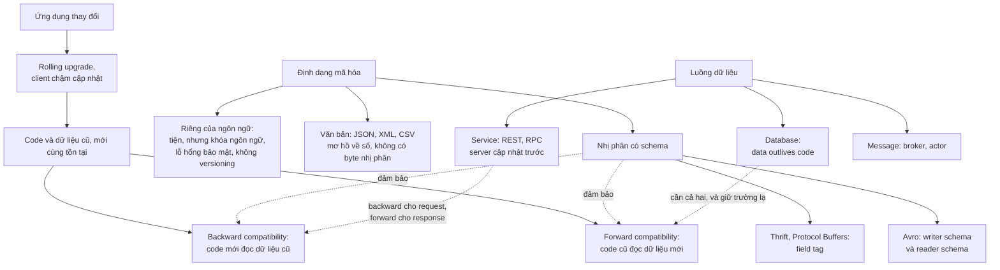

### C2. Mỗi kiểu luồng dữ liệu cần chiều tương thích nào?

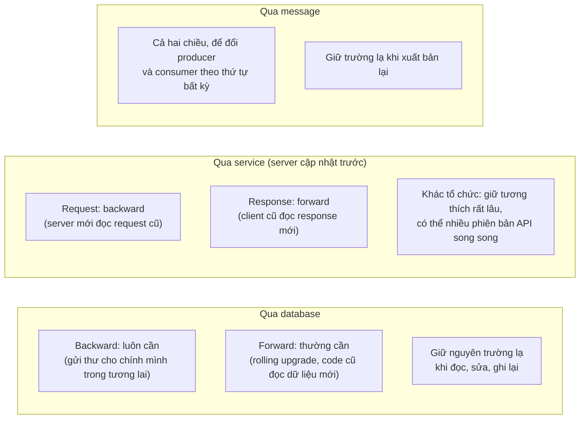

### C3. Chọn định dạng mã hóa

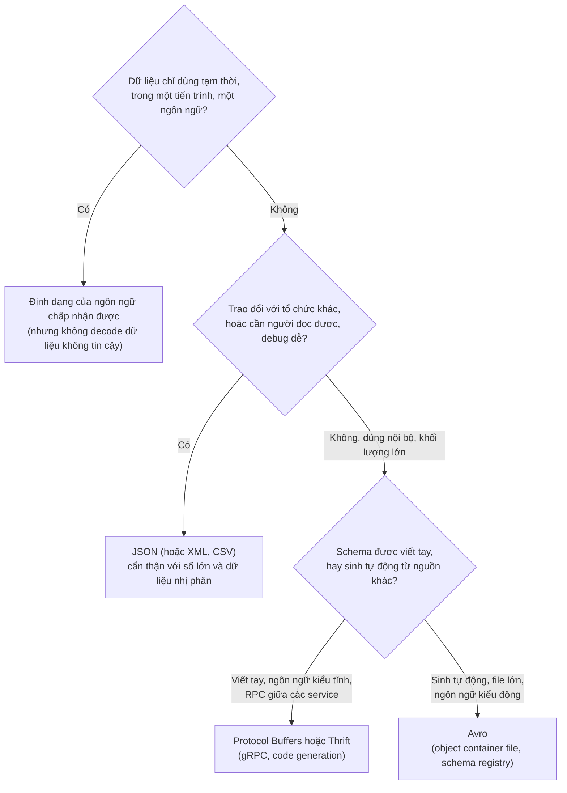

*(Sơ đồ do người viết ghi chú tổng hợp từ tr. 114–115, 126–128, 135–136. Đây là gợi ý suy luận, không phải quy tắc trong sách.)*

---

## D. So sánh các giải pháp

### D1. Các định dạng mã hóa (tr. 113–128)

| Tiêu chí | Riêng của ngôn ngữ | JSON / XML / CSV | Binary JSON (MessagePack) | Thrift / Protocol Buffers | Avro |
| --- | --- | --- | --- | --- | --- |
| **Kích thước bản ghi mẫu** | (Java nổi tiếng cồng kềnh) | 81 byte (JSON) | 66 byte | 59 (Thrift Binary), 34 (Thrift Compact), 33 (protobuf) | **32 byte** |
| **Schema** | Lớp trong code | Tùy chọn, phức tạp (CSV không có) | Không | **Bắt buộc**, IDL | **Bắt buộc**, IDL hoặc JSON |
| **Định danh trường trong dữ liệu** | | Tên trường | **Tên trường** | **Field tag** (số) | **Không có**: theo thứ tự schema |
| **Đa ngôn ngữ** | Không | Có | Có | Có (code generation) | Có (code generation tùy chọn) |
| **Người đọc được** | Không | **Có** | Không | Không | Không (nhưng file tự mô tả) |
| **Schema evolution** | Thường bị bỏ qua | Tùy cách dùng | Tùy cách dùng | Theo quy tắc tag | Theo quy tắc writer/reader schema |
| **Điểm mạnh** | Tiện | Phổ biến, trao đổi giữa tổ chức | Gọn hơn chút | Gọn, rõ ràng, hợp ngôn ngữ kiểu tĩnh và RPC | Gọn nhất, hợp schema sinh động và file lớn |
| **Điểm yếu** | Khóa ngôn ngữ, lỗ hổng bảo mật, chậm | Mơ hồ về số, không có byte nhị phân | Mất khả năng đọc mà tiết kiệm ít | Tag phải gán tay, không dùng lại | Reader phải biết writer's schema |

### D2. Quy tắc schema evolution: Thrift / Protocol Buffers và Avro (tr. 120–125)

| Thay đổi | Thrift / Protocol Buffers | Avro |
| --- | --- | --- |
| **Cơ chế khớp trường** | Theo **field tag** | Theo **tên trường** (thứ tự không quan trọng) |
| **Thêm trường** | Tag mới; phải **optional** hoặc có mặc định (không được required) | Phải có **giá trị mặc định** |
| **Xóa trường** | Chỉ trường **optional**; **không dùng lại** tag | Chỉ trường có **giá trị mặc định** |
| **Đổi tên trường** | **Được** (dữ liệu không chứa tên) | Dùng **alias** trong reader's schema: backward nhưng không forward |
| **Đổi tag** | **Không được** | (không có tag) |
| **Đổi kiểu** | Có thể, nhưng rủi ro mất độ chính xác hay cắt cụt (32 bit sang 64 bit) | Được nếu Avro chuyển đổi được kiểu |
| **Null** | Trường optional | Phải dùng **union** có nhánh null |
| **Một giá trị thành nhiều giá trị** | protobuf: optional thành **repeated** được. Thrift: không (nhưng có list lồng nhau) | (sách không bàn) |
| **Thêm nhánh vào union** | | Backward nhưng không forward |

### D3. Reader lấy writer's schema của Avro ở đâu? (tr. 125–126)

| Ngữ cảnh | Cách làm | Ví dụ |
| --- | --- | --- |
| File lớn, nhiều bản ghi cùng schema | Writer's schema đặt **một lần ở đầu file** (object container file) | Hadoop (Chương 10) |
| Database, bản ghi ghi riêng lẻ | **Số phiên bản** ở đầu mỗi bản ghi + danh sách phiên bản schema trong database | Espresso |
| Kết nối mạng hai chiều | **Thỏa thuận** phiên bản schema khi thiết lập kết nối | Avro RPC |

### D4. Ba kiểu luồng dữ liệu (tr. 128–139)

| Tiêu chí | Qua database | Qua service (REST, RPC) | Qua message (broker, actor) |
| --- | --- | --- | --- |
| **Ai mã hóa / giải mã** | Người ghi / người đọc | Client mã hóa request, server mã hóa response | Người gửi / người nhận |
| **Đồng bộ?** | Người đọc đọc "sau này" | Đồng bộ: chờ response càng nhanh càng tốt | **Bất đồng bộ**: gửi rồi quên |
| **Tương thích cần có** | Backward (luôn), forward (thường); giữ trường lạ | Backward cho request, forward cho response (server cập nhật trước) | Cả hai chiều; giữ trường lạ khi xuất bản lại |
| **Đặc điểm riêng** | **Data outlives code**: dữ liệu 5 năm tuổi vẫn còn | Khác tổ chức: giữ tương thích rất lâu | Broker làm bộ đệm, gửi lại, tách rời người gửi và nhận |

### D5. REST, SOAP và framework RPC (tr. 133–136)

| Tiêu chí | REST | SOAP | Framework RPC (gRPC, Thrift, Finagle…) |
| --- | --- | --- | --- |
| **Bản chất** | Triết lý thiết kế trên HTTP | Giao thức XML, tránh tính năng HTTP | Thư viện gọi service từ xa |
| **Mô tả API** | OpenAPI (Swagger) | WSDL | IDL của định dạng mã hóa |
| **Code generation** | Ít | Nhiều, phụ thuộc công cụ | Có |
| **Hiệu năng** | Kém hơn (JSON) | | **Tốt hơn** (nhị phân) |
| **Debug, công cụ** | **Dễ nhất**, hệ sinh thái lớn nhất | Khó, phụ thuộc hãng | Cần công cụ riêng |
| **Dùng cho** | **API công khai** | Doanh nghiệp lớn | Giữa các service **cùng tổ chức, cùng datacenter** |

### D6. Lời gọi hàm cục bộ và request qua mạng (tr. 134–135)

Xem bảng chi tiết ở [B7.2](#rpc-problems). Tóm tắt: request qua mạng **không dự đoán được**, có thể **timeout không rõ kết cục**, thử lại có thể **thực hiện hai lần** (cần idempotence), **độ trễ biến động**, tham số phải **mã hóa** thay vì truyền con trỏ, và phải **dịch kiểu** giữa các ngôn ngữ.

### D7. Message broker và RPC trực tiếp (tr. 137)

| Tiêu chí | RPC trực tiếp | Message broker |
| --- | --- | --- |
| **Khi bên nhận chết hoặc quá tải** | Request thất bại | Broker **đệm** message |
| **Tiến trình nhận crash** | Request mất | Broker **gửi lại** |
| **Biết địa chỉ bên nhận** | Cần (hoặc service discovery) | **Không cần** |
| **Nhiều người nhận** | Phải gọi từng bên | **Một message, nhiều consumer** |
| **Ghép nối** | Chặt | **Tách rời** về logic |
| **Trả lời** | Có response | Thường **một chiều**; trả lời qua kênh riêng |

### D8. Actor framework và rolling upgrade (tr. 139)

| Framework | Mặc định | Rolling upgrade |
| --- | --- | --- |
| Akka | Java serialization | Được nếu đổi sang Protocol Buffers |
| Orleans | Định dạng tùy biến | Không; dựng cluster mới rồi chuyển traffic |
| Erlang OTP | Record schema khó đổi | Được nhưng cần kế hoạch cẩn thận |

---

## E. Tư duy System Design

> **Ví dụ minh họa do AI xây dựng.** Tất cả tình huống dưới đây là giả định để luyện cách suy luận. Mỗi bước lập luận dẫn về nội dung sách. Hãy tự trả lời phần "Câu hỏi cần đặt" trước khi đọc lập luận.

### E1. API cho ứng dụng di động có nhiều phiên bản cũ

**Bối cảnh.** Ứng dụng di động gọi API backend dạng JSON. Mỗi tháng có bản app mới, nhưng 20% người dùng vẫn dùng bản app từ hơn một năm trước. Đội backend muốn đổi trường `price` (số) thành object `price {amount, currency}`.

**Câu hỏi cần đặt.** Chiều tương thích nào quan trọng? Đổi kiểu như vậy có an toàn không?

**Lập luận.**

1. Phía client, bạn **phụ thuộc vào người dùng**: họ có thể không cập nhật trong thời gian dài (tr. 112). Server cập nhật trước, client sau, nên cần **forward compatibility cho response**: app cũ phải đọc được response mới (tr. 136).
2. Đổi kiểu `price` từ số sang object làm app cũ **parse lỗi**. Đây là thay đổi phá tương thích.
3. Cách giữ tương thích: **thêm trường mới** (ví dụ `price_v2`) và **giữ trường cũ**. Thêm trường mới vào response thường được coi là thay đổi giữ tương thích (tr. 136).
4. Nếu buộc phải phá tương thích, duy trì **nhiều phiên bản API song song**, chọn phiên bản bằng URL hoặc header Accept (tr. 136).
5. Cẩn thận với số lớn: nếu có ID 64-bit, trả thêm dạng **chuỗi** như Twitter, vì client JavaScript parse sai số lớn hơn 2⁵³ (tr. 114).

**Nếu yêu cầu thay đổi.** Nếu API dành cho đối tác bên ngoài, tương thích phải giữ **rất lâu, có thể vô thời hạn**, vì bạn không ép được họ nâng cấp (tr. 136).

### E2. Rolling upgrade làm mất dữ liệu trong database

**Bối cảnh.** Service hồ sơ người dùng chạy 10 instance. Bản mới thêm trường `photoURL`. Trong lúc rolling upgrade, 5 instance chạy bản mới, 5 chạy bản cũ. Vài giờ sau, nhiều người dùng báo ảnh đại diện **biến mất**.

**Câu hỏi cần đặt.** Chuyện gì đã xảy ra? Sửa thế nào?

**Lập luận.**

1. Đây đúng là kịch bản Hình 4-7 (tr. 130). Instance mới ghi `photoURL`. Instance cũ đọc bản ghi, **giải mã thành model object** không có trường `photoURL`, sửa một trường khác, rồi **mã hóa lại**: `photoURL` mất.
2. Database cần **forward compatibility**, vì trong rolling upgrade, code cũ đọc dữ liệu do code mới ghi (tr. 129).
3. **Sửa:** code cũ phải **giữ nguyên trường lạ**. Định dạng như Protocol Buffers, Avro hỗ trợ việc này, nhưng tầng ứng dụng phải không làm rơi trường khi chuyển qua model object (tr. 129). Ví dụ: giữ lại phần dữ liệu không nhận ra và ghi lại nguyên vẹn, hoặc dùng thao tác cập nhật chỉ sửa đúng trường cần sửa.
4. **Phòng ngừa:** triển khai theo hai bước. Bước một, mọi instance được cập nhật để **giữ trường lạ** (hoặc biết trường mới nhưng chưa ghi nó). Bước hai, mới bật việc ghi `photoURL`.

**Nếu yêu cầu thay đổi.** Nếu trường mới là bắt buộc với logic mới, nó vẫn phải được định nghĩa là optional hoặc có mặc định trong schema, vì dữ liệu cũ (data outlives code) sẽ không có nó (tr. 121, 130).

### E3. Export database hằng đêm vào data lake

**Bối cảnh.** Mỗi đêm export 200 bảng từ relational database sang kho lưu trữ để phân tích. Đội ứng dụng thay đổi schema bảng vài lần mỗi tuần mà không báo trước.

**Câu hỏi cần đặt.** Chọn định dạng nào? Làm sao để export không vỡ mỗi lần schema đổi?

**Lập luận.**

1. Đây là ví dụ **schema sinh động** của sách (tr. 126). Avro cho phép **sinh tự động** schema từ relational schema mỗi lần chạy: bảng thành record, cột thành trường, tên cột thành tên trường.
2. Không có field tag nên không cần ai **gán tag bằng tay** khi cột được thêm hoặc bớt (tr. 126–127).
3. Reader dùng schema cũ vẫn đọc được file mới vì trường được **khớp theo tên**. Trường mới bị bỏ qua, trường bị xóa lấy giá trị mặc định nếu có (tr. 124, 126).
4. Bản export ghi một lần rồi bất biến, nên **object container file** (writer's schema ở đầu file) hợp. Với phân tích, có thể ghi thêm dạng **Parquet** lưu theo cột (tr. 131).
5. Bản export dùng **schema mới nhất**, dù database nguồn có thể chứa dữ liệu ghi bằng nhiều phiên bản schema (tr. 131).

**Nếu yêu cầu thay đổi.** Nếu người dùng dữ liệu viết job bằng ngôn ngữ kiểu động hay công cụ như Pig, Avro không bắt buộc code generation: mở file là đọc được, vì file tự mô tả (tr. 127).

### E4. Event bus dùng chung cho nhiều đội

**Bối cảnh.** 15 đội dùng chung một message broker. Đội Order xuất bản sự kiện `OrderPlaced`; 8 đội khác tiêu thụ, một đội làm giàu sự kiện rồi xuất bản sang topic khác. Mỗi đội triển khai độc lập.

**Câu hỏi cần đặt.** Làm sao để mỗi đội đổi schema mà không làm hỏng đội khác?

**Lập luận.**

1. Broker không áp đặt mô hình dữ liệu. Muốn đổi publisher và consumer **độc lập, theo thứ tự bất kỳ**, mã hóa phải có **cả backward lẫn forward compatibility** (tr. 138).
2. Dùng định dạng nhị phân có schema (Avro hoặc Protocol Buffers), với quy tắc rõ ràng: chỉ thêm trường có mặc định hoặc optional, không dùng lại tag (tr. 121, 124).
3. Giữ một **database các phiên bản schema**: vừa là tài liệu, vừa cho phép **kiểm tra tương thích trước khi triển khai** (tr. 126, 128). Mỗi message mang số phiên bản hay hash của writer's schema (tr. 125–126).
4. Đội làm giàu sự kiện **xuất bản lại** message: phải **giữ nguyên trường lạ**, nếu không trường mới của đội Order sẽ mất ở topic thứ hai (tr. 138).

**Nếu yêu cầu thay đổi.** Nếu một consumer cần trả lời cho đội Order, dùng một **reply queue** riêng, vì topic chỉ có luồng một chiều (tr. 138).

### E5. Gỡ bỏ serialization có sẵn của ngôn ngữ

**Bối cảnh.** Hệ thống dùng Akka với serialization mặc định của Java để truyền message giữa các node. Mỗi lần nâng cấp phải dừng cả cluster. Đội bảo mật cũng cảnh báo về rủi ro deserialization.

**Câu hỏi cần đặt.** Vì sao không rolling upgrade được? Nên thay bằng gì?

**Lập luận.**

1. Serialization có sẵn của Java **không** có forward hay backward compatibility, nên node bản mới và node bản cũ không trao đổi message được với nhau (tr. 139).
2. Định dạng riêng của ngôn ngữ còn mang **rủi ro bảo mật**: decode dữ liệu tùy ý có thể tạo object của lớp tùy ý, dẫn tới thực thi code từ xa (tr. 113).
3. Thay bằng **Protocol Buffers**, như sách gợi ý cho Akka, để làm được rolling upgrade (tr. 139).
4. Actor model vốn giả định message có thể mất, nên location transparency phù hợp với nó hơn RPC (tr. 138). Nhưng tương thích phiên bản vẫn phải tự lo.

**Nếu yêu cầu thay đổi.** Nếu dùng Orleans với định dạng mặc định, cách nâng cấp duy nhất là dựng cluster mới rồi chuyển traffic sang (tr. 139). Đó là cái giá của việc không có tương thích phiên bản.

---

## F. Kiến thức cốt lõi

1. Ứng dụng luôn thay đổi, và code không đổi tức thì được: **rolling upgrade** phía server, **người dùng chậm cập nhật** phía client. Code và dữ liệu cũ, mới cùng tồn tại (tr. 111–112).
2. **Backward compatibility:** code mới đọc dữ liệu cũ (thường dễ). **Forward compatibility:** code cũ đọc dữ liệu mới, phải bỏ qua phần thêm vào (khó hơn) (tr. 112).
3. **Encoding** (serialization) biến cấu trúc trong bộ nhớ thành chuỗi byte; **decoding** làm ngược lại. Encoding không phải encryption (tr. 112–113).
4. **Định dạng riêng của ngôn ngữ** (Java Serializable, pickle…) khóa ngôn ngữ, gây **lỗ hổng bảo mật**, bỏ qua versioning và hiệu năng. Chỉ dùng cho mục đích rất tạm thời (tr. 113–114).
5. **JSON, XML, CSV**: phổ biến, người đọc được, tốt cho trao đổi giữa tổ chức. Nhưng **mơ hồ về số** (số nguyên lớn hơn 2⁵³ hỏng trong JavaScript), **không có chuỗi nhị phân** (Base64 thêm 33%), schema tùy chọn và phức tạp (tr. 114–115).
6. **Binary JSON** vẫn phải chứa tên trường nên tiết kiệm ít: 66 byte so với 81 byte (tr. 115–116).
7. **Thrift và Protocol Buffers** thay tên trường bằng **field tag**, dùng số nguyên độ dài thay đổi: 34 và 33 byte (tr. 117–120).
8. **Quy tắc tag:** đổi tên trường được, **đổi tag không được**; trường mới phải optional hoặc có mặc định; chỉ xóa trường optional và **không dùng lại tag** (tr. 120–121).
9. **Avro** không có tag, chỉ nối giá trị: **32 byte**. Decode cần **writer's schema** và **reader's schema**, chỉ cần **tương thích**, được phân giải **theo tên trường** (tr. 122–124).
10. **Quy tắc Avro:** chỉ thêm hoặc xóa trường **có giá trị mặc định**; null phải khai báo bằng **union** (tr. 124–125).
11. Reader biết writer's schema qua: **đầu file** (object container), **số phiên bản** trong mỗi bản ghi, hoặc **thỏa thuận khi kết nối**. Một **database các phiên bản schema** vừa là tài liệu vừa giúp kiểm tra tương thích (tr. 125–126).
12. Avro hợp với **schema sinh động** (export database) và ngôn ngữ kiểu động; Thrift và protobuf hợp với code generation trong ngôn ngữ kiểu tĩnh (tr. 126–127).
13. **Schema có giá trị:** gọn, là tài liệu luôn cập nhật, cho phép kiểm tra tương thích trước khi triển khai, cho phép kiểm tra kiểu lúc biên dịch (tr. 128).
14. **Qua database:** cần cả hai chiều tương thích; **giữ nguyên trường lạ** khi đọc, sửa, ghi lại; **data outlives code** (tr. 129–131).
15. **RPC có lỗi căn bản:** request qua mạng không giống lời gọi hàm (mất, timeout không rõ kết cục, thử lại gây trùng lặp, độ trễ biến động, phải mã hóa tham số, dịch kiểu). REST không che giấu việc nó là giao thức mạng (tr. 134–135).
16. **Service:** giả định server cập nhật trước, nên cần backward cho request và forward cho response. Vượt ranh giới tổ chức thì giữ tương thích rất lâu, có thể nhiều phiên bản API (tr. 136).
17. **Message broker** đệm, gửi lại, tách rời người gửi và nhận; giao tiếp một chiều, bất đồng bộ. **Actor framework** gộp broker với actor model, nhưng vẫn cần tương thích để rolling upgrade (tr. 136–139).

---

## G. Câu hỏi tự kiểm tra

Hãy tự trả lời trước, sau đó mới xem [phần đáp án](#g-dap-an).

1. **Tại sao** hệ thống phải chịu được việc code cũ và code mới cùng chạy? **So sánh** backward và forward compatibility: cái nào khó hơn, vì sao?
2. **Tại sao** dùng `pickle` hay `java.io.Serializable` để lưu dữ liệu lâu dài là ý tồi? Nêu ít nhất ba lý do.
3. JSON có những vấn đề gì về kiểu dữ liệu? **Điều gì xảy ra** khi một client JavaScript nhận ID tweet 64-bit dạng số JSON?
4. **Tại sao** MessagePack chỉ gọn hơn JSON một chút, còn Protocol Buffers gọn hơn nhiều? Field tag đóng vai trò gì?
5. Với Protocol Buffers, **điều gì xảy ra nếu** bạn (a) thêm một trường `required` mới, (b) dùng lại số tag của một trường đã xóa, (c) đổi một trường từ int32 sang int64?
6. Avro mã hóa không có tag hay tên trường. Vậy làm sao nó đọc được dữ liệu ghi bằng schema khác? Giải thích writer's schema và reader's schema.
7. **Tại sao** Avro chỉ cho thêm hoặc xóa trường **có giá trị mặc định**? Thêm trường không có mặc định phá chiều tương thích nào?
8. **So sánh** Avro với Protocol Buffers khi export một relational database có schema thay đổi thường xuyên. Vì sao Avro hợp hơn?
9. **Điều gì xảy ra** khi một phiên bản ứng dụng cũ đọc, sửa rồi ghi lại bản ghi do phiên bản mới ghi? "Data outlives code" nghĩa là gì?
10. **Tại sao** RPC "trông như gọi hàm cục bộ" là ý tưởng có lỗi căn bản? Với service, vì sao chỉ cần backward compatibility cho request và forward compatibility cho response?

### Đáp án và giải thích

<b>Câu 1 — Code cũ và mới cùng chạy</b>

- **Phía server**, rolling upgrade triển khai bản mới lên vài node một lúc để không downtime, nên trong lúc đó node cũ và mới cùng chạy. **Phía client**, người dùng có thể không cập nhật trong thời gian dài (tr. 112).
- Vì vậy code cũ, code mới, dữ liệu cũ, dữ liệu mới **cùng tồn tại** (tr. 112).
- **Backward compatibility** (code mới đọc dữ liệu cũ) thường **dễ**: người viết code mới biết định dạng cũ và xử lý được nó (tr. 112).
- **Forward compatibility** (code cũ đọc dữ liệu mới) **khó hơn**: code cũ được viết trước khi biết thay đổi tương lai, nên phải được thiết kế để **bỏ qua** những gì code mới thêm vào (tr. 112).

<b>Câu 2 — Vì sao không dùng định dạng của ngôn ngữ</b>

Theo sách (tr. 113–114):

1. **Khóa ngôn ngữ:** khó đọc bằng ngôn ngữ khác; tự trói vào ngôn ngữ hiện tại rất lâu và cản trở tích hợp với tổ chức khác.
2. **Bảo mật:** decode phải tạo được object của lớp tùy ý. Kẻ tấn công cho decode chuỗi byte tùy ý có thể dẫn tới **thực thi code từ xa**.
3. **Versioning bị bỏ qua:** thường không lo forward và backward compatibility.
4. **Hiệu năng bị bỏ qua:** ví dụ serialization của Java chậm và cồng kềnh.

Kết luận: chỉ dùng cho mục đích **rất tạm thời** (tr. 114).

<b>Câu 3 — Vấn đề kiểu dữ liệu của JSON</b>

- JSON phân biệt chuỗi và số, nhưng **không phân biệt số nguyên và số thực**, và **không quy định độ chính xác** (tr. 114).
- Số nguyên **lớn hơn 2⁵³** không biểu diễn chính xác được bằng số double IEEE 754. JavaScript dùng double cho mọi số, nên ID tweet 64-bit bị **làm tròn thành số khác**. Vì vậy API của Twitter trả ID **hai lần**: dạng số và dạng chuỗi thập phân (tr. 114).
- Ngoài ra JSON (và XML) **không có chuỗi nhị phân**: phải dùng Base64, làm dữ liệu to thêm 33% (tr. 114).

<b>Câu 4 — MessagePack, Protocol Buffers và field tag</b>

- MessagePack giữ nguyên mô hình dữ liệu JSON và **không có schema**, nên phải chứa **mọi tên trường** trong dữ liệu (tr. 115). Bản ghi mẫu: 66 byte so với 81 byte JSON; khoảng 31 byte chỉ là tên trường.
- Protocol Buffers **có schema**, nên thay tên trường bằng **field tag** là các con số (1, 2, 3) trong schema. Tag là **bí danh gọn** của trường (tr. 119). Kết hợp với gộp kiểu và tag vào một byte, và số nguyên độ dài thay đổi (1337 chỉ 2 byte), bản ghi còn **33 byte** (tr. 119–120).

<b>Câu 5 — Các thay đổi nguy hiểm với Protocol Buffers</b>

- **(a) Thêm trường `required`:** code mới đọc dữ liệu do code cũ ghi (không có trường đó), kiểm tra `required` thất bại. **Phá backward compatibility.** Trường thêm sau lần triển khai đầu phải là optional hoặc có mặc định (tr. 121).
- **(b) Dùng lại tag đã xóa:** có thể vẫn còn dữ liệu cũ chứa tag đó với ý nghĩa cũ. Code mới sẽ hiểu nhầm dữ liệu cũ thành trường mới. Vì vậy **không bao giờ dùng lại tag** (tr. 121).
- **(c) int32 sang int64:** code mới đọc dữ liệu cũ thì ổn (điền 0 vào bit thiếu). Code cũ đọc dữ liệu mới thì dùng biến 32-bit, nên giá trị lớn bị **cắt cụt** (tr. 121).

<b>Câu 6 — Writer's schema và reader's schema</b>

- Dữ liệu Avro chỉ là **giá trị nối nhau**. Muốn parse, phải đi theo thứ tự trường trong schema; schema sai thì decode sai (tr. 122–123).
- **Writer's schema:** schema mà ứng dụng dùng khi **mã hóa**. **Reader's schema:** schema mà ứng dụng **kỳ vọng** khi giải mã (tr. 123).
- Hai schema **không cần giống nhau, chỉ cần tương thích**. Thư viện Avro đặt chúng cạnh nhau và dịch dữ liệu từ writer's schema sang reader's schema (tr. 123–124):
  - khớp trường **theo tên**, nên thứ tự khác nhau không sao;
  - trường writer có mà reader không có: **bỏ qua**;
  - trường reader cần mà writer không có: điền **giá trị mặc định** của reader's schema.
- Để làm vậy, reader phải biết writer's schema: lấy từ đầu file, từ số phiên bản trong bản ghi, hoặc thỏa thuận khi kết nối (tr. 125–126).

<b>Câu 7 — Vì sao cần giá trị mặc định</b>

- Khi reader cần một trường mà dữ liệu không có, Avro phải **điền một giá trị**. Giá trị đó chính là **mặc định** trong reader's schema (tr. 124).
- **Thêm trường không có mặc định:** reader mới đọc dữ liệu cũ (thiếu trường) không biết điền gì, nên **phá backward compatibility** (tr. 124).
- **Xóa trường không có mặc định:** reader cũ đọc dữ liệu mới (thiếu trường mà reader cũ cần) không biết điền gì, nên **phá forward compatibility** (tr. 124).
- Null không tự động là mặc định: phải dùng union có nhánh null (tr. 125).

<b>Câu 8 — Export database: Avro so với Protocol Buffers</b>

- **Avro** (tr. 126): sinh tự động schema từ relational schema mỗi lần export (bảng thành record, cột thành trường, tên cột thành tên trường). Schema database đổi thì chỉ cần sinh lại; reader cũ vẫn khớp trường **theo tên**. Không ai phải can thiệp.
- **Protocol Buffers, Thrift** (tr. 126–127): field tag thường phải **gán bằng tay**. Mỗi lần schema database đổi, quản trị viên phải cập nhật ánh xạ cột sang tag. Tự động hóa được nhưng phải cẩn thận **không dùng lại tag cũ**. Schema sinh động không phải mục tiêu thiết kế của chúng.
- Thêm nữa, file Avro tự mô tả, đọc được không cần code generation, hợp với ngôn ngữ kiểu động và công cụ như Pig (tr. 127).

<b>Câu 9 — Mất trường lạ và data outlives code</b>

- **Hình 4-7** (tr. 129–130): code mới ghi trường `photoURL`. Code cũ đọc bản ghi, giải mã thành **model object** không có trường đó, sửa một trường khác, rồi mã hóa lại và ghi: `photoURL` **mất**. Định dạng mã hóa hỗ trợ giữ trường lạ, nhưng tầng ứng dụng phải cẩn thận để không làm rơi nó.
- **Data outlives code** (tr. 130): triển khai bản ứng dụng mới thay thế hoàn toàn bản cũ trong vài phút, nhưng dữ liệu 5 năm tuổi trong database vẫn ở **định dạng gốc** trừ khi được ghi lại. Migration dataset lớn tốn kém, nên database thường tránh: ví dụ thêm cột với mặc định null mà không ghi lại dữ liệu cũ. Nhờ schema evolution, database trông như dùng một schema duy nhất (tr. 131).

<b>Câu 10 — Lỗi căn bản của RPC và tương thích của service</b>

- **RPC** cố làm request từ xa giống gọi hàm cục bộ (location transparency), nhưng request mạng khác về bản chất (tr. 134–135):
  - không dự đoán được (request, response có thể mất, máy xa chậm hay chết);
  - có thể **timeout mà không biết** request đã thực hiện chưa;
  - **thử lại** có thể thực hiện hành động hai lần nếu không có idempotence;
  - độ trễ chậm hơn nhiều và **biến động**;
  - tham số phải mã hóa thành byte, không truyền con trỏ được;
  - client và server có thể khác ngôn ngữ, phải dịch kiểu.

  Vì vậy không nên làm service từ xa trông quá giống object cục bộ.
- **Tương thích của service** (tr. 136): có thể giả định **server được cập nhật trước, client sau**. Server mới nhận request từ client cũ, nên cần **backward compatibility cho request**. Client cũ nhận response từ server mới, nên cần **forward compatibility cho response**.

---

## Ghi chú kiểm tra nguồn

**Đối chiếu với mục lục của chương** (bookmark PDF và tiêu đề trong sách):

| Mục trong sách | Trang in | Mục ghi chú |
| --- | --- | --- |
| *(Mở đầu chương)* | 111–112 | A |
| Formats for Encoding Data (gồm hộp "Terminology clash") | 112–113 | B1 |
| Language-Specific Formats | 113–114 | B2 |
| JSON, XML, and Binary Variants (Binary encoding) | 114–117 | B3 |
| Thrift and Protocol Buffers (Field tags and schema evolution; Datatypes and schema evolution) | 117–121 | B4 |
| Avro (The writer's schema and the reader's schema; Schema evolution rules; But what is the writer's schema?; Dynamically generated schemas; Code generation and dynamically typed languages) | 122–127 | B5 |
| The Merits of Schemas | 127–128 | B6 |
| Modes of Dataflow | 128–129 | B7.0 |
| Dataflow Through Databases (Different values written at different times; Archival storage) | 129–131 | B7.1 |
| Dataflow Through Services: REST and RPC (Web services; The problems with RPCs; Current directions for RPC; Data encoding and evolution for RPC) | 131–136 | B7.2 |
| Message-Passing Dataflow (Message brokers; Distributed actor frameworks) | 136–139 | B7.3 |
| Summary | 139–140 | B8 |
| References [1]–[54] | 140–144 | Số [n] trong ghi chú giữ nguyên số thứ tự tài liệu tham khảo của sách |

**Hình đã kiểm tra trực tiếp trên ảnh trang PDF:**

- Bản đồ đầu chương (tr. 110, PDF 132).
- Hình 4-1 (tr. 117), 4-2 (tr. 118), 4-3 (tr. 119), 4-4 (tr. 120), 4-5 (tr. 123), 4-6 (tr. 124), 4-7 (tr. 130).
- Kích thước mã hóa (81, 66, 59, 34, 33, 32 byte) khớp giữa phần chữ và hình. Các byte được dùng lại đã kiểm tra bằng phép tính: tổng 66 byte của MessagePack, tổng 32 byte của Avro, `b9 0a` (protobuf) và `f2 14` (Thrift Compact, Avro) cho số 1337.

**Giới hạn và điểm chưa kiểm chứng:**

- Văn bản chương 4 trích xuất tốt từ PDF. Một lưu ý: số mũ bị mất định dạng khi trích xuất ("253" trong văn bản thực chất là 2⁵³); ghi chú đã đối chiếu với ảnh trang và ngữ cảnh.
- Các schema mẫu (Thrift IDL, Protocol Buffers, Avro IDL và JSON) và bản ghi Example 4-1 được trình bày lại dưới dạng bảng, không chép nguyên văn.
- Các phát biểu về sản phẩm cụ thể (Thrift, Protocol Buffers, Avro, gRPC, Finagle, Rest.li, Akka, Orleans, Erlang, các message broker) phản ánh **thời điểm viết sách (khoảng 2016–2017)**. Ghi chú không kiểm chứng tình trạng hiện tại của chúng.
- Giải thích về zigzag encoding, schema registry, Tony Hoare và ALGOL W, lý do đổi tên trường chỉ backward compatible trong Avro là **Bổ sung ngoài sách**.
- Các liên hệ tới chương sau chỉ dựa trên tham chiếu chéo trong chương 4, Glossary và mục lục. Chúng sẽ được kiểm chứng khi học các chương đó.
