# Chương 5 — Nhân bản dữ liệu

*Replication*

> **Nguồn:** *Designing Data-Intensive Applications*, Martin Kleppmann, O'Reilly, **First Edition (3/2017)**, Chương 5, **tr. 151–198** (trang PDF 173–220). Phần giới thiệu **Part II — Distributed Data** ở **tr. 145–148** (PDF 167–170) được ghi chú ở [mục 0](#part-ii) vì nó đặt bối cảnh cho cả chương 5–9. Bản đồ minh họa của chương nằm ở tr. 150 (PDF 172); tr. 149 để trắng.
> "tr. N" là số trang in trong sách. Trang PDF = N + 22.
>
> **Quy ước nhãn:**
> - Nội dung không có nhãn là diễn giải từ sách, kèm số trang.
> - **Bổ sung ngoài sách** là kiến thức thêm để giải thích rõ hơn, kể cả phép tính tự làm.
> - **Ví dụ minh họa do AI xây dựng** là ví dụ hoặc tình huống giả định, không phải của tác giả.
>
> Các hình của sách được vẽ lại bằng Mermaid theo nội dung đã kiểm tra trên ảnh trang. Câu lệnh SQL nhỏ trong hình được mô tả bằng lời.

## Mục lục ghi chú

- [0. Mở đầu Part II — Distributed Data (tr. 145–148)](#part-ii)
- [A. Tổng quan chương](#a-tong-quan)
- [B. Giải thích chi tiết](#b-chi-tiet)
  - [B1. Leaders and Followers (tr. 152–161)](#b1)
  - [B2. Problems with Replication Lag (tr. 161–167)](#b2)
  - [B3. Multi-Leader Replication (tr. 168–177)](#b3)
  - [B4. Leaderless Replication (tr. 177–191)](#b4)
  - [B5. Summary (tr. 192–193)](#b5)
- [C. Sơ đồ minh họa](#c-so-do)
- [D. So sánh các giải pháp](#d-so-sanh)
- [E. Tư duy System Design](#e-system-design)
- [F. Kiến thức cốt lõi](#f-cot-loi)
- [G. Câu hỏi tự kiểm tra](#g-cau-hoi) · [Đáp án](#g-dap-an)
- [Ghi chú kiểm tra nguồn](#kiem-tra)

---

<a id="part-ii"></a>

## 0. Mở đầu Part II — Distributed Data (tr. 145–148)

Part II mở đầu bằng một câu của Richard Feynman trong báo cáo của Ủy ban Rogers (1986). Đại ý: với một công nghệ thành công, thực tế phải được đặt trên quan hệ công chúng, vì tự nhiên không thể bị lừa (tr. 145).

**Câu hỏi của Part II** (tr. 145). Part I bàn những khía cạnh của hệ thống dữ liệu khi dữ liệu nằm trên **một máy**. Part II lên một tầng: **chuyện gì xảy ra khi nhiều máy cùng tham gia lưu trữ và truy xuất dữ liệu?**

**Vì sao phân tán database ra nhiều máy** (tr. 145):

| Lý do | Ý nghĩa |
| --- | --- |
| **Scalability** | Lượng dữ liệu, tải đọc hoặc tải ghi lớn hơn sức một máy, nên chia tải ra nhiều máy. |
| **Fault tolerance / high availability** | Ứng dụng phải tiếp tục chạy khi một máy (hoặc vài máy, mạng, thậm chí cả datacenter) hỏng. Nhiều máy cho **dư thừa** (*redundancy*): máy này hỏng thì máy khác thay. |
| **Latency** | Người dùng ở khắp thế giới. Đặt server ở nhiều nơi để mỗi người được phục vụ từ datacenter gần mình, không phải chờ gói tin đi nửa vòng trái đất. |

<a id="shared-architectures"></a>

### 0.1 Scaling to Higher Load: shared-memory và shared-disk (tr. 146)

**Shared-memory.** Nếu chỉ cần chịu tải cao hơn, cách đơn giản nhất là **mua máy mạnh hơn** (*vertical scaling*, *scaling up*). Nhiều CPU, nhiều chip RAM, nhiều đĩa được ghép dưới một hệ điều hành; một đường kết nối nhanh cho phép CPU bất kỳ truy cập bất kỳ phần nào của bộ nhớ hay đĩa. Trong kiến trúc **shared-memory** này, mọi thành phần được coi như **một máy** [1] (tr. 146).

> Chú thích i (tr. 146). Trong máy lớn, CPU nào cũng truy cập được mọi phần bộ nhớ, nhưng có những bank bộ nhớ **gần** CPU này hơn CPU khác (*nonuniform memory access*, **NUMA** [1]). Muốn dùng hiệu quả, việc xử lý phải được chia nhỏ để mỗi CPU chủ yếu truy cập bộ nhớ gần nó. Nghĩa là **vẫn cần partitioning**, ngay cả khi bề ngoài chỉ chạy trên một máy.

Nhược điểm của shared-memory (tr. 146):

- **Chi phí tăng nhanh hơn tuyến tính.** Máy có gấp đôi CPU, RAM và đĩa thường đắt hơn **nhiều** so với gấp đôi. Do nút thắt cổ chai, máy gấp đôi cũng **chưa chắc** chịu được gấp đôi tải.
- **Chịu lỗi hạn chế.** Máy cao cấp có linh kiện *hot-swappable* (thay đĩa, RAM, thậm chí CPU mà không tắt máy), nhưng chắc chắn **chỉ ở một vị trí địa lý**.

**Shared-disk.** Nhiều máy có CPU và RAM **độc lập**, nhưng lưu dữ liệu trên một **dãy đĩa dùng chung**, kết nối qua mạng nhanh (chú thích ii: NAS hoặc SAN). Kiến trúc này được dùng cho một số workload data warehouse, nhưng **tranh chấp** và **chi phí locking** giới hạn khả năng mở rộng [2] (tr. 146).

<a id="shared-nothing"></a>

### 0.2 Shared-Nothing Architectures (tr. 146–147)

**What** (tr. 146). Kiến trúc ***shared-nothing*** [3] (*horizontal scaling*, *scaling out*) ngày càng phổ biến. Mỗi máy hay máy ảo chạy database gọi là một **node**. Mỗi node dùng CPU, RAM và đĩa **của riêng nó**. Mọi phối hợp giữa các node diễn ra ở **tầng phần mềm**, qua **mạng thông thường**.

**Why hấp dẫn** (tr. 146–147):

- Không cần phần cứng đặc biệt, nên chọn được máy có tỷ lệ **giá/hiệu năng** tốt nhất.
- Có thể phân tán dữ liệu qua **nhiều vùng địa lý**: giảm độ trễ cho người dùng và có thể sống sót khi **mất cả một datacenter**.
- Với máy ảo trên cloud, không cần ở quy mô Google: **ngay cả công ty nhỏ** cũng dựng được kiến trúc nhiều vùng.

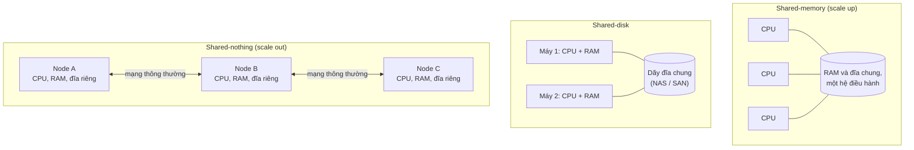

*(Sơ đồ do người viết ghi chú tổng hợp từ tr. 146. Xem thêm scale up và scale out ở [chương 1, B4.3](chapter-01.md#scale-up-out).)*

**Vì sao Part II tập trung vào shared-nothing** (tr. 147). **Không phải** vì nó là lựa chọn tốt nhất cho mọi trường hợp, mà vì nó **đòi hỏi người phát triển ứng dụng phải cẩn trọng nhất**. Khi dữ liệu nằm trên nhiều node, bạn phải hiểu các ràng buộc và trade-off của hệ phân tán: **database không thể che giấu chúng một cách thần kỳ**.

**Cái giá** (tr. 147). Shared-nothing thường thêm **độ phức tạp** cho ứng dụng, đôi khi còn **giới hạn khả năng diễn đạt** của mô hình dữ liệu. Có trường hợp một **chương trình đơn luồng đơn giản** chạy nhanh hơn đáng kể một **cluster hơn 100 lõi CPU** [4]. Mặt khác, hệ shared-nothing có thể rất mạnh.

<a id="replication-vs-partitioning"></a>

### 0.3 Replication Versus Partitioning (tr. 147–148)

Hai cách phổ biến để phân tán dữ liệu ra nhiều node (tr. 147):

| Cơ chế | Định nghĩa | Lợi ích | Chương |
| --- | --- | --- | --- |
| ***Replication*** | Giữ **bản sao của cùng dữ liệu** trên nhiều node, có thể ở nhiều vị trí | **Dư thừa**: node nào không sẵn sàng thì phục vụ từ node còn lại. Cũng giúp **hiệu năng** | Chương 5 |
| ***Partitioning*** (*sharding*) | Chia database lớn thành các **tập con nhỏ** gọi là *partition*, gán các partition cho các node khác nhau | Dữ liệu và tải vượt quá một máy | Chương 6 |

Hai cơ chế **riêng biệt** nhưng thường **đi cùng nhau** (Hình II-1):

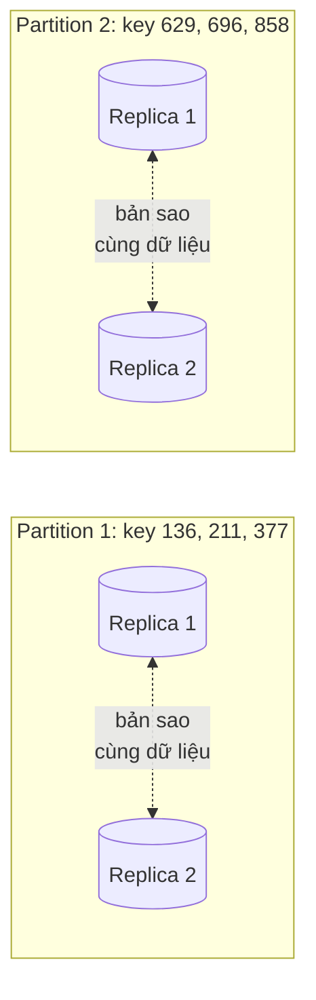

*(Vẽ lại Hình II-1, tr. 148: database chia thành hai partition, mỗi partition có hai replica. Trong hình gốc, mỗi key trỏ tới một đoạn văn bản.)*

**Lộ trình của Part II** (tr. 148):

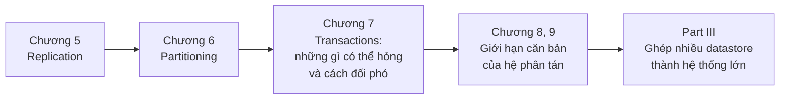

---

<a id="a-tong-quan"></a>

## A. Tổng quan chương

### Chương này muốn giải quyết điều gì?

Câu đề từ của chương lấy từ Douglas Adams (*Mostly Harmless*, 1992). Đại ý: khi thứ "không thể nào hỏng" lại hỏng, nó thường hóa ra không thể tiếp cận hay sửa được (tr. 151). Đó là giọng điệu của cả chương: replication nghe đơn giản nhưng thất bại theo những cách khó lường.

**Replication là gì** (tr. 151). Giữ **bản sao của cùng dữ liệu** trên **nhiều máy** nối với nhau qua mạng. Ba lý do, nhắc lại từ phần giới thiệu Part II:

- giữ dữ liệu **gần người dùng** về địa lý, để **giảm latency**;
- cho hệ thống **tiếp tục chạy** khi một phần đã hỏng, để **tăng availability**;
- tăng số máy phục vụ **truy vấn đọc**, để **tăng read throughput**.

**Giả định của chương** (tr. 151). Dataset đủ nhỏ để **mỗi máy chứa được toàn bộ**. Chương 6 bỏ giả định này và bàn partitioning. Các chương sau bàn những loại fault có thể xảy ra trong hệ thống nhân bản.

**Cái khó thật sự nằm ở đâu** (tr. 151). Nếu dữ liệu **không bao giờ thay đổi**, replication rất dễ: chép một lần tới mọi node là xong. **Mọi khó khăn nằm ở việc xử lý thay đổi** trên dữ liệu được nhân bản. Chương bàn ba thuật toán phổ biến để nhân bản thay đổi giữa các node: **single-leader**, **multi-leader** và **leaderless**. Gần như mọi database phân tán dùng một trong ba cách này, và mỗi cách có ưu nhược riêng.

**Các trade-off cấu hình** (tr. 152). Replication đặt ra nhiều lựa chọn, ví dụ **đồng bộ hay bất đồng bộ**, và **xử lý replica hỏng** thế nào. Đó thường là tùy chọn cấu hình của database. Chi tiết khác nhau giữa các sản phẩm, nhưng nguyên lý chung khá giống nhau.

**Chủ đề cũ, hiểu lầm mới** (tr. 152). Nguyên lý replication ít thay đổi kể từ khi được nghiên cứu vào **những năm 1970** [1], vì các ràng buộc căn bản của mạng vẫn vậy. Nhưng ngoài giới nghiên cứu, nhiều người phát triển lâu nay giả định database **chỉ có một node**; database phân tán chỉ mới phổ biến gần đây. Vì vậy có nhiều hiểu lầm quanh **eventual consistency**. Mục [B2](#b2) làm rõ khái niệm này và bàn các đảm bảo như **read-your-writes** và **monotonic reads**.

### Mạch lập luận của chương

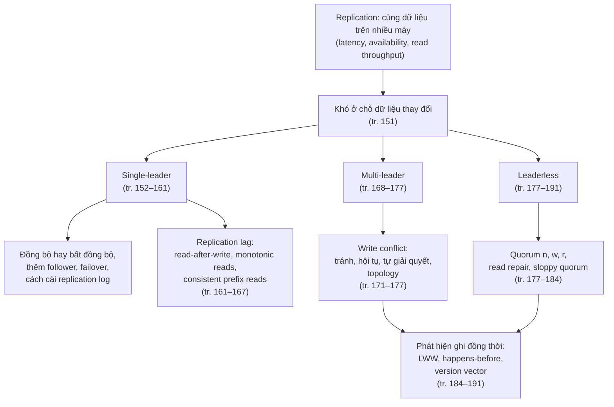

### Liên hệ với các chương khác

| Ý trong chương 5 | Liên hệ | Căn cứ |
| --- | --- | --- |
| Scale up, scale out, shared-nothing | **Chương 1** ([B4.3](chapter-01.md#scale-up-out)) và [mục 0](#shared-nothing) | tr. 146–147 |
| Reboot từng node để vá bảo mật mà không downtime | **Chương 1** ([B3.2](chapter-01.md#b3)), **Chương 4** (rolling upgrade, [B8](chapter-04.md#b8)) | tr. 156 |
| Log của storage engine (LSM-tree, WAL của B-tree) dùng làm replication log | **Chương 3** ([B3](chapter-03.md#b3), [B4.3](chapter-03.md#wal)) | tr. 159 |
| Tombstone | **Chương 3** ([B2](chapter-03.md#compaction)) | tr. 191 |
| Star topology khác star schema | **Chương 3** ([B7](chapter-03.md#star-schema)) | tr. 175 |
| Logical log giữ backward compatibility giữa các phiên bản database | **Chương 4** ([tương thích](chapter-04.md#compatibility)) | tr. 160 |
| Partitioning, request routing | **Chương 6** ("Request Routing", tr. 214) | tr. 151, 157, 166, 180 |
| Transaction cho đảm bảo mạnh hơn | **Chương 7, 9** | tr. 167, 173, 182 |
| Đồng hồ không tin cậy, fencing, mạng không tin cậy | **Chương 8** (tr. 287, 291, 301) | tr. 158, 164, 177, 186 |
| Consensus, linearizability và quorum | **Chương 9** (tr. 334) | tr. 155, 157, 182 |
| Change data capture | **Chương 11** | tr. 161 |
| Phát hiện và giải quyết xung đột ở quy mô lớn | **Chương 12** | tr. 175 |

> **Bản đồ đầu chương (tr. 150).** Bản đồ vẽ một hòn đảo. Phía bắc là vùng **Single-Leader Replication**: "Logical Coast" có RethinkDB, MongoDB, MySQL; "Physical Coast" có Oracle, PostgreSQL, SQL Server; giữa vùng là "Pit of Failover" (hố failover) và "Forest of Consistency Models". Dọc bờ đông chạy "Replication Lag Highway". Miền giữa là vùng **Multi-Leader Replication** (Etherpad, Google Docs, CouchDB, Calendar sync) với dãy núi "Pinnacles of Conflict Resolution". Phía nam là vùng **Leaderless Replication** (CRDTs, Riak, Voldemort, Cassandra) với "Quorum Harbor", "Eventual Consistency Boulevard" và "Bay of Causality". Một con tàu đi "To Consistency & Consensus (Chapter 9)", tàu khác đi "To Log-structured Storage (Chapter 3)".
>
> *Diễn giải của người viết ghi chú:* hai bờ "Logical" và "Physical" khớp với nội dung tr. 159–160. MySQL dùng logical (row-based) log; PostgreSQL và Oracle dùng WAL shipping, tức log vật lý. Sách không nêu SQL Server, MongoDB, RethinkDB dùng loại log nào; vị trí của chúng chỉ đọc được từ bản đồ.

---

<a id="b-chi-tiet"></a>

## B. Giải thích chi tiết

<a id="b1"></a>

### B1. Leaders and Followers (tr. 152–161)

<a id="leader-based"></a>

#### B1.0 Leader-based replication hoạt động thế nào? (tr. 152–153)

**Vấn đề** (tr. 152). Mỗi node lưu một bản sao database gọi là **replica**. Có nhiều replica thì phải trả lời: làm sao để **mọi dữ liệu đều tới được mọi replica**? Mỗi lần ghi phải được **mọi replica xử lý**; nếu không, các replica sẽ không còn chứa cùng dữ liệu.

**What.** Giải pháp phổ biến nhất là ***leader-based replication*** (còn gọi *active/passive* hay *master–slave*), minh họa ở Hình 5-1 (tr. 152–153):

1. Một replica được chỉ định làm ***leader*** (*master*, *primary*). Client muốn ghi phải gửi request tới leader. Leader **ghi dữ liệu mới vào storage cục bộ trước**.
2. Các replica còn lại là ***follower*** (*read replica*, *slave*, *secondary*, *hot standby*). Mỗi khi leader ghi dữ liệu mới, nó gửi thay đổi tới mọi follower dưới dạng ***replication log*** hay ***change stream***. Follower nhận log và cập nhật bản sao cục bộ, **áp dụng mọi lần ghi theo đúng thứ tự** mà leader đã xử lý.
3. Khi đọc, client có thể hỏi leader **hoặc** bất kỳ follower nào. Nhưng **chỉ leader nhận ghi**: với client, follower là **chỉ đọc**.

> Chú thích i (tr. 152). Mỗi người định nghĩa *hot*, *warm* và *cold standby* một kiểu. Ví dụ trong PostgreSQL, *hot standby* là replica nhận truy vấn đọc từ client, còn *warm standby* xử lý thay đổi từ leader nhưng không phục vụ truy vấn nào. Với mục đích của sách, khác biệt này không quan trọng.

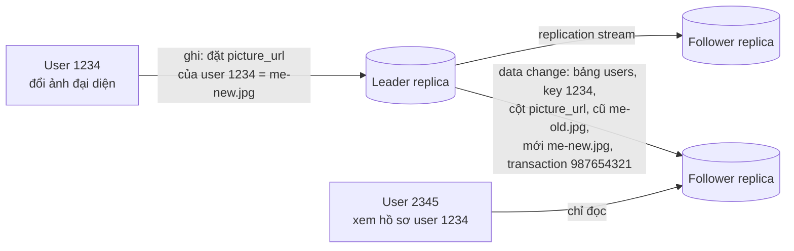

*(Vẽ lại Hình 5-1, tr. 153.)*

**Ai dùng** (tr. 153). Đây là tính năng có sẵn của nhiều relational database: PostgreSQL (từ bản 9.0), MySQL, Oracle Data Guard [2], SQL Server AlwaysOn Availability Groups [3]. Một số nonrelational database cũng dùng: MongoDB, RethinkDB, Espresso [4]. Không chỉ database: message broker phân tán như Kafka [5] và RabbitMQ highly available queues [6] cũng dùng nó. Một số network filesystem và replicated block device như DRBD cũng tương tự.

> **Bổ sung ngoài sách (quan sát).** Bản ghi "data change" trong Hình 5-1 (bảng, primary key, cột, giá trị cũ, giá trị mới, mã transaction) chính là dạng **logical log** mà [B1.4](#replication-logs) sẽ mô tả: log ghi thay đổi theo hàng, không phải theo byte trên đĩa.

<a id="sync-async"></a>

#### B1.1 Synchronous Versus Asynchronous Replication (tr. 153–155)

**What** (tr. 153). Một chi tiết quan trọng của hệ thống nhân bản là replication diễn ra **đồng bộ** (*synchronous*) hay **bất đồng bộ** (*asynchronous*). Trong relational database, đây thường là tùy chọn cấu hình; nhiều hệ khác cố định một trong hai kiểu.

Hình 5-2 theo dõi việc cập nhật ảnh đại diện ở Hình 5-1 theo thời gian: client gửi request tới leader; leader chuyển thay đổi tới các follower; cuối cùng leader báo client rằng cập nhật thành công (tr. 153–154).

- **Follower 1 đồng bộ:** leader **chờ** follower 1 xác nhận đã nhận bản ghi rồi mới báo thành công cho người dùng, và mới **cho client khác thấy** bản ghi.
- **Follower 2 bất đồng bộ:** leader gửi message nhưng **không chờ** follower trả lời.

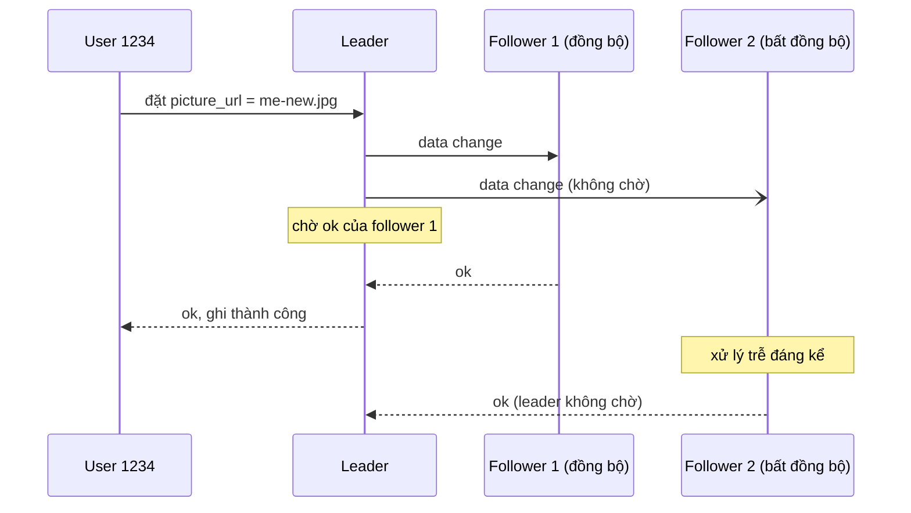

*(Vẽ lại Hình 5-2, tr. 154.)*

**Replication nhanh đến đâu?** (tr. 154). Thường **khá nhanh**: phần lớn database áp dụng thay đổi lên follower trong **chưa tới một giây**. Nhưng **không có đảm bảo** nào về thời gian. Follower có thể tụt sau leader **vài phút hoặc hơn**, ví dụ khi follower đang phục hồi sau lỗi, khi hệ thống chạy gần hết công suất, hoặc khi mạng giữa các node có sự cố.

**Trade-offs** (tr. 154–155):

| | Replication đồng bộ | Replication bất đồng bộ |
| --- | --- | --- |
| **Ưu điểm** | Follower **chắc chắn** có bản sao cập nhật, nhất quán với leader. Leader hỏng đột ngột thì dữ liệu **vẫn còn** trên follower | Leader **vẫn nhận ghi** dù mọi follower đã tụt lại |
| **Nhược điểm** | Follower đồng bộ không trả lời (crash, lỗi mạng hay bất kỳ lý do gì) thì **không ghi được**: leader phải **chặn mọi lần ghi** và chờ replica đó sẵn sàng lại | Leader hỏng và không phục hồi được thì mọi lần ghi **chưa kịp nhân bản bị mất**. Ghi **không được đảm bảo durable**, dù đã báo client thành công |

<a id="semi-sync"></a>

**Why không cho mọi follower đồng bộ** (tr. 154–155). Khi đó **một node hỏng bất kỳ** làm **cả hệ thống dừng**. Trên thực tế, "bật synchronous replication" thường có nghĩa: **một** follower đồng bộ, các follower còn lại bất đồng bộ. Nếu follower đồng bộ hỏng hay chậm, một follower bất đồng bộ được **chuyển thành đồng bộ**. Cách này bảo đảm dữ liệu cập nhật luôn có trên **ít nhất hai node**: leader và một follower đồng bộ. Cấu hình này đôi khi gọi là ***semi-synchronous*** [7].

**Hoàn toàn bất đồng bộ** (tr. 155). Leader-based replication **thường** được cấu hình hoàn toàn bất đồng bộ. Đánh đổi durability nghe có vẻ tệ, nhưng cách này vẫn được **dùng rộng rãi**, đặc biệt khi có **nhiều follower** hoặc các follower **ở xa nhau về địa lý**. Sách quay lại vấn đề này ở [B2](#b2).

> **Ví dụ minh họa do AI xây dựng (phép tính).** Giả sử mỗi follower sẵn sàng 99,9% thời gian và hỏng độc lập với nhau. Nếu leader phải chờ **cả 10 follower** đồng bộ, xác suất ghi được là 0,999¹⁰ ≈ 99,0%: hệ thống mất khả năng ghi khoảng 1% thời gian, tức khoảng 3,6 ngày mỗi năm. Với 100 follower, con số là 0,999¹⁰⁰ ≈ 90,5%. Semi-synchronous chỉ phụ thuộc **một** follower đồng bộ và có thể đổi sang follower khác khi nó hỏng. Phép tính này minh họa nhận xét của sách: càng nhiều node, cấu hình đồng bộ hoàn toàn càng kém tin cậy (tr. 161–162).

**Hộp "Research on Replication"** (tr. 155). Mất dữ liệu khi leader hỏng là vấn đề nghiêm trọng của hệ bất đồng bộ. Vì vậy giới nghiên cứu vẫn tìm cách nhân bản **không mất dữ liệu** mà vẫn giữ hiệu năng và availability tốt. Ví dụ ***chain replication*** [8, 9], một biến thể của replication đồng bộ, đã được cài thành công trong vài hệ như Microsoft Azure Storage [10, 11]. Consistency của replication có **liên hệ chặt** với ***consensus*** (khiến nhiều node đồng ý về một giá trị); Chương 9 bàn phần lý thuyết này. Chương 5 chỉ tập trung vào các dạng replication đơn giản hơn, được dùng phổ biến nhất trong thực tế.

> **Bổ sung ngoài sách.** Trong chain replication (van Renesse và Schneider, 2004), các replica xếp thành một chuỗi. Ghi đi vào đầu chuỗi, lan dần qua từng node, và node cuối chuỗi xác nhận với client; đọc được phục vụ ở node cuối. Một lần ghi được xác nhận nghĩa là mọi node trong chuỗi đã có nó.

<a id="new-followers"></a>

#### B1.2 Setting Up New Followers (tr. 155–156)

**Why** (tr. 155). Thỉnh thoảng cần thêm follower mới: để tăng số replica, hoặc để thay node hỏng. Làm sao follower mới có bản sao **chính xác** dữ liệu của leader?

- **Chép file dữ liệu thường không đủ.** Client ghi liên tục và dữ liệu luôn biến động, nên một lần chép file thông thường sẽ thấy **các phần khác nhau của database ở các thời điểm khác nhau**. Kết quả có thể vô nghĩa.
- **Khóa database** (không cho ghi) để file nhất quán thì đi **ngược mục tiêu high availability**.

**How** (tr. 156). Thường có thể thêm follower **không downtime**. Về mặt khái niệm, quy trình như sau:

1. Chụp một **consistent snapshot** của database leader tại một thời điểm, nếu được thì **không khóa toàn bộ database**. Hầu hết database có tính năng này vì backup cũng cần nó. Đôi khi phải dùng công cụ bên ngoài, như innobackupex cho MySQL [12].
2. Chép snapshot sang node follower mới.
3. Follower kết nối tới leader và xin **mọi thay đổi xảy ra từ lúc chụp snapshot**. Việc này đòi hỏi snapshot gắn với một **vị trí chính xác trong replication log** của leader. PostgreSQL gọi vị trí đó là ***log sequence number***, MySQL gọi là ***binlog coordinates***.
4. Khi follower xử lý xong phần tồn đọng (*backlog*), ta nói nó đã ***caught up*** (bắt kịp). Từ đó nó xử lý thay đổi của leader ngay khi chúng xảy ra.

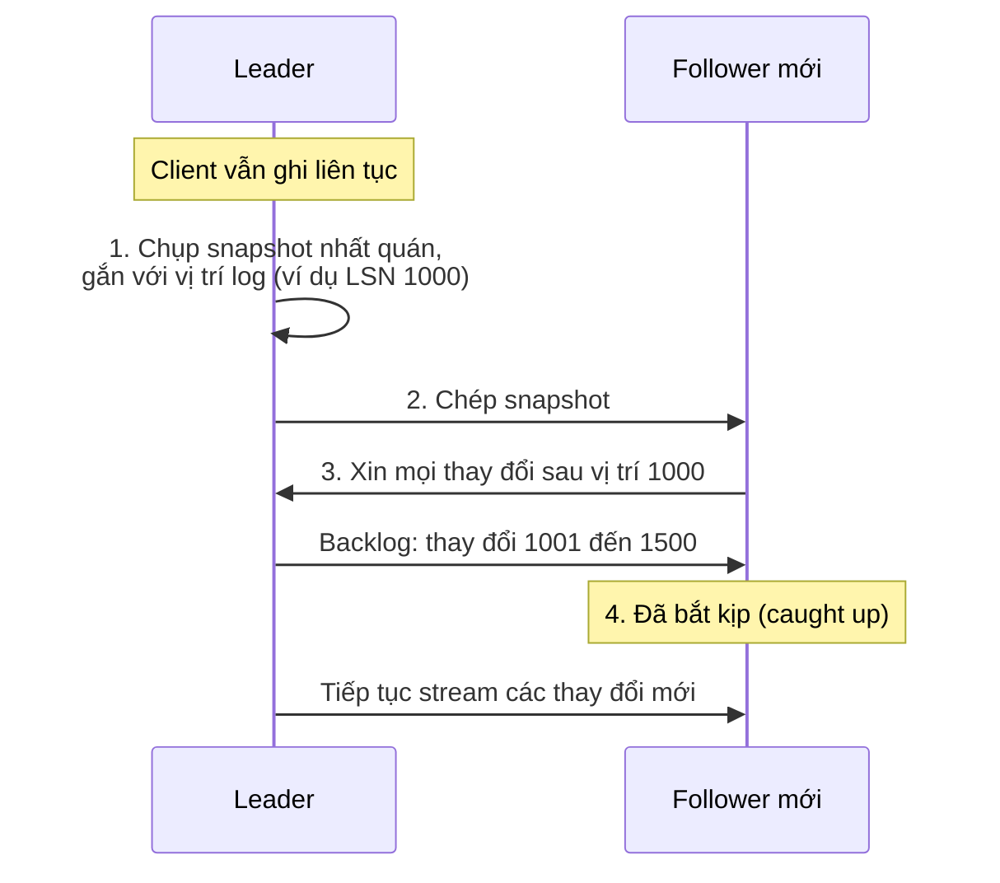

*(Sơ đồ do AI xây dựng theo 4 bước ở tr. 156. Các số LSN là giả định.)*

> **Bổ sung ngoài sách.** Vị trí log phải **chính xác** vì hai lý do ngược nhau. Nếu follower xin thay đổi từ vị trí **sớm hơn** snapshot, một số thay đổi bị áp dụng **hai lần** (ví dụ một phép cộng dồn bị cộng hai lần). Nếu xin từ vị trí **muộn hơn**, các thay đổi ở giữa bị **mất**. Snapshot và vị trí log phải mô tả **cùng một thời điểm**.

Các bước thực tế **khác nhau nhiều** giữa các database. Có hệ tự động hoàn toàn; có hệ là một quy trình nhiều bước khá "bí truyền" mà quản trị viên phải làm tay (tr. 156).

<a id="node-outages"></a>

#### B1.3 Handling Node Outages (tr. 156–158)

**Bối cảnh** (tr. 156). Node nào trong hệ thống cũng có thể ngừng chạy: bất ngờ do fault, nhưng cũng hay do **bảo trì có kế hoạch**, ví dụ reboot máy để cài bản vá bảo mật kernel. Có thể **reboot từng node mà không downtime** là lợi thế lớn cho vận hành và bảo trì. Mục tiêu: giữ **cả hệ thống** chạy dù từng node hỏng, và giảm tối đa ảnh hưởng của mỗi lần node ngừng. Làm sao đạt high availability với leader-based replication?

**Follower hỏng: catch-up recovery** (tr. 156). Mỗi follower giữ trên đĩa cục bộ một **log các thay đổi đã nhận từ leader**. Nếu follower crash rồi khởi động lại, hoặc mạng giữa leader và follower bị gián đoạn tạm thời, nó phục hồi khá dễ: từ log, nó biết **transaction cuối cùng đã xử lý** trước sự cố. Nó kết nối lại leader và xin mọi thay đổi trong thời gian mất kết nối. Áp dụng xong, nó đã bắt kịp và tiếp tục nhận stream thay đổi như trước. Cơ chế này giống bước 3–4 khi [thêm follower mới](#new-followers).

<a id="failover"></a>

**Leader hỏng: failover** (tr. 157).

**What.** Xử lý leader hỏng **khó hơn**: phải **nâng một follower** lên làm leader mới; client phải được **cấu hình lại** để gửi ghi tới leader mới; các follower khác phải bắt đầu nhận thay đổi từ leader mới. Quá trình này gọi là ***failover***. Failover có thể **thủ công** (quản trị viên được báo leader hỏng và tự làm các bước cần thiết) hoặc **tự động**.

**How — failover tự động thường gồm** (tr. 157):

1. **Xác định leader đã hỏng.** Có rất nhiều thứ có thể hỏng: crash, mất điện, sự cố mạng… **Không có cách chắc chắn** để biết chuyện gì đã xảy ra, nên đa số hệ thống dùng **timeout**: các node liên tục gửi message qua lại, và node nào không trả lời trong một khoảng thời gian (ví dụ **30 giây**) bị coi là đã chết. (Nếu leader bị tắt có chủ đích để bảo trì thì không áp dụng bước này.)
2. **Chọn leader mới.** Có thể qua **bầu chọn** (leader được **đa số** replica còn lại chọn), hoặc do một ***controller node*** đã được bầu từ trước chỉ định. Ứng viên tốt nhất thường là replica có **thay đổi mới nhất** từ leader cũ, để giảm mất dữ liệu. Khiến mọi node đồng ý về leader mới là một bài toán **consensus** (Chương 9).
3. **Cấu hình lại hệ thống dùng leader mới.** Client phải gửi ghi tới leader mới ("Request Routing", tr. 214). Nếu leader cũ quay lại, nó có thể vẫn **tin mình là leader**, không biết các replica khác đã buộc nó thôi vai trò. Hệ thống phải bảo đảm leader cũ trở thành follower và công nhận leader mới.

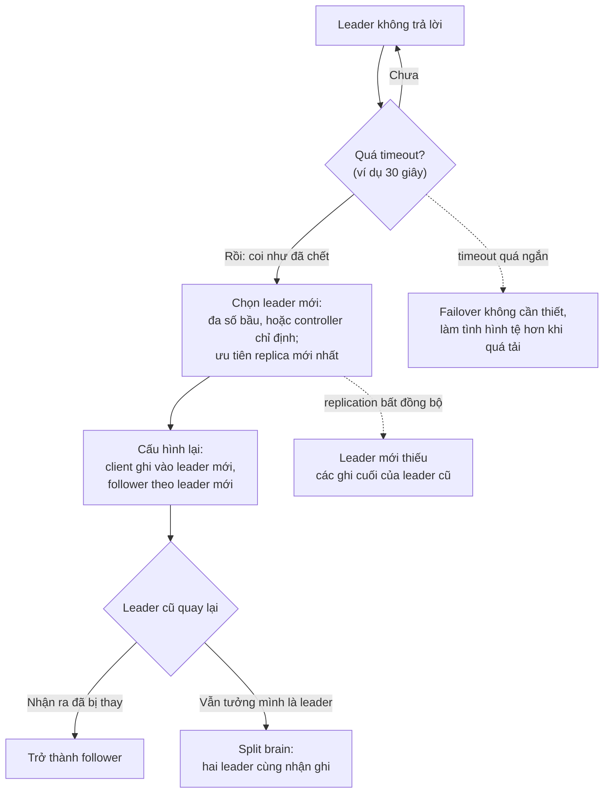

*(Sơ đồ do người viết ghi chú tổng hợp từ tr. 157–158.)*

<a id="failover-problems"></a>

**Những điều có thể sai khi failover** (tr. 157–158):

1. **Mất ghi khi replication bất đồng bộ.** Leader mới có thể chưa nhận hết các ghi của leader cũ trước khi nó hỏng. Nếu leader cũ quay lại cluster sau khi đã có leader mới, những ghi đó xử lý thế nào? Trong lúc đó leader mới có thể đã nhận các ghi **xung đột** với chúng. Giải pháp phổ biến nhất là **bỏ đi** các ghi chưa nhân bản của leader cũ, và điều này có thể **vi phạm kỳ vọng về durability** của client.
2. **Bỏ ghi đặc biệt nguy hiểm khi hệ thống lưu trữ khác phối hợp với nội dung database.** Trong một sự cố ở **GitHub** [13], một follower MySQL **lạc hậu** được nâng làm leader. Database dùng **bộ đếm tự tăng** để gán primary key cho hàng mới. Bộ đếm của leader mới tụt sau leader cũ, nên nó **dùng lại** một số primary key mà leader cũ đã cấp. Các key này cũng được dùng trong một kho **Redis**, nên việc dùng lại gây **bất nhất giữa MySQL và Redis**, khiến một số **dữ liệu riêng tư bị hiển thị cho sai người dùng**.
3. **Split brain.** Trong vài kịch bản lỗi (Chương 8), **hai node cùng tin mình là leader**. Tình huống này gọi là ***split brain*** và rất nguy hiểm: nếu cả hai cùng nhận ghi mà không có quy trình giải quyết xung đột ([B3](#b3)), dữ liệu dễ bị mất hoặc hỏng. Để an toàn, một số hệ có cơ chế **tắt một node** khi phát hiện hai leader. Nhưng nếu cơ chế đó thiết kế không cẩn thận, có thể **cả hai node đều bị tắt** [14].
4. **Timeout bao lâu là đúng?** Timeout **dài** thì phục hồi lâu khi leader hỏng thật. Timeout **ngắn** thì có thể **failover không cần thiết**: tải tăng đột biến tạm thời làm thời gian phản hồi vượt timeout, hoặc trục trặc mạng làm gói tin đến trễ. Nếu hệ thống **đang chật vật** vì tải cao hay vấn đề mạng, một lần failover không cần thiết dễ làm tình hình **tệ hơn**.

> Chú thích ii (tr. 158). Cách tắt node như trên gọi là ***fencing***, hay nói mạnh hơn là **STONITH** (*Shoot The Other Node In The Head*). Fencing được bàn kỹ ở "The leader and the lock", tr. 301 (Chương 8).

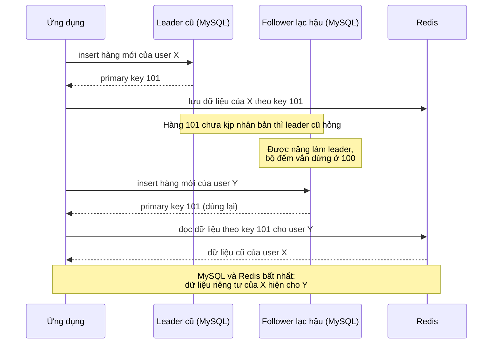

*(Ví dụ minh họa do AI xây dựng, đơn giản hóa cơ chế có thể dẫn tới sự cố GitHub mô tả ở tr. 157–158. Số key là giả định; chi tiết thật của sự cố nằm trong tài liệu [13].)*

**Kết luận của tác giả** (tr. 158). **Không có giải pháp dễ** cho các vấn đề này. Vì vậy một số đội vận hành **thích failover thủ công**, dù phần mềm hỗ trợ failover tự động. Các vấn đề này (node hỏng, mạng không tin cậy, trade-off giữa consistency, durability, availability và latency của replica) thực chất là **vấn đề căn bản của hệ phân tán**; Chương 8 và 9 bàn sâu hơn.

**System Design.**

- Yêu cầu durability quyết định chế độ replication: nếu không được mất ghi đã xác nhận, cần ít nhất một follower đồng bộ (semi-synchronous) và ưu tiên follower đó khi failover (tr. 154–155, 157).
- **Ví dụ minh họa do AI xây dựng:** key dùng ở hệ thống bên ngoài (cache, search index) không nên phụ thuộc một bộ đếm có thể "lùi lại" sau failover. Đó là bài học từ sự cố GitHub (tr. 157–158).
- **Bổ sung ngoài sách:** timeout phát hiện lỗi nên được đặt dựa trên phân phối độ trễ thật lúc tải cao (các percentile cao ở [chương 1](chapter-01.md#percentiles)), không chỉ dựa trên độ trễ trung bình. Nếu không, đợt tăng tải đầu tiên có thể kích hoạt failover không cần thiết.

<a id="replication-logs"></a>

#### B1.4 Implementation of Replication Logs (tr. 158–161)

Leader-based replication hoạt động thế nào bên dưới? Thực tế có nhiều phương pháp (tr. 158).

<a id="statement-based"></a>

**1. Statement-based replication** (tr. 158–159).

- **What.** Leader ghi log **mọi câu lệnh ghi** (*statement*) nó thực thi và gửi log đó cho follower. Với relational database, mọi câu `INSERT`, `UPDATE`, `DELETE` được chuyển tới follower; follower **parse và thực thi** câu SQL như thể nhận từ client.
- **Why hỏng** (tr. 159):
  - Câu lệnh gọi **hàm không tất định**, như `NOW()` lấy giờ hiện tại hay `RAND()` lấy số ngẫu nhiên, dễ cho **giá trị khác nhau** trên mỗi replica.
  - Câu lệnh dùng **cột tự tăng**, hoặc **phụ thuộc dữ liệu đang có** (ví dụ `UPDATE … WHERE <điều kiện>`), phải được thực thi **đúng cùng thứ tự** trên mọi replica, nếu không sẽ cho kết quả khác. Điều này gò bó khi có nhiều transaction chạy đồng thời.
  - Câu lệnh có **side effect** (trigger, stored procedure, user-defined function) có thể gây side effect khác nhau trên mỗi replica, trừ khi side effect đó **hoàn toàn tất định**.
- **Lách được, nhưng nhiều edge case.** Leader có thể thay lời gọi hàm không tất định bằng **giá trị trả về cố định** khi ghi log, để mọi follower nhận cùng giá trị. Nhưng có quá nhiều edge case, nên các phương pháp khác thường được ưa chuộng hơn.
- **Ai dùng.** MySQL trước bản 5.1. Đôi khi vẫn được dùng vì **khá gọn**, nhưng mặc định MySQL giờ chuyển sang row-based nếu câu lệnh có yếu tố không tất định. **VoltDB** dùng statement-based và làm nó an toàn bằng cách **bắt transaction phải tất định** [15].

> **Ví dụ minh họa do AI xây dựng.** Câu lệnh "tặng mỗi khách hàng một mã giảm giá ngẫu nhiên" chạy trên leader cho khách A mã 37, nhưng chạy lại trên follower cho khách A mã 82. Hai replica giờ chứa dữ liệu khác nhau mà không ai báo lỗi.

<a id="wal-shipping"></a>

**2. Write-ahead log (WAL) shipping** (tr. 159–160).

- **Nhắc lại Chương 3.** Storage engine thường nối mọi lần ghi vào một log:
  - Với **log-structured storage engine** ([SSTable và LSM-tree](chapter-03.md#b3)), log **là nơi lưu chính**; các segment được compaction và thu gom rác ở nền.
  - Với **B-tree**, vốn ghi đè từng block đĩa, mọi thay đổi được ghi vào **write-ahead log** trước, để index có thể về trạng thái nhất quán sau crash ([chương 3, B4.3](chapter-03.md#wal)).
- **How.** Trong cả hai trường hợp, log là **chuỗi byte chỉ ghi nối thêm** chứa mọi lần ghi vào database. Có thể dùng **chính log đó** để dựng replica ở node khác: ngoài việc ghi log ra đĩa, leader gửi nó qua mạng tới follower. Follower xử lý log và dựng **bản sao y hệt các cấu trúc dữ liệu** trên leader (tr. 159–160).
- **Ai dùng.** PostgreSQL, Oracle và một số hệ khác [16].
- **Nhược điểm chính** (tr. 160). Log mô tả dữ liệu ở **mức rất thấp**: WAL chứa chi tiết **byte nào đổi trong block đĩa nào**. Vì vậy replication **gắn chặt với storage engine**. Nếu database đổi định dạng lưu trữ giữa hai phiên bản, thường **không thể** chạy hai phiên bản khác nhau trên leader và follower.
- **Tác động vận hành lớn** (tr. 160). Nếu giao thức replication cho follower chạy **phiên bản mới hơn** leader, có thể **nâng cấp database không downtime**: nâng cấp các follower trước, rồi failover để một node đã nâng cấp làm leader mới. Nếu giao thức không cho lệch phiên bản, như thường thấy ở WAL shipping, việc nâng cấp **cần downtime**.

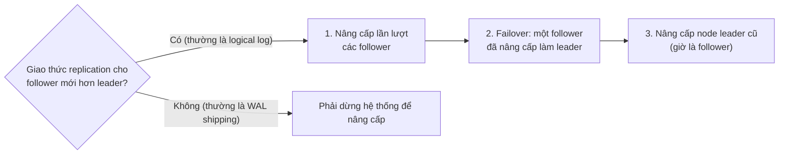

*(Bước 1–2 theo tr. 160; bước 3 là bước hiển nhiên tiếp theo, do người viết ghi chú thêm vào.)*

<a id="logical-log"></a>

**3. Logical (row-based) log replication** (tr. 160–161).

- **What.** Dùng **định dạng log khác nhau** cho replication và cho storage engine, để replication log **tách khỏi nội bộ storage engine**. Loại log này gọi là ***logical log***, để phân biệt với biểu diễn dữ liệu **vật lý** của storage engine.
- **How.** Với relational database, logical log thường là chuỗi bản ghi mô tả các lần ghi vào bảng ở **mức hàng**:
  - **Hàng được insert:** log chứa **giá trị mới của mọi cột**.
  - **Hàng bị xóa:** log chứa đủ thông tin để **định danh duy nhất** hàng đó, thường là **primary key**. Nếu bảng không có primary key, phải log **giá trị cũ của mọi cột**.
  - **Hàng được update:** log chứa đủ thông tin để định danh hàng, cùng **giá trị mới của mọi cột** (hoặc ít nhất các cột đã thay đổi).
- Một transaction sửa nhiều hàng sinh ra nhiều bản ghi log như vậy, theo sau là một bản ghi báo **transaction đã commit**. MySQL binlog (khi cấu hình row-based replication) dùng cách này [17].
- **Lợi ích** (tr. 160–161):
  - Vì tách khỏi nội bộ storage engine, logical log dễ giữ **backward compatible** hơn ([chương 4](chapter-04.md#compatibility)). Leader và follower chạy được **phiên bản database khác nhau**, thậm chí **storage engine khác nhau**.
  - Logical log **dễ cho ứng dụng bên ngoài parse**. Điều này hữu ích khi muốn gửi nội dung database sang hệ thống khác: data warehouse để phân tích offline, hoặc để dựng index và cache tùy biến [18]. Kỹ thuật này gọi là ***change data capture*** (Chương 11).

<a id="trigger-based"></a>

**4. Trigger-based replication** (tr. 161).

- **Why.** Các cách trên do **chính database** thực hiện, không cần code ứng dụng. Thường đó là điều ta muốn. Nhưng đôi khi cần **linh hoạt hơn**: chỉ nhân bản **một phần** dữ liệu, nhân bản **từ loại database này sang loại khác**, hoặc cần **logic giải quyết xung đột** ([B3.2](#write-conflicts)). Khi đó phải đưa replication **lên tầng ứng dụng**.
- **How.** Một số công cụ như Oracle GoldenGate [19] **đọc log của database** để đưa thay đổi dữ liệu cho ứng dụng. Cách khác là dùng tính năng có sẵn trong nhiều relational database: **trigger** và **stored procedure**. Trigger cho phép đăng ký code ứng dụng **tự chạy khi có thay đổi dữ liệu** (write transaction). Trigger ghi thay đổi vào một **bảng riêng**; một **tiến trình bên ngoài** đọc bảng đó, áp dụng logic ứng dụng cần thiết và nhân bản thay đổi sang hệ thống khác. Databus for Oracle [20] và Bucardo for Postgres [21] làm theo cách này.
- **Trade-off.** Thường **tốn tài nguyên hơn** các phương pháp khác, **dễ có bug và giới hạn** hơn replication có sẵn của database. Nhưng nó vẫn hữu ích vì **linh hoạt**.

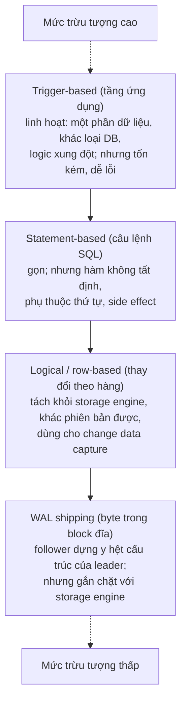

*(Cách xếp theo mức trừu tượng là của người viết ghi chú, dựa trên mô tả ở tr. 158–161. So sánh chi tiết ở [D3](#d3).)*

---

<a id="b2"></a>

### B2. Problems with Replication Lag (tr. 161–167)

<a id="eventual-consistency"></a>

#### B2.0 Read-scaling và eventual consistency (tr. 161–162)

**Bối cảnh** (tr. 161). Chịu được node hỏng chỉ là một lý do để nhân bản. Hai lý do khác là **scalability** (xử lý nhiều request hơn sức một máy) và **latency** (đặt replica gần người dùng).

**Read-scaling architecture** (tr. 161). Leader-based replication bắt mọi lần ghi đi qua **một node**, nhưng truy vấn chỉ đọc có thể tới **replica bất kỳ**. Với workload **chủ yếu đọc, ít ghi** (kiểu phổ biến trên web), có một lựa chọn hấp dẫn: tạo **nhiều follower** và chia request đọc cho chúng. Leader bớt tải, còn request đọc được phục vụ bởi replica ở gần. Muốn tăng năng lực đọc, chỉ cần **thêm follower**.

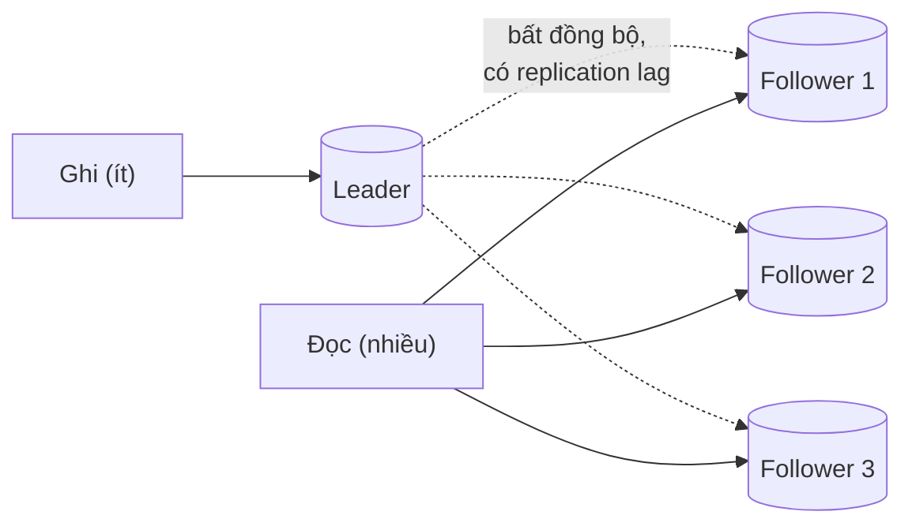

**Chỉ chạy được với replication bất đồng bộ** (tr. 161–162). Nếu nhân bản đồng bộ tới mọi follower, một node hỏng hay một sự cố mạng sẽ khiến **cả hệ thống không ghi được**. Càng nhiều node thì càng dễ có node hỏng, nên cấu hình đồng bộ hoàn toàn sẽ **rất kém tin cậy** (xem phép tính minh họa ở [B1.1](#semi-sync)).

**What — eventual consistency** (tr. 162). Đọc từ follower bất đồng bộ có thể thấy **thông tin cũ** nếu follower đang tụt lại. Database trông như **bất nhất**: cùng một truy vấn chạy cùng lúc trên leader và trên follower có thể cho kết quả khác nhau, vì không phải mọi lần ghi đã tới follower. Nhưng bất nhất này chỉ là **trạng thái tạm**: nếu ngừng ghi và chờ một lúc, follower sẽ **bắt kịp** và nhất quán với leader. Hiệu ứng này gọi là ***eventual consistency*** [22, 23].

> Chú thích iii (tr. 162). Thuật ngữ *eventual consistency* do Douglas Terry và cộng sự đặt ra [24], được Werner Vogels phổ biến [22], và trở thành "khẩu hiệu" của nhiều dự án NoSQL. Nhưng không chỉ NoSQL mới eventually consistent: follower của relational database nhân bản bất đồng bộ cũng có tính chất này.

**"Eventually" cố ý mơ hồ** (tr. 162). Nói chung **không có giới hạn** nào cho việc một replica có thể tụt lại bao xa. Lúc hoạt động bình thường, khoảng trễ từ khi leader ghi tới khi follower phản ánh, gọi là ***replication lag***, có thể chỉ **một phần giây** và không ai nhận ra. Nhưng khi hệ thống chạy gần hết công suất hoặc mạng có vấn đề, lag dễ tăng lên **vài giây, thậm chí vài phút**.

Khi lag lớn như vậy, bất nhất không còn là chuyện lý thuyết mà là **vấn đề thật của ứng dụng**. Sách nêu **ba ví dụ** điển hình và hướng giải quyết (tr. 162).

<a id="read-your-writes"></a>

#### B2.1 Reading Your Own Writes (tr. 162–164)

**Why — vấn đề** (tr. 162). Nhiều ứng dụng cho người dùng gửi dữ liệu rồi xem lại: một bản ghi khách hàng, một comment trong thảo luận… Dữ liệu mới phải gửi tới **leader**, nhưng khi xem lại có thể đọc từ **follower**. Cách này đặc biệt hợp khi dữ liệu được xem nhiều mà ít khi ghi.

Với replication bất đồng bộ, có vấn đề như Hình 5-3: nếu người dùng xem dữ liệu **ngay sau khi ghi**, dữ liệu mới có thể **chưa tới** replica được hỏi. Với người dùng, trông như dữ liệu họ vừa gửi **đã mất**.

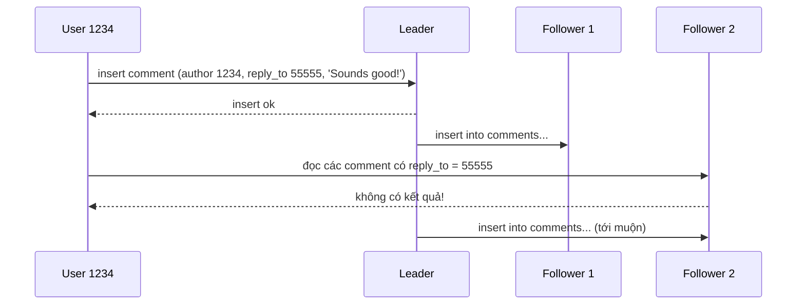

*(Vẽ lại Hình 5-3, tr. 163.)*

**What — đảm bảo cần có** (tr. 163). ***Read-after-write consistency***, còn gọi là ***read-your-writes consistency*** [24]: nếu người dùng **tải lại trang**, họ **luôn thấy** mọi cập nhật **chính họ** đã gửi. Đảm bảo này **không hứa gì về người dùng khác**: cập nhật của người khác có thể một lúc sau mới thấy. Nó chỉ trấn an người dùng rằng dữ liệu **của họ** đã được lưu đúng.

**How — các kỹ thuật** (tr. 163–164):

1. **Đọc thứ người dùng có thể đã sửa từ leader, còn lại đọc từ follower.** Cần có cách biết một thứ **có thể đã bị sửa** mà không phải truy vấn nó. Ví dụ hồ sơ trên mạng xã hội thường chỉ chủ hồ sơ sửa được. Quy tắc đơn giản: **hồ sơ của chính mình đọc từ leader**, hồ sơ người khác đọc từ follower.
2. **Dùng tiêu chí khác khi hầu hết mọi thứ đều sửa được.** Nếu phần lớn dữ liệu người dùng có thể sửa, cách 1 kém hiệu quả: hầu hết phải đọc từ leader, **mất lợi ích của read scaling**. Có thể theo dõi **thời điểm cập nhật cuối** và trong **một phút** sau đó, mọi lần đọc đều đi tới leader. Cũng có thể **giám sát replication lag** và **không truy vấn** follower nào tụt quá **một phút** so với leader.
3. **Client nhớ timestamp của lần ghi gần nhất.** Hệ thống bảo đảm replica phục vụ đọc cho người dùng đó đã phản ánh các cập nhật **ít nhất tới timestamp đó**. Nếu replica chưa đủ mới, chuyển đọc sang replica khác, hoặc **chờ** replica bắt kịp. Timestamp có thể là **logical timestamp** (thứ chỉ thứ tự ghi, như **log sequence number**) hoặc **đồng hồ hệ thống**; dùng đồng hồ thì việc **đồng bộ đồng hồ** trở nên tối quan trọng ("Unreliable Clocks", tr. 287, Chương 8).
4. **Replica ở nhiều datacenter** (để gần người dùng hoặc tăng availability) làm mọi thứ phức tạp thêm: request nào cần leader phục vụ thì phải được **định tuyến tới datacenter chứa leader**.

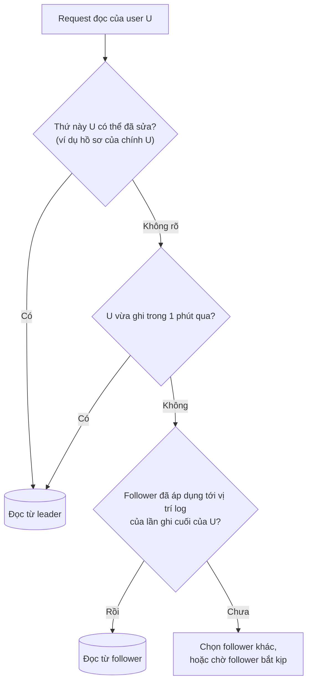

*(Sơ đồ do người viết ghi chú ghép kỹ thuật 1–3 ở tr. 163–164 thành một luồng quyết định. Sách nêu chúng như các lựa chọn riêng; ứng dụng thật có thể chỉ dùng một trong số đó.)*

> **Bổ sung ngoài sách.** Logical timestamp như log sequence number thường an toàn hơn đồng hồ hệ thống cho kỹ thuật 3: nó so sánh trực tiếp được với vị trí mà follower đã áp dụng trong replication log, và không bị ảnh hưởng bởi đồng hồ lệch giữa các máy.

<a id="cross-device"></a>

**Cross-device read-after-write consistency** (tr. 164). Cùng một người dùng có thể truy cập từ **nhiều thiết bị**, ví dụ trình duyệt trên máy tính và app trên điện thoại. Khi đó có thể cần: nhập thông tin trên thiết bị này thì xem trên thiết bị kia **cũng phải thấy**. Có thêm hai vấn đề:

- Cách **nhớ timestamp** lần cập nhật cuối trở nên khó: code chạy trên thiết bị này **không biết** thiết bị kia đã cập nhật gì. Metadata này phải được **lưu tập trung**.
- Với replica ở nhiều datacenter, **không có gì bảo đảm** kết nối từ các thiết bị khác nhau đi tới **cùng một datacenter**. Ví dụ máy tính dùng mạng băng rộng ở nhà, điện thoại dùng mạng di động: tuyến mạng có thể hoàn toàn khác nhau. Nếu cách làm của bạn cần đọc từ leader, có thể phải **định tuyến mọi thiết bị của một người dùng về cùng một datacenter** trước.

<a id="monotonic-reads"></a>

#### B2.2 Monotonic Reads (tr. 164–165)

**Why — vấn đề** (tr. 164–165). Anomaly thứ hai: người dùng thấy **thời gian chạy lùi**. Nó xảy ra khi một người dùng đọc nhiều lần từ **các replica khác nhau**. Trong Hình 5-4, user 2345 chạy cùng một truy vấn hai lần: lần đầu tới follower ít lag, lần hai tới follower lag nhiều. (Tình huống này rất dễ xảy ra khi người dùng tải lại trang và mỗi request được chuyển tới một server ngẫu nhiên.) Lần đầu trả về comment user 1234 vừa thêm; lần hai không trả gì vì follower lag chưa nhận được bản ghi. Thực chất, lần đọc thứ hai đang nhìn hệ thống ở **thời điểm sớm hơn** lần thứ nhất.

Nếu lần đầu không trả gì thì không tệ lắm, vì user 2345 có lẽ không biết user 1234 vừa comment. Nhưng **thấy comment xuất hiện rồi lại biến mất** thì rất khó hiểu.

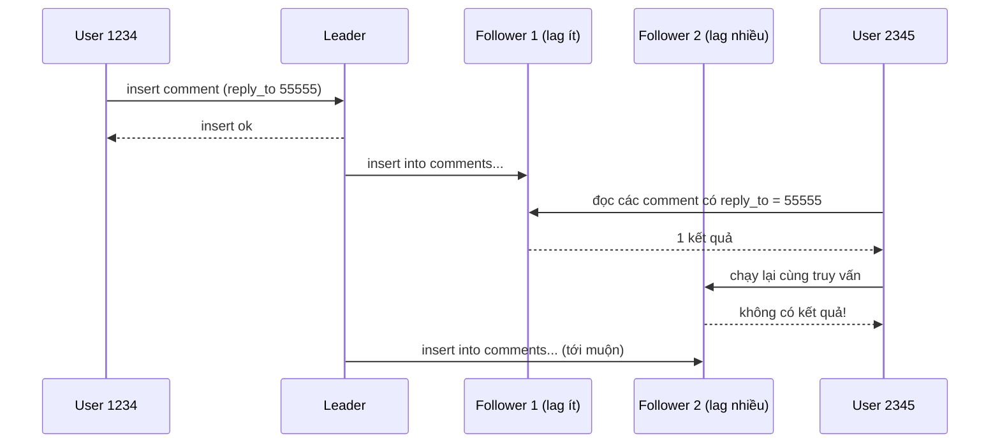

*(Vẽ lại Hình 5-4, tr. 165.)*

**What** (tr. 165). ***Monotonic reads*** [23] là đảm bảo anomaly này không xảy ra. Nó **yếu hơn strong consistency** nhưng **mạnh hơn eventual consistency**. Khi đọc, bạn vẫn có thể thấy giá trị cũ. Monotonic reads chỉ có nghĩa: nếu **một người dùng** đọc **nhiều lần liên tiếp**, họ không thấy thời gian chạy lùi, tức là **không đọc dữ liệu cũ hơn sau khi đã đọc dữ liệu mới hơn**.

**How** (tr. 165). Một cách là bảo đảm mỗi người dùng **luôn đọc từ cùng một replica** (người dùng khác nhau có thể đọc từ replica khác nhau). Ví dụ chọn replica theo **hash của user ID** thay vì chọn ngẫu nhiên. Nhưng nếu replica đó hỏng, truy vấn của người dùng phải được **chuyển sang replica khác**.

> **Bổ sung ngoài sách.** Khi phải chuyển sang replica khác, có thể giữ monotonic reads bằng cách để client nhớ **vị trí log mới nhất mà nó đã đọc thấy**, và chỉ đọc từ replica đã áp dụng ít nhất tới vị trí đó. Kỹ thuật này giống kỹ thuật 3 của read-after-write, chỉ khác là nhớ "đã **đọc** tới đâu" thay vì "đã **ghi** tới đâu".

<a id="consistent-prefix"></a>

#### B2.3 Consistent Prefix Reads (tr. 165–167)

**Why — vấn đề** (tr. 165–166). Anomaly thứ ba liên quan tới **vi phạm quan hệ nhân quả** (*causality*). Sách dùng một đoạn đối thoại ngắn giữa ông Poons và bà Cake (nhân vật của Terry Pratchett [25]): ông Poons hỏi bà Cake nhìn được bao xa vào tương lai; bà Cake đáp thường khoảng mười giây. Hai câu có **phụ thuộc nhân quả**: bà Cake nghe câu hỏi rồi mới trả lời.

Giờ hình dung một người thứ ba nghe cuộc trò chuyện **qua các follower**. Lời bà Cake đi qua follower **ít lag**, lời ông Poons đi qua follower **lag nhiều** (Hình 5-5). Người quan sát nghe **câu trả lời trước câu hỏi**, như thể bà Cake trả lời trước khi ông Poons kịp hỏi. Năng lực tiên tri đó ấn tượng, nhưng rất khó hiểu.

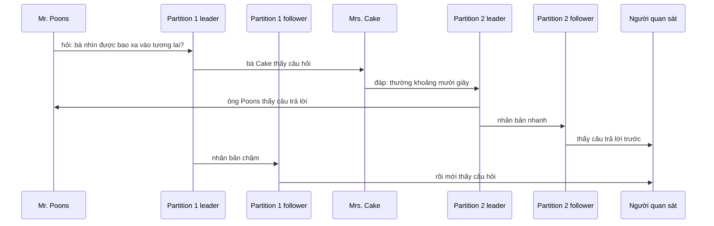

*(Vẽ lại Hình 5-5, tr. 166. Câu hỏi và câu trả lời nằm ở hai partition khác nhau.)*

**What** (tr. 166). Ngăn anomaly này cần một đảm bảo khác: ***consistent prefix reads*** [23]. Nếu một chuỗi lần ghi xảy ra theo **một thứ tự nào đó**, thì **bất kỳ ai** đọc các lần ghi đó cũng thấy chúng xuất hiện **theo cùng thứ tự**.

> **Bổ sung ngoài sách.** Chữ *prefix* (tiền tố) nghĩa là: nếu các lần ghi xảy ra theo thứ tự w₁, w₂, w₃…, người đọc luôn thấy một đoạn **đầu** w₁…wₖ của chuỗi đó, có thể chưa đầy đủ, nhưng không bao giờ thấy w₃ mà thiếu w₂.

**Why khó trong database phân vùng** (tr. 166–167). Đây là vấn đề đặc biệt của database được **partition (shard)** (Chương 6). Nếu database luôn áp dụng ghi theo **cùng một thứ tự**, đọc luôn thấy một tiền tố nhất quán, nên anomaly này không xảy ra. Nhưng trong nhiều database phân tán, **các partition hoạt động độc lập**, nên **không có thứ tự toàn cục** cho các lần ghi. Khi đọc, người dùng có thể thấy phần này của database ở trạng thái cũ và phần kia ở trạng thái mới.

**How** (tr. 167):

- Bảo đảm mọi lần ghi **có quan hệ nhân quả** với nhau được ghi vào **cùng một partition**. Nhưng với một số ứng dụng, cách này không làm hiệu quả được.
- Dùng thuật toán **theo dõi tường minh các phụ thuộc nhân quả**; sách quay lại ở "happens-before" ([B4.5](#happens-before), tr. 186).

<a id="lag-solutions"></a>

#### B2.4 Solutions for Replication Lag (tr. 167)

**Đặt câu hỏi đúng.** Khi làm việc với hệ eventually consistent, nên nghĩ: nếu replication lag tăng lên **vài phút, thậm chí vài giờ**, ứng dụng sẽ hành xử thế nào? Nếu câu trả lời là "không sao" thì tốt. Nếu kết quả là trải nghiệm tệ cho người dùng, cần thiết kế hệ thống để có **đảm bảo mạnh hơn**, như read-after-write. **Giả vờ replication là đồng bộ trong khi thực ra là bất đồng bộ** là công thức cho rắc rối về sau.

**Ứng dụng tự lo thì khó.** Như đã thấy, ứng dụng có thể cung cấp đảm bảo mạnh hơn database bên dưới, ví dụ đọc một số thứ từ leader. Nhưng xử lý các vấn đề này trong code ứng dụng **phức tạp và dễ sai**.

**Vì sao transaction tồn tại.** Tốt hơn nếu người phát triển ứng dụng **không phải lo** các vấn đề tinh vi của replication và có thể **tin database "làm đúng"**. Đó là lý do **transaction** tồn tại: chúng là cách để database cung cấp đảm bảo mạnh hơn, giúp ứng dụng **đơn giản hơn**.

**Một quan điểm cần nuance.** Transaction trên một node đã có từ lâu. Nhưng khi chuyển sang database phân tán (nhân bản và phân vùng), nhiều hệ thống **bỏ transaction**, cho rằng transaction quá tốn kém về hiệu năng và availability, và khẳng định eventual consistency là **không tránh khỏi** trong hệ thống có khả năng mở rộng. Nhận định đó có phần đúng, nhưng **quá đơn giản**. Sách sẽ dần xây dựng cái nhìn tinh tế hơn: transaction ở Chương 7 và 9, các cơ chế thay thế ở Part III.

---

<a id="b3"></a>

### B3. Multi-Leader Replication (tr. 168–177)

<a id="multi-leader"></a>

#### B3.0 Multi-leader là gì? (tr. 168)

**Why** (tr. 168). Leader-based replication có **một nhược điểm lớn**: chỉ có **một leader**, và mọi lần ghi phải đi qua nó. Nếu vì lý do nào đó bạn **không kết nối được** tới leader, ví dụ mạng giữa bạn và leader bị gián đoạn, bạn **không ghi được** vào database.

> Chú thích iv (tr. 168). Nếu database được partition (Chương 6), **mỗi partition có một leader**. Leader của các partition có thể nằm trên các node khác nhau, nhưng mỗi partition vẫn phải có đúng một node leader.

**What** (tr. 168). Mở rộng tự nhiên là cho **nhiều node nhận ghi**. Replication vẫn diễn ra như cũ: node nào xử lý một lần ghi thì phải chuyển thay đổi đó tới mọi node khác. Cấu hình này gọi là ***multi-leader*** (còn gọi *master–master* hay *active/active replication*). Mỗi leader **đồng thời là follower** của các leader khác.

<a id="multi-leader-use-cases"></a>

#### B3.1 Use Cases for Multi-Leader Replication (tr. 168–171)

Dùng multi-leader **trong một datacenter** hiếm khi hợp lý, vì lợi ích hiếm khi bù được độ phức tạp tăng thêm. Nhưng có vài tình huống mà cấu hình này hợp lý (tr. 168).

<a id="multi-datacenter"></a>

**1. Multi-datacenter operation** (tr. 168–170).

Giả sử database có replica ở **nhiều datacenter**, để chịu được mất cả một datacenter hoặc để gần người dùng. Với leader-based replication thông thường, leader phải nằm ở **một** datacenter và mọi lần ghi phải đi qua datacenter đó.

Với multi-leader, **mỗi datacenter có một leader** (Hình 5-6). Trong mỗi datacenter dùng replication leader–follower thông thường. Giữa các datacenter, leader của mỗi datacenter nhân bản thay đổi của nó tới leader của các datacenter khác.

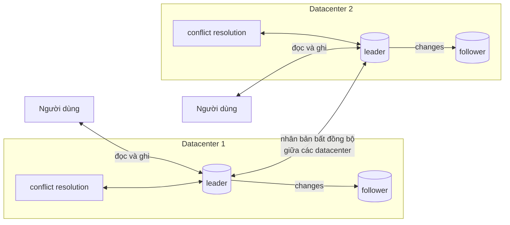

*(Vẽ lại Hình 5-6, tr. 169.)*

**So sánh single-leader và multi-leader khi triển khai nhiều datacenter** (tr. 169):

| Tiêu chí | Single-leader | Multi-leader |
| --- | --- | --- |
| **Hiệu năng** | Mọi lần ghi phải đi qua internet tới datacenter có leader. Độ trễ ghi tăng đáng kể, có thể **đi ngược mục đích** của việc có nhiều datacenter | Mọi lần ghi xử lý ở **datacenter cục bộ**, rồi nhân bản bất đồng bộ sang datacenter khác. Độ trễ giữa các datacenter **được che** khỏi người dùng, nên hiệu năng cảm nhận có thể tốt hơn |
| **Chịu mất datacenter** | Datacenter có leader hỏng thì failover nâng một follower ở datacenter khác làm leader | Mỗi datacenter **tiếp tục hoạt động độc lập**. Replication bắt kịp khi datacenter hỏng quay lại |
| **Chịu sự cố mạng** | Lưu lượng giữa các datacenter thường đi qua **internet công cộng**, kém tin cậy hơn mạng nội bộ. Single-leader **rất nhạy** với sự cố trên đường này, vì ghi phải đi **đồng bộ** qua nó | Multi-leader nhân bản bất đồng bộ thường chịu sự cố mạng **tốt hơn**: mạng gián đoạn tạm thời không ngăn việc xử lý ghi |

**Công cụ** (tr. 170). Một số database hỗ trợ multi-leader sẵn, nhưng nó cũng thường được cài bằng **công cụ bên ngoài**: Tungsten Replicator cho MySQL [26], BDR cho PostgreSQL [27], GoldenGate cho Oracle [19].

**Nhược điểm lớn** (tr. 170). Cùng một dữ liệu có thể bị sửa **đồng thời ở hai datacenter**, và các **write conflict** đó phải được giải quyết (ô "conflict resolution" trong Hình 5-6). Xem [B3.2](#write-conflicts).

**"Vùng nguy hiểm"** (tr. 170). Multi-leader thường là tính năng được **gắn thêm về sau** vào nhiều database, nên hay có **bẫy cấu hình tinh vi** và **tương tác bất ngờ** với tính năng khác. Ví dụ **khóa tự tăng**, **trigger** và **ràng buộc toàn vẹn** đều có thể gây rắc rối. Vì vậy multi-leader thường bị coi là **vùng nguy hiểm, nên tránh nếu có thể** [28].

> **Bổ sung ngoài sách.** Khóa tự tăng gây rắc rối vì hai leader có thể cấp **cùng một số** cho hai hàng khác nhau. Một cách lách phổ biến là cho mỗi leader một bước nhảy và độ lệch riêng (ví dụ leader 1 cấp số lẻ, leader 2 cấp số chẵn), hoặc dùng ID không phụ thuộc bộ đếm như UUID.

<a id="offline-clients"></a>

**2. Clients with offline operation** (tr. 170).

- **Bối cảnh.** Ứng dụng phải chạy được khi **mất kết nối internet**. Ví dụ app lịch trên điện thoại, laptop và thiết bị khác: bạn phải xem được lịch họp (đọc) và thêm cuộc họp mới (ghi) **bất cứ lúc nào**, dù thiết bị có mạng hay không. Thay đổi làm lúc offline phải được **đồng bộ** với server và các thiết bị khác khi thiết bị online trở lại.
- **How.** Mỗi thiết bị có một **database cục bộ đóng vai leader** (nhận ghi), và có một quá trình nhân bản multi-leader **bất đồng bộ** (đồng bộ hóa, *sync*) giữa các bản lịch trên mọi thiết bị. Replication lag có thể là **hàng giờ, thậm chí hàng ngày**, tùy khi nào có internet.
- **Về kiến trúc**, đây là multi-leader giữa các datacenter **đẩy tới cực hạn**: mỗi thiết bị là một "datacenter", và mạng giữa chúng **cực kỳ không tin cậy**. Lịch sử dài của các bản cài **đồng bộ lịch bị lỗi** cho thấy multi-leader khó làm đúng.
- **Công cụ.** Có công cụ nhằm làm cấu hình này dễ hơn; ví dụ **CouchDB** được thiết kế cho chế độ hoạt động này [29].

<a id="collaborative-editing"></a>

**3. Collaborative editing** (tr. 170–171).

- **Bối cảnh.** Ứng dụng cộng tác thời gian thực cho nhiều người cùng sửa một tài liệu: Etherpad [30] và Google Docs [31] cho nhiều người sửa đồng thời văn bản hay bảng tính.
- **Vì sao là bài toán replication.** Ta không thường nghĩ vậy, nhưng nó rất giống trường hợp sửa offline. Khi một người sửa tài liệu, thay đổi được áp dụng **ngay** vào **replica cục bộ** (trạng thái tài liệu trong trình duyệt hay app), rồi nhân bản **bất đồng bộ** tới server và tới những người khác đang sửa cùng tài liệu.
- **Muốn không có xung đột:** ứng dụng phải **lấy lock** trên tài liệu trước khi cho sửa. Người khác muốn sửa phải chờ người đầu commit và nhả lock. Mô hình này **tương đương single-leader replication với transaction trên leader**.
- **Muốn cộng tác nhanh hơn:** làm đơn vị thay đổi **rất nhỏ** (ví dụ một phím gõ) và **tránh lock**. Nhiều người sửa đồng thời được, nhưng kéo theo **mọi thách thức** của multi-leader, kể cả việc phải giải quyết xung đột [32].

<a id="write-conflicts"></a>

#### B3.2 Handling Write Conflicts (tr. 171–175)

**What** (tr. 171). Vấn đề lớn nhất của multi-leader là có thể xảy ra ***write conflict***, nên cần ***conflict resolution***.

**Example — Hình 5-7.** Một trang wiki được hai người sửa cùng lúc. User 1 đổi tiêu đề từ A thành B; user 2 đổi từ A thành C cùng thời điểm. Mỗi thay đổi được áp dụng thành công trên leader cục bộ. Nhưng khi nhân bản bất đồng bộ, **xung đột bị phát hiện** [33]. Vấn đề này **không xảy ra** trong database single-leader.

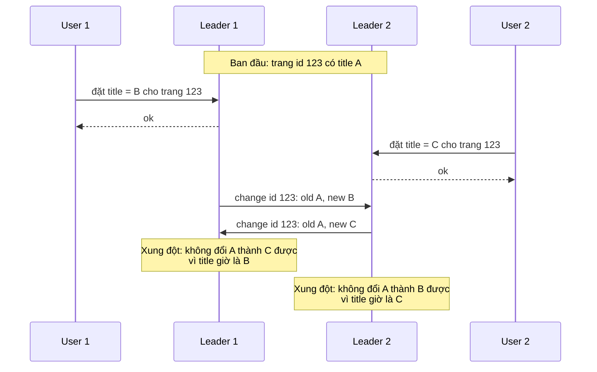

*(Vẽ lại Hình 5-7, tr. 171.)*

<a id="sync-conflict-detection"></a>

**Synchronous versus asynchronous conflict detection** (tr. 172).

- **Single-leader:** người ghi thứ hai hoặc **bị chặn** và chờ lần ghi thứ nhất xong, hoặc transaction ghi thứ hai **bị hủy** và người dùng phải thử lại.
- **Multi-leader:** **cả hai lần ghi đều thành công**, và xung đột chỉ được phát hiện **bất đồng bộ** vào lúc nào đó sau. Khi ấy có thể đã **quá muộn** để hỏi người dùng giải quyết.
- **Phát hiện đồng bộ thì sao?** Về nguyên tắc có thể làm: chờ lần ghi được nhân bản tới mọi replica rồi mới báo thành công. Nhưng như vậy là **mất lợi thế chính** của multi-leader: cho mỗi replica nhận ghi độc lập. Nếu muốn phát hiện xung đột đồng bộ, **dùng single-leader luôn cho xong**.

<a id="conflict-avoidance"></a>

**Conflict avoidance** (tr. 172).

- **What.** Chiến lược đơn giản nhất là **tránh** xung đột: nếu ứng dụng bảo đảm mọi lần ghi cho **một bản ghi cụ thể** đi qua **cùng một leader**, thì xung đột không thể xảy ra. Nhiều bản cài multi-leader xử lý xung đột **khá kém**, nên tránh xung đột thường là cách **được khuyến nghị** [34].
- **Example.** Trong ứng dụng mà người dùng sửa dữ liệu của chính họ, có thể bảo đảm request của một người dùng luôn được định tuyến tới **cùng một datacenter**, và dùng leader ở đó để đọc và ghi. Mỗi người dùng có thể có một datacenter "nhà" khác nhau (chọn theo vị trí gần nhất), nhưng **từ góc nhìn của một người dùng, cấu hình về bản chất là single-leader**.
- **Giới hạn.** Đôi khi phải **đổi leader được chỉ định** cho một bản ghi: datacenter hỏng và phải chuyển traffic sang datacenter khác, hoặc người dùng chuyển chỗ ở và giờ gần datacenter khác hơn. Lúc đó conflict avoidance **không còn hiệu lực**, và phải xử lý khả năng có ghi đồng thời trên các leader khác nhau.

<a id="convergent"></a>

**Converging toward a consistent state** (tr. 172–173).

- **Why.** Database single-leader áp dụng ghi theo **thứ tự tuần tự**: nhiều lần cập nhật cùng một trường thì **lần ghi cuối** quyết định giá trị cuối cùng. Trong multi-leader **không có thứ tự ghi xác định**, nên không rõ giá trị cuối cùng phải là gì. Trong Hình 5-7, leader 1 thấy title đổi thành B rồi thành C; leader 2 thấy C rồi B. **Không thứ tự nào "đúng hơn"**.
- Nếu mỗi replica cứ áp dụng ghi theo thứ tự nó thấy, database sẽ **bất nhất**: giá trị cuối là C ở leader 1 và B ở leader 2. Điều đó **không chấp nhận được**: mọi cơ chế replication phải bảo đảm dữ liệu **cuối cùng giống nhau ở mọi replica**.
- Vì vậy database phải giải quyết xung đột theo cách ***convergent*** (hội tụ): mọi replica phải đi tới **cùng một giá trị cuối** khi mọi thay đổi đã được nhân bản.

**Các cách hội tụ** (tr. 173):

| Cách | Mô tả | Hệ quả |
| --- | --- | --- |
| **Ghi có ID lớn nhất thắng** | Gán cho mỗi lần ghi một **ID duy nhất** (timestamp, số ngẫu nhiên dài, UUID, hoặc hash của key và value), chọn lần ghi có ID cao nhất, bỏ các lần ghi khác. Nếu ID là timestamp, cách này gọi là ***last write wins* (LWW)** | Phổ biến nhưng **rất dễ mất dữ liệu** [35]. Xem [B4.5](#lww) |
| **Replica có ID cao hơn thắng** | Mỗi replica có ID duy nhất; ghi xuất phát từ replica số lớn hơn luôn được ưu tiên | Cũng **mất dữ liệu** |
| **Gộp các giá trị** | Ví dụ sắp xếp theo thứ tự chữ cái rồi nối lại: tiêu đề gộp có thể là "B/C" | Không mất giá trị nào (nhận xét của người viết ghi chú: kết quả có thể không phải điều người dùng muốn) |
| **Ghi nhận xung đột** | Lưu xung đột trong một **cấu trúc dữ liệu tường minh** giữ mọi thông tin, rồi viết code ứng dụng giải quyết sau, có thể bằng cách hỏi người dùng | Không mất thông tin; việc giải quyết chuyển về ứng dụng |

<a id="custom-resolution"></a>

**Custom conflict resolution logic** (tr. 173).

Cách giải quyết phù hợp nhất thường **phụ thuộc ứng dụng**. Vì vậy hầu hết công cụ multi-leader cho phép viết logic giải quyết xung đột bằng **code ứng dụng**. Code đó có thể chạy **lúc ghi** hoặc **lúc đọc**:

- **On write.** Ngay khi hệ thống phát hiện xung đột trong log thay đổi được nhân bản, nó gọi **conflict handler**. Ví dụ Bucardo cho viết một đoạn Perl cho việc này. Handler thường **không hỏi người dùng được**: nó chạy trong tiến trình nền và phải chạy **nhanh**.
- **On read.** Khi phát hiện xung đột, **mọi lần ghi xung đột đều được lưu**. Lần đọc sau, **nhiều phiên bản** của dữ liệu được trả về cho ứng dụng. Ứng dụng có thể hỏi người dùng hoặc tự giải quyết, rồi **ghi kết quả lại** vào database. CouchDB làm theo cách này.

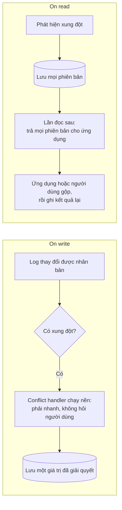

**Lưu ý** (tr. 173). Giải quyết xung đột thường áp dụng ở mức **từng hàng hay từng document**, **không** phải cả transaction [36]. Nếu một transaction ghi nhiều thứ một cách nguyên tử (Chương 7), **mỗi lần ghi vẫn được xét riêng** khi giải quyết xung đột.

<a id="automatic-resolution"></a>

**Hộp "Automatic Conflict Resolution"** (tr. 174).

- **Why.** Quy tắc giải quyết xung đột **nhanh chóng trở nên phức tạp**, và code tùy biến dễ sai. **Amazon** là ví dụ hay được nhắc: có thời gian, logic giải quyết xung đột của giỏ hàng **giữ món được thêm** nhưng **không giữ thao tác xóa món**. Khách hàng đôi khi thấy món đã xóa **xuất hiện lại** trong giỏ [37].
- **Các hướng nghiên cứu** tự động giải quyết xung đột do sửa dữ liệu đồng thời:
  - ***Conflict-free replicated datatypes* (CRDTs)** [32, 38]: một họ cấu trúc dữ liệu cho set, map, danh sách có thứ tự, bộ đếm… cho phép nhiều người sửa đồng thời và **tự động giải quyết xung đột theo cách hợp lý**. Một số CRDT đã được cài trong Riak 2.0 [39, 40].
  - ***Mergeable persistent data structures*** [41]: theo dõi **lịch sử** một cách tường minh, giống hệ quản lý phiên bản Git, và dùng hàm **three-way merge** (CRDT dùng **two-way merge**).
  - ***Operational transformation* (OT)** [42]: thuật toán giải quyết xung đột đứng sau Etherpad [30] và Google Docs [31]. Nó được thiết kế riêng cho việc sửa đồng thời một **danh sách có thứ tự**, như chuỗi ký tự tạo nên một văn bản.
- **Triển vọng.** Bản cài các thuật toán này trong database còn **non trẻ**, nhưng nhiều khả năng sẽ được tích hợp vào nhiều hệ thống nhân bản hơn trong tương lai. Tự động giải quyết xung đột có thể làm đồng bộ multi-leader **đơn giản hơn nhiều** cho ứng dụng.

> **Bổ sung ngoài sách — hai ví dụ dễ hình dung.**
> - **CRDT đơn giản nhất, bộ đếm chỉ tăng (G-Counter):** mỗi replica giữ một ô đếm riêng và chỉ tăng ô của mình. Gộp hai trạng thái bằng cách lấy **max từng ô**; giá trị bộ đếm là **tổng các ô**. Phép gộp cho cùng kết quả dù gộp theo thứ tự nào và gộp bao nhiêu lần, nên mọi replica hội tụ mà không mất lần tăng nào.
> - **Two-way và three-way merge:** two-way merge chỉ có hai trạng thái để so, nên bản thân cấu trúc dữ liệu phải mang đủ metadata để biết cách gộp. Three-way merge có thêm **tổ tiên chung**, nên biết bên nào đã đổi gì so với điểm tách nhánh, giống `git merge`.

<a id="what-is-conflict"></a>

**What is a conflict?** (tr. 174–175).

- **Xung đột hiển nhiên:** như Hình 5-7, hai lần ghi đồng thời sửa **cùng một trường của cùng một bản ghi** thành hai giá trị khác nhau.
- **Xung đột tinh vi hơn:** hệ thống **đặt phòng họp** theo dõi phòng nào được nhóm nào đặt vào giờ nào. Ứng dụng phải bảo đảm mỗi phòng chỉ được **một nhóm** đặt tại một thời điểm (**không đặt chồng giờ**). Xung đột có thể xảy ra nếu hai lượt đặt khác nhau được tạo cho cùng phòng, cùng giờ. **Ngay cả khi ứng dụng kiểm tra phòng trống trước khi cho đặt**, vẫn có thể xung đột nếu hai lượt đặt được ghi trên **hai leader khác nhau**.
- **Chưa có lời giải làm sẵn.** Các chương sau sẽ xây dần hiểu biết về vấn đề này: Chương 7 có thêm ví dụ về xung đột, Chương 12 bàn cách phát hiện và giải quyết xung đột trong hệ nhân bản có khả năng mở rộng.

> **Bổ sung ngoài sách.** Điểm khó của ví dụ đặt phòng là hai lần ghi chạm vào **hai bản ghi khác nhau** (hai lượt đặt), nên so sánh từng bản ghi riêng lẻ không thấy xung đột. Cái bị vi phạm là một **ràng buộc trên nhiều bản ghi**. Glossary của sách (tr. 557) nhắc tới *write skew* ở "Write Skew and Phantoms" (tr. 246, Chương 7); có thể đó là cùng loại vấn đề. Điều này sẽ được kiểm chứng khi học Chương 7.

<a id="topologies"></a>

#### B3.3 Multi-Leader Replication Topologies (tr. 175–177)

**What** (tr. 175). ***Replication topology*** mô tả **các đường truyền** mà một lần ghi đi qua để lan từ node này sang node khác. Với hai leader (Hình 5-7), chỉ có một topology hợp lý: leader 1 gửi mọi lần ghi cho leader 2 và ngược lại. Với hơn hai leader, có nhiều topology khác nhau (Hình 5-8).

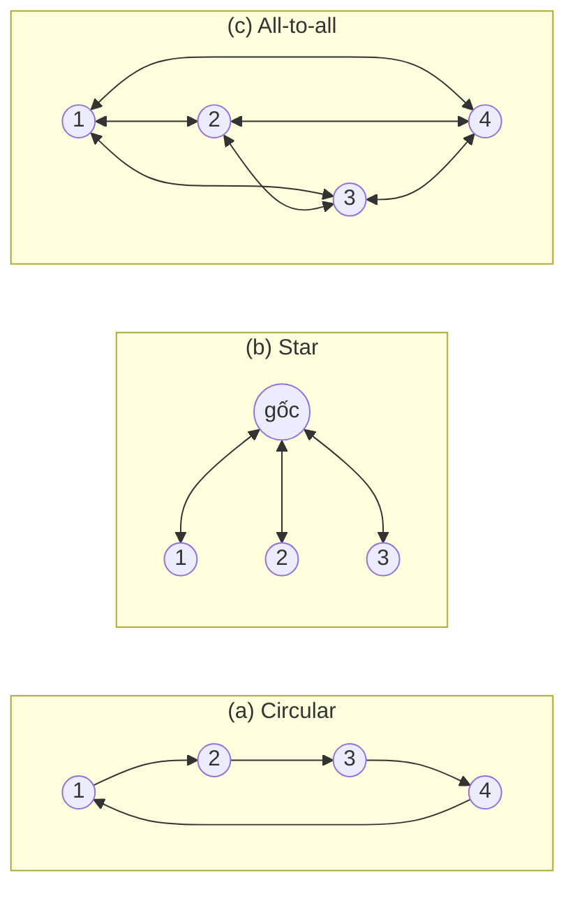

*(Vẽ lại Hình 5-8, tr. 175.)*

- **All-to-all** (Hình 5-8c) là topology **tổng quát nhất**: mỗi leader gửi ghi của nó tới **mọi** leader khác.
- **Circular:** các topology hạn chế hơn cũng được dùng. Ví dụ MySQL mặc định **chỉ hỗ trợ** topology vòng [34]: mỗi node nhận ghi từ một node, rồi chuyển các ghi đó (cộng với ghi của chính nó) tới một node khác.
- **Star:** một **node gốc** được chỉ định chuyển ghi tới mọi node khác. Topology hình sao có thể tổng quát hóa thành **cây**.

> Chú thích v (tr. 175). Đừng nhầm star topology với **star schema** ([chương 3](chapter-03.md#star-schema)). Star schema mô tả **cấu trúc mô hình dữ liệu**, không phải **cách các node giao tiếp**.

**Chống vòng lặp vô hạn** (tr. 175–176). Với circular và star, một lần ghi có thể phải **đi qua nhiều node** mới tới được mọi replica. Vì vậy node phải **chuyển tiếp** thay đổi nhận từ node khác. Để tránh lặp vô hạn, mỗi node có một **ID duy nhất**, và trong replication log, mỗi lần ghi được **gắn ID của mọi node nó đã đi qua** [43]. Node nhận được một thay đổi đã gắn ID của chính mình thì **bỏ qua**, vì biết mình đã xử lý nó.

**Điểm yếu của circular và star** (tr. 176). Chỉ cần **một node hỏng** là có thể làm gián đoạn luồng message nhân bản giữa các node khác, khiến chúng không liên lạc được tới khi node đó được sửa. Có thể cấu hình lại topology để đi vòng qua node hỏng, nhưng ở hầu hết triển khai, việc đó phải làm **thủ công**. Topology **dày** hơn như all-to-all chịu lỗi **tốt hơn**, vì message đi được theo **nhiều đường**, tránh **single point of failure**.

**Điểm yếu của all-to-all** (tr. 176). Một số đường mạng có thể **nhanh hơn** đường khác (ví dụ do nghẽn mạng), nên một số message nhân bản có thể **"vượt"** message khác (Hình 5-9).

```mermaid
sequenceDiagram
    participant A as Client A
    participant L1 as Leader 1
    participant L2 as Leader 2
    participant L3 as Leader 3
    participant B as Client B
    A->>L1: insert vào bảng data: key x, value 1
    L1-->>A: ok
    L1->>L3: insert... value = 1 (đường nhanh)
    B->>L3: update: value = value + 1 với key x
    L3-->>B: ok
    L3->>L2: update... value = 2
    Note over L2: Update tới trước insert:<br/>cập nhật một hàng chưa tồn tại!
    L1->>L2: insert... value = 1 (đường chậm, tới sau)
    L3->>L1: update... value = 2
```

*(Vẽ lại Hình 5-9, tr. 176.)*

- Trong Hình 5-9, client A insert một hàng vào bảng trên leader 1, client B update hàng đó trên leader 3. Leader 2 có thể nhận chúng **theo thứ tự khác**: nhận update trước (theo góc nhìn của nó là update một hàng **chưa tồn tại**), rồi mới nhận insert lẽ ra phải đến trước.
- Đây là vấn đề **causality**, giống [consistent prefix reads](#consistent-prefix): update **phụ thuộc** insert trước đó, nên mọi node phải xử lý insert trước rồi mới update. **Gắn timestamp vào mỗi lần ghi là không đủ**, vì không thể tin đồng hồ các máy đủ đồng bộ để sắp đúng thứ tự các sự kiện này tại leader 2 (Chương 8) (tr. 176–177).
- Để sắp đúng thứ tự, có thể dùng kỹ thuật ***version vectors*** ([B4.5](#version-vectors)) (tr. 177).

**Thực tế cài đặt** (tr. 177). Phát hiện xung đột được **cài kém** ở nhiều hệ multi-leader. Ví dụ, lúc sách được viết, PostgreSQL BDR **không** bảo đảm thứ tự nhân quả cho các lần ghi [27], còn Tungsten Replicator cho MySQL **thậm chí không cố** phát hiện xung đột [34]. Nếu dùng hệ thống multi-leader, nên **biết các vấn đề này**, **đọc kỹ tài liệu** và **test kỹ** database để chắc nó thật sự có các đảm bảo bạn tưởng là nó có.

---

<a id="b4"></a>

### B4. Leaderless Replication (tr. 177–191)

<a id="dynamo-style"></a>

#### B4.0 Dynamo-style: bỏ hẳn leader (tr. 177)

**Nhìn lại** (tr. 177). Single-leader và multi-leader đều dựa trên ý tưởng: client gửi ghi tới **một node** (leader), và database lo chép lần ghi đó sang các replica khác. **Leader quyết định thứ tự** xử lý ghi; follower áp dụng theo đúng thứ tự đó.

**What** (tr. 177). Một số hệ lưu trữ đi hướng khác: **bỏ khái niệm leader** và cho **mọi replica nhận ghi trực tiếp** từ client.

- Một vài hệ nhân bản đầu tiên là leaderless [1, 44], nhưng ý tưởng này gần như **bị lãng quên** trong thời relational database thống trị.
- Nó thành kiến trúc **thời thượng** trở lại sau khi Amazon dùng cho hệ **Dynamo** nội bộ [37]. **Riak**, **Cassandra** và **Voldemort** là các datastore mã nguồn mở leaderless lấy cảm hứng từ Dynamo, nên loại database này còn gọi là ***Dynamo-style***.

> Chú thích vi (tr. 177). Dynamo không dành cho người dùng ngoài Amazon. Dễ nhầm là AWS có sản phẩm database dạng dịch vụ tên **DynamoDB**, dùng kiến trúc **hoàn toàn khác**: theo sách (lúc viết), nó dựa trên **single-leader replication**.

**Client hay coordinator?** (tr. 177). Ở một số bản cài, **client gửi ghi trực tiếp** tới nhiều replica. Ở bản cài khác, một ***coordinator node*** làm việc đó thay client. Nhưng khác với leader, coordinator **không áp đặt thứ tự** cho các lần ghi. Khác biệt thiết kế này có **hệ quả sâu sắc** đến cách dùng database.

<a id="leaderless-write"></a>

#### B4.1 Writing to the Database When a Node Is Down (tr. 177–179)

**Example** (tr. 177–178). Database có ba replica, một replica đang không sẵn sàng (có thể đang reboot để cài bản cập nhật hệ thống).

- **Leader-based:** muốn tiếp tục xử lý ghi, có thể phải **failover** ([B1.3](#failover)).
- **Leaderless:** **không có failover**. Trong Hình 5-10, client (user 1234) gửi lần ghi **song song tới cả ba** replica. Hai replica đang sẵn sàng nhận ghi, replica không sẵn sàng **bỏ lỡ** nó. Giả sử chỉ cần **hai trên ba** replica xác nhận là đủ: user 1234 nhận được hai *ok* thì coi lần ghi đã thành công. Client **bỏ qua** việc một replica bị lỡ.

**Vấn đề khi node quay lại** (tr. 178). Node không sẵn sàng giờ online trở lại, và client bắt đầu đọc từ nó. Mọi lần ghi xảy ra trong lúc nó tắt đều **thiếu** trên node đó, nên đọc từ nó có thể nhận **giá trị *stale*** (lỗi thời).

**How — đọc song song** (tr. 178). Khi đọc, client **không chỉ gửi request tới một replica**: request đọc cũng được **gửi song song tới nhiều node**. Client có thể nhận các phản hồi khác nhau: giá trị mới từ node này, giá trị cũ từ node kia. **Version number** được dùng để xác định giá trị nào mới hơn ([B4.5](#concurrent-writes)).

```mermaid
sequenceDiagram
    participant U1 as User 1234
    participant R1 as Replica 1
    participant R2 as Replica 2
    participant R3 as Replica 3
    participant U2 as User 2345
    Note over R3: node offline
    U1->>R1: set users.1234.picture_url = me-new.jpg
    U1->>R2: set (cùng giá trị)
    U1-xR3: set (bị lỡ vì node offline)
    R1-->>U1: ok
    R2-->>U1: ok
    Note over U1: 2 trên 3 ok: ghi thành công
    Note over R3: Node online lại, vẫn giữ giá trị cũ
    U2->>R1: get users.1234.picture_url
    U2->>R2: get
    U2->>R3: get
    R1-->>U2: me-new.jpg, version 7
    R2-->>U2: me-new.jpg, version 7
    R3-->>U2: me-old.jpg, version 6
    U2->>R3: read repair: set me-new.jpg, version 7
    R3-->>U2: ok
```

*(Vẽ lại Hình 5-10, tr. 178: quorum write, quorum read và read repair sau khi một node ngừng chạy.)*

<a id="read-repair"></a>

**Read repair and anti-entropy** (tr. 178–179). Cơ chế replication phải bảo đảm **cuối cùng** mọi dữ liệu đều được chép tới mọi replica. Node vừa online lại bắt kịp các lần ghi đã lỡ bằng cách nào? Dynamo-style datastore thường dùng hai cơ chế:

| Cơ chế | Cách làm | Đặc điểm |
| --- | --- | --- |
| ***Read repair*** | Client đọc song song nhiều node nên phát hiện được phản hồi **stale**. Trong Hình 5-10, user 2345 nhận version 6 từ replica 3 và version 7 từ replica 1, 2; client thấy replica 3 cũ và **ghi giá trị mới hơn ngược lại** vào replica đó | Hiệu quả với giá trị **được đọc thường xuyên** |
| ***Anti-entropy process*** | Một số datastore có **tiến trình nền** liên tục tìm **khác biệt** dữ liệu giữa các replica và chép dữ liệu thiếu từ replica này sang replica khác | Khác replication log của leader-based: **không chép theo thứ tự** nào cả, và có thể **trễ đáng kể** trước khi dữ liệu được chép |

Không phải hệ nào cũng có cả hai. Ví dụ Voldemort (lúc viết sách) **không có** anti-entropy. Không có anti-entropy thì giá trị **hiếm khi được đọc** có thể **thiếu ở một số replica**, tức **durability giảm**, vì read repair chỉ chạy khi ứng dụng đọc giá trị đó (tr. 179).

> **Bổ sung ngoài sách.** Bài báo Dynamo [37] mô tả việc dùng **Merkle tree** (cây hash) cho anti-entropy: hai replica so hash của từng nhánh cây, và chỉ cần đi xuống những nhánh có hash khác nhau. Nhờ vậy có thể tìm phần dữ liệu lệch mà không phải so toàn bộ dữ liệu.

<a id="quorums"></a>

#### B4.2 Quorums for Reading and Writing (tr. 179–181)

**Lập luận dẫn tới công thức** (tr. 179). Trong Hình 5-10, lần ghi được coi là thành công dù chỉ được xử lý trên hai trong ba replica. Nếu chỉ một trong ba replica nhận ghi thì sao? Có thể nới lỏng tới đâu?

- Nếu mỗi lần ghi thành công được **bảo đảm có mặt trên ít nhất hai trong ba** replica, thì **tối đa một** replica là stale.
- Vậy nếu đọc từ **ít nhất hai** replica, chắc chắn **ít nhất một** trong hai là mới nhất.
- Nếu replica thứ ba chết hay trả lời chậm, đọc vẫn trả được giá trị mới nhất.

**What — quorum** (tr. 179). Tổng quát hóa: có **n** replica, mỗi lần ghi phải được **w** node xác nhận mới coi là thành công, và mỗi lần đọc phải hỏi **ít nhất r** node. (Ví dụ trên: n = 3, w = 2, r = 2.) Chừng nào **w + r > n**, ta kỳ vọng đọc được giá trị mới nhất, vì **ít nhất một** trong r node được đọc phải là mới nhất. Đọc và ghi tuân theo các giá trị r, w này gọi là ***quorum reads and writes*** [44]. Có thể coi r và w là **số phiếu tối thiểu** cần có để một lần đọc hay ghi hợp lệ.

> Chú thích vii (tr. 179). Đôi khi loại quorum này được gọi là ***strict quorum***, để phân biệt với ***sloppy quorum*** ([B4.4](#sloppy-quorum)).

> **Bổ sung ngoài sách (chứng minh).** Gọi W là tập node đã nhận lần ghi mới nhất, R là tập node trả lời lần đọc; |W| ≥ w, |R| ≥ r, và cả hai là tập con của n node. Khi đó |W ∩ R| ≥ |W| + |R| − n ≥ w + r − n ≥ 1. Đây là nguyên lý chuồng bồ câu: hai tập "quá lớn" trong cùng một không gian n phần tử buộc phải chung nhau ít nhất một phần tử. Node chung đó trả giá trị mới nhất, và version number cho client biết đó là giá trị mới nhất.

**Cấu hình n, w, r** (tr. 180):

- Trong Dynamo-style database, n, w, r thường **cấu hình được**. Lựa chọn phổ biến: n là số **lẻ** (thường 3 hoặc 5) và **w = r = (n + 1) / 2, làm tròn lên**.
- Có thể chỉnh tùy ý. Ví dụ workload **ít ghi, nhiều đọc** có thể đặt **w = n và r = 1**: đọc nhanh hơn, nhưng **chỉ một node hỏng** là **mọi lần ghi** đều thất bại.
- Ghi chú trong sách: cluster có thể có **nhiều hơn n node**, nhưng mỗi giá trị chỉ được lưu trên **n node**. Nhờ vậy dataset có thể được partition, lớn hơn sức chứa của một node (Chương 6).

**Quorum giúp chịu node không sẵn sàng** (tr. 180):

- Nếu **w < n**, vẫn ghi được khi một node không sẵn sàng.
- Nếu **r < n**, vẫn đọc được khi một node không sẵn sàng.
- Với **n = 3, w = 2, r = 2**, chịu được **một** node không sẵn sàng.
- Với **n = 5, w = 3, r = 3**, chịu được **hai** node không sẵn sàng (Hình 5-11).
- Bình thường, đọc và ghi **luôn gửi tới cả n replica** song song. w và r chỉ quyết định **phải chờ bao nhiêu** node báo thành công trước khi coi lần đọc hay ghi là thành công.

```mermaid
flowchart TB
    W["Ghi: chờ w = 3 ok"]
    RD["Đọc: chờ r = 3 phản hồi"]
    subgraph N["n = 5 replica"]
        direction LR
        R1[("Replica 1")]
        R2[("Replica 2")]
        R3[("Replica 3<br/>thuộc cả hai tập")]
        R4[("Replica 4")]
        R5[("Replica 5")]
    end
    W -->|"ok"| R1
    W -->|"ok"| R2
    W -->|"ok"| R3
    W -.->|"thất bại"| R4
    W -.->|"thất bại"| R5
    RD -->|"trả lời"| R3
    RD -->|"trả lời"| R4
    RD -->|"trả lời"| R5
    RD -.->|"thất bại"| R1
    RD -.->|"thất bại"| R2
```

*(Vẽ lại Hình 5-11, tr. 180: với w + r > n, ít nhất một trong r replica được đọc đã thấy lần ghi thành công mới nhất. Ở đây đó là replica 3.)*

**Khi không đủ node** (tr. 181). Nếu số node sẵn sàng **ít hơn w hoặc r**, lần ghi hoặc đọc **trả lỗi**. Node có thể không sẵn sàng vì nhiều lý do: node chết (crash, mất điện), lỗi khi thực hiện thao tác (không ghi được vì đĩa đầy), mạng giữa client và node gián đoạn, hay bất kỳ lý do nào khác. Ta chỉ quan tâm node **có trả phản hồi thành công hay không**, không cần phân biệt các loại lỗi.

> **Bổ sung ngoài sách (phép tính).** Một lần ghi chịu được tối đa **n − w** node không sẵn sàng; một lần đọc chịu được tối đa **n − r**.
>
> | n | w | r | w + r > n? | Ghi chịu được | Đọc chịu được | Ghi chú |
> | --- | --- | --- | --- | --- | --- | --- |
> | 3 | 2 | 2 | Có | 1 node | 1 node | Cấu hình phổ biến |
> | 3 | 3 | 1 | Có | 0 node | 2 node | Đọc nhanh; một node hỏng là không ghi được |
> | 5 | 3 | 3 | Có | 2 node | 2 node | Hình 5-11 |
> | 5 | 1 | 1 | Không | 4 node | 4 node | Độ trễ thấp, availability cao, dễ đọc stale |

<a id="quorum-limits"></a>

#### B4.3 Limitations of Quorum Consistency (tr. 181–183)

**Vì sao quorum "thường" đúng** (tr. 181). Với w + r > n, nói chung có thể kỳ vọng mỗi lần đọc trả **giá trị mới nhất** được ghi cho key. Lý do là **tập node đã ghi và tập node được đọc phải giao nhau**: trong số node được đọc có ít nhất một node có giá trị mới nhất (Hình 5-11).

**Quorum không nhất thiết là đa số** (tr. 181). Thường r và w được chọn là **đa số** (hơn n/2) node, vì như vậy bảo đảm w + r > n mà vẫn chịu được tới n/2 node hỏng. Nhưng quorum **không bắt buộc** là đa số: điều duy nhất quan trọng là tập node dùng cho đọc và tập node dùng cho ghi **giao nhau ít nhất một node**. Các cách gán quorum khác cho phép linh hoạt hơn khi thiết kế thuật toán phân tán [45].

> **Bổ sung ngoài sách.** Nói chính xác: với n lẻ và quorum đa số w = r = (n + 1)/2, hệ thống chịu được (n − 1)/2 node hỏng, ví dụ 1 node khi n = 3, 2 node khi n = 5.

**Khi w + r ≤ n** (tr. 181). Có thể đặt w và r nhỏ hơn, để **w + r ≤ n** (không thỏa điều kiện quorum). Đọc và ghi vẫn gửi tới n node, nhưng cần ít phản hồi thành công hơn.

- **Nhược:** dễ đọc **giá trị stale** hơn, vì lần đọc dễ không chạm tới node có giá trị mới nhất.
- **Ưu:** **độ trễ thấp hơn** và **availability cao hơn**. Nếu mạng gián đoạn và nhiều replica không với tới được, khả năng vẫn đọc ghi được cao hơn. Chỉ khi số replica với tới được **xuống dưới w hoặc r** thì database mới không ghi hoặc không đọc được.

**Ngay cả khi w + r > n, vẫn có edge case trả giá trị stale** (tr. 181–182). Tùy bản cài, các kịch bản có thể gồm:

1. **Dùng sloppy quorum** ([B4.4](#sloppy-quorum)): w lần ghi có thể nằm trên **các node khác** với r lần đọc, nên không còn bảo đảm hai tập giao nhau [46].
2. **Hai lần ghi đồng thời:** không rõ lần nào xảy ra trước. Cách an toàn duy nhất là **gộp** các lần ghi đồng thời ([B3.2](#write-conflicts)). Nếu chọn bên thắng theo timestamp (last write wins), các lần ghi có thể **bị mất do lệch đồng hồ** (*clock skew*) [35]. Xem [B4.5](#lww).
3. **Ghi đồng thời với đọc:** lần ghi có thể mới được phản ánh trên **một số** replica. Khi đó **không xác định** được lần đọc trả giá trị cũ hay mới.
4. **Ghi thành công ở một số replica, thất bại ở số khác** (ví dụ đĩa một số node đầy), và tổng số replica thành công **ít hơn w**: lần ghi **không được rollback** trên các replica đã ghi thành công. Nghĩa là lần ghi bị báo **thất bại**, nhưng các lần đọc sau **có thể trả hoặc không trả** giá trị của nó [47].
5. **Node mang giá trị mới hỏng**, và dữ liệu của nó được **khôi phục từ một replica mang giá trị cũ**: số replica lưu giá trị mới có thể **xuống dưới w**, phá vỡ điều kiện quorum.
6. Ngay cả khi **mọi thứ chạy đúng**, vẫn có edge case **xui về thời điểm**, sẽ thấy ở "Linearizability and quorums" (tr. 334, Chương 9).

```mermaid
sequenceDiagram
    participant C as Client
    participant R1 as Replica 1
    participant R2 as Replica 2 (đĩa đầy)
    participant R3 as Replica 3 (đĩa đầy)
    C->>R1: ghi X = mới
    C->>R2: ghi X = mới
    C->>R3: ghi X = mới
    R1-->>C: ok
    R2-->>C: lỗi
    R3-->>C: lỗi
    Note over C: Chỉ 1 ok mà w = 2: báo ghi thất bại
    Note over R1: Không rollback: X = mới vẫn nằm ở đây
    Note over C,R3: Lần đọc sau với r = 2: chạm R1 thì có thể thấy X mới,<br/>chỉ chạm R2 và R3 thì thấy X cũ
```

*(Ví dụ minh họa do AI xây dựng cho kịch bản 4, với n = 3, w = 2, r = 2.)*

**Kết luận** (tr. 182). Quorum **có vẻ** bảo đảm lần đọc trả giá trị ghi mới nhất, nhưng thực tế **không đơn giản vậy**. Dynamo-style database thường được tối ưu cho use case **chịu được eventual consistency**. Tham số w và r cho phép **điều chỉnh xác suất** đọc phải giá trị stale, nhưng **không nên coi là bảo đảm tuyệt đối**.

Đặc biệt, thường **không** có các đảm bảo ở [B2](#b2) (read-your-writes, monotonic reads, consistent prefix reads), nên các anomaly nêu ở đó **có thể xảy ra** trong ứng dụng. Đảm bảo mạnh hơn thường cần **transaction** hoặc **consensus** (Chương 7 và 9).

<a id="monitoring-staleness"></a>

**Monitoring staleness** (tr. 182–183).

- **Why.** Về vận hành, cần giám sát xem database có trả kết quả mới hay không. Dù ứng dụng chịu được đọc stale, bạn vẫn cần biết **sức khỏe của replication**. Nếu nó tụt lại nhiều, hệ thống phải **cảnh báo** để bạn điều tra nguyên nhân (ví dụ sự cố mạng hoặc một node quá tải).
- **Leader-based dễ giám sát.** Database thường cung cấp **metric replication lag** để đưa vào hệ thống giám sát. Làm được vì ghi được áp dụng lên leader và follower **theo cùng thứ tự**, và mỗi node có một **vị trí trong replication log** (số lần ghi đã áp dụng cục bộ). **Lấy vị trí của leader trừ vị trí của follower** là ra lượng replication lag.
- **Leaderless khó giám sát.** **Không có thứ tự cố định** để áp dụng ghi, nên giám sát khó hơn. Hơn nữa, nếu database chỉ dùng read repair (không có anti-entropy), **không có giới hạn** nào cho việc một giá trị có thể cũ tới đâu: giá trị ít khi được đọc thì replica stale có thể trả về giá trị **rất cũ**.
- **Hướng nghiên cứu.** Đã có nghiên cứu đo độ stale của replica trong database leaderless và **dự đoán tỷ lệ đọc stale** theo n, w, r [48]. Tiếc là việc này chưa phổ biến, nhưng nên đưa phép đo staleness vào bộ metric chuẩn của database. Eventual consistency là đảm bảo **cố ý mơ hồ**, nhưng để vận hành được, cần **định lượng được "eventual"**.

<a id="sloppy-quorum"></a>

#### B4.4 Sloppy Quorums and Hinted Handoff (tr. 183–184)

**Ưu điểm của quorum** (tr. 183). Database có quorum cấu hình hợp lý chịu được node hỏng **mà không cần failover**. Nó cũng chịu được node **chậm**, vì request không phải chờ cả n node trả lời: đủ w hoặc r node là trả về được. Các đặc điểm này khiến database leaderless hấp dẫn cho use case cần **high availability** và **low latency**, và chấp nhận thỉnh thoảng đọc phải giá trị stale.

**Nhưng quorum chưa chịu lỗi tốt như có thể** (tr. 183). Một sự cố mạng dễ **cắt một client khỏi nhiều node**. Các node đó vẫn sống, client khác vẫn kết nối được, nhưng với client bị cắt thì chúng **như đã chết**. Khi đó có thể còn ít hơn w hoặc r node với tới được, và client không lập được quorum.

**Trade-off của người thiết kế** (tr. 183). Trong cluster lớn (nhiều hơn n node đáng kể), client có thể vẫn kết nối được **một số node** trong lúc mạng gián đoạn, chỉ là không phải các node cần thiết để lập quorum **cho giá trị cụ thể đó**. Phải chọn:

- **trả lỗi** cho mọi request không đạt quorum w hoặc r? hay
- **vẫn nhận ghi**, ghi vào một số node **với tới được** nhưng **không thuộc** n node mà giá trị đó thường nằm?

**What** (tr. 183–184). Lựa chọn thứ hai gọi là ***sloppy quorum*** [37]: đọc và ghi vẫn cần w và r phản hồi thành công, nhưng có thể tính cả các node **không thuộc** n node "nhà" của giá trị. Ví von của sách: bị **khóa ngoài cửa nhà**, bạn gõ cửa hàng xóm xin **ngủ tạm trên sofa**.

Khi mạng được sửa, mọi lần ghi mà một node **tạm nhận thay** node khác được gửi về node "nhà" thích hợp. Việc này gọi là ***hinted handoff***. (Tìm lại được chìa khóa nhà thì hàng xóm lịch sự mời bạn rời sofa về nhà.)

```mermaid
sequenceDiagram
    participant C as Client
    participant A as Node A (nhà)
    participant B as Node B (nhà, không với tới)
    participant D as Node D (nhà, không với tới)
    participant E as Node E (ngoài n)
    Note over C,D: n = 3 node nhà: A, B, D. w = 2.<br/>Client chỉ với tới A trong số node nhà
    C->>A: ghi key K
    C->>E: ghi key K, kèm gợi ý: thuộc về B
    A-->>C: ok
    E-->>C: ok
    Note over C: Đủ w = 2 ok nhờ sloppy quorum
    Note over B,E: Mạng phục hồi
    E->>B: hinted handoff: chuyển lần ghi K về B
```

*(Ví dụ minh họa do AI xây dựng theo mô tả ở tr. 183–184.)*

**Trade-offs** (tr. 184):

- Sloppy quorum đặc biệt hữu ích để **tăng write availability**: chỉ cần **w node bất kỳ** sẵn sàng là database nhận ghi.
- Nhưng như vậy, **dù w + r > n**, bạn **không chắc** đọc được giá trị mới nhất của key, vì giá trị mới có thể đang tạm nằm trên các node **ngoài n** [47].
- Vì vậy sloppy quorum **thực ra không phải quorum** theo nghĩa truyền thống. Nó chỉ là một **bảo đảm về durability**: dữ liệu được lưu trên **w node ở đâu đó**. Không có gì bảo đảm đọc r node sẽ thấy nó cho tới khi hinted handoff hoàn tất.

**Trong các sản phẩm** (tr. 184). Sloppy quorum là **tùy chọn** trong mọi bản cài Dynamo phổ biến. Lúc sách được viết, Riak **bật mặc định**, Cassandra và Voldemort **tắt mặc định** [46, 49, 50].

<a id="leaderless-multi-dc"></a>

**Multi-datacenter operation** (tr. 184). Trước đó sách đã bàn nhân bản giữa các datacenter như một use case của multi-leader ([B3.1](#multi-datacenter)). Leaderless cũng **hợp với nhiều datacenter**, vì nó được thiết kế để chịu được ghi đồng thời xung đột, mạng gián đoạn và độ trễ tăng đột biến.

- **Cassandra và Voldemort** hỗ trợ nhiều datacenter **ngay trong mô hình leaderless thông thường**: n gồm node ở **mọi datacenter**, và cấu hình cho biết muốn bao nhiêu trong n replica nằm ở mỗi datacenter. Mỗi lần ghi của client được gửi tới **mọi replica**, bất kể datacenter, nhưng client thường **chỉ chờ xác nhận từ quorum trong datacenter cục bộ**, nên không bị ảnh hưởng bởi độ trễ hay gián đoạn trên đường liên datacenter. Các lần ghi sang datacenter khác (độ trễ cao) thường được cấu hình **bất đồng bộ**, dù có một số linh hoạt trong cấu hình [50, 51].
- **Riak** giữ mọi giao tiếp giữa client và node database trong **một datacenter**, nên n là số replica **trong một datacenter**. Nhân bản giữa các cluster ở các datacenter chạy **bất đồng bộ ở nền**, theo kiểu giống multi-leader [52].

```mermaid
flowchart LR
    C["Client ở datacenter 1"] -->|"gửi và chờ<br/>quorum cục bộ"| A[("Replica DC 1")]
    C -->|"gửi và chờ"| B[("Replica DC 1")]
    C -.->|"cũng gửi, thường không chờ<br/>(bất đồng bộ)"| X[("Replica DC 2")]
    C -.-> Y[("Replica DC 2")]
```

*(Sơ đồ do AI xây dựng cho cách làm của Cassandra và Voldemort, tr. 184.)*

<a id="concurrent-writes"></a>

#### B4.5 Detecting Concurrent Writes (tr. 184–191)

**Why — vấn đề** (tr. 184–185). Dynamo-style database cho nhiều client **ghi đồng thời vào cùng một key**, nên **xung đột sẽ xảy ra ngay cả khi dùng strict quorum**. Tình huống giống multi-leader ([B3.2](#write-conflicts)), nhưng ở Dynamo-style, xung đột còn có thể nảy sinh trong lúc **read repair** hay **hinted handoff**.

Vấn đề là các sự kiện có thể tới các node **theo thứ tự khác nhau**, do độ trễ mạng biến động và lỗi cục bộ. Hình 5-12: hai client A và B cùng ghi vào key X trong một datastore ba node:

- Node 1 nhận ghi từ A, nhưng **không bao giờ** nhận được ghi từ B do một sự cố tạm thời.
- Node 2 nhận ghi từ A trước, rồi từ B.
- Node 3 nhận ghi từ B trước, rồi từ A.

```mermaid
sequenceDiagram
    participant A as Client A
    participant N1 as Node 1
    participant N2 as Node 2
    participant N3 as Node 3
    participant B as Client B
    A->>N1: set X = A
    A->>N2: set X = A
    B->>N3: set X = B
    B->>N2: set X = B
    B-xN1: set X = B (mất: node không phản hồi)
    A->>N3: set X = A (tới muộn)
    Note over N1,N3: get X: Node 1 trả A, Node 2 trả B, Node 3 trả A
```

*(Vẽ lại Hình 5-12, tr. 185: ghi đồng thời trong Dynamo-style datastore, không có thứ tự xác định.)*

Nếu mỗi node cứ **ghi đè** giá trị của key mỗi khi nhận request ghi, các node sẽ **bất nhất vĩnh viễn**: ở lần get cuối trong Hình 5-12, node 2 cho rằng X = B, còn các node khác cho rằng X = A.

Muốn eventually consistent, các replica phải **hội tụ về cùng một giá trị**. Làm sao? Ta mong database tự xử lý, nhưng tiếc là phần lớn bản cài **khá kém**: muốn không mất dữ liệu, **bạn, người phát triển ứng dụng, phải hiểu khá nhiều** về cách database xử lý xung đột bên trong (tr. 185).

<a id="lww"></a>

**Last write wins (discarding concurrent writes)** (tr. 186).

- **What.** Một cách để hội tụ: mỗi replica chỉ lưu giá trị **"mới nhất"**, cho phép giá trị "cũ hơn" bị ghi đè và bỏ đi. Chỉ cần có cách xác định **không mơ hồ** lần ghi nào "mới hơn", và mọi lần ghi cuối cùng được chép tới mọi replica, thì các replica sẽ hội tụ.
- **Vì sao "mới nhất" phải đặt trong ngoặc kép.** Ý tưởng này **dễ gây hiểu lầm**. Trong Hình 5-12, khi gửi request ghi, **không client nào biết về client kia**, nên không rõ lần ghi nào xảy ra trước. Thực ra nói lần nào xảy ra "trước" là **vô nghĩa**: hai lần ghi là ***concurrent*** (đồng thời), thứ tự của chúng **không xác định**.
- **How.** Dù các lần ghi không có thứ tự tự nhiên, ta có thể **ép một thứ tự tùy ý**: gắn **timestamp** cho mỗi lần ghi, chọn timestamp lớn nhất là "mới nhất", và bỏ mọi lần ghi có timestamp sớm hơn. Thuật toán này gọi là ***last write wins* (LWW)**. Lúc sách được viết, đây là cách giải quyết xung đột **duy nhất** mà Cassandra hỗ trợ [53], và là tùy chọn trong Riak [35].
- **Trade-off.** LWW đạt được hội tụ nhưng **trả giá bằng durability**. Nếu có nhiều lần ghi đồng thời vào cùng key, dù **tất cả đều được báo thành công** cho client (vì đã ghi tới w replica), **chỉ một lần sống sót**, các lần khác **bị bỏ âm thầm**. LWW còn có thể bỏ cả những lần ghi **không đồng thời**, như sẽ thấy ở "Timestamps for ordering events" (tr. 291, Chương 8).
- **Khi nào chấp nhận được.** Trong vài tình huống, như **caching**, mất ghi có thể chấp nhận được. Nếu **không được mất dữ liệu**, LWW là lựa chọn kém.
- **Cách an toàn duy nhất để dùng LWW:** bảo đảm mỗi key **chỉ được ghi một lần**, rồi coi là **bất biến**, nhờ đó không có cập nhật đồng thời nào vào cùng key. Ví dụ, cách được khuyến nghị khi dùng Cassandra là lấy **UUID làm key**, để mỗi thao tác ghi có một key riêng [53].

> **Ví dụ minh họa do AI xây dựng.** Hai thiết bị cùng thêm món vào một giỏ hàng lưu dưới một key. Thiết bị 1 ghi {sữa, bánh mì} với timestamp 10:00:00.120; thiết bị 2, chưa thấy lần ghi kia, ghi {sữa, trứng} với timestamp 10:00:00.118. Cả hai đều nhận *ok*. Với LWW, giỏ cuối cùng là {sữa, bánh mì}: món trứng biến mất mà không ai được báo lỗi.

<a id="happens-before"></a>

**The "happens-before" relationship and concurrency** (tr. 186–187).

Làm sao quyết định hai thao tác có đồng thời hay không? Hai ví dụ để xây trực giác:

- Trong Hình 5-9, hai lần ghi **không** đồng thời: insert của A **xảy ra trước** phép tăng của B, vì giá trị B tăng chính là giá trị A đã insert. Thao tác của B **xây trên** thao tác của A, nên phải xảy ra sau. Ta nói B ***causally dependent*** (phụ thuộc nhân quả) vào A.
- Trong Hình 5-12, hai lần ghi **đồng thời**: lúc bắt đầu, mỗi client **không biết** client kia cũng đang thao tác trên cùng key. Giữa hai thao tác **không có phụ thuộc nhân quả**.

**What — định nghĩa** (tr. 187):

- Thao tác A ***happens before*** thao tác B nếu B **biết về** A, **phụ thuộc vào** A, hoặc **xây trên** A theo một cách nào đó.
- Hai thao tác là ***concurrent*** nếu **không thao tác nào happens before thao tác kia**, tức không thao tác nào biết về thao tác kia [54].

Với hai thao tác A và B bất kỳ, chỉ có **ba khả năng**: A xảy ra trước B, B xảy ra trước A, hoặc A và B đồng thời. Ta cần một thuật toán cho biết hai thao tác có đồng thời hay không. Nếu một thao tác xảy ra trước, thao tác sau được **ghi đè** thao tác trước. Nếu đồng thời, ta có **xung đột cần giải quyết**.

```mermaid
flowchart TD
    Q["Hai thao tác A và B trên cùng key"] --> X{"B biết về A,<br/>phụ thuộc A, hay xây trên A?"}
    X -->|"Có"| AB["A happens before B:<br/>B được ghi đè A"]
    X -->|"Không"| Y{"A biết về B?"}
    Y -->|"Có"| BA["B happens before A:<br/>A được ghi đè B"]
    Y -->|"Không"| CC["Concurrent:<br/>xung đột, giữ cả hai rồi gộp"]
```

<a id="concurrency-time"></a>

**Hộp "Concurrency, Time, and Relativity"** (tr. 187).

- Tưởng như hai thao tác gọi là đồng thời khi chúng diễn ra "cùng lúc". Nhưng thực ra việc chúng **có trùng nhau theo thời gian thực hay không là không quan trọng**. Do các vấn đề về đồng hồ trong hệ phân tán, rất khó biết hai việc có xảy ra **đúng cùng một lúc** hay không (Chương 8).
- Khi định nghĩa đồng thời, **thời gian chính xác không quan trọng**: hai thao tác là đồng thời nếu **cả hai không biết về nhau**, bất kể thời điểm vật lý chúng xảy ra.
- Có người liên hệ nguyên lý này với **thuyết tương đối hẹp** [54]: thông tin không thể đi nhanh hơn ánh sáng, nên hai sự kiện ở cách xa nhau **không thể ảnh hưởng nhau** nếu khoảng thời gian giữa chúng ngắn hơn thời gian ánh sáng đi hết khoảng cách đó.
- Trong hệ thống máy tính, hai thao tác có thể đồng thời **ngay cả khi** tốc độ ánh sáng về nguyên tắc đủ để thao tác này ảnh hưởng thao tác kia. Nếu mạng chậm hay gián đoạn lúc đó, hai thao tác cách nhau một lúc vẫn có thể đồng thời, vì sự cố mạng đã ngăn thao tác này **biết** về thao tác kia.

<a id="capturing-happens-before"></a>

**Capturing the happens-before relationship** (tr. 187–190).

Để đơn giản, sách bắt đầu với database **chỉ có một replica**, rồi mới tổng quát hóa sang database leaderless nhiều replica.

**Example — Hình 5-13** (tr. 188). Hai client cùng lúc thêm món vào **một giỏ hàng**. (Nếu ví dụ này có vẻ quá tầm thường, hãy hình dung hai kiểm soát viên không lưu cùng thêm máy bay vào khu vực họ đang theo dõi.) Ban đầu giỏ rỗng. Hai client thực hiện tổng cộng năm lần ghi (tên món giữ như trong hình: *milk* là sữa, *eggs* là trứng, *flour* là bột mì, *ham* là giăm bông, *bacon* là thịt xông khói):

| Bước | Client gửi | Kèm version | Server xử lý | Giá trị server giữ sau bước này | Server trả về |
| --- | --- | --- | --- | --- | --- |
| 1 | Client 1: [milk] | (không có) | Lần ghi đầu tiên vào key; lưu và gán **version 1** | [milk] (v1) | version 1, [milk] |
| 2 | Client 2: [eggs], không biết client 1 vừa thêm milk | (không có) | Gán **version 2**; lưu [eggs] và [milk] thành **hai giá trị riêng** | [milk] (v1), [eggs] (v2) | version 2, [milk] và [eggs] |
| 3 | Client 1: [milk, flour], không biết lần ghi của client 2 | 1 | Ghi này **thay thế** [milk] (version ≤ 1) nhưng **đồng thời** với [eggs]; gán **version 3** | [eggs] (v2), [milk, flour] (v3) | version 3, [milk, flour] và [eggs] |
| 4 | Client 2: gộp [milk] và [eggs] nhận ở bước 2, thêm ham thành [eggs, milk, ham] | 2 | Ghi đè [eggs] (version ≤ 2), **đồng thời** với [milk, flour]; gán **version 4** | [milk, flour] (v3), [eggs, milk, ham] (v4) | version 4, cả hai giá trị |
| 5 | Client 1: gộp [milk, flour] và [eggs] nhận ở bước 3, thêm bacon thành [milk, flour, eggs, bacon] | 3 | Ghi đè [milk, flour] ([eggs] đã bị ghi đè ở bước 4), **đồng thời** với [eggs, milk, ham]; gán **version 5** | [eggs, milk, ham] (v4), [milk, flour, eggs, bacon] (v5) | version 5, cả hai giá trị |

```mermaid
sequenceDiagram
    participant C1 as Client 1
    participant DB as Database
    participant C2 as Client 2
    C1->>DB: set cart = [milk]
    DB-->>C1: ok, version 1: [milk]
    C2->>DB: set cart = [eggs]
    DB-->>C2: ok, version 2: [milk], [eggs]
    C1->>DB: set cart = [milk, flour], version 1
    DB-->>C1: ok, version 3: [milk, flour], [eggs]
    C2->>DB: set cart = [eggs, milk, ham], version 2
    DB-->>C2: ok, version 4: [eggs, milk, ham], [milk, flour]
    C1->>DB: set cart = [milk, flour, eggs, bacon], version 3
    DB-->>C1: ok, version 5: [milk, flour, eggs, bacon], [eggs, milk, ham]
```

*(Vẽ lại Hình 5-13, tr. 189.)*

**Đồ thị phụ thuộc nhân quả — Hình 5-14** (tr. 189). Mũi tên chỉ thao tác nào **happened before** thao tác nào, theo nghĩa thao tác sau **biết về** hoặc **phụ thuộc vào** thao tác trước.

```mermaid
flowchart LR
    E(("rỗng")) --> M["+ milk"]
    E --> G["+ eggs"]
    M -->|"[milk]"| F["+ flour"]
    M --> H["+ ham"]
    G -->|"[eggs]"| H
    G --> B["+ bacon"]
    F -->|"[milk, flour]"| B
    B --> O1["[milk, flour, eggs, bacon]"]
    H --> O2["[eggs, milk, ham]"]
```

*(Vẽ lại Hình 5-14, tr. 189.)*

Trong ví dụ này, các client **không bao giờ hoàn toàn cập nhật** với dữ liệu trên server, vì luôn có một thao tác khác diễn ra đồng thời. Nhưng các phiên bản cũ **cuối cùng vẫn bị ghi đè**, và **không lần ghi nào bị mất** (tr. 189).

<a id="version-algorithm"></a>

**How — thuật toán** (tr. 189–190). Server xác định hai thao tác có đồng thời hay không **chỉ bằng version number**; nó **không cần hiểu** bản thân giá trị, nên giá trị có thể là cấu trúc dữ liệu bất kỳ:

1. Server giữ một **version number cho mỗi key**, **tăng** nó mỗi lần key được ghi, và lưu version mới cùng giá trị được ghi.
2. Khi client đọc key, server trả **mọi giá trị chưa bị ghi đè** cùng **version mới nhất**. Client **phải đọc trước khi ghi**.
3. Khi client ghi key, nó phải gửi kèm **version từ lần đọc trước**, và phải **gộp mọi giá trị** nhận được ở lần đọc đó. (Response của request ghi có thể giống một lần đọc, trả về mọi giá trị hiện có. Nhờ vậy có thể nối nhiều lần ghi liên tiếp như ví dụ giỏ hàng.)
4. Khi server nhận một lần ghi kèm version cụ thể, nó **ghi đè mọi giá trị có version bằng hoặc thấp hơn**, vì biết chúng đã được gộp vào giá trị mới. Nhưng nó phải **giữ mọi giá trị có version cao hơn**, vì chúng đồng thời với lần ghi vừa đến.

Version gửi kèm cho biết lần ghi **dựa trên trạng thái nào** trước đó. Nếu ghi **không kèm version**, lần ghi đó **đồng thời với mọi lần ghi khác**, nên nó không ghi đè gì cả, chỉ được trả về như một trong các giá trị ở những lần đọc sau (tr. 190).

```mermaid
flowchart TD
    W["Server nhận ghi: giá trị mới,<br/>kèm version v từ lần đọc trước"] --> S["Tăng version của key thành v_mới"]
    S --> O["Ghi đè mọi giá trị có version ≤ v<br/>(client đã gộp chúng)"]
    S --> K["Giữ mọi giá trị có version > v<br/>(đồng thời với lần ghi này)"]
    O --> R["Lưu giá trị mới với v_mới;<br/>trả mọi giá trị hiện có kèm v_mới"]
    K --> R
```

<a id="siblings"></a>

**Merging concurrently written values** (tr. 190–191).

- **What.** Thuật toán bảo đảm **không dữ liệu nào bị bỏ âm thầm**, nhưng bắt client **làm thêm việc**: khi nhiều thao tác xảy ra đồng thời, client phải **dọn dẹp** bằng cách **gộp** các giá trị được ghi đồng thời. Riak gọi các giá trị đồng thời này là ***siblings***.
- **Liên hệ.** Gộp siblings về bản chất **cùng một bài toán** với giải quyết xung đột trong multi-leader ([B3.2](#write-conflicts)). Cách đơn giản là chọn một giá trị theo version hay timestamp (last write wins), nhưng như vậy là **mất dữ liệu**. Có thể phải làm gì đó **thông minh hơn** trong code ứng dụng.
- **Example — giỏ hàng.** Cách gộp hợp lý là lấy **hợp** (*union*). Trong Hình 5-14, hai sibling cuối là [milk, flour, eggs, bacon] và [eggs, milk, ham]. Milk và eggs xuất hiện ở cả hai dù **mỗi thứ chỉ được ghi một lần**. Giá trị gộp có thể là [milk, flour, eggs, bacon, ham], không trùng lặp.
- **Vấn đề với thao tác xóa.** Nếu muốn cho phép **bỏ món** khỏi giỏ, chứ không chỉ thêm, thì lấy hợp các sibling có thể **sai**: nếu gộp hai sibling mà một món chỉ bị xóa ở **một** sibling, món đó sẽ **xuất hiện lại** trong hợp [37]. Để tránh, khi món bị bỏ, không được xóa hẳn nó khỏi database. Hệ thống phải để lại một **dấu đánh dấu** kèm version phù hợp, báo rằng món đã bị xóa khi gộp siblings. Dấu xóa này gọi là ***tombstone***. (Đã gặp tombstone ở log compaction, "Hash Indexes", tr. 72, xem [chương 3](chapter-03.md#compaction).)
- **Tự động hóa.** Gộp siblings trong code ứng dụng **phức tạp và dễ lỗi**, nên có nỗ lực thiết kế cấu trúc dữ liệu **tự động gộp** ([hộp Automatic Conflict Resolution](#automatic-resolution)). Ví dụ phần hỗ trợ datatype của Riak dùng họ cấu trúc dữ liệu **CRDT** [38, 39, 55], tự động gộp siblings một cách hợp lý, **kể cả giữ đúng thao tác xóa** (tr. 191).

```mermaid
flowchart LR
    subgraph U["Không có tombstone"]
        S1["Sibling 1: {milk, eggs}<br/>(client 1 đã bỏ ham)"] --> M1["Hợp: {milk, eggs, ham, bacon}<br/>ham sống lại!"]
        S2["Sibling 2: {milk, eggs, ham, bacon}<br/>(client 2 thêm bacon)"] --> M1
    end
    subgraph T["Có tombstone"]
        T1["Sibling 1: {milk, eggs}<br/>+ tombstone cho ham"] --> M2["Gộp: {milk, eggs, bacon}"]
        T2["Sibling 2: {milk, eggs, ham, bacon}"] --> M2
    end
```

*(Ví dụ minh họa do AI xây dựng: ham có trong giỏ từ trước khi hai client tách nhánh; client 1 bỏ ham, client 2 thêm bacon.)*

<a id="version-vectors"></a>

**Version vectors** (tr. 191).

- **Why.** Hình 5-13 chỉ dùng **một replica**. Khi có nhiều replica mà không có leader, thuật toán thay đổi thế nào? Một version number duy nhất **không đủ** để nắm các phụ thuộc giữa thao tác khi nhiều replica cùng nhận ghi đồng thời.
- **What.** Cần một version number **cho mỗi replica**, cũng như cho mỗi key. Mỗi replica **tăng version của chính nó** khi xử lý một lần ghi, và **theo dõi các version đã thấy từ từng replica khác**. Thông tin này cho biết giá trị nào cần ghi đè và giá trị nào cần giữ làm siblings. Tập hợp version number của mọi replica gọi là ***version vector*** [56].
- **Biến thể.** Có vài biến thể; thú vị nhất có lẽ là ***dotted version vector*** [57], được dùng trong Riak 2.0 [58, 59]. Sách không đi vào chi tiết, nhưng cách hoạt động khá giống ví dụ giỏ hàng.
- **How.** Giống version number ở Hình 5-13, version vector được **gửi từ replica tới client khi đọc**, và client phải **gửi lại cho database khi ghi**. (Riak mã hóa version vector thành một chuỗi gọi là ***causal context***.) Version vector cho phép database **phân biệt ghi đè với ghi đồng thời**.
- **Đảm bảo.** Như ví dụ một replica, ứng dụng có thể phải gộp siblings. Cấu trúc version vector bảo đảm **an toàn khi đọc từ một replica rồi ghi ngược lại vào một replica khác**. Việc đó có thể tạo ra siblings, nhưng **không mất dữ liệu** miễn là siblings được gộp đúng.

**Hộp "Version vectors and vector clocks"** (tr. 191). Version vector đôi khi được gọi là ***vector clock***, dù hai thứ **không hoàn toàn giống nhau**. Khác biệt khá tinh tế (xem [57, 60, 61]). Tóm lại: khi **so sánh trạng thái của các replica**, version vector là cấu trúc dữ liệu **đúng** để dùng.

> **Bổ sung ngoài sách — so sánh hai version vector.** Vector V **trội hơn** W nếu mọi thành phần của V lớn hơn hoặc bằng thành phần tương ứng của W, và ít nhất một thành phần lớn hơn hẳn. Khi đó giá trị mang V xảy ra **sau** và được **ghi đè** giá trị mang W. Nếu không vector nào trội hơn vector kia, hai giá trị là **đồng thời** và phải giữ làm siblings.

```mermaid
flowchart LR
    V0["{R1: 1, R2: 1}<br/>trạng thái chung"] --> VA["{R1: 2, R2: 1}<br/>ghi ở R1"]
    V0 --> VB["{R1: 1, R2: 2}<br/>ghi ở R2"]
    VA -.-|"không vector nào trội hơn:<br/>đồng thời, thành siblings"| VB
    VA --> VC["{R1: 3, R2: 2}<br/>client gộp siblings rồi ghi ở R1"]
    VB --> VC
```

*(Bổ sung ngoài sách: mô hình đơn giản hóa để minh họa cách so sánh version vector; dotted version vector trong Riak phức tạp hơn.)*

---

<a id="b5"></a>

### B5. Summary — Tổng kết của tác giả (tr. 192–193)

**Replication phục vụ nhiều mục đích** (tr. 192):

| Mục đích | Ý nghĩa |
| --- | --- |
| **High availability** | Hệ thống tiếp tục chạy khi một máy (hoặc vài máy, hoặc cả datacenter) hỏng |
| **Disconnected operation** | Ứng dụng tiếp tục chạy khi mạng bị gián đoạn |
| **Latency** | Đặt dữ liệu gần người dùng về địa lý để họ tương tác nhanh hơn |
| **Scalability** | Xử lý lượng đọc lớn hơn sức một máy bằng cách đọc trên các replica |

**Mục tiêu đơn giản, bài toán khó** (tr. 192). Chỉ là giữ bản sao của cùng dữ liệu trên nhiều máy, nhưng replication hóa ra là bài toán **khó đáng ngạc nhiên**. Nó đòi hỏi suy nghĩ cẩn thận về **xử lý đồng thời** và **mọi thứ có thể hỏng**, rồi xử lý hậu quả. Tối thiểu phải đối phó với **node không sẵn sàng** và **mạng gián đoạn**, chưa kể các loại lỗi khó thấy hơn như **dữ liệu hỏng âm thầm do bug phần mềm**.

**Ba cách tiếp cận chính** (tr. 192):

| Cách | Mô tả |
| --- | --- |
| **Single-leader** | Client gửi mọi lần ghi tới một node (leader). Leader gửi stream các sự kiện thay đổi dữ liệu tới các replica khác (follower). Đọc được trên bất kỳ replica nào, nhưng đọc từ follower có thể stale |
| **Multi-leader** | Client gửi mỗi lần ghi tới một trong nhiều leader, leader nào cũng nhận ghi. Các leader gửi stream sự kiện thay đổi cho nhau và cho các follower |
| **Leaderless** | Client gửi mỗi lần ghi tới nhiều node, và đọc song song từ nhiều node để phát hiện và sửa các node có dữ liệu stale |

**Ưu nhược** (tr. 192–193). Single-leader phổ biến vì **khá dễ hiểu** và **không phải lo giải quyết xung đột**. Multi-leader và leaderless **bền bỉ hơn** khi có node lỗi, mạng gián đoạn và độ trễ tăng đột biến, nhưng đổi lại **khó suy luận hơn** và chỉ cung cấp **consistency rất yếu**.

**Đồng bộ hay bất đồng bộ** (tr. 193). Lựa chọn này ảnh hưởng **sâu sắc** đến hành vi của hệ thống khi có lỗi. Replication bất đồng bộ có thể nhanh khi mọi thứ trơn tru, nhưng phải tính trước chuyện gì xảy ra khi replication lag tăng và server hỏng. Nếu leader hỏng và một follower bất đồng bộ được nâng làm leader mới, dữ liệu **vừa commit có thể bị mất**.

**Các consistency model cho tình huống replication lag** (tr. 193):

| Model | Ý nghĩa |
| --- | --- |
| **Read-after-write consistency** | Người dùng luôn thấy dữ liệu chính họ đã gửi |
| **Monotonic reads** | Đã thấy dữ liệu ở một thời điểm thì sau đó không thấy dữ liệu của thời điểm sớm hơn |
| **Consistent prefix reads** | Thấy dữ liệu ở trạng thái hợp lý về nhân quả, ví dụ thấy câu hỏi rồi mới thấy câu trả lời |

**Đồng thời và xung đột** (tr. 193). Multi-leader và leaderless cho phép nhiều lần ghi xảy ra đồng thời, nên có thể có xung đột. Chương đã xét một thuật toán mà database có thể dùng để xác định một thao tác xảy ra trước thao tác kia hay hai thao tác đồng thời, và điểm qua cách giải quyết xung đột bằng cách gộp các cập nhật đồng thời.

**Chương tiếp theo** (tr. 193). Tiếp tục với dữ liệu phân tán trên nhiều máy, qua "đối trọng" của replication: **chia dataset lớn thành các partition**.

---

<a id="c-so-do"></a>

## C. Sơ đồ minh họa

Các sơ đồ gắn với từng mục đã nằm trong phần B:

- Shared-memory, shared-disk, shared-nothing; partition và replica (Hình II-1): [mục 0](#part-ii)
- Leader và follower (Hình 5-1), đồng bộ và bất đồng bộ (Hình 5-2): [B1.0](#leader-based), [B1.1](#sync-async)
- Thêm follower mới, failover, sự cố GitHub: [B1.2](#new-followers), [B1.3](#failover)
- Bốn cách cài replication log, nâng cấp không downtime: [B1.4](#replication-logs)
- Ba anomaly của replication lag (Hình 5-3, 5-4, 5-5): [B2](#b2)
- Multi-leader nhiều datacenter (Hình 5-6), write conflict (Hình 5-7), topology (Hình 5-8, 5-9): [B3](#b3)
- Quorum write, quorum read, read repair (Hình 5-10, 5-11), sloppy quorum: [B4.1](#leaderless-write), [B4.2](#quorums), [B4.4](#sloppy-quorum)
- Ghi đồng thời (Hình 5-12), giỏ hàng và đồ thị nhân quả (Hình 5-13, 5-14), version vector: [B4.5](#concurrent-writes)

Phần này bổ sung các sơ đồ **tổng hợp** để ôn tập.

### C1. Bản đồ khái niệm của chương 5

```mermaid
flowchart LR
    REP["Replication"] --> WHY["Vì sao: availability,<br/>disconnected operation,<br/>latency, read scaling"]
    REP --> SL["Single-leader"]
    REP --> ML["Multi-leader"]
    REP --> LL["Leaderless"]
    SL --> SA["Đồng bộ, bất đồng bộ,<br/>semi-synchronous"]
    SL --> FO["Thêm follower, catch-up,<br/>failover, split brain"]
    SL --> LOG["Replication log:<br/>statement, WAL, logical, trigger"]
    SL --> LAG["Replication lag:<br/>read-after-write, monotonic,<br/>consistent prefix"]
    ML --> UC["Nhiều datacenter, client offline,<br/>collaborative editing"]
    ML --> CF["Write conflict: tránh, hội tụ,<br/>custom logic, CRDT, OT"]
    ML --> TOP["Topology: circular,<br/>star, all-to-all"]
    LL --> Q["Quorum n, w, r"]
    LL --> RR["Read repair,<br/>anti-entropy"]
    LL --> SQ["Sloppy quorum,<br/>hinted handoff"]
    CF --> CW["Phát hiện ghi đồng thời:<br/>LWW, happens-before,<br/>version vector, siblings"]
    Q --> CW
    TOP -->|"causality"| CW
    LAG -->|"causality"| CW
```

### C2. Chọn cách nhân bản

```mermaid
flowchart TD
    S["Cần nhân bản dữ liệu"] --> Q1{"Chấp nhận mọi lần ghi<br/>đi qua một node?"}
    Q1 -->|"Có"| SL["Single-leader:<br/>dễ hiểu, không có xung đột ghi"]
    SL --> Q2{"Có chấp nhận mất ghi đã xác nhận<br/>khi leader hỏng?"}
    Q2 -->|"Không"| SEMI["Semi-synchronous<br/>+ failover cẩn thận"]
    Q2 -->|"Có; cần ghi nhanh,<br/>nhiều follower ở xa"| ASYNC["Hoàn toàn bất đồng bộ<br/>+ xử lý replication lag"]
    Q1 -->|"Không: ghi phải chạy cục bộ ở nhiều<br/>datacenter hoặc trên thiết bị offline"| Q3{"Tránh được xung đột?<br/>(mỗi bản ghi có leader nhà)"}
    Q3 -->|"Có"| AVOID["Multi-leader<br/>+ conflict avoidance"]
    Q3 -->|"Không"| MERGE["Multi-leader + giải quyết hội tụ:<br/>custom logic, CRDT, OT"]
    Q1 -->|"Không: cần ghi luôn sẵn sàng,<br/>độ trễ thấp, chịu được đọc stale"| LL["Leaderless (Dynamo-style):<br/>chọn n, w, r; siblings hoặc LWW"]
```

*(Sơ đồ do người viết ghi chú tổng hợp từ tr. 154–155, 168–173, 183, 192–193. Đây là gợi ý cách suy luận, không phải quy tắc trong sách.)*

### C3. Các đảm bảo khi đọc trong hệ eventually consistent

```mermaid
flowchart LR
    EC["Eventual consistency:<br/>cuối cùng sẽ giống nhau,<br/>không giới hạn bao lâu"] --> G["Ba đảm bảo bổ sung,<br/>độc lập với nhau"]
    G --> RAW["Read-after-write:<br/>thấy ghi của chính mình"]
    G --> MR["Monotonic reads:<br/>không thấy thời gian lùi"]
    G --> CP["Consistent prefix reads:<br/>thấy ghi theo đúng thứ tự nhân quả"]
    RAW --> ST["Đảm bảo mạnh hơn:<br/>transaction, consensus<br/>(Chương 7, 9)"]
    MR --> ST
    CP --> ST
```

*(Sách chỉ nói rõ monotonic reads yếu hơn strong consistency và mạnh hơn eventual consistency (tr. 165). Việc xếp cả ba đảm bảo vào cùng một tầng là cách trình bày của người viết ghi chú.)*

---

<a id="d-so-sanh"></a>

## D. So sánh các giải pháp

<a id="d1"></a>

### D1. Ba cách tiếp cận replication (tr. 152–191)

| Tiêu chí | Single-leader | Multi-leader | Leaderless |
| --- | --- | --- | --- |
| **Nguyên lý** | Mọi lần ghi qua một leader; follower áp dụng replication log theo đúng thứ tự | Nhiều leader nhận ghi và nhân bản cho nhau (và cho follower) | Client hoặc coordinator gửi ghi tới nhiều replica, đọc song song từ nhiều replica |
| **Thứ tự ghi** | Leader quyết định | Không có thứ tự xác định | Coordinator không áp đặt thứ tự |
| **Write conflict** | Không có: ghi thứ hai chờ hoặc bị hủy | Có, phát hiện bất đồng bộ | Có, kể cả lúc read repair và hinted handoff |
| **Khi node hỏng** | Follower: catch-up. Leader: failover (rủi ro mất ghi, split brain) | Mỗi datacenter hoạt động độc lập | Không cần failover: quorum, read repair, anti-entropy |
| **Ghi khi có nhiều datacenter** | Phải đi qua internet tới datacenter có leader | Ghi cục bộ | Chờ quorum cục bộ (Cassandra, Voldemort) |
| **Consistency** | Đọc leader thì mới; đọc follower có thể stale | Rất yếu | Rất yếu; quorum chỉ điều chỉnh xác suất đọc stale |
| **Ưu điểm** | Dễ hiểu, không phải giải quyết xung đột | Chịu được mất datacenter, mạng gián đoạn; ghi cục bộ; làm việc offline | High availability, low latency, chịu được node chậm |
| **Nhược điểm** | Không với tới leader thì không ghi được; failover khó làm đúng | "Vùng nguy hiểm": xung đột, bẫy cấu hình | Ứng dụng phải hiểu cách xử lý xung đột; khó giám sát staleness |
| **Ví dụ (lúc viết sách)** | PostgreSQL, MySQL, Oracle Data Guard, SQL Server AlwaysOn, MongoDB, RethinkDB, Espresso, Kafka | Tungsten Replicator, BDR, GoldenGate, CouchDB, Etherpad, Google Docs | Dynamo, Riak, Cassandra, Voldemort |

<a id="d2"></a>

### D2. Đồng bộ, semi-synchronous và bất đồng bộ (tr. 153–155)

| Tiêu chí | Đồng bộ với mọi follower | Semi-synchronous | Hoàn toàn bất đồng bộ |
| --- | --- | --- | --- |
| **Nguyên lý** | Leader chờ mọi follower xác nhận | Chờ **một** follower đồng bộ; follower khác bất đồng bộ | Không chờ follower nào |
| **Durability** | Cao nhất | Dữ liệu có trên ít nhất hai node | Ghi đã xác nhận có thể mất khi leader hỏng |
| **Availability của ghi** | Một node hỏng là cả hệ thống dừng ghi | Follower đồng bộ hỏng thì nâng follower khác lên đồng bộ | Leader vẫn ghi dù mọi follower tụt lại |
| **Dùng khi** | Không thực tế (tr. 154) | Cần không mất ghi đã xác nhận | Nhiều follower, follower ở xa, read scaling |

<a id="d3"></a>

### D3. Bốn cách cài replication log (tr. 158–161)

| Tiêu chí | Statement-based | WAL shipping | Logical (row-based) | Trigger-based |
| --- | --- | --- | --- | --- |
| **Gửi gì** | Câu lệnh SQL | Byte thay đổi trong block đĩa | Thay đổi ở mức hàng | Thay đổi do trigger ghi vào bảng riêng |
| **Ưu điểm** | Gọn | Dùng sẵn log của storage engine; follower dựng y hệt cấu trúc của leader | Tách khỏi storage engine; cho phép khác phiên bản, khác engine; dễ parse (change data capture) | Linh hoạt nhất: một phần dữ liệu, khác loại database, logic xung đột |
| **Nhược điểm** | Hàm không tất định, phụ thuộc thứ tự, side effect | Gắn chặt với storage engine | (Sách không nêu nhược điểm riêng) | Tốn tài nguyên, dễ có bug và giới hạn |
| **Nâng cấp không downtime** | (Sách không bàn) | Thường **không** | **Có** | (Sách không bàn) |
| **Ví dụ** | MySQL trước 5.1, VoltDB | PostgreSQL, Oracle | MySQL binlog (row-based) | Databus for Oracle, Bucardo |

<a id="d4"></a>

### D4. Ba anomaly của replication lag (tr. 162–167)

| Tiêu chí | Read-after-write | Monotonic reads | Consistent prefix reads |
| --- | --- | --- | --- |
| **Anomaly** | Không thấy dữ liệu mình vừa ghi (Hình 5-3) | Thời gian chạy lùi: thấy rồi lại mất (Hình 5-4) | Thấy câu trả lời trước câu hỏi (Hình 5-5) |
| **Đảm bảo** | Luôn thấy cập nhật của chính mình | Không đọc dữ liệu cũ hơn sau khi đã đọc dữ liệu mới hơn | Thấy các lần ghi theo đúng thứ tự chúng xảy ra |
| **Phạm vi** | Ghi của chính người dùng; không hứa gì về người khác | Chuỗi lần đọc của một người dùng | Mọi người đọc, với các lần ghi có quan hệ nhân quả |
| **Cách làm** | Đọc từ leader thứ người dùng có thể đã sửa; đọc từ leader trong 1 phút sau khi ghi; bỏ qua follower lag quá 1 phút; nhớ timestamp hay LSN của lần ghi cuối | Mỗi người dùng luôn đọc từ cùng replica (hash của user ID) | Ghi có quan hệ nhân quả vào cùng partition; theo dõi phụ thuộc nhân quả |
| **Khó khăn** | Nhiều thiết bị, nhiều datacenter | Replica đó hỏng thì phải chuyển | Partition độc lập, không có thứ tự toàn cục |

<a id="d5"></a>

### D5. Cách xử lý write conflict (tr. 172–174, 186–191)

| Cách | Nguyên lý | Mất dữ liệu? | Ai quyết định | Ví dụ |
| --- | --- | --- | --- | --- |
| **Conflict avoidance** | Mọi lần ghi cho một bản ghi đi qua cùng leader | Không có xung đột, cho tới khi phải đổi leader nhà | Cách định tuyến | Datacenter "nhà" của mỗi người dùng |
| **Last write wins** | Timestamp lớn nhất thắng | **Có**, âm thầm | Database | Cassandra (cách duy nhất), Riak (tùy chọn) |
| **Replica ID cao hơn thắng** | Ghi từ replica số lớn thắng | **Có** | Database | (sách không nêu) |
| **Gộp giá trị** | Ví dụ nối theo thứ tự chữ cái: "B/C" | Không | Database hoặc ứng dụng | Tiêu đề wiki trong Hình 5-7 |
| **Custom handler on write** | Handler chạy nền khi phát hiện xung đột | Tùy logic của handler | Code ứng dụng (không hỏi người dùng) | Bucardo |
| **Lưu mọi phiên bản, giải quyết on read** | Trả mọi phiên bản cho ứng dụng ở lần đọc sau | Không, nếu gộp đúng | Ứng dụng hoặc người dùng | CouchDB |
| **Siblings + version number / version vector** | Server giữ mọi giá trị đồng thời; client gộp | Không, nếu gộp đúng (cần tombstone khi xóa) | Ứng dụng | Riak |
| **Tự động: CRDT, mergeable data structures, OT** | Cấu trúc dữ liệu tự gộp hợp lý | Không, theo ngữ nghĩa của cấu trúc | Cấu trúc dữ liệu | Riak 2.0 (CRDT), Etherpad và Google Docs (OT) |

<a id="d6"></a>

### D6. Topology của multi-leader (tr. 175–177)

| Tiêu chí | Circular | Star (tree) | All-to-all |
| --- | --- | --- | --- |
| **Nguyên lý** | Mỗi node nhận từ một node, chuyển tiếp tới một node | Node gốc chuyển ghi tới mọi node khác | Mỗi leader gửi tới mọi leader khác |
| **Chuyển tiếp** | Cần; tránh lặp bằng ID node gắn vào mỗi lần ghi | Cần; tránh lặp bằng ID node | Không cần |
| **Chịu lỗi** | Một node hỏng có thể chặn luồng nhân bản | Một node hỏng có thể chặn luồng nhân bản | **Tốt hơn**: nhiều đường đi |
| **Vấn đề riêng** | Phải cấu hình lại thủ công | Phải cấu hình lại thủ công | Message có thể **vượt nhau**, gây vi phạm causality (Hình 5-9) |
| **Ví dụ** | MySQL (mặc định) | | Tổng quát nhất |

<a id="d7"></a>

### D7. Cơ chế của leaderless replication (tr. 178–184)

| Tiêu chí | Read repair | Anti-entropy | Strict quorum | Sloppy quorum + hinted handoff |
| --- | --- | --- | --- | --- |
| **Nguyên lý** | Client thấy replica stale khi đọc và ghi giá trị mới vào đó | Tiến trình nền so và chép dữ liệu thiếu giữa các replica | w + r > n trên đúng n node "nhà" | Tính cả node ngoài n; trả dữ liệu về node nhà khi mạng phục hồi |
| **Ưu điểm** | Không cần tiến trình riêng; tốt cho dữ liệu đọc nhiều | Phủ cả dữ liệu ít đọc | Đọc và ghi giao nhau ít nhất một node | **Tăng write availability** |
| **Nhược điểm** | Dữ liệu ít đọc có thể thiếu mãi | Không theo thứ tự, có thể trễ đáng kể | Không đủ w hoặc r node nhà thì lỗi | Không còn bảo đảm đọc thấy ghi mới nhất; chỉ bảo đảm durability |
| **Ví dụ (lúc viết sách)** | Dynamo-style nói chung | Voldemort không có | Mặc định của Cassandra, Voldemort | Riak bật mặc định |

---

<a id="e-system-design"></a>

## E. Tư duy System Design

> **Ví dụ minh họa do AI xây dựng.** Tất cả tình huống dưới đây là giả định để luyện cách suy luận. Mỗi bước lập luận dẫn về nội dung sách. Hãy tự trả lời phần "Câu hỏi cần đặt" trước khi đọc lập luận.

### E1. Mạng xã hội đọc nhiều: hồ sơ "quay lại" bản cũ, comment lúc có lúc không

**Bối cảnh.** Một mạng xã hội dùng một leader và 8 follower nhân bản bất đồng bộ; mọi request đọc được chia ngẫu nhiên cho các follower. Người dùng phàn nàn: (a) vừa sửa hồ sơ, tải lại trang vẫn thấy bản cũ; (b) một comment hiện ra rồi biến mất khi tải lại.

**Câu hỏi cần đặt.** Đây là những anomaly nào? Sửa thế nào mà vẫn giữ được lợi ích của read scaling?

**Lập luận.**

1. (a) là vi phạm **read-after-write consistency** (Hình 5-3); (b) là vi phạm **monotonic reads** (Hình 5-4). Cả hai đều do đọc từ follower bất đồng bộ đang tụt lại (tr. 162–165).
2. Hồ sơ chỉ chủ hồ sơ sửa được, nên áp dụng quy tắc: **hồ sơ của chính mình đọc từ leader**, hồ sơ người khác đọc từ follower. Leader chỉ gánh thêm một phần nhỏ tải đọc (tr. 163).
3. Với những thứ người dùng sửa được ở nhiều nơi (bài viết, comment), cho client **nhớ vị trí log của lần ghi cuối** và chỉ đọc từ follower đã áp dụng tới vị trí đó; dùng logical timestamp để không phụ thuộc đồng hồ (tr. 163–164).
4. Để có monotonic reads, chọn follower theo **hash của user ID** thay vì ngẫu nhiên (tr. 165).
5. Giám sát replication lag và **loại khỏi vòng phục vụ** follower nào tụt quá một ngưỡng, ví dụ một phút (tr. 163, 182).

**Nếu yêu cầu thay đổi.** Nếu người dùng dùng cả web lẫn app di động và cần thấy ngay trên thiết bị kia, metadata "lần ghi cuối" phải **lưu tập trung**, và có thể phải định tuyến mọi thiết bị của một người dùng về **cùng một datacenter** (tr. 164).

### E2. Database đơn hàng: chọn chế độ đồng bộ và failover

**Bối cảnh.** Database đơn hàng dùng single-leader với hai follower trong cùng datacenter. Mã đơn hàng là khóa tự tăng, và cũng được dùng làm key trong một cache Redis và trong hệ thống gửi email xác nhận. Đội vận hành muốn bật failover tự động với timeout 5 giây.

**Câu hỏi cần đặt.** Có chấp nhận replication hoàn toàn bất đồng bộ không? Timeout 5 giây có ổn không? Rủi ro nào khi failover?

**Lập luận.**

1. Hoàn toàn bất đồng bộ nghĩa là đơn hàng **đã báo thành công vẫn có thể mất** khi leader hỏng (tr. 155). Với đơn hàng, nên dùng **semi-synchronous**: một follower đồng bộ, bảo đảm dữ liệu có trên ít nhất hai node (tr. 154–155).
2. Khi failover, chọn follower **mới nhất** (follower đồng bộ) làm leader để giảm mất dữ liệu (tr. 157).
3. Khóa tự tăng dùng ở hệ thống ngoài là đúng kịch bản **sự cố GitHub**: leader mới lạc hậu có thể **cấp lại** mã đã dùng, gây bất nhất với Redis và hệ thống email (tr. 157–158). Nên sinh ID không thể "lùi lại" sau failover (ví dụ UUID), hoặc bảo đảm leader mới không thiếu ghi.
4. Timeout 5 giây có thể quá ngắn: tải tăng đột biến hay mạng chập chờn có thể gây **failover không cần thiết**, đúng lúc hệ thống đang chật vật (tr. 158). Nên đặt timeout theo độ trễ thật ở percentile cao lúc tải đỉnh.
5. Cần cơ chế **fencing** để leader cũ không tiếp tục nhận ghi khi quay lại (split brain), và thiết kế cẩn thận để không tắt nhầm cả hai node (tr. 158).

**Nếu yêu cầu thay đổi.** Nếu đội vận hành còn ít kinh nghiệm với các lỗi này, **failover thủ công** là lựa chọn hợp lý mà nhiều đội chọn (tr. 158). Nếu thêm follower ở datacenter khác để chịu mất datacenter, follower đó nên bất đồng bộ, vì chờ qua đường liên datacenter sẽ làm mọi lần ghi chậm theo (tr. 155, 169).

### E3. Nâng cấp phiên bản database không downtime và đưa dữ liệu sang data warehouse

**Bối cảnh.** Database đang nhân bản bằng WAL shipping. Bản mới của database đổi định dạng lưu trữ. Đội dữ liệu cũng muốn nhận mọi thay đổi gần thời gian thực để nạp vào data warehouse.

**Câu hỏi cần đặt.** Vì sao nâng cấp hiện phải có downtime? Đổi cách nhân bản có giải quyết được cả hai nhu cầu không?

**Lập luận.**

1. WAL mô tả **byte nào đổi trong block đĩa nào**, nên gắn chặt với định dạng lưu trữ. Định dạng đổi thì leader và follower **không chạy được hai phiên bản khác nhau**, nên phải dừng hệ thống để nâng cấp (tr. 160).
2. **Logical (row-based) log** tách khỏi storage engine, dễ giữ backward compatible, cho phép follower chạy **phiên bản mới hơn** leader. Quy trình: nâng cấp follower trước, rồi failover sang một follower đã nâng cấp (tr. 160).
3. Logical log cũng **dễ cho hệ thống ngoài parse**: dùng nó làm nguồn **change data capture** cho data warehouse (tr. 160–161, Chương 11).
4. Tránh statement-based: hàm như `NOW()`, `RAND()`, cột tự tăng và trigger có thể cho kết quả khác nhau trên mỗi replica (tr. 159).

**Nếu yêu cầu thay đổi.** Nếu chỉ cần nhân bản **một vài bảng** sang **một loại database khác**, hoặc cần logic biến đổi riêng, có thể dùng trigger-based replication hay công cụ đọc log như GoldenGate, chấp nhận chi phí cao hơn và rủi ro bug (tr. 161).

### E4. Ứng dụng toàn cầu: single-leader hay multi-leader?

**Bối cảnh.** Ứng dụng quản lý công việc có người dùng ở châu Á, châu Âu và Mỹ, chạy ở ba datacenter. Hiện tại một leader đặt ở Mỹ. Người dùng châu Á than ghi chậm, và mỗi lần đường truyền xuyên Thái Bình Dương chập chờn thì không lưu được công việc.

**Câu hỏi cần đặt.** Multi-leader giải quyết được gì? Cái giá là gì? Có cách nào giảm xung đột không?

**Lập luận.**

1. Với single-leader, mọi lần ghi phải đi qua internet tới datacenter có leader: độ trễ ghi cao, và rất nhạy với sự cố trên đường liên datacenter (tr. 169).
2. Multi-leader cho mỗi datacenter một leader: ghi được xử lý **cục bộ**, nhân bản bất đồng bộ; mỗi datacenter **hoạt động độc lập** khi datacenter khác hỏng (tr. 169).
3. Cái giá: **write conflict** khi cùng dữ liệu bị sửa ở hai nơi, cùng các bẫy với khóa tự tăng, trigger và ràng buộc toàn vẹn (tr. 170).
4. Giảm xung đột bằng **conflict avoidance**: gán mỗi workspace một datacenter "nhà", mọi lần ghi của workspace đó đi qua leader ở đó. Với mỗi workspace, cấu hình về bản chất là single-leader (tr. 172).
5. Khi phải đổi datacenter nhà (datacenter hỏng, nhóm chuyển vùng), avoidance không còn hiệu lực, nên vẫn cần **cách hội tụ**. Tránh LWW cho dữ liệu không được mất; cân nhắc lưu mọi phiên bản để giải quyết khi đọc (tr. 172–173).
6. Kiểm tra kỹ công cụ multi-leader: có hệ không bảo đảm thứ tự nhân quả hoặc không phát hiện xung đột (tr. 177).

**Nếu yêu cầu thay đổi.** Nếu ứng dụng có ràng buộc trên nhiều bản ghi (ví dụ "mỗi người chỉ được giao tối đa 5 việc gấp"), multi-leader có thể vi phạm ràng buộc dù ứng dụng đã kiểm tra trước, giống ví dụ đặt phòng họp (tr. 174–175). Khi đó nên giữ phần dữ liệu đó trên single-leader, hoặc chờ các kỹ thuật ở Chương 7 và 12.

### E5. Ứng dụng ghi chú làm việc offline trên nhiều thiết bị

**Bối cảnh.** Ứng dụng ghi chú chạy trên điện thoại, máy tính bảng và laptop; người dùng sửa ghi chú cả khi không có mạng, có khi vài ngày mới đồng bộ.

**Câu hỏi cần đặt.** Đây là mô hình replication nào? Nên giải quyết xung đột thế nào? Xử lý việc xóa ra sao?

**Lập luận.**

1. Mỗi thiết bị có database cục bộ **đóng vai leader**; đồng bộ là multi-leader bất đồng bộ với replication lag tới **hàng ngày**. Đây là multi-leader nhiều datacenter đẩy tới cực hạn (tr. 170).
2. Không thể tránh xung đột, vì cùng một người sửa cùng ghi chú trên hai thiết bị. Cần cách **hội tụ** (tr. 172–173).
3. **LWW** sẽ âm thầm làm mất một trong hai bản sửa (tr. 173, 186). Với ghi chú, nên **lưu mọi phiên bản** và giải quyết khi đọc, như CouchDB (tr. 173), hoặc dùng CRDT hay OT để gộp tự động (tr. 174).
4. Thứ tự sự kiện giữa các thiết bị phải dựa trên **phụ thuộc nhân quả** (version vector), không dựa trên đồng hồ thiết bị (tr. 176–177, 191).
5. Xóa phải dùng **tombstone**, nếu không, ghi chú đã xóa trên một thiết bị sẽ "sống lại" khi gộp với thiết bị chưa biết việc xóa (tr. 190–191).

**Nếu yêu cầu thay đổi.** Nếu muốn **cộng tác thời gian thực** trên cùng ghi chú, dùng đơn vị thay đổi rất nhỏ và thuật toán như OT hay CRDT (tr. 171, 174). Nếu muốn tuyệt đối không có xung đột, phải **khóa** ghi chú khi sửa, tức quay về mô hình single-leader và mất khả năng sửa offline (tr. 171).

### E6. Giỏ hàng trên database leaderless

**Bối cảnh.** Giỏ hàng lưu trong một Dynamo-style database với n = 3. Yêu cầu: luôn thêm được món vào giỏ, kể cả khi vài node hỏng; không được mất món khách đã thêm; khách phải xóa được món.

**Câu hỏi cần đặt.** Chọn w, r thế nào? Có nên bật sloppy quorum? Dùng LWW được không?

**Lập luận.**

1. **w = r = 2** cho w + r > n và chịu được một node hỏng. **w = 3, r = 1** đọc nhanh hơn nhưng một node hỏng là không ghi được, trái yêu cầu (tr. 180).
2. Ưu tiên ghi luôn được thì có thể bật **sloppy quorum + hinted handoff**: chỉ cần w node bất kỳ. Nhưng khi đó lần đọc ngay sau có thể không thấy món vừa thêm (tr. 183–184).
3. Hai thiết bị thêm món đồng thời là **ghi đồng thời**; **LWW** sẽ âm thầm bỏ một lần ghi (tr. 186). Thay vào đó dùng **siblings** với version number (hoặc version vector khi nhiều replica) và gộp bằng **hợp** (tr. 189–191).
4. Để xóa món mà không "sống lại" như sự cố giỏ hàng Amazon, cần **tombstone**, hoặc dùng datatype CRDT như của Riak (tr. 174, 190–191).
5. Có **anti-entropy** để giỏ hàng ít được mở vẫn có đủ trên mọi replica; **giám sát staleness** vì leaderless không có metric lag đơn giản (tr. 179, 182–183).

**Nếu yêu cầu thay đổi.** Nếu dữ liệu là **sự kiện bất biến** (ví dụ log lượt xem sản phẩm) thay vì giỏ hàng sửa được, có thể dùng LWW an toàn bằng cách cho mỗi sự kiện một **key UUID riêng**, không bao giờ ghi đè (tr. 186). Nếu cần read-your-writes chắc chắn, quorum **không** bảo đảm điều đó (tr. 182): phải đổi thiết kế hoặc dùng transaction, consensus (Chương 7, 9).

---

<a id="f-cot-loi"></a>

## F. Kiến thức cốt lõi

1. **Phân tán dữ liệu** vì scalability, fault tolerance và latency. Shared-memory (scale up) đắt hơn tuyến tính và chỉ ở một nơi; shared-disk bị giới hạn bởi locking; **shared-nothing** dùng node độc lập qua mạng thông thường, mạnh nhưng phức tạp, và database không che giấu được các trade-off (tr. 145–147).
2. **Replication** (bản sao trên nhiều node) và **partitioning** (chia dữ liệu thành partition) là hai cơ chế riêng nhưng thường đi cùng nhau (tr. 147–148).
3. **Cái khó của replication** nằm ở việc xử lý **dữ liệu thay đổi**. Ba thuật toán: single-leader, multi-leader, leaderless (tr. 151).
4. **Leader-based replication:** chỉ leader nhận ghi; follower áp dụng replication log **theo đúng thứ tự**; đọc ở bất kỳ replica nào (tr. 152–153).
5. **Đồng bộ** bảo đảm follower có dữ liệu mới nhưng một node hỏng là chặn ghi; **bất đồng bộ** luôn ghi được nhưng có thể **mất ghi đã xác nhận**. Thực tế thường dùng **semi-synchronous** hoặc hoàn toàn bất đồng bộ (tr. 153–155).
6. **Thêm follower** không downtime: snapshot nhất quán gắn với **vị trí chính xác trong log**, rồi xin các thay đổi sau đó tới khi bắt kịp (tr. 155–156).
7. **Failover** khó làm đúng: dùng timeout để đoán leader chết; có thể **mất ghi**, gây **bất nhất với hệ thống ngoài** (sự cố GitHub), **split brain**, hoặc failover không cần thiết khi timeout quá ngắn. Nhiều đội chọn failover thủ công (tr. 156–158).
8. **Replication log:** statement-based (hỏng với hàm không tất định), **WAL shipping** (gắn chặt storage engine, nâng cấp cần downtime), **logical log** (tách khỏi engine, cho phép nâng cấp không downtime và change data capture), trigger-based (linh hoạt nhưng tốn kém) (tr. 158–161).
9. **Read scaling** chỉ thực tế với replication bất đồng bộ, dẫn tới **eventual consistency**, và "eventually" **không có giới hạn**: lag có thể lên vài phút (tr. 161–162).
10. Ba đảm bảo dưới replication lag: **read-after-write** (thấy ghi của chính mình), **monotonic reads** (không thấy thời gian lùi), **consistent prefix reads** (thấy ghi đúng thứ tự nhân quả, khó trong database phân vùng) (tr. 162–167).
11. **Đừng giả vờ replication là đồng bộ** khi nó bất đồng bộ. Tự xử lý trong ứng dụng thì phức tạp; transaction tồn tại để database cho đảm bảo mạnh hơn (tr. 167).
12. **Multi-leader** hợp với nhiều datacenter, client offline và collaborative editing; nhưng có **write conflict** và nhiều bẫy, nên là "vùng nguy hiểm" (tr. 168–171).
13. **Xử lý xung đột:** phát hiện đồng bộ thì mất lợi thế multi-leader; ưu tiên **conflict avoidance**; nếu không thì phải giải quyết **hội tụ** (LWW mất dữ liệu; gộp; lưu mọi phiên bản; custom logic on write hoặc on read; CRDT, OT). Xung đột có thể tinh vi, như đặt phòng họp trùng giờ (tr. 171–175).
14. **Topology** circular và star có điểm hỏng đơn; all-to-all có thể làm message **vượt nhau**, vi phạm causality. Timestamp không đủ; cần **version vector** (tr. 175–177).
15. **Leaderless** (Dynamo-style): ghi và đọc gửi tới nhiều replica; không có failover; node lỡ ghi được sửa bằng **read repair** và **anti-entropy** (tr. 177–179).
16. **Quorum: w + r > n** bảo đảm tập ghi và tập đọc giao nhau. Ví dụ n = 3, w = r = 2 chịu được 1 node hỏng; n = 5, w = r = 3 chịu được 2 node (tr. 179–181).
17. **Quorum không phải bảo đảm tuyệt đối:** sloppy quorum, ghi đồng thời, ghi song song với đọc, ghi thất bại một phần không rollback, khôi phục từ replica cũ, và các trường hợp xui về thời điểm đều có thể trả giá trị stale. Không có read-your-writes, monotonic reads hay consistent prefix (tr. 181–182).
18. **Sloppy quorum + hinted handoff** tăng write availability nhưng chỉ bảo đảm durability, không bảo đảm đọc thấy ghi mới nhất (tr. 183–184).
19. **Concurrent** nghĩa là **không thao tác nào biết về thao tác kia**, không phải "cùng lúc". **LWW** ép thứ tự bằng timestamp và **âm thầm bỏ** ghi đồng thời; chỉ an toàn khi key bất biến (tr. 186–187).
20. **Version number** (một replica) và **version vector** (nhiều replica) phân biệt ghi đè với ghi đồng thời; giá trị đồng thời thành **siblings** để ứng dụng gộp; xóa cần **tombstone**; CRDT có thể gộp tự động (tr. 187–191).

---

<a id="g-cau-hoi"></a>

## G. Câu hỏi tự kiểm tra

Hãy tự trả lời trước, sau đó mới xem [phần đáp án](#g-dap-an).

1. **Tại sao** Part II tập trung vào kiến trúc shared-nothing dù nó không phải lựa chọn tốt nhất cho mọi trường hợp? **So sánh** với shared-memory và shared-disk.
2. **Tại sao** không nên cho mọi follower nhân bản đồng bộ? Semi-synchronous là gì? Replication hoàn toàn bất đồng bộ đánh đổi điều gì?
3. **Tại sao** không thể chỉ chép file dữ liệu để dựng follower mới? Vì sao snapshot phải gắn với một vị trí chính xác trong replication log?
4. Liệt kê các bước failover tự động và ít nhất bốn điều có thể sai. **Điều gì xảy ra** trong sự cố GitHub?
5. **So sánh** statement-based, WAL shipping và logical log replication. Cách nào cho phép nâng cấp database không downtime, và vì sao?
6. Người dùng đăng comment, tải lại trang và không thấy comment của mình. Đó là anomaly gì? Nêu ít nhất ba cách khắc phục, và cho biết điều gì khó hơn khi người dùng có nhiều thiết bị.
7. Phân biệt **monotonic reads** với **consistent prefix reads**. Vì sao consistent prefix reads đặc biệt khó trong database phân vùng?
8. **Khi nào** multi-leader đáng dùng? **Tại sao** phát hiện xung đột đồng bộ làm mất ý nghĩa của multi-leader? Conflict avoidance hỏng khi nào?
9. Giải thích điều kiện **w + r > n**. Với n = 5, w = 3, r = 3 thì chịu được bao nhiêu node hỏng? Nêu ít nhất ba trường hợp vẫn đọc phải giá trị stale dù w + r > n. Vì sao sloppy quorum "không phải quorum"?
10. **Tại sao** LWW nguy hiểm? Hai thao tác "concurrent" nghĩa là gì? Thuật toán version number ở Hình 5-13 tránh mất dữ liệu như thế nào, và vì sao cần tombstone và version vector?

<a id="g-dap-an"></a>

### Đáp án và giải thích

<details>
<summary><b>Câu 1 — Vì sao shared-nothing</b></summary>

- **Shared-memory** (scale up): chi phí tăng **nhanh hơn tuyến tính**, máy gấp đôi chưa chắc chịu gấp đôi tải, và dù có linh kiện hot-swap thì vẫn **chỉ ở một vị trí địa lý** (tr. 146).
- **Shared-disk**: nhiều máy dùng chung dãy đĩa; tranh chấp và chi phí locking giới hạn khả năng mở rộng (tr. 146).
- **Shared-nothing**: node độc lập, phối hợp bằng phần mềm qua mạng thông thường; chọn được phần cứng rẻ, trải được nhiều vùng địa lý, sống sót khi mất datacenter (tr. 146–147).
- Part II tập trung vào nó **không vì nó tốt nhất**, mà vì nó **đòi hỏi người phát triển cẩn trọng nhất**: database không thể che giấu các ràng buộc và trade-off của hệ phân tán. Nó cũng thêm độ phức tạp, và đôi khi một chương trình đơn luồng còn nhanh hơn một cluster hơn 100 lõi (tr. 147).

</details>

<details>
<summary><b>Câu 2 — Đồng bộ, semi-synchronous, bất đồng bộ</b></summary>

- Follower đồng bộ bảo đảm có dữ liệu mới nhất, nhưng nếu nó không trả lời thì leader phải **chặn mọi lần ghi**. Cho **mọi** follower đồng bộ thì một node hỏng bất kỳ làm **cả hệ thống dừng ghi** (tr. 154).
- **Semi-synchronous**: một follower đồng bộ, còn lại bất đồng bộ; follower đồng bộ hỏng thì nâng follower khác lên. Dữ liệu luôn có trên ít nhất hai node (tr. 154–155).
- **Hoàn toàn bất đồng bộ**: leader luôn ghi được, nhưng nếu leader hỏng không phục hồi được thì ghi chưa nhân bản **bị mất**, dù đã báo client thành công. Ghi **không được bảo đảm durable**. Dù vậy cách này vẫn phổ biến, nhất là khi có nhiều follower hoặc follower ở xa (tr. 155).

</details>

<details>
<summary><b>Câu 3 — Dựng follower mới</b></summary>

- Client ghi liên tục nên chép file thông thường thấy **các phần database ở các thời điểm khác nhau**, kết quả có thể vô nghĩa. Khóa database để chép thì mất availability (tr. 155).
- Quy trình: chụp **consistent snapshot** (nếu được thì không khóa toàn bộ database), chép sang node mới, follower xin **mọi thay đổi kể từ snapshot**, xử lý xong backlog là **caught up** (tr. 156).
- Snapshot phải gắn với **vị trí chính xác** trong log (log sequence number của PostgreSQL, binlog coordinates của MySQL), để follower biết bắt đầu xin thay đổi từ đâu (tr. 156). *Bổ sung ngoài sách:* xin từ vị trí sớm hơn thì áp dụng trùng, muộn hơn thì mất thay đổi.

</details>

<details>
<summary><b>Câu 4 — Failover và những gì có thể sai</b></summary>

**Các bước** (tr. 157): (1) xác định leader đã hỏng, thường bằng **timeout** (ví dụ 30 giây); (2) chọn leader mới bằng bầu chọn đa số hoặc controller chỉ định, ưu tiên replica mới nhất (bài toán consensus); (3) cấu hình lại client và follower, và bảo đảm leader cũ quay lại thì thành follower.

**Những gì có thể sai** (tr. 157–158):

- Replication bất đồng bộ: leader mới **thiếu ghi** của leader cũ; thường bỏ các ghi đó, vi phạm durability.
- Bỏ ghi nguy hiểm khi **hệ thống ngoài** dựa vào dữ liệu database.
- **Split brain**: hai node cùng tin mình là leader; cơ chế tắt node (fencing, STONITH) thiết kế kém có thể tắt cả hai.
- Timeout khó chọn: dài thì phục hồi lâu, ngắn thì **failover không cần thiết**, làm tệ thêm khi đang quá tải.

**Sự cố GitHub** (tr. 157–158): một follower MySQL lạc hậu được nâng làm leader; bộ đếm tự tăng của nó tụt sau leader cũ nên **dùng lại primary key** đã cấp. Các key đó cũng dùng trong Redis, nên MySQL và Redis bất nhất, và dữ liệu riêng tư bị **hiển thị cho sai người dùng**.

</details>

<details>
<summary><b>Câu 5 — Ba cách cài replication log</b></summary>

- **Statement-based** (tr. 158–159): gửi câu lệnh SQL. Gọn, nhưng hỏng với hàm không tất định (`NOW()`, `RAND()`), câu lệnh phụ thuộc thứ tự (cột tự tăng, `UPDATE … WHERE`) và side effect (trigger, stored procedure). Có thể lách nhưng nhiều edge case.
- **WAL shipping** (tr. 159–160): gửi chính write-ahead log của storage engine. Follower dựng y hệt cấu trúc của leader, nhưng log mô tả **byte trong block đĩa**, nên gắn chặt với storage engine: leader và follower thường không chạy được hai phiên bản khác nhau, nên **nâng cấp cần downtime**.
- **Logical (row-based) log** (tr. 160–161): log thay đổi ở mức hàng, tách khỏi storage engine, dễ giữ backward compatible. Follower chạy được **phiên bản mới hơn**, nên nâng cấp không downtime được: nâng cấp follower trước, rồi failover. Logical log còn dễ parse cho **change data capture**.

</details>

<details>
<summary><b>Câu 6 — Read-after-write consistency</b></summary>

- Đây là vi phạm **read-after-write consistency** (read-your-writes): ghi đi tới leader, nhưng đọc lại từ follower **chưa nhận** bản ghi (Hình 5-3, tr. 162–163).
- **Cách khắc phục** (tr. 163–164):
  1. Đọc thứ người dùng có thể đã sửa (ví dụ hồ sơ của chính họ) từ leader.
  2. Trong một phút sau lần cập nhật cuối, đọc từ leader; hoặc không đọc từ follower lag quá một phút.
  3. Client nhớ timestamp (tốt nhất là logical, như log sequence number) của lần ghi cuối; chỉ đọc từ replica đã cập nhật ít nhất tới đó, nếu không thì đổi replica hoặc chờ.
  4. Với nhiều datacenter, định tuyến request cần leader tới datacenter có leader.
- **Nhiều thiết bị** (tr. 164): thiết bị này không biết thiết bị kia đã ghi gì, nên metadata lần ghi cuối phải **tập trung**; các thiết bị có thể đi tới **datacenter khác nhau**, nên có thể phải định tuyến mọi thiết bị của một người dùng về cùng datacenter.

</details>

<details>
<summary><b>Câu 7 — Monotonic reads và consistent prefix reads</b></summary>

- **Monotonic reads** (tr. 164–165): một người dùng đọc nhiều lần liên tiếp thì không thấy **thời gian lùi** (không đọc dữ liệu cũ hơn sau khi đã đọc dữ liệu mới hơn). Anomaly xảy ra khi các lần đọc đi tới các replica có lag khác nhau. Cách làm: mỗi người dùng luôn đọc từ **cùng một replica**, ví dụ chọn theo hash của user ID.
- **Consistent prefix reads** (tr. 165–167): nếu các lần ghi xảy ra theo một thứ tự, ai đọc cũng thấy chúng **theo đúng thứ tự đó** (không thấy câu trả lời trước câu hỏi). Nó nói về **thứ tự giữa các lần ghi có quan hệ nhân quả**, không phải về một người đọc nhiều lần.
- **Khó trong database phân vùng** vì các partition **hoạt động độc lập**, không có thứ tự toàn cục cho các lần ghi: câu hỏi và câu trả lời nằm ở hai partition có lag khác nhau. Cách làm: ghi có quan hệ nhân quả vào **cùng partition**, hoặc dùng thuật toán theo dõi phụ thuộc nhân quả (tr. 166–167).

</details>

<details>
<summary><b>Câu 8 — Khi nào dùng multi-leader</b></summary>

- **Use case** (tr. 168–171): nhiều datacenter (ghi cục bộ, chịu mất datacenter, chịu sự cố mạng liên datacenter tốt hơn), client làm việc offline (mỗi thiết bị là một leader), collaborative editing không khóa.
- **Phát hiện xung đột đồng bộ** nghĩa là chờ lần ghi nhân bản tới mọi replica rồi mới báo thành công. Như vậy mất lợi thế chính của multi-leader là cho mỗi replica nhận ghi **độc lập**. Muốn vậy thì dùng single-leader luôn (tr. 172).
- **Conflict avoidance** (tr. 172): mọi lần ghi cho một bản ghi đi qua cùng một leader, ví dụ datacenter "nhà" của mỗi người dùng. Nó **hỏng** khi phải đổi leader được chỉ định: datacenter hỏng phải chuyển traffic, hoặc người dùng chuyển tới gần datacenter khác.

</details>

<details>
<summary><b>Câu 9 — Quorum và giới hạn của nó</b></summary>

- **w + r > n** (tr. 179, 181): mỗi lần ghi được w node xác nhận, mỗi lần đọc hỏi r node. Vì w + r > n, tập node đã ghi và tập node được đọc **phải giao nhau** ít nhất một node, nên trong số node được đọc có ít nhất một node có giá trị mới nhất.
- **n = 5, w = 3, r = 3** chịu được **2** node không sẵn sàng (tr. 180, Hình 5-11).
- **Vẫn có thể stale** (tr. 181–182): dùng sloppy quorum; hai lần ghi đồng thời (LWW có thể làm mất ghi do lệch đồng hồ); ghi đồng thời với đọc; ghi thành công ở ít hơn w replica nhưng không rollback; node có giá trị mới hỏng và được khôi phục từ replica cũ; các trường hợp xui về thời điểm (Chương 9).
- **Sloppy quorum** (tr. 183–184) tính cả các node **ngoài n node "nhà"** để đủ w; giá trị mới có thể tạm nằm ở đó cho tới khi **hinted handoff** chuyển về. Vì vậy dù w + r > n, lần đọc r node có thể không thấy nó. Nó chỉ bảo đảm **durability** (dữ liệu có trên w node ở đâu đó), không phải quorum theo nghĩa truyền thống.

</details>

<details>
<summary><b>Câu 10 — LWW, concurrency, version number và version vector</b></summary>

- **LWW** (tr. 186): ép thứ tự bằng timestamp, giữ giá trị có timestamp lớn nhất. Hội tụ được nhưng **mất durability**: các lần ghi đồng thời dù đã báo thành công vẫn **bị bỏ âm thầm**, và còn có thể bỏ cả ghi không đồng thời do lệch đồng hồ. Chỉ an toàn khi mỗi key được ghi một lần rồi bất biến (ví dụ key là UUID).
- **Concurrent** (tr. 186–187): hai thao tác đồng thời khi **không thao tác nào happens before thao tác kia**, tức không thao tác nào biết về, phụ thuộc vào hay xây trên thao tác kia. Thời gian vật lý không quan trọng.
- **Thuật toán version number** (tr. 189–190): server tăng version mỗi lần ghi; khi đọc trả mọi giá trị chưa bị ghi đè cùng version; client ghi kèm version đã đọc và **gộp** mọi giá trị đã nhận; server ghi đè giá trị có version ≤ version gửi kèm và **giữ** giá trị có version cao hơn (đồng thời). Không giá trị nào bị bỏ mà chưa được gộp, nên không mất ghi.
- **Tombstone** (tr. 190–191): gộp siblings bằng phép hợp sẽ làm món đã xóa **xuất hiện lại**; phải để lại dấu xóa có version.
- **Version vector** (tr. 191): với nhiều replica cùng nhận ghi, một version number là không đủ. Cần version cho **mỗi replica**; version vector được gửi cho client khi đọc và gửi lại khi ghi, giúp phân biệt ghi đè với ghi đồng thời, và đọc từ replica này rồi ghi vào replica khác vẫn an toàn.

</details>

---

<a id="kiem-tra"></a>

## Ghi chú kiểm tra nguồn

**Đối chiếu với mục lục** (bookmark PDF và tiêu đề trong sách):

| Mục trong sách | Trang in | Mục ghi chú |
| --- | --- | --- |
| Part II. Distributed Data (Scaling to Higher Load; Shared-Nothing Architectures; Replication Versus Partitioning) | 145–148 | 0 |
| *(Mở đầu chương 5)* | 151–152 | A |
| Leaders and Followers | 152–153 | B1.0 |
| Synchronous Versus Asynchronous Replication (gồm hộp "Research on Replication") | 153–155 | B1.1 |
| Setting Up New Followers | 155–156 | B1.2 |
| Handling Node Outages (Follower failure: Catch-up recovery; Leader failure: Failover) | 156–158 | B1.3 |
| Implementation of Replication Logs (Statement-based; Write-ahead log shipping; Logical (row-based) log; Trigger-based) | 158–161 | B1.4 |
| Problems with Replication Lag | 161–162 | B2.0 |
| Reading Your Own Writes | 162–164 | B2.1 |
| Monotonic Reads | 164–165 | B2.2 |
| Consistent Prefix Reads | 165–167 | B2.3 |
| Solutions for Replication Lag | 167 | B2.4 |
| Multi-Leader Replication; Use Cases for Multi-Leader Replication (Multi-datacenter operation; Clients with offline operation; Collaborative editing) | 168–171 | B3.0, B3.1 |
| Handling Write Conflicts (Synchronous versus asynchronous conflict detection; Conflict avoidance; Converging toward a consistent state; Custom conflict resolution logic; hộp "Automatic Conflict Resolution"; What is a conflict?) | 171–175 | B3.2 |
| Multi-Leader Replication Topologies | 175–177 | B3.3 |
| Leaderless Replication | 177 | B4.0 |
| Writing to the Database When a Node Is Down (Read repair and anti-entropy; Quorums for reading and writing) | 177–181 | B4.1, B4.2 |
| Limitations of Quorum Consistency (Monitoring staleness) | 181–183 | B4.3 |
| Sloppy Quorums and Hinted Handoff (Multi-datacenter operation) | 183–184 | B4.4 |
| Detecting Concurrent Writes (Last write wins; The "happens-before" relationship and concurrency; hộp "Concurrency, Time, and Relativity"; Capturing the happens-before relationship; Merging concurrently written values; Version vectors; hộp "Version vectors and vector clocks") | 184–191 | B4.5 |
| Summary | 192–193 | B5 |
| References [1]–[61] | 193–197 | Số [n] trong ghi chú giữ nguyên số thứ tự tài liệu tham khảo của sách. Tài liệu tham khảo của Part II [1]–[4] ở tr. 148 dùng một dãy số riêng |

**Hình đã kiểm tra trực tiếp trên ảnh trang PDF:**

- Hình II-1 (tr. 148) và bản đồ đầu chương (tr. 150, PDF 172). Trang 149 (PDF 171) để trắng.
- Hình 5-1 (tr. 153), 5-2 (tr. 154), 5-3 (tr. 163), 5-4 (tr. 165), 5-5 (tr. 166), 5-6 (tr. 169), 5-7 (tr. 171), 5-8 (tr. 175), 5-9 (tr. 176), 5-10 (tr. 178), 5-11 (tr. 180), 5-12 (tr. 185), 5-13 và 5-14 (tr. 189).
- Các giá trị trong hình (version 6 và 7 ở Hình 5-10; tập replica ghi và đọc ở Hình 5-11; trạng thái giỏ hàng qua 5 bước ở Hình 5-13) khớp với phần chữ. Trạng thái server sau từng bước ở bảng B4.5 được suy lại theo thuật toán ở tr. 190 và khớp với các response trong Hình 5-13.

**Giới hạn và điểm chưa kiểm chứng:**

- Văn bản chương 5 và phần giới thiệu Part II trích xuất tốt từ PDF; không phát hiện trang thiếu chữ.
- Đoạn đối thoại giữa ông Poons và bà Cake (tr. 165–166) và các câu đề từ được diễn giải bằng tiếng Việt, không chép nguyên văn.
- Các phát biểu về sản phẩm cụ thể (PostgreSQL, MySQL, Oracle, SQL Server, MongoDB, RethinkDB, Kafka, RabbitMQ, VoltDB, CouchDB, Riak, Cassandra, Voldemort, DynamoDB, Tungsten Replicator, BDR, GoldenGate, Bucardo, Databus, Etherpad, Google Docs) phản ánh **thời điểm viết sách (khoảng 2016–2017)**. Ghi chú không kiểm chứng tình trạng hiện tại của chúng.
- Các nội dung sau là **Bổ sung ngoài sách**: phép tính availability của cấu hình đồng bộ, mô tả chain replication, lý do vị trí log phải chính xác, cách dùng logical timestamp và vị trí đã đọc cho monotonic reads, ý nghĩa chữ "prefix", cách lách khóa tự tăng trong multi-leader, ví dụ G-Counter và three-way merge, Merkle tree trong anti-entropy, chứng minh giao nhau của quorum, bảng cấu hình n, w, r, quy tắc so sánh version vector.
- Chương 2 (tr. 38) nói khác biệt về fault tolerance giữa relational và document database sẽ bàn ở Chương 5. Chương 5 không so sánh trực tiếp hai mô hình này; nó cho thấy cả relational lẫn nonrelational database đều dùng cùng các phương pháp replication (tr. 153, 162).
- Liên hệ giữa ví dụ đặt phòng họp và *write skew* chỉ dựa trên Glossary (tr. 557) và mục lục; sẽ được kiểm chứng khi học Chương 7. Các liên hệ khác tới chương sau chỉ dựa trên tham chiếu chéo trong chương 5.
