# Chương 6 — Phân vùng dữ liệu

*Partitioning*

> **Nguồn:** *Designing Data-Intensive Applications*, Martin Kleppmann, O'Reilly, **First Edition (3/2017)**, Chương 6, **tr. 199–219** (trang PDF 221–241), kể cả References ở tr. 218–219. Bản đồ minh họa của chương nằm ở **tr. 198** (PDF 220), ngay sau References của chương 5. Tr. 220 (PDF 242) là bản đồ đầu **chương 7**, không thuộc nội dung chương 6.
> "tr. N" là số trang in trong sách. Trang PDF = N + 22.
>
> **Quy ước nhãn:**
> - Nội dung không có nhãn là diễn giải từ sách, kèm số trang.
> - **Bổ sung ngoài sách** là kiến thức thêm để giải thích rõ hơn, kể cả phép tính tự làm.
> - **Ví dụ minh họa do AI xây dựng** là ví dụ hoặc tình huống giả định, không phải của tác giả.
>
> Các hình của sách được vẽ lại bằng Mermaid hoặc bảng theo nội dung đã kiểm tra trên ảnh trang. Tên hàm và ký hiệu toán trong sách được mô tả bằng lời; chương này không có listing code hay SQL.

## Mục lục ghi chú

- [A. Tổng quan chương](#a-tong-quan)
- [B. Giải thích chi tiết](#b-chi-tiet)
  - [B1. Partitioning and Replication (tr. 200–201)](#b1)
  - [B2. Partitioning of Key-Value Data (tr. 201–205)](#b2)
  - [B3. Partitioning and Secondary Indexes (tr. 206–209)](#b3)
  - [B4. Rebalancing Partitions (tr. 209–214)](#b4)
  - [B5. Request Routing (tr. 214–216)](#b5)
  - [B6. Summary (tr. 216–218)](#b6)
- [C. Sơ đồ minh họa](#c-so-do)
- [D. So sánh các giải pháp](#d-so-sanh)
- [E. Tư duy System Design](#e-system-design)
- [F. Kiến thức cốt lõi](#f-cot-loi)
- [G. Câu hỏi tự kiểm tra](#g-cau-hoi) · [Đáp án](#g-dap-an)
- [Ghi chú kiểm tra nguồn](#kiem-tra)

---

## A. Tổng quan chương

### Chương này muốn giải quyết điều gì?

Câu đề từ của chương lấy từ Grace Murray Hopper (*Management and the Computer of the Future*, 1962). Đại ý: phải thoát khỏi lối làm việc tuần tự và đừng giới hạn máy tính; hãy nêu định nghĩa, thứ tự ưu tiên, mô tả dữ liệu, và nêu **quan hệ** thay vì **thủ tục** (tr. 199).

*Diễn giải của người viết ghi chú:* đặt ở đầu chương partitioning, câu này gợi ý tinh thần của chương: mô tả dữ liệu đủ rõ (key, quan hệ, cách truy cập) để hệ thống chia việc ra nhiều máy, thay vì xử lý tuần tự trên một máy.

**Replication chưa đủ** (tr. 199). Chương 5 bàn replication: nhiều bản sao của **cùng dữ liệu** trên các node khác nhau. Với dataset **rất lớn**, hoặc throughput truy vấn **rất cao**, như vậy không đủ: cần **chia dữ liệu thành các *partition***, còn gọi là ***sharding***.

> Chú thích i (tr. 199). Partitioning ở chương này là cách **cố ý** chia một database lớn thành các database nhỏ hơn. Nó **không liên quan** tới ***network partition*** (*netsplit*), một loại lỗi của mạng giữa các node. Chương 8 bàn loại lỗi đó.

**Hộp "Terminological confusion"** (tr. 199). Thứ sách gọi là *partition* có nhiều tên khác nhau:

| Sản phẩm | Tên gọi một partition |
| --- | --- |
| MongoDB, Elasticsearch, SolrCloud | ***shard*** |
| HBase | ***region*** |
| Bigtable | ***tablet*** |
| Cassandra, Riak | ***vnode*** |
| Couchbase | ***vBucket*** |

*Partitioning* là thuật ngữ được chấp nhận rộng rãi nhất, nên sách dùng nó.

**Partition là gì** (tr. 199). Thông thường, partition được định nghĩa sao cho **mỗi mẩu dữ liệu** (mỗi bản ghi, hàng hay document) **thuộc đúng một partition**. Có nhiều cách làm được điều đó, và chương bàn kỹ từng cách. Về thực chất, **mỗi partition là một database nhỏ** của riêng nó, dù database có thể hỗ trợ các thao tác chạm **nhiều partition cùng lúc**.

**Vì sao phân vùng: scalability** (tr. 199–200).

- Các partition có thể đặt trên **các node khác nhau** của một cluster **shared-nothing** ([chương 5, mục 0.2](chapter-05.md#shared-nothing)).
- Nhờ vậy, dataset lớn được **trải trên nhiều đĩa**, và tải truy vấn được **trải trên nhiều bộ xử lý**.
- Với truy vấn **chỉ chạm một partition**, mỗi node tự thực thi truy vấn cho partition của nó một cách **độc lập**. Vì vậy có thể **tăng throughput truy vấn bằng cách thêm node**.
- Truy vấn **lớn và phức tạp** có thể được **song song hóa** trên nhiều node, nhưng việc này **khó hơn đáng kể**.

**Lịch sử** (tr. 200). Database phân vùng được tiên phong từ **những năm 1980** bởi các sản phẩm như **Teradata** và **Tandem NonStop SQL** [1]. Gần đây, chúng được **phát hiện lại** bởi các NoSQL database và các data warehouse dựa trên Hadoop. Có hệ thiết kế cho workload **giao dịch**, có hệ cho **phân tích** ([chương 3, B7.1](chapter-03.md#oltp-olap)). Khác biệt này ảnh hưởng **cách tinh chỉnh** hệ thống, nhưng **nền tảng của partitioning** áp dụng cho cả hai loại workload.

**Lộ trình của chương** (tr. 200): (1) các cách phân vùng dataset lớn; (2) cách **indexing** tương tác với partitioning; (3) **rebalancing**, cần khi thêm hoặc bớt node; (4) cách database **định tuyến request** tới đúng partition và **thực thi truy vấn**.

### Mạch lập luận của chương

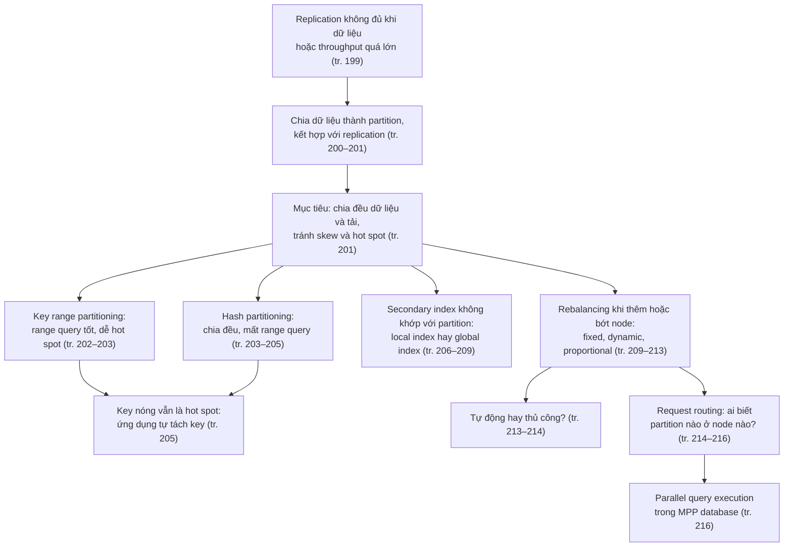

### Liên hệ với các chương khác

| Ý trong chương 6 | Liên hệ | Căn cứ |
| --- | --- | --- |
| Shared-nothing; replication và partitioning là hai cơ chế riêng nhưng đi cùng nhau | **Chương 5** ([mục 0.2](chapter-05.md#shared-nothing), [0.3](chapter-05.md#replication-vs-partitioning)) | tr. 199–200 |
| Mỗi partition có leader riêng; mọi điều về replication áp dụng cho từng partition | **Chương 5** ([B1.0](chapter-05.md#leader-based), chú thích iv ở [B3.0](chapter-05.md#multi-leader)) | tr. 200–201 |
| Cluster có nhiều hơn n node, mỗi giá trị nằm trên n node | **Chương 5** ([B4.2](chapter-05.md#quorums)) | chương 5, tr. 180 |
| Partition độc lập nên không có thứ tự ghi toàn cục (consistent prefix reads) | **Chương 5** ([B2.3](chapter-05.md#consistent-prefix)) | chương 5, tr. 166–167; chương 6, tr. 217 |
| Workload giao dịch và phân tích; data warehouse | **Chương 3** ([B7](chapter-03.md#b7)) | tr. 200, 216 |
| Key được sắp xếp trong partition (SSTable); B-tree tách trang | **Chương 3** ([B3](chapter-03.md#b3), [B4](chapter-03.md#b4)) | tr. 202, 212 |
| Concatenated index, secondary index, full-text index | **Chương 3** ([B6.3](chapter-03.md#multi-column), [B6.1](chapter-03.md#secondary-index), [B6.4](chapter-03.md#fuzzy)) | tr. 202, 204–206, 208 |
| Tail latency amplification khi scatter/gather | **Chương 1** ([B4.2](chapter-01.md#tail-amplification)) | tr. 207 |
| Người nổi tiếng gây tải dồn (ví dụ Twitter) | **Chương 1** ([B4.1](chapter-01.md#load-parameters)) | tr. 205 |
| Tự động phát hiện lỗi làm tình hình tệ hơn khi quá tải | **Chương 5** ([failover](chapter-05.md#failover-problems)) | tr. 214 |
| Network partition (netsplit) là chuyện khác | [Chương 8](chapter-08.md#network-partition) | tr. 199 |
| Multi-object transaction để giữ index tự cài nhất quán; distributed transaction cho global index | [Chương 7](chapter-07.md#multi-object), [Chương 9](chapter-09.md#dist-tx-practice) | tr. 206, 209 |
| Mọi bên phải đồng ý về bản đồ phân vùng: consensus, ZooKeeper | [Chương 9](chapter-09.md#zookeeper) | tr. 215 |
| Kỹ thuật thực thi truy vấn song song | [Chương 10](chapter-10.md#hadoop-vs-mpp) | tr. 216 |
| Cài term-partitioned secondary index | [Chương 12](chapter-12.md#derived-state) | tr. 209 |
| Ghi vào nhiều partition: một bên thành công, bên kia thất bại thì sao? | Các chương sau ([Chương 7](chapter-07.md#multi-object), [Chương 9](chapter-09.md#atomic-commit)) | tr. 217–218 |

> **Bản đồ đầu chương (tr. 198).** Bản đồ in xoay ngang trang, vẽ một **đảo san hô vòng** tên "Partitioning Atoll" với hai sinh vật biển trong vụng nước giữa đảo. Vòng đảo chia thành các vùng: **Key Range Partitioning** (HBase, RethinkDB), **Hash Partitioning** (Cassandra, Voldemort), với **MongoDB** nằm ở chỗ giáp ranh hai vùng này; **Secondary Indexes** gồm mũi **Document-Partitioned** (Elasticsearch, Solr) và mũi **Term-Partitioned** (không ghi sản phẩm nào); dải đảo dài **Rebalancing**; và vùng **Request Routing** có một **ngọn hải đăng**.
>
> *Diễn giải của người viết ghi chú:* vị trí các sản phẩm khớp với nội dung chương. MongoDB đứng giữa hai vùng vì từ bản 2.4 nó hỗ trợ cả key range lẫn hash partitioning (tr. 202, 212). Elasticsearch và Solr dùng document-partitioned index (tr. 207). Ngọn hải đăng hợp với ý "dẫn đường cho request tới đúng node". Bản đồ không có con tàu nào đi sang chương khác như bản đồ chương 5.

---

## B. Giải thích chi tiết

### B1. Partitioning and Replication (tr. 200–201)

**What** (tr. 200). Partitioning thường được **kết hợp với replication**: bản sao của **mỗi partition** được lưu trên **nhiều node**. Nghĩa là dù mỗi bản ghi thuộc **đúng một** partition, nó vẫn có thể được lưu trên **nhiều node khác nhau** để chịu lỗi.

**How** (tr. 200). Một node có thể lưu **nhiều partition**. Nếu dùng mô hình replication leader–follower, sự kết hợp trông như Hình 6-1:

- Leader của mỗi partition được gán cho **một node**, các follower của nó được gán cho **các node khác**.
- Mỗi node có thể là **leader của một số partition** và **follower của các partition khác**.

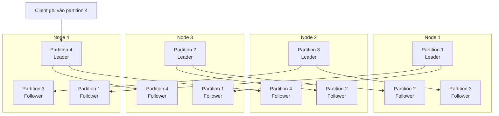

*(Vẽ lại Hình 6-1, tr. 201. Mỗi mũi tên là một replication stream riêng của một partition, đi từ leader tới follower.)*

> **Bổ sung ngoài sách (quan sát hình).** Trong Hình 6-1, mỗi partition có **ba replica** (một leader, hai follower), mỗi node giữ **ba replica** và **làm leader cho đúng một partition**. Nhờ vậy tải ghi, vốn chỉ đi vào leader, cũng được **chia đều** cho bốn node. Đây là điểm khác với single-leader cho cả database ở chương 5: ở đây có một leader **cho mỗi partition**, đúng như chú thích iv của chương 5 ([B3.0](chapter-05.md#multi-leader)).

**Hai lựa chọn gần như độc lập** (tr. 200). Mọi điều chương 5 nói về replication database **áp dụng y hệt** cho replication của partition. Việc chọn **sơ đồ partitioning** phần lớn **độc lập** với việc chọn **sơ đồ replication**. Vì vậy, để đơn giản, chương 6 **bỏ qua replication**.

> **Liên hệ chương 5.** Với leaderless replication, chương 5 đã ghi chú rằng cluster có thể có **nhiều hơn n node**, nhưng mỗi giá trị chỉ nằm trên n node; nhờ vậy dataset được partition ([B4.2](chapter-05.md#quorums), tr. 180). Hình 6-1 là phiên bản leader–follower của cùng ý tưởng.

**System Design.** Khi thiết kế, có thể tách hai câu hỏi: "dữ liệu được **chia** thế nào?" (chương 6) và "mỗi phần được **sao chép** thế nào?" (chương 5). Câu trả lời cho câu thứ nhất quyết định khả năng mở rộng dung lượng và throughput; câu thứ hai quyết định khả năng chịu lỗi và độ trễ đọc (tr. 199–200).

---

### B2. Partitioning of Key-Value Data (tr. 201–205)

#### B2.0 Mục tiêu: chia đều, tránh skew và hot spot (tr. 201)

**Câu hỏi** (tr. 201). Có một lượng dữ liệu lớn cần phân vùng. **Bản ghi nào lưu ở node nào?**

**Mục tiêu** (tr. 201). **Trải đều** cả **dữ liệu** lẫn **tải truy vấn** ra các node. Nếu mỗi node nhận phần công bằng, thì **về lý thuyết** 10 node chịu được **gấp 10 lần** dữ liệu và **gấp 10 lần** throughput đọc và ghi của một node (tạm bỏ qua replication).

**What — skew và hot spot** (tr. 201).

- Nếu phân vùng **không công bằng**, một số partition có **nhiều dữ liệu hoặc nhiều truy vấn** hơn các partition khác, ta gọi là ***skewed***. Skew làm partitioning **kém hiệu quả hơn nhiều**.
- Trường hợp cực đoan: **mọi tải dồn vào một partition**. Khi đó **9 trên 10 node rảnh rỗi**, và nút thắt cổ chai là **node bận duy nhất**.
- Partition có tải **cao bất thường** so với phần còn lại gọi là ***hot spot***.

Glossary của sách gộp hai khái niệm: *skew* (nghĩa 1) là tải mất cân bằng giữa các partition, **còn gọi là hot spot** (tr. 557).

> **Bổ sung ngoài sách (phép tính).** Throughput của cả cluster bị giới hạn bởi **node bận nhất**. Nếu mỗi node chịu tối đa C request/giây và node bận nhất nhận tỷ lệ f của tổng tải, thì cluster chịu tối đa khoảng C / f. Chia đều trên 10 node (f = 0,1) cho 10C. Nếu một partition nhận một nửa tải (f = 0,5), cluster 10 node chỉ chịu được **2C**, dù có 10 máy. Trường hợp cực đoan của sách (f = 1) cho đúng C.

**Cách đơn giản nhất để tránh hot spot: gán ngẫu nhiên** (tr. 201). Gán bản ghi cho node **ngẫu nhiên** thì dữ liệu được chia khá đều. Nhưng có một **nhược điểm lớn**: khi muốn đọc một bản ghi cụ thể, bạn **không biết nó nằm ở node nào**, nên phải **hỏi song song mọi node**.

**Làm tốt hơn: dựa vào key** (tr. 201). Tạm giả định mô hình **key-value** đơn giản: luôn truy cập bản ghi qua **primary key**. Ví dụ bộ **bách khoa toàn thư giấy** kiểu cũ: tra một mục theo **tiêu đề**; vì mọi mục được **xếp theo thứ tự chữ cái**, bạn tìm nhanh mục cần tìm.

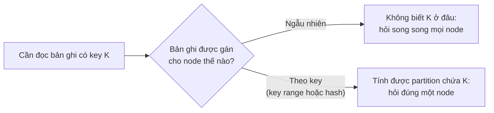

*(Sơ đồ do người viết ghi chú tổng hợp từ tr. 201.)*

#### B2.1 Partitioning by Key Range (tr. 202–203)

**What** (tr. 202). Gán cho mỗi partition một **khoảng key liên tục**, từ một giá trị nhỏ nhất tới một giá trị lớn nhất, giống **các tập** của bộ bách khoa toàn thư giấy (Hình 6-2).

- Biết **ranh giới** giữa các khoảng thì dễ xác định **partition nào chứa một key**.
- Biết thêm **partition nào được gán cho node nào** thì gửi request **thẳng tới đúng node** (hay với bách khoa toàn thư: rút đúng cuốn trên giá).

| Tập | Khoảng key | Tập | Khoảng key |
| --- | --- | --- | --- |
| 1 | A-ak — Bayes | 7 | Krasnokamsk — Menadra |
| 2 | Bayeu — Ceanothus | 8 | Menage — Ottawa |
| 3 | Ceara — Deluc | 9 | Otter — Rethimnon |
| 4 | Delusion — Frenssen | 10 | Reti — Solovets |
| 5 | Freon — Holderlin | 11 | Solovyov — Truck |
| 6 | Holderness — Krasnoje | 12 | Trudeau — Zywiec |

*(Vẽ lại Hình 6-2, tr. 202: bộ bách khoa toàn thư 12 tập, mỗi tập là một partition theo khoảng key.)*

**Ranh giới phải thích nghi với dữ liệu** (tr. 202). Các khoảng key **không nhất thiết cách đều nhau**, vì dữ liệu có thể **không phân bố đều**. Trong Hình 6-2, tập 1 chứa từ bắt đầu bằng A và B, còn tập 12 chứa từ bắt đầu bằng T, U, V, X, Y và Z (cách nói gần đúng; khoảng key chính xác nằm trong bảng trên, xem [ghi chú kiểm tra nguồn](#kiem-tra)). Nếu cứ **mỗi tập hai chữ cái**, một số tập sẽ **lớn hơn nhiều** so với các tập khác. Muốn chia đều dữ liệu, **ranh giới partition phải thích nghi với dữ liệu**.

**Ai chọn ranh giới** (tr. 202). Quản trị viên chọn **thủ công**, hoặc database chọn **tự động** (bàn ở [B4](#b4), "Rebalancing Partitions", tr. 209). Chiến lược này được dùng bởi **Bigtable**, bản mã nguồn mở tương đương là **HBase** [2, 3], **RethinkDB**, và **MongoDB trước bản 2.4** [4].

**Ưu điểm: range scan** (tr. 202).

- Trong mỗi partition, có thể giữ key **theo thứ tự đã sắp xếp** ([SSTable và LSM-tree, chương 3](chapter-03.md#b3)).
- Nhờ vậy **range scan** dễ dàng, và có thể coi key là một **concatenated index** để lấy **nhiều bản ghi liên quan** trong **một truy vấn** ([multi-column index, chương 3](chapter-03.md#multi-column)).
- **Example.** Ứng dụng lưu dữ liệu từ một **mạng cảm biến**, key là **timestamp** của lần đo (năm-tháng-ngày-giờ-phút-giây). Range scan rất hữu ích: dễ dàng lấy, chẳng hạn, **mọi số đo trong một tháng**.

**Nhược điểm: một số kiểu truy cập gây hot spot** (tr. 203).

- Nếu key là timestamp, các partition ứng với **các khoảng thời gian**, ví dụ **mỗi ngày một partition**.
- Dữ liệu cảm biến được ghi **ngay khi đo**, nên **mọi lần ghi** dồn vào **cùng một partition**: partition của **hôm nay**. Partition đó **quá tải** trong khi các partition khác **ngồi không** [5].

**Cách sửa** (tr. 203). Dùng thứ khác timestamp làm **phần tử đầu tiên** của key. Ví dụ, **thêm tên cảm biến vào trước timestamp**: phân vùng **trước theo tên cảm biến**, **rồi theo thời gian**.

- Giả sử có **nhiều cảm biến hoạt động cùng lúc**, tải ghi sẽ trải **đều hơn** trên các partition.
- Cái giá: khi muốn lấy số đo của **nhiều cảm biến** trong một khoảng thời gian, phải chạy **một range query riêng cho mỗi tên cảm biến**.

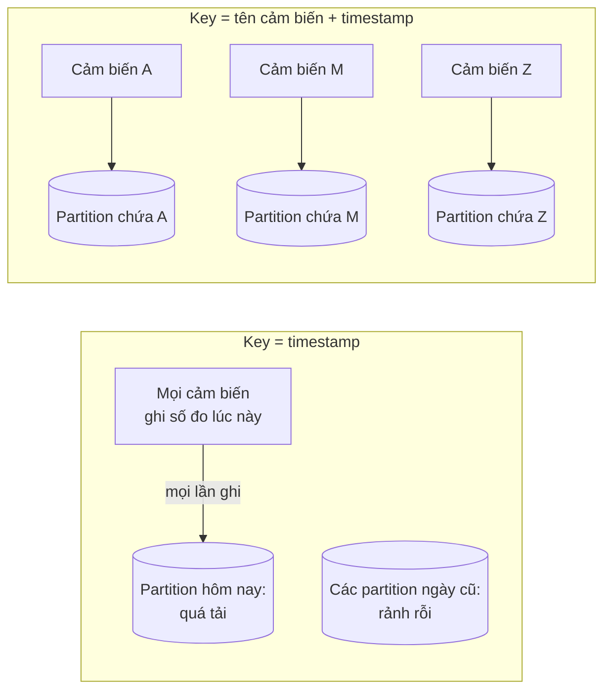

*(Sơ đồ do người viết ghi chú tổng hợp từ tr. 202–203. Tên cảm biến A, M, Z là giả định.)*

> **Bổ sung ngoài sách.** Cùng hiện tượng xảy ra với mọi key **tăng đơn điệu**, như ID tự tăng hay timestamp: trong key range partitioning, bản ghi mới luôn rơi vào partition **cuối cùng**. Tiêu đề của tài liệu [5] (một mẹo khi dùng App Engine Datastore) nói thẳng ý này: giá trị tăng đơn điệu là có hại.

**Trade-offs.** Key range partitioning cho **range query hiệu quả**, nhưng phân phối tải phụ thuộc **cách ứng dụng truy cập key**: nếu ứng dụng hay truy cập các key **gần nhau** trong thứ tự sắp xếp, hot spot xuất hiện (tr. 203, 217).

#### B2.2 Partitioning by Hash of Key (tr. 203–205)

**Why** (tr. 203). Vì rủi ro skew và hot spot, nhiều datastore phân tán dùng **hàm hash** để xác định partition cho một key.

**What — hàm hash tốt** (tr. 203).

- Một hàm hash tốt nhận dữ liệu **lệch** và làm nó **phân bố đều**.
- Ví dụ: hàm hash **32-bit** nhận một chuỗi. Mỗi lần đưa vào một chuỗi mới, nó trả về một số **trông như ngẫu nhiên** trong khoảng **0 tới 2³² − 1**. Kể cả khi các chuỗi đầu vào **rất giống nhau**, hash của chúng vẫn **trải đều** trên khoảng số đó.
- Glossary của sách: hash là hàm biến đầu vào thành một số trông như ngẫu nhiên; **cùng đầu vào luôn cho cùng số**; hai đầu vào khác nhau **rất có thể** cho hai số khác nhau, nhưng vẫn có thể trùng (gọi là ***collision***) (tr. 555).

**Không cần mạnh về mật mã** (tr. 203).

- Để phân vùng, hàm hash **không cần mạnh về mật mã**: **Cassandra** và **MongoDB** dùng **MD5**, **Voldemort** dùng hàm **Fowler–Noll–Vo**.
- Nhiều ngôn ngữ lập trình có sẵn hàm hash đơn giản (dùng cho hash table), nhưng **có thể không hợp** để phân vùng. Ví dụ, với `Object.hashCode()` của Java và `Object#hash` của Ruby, **cùng một key có thể có hash khác nhau ở các tiến trình khác nhau** [6].

> **Bổ sung ngoài sách.** Vì sao điều đó chết người: client A và client B (hai tiến trình) tính hash của cùng key "user42" ra hai số khác nhau, nên gửi request tới **hai partition khác nhau**. Một bên ghi vào partition này, bên kia đọc ở partition khác và không thấy dữ liệu. Nguyên nhân thường gặp: hash mặc định của object trong Java dựa trên **định danh object** trong bộ nhớ của tiến trình; Ruby trộn một **hạt giống ngẫu nhiên** mỗi lần khởi động tiến trình để chống tấn công làm đầy hash table. Hàm hash dùng để phân vùng phải **tất định giữa mọi tiến trình và mọi máy**.

**How** (tr. 203–204). Có hàm hash phù hợp rồi, gán cho mỗi partition **một khoảng hash** (thay vì một khoảng key). Mọi key có hash **rơi vào khoảng** của partition nào thì được lưu ở partition đó (Hình 6-3).

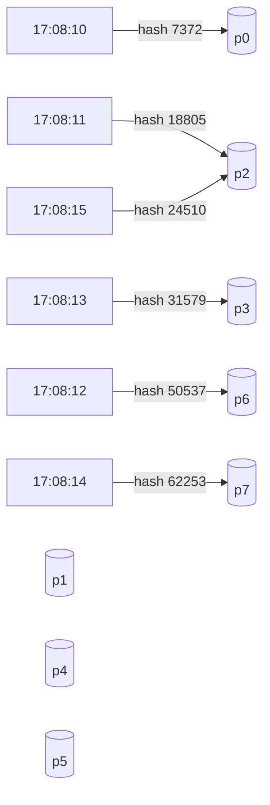

*(Vẽ lại Hình 6-3, tr. 204. Key là các chuỗi timestamp "2014-04-19 17:08:10" tới "2014-04-19 17:08:15", hash là 2 byte đầu của MD5, nên nằm trong khoảng 0 tới 65535. Trục hash được chia đều cho 8 partition p0 tới p7; hình ghi các mốc 16383, 32767, 49151, 65535.)*

> **Bổ sung ngoài sách (phép tính).** Chia đều 65536 giá trị hash cho 8 partition thì mỗi partition giữ 8192 giá trị: p0 là 0–8191, p1 là 8192–16383, p2 là 16384–24575, p3 là 24576–32767, p4 là 32768–40959, p5 là 40960–49151, p6 là 49152–57343, p7 là 57344–65535. Sáu timestamp **liên tiếp** rơi vào p0, p2, p6, p3, p7, p2: các key **kề nhau** trong thứ tự bị **trải ra** khắp nơi. Đây vừa là ưu điểm (tải ghi theo thời gian không dồn vào một partition như [B2.1](#timestamp-hot-spot)) vừa là nhược điểm (mất range scan, xem dưới).

**Ranh giới cách đều hay giả ngẫu nhiên** (tr. 204). Kỹ thuật này **chia key công bằng** giữa các partition. Ranh giới có thể **cách đều nhau**, hoặc được chọn **giả ngẫu nhiên**; trường hợp sau đôi khi được gọi là ***consistent hashing***.

**Hộp "Consistent Hashing"** (tr. 204).

- **Định nghĩa gốc.** Consistent hashing, theo định nghĩa của Karger và cộng sự [7], là cách **trải đều tải** trên một hệ thống cache **quy mô toàn internet** như **CDN** (*content delivery network*). Nó dùng **ranh giới partition chọn ngẫu nhiên** để **không cần điều khiển trung tâm** hay **distributed consensus**.
- **Chữ "consistent" dễ gây nhầm.** Ở đây nó **không liên quan** tới consistency giữa các replica (chương 5) hay consistency trong ACID (chương 7). Nó mô tả **một cách tiếp cận rebalancing** cụ thể.
- **Không hợp với database.** Như sẽ thấy ở [B4](#b4) (tr. 209), cách tiếp cận này thực ra **không hoạt động tốt cho database** [8], nên **hiếm khi được dùng** trong thực tế. Tài liệu của một số database vẫn nhắc tới consistent hashing, nhưng **thường không chính xác**.
- **Khuyến nghị của tác giả.** Vì quá dễ nhầm, tốt nhất **tránh thuật ngữ consistent hashing** và gọi là ***hash partitioning***.

> **Bổ sung ngoài sách.** Trong bài báo của Karger và cộng sự, cả các cache lẫn các key được băm lên **cùng một vòng tròn số**; mỗi key thuộc về cache **đầu tiên** gặp khi đi tiếp theo chiều quy ước trên vòng. Thêm một cache chỉ "cắt" lấy key của **một đoạn** vòng tròn, nên chỉ một phần nhỏ key phải đổi chỗ, và mỗi client tự tính được vị trí key mà không cần hỏi máy chủ trung tâm. Sách không giải thích chi tiết vì sao cách này kém với database; [B4.1](#proportional-partitioning) cho thấy hai điểm yếu của ranh giới ngẫu nhiên: có thể **chia không đều**, và cần **metadata** để lưu ranh giới (tr. 213).

**Trade-off: mất range query hiệu quả** (tr. 204).

- Dùng hash của key để phân vùng thì **mất** một tính chất hay của key range partitioning: khả năng chạy **range query hiệu quả**.
- Các key vốn **kề nhau** giờ **rải khắp** các partition, nên **thứ tự sắp xếp bị mất**.
- Trong **MongoDB**, nếu bật chế độ **hash-based sharding**, mọi range query phải được **gửi tới tất cả partition** [4].
- **Riak** [9], **Couchbase** [10] và **Voldemort** **không hỗ trợ** range query trên primary key.

**Cassandra: thỏa hiệp bằng compound primary key** (tr. 204–205) [11, 12, 13].

- **What.** Một bảng trong Cassandra có thể khai báo ***compound primary key*** gồm **nhiều cột**. **Chỉ phần đầu** của key được **băm** để xác định partition. Các cột còn lại được dùng như **concatenated index** để **sắp xếp dữ liệu** trong SSTable của Cassandra.
- **Hệ quả.** Truy vấn **không thể** tìm một khoảng giá trị trong **cột đầu tiên** của compound key. Nhưng nếu truy vấn **chỉ định giá trị cố định** cho cột đầu tiên, nó có thể **range scan hiệu quả** trên **các cột còn lại** của key.
- **Example — quan hệ một-nhiều** (tr. 205). Trên mạng xã hội, **một người dùng đăng nhiều cập nhật**. Nếu primary key của các cập nhật là **(user_id, update_timestamp)**, có thể lấy hiệu quả **mọi cập nhật của một người dùng trong một khoảng thời gian**, đã **sắp theo timestamp**. Người dùng khác nhau có thể nằm ở **partition khác nhau**, nhưng **với mỗi người dùng**, các cập nhật được lưu **theo thứ tự timestamp trên một partition**.

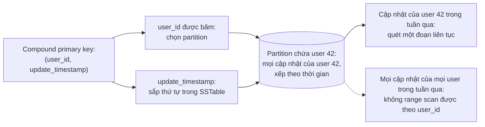

*(Sơ đồ do người viết ghi chú tổng hợp từ tr. 204–205; user 42 là giả định.)*

**System Design.** Câu hỏi then chốt khi chọn key: **truy vấn nào cần range scan?** Phần key dùng để **phân tán tải** (băm) nên là thứ có **nhiều giá trị khác nhau, được truy cập đều**; phần key dùng để **sắp xếp** nên là thứ mà truy vấn cần quét theo khoảng (tr. 204–205). Đây là nhận xét của người viết ghi chú rút từ ví dụ Cassandra.

#### B2.3 Skewed Workloads and Relieving Hot Spots (tr. 205)

**Hash không loại bỏ hết hot spot** (tr. 205). Băm key giúp **giảm** hot spot, nhưng **không tránh được hoàn toàn**. Trường hợp cực đoan: **mọi lần đọc và ghi đều vào cùng một key**, thì mọi request vẫn bị định tuyến tới **cùng một partition**.

**Example — người nổi tiếng** (tr. 205). Workload này có lẽ **không phổ biến**, nhưng **không phải chưa từng có**. Trên mạng xã hội, một người nổi tiếng có **hàng triệu follower** làm gì đó có thể gây **cơn bão hoạt động** [14]. Sự kiện này tạo ra **lượng lớn lần ghi vào cùng một key** (key có thể là user ID của người nổi tiếng, hoặc ID của hành động mà mọi người đang bình luận). **Băm key không giúp gì**, vì hash của hai ID giống nhau vẫn giống nhau. (Liên hệ: ví dụ Twitter và người nổi tiếng ở [chương 1, B4.1](chapter-01.md#load-parameters). Tài liệu [14] có tiêu đề nói 3% server của Twitter dành cho Justin Bieber.)

**Trách nhiệm thuộc về ứng dụng** (tr. 205). Hiện nay (lúc viết sách), **hầu hết hệ thống dữ liệu không tự bù** được cho workload lệch nặng như vậy, nên **ứng dụng phải tự giảm skew**.

**How — tách key nóng** (tr. 205).

- Nếu biết một key **rất nóng**, kỹ thuật đơn giản là **thêm một số ngẫu nhiên** vào **đầu hoặc cuối** key.
- Chỉ cần một số ngẫu nhiên **hai chữ số thập phân** là chia các lần ghi vào key đó **đều ra 100 key khác nhau**, và 100 key này có thể nằm ở **các partition khác nhau**.

**Trade-offs** (tr. 205).

- **Đọc tốn hơn.** Sau khi chia ghi ra nhiều key, **mọi lần đọc** phải làm thêm việc: đọc dữ liệu từ **cả 100 key** rồi **gộp lại**.
- **Cần sổ sách.** Chỉ nên thêm số ngẫu nhiên cho **số ít key nóng**. Với **đại đa số** key có throughput ghi thấp, đó là **chi phí thừa**. Vì vậy cần có cách **theo dõi key nào đang bị tách**.
- **Tương lai.** Có lẽ sau này hệ thống dữ liệu sẽ **tự phát hiện và bù** cho workload lệch. Còn hiện tại, bạn phải **tự cân nhắc trade-off** cho ứng dụng của mình.

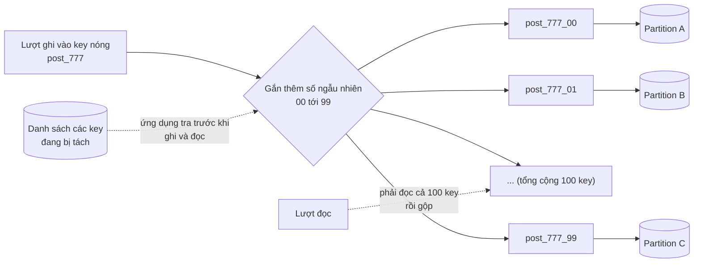

*(Ví dụ minh họa do AI xây dựng theo kỹ thuật ở tr. 205; tên key là giả định.)*

> **Bổ sung ngoài sách.** Kỹ thuật này hay được gọi là ***key salting*** (thêm "muối" vào key). Nó hợp nhất với dữ liệu **gộp được** sau khi đọc, như bộ đếm lượt thích (cộng 100 bộ đếm con) hay danh sách bình luận (hợp 100 danh sách). Nếu hot spot là do **đọc** chứ không phải ghi, thêm replica cho partition đó (read scaling, [chương 5](chapter-05.md#eventual-consistency)) hoặc cache thường hiệu quả hơn tách key.

**System Design.** Glossary của sách còn trỏ tới "Handling skew" (tr. 407, chương 10), cho thấy skew không chỉ là chuyện lưu trữ mà còn là chuyện xử lý dữ liệu theo lô (tr. 557). Bài học chung: **phân phối tải thật** có thể lệch dù key đã được băm; cần **đo** (key nào nóng) trước khi tách (tr. 205).

---

### B3. Partitioning and Secondary Indexes (tr. 206–209)

#### B3.0 Vì sao secondary index làm mọi thứ phức tạp (tr. 206)

**Nhìn lại** (tr. 206). Các sơ đồ phân vùng ở [B2](#b2) dựa trên mô hình **key-value**. Nếu bản ghi **chỉ được truy cập qua primary key**, ta xác định partition **từ key đó** và định tuyến request đọc, ghi tới partition phụ trách key.

**What — secondary index** (tr. 206). Tình hình phức tạp hơn khi có ***secondary index*** ([chương 3, B6.1](chapter-03.md#secondary-index)). Secondary index thường **không định danh duy nhất** một bản ghi; nó là cách **tìm các lần xuất hiện của một giá trị**:

- tìm mọi hành động của user 123;
- tìm mọi bài viết chứa từ *hogwash*;
- tìm mọi chiếc xe màu đỏ.

Glossary của sách: secondary index là cấu trúc dữ liệu **phụ**, được duy trì **bên cạnh** nơi lưu dữ liệu chính, giúp tìm hiệu quả các bản ghi khớp một loại điều kiện (tr. 557).

**Ai dùng** (tr. 206).

- Secondary index là **"cơm ăn hằng ngày"** của relational database, và cũng phổ biến trong document database.
- Nhiều key-value store (như **HBase**, **Voldemort**) **tránh** secondary index vì độ phức tạp khi cài đặt. Một số (như **Riak**) đã bắt đầu thêm vào vì chúng **rất hữu ích** cho việc mô hình hóa dữ liệu.
- Secondary index là **lý do tồn tại** của các search server như **Solr** và **Elasticsearch**.

**Vấn đề** (tr. 206). Secondary index **không ánh xạ gọn gàng vào partition**. Có **hai cách chính** để phân vùng database có secondary index: **document-based partitioning** và **term-based partitioning**.

> **Bổ sung ngoài sách.** Lý do gốc: partition được chọn theo **primary key**, còn secondary index tra theo **giá trị của trường khác**. Những bản ghi có cùng giá trị (cùng màu đỏ) có primary key bất kỳ, nên rải trên **mọi partition**. Hoặc index đi theo dữ liệu (mỗi partition một index nhỏ), hoặc index đi theo giá trị (index được chia theo chính giá trị tra cứu). Hai lựa chọn này chính là hai cách dưới đây.

#### B3.1 Partitioning Secondary Indexes by Document (tr. 206–207)

**Example — trang bán xe cũ** (tr. 206, Hình 6-4).

- Mỗi tin rao có một ID duy nhất, gọi là ***document ID***. Database được phân vùng **theo document ID**: ví dụ ID 0 tới 499 ở partition 0, ID 500 tới 999 ở partition 1.
- Người dùng muốn **tìm xe**, lọc theo **màu** (*color*) và **hãng** (*make*). Vì vậy cần secondary index trên color và make (trong document database chúng là *field*, trong relational database là *column*).
- Nếu đã **khai báo index**, database **tự động** đánh index. Ví dụ, mỗi khi một xe màu đỏ được thêm vào, **partition chứa nó** tự thêm document ID của nó vào danh sách của mục index **color:red**.

> Chú thích ii (tr. 206). Nếu database **chỉ hỗ trợ mô hình key-value**, bạn có thể bị cám dỗ **tự cài secondary index** trong code ứng dụng, bằng cách tạo ánh xạ từ giá trị tới document ID. Nếu đi đường này, phải **rất cẩn thận** để index luôn **nhất quán với dữ liệu gốc**. **Race condition** và **lỗi ghi chập chờn** (một số thay đổi đã lưu, số khác thì chưa) rất dễ làm dữ liệu **lệch nhau**. Xem "The need for multi-object transactions", tr. 231 ([Chương 7](chapter-07.md#need-multi-object)).

Dữ liệu trong Hình 6-4:

| Partition | Primary key index (document ID → document) | Secondary index cục bộ (partitioned by document) |
| --- | --- | --- |
| **0** | 191 → đỏ, Honda, Palo Alto · 214 → đen, Dodge, San Jose · 306 → đỏ, Ford, Sunnyvale | color:black → [214] · **color:red → [191, 306]** · color:yellow → [] · make:Dodge → [214] · make:Ford → [306] · make:Honda → [191] |
| **1** | 515 → bạc, Ford, Milpitas · 768 → đỏ, Volvo, Cupertino · 893 → bạc, Audi, Santa Clara | color:black → [] · **color:red → [768]** · color:silver → [515, 893] · make:Audi → [893] · make:Ford → [515] · make:Volvo → [768] |

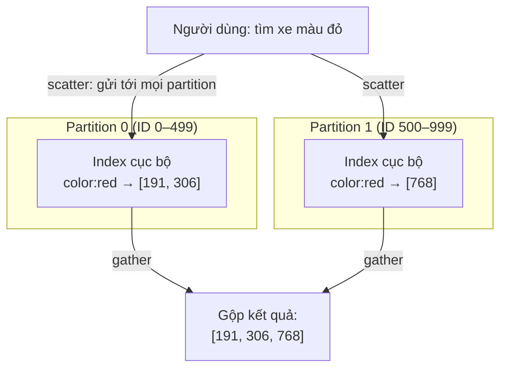

*(Vẽ lại Hình 6-4, tr. 207: mỗi partition giữ secondary index cho riêng document của nó; đọc phải scatter/gather qua mọi partition.)*

**What — local index** (tr. 207). Với cách đánh index này, **mỗi partition hoàn toàn tách biệt**: mỗi partition duy trì **secondary index của riêng nó**, chỉ phủ **các document trong partition đó**, và **không quan tâm** partition khác lưu gì.

- **Ghi rẻ.** Khi cần ghi (thêm, xóa, cập nhật một document), chỉ phải làm việc với **partition chứa document ID** đang ghi.
- Vì vậy, index phân vùng theo document còn gọi là ***local index***, đối lập với ***global index*** ở [B3.2](#term-index).

**Why đọc phải cẩn thận** (tr. 207).

- Trừ khi bạn đã làm gì đó **đặc biệt** với document ID, **không có lý do gì** mọi xe cùng màu hay cùng hãng lại nằm **cùng một partition**. Trong Hình 6-4, xe đỏ xuất hiện ở **cả partition 0 lẫn partition 1**.
- Muốn tìm xe đỏ, phải gửi truy vấn tới **tất cả** partition rồi **gộp** mọi kết quả trả về.
- Cách truy vấn database phân vùng này đôi khi gọi là ***scatter/gather***. Nó có thể làm truy vấn đọc trên secondary index **khá tốn kém**.
- **Kể cả khi hỏi các partition song song**, scatter/gather vẫn dễ bị ***tail latency amplification*** ([chương 1, B4.2](chapter-01.md#tail-amplification), "Percentiles in Practice", tr. 16): truy vấn phải chờ partition **chậm nhất**.

> **Bổ sung ngoài sách (phép tính).** Giả sử mỗi partition độc lập có xác suất 1% trả lời chậm (chậm hơn p99 của nó). Truy vấn scatter/gather qua 10 partition bị chậm với xác suất 1 − 0,99¹⁰ ≈ 9,6%; qua 100 partition là 1 − 0,99¹⁰⁰ ≈ 63,4%. Một truy vấn chỉ chạm một partition chỉ bị chậm 1% số lần. Số partition càng nhiều, scatter/gather càng "kéo" đuôi độ trễ lên.

**Vẫn được dùng rộng rãi** (tr. 207). **MongoDB**, **Riak** [15], **Cassandra** [16], **Elasticsearch** [17], **SolrCloud** [18] và **VoltDB** [19] đều dùng document-partitioned secondary index.

**Khuyến nghị và giới hạn** (tr. 207). Hầu hết nhà cung cấp database khuyên **cấu trúc sơ đồ phân vùng** sao cho truy vấn secondary index được phục vụ **từ một partition**. Nhưng **không phải lúc nào cũng làm được**, đặc biệt khi dùng **nhiều secondary index trong một truy vấn** (như lọc xe theo **cả màu lẫn hãng**).

> **Bổ sung ngoài sách.** Ví dụ "làm gì đó đặc biệt với document ID": nếu ứng dụng chủ yếu tìm xe **theo thành phố**, có thể đưa thành phố vào phần đầu của key phân vùng, để mọi tin rao cùng thành phố nằm chung partition. Khi đó truy vấn "xe đỏ ở Palo Alto" chạm một partition, nhưng truy vấn "xe đỏ ở mọi nơi" vẫn phải scatter/gather. Không thể cùng lúc tối ưu cho mọi trường lọc.

#### B3.2 Partitioning Secondary Indexes by Term (tr. 208–209)

**What — global index** (tr. 208). Thay vì mỗi partition có secondary index riêng (local index), ta dựng một ***global index*** phủ dữ liệu của **mọi partition**.

- **Không thể** lưu index đó trên **một node**: node đó có lẽ sẽ thành **nút thắt cổ chai** và **phá hỏng mục đích** của phân vùng.
- Global index **cũng phải được phân vùng**, nhưng có thể phân vùng **khác** với primary key index.

**Example — Hình 6-5** (tr. 208). Xe đỏ của **mọi partition** xuất hiện dưới **color:red** trong index. Index được phân vùng sao cho màu bắt đầu bằng chữ **a tới r** nằm ở partition 0, màu bắt đầu bằng **s tới z** ở partition 1. Index theo hãng xe phân vùng tương tự, với **ranh giới giữa f và h**.

| Partition của index | Mục index (partitioned by term) |
| --- | --- |
| **0** (màu a–r, hãng tới f) | color:black → [214] · **color:red → [191, 306, 768]** · make:Audi → [893] · make:Dodge → [214] · make:Ford → [306, 515] |
| **1** (màu s–z, hãng từ h) | color:silver → [515, 893] · color:yellow → [] · make:Honda → [191] · make:Volvo → [768] |

Primary key index vẫn như Hình 6-4: document 191, 214, 306 ở partition 0; 515, 768, 893 ở partition 1.

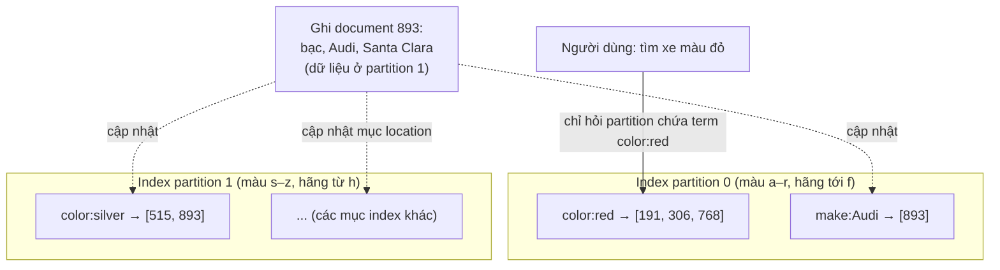

*(Vẽ lại Hình 6-5, tr. 208: đọc chỉ chạm một partition của index; một lần ghi document có thể chạm nhiều partition của index. Trong hình gốc, mũi tên của trường location trỏ tới "..." ở partition 1.)*

**Vì sao gọi là term-partitioned** (tr. 208). Loại index này gọi là ***term-partitioned***, vì **term** cần tìm quyết định **partition của index**. Ở đây, một term chẳng hạn là **color:red**. Tên *term* đến từ **full-text index** (một loại secondary index đặc biệt, [chương 3, B6.4](chapter-03.md#fuzzy)), trong đó các term là **mọi từ xuất hiện trong một document**.

**Phân vùng theo term hay theo hash của term** (tr. 208). Như trước, có thể phân vùng index **theo chính term** hoặc **theo hash của term**:

- Theo **chính term**: hữu ích cho **range scan**, ví dụ trên một thuộc tính số như **giá chào bán** của xe.
- Theo **hash của term**: **tải phân bố đều hơn**.

Đây chính là lựa chọn key range hay hash của [B2](#b2), chỉ là áp dụng cho index thay vì cho dữ liệu chính.

**Trade-offs** (tr. 208–209).

- **Ưu điểm: đọc hiệu quả hơn.** Thay vì scatter/gather qua mọi partition, client chỉ cần gửi request tới **partition chứa term** nó muốn.
- **Nhược điểm: ghi chậm hơn và phức tạp hơn.** Một lần ghi vào **một document** giờ có thể ảnh hưởng **nhiều partition của index**, vì **mỗi term** trong document có thể nằm ở **partition khác, node khác**.

**Global index thường cập nhật bất đồng bộ** (tr. 209).

- **Lý tưởng:** index **luôn cập nhật**, mọi document ghi vào database được phản ánh **ngay lập tức** trong index.
- Nhưng với term-partitioned index, điều đó đòi hỏi một ***distributed transaction*** qua **mọi partition bị ảnh hưởng** bởi lần ghi, và **không phải database nào cũng hỗ trợ** (Chương 7, Chương 9).
- **Thực tế:** cập nhật global secondary index thường **bất đồng bộ**. Nếu đọc index **ngay sau khi ghi**, thay đổi vừa làm **có thể chưa** được phản ánh.
- **Example.** **Amazon DynamoDB** cho biết global secondary index của nó được cập nhật trong **một phần giây** lúc bình thường, nhưng có thể **trễ lâu hơn** khi hạ tầng gặp sự cố [20].

**Ai dùng khác** (tr. 209). Tính năng search của **Riak** [21]; **Oracle data warehouse** cho phép **chọn giữa local và global indexing** [22]. Sách sẽ quay lại việc **cài term-partitioned secondary index** ở Chương 12.

> **Bổ sung ngoài sách — liên hệ chương 5.** Global index cập nhật bất đồng bộ cư xử giống một **follower bị replication lag**: người bán vừa đăng tin rao, tìm theo màu ngay lập tức có thể **không thấy tin của mình**. Đó là cùng loại anomaly với read-after-write ([chương 5, B2.1](chapter-05.md#read-your-writes)), và cũng là một dạng eventual consistency ([chương 5, B2.0](chapter-05.md#eventual-consistency)). DynamoDB ở đây là sản phẩm AWS mà chương 5 đã nhắc là khác với Dynamo của Amazon ([chương 5, B4.0](chapter-05.md#dynamo-style)).

**System Design.**

- Chọn local index khi **ghi nhiều**, hoặc khi truy vấn secondary index **hiếm** hay thường kèm khóa phân vùng; chấp nhận scatter/gather cho truy vấn còn lại (tr. 207).
- Chọn global index khi **đọc theo index nhiều và cần nhanh**, chấp nhận ghi tốn hơn và index **có thể trễ** so với dữ liệu (tr. 208–209).
- Nếu tự cài index trên key-value store, nhớ rằng giữ index nhất quán đòi hỏi **multi-object transaction** hoặc cơ chế tương đương (chú thích ii, tr. 206).

---

### B4. Rebalancing Partitions (tr. 209–214)

#### B4.0 Rebalancing là gì và cần đạt gì (tr. 209)

**Why** (tr. 209). Theo thời gian, nhiều thứ thay đổi trong database:

- **Throughput truy vấn tăng**, nên muốn thêm CPU để chịu tải.
- **Dataset lớn lên**, nên muốn thêm đĩa và RAM để lưu.
- **Một máy hỏng**, và các máy khác phải **gánh trách nhiệm** của máy đó.

Mọi thay đổi này đều đòi hỏi **dữ liệu và request** được **chuyển từ node này sang node khác**.

**What** (tr. 209). Quá trình chuyển tải từ một node trong cluster sang node khác gọi là ***rebalancing***. Glossary: chuyển dữ liệu hoặc dịch vụ giữa các node để **chia tải công bằng** (tr. 556).

**Yêu cầu tối thiểu** (tr. 209). Dù dùng sơ đồ phân vùng nào, rebalancing thường được kỳ vọng:

1. **Sau khi rebalance**, tải (lưu trữ, request đọc và ghi) được **chia công bằng** giữa các node.
2. **Trong lúc rebalance**, database **vẫn nhận đọc và ghi**.
3. **Không chuyển nhiều dữ liệu hơn mức cần thiết**, để rebalance **nhanh** và giảm tải **I/O mạng và đĩa**.

#### B4.1 Strategies for Rebalancing (tr. 210–213)

Có vài cách gán partition cho node [23]. Sách lần lượt bàn từng cách (tr. 210).

**How not to do it: hash mod N** (tr. 210).

- **Nhắc lại.** Khi phân vùng theo hash của key (Hình 6-3), cách tốt nhất là chia các giá trị hash thành **các khoảng** và gán mỗi khoảng cho một partition: key thuộc partition 0 nếu 0 ≤ hash(key) &lt; b₀, thuộc partition 1 nếu b₀ ≤ hash(key) &lt; b₁, v.v.
- **Sao không dùng mod?** Có lẽ bạn tự hỏi sao không dùng phép **mod** (toán tử lấy phần dư trong nhiều ngôn ngữ). Ví dụ, hash(key) mod 10 cho một số từ 0 tới 9 (viết hash ở dạng thập phân thì đó là **chữ số cuối**). Có 10 node đánh số 0 tới 9, đó có vẻ là cách dễ để gán key cho node.
- **Vấn đề.** Nếu **số node N thay đổi**, **phần lớn key** phải chuyển từ node này sang node khác. Ví dụ hash(key) = 123456:

| Số node N | 123456 mod N | Key nằm ở |
| --- | --- | --- |
| 10 | 6 | node 6 |
| 11 | 3 | node 3 (phải chuyển) |
| 12 | 0 | node 0 (lại phải chuyển) |

- Di chuyển thường xuyên như vậy làm rebalancing **đắt quá mức**. Cần một cách **không di chuyển dữ liệu nhiều hơn mức cần thiết**.

> **Bổ sung ngoài sách (phép tính).** Với hash phân bố đều, một key **ở yên** khi đổi từ N sang N + 1 node chỉ khi hash mod N = hash mod (N + 1); điều đó xảy ra với tỷ lệ **1/(N + 1)** số key. Nghĩa là **N/(N + 1)** số key phải chuyển: từ 10 lên 11 node, khoảng **91%** dữ liệu bị di chuyển (mô phỏng với 200000 hash ngẫu nhiên cho 90,9%). Trong khi đó, mức tối thiểu cần chuyển để node mới có phần công bằng chỉ là **1/(N + 1) ≈ 9%**.

**Fixed number of partitions** (tr. 210–211).

- **What.** Giải pháp khá đơn giản: tạo **nhiều partition hơn hẳn số node**, và gán **vài partition cho mỗi node**. Ví dụ, database chạy trên cluster **10 node** có thể chia sẵn thành **1000 partition** ngay từ đầu, mỗi node khoảng **100 partition**.
- **How.** Khi **thêm một node**, node mới **"lấy trộm"** vài partition từ **mọi node hiện có** cho tới khi partition lại được chia công bằng (Hình 6-6). Khi **bớt một node**, quá trình diễn ra ngược lại.
- **Chỉ chuyển nguyên partition.** **Số partition không đổi**, **cách gán key cho partition cũng không đổi**. Thứ duy nhất thay đổi là **cách gán partition cho node**.
- **Không tức thời.** Chuyển một lượng lớn dữ liệu qua mạng mất thời gian, nên **cách gán cũ** vẫn được dùng cho mọi lần đọc, ghi diễn ra **trong lúc chuyển**.

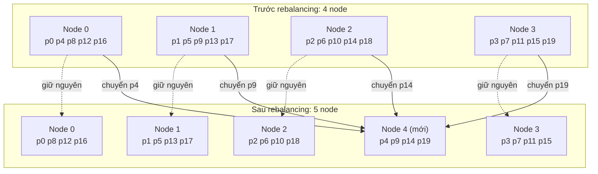

*(Vẽ lại Hình 6-6, tr. 211: thêm node 4 vào cluster 4 node có 20 partition. Đường nét đứt là partition ở yên, mũi tên liền là partition được chuyển.)*

> **Bổ sung ngoài sách (phép tính).** Trong Hình 6-6 chỉ **4 trên 20 partition** (20%) được chuyển, đúng bằng phần mà node thứ năm cần nhận (1/5). Nếu dùng hash mod N, đi từ 4 lên 5 node sẽ chuyển khoảng **4/5 = 80%** số key.

- **Phần cứng không đồng đều** (tr. 211). Về nguyên tắc, có thể tính tới máy mạnh yếu khác nhau: gán **nhiều partition hơn** cho node **mạnh hơn** để chúng gánh phần tải lớn hơn.
- **Ai dùng** (tr. 211). **Riak** [15], **Elasticsearch** [24], **Couchbase** [10] và **Voldemort** [25].

**Chọn số partition: khó** (tr. 211).

- Với cấu hình này, số partition thường **cố định khi dựng database** và **không đổi về sau**. Về nguyên tắc có thể **tách và gộp** partition (xem phần tiếp), nhưng số partition cố định **đơn giản hơn về vận hành**, nên nhiều database loại này **không cài** việc tách partition.
- Vì vậy, số partition cấu hình lúc đầu là **số node tối đa** bạn có thể có. Phải chọn **đủ lớn** cho tăng trưởng tương lai.
- Nhưng mỗi partition cũng có **chi phí quản lý**, nên chọn số **quá lớn** lại **phản tác dụng**.
- **Khó nhất khi dataset biến động mạnh** (bắt đầu nhỏ nhưng có thể lớn hơn nhiều). Mỗi partition chứa một **tỷ lệ cố định** của tổng dữ liệu, nên **kích thước mỗi partition tăng tỷ lệ thuận** với tổng dữ liệu.
  - Partition **quá lớn**: rebalancing và phục hồi sau khi node hỏng trở nên **tốn kém**.
  - Partition **quá nhỏ**: **chi phí quản lý** quá nhiều.
  - Hiệu năng tốt nhất khi kích thước partition **"vừa đúng"**, và điều đó khó đạt khi số partition cố định mà dataset thay đổi.

> **Bổ sung ngoài sách.** Vì sao số partition là **trần** của số node: mỗi partition (mỗi replica của nó) nằm **nguyên vẹn trên một node**, không bị cắt nhỏ. Với 1000 partition, node thứ 1001 không có gì để nhận. Chi phí quản lý mỗi partition thường gồm metadata trong bản đồ phân vùng, file và cấu trúc dữ liệu riêng trên đĩa, và một replication stream riêng (Hình 6-1).

**Dynamic partitioning** (tr. 212).

- **Why.** Với database dùng **key range partitioning** ([B2.1](#key-range)), số partition cố định với **ranh giới cố định** rất bất tiện: nếu đặt sai ranh giới, có thể mọi dữ liệu dồn vào **một partition** còn các partition khác **trống**. Cấu hình lại ranh giới thủ công thì **rất tẻ nhạt**.
- **What.** Vì vậy các database key range như **HBase** và **RethinkDB** tạo partition **động**:
  - Partition lớn **vượt kích thước cấu hình** (HBase mặc định **10 GB**) thì được **tách đôi**, mỗi bên khoảng **một nửa dữ liệu** [26].
  - Ngược lại, nếu xóa nhiều dữ liệu và partition **nhỏ dưới ngưỡng**, nó có thể được **gộp** với partition **kề bên**.
  - Quá trình này giống chuyện xảy ra ở **tầng trên cùng của B-tree** ([chương 3, B4](chapter-03.md#b4)).
- **How.** Mỗi partition được gán cho **một node**, mỗi node xử lý **nhiều partition**, như trường hợp số partition cố định. Sau khi tách một partition lớn, **một nửa** có thể được chuyển sang node khác để cân tải. Với HBase, việc chuyển file partition đi qua **HDFS**, hệ thống file phân tán bên dưới [3].
- **Ưu điểm.** **Số partition thích nghi với tổng lượng dữ liệu.** Ít dữ liệu thì ít partition, **chi phí nhỏ**; dữ liệu khổng lồ thì kích thước mỗi partition bị **giới hạn ở một mức tối đa** cấu hình được [23].
- **Điểm cần lưu ý.** Database **rỗng** bắt đầu với **một partition**, vì **chưa có thông tin** nào để vạch ranh giới. Trong lúc dataset còn nhỏ, tức tới khi partition đầu tiên được tách, **mọi lần ghi do một node xử lý** trong khi các node khác **ngồi không**.
- **Pre-splitting.** Để giảm vấn đề này, **HBase** và **MongoDB** cho phép cấu hình **một tập partition ban đầu** trên database rỗng, gọi là ***pre-splitting***. Với key range partitioning, pre-splitting đòi hỏi bạn **đã biết trước** phân phối key sẽ ra sao [4, 26].
- **Không chỉ cho key range.** Dynamic partitioning dùng được **cho cả dữ liệu phân vùng theo hash**. **MongoDB từ bản 2.4** hỗ trợ cả key range lẫn hash partitioning, và **tách partition động** trong cả hai trường hợp.

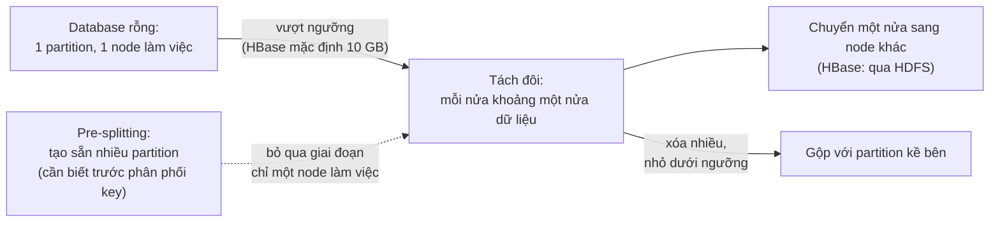

*(Sơ đồ do người viết ghi chú tổng hợp từ tr. 212.)*

**Partitioning proportionally to nodes** (tr. 212–213).

- **So sánh hai cách trước** (tr. 212–213):
  - Với **dynamic partitioning**, **số partition** tỷ lệ với **kích thước dataset**, vì việc tách và gộp giữ kích thước mỗi partition trong khoảng giữa một mức tối thiểu và tối đa cố định.
  - Với **số partition cố định**, **kích thước mỗi partition** tỷ lệ với kích thước dataset.
  - Trong cả hai, **số partition độc lập với số node**.
- **What — cách thứ ba** (tr. 213). **Cassandra** và **Ketama** làm **số partition tỷ lệ với số node**, tức **mỗi node có một số partition cố định** [23, 27, 28].
  - Khi số node giữ nguyên, kích thước mỗi partition **tăng theo dataset**. Khi **tăng số node**, partition lại **nhỏ đi**.
  - Vì dữ liệu nhiều hơn thường cần **nhiều node hơn** để lưu, cách này cũng giữ kích thước partition **khá ổn định**.
- **How** (tr. 213). Khi một **node mới** gia nhập cluster, nó **chọn ngẫu nhiên** một số cố định partition hiện có để **tách đôi**, rồi **nhận một nửa** của mỗi partition đó, để **nửa kia ở yên**.
  - Ngẫu nhiên có thể tạo ra **cách tách không công bằng**. Nhưng **lấy trung bình** trên nhiều partition (Cassandra mặc định **256 partition mỗi node**), node mới nhận được **phần tải công bằng** từ các node cũ.
  - **Cassandra 3.0** đưa vào một **thuật toán rebalancing khác** để tránh tách không công bằng [29].
- **Cần hash partitioning** (tr. 213). Chọn ranh giới partition **ngẫu nhiên** đòi hỏi dùng **hash-based partitioning**, để ranh giới được chọn từ **khoảng số do hàm hash sinh ra**. Thực ra cách này **gần nhất** với **định nghĩa gốc** của consistent hashing [7] ([hộp Consistent Hashing](#consistent-hashing)). Các hàm hash **mới hơn** đạt hiệu quả tương tự với **chi phí metadata thấp hơn** [8].

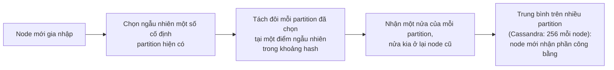

*(Sơ đồ do người viết ghi chú tổng hợp từ tr. 213.)*

> **Bổ sung ngoài sách.**
> - **Vì sao cần hash:** giá trị hash phân bố đều, nên một điểm cắt ngẫu nhiên trong khoảng hash chia dữ liệu **trung bình** thành hai phần hợp lý. Trong không gian key gốc (có thể lệch như Hình 6-2), điểm cắt ngẫu nhiên có thể rơi vào vùng gần như không có dữ liệu.
> - **Ví dụ quy mô:** 10 node × 256 partition = 2560 partition; thêm node thứ 11 thì cluster có 2816 partition, và phần công bằng mà node mới cần nhận là khoảng 1/11 dữ liệu. Vì điểm cắt ngẫu nhiên dễ rơi vào partition lớn hơn, phần thực nhận dao động quanh mức đó; số partition mỗi node càng lớn thì dao động càng nhỏ, đúng ý "lấy trung bình" của sách.
> - **Hàm hash "mới hơn" [8]** là *jump consistent hash* của Lamping và Veach (2014): ánh xạ key thẳng sang số thứ tự bucket từ 0 tới N − 1 mà **không cần lưu metadata** ranh giới, và khi N tăng lên N + 1 chỉ khoảng 1/(N + 1) số key đổi bucket.

**So sánh ba cách theo đại lượng được giữ cố định** (người viết ghi chú tổng hợp từ tr. 210–213):

| Cách | Cố định | Số partition | Kích thước mỗi partition |
| --- | --- | --- | --- |
| Fixed number of partitions | Tổng số partition | Không đổi | Tăng theo dataset |
| Dynamic partitioning | Khoảng kích thước (min, max) của partition | Tăng theo dataset | Bị chặn trong khoảng cấu hình |
| Proportional to nodes | Số partition mỗi node | Tăng theo số node | Tăng theo dataset, giảm khi thêm node |

#### B4.2 Operations: Automatic or Manual Rebalancing (tr. 213–214)

**Câu hỏi bị lướt qua** (tr. 213). Rebalancing diễn ra **tự động** hay **thủ công**?

**Một dải liên tục** (tr. 213).

- **Hoàn toàn tự động:** hệ thống tự quyết định khi nào chuyển partition giữa các node, **không cần** quản trị viên can thiệp.
- **Hoàn toàn thủ công:** cách gán partition cho node được quản trị viên **cấu hình tường minh**, và chỉ đổi khi quản trị viên **cấu hình lại**.
- **Ở giữa:** **Couchbase**, **Riak** và **Voldemort** **tự sinh một đề xuất** gán partition, nhưng cần quản trị viên **xác nhận (commit)** thì đề xuất mới có hiệu lực.

**Trade-offs** (tr. 213).

- Tự động hoàn toàn **tiện**: ít việc vận hành cho bảo trì thường ngày.
- Nhưng có thể **khó lường**. Rebalancing là **thao tác đắt**: phải **định tuyến lại request** và **chuyển lượng lớn dữ liệu** giữa các node. Làm không cẩn thận, nó có thể **làm quá tải mạng hoặc node**, và **làm hại hiệu năng** của các request khác trong lúc rebalance.

**Nguy hiểm khi đi cùng phát hiện lỗi tự động** (tr. 214).

1. Một node **quá tải** và tạm thời **trả lời chậm**.
2. Các node khác **kết luận** node đó **đã chết**.
3. Chúng **tự động rebalance** cluster để chuyển tải **khỏi** node đó.
4. Việc này đặt **thêm tải** lên node đang quá tải, lên các node khác và lên mạng.
5. Tình hình **tệ hơn**, có thể gây ***cascading failure*** (lỗi dây chuyền).

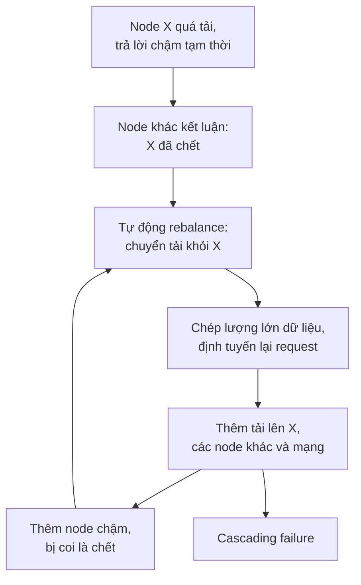

*(Sơ đồ do người viết ghi chú tổng hợp từ tr. 214; vòng lặp F → C là cách người viết diễn giải chữ "cascading".)*

**Kết luận của tác giả** (tr. 214). Vì vậy, có **con người trong vòng lặp** (*human in the loop*) khi rebalance có thể là **điều tốt**. Cách này **chậm hơn** quá trình tự động hoàn toàn, nhưng giúp **tránh bất ngờ trong vận hành**.

> **Liên hệ chương 5.** Đây là cùng một bài học với failover: timeout quá ngắn có thể gây **failover không cần thiết**, và khi hệ thống đang chật vật vì tải cao, failover đó làm tình hình **tệ hơn**; vì vậy nhiều đội chọn failover thủ công ([chương 5, B1.3](chapter-05.md#failover-problems), tr. 158). Cả hai trường hợp: **phản ứng tự động với "node có vẻ chết"** có thể biến quá tải tạm thời thành sự cố lớn.

**System Design.** Rebalancing nên được coi như một **thao tác vận hành có kiểm soát**: giới hạn tốc độ chuyển dữ liệu, không tự kích hoạt chỉ vì một timeout, và nếu tự động thì ít nhất cho người duyệt đề xuất như Couchbase, Riak, Voldemort (tr. 213–214). Câu "giới hạn tốc độ chuyển" là bổ sung của người viết ghi chú, dựa trên cảnh báo về quá tải mạng và node ở tr. 213.

---

### B5. Request Routing (tr. 214–216)

#### B5.0 Client biết gửi request tới node nào bằng cách nào? (tr. 214–216)

**Câu hỏi còn bỏ ngỏ** (tr. 214). Dataset đã được phân vùng trên nhiều node, chạy trên nhiều máy. Khi client muốn gửi request, làm sao nó biết **kết nối tới node nào**? Khi partition được rebalance, cách gán partition cho node **thay đổi**. Phải có ai đó **theo dõi sát** các thay đổi này để trả lời câu hỏi: muốn đọc hoặc ghi key "foo" thì phải kết nối tới **địa chỉ IP và cổng nào**?

**Một trường hợp của service discovery** (tr. 214). Đây là một trường hợp của bài toán tổng quát hơn gọi là ***service discovery***, không chỉ của database. Phần mềm nào truy cập được qua mạng cũng gặp nó, nhất là khi nhắm tới **high availability** (chạy dư thừa trên nhiều máy). Nhiều công ty đã tự viết công cụ service discovery nội bộ, và nhiều công cụ đã được mở mã nguồn [30].

**Ba cách tiếp cận** (tr. 214, Hình 6-7):

1. **Cho client liên hệ node bất kỳ**, ví dụ qua một ***round-robin load balancer***. Nếu node đó **tình cờ sở hữu** partition của request, nó xử lý trực tiếp; nếu không, nó **chuyển tiếp** request tới node thích hợp, nhận phản hồi và **chuyển lại** cho client.
2. **Gửi mọi request tới một *routing tier*** trước. Tầng này xác định node nào phải xử lý request và chuyển tiếp tương ứng. Bản thân routing tier **không xử lý request nào**; nó chỉ là một ***partition-aware load balancer*** (bộ cân bằng tải biết về phân vùng).
3. **Bắt client biết** về phân vùng và cách gán partition cho node. Khi đó client **kết nối thẳng** tới node thích hợp, **không qua trung gian**.

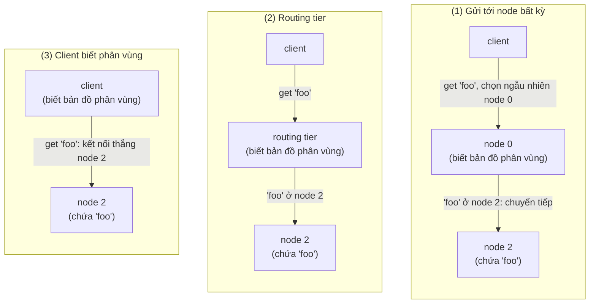

*(Vẽ lại Hình 6-7, tr. 215. Trong hình gốc, phần "biết bản đồ phân vùng" được đánh dấu bằng vạch sọc: ở cách 1 là mọi node, ở cách 2 là routing tier, ở cách 3 là client.)*

**Vấn đề cốt lõi** (tr. 214–215). Trong mọi trường hợp, câu hỏi then chốt là: thành phần **ra quyết định định tuyến** (có thể là một node, routing tier hay client) **biết về thay đổi** trong cách gán partition cho node **bằng cách nào**?

- Bài toán này **khó**, vì quan trọng là **mọi bên tham gia đều đồng ý**. Nếu không, request sẽ bị gửi tới **sai node** và không được xử lý đúng.
- Có các giao thức đạt ***consensus*** trong hệ phân tán, nhưng chúng **khó cài đúng** (Chương 9).

**Dùng coordination service: ZooKeeper** (tr. 215, Hình 6-8).

- Nhiều hệ dữ liệu phân tán dựa vào một ***coordination service*** riêng như ***ZooKeeper*** để theo dõi **metadata của cluster**.
- Mỗi node **tự đăng ký** trong ZooKeeper, và ZooKeeper duy trì **ánh xạ chính thức** (*authoritative mapping*) từ partition tới node.
- Các bên khác, như **routing tier** hay **client biết phân vùng**, có thể **đăng ký theo dõi** (*subscribe*) thông tin này trong ZooKeeper.
- Mỗi khi một partition **đổi chủ**, hoặc một node được **thêm hay bớt**, ZooKeeper **báo** cho routing tier để nó **cập nhật thông tin định tuyến**.

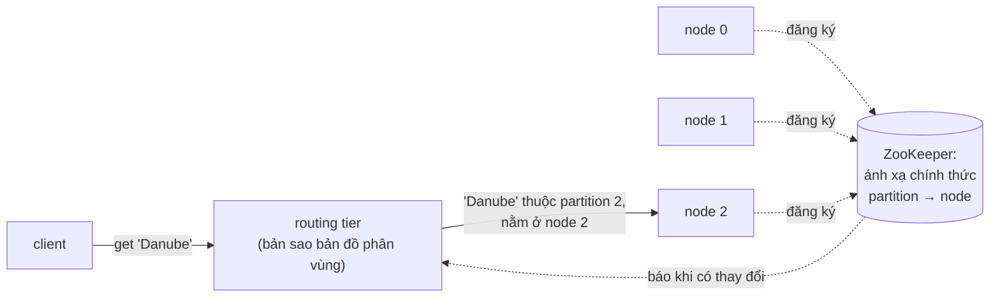

| Khoảng key | Partition | Node | Địa chỉ IP |
| --- | --- | --- | --- |
| A-ak — Bayes | partition 0 | node 0 | 10.20.30.100 |
| Bayeu — Ceanothus | partition 1 | node 1 | 10.20.30.101 |
| Ceara — Deluc | partition 2 | node 2 | 10.20.30.102 |
| Delusion — Frenssen | partition 3 | node 0 | 10.20.30.100 |
| Freon — Holderlin | partition 4 | node 1 | 10.20.30.101 |
| Holderness — Krasnoje | partition 5 | node 2 | 10.20.30.102 |
| Krasnokamsk — Menadra | partition 6 | node 0 | 10.20.30.100 |
| Menage — Ottawa | partition 7 | node 1 | 10.20.30.101 |
| Otter — Rethimnon | partition 8 | node 2 | 10.20.30.102 |
| Reti — Solovets | partition 9 | node 0 | 10.20.30.100 |
| Solovyov — Truck | partition 10 | node 1 | 10.20.30.101 |
| Trudeau — Zywiec | partition 11 | node 2 | 10.20.30.102 |

*(Vẽ lại Hình 6-8, tr. 215: ZooKeeper giữ bảng gán partition cho node (bảng bên phải hình gốc), routing tier nhận bản sao. Các khoảng key trùng với 12 tập bách khoa toàn thư ở Hình 6-2. Key "Danube" nằm giữa "Ceara" và "Deluc", nên thuộc partition 2 ở node 2, đúng như mũi tên trong hình.)*

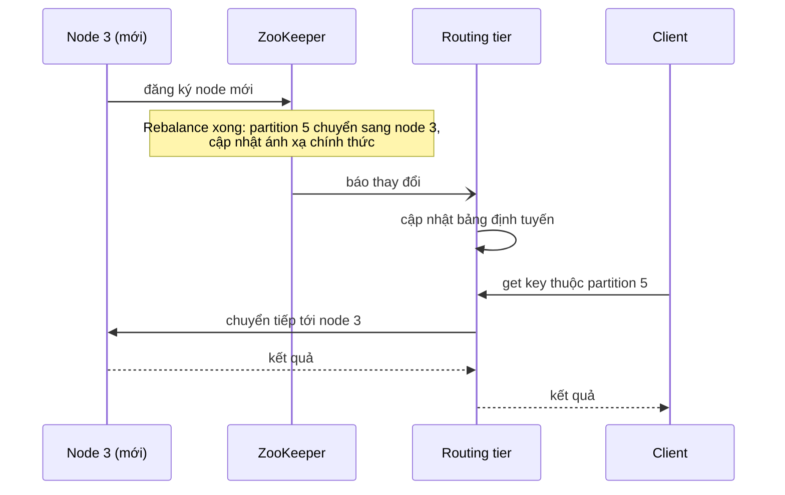

*(Ví dụ minh họa do AI xây dựng cho luồng thông báo mô tả ở tr. 215. Node 3 và partition 5 là giả định.)*

**Các hệ thống cụ thể (lúc viết sách)** (tr. 216):

| Hệ thống | Nơi giữ bản đồ phân vùng | Cách định tuyến |
| --- | --- | --- |
| **Espresso** (LinkedIn) | **Helix** [31] để quản lý cluster, Helix lại dựa trên ZooKeeper | Routing tier như Hình 6-8 |
| **HBase, SolrCloud, Kafka** | ZooKeeper theo dõi việc gán partition | (sách không nêu chi tiết) |
| **MongoDB** | **Config server** do MongoDB tự cài | Các daemon **mongos** làm routing tier |
| **Cassandra, Riak** | ***Gossip protocol*** giữa các node để lan truyền thay đổi trạng thái cluster | Gửi tới **node bất kỳ**, node đó chuyển tiếp (cách 1 ở Hình 6-7) |
| **Couchbase** | Không tự động rebalance, nên thiết kế đơn giản hơn | Thường cấu hình routing tier **moxi**, học thay đổi định tuyến từ các node [32] |

**Trade-off của gossip** (tr. 216). Mô hình của Cassandra và Riak đặt **nhiều độ phức tạp hơn vào các node database**, nhưng **tránh phụ thuộc** vào một coordination service bên ngoài như ZooKeeper.

> **Bổ sung ngoài sách.** Trong gossip protocol, định kỳ mỗi node chọn ngẫu nhiên vài node khác và trao đổi những gì nó biết về trạng thái cluster (node nào sống, ai giữ khoảng hash nào, phiên bản thông tin). Thông tin mới lan ra cả cluster giống tin đồn, sau vài vòng thì mọi node biết. Cái giá là trong khoảng thời gian lan truyền, các node có thể tạm thời **có cái nhìn khác nhau** về cluster, khác với ZooKeeper vốn giữ một bản ghi chính thức duy nhất.

**Tìm địa chỉ IP: DNS là đủ** (tr. 216). Khi dùng routing tier hoặc gửi request tới node ngẫu nhiên, client **vẫn cần biết địa chỉ IP** để kết nối. Các địa chỉ này **không đổi nhanh** như cách gán partition cho node, nên thường chỉ cần dùng **DNS**.

**System Design.**

- Nguyên tắc: thông tin **thay đổi chậm** (địa chỉ của routing tier hay các node) dùng cơ chế đơn giản như DNS; thông tin **thay đổi nhanh và phải nhất quán** (partition nào ở node nào) cần một nguồn sự thật mà mọi bên đồng ý, như coordination service (tr. 215–216).
- Chọn routing tier khi muốn **client đơn giản**, không phải biết về phân vùng; chọn client biết phân vùng khi muốn **bớt một bước mạng**, đổi lại mọi client phải theo dõi thay đổi; chọn gossip khi không muốn vận hành thêm một coordination service (tr. 214–216). Đây là nhận xét của người viết ghi chú dựa trên mô tả ba cách tiếp cận.

#### B5.1 Parallel Query Execution (tr. 216)

**Đến giờ** (tr. 216). Chương tập trung vào các truy vấn **rất đơn giản**: đọc hoặc ghi **một key** (cộng với scatter/gather khi dùng document-partitioned secondary index). Đó gần như là **mức truy cập** mà hầu hết NoSQL datastore phân tán hỗ trợ.

**MPP database** (tr. 216). Các sản phẩm relational database ***massively parallel processing* (MPP)**, thường dùng cho **phân tích**, hỗ trợ những loại truy vấn **tinh vi hơn nhiều**.

- Một truy vấn data warehouse điển hình gồm **nhiều phép join, lọc, nhóm và tổng hợp** ([chương 3, B7.2](chapter-03.md#data-warehouse)).
- **MPP query optimizer** chia truy vấn phức tạp đó thành **nhiều giai đoạn thực thi** (*execution stage*) và **nhiều partition**, phần lớn có thể **chạy song song** trên các node khác nhau của cluster.
- Truy vấn **quét phần lớn dataset** đặc biệt được lợi từ thực thi song song.

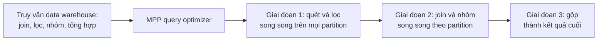

*(Ví dụ minh họa do AI xây dựng. Sách chỉ nói optimizer chia truy vấn thành nhiều giai đoạn và partition chạy song song; nội dung từng giai đoạn là giả định.)*

**Chủ đề chuyên sâu** (tr. 216). Thực thi nhanh song song các truy vấn data warehouse là một **chủ đề chuyên biệt**, và vì phân tích dữ liệu quan trọng với kinh doanh, nó nhận được **nhiều quan tâm thương mại**. Sách bàn một số kỹ thuật thực thi truy vấn song song ở **Chương 10**. Tổng quan chi tiết hơn về kỹ thuật của parallel database: xem tài liệu [1, 33].

---

### B6. Summary — Tổng kết của tác giả (tr. 216–218)

**Khi nào cần phân vùng** (tr. 216). Khi có **quá nhiều dữ liệu** đến mức lưu và xử lý trên **một máy** không còn khả thi.

**Mục tiêu** (tr. 217). **Trải đều** dữ liệu và tải truy vấn trên nhiều máy, **tránh hot spot** (node có tải cao bất thường). Muốn vậy phải **chọn sơ đồ phân vùng hợp với dữ liệu**, và **rebalance** partition khi thêm hoặc bớt node.

**Hai cách phân vùng chính** (tr. 217):

| Cách | Tóm tắt | Rebalancing thường dùng |
| --- | --- | --- |
| **Key range partitioning** | Key được sắp xếp; mỗi partition sở hữu mọi key từ một mức nhỏ nhất tới một mức lớn nhất. Sắp xếp cho phép **range query hiệu quả**, nhưng có **rủi ro hot spot** nếu ứng dụng hay truy cập các key **gần nhau** trong thứ tự | **Động**: tách khoảng thành hai khoảng con khi partition quá lớn |
| **Hash partitioning** | Áp hàm hash cho mỗi key; mỗi partition sở hữu một khoảng hash. **Phá thứ tự key**, range query kém hiệu quả, nhưng có thể **phân bố tải đều hơn** | Thường tạo trước **số partition cố định**, gán vài partition cho mỗi node, chuyển **nguyên partition** khi thêm hay bớt node. Cũng có thể dùng phân vùng động |

**Cách lai** (tr. 217). Ví dụ **compound key**: một phần key xác định partition, phần kia quyết định thứ tự sắp xếp.

**Secondary index cũng phải được phân vùng, theo hai cách** (tr. 217):

| Cách | Lưu ở đâu | Ghi | Đọc |
| --- | --- | --- | --- |
| **Document-partitioned (local index)** | Cùng partition với primary key và value | Chỉ cập nhật **một partition** | Phải **scatter/gather** qua mọi partition |
| **Term-partitioned (global index)** | Phân vùng **riêng**, theo giá trị được index; một mục có thể gồm bản ghi từ mọi partition của primary key | Phải cập nhật **nhiều partition** của secondary index | Phục vụ được từ **một partition** |

**Định tuyến** (tr. 217). Các kỹ thuật định tuyến truy vấn tới đúng partition trải từ **cân bằng tải biết phân vùng** đơn giản tới các **engine thực thi truy vấn song song** tinh vi.

**Partition độc lập: sức mạnh và giới hạn** (tr. 217–218). **Theo thiết kế**, mỗi partition **hoạt động phần lớn độc lập**; đó là điều cho phép database phân vùng **mở rộng ra nhiều máy**. Nhưng thao tác cần **ghi vào nhiều partition** thì **khó suy luận**: chuyện gì xảy ra nếu ghi vào một partition **thành công** nhưng partition khác **thất bại**? Các chương tiếp theo sẽ trả lời câu hỏi này.

---

## C. Sơ đồ minh họa

Các sơ đồ gắn với từng mục đã nằm trong phần B:

- Kết hợp replication và partitioning (Hình 6-1): [B1](#partitioning-replication)
- Gán ngẫu nhiên và gán theo key; key range (Hình 6-2), hot spot do timestamp: [B2.0](#skew-hot-spot), [B2.1](#key-range)
- Hash partitioning (Hình 6-3), compound key của Cassandra, tách key nóng: [B2.2](#hash-partitioning), [B2.3](#key-splitting)
- Local index và scatter/gather (Hình 6-4), global index (Hình 6-5): [B3.1](#document-index), [B3.2](#term-index)
- Thêm node với số partition cố định (Hình 6-6), dynamic partitioning, partitioning theo số node, cascading failure: [B4.1](#rebalancing-strategies), [B4.2](#cascading-failure)
- Ba cách định tuyến (Hình 6-7), ZooKeeper (Hình 6-8), luồng thông báo, thực thi song song: [B5](#request-routing), [B5.1](#parallel-query)

Phần này bổ sung các sơ đồ **tổng hợp** để ôn tập.

### C1. Bản đồ khái niệm của chương 6

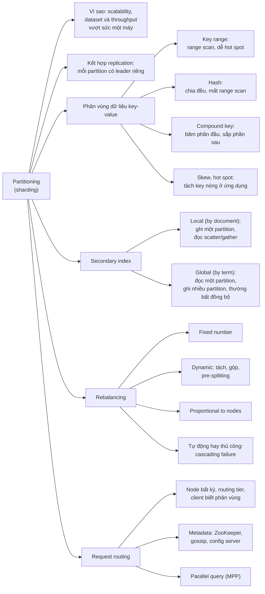

### C2. Chọn cách phân vùng và đánh index

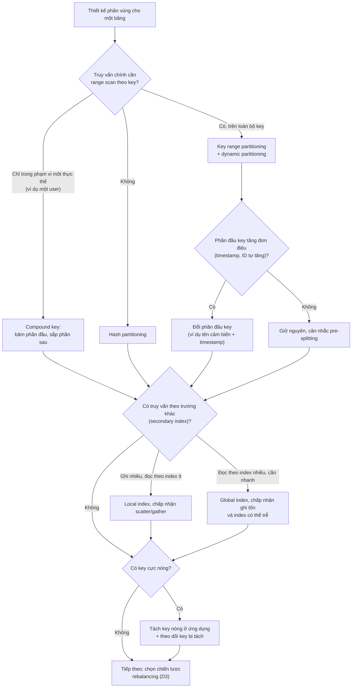

*(Sơ đồ do người viết ghi chú tổng hợp từ tr. 202–209. Đây là gợi ý cách suy luận, không phải quy tắc trong sách.)*

### C3. Đường đi của một lần ghi trong database vừa phân vùng vừa nhân bản

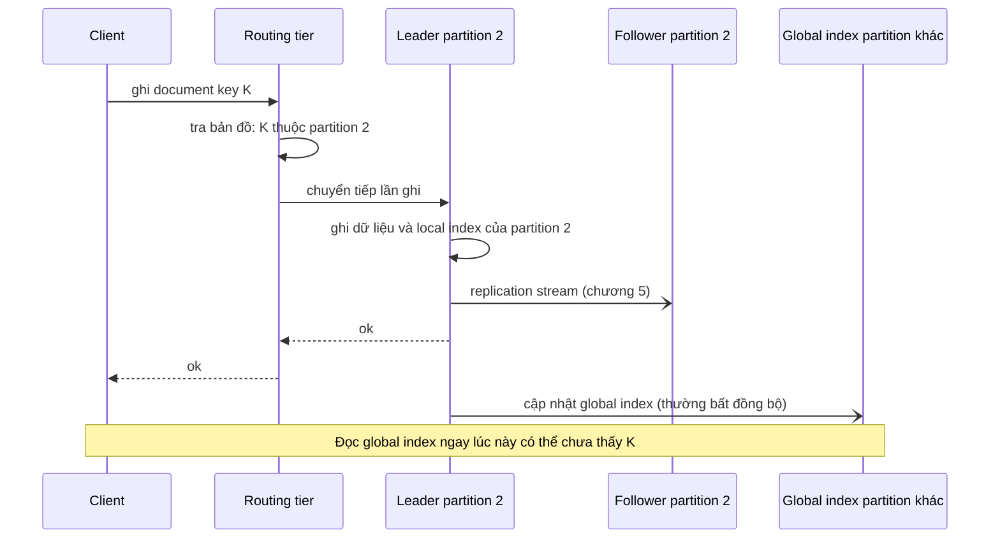

*(Sơ đồ do người viết ghi chú ghép các cơ chế ở tr. 200–201, 207–209, 214–215 với chương 5. Một database thật thường chỉ dùng một trong hai loại index cho mỗi trường; ở đây vẽ cả hai để thấy sự khác biệt.)*

---

## D. So sánh các giải pháp

### D1. Key range, hash và compound key (tr. 202–205, 217)

| Tiêu chí | Key range | Hash of key | Compound key (Cassandra) |
| --- | --- | --- | --- |
| **Nguyên lý** | Mỗi partition giữ một khoảng key liên tục; key sắp xếp trong partition | Mỗi partition giữ một khoảng giá trị hash | Băm phần đầu của key để chọn partition; phần sau sắp xếp trong SSTable |
| **Range query** | **Hiệu quả** trên toàn bộ key | **Mất**: phải hỏi mọi partition (MongoDB) hoặc không hỗ trợ (Riak, Couchbase, Voldemort) | Hiệu quả trên các cột sau, **khi cố định** cột đầu |
| **Phân bố tải** | Phụ thuộc kiểu truy cập; dễ hot spot với key tăng đơn điệu | **Đều hơn**, trừ khi một key đơn lẻ cực nóng | Đều theo phần đầu key |
| **Ranh giới** | Phải thích nghi với dữ liệu (thủ công hoặc tự động) | Cách đều hoặc giả ngẫu nhiên | Theo hash của phần đầu |
| **Rebalancing thường dùng** | Dynamic partitioning | Fixed number of partitions (cũng dùng được dynamic) | (như hash) |
| **Ví dụ (lúc viết sách)** | Bigtable, HBase, RethinkDB, MongoDB trước 2.4 | Cassandra, MongoDB (MD5), Voldemort (Fowler–Noll–Vo), Riak, Couchbase | Cassandra |
| **Dùng khi** | Cần quét theo khoảng (thời gian, chữ cái) | Truy cập chủ yếu theo key đơn lẻ, cần chia đều | Quan hệ một-nhiều: mọi bản ghi của một thực thể, theo thứ tự |

### D2. Local index và global index (tr. 206–209, 217)

| Tiêu chí | Document-partitioned (local) | Term-partitioned (global) |
| --- | --- | --- |
| **Nguyên lý** | Mỗi partition giữ index cho riêng document của nó | Một index phủ mọi partition, được phân vùng theo term (hoặc hash của term) |
| **Ghi** | Chỉ chạm **một partition** | Có thể chạm **nhiều partition** của index |
| **Đọc theo index** | **Scatter/gather** mọi partition; dễ tail latency amplification | Chỉ hỏi **partition chứa term** |
| **Độ mới của index** | Cập nhật cùng document trong một partition | Thường **bất đồng bộ**; cập nhật đồng bộ cần distributed transaction |
| **Range scan trên giá trị index** | (sách không bàn) | Được, nếu phân vùng theo chính term |
| **Ví dụ (lúc viết sách)** | MongoDB, Riak, Cassandra, Elasticsearch, SolrCloud, VoltDB | DynamoDB global secondary index, Riak search, Oracle data warehouse (chọn được) |
| **Dùng khi** | Ghi nhiều; truy vấn index ít hoặc kèm khóa phân vùng | Đọc theo index nhiều; chấp nhận ghi tốn và index trễ |

### D3. Các chiến lược rebalancing (tr. 210–213)

| Tiêu chí | hash mod N | Fixed number of partitions | Dynamic partitioning | Proportional to nodes |
| --- | --- | --- | --- | --- |
| **Nguyên lý** | Node = hash(key) mod N | Tạo trước nhiều partition hơn số node; chuyển nguyên partition | Tách partition quá lớn, gộp partition quá nhỏ | Số partition cố định trên mỗi node; node mới tách ngẫu nhiên partition cũ |
| **Dữ liệu phải chuyển khi đổi số node** | **Phần lớn** key | Chỉ vài partition nguyên vẹn | Một nửa partition vừa tách | Một nửa các partition được chọn |
| **Kích thước partition** | (không có khái niệm partition riêng) | Tăng theo dataset | Bị chặn trong khoảng cấu hình | Khá ổn định |
| **Giới hạn** | Rebalancing đắt quá mức | Số partition là số node tối đa; khó chọn khi dataset biến động | DB rỗng chỉ có 1 partition (cần pre-splitting) | Cần hash partitioning; tách ngẫu nhiên có thể không đều |
| **Ví dụ (lúc viết sách)** | Không nên dùng | Riak, Elasticsearch, Couchbase, Voldemort | HBase, RethinkDB, MongoDB | Cassandra, Ketama |
| **Dùng khi** | Không bao giờ (cho dữ liệu cần rebalance) | Dataset ước lượng được; muốn vận hành đơn giản | Key range, hoặc dataset biến động | Hash partitioning, cluster lớn dần theo dữ liệu |

### D4. Rebalancing tự động và thủ công (tr. 213–214)

| Tiêu chí | Hoàn toàn tự động | Đề xuất tự động, người xác nhận | Hoàn toàn thủ công |
| --- | --- | --- | --- |
| **Nguyên lý** | Hệ thống tự quyết khi nào chuyển partition | Hệ thống sinh đề xuất gán partition; quản trị viên commit | Quản trị viên cấu hình tường minh |
| **Ưu điểm** | Ít việc vận hành | Có người kiểm tra trước thao tác đắt | Dễ đoán nhất |
| **Nhược điểm** | Khó lường; kết hợp phát hiện lỗi tự động có thể gây cascading failure | Chậm hơn tự động | Chậm, tốn công |
| **Ví dụ (lúc viết sách)** | (sách không nêu) | Couchbase, Riak, Voldemort | (sách không nêu) |

### D5. Các cách định tuyến request (tr. 214–216)

| Tiêu chí | (1) Node bất kỳ chuyển tiếp | (2) Routing tier | (3) Client biết phân vùng |
| --- | --- | --- | --- |
| **Ai biết bản đồ phân vùng** | Mọi node | Routing tier | Client |
| **Số bước mạng** | Có thể thêm một bước chuyển tiếp giữa các node | Thêm một bước qua routing tier | Kết nối thẳng, không trung gian |
| **Học thay đổi bằng cách nào** | Gossip giữa các node (Cassandra, Riak) | Đăng ký với ZooKeeper (Espresso qua Helix, HBase, SolrCloud, Kafka), config server (MongoDB với mongos), hoặc học từ node (Couchbase với moxi) | Đăng ký với coordination service như ZooKeeper |
| **Ưu điểm** | Không phụ thuộc dịch vụ ngoài | Client đơn giản; tách định tuyến khỏi node | Ít bước mạng nhất |
| **Nhược điểm** | Độ phức tạp nằm trong node database | Thêm một thành phần phải vận hành | Mọi client phải theo dõi thay đổi |

*(Các ô "Ưu điểm", "Nhược điểm" và "Số bước mạng" là suy luận của người viết ghi chú từ mô tả ở tr. 214–216, trừ ý gossip đặt độ phức tạp vào node và tránh phụ thuộc ZooKeeper, vốn có trong sách.)*

---

## E. Tư duy System Design

> **Ví dụ minh họa do AI xây dựng.** Tất cả tình huống dưới đây là giả định để luyện cách suy luận. Mỗi bước lập luận dẫn về nội dung sách. Phép tính trong các tình huống là của người viết ghi chú. Hãy tự trả lời phần "Câu hỏi cần đặt" trước khi đọc lập luận.

### E1. Dữ liệu cảm biến: một node luôn quá tải

**Bối cảnh.** Hệ thống thu số đo từ 20000 cảm biến thời tiết, mỗi cảm biến gửi một số đo mỗi 10 giây (khoảng 2000 lần ghi mỗi giây). Truy vấn chính: (a) vẽ biểu đồ một cảm biến trong một tháng; (b) thỉnh thoảng so sánh 50 cảm biến trong một ngày. Phiên bản đầu lưu trong một database key range (kiểu HBase) với key là timestamp. Đội vận hành thấy luôn có đúng một node quá tải, các node khác gần như rảnh.

**Câu hỏi cần đặt.** Vì sao chỉ một node quá tải? Nên đổi key thế nào? Truy vấn (b) sẽ tốn gì sau khi đổi?

**Lập luận.**

1. Key là timestamp trong key range partitioning: mỗi partition ứng với một khoảng thời gian, và mọi lần ghi mới rơi vào partition **hiện tại**. Đó là hot spot kinh điển của sách (tr. 203).
2. Đổi key thành (tên cảm biến, timestamp): phân vùng trước theo cảm biến rồi theo thời gian. 20000 cảm biến cùng hoạt động nên tải ghi trải đều hơn; truy vấn (a) vẫn là **một range scan liên tục** (tr. 202–203).
3. Truy vấn (b) giờ cần **50 range query riêng**, mỗi cảm biến một truy vấn (tr. 203). Chạy song song được, nhưng phải chờ truy vấn chậm nhất, tức chịu tail latency amplification (tr. 207, chương 1 tr. 16).
4. Nếu tên cảm biến phân bố lệch (ví dụ nhiều cảm biến cùng tiền tố "HN-"), có thể **băm** phần tên và giữ timestamp làm phần sắp xếp, như compound key của Cassandra. Range scan theo thời gian trong một cảm biến vẫn hiệu quả, nhưng mất khả năng quét theo khoảng tên cảm biến (tr. 204–205).
5. Database key range thường dùng dynamic partitioning, nên database mới chỉ có một partition. Vì danh sách cảm biến đã biết trước, nên **pre-split** theo khoảng tên cảm biến để mọi node làm việc ngay từ đầu (tr. 212).

**Nếu yêu cầu thay đổi.** Nếu truy vấn quan trọng nhất trở thành "mọi cảm biến trong 5 phút qua", key bắt đầu bằng thời gian lại có lợi cho đọc nhưng hại cho ghi: phải so sánh tải nào lớn hơn. Với các truy vấn quét rộng kiểu phân tích, nên đưa dữ liệu sang một hệ MPP hoặc data warehouse có thực thi song song (tr. 216).

### E2. Bài đăng của người nổi tiếng làm nóng một partition

**Bối cảnh.** Một mạng xã hội lưu bộ đếm lượt thích và danh sách bình luận theo post_id, trong datastore dùng hash partitioning. Một ca sĩ có 50 triệu follower đăng bài; trong 10 phút có 2 triệu lượt thích và 300 nghìn bình luận. Partition chứa post_id đó quá tải, các bài khác cùng partition cũng chậm theo.

**Câu hỏi cần đặt.** Hash partitioning có giúp không? Tách key nóng thế nào? Cái giá ở phía đọc và vận hành là gì?

**Lập luận.**

1. Mọi lượt thích ghi vào **cùng một key**, nên đi tới cùng một partition; hash của cùng một ID vẫn là một (tr. 205).
2. Lúc viết sách, hầu hết hệ thống không tự bù được workload lệch như vậy, nên **ứng dụng phải tự xử lý** (tr. 205).
3. Gắn thêm số ngẫu nhiên hai chữ số vào key: 2 triệu lượt thích chia cho 100 bộ đếm con, mỗi bộ khoảng 20 nghìn lần ghi trong 10 phút, nằm ở nhiều partition khác nhau (tr. 205).
4. Đọc tổng lượt thích giờ phải đọc **100 key rồi cộng lại**; đọc bình luận phải gộp 100 danh sách và sắp lại theo thời gian (tr. 205).
5. Chỉ tách các bài **thật sự nóng**. Ứng dụng cần một danh sách "bài nào đang bị tách, tách thành bao nhiêu key" để cả đường ghi lẫn đường đọc tra cứu (tr. 205). Ngưỡng tách nên dựa trên tải đo được, giống cách chương 1 xử lý riêng người nổi tiếng trong ví dụ Twitter ([chương 1, B4.1](chapter-01.md#load-parameters), tr. 12–13).

**Nếu yêu cầu thay đổi.** Nếu cái nóng là **lượt đọc** (hàng triệu người mở bài) chứ không phải lượt ghi, tách key không giúp gì mà còn làm đọc tốn hơn. *Bổ sung ngoài sách:* khi đó nên tăng replica cho partition đó hoặc dùng cache. Nếu cần con số chính xác ngay lập tức ở mỗi lần đọc, phải chấp nhận chi phí đọc 100 key, hoặc chấp nhận con số gần đúng được tổng hợp định kỳ.

### E3. Trang tìm xe cũ: local index hay global index?

**Bối cảnh.** Trang rao bán xe có 50 triệu tin, phân vùng theo document ID trên 40 partition. Người dùng lọc theo màu, hãng và khoảng giá. Mỗi ngày có khoảng 200 nghìn tin mới hoặc cập nhật, và 20 triệu lượt tìm kiếm.

**Câu hỏi cần đặt.** Local index hay global index? Index theo giá nên phân vùng thế nào? Người bán vừa đăng tin có thấy tin của mình trong kết quả tìm ngay không?

**Lập luận.**

1. **Local index:** ghi một tin chỉ chạm một partition. Nhưng mỗi lượt tìm phải scatter/gather qua 40 partition: 20 triệu lượt tìm thành 800 triệu truy vấn con mỗi ngày, và độ trễ bị kéo theo partition chậm nhất (tr. 207).
2. **Global index:** lượt tìm "color:red" chỉ hỏi partition chứa term đó (tr. 208). Một lần ghi tin chạm tới nhiều partition index (màu, hãng, giá), vì mỗi term có thể ở partition khác (tr. 208).
3. Tỷ lệ đọc trên ghi ở đây khoảng 100 trên 1, nên trả giá ở đường ghi để đọc rẻ là hợp lý: chọn global index (lập luận của người viết dựa trên trade-off ở tr. 208).
4. Index giá cần truy vấn khoảng ("giá từ 200 tới 300 triệu"), nên phân vùng **theo chính giá trị** để range scan được. Index màu và hãng có thể phân vùng theo **hash của term** để tải đều hơn (tr. 208).
5. Global index thường cập nhật **bất đồng bộ**, như DynamoDB (tr. 209). Người bán vừa đăng tin có thể chưa thấy nó trong kết quả tìm. Có thể xử lý giống read-after-write ở chương 5: trang "tin của tôi" đọc thẳng theo document ID, không qua index ([chương 5, B2.1](chapter-05.md#read-your-writes)).
6. *Bổ sung ngoài sách:* lọc đồng thời màu đỏ **và** hãng Ford với global index nghĩa là hỏi hai partition index (một cho mỗi term) rồi lấy giao hai danh sách ID; vẫn rẻ hơn nhiều so với hỏi cả 40 partition.

**Nếu yêu cầu thay đổi.** Nếu giá thay đổi liên tục (kiểu đấu giá), tải ghi lên index tăng mạnh, và local index có thể hợp hơn. Nếu yêu cầu "kết quả tìm luôn phản ánh ngay mọi thay đổi", global index cần distributed transaction qua các partition index, điều không phải database nào cũng hỗ trợ (tr. 209; Chương 7, 9).

### E4. Chọn chiến lược rebalancing cho một sản phẩm mới

**Bối cảnh.** Một startup lưu dữ liệu sự kiện của khách hàng bằng hash partitioning. Năm đầu dự kiến 200 GB trên 3 node. Kế hoạch 5 năm: có thể tới 200 TB trên khoảng 200 node, nhưng con số này rất không chắc chắn.

**Câu hỏi cần đặt.** Có dùng hash mod N được không? Nếu dùng số partition cố định thì chọn bao nhiêu? Dynamic hay proportional có hợp hơn không?

**Lập luận.**

1. **Hash mod N bị loại:** mỗi lần đổi số node, phần lớn key phải chuyển (tr. 210). Từ 3 lên 4 node, khoảng 3/4 dữ liệu phải di chuyển (phép tính N/(N + 1) ở [B4.1](#hash-mod-n)).
2. **Fixed number:** số partition là **số node tối đa**, nên phải chọn ít nhất 200, ví dụ 2000 (tr. 211). Năm đầu, mỗi partition chỉ khoảng 100 MB, mỗi node gánh khoảng 667 partition và chi phí quản lý của chúng. Năm thứ năm, mỗi partition khoảng 100 GB, nên rebalance và phục hồi sau khi node hỏng rất chậm. Dataset thay đổi 1000 lần khiến kích thước "vừa đúng" gần như không đạt được (tr. 211).
3. **Dynamic partitioning:** số partition tăng theo dữ liệu, kích thước bị chặn ở mức cấu hình; MongoDB làm được với cả hash (tr. 212). Database mới chỉ có một partition, nên cần pre-splitting (tr. 212). *Bổ sung ngoài sách:* với hash, giá trị trải đều trên khoảng hash, nên pre-split thành các khoảng hash bằng nhau là đủ, không cần biết trước phân phối key như với key range.
4. **Proportional to nodes:** số partition mỗi node cố định; vì cluster lớn dần theo dữ liệu, kích thước partition khá ổn định (tr. 213).
5. **Kết luận:** dataset biến động mạnh thì dynamic hoặc proportional hợp hơn fixed. Fixed chỉ hợp khi dự báo khá chắc và muốn vận hành đơn giản (tr. 211–213).

**Nếu yêu cầu thay đổi.** Nếu cần range scan theo thời gian, phải dùng key range, và khi đó dynamic partitioning gần như là lựa chọn mặc định (tr. 212, 217). Nếu cluster có máy mạnh yếu khác nhau, fixed number cho phép gán nhiều partition hơn cho máy mạnh (tr. 211).

### E5. Rebalancing tự động gây sập dây chuyền

**Bối cảnh.** Cluster 12 node bật phát hiện lỗi tự động: node nào không trả lời heartbeat trong 5 giây bị coi là chết, và hệ thống tự rebalance partition của nó sang node khác. Trong đợt khuyến mãi lớn, tải tăng gấp bốn. Một node chậm 8 giây vì quá tải; hệ thống bắt đầu chép partition của nó đi; hai node nhận partition cũng chậm theo và bị coi là chết; cuối cùng cả cluster không phục vụ được.

**Câu hỏi cần đặt.** Chuỗi sự kiện này là gì? Nên đổi cách vận hành thế nào?

**Lập luận.**

1. Đây đúng là kịch bản của sách: node quá tải bị coi là chết, rebalance tự động chuyển tải đi, đặt thêm tải lên chính node đó, các node khác và mạng, dẫn tới **cascading failure** (tr. 214).
2. Rebalancing là thao tác **đắt**: định tuyến lại request và chép lượng lớn dữ liệu (tr. 213). Nó lại bị kích hoạt đúng lúc tải cao nhất.
3. Đưa **con người vào vòng lặp**: hệ thống chỉ **đề xuất** cách gán partition mới, quản trị viên xác nhận, như Couchbase, Riak, Voldemort (tr. 213–214).
4. *Suy luận của người viết ghi chú:* partition đã được nhân bản trên nhiều node (tr. 200), nên một node chậm tạm thời không làm mất dữ liệu; các replica khác vẫn còn. Chép cả partition sang node mới là phản ứng nặng hơn nhiều so với vấn đề.
5. Timeout phát hiện lỗi nên dựa trên độ trễ thật lúc tải cao, cùng bài học với failover ở chương 5 ([B1.3](chapter-05.md#failover-problems), tr. 158).
6. Khi rebalance thật sự cần, database vẫn phục vụ đọc ghi theo cách gán cũ trong lúc chép (tr. 210), và chỉ nên chuyển lượng dữ liệu tối thiểu (tr. 209).

**Nếu yêu cầu thay đổi.** Nếu không có người trực 24/7, có thể giữ tự động nhưng chỉ kích hoạt khi node **mất liên lạc lâu** (ví dụ hàng chục phút) và giới hạn tốc độ chép dữ liệu. Đây là gợi ý của người viết ghi chú, không có trong sách.

### E6. Định tuyến cho một kho key-value phân vùng tự xây

**Bối cảnh.** Đội nền tảng xây một kho key-value nội bộ: 30 node, 3000 partition cố định. Có thư viện client viết bằng Go, Java và Python. Đội đang chọn cách để client tìm đúng node.

**Câu hỏi cần đặt.** Ai giữ bản đồ partition → node? Làm sao mọi bên luôn đồng ý về bản đồ? Chọn cách định tuyến nào trong ba cách?

**Lập luận.**

1. Mọi bên tham gia phải **đồng ý** về bản đồ, nếu không request bị gửi sai node. Tự viết giao thức consensus rất khó làm đúng (tr. 215, Chương 9), nên dùng một coordination service như **ZooKeeper** làm nơi giữ ánh xạ chính thức (tr. 215).
2. Nếu chọn **client biết phân vùng** (cách 3), cả ba thư viện client đều phải cài logic đăng ký ZooKeeper và cập nhật bản đồ (tr. 214–215): ba lần công sức, ba nơi có thể sai.
3. **Routing tier** (cách 2) gom logic định tuyến vào một chỗ, client chỉ cần gửi request; giống Espresso với Helix hay MongoDB với mongos (tr. 214, 216).
4. Nếu không muốn vận hành ZooKeeper, có thể dùng **gossip** giữa các node và cho node chuyển tiếp request (cách 1), như Cassandra và Riak; độ phức tạp chuyển vào node database (tr. 216).
5. Địa chỉ IP của routing tier ít thay đổi, nên dùng **DNS** là đủ (tr. 216).
6. Bản đồ 3000 dòng chỉ đổi khi rebalance; routing tier giữ bản sao trong bộ nhớ và cập nhật khi ZooKeeper báo (tr. 215). Trong lúc chuyển partition, cách gán cũ vẫn được dùng (tr. 210).

**Nếu yêu cầu thay đổi.** Nếu yêu cầu độ trễ cực thấp, bước qua routing tier trở nên đắt, và cách 3 đáng cân nhắc dù tốn công cho thư viện client (tr. 214). Nếu rebalancing hiếm và luôn làm thủ công, thiết kế có thể đơn giản hơn nhiều, như Couchbase (tr. 216).

---

## F. Kiến thức cốt lõi

1. **Partitioning** (*sharding*) chia dataset lớn thành các partition; mỗi bản ghi thuộc **đúng một** partition, mỗi partition như một database nhỏ. Nó không liên quan tới **network partition** (tr. 199).
2. Lý do chính là **scalability**: dữ liệu trải trên nhiều đĩa, tải trên nhiều CPU. Truy vấn một partition mở rộng bằng cách thêm node; truy vấn lớn chạy song song thì khó hơn nhiều (tr. 199–200).
3. Partitioning thường **kết hợp replication**: mỗi partition có leader riêng, một node có thể là leader của partition này và follower của partition khác. Chọn sơ đồ phân vùng **gần như độc lập** với chọn sơ đồ nhân bản (tr. 200–201).
4. Mục tiêu là **chia đều dữ liệu và tải**. Phân vùng lệch gọi là **skew**; partition chịu tải cao bất thường là **hot spot**. Gán ngẫu nhiên thì chia đều, nhưng đọc phải hỏi mọi node (tr. 201).
5. **Key range partitioning:** mỗi partition giữ một khoảng key liên tục; ranh giới phải thích nghi với dữ liệu; key sắp xếp nên **range scan** dễ. Nhưng key như **timestamp** dồn mọi lần ghi vào một partition; sửa bằng cách đổi phần đầu key (tr. 202–203).
6. **Hash partitioning:** hàm hash tốt biến dữ liệu lệch thành phân bố đều, phải **tất định giữa mọi tiến trình** (không dùng `hashCode()` của Java hay `Object#hash` của Ruby), không cần mạnh về mật mã. Mỗi partition giữ một khoảng hash. Đổi lại **mất range query** hiệu quả (tr. 203–204).
7. **Consistent hashing** theo nghĩa gốc là cách chia tải cho cache quy mô internet bằng ranh giới ngẫu nhiên; chữ "consistent" không liên quan tới consistency. Nên gọi là **hash partitioning** (tr. 204).
8. **Compound primary key** (Cassandra): băm phần đầu để chọn partition, dùng phần sau để sắp xếp. Range scan được trên phần sau khi cố định phần đầu; hợp với quan hệ một-nhiều như (user_id, update_timestamp) (tr. 204–205).
9. Hash **không cứu được key cực nóng** (người nổi tiếng). Ứng dụng phải tự **tách key** bằng số ngẫu nhiên; đổi lại đọc phải gộp mọi key con và cần sổ sách theo dõi key bị tách (tr. 205).
10. **Secondary index** không ánh xạ gọn vào partition, vì bản ghi cùng giá trị rải trên mọi partition. Có hai cách: theo document và theo term (tr. 206).
11. **Local index** (document-partitioned): mỗi partition index document của riêng nó. Ghi chỉ chạm một partition; đọc phải **scatter/gather**, dễ bị **tail latency amplification**. Rất phổ biến (MongoDB, Riak, Cassandra, Elasticsearch, SolrCloud, VoltDB) (tr. 206–207).
12. **Global index** (term-partitioned): index phủ mọi partition và được phân vùng theo term. Đọc chỉ hỏi một partition; ghi một document có thể chạm **nhiều partition**. Cập nhật đồng bộ cần distributed transaction, nên thực tế thường **bất đồng bộ** (tr. 208–209).
13. Tự cài secondary index trên key-value store rất dễ làm index **lệch khỏi dữ liệu** do race condition và ghi thất bại một phần (tr. 206).
14. **Rebalancing** chuyển tải giữa các node khi throughput tăng, dataset lớn lên hay máy hỏng. Yêu cầu: tải công bằng sau đó, vẫn phục vụ đọc ghi trong lúc đó, và chuyển ít dữ liệu nhất có thể (tr. 209).
15. **Đừng dùng hash mod N:** đổi số node là phần lớn key phải chuyển (tr. 210).
16. **Fixed number of partitions:** tạo nhiều partition hơn số node, chỉ chuyển nguyên partition. Số partition là **trần** của số node; khó chọn khi dataset biến động mạnh, vì partition quá lớn làm rebalance tốn kém, quá nhỏ thì chi phí quản lý cao (tr. 210–211).
17. **Dynamic partitioning:** tách partition quá lớn (HBase mặc định 10 GB), gộp partition quá nhỏ; số partition thích nghi với dữ liệu. Database rỗng bắt đầu với một partition, nên có **pre-splitting** (tr. 212).
18. **Partitioning proportionally to nodes** (Cassandra, Ketama): số partition mỗi node cố định, node mới tách ngẫu nhiên partition cũ và nhận một nửa. Cần hash partitioning; gần nhất với nghĩa gốc của consistent hashing (tr. 212–213).
19. Rebalancing **tự động hoàn toàn** tiện nhưng khó lường; kết hợp với **phát hiện lỗi tự động** có thể gây **cascading failure**. Có người trong vòng lặp thì chậm hơn nhưng an toàn hơn (tr. 213–214).
20. **Request routing** là một dạng **service discovery**: gửi tới node bất kỳ, qua routing tier, hoặc client biết phân vùng. Vấn đề cốt lõi là mọi bên **biết và đồng ý** về thay đổi trong cách gán partition: dùng ZooKeeper, config server riêng, hoặc gossip. Địa chỉ IP thì DNS là đủ (tr. 214–216).
21. **MPP database** chia truy vấn phân tích phức tạp thành nhiều giai đoạn và partition chạy song song; đây là chủ đề của Chương 10 (tr. 216).
22. Partition **hoạt động độc lập** là điều cho phép mở rộng, nhưng thao tác **ghi vào nhiều partition** khó suy luận khi một phần thành công, phần kia thất bại (tr. 217–218).

---

## G. Câu hỏi tự kiểm tra

Hãy tự trả lời trước, sau đó mới xem [phần đáp án](#g-dap-an).

1. **Tại sao** replication chưa đủ và cần partitioning? Partitioning khác network partition thế nào? Trong Hình 6-1, "mỗi node vừa là leader vừa là follower" nghĩa là gì?
2. Skew và hot spot là gì? **Tại sao** không gán bản ghi ngẫu nhiên cho node để chia đều tải?
3. **So sánh** key range partitioning và hash partitioning về range query, phân bố tải và cách chọn ranh giới. **Điều gì xảy ra nếu** dùng timestamp làm key trong key range partitioning, và sửa thế nào?
4. **Tại sao** hàm hash có sẵn như `Object.hashCode()` của Java có thể không hợp để phân vùng? Vì sao tác giả khuyên tránh thuật ngữ consistent hashing?
5. Với compound primary key (user_id, update_timestamp) của Cassandra, truy vấn nào hiệu quả và truy vấn nào không? **Tại sao** cách này hợp với quan hệ một-nhiều?
6. **Điều gì xảy ra nếu** một key cực kỳ nóng? Hash có giúp không? Kỹ thuật thêm số ngẫu nhiên vào key đánh đổi những gì?
7. **So sánh** document-partitioned (local) index và term-partitioned (global) index về ghi, đọc và độ mới của index. **Tại sao** scatter/gather dễ bị tail latency amplification?
8. **Tại sao** hash mod N là cách rebalance tệ? Fixed number of partitions khắc phục ra sao, và giới hạn của nó là gì?
9. **So sánh** fixed number, dynamic partitioning và partitioning proportionally to nodes: đại lượng nào cố định, kích thước partition thay đổi thế nào? Vì sao cách thứ ba cần hash partitioning? Pre-splitting giải quyết vấn đề gì?
10. **Tại sao** rebalancing tự động kết hợp phát hiện lỗi tự động có thể nguy hiểm? Nêu ba cách định tuyến request và cách thành phần định tuyến biết về thay đổi (ZooKeeper, gossip).

### Đáp án và giải thích

<b>Câu 1 — Vì sao phân vùng, và phân vùng kết hợp replication</b>

- Replication giữ **bản sao của cùng dữ liệu**; mỗi node vẫn phải chứa **toàn bộ** dataset và mỗi lần ghi vẫn phải tới mọi replica. Với dataset rất lớn hay throughput rất cao, cần **chia** dữ liệu thành partition và đặt lên các node khác nhau (tr. 199).
- **Partitioning** là cố ý chia database lớn thành các database nhỏ. **Network partition** (netsplit) là một loại **lỗi mạng** giữa các node, bàn ở Chương 8 (chú thích i, tr. 199).
- Trong Hình 6-1, mỗi partition có leader ở một node và follower ở các node khác. Node 1 là leader của partition 1 nhưng là follower của partition 2 và 3. Nhờ vậy mỗi bản ghi thuộc đúng một partition nhưng vẫn nằm trên nhiều node để chịu lỗi, và tải ghi (đi vào leader) được chia cho các node (tr. 200–201).

<b>Câu 2 — Skew, hot spot và gán ngẫu nhiên</b>

- **Skew**: phân vùng không công bằng, một số partition có nhiều dữ liệu hay truy vấn hơn hẳn. **Hot spot**: partition có tải cao bất thường. Trường hợp cực đoan: mọi tải dồn vào một partition, 9 trên 10 node rảnh, và node bận đó là nút thắt cổ chai (tr. 201).
- **Gán ngẫu nhiên** chia dữ liệu khá đều, nhưng khi đọc một bản ghi cụ thể thì **không biết nó ở node nào**, nên phải hỏi song song **mọi node**. Gán theo key (key range hay hash) cho phép tính được partition từ key (tr. 201).

<b>Câu 3 — Key range và hash</b>

- **Key range** (tr. 202–203): mỗi partition giữ một khoảng key liên tục; ranh giới phải thích nghi với dữ liệu (thủ công hay tự động); key sắp xếp nên range scan dễ. Rủi ro hot spot nếu ứng dụng hay truy cập các key gần nhau.
- **Hash** (tr. 203–204): mỗi partition giữ một khoảng hash; ranh giới cách đều hay giả ngẫu nhiên; tải phân bố đều hơn. Nhưng key kề nhau bị rải khắp nơi, **mất range query** hiệu quả (MongoDB phải hỏi mọi partition; Riak, Couchbase, Voldemort không hỗ trợ).
- **Timestamp làm key** (tr. 203): partition ứng với khoảng thời gian, mọi lần ghi mới dồn vào partition của **hôm nay**, partition đó quá tải còn các partition khác rảnh. Sửa bằng cách đặt thứ khác lên đầu key, ví dụ **tên cảm biến + timestamp**; cái giá là truy vấn nhiều cảm biến cần một range query cho mỗi cảm biến.

<b>Câu 4 — Hàm hash và thuật ngữ consistent hashing</b>

- Hàm hash dùng để phân vùng phải cho **cùng kết quả ở mọi tiến trình**. Với `Object.hashCode()` của Java hay `Object#hash` của Ruby, cùng key có thể có hash khác nhau ở các tiến trình khác nhau [6], nên các client có thể gửi cùng key tới các partition khác nhau (tr. 203). Hàm hash không cần mạnh về mật mã: Cassandra, MongoDB dùng MD5; Voldemort dùng Fowler–Noll–Vo.
- **Consistent hashing** theo Karger và cộng sự là cách chia tải cho hệ cache quy mô internet (như CDN) bằng ranh giới chọn ngẫu nhiên, không cần điều khiển trung tâm. Chữ "consistent" không liên quan tới replica consistency hay ACID consistency. Cách này không hoạt động tốt cho database và hiếm khi được dùng, còn tài liệu database thường dùng thuật ngữ không chính xác. Vì vậy nên gọi là **hash partitioning** (tr. 204).

<b>Câu 5 — Compound primary key của Cassandra</b>

- Chỉ **phần đầu** của key (user_id) được băm để chọn partition; phần sau (update_timestamp) dùng như concatenated index để **sắp xếp** dữ liệu trong SSTable (tr. 204).
- **Hiệu quả:** mọi cập nhật của **một user** trong một khoảng thời gian, đã sắp theo thời gian: cố định user_id rồi range scan trên timestamp, trong **một partition** (tr. 205).
- **Không hiệu quả:** tìm theo **khoảng giá trị của cột đầu** (ví dụ một khoảng user_id), vì phần đó đã bị băm (tr. 204–205).
- **Một-nhiều:** "một" (user) quyết định partition, "nhiều" (các cập nhật) nằm liền nhau theo thứ tự trong partition đó. Người dùng khác nhau vẫn được rải đều trên các partition (tr. 205).

<b>Câu 6 — Key cực nóng</b>

- Nếu mọi lần đọc ghi vào cùng một key (ví dụ ID của người nổi tiếng hay của một bài đăng gây bão), mọi request tới **cùng một partition**. Hash **không giúp**, vì hash của hai ID giống nhau vẫn giống nhau (tr. 205).
- Lúc viết sách, hầu hết hệ thống không tự bù, nên **ứng dụng** phải giảm skew. Cách đơn giản: thêm số ngẫu nhiên vào đầu hoặc cuối key; hai chữ số thập phân chia lần ghi ra **100 key**, nằm ở các partition khác nhau (tr. 205).
- **Đánh đổi** (tr. 205): mọi lần đọc phải đọc **100 key rồi gộp**; chỉ nên làm với số ít key nóng, nên cần **sổ sách** theo dõi key nào đang bị tách.

<b>Câu 7 — Local index và global index</b>

- **Local** (tr. 206–207): mỗi partition index document của chính nó. **Ghi** chỉ chạm một partition. **Đọc** theo index phải gửi tới **mọi partition** rồi gộp (scatter/gather). Index cập nhật cùng document trong partition.
- **Global** (tr. 208–209): index phủ mọi partition, phân vùng theo term (hoặc hash của term). **Đọc** chỉ hỏi partition chứa term. **Ghi** một document có thể chạm nhiều partition của index. Giữ index luôn mới cần distributed transaction, nên thực tế thường **bất đồng bộ**: đọc ngay sau khi ghi có thể chưa thấy thay đổi (DynamoDB: thường dưới một giây, có thể lâu hơn khi có sự cố).
- **Tail latency amplification** (tr. 207, chương 1 tr. 16): scatter/gather phải chờ **partition chậm nhất**. Càng nhiều partition, xác suất ít nhất một partition trả lời chậm càng cao, nên dù hỏi song song, đuôi độ trễ vẫn tăng. *Bổ sung ngoài sách:* với 1% chậm mỗi partition, 100 partition cho khoảng 63% truy vấn chậm.

<b>Câu 8 — Hash mod N và fixed number of partitions</b>

- **Hash mod N** (tr. 210): khi số node N đổi, phần lớn key phải chuyển. Ví dụ hash 123456 nằm ở node 6 khi N = 10, node 3 khi N = 11, node 0 khi N = 12. Rebalancing trở nên đắt quá mức. *Bổ sung ngoài sách:* đi từ N lên N + 1 node chuyển khoảng N/(N + 1) số key.
- **Fixed number** (tr. 210–211): tạo **nhiều partition hơn hẳn** số node (ví dụ 1000 partition cho 10 node). Thêm node thì node mới lấy vài partition từ mỗi node cũ. Chỉ **nguyên partition** được chuyển; cách gán key cho partition không đổi; trong lúc chuyển, cách gán cũ vẫn phục vụ đọc ghi.
- **Giới hạn** (tr. 211): số partition thường không đổi, nên là **số node tối đa**; mỗi partition có chi phí quản lý nên không thể chọn quá lớn. Kích thước partition tăng theo dataset: quá lớn thì rebalance và phục hồi tốn kém, quá nhỏ thì chi phí quản lý cao; khó chọn khi dataset biến động mạnh.

<b>Câu 9 — Ba chiến lược rebalancing</b>

- **Fixed number** (tr. 211): tổng số partition cố định; kích thước partition tỷ lệ với dataset.
- **Dynamic** (tr. 212): kích thước partition bị giữ giữa một mức tối thiểu và tối đa nhờ tách và gộp; **số partition** tỷ lệ với dataset. HBase, RethinkDB; MongoDB dùng cho cả key range lẫn hash.
- **Proportional to nodes** (tr. 212–213): **số partition mỗi node** cố định; số partition tỷ lệ với số node; kích thước partition tăng theo dataset nhưng giảm khi thêm node, nên khá ổn định. Cassandra (256 mỗi node mặc định), Ketama.
- **Cần hash** (tr. 213): node mới chọn ranh giới **ngẫu nhiên** để tách partition, và ranh giới đó phải lấy từ khoảng số do hàm hash sinh ra.
- **Pre-splitting** (tr. 212): database rỗng với dynamic partitioning chỉ có **một partition**, nên mọi lần ghi do một node xử lý tới khi tách lần đầu. Pre-splitting cấu hình sẵn nhiều partition; với key range, việc này đòi hỏi biết trước phân phối key.

<b>Câu 10 — Vận hành rebalancing và định tuyến request</b>

- **Nguy hiểm** (tr. 213–214): rebalancing đắt (định tuyến lại request, chép nhiều dữ liệu). Nếu một node quá tải tạm thời bị coi là chết và hệ thống tự rebalance, tải thêm đè lên chính node đó, các node khác và mạng, có thể gây **cascading failure**. Vì vậy có người trong vòng lặp là điều tốt; Couchbase, Riak, Voldemort sinh đề xuất nhưng cần quản trị viên xác nhận.
- **Ba cách định tuyến** (tr. 214): (1) gửi tới node bất kỳ, node đó chuyển tiếp nếu không sở hữu partition; (2) qua **routing tier** biết phân vùng; (3) **client biết phân vùng** kết nối thẳng.
- **Biết về thay đổi** (tr. 215–216): mọi bên phải đồng ý, mà consensus khó cài. **ZooKeeper** giữ ánh xạ chính thức; node đăng ký, routing tier hay client đăng ký theo dõi và được báo khi có thay đổi (Espresso qua Helix, HBase, SolrCloud, Kafka; MongoDB dùng config server và mongos). **Cassandra, Riak** dùng **gossip** giữa các node và cách (1), tránh phụ thuộc dịch vụ ngoài nhưng phức tạp hơn trong node. Địa chỉ IP ít đổi nên dùng **DNS**.

---

## Ghi chú kiểm tra nguồn

**Đối chiếu với mục lục** (bookmark PDF và tiêu đề trong sách):

| Mục trong sách | Trang in | Mục ghi chú |
| --- | --- | --- |
| *(Bản đồ đầu chương)* | 198 | A (blockquote cuối) |
| *(Mở đầu chương 6, gồm hộp "Terminological confusion" và chú thích i)* | 199–200 | A |
| Partitioning and Replication | 200–201 | B1 |
| Partitioning of Key-Value Data | 201 | B2.0 |
| Partitioning by Key Range | 202–203 | B2.1 |
| Partitioning by Hash of Key (gồm hộp "Consistent Hashing") | 203–205 | B2.2 |
| Skewed Workloads and Relieving Hot Spots | 205 | B2.3 |
| Partitioning and Secondary Indexes | 206 | B3.0 |
| Partitioning Secondary Indexes by Document (gồm chú thích ii) | 206–207 | B3.1 |
| Partitioning Secondary Indexes by Term | 208–209 | B3.2 |
| Rebalancing Partitions | 209 | B4.0 |
| Strategies for Rebalancing (How not to do it: hash mod N; Fixed number of partitions; Dynamic partitioning; Partitioning proportionally to nodes) | 210–213 | B4.1 |
| Operations: Automatic or Manual Rebalancing | 213–214 | B4.2 |
| Request Routing | 214–216 | B5.0 |
| Parallel Query Execution | 216 | B5.1 |
| Summary | 216–218 | B6 |
| References [1]–[33] | 218–219 | Số [n] trong ghi chú giữ nguyên số thứ tự tài liệu tham khảo của sách |

**Hình đã kiểm tra trực tiếp trên ảnh trang PDF:**

- Bản đồ đầu chương (tr. 198, PDF 220), in xoay ngang. Trang PDF 242 (tr. 220) cũng đã được xem: đó là bản đồ của chương 7 (đảo với các vùng Read Committed, Snapshot Isolation, Serializable), không thuộc chương 6.
- Hình 6-1 (tr. 201), 6-2 (tr. 202), 6-3 (tr. 204), 6-4 (tr. 207), 6-5 (tr. 208), 6-6 (tr. 211), 6-7 và 6-8 (tr. 215), xem ở độ phân giải cao.
- Đối chiếu số liệu: sáu giá trị hash trong Hình 6-3 (7372, 18805, 50537, 31579, 62253, 24510) được người viết ghi chú **tính lại** bằng 2 byte đầu của MD5 cho các chuỗi "2014-04-19 17:08:10" tới "...:15" và khớp hoàn toàn; vị trí mũi tên trong hình khớp với partition tính theo khoảng 8192 giá trị. Danh sách partition trước và sau rebalancing ở Hình 6-6 khớp với chữ (node mới lấy một partition từ mỗi node cũ). Trong Hình 6-5, mục color:yellow, make:Honda, make:Volvo nằm ở partition 1, khớp với ranh giới a–r và s–z (màu), f và h (hãng). Bảng ở Hình 6-8 dùng đúng 12 khoảng key của Hình 6-2, và key "Danube" thuộc partition 2 ở node 2, khớp mũi tên.

**Giới hạn và điểm chưa kiểm chứng:**

- **Phạm vi trang:** README ghi chương 6 là tr. 199–220 (PDF 221–242). Thực tế nội dung chương 6 là tr. 199–219; bản đồ của chương nằm ở tr. 198 (PDF 220, nằm trong khoảng trang mà README gán cho chương 5), còn tr. 220 là bản đồ chương 7.
- **Lỗi trích xuất chữ:** "2^32 − 1" ở tr. 203 bị trích thành "232 − 1" (mất số mũ); ký hiệu b₀, b₁ ở tr. 210 bị trích thành "b0", "b1". Cả hai đã được đối chiếu với ảnh trang.
- **Chữ và hình Hình 6-2 lệch nhẹ:** chữ ở tr. 202 nói tập 1 chứa từ bắt đầu bằng A và B, tập 12 chứa T, U, V, X, Y, Z (danh sách không có W). Trong hình, tập 1 chỉ tới "Bayes" (tập 2 bắt đầu từ "Bayeu"), và tập 12 bắt đầu từ "Trudeau" (tập 11 kết thúc ở "Truck"). Ghi chú giữ nguyên ý của chữ (mỗi tập phủ số chữ cái khác nhau) và chép đúng khoảng key của hình.
- Câu đề từ của Grace Murray Hopper được diễn giải, không chép nguyên văn.
- Các phát biểu về sản phẩm cụ thể (Teradata, Tandem NonStop SQL, Bigtable, HBase, RethinkDB, MongoDB, Cassandra, Riak, Voldemort, Couchbase, Elasticsearch, SolrCloud, Solr, VoltDB, DynamoDB, Oracle, Espresso, Helix, Kafka, ZooKeeper, moxi, Ketama) phản ánh **thời điểm viết sách (khoảng 2016–2017)**. Ghi chú không kiểm chứng tình trạng hiện tại của chúng.
- Các liên hệ tới chương 7–12 chỉ dựa trên tham chiếu chéo trong chương 6 và Glossary; nội dung các chương đó sẽ được kiểm chứng khi học tới.

**Các nội dung Bổ sung ngoài sách** (đều đã gắn nhãn tại chỗ): phép tính giới hạn throughput C / f khi có skew; nhận xét về key tăng đơn điệu; lý do hash của Java, Ruby khác nhau giữa các tiến trình; phép tính khoảng 8192 giá trị mỗi partition ở Hình 6-3; mô tả vòng tròn consistent hashing của Karger; tên *key salting* và cách xử lý hot spot do đọc; lý do gốc khiến secondary index không khớp partition; phép tính xác suất tail latency cho scatter/gather; ví dụ đưa thành phố vào khóa phân vùng; liên hệ global index bất đồng bộ với replication lag; phép tính N/(N + 1) và mô phỏng 200000 hash cho hash mod N; tỷ lệ 4/20 partition ở Hình 6-6 so với 80% của mod N; lý do số partition là trần số node và chi phí quản lý partition; lý do partitioning theo số node cần hash; ví dụ 2560 và 2816 partition; *jump consistent hash* [8]; mô tả gossip protocol; bảng so sánh ba chiến lược theo đại lượng cố định; các ô suy luận trong D5; quan sát Hình 6-1 về việc chia đều leader.
