# Chương 7 — Giao dịch

*Transactions*

> **Nguồn:** *Designing Data-Intensive Applications*, Martin Kleppmann, O'Reilly, **First Edition (3/2017)**, Chương 7, **tr. 221–271** (trang PDF 243–293), gồm cả References ở tr. 268–271. Bản đồ minh họa của chương nằm ở **tr. 220** (PDF 242), ngay trước trang mở đầu chương. Tr. 272 (PDF 294) là bản đồ của Chương 8, không thuộc nội dung chương này.
> "tr. N" là số trang in trong sách. Trang PDF = N + 22.
>
> **Quy ước nhãn:**
> - Nội dung không có nhãn là diễn giải từ sách, kèm số trang.
> - **Bổ sung ngoài sách** là kiến thức thêm để giải thích rõ hơn, kể cả phép tính tự làm.
> - **Ví dụ minh họa do AI xây dựng** là ví dụ hoặc tình huống giả định, không phải của tác giả.
>
> Các hình của sách được vẽ lại bằng Mermaid theo nội dung đã kiểm tra trên ảnh trang. Câu lệnh SQL trong hình và trong Example 7-1, 7-2 được mô tả bằng lời, không chép lại.

## Mục lục ghi chú

- [A. Tổng quan chương](#a-tong-quan)
- [B. Giải thích chi tiết](#b-chi-tiet)
  - [B1. The Slippery Concept of a Transaction (tr. 222–232)](#b1)
  - [B2. Weak Isolation Levels (tr. 233–251)](#b2)
  - [B3. Serializability (tr. 251–266)](#b3)
  - [B4. Summary (tr. 266–267)](#b4)
- [C. Sơ đồ minh họa](#c-so-do)
- [D. So sánh các giải pháp](#d-so-sanh)
- [E. Tư duy System Design](#e-system-design)
- [F. Kiến thức cốt lõi](#f-cot-loi)
- [G. Câu hỏi tự kiểm tra](#g-cau-hoi) · [Đáp án](#g-dap-an)
- [Ghi chú kiểm tra nguồn](#kiem-tra)

---

<a id="a-tong-quan"></a>

## A. Tổng quan chương

### Chương này muốn giải quyết điều gì?

**Câu đề từ** (tr. 221) lấy từ bài báo về **Spanner** của Google (James Corbett và cộng sự, 2012). Đại ý: có người cho rằng two-phase commit tổng quát quá đắt vì gây vấn đề hiệu năng và availability. Nhóm Spanner thì tin rằng tốt hơn là để lập trình viên **xử lý vấn đề hiệu năng khi dùng transaction quá tay** lúc nút thắt xuất hiện, thay vì **lúc nào cũng phải viết code lách quanh việc thiếu transaction**. Câu này đặt giọng cho cả chương: transaction có giá, nhưng thiếu transaction cũng có giá.

**Thực tế khắc nghiệt** (tr. 221). Trong hệ thống dữ liệu, rất nhiều thứ có thể hỏng:

- phần mềm hay phần cứng của database hỏng bất cứ lúc nào, kể cả **giữa một thao tác ghi**;
- ứng dụng crash bất cứ lúc nào, kể cả khi **mới làm được nửa chuỗi thao tác**;
- mạng gián đoạn, cắt ứng dụng khỏi database, hoặc cắt node database này khỏi node khác;
- nhiều client **ghi cùng lúc**, ghi đè thay đổi của nhau;
- client **đọc dữ liệu vô nghĩa** vì nó mới được cập nhật một phần;
- ***race condition*** giữa các client gây ra bug khó ngờ.

Muốn reliable, hệ thống phải xử lý các fault này để chúng không thành failure của cả hệ thống ([chương 1, B3.1](chapter-01.md#fault-failure)). Nhưng cài cơ chế chịu lỗi rất tốn công: phải nghĩ kỹ mọi thứ có thể hỏng và test nhiều để chắc giải pháp thật sự chạy (tr. 221).

**Transaction là lời giải được chọn suốt nhiều thập kỷ** (tr. 222). ***Transaction*** là cách để ứng dụng **gom nhiều lần đọc và ghi thành một đơn vị logic**. Về khái niệm, mọi lần đọc và ghi trong transaction được thực thi **như một thao tác**: hoặc cả transaction thành công (***commit***), hoặc thất bại (***abort***, ***rollback***). Nếu thất bại, ứng dụng có thể **thử lại một cách an toàn**. Nhờ vậy ứng dụng **không phải lo partial failure**, tức trường hợp một số thao tác thành công còn số khác thất bại.

**Transaction không phải quy luật tự nhiên** (tr. 222). Chúng được tạo ra **có mục đích**: làm đơn giản mô hình lập trình cho ứng dụng truy cập database. Khi dùng transaction, ứng dụng được phép **bỏ qua** một số kịch bản lỗi và vấn đề đồng thời, vì database lo thay. Sách gọi đó là các ***safety guarantee*** (đảm bảo an toàn).

**Không phải ứng dụng nào cũng cần transaction** (tr. 222). Đôi khi làm yếu hay bỏ hẳn đảm bảo transaction lại có lợi, ví dụ để đạt hiệu năng hay availability cao hơn. Một số safety property cũng đạt được mà không cần transaction. Muốn biết mình có cần transaction không, trước hết phải hiểu **chính xác** transaction đảm bảo gì và **giá** của nó là gì. Bề ngoài transaction có vẻ đơn giản, nhưng có nhiều chi tiết tinh vi.

**Trọng tâm của chương** (tr. 222). Chương xem nhiều ví dụ về những gì có thể sai, và các thuật toán database dùng để phòng chúng. Chương đi **đặc biệt sâu vào concurrency control** (kiểm soát đồng thời): các loại race condition, và cách database cài các ***isolation level*** như **read committed**, **snapshot isolation** và **serializability**. Nội dung áp dụng cho cả database **một node** lẫn **phân tán**; Chương 8 mới tập trung vào thách thức riêng của hệ phân tán.

### Mạch lập luận của chương

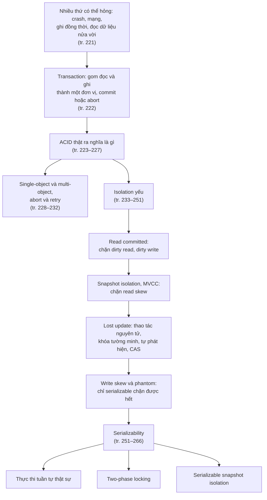

### Liên hệ với các chương khác

| Ý trong chương 7 | Liên hệ | Căn cứ |
| --- | --- | --- |
| Transaction tồn tại để database lo các vấn đề tinh vi thay ứng dụng | **Chương 5** ([B2.4](chapter-05.md#lag-solutions)) đã hứa "transaction ở Chương 7 và 9" | tr. 167, 222 |
| NoSQL bỏ transaction khi thêm replication và partitioning | **Chương 2** (mô hình dữ liệu), **Chương 5**, **Chương 6** | tr. 223 |
| Chữ *consistency* có ít nhất bốn nghĩa | **Chương 5** ([eventual consistency](chapter-05.md#eventual-consistency)), **Chương 6** (consistent hashing, tr. 204), **Chương 9** (linearizability, tr. 324) | tr. 224 |
| Durability dựa vào write-ahead log | **Chương 3** ([B4.3](chapter-03.md#wal)) | tr. 226, 230 |
| Durability qua replication, mất ghi khi leader hỏng | **Chương 5** ([B1.1](chapter-05.md#sync-async), [failover](chapter-05.md#failover-problems)) | tr. 226–227 |
| Không có durability tuyệt đối, lỗi tương quan | **Chương 1** ([B3](chapter-01.md#b3)) | tr. 226–227 |
| Denormalization cần cập nhật nhiều object cùng lúc | **Chương 2** ([normalization](chapter-02.md#normalization), [B2.5](chapter-02.md#rel-vs-doc-today)). Chương 2 hẹn bàn khác biệt về xử lý đồng thời ở Chương 7 | tr. 231 |
| Secondary index là object riêng cần cập nhật cùng dữ liệu | **Chương 3** ([B6.1](chapter-03.md#secondary-index)) | tr. 231 |
| Leaderless làm "best effort", không undo phần đã ghi | **Chương 5** ([B4.3, kịch bản 4](chapter-05.md#quorum-limits)) | tr. 232 |
| Analytics quét lượng lớn dữ liệu; OLTP ngắn | **Chương 3** ([B7.1](chapter-03.md#oltp-olap)) | tr. 238, 253 |
| B-tree copy-on-write (LMDB) cho snapshot | **Chương 3** ([B4](chapter-03.md#b4), mục B4.4) | tr. 242 |
| Lost update khi nhân bản: siblings, LWW, Riak datatypes | **Chương 5** ([siblings](chapter-05.md#siblings), [LWW](chapter-05.md#lww), [hộp Automatic Conflict Resolution](chapter-05.md#automatic-resolution)) | tr. 243, 246 |
| Ví dụ đặt phòng họp là write skew | **Chương 5** ([What is a conflict?](chapter-05.md#what-is-conflict)): đã **kiểm chứng**, xem [liên hệ ở B2.4](#meeting-room-ch5) | tr. 174–175, 249 |
| In-memory database, anti-caching | **Chương 3** ([B6.5](chapter-03.md#in-memory)) | tr. 253, 256 |
| VoltDB dùng stored procedure tất định để nhân bản | **Chương 5** ([statement-based](chapter-05.md#statement-based)) | tr. 255 |
| Transaction xuyên partition, secondary index phân vùng | **Chương 6** ("Partitioning and Secondary Indexes", tr. 206) | tr. 256 |
| 2PL chậm ở percentile cao | **Chương 1** ([percentile](chapter-01.md#percentiles)) | tr. 259 |
| Khóa trên khoảng key gắn trực tiếp vào B-tree | **Chương 3** ([B5.2](chapter-03.md#lsm-downsides)) đã hẹn Chương 7 bàn chi tiết | tr. 85, 260 |
| *Serialization* (mã hóa) khác *serializability* | **Chương 4** ([B1, hộp "Terminology clash"](chapter-04.md#b1)) | tr. 113 |
| 2PC, transaction phân tán, linearizability | **Chương 9** (tr. 324, 354) | tr. 232, 246, 252, 257 |
| Thách thức riêng của hệ phân tán | **Chương 8** | tr. 222, 267 |
| End-to-end argument, cách thay thế transaction đa object | **Chương 12** (tr. 516) | tr. 229, 231 |

> **Bản đồ đầu chương (tr. 220).** Bản đồ vẽ một hòn đảo chia thành ba vùng xếp từ nam lên bắc. Vùng dưới cùng là **Read Committed**, có cụm kim tự tháp "No Dirty Reads" và "No Dirty Writes", trạm "Row-level locking", và "Temple of Multi-Object Atomicity" (đền atomicity đa object). Từ đền có đường tới bến "Atomic commit" và một con tàu đi "To Distributed Transactions (Chapter 9)". Vùng giữa là **Snapshot Isolation**, có trạm "MVCC", tượng "No Read Skew" và tượng nhân sư "No Lost Updates". Vùng trên cùng là **Serializable**, có cổng thành "No Write Skew" và ba trạm cuối đường: "Actual serial execution", "Two-phase locking" và "Serializable snapshot isolation". Phía bắc nhô ra "Pessimistic Peninsula" (bán đảo bi quan) với ngọn hải đăng "No Phantoms"; phía tây là "Optimistic Peninsula" (bán đảo lạc quan), nơi có trạm serializable snapshot isolation.
>
> *Diễn giải của người viết ghi chú:* đi từ nam lên bắc là đi từ isolation yếu tới mạnh; mỗi công trình là một anomaly bị chặn ở vùng đó. Việc đặt two-phase locking gần bán đảo bi quan và SSI trên bán đảo lạc quan khớp với tr. 261. Tượng "No Lost Updates" nằm trong vùng Snapshot Isolation, khớp với việc một số bản cài snapshot isolation tự phát hiện lost update (tr. 245), dù không phải bản cài nào cũng làm.

---

<a id="b-chi-tiet"></a>

## B. Giải thích chi tiết

<a id="b1"></a>

### B1. The Slippery Concept of a Transaction (tr. 222–232)

<a id="transaction"></a>

#### B1.0 Một khái niệm "trơn trượt" (tr. 222–223)

**Lịch sử ngắn** (tr. 222). Gần như mọi relational database ngày nay, và một số nonrelational database, hỗ trợ transaction. Phần lớn theo kiểu do **IBM System R** giới thiệu năm **1975**, database SQL đầu tiên [1, 2, 3]. Chi tiết cài đặt có đổi, nhưng ý tưởng chung gần như **giữ nguyên suốt 40 năm**: transaction trong MySQL, PostgreSQL, Oracle, SQL Server… giống System R một cách kỳ lạ.

**Làn sóng NoSQL** (tr. 223). Cuối những năm 2000, NoSQL nổi lên với mô hình dữ liệu mới (Chương 2), và mặc định có replication (Chương 5) và partitioning (Chương 6). **Transaction là nạn nhân chính**: nhiều database thế hệ mới bỏ hẳn transaction, hoặc **định nghĩa lại** chữ này để chỉ một tập đảm bảo yếu hơn nhiều [4].

**Hai quan điểm cực đoan** (tr. 223). Một bên tin rằng transaction là **đối nghịch của scalability**, hệ thống lớn nào cũng phải bỏ transaction để giữ hiệu năng và availability [5, 6]. Bên kia, nhà cung cấp database có khi quảng bá transaction là yêu cầu bắt buộc cho "ứng dụng nghiêm túc" với "dữ liệu quý giá". Tác giả gọi **cả hai** là phóng đại. Sự thật là transaction, như mọi lựa chọn thiết kế, có **ưu điểm và giới hạn**. Để hiểu trade-off, phải đi vào chi tiết các đảm bảo, cả lúc bình thường lẫn trong tình huống cực đoan nhưng thực tế.

<a id="acid"></a>

#### B1.1 The Meaning of ACID (tr. 223–227)

**What** (tr. 223). Safety guarantee của transaction thường được mô tả bằng từ viết tắt ***ACID***: **Atomicity, Consistency, Isolation, Durability**. Theo Härder và Reuter đặt ra năm **1983** [7], nhằm có thuật ngữ chính xác cho các cơ chế chịu lỗi trong database.

**Vấn đề** (tr. 223). Trên thực tế, ACID của database này **không bằng** ACID của database khác. Ví dụ, nghĩa của *isolation* rất mơ hồ [8]. Ý tưởng tổng quát đúng, nhưng "cái khó nằm ở chi tiết". Ngày nay, khi một hệ thống tự nhận "ACID compliant", **không rõ** bạn thực sự được đảm bảo gì. ACID **chủ yếu đã thành thuật ngữ marketing**.

**BASE** (tr. 223). Hệ thống không đạt ACID đôi khi được gọi là ***BASE***: *Basically Available, Soft state, Eventual consistency* [9]. Định nghĩa này **còn mơ hồ hơn** ACID. Có vẻ định nghĩa hợp lý duy nhất của BASE là "**không phải ACID**", tức gần như muốn hiểu sao cũng được.

<a id="atomicity"></a>

**Atomicity** (tr. 223–224).

- **Nghĩa chung.** *Atomic* chỉ thứ không thể chia nhỏ hơn. Nhưng mỗi nhánh của khoa học máy tính dùng chữ này hơi khác. Trong **lập trình đa luồng**, một thao tác atomic nghĩa là thread khác **không thể thấy kết quả làm dở** của nó: hệ thống chỉ ở trạng thái trước hoặc sau thao tác, không có trạng thái ở giữa.
- **Trong ACID, atomicity không nói về đồng thời.** Nó không mô tả chuyện nhiều tiến trình cùng truy cập một dữ liệu; chuyện đó thuộc chữ **I** (isolation).
- **What.** Atomicity trong ACID mô tả chuyện gì xảy ra khi client muốn **ghi nhiều lần**, nhưng **fault xảy ra giữa chừng**: tiến trình crash, kết nối mạng đứt, đĩa đầy, hay vi phạm một ràng buộc toàn vẹn. Nếu các lần ghi được gom vào một transaction atomic, và transaction **không commit được** vì fault, thì transaction bị **abort** và database phải **bỏ hoặc hoàn tác** mọi lần ghi đã làm trong transaction đó.
- **Why.** Không có atomicity, nếu lỗi xảy ra giữa chừng thì **khó biết** thay đổi nào đã có hiệu lực, thay đổi nào chưa. Ứng dụng có thể thử lại, nhưng có nguy cơ **áp dụng cùng thay đổi hai lần**, sinh dữ liệu trùng hay sai. Atomicity làm bài toán này đơn giản: transaction đã abort thì ứng dụng **chắc chắn nó không thay đổi gì**, nên **thử lại an toàn**.
- **Tên gọi.** Khả năng abort transaction khi lỗi và bỏ mọi lần ghi của nó là **đặc trưng định nghĩa** của atomicity trong ACID. Tác giả cho rằng ***abortability*** có lẽ là tên hay hơn, nhưng vẫn dùng chữ *atomicity* vì đã quen.

<a id="consistency"></a>

**Consistency** (tr. 224–225).

Chữ *consistency* bị dùng cho **ít nhất bốn nghĩa khác nhau** (tr. 224):

| Ngữ cảnh | Nghĩa | Chương |
| --- | --- | --- |
| Replica consistency, eventual consistency | Các replica của hệ nhân bản bất đồng bộ có giống nhau không | Chương 5 ([eventual consistency](chapter-05.md#eventual-consistency)) |
| Consistent hashing | Một cách partition, dùng cho rebalancing | Chương 6 (tr. 204) |
| CAP theorem | Consistency nghĩa là **linearizability** | Chương 9 (tr. 324) |
| ACID | Database ở "**trạng thái tốt**" theo nghĩa riêng của ứng dụng | Chương 7 |

- **What** (tr. 225). Ý tưởng của consistency trong ACID: dữ liệu có những phát biểu luôn phải đúng, gọi là ***invariant*** (bất biến). Ví dụ trong hệ thống kế toán, tổng ghi có và ghi nợ trên mọi tài khoản phải **luôn cân bằng**. Nếu transaction bắt đầu với database hợp lệ theo các invariant, và mọi lần ghi trong transaction giữ được tính hợp lệ, thì invariant luôn được thỏa.
- **Nhưng đó là việc của ứng dụng.** Invariant do **ứng dụng** định nghĩa, và ứng dụng có trách nhiệm viết transaction đúng để giữ consistency. Database **không bảo đảm được**: nếu bạn ghi dữ liệu xấu vi phạm invariant, database không chặn được. Một số loại invariant thì database kiểm được, ví dụ **foreign key constraint** hay **uniqueness constraint**. Nhưng nói chung, ứng dụng định nghĩa dữ liệu nào hợp lệ, **database chỉ lưu**.
- **Kết luận của tác giả.** Atomicity, isolation và durability là **thuộc tính của database**; consistency (theo nghĩa ACID) là **thuộc tính của ứng dụng**. Ứng dụng có thể **dựa vào** atomicity và isolation của database để đạt consistency, nhưng không phải chỉ mình database quyết định. Vì vậy chữ **C thực ra không thuộc về ACID**.

> Chú thích i (tr. 225). Joe Hellerstein từng nhận xét rằng chữ C trong ACID được "thêm vào cho từ viết tắt đọc lên được" trong bài báo của Härder và Reuter [7], và lúc đó không được coi là quan trọng.

<a id="isolation"></a>

**Isolation** (tr. 225–226).

- **Why.** Hầu hết database được **nhiều client truy cập cùng lúc**. Nếu chúng đọc ghi các phần khác nhau của database thì không sao. Nhưng nếu truy cập **cùng bản ghi**, có thể gặp vấn đề đồng thời (***race condition***).
- **Example — Hình 7-1.** Hai client cùng **tăng một bộ đếm** lưu trong database. Mỗi client phải đọc giá trị hiện tại, cộng 1, rồi ghi giá trị mới (giả sử database không có sẵn thao tác increment). Bộ đếm lẽ ra tăng từ **42 lên 44** vì có hai lần tăng, nhưng thực tế chỉ lên **43** do race condition.

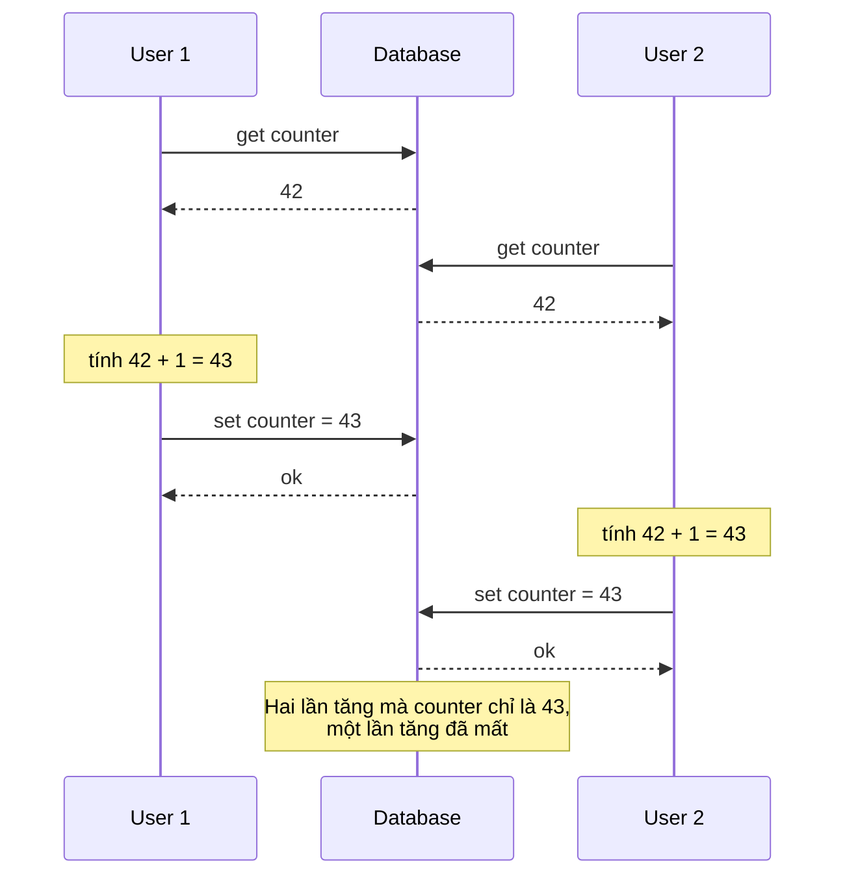

*(Vẽ lại Hình 7-1, tr. 226. Đây cũng là ví dụ chuẩn của lost update, xem [B2.3](#lost-update).)*

- **What** (tr. 225). Isolation theo nghĩa ACID: các transaction chạy đồng thời được **cô lập** với nhau, **không giẫm chân nhau**. Sách giáo khoa database cổ điển hình thức hóa isolation thành ***serializability***: mỗi transaction có thể **giả vờ nó là transaction duy nhất** đang chạy trên toàn database. Database bảo đảm khi các transaction đã commit, **kết quả giống như chúng chạy tuần tự** (lần lượt từng cái), dù thực tế chúng có thể chạy đồng thời [10].
- **Thực tế** (tr. 226). Serializable isolation **hiếm khi được dùng** vì tốn hiệu năng. Một số database phổ biến như **Oracle 11g** thậm chí **không cài** nó: Oracle có mức gọi là "serializable", nhưng thực ra cài ***snapshot isolation***, một đảm bảo **yếu hơn** serializability [8, 11]. Xem [B2](#b2).

<a id="durability"></a>

**Durability** (tr. 226).

- **What.** Mục đích của database là cho một nơi **an toàn** để lưu dữ liệu mà không sợ mất. ***Durability*** là lời hứa: một khi transaction **đã commit thành công**, mọi dữ liệu nó ghi sẽ **không bị quên**, kể cả khi có fault phần cứng hay database crash.
- **How — một node.** Durability thường nghĩa là dữ liệu đã được ghi vào bộ nhớ **không bay hơi** (*nonvolatile*) như ổ cứng hay SSD. Thường kèm theo **write-ahead log** hay cơ chế tương tự ([chương 3, B4.3](chapter-03.md#wal)), cho phép phục hồi khi cấu trúc dữ liệu trên đĩa bị hỏng.
- **How — có nhân bản.** Durability có thể nghĩa là dữ liệu đã được chép thành công tới **một số node** nhất định.
- **Điều kiện.** Để có đảm bảo durability, database phải **chờ** các lần ghi hay nhân bản hoàn tất **rồi mới báo** transaction đã commit thành công.
- **Giới hạn.** Như đã bàn ở "Reliability" ([chương 1, B3](chapter-01.md#b3)), **không có durability hoàn hảo**: nếu mọi ổ đĩa và mọi bản backup bị phá hủy cùng lúc, database không cứu được bạn.

<a id="replication-durability"></a>

**Hộp "Replication and Durability"** (tr. 227).

Trước đây durability nghĩa là ghi ra **băng lưu trữ**; sau đó là ghi ra **đĩa hay SSD**; gần đây được hiểu là **replication**. Cách nào tốt hơn? Sự thật là **không cách nào hoàn hảo**:

| Rủi ro | Chi tiết |
| --- | --- |
| Ghi đĩa nhưng máy chết | Dữ liệu không mất, nhưng **không truy cập được** cho tới khi sửa máy hay chuyển đĩa sang máy khác. Hệ nhân bản thì **vẫn sẵn sàng** |
| Lỗi tương quan | Mất điện hay một bug làm crash mọi node với cùng một input có thể **hạ mọi replica cùng lúc** ([chương 1](chapter-01.md#b3)), mất mọi dữ liệu chỉ nằm trong bộ nhớ. Vì vậy ghi đĩa **vẫn quan trọng** cả với in-memory database |
| Nhân bản bất đồng bộ | Các lần ghi gần nhất có thể **mất** khi leader không còn sẵn sàng ([chương 5, B1.3](chapter-05.md#node-outages)) |
| Mất điện đột ngột | Riêng **SSD** đôi khi vi phạm đảm bảo mà nó phải cung cấp: ngay cả `fsync` cũng không chắc chạy đúng [12]. Firmware đĩa cũng có bug như mọi phần mềm [13, 14] |
| Storage engine và filesystem | Tương tác tinh vi giữa hai bên gây bug khó lần, có thể làm file trên đĩa hỏng sau crash [15, 16] |
| Hỏng âm thầm | Dữ liệu trên đĩa có thể hỏng dần mà **không bị phát hiện** [17]. Nếu đã hỏng một thời gian, replica và backup gần đây cũng có thể hỏng theo; phải khôi phục từ **backup cũ hơn** |
| Bad block trên SSD | Một nghiên cứu thấy **30% đến 80%** ổ SSD có ít nhất một bad block trong **bốn năm đầu** [18]. Ổ từ có ít bad sector hơn nhưng tỷ lệ **hỏng hoàn toàn** cao hơn SSD |
| SSD mất điện lâu | SSD bị ngắt điện có thể bắt đầu **mất dữ liệu sau vài tuần**, tùy nhiệt độ [19] |

Kết luận của hộp: **không kỹ thuật nào** cho đảm bảo tuyệt đối. Chỉ có các kỹ thuật **giảm rủi ro**: ghi đĩa, nhân bản tới máy ở xa, backup. Chúng **có thể và nên được dùng cùng nhau**. Như mọi khi, hãy nhìn các "đảm bảo" lý thuyết với một chút hoài nghi (tr. 227).

<a id="multi-object"></a>

#### B1.2 Single-Object and Multi-Object Operations (tr. 228–232)

**Nhắc lại** (tr. 228). Trong ACID, atomicity và isolation mô tả database phải làm gì khi client **ghi nhiều lần trong cùng một transaction**:

- **Atomicity:** lỗi xảy ra giữa chuỗi ghi thì transaction bị abort, các lần ghi tới lúc đó bị bỏ. Database cho một đảm bảo **all-or-nothing** (tất cả hoặc không gì), để bạn khỏi lo partial failure.
- **Isolation:** các transaction chạy đồng thời không can thiệp lẫn nhau. Ví dụ một transaction ghi nhiều lần thì transaction khác phải thấy **tất cả hoặc không lần nào**, không thấy một phần.

**Multi-object transaction** (tr. 228). Các định nghĩa trên giả định bạn muốn sửa **nhiều object** (hàng, document, bản ghi) cùng lúc. ***Multi-object transaction*** thường cần khi **nhiều mẩu dữ liệu phải giữ đồng bộ**.

**Example — ứng dụng email** (tr. 228). Để hiện số thư chưa đọc của một người dùng, có thể đếm các email có recipient là người đó và cờ unread bật. Nếu có nhiều email, truy vấn này quá chậm, nên bạn lưu **số thư chưa đọc vào một trường riêng** (một dạng **denormalization**). Từ đó, mỗi khi có thư mới phải **tăng** bộ đếm, mỗi khi thư được đánh dấu đã đọc phải **giảm** bộ đếm.

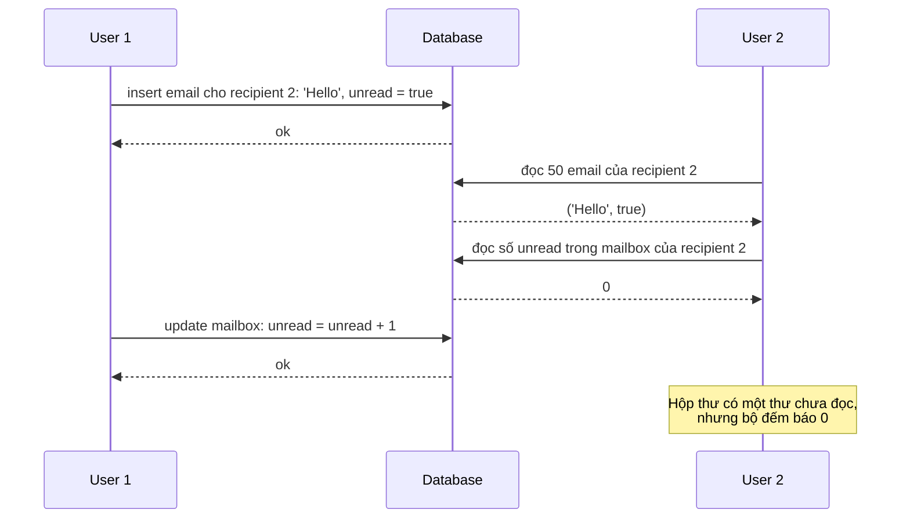

*(Vẽ lại Hình 7-2, tr. 229: vi phạm isolation, một transaction đọc lần ghi chưa commit của transaction khác, tức một "dirty read".)*

Trong Hình 7-2, user 2 gặp một ***anomaly***: danh sách thư có một thư chưa đọc, nhưng bộ đếm báo **0** vì lần tăng bộ đếm chưa xảy ra. Isolation lẽ ra ngăn được điều này, bằng cách bảo đảm user 2 thấy **cả** email mới **và** bộ đếm đã cập nhật, hoặc **không thấy cả hai**, chứ không thấy trạng thái nửa vời (tr. 228).

> Chú thích ii (tr. 228). Một bộ đếm sai trong ứng dụng email có lẽ không quá nghiêm trọng. Hãy nghĩ tới **số dư tài khoản khách hàng** thay cho bộ đếm thư chưa đọc, và một **giao dịch thanh toán** thay cho một email.

**Atomicity — Hình 7-3** (tr. 229). Nếu lỗi xảy ra ở đâu đó trong transaction, nội dung hộp thư và bộ đếm có thể **lệch nhau**. Trong transaction atomic, nếu lần cập nhật bộ đếm thất bại, transaction bị abort và email vừa insert bị **rollback**.

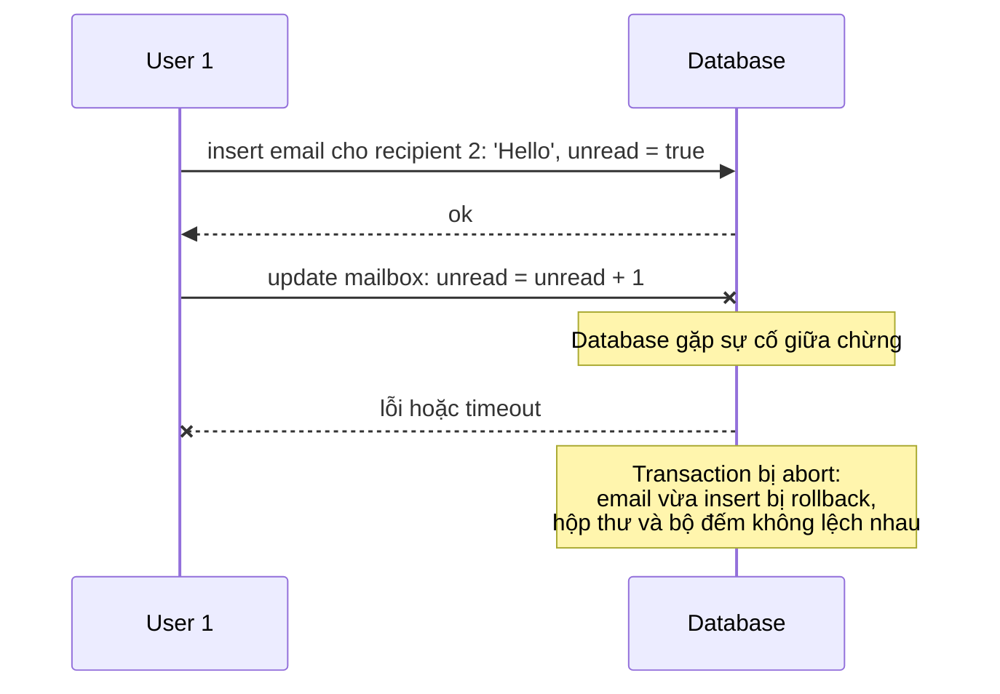

*(Vẽ lại Hình 7-3, tr. 229. Ghi chú "transaction bị abort, rollback" diễn giải theo phần chữ cùng trang; hình gốc chỉ vẽ sự cố và mũi tên "error or timeout".)*

**Cách xác định thao tác nào thuộc transaction nào** (tr. 229). Multi-object transaction cần cách xác định lần đọc và ghi nào thuộc cùng một transaction. Trong relational database, việc này thường dựa vào **kết nối TCP** của client tới server database: trên một kết nối, mọi thứ giữa `BEGIN TRANSACTION` và `COMMIT` được coi là cùng một transaction.

> Chú thích iii (tr. 229). Cách này **không lý tưởng**. Nếu kết nối TCP đứt, transaction phải abort. Nếu đứt **sau khi** client đã yêu cầu commit nhưng **trước khi** server xác nhận, client **không biết** transaction đã commit hay chưa. Để giải quyết, một *transaction manager* có thể gom thao tác theo một **mã transaction duy nhất** không gắn với kết nối TCP nào. Sách quay lại chủ đề này ở "The End-to-End Argument for Databases" (tr. 516, Chương 12).

**Nonrelational database** (tr. 230). Nhiều nonrelational database **không có** cách gom thao tác như vậy. Kể cả khi có API đa object (ví dụ key-value store có thao tác **multi-put** cập nhật nhiều key một lần), điều đó **không nhất thiết** có ngữ nghĩa transaction: lệnh có thể thành công với một số key và thất bại với key khác, để database ở trạng thái **cập nhật một phần**.

<a id="single-object"></a>

**Single-object writes** (tr. 230).

- **Why.** Atomicity và isolation **cũng áp dụng khi chỉ sửa một object**. Hình dung bạn ghi một document JSON **20 KB**:
  - Mạng đứt sau khi gửi được **10 KB** đầu: database có lưu mảnh JSON 10 KB không parse được đó không?
  - Mất điện khi database đang ghi đè giá trị cũ trên đĩa: bạn có nhận được giá trị cũ và mới **ghép lẫn vào nhau** không?
  - Client khác đọc document đó trong lúc đang ghi: nó có thấy giá trị **cập nhật dở dang** không?
- **How.** Các vấn đề đó sẽ cực kỳ khó hiểu, nên storage engine **gần như luôn** cố cung cấp atomicity và isolation ở mức **một object** (như một cặp key-value) **trên một node**. Atomicity cài bằng **log để phục hồi crash** ([chương 3, B4.3](chapter-03.md#wal)); isolation cài bằng **khóa trên mỗi object** (mỗi lúc chỉ một thread truy cập object).
- **Thao tác atomic phức tạp hơn.** Một số database có thao tác như **increment**, bỏ được chu trình **read-modify-write** như ở Hình 7-1. Phổ biến không kém là ***compare-and-set***: chỉ cho ghi nếu giá trị **chưa bị người khác đổi** trong lúc đó ([B2.3](#compare-and-set)).
- **Không phải transaction.** Các thao tác single-object này hữu ích vì ngăn được **lost update** khi nhiều client cùng ghi một object ([B2.3](#lost-update)). Nhưng chúng **không phải transaction** theo nghĩa thông thường. Compare-and-set và các thao tác single-object khác đôi khi được gọi là "***lightweight transactions***", thậm chí "ACID", vì mục đích marketing [20, 21, 22]. Cách gọi đó **gây hiểu lầm**: transaction thường được hiểu là cơ chế gom **nhiều thao tác trên nhiều object** thành một đơn vị thực thi.

> Chú thích iv (tr. 230). Nói chặt chẽ, *atomic increment* dùng chữ *atomic* theo nghĩa lập trình đa luồng. Trong ngữ cảnh ACID, đúng ra phải gọi là *isolated increment* hay *serializable increment*. Nhưng như vậy là hơi bắt bẻ.

> **Bổ sung ngoài sách.** Tài liệu [20] có tựa "Those Are Not Transactions (Cassandra 2.0)". Cassandra gọi thao tác compare-and-set có điều kiện của nó là *lightweight transaction*; đó chính là loại cách gọi mà tác giả cho là gây hiểu lầm.

<a id="need-multi-object"></a>

**The need for multi-object transactions** (tr. 231).

- **Vì sao nhiều datastore phân tán bỏ chúng.** Multi-object transaction **khó cài xuyên partition**, và có thể cản trở khi cần availability hay hiệu năng **rất cao**. Nhưng **không có gì về nguyên tắc** ngăn transaction trong database phân tán; Chương 9 bàn cách cài transaction phân tán.
- **Có thật cần không?** Có thể cài mọi ứng dụng chỉ với mô hình key-value và thao tác single-object không? Có use case chỉ cần insert, update, delete trên một object. Nhưng rất nhiều trường hợp cần **phối hợp ghi nhiều object**:

| Trường hợp | Vì sao cần multi-object transaction |
| --- | --- |
| **Foreign key** trong mô hình relational (tương tự cạnh giữa các đỉnh trong mô hình graph) | Khi insert nhiều bản ghi tham chiếu lẫn nhau, foreign key phải **đúng và cập nhật**, nếu không dữ liệu vô nghĩa |
| **Denormalization** trong document database | Trường cần cập nhật cùng nhau thường nằm trong **một document**, nên không cần multi-object transaction. Nhưng document database **thiếu join** lại khuyến khích denormalization ([chương 2, B2.5](chapter-02.md#rel-vs-doc-today)). Khi cập nhật thông tin denormalized như Hình 7-2, phải sửa **nhiều document cùng lúc**; transaction ngăn chúng **lệch nhau** |
| **Secondary index** (gần như mọi database trừ key-value thuần) | Index phải cập nhật mỗi khi giá trị đổi. Với transaction, index là **object riêng**: thiếu isolation thì một bản ghi có thể xuất hiện ở index này nhưng **chưa có** ở index kia ([chương 3, B6.1](chapter-03.md#secondary-index)) |

Các ứng dụng đó **vẫn cài được** khi không có transaction. Nhưng thiếu atomicity thì xử lý lỗi **phức tạp hơn nhiều**, và thiếu isolation thì gặp vấn đề đồng thời. Sách bàn các vấn đề này ở [B2](#b2) và các cách tiếp cận thay thế ở Chương 12 (tr. 231).

<a id="retry-abort"></a>

**Handling errors and aborts** (tr. 231–232).

- **Triết lý ACID.** Đặc điểm then chốt của transaction là **abort được và thử lại an toàn** khi có lỗi. Nếu database có nguy cơ vi phạm đảm bảo atomicity, isolation hay durability, nó **thà bỏ hẳn** transaction còn hơn để transaction làm dở.
- **Không phải hệ nào cũng vậy** (tr. 232). Datastore **leaderless** ([chương 5, B4.3](chapter-05.md#quorum-limits)) làm việc theo kiểu "**best effort**": database làm được bao nhiêu thì làm, gặp lỗi thì **không hoàn tác** phần đã làm. Khi đó ứng dụng phải tự phục hồi sau lỗi.
- **Lập trình viên hay bỏ qua lỗi.** Nhiều người chỉ nghĩ về **happy path**. Ví dụ các framework ORM phổ biến như **ActiveRecord của Rails** và **Django** **không retry** transaction bị abort: lỗi thường thành exception nổi lên trên, input của người dùng bị vứt và người dùng nhận thông báo lỗi. Thật đáng tiếc, vì **toàn bộ ý nghĩa của abort là cho phép retry an toàn**.

**Retry đơn giản và hiệu quả, nhưng không hoàn hảo** (tr. 232):

| Vấn đề | Giải thích và cách đối phó |
| --- | --- |
| Transaction thực ra **đã thành công** nhưng mạng hỏng khi server báo commit | Client tưởng thất bại và retry, transaction **chạy hai lần**, trừ khi có cơ chế **khử trùng lặp** (*deduplication*) ở tầng ứng dụng |
| Lỗi do **quá tải** | Retry làm vấn đề **tệ hơn**. Tránh vòng phản hồi bằng cách giới hạn số lần retry, dùng ***exponential backoff***, và xử lý lỗi quá tải khác với lỗi khác nếu được |
| Lỗi **tạm thời** và lỗi **vĩnh viễn** | Chỉ đáng retry với lỗi tạm thời (deadlock, vi phạm isolation, mạng gián đoạn tạm, failover). Lỗi vĩnh viễn (vi phạm ràng buộc) thì retry vô ích |
| **Side effect** ngoài database | Side effect có thể xảy ra **dù transaction bị abort**. Ví dụ gửi email: bạn không muốn gửi lại mỗi lần retry. Muốn nhiều hệ thống khác nhau cùng commit hay cùng abort, **two-phase commit** có thể giúp ("Atomic Commit and Two-Phase Commit (2PC)", tr. 354, Chương 9) |
| Client **chết khi đang retry** | Mọi dữ liệu nó đang cố ghi **bị mất** |

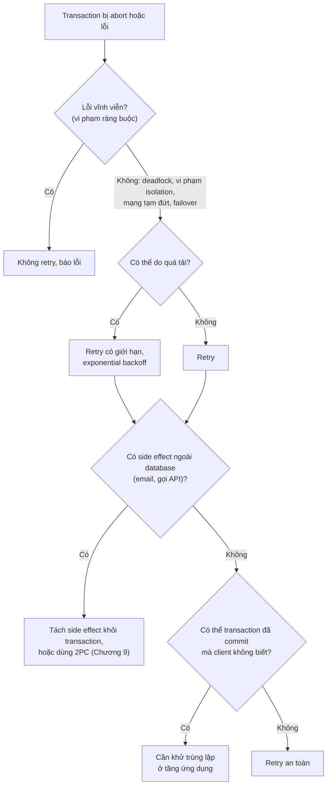

*(Sơ đồ do người viết ghi chú ghép các lưu ý ở tr. 232 thành một luồng quyết định. Sách nêu chúng như danh sách, không như quy trình.)*

> **Bổ sung ngoài sách.** Cơ chế khử trùng lặp thường dựa vào **idempotency**: client gắn một mã yêu cầu duy nhất cho mỗi thao tác, server ghi mã đó cùng transaction và bỏ qua yêu cầu trùng mã. Glossary của sách định nghĩa *idempotent* (tr. 555) và bàn kỹ ở Chương 11.

**System Design.**

- Quyết định có cần transaction hay không phải dựa trên **mẫu truy cập**: đọc ghi một bản ghi đơn có thể không cần; cập nhật dữ liệu denormalized, foreign key, secondary index thì cần (tr. 231, 266).
- **Ví dụ minh họa do AI xây dựng:** một API "chuyển điểm thưởng" vừa trừ điểm người gửi vừa cộng điểm người nhận. Trên key-value store chỉ có multi-put không có ngữ nghĩa transaction, một lần lỗi giữa chừng có thể làm **mất** hoặc **nhân đôi** điểm. Đây đúng là partial failure mà atomicity sinh ra để loại bỏ (tr. 222, 230).
- Đừng để framework nuốt lỗi abort: lớp truy cập dữ liệu nên có **chính sách retry** rõ ràng, phân biệt lỗi tạm thời với vĩnh viễn (tr. 232).

---

<a id="b2"></a>

### B2. Weak Isolation Levels (tr. 233–251)

<a id="weak-isolation"></a>

#### B2.0 Vì sao có các mức isolation yếu (tr. 233–234)

**Khi nào mới có vấn đề đồng thời** (tr. 233). Hai transaction không chạm cùng dữ liệu thì chạy song song an toàn, vì không cái nào phụ thuộc cái kia. Race condition chỉ xuất hiện khi:

- một transaction **đọc** dữ liệu mà transaction khác **đang sửa** đồng thời, hoặc
- hai transaction **cùng sửa** một dữ liệu.

**Vì sao bug đồng thời đáng sợ** (tr. 233).

- **Khó tìm bằng test:** chỉ lộ ra khi **xui về thời điểm**, có thể rất hiếm và khó tái hiện.
- **Khó suy luận:** nhất là trong ứng dụng lớn, nơi bạn không biết hết đoạn code nào khác đang truy cập database. Phát triển ứng dụng cho một người dùng đã khó; nhiều người dùng đồng thời thì bất kỳ dữ liệu nào cũng có thể **đổi bất ngờ bất cứ lúc nào**.

**Lời hứa của isolation** (tr. 233). Vì vậy database từ lâu cố **che giấu** vấn đề đồng thời khỏi lập trình viên bằng **transaction isolation**. Về lý thuyết, isolation cho bạn **giả vờ không có đồng thời**: ***serializable isolation*** nghĩa là database bảo đảm transaction có **cùng hiệu ứng như khi chạy tuần tự** (mỗi lúc một cái, không đồng thời).

**Thực tế** (tr. 233). Serializable isolation **tốn hiệu năng**, và nhiều database **không muốn trả giá** đó [8]. Vì vậy hệ thống thường dùng **mức isolation yếu hơn**, chỉ chống **một số** vấn đề đồng thời. Các mức này **khó hiểu hơn nhiều** và có thể gây bug tinh vi, nhưng vẫn được dùng thực tế [23].

**Không chỉ là lý thuyết** (tr. 233). Bug đồng thời do isolation yếu đã gây **mất nhiều tiền** [24, 25], dẫn tới **điều tra của kiểm toán tài chính** [26], và làm **hỏng dữ liệu khách hàng** [27]. Một phản ứng phổ biến là "xử lý dữ liệu tài chính thì dùng database ACID!". Nhưng câu đó **trật trọng tâm**: nhiều relational database phổ biến (thường được coi là "ACID") **cũng dùng isolation yếu**, nên chưa chắc đã ngăn được các bug đó.

**Cách tiếp cận của sách** (tr. 233–234). Thay vì tin công cụ một cách mù quáng, cần **hiểu rõ các loại vấn đề đồng thời** và **cách ngăn chúng**. Mục này xem các mức isolation yếu (*nonserializable*) được dùng thực tế, bàn chi tiết race condition nào **có thể** và **không thể** xảy ra ở mỗi mức, để bạn chọn mức phù hợp; sau đó mới bàn serializability ([B3](#b3)). Cách trình bày **không hình thức**, qua ví dụ. Định nghĩa và phân tích chặt chẽ có trong tài liệu học thuật [28, 29, 30].

**Bản đồ các anomaly của chương** (tổng hợp từ tr. 234–251, 266–267):

| Anomaly | Bản chất | Mục |
| --- | --- | --- |
| **Dirty read** | Đọc lần ghi **chưa commit** của transaction khác | [B2.1](#dirty-read) |
| **Dirty write** | Ghi đè lần ghi **chưa commit** của transaction khác | [B2.1](#dirty-write) |
| **Read skew** (*nonrepeatable read*) | Thấy các phần của database ở **các thời điểm khác nhau** | [B2.2](#read-skew) |
| **Lost update** | Hai chu trình read-modify-write chạy đồng thời, một lần sửa **bị mất** | [B2.3](#lost-update) |
| **Write skew** | Quyết định dựa trên một **tiền đề** đã đọc, nhưng lúc ghi tiền đề **không còn đúng** | [B2.4](#write-skew) |
| **Phantom** | Lần ghi của transaction này **đổi kết quả truy vấn tìm kiếm** của transaction khác | [B2.4](#phantom) |

<a id="read-committed"></a>

#### B2.1 Read Committed (tr. 234–237)

**What** (tr. 234). Mức isolation cơ bản nhất là ***read committed***. Nó cho **hai đảm bảo**:

1. Khi đọc, bạn chỉ thấy dữ liệu **đã commit** (không có ***dirty read***).
2. Khi ghi, bạn chỉ ghi đè dữ liệu **đã commit** (không có ***dirty write***).

> Chú thích v (tr. 234). Một số database hỗ trợ mức còn yếu hơn gọi là ***read uncommitted***. Nó **ngăn dirty write** nhưng **không ngăn dirty read**.

<a id="dirty-read"></a>

**No dirty reads** (tr. 234–235).

- **What.** Một transaction đã ghi dữ liệu nhưng **chưa commit hay abort**. Nếu transaction khác **thấy** dữ liệu chưa commit đó, ta gọi là ***dirty read*** [2].
- **How read committed chặn.** Mọi lần ghi của một transaction chỉ **hiện ra cho người khác khi transaction đó commit**, và lúc đó **mọi lần ghi của nó hiện ra cùng lúc**. Trong Hình 7-4, user 1 đã đặt x = 3, nhưng get x của user 2 vẫn trả giá trị cũ **2** cho tới khi user 1 commit.

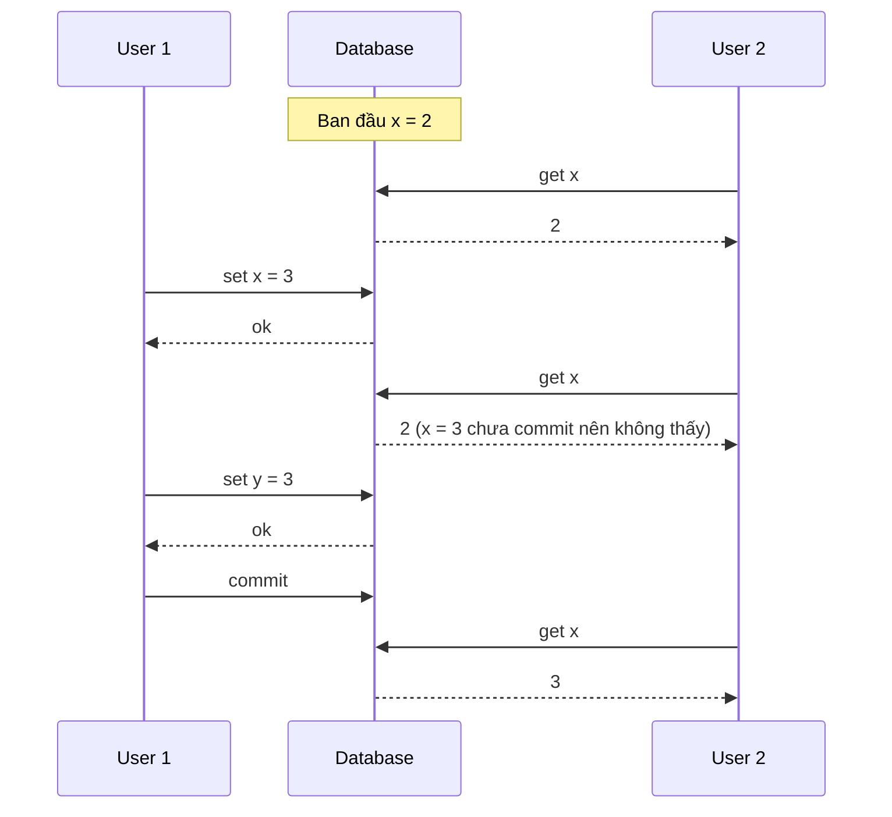

*(Vẽ lại Hình 7-4, tr. 234: không có dirty read, user 2 chỉ thấy giá trị mới của x sau khi transaction của user 1 commit.)*

- **Why cần chặn dirty read** (tr. 235):
  - Transaction cập nhật **nhiều object**: dirty read làm transaction khác thấy **một phần** cập nhật. Ví dụ Hình 7-2: người dùng thấy email chưa đọc mới nhưng chưa thấy bộ đếm cập nhật. Đó là một dirty read của email. Thấy database ở trạng thái cập nhật dở **gây khó hiểu** cho người dùng và có thể khiến transaction khác **ra quyết định sai**.
  - Transaction **abort** thì mọi lần ghi phải rollback (như Hình 7-3). Nếu cho dirty read, một transaction có thể thấy dữ liệu **sau đó bị rollback**, tức dữ liệu **chưa bao giờ thật sự được commit**. Suy luận về hệ quả của điều đó nhanh chóng trở nên "xoắn não".

<a id="dirty-write"></a>

**No dirty writes** (tr. 235).

- **What.** Hai transaction cùng cập nhật một object: ta không biết thứ tự các lần ghi, nhưng thường giả định lần ghi sau ghi đè lần ghi trước. Nếu lần ghi trước thuộc một transaction **chưa commit**, lần ghi sau ghi đè một giá trị **chưa commit**. Đó là ***dirty write*** [28].
- **How read committed chặn.** Transaction ở mức read committed phải ngăn dirty write, thường bằng cách **trì hoãn lần ghi thứ hai** cho tới khi transaction của lần ghi thứ nhất **commit hoặc abort**.
- **Example — Hình 7-5.** Trang bán xe cũ, Alice và Bob cùng muốn mua **một chiếc xe**. Mua xe cần **hai lần ghi**: cập nhật listing để ghi người mua, và gửi hóa đơn bán hàng cho người mua. Kết quả: xe được bán cho **Bob** (Bob thực hiện lần cập nhật "thắng" trên bảng listings), nhưng hóa đơn gửi cho **Alice** (Alice thực hiện lần cập nhật thắng trên bảng invoices).

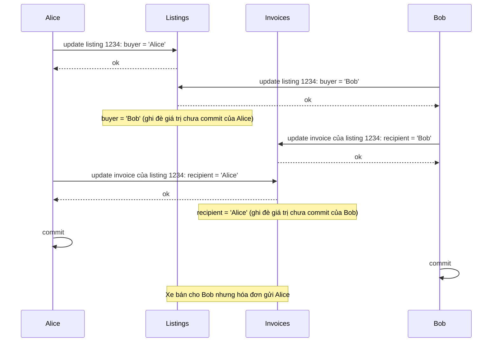

*(Vẽ lại Hình 7-5, tr. 236: có dirty write thì các lần ghi xung đột của các transaction khác nhau bị trộn lẫn.)*

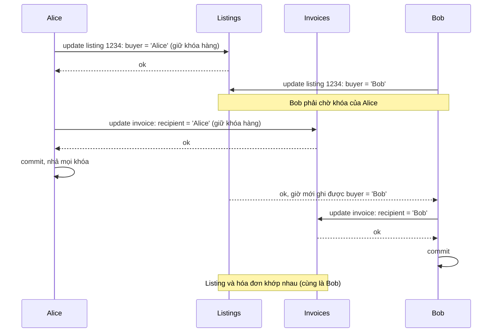

*(Ví dụ minh họa do AI xây dựng: cùng kịch bản Hình 7-5 nhưng có khóa ghi mức hàng của read committed, theo cơ chế mô tả ở tr. 235–236.)*

> **Bổ sung ngoài sách (quan sát).** Read committed chỉ bảo đảm hai bảng **không bị trộn** giữa hai người mua. Nó không bảo đảm người **đến trước** thắng: trong sơ đồ trên, Bob ghi đè Alice sau khi Alice commit. Muốn "người đến trước thắng", ứng dụng phải kiểm tra listing còn trống rồi mới ghi, và đó là mẫu read-modify-write dễ dính lost update hay write skew ([B2.3](#lost-update), [B2.4](#write-skew)).

- **Read committed không chặn được lỗi tăng counter ở Hình 7-1** (tr. 235). Ở đó, lần ghi thứ hai xảy ra **sau khi** transaction thứ nhất đã commit, nên **không phải dirty write**. Kết quả vẫn sai, nhưng vì một lý do khác: đó là lost update ([B2.3](#lost-update)).

> **Bổ sung ngoài sách (lập luận).** Kể cả nếu user 2 ghi khi user 1 **chưa** commit, read committed chỉ bắt user 2 **chờ** khóa của user 1, rồi vẫn ghi giá trị 43 mà user 2 đã tính từ lần đọc 42 trước đó. Khóa ghi chỉ sắp thứ tự hai lần **ghi**; nó không biết lần ghi của user 2 dựa trên một lần **đọc** đã cũ. Vì vậy lost update lọt qua read committed trong cả hai trường hợp.

<a id="implementing-read-committed"></a>

**Implementing read committed** (tr. 236–237).

- **Phổ biến** (tr. 236). Read committed là mức **mặc định** trong Oracle 11g, PostgreSQL, SQL Server 2012, MemSQL và nhiều database khác [8] (lúc viết sách).
- **Chặn dirty write bằng khóa mức hàng** (*row-level lock*). Muốn sửa một object (hàng hay document), transaction phải **lấy khóa** trên object đó trước, và **giữ khóa tới khi commit hay abort**. Mỗi object chỉ một transaction giữ khóa; transaction khác muốn ghi cùng object phải **chờ**. Database tự làm việc khóa này ở mức read committed (hoặc mạnh hơn).
- **Chặn dirty read bằng read lock? Không tốt.** Có thể bắt mọi transaction muốn đọc phải lấy cùng khóa đó một chút rồi nhả ngay sau khi đọc. Như vậy không đọc được object khi nó đang có giá trị dirty, vì lúc đó khóa nằm trong tay transaction đã ghi. Nhưng trên thực tế cách này **kém**: một transaction ghi **chạy lâu** có thể bắt **nhiều transaction chỉ đọc** phải chờ. Thời gian phản hồi của các transaction đọc bị ảnh hưởng, và **khó vận hành**: một chỗ chậm trong ứng dụng có thể gây hiệu ứng dây chuyền sang một phần **hoàn toàn khác** vì chờ khóa ([chương 1, operability](chapter-01.md#operability)).
- **Cách phần lớn database làm** (tr. 237). Như Hình 7-4: với mỗi object được ghi, database **nhớ cả giá trị cũ đã commit** và **giá trị mới** do transaction đang giữ write lock đặt. Trong lúc transaction đó chưa xong, transaction khác đọc object thì **nhận giá trị cũ**. Chỉ khi giá trị mới được commit, các transaction mới chuyển sang đọc giá trị mới.

> Chú thích vi (tr. 237). Lúc viết sách, các database phổ biến **duy nhất** dùng khóa để cài read committed là **IBM DB2** và **Microsoft SQL Server** khi cấu hình `read_committed_snapshot=off` [23, 36].

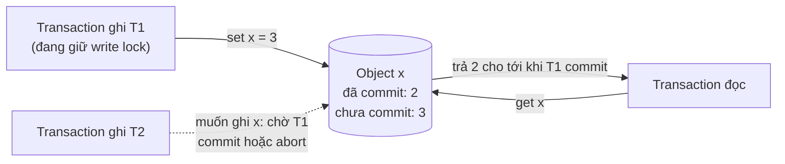

*(Sơ đồ do người viết ghi chú tổng hợp cơ chế ở tr. 236–237: khóa cho lần ghi, hai phiên bản cho lần đọc.)*

<a id="snapshot-isolation"></a>

#### B2.2 Snapshot Isolation and Repeatable Read (tr. 237–242)

**Read committed có đủ không?** (tr. 237). Nhìn qua, read committed có vẻ làm mọi thứ một transaction cần: cho phép abort (cần cho atomicity), ngăn đọc kết quả dở dang của transaction, và ngăn các lần ghi đồng thời bị trộn lẫn. Đó là những tính năng hữu ích, mạnh hơn nhiều so với hệ thống không có transaction. Nhưng vẫn còn **nhiều cách** để gặp bug đồng thời ở mức này.

<a id="read-skew"></a>

**Example — Hình 7-6: read skew** (tr. 237–238). Alice có **1.000 USD** tiết kiệm, chia đều hai tài khoản, mỗi tài khoản **500 USD**. Một transaction chuyển **100 USD** từ tài khoản này sang tài khoản kia. Nếu Alice xui, nhìn danh sách số dư **đúng lúc** transaction đang chạy, cô có thể thấy một tài khoản **trước** khi tiền chuyển đến (500 USD) và tài khoản kia **sau** khi tiền đã chuyển đi (400 USD). Alice thấy tổng chỉ còn **900 USD**: 100 USD như **bốc hơi**.

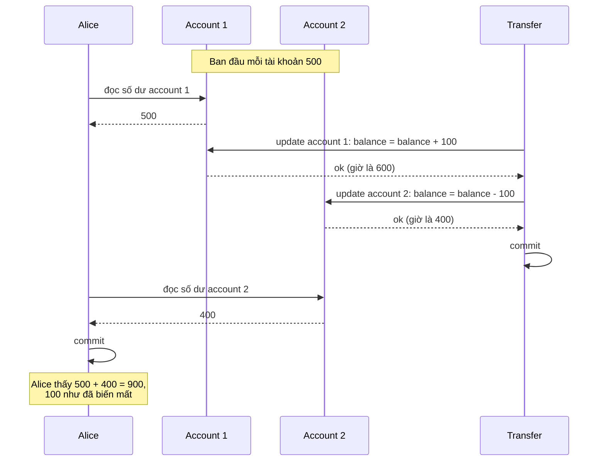

*(Vẽ lại Hình 7-6, tr. 237: read skew, Alice quan sát database ở trạng thái bất nhất.)*

- **What** (tr. 238). Anomaly này gọi là ***nonrepeatable read*** hay ***read skew***: nếu cuối transaction Alice đọc lại số dư account 1, cô sẽ thấy **600 USD**, khác giá trị đã thấy trước đó.
- **Vì sao read committed cho phép** (tr. 238). Read skew được coi là **chấp nhận được** ở mức read committed, vì các số dư Alice thấy **đều đã commit** tại thời điểm cô đọc. Read committed chỉ hứa "không đọc dữ liệu chưa commit", không hứa các lần đọc khác nhau thấy **cùng một thời điểm**.

> **Lưu ý của sách** (tr. 238). Chữ *skew* bị dùng cho hai nghĩa. Ở Chương 6 ("Skewed Workloads and Relieving Hot Spots", tr. 205), *skew* là **tải không cân bằng** có hot spot. Ở đây *skew* nghĩa là **bất thường về thời điểm** (*timing anomaly*).

**Khi nào bất nhất tạm thời là không chấp nhận được** (tr. 238). Với Alice, đây không phải vấn đề lâu dài: tải lại trang vài giây sau, cô sẽ thấy số dư nhất quán. Nhưng có tình huống **không chịu được** bất nhất tạm thời:

| Tình huống | Vì sao read skew nguy hiểm |
| --- | --- |
| **Backup** | Backup phải chép **toàn bộ** database, có thể mất **hàng giờ** với database lớn. Trong lúc đó ghi vẫn tiếp diễn, nên một phần backup chứa dữ liệu **cũ**, phần khác chứa dữ liệu **mới**. Nếu phải khôi phục từ backup như vậy, bất nhất (như tiền biến mất) trở thành **vĩnh viễn** |
| **Truy vấn phân tích và kiểm tra toàn vẹn** | Truy vấn quét phần lớn database, phổ biến trong analytics ([chương 3, B7.1](chapter-03.md#oltp-olap)) hay trong kiểm tra định kỳ để phát hiện hỏng dữ liệu. Nếu chúng thấy các phần database ở **các thời điểm khác nhau**, kết quả dễ **vô nghĩa** |

**What — snapshot isolation** (tr. 238–239). ***Snapshot isolation*** [28] là giải pháp **phổ biến nhất** cho vấn đề này. Ý tưởng: mỗi transaction đọc từ một ***consistent snapshot*** của database, tức transaction thấy **mọi dữ liệu đã commit tại thời điểm nó bắt đầu**. Kể cả khi dữ liệu sau đó bị transaction khác đổi, transaction vẫn chỉ thấy **dữ liệu cũ** của thời điểm đó.

- **Why.** Snapshot isolation rất có lợi cho **truy vấn chỉ đọc chạy lâu** như backup và analytics. Rất khó hiểu ý nghĩa của một truy vấn nếu dữ liệu nó xử lý **đang thay đổi** trong lúc chạy. Khi transaction thấy một snapshot nhất quán, **đóng băng tại một thời điểm**, mọi thứ dễ hiểu hơn nhiều (tr. 238–239).
- **Ai dùng** (tr. 239). PostgreSQL, MySQL với storage engine InnoDB, Oracle, SQL Server và nhiều hệ khác [23, 31, 32] (lúc viết sách).

<a id="mvcc"></a>

**Implementing snapshot isolation** (tr. 239–240).

- **Ghi vẫn dùng khóa.** Giống read committed, bản cài snapshot isolation thường dùng **write lock** để ngăn dirty write. Transaction ghi có thể **chặn** transaction khác ghi cùng object.
- **Đọc không cần khóa.** Nguyên lý then chốt về hiệu năng: ***readers never block writers, and writers never block readers*** (người đọc không bao giờ chặn người ghi, người ghi không bao giờ chặn người đọc). Nhờ vậy database chạy được truy vấn đọc lâu trên một snapshot nhất quán **song song** với việc xử lý ghi bình thường, **không tranh chấp khóa** giữa hai bên.
- **MVCC.** Database dùng một **tổng quát hóa** của cơ chế chống dirty read ở Hình 7-4. Database phải có khả năng giữ **nhiều phiên bản đã commit** của một object, vì các transaction đang chạy có thể cần thấy database ở **các thời điểm khác nhau**. Vì giữ nhiều phiên bản cạnh nhau, kỹ thuật này gọi là ***multi-version concurrency control* (MVCC)**.
- **Read committed cũng dùng MVCC.** Nếu chỉ cần read committed, giữ **hai** phiên bản là đủ: bản đã commit và bản bị ghi đè nhưng chưa commit. Nhưng storage engine hỗ trợ snapshot isolation thường dùng MVCC cho cả read committed. Cách điển hình: **read committed dùng một snapshot riêng cho mỗi truy vấn**, còn **snapshot isolation dùng cùng một snapshot cho cả transaction**.

> **Bổ sung ngoài sách (lập luận).** Câu cuối giải thích gọn vì sao read skew xảy ra ở read committed mà không xảy ra ở snapshot isolation. Ở Hình 7-6, hai câu đọc của Alice là hai truy vấn: với read committed, mỗi câu lấy snapshot mới, nên câu thứ hai thấy lần chuyển tiền vừa commit. Với snapshot isolation, cả hai câu dùng snapshot lúc transaction của Alice bắt đầu, nên cô thấy 500 + 500.

**How — MVCC trong PostgreSQL, Hình 7-7** (tr. 239–240). Các bản cài khác tương tự [31]:

1. Khi bắt đầu, mỗi transaction nhận một **transaction ID (txid)** duy nhất, **luôn tăng**.
2. Mọi dữ liệu transaction ghi được **gắn txid** của người ghi.
3. Mỗi hàng có trường **`created_by`** chứa txid của transaction đã insert hàng đó, và trường **`deleted_by`** ban đầu rỗng.
4. **Xóa** không xóa thật: hàng được **đánh dấu xóa** bằng cách đặt `deleted_by` thành txid của transaction yêu cầu xóa. Về sau, khi chắc **không transaction nào còn truy cập** dữ liệu đó, một tiến trình **garbage collection** loại bỏ các hàng đã đánh dấu và giải phóng chỗ.
5. **Update** được dịch nội bộ thành **delete + create**. Ví dụ trong Hình 7-7, transaction 13 trừ 100 USD khỏi account 2, đổi số dư từ 500 thành 400. Bảng accounts giờ có **hai hàng** cho account 2: hàng 500 USD bị đánh dấu xóa bởi transaction 13, và hàng 400 USD do transaction 13 tạo.

> Chú thích vii (tr. 239). Nói chính xác, transaction ID là số nguyên **32 bit**, nên tràn sau khoảng **4 tỷ** transaction. Tiến trình **vacuum** của PostgreSQL dọn dẹp để việc tràn số không ảnh hưởng dữ liệu.

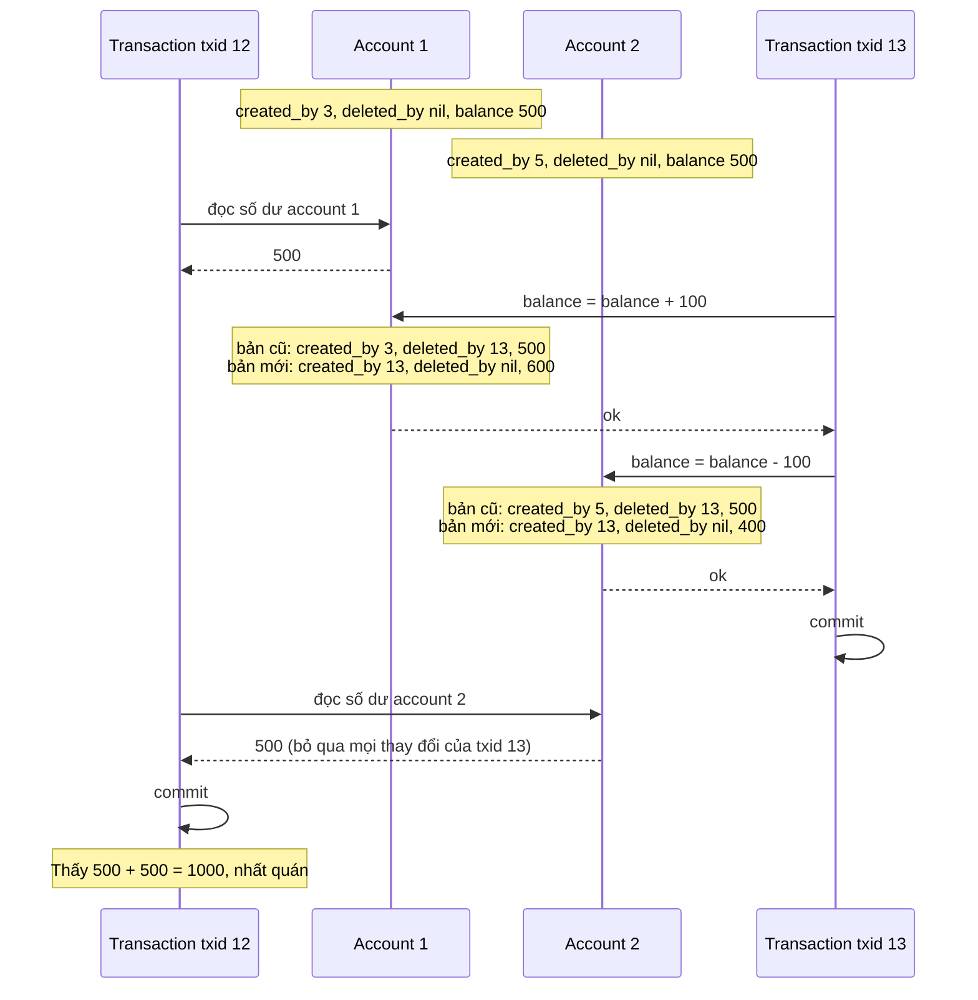

*(Vẽ lại Hình 7-7, tr. 240: cài snapshot isolation bằng object nhiều phiên bản. So với Hình 7-6, cùng thứ tự sự kiện nhưng người đọc thấy tổng đúng.)*

<a id="visibility-rules"></a>

**Visibility rules for observing a consistent snapshot** (tr. 240–241). Khi một transaction đọc, database dùng txid để quyết định object nào **thấy được**, object nào **vô hình**:

1. Lúc transaction bắt đầu, database lập danh sách mọi transaction khác **đang chạy** (chưa commit hay abort). Mọi lần ghi của chúng bị **bỏ qua**, kể cả nếu sau đó chúng commit.
2. Mọi lần ghi của transaction **đã abort** bị bỏ qua.
3. Mọi lần ghi của transaction có txid **lớn hơn** (bắt đầu **sau** transaction hiện tại) bị bỏ qua, **bất kể** chúng đã commit hay chưa.
4. Mọi lần ghi khác đều **thấy được**.

Các quy tắc áp dụng cho cả **tạo** lẫn **xóa** object. Trong Hình 7-7, khi transaction 12 đọc account 2, nó thấy **500 USD**: việc xóa hàng 500 USD do transaction 13 làm (theo quy tắc 3, transaction 12 không thấy việc xóa đó), và hàng 400 USD cũng **chưa thấy được** (cùng quy tắc) (tr. 241).

**Phát biểu tương đương** (tr. 241). Một object **thấy được** nếu **cả hai** điều kiện sau đúng:

- Lúc transaction của người đọc bắt đầu, transaction **tạo** object **đã commit**.
- Object **không bị đánh dấu xóa**, hoặc nếu có, transaction **yêu cầu xóa** **chưa commit** lúc transaction của người đọc bắt đầu.

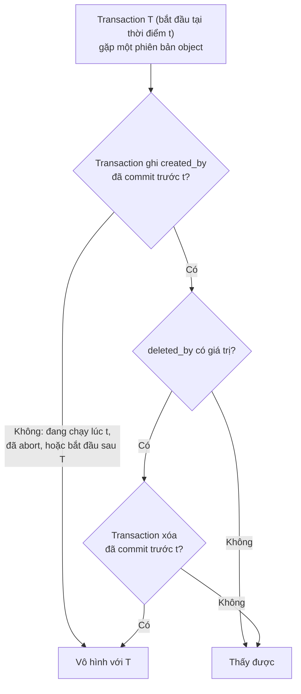

*(Sơ đồ do người viết ghi chú chuyển hai điều kiện ở tr. 241 thành luồng quyết định.)*

**Vì sao chi phí nhỏ** (tr. 241). Một transaction chạy lâu có thể dùng một snapshot rất lâu, tiếp tục đọc những giá trị mà (theo góc nhìn của transaction khác) **đã bị ghi đè hay xóa từ lâu**. Bằng cách **không bao giờ cập nhật tại chỗ** mà tạo **phiên bản mới** mỗi lần giá trị đổi, database cho một snapshot nhất quán với **chi phí nhỏ**.

<a id="si-indexes"></a>

**Indexes and snapshot isolation** (tr. 241–242). Index hoạt động thế nào trong database nhiều phiên bản?

- **Cách 1: index trỏ tới mọi phiên bản.** Truy vấn qua index phải **lọc** các phiên bản không thấy được với transaction hiện tại. Khi garbage collection xóa phiên bản cũ không còn transaction nào thấy, entry index tương ứng cũng được xóa. Trên thực tế, nhiều chi tiết cài đặt quyết định hiệu năng của MVCC. Ví dụ PostgreSQL có tối ưu để **tránh cập nhật index** nếu các phiên bản của cùng object vừa trên **cùng một page** [31].
- **Cách 2: B-tree append-only / copy-on-write** (tr. 242). CouchDB, Datomic và LMDB dùng B-tree ([chương 3, B4](chapter-03.md#b4)), nhưng là biến thể **append-only / copy-on-write**: khi cập nhật, không ghi đè page của cây mà **tạo bản sao mới** của mỗi page bị sửa. Các page cha, tới tận gốc, được sao chép và cập nhật để trỏ tới phiên bản mới của page con. Page **không bị ảnh hưởng** bởi lần ghi thì không cần sao chép, vẫn **bất biến** [33, 34, 35].
  - Mỗi transaction ghi (hoặc một lô transaction) tạo một **gốc B-tree mới**; một gốc cụ thể **chính là** một consistent snapshot của database tại lúc nó được tạo.
  - **Không cần lọc** object theo txid, vì lần ghi sau **không sửa được** cây đã có, chỉ tạo gốc mới.
  - Nhưng cách này cũng cần **tiến trình nền** để compaction và garbage collection.

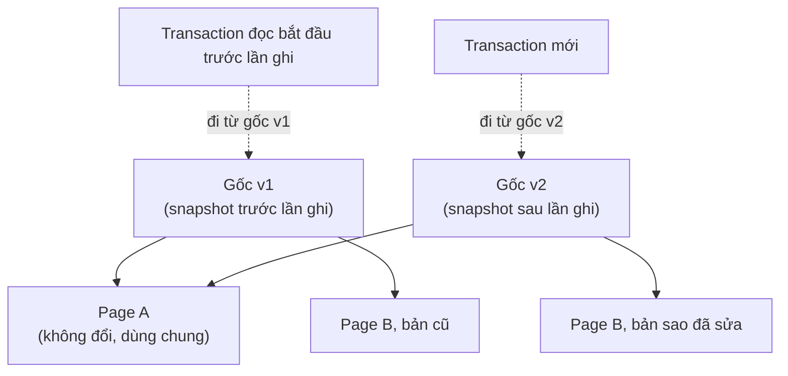

*(Ví dụ minh họa do AI xây dựng, đơn giản hóa cơ chế ở tr. 242: chỉ page bị sửa và các page tổ tiên của nó được sao chép.)*

> **Bổ sung ngoài sách.** Tối ưu của PostgreSQL nhắc ở trên thường được gọi là *heap-only tuple* (HOT): nếu bản mới của hàng nằm cùng page với bản cũ và không cột được index nào đổi, index không cần entry mới.

<a id="repeatable-read"></a>

**Repeatable read and naming confusion** (tr. 242).

- **Cùng một thứ, nhiều tên.** Snapshot isolation hữu ích, nhất là cho transaction chỉ đọc. Nhưng nhiều database cài nó lại gọi bằng **tên khác**: Oracle gọi là ***serializable***; PostgreSQL và MySQL gọi là ***repeatable read*** [23].
- **Vì sao lộn xộn.** Chuẩn SQL **không có khái niệm snapshot isolation**, vì chuẩn dựa trên định nghĩa các mức isolation của **System R năm 1975** [2], khi snapshot isolation **chưa được phát minh**. Chuẩn định nghĩa *repeatable read*, bề ngoài **trông giống** snapshot isolation. PostgreSQL và MySQL gọi mức snapshot isolation của mình là repeatable read vì nó **đáp ứng yêu cầu của chuẩn**, nhờ đó tuyên bố **tuân thủ chuẩn**.
- **Chuẩn có lỗi.** Định nghĩa mức isolation của chuẩn SQL **mơ hồ, thiếu chính xác**, và không độc lập với cách cài như một chuẩn nên có [28]. Nhiều database cài repeatable read nhưng đảm bảo thật sự **khác nhau rất nhiều** [23]. Có một định nghĩa hình thức của repeatable read trong tài liệu nghiên cứu [29, 30], nhưng phần lớn bản cài **không thỏa** định nghĩa đó. Thêm nữa, **IBM DB2** dùng chữ "repeatable read" để chỉ **serializability** [8].
- **Kết luận của tác giả:** **không ai thật sự biết repeatable read nghĩa là gì**.

> **Bổ sung ngoài sách.** Theo phân tích trong [28] (Berenson và cộng sự, 1995), repeatable read cài bằng khóa và snapshot isolation **không so sánh hơn kém** được: repeatable read kiểu khóa cho phép phantom nhưng chặn write skew; snapshot isolation chặn phantom trong truy vấn chỉ đọc nhưng cho phép write skew. Vì vậy cùng tên "repeatable read" có thể che hai bộ đảm bảo khác hẳn nhau.

**System Design.**

- Backup, ETL, truy vấn analytics, kiểm tra toàn vẹn chạy trên database đang nhận ghi **cần snapshot isolation** (hay cơ chế snapshot tương đương); read committed có thể cho kết quả vô nghĩa (tr. 238).
- MVCC giữ phiên bản cũ cho tới khi không còn transaction nào cần: một transaction chỉ đọc chạy rất lâu **giữ chân** garbage collection (suy ra từ tr. 240–241). *Bổ sung ngoài sách:* trong PostgreSQL, điều này thể hiện thành bảng phình to (*bloat*) khi có transaction mở quá lâu.
- Đừng chọn mức isolation theo **tên**. Hãy kiểm tra database của bạn thực sự chặn anomaly nào; tài liệu [23] ("Hermitage", của chính tác giả) là bộ test cho việc này (tr. 242, 245, 248).

<a id="lost-update"></a>

#### B2.3 Preventing Lost Updates (tr. 242–246)

**Bối cảnh** (tr. 242–243). Read committed và snapshot isolation chủ yếu nói về việc transaction **chỉ đọc** thấy gì khi có ghi đồng thời. Chuyện **hai transaction cùng ghi** mới chỉ được bàn qua dirty write, **một loại** xung đột ghi–ghi. Còn nhiều loại xung đột thú vị khác giữa các transaction ghi đồng thời. Nổi tiếng nhất là ***lost update***, minh họa ở Hình 7-1 với hai lần tăng counter đồng thời.

**What** (tr. 243). Lost update có thể xảy ra khi ứng dụng **đọc** một giá trị từ database, **sửa** nó, rồi **ghi lại** giá trị đã sửa: một chu trình ***read-modify-write***. Nếu hai transaction làm vậy đồng thời, một trong hai lần sửa có thể **mất**, vì lần ghi thứ hai **không bao gồm** lần sửa thứ nhất. Người ta nói lần ghi sau ***clobber*** (đè nát) lần ghi trước.

**Các kịch bản thường gặp** (tr. 243):

- **Tăng counter** hay **cập nhật số dư tài khoản**: đọc giá trị hiện tại, tính giá trị mới, ghi lại.
- **Sửa cục bộ một giá trị phức tạp**, ví dụ thêm phần tử vào danh sách trong một document JSON: parse document, sửa, ghi lại cả document.
- **Hai người cùng sửa một trang wiki**, mỗi người lưu bằng cách gửi **toàn bộ nội dung trang** lên server, ghi đè thứ đang có.

Vì vấn đề này rất phổ biến, có nhiều giải pháp.

<a id="atomic-write"></a>

**Atomic write operations** (tr. 243–244).

- **What.** Nhiều database có **thao tác cập nhật atomic**, bỏ được việc tự viết chu trình read-modify-write trong code ứng dụng. Đây thường là **giải pháp tốt nhất** nếu logic của bạn diễn đạt được bằng các thao tác đó. Ví dụ câu SQL "tăng cột value của hàng có key 'foo' lên 1" ngay trong lệnh UPDATE là an toàn đồng thời trong hầu hết relational database.
- **Ở các hệ khác.** Document database như MongoDB có thao tác atomic để sửa cục bộ **một phần** document JSON; Redis có thao tác atomic để sửa cấu trúc dữ liệu như **priority queue**.
- **Giới hạn.** Không phải lần ghi nào cũng diễn đạt được bằng thao tác atomic. Ví dụ cập nhật trang wiki là sửa văn bản tùy ý. Nhưng khi dùng được, thao tác atomic thường là **lựa chọn tốt nhất**.

> Chú thích viii (tr. 243). Có thể, dù khá phức tạp, diễn đạt việc sửa một văn bản thành một **dòng các thay đổi atomic**. Xem hộp "Automatic Conflict Resolution" (tr. 174, [chương 5](chapter-05.md#automatic-resolution)).

- **How** (tr. 243–244). Thao tác atomic thường được cài bằng cách lấy **khóa độc quyền** (*exclusive lock*) trên object **khi đọc**, để không transaction nào khác đọc được nó cho tới khi cập nhật xong. Kỹ thuật này đôi khi gọi là ***cursor stability*** [36, 37]. Cách khác là ép mọi thao tác atomic chạy trên **một thread duy nhất**.
- **Bẫy ORM** (tr. 244). Framework ORM khiến người ta **dễ vô tình** viết chu trình read-modify-write không an toàn thay vì dùng thao tác atomic của database [38]. Biết mình làm gì thì không sao, nhưng đây là nguồn bug tinh vi, **khó tìm bằng test**.

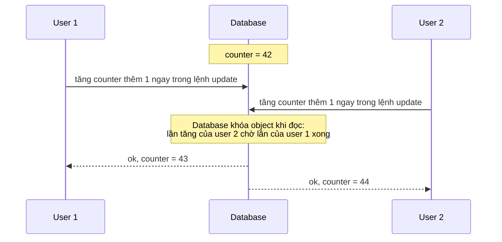

*(Ví dụ minh họa do AI xây dựng: cùng kịch bản Hình 7-1 nhưng dùng thao tác atomic, theo cơ chế ở tr. 243–244.)*

<a id="explicit-locking"></a>

**Explicit locking** (tr. 244).

- **What.** Nếu thao tác atomic có sẵn không đủ, ứng dụng có thể **khóa tường minh** các object sắp cập nhật. Khi đó ứng dụng thực hiện chu trình read-modify-write, và transaction nào khác cố **đọc** cùng object đồng thời phải **chờ** chu trình thứ nhất xong.
- **Example — trò chơi nhiều người chơi.** Nhiều người chơi có thể di chuyển **cùng một quân cờ**. Thao tác atomic có thể không đủ, vì ứng dụng còn phải bảo đảm nước đi **đúng luật chơi**, một logic không thể viết hợp lý thành truy vấn database. Thay vào đó, dùng khóa để hai người chơi không cùng lúc di chuyển một quân.
- **Example 7-1 (mô tả bằng lời).** Bắt đầu transaction; chọn quân "robot" của ván 222 với mệnh đề **`FOR UPDATE`**; ứng dụng kiểm tra nước đi có hợp lệ không, rồi cập nhật vị trí của quân đó thành ô c4; commit. `FOR UPDATE` báo database **khóa mọi hàng** truy vấn trả về.
- **Trade-off.** Cách này chạy được, nhưng muốn đúng phải **nghĩ kỹ logic ứng dụng**. Rất dễ **quên thêm một khóa** cần thiết ở đâu đó trong code, và thế là có race condition.

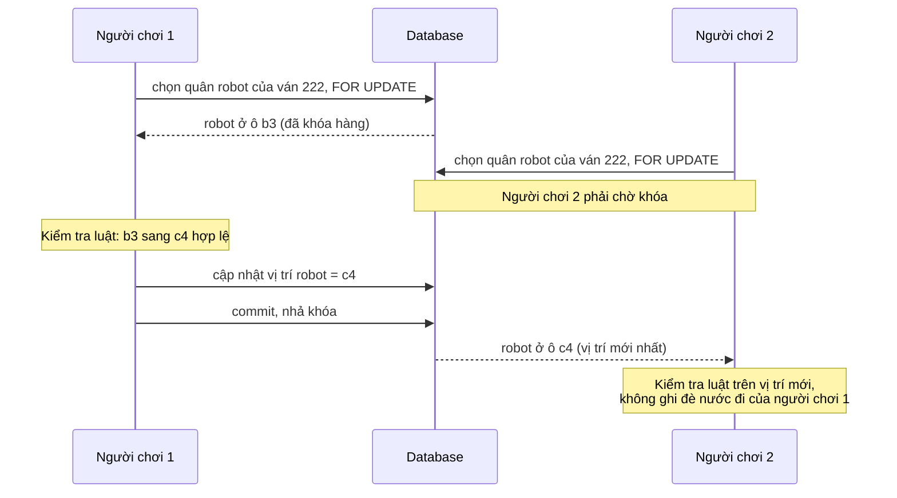

*(Ví dụ minh họa do AI xây dựng dựa trên Example 7-1, tr. 244. Ô b3 là giả định.)*

<a id="lost-update-detection"></a>

**Automatically detecting lost updates** (tr. 245).

- **What.** Thao tác atomic và khóa ngăn lost update bằng cách **ép** các chu trình read-modify-write chạy **tuần tự**. Cách khác: **cho chúng chạy song song**, và nếu ***transaction manager*** phát hiện lost update thì **abort** transaction và bắt nó **retry** chu trình read-modify-write.
- **Ưu điểm.** Database kiểm tra việc này **hiệu quả** khi kết hợp với snapshot isolation. Lúc viết sách, mức repeatable read của PostgreSQL, serializable của Oracle và snapshot isolation của SQL Server **tự phát hiện** lost update và abort transaction vi phạm. Nhưng repeatable read của **MySQL/InnoDB không phát hiện** [23]. Một số tác giả [28, 30] cho rằng database phải ngăn lost update mới được coi là có snapshot isolation; theo định nghĩa đó, **MySQL không có snapshot isolation**.
- **Vì sao đây là tính năng tuyệt vời.** Nó **không đòi** code ứng dụng dùng tính năng đặc biệt nào. Bạn có thể **quên** dùng khóa hay thao tác atomic và tạo bug, nhưng phát hiện lost update diễn ra **tự động**, nên ít lỗi hơn.

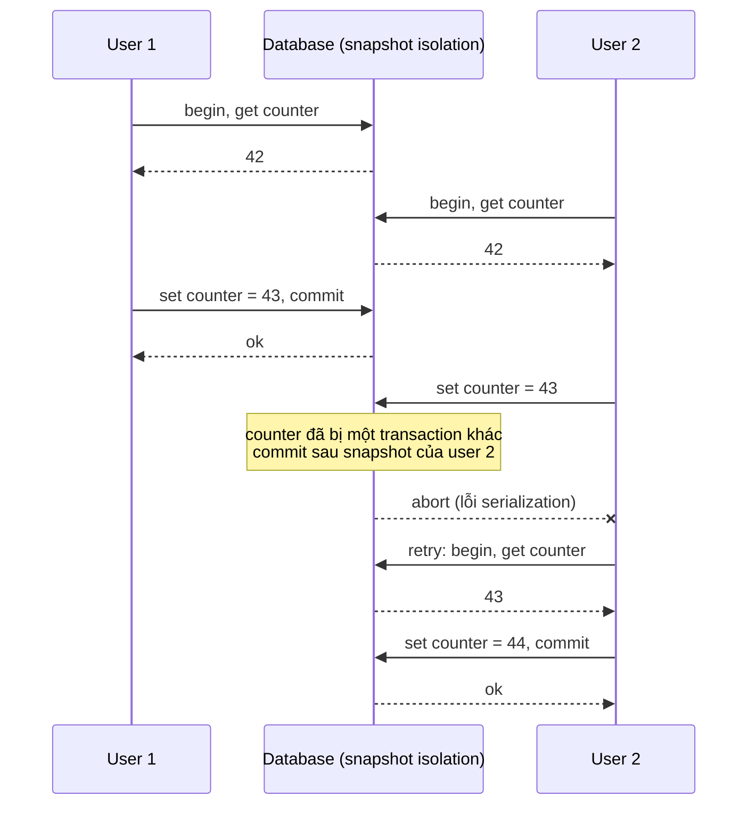

*(Ví dụ minh họa do AI xây dựng: Hình 7-1 trên database có tự phát hiện lost update, tr. 245.)*

> **Bổ sung ngoài sách.** Sách không mô tả cơ chế phát hiện. Trong PostgreSQL ở mức repeatable read, quy tắc thường được gọi là *first-updater-wins*: nếu transaction định sửa một hàng mà một transaction **đồng thời** đã sửa và commit sau khi snapshot của nó được chụp, transaction đó nhận lỗi serialization và phải retry.

<a id="compare-and-set"></a>

**Compare-and-set** (tr. 245).

- **What.** Ở database **không có transaction**, đôi khi có thao tác ***compare-and-set*** atomic (đã nhắc ở [Single-object writes](#single-object)). Mục đích: tránh lost update bằng cách chỉ cho cập nhật nếu giá trị **chưa đổi** kể từ lần bạn đọc. Nếu giá trị hiện tại **không khớp** với thứ bạn đọc trước đó, lần cập nhật **không có tác dụng**, và chu trình read-modify-write phải được thử lại.
- **Example (mô tả bằng lời).** Để hai người không cùng cập nhật một trang wiki, bạn có thể viết lệnh: đặt content của trang 1234 thành nội dung mới, **chỉ khi** content hiện tại vẫn bằng nội dung cũ. Nếu nội dung đã đổi, lệnh không có tác dụng; bạn phải **kiểm tra lệnh có hiệu lực không** và retry nếu cần.
- **Cảnh báo.** Nếu database cho mệnh đề `WHERE` **đọc từ snapshot cũ**, lệnh này **có thể không** ngăn được lost update: điều kiện có thể vẫn đúng dù đang có một lần ghi đồng thời khác. Hãy **kiểm tra** compare-and-set của database có an toàn không trước khi dựa vào nó.

> **Bổ sung ngoài sách.** Ví dụ về hành vi cụ thể: trong PostgreSQL ở mức read committed, lệnh UPDATE chờ khóa hàng rồi **đánh giá lại** điều kiện WHERE trên phiên bản mới nhất, nên compare-and-set kiểu trên an toàn; ở mức repeatable read, lần ghi thứ hai bị abort vì phát hiện cập nhật đồng thời. Database khác có thể khác, nên lời khuyên "kiểm tra trước khi dựa vào" của sách vẫn là cốt lõi.

<a id="lost-update-replication"></a>

**Conflict resolution and replication** (tr. 246).

- **Why khó hơn.** Database nhân bản (Chương 5) có bản sao dữ liệu trên **nhiều node**, và dữ liệu có thể bị sửa đồng thời trên **các node khác nhau**, nên cần thêm bước để ngăn lost update.
- **Khóa và compare-and-set không dùng được.** Chúng giả định có **một bản sao dữ liệu mới nhất duy nhất**. Database multi-leader hay leaderless thường cho nhiều lần ghi xảy ra đồng thời và nhân bản bất đồng bộ, nên **không bảo đảm** có một bản sao mới nhất duy nhất. Vì vậy kỹ thuật dựa trên khóa hay compare-and-set **không áp dụng** trong ngữ cảnh này. (Sách quay lại vấn đề ở "Linearizability", tr. 324, Chương 9.)
- **Cách phổ biến: siblings.** Như ở "Detecting Concurrent Writes" ([chương 5, B4.5](chapter-05.md#siblings)), cho các lần ghi đồng thời tạo **nhiều phiên bản xung đột** của một giá trị (siblings), rồi dùng code ứng dụng hay cấu trúc dữ liệu đặc biệt để **gộp** sau đó.
- **Thao tác atomic giao hoán.** Thao tác atomic có thể chạy tốt khi có nhân bản, đặc biệt nếu chúng ***commutative*** (giao hoán: áp dụng theo thứ tự khác nhau trên các replica vẫn cho cùng kết quả). Ví dụ tăng counter hay thêm phần tử vào set. Đó là ý tưởng của **datatype trong Riak 2.0**: khi một giá trị bị các client khác nhau cập nhật đồng thời, Riak tự gộp sao cho **không lần cập nhật nào mất** [39].
- **LWW dễ mất cập nhật.** Cách giải quyết xung đột ***last write wins*** dễ gây lost update ([chương 5, LWW](chapter-05.md#lww)). Tiếc là LWW lại là **mặc định** trong nhiều database nhân bản.

> **Bổ sung ngoài sách (ví dụ).** Hai replica cùng nhận "tăng 1" cho counter đang là 42. Vì phép cộng giao hoán, mỗi replica áp dụng cả hai lần tăng theo thứ tự nó nhận được và đều ra 44. Nếu thay vào đó mỗi replica nhận "đặt counter = 43" (kết quả read-modify-write ở client), LWW chỉ giữ một lần đặt và counter dừng ở 43.

<a id="write-skew"></a>

#### B2.4 Write Skew and Phantoms (tr. 246–251)

**Chưa hết danh sách** (tr. 246). Dirty write và lost update là hai loại race condition khi các transaction cùng ghi **cùng object**. Chúng phải được ngăn, tự động bởi database hoặc bằng biện pháp thủ công như khóa hay thao tác atomic. Nhưng còn những xung đột **tinh vi hơn**.

**Example — bác sĩ trực ca, Hình 7-8** (tr. 246–247). Ứng dụng giúp bác sĩ quản lý ca trực ở bệnh viện. Bệnh viện thường muốn có **nhiều** bác sĩ trực cùng lúc, nhưng **bắt buộc** phải có **ít nhất một** người. Bác sĩ được bỏ ca (ví dụ khi chính họ ốm), miễn là còn ít nhất một đồng nghiệp trực ca đó [40, 41].

Alice và Bob là hai bác sĩ trực của một ca. Cả hai đều mệt, cùng quyết định xin nghỉ, và **tình cờ bấm nút gần như cùng lúc**.

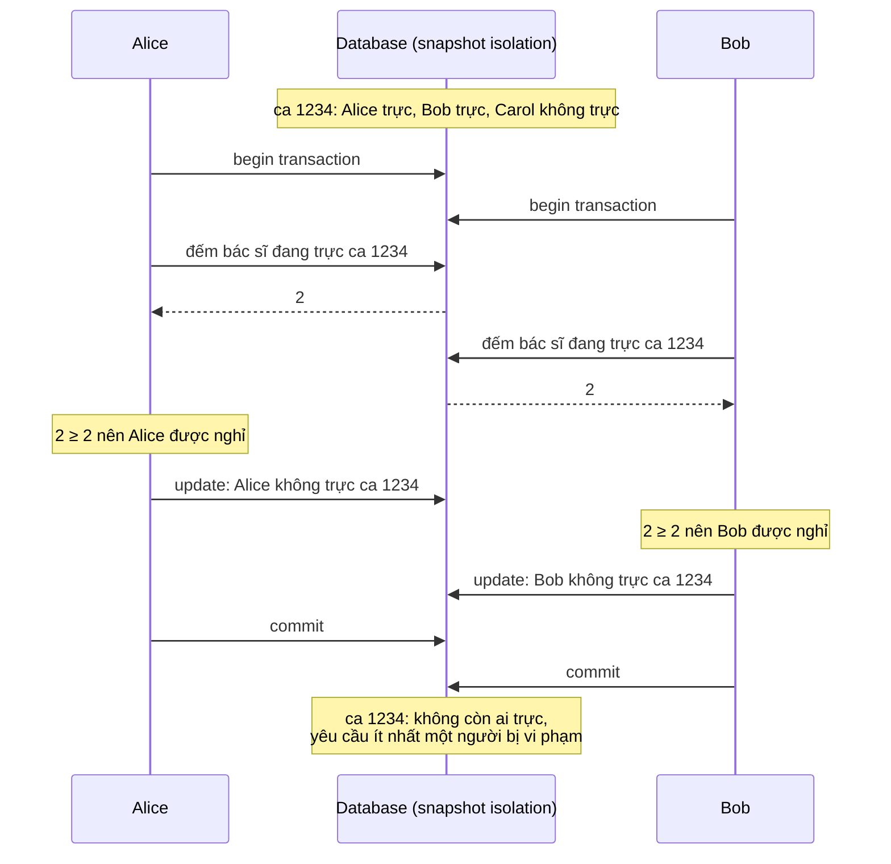

*(Vẽ lại Hình 7-8, tr. 247: write skew gây bug cho ứng dụng.)*

**Chuyện gì đã xảy ra** (tr. 247). Trong mỗi transaction, ứng dụng kiểm tra **hiện có từ hai bác sĩ trở lên** đang trực; nếu đúng, nó coi một người rời ca là an toàn. Database dùng snapshot isolation, nên **cả hai lần kiểm tra đều trả 2**, và cả hai transaction đi tiếp. Alice cập nhật bản ghi của mình, Bob cập nhật bản ghi của mình. Cả hai commit, và **không còn ai trực**.

<a id="characterizing-write-skew"></a>

**Characterizing write skew** (tr. 247–248).

- **What.** Anomaly này gọi là ***write skew*** [28]. Nó **không phải dirty write** cũng **không phải lost update**, vì hai transaction cập nhật **hai object khác nhau** (bản ghi trực của Alice và của Bob). Khó thấy là có xung đột, nhưng **chắc chắn là race condition**: nếu hai transaction chạy **lần lượt**, bác sĩ thứ hai đã bị chặn không cho rời ca. Hành vi sai chỉ có thể xảy ra vì chúng chạy **đồng thời**.
- **Tổng quát hóa của lost update** (tr. 248). Write skew xảy ra khi hai transaction **đọc cùng các object**, rồi **cập nhật một số** trong các object đó (mỗi transaction có thể cập nhật object khác nhau). Trường hợp đặc biệt khi các transaction cập nhật **cùng một object**, ta được dirty write hay lost update (tùy thời điểm).

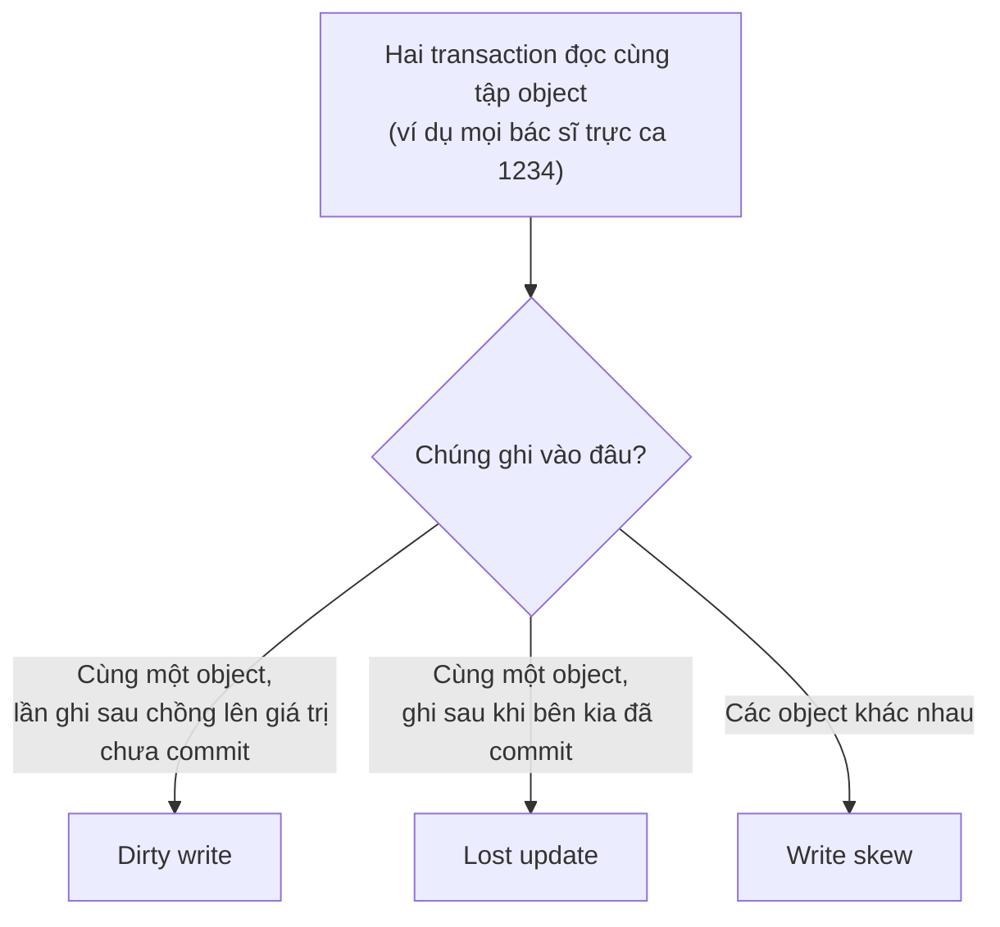

*(Sơ đồ do người viết ghi chú tổng hợp từ tr. 248. Ranh giới "chưa commit / đã commit" giữa dirty write và lost update là cách diễn giải chữ "tùy thời điểm" của sách.)*

**Vì sao snapshot isolation không chặn được** (lập luận của người viết ghi chú, dựa trên tr. 239, 245, 248):

1. Mỗi transaction đọc từ snapshot lúc nó bắt đầu, nên **không thấy** lần ghi chưa commit của bên kia: cả hai đều đếm được 2.
2. Write lock chỉ xung đột khi hai bên ghi **cùng một hàng**. Alice ghi hàng Alice, Bob ghi hàng Bob, nên **không ai phải chờ ai**.
3. Phát hiện lost update chỉ kiểm tra hàng **mình ghi** có bị người khác sửa không. Hàng Alice không bị Bob sửa và ngược lại, nên **không có gì để phát hiện**.
4. Cái bị vi phạm là một **invariant trên nhiều hàng** ("ít nhất một người trực"), mà không cơ chế nào ở trên nhìn thấy.

**Các lựa chọn bị thu hẹp** (tr. 248):

| Cách | Có giúp với write skew không? |
| --- | --- |
| Thao tác atomic trên một object | **Không**, vì liên quan **nhiều object** |
| Tự phát hiện lost update của snapshot isolation | **Không**. Lúc viết sách, write skew **không** được tự phát hiện ở repeatable read của PostgreSQL, repeatable read của MySQL/InnoDB, serializable của Oracle, hay snapshot isolation của SQL Server [23]. Tự động ngăn write skew cần **serializable isolation thật sự** ([B3](#b3)) |
| Ràng buộc do database thực thi (unique, foreign key, giới hạn giá trị) | Muốn diễn đạt "ít nhất một bác sĩ trực" cần ràng buộc trên **nhiều object**. Phần lớn database **không hỗ trợ sẵn**, nhưng có thể cài bằng **trigger** hay **materialized view**, tùy database [42] |
| Khóa tường minh các hàng mà transaction **phụ thuộc** | Nếu không dùng được serializable, đây có lẽ là **lựa chọn tốt thứ hai** |

**Khóa tường minh cho ví dụ bác sĩ (mô tả bằng lời)** (tr. 248). Bắt đầu transaction; chọn **mọi** bác sĩ đang trực ca 1234 với `FOR UPDATE`; cập nhật Alice thành không trực ca 1234; commit. Như trước, `FOR UPDATE` khóa mọi hàng truy vấn trả về, tức khóa **cả hàng của Bob**, nên transaction của Bob phải chờ.

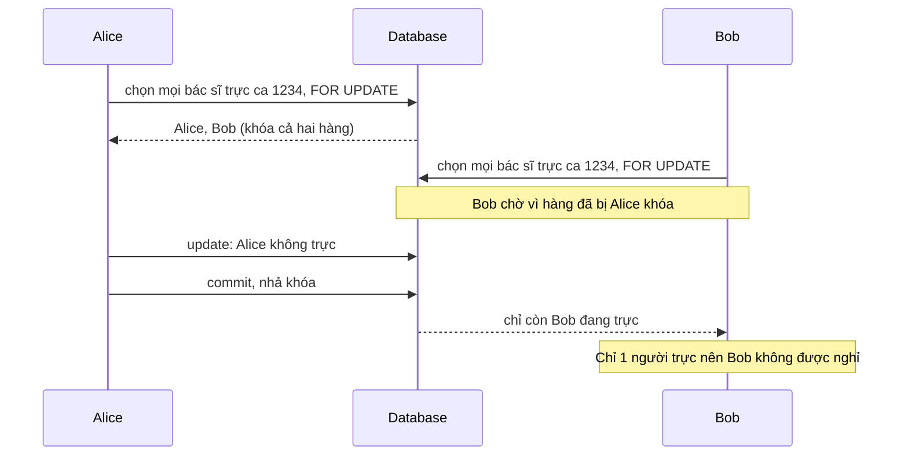

*(Ví dụ minh họa do AI xây dựng theo truy vấn ở tr. 248. Sau khi Alice commit, tùy database và mức isolation, Bob hoặc đọc lại thấy chỉ còn mình, hoặc bị abort để retry; trường hợp nào Bob cũng không rời ca được.)*

<a id="write-skew-examples"></a>

**More examples of write skew** (tr. 249–250). Lúc đầu write skew có vẻ là chuyện hiếm, nhưng khi đã biết nó, bạn sẽ thấy nó ở nhiều nơi:

| Ví dụ | Kiểm tra gì | Ghi gì | Vì sao lỗi | Giải pháp sách nêu |
| --- | --- | --- | --- | --- |
| **Đặt phòng họp** [43] | Có lượt đặt nào cho **cùng phòng**, **khoảng giờ chồng lấn** không | Nếu không có, **insert** lượt đặt mới | Snapshot isolation **không ngăn** người khác đồng thời insert một lượt đặt xung đột | Cần **serializable isolation** |
| **Trò chơi nhiều người** | Ô trên bàn cờ đã có quân khác chưa, nước đi có đúng luật không | Di chuyển quân | Khóa ở Example 7-1 chỉ chặn hai người di chuyển **cùng một quân**, không chặn di chuyển **hai quân khác nhau** tới **cùng một ô** | Có thể dùng **unique constraint**, tùy luật; nếu không thì dễ dính write skew |
| **Đăng ký username** | Tên đã có ai dùng chưa | Tạo tài khoản với tên đó | Hai người đồng thời đăng ký cùng tên, **không an toàn** dưới snapshot isolation | **Unique constraint**: transaction thứ hai bị abort vì vi phạm ràng buộc |
| **Chống tiêu hai lần** (*double-spending*) | Insert một khoản chi tạm, liệt kê mọi khoản trong tài khoản, kiểm tra tổng còn dương [44] | Khoản chi | Hai khoản chi insert đồng thời, **cộng lại** làm số dư âm, nhưng không transaction nào thấy khoản của bên kia | (Sách không nêu riêng; thuộc nhóm cần serializable) |

**Example 7-2 (mô tả bằng lời)** (tr. 249). Bắt đầu transaction; đếm các lượt đặt của phòng 123 có thời gian **chồng lấn** với khoảng 12:00–13:00 ngày 2015-01-01 (lượt đặt kết thúc sau 12:00 **và** bắt đầu trước 13:00); nếu kết quả bằng 0 thì insert lượt đặt phòng 123 từ 12:00 tới 13:00 cho user 666; commit. Tiêu đề của ví dụ ghi rõ: **không an toàn dưới snapshot isolation**.

> Chú thích ix (tr. 249). Trong PostgreSQL có thể làm việc này gọn hơn bằng ***range type***, nhưng kiểu này không được database khác hỗ trợ rộng rãi.

> **Bổ sung ngoài sách.** Với range type, PostgreSQL có *exclusion constraint*: khai báo rằng hai lượt đặt của cùng phòng không được có khoảng thời gian chồng lấn. Khi đó database tự từ chối lượt đặt thứ hai, giống unique constraint với username.

<a id="meeting-room-ch5"></a>

**Liên hệ với Chương 5: ví dụ đặt phòng họp đã được kiểm chứng.**

- **Ghi chú chương 5 nói gì.** Ở "What is a conflict?" (tr. 174–175, [chương 5](chapter-05.md#what-is-conflict)), sách nêu hệ thống đặt phòng họp như một xung đột **tinh vi** trong multi-leader replication: dù ứng dụng kiểm tra phòng trống trước khi cho đặt, hai lượt đặt ghi trên hai leader khác nhau vẫn có thể chồng giờ. Sách hẹn "Chương 7 có thêm ví dụ". Ghi chú chương 5 dự đoán, dựa trên Glossary (tr. 557), rằng đây là *write skew* và để việc kiểm chứng lại cho Chương 7.
- **Chương 7 xác nhận.** Tr. 249 liệt kê **"Meeting room booking system"** đúng là một **ví dụ của write skew**, với cùng ràng buộc "không có hai lượt đặt cho cùng phòng cùng lúc". Tr. 251 còn phân loại rõ hơn: đây là write skew **do phantom gây ra**, vì transaction kiểm tra **sự vắng mặt** của hàng thỏa điều kiện rồi **insert** đúng loại hàng đó. Nguồn sách dẫn cho ví dụ này, [43], là bài báo về **Bayou**, một hệ lưu trữ **nhân bản**, kết nối yếu; tức ví dụ vốn xuất phát từ bối cảnh replication như Chương 5.
- **Cùng cấu trúc, khác bối cảnh** (lập luận của người viết ghi chú). Ở Chương 7, hai transaction chạy trên **một database** với snapshot isolation; ở Chương 5, hai lần ghi chạy trên **hai leader**. Cấu trúc giống nhau: mỗi bên kiểm tra tiền đề ("chưa có lượt đặt chồng giờ") trên **góc nhìn của mình**, rồi ghi một **object khác** với bên kia. Vì không bên nào ghi đè object của bên kia, so sánh từng bản ghi riêng lẻ không thấy xung đột; cái bị vi phạm là một **ràng buộc trên nhiều bản ghi**. Điều này khớp với nhận xét "Bổ sung ngoài sách" ở chương 5.
- **Điểm khác quan trọng** (lập luận của người viết ghi chú, dựa trên tr. 246, 251). Các cách chữa của Chương 7 (serializable isolation, materializing conflicts) đều cần **một bản sao dữ liệu mới nhất duy nhất** để khóa hay để phát hiện xung đột. Tr. 246 nói rõ khóa và compare-and-set **không áp dụng** được với multi-leader hay leaderless. Vì vậy trong bối cảnh Chương 5, serializable isolation **trên từng leader** vẫn không cứu được: mỗi leader chỉ thấy lượt đặt của chính nó. Muốn chặn, phải đưa mọi lượt đặt của **một phòng** về cùng một leader (conflict avoidance, [chương 5](chapter-05.md#conflict-avoidance)), hoặc chấp nhận phát hiện và giải quyết sau (Chương 12, theo tham chiếu ở tr. 175).

<a id="phantom"></a>

**Phantoms causing write skew** (tr. 250–251).

**Mẫu chung của mọi ví dụ** (tr. 250):

1. Một truy vấn `SELECT` kiểm tra một **yêu cầu** có được thỏa không, bằng cách tìm các hàng khớp một **điều kiện tìm kiếm** (có ít nhất hai bác sĩ trực, chưa có lượt đặt cho phòng đó giờ đó, ô cờ chưa có quân khác, username chưa ai dùng, tài khoản còn tiền).
2. Tùy kết quả, code ứng dụng quyết định đi tiếp (thực hiện thao tác) hay báo lỗi và abort.
3. Nếu đi tiếp, ứng dụng **ghi** (`INSERT`, `UPDATE` hay `DELETE`) và commit.

**Hiệu ứng của lần ghi ở bước 3 làm thay đổi tiền đề của quyết định ở bước 2.** Nói cách khác, nếu chạy lại truy vấn ở bước 1 sau khi commit, bạn sẽ được kết quả **khác**, vì lần ghi đã đổi tập hàng khớp điều kiện (bớt một bác sĩ trực, phòng đã bị đặt giờ đó, ô cờ đã có quân, username đã có người dùng, tài khoản bớt tiền). Các bước cũng có thể theo **thứ tự khác**: ví dụ ghi trước, rồi `SELECT`, rồi mới quyết định abort hay commit theo kết quả truy vấn.

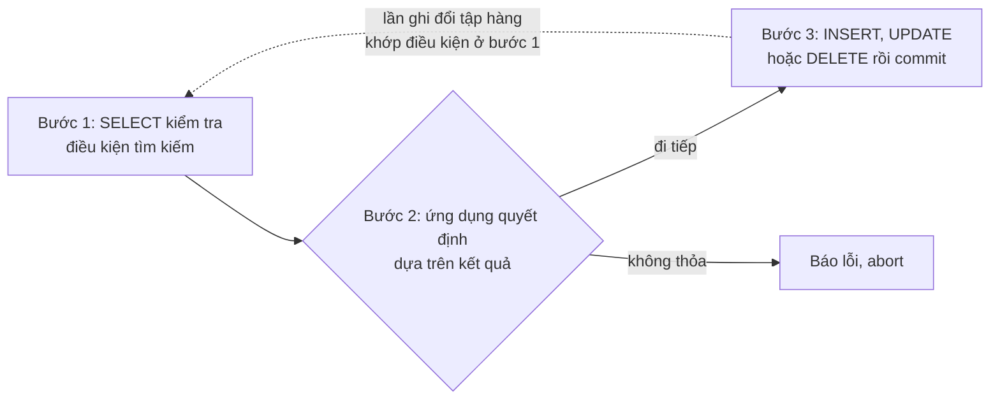

*(Sơ đồ do người viết ghi chú tổng hợp mẫu ba bước ở tr. 250.)*

**Vì sao `SELECT FOR UPDATE` không đủ** (tr. 251).

- Ở ví dụ bác sĩ, hàng bị sửa ở bước 3 **là một trong các hàng** trả về ở bước 1. Vì vậy có thể làm transaction an toàn bằng cách **khóa các hàng ở bước 1** (`SELECT FOR UPDATE`).
- **Bốn ví dụ còn lại khác hẳn**: chúng kiểm tra **sự vắng mặt** của hàng khớp điều kiện, và lần ghi **thêm** một hàng khớp đúng điều kiện đó. Nếu truy vấn ở bước 1 không trả hàng nào, `SELECT FOR UPDATE` **không có gì để gắn khóa**.

**What — phantom** (tr. 251). Hiệu ứng mà lần ghi trong một transaction **làm đổi kết quả một truy vấn tìm kiếm** trong transaction khác gọi là ***phantom*** [3]. Snapshot isolation tránh được phantom trong **truy vấn chỉ đọc**. Nhưng trong transaction **đọc–ghi** như các ví dụ trên, phantom có thể dẫn tới những trường hợp write skew **đặc biệt khó**.

```mermaid
sequenceDiagram
    participant A as User A
    participant DB as Database (snapshot isolation)
    participant B as User B
    A->>DB: begin, đếm lượt đặt phòng 123 chồng 12:00 đến 13:00
    DB-->>A: 0 (không có hàng nào để khóa)
    B->>DB: begin, đếm lượt đặt phòng 123 chồng 12:00 đến 13:00
    DB-->>B: 0
    A->>DB: insert lượt đặt phòng 123, 12:00 đến 13:00
    A->>DB: commit
    B->>DB: insert lượt đặt phòng 123, 12:00 đến 13:00
    B->>DB: commit
    Note over DB: Hai lượt đặt chồng giờ. Hàng của A là phantom<br/>với truy vấn của B: nó khớp điều kiện<br/>nhưng chưa tồn tại lúc B kiểm tra
```

*(Ví dụ minh họa do AI xây dựng: chạy Example 7-2 đồng thời, theo mô tả ở tr. 249–251.)*

<a id="materializing-conflicts"></a>

**Materializing conflicts** (tr. 251).

- **Ý tưởng.** Nếu vấn đề của phantom là **không có object nào để gắn khóa**, có lẽ ta có thể **tạo nhân tạo** một object khóa trong database?
- **How — ví dụ đặt phòng.** Tạo một **bảng các khung giờ và phòng**. Mỗi hàng ứng với **một phòng** trong **một khoảng thời gian** (ví dụ **15 phút**). Tạo sẵn hàng cho mọi tổ hợp phòng và khung giờ, ví dụ cho **sáu tháng tới**. Giờ transaction muốn đặt phòng có thể **khóa** (`SELECT FOR UPDATE`) các hàng ứng với phòng và khoảng thời gian mong muốn. Lấy được khóa rồi, nó kiểm tra lượt đặt chồng lấn và insert lượt đặt mới như trước. Bảng phụ này **không lưu thông tin đặt phòng**; nó thuần túy là **tập hợp khóa**, dùng để ngăn các lượt đặt cùng phòng, cùng khoảng giờ bị sửa đồng thời.
- **Tên gọi.** Cách này gọi là ***materializing conflicts***, vì nó biến một phantom thành **xung đột khóa** trên một tập hàng **cụ thể có thật** trong database [11].
- **Trade-off.** Tìm cách "vật chất hóa" xung đột có thể **khó và dễ sai**, và thật **xấu** khi để cơ chế kiểm soát đồng thời **rò rỉ vào mô hình dữ liệu** của ứng dụng. Vì vậy materializing conflicts chỉ nên là **phương án cuối cùng** khi không còn cách nào khác. Trong đa số trường hợp, **serializable isolation đáng chọn hơn nhiều**.

```mermaid
sequenceDiagram
    participant A as User A
    participant DB as Database
    participant B as User B
    Note over DB: Bảng khung giờ có sẵn hàng cho phòng 123:<br/>12:00, 12:15, 12:30, 12:45
    A->>DB: khóa 4 hàng khung giờ của phòng 123, FOR UPDATE
    DB-->>A: đã khóa
    B->>DB: khóa 4 hàng khung giờ của phòng 123, FOR UPDATE
    Note over B,DB: B phải chờ: phantom đã thành xung đột khóa
    A->>DB: đếm lượt đặt chồng giờ: 0, insert lượt đặt
    A->>DB: commit, nhả khóa
    DB-->>B: đã khóa
    B->>DB: đếm lượt đặt chồng giờ
    DB-->>B: 1
    Note over B: Phòng đã có người đặt, B abort
```

*(Ví dụ minh họa do AI xây dựng theo mô tả ở tr. 251, với khung 15 phút như sách gợi ý.)*

**System Design.**

- Tìm trong code mọi chỗ theo mẫu **"kiểm tra rồi hành động"** (check-then-act) trên nhiều hàng: đó là ứng viên write skew (tr. 250).
- Ưu tiên **ràng buộc của database** khi diễn đạt được (unique, exclusion), vì database tự thực thi chúng bất kể isolation level (tr. 248, 250).
- Khi phải dùng mức yếu hơn serializable: nếu tiền đề nằm trên **các hàng có thật**, khóa chúng bằng `SELECT FOR UPDATE`; nếu tiền đề là **sự vắng mặt** của hàng, cân nhắc materializing conflicts như phương án cuối (tr. 248, 251).

---

<a id="b3"></a>

### B3. Serializability (tr. 251–266)

<a id="serializability"></a>

#### B3.0 Vì sao cần serializability, và vì sao không ai cũng dùng (tr. 251–252)

**Một tình cảnh buồn** (tr. 251–252). Chương đã thấy nhiều transaction dễ dính race condition. Read committed và snapshot isolation chặn được một số, nhưng không phải tất cả; write skew và phantom đặc biệt khó. Tình hình:

- Isolation level **khó hiểu**, và mỗi database cài một kiểu (ví dụ nghĩa của "repeatable read" khác nhau rất nhiều).
- Nhìn code ứng dụng, **khó biết** nó có an toàn ở một isolation level hay không, nhất là trong ứng dụng lớn, nơi bạn không biết hết những gì đang chạy đồng thời.
- **Không có công cụ tốt** để phát hiện race condition. Về nguyên tắc, phân tích tĩnh có thể giúp [26], nhưng kỹ thuật nghiên cứu chưa đi vào thực tế. Test vấn đề đồng thời rất khó, vì chúng thường **không tất định**: chỉ xảy ra khi xui về thời điểm.

Đây không phải vấn đề mới: nó tồn tại từ **những năm 1970**, khi các mức isolation yếu lần đầu xuất hiện [2]. Suốt thời gian đó, câu trả lời của giới nghiên cứu rất đơn giản: **dùng serializable isolation!**

**What** (tr. 252). ***Serializable isolation*** thường được coi là mức isolation **mạnh nhất**. Nó bảo đảm: dù các transaction có thể chạy song song, **kết quả cuối cùng giống như chúng chạy lần lượt từng cái**, không có đồng thời. Vì vậy database bảo đảm: nếu các transaction **chạy đúng khi chạy riêng lẻ**, chúng **vẫn đúng khi chạy đồng thời**. Nói cách khác, database **ngăn mọi race condition có thể có**.

**Vậy sao không ai cũng dùng?** (tr. 252). Phải xem các cách cài serializability và hiệu năng của chúng. Phần lớn database có serializability ngày nay dùng **một trong ba kỹ thuật**:

| Kỹ thuật | Ghi chú | Mục |
| --- | --- | --- |
| **Thực thi tuần tự thật sự** | Chạy transaction theo đúng thứ tự tuần tự | [B3.1](#serial-execution) |
| **Two-phase locking (2PL)** | Trong **nhiều thập kỷ** là lựa chọn khả thi duy nhất | [B3.2](#two-phase-locking) |
| **Optimistic concurrency control**, như serializable snapshot isolation (SSI) | Mới hơn nhiều | [B3.3](#ssi) |

Tạm thời sách bàn các kỹ thuật này trong ngữ cảnh database **một node**; Chương 9 xem cách tổng quát hóa cho transaction **nhiều node** trong hệ phân tán (tr. 252).

> **Bổ sung ngoài sách.** Đừng nhầm *serializable* (tính khả tuần tự của transaction) với *serialization* (mã hóa dữ liệu thành byte, [chương 4](chapter-04.md#b1)). Hộp "Terminology clash" ở tr. 113 đã cảnh báo đúng chuyện này.

<a id="serial-execution"></a>

#### B3.1 Actual Serial Execution (tr. 252–256)

**What** (tr. 252). Cách đơn giản nhất để tránh vấn đề đồng thời là **bỏ hẳn đồng thời**: chạy **mỗi lúc một transaction**, theo thứ tự tuần tự, trên **một thread**. Như vậy ta **né hoàn toàn** bài toán phát hiện và ngăn xung đột giữa các transaction: isolation thu được **theo định nghĩa** là serializable.

**Why bây giờ mới khả thi** (tr. 253). Nghe hiển nhiên, nhưng phải tới khoảng **năm 2007** người thiết kế database mới cho rằng một vòng lặp đơn luồng để chạy transaction là khả thi [45]. Suốt 30 năm trước đó, đồng thời đa luồng được coi là thiết yếu cho hiệu năng. Hai thay đổi dẫn tới việc nghĩ lại:

1. **RAM đủ rẻ** để với nhiều use case, có thể giữ **toàn bộ dữ liệu đang hoạt động** trong bộ nhớ ([chương 3, B6.5](chapter-03.md#in-memory)). Khi mọi dữ liệu transaction cần đều ở trong bộ nhớ, transaction chạy **nhanh hơn nhiều** so với khi phải chờ nạp dữ liệu từ đĩa.
2. Người thiết kế nhận ra **transaction OLTP thường ngắn** và chỉ đọc ghi **ít** ([chương 3, B7.1](chapter-03.md#oltp-olap)). Ngược lại, truy vấn analytics chạy lâu thường **chỉ đọc**, nên có thể chạy trên một consistent snapshot (snapshot isolation) **bên ngoài** vòng lặp tuần tự.

**Ai dùng** (tr. 253). VoltDB/H-Store, Redis và Datomic [46, 47, 48]. Hệ thống thiết kế cho thực thi đơn luồng **đôi khi nhanh hơn** hệ hỗ trợ đồng thời, vì tránh được chi phí phối hợp của khóa. Nhưng throughput bị giới hạn ở **một lõi CPU**. Để tận dụng thread duy nhất đó, transaction phải được **cấu trúc khác** dạng truyền thống.

<a id="stored-procedures"></a>

**Encapsulating transactions in stored procedures** (tr. 253–254).

- **Ý định ban đầu.** Thuở đầu của database, người ta muốn một transaction bao trọn **cả luồng hoạt động của người dùng**. Ví dụ đặt vé máy bay là quy trình nhiều bước: tìm tuyến, giá vé, ghế trống; chọn hành trình; đặt ghế trên từng chuyến; nhập thông tin hành khách; thanh toán. Người thiết kế database nghĩ sẽ thật gọn nếu cả quy trình là **một transaction** để commit atomic.
- **Vì sao không được.** Con người **rất chậm** ra quyết định và phản hồi. Nếu transaction phải chờ input của người dùng, database phải chịu **rất nhiều transaction đồng thời**, phần lớn **đang rảnh**. Hầu hết database không làm vậy hiệu quả, nên gần như mọi ứng dụng OLTP giữ transaction **ngắn** bằng cách **không chờ người dùng** trong transaction. Trên web, transaction commit **trong cùng một HTTP request**; transaction không trải qua nhiều request. HTTP request mới thì bắt đầu transaction mới.
- **Vẫn là kiểu tương tác** (tr. 253–254). Dù đã đưa con người ra khỏi đường găng, transaction vẫn chạy theo kiểu client/server **tương tác**, **mỗi lần một câu lệnh**: ứng dụng gửi truy vấn, đọc kết quả, có thể gửi truy vấn khác tùy kết quả… Truy vấn và kết quả đi qua lại giữa code ứng dụng (một máy) và server database (máy khác).
- **Vì sao kiểu tương tác giết thực thi tuần tự** (tr. 254). Rất nhiều thời gian dành cho **giao tiếp mạng**. Nếu cấm đồng thời và chỉ xử lý một transaction mỗi lúc, throughput sẽ **tệ hại**, vì database dành phần lớn thời gian **chờ ứng dụng** gửi truy vấn tiếp theo của transaction hiện tại. Với loại database này, **buộc phải** xử lý nhiều transaction đồng thời để có hiệu năng chấp nhận được.
- **How.** Vì vậy hệ thống xử lý transaction tuần tự đơn luồng **không cho** transaction tương tác nhiều câu lệnh. Ứng dụng phải gửi **toàn bộ code transaction** cho database **trước**, dưới dạng ***stored procedure*** (Hình 7-9). Nếu mọi dữ liệu transaction cần đều trong bộ nhớ, stored procedure chạy **rất nhanh**, không chờ I/O mạng hay đĩa.

```mermaid
sequenceDiagram
    participant App as Application
    participant QP as Query processor
    participant S as Storage
    Note over App,S: Transaction tương tác: mỗi câu lệnh một vòng mạng
    App->>QP: đếm bác sĩ đang trực ca 1234
    QP->>S: đọc
    S-->>QP: dữ liệu
    QP-->>App: 2
    Note over App: if currently_on_call ≥ 2 (chạy ở ứng dụng)
    App->>QP: update: Bob không trực ca 1234
    QP->>S: ghi
    S-->>QP: ok
    QP-->>App: ok
    Note over App,S: Stored procedure: gửi một lần, chạy trọn trong database
    App->>QP: chạy take_doctor_off_call_if_safe, name Bob, shift 1234
    QP->>S: select...
    S-->>QP: 2
    Note over QP: if (...) chạy ngay trong database
    QP->>S: update...
    S-->>QP: ok
    QP-->>App: ok
```

*(Vẽ lại Hình 7-9, tr. 254: khác biệt giữa transaction tương tác và stored procedure, dùng transaction ví dụ của Hình 7-8. Trong hình gốc, khoảng giữa ứng dụng và query processor được đánh dấu là một "network hop".)*

<a id="stored-procedure-tradeoffs"></a>

**Pros and cons of stored procedures** (tr. 255).

Stored procedure có trong relational database từ lâu và là một phần chuẩn SQL (**SQL/PSM**) từ **1999**. Nhưng chúng mang **tiếng xấu**:

| Nhược điểm | Giải thích | Đã được khắc phục thế nào |
| --- | --- | --- |
| Ngôn ngữ riêng của từng vendor | Oracle có PL/SQL, SQL Server có T-SQL, PostgreSQL có PL/pgSQL… Các ngôn ngữ này không theo kịp ngôn ngữ đa dụng: trông **xấu và cổ lỗ**, thiếu hệ sinh thái thư viện | Bản cài hiện đại bỏ PL/SQL, dùng ngôn ngữ đa dụng: **VoltDB** dùng Java hoặc Groovy, **Datomic** dùng Java hoặc Clojure, **Redis** dùng Lua |
| Code trong database khó quản lý | So với application server: khó debug hơn, khó đưa vào version control và triển khai, khó test, khó tích hợp với hệ thu thập metric để giám sát | (Sách chỉ nói chung là "các vấn đề này khắc phục được") |
| Database nhạy hiệu năng hơn | Một instance database thường được **nhiều** application server dùng chung. Một stored procedure viết tệ (tốn nhiều bộ nhớ hay CPU) gây rắc rối **lớn hơn nhiều** so với code tệ tương đương ở application server | (như trên) |

**Khi kết hợp đúng** (tr. 255). Với stored procedure và dữ liệu trong bộ nhớ, chạy mọi transaction trên một thread trở nên **khả thi**. Không chờ I/O và tránh được chi phí của cơ chế kiểm soát đồng thời khác, chúng đạt **throughput khá tốt** trên một thread.

**Stored procedure cho replication** (tr. 255). VoltDB còn dùng stored procedure để **nhân bản**: thay vì chép các lần ghi của transaction từ node này sang node khác, nó **chạy cùng stored procedure trên mỗi replica**. Vì vậy VoltDB đòi stored procedure phải **tất định** (*deterministic*: chạy trên các node khác nhau phải cho cùng kết quả). Ví dụ transaction cần ngày giờ hiện tại thì phải lấy qua **API tất định** đặc biệt. Đây chính là statement-based replication được làm an toàn, như đã nhắc ở [chương 5](chapter-05.md#statement-based).

<a id="serial-partitioning"></a>

**Partitioning** (tr. 255–256).

- **Vấn đề.** Chạy mọi transaction tuần tự làm kiểm soát đồng thời **đơn giản hơn nhiều**, nhưng giới hạn throughput ở tốc độ **một lõi CPU trên một máy**. Transaction chỉ đọc có thể chạy chỗ khác bằng snapshot isolation, nhưng với ứng dụng **ghi nhiều**, bộ xử lý transaction đơn luồng có thể thành **nút thắt nghiêm trọng**.
- **How** (tr. 256). Để mở rộng ra nhiều lõi và nhiều node, có thể **partition** dữ liệu (Chương 6); VoltDB hỗ trợ việc này. Nếu tìm được cách partition sao cho **mỗi transaction chỉ đọc ghi dữ liệu trong một partition**, mỗi partition có thể có **thread xử lý transaction riêng**, chạy độc lập. Khi đó cho mỗi lõi CPU một partition, throughput transaction **tăng tuyến tính** theo số lõi [47].
- **Transaction xuyên partition.** Transaction cần truy cập **nhiều partition** thì database phải **phối hợp** nó trên mọi partition nó chạm tới. Stored procedure phải chạy **đồng bộ từng bước** (*lock-step*) trên mọi partition để bảo đảm serializability trên toàn hệ thống.
- **Cái giá.** Vì chi phí phối hợp, transaction xuyên partition **chậm hơn rất nhiều**. VoltDB báo throughput khoảng **1.000 lần ghi xuyên partition mỗi giây**, thấp hơn **nhiều bậc độ lớn** so với throughput một partition, và **không tăng được** bằng cách thêm máy [49].
- **Phụ thuộc cấu trúc dữ liệu.** Transaction có là single-partition hay không phụ thuộc **rất nhiều** vào cấu trúc dữ liệu của ứng dụng. Dữ liệu key-value đơn giản thường partition **rất dễ**; dữ liệu có **nhiều secondary index** dễ cần nhiều phối hợp xuyên partition ("Partitioning and Secondary Indexes", tr. 206, [Chương 6](chapter-06.md#secondary-indexes)).

```mermaid
flowchart LR
    T1["Transaction chỉ chạm<br/>partition 1"] --> P1["Partition 1<br/>thread riêng, lõi CPU 1"]
    T2["Transaction chỉ chạm<br/>partition 2"] --> P2["Partition 2<br/>thread riêng, lõi CPU 2"]
    TX["Transaction xuyên partition"] -.->|"phối hợp lock-step"| P1
    TX -.->|"phối hợp lock-step"| P2
    P1 --> R1["Throughput tăng tuyến tính<br/>theo số lõi"]
    P2 --> R1
    TX --> R2["Khoảng 1.000 ghi mỗi giây (VoltDB),<br/>không tăng khi thêm máy"]
```

*(Sơ đồ do người viết ghi chú tổng hợp từ tr. 255–256.)*

> Chú thích x (tr. 256). Nếu transaction cần dữ liệu **không có trong bộ nhớ**, giải pháp tốt nhất có thể là **abort** transaction, **nạp dữ liệu vào bộ nhớ bất đồng bộ** trong khi tiếp tục xử lý transaction khác, rồi **chạy lại** transaction khi dữ liệu đã nạp xong. Cách này gọi là ***anti-caching***, đã nhắc ở "Keeping everything in memory" (tr. 88, [chương 3, B6.5](chapter-03.md#in-memory)).

<a id="serial-summary"></a>

**Summary of serial execution** (tr. 256). Thực thi tuần tự trở thành cách khả thi để có serializable isolation, **trong một số ràng buộc**:

1. Mọi transaction phải **nhỏ và nhanh**, vì chỉ **một transaction chậm** là đủ làm **ngưng trệ toàn bộ** việc xử lý transaction.
2. Chỉ hợp với use case mà **dữ liệu đang hoạt động vừa bộ nhớ**. Dữ liệu ít truy cập có thể chuyển xuống đĩa, nhưng nếu một transaction đơn luồng cần nó, hệ thống sẽ **rất chậm**.
3. Throughput ghi phải **đủ thấp** để một lõi CPU xử lý được; nếu không, phải partition transaction sao cho **không cần phối hợp xuyên partition**.
4. Transaction xuyên partition **có thể**, nhưng có **giới hạn cứng** về mức độ dùng được.

> **Bổ sung ngoài sách (phép tính minh họa).** Nếu mỗi transaction chạy trong bộ nhớ mất khoảng 50 micro giây, một thread xử lý được khoảng 1 / 0,00005 = 20.000 transaction mỗi giây. Chỉ một transaction lỡ tay chạy 1 giây là đủ làm 20.000 transaction khác phải xếp hàng chờ. Con số giả định, nhưng cho thấy vì sao ràng buộc 1 nghiêm ngặt đến vậy.

<a id="two-phase-locking"></a>

#### B3.2 Two-Phase Locking (2PL) (tr. 257–261)

**What** (tr. 257). Trong khoảng **30 năm**, chỉ có **một** thuật toán được dùng rộng rãi cho serializability trong database: ***two-phase locking* (2PL)**.

> Chú thích xi (tr. 257). Đôi khi gọi là ***strong strict two-phase locking* (SS2PL)** để phân biệt với các biến thể khác của 2PL.

> **Lưu ý của sách "2PL is not 2PC"** (tr. 257). Two-phase **locking** (2PL) nghe rất giống two-phase **commit** (2PC), nhưng là **hai thứ hoàn toàn khác nhau**. 2PC được bàn ở Chương 9.

**Từ khóa ghi tới 2PL** (tr. 257). Ta đã thấy khóa thường dùng để ngăn dirty write ([B2.1](#dirty-write)): nếu hai transaction cùng ghi một object, khóa bảo đảm người ghi thứ hai phải chờ người thứ nhất xong transaction (abort hay commit). 2PL tương tự nhưng **đòi hỏi về khóa mạnh hơn nhiều**. Nhiều transaction được **cùng đọc** một object miễn là **không ai ghi** nó. Nhưng ngay khi ai đó muốn **ghi** (sửa hay xóa) một object, cần **quyền truy cập độc quyền**:

- Nếu transaction A **đã đọc** một object và transaction B muốn **ghi** object đó, B phải chờ A commit hay abort. (Bảo đảm B không đổi object **sau lưng** A.)
- Nếu transaction A **đã ghi** một object và transaction B muốn **đọc** object đó, B phải chờ A commit hay abort. (Đọc phiên bản cũ của object, như ở Hình 7-1, **không được chấp nhận** dưới 2PL.)

**Khác biệt then chốt với snapshot isolation.** Trong 2PL, người ghi không chỉ chặn người ghi khác; **người ghi chặn người đọc và ngược lại**. Snapshot isolation có câu thần chú "người đọc không chặn người ghi, người ghi không chặn người đọc" ([B2.2](#mvcc)). Đổi lại, vì 2PL cho serializability, nó chống được **mọi race condition** đã bàn, kể cả **lost update** và **write skew**.

<a id="2pl-implementation"></a>

**Implementation of two-phase locking** (tr. 257–258).

- **Ai dùng** (tr. 257). Mức serializable của **MySQL (InnoDB)** và **SQL Server**, và mức repeatable read của **DB2** [23, 36] (lúc viết sách).
- **How** (tr. 258). Mỗi object trong database có một **khóa**, ở chế độ ***shared*** hoặc ***exclusive***:

| Quy tắc | Chi tiết |
| --- | --- |
| Đọc | Phải lấy khóa ở chế độ **shared**. Nhiều transaction được cùng giữ shared lock; nhưng nếu đã có transaction giữ **exclusive** lock trên object, chúng phải chờ |
| Ghi | Phải lấy khóa ở chế độ **exclusive**. Không transaction nào khác được giữ khóa cùng lúc (shared hay exclusive); có khóa nào đang giữ thì phải chờ |
| Đọc rồi ghi | Có thể **nâng cấp** shared lock thành exclusive lock. Việc nâng cấp giống như lấy exclusive lock trực tiếp |
| Giữ khóa | Đã lấy khóa thì **giữ tới hết transaction** (commit hay abort) |

**Vì sao gọi là "two-phase"** (tr. 258). Pha thứ nhất (khi transaction đang chạy) là lúc **lấy khóa**; pha thứ hai (khi transaction kết thúc) là lúc **nhả mọi khóa**.

**Deadlock** (tr. 258). Vì dùng rất nhiều khóa, dễ xảy ra tình huống transaction A **chờ** transaction B nhả khóa, và B **chờ** A. Tình huống này gọi là ***deadlock***. Database **tự phát hiện** deadlock giữa các transaction và **abort một trong số đó** để các transaction khác tiến lên. Transaction bị abort phải được **ứng dụng retry**.

```mermaid
sequenceDiagram
    participant A as Alice
    participant DB as Database (2PL)
    participant B as Bob
    A->>DB: đếm bác sĩ trực ca 1234
    Note over DB: Alice giữ shared lock trên hàng Alice và hàng Bob
    DB-->>A: 2
    B->>DB: đếm bác sĩ trực ca 1234
    Note over DB: Bob cũng giữ shared lock trên hai hàng đó
    DB-->>B: 2
    A->>DB: update hàng Alice (cần exclusive lock)
    Note over A,DB: chờ Bob nhả shared lock trên hàng Alice
    B->>DB: update hàng Bob (cần exclusive lock)
    Note over B,DB: chờ Alice nhả shared lock trên hàng Bob
    Note over DB: Deadlock: database phát hiện, abort Bob
    DB--xB: abort
    DB-->>A: update ok
    A->>DB: commit, nhả mọi khóa
    B->>DB: retry: đếm bác sĩ trực ca 1234
    DB-->>B: 1
    Note over B: Bob không được rời ca, invariant được giữ
```

*(Ví dụ minh họa do AI xây dựng: Hình 7-8 chạy dưới 2PL, theo các quy tắc ở tr. 257–258. Database chọn abort ai là tùy cài đặt.)*

<a id="2pl-performance"></a>

**Performance of two-phase locking** (tr. 258–259).

- **Nhược điểm lớn.** Lý do 2PL không được mọi người dùng từ những năm 1970 là **hiệu năng**: throughput và thời gian phản hồi dưới 2PL **tệ hơn đáng kể** so với isolation yếu.
- **Nguyên nhân.** Một phần do chi phí lấy và nhả khóa, nhưng quan trọng hơn là **giảm đồng thời**. Theo thiết kế, nếu hai transaction đồng thời làm **bất cứ điều gì** có thể dẫn tới race condition, một bên phải **chờ** bên kia xong.
- **Không giới hạn thời gian chờ.** Relational database truyền thống không giới hạn thời lượng transaction, vì được thiết kế cho ứng dụng tương tác chờ người dùng nhập. Nên khi một transaction phải chờ transaction khác, **không có giới hạn** cho việc chờ bao lâu. Kể cả khi mọi transaction đều ngắn, vẫn có thể hình thành **hàng đợi** nếu nhiều transaction muốn truy cập cùng object, nên một transaction có thể phải chờ **nhiều transaction khác** xong (tr. 258–259).
- **Hệ quả** (tr. 259). Database chạy 2PL có độ trễ **khá bất ổn**, và có thể **rất chậm ở percentile cao** ([chương 1](chapter-01.md#percentiles)) nếu workload có tranh chấp. Chỉ cần **một transaction chậm**, hay một transaction truy cập nhiều dữ liệu và lấy nhiều khóa, là đủ làm phần còn lại của hệ thống **đứng khựng**. Sự bất ổn này là vấn đề khi cần vận hành **ổn định**.
- **Deadlock nhiều hơn.** Deadlock có thể xảy ra ở read committed dùng khóa, nhưng xảy ra **thường xuyên hơn nhiều** dưới 2PL serializable (tùy mẫu truy cập). Đây là thêm một vấn đề hiệu năng: transaction bị abort vì deadlock rồi retry phải **làm lại toàn bộ việc**. Deadlock thường xuyên nghĩa là **phí công đáng kể**.

<a id="predicate-lock"></a>

**Predicate locks** (tr. 259–260).

- **Chi tiết bị bỏ qua.** Mô tả khóa ở trên còn thiếu một chi tiết tinh vi nhưng quan trọng: **phantom** ([B2.4](#phantom)). Database có serializable isolation **phải ngăn phantom**.
- **Yêu cầu với ví dụ đặt phòng** (tr. 259). Nếu một transaction đã tìm lượt đặt của một phòng trong một khoảng thời gian (Example 7-2), transaction khác **không được** đồng thời insert hay update một lượt đặt **cho cùng phòng và khoảng giờ** đó. (Insert đồng thời lượt đặt cho **phòng khác**, hoặc cùng phòng nhưng **giờ khác** không ảnh hưởng, thì vẫn được.)
- **What.** Về khái niệm, cần một ***predicate lock*** [3]. Nó giống shared/exclusive lock ở trên, nhưng **không thuộc về một object cụ thể** (một hàng) mà thuộc về **mọi object khớp một điều kiện tìm kiếm**. Ví dụ điều kiện: lượt đặt của phòng 123, kết thúc sau 12:00 và bắt đầu trước 13:00 ngày 2018-01-01.
- **Quy tắc** (tr. 259–260):
  - Transaction A muốn **đọc** các object khớp một điều kiện (như câu `SELECT` trên) phải lấy **shared-mode predicate lock** trên điều kiện của truy vấn. Nếu transaction B đang giữ **exclusive lock** trên **bất kỳ object nào khớp** điều kiện đó, A phải chờ B nhả khóa rồi mới được truy vấn.
  - Transaction A muốn **insert, update hay delete** bất kỳ object nào phải kiểm tra **giá trị cũ hoặc giá trị mới** có khớp predicate lock nào đang có không. Nếu có predicate lock khớp do B giữ, A phải chờ B commit hay abort.
- **Ý then chốt** (tr. 260). Predicate lock áp dụng **cả cho object chưa tồn tại** trong database nhưng có thể được thêm sau này (**phantom**). Nếu 2PL có predicate lock, database chặn **mọi dạng write skew** và race condition khác, nên isolation trở thành **serializable**.

```mermaid
sequenceDiagram
    participant A as User A
    participant DB as Database (2PL + predicate lock)
    participant B as User B
    A->>DB: tìm lượt đặt phòng 123 chồng 12:00 đến 13:00
    Note over DB: A giữ shared predicate lock<br/>trên điều kiện đó
    DB-->>A: 0
    A->>DB: insert lượt đặt phòng 123, 12:00 đến 13:00
    Note over DB: A giữ exclusive lock trên hàng mới
    B->>DB: tìm lượt đặt phòng 123 chồng 12:00 đến 13:00
    Note over B,DB: Hàng mới của A khớp điều kiện của B:<br/>B phải chờ A
    A->>DB: commit, nhả khóa
    DB-->>B: 1
    Note over B: Phòng đã bị đặt, B không insert
```

*(Ví dụ minh họa do AI xây dựng theo quy tắc predicate lock ở tr. 259–260.)*

<a id="index-range-lock"></a>

**Index-range locks** (tr. 260–261).

- **Why.** Tiếc là predicate lock **chạy không tốt**: nếu có nhiều khóa của các transaction đang chạy, việc **kiểm tra khóa khớp** tốn thời gian. Vì vậy phần lớn database dùng 2PL thực ra cài ***index-range locking*** (còn gọi ***next-key locking***), một **xấp xỉ đơn giản hóa** của predicate locking [41, 50].
- **Nguyên lý: khóa rộng hơn vẫn an toàn.** Có thể đơn giản hóa một predicate bằng cách cho nó **khớp tập object lớn hơn**. Ví dụ predicate lock cho lượt đặt phòng 123 từ trưa tới 13:00 có thể xấp xỉ bằng khóa lượt đặt phòng 123 **ở mọi giờ**, hoặc khóa **mọi phòng** (không chỉ phòng 123) từ trưa tới 13:00. An toàn, vì mọi lần ghi khớp predicate gốc **chắc chắn cũng khớp** các xấp xỉ.
- **How** (tr. 260). Database đặt phòng có lẽ có index trên cột `room_id`, và/hoặc index trên `start_time` và `end_time` (nếu không, truy vấn trên sẽ rất chậm với database lớn):
  - Index trên `room_id`, database dùng nó để tìm lượt đặt của phòng 123: database chỉ cần gắn **shared lock vào entry index** đó, báo rằng có transaction đã tìm lượt đặt của phòng 123.
  - Nếu database dùng index theo thời gian, nó gắn shared lock vào **một khoảng giá trị** trong index đó, báo rằng có transaction đã tìm lượt đặt chồng lấn khoảng trưa tới 13:00 ngày 1/1/2018.
  - Dù cách nào, một **xấp xỉ** của điều kiện tìm kiếm được gắn vào một index. Transaction khác muốn insert, update hay delete một lượt đặt cho **cùng phòng** và/hoặc **khoảng giờ chồng lấn** sẽ phải cập nhật **cùng phần đó của index**. Khi làm vậy, nó gặp shared lock và **buộc phải chờ** tới khi khóa được nhả.
- **Đánh giá** (tr. 260–261). Cách này bảo vệ hiệu quả trước **phantom và write skew**. Index-range lock **không chính xác** bằng predicate lock (có thể khóa phạm vi **rộng hơn** mức cần cho serializability), nhưng **chi phí thấp hơn nhiều**, nên là **thỏa hiệp tốt**.
- **Không có index phù hợp** (tr. 261). Database có thể lùi về **shared lock trên cả bảng**. Không tốt cho hiệu năng, vì nó chặn mọi transaction khác ghi vào bảng, nhưng là **vị trí lùi an toàn**.

```mermaid
flowchart TD
    P["Predicate lock chính xác:<br/>phòng 123, 12:00 đến 13:00"] -->|"xấp xỉ rộng hơn, vẫn an toàn"| I1["Khóa entry index room_id = 123<br/>(phòng 123, mọi giờ)"]
    P -->|"xấp xỉ rộng hơn, vẫn an toàn"| I2["Khóa khoảng trên index thời gian<br/>(mọi phòng, 12:00 đến 13:00)"]
    I1 -->|"không có index phù hợp"| T["Shared lock trên cả bảng"]
    I2 -->|"không có index phù hợp"| T
    W["Ghi lượt đặt mới cho phòng 123<br/>hoặc giờ chồng lấn"] -.->|"phải sửa cùng phần index,<br/>gặp khóa và phải chờ"| I1
    W -.-> I2
```

*(Sơ đồ do người viết ghi chú tổng hợp từ tr. 260–261: càng xuống dưới, khóa càng thô, càng rẻ để kiểm tra nhưng chặn nhiều hơn.)*

> **Bổ sung ngoài sách.** Chương 3 ([B5.2](chapter-03.md#lsm-downsides), tr. 85) nói nhiều relational database cài transaction isolation bằng **khóa trên khoảng key** gắn trực tiếp vào B-tree, và đó là một lý do B-tree hấp dẫn với database cần ngữ nghĩa giao dịch mạnh. Index-range lock chính là cơ chế đó: vì mỗi key nằm đúng một chỗ trong B-tree, khóa một khoảng key là khóa một vùng liên tục của cây.

<a id="ssi"></a>

#### B3.3 Serializable Snapshot Isolation (SSI) (tr. 261–266)

**Bức tranh ảm đạm** (tr. 261). Một bên là các bản cài serializability **chạy không tốt** (2PL) hoặc **không mở rộng tốt** (thực thi tuần tự). Bên kia là các mức isolation yếu có **hiệu năng tốt** nhưng dễ dính race condition (lost update, write skew, phantom…). Serializable isolation và hiệu năng tốt có **mâu thuẫn căn bản** không?

**Có lẽ không** (tr. 261). Thuật toán ***serializable snapshot isolation* (SSI)** rất hứa hẹn. Nó cho **serializability đầy đủ**, nhưng chỉ **tốn hiệu năng chút ít** so với snapshot isolation. SSI khá mới: được mô tả lần đầu năm **2008** [40] và là chủ đề luận án tiến sĩ của Michael Cahill [51].

**Ai dùng** (tr. 261). Database một node (mức serializable của **PostgreSQL từ bản 9.1** [41]) và database phân tán (**FoundationDB** dùng thuật toán tương tự). Vì SSI còn rất non trẻ so với các cơ chế khác, nó vẫn đang chứng minh hiệu năng trong thực tế, nhưng có khả năng **đủ nhanh để thành mặc định mới** trong tương lai.

<a id="optimistic"></a>

**Pessimistic versus optimistic concurrency control** (tr. 261–262).

| | Pessimistic | Optimistic |
| --- | --- | --- |
| **Nguyên lý** | Nếu có gì **có thể** sai (dấu hiệu là một khóa do transaction khác giữ), tốt hơn hết là **chờ** tới khi an toàn rồi mới làm | Thay vì chặn khi có điều có thể nguy hiểm, transaction **cứ chạy tiếp**, hy vọng mọi thứ sẽ ổn. Khi muốn **commit**, database kiểm tra có gì xấu xảy ra không (isolation bị vi phạm không); nếu có, transaction bị **abort và retry**. Chỉ transaction đã chạy theo cách serializable mới được commit |
| **Ví dụ** | **2PL**, giống *mutual exclusion* bảo vệ cấu trúc dữ liệu trong lập trình đa luồng. **Thực thi tuần tự** là bi quan **tới cực độ**: tương đương mỗi transaction giữ **exclusive lock trên cả database** (hoặc cả partition) suốt thời gian chạy; bù lại bằng cách làm mỗi transaction **rất nhanh** để "khóa" chỉ giữ ngắn | **SSI** |

**Optimistic concurrency control: ưu nhược** (tr. 262).

- Là ý tưởng **cũ** [52], ưu nhược đã được tranh luận từ lâu [53].
- **Kém khi tranh chấp cao** (nhiều transaction truy cập cùng object): tỷ lệ transaction phải abort cao. Nếu hệ thống đã gần **throughput tối đa**, tải thêm từ transaction retry có thể làm hiệu năng **tệ hơn**.
- **Tốt khi còn dư năng lực** và tranh chấp **không quá cao**: khi đó kỹ thuật optimistic thường **chạy tốt hơn** pessimistic.
- **Giảm tranh chấp bằng thao tác atomic giao hoán.** Ví dụ nhiều transaction cùng muốn tăng một counter: thứ tự áp dụng không quan trọng (miễn counter **không được đọc** trong cùng transaction), nên các lần tăng đồng thời áp dụng được hết **mà không xung đột**.

**SSI dựa trên snapshot isolation** (tr. 262). Như tên gọi, mọi lần đọc trong transaction đều từ **một consistent snapshot** ([B2.2](#snapshot-isolation)). Đây là **khác biệt chính** so với các kỹ thuật optimistic trước đó. Trên nền snapshot isolation, SSI thêm một **thuật toán phát hiện xung đột serialization** giữa các lần ghi và **quyết định transaction nào phải abort**.

<a id="outdated-premise"></a>

**Decisions based on an outdated premise** (tr. 262–263).

- **Mẫu lặp lại của write skew.** Transaction **đọc** dữ liệu, xem kết quả truy vấn, rồi **quyết định hành động** (ghi vào database) dựa trên kết quả đó. Nhưng dưới snapshot isolation, kết quả truy vấn ban đầu có thể **không còn mới** lúc transaction commit, vì dữ liệu có thể đã bị sửa trong lúc đó.
- **Tiền đề** (*premise*). Transaction hành động dựa trên một ***premise***: một sự thật đúng lúc transaction bắt đầu, ví dụ "hiện có hai bác sĩ đang trực". Về sau, khi transaction muốn commit, dữ liệu gốc có thể đã đổi, và **tiền đề có thể không còn đúng**.
- **Database không biết ứng dụng dùng kết quả thế nào.** Khi ứng dụng truy vấn ("bao nhiêu bác sĩ đang trực?"), database không biết logic ứng dụng dùng kết quả đó ra sao. Để an toàn, database phải **giả định** rằng **mọi thay đổi** trong kết quả truy vấn (tiền đề) đều có thể làm **các lần ghi** trong transaction đó **không còn hợp lệ**. Nói cách khác, có thể có **phụ thuộc nhân quả** giữa các truy vấn và các lần ghi trong transaction.
- **Nhiệm vụ của SSI.** Để có serializable isolation, database phải **phát hiện** tình huống một transaction **có thể đã hành động dựa trên tiền đề lỗi thời**, và **abort** transaction đó.

**Hai trường hợp cần xét** (tr. 263):

1. **Phát hiện đọc phiên bản MVCC lỗi thời**: một lần ghi **chưa commit** xảy ra **trước** lần đọc.
2. **Phát hiện lần ghi ảnh hưởng tới lần đọc trước đó**: lần ghi xảy ra **sau** lần đọc.

<a id="stale-mvcc-read"></a>

**Detecting stale MVCC reads** (tr. 263–264).

- **Bối cảnh — Hình 7-10.** Snapshot isolation thường cài bằng MVCC. Khi transaction đọc từ consistent snapshot, nó **bỏ qua** lần ghi của transaction chưa commit lúc chụp snapshot. Trong Hình 7-10, transaction 43 thấy Alice có `on_call = true`, vì transaction 42 (đã sửa trạng thái của Alice) **chưa commit**. Nhưng tới lúc transaction 43 muốn commit, transaction 42 **đã commit**. Nghĩa là lần ghi bị bỏ qua khi đọc snapshot **giờ đã có hiệu lực**, và tiền đề của transaction 43 **không còn đúng**.

```mermaid
sequenceDiagram
    participant T42 as Transaction 42
    participant DB as Database
    participant T43 as Transaction 43
    T42->>DB: đếm bác sĩ trực ca 1234
    DB-->>T42: 2
    T42->>DB: update: Alice không trực
    DB-->>T42: ok
    Note over DB: Hàng Alice true: created_by 1, deleted_by 42<br/>Hàng Alice false: created_by 42
    T43->>DB: đếm bác sĩ trực ca 1234
    Note over DB: 42 chưa commit nên 43 vẫn thấy Alice trực.<br/>Database ghi nhận 43 đã bỏ qua lần ghi của 42
    DB-->>T43: 2
    T43->>DB: update: Bob không trực
    DB-->>T43: ok
    T42->>DB: commit
    DB-->>T42: ok
    T43->>DB: commit
    Note over DB: Lần ghi bị bỏ qua (của 42) giờ đã commit:<br/>tiền đề của 43 lỗi thời
    DB--xT43: ABORT, phải retry
```

*(Vẽ lại Hình 7-10, tr. 263: phát hiện khi transaction đọc giá trị lỗi thời từ snapshot MVCC.)*

- **How** (tr. 264). Database cần **theo dõi** khi nào một transaction bỏ qua lần ghi của transaction khác do quy tắc hiển thị MVCC. Khi transaction muốn commit, database kiểm tra **có lần ghi bị bỏ qua nào giờ đã commit không**. Nếu có, transaction phải **abort**.
- **Why chờ tới lúc commit?** (tr. 264). Sao không abort transaction 43 ngay khi phát hiện lần đọc lỗi thời?
  1. Nếu transaction 43 là transaction **chỉ đọc**, không cần abort, vì **không có rủi ro write skew**. Lúc transaction 43 đọc, database **chưa biết** nó có ghi gì về sau không.
  2. Transaction 42 có thể **còn abort**, hoặc **vẫn chưa commit** lúc transaction 43 commit, nên lần đọc **hóa ra không lỗi thời**.
  - Bằng cách tránh abort không cần thiết, SSI **giữ được** lợi thế của snapshot isolation cho **truy vấn đọc chạy lâu** trên consistent snapshot.

<a id="writes-affect-reads"></a>

**Detecting writes that affect prior reads** (tr. 264–265).

- **Trường hợp thứ hai — Hình 7-11.** Transaction khác **sửa dữ liệu sau khi nó đã được đọc**.
- **How.** Ở 2PL đã bàn index-range lock ([B3.2](#index-range-lock)), cho phép database khóa truy cập mọi hàng khớp một truy vấn, như điều kiện "shift_id = 1234". SSI dùng kỹ thuật **tương tự**, nhưng **khóa của SSI không chặn** transaction khác.
  - Trong Hình 7-11, transaction 42 và 43 cùng tìm bác sĩ trực ca 1234. Nếu có index trên `shift_id`, database dùng **entry index 1234** để ghi nhận rằng transaction 42 và 43 **đã đọc** dữ liệu này. (Nếu không có index, thông tin này có thể theo dõi **ở mức bảng**.)
  - Thông tin chỉ cần giữ **một lúc**: sau khi transaction xong (commit hay abort) và **mọi transaction đồng thời** cũng xong, database có thể **quên** nó đã đọc gì (tr. 265).
  - Khi transaction **ghi**, nó phải tìm trong index **mọi transaction khác gần đây đã đọc** dữ liệu bị ảnh hưởng. Quá trình này giống lấy write lock trên khoảng key bị ảnh hưởng, nhưng thay vì **chặn** tới khi người đọc commit, khóa đóng vai **dây báo động** (*tripwire*): nó chỉ **báo** cho các transaction rằng dữ liệu chúng đọc **có thể không còn mới**.
- **Kết cục trong Hình 7-11** (tr. 265). Transaction 43 báo cho transaction 42 rằng lần đọc trước của 42 đã lỗi thời, và ngược lại. Transaction 42 commit **trước** và **thành công**: dù lần ghi của 43 ảnh hưởng tới 42, 43 **chưa commit** nên lần ghi đó chưa có hiệu lực. Nhưng khi transaction 43 muốn commit, lần ghi xung đột của 42 **đã commit**, nên 43 phải **abort**.

```mermaid
sequenceDiagram
    participant T42 as Transaction 42
    participant DB as Database (SSI)
    participant T43 as Transaction 43
    T42->>DB: đếm bác sĩ trực ca 1234
    Note over DB: index shift_id, key 1234: đã đọc bởi 42
    DB-->>T42: 2
    T43->>DB: đếm bác sĩ trực ca 1234
    Note over DB: index shift_id, key 1234: đã đọc bởi 43
    DB-->>T43: 2
    T42->>DB: update: Alice không trực
    Note over DB: Lần ghi chạm key 1234:<br/>báo cho 43 rằng lần đọc của nó lỗi thời
    DB-->>T42: ok
    T43->>DB: update: Bob không trực
    Note over DB: Báo cho 42 tương tự
    DB-->>T43: ok
    T42->>DB: commit
    DB-->>T42: ok (lần ghi của 43 chưa commit)
    T43->>DB: commit
    DB--xT43: ABORT: lần ghi xung đột của 42 đã commit
```

*(Vẽ lại Hình 7-11, tr. 264: trong SSI, phát hiện khi một transaction sửa dữ liệu mà transaction khác đã đọc. Hình gốc có bảng "index-range locks on doctors.shift_id index" ghi key 1234 đã được đọc bởi 42 và 43, và ghi chú "update by transaction 42 affects read by transaction 43".)*

```mermaid
flowchart TD
    C["Transaction T muốn commit"] --> W{"T đã ghi gì chưa?"}
    W -->|"Chưa: chỉ đọc"| OK["Commit (không có rủi ro write skew)"]
    W -->|"Rồi"| S{"Có lần ghi T đã bỏ qua khi đọc snapshot<br/>mà giờ đã commit?"}
    S -->|"Có"| AB["Abort T, ứng dụng retry"]
    S -->|"Không"| R{"Có transaction đã commit ghi vào<br/>dữ liệu T đã đọc (tripwire báo)?"}
    R -->|"Có"| AB
    R -->|"Không"| OK2["Commit"]
```

*(Sơ đồ do người viết ghi chú đơn giản hóa hai kiểm tra ở tr. 263–265. Bản cài thật như PostgreSQL tinh vi hơn và bỏ qua được một số abort không cần thiết, xem đoạn dưới.)*

<a id="ssi-performance"></a>

**Performance of serializable snapshot isolation** (tr. 265–266).

- **Độ mịn của việc theo dõi** (tr. 265). Như mọi khi, nhiều chi tiết kỹ thuật quyết định thuật toán chạy tốt đến đâu. Một trade-off là **độ mịn** khi theo dõi đọc ghi của transaction. Theo dõi **rất chi tiết** thì chính xác về transaction nào cần abort, nhưng **chi phí sổ sách** có thể lớn. Theo dõi **thô hơn** thì nhanh hơn, nhưng có thể làm **nhiều transaction bị abort hơn mức cần**.
- **Không phải đọc dữ liệu đã bị ghi đè nào cũng nguy hiểm.** Đôi khi transaction đọc thông tin đã bị transaction khác ghi đè vẫn ổn: tùy những gì khác đã xảy ra, đôi khi **chứng minh được** kết quả thực thi vẫn serializable. PostgreSQL dùng lý thuyết này để **giảm abort không cần thiết** [11, 41].
- **So với 2PL.** Ưu điểm lớn: một transaction **không phải chặn chờ khóa** của transaction khác. Như snapshot isolation, người ghi không chặn người đọc và ngược lại. Nguyên tắc này làm độ trễ truy vấn **dễ đoán hơn, ít biến động hơn**. Đặc biệt, truy vấn chỉ đọc chạy trên consistent snapshot **không cần khóa nào**, rất hấp dẫn với workload **đọc nhiều**.
- **So với thực thi tuần tự.** SSI **không bị giới hạn** ở throughput một lõi CPU: FoundationDB **phân tán việc phát hiện xung đột serialization** ra nhiều máy, mở rộng tới throughput rất cao. Dù dữ liệu được partition trên nhiều máy, transaction vẫn đọc ghi được **nhiều partition** mà vẫn bảo đảm serializable isolation [54].
- **Tỷ lệ abort quyết định hiệu năng** (tr. 266). Ví dụ transaction **đọc và ghi dữ liệu trong thời gian dài** dễ gặp xung đột và bị abort, nên SSI đòi transaction **đọc–ghi phải khá ngắn** (transaction **chỉ đọc** chạy lâu thì có thể ổn). Dù vậy, SSI có lẽ **ít nhạy cảm** với transaction chậm hơn 2PL hay thực thi tuần tự.

---

<a id="b4"></a>

### B4. Summary — Tổng kết của tác giả (tr. 266–267)

**Transaction là một lớp trừu tượng** (tr. 266). Nó cho ứng dụng **giả vờ** một số vấn đề đồng thời và một số loại fault phần cứng, phần mềm **không tồn tại**. Một lớp lớn lỗi được **quy về** một lần transaction abort đơn giản, và ứng dụng chỉ cần thử lại.

**Ai cần transaction** (tr. 266). Không phải ứng dụng nào cũng dễ dính mọi vấn đề trong chương. Ứng dụng có mẫu truy cập **rất đơn giản**, như chỉ đọc ghi **một bản ghi**, có lẽ xoay xở được mà không cần transaction. Nhưng với mẫu truy cập phức tạp hơn, transaction **giảm mạnh** số trường hợp lỗi bạn phải nghĩ tới.

**Không có transaction thì sao** (tr. 266). Các kịch bản lỗi (tiến trình crash, mạng gián đoạn, mất điện, đĩa đầy, đồng thời bất ngờ…) làm dữ liệu **bất nhất** theo nhiều cách. Ví dụ dữ liệu denormalized dễ **lệch** khỏi dữ liệu nguồn. Không có transaction, rất khó suy luận về hiệu ứng của các truy cập phức tạp tương tác với nhau trên database.

**Các anomaly và mức isolation chặn chúng** (tr. 266–267):

| Race condition | Ý nghĩa | Được chặn bởi |
| --- | --- | --- |
| **Dirty read** | Client đọc lần ghi của client khác **trước khi** nó được commit | **Read committed** và các mức mạnh hơn |
| **Dirty write** | Client ghi đè dữ liệu client khác đã ghi nhưng **chưa commit** | **Gần như mọi** bản cài transaction |
| **Read skew** (*nonrepeatable read*) | Client thấy các phần database ở **các thời điểm khác nhau** | Thường bằng **snapshot isolation**, cho transaction đọc từ một consistent snapshot tại một thời điểm; thường cài bằng **MVCC** |
| **Lost update** | Hai client đồng thời làm chu trình read-modify-write; một bên ghi đè lần ghi của bên kia **mà không gộp** thay đổi của nó, nên dữ liệu mất | **Một số** bản cài snapshot isolation tự chặn; số khác cần **khóa thủ công** (`SELECT FOR UPDATE`) |
| **Write skew** | Transaction đọc gì đó, quyết định dựa trên giá trị đã thấy, rồi ghi quyết định; nhưng lúc ghi, **tiền đề** của quyết định **không còn đúng** | **Chỉ serializable isolation** |
| **Phantom read** | Transaction đọc các object khớp một điều kiện tìm kiếm; client khác ghi làm **đổi kết quả** tìm kiếm đó | Snapshot isolation chặn phantom read **đơn giản**; phantom trong ngữ cảnh write skew cần xử lý đặc biệt, như **index-range lock** |

Isolation yếu bảo vệ trước **một số** anomaly, nhưng để **bạn, người phát triển ứng dụng**, tự xử lý số còn lại bằng tay (ví dụ dùng khóa tường minh). **Chỉ serializable isolation** bảo vệ trước **tất cả** (tr. 267).

**Ba cách cài serializable transaction** (tr. 267):

| Cách | Tóm tắt của tác giả |
| --- | --- |
| **Thực thi tuần tự thật sự** | Nếu mỗi transaction chạy **rất nhanh**, và throughput transaction đủ thấp để một lõi CPU xử lý, đây là lựa chọn **đơn giản và hiệu quả** |
| **Two-phase locking** | Trong nhiều thập kỷ là cách **chuẩn** để có serializability, nhưng nhiều ứng dụng **tránh** vì đặc tính hiệu năng của nó |
| **Serializable snapshot isolation (SSI)** | Thuật toán **khá mới**, tránh được phần lớn nhược điểm của hai cách trên. Dùng cách tiếp cận **optimistic**: transaction chạy **không bị chặn**; khi muốn commit thì được **kiểm tra**, và bị **abort** nếu việc thực thi không serializable |

**Phạm vi** (tr. 267). Ví dụ trong chương dùng mô hình relational, nhưng như đã bàn ở [multi-object transaction](#need-multi-object), transaction là tính năng **có giá trị bất kể mô hình dữ liệu**. Chương chủ yếu xét ý tưởng và thuật toán trong ngữ cảnh database **chạy trên một máy**. Transaction trong database **phân tán** mở ra một loạt thách thức khó mới, sẽ bàn ở **hai chương tiếp theo** (Chương 8 và 9).

---

<a id="c-so-do"></a>

## C. Sơ đồ minh họa

Các sơ đồ gắn với từng mục đã nằm trong phần B:

- Race condition khi tăng counter (Hình 7-1): [B1.1](#isolation)
- Dirty read trong ứng dụng email (Hình 7-2), atomicity và rollback (Hình 7-3), luồng quyết định retry: [B1.2](#multi-object), [retry](#retry-abort)
- Không có dirty read (Hình 7-4), dirty write khi mua xe (Hình 7-5) và cùng kịch bản có khóa hàng, hai phiên bản của object: [B2.1](#read-committed)
- Read skew (Hình 7-6), MVCC (Hình 7-7), quy tắc hiển thị, B-tree copy-on-write: [B2.2](#snapshot-isolation)
- Lost update với thao tác atomic, khóa tường minh, tự phát hiện: [B2.3](#lost-update)
- Write skew bác sĩ trực (Hình 7-8), phân loại dirty write / lost update / write skew, khóa `FOR UPDATE`, phantom khi đặt phòng, materializing conflicts: [B2.4](#write-skew)
- Transaction tương tác và stored procedure (Hình 7-9), partition cho thực thi tuần tự: [B3.1](#serial-execution)
- 2PL và deadlock, predicate lock, index-range lock: [B3.2](#two-phase-locking)
- SSI: đọc MVCC lỗi thời (Hình 7-10), lần ghi ảnh hưởng lần đọc trước (Hình 7-11), kiểm tra khi commit: [B3.3](#ssi)

Phần này bổ sung các sơ đồ **tổng hợp** để ôn tập.

### C1. Bản đồ khái niệm của chương 7

```mermaid
flowchart LR
    TX["Transaction:<br/>commit hoặc abort"] --> ACID["ACID"]
    ACID --> AT["Atomicity = abortability"]
    ACID --> CO["Consistency:<br/>invariant của ứng dụng"]
    ACID --> IS["Isolation"]
    ACID --> DU["Durability:<br/>đĩa, WAL, replication, backup"]
    AT --> MO["Multi-object transaction,<br/>abort và retry"]
    IS --> WEAK["Isolation yếu"]
    IS --> SER["Serializable"]
    WEAK --> RC["Read committed:<br/>no dirty read, no dirty write"]
    WEAK --> SI["Snapshot isolation (MVCC):<br/>no read skew"]
    SI -.->|"một số bản cài"| LU["Chặn lost update"]
    SI -.->|"không chặn"| WS["Write skew, phantom"]
    SER --> SE["Thực thi tuần tự<br/>(stored procedure, partition)"]
    SER --> PL["2PL<br/>(predicate, index-range lock)"]
    SER --> SSI["SSI<br/>(optimistic, trên nền SI)"]
    WS -->|"cần"| SER
```

### C2. Thang isolation và các anomaly bị chặn

```mermaid
flowchart TB
    RU["Read uncommitted<br/>chặn: dirty write"] --> RC["Read committed<br/>thêm: dirty read"]
    RC --> SI["Snapshot isolation<br/>thêm: read skew, phantom chỉ đọc<br/>(một số bản cài: lost update)"]
    SI --> SR["Serializable<br/>thêm: lost update, write skew,<br/>phantom gây write skew"]
    RC -.->|"cài bằng"| M1["Khóa ghi mức hàng<br/>+ giá trị cũ đã commit"]
    SI -.->|"cài bằng"| M2["MVCC: một snapshot<br/>cho cả transaction"]
    SR -.->|"cài bằng"| M3["Tuần tự, 2PL, hoặc SSI"]
```

*(Sơ đồ do người viết ghi chú tổng hợp từ tr. 234–267. Mũi tên chỉ mức mạnh dần theo cách sách trình bày; về mặt hình thức, repeatable read kiểu khóa và snapshot isolation không so sánh hơn kém được, xem [Bổ sung ở B2.2](#repeatable-read).)*

### C3. Gặp một race condition: chọn cách phòng vệ

```mermaid
flowchart TD
    S["Transaction đọc rồi ghi<br/>dựa trên giá trị đã đọc"] --> Q1{"Ghi vào chính object<br/>vừa đọc?"}
    Q1 -->|"Có: nguy cơ lost update"| Q2{"Diễn đạt được bằng<br/>thao tác atomic của database?"}
    Q2 -->|"Có"| A1["Dùng thao tác atomic"]
    Q2 -->|"Không"| Q3{"Database tự phát hiện<br/>lost update ở mức đang dùng?"}
    Q3 -->|"Có"| A2["Dựa vào nó và viết retry"]
    Q3 -->|"Không"| A3["SELECT FOR UPDATE,<br/>hoặc compare-and-set đã kiểm tra an toàn"]
    Q1 -->|"Không: ghi object khác,<br/>nguy cơ write skew"| Q4{"Diễn đạt được bằng ràng buộc<br/>(unique, exclusion)?"}
    Q4 -->|"Có"| A4["Dùng ràng buộc của database"]
    Q4 -->|"Không"| Q5{"Dùng được serializable?"}
    Q5 -->|"Có"| A5["Serializable (SSI, 2PL, tuần tự)<br/>+ retry"]
    Q5 -->|"Không"| Q6{"Tiền đề nằm trên<br/>các hàng đang tồn tại?"}
    Q6 -->|"Có"| A6["SELECT FOR UPDATE<br/>các hàng đó"]
    Q6 -->|"Không: kiểm tra sự vắng mặt (phantom)"| A7["Materializing conflicts<br/>(phương án cuối)"]
```

*(Sơ đồ do người viết ghi chú tổng hợp từ tr. 243–251. Đây là gợi ý cách suy luận, không phải quy trình trong sách.)*

---

<a id="d-so-sanh"></a>

## D. So sánh các giải pháp

<a id="d1"></a>

### D1. Anomaly và isolation level: chặn hay không, vì sao (tr. 234–267)

| Anomaly | Read uncommitted | Read committed | Snapshot isolation | Serializable |
| --- | --- | --- | --- | --- |
| **Dirty read** | **Không chặn** (chú thích v, tr. 234) | **Chặn**: người đọc nhận giá trị đã commit cũ cho tới khi người ghi commit (tr. 237) | **Chặn**: snapshot chỉ gồm lần ghi đã commit trước khi transaction bắt đầu (quy tắc 1–2, tr. 241) | **Chặn** |
| **Dirty write** | **Chặn** (chú thích v) | **Chặn**: khóa ghi mức hàng giữ tới commit hay abort (tr. 236) | **Chặn**: cũng dùng write lock (tr. 239) | **Chặn** |
| **Read skew** | Không chặn (suy ra: yếu hơn read committed) | **Không chặn**: mọi giá trị thấy đều đã commit, nhưng mỗi truy vấn dùng snapshot mới nên thấy các thời điểm khác nhau (tr. 238–239) | **Chặn**: cả transaction dùng một snapshot (tr. 238–239) | **Chặn** |
| **Lost update** | Không chặn | **Không chặn**: lần ghi sau không phải dirty write, khóa ghi không biết nó dựa trên lần đọc cũ (tr. 235) | **Tùy bản cài**: PostgreSQL repeatable read, Oracle serializable, SQL Server snapshot tự phát hiện; MySQL/InnoDB repeatable read thì không (tr. 245) | **Chặn**: 2PL bắt người ghi chờ người đã đọc (tr. 257); SSI phát hiện xung đột; tuần tự không có đồng thời |
| **Write skew** | Không chặn | Không chặn | **Không chặn**: đọc snapshot không thấy lần ghi của bên kia; ghi object khác nên không chạm write lock, không kích hoạt phát hiện lost update (tr. 248) | **Chặn**: chỉ mức này chặn được (tr. 248, 267) |
| **Phantom trong truy vấn chỉ đọc** | Không chặn | Không chặn (suy luận của người viết ghi chú từ "mỗi truy vấn một snapshot", tr. 239) | **Chặn** (tr. 251) | **Chặn** |
| **Phantom gây write skew** | Không chặn | Không chặn | **Không chặn** (tr. 251) | **Chặn**: predicate lock hoặc index-range lock trong 2PL (tr. 259–261); SSI theo dõi lần đọc qua index (tr. 264–265) |

<a id="d2"></a>

### D2. Tên mức isolation trong các sản phẩm (lúc viết sách)

| Database | Tên mức | Thực chất theo sách | Trang |
| --- | --- | --- | --- |
| Oracle 11g | read committed (**mặc định**) | Read committed | tr. 236 |
| Oracle 11g | "serializable" | **Snapshot isolation**; tự phát hiện lost update, không phát hiện write skew | tr. 226, 242, 245, 248 |
| PostgreSQL | read committed (**mặc định**) | Read committed dùng MVCC | tr. 236 |
| PostgreSQL | "repeatable read" | **Snapshot isolation**; tự phát hiện lost update, không phát hiện write skew | tr. 242, 245, 248 |
| PostgreSQL (từ 9.1) | "serializable" | **SSI** | tr. 261 |
| MySQL/InnoDB | "repeatable read" | Snapshot isolation nhưng **không** phát hiện lost update; theo [28, 30] thì không đủ chuẩn snapshot isolation | tr. 242, 245, 248 |
| MySQL/InnoDB | "serializable" | **2PL** | tr. 257 |
| SQL Server 2012 | read committed (**mặc định**) | Read committed; dùng **khóa đọc** khi `read_committed_snapshot=off` | tr. 236–237 |
| SQL Server | "snapshot" | **Snapshot isolation**; tự phát hiện lost update, không phát hiện write skew | tr. 245, 248 |
| SQL Server | "serializable" | **2PL** | tr. 257 |
| IBM DB2 | read committed | Dùng **khóa đọc** | tr. 237 |
| IBM DB2 | "repeatable read" | **Serializability** bằng 2PL | tr. 242, 257 |
| MemSQL | read committed (**mặc định**) | Read committed | tr. 236 |
| VoltDB/H-Store, Redis, Datomic | | **Thực thi tuần tự** trên một thread | tr. 253 |
| FoundationDB | | Thuật toán **tương tự SSI**, phát hiện xung đột phân tán trên nhiều máy | tr. 261, 265 |
| CouchDB, Datomic, LMDB | | Snapshot bằng **B-tree append-only** | tr. 242 |

*(Sách không nêu mức mặc định của MySQL, DB2 và nhiều hệ khác; ô để trống nghĩa là sách không nói.)*

<a id="d3"></a>

### D3. Các cách chống lost update (tr. 243–246)

| Cách | Nguyên lý | Ưu điểm | Nhược điểm | Dùng khi | Ví dụ |
| --- | --- | --- | --- | --- | --- |
| **Thao tác ghi atomic** | Database tự làm read-modify-write, khóa độc quyền khi đọc (cursor stability) hoặc chạy trên một thread | Thường **tốt nhất**; không cần code ứng dụng tự lo | Không phải lần ghi nào cũng diễn đạt được (sửa văn bản tùy ý); ORM dễ vô tình bỏ qua | Counter, số dư, sửa một phần document | Tăng counter ngay trong câu UPDATE; MongoDB, Redis |
| **Khóa tường minh** (`FOR UPDATE`) | Ứng dụng khóa object trước chu trình read-modify-write | Cho phép logic phức tạp (luật chơi) | Dễ **quên** một khóa, sinh race condition | Logic không viết được thành truy vấn | Trò chơi nhiều người (Example 7-1) |
| **Tự phát hiện lost update** | Cho chạy song song; transaction manager phát hiện thì abort, buộc retry | **Tự động**, ít lỗi; hiệu quả cùng snapshot isolation | Không phải database nào cũng có (MySQL/InnoDB không); cần retry | Database hỗ trợ | PostgreSQL RR, Oracle serializable, SQL Server SI |
| **Compare-and-set** | Chỉ ghi nếu giá trị chưa đổi kể từ lần đọc | Có ở database không có transaction | **Không an toàn** nếu `WHERE` đọc snapshot cũ; phải kiểm tra lệnh có hiệu lực và retry | Single-object, database không có transaction | Sửa trang wiki |
| **Siblings + gộp** (khi nhân bản) | Giữ mọi phiên bản xung đột, ứng dụng hay cấu trúc dữ liệu gộp sau | Hợp với multi-leader, leaderless | Ứng dụng phải gộp | Không có bản sao mới nhất duy nhất | Chương 5, B4.5 |
| **Thao tác giao hoán** (khi nhân bản) | Áp dụng theo thứ tự nào cũng ra cùng kết quả | Không mất cập nhật giữa các replica | Chỉ với thao tác giao hoán | Counter, thêm vào set | Riak 2.0 datatypes |
| **Last write wins** | Giữ lần ghi có timestamp lớn nhất | Đơn giản, hội tụ | **Dễ lost update**, nhưng là mặc định ở nhiều database nhân bản | Tránh nếu không được mất dữ liệu | Chương 5 |

<a id="d4"></a>

### D4. Các cách chống write skew và phantom (tr. 248–251, 259–265)

| Cách | Nguyên lý | Ưu điểm | Nhược điểm | Dùng khi |
| --- | --- | --- | --- | --- |
| **Serializable isolation** | Database bảo đảm kết quả như chạy tuần tự | Tự động chặn mọi race condition | Giá hiệu năng tùy cách cài (D5) | Lựa chọn nên ưu tiên (tr. 248, 251) |
| **Ràng buộc của database** | Unique, foreign key, giới hạn giá trị; ràng buộc nhiều object qua trigger hay materialized view | Database thực thi bất kể isolation level | Phần lớn database không hỗ trợ sẵn ràng buộc nhiều object | Username duy nhất; có thể với ô cờ |
| **Khóa tường minh hàng phụ thuộc** (`SELECT FOR UPDATE`) | Khóa mọi hàng mà tiền đề dựa vào | Dùng được ở mức yếu hơn serializable | Chỉ chạy khi tiền đề nằm trên **hàng có thật**; dễ quên | Bác sĩ trực ca (tr. 248) |
| **Materializing conflicts** | Tạo bảng khóa nhân tạo (phòng × khung giờ) để phantom thành xung đột khóa | Chặn được phantom khi không có serializable | Khó, dễ sai; cơ chế đồng thời **rò rỉ vào mô hình dữ liệu** | **Phương án cuối** (tr. 251) |
| Thao tác atomic một object | | | **Không giúp**: liên quan nhiều object | |
| Tự phát hiện lost update | | | **Không giúp**: các bản cài snapshot isolation không phát hiện write skew | |

<a id="d5"></a>

### D5. Ba cách cài serializability (tr. 252–267)

| Tiêu chí | Thực thi tuần tự | Two-phase locking | Serializable snapshot isolation |
| --- | --- | --- | --- |
| **Nguyên lý** | Mỗi lúc một transaction trên một thread | Đọc lấy shared lock, ghi lấy exclusive lock, giữ tới hết transaction; predicate hoặc index-range lock cho phantom | Đọc từ snapshot; theo dõi lần đọc lỗi thời và lần ghi ảnh hưởng lần đọc; abort lúc commit nếu không serializable |
| **Kiểu** | Bi quan tới cực độ (như khóa cả database) | Bi quan | Lạc quan |
| **Người đọc và người ghi chặn nhau?** | Không có đồng thời, mọi thứ xếp hàng | **Có**: ghi chặn đọc và đọc chặn ghi | **Không**: như snapshot isolation |
| **Throughput** | Giới hạn ở **một lõi CPU** mỗi partition; xuyên partition khoảng 1.000 ghi mỗi giây (VoltDB) | Kém hơn đáng kể so với isolation yếu | Gần snapshot isolation; FoundationDB mở rộng ra nhiều máy |
| **Độ trễ** | Một transaction chậm làm ngưng tất cả | **Bất ổn**, chậm ở percentile cao khi có tranh chấp | Dễ đoán hơn; đọc chỉ đọc không cần khóa |
| **Điều kiện** | Transaction nhỏ, nhanh; dữ liệu vừa bộ nhớ; stored procedure; ghi đủ ít hoặc partition được | Không | Tranh chấp không quá cao; transaction đọc–ghi ngắn |
| **Nhược điểm chính** | Khó mở rộng ghi; transaction xuyên partition rất chậm | Deadlock thường xuyên, công sức bị phí khi retry | Abort nhiều khi tranh chấp cao; còn non trẻ (lúc viết sách) |
| **Ví dụ (lúc viết sách)** | VoltDB/H-Store, Redis, Datomic | MySQL/InnoDB serializable, SQL Server serializable, DB2 repeatable read | PostgreSQL serializable (từ 9.1), FoundationDB |

<a id="d6"></a>

### D6. Ai chặn ai: khóa, MVCC, 2PL và SSI (tr. 236–239, 257, 265)

| Cơ chế | Ghi chặn ghi cùng object | Ghi chặn đọc | Đọc chặn ghi | Ghi chú |
| --- | --- | --- | --- | --- |
| Read committed dùng **khóa đọc** (DB2, SQL Server với `read_committed_snapshot=off`) | Có | **Có**: đọc phải chờ khóa ghi | Chỉ trong chốc lát (khóa đọc nhả ngay sau khi đọc) | Một transaction ghi lâu làm nhiều transaction đọc phải chờ (tr. 236–237) |
| Read committed và snapshot isolation dùng **MVCC** | Có (write lock) | Không | Không | "Readers never block writers, and writers never block readers" (tr. 239) |
| **2PL** | Có | Có | **Có**: tới hết transaction của người đọc | Khác biệt then chốt với snapshot isolation (tr. 257) |
| **SSI** | Có (kế thừa write lock của snapshot isolation, suy ra từ tr. 239, 262) | Không | Không: khóa chỉ là **dây báo động** | (tr. 264–265) |

---

<a id="e-system-design"></a>

## E. Tư duy System Design

> **Ví dụ minh họa do AI xây dựng.** Tất cả tình huống dưới đây là giả định để luyện cách suy luận. Mỗi bước lập luận dẫn về nội dung sách. Hãy tự trả lời phần "Câu hỏi cần đặt" trước khi đọc lập luận.

### E1. Job đối soát ban đêm cho kết quả lệch rồi tự hết

**Bối cảnh.** Một ví điện tử chạy relational database ở mức mặc định read committed. Mỗi đêm, một job cộng số dư của mọi tài khoản bằng nhiều truy vấn liên tiếp và so với sổ cái. Thỉnh thoảng job báo lệch vài trăm nghìn đồng, chạy lại thì khớp. Cùng lúc, một bản backup logic chạy ba tiếng.

**Câu hỏi cần đặt.** Lệch do đâu? Backup có an toàn không? Sửa thế nào mà không làm chậm giao dịch của người dùng?

**Lập luận.**

1. Đây là **read skew**: job thấy một số tài khoản trước và số khác sau một lần chuyển tiền, giống Alice thấy 900 thay vì 1.000 (tr. 237–238).
2. Read committed dùng **một snapshot cho mỗi truy vấn**, nên job nhiều truy vấn thấy database ở nhiều thời điểm (tr. 239).
3. Backup cũng chịu cùng vấn đề, và khôi phục từ backup như vậy làm bất nhất trở thành **vĩnh viễn** (tr. 238).
4. Chạy job và backup trong một transaction **snapshot isolation** (trong PostgreSQL gọi là repeatable read): cả transaction thấy cùng một thời điểm (tr. 238–239, 242).
5. MVCC cho phép "người đọc không chặn người ghi": job dài không làm giao dịch người dùng phải chờ khóa (tr. 239).
6. Cái giá: transaction dài giữ các phiên bản cũ lâu hơn, garbage collection phải chờ (tr. 240–241). Nên theo dõi dung lượng và thời lượng job.

**Nếu yêu cầu thay đổi.** Nếu job không chỉ đọc mà còn **tự ghi bút toán điều chỉnh** dựa trên số liệu đã đọc, nó thành transaction đọc–ghi có tiền đề; snapshot isolation không chặn được write skew, nên cần serializable (tr. 248, 262).

### E2. Bán quá số hàng tồn kho trong flash sale

**Bối cảnh.** Code dùng ORM: đọc sản phẩm, tính tồn kho mới bằng tồn kho trừ số lượng mua, rồi lưu lại. Trong flash sale, tồn kho có lúc không giảm đủ và hàng bị bán quá. Database là MySQL/InnoDB ở mức repeatable read.

**Câu hỏi cần đặt.** Anomaly gì? Đổi isolation level có đủ không? Cách sửa nào ít rủi ro nhất?

**Lập luận.**

1. Đây là chu trình **read-modify-write**, tức **lost update** như Hình 7-1 (tr. 243).
2. Repeatable read của MySQL/InnoDB **không tự phát hiện** lost update (tr. 245), nên "đã dùng repeatable read" không bảo vệ gì ở đây.
3. Cách tốt nhất là **thao tác atomic** của database: trừ tồn kho ngay trong câu UPDATE thay vì đọc rồi ghi ở ứng dụng (tr. 243). *Bổ sung ngoài sách:* thêm điều kiện "chỉ trừ nếu tồn kho còn đủ" vào cùng câu lệnh và kiểm tra số hàng bị ảnh hưởng, để vừa atomic vừa giữ được ràng buộc không âm.
4. Rà các chỗ ORM sinh ra read-modify-write ngầm; đây là nguồn bug khó tìm bằng test (tr. 244).
5. Nếu logic phức tạp (combo, giới hạn theo người mua), dùng `SELECT FOR UPDATE` trên hàng sản phẩm rồi mới tính (tr. 244).
6. Nếu chuyển sang database tự phát hiện lost update (PostgreSQL repeatable read), phải viết **retry** cho transaction bị abort (tr. 245, 232).

**Nếu yêu cầu thay đổi.** Nếu tồn kho được nhân bản **multi-leader** giữa nhiều vùng, khóa và compare-and-set **không áp dụng được** (tr. 246). Phép "trừ" tự nó giao hoán, nhưng ràng buộc "không âm" thì không: hai vùng cùng trừ trên bản sao của mình có thể cùng thấy đủ hàng (lập luận của người viết ghi chú, cùng cấu trúc write skew). Khi đó cần đưa tồn kho của mỗi sản phẩm về **một leader nhà** (conflict avoidance, [chương 5](chapter-05.md#conflict-avoidance)) hoặc chấp nhận bán quá rồi bù trừ sau.

### E3. Đăng ký hội thảo vượt sức chứa

**Bối cảnh.** Hội thảo có 200 chỗ. Mỗi lượt đăng ký là một hàng trong bảng registrations. Ứng dụng đếm số hàng của hội thảo; nếu dưới 200 thì insert. Database dùng snapshot isolation. Hội thảo có 203 người đăng ký.

**Câu hỏi cần đặt.** Vì sao snapshot isolation không chặn? `SELECT FOR UPDATE` có giúp không? Có những lựa chọn nào?

**Lập luận.**

1. Mẫu ba bước: `SELECT` kiểm tra điều kiện, quyết định, rồi `INSERT` làm đổi chính kết quả của bước 1 (tr. 250). Hai lượt đăng ký đồng thời cùng đếm được 199 và cùng insert: **write skew do phantom** (tr. 251).
2. `SELECT FOR UPDATE` chỉ khóa **các hàng đang có**; hàng mới của người kia là phantom, không bị khóa nào chặn (tr. 251).
3. **Serializable isolation** là lời giải ưu tiên: với SSI, một trong hai transaction bị abort lúc commit, ứng dụng retry và thấy đã đủ 200 (tr. 261–265). Với 2PL, predicate lock hay index-range lock trên điều kiện "registrations của hội thảo X" chặn lần insert thứ hai (tr. 259–261).
4. Nếu không dùng được serializable: **materializing conflicts** bằng một hàng đại diện cho hội thảo, khóa nó bằng `SELECT FOR UPDATE` trước khi đếm (tr. 251). *Ví dụ minh họa do AI xây dựng:* nếu hàng đó còn giữ luôn số chỗ đã bán, việc đăng ký thu về **một object**, và có thể dùng thao tác atomic có điều kiện như E2 (tr. 243).
5. Nếu chỗ ngồi được đánh số, **unique constraint** trên (hội thảo, số ghế) giải quyết gọn như với username (tr. 250).

**Nếu yêu cầu thay đổi.** Nếu hội thảo cực hot (hàng nghìn lượt mỗi giây trên **cùng** một hội thảo), mọi cách đều dồn về một điểm tranh chấp: SSI có tỷ lệ abort cao (tr. 262), 2PL tạo hàng đợi và độ trễ bất ổn (tr. 258–259). Khi đó cần nghĩ lại cấu trúc dữ liệu, ví dụ chia chỗ thành nhiều khối độc lập (Ví dụ minh họa do AI xây dựng).

### E4. Chọn cách cài serializability cho ba hệ thống

**Bối cảnh.** (a) Sổ cái điểm thưởng, toàn bộ dữ liệu vừa bộ nhớ, mỗi transaction đọc ghi vài hàng của **một** khách hàng, hiếm khi chuyển điểm giữa hai khách. (b) Ứng dụng SaaS đọc nhiều, có báo cáo chạy lâu, transaction ghi ngắn, ít tranh chấp. (c) Hệ thống nội bộ cũ, transaction mở trong lúc nhân viên điền form.

**Câu hỏi cần đặt.** Với mỗi hệ, thực thi tuần tự, 2PL hay SSI hợp nhất? Cần đổi gì trước?

**Lập luận.**

1. (a) hợp **thực thi tuần tự**: transaction nhỏ, nhanh, dữ liệu trong bộ nhớ, viết thành stored procedure (tr. 253–256). Partition theo khách hàng để mỗi lõi CPU một partition, throughput tăng tuyến tính (tr. 256).
2. Nhưng lần chuyển điểm giữa hai khách ở hai partition là transaction **xuyên partition**, chậm hơn nhiều bậc (khoảng 1.000 ghi mỗi giây ở VoltDB) (tr. 256). Cần đo tỷ lệ của loại này trước khi chọn.
3. (b) hợp **SSI**: báo cáo chỉ đọc chạy trên snapshot không cần khóa; tranh chấp thấp nên ít abort; độ trễ dễ đoán hơn 2PL (tr. 262, 265–266).
4. (c) là bài toán của **cấu trúc transaction** trước: chờ người dùng trong transaction làm 2PL có hàng đợi không giới hạn và độ trễ bất ổn (tr. 258–259), làm SSI dễ abort (tr. 266), và không thể dùng thực thi tuần tự (tr. 253–254). Phải tách thành transaction ngắn trong một HTTP request (tr. 253).

**Nếu yêu cầu thay đổi.** Nếu (a) phải mở rộng ghi vượt sức một lõi mà dữ liệu không partition gọn được (nhiều secondary index), thực thi tuần tự mất lợi thế (tr. 256); SSI phân tán như FoundationDB là hướng khác (tr. 265).

### E5. Retry, side effect và ORM

**Bối cảnh.** Dịch vụ đặt lịch khám chuyển sang mức serializable (SSI) để chặn đặt trùng. Sau đó người dùng gặp nhiều trang lỗi hơn, và có người nhận **hai email xác nhận** cho một lịch.

**Câu hỏi cần đặt.** Vì sao lỗi tăng? Vì sao email trùng? Nên retry thế nào?

**Lập luận.**

1. SSI là optimistic: transaction xung đột bị **abort lúc commit** và cần retry (tr. 261–262). Framework ORM như ActiveRecord hay Django **không tự retry**, nên abort thành trang lỗi (tr. 232).
2. Thêm lớp retry cho **lỗi tạm thời** (vi phạm isolation, deadlock, failover), không retry lỗi vĩnh viễn như vi phạm ràng buộc (tr. 232).
3. Email gửi **bên trong** transaction là side effect ngoài database: nó xảy ra dù transaction bị abort, nên retry gửi lại (tr. 232). Gửi email **sau khi** commit, hoặc dùng cơ chế commit phối hợp như 2PC (tr. 232, Chương 9).
4. Trường hợp commit thành công nhưng mất xác nhận do mạng: retry chạy transaction hai lần, trừ khi có **khử trùng lặp** ở ứng dụng (tr. 232). *Bổ sung ngoài sách:* gắn mã yêu cầu duy nhất (idempotency key).
5. Giới hạn số lần retry và dùng exponential backoff để retry không làm quá tải tệ hơn (tr. 232).
6. Giữ transaction đọc–ghi **ngắn** để giảm tỷ lệ abort của SSI (tr. 266).

**Nếu yêu cầu thay đổi.** Nếu dịch vụ chạy trên datastore leaderless "best effort", lỗi giữa chừng **không được hoàn tác** (tr. 232): ứng dụng phải tự xử lý trạng thái ghi một phần, và retry phải an toàn khi một phần đã được ghi.

### E6. Đặt phòng họp trên hệ multi-leader hai datacenter

**Bối cảnh.** Công ty có văn phòng ở hai thành phố, ứng dụng đặt phòng họp chạy multi-leader, mỗi datacenter một leader (như [chương 5, B3.1](chapter-05.md#multi-datacenter)). Mỗi leader đã bật serializable isolation, nhưng vẫn có lượt đặt trùng phòng trùng giờ.

**Câu hỏi cần đặt.** Vì sao serializable trên từng leader không đủ? Thiết kế lại thế nào?

**Lập luận.**

1. Bài toán là **write skew do phantom** (tr. 249–251), đúng ví dụ "What is a conflict?" của Chương 5 (tr. 174–175), xem [liên hệ ở B2.4](#meeting-room-ch5).
2. Serializable trên mỗi leader chỉ thấy lượt đặt **của leader đó**. Khóa và compare-and-set giả định có **một bản sao mới nhất duy nhất**, điều multi-leader không có (tr. 246).
3. Áp dụng **conflict avoidance**: mỗi phòng có một datacenter "nhà", mọi lượt đặt phòng đó đi qua leader nhà ([chương 5](chapter-05.md#conflict-avoidance), tr. 172). Khi đó bài toán thu về một node, nơi serializable isolation hay materializing conflicts có tác dụng (tr. 251).
4. Khi datacenter nhà hỏng và phải chuyển lượt đặt sang nơi khác, conflict avoidance hết hiệu lực (tr. 172 của Chương 5): cần cơ chế **phát hiện lượt đặt trùng sau đó** và quy trình bù trừ (Chương 12, theo tham chiếu ở tr. 175).
5. Không dùng LWW để "giải quyết" lượt đặt trùng: nó âm thầm bỏ một lượt đặt đã được xác nhận (tr. 246; [chương 5](chapter-05.md#lww)).

**Nếu yêu cầu thay đổi.** Nếu người dùng chấp nhận độ trễ cao hơn khi đặt phòng ở thành phố kia, có thể giữ riêng dữ liệu đặt phòng trên **single-leader** và để phần còn lại multi-leader. Đánh đổi là độ trễ ghi và độ nhạy với sự cố đường liên datacenter ([chương 5, B3.1](chapter-05.md#multi-datacenter)).

---

<a id="f-cot-loi"></a>

## F. Kiến thức cốt lõi

1. **Transaction** gom nhiều lần đọc và ghi thành một đơn vị: **commit** hoặc **abort**. Nó tồn tại để **đơn giản hóa mô hình lập trình**: database lo một số kịch bản lỗi và đồng thời thay ứng dụng. Nó không phải quy luật tự nhiên, và không ứng dụng nào cũng cần (tr. 221–222).
2. Cả hai phe "transaction đối nghịch scalability" và "ứng dụng nghiêm túc phải có transaction" đều **phóng đại**; transaction có ưu điểm và giới hạn như mọi lựa chọn thiết kế (tr. 223).
3. **ACID** phần lớn đã thành từ marketing: ACID của database này khác database kia; **BASE** còn mơ hồ hơn, nghĩa hợp lý duy nhất là "không phải ACID" (tr. 223).
4. **Atomicity** trong ACID không nói về đồng thời mà về **abort được**: lỗi giữa chừng thì bỏ mọi lần ghi, nên **retry an toàn**. "Abortability" là tên đúng hơn (tr. 223–224).
5. **Consistency** trong ACID là **invariant của ứng dụng**; database chỉ kiểm được vài loại ràng buộc. Nó là thuộc tính của ứng dụng, nên chữ C "không thật sự thuộc về ACID" (tr. 224–225).
6. **Isolation** theo sách giáo khoa là **serializability**, nhưng thực tế hiếm dùng vì tốn hiệu năng; "serializable" của Oracle thực ra là snapshot isolation (tr. 225–226).
7. **Durability** là ghi vào bộ nhớ không bay hơi (kèm WAL) hoặc nhân bản tới đủ node trước khi báo commit. Không có durability tuyệt đối; ghi đĩa, nhân bản, backup là các kỹ thuật **giảm rủi ro** nên dùng cùng nhau (tr. 226–227).
8. Storage engine hầu như luôn cho atomicity và isolation trên **một object**; thao tác như increment, compare-and-set hữu ích nhưng **không phải transaction**. **Multi-object transaction** cần cho foreign key, dữ liệu denormalized và secondary index (tr. 228–231).
9. Abort chỉ có ích nếu **retry đúng cách**: coi chừng commit thành công mà mất xác nhận, quá tải, lỗi vĩnh viễn, side effect ngoài database; ORM phổ biến không tự retry (tr. 231–232).
10. Bug đồng thời **khó test và khó suy luận**; nhiều database "ACID" vẫn chạy isolation yếu, nên phải hiểu từng loại race condition thay vì tin nhãn (tr. 233).
11. **Read committed**: không **dirty read** (chỉ thấy dữ liệu đã commit), không **dirty write** (chỉ ghi đè dữ liệu đã commit). Cài bằng **khóa ghi mức hàng** và trả **giá trị cũ đã commit** cho người đọc; khóa đọc thì gây chờ dây chuyền (tr. 234–237).
12. **Read skew** (nonrepeatable read): thấy các phần database ở các thời điểm khác nhau. Read committed cho phép; backup và truy vấn phân tích không chịu được (tr. 237–238).
13. **Snapshot isolation**: mỗi transaction đọc từ một **consistent snapshot** lúc bắt đầu. Cài bằng **MVCC** (txid, created_by, deleted_by, quy tắc hiển thị) hoặc B-tree append-only; người đọc và người ghi **không chặn nhau** (tr. 238–242).
14. Tên mức isolation **không đáng tin**: snapshot isolation được gọi là "serializable" (Oracle) hay "repeatable read" (PostgreSQL, MySQL), còn "repeatable read" của DB2 lại là serializability. Không ai thật sự biết repeatable read nghĩa là gì (tr. 242).
15. **Lost update**: hai chu trình read-modify-write đồng thời, một lần sửa bị đè. Chống bằng **thao tác atomic** (tốt nhất), **khóa tường minh**, **tự phát hiện** (PostgreSQL, Oracle, SQL Server có; MySQL/InnoDB không), **compare-and-set** (cẩn thận với snapshot cũ) (tr. 242–245).
16. Khi **nhân bản** multi-leader hay leaderless, khóa và compare-and-set **không áp dụng**; dùng siblings và gộp, hoặc thao tác **giao hoán**; LWW dễ gây lost update dù là mặc định ở nhiều nơi (tr. 246).
17. **Write skew**: hai transaction đọc cùng tập object rồi ghi **các object khác nhau**, mỗi bên dựa trên một tiền đề mà bên kia vừa phá. Đây là tổng quát hóa của lost update; snapshot isolation **không chặn**, chỉ **serializable** chặn tự động (tr. 246–248).
18. Write skew xuất hiện ở bác sĩ trực ca, **đặt phòng họp** (khớp ví dụ Chương 5), trò chơi, username, chống tiêu hai lần. Mẫu chung: SELECT kiểm tra, quyết định, ghi làm đổi kết quả SELECT (tr. 249–250).
19. **Phantom**: lần ghi của transaction này làm đổi kết quả truy vấn tìm kiếm của transaction khác. Khi kiểm tra **sự vắng mặt** của hàng, `SELECT FOR UPDATE` không có gì để khóa; **materializing conflicts** là phương án cuối (tr. 250–251).
20. **Serializable** bảo đảm kết quả như chạy tuần tự, nên ngăn **mọi** race condition; ba cách cài: thực thi tuần tự, 2PL, SSI (tr. 251–252).
21. **Thực thi tuần tự** khả thi từ khoảng 2007 nhờ RAM rẻ và transaction OLTP ngắn; cần **stored procedure**, dữ liệu trong bộ nhớ, transaction nhanh, ghi vừa một lõi hoặc partition được; xuyên partition rất chậm (tr. 252–256).
22. **2PL**: đọc lấy shared lock, ghi lấy exclusive lock, **giữ tới hết transaction**; người đọc và người ghi chặn nhau; có deadlock; độ trễ bất ổn ở percentile cao. Phantom được chặn bằng **predicate lock**, thực tế xấp xỉ bằng **index-range lock** (tr. 257–261).
23. **SSI**: optimistic, dựa trên snapshot isolation; phát hiện transaction hành động trên **tiền đề lỗi thời** qua hai trường hợp (đọc phiên bản MVCC lỗi thời; lần ghi ảnh hưởng lần đọc trước) và **abort lúc commit**. Không chặn, độ trễ dễ đoán, mở rộng được; cần transaction đọc–ghi ngắn và tranh chấp không quá cao (tr. 261–266).
24. Transaction là lớp trừu tượng quy nhiều loại lỗi về **một lần abort và retry**; isolation yếu để lại một số anomaly cho người phát triển tự xử lý (tr. 266–267).

---

<a id="g-cau-hoi"></a>

## G. Câu hỏi tự kiểm tra

Hãy tự trả lời trước, sau đó mới xem [phần đáp án](#g-dap-an).

1. **Tại sao** atomicity trong ACID khác chữ atomic trong lập trình đa luồng? Vì sao tác giả nói "abortability" là tên tốt hơn, và vì sao chữ C "không thuộc về ACID"?
2. **So sánh** durability bằng ghi đĩa và bằng replication. Vì sao không có durability tuyệt đối? Nêu ít nhất bốn rủi ro trong hộp "Replication and Durability".
3. **Tại sao** cần multi-object transaction nếu storage engine đã có atomicity và isolation cho từng object? **Điều gì xảy ra nếu** ứng dụng retry một transaction bị abort mà không suy nghĩ thêm?
4. Read committed chặn những anomaly nào và cài thế nào? **Tại sao** không dùng khóa đọc? **Tại sao** read committed không chặn được lỗi tăng counter ở Hình 7-1?
5. Read skew là gì? **Tại sao** read committed cho phép nó, và vì sao backup không chịu được? Dùng quy tắc hiển thị, giải thích vì sao ở Hình 7-7 transaction 12 thấy account 2 có 500 USD.
6. **So sánh** bốn cách chống lost update trên một node. Khi nào compare-and-set không an toàn? **Tại sao** khóa và compare-and-set không dùng được với multi-leader?
7. Write skew khác lost update thế nào? **Tại sao** snapshot isolation (kể cả bản cài tự phát hiện lost update) không chặn được ví dụ bác sĩ trực ca? Ví dụ đặt phòng họp ở Chương 5 có phải write skew không?
8. Phantom là gì? **Tại sao** `SELECT FOR UPDATE` cứu được ví dụ bác sĩ nhưng không cứu được ví dụ đặt phòng? Materializing conflicts hoạt động thế nào và vì sao chỉ là phương án cuối?
9. **Tại sao** thực thi tuần tự trên một thread trở nên khả thi khoảng năm 2007? Vì sao nó đòi stored procedure? Điều gì xảy ra với transaction xuyên partition?
10. **So sánh** 2PL và SSI: cơ chế, ai chặn ai, hiệu năng, và khi nào mỗi cách kém. Vì sao SSI chờ tới lúc commit mới abort?

<a id="g-dap-an"></a>

### Đáp án và giải thích

<details>
<summary><b>Câu 1 — Atomicity và consistency</b></summary>

- Trong lập trình đa luồng, atomic nghĩa là thread khác **không thấy trạng thái làm dở** của thao tác: đó là chuyện **đồng thời**. Trong ACID, chuyện đồng thời thuộc chữ **I**; atomicity nói về chuyện gì xảy ra khi **fault** xảy ra giữa nhiều lần ghi (crash, mạng đứt, đĩa đầy, vi phạm ràng buộc) (tr. 223–224).
- Đặc trưng định nghĩa của atomicity là transaction **abort được** và mọi lần ghi của nó **bị bỏ**. Nhờ vậy ứng dụng biết transaction không thay đổi gì và **retry an toàn**, không sợ áp dụng một thay đổi hai lần. Vì vậy "abortability" mô tả đúng hơn (tr. 224).
- Consistency nghĩa là các **invariant** của dữ liệu luôn đúng (ví dụ ghi có và ghi nợ cân bằng). Invariant do **ứng dụng** định nghĩa, và ứng dụng phải viết transaction giữ chúng; database không chặn được dữ liệu xấu (trừ vài ràng buộc như foreign key, unique). A, I, D là thuộc tính của database; C là thuộc tính của ứng dụng, dựa vào A và I (tr. 225).

</details>

<details>
<summary><b>Câu 2 — Durability</b></summary>

- **Ghi đĩa** (kèm WAL): dữ liệu không mất khi máy chết, nhưng **không truy cập được** tới khi sửa máy hay chuyển đĩa. **Replication**: hệ thống vẫn sẵn sàng, nhưng lỗi tương quan có thể hạ mọi replica cùng lúc, và nhân bản bất đồng bộ có thể mất ghi gần nhất khi leader hỏng (tr. 226–227).
- Không có durability tuyệt đối: mọi đĩa và mọi backup bị phá cùng lúc thì không cứu được (tr. 226).
- Rủi ro trong hộp (tr. 227): SSD vi phạm đảm bảo khi mất điện, `fsync` không chắc đúng, firmware có bug; tương tác storage engine và filesystem làm hỏng file sau crash; dữ liệu hỏng âm thầm lan sang replica và backup; 30–80% SSD có bad block trong bốn năm đầu; SSD bị ngắt điện có thể mất dữ liệu sau vài tuần.
- Kết luận: chỉ có kỹ thuật **giảm rủi ro** (ghi đĩa, nhân bản xa, backup), và nên dùng **cùng nhau**.

</details>

<details>
<summary><b>Câu 3 — Multi-object transaction và retry</b></summary>

- Atomicity và isolation trên **một object** chỉ bảo vệ một cặp key-value. Nhiều dữ liệu phải **giữ đồng bộ** qua nhiều object: foreign key giữa các hàng (hay cạnh giữa các đỉnh), dữ liệu **denormalized** như bộ đếm thư chưa đọc ở Hình 7-2, và **secondary index** là object riêng (tr. 228, 231). Thiếu multi-object transaction thì xử lý lỗi phức tạp hơn nhiều và gặp vấn đề đồng thời (tr. 231).
- Retry ngây thơ có thể (tr. 232):
  - chạy transaction **hai lần** nếu nó thật ra đã commit nhưng mất xác nhận;
  - làm **quá tải tệ hơn** nếu lỗi do quá tải (cần giới hạn, exponential backoff);
  - vô ích nếu lỗi **vĩnh viễn** (vi phạm ràng buộc);
  - lặp lại **side effect** ngoài database (gửi email nhiều lần);
  - mất dữ liệu nếu client chết trong lúc retry.

</details>

<details>
<summary><b>Câu 4 — Read committed</b></summary>

- Chặn **dirty read** và **dirty write** (tr. 234).
- **Dirty write** chặn bằng **khóa ghi mức hàng** giữ tới commit hay abort; người ghi thứ hai phải chờ (tr. 236).
- **Dirty read** chặn bằng cách database nhớ **giá trị cũ đã commit** và giá trị mới của transaction đang giữ khóa ghi; người đọc nhận giá trị cũ tới khi giá trị mới commit (tr. 237).
- Không dùng khóa đọc vì một transaction ghi lâu bắt nhiều transaction đọc chờ, làm xấu thời gian phản hồi và gây hiệu ứng dây chuyền khó vận hành (tr. 236). Lúc viết sách chỉ DB2 và SQL Server (`read_committed_snapshot=off`) làm vậy (tr. 237).
- Hình 7-1: lần ghi thứ hai xảy ra **sau khi** transaction thứ nhất commit, nên **không phải dirty write**. Read committed chỉ sắp thứ tự các lần ghi; nó không biết lần ghi thứ hai dựa trên một **lần đọc đã cũ**. Đó là lost update (tr. 235).

</details>

<details>
<summary><b>Câu 5 — Read skew và snapshot isolation</b></summary>

- **Read skew** (nonrepeatable read): transaction thấy các phần database ở **các thời điểm khác nhau**; Alice thấy 500 + 400 = 900 thay vì 1.000 (tr. 237–238).
- Read committed cho phép vì mọi giá trị Alice thấy **đều đã commit** lúc cô đọc (tr. 238); mỗi truy vấn dùng snapshot riêng (tr. 239).
- Backup chạy hàng giờ trong khi ghi vẫn tiếp diễn: một phần backup cũ, một phần mới; khôi phục từ đó làm bất nhất thành **vĩnh viễn** (tr. 238).
- Hình 7-7: transaction 12 bắt đầu trước transaction 13 (txid nhỏ hơn). Ở account 2 có hai phiên bản: hàng 500 USD với deleted_by = 13, và hàng 400 USD với created_by = 13. Theo **quy tắc 3**, mọi lần ghi của transaction có txid lớn hơn bị bỏ qua, kể cả đã commit. Vì vậy việc **xóa** hàng 500 không có hiệu lực với transaction 12, và hàng 400 **vô hình**. Transaction 12 thấy 500, tổng 1.000 (tr. 240–241).

</details>

<details>
<summary><b>Câu 6 — Chống lost update</b></summary>

- **Thao tác atomic**: database tự làm read-modify-write (khóa độc quyền khi đọc hoặc một thread); tốt nhất khi diễn đạt được (tr. 243–244).
- **Khóa tường minh** (`FOR UPDATE`): cho logic phức tạp như luật chơi; dễ quên khóa (tr. 244).
- **Tự phát hiện**: chạy song song, abort khi phát hiện; tự động, ít lỗi; có ở PostgreSQL repeatable read, Oracle serializable, SQL Server snapshot, không có ở MySQL/InnoDB repeatable read (tr. 245).
- **Compare-and-set**: chỉ ghi nếu giá trị chưa đổi; **không an toàn** nếu mệnh đề `WHERE` đọc từ snapshot cũ, vì điều kiện có thể vẫn đúng khi có lần ghi đồng thời. Phải kiểm tra database của mình (tr. 245).
- Multi-leader và leaderless cho ghi đồng thời trên nhiều node và nhân bản bất đồng bộ, nên **không có một bản sao mới nhất duy nhất** để khóa hay so sánh. Thay vào đó dùng siblings và gộp, hoặc thao tác giao hoán (Riak 2.0 datatypes); tránh LWW (tr. 246).

</details>

<details>
<summary><b>Câu 7 — Write skew</b></summary>

- **Lost update**: hai transaction read-modify-write **cùng một object**. **Write skew**: hai transaction đọc **cùng tập object**, rồi mỗi bên ghi **object khác nhau**. Lost update (hay dirty write) là trường hợp đặc biệt khi hai bên ghi cùng object (tr. 247–248).
- Snapshot isolation không chặn vì (tr. 247–248): cả hai đọc snapshot nên đều đếm được 2; Alice ghi hàng Alice, Bob ghi hàng Bob, nên không đụng write lock; phát hiện lost update chỉ xét hàng **mình ghi** có bị người khác sửa không, mà không ai sửa hàng của người kia. Cái bị vi phạm là invariant trên **nhiều hàng**. Lúc viết sách, cả bốn bản cài sách nêu (repeatable read của PostgreSQL và MySQL/InnoDB, serializable của Oracle, snapshot isolation của SQL Server) đều không tự phát hiện write skew [23].
- **Đúng**, đặt phòng họp là write skew: tr. 249 liệt kê nó trong "More examples of write skew", và tr. 251 xếp nó vào loại write skew **do phantom**. Đây là kiểm chứng cho dự đoán ở [chương 5](chapter-05.md#what-is-conflict). Khác biệt: ở Chương 5 hai lần ghi nằm trên hai leader, nên các cách chữa một node của Chương 7 không đủ (xem [B2.4](#meeting-room-ch5)).

</details>

<details>
<summary><b>Câu 8 — Phantom và materializing conflicts</b></summary>

- **Phantom**: lần ghi trong một transaction làm **đổi kết quả** truy vấn tìm kiếm của transaction khác (tr. 251).
- Ví dụ bác sĩ: hàng bị sửa ở bước 3 **nằm trong** kết quả bước 1, nên `SELECT FOR UPDATE` khóa được nó (và hàng của người kia) (tr. 248, 251).
- Ví dụ đặt phòng: bước 1 kiểm tra **sự vắng mặt** của lượt đặt chồng giờ, bước 3 **thêm** một hàng mới. Truy vấn trả 0 hàng, nên **không có gì để khóa** (tr. 251).
- **Materializing conflicts**: tạo trước bảng phòng × khung giờ (ví dụ 15 phút, sáu tháng tới); transaction khóa các hàng khung giờ mong muốn trước khi kiểm tra và insert. Phantom thành **xung đột khóa trên hàng có thật** (tr. 251).
- Chỉ là phương án cuối vì khó, dễ sai, và để cơ chế đồng thời **rò rỉ vào mô hình dữ liệu**; serializable isolation đáng chọn hơn (tr. 251).

</details>

<details>
<summary><b>Câu 9 — Thực thi tuần tự</b></summary>

- Hai thay đổi (tr. 253): RAM rẻ đủ để giữ **toàn bộ dữ liệu đang hoạt động** trong bộ nhớ; và transaction OLTP **ngắn, ít đọc ghi**, còn truy vấn analytics chỉ đọc chạy được trên snapshot bên ngoài vòng lặp tuần tự.
- Transaction tương tác dành phần lớn thời gian chờ **vòng mạng** giữa ứng dụng và database; chạy tuần tự kiểu đó thì database chỉ ngồi chờ, throughput tệ. Vì vậy phải gửi **cả transaction** trước dưới dạng **stored procedure**, chạy trọn trong database (tr. 253–254).
- Thực thi tuần tự giới hạn ở **một lõi CPU**; partition sao cho mỗi transaction chỉ chạm một partition thì mỗi lõi một partition, throughput tăng tuyến tính (tr. 255–256).
- Transaction **xuyên partition** phải phối hợp lock-step trên mọi partition: VoltDB báo khoảng **1.000 lần ghi mỗi giây**, thấp hơn nhiều bậc so với single-partition và không tăng khi thêm máy (tr. 256).

</details>

<details>
<summary><b>Câu 10 — 2PL và SSI</b></summary>

- **2PL** (tr. 257–261): đọc lấy shared lock, ghi lấy exclusive lock, giữ tới hết transaction (pha lấy khóa, pha nhả khóa). Người ghi chặn người đọc **và** người đọc chặn người ghi. Phantom chặn bằng predicate lock hay index-range lock. **Kém**: throughput và độ trễ tệ hơn đáng kể; hàng đợi khóa không giới hạn, độ trễ bất ổn ở percentile cao; deadlock thường xuyên, công sức bị phí khi retry.
- **SSI** (tr. 261–266): optimistic, đọc từ snapshot, không chặn ai. Phát hiện (1) lần đọc đã bỏ qua lần ghi chưa commit mà về sau commit, (2) lần ghi chạm vào dữ liệu transaction khác đã đọc (khóa kiểu "dây báo động" trên index). Độ trễ dễ đoán, đọc không cần khóa, mở rộng được ra nhiều máy. **Kém** khi tranh chấp cao (nhiều abort, retry làm nặng thêm) và với transaction đọc–ghi dài.
- **Vì sao chờ tới commit** (tr. 264): transaction có thể chỉ đọc (không có rủi ro write skew, không cần abort), và transaction kia có thể còn abort hay chưa commit, nên lần đọc hóa ra không lỗi thời. Tránh abort không cần thiết giúp giữ lợi thế cho truy vấn đọc chạy lâu.

</details>

---

<a id="kiem-tra"></a>

## Ghi chú kiểm tra nguồn

**Đối chiếu với mục lục** (bookmark PDF và tiêu đề trong sách):

| Mục trong sách | Trang in | Mục ghi chú |
| --- | --- | --- |
| *(Bản đồ đầu chương)* | 220 | A (blockquote) |
| *(Mở đầu chương)* | 221–222 | A |
| The Slippery Concept of a Transaction | 222–223 | B1.0 |
| The Meaning of ACID (Atomicity; Consistency; Isolation; Durability; hộp "Replication and Durability") | 223–227 | B1.1 |
| Single-Object and Multi-Object Operations (Single-object writes; The need for multi-object transactions; Handling errors and aborts) | 228–232 | B1.2 |
| Weak Isolation Levels | 233–234 | B2.0 |
| Read Committed (No dirty reads; No dirty writes; Implementing read committed) | 234–237 | B2.1 |
| Snapshot Isolation and Repeatable Read (lưu ý về chữ "skew"; Implementing snapshot isolation; Visibility rules for observing a consistent snapshot; Indexes and snapshot isolation; Repeatable read and naming confusion) | 237–242 | B2.2 |
| Preventing Lost Updates (Atomic write operations; Explicit locking; Automatically detecting lost updates; Compare-and-set; Conflict resolution and replication) | 242–246 | B2.3 |
| Write Skew and Phantoms (Characterizing write skew; More examples of write skew; Phantoms causing write skew; Materializing conflicts) | 246–251 | B2.4 |
| Serializability | 251–252 | B3.0 |
| Actual Serial Execution (Encapsulating transactions in stored procedures; Pros and cons of stored procedures; Partitioning; Summary of serial execution) | 252–256 | B3.1 |
| Two-Phase Locking (2PL) (lưu ý "2PL is not 2PC"; Implementation of two-phase locking; Performance of two-phase locking; Predicate locks; Index-range locks) | 257–261 | B3.2 |
| Serializable Snapshot Isolation (SSI) (Pessimistic versus optimistic concurrency control; Decisions based on an outdated premise; Detecting stale MVCC reads; Detecting writes that affect prior reads; Performance of serializable snapshot isolation) | 261–266 | B3.3 |
| Summary | 266–267 | B4 |
| References [1]–[54] | 268–271 | Số [n] trong ghi chú giữ nguyên số thứ tự tài liệu tham khảo của sách |

Mục cấp 2 khớp với bookmark trong `toc.txt` (PDF 244, 245, 250, 255, 256, 259, 264, 268, 273, 274, 279, 283, 288, tức tr. 222, 223, 228, 233, 234, 237, 242, 246, 251, 252, 257, 261, 266). Bookmark không có mục cấp 3; các mục cấp 3 trong bảng trên lấy từ tiêu đề trong chữ của chương. Chú thích cuối trang i–xi (tr. 225, 228, 229, 230, 234, 237, 239, 243, 249, 256, 257) đều đã được ghi lại.

**Hình và trang đã kiểm tra trực tiếp trên ảnh trang PDF:**

- Bản đồ đầu chương (tr. 220, PDF 242).
- Hình 7-1 (tr. 226), 7-2 và 7-3 (tr. 229), 7-4 (tr. 234), 7-5 (tr. 236), 7-6 (tr. 237), 7-7 (tr. 240), 7-8 (tr. 247), 7-9 (tr. 254), 7-10 (tr. 263), 7-11 (tr. 264).
- Hộp "Replication and Durability" (tr. 227), lưu ý về chữ "skew" (tr. 238), lưu ý "2PL is not 2PC" và chú thích xi (tr. 257), Example 7-2 và chú thích ix (tr. 249).
- Tr. 272 (PDF 294): bản đồ đầu Chương 8 (con bạch tuộc "Distributed Systems"), không thuộc nội dung chương 7.
- Các giá trị trong hình khớp với phần chữ: counter 42 lên 43 thay vì 44 (Hình 7-1); x = 2 rồi 3 (Hình 7-4); buyer Bob, recipient Alice (Hình 7-5); 500, 600, 400 (Hình 7-6, 7-7); created_by 3 và 5, deleted_by 13 (Hình 7-7); Alice, Bob, Carol và count 2 (Hình 7-8, 7-10); index-range lock trên doctors.shift_id với key 1234 đã được đọc bởi 42 và 43 (Hình 7-11).

**Giới hạn và điểm chưa kiểm chứng:**

- Văn bản chương trích xuất tốt từ PDF; không phát hiện trang thiếu chữ hay ký hiệu bị mất. Các hình là ảnh vector, chữ trong hình chỉ đọc được qua ảnh trang.
- Hình 7-3 chỉ vẽ sự cố và mũi tên "error or timeout"; ghi chú "transaction bị abort, rollback" trong sơ đồ vẽ lại lấy từ phần chữ cùng trang.
- Thứ tự sự kiện trong các sơ đồ vẽ lại (Hình 7-4, 7-5, 7-6) đọc theo vị trí mũi tên trên trục thời gian của hình gốc; những chỗ hai sự kiện gần như đồng thời được sắp theo thứ tự hợp với phần chữ.
- Example 7-2 (tr. 249) dùng ngày 2015-01-01, còn truy vấn minh họa predicate lock (tr. 259) và đoạn index-range lock (tr. 260) dùng ngày 2018-01-01. Đây là khác biệt có sẵn trong sách, không ảnh hưởng lập luận.
- README của thư mục ghi chú ghi phạm vi chương 7 là tr. 221–272; thực tế tr. 272 là bản đồ của Chương 8, và bản đồ của Chương 7 nằm ở tr. 220 (thuộc phạm vi ghi cho Chương 6).
- Các phát biểu về sản phẩm cụ thể (Oracle 11g, PostgreSQL, MySQL/InnoDB, SQL Server 2012, IBM DB2, MemSQL, VoltDB/H-Store, Redis, Datomic, CouchDB, LMDB, FoundationDB, Riak 2.0, MongoDB, Cassandra, ActiveRecord, Django) phản ánh **thời điểm viết sách (khoảng 2016–2017)**. Ghi chú không kiểm chứng tình trạng hiện tại của chúng.
- Liên hệ giữa ví dụ đặt phòng họp ở Chương 5 và write skew **đã được kiểm chứng** ở tr. 249 và 251 ([B2.4](#meeting-room-ch5)). Nhận định rằng serializable trên từng leader không đủ trong multi-leader là lập luận của người viết ghi chú, dựa trên tr. 246; sách không bàn trực tiếp write skew trong bối cảnh multi-leader.
- Liên hệ tới Chương 6, 8, 9, 12 chỉ dựa trên tham chiếu chéo trong chương 7; nội dung các chương đó chưa được kiểm chứng ở đây.

**Nội dung Bổ sung ngoài sách** (đã ghi nhãn tại chỗ): idempotency key cho khử trùng lặp; tên gọi "lightweight transactions" của Cassandra; lập luận vì sao read committed không chặn lost update cả khi ghi trước commit; nhận xét read committed không bảo đảm "người đến trước thắng"; giải thích read skew bằng "mỗi truy vấn một snapshot"; tối ưu HOT của PostgreSQL và hiện tượng bloat; nhận định của [28] rằng repeatable read kiểu khóa và snapshot isolation không so sánh hơn kém được; quy tắc first-updater-wins và cách PostgreSQL đánh giá lại WHERE ở read committed; ví dụ counter giao hoán với LWW; exclusion constraint của PostgreSQL; cảnh báo nhầm serializable với serialization; phép tính 50 micro giây cho thực thi tuần tự; mối nối giữa index-range lock và khóa khoảng key trên B-tree ở Chương 3; các sơ đồ "Ví dụ minh họa do AI xây dựng" và các tình huống ở phần E.
