# Chương 8 — Rắc rối của hệ phân tán

*The Trouble with Distributed Systems*

> **Nguồn:** *Designing Data-Intensive Applications*, Martin Kleppmann, O'Reilly, **First Edition (3/2017)**, Chương 8, **tr. 273–319** (trang PDF 295–341), kể cả References ở tr. 312–318; tr. 319 (PDF 341) để trắng. Tr. 320 (PDF 342) là bản đồ đầu chương 9, không thuộc nội dung chương 8. Bản đồ minh họa của chương 8 nằm ở tr. 272 (PDF 294), ngay trước trang mở đầu chương.
> "tr. N" là số trang in trong sách. Trang PDF = N + 22.
>
> **Quy ước nhãn:**
> - Nội dung không có nhãn là diễn giải từ sách, kèm số trang.
> - **Bổ sung ngoài sách** là kiến thức thêm để giải thích rõ hơn, kể cả phép tính tự làm.
> - **Ví dụ minh họa do AI xây dựng** là ví dụ hoặc tình huống giả định, không phải của tác giả.
>
> Các hình của sách được vẽ lại bằng Mermaid theo nội dung đã kiểm tra trên ảnh trang. Đoạn code minh họa vòng lặp xử lý request với lease (tr. 296) được mô tả bằng lời, không chép lại.

## Mục lục ghi chú

- [A. Tổng quan chương](#a-tong-quan)
- [B. Giải thích chi tiết](#b-chi-tiet)
  - [B1. Faults and Partial Failures (tr. 274–277)](#b1)
  - [B2. Unreliable Networks (tr. 277–287)](#b2)
  - [B3. Unreliable Clocks (tr. 287–299)](#b3)
  - [B4. Knowledge, Truth, and Lies (tr. 300–310)](#b4)
  - [B5. Summary (tr. 310–312)](#b5)
- [C. Sơ đồ minh họa](#c-so-do)
- [D. So sánh các giải pháp](#d-so-sanh)
- [E. Tư duy System Design](#e-system-design)
- [F. Kiến thức cốt lõi](#f-cot-loi)
- [G. Câu hỏi tự kiểm tra](#g-cau-hoi) · [Đáp án](#g-dap-an)
- [Ghi chú kiểm tra nguồn](#kiem-tra)

---

<a id="a-tong-quan"></a>

## A. Tổng quan chương

### Chương này muốn giải quyết điều gì?

Câu đề từ của chương là bốn dòng nhại theo bài hát "Call Me Maybe", lấy từ bài nói *Carly Rae Jepsen and the Perils of Network Partitions* (2013) của Kyle Kingsbury. Đại ý: vừa gặp nhau, mạng thì đang lag, đây là dữ liệu của tôi, bạn cứ lưu nó… có lẽ vậy (tr. 273). Chữ "có lẽ" là giọng điệu của cả chương: gửi dữ liệu qua mạng thì **không có gì chắc chắn**.

> **Bổ sung ngoài sách.** Kyle Kingsbury là tác giả loạt bài kiểm thử Jepsen, chuyên tạo sự cố mạng để xem database phân tán có giữ được các đảm bảo đã hứa hay không. Nhiều bài trong loạt này có tên "Call Me Maybe: …" và được sách trích ở [20], [53], [55].

**Các chương trước vẫn còn lạc quan** (tr. 273). Một chủ đề lặp lại ở các chương trước là hệ thống xử lý sự cố ra sao: failover replica ([chương 5, B1.3](chapter-05.md#failover), tr. 156), replication lag ([chương 5, B2](chapter-05.md#b2), tr. 161), và concurrency control cho transaction ("Weak Isolation Levels", tr. 233, [Chương 7](chapter-07.md#weak-isolation)). Hiểu thêm edge case thì xử lý tốt hơn. Nhưng tác giả cho rằng các chương đó **vẫn quá lạc quan**. Chương 8 đẩy sự bi quan lên mức tối đa: **mọi thứ có thể hỏng thì sẽ hỏng**. Theo tác giả, người vận hành có kinh nghiệm sẽ thấy đây là giả định hợp lý.

> Chú thích i (tr. 273). Có **một ngoại lệ**: chương giả định các fault **không phải Byzantine**, tức node không "nói dối" (xem [B4.2](#byzantine), tr. 304).

**Khác biệt căn bản** (tr. 273). Làm việc với hệ phân tán **khác về bản chất** so với viết phần mềm chạy trên một máy. Khác biệt chính là có rất nhiều cách mới để mọi thứ hỏng [1, 2]. Chương này cho người đọc nếm thử các vấn đề xảy ra trong thực tế, và hiểu **điều gì có thể tin cậy, điều gì không**.

**Mục tiêu của người kỹ sư** (tr. 274). Xây hệ thống **làm đúng việc của nó**, tức đáp ứng các đảm bảo người dùng mong đợi, **bất chấp mọi thứ đang hỏng**. Chương 9 xem một số thuật toán cung cấp được các đảm bảo đó. Nhưng trước hết, Chương 8 phải hiểu ta đang đối mặt với thách thức gì. Tác giả tự nhận chương này là một bản tổng quan **"bi quan và u ám"** về những gì có thể hỏng:

- vấn đề về **mạng** ([B2](#b2), tr. 277);
- vấn đề về **đồng hồ và thời gian** ([B3](#b3), tr. 287), và các vấn đề này tránh được tới đâu;
- cách **suy nghĩ về trạng thái** của hệ phân tán và suy luận về những gì đã xảy ra ([B4](#b4), tr. 300).

### Mạch lập luận của chương

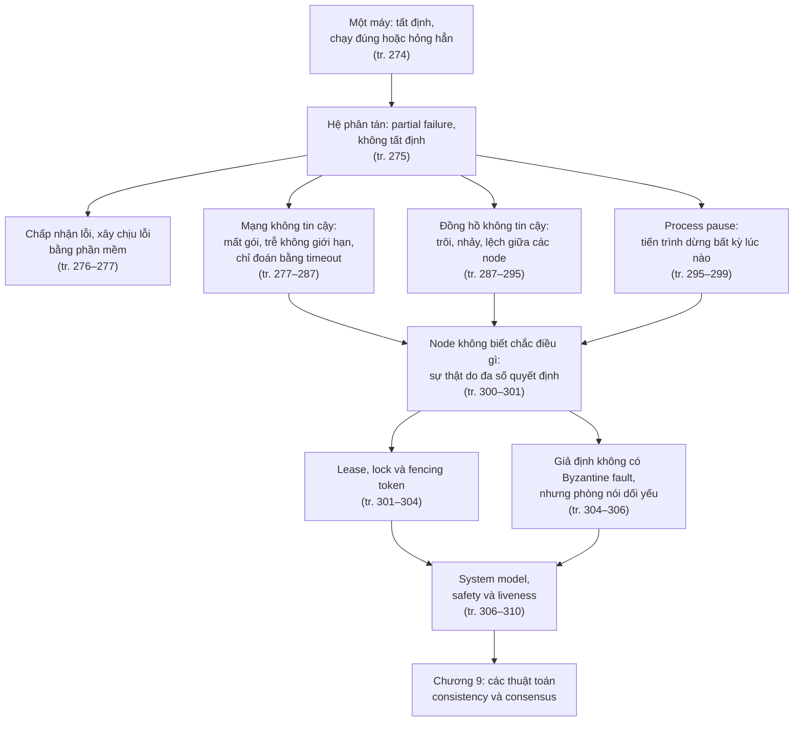

### Liên hệ với các chương khác

| Ý trong chương 8 | Liên hệ | Căn cứ |
| --- | --- | --- |
| Fault khác failure; phần mềm chịu lỗi; chủ động gây fault (Chaos Monkey) | **Chương 1** ([B3.1](chapter-01.md#fault-failure)) | tr. 276–277, 280 |
| Leap second làm crash nhiều hệ thống; cascading failure | **Chương 1** ([B3](chapter-01.md#b3)) | tr. 281, 290 |
| Percentile của response time | **Chương 1** ([percentile](chapter-01.md#percentiles)) | tr. 287, 299 |
| Rolling upgrade | **Chương 1** ([B3](chapter-01.md#b3)), **Chương 4** ([tương thích](chapter-04.md#compatibility)) | tr. 276, 299 |
| Request mạng có thể mất, timeout không rõ kết cục, thử lại có thể làm hai lần | **Chương 4** ([vấn đề của RPC](chapter-04.md#rpc-problems)) | tr. 278–279, 281 |
| Shared-nothing: máy nối với nhau chỉ qua mạng | **Chương 5** ([mục 0.2](chapter-05.md#shared-nothing)) | tr. 277–278 |
| Failover, split brain, fencing và STONITH | **Chương 5** ([failover](chapter-05.md#failover), [những gì có thể sai](chapter-05.md#failover-problems)) | tr. 280, 301–304 |
| Read-after-write dựa trên timestamp | **Chương 5** ([B2.1](chapter-05.md#read-your-writes)) | tr. 287–291 |
| LWW, happens-before, version vector; Hình 5-9 | **Chương 5** ([LWW](chapter-05.md#lww), [phát hiện ghi đồng thời](chapter-05.md#concurrent-writes), [topology](chapter-05.md#topologies)) | tr. 291–293 |
| Quorum đọc và ghi | **Chương 5** ([B4.2](chapter-05.md#quorums), [B4.3](chapter-05.md#quorum-limits)) | tr. 301, 309 |
| Eventual consistency là một liveness property | **Chương 5** ([B2.0](chapter-05.md#eventual-consistency)) | tr. 308 |
| Network partition khác partition (shard) của hệ lưu trữ | **Chương 6** ([chapter-06](chapter-06.md#partition-definition)) | tr. 279 |
| Weak isolation, snapshot isolation | **Chương 7** ([chapter-07](chapter-07.md#snapshot-isolation)) | tr. 273, 294 |
| Consensus, ordering guarantees, Two Generals Problem | **Chương 9** ([chapter-09](chapter-09.md#consensus)) | tr. 274, 293, 295, 301, 304 |
| Batch workload như MapReduce làm bão hòa mạng | **Chương 10** ([chapter-10](chapter-10.md#mapreduce-distributed)) | tr. 284 |
| Hành động bị làm hai lần; "real-time" trên web | **Chương 11** ([chapter-11](chapter-11.md#exactly-once)) | tr. 281, 298 |
| End-to-end argument | **Chương 12** ([chapter-12](chapter-12.md#end-to-end-argument)) | tr. 277 |

> **Bản đồ đầu chương (tr. 272).** Khác các chương trước, bản đồ này không vẽ một vùng đất mà vẽ **một con bạch tuộc khổng lồ** (kraken) mang nhãn **"Distributed Systems"**, đang quấn xúc tu quanh một con thuyền buồm. Ba xúc tu mang nhãn **"Unbounded Network Delay"**, **"Process Pauses"** và **"Clock Error"**. Ở góc trên, một đám mây có khuôn mặt đang thổi gió, mang nhãn **"Harsh Winds of Reality"** (những cơn gió khắc nghiệt của thực tế). Trong ảnh trang, hình được xoay ngang.
>
> *Diễn giải của người viết ghi chú:* ba xúc tu khớp với ba nguồn rắc rối mà chương phân tích: độ trễ mạng không giới hạn ([B2.3](#timeouts)), process pause ([B3.4](#process-pauses)) và lỗi đồng hồ ([B3.1](#monotonic-vs-tod)–[B3.3](#relying-on-clocks)). "Gió thực tế" gợi tới ý ở cuối chương: system model chỉ là một trừu tượng, còn thực tế luôn "cắn lại" người cài đặt ([B4.3](#model-vs-reality), tr. 309–310).

---

<a id="b-chi-tiet"></a>

## B. Giải thích chi tiết

<a id="b1"></a>

### B1. Faults and Partial Failures (tr. 274–277)

<a id="partial-failure"></a>

#### B1.0 Một máy tính và nhiều máy tính (tr. 274–275)

**Phần mềm trên một máy hành xử khá dễ đoán** (tr. 274). Nó **chạy hoặc không chạy**. Phần mềm có bug đôi khi khiến máy như "đang có một ngày tồi tệ" (thường sửa bằng cách reboot), nhưng đó chủ yếu là hệ quả của phần mềm viết kém.

**Không có lý do căn bản nào để phần mềm trên một máy chập chờn** (tr. 274):

- Khi phần cứng chạy đúng, **cùng một thao tác luôn cho cùng một kết quả**: nó **tất định** (*deterministic*).
- Khi phần cứng có vấn đề (bộ nhớ hỏng, đầu nối lỏng), hậu quả thường là **hỏng toàn bộ**: kernel panic, "màn hình xanh chết chóc", không khởi động được.
- Một máy với phần mềm tốt thường **hoặc chạy đầy đủ, hoặc hỏng hẳn**, không có trạng thái lưng chừng.

**Đây là lựa chọn thiết kế có chủ đích** (tr. 274). Khi có fault bên trong, ta muốn máy **crash hẳn** hơn là **trả kết quả sai**, vì kết quả sai rất khó phát hiện và xử lý. Vì vậy máy tính **che giấu thực tế vật lý lộn xộn** bên dưới và đưa ra một **system model lý tưởng**, chạy với sự hoàn hảo của toán học. Một lệnh CPU luôn làm cùng một việc; dữ liệu ghi vào bộ nhớ hay đĩa thì giữ nguyên, không bị hỏng ngẫu nhiên. Mục tiêu "luôn tính đúng" này có từ **chiếc máy tính số đầu tiên** [3].

**Hệ phân tán thì khác hẳn** (tr. 274–275). Khi phần mềm chạy trên nhiều máy nối với nhau qua mạng, ta **không còn** sống trong system model lý tưởng nữa. Ta buộc phải đối mặt với **thực tế lộn xộn của thế giới vật lý**, nơi rất nhiều thứ có thể hỏng. Sách dẫn lời Coda Hale [4]: chỉ với kinh nghiệm "hạn chế" của mình, ông đã gặp mạng bị chia cắt kéo dài trong một datacenter, bộ phân phối điện (PDU) hỏng, switch hỏng, cả rack bị tắt bật điện nhầm, backbone của cả datacenter hỏng, mất điện cả datacenter, và một tài xế bị hạ đường huyết lao xe bán tải vào hệ thống điều hòa của datacenter. Ông còn nói thêm mình không phải dân vận hành.

**What — partial failure** (tr. 275). Trong hệ phân tán, có thể có **một số phần hỏng theo cách khó lường**, trong khi các phần khác vẫn chạy tốt. Tình trạng này gọi là ***partial failure*** (hỏng một phần).

**Why — vì sao khó** (tr. 275). Partial failure **không tất định** (*nondeterministic*):

- Làm bất cứ việc gì liên quan tới nhiều node và mạng, đôi khi **thành công**, đôi khi **thất bại một cách khó lường**.
- Thậm chí **không biết** việc đó đã thành công hay chưa, vì thời gian để một message đi qua mạng **cũng không tất định**.

Chính tính không tất định và khả năng partial failure làm hệ phân tán **khó làm việc** [5].

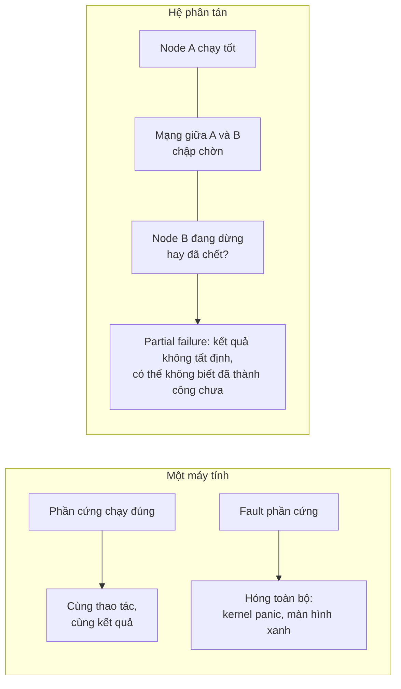

*(Sơ đồ do người viết ghi chú tổng hợp từ tr. 274–275.)*

**Liên hệ.** Chương 1 phân biệt *fault* (một thành phần lệch khỏi đặc tả) với *failure* (cả hệ thống ngừng phục vụ) ([chương 1, B3.1](chapter-01.md#fault-failure)). Partial failure là trường hợp một số thành phần đã có fault mà hệ thống **chưa chắc** đã failure. Câu hỏi của chương này là: phần mềm có biết được thành phần nào đang có fault không, và xử lý thế nào khi không biết.

<a id="cloud-vs-hpc"></a>

#### B1.1 Cloud Computing and Supercomputing (tr. 275–277)

**Một phổ các triết lý** (tr. 275). Có nhiều cách nghĩ về việc xây hệ thống tính toán quy mô lớn:

- Một đầu là ***high-performance computing* (HPC)**. Siêu máy tính có hàng nghìn CPU, thường dùng cho tác vụ khoa học tính toán nặng, như dự báo thời tiết hay *molecular dynamics* (mô phỏng chuyển động của nguyên tử và phân tử).
- Đầu kia là ***cloud computing***. Khái niệm này không được định nghĩa rõ [6], nhưng thường gắn với datacenter **nhiều khách thuê** (*multi-tenant*), máy **phổ thông** (*commodity*) nối bằng mạng IP (thường là Ethernet), cấp phát tài nguyên **co giãn theo nhu cầu**, và **tính tiền theo mức dùng**.
- Datacenter doanh nghiệp truyền thống nằm **đâu đó ở giữa**.

**Siêu máy tính xử lý lỗi thế nào** (tr. 275). Một job thường **ghi checkpoint** trạng thái tính toán xuống storage bền vững theo định kỳ. Nếu một node hỏng, cách phổ biến là **dừng toàn bộ workload** của cluster. Sửa xong node hỏng, tính toán **chạy lại từ checkpoint cuối** [7, 8]. Như vậy siêu máy tính giống **một máy tính đơn** hơn là một hệ phân tán: nó xử lý partial failure bằng cách **leo thang thành total failure**. Phần nào hỏng thì cho tất cả crash, giống kernel panic trên một máy.

**Hệ thống dịch vụ internet rất khác** (tr. 276). Sách tập trung vào hệ thống cài đặt các dịch vụ internet. Khác biệt so với siêu máy tính:

| Khía cạnh | Siêu máy tính (HPC) | Dịch vụ internet trên cloud |
| --- | --- | --- |
| **Yêu cầu phục vụ** | Job offline (batch), như mô phỏng thời tiết, dừng rồi chạy lại được mà ảnh hưởng thấp | **Online**: phải phục vụ người dùng với độ trễ thấp **bất cứ lúc nào**. Dừng cluster để sửa là **không chấp nhận được** |
| **Phần cứng** | Chuyên dụng, mỗi node **khá tin cậy**; giao tiếp qua shared memory và *remote direct memory access* (RDMA) | Máy **phổ thông**: cùng hiệu năng với giá rẻ hơn nhờ quy mô, nhưng **tỷ lệ hỏng cao hơn** |
| **Mạng** | Topology chuyên dụng (multi-dimensional mesh, torus) [10], hiệu năng tốt hơn cho workload HPC có mẫu giao tiếp biết trước | IP và Ethernet, xếp theo **Clos topology** để có *bisection bandwidth* cao [9] |
| **Quy mô và lỗi** | Bỏ cuộc khi lỗi là chiến lược chấp nhận được | Hệ càng lớn càng dễ có thành phần hỏng. Với hàng nghìn node, hợp lý khi giả định **luôn có thứ gì đó đang hỏng** [7]. Nếu chiến lược xử lý lỗi chỉ là bỏ cuộc, hệ lớn sẽ tốn phần lớn thời gian **phục hồi** thay vì làm việc có ích [8] |
| **Vận hành** | — | Chịu được node hỏng mà cả hệ vẫn chạy rất có ích: làm được **rolling upgrade** (Chương 4), khởi động lại từng node trong khi dịch vụ vẫn phục vụ. Trên cloud, máy ảo chạy kém thì **giết đi và xin máy mới** (hy vọng máy mới nhanh hơn) |
| **Địa lý** | Giả định mọi node **ở gần nhau** | Triển khai **phân tán về địa lý** (đặt dữ liệu gần người dùng) nên giao tiếp đi qua internet, **chậm và kém tin cậy** hơn mạng cục bộ |

> **Bổ sung ngoài sách.** RDMA cho phép một máy đọc hoặc ghi trực tiếp vào bộ nhớ của máy khác mà không đi qua CPU và hệ điều hành của máy đó. *Bisection bandwidth* là băng thông tối thiểu giữa hai nửa của mạng khi cắt mạng làm đôi; Clos topology là mạng nhiều tầng switch (dạng leaf–spine) được thiết kế để giá trị này cao.

> **Ví dụ minh họa do AI xây dựng (phép tính).** Giả sử mỗi node có xác suất 0,1% gặp sự cố trong một ngày, độc lập với nhau. Với 1.000 node, xác suất **không node nào** gặp sự cố trong ngày là 0,999¹⁰⁰⁰ ≈ 36,8%. Nghĩa là khoảng **63%** số ngày có ít nhất một node gặp sự cố. Đây là con số minh họa cho nhận xét "luôn có thứ gì đó đang hỏng" (tr. 276).

**Kết luận: xây hệ tin cậy từ thành phần không tin cậy** (tr. 276). Muốn hệ phân tán chạy được, phải **chấp nhận khả năng partial failure** và **đưa cơ chế chịu lỗi vào phần mềm**. Nói cách khác, cần xây **một hệ tin cậy từ các thành phần không tin cậy**. Như Chương 1 đã nói ("Reliability", tr. 6), **không có reliability hoàn hảo**, nên cần hiểu giới hạn của những gì có thể hứa một cách thực tế.

**Ngay cả hệ nhỏ cũng phải nghĩ tới partial failure** (tr. 276–277). Trong hệ vài node, phần lớn thành phần chạy đúng phần lớn thời gian. Nhưng sớm hay muộn sẽ có phần hỏng, và phần mềm phải xử lý nó bằng cách nào đó:

- **Xử lý fault phải là một phần của thiết kế phần mềm.** Người vận hành phải biết phần mềm sẽ hành xử thế nào khi có fault.
- **Đừng giả định fault hiếm rồi hy vọng mọi chuyện ổn.** Cần xét **nhiều loại fault**, kể cả loại khá hiếm, và **cố ý tạo ra** chúng trong môi trường test để xem chuyện gì xảy ra.
- Trong hệ phân tán, **sự nghi ngờ, bi quan và hoang tưởng là đáng giá** (tr. 277).

<a id="reliable-from-unreliable"></a>

**Hộp "Building a Reliable System from Unreliable Components"** (tr. 277).

- **Trực giác sai.** Tưởng như một hệ thống chỉ tin cậy bằng **thành phần kém tin cậy nhất** (mắt xích yếu nhất). Thực ra không phải vậy: xây hệ tin cậy hơn từ nền kém tin cậy hơn là **ý tưởng cũ** trong ngành máy tính [11].
- **Ví dụ 1 — error-correcting code:** cho phép truyền dữ liệu số **chính xác** qua kênh thỉnh thoảng làm sai vài bit, ví dụ do nhiễu sóng trên mạng không dây [12].
- **Ví dụ 2 — TCP trên IP:** IP **không tin cậy**: có thể làm mất, trễ, nhân đôi hay đảo thứ tự gói tin. TCP cung cấp tầng truyền tải tin cậy hơn ở trên: **gửi lại** gói bị mất, **loại bỏ** gói trùng, và **ghép lại** gói theo đúng thứ tự gửi.
- **Nhưng luôn có giới hạn.** Error-correcting code xử lý được **một số ít** lỗi bit đơn; nếu tín hiệu bị nhiễu lấn át, có **giới hạn căn bản** về lượng dữ liệu truyền được qua kênh [13]. TCP che được mất gói, trùng gói và đảo thứ tự, nhưng **không thể xóa độ trễ** của mạng.
- **Vẫn đáng giá.** Hệ tầng cao tin cậy hơn dù không hoàn hảo vẫn có ích: nó lo các fault cấp thấp khó nhằn, nên các fault còn lại thường **dễ suy luận và xử lý hơn**. Sách quay lại ở "The end-to-end argument" (tr. 519, [Chương 12](chapter-12.md#end-to-end-argument)).

> **Bổ sung ngoài sách.** Tài liệu [11] là bài báo năm 1956 của John von Neumann về việc tổng hợp "cơ thể" tin cậy từ các thành phần không tin cậy; [13] là bài báo năm 1948 của Claude Shannon đặt nền cho lý thuyết thông tin, trong đó "giới hạn căn bản" chính là dung lượng kênh (*channel capacity*).

---

<a id="b2"></a>

### B2. Unreliable Networks (tr. 277–287)

<a id="async-network"></a>

#### B2.0 Mạng gói bất đồng bộ (tr. 277–279)

**Nhắc lại bối cảnh** (tr. 277–278). Như phần giới thiệu Part II đã nói ([chương 5, mục 0.2](chapter-05.md#shared-nothing)), sách tập trung vào hệ **shared-nothing**: một nhóm máy nối với nhau qua mạng. **Mạng là cách duy nhất** để các máy giao tiếp. Mỗi máy có bộ nhớ và đĩa riêng; máy này không truy cập được bộ nhớ hay đĩa của máy kia, trừ khi gửi request tới một service qua mạng.

**Vì sao shared-nothing thống trị** (tr. 278). Shared-nothing không phải cách duy nhất, nhưng đã thành cách **chủ đạo** để xây dịch vụ internet:

- tương đối **rẻ**, vì không cần phần cứng đặc biệt;
- dùng được các dịch vụ **cloud computing** đã phổ thông hóa;
- đạt **reliability cao** nhờ dư thừa trên **nhiều datacenter phân tán về địa lý**.

**What — asynchronous packet network** (tr. 278). Internet và phần lớn mạng nội bộ trong datacenter (thường là Ethernet) là ***asynchronous packet network*** (mạng gói bất đồng bộ). Một node có thể gửi một message (một gói tin) tới node khác, nhưng mạng **không đảm bảo** khi nào nó tới, **thậm chí không đảm bảo** nó có tới hay không.

**Những gì có thể hỏng khi gửi request và chờ response** (tr. 278):

| # | Chuyện gì xảy ra | Ví dụ nguyên nhân |
| --- | --- | --- |
| 1 | Request **bị mất** | Ai đó rút dây mạng |
| 2 | Request đang **chờ trong hàng đợi**, sẽ được giao sau | Mạng hoặc bên nhận quá tải |
| 3 | Node từ xa **đã hỏng** | Crash hoặc bị tắt nguồn |
| 4 | Node từ xa **tạm thời ngừng phản hồi**, lát nữa sẽ phản hồi lại | Đang bị dừng lâu do garbage collection ([B3.4](#process-pauses), tr. 295) |
| 5 | Node từ xa **đã xử lý** request, nhưng **response bị mất** trên mạng | Switch mạng cấu hình sai |
| 6 | Node từ xa **đã xử lý** request, nhưng **response bị trễ**, sẽ tới sau | Mạng hoặc chính máy của bạn quá tải |

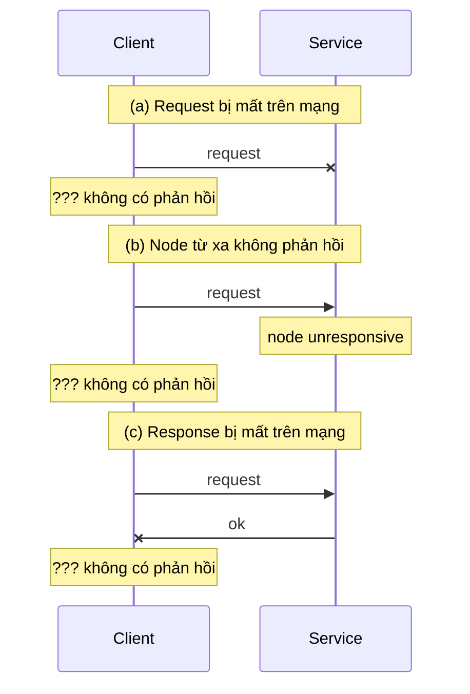

*(Vẽ lại Hình 8-1, tr. 278: gửi request mà không nhận được response thì không phân biệt được (a) request bị mất, (b) node từ xa đã chết, hay (c) response bị mất. Hình gốc có thêm làn "Network" ở giữa client và service; dấu X đánh dấu chỗ message bị mất.)*

**Why — không thể biết vì sao** (tr. 279). Bên gửi **thậm chí không biết** gói tin đã được giao hay chưa. Cách duy nhất là bên nhận gửi lại một response, nhưng response đó **cũng có thể mất hoặc trễ**. Trong mạng bất đồng bộ, các trường hợp trên **không phân biệt được với nhau**: thông tin duy nhất bạn có là **chưa nhận được response**. Gửi request mà không nhận được response thì **không thể** biết lý do.

**How — cách thường dùng: timeout** (tr. 279). Sau một khoảng thời gian, **bỏ cuộc** và coi như response sẽ không tới. Nhưng khi timeout xảy ra, bạn **vẫn không biết** node từ xa đã nhận request hay chưa. Và nếu request vẫn đang nằm trong một hàng đợi nào đó, nó **vẫn có thể được giao** tới bên nhận, dù bên gửi đã bỏ cuộc.

**Liên hệ.** Chương 4 đã nêu cùng vấn đề ở góc độ RPC: request qua mạng có thêm một kết cục mà lời gọi hàm cục bộ không có, là **timeout không rõ kết cục**, và thử lại có thể làm hành động **hai lần** nếu không có idempotence ([chương 4, vấn đề của RPC](chapter-04.md#rpc-problems)).

> **Ví dụ minh họa do AI xây dựng.** Service đặt hàng gửi request "trừ kho 1 sản phẩm" sang service kho và chờ 2 giây không thấy gì. Có ba khả năng thật sự khác nhau: kho chưa nhận được (cần gửi lại), kho đã chết (cần chuyển sang node khác), hoặc kho đã trừ xong nhưng response mất (gửi lại sẽ trừ hai lần). Service đặt hàng **không có cách nào** phân biệt ba khả năng này chỉ từ việc "chưa có response".

<a id="network-faults"></a>

#### B2.1 Network Faults in Practice (tr. 279–280)

**Mạng vẫn chưa tin cậy** (tr. 279). Ta đã xây mạng máy tính hàng chục năm, nên có thể hy vọng giờ đã biết cách làm chúng tin cậy. Nhưng có vẻ ta **vẫn chưa làm được**.

**Bằng chứng** (tr. 279). Có các nghiên cứu hệ thống và rất nhiều giai thoại cho thấy sự cố mạng **phổ biến đáng ngạc nhiên**, kể cả trong môi trường được kiểm soát như datacenter do một công ty vận hành [14]:

- Một nghiên cứu ở một datacenter cỡ vừa thấy khoảng **12 sự cố mạng mỗi tháng**: **một nửa** làm mất kết nối **một máy**, **một nửa** làm mất kết nối **cả một rack** [15].
- Một nghiên cứu khác đo tỷ lệ hỏng của các thành phần như top-of-rack switch, aggregation switch và load balancer [16]. Kết quả: **thêm thiết bị mạng dự phòng không giảm fault nhiều như kỳ vọng**, vì nó không chống được **lỗi con người** (ví dụ cấu hình switch sai), một nguyên nhân lớn gây sự cố.
- Dịch vụ cloud công cộng như **EC2** nổi tiếng hay có **trục trặc mạng thoáng qua** [14]; mạng datacenter riêng được quản lý tốt có thể ổn định hơn.

**Không ai miễn nhiễm** (tr. 279). Một số sự cố đáng chú ý:

- Sự cố khi **nâng cấp phần mềm của switch** có thể kích hoạt việc cấu hình lại topology mạng, trong lúc đó gói tin có thể bị **trễ hơn một phút** [17].
- **Cá mập** có thể cắn và làm hỏng cáp ngầm dưới biển [18].
- Một card mạng đôi khi **bỏ mọi gói tin đi vào** nhưng **gửi gói tin đi ra bình thường** [19]. Một đường mạng chạy được theo chiều này **không có nghĩa** nó chạy được theo chiều ngược lại.

<a id="network-partition"></a>

> **Ghi chú "Network partitions"** (tr. 279). Khi một phần mạng bị cắt khỏi phần còn lại do fault mạng, tình trạng này đôi khi gọi là ***network partition*** hay ***netsplit***. Sách thường dùng thuật ngữ chung hơn là ***network fault***, để tránh nhầm với **partition (shard)** của hệ lưu trữ ở [Chương 6](chapter-06.md#partition-definition).

**Phần mềm phải xử lý được fault mạng** (tr. 280). Dù fault mạng hiếm trong môi trường của bạn, việc nó **có thể** xảy ra nghĩa là phần mềm phải xử lý được. Mọi giao tiếp qua mạng đều có thể thất bại, **không có cách nào tránh**.

**Hậu quả khi không định nghĩa và test cách xử lý** (tr. 280). Nếu cách xử lý fault mạng **chưa được định nghĩa và kiểm thử**, những điều **tệ tùy ý** có thể xảy ra:

- Cluster có thể bị **deadlock** và **vĩnh viễn** không phục vụ được request, **ngay cả khi mạng đã phục hồi** [20].
- Thậm chí có thể **xóa toàn bộ dữ liệu** [21].
- Phần mềm bị đặt vào tình huống không lường trước thì có thể làm những việc bất ngờ tùy ý.

> **Bổ sung ngoài sách (đọc từ danh sách tài liệu tham khảo của sách).** [20] là bài "Call Me Maybe: Elasticsearch" của Kyle Kingsbury; [21] là bài của Salvatore Sanfilippo về các tính chất và kịch bản lỗi của Redis Sentinel. Phần chữ của chương không nêu tên sản phẩm cho hai ví dụ này.

**Xử lý không nhất thiết là chịu đựng** (tr. 280). Nếu mạng **bình thường khá tin cậy**, một cách hợp lệ là chỉ **hiện thông báo lỗi** cho người dùng trong lúc mạng có vấn đề. Nhưng bạn **phải biết** phần mềm phản ứng thế nào với sự cố mạng, và bảo đảm hệ thống **phục hồi được**. Có thể hợp lý khi **cố ý gây sự cố mạng** để kiểm tra phản ứng của hệ thống, đúng ý tưởng đằng sau Chaos Monkey ([chương 1, B3.1](chapter-01.md#fault-failure), tr. 6).

<a id="detecting-faults"></a>

#### B2.2 Detecting Faults (tr. 280–281)

**Why — vì sao cần phát hiện tự động** (tr. 280). Nhiều hệ thống cần **tự động phát hiện** node hỏng. Ví dụ:

- **Load balancer** phải ngừng gửi request tới node đã chết (đưa nó ra khỏi vòng phục vụ, *out of rotation*).
- Trong database phân tán dùng **single-leader replication**, nếu leader hỏng, một follower phải được nâng lên làm leader mới ([chương 5, failover](chapter-05.md#failover), tr. 156).

**Vấn đề** (tr. 280). Sự bất định của mạng khiến **khó biết** một node đang chạy hay không. Trong một số trường hợp cụ thể, bạn **có** được tín hiệu tường minh cho biết có gì đó không chạy:

| Tình huống | Tín hiệu | Giới hạn |
| --- | --- | --- |
| Với tới được **máy**, nhưng **không có tiến trình** nào nghe ở cổng đích (ví dụ tiến trình đã crash) | Hệ điều hành đóng hoặc từ chối kết nối TCP bằng gói **RST** hoặc **FIN** | Nếu node crash **giữa lúc** đang xử lý request, không có cách biết nó **đã xử lý được bao nhiêu** dữ liệu [22] |
| **Tiến trình** của node crash (hoặc bị quản trị viên kill) nhưng **hệ điều hành** vẫn chạy | Một **script** báo cho các node khác biết, để node khác **tiếp quản nhanh** mà không chờ timeout. HBase làm như vậy [23] | Chỉ dùng được khi hệ điều hành của node vẫn sống |
| Có quyền vào **giao diện quản lý của switch** trong datacenter | Truy vấn switch để phát hiện **link hỏng ở mức phần cứng** (ví dụ máy từ xa đã tắt nguồn) | Không dùng được khi kết nối qua internet, khi ở datacenter dùng chung không có quyền vào switch, hoặc khi chính sự cố mạng làm không với tới giao diện quản lý |
| **Router** chắc chắn địa chỉ IP bạn muốn kết nối **không với tới được** | Router trả gói **ICMP Destination Unreachable** | Router **không có khả năng thần kỳ** phát hiện lỗi; nó chịu cùng giới hạn như mọi thành phần khác trong mạng |

**Tín hiệu nhanh có ích, nhưng không thể trông cậy** (tr. 281):

- Ngay cả khi TCP xác nhận gói tin **đã được giao**, ứng dụng vẫn có thể **crash trước khi xử lý** nó. Muốn chắc request đã thành công, cần một **response tích cực từ chính ứng dụng** [24].
- Ngược lại, khi có sự cố, bạn **có thể** nhận response lỗi ở một tầng nào đó của stack, nhưng nói chung phải giả định **không nhận được response nào cả**.
- Có thể **thử lại** vài lần (TCP tự thử lại một cách trong suốt, nhưng bạn cũng có thể thử lại ở tầng ứng dụng), chờ **timeout** trôi qua, và cuối cùng **tuyên bố node đã chết** nếu không nghe thấy gì trong khoảng timeout.

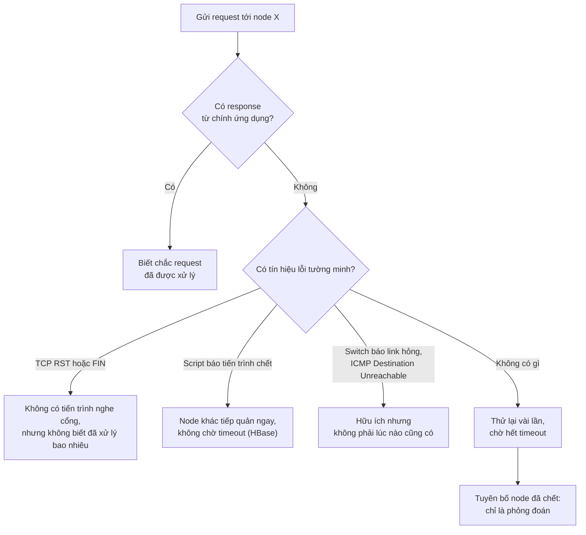

*(Sơ đồ do người viết ghi chú tổng hợp từ tr. 280–281.)*

> **Bổ sung ngoài sách.** Tài liệu [24] là bài báo "End-To-End Arguments in System Design" (Saltzer, Reed, Clark, 1984). Ý "cần response tích cực từ chính ứng dụng" là một áp dụng của lập luận end-to-end: chỉ hai đầu cuối của một giao tiếp mới biết chắc việc đã xong, tầng dưới (TCP) không biết thay được. Sách bàn kỹ lập luận này ở Chương 12 (tr. 519).

<a id="timeouts"></a>

#### B2.3 Timeouts and Unbounded Delays (tr. 281–284)

**Câu hỏi** (tr. 281). Nếu timeout là cách **chắc chắn duy nhất** để phát hiện fault, timeout nên **dài bao nhiêu**? Tiếc là **không có câu trả lời đơn giản**.

**Trade-off của độ dài timeout** (tr. 281):

- **Timeout dài:** phải chờ **lâu** mới tuyên bố node đã chết. Trong lúc đó người dùng có thể phải chờ hoặc thấy thông báo lỗi.
- **Timeout ngắn:** phát hiện fault **nhanh hơn**, nhưng rủi ro cao hơn là **tuyên bố nhầm** node đã chết trong khi nó chỉ **chậm tạm thời** (ví dụ do tải tăng đột biến trên node hoặc trên mạng).

**Tuyên bố chết quá sớm có hại thế nào** (tr. 281):

1. **Hành động bị làm hai lần.** Nếu node thật ra **vẫn sống** và đang giữa chừng một hành động (ví dụ **gửi email**), rồi một node khác tiếp quản, hành động đó có thể bị **thực hiện hai lần**. Sách bàn kỹ hơn ở [B4](#b4) (tr. 300), [Chương 9](chapter-09.md#exactly-once) và [Chương 11](chapter-11.md#idempotence).
2. **Thêm tải đúng lúc hệ thống yếu nhất.** Khi một node bị tuyên bố chết, trách nhiệm của nó phải chuyển sang node khác, tạo thêm tải cho các node khác và cho mạng. Nếu hệ thống **đang chật vật vì tải cao**, tuyên bố chết sớm có thể làm vấn đề **tệ hơn**.
3. **Cascading failure.** Có thể node **không chết**, chỉ **phản hồi chậm vì quá tải**. Chuyển tải của nó sang node khác có thể gây ***cascading failure*** (lỗi dây chuyền). Trường hợp cực đoan: **mọi node tuyên bố nhau đã chết** và mọi thứ ngừng chạy. (Cascading failure đã được nêu ở [chương 1, B3](chapter-01.md#b3).)

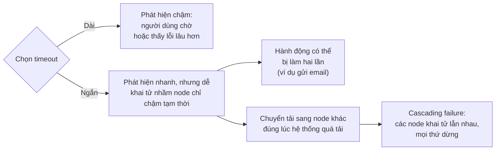

*(Sơ đồ do người viết ghi chú tổng hợp từ tr. 281.)*

**Thí nghiệm tưởng tượng: mạng có giới hạn độ trễ** (tr. 282). Giả sử có một hệ thống hư cấu mà:

- mạng **đảm bảo độ trễ tối đa** cho gói tin: mỗi gói hoặc được giao trong thời gian **d**, hoặc bị mất, nhưng **không bao giờ** giao lâu hơn d;
- một node không hỏng **luôn xử lý** request trong thời gian **r**.

Khi đó có thể đảm bảo mọi request thành công nhận được response trong **2d + r** (request đi mất tối đa d, xử lý tối đa r, response về mất tối đa d). Không nhận được response trong thời gian đó thì **biết chắc** mạng hoặc node từ xa đang không chạy. **2d + r** sẽ là một timeout hợp lý.

> **Ví dụ minh họa do AI xây dựng (phép tính).** Nếu d = 10 ms và r = 50 ms thì timeout an toàn là 2 × 10 + 50 = 70 ms. Mọi response tới sau 70 ms đều chắc chắn là dấu hiệu lỗi, không phải do chậm.

**Thực tế không có cả hai đảm bảo** (tr. 282):

- Mạng bất đồng bộ có ***unbounded delay*** (độ trễ không giới hạn): chúng cố giao gói tin **nhanh nhất có thể**, nhưng **không có giới hạn trên** cho thời gian gói tin tới nơi.
- Phần lớn bản cài server **không đảm bảo** xử lý request trong một thời gian tối đa ("Response time guarantees", [B3.4](#real-time), tr. 298).
- Với việc phát hiện lỗi, hệ thống **nhanh phần lớn thời gian là không đủ**. Nếu timeout thấp, chỉ cần một lần **round-trip time tăng vọt thoáng qua** là đủ làm hệ thống mất cân bằng.

<a id="network-congestion"></a>

**Network congestion and queueing** (tr. 282–283).

Khi lái xe, thời gian đi đường biến động nhiều nhất là do **tắc đường**. Tương tự, độ trễ gói tin trên mạng máy tính biến động chủ yếu do **xếp hàng** (*queueing*) [25]. Gói tin có thể phải xếp hàng ở nhiều chỗ:

1. **Ở switch mạng.** Nếu nhiều node cùng lúc gửi gói tới **cùng một đích**, switch phải xếp chúng vào hàng đợi và đẩy **lần lượt từng gói** vào đường truyền tới đích (Hình 8-2). Trên đường truyền bận, gói tin có thể phải chờ một lúc mới có chỗ; hiện tượng này gọi là ***network congestion*** (nghẽn mạng). Nếu dữ liệu tới nhiều tới mức **hàng đợi của switch đầy**, gói tin **bị bỏ** và phải gửi lại, **dù mạng vẫn hoạt động bình thường**.
2. **Ở máy đích.** Khi gói tin tới máy đích mà **mọi lõi CPU đang bận**, hệ điều hành xếp request vào hàng đợi cho tới khi ứng dụng sẵn sàng xử lý. Tùy tải của máy, việc này có thể **lâu tùy ý**.
3. **Ở môi trường ảo hóa.** Một hệ điều hành đang chạy thường bị **dừng hàng chục mili giây** trong lúc một máy ảo khác dùng lõi CPU. Trong lúc đó máy ảo không đọc được dữ liệu từ mạng, nên dữ liệu tới được *virtual machine monitor* xếp vào bộ đệm [26], làm độ trễ mạng **biến động thêm**.
4. **Ở chính bên gửi.** TCP thực hiện ***flow control*** (còn gọi *congestion avoidance* hay ***backpressure***): một node **tự giới hạn tốc độ gửi** để tránh làm quá tải đường truyền hoặc node nhận [27]. Nghĩa là có **thêm hàng đợi ở bên gửi**, trước khi dữ liệu kịp vào mạng.

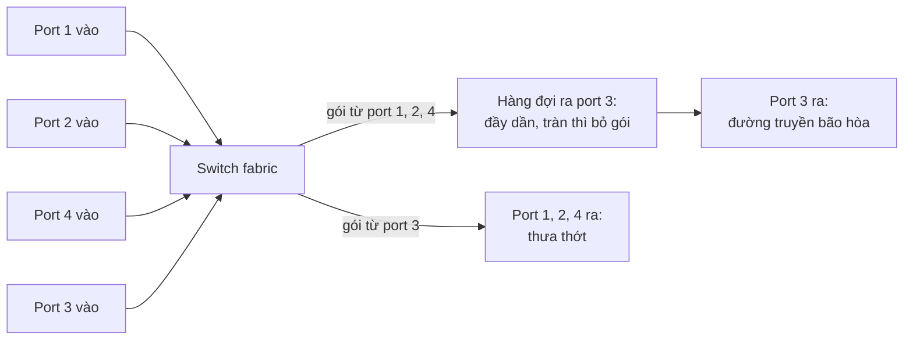

*(Vẽ lại Hình 8-2, tr. 283: port 1, 2 và 4 cùng gửi gói tới port 3, nên hàng đợi ra của port 3 đầy dần. Trong hình gốc, gói của port 3 tỏa ra các port 1, 2, 4 với mật độ thấp.)*

**TCP retransmission cũng thêm độ trễ** (tr. 283). TCP coi một gói là **mất** nếu không được xác nhận trong một khoảng timeout (tính từ round-trip time quan sát được), và gói mất được **tự động gửi lại**. Ứng dụng không thấy việc mất gói và gửi lại, nhưng **thấy độ trễ** do nó gây ra: chờ timeout trôi qua, rồi chờ gói gửi lại được xác nhận.

<a id="tcp-udp"></a>

**Hộp "TCP Versus UDP"** (tr. 283).

- **Ai dùng UDP.** Một số ứng dụng nhạy độ trễ như **hội nghị video** và **Voice over IP (VoIP)** dùng UDP thay vì TCP.
- **Trade-off:** giữa **độ tin cậy** và **độ biến động của độ trễ**. UDP **không** flow control và **không** gửi lại gói mất, nên tránh được **một số** nguyên nhân gây độ trễ biến động (nhưng vẫn chịu hàng đợi ở switch và độ trễ do lập lịch).
- **Khi nào UDP hợp lý:** khi **dữ liệu trễ là dữ liệu vô giá trị**. Trong cuộc gọi VoIP, có lẽ **không đủ thời gian** gửi lại gói mất trước khi dữ liệu của nó phải phát ra loa. Gửi lại là vô nghĩa; ứng dụng lấp khoảng thời gian của gói mất bằng **im lặng** (âm thanh ngắt quãng một chút) rồi đi tiếp. Việc thử lại diễn ra ở **tầng con người**: "Bạn nói lại được không? Tiếng vừa bị mất."

**Xếp hàng tệ nhất khi gần hết công suất** (tr. 283–284). Mọi yếu tố trên góp phần làm độ trễ mạng biến động. Độ trễ xếp hàng có **biên độ đặc biệt rộng** khi hệ thống **gần công suất tối đa**: hệ còn dư nhiều công suất thì xả hàng đợi dễ dàng, còn hệ được tận dụng cao thì hàng đợi dài hình thành **rất nhanh**.

> **Bổ sung ngoài sách (phép tính theo lý thuyết hàng đợi).** Với mô hình hàng đợi đơn giản nhất (M/M/1), thời gian trung bình một yêu cầu ở trong hệ thống bằng thời gian phục vụ chia cho (1 − ρ), với ρ là mức tận dụng. Ở ρ = 50%, thời gian đó gấp 2 lần thời gian phục vụ; ở 90% gấp 10 lần; ở 99% gấp 100 lần. Đường cong dựng đứng khi tiến gần 100% là lý do độ trễ "nổ tung" khi hệ thống gần hết công suất.

**Môi trường nhiều khách thuê** (tr. 284). Trên cloud công cộng và datacenter multi-tenant, tài nguyên được **chia sẻ** giữa nhiều khách hàng: đường truyền và switch, thậm chí card mạng và CPU của từng máy (khi chạy máy ảo). Batch workload như MapReduce ([Chương 10](chapter-10.md#mapreduce-distributed)) dễ dàng **làm bão hòa** đường truyền. Bạn **không kiểm soát** và **không nhìn thấy** việc dùng tài nguyên chung của khách hàng khác, nên độ trễ mạng có thể **biến động rất mạnh** nếu một người ở gần bạn dùng nhiều tài nguyên (***noisy neighbor***, "hàng xóm ồn ào") [28, 29].

<a id="phi-accrual"></a>

**How — chọn timeout thế nào** (tr. 284):

1. **Chọn bằng thực nghiệm.** Đo **phân phối round-trip time** của mạng trong **thời gian dài** và trên **nhiều máy**, để biết độ biến động kỳ vọng của độ trễ. Rồi, xét đặc điểm của ứng dụng, chọn điểm cân bằng giữa **độ trễ phát hiện lỗi** và **rủi ro timeout sớm**.
2. **Tốt hơn nữa: timeout thích nghi.** Thay vì dùng timeout hằng số cấu hình sẵn, hệ thống có thể **liên tục đo** response time và độ biến động của nó (***jitter***), rồi **tự điều chỉnh** timeout theo phân phối quan sát được. Đó là việc của ***Phi Accrual failure detector*** [30], được dùng trong **Akka** và **Cassandra** [31]. **Timeout gửi lại của TCP** cũng hoạt động tương tự [27].

> **Bổ sung ngoài sách.** Phi Accrual failure detector không trả lời "sống hay chết" mà đưa ra một **mức nghi ngờ** φ thay đổi liên tục. Nó ghi lại khoảng cách giữa các heartbeat gần đây, ước lượng phân phối của chúng, rồi tính xác suất heartbeat tiếp theo vẫn có thể tới muộn như hiện tại; φ là −log₁₀ của xác suất đó. φ càng cao, khả năng node đã chết càng lớn. Ứng dụng chọn ngưỡng φ (Cassandra cho cấu hình ngưỡng này), nên mạng chập chờn thì φ tăng chậm hơn và ít khai tử nhầm hơn.

> **Liên hệ.** Lời khuyên "đo phân phối, không dùng một con số" giống bài học ở Chương 1: response time là một **phân phối**, cần nhìn **percentile cao** thay vì trung bình ([chương 1, percentile](chapter-01.md#percentiles)).

<a id="sync-async-networks"></a>

#### B2.4 Synchronous Versus Asynchronous Networks (tr. 284–287)

**Câu hỏi** (tr. 284). Hệ phân tán sẽ **đơn giản hơn nhiều** nếu mạng giao gói tin với **độ trễ tối đa cố định** và **không làm mất** gói tin. Vậy sao không giải quyết ở **tầng phần cứng**, làm mạng tin cậy để phần mềm khỏi phải lo?

<a id="circuit-switching"></a>

**So sánh với mạng điện thoại cố định** (tr. 284–285). Mạng điện thoại cố định truyền thống (không di động, không VoIP) **cực kỳ tin cậy**: khung âm thanh bị trễ hay cuộc gọi bị rớt **rất hiếm**. Một cuộc gọi cần **độ trễ đầu cuối thấp liên tục** và **đủ băng thông** để truyền mẫu âm thanh.

- **What — circuit.** Khi gọi điện, mạng điện thoại thiết lập một ***circuit*** (mạch): một lượng băng thông **cố định, được đảm bảo** được cấp cho cuộc gọi **dọc toàn bộ tuyến đường** giữa hai người. Circuit giữ nguyên tới khi cuộc gọi kết thúc [32].
- **Ví dụ ISDN.** Mạng ISDN chạy với tốc độ cố định **4.000 frame mỗi giây**. Khi cuộc gọi được thiết lập, nó được cấp **16 bit** trong mỗi frame (mỗi chiều). Suốt cuộc gọi, mỗi bên được đảm bảo gửi **đúng 16 bit âm thanh mỗi 250 micro giây** [33, 34].
- **Vì sao không xếp hàng.** Mạng kiểu này là ***synchronous*** (đồng bộ): dữ liệu đi qua nhiều router mà **không phải xếp hàng**, vì 16 bit cho cuộc gọi **đã được giữ chỗ sẵn** ở chặng kế tiếp. Không xếp hàng thì độ trễ đầu cuối tối đa là **cố định**. Ta gọi đó là ***bounded delay*** (độ trễ có giới hạn).

> **Bổ sung ngoài sách (phép tính).** 4.000 frame mỗi giây nghĩa là mỗi frame cách nhau 1/4.000 giây = 250 µs, khớp với con số của sách. Băng thông của một chiều cuộc gọi là 16 bit × 4.000 = 64.000 bit/s = **64 kbit/s**, đúng bằng một kênh thoại chuẩn của ISDN.

**Can we not simply make network delays predictable?** (tr. 285–286).

- **Circuit khác kết nối TCP.** Circuit là lượng băng thông **giữ chỗ cố định**, không ai khác dùng được khi circuit còn tồn tại. Gói tin của kết nối TCP thì **tận dụng cơ hội** mọi băng thông đang có. Đưa cho TCP một khối dữ liệu kích thước bất kỳ (một email, một trang web), nó cố truyền **nhanh nhất có thể**. Khi kết nối TCP rảnh, nó **không dùng băng thông nào**.

> Chú thích ii (tr. 285). Có thể trừ thỉnh thoảng một gói *keepalive*, nếu bật TCP keepalive.

- **Ethernet và IP là packet-switched.** Nếu mạng datacenter và internet là mạng ***circuit-switched***, có thể đảm bảo round-trip time tối đa khi thiết lập circuit. Nhưng không phải vậy: Ethernet và IP là giao thức ***packet-switched***, chịu **xếp hàng** và do đó có **độ trễ không giới hạn**. Các giao thức này **không có khái niệm circuit**.
- **Why — vì sao dùng packet switching.** Mạng datacenter và internet được **tối ưu cho lưu lượng bùng nổ** (*bursty traffic*). Circuit hợp với cuộc gọi âm thanh hay video, cần truyền một số bit mỗi giây **khá đều** trong suốt cuộc gọi. Còn tải trang web, gửi email hay truyền file **không có yêu cầu băng thông cụ thể**: ta chỉ muốn nó xong **càng nhanh càng tốt**.
- **Truyền file qua circuit thì sao?** Phải **đoán** trước mức băng thông cần cấp. Đoán **thấp** thì truyền chậm không cần thiết, để thừa công suất mạng. Đoán **cao** thì **không lập được circuit**, vì mạng không cho tạo circuit nếu không đảm bảo được băng thông đó. Vì vậy dùng circuit cho truyền dữ liệu bùng nổ vừa **lãng phí công suất mạng** vừa làm truyền **chậm không cần thiết**. Ngược lại, TCP **tự điều chỉnh** tốc độ truyền theo công suất mạng đang có.
- **Mạng lai.** Đã có nỗ lực xây mạng hỗ trợ cả circuit switching lẫn packet switching, như **ATM**. **InfiniBand** có vài điểm giống [35]: nó cài **flow control đầu cuối** ở tầng liên kết, giảm nhu cầu xếp hàng trong mạng, nhưng vẫn có thể bị trễ do nghẽn đường truyền [36]. Dùng cẩn thận ***quality of service*** (**QoS**: ưu tiên và lập lịch gói tin) và ***admission control*** (giới hạn tốc độ của bên gửi), có thể **giả lập circuit switching** trên mạng gói, hoặc cung cấp **độ trễ có giới hạn theo thống kê** [25, 32].

> Chú thích iii (tr. 285). ATM (*Asynchronous Transfer Mode*) từng là đối thủ của Ethernet vào những năm 1980 [32], nhưng ít được dùng ngoài các switch lõi của mạng điện thoại. Nó không liên quan gì tới máy rút tiền ATM, dù trùng tên viết tắt. Tác giả đùa: có lẽ ở một vũ trụ song song nơi internet dựa trên thứ gì đó giống ATM, cuộc gọi video qua internet tin cậy hơn nhiều vì không bị mất và trễ gói.

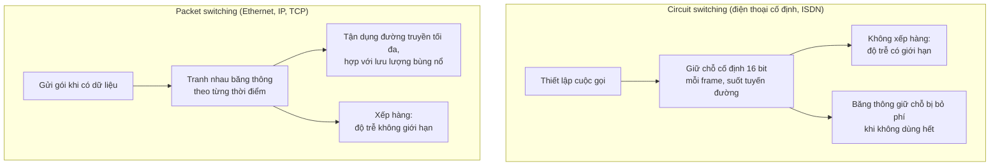

*(Sơ đồ do người viết ghi chú tổng hợp từ tr. 284–286.)*

<a id="latency-utilization"></a>

**Hộp "Latency and Resource Utilization"** (tr. 286).

- **Ý chính.** Có thể coi độ trễ biến động là **hệ quả của việc chia tài nguyên động** (*dynamic resource partitioning*).
- **Chia tĩnh.** Giả sử một đường dây giữa hai tổng đài điện thoại mang được tối đa **10.000 cuộc gọi đồng thời**. Mỗi circuit đi qua đường dây chiếm một "khe" cuộc gọi. Tài nguyên được chia **tĩnh**: dù bạn là cuộc gọi **duy nhất** trên dây và 9.999 khe kia đang trống, circuit của bạn vẫn chỉ được **đúng lượng băng thông cố định** như khi dây đầy.
- **Chia động.** Internet chia băng thông **động**. Các bên gửi chen lấn để đưa gói qua dây nhanh nhất có thể, và switch quyết định gửi gói nào (tức phân bổ băng thông) **từ thời điểm này sang thời điểm khác**. Nhược điểm là **xếp hàng**; ưu điểm là **tận dụng dây tối đa**. Dây có chi phí cố định, nên tận dụng tốt hơn thì **mỗi byte gửi đi rẻ hơn**.
- **CPU cũng vậy.** Chia mỗi lõi CPU **động** cho nhiều thread thì đôi khi một thread phải chờ trong **run queue** của hệ điều hành khi thread khác đang chạy, nên thread có thể bị dừng với độ dài khác nhau. Nhưng cách này tận dụng phần cứng tốt hơn việc cấp cố định một số chu kỳ CPU cho mỗi thread ([B3.4](#real-time), tr. 298). Tận dụng phần cứng tốt hơn cũng là động lực lớn để dùng **máy ảo**.
- **Đảm bảo độ trễ có thể đạt được** trong một số môi trường, nếu tài nguyên được **chia tĩnh** (phần cứng chuyên dụng, cấp phát băng thông độc quyền). Cái giá là **tận dụng thấp hơn**, tức **đắt hơn**. Ngược lại, multi-tenancy với chia tài nguyên động **tận dụng tốt hơn**, nên **rẻ hơn**, nhưng có nhược điểm là **độ trễ biến động**.
- **Kết luận của hộp:** độ trễ biến động trong mạng **không phải quy luật tự nhiên**, mà chỉ là kết quả của một **trade-off chi phí và lợi ích**.

**Hiện trạng** (tr. 287). QoS kiểu trên **hiện chưa được bật** trong datacenter multi-tenant và cloud công cộng, hay khi giao tiếp qua internet. Công nghệ đang triển khai **không cho phép** đảm bảo gì về độ trễ hay độ tin cậy của mạng. Ta phải giả định **nghẽn mạng, xếp hàng và độ trễ không giới hạn sẽ xảy ra**. Vì vậy **không có giá trị timeout "đúng"**: phải xác định bằng **thực nghiệm**.

> Chú thích iv (tr. 287). Thỏa thuận *peering* giữa các nhà cung cấp dịch vụ internet và việc thiết lập tuyến qua *Border Gateway Protocol* (BGP) **giống circuit switching hơn** bản thân IP. Ở mức này có thể **mua băng thông riêng**. Nhưng định tuyến internet hoạt động ở mức **mạng**, không ở mức kết nối giữa từng cặp máy, và ở **thang thời gian dài hơn nhiều**.

**System Design.**

- Đừng thiết kế như thể mạng có độ trễ tối đa. Mọi giao tiếp qua mạng phải có **timeout**, và mọi timeout là một **phỏng đoán** có thể sai theo cả hai chiều (tr. 281–282, 287).
- Timeout nên được chọn dựa trên **phân phối đo được** trong môi trường thật, hoặc tự thích nghi (Phi Accrual), thay vì một con số cố định đoán trước (tr. 284).
- **Ví dụ minh họa do AI xây dựng:** khi tuyên bố một node chết sẽ kéo theo việc chuyển một lượng tải lớn, nên thêm "phanh" (giới hạn số node được khai tử trong một khoảng thời gian, hoặc yêu cầu xác nhận từ nhiều node) để tránh cascading failure như mô tả ở tr. 281.

---

<a id="b3"></a>

### B3. Unreliable Clocks (tr. 287–299)

<a id="clocks-intro"></a>

#### B3.0 Đồng hồ dùng để làm gì, và vì sao khó (tr. 287–288)

**Ứng dụng phụ thuộc đồng hồ theo nhiều cách** (tr. 287). Sách nêu tám câu hỏi, chia làm hai nhóm:

| Nhóm | Câu hỏi ví dụ |
| --- | --- |
| **Đo khoảng thời gian** (*duration*): khoảng giữa lúc gửi request và lúc nhận response | (1) Request này đã timeout chưa? (2) Response time ở percentile 99 của service là bao nhiêu? (3) Trung bình service xử lý bao nhiêu truy vấn mỗi giây trong 5 phút qua? (4) Người dùng ở lại trang web bao lâu? |
| **Mô tả thời điểm** (*point in time*): sự kiện xảy ra vào một ngày, một giờ cụ thể | (5) Bài viết này được đăng lúc nào? (6) Email nhắc việc phải gửi vào ngày giờ nào? (7) Mục cache này khi nào hết hạn? (8) Timestamp của thông báo lỗi trong file log là gì? |

**Why — vì sao thời gian là chuyện khó trong hệ phân tán** (tr. 287–288):

1. **Giao tiếp không tức thời.** Message đi qua mạng từ máy này sang máy khác **mất thời gian**. Thời điểm nhận **luôn muộn hơn** thời điểm gửi, nhưng do độ trễ mạng biến động, ta **không biết muộn hơn bao nhiêu**. Vì vậy khi có nhiều máy tham gia, đôi khi **khó xác định thứ tự** các việc đã xảy ra.
2. **Mỗi máy có đồng hồ riêng.** Đồng hồ là một thiết bị phần cứng thật, thường là **bộ dao động tinh thể thạch anh** (*quartz crystal oscillator*). Thiết bị này **không chính xác tuyệt đối**, nên mỗi máy có **khái niệm thời gian riêng**, có thể nhanh hơn hoặc chậm hơn một chút so với máy khác.
3. **Đồng bộ được tới một mức nào đó.** Cơ chế phổ biến nhất là ***Network Time Protocol* (NTP)**: máy tính chỉnh đồng hồ theo thời gian do **một nhóm server** báo [37]. Các server này lại lấy thời gian từ một nguồn chính xác hơn, như **bộ thu GPS**.

> **Liên hệ.** Chương 5 đã hẹn tới mục này: kỹ thuật read-after-write "client nhớ timestamp của lần ghi gần nhất" có thể dùng đồng hồ hệ thống, và khi đó việc đồng bộ đồng hồ trở nên tối quan trọng ([chương 5, B2.1](chapter-05.md#read-your-writes), tr. 164). Các mục dưới đây cho thấy vì sao một **logical timestamp** như log sequence number an toàn hơn cho kỹ thuật đó.

<a id="monotonic-vs-tod"></a>

#### B3.1 Monotonic Versus Time-of-Day Clocks (tr. 288–289)

Máy tính hiện đại có ít nhất **hai loại đồng hồ**: **time-of-day clock** và **monotonic clock**. Cả hai đều đo thời gian, nhưng phục vụ **mục đích khác nhau**, nên cần phân biệt rõ (tr. 288).

<a id="time-of-day-clock"></a>

**Time-of-day clocks** (tr. 288).

- **What.** ***Time-of-day clock*** làm đúng việc ta trực giác mong đợi ở một chiếc đồng hồ: trả về **ngày giờ hiện tại** theo một lịch nào đó (còn gọi ***wall-clock time***). Ví dụ `clock_gettime(CLOCK_REALTIME)` trên Linux và `System.currentTimeMillis()` trong Java trả về số giây (hoặc mili giây) kể từ ***epoch***: nửa đêm UTC ngày 1/1/1970 theo lịch Gregory, **không tính leap second**. Một số hệ dùng mốc khác.
- **Đồng bộ với NTP.** Time-of-day clock thường được đồng bộ bằng NTP, nên (lý tưởng) một timestamp ở máy này **có cùng ý nghĩa** với timestamp ở máy khác.
- **Nhưng có nhiều điểm kỳ quặc** ([B3.2](#clock-sync)). Đặc biệt, nếu đồng hồ cục bộ **chạy trước NTP server quá xa**, nó có thể bị **đặt lại cưỡng bức** và trông như **nhảy lùi** về một thời điểm trước đó. Những bước nhảy này, cùng việc thường **bỏ qua leap second**, làm time-of-day clock **không hợp để đo thời gian đã trôi qua** [38].
- **Độ phân giải thô.** Trước đây time-of-day clock có độ phân giải khá thô, ví dụ tiến theo bước **10 ms** trên các hệ Windows cũ [39]. Trên hệ gần đây, vấn đề này ít hơn.

> Chú thích v (tr. 288). Dù tên là *real-time* (`CLOCK_REALTIME`), đồng hồ này **không liên quan** tới hệ điều hành thời gian thực ("Response time guarantees", [B3.4](#real-time), tr. 298).

<a id="monotonic-clock"></a>

**Monotonic clocks** (tr. 288–289).

- **What.** ***Monotonic clock*** hợp để **đo khoảng thời gian**, như một timeout hay response time của service. Ví dụ `clock_gettime(CLOCK_MONOTONIC)` trên Linux và `System.nanoTime()` trong Java. Tên gọi đến từ việc nó được **đảm bảo luôn tiến lên** (time-of-day clock thì có thể nhảy lùi).
- **How.** Đọc giá trị monotonic clock ở một thời điểm, làm gì đó, rồi đọc lại. **Hiệu hai giá trị** cho biết thời gian đã trôi qua giữa hai lần đọc.
- **Giá trị tuyệt đối vô nghĩa** (tr. 289). Nó có thể là số nano giây kể từ khi máy khởi động, hay một mốc tùy ý tương tự. Đặc biệt, **so sánh giá trị monotonic clock của hai máy khác nhau là vô nghĩa**, vì chúng không cùng ý nghĩa.
- **Máy nhiều socket CPU** (tr. 289). Có thể mỗi CPU có một timer riêng, không nhất thiết đồng bộ với CPU khác. Hệ điều hành bù sai lệch và cố đưa ra cái nhìn **đơn điệu** cho thread ứng dụng, kể cả khi thread được lập lịch qua nhiều CPU. Nhưng nên **nghi ngờ phần nào** đảm bảo đơn điệu này [40].
- ***Slewing*** (tr. 289). NTP có thể chỉnh **tần số** mà monotonic clock tiến lên nếu phát hiện thạch anh cục bộ chạy nhanh hay chậm hơn NTP server. Mặc định NTP cho phép **tăng hoặc giảm tốc độ đồng hồ tối đa 0,05%**, nhưng NTP **không thể** làm monotonic clock **nhảy tới hay nhảy lùi**.
- **Độ phân giải tốt.** Trên phần lớn hệ thống, monotonic clock đo được khoảng thời gian tới mức **micro giây hoặc nhỏ hơn**.
- **Trong hệ phân tán** (tr. 289), dùng monotonic clock để đo thời gian đã trôi qua (ví dụ timeout) **thường ổn**: nó không giả định gì về đồng bộ giữa đồng hồ các node, và **không nhạy** với sai số đo nhỏ.

> **Bổ sung ngoài sách (phép tính).** 0,05% tương đương 500 ppm, tức NTP chỉ chỉnh được tối đa 0,5 ms cho mỗi giây trôi qua. Muốn sửa một độ lệch 1 giây bằng slewing, cần ít nhất 1 / 0,0005 = 2.000 giây, khoảng **33 phút**. Đó là lý do khi lệch quá xa, NTP chọn **đặt lại cưỡng bức** (bước nhảy) thay vì slewing.

> **Ví dụ minh họa do AI xây dựng.** Một service đo thời gian xử lý bằng cách lấy time-of-day clock trước và sau mỗi request. Giữa chừng, NTP phát hiện đồng hồ chạy trước 2 giây và đặt lại nó. Một request mất 50 ms được ghi là −1,95 giây. Biểu đồ percentile của response time bị méo, và một timeout tính theo time-of-day clock có thể không bao giờ hết hạn, hoặc hết hạn ngay lập tức. Dùng monotonic clock thì không gặp chuyện này.

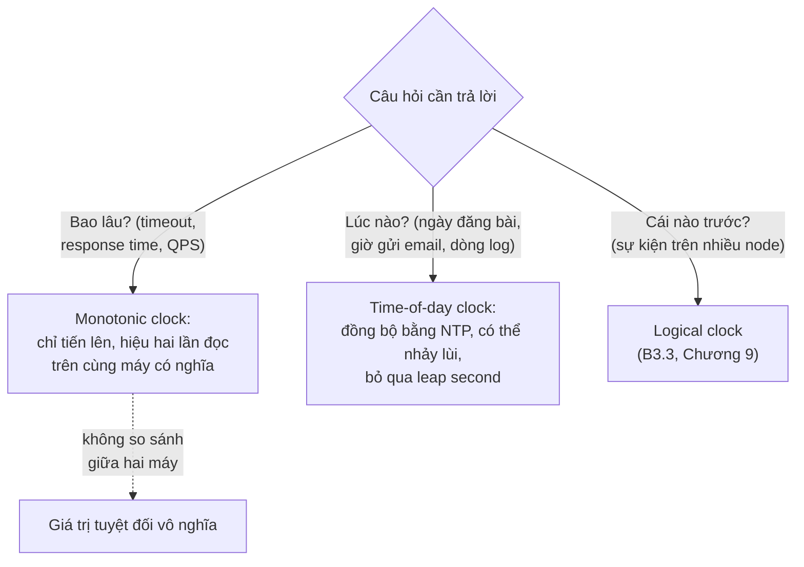

*(Sơ đồ do người viết ghi chú tổng hợp từ tr. 287–289 và 293.)*

<a id="clock-sync"></a>

#### B3.2 Clock Synchronization and Accuracy (tr. 289–291)

**Vấn đề** (tr. 289). Monotonic clock không cần đồng bộ, nhưng time-of-day clock **phải được đặt** theo NTP server hay một nguồn thời gian bên ngoài thì mới có ích. Tiếc là các cách làm đồng hồ chỉ đúng giờ **không tin cậy và không chính xác** như ta mong. Đồng hồ phần cứng và NTP có thể rất "thất thường". Sách nêu một số ví dụ:

| # | Vấn đề | Chi tiết | Trang |
| --- | --- | --- | --- |
| 1 | **Thạch anh trôi** (***clock drift***) | Đồng hồ thạch anh chạy nhanh hoặc chậm hơn đúng; mức trôi thay đổi theo **nhiệt độ** của máy. Google giả định mức trôi **200 ppm** (phần triệu) cho server của họ [41]: tương đương trôi **6 ms** với đồng hồ được đồng bộ lại mỗi 30 giây, hoặc **17 giây** với đồng hồ đồng bộ mỗi ngày một lần. Mức trôi này giới hạn độ chính xác tốt nhất có thể, **ngay cả khi mọi thứ chạy đúng** | 289 |
| 2 | **Lệch quá nhiều so với NTP** | Máy có thể **từ chối đồng bộ**, hoặc đồng hồ cục bộ bị **đặt lại cưỡng bức** [37]. Ứng dụng quan sát thời gian trước và sau lần đặt lại có thể thấy **thời gian chạy lùi** hoặc **đột ngột nhảy tới** | 289 |
| 3 | **Bị firewall chặn khỏi NTP server** | Cấu hình sai do vô tình có thể **không ai nhận ra** trong một thời gian. Giai thoại cho thấy chuyện này có xảy ra trong thực tế | 290 |
| 4 | **NTP chỉ tốt bằng độ trễ mạng** | Trên mạng nghẽn với độ trễ gói biến động, độ chính xác có giới hạn. Một thí nghiệm cho thấy sai số **tối thiểu 35 ms** khi đồng bộ qua internet [42], còn các đợt tăng vọt độ trễ mạng gây sai số **khoảng một giây**. Tùy cấu hình, độ trễ mạng lớn có thể khiến NTP client **bỏ cuộc hoàn toàn** | 290 |
| 5 | **NTP server sai** | Một số NTP server sai hoặc cấu hình sai, báo giờ **lệch hàng giờ** [43, 44]. NTP client khá bền bỉ vì hỏi **nhiều server** và **bỏ qua giá trị ngoại lai**. Dù vậy, đặt cược tính đúng đắn của hệ thống vào giờ do **một người lạ trên internet** báo cho bạn thì khá đáng lo | 290 |
| 6 | ***Leap second*** (giây nhuận) | Tạo ra một phút dài **59 hoặc 61 giây**, làm rối các giả định về thời gian trong hệ thống không được thiết kế tính tới nó [45]. Việc leap second đã **làm crash nhiều hệ thống lớn** [38, 46] cho thấy giả định sai về đồng hồ dễ lọt vào hệ thống thế nào. Cách xử lý tốt nhất có lẽ là để NTP server **"nói dối"**: thực hiện điều chỉnh leap second **dần dần trong suốt một ngày**, gọi là ***smearing*** [47, 48], dù hành vi thật của NTP server khác nhau [49] | 290 |
| 7 | **Máy ảo** | Đồng hồ phần cứng bị **ảo hóa**, thêm thách thức cho ứng dụng cần giữ giờ chính xác [50]. Khi lõi CPU được chia giữa các máy ảo, mỗi máy ảo bị dừng **hàng chục mili giây** trong lúc máy ảo khác chạy. Với ứng dụng, khoảng dừng này hiện ra như **đồng hồ đột ngột nhảy tới** [26] | 290 |
| 8 | **Thiết bị không kiểm soát hoàn toàn** | Trên thiết bị di động hay nhúng, có lẽ **không thể tin** đồng hồ phần cứng chút nào. Có người dùng **cố ý đặt sai ngày giờ**, ví dụ để lách giới hạn thời gian trong game. Đồng hồ có thể chỉ một thời điểm **rất xa trong quá khứ hoặc tương lai** | 290 |

> **Bổ sung ngoài sách (kiểm tra phép tính của sách).** 200 ppm = 200 × 10⁻⁶. Trôi trong 30 giây: 30 × 200 × 10⁻⁶ = 0,006 giây = **6 ms**. Trôi trong một ngày: 86.400 × 200 × 10⁻⁶ ≈ 17,3 giây, khớp với "17 giây" của sách.

> **Liên hệ.** Chương 1 nhắc tới leap second ngày 30/6/2012, khi một bug trong Linux kernel làm nhiều ứng dụng treo cùng lúc, như ví dụ của lỗi phần mềm có tính hệ thống ([chương 1, B3](chapter-01.md#b3)).

**Độ chính xác rất cao là làm được, nếu chịu đầu tư** (tr. 290–291). Ví dụ dự thảo quy định **MiFID II** của châu Âu cho các tổ chức tài chính yêu cầu mọi quỹ **giao dịch tần suất cao** đồng bộ đồng hồ **trong phạm vi 100 micro giây so với UTC**, để giúp gỡ lỗi các bất thường của thị trường như "flash crash" và phát hiện thao túng thị trường [51]. Độ chính xác đó đạt được bằng **bộ thu GPS**, ***Precision Time Protocol* (PTP)** [52], cùng việc triển khai và giám sát cẩn thận. Nhưng nó đòi hỏi **nhiều công sức và chuyên môn**, và có rất nhiều cách làm việc đồng bộ đồng hồ hỏng. Nếu NTP daemon cấu hình sai hay firewall chặn lưu lượng NTP, sai số do trôi có thể **nhanh chóng trở nên lớn**.

<a id="relying-on-clocks"></a>

#### B3.3 Relying on Synchronized Clocks (tr. 291–295)

**Đồng hồ trông đơn giản nhưng nhiều bẫy** (tr. 291):

- một ngày **có thể không có đúng 86.400 giây**;
- time-of-day clock **có thể chạy lùi**;
- thời gian trên một node có thể **khác khá xa** thời gian trên node khác.

**Phải xử lý như xử lý lỗi mạng** (tr. 291). Mạng chạy tốt phần lớn thời gian, nhưng phần mềm phải được thiết kế với giả định mạng **thỉnh thoảng sẽ hỏng** và xử lý êm thấm. Đồng hồ cũng vậy: dù chạy khá tốt phần lớn thời gian, phần mềm bền vững phải **sẵn sàng đối phó với đồng hồ sai**.

**Why — đồng hồ sai rất khó bị phát hiện** (tr. 291):

- CPU hỏng hay mạng cấu hình sai thì máy gần như **không chạy được**, nên sẽ bị phát hiện và sửa nhanh.
- Thạch anh hỏng hay NTP client cấu hình sai thì **mọi thứ có vẻ vẫn ổn**, trong khi đồng hồ **trôi dần xa** khỏi thực tế.
- Phần mềm dựa vào đồng hồ đồng bộ chính xác thì kết quả nhiều khả năng là **mất dữ liệu âm thầm và tinh vi**, chứ không phải một vụ crash ầm ĩ [53, 54].

**How — giám sát độ lệch đồng hồ** (tr. 291). Nếu dùng phần mềm **đòi hỏi đồng hồ đồng bộ**, cần **giám sát cẩn thận** độ lệch (*clock offset*) giữa mọi máy. Node nào có đồng hồ trôi quá xa so với các node khác phải bị **tuyên bố đã chết và loại khỏi cluster**. Giám sát như vậy giúp phát hiện đồng hồ hỏng **trước khi** nó gây quá nhiều thiệt hại.

<a id="timestamps-ordering"></a>

**Timestamps for ordering events** (tr. 291–293).

**Bối cảnh** (tr. 291). Một tình huống **hấp dẫn nhưng nguy hiểm** khi dựa vào đồng hồ: **sắp thứ tự sự kiện** trên nhiều node. Ví dụ hai client cùng ghi vào database phân tán: ai tới trước? Lần ghi nào mới hơn?

**Example — Hình 8-3** (tr. 291–292). Một cách dùng time-of-day clock nguy hiểm trong database **multi-leader** (ví dụ giống Hình 5-9 ở [chương 5, B3.3](chapter-05.md#topologies)):

1. Client A ghi x = 1 trên node 1.
2. Lần ghi được nhân bản sang node 3.
3. Client B **tăng** x trên node 3 (giờ x = 2).
4. Cuối cùng, cả hai lần ghi được nhân bản sang node 2.

Khi một lần ghi được nhân bản, nó được gắn **timestamp theo time-of-day clock của node nơi lần ghi xuất phát**. Đồng bộ đồng hồ trong ví dụ này **rất tốt**: độ lệch giữa node 1 và node 3 **dưới 3 ms**, có lẽ tốt hơn những gì có thể kỳ vọng trong thực tế.

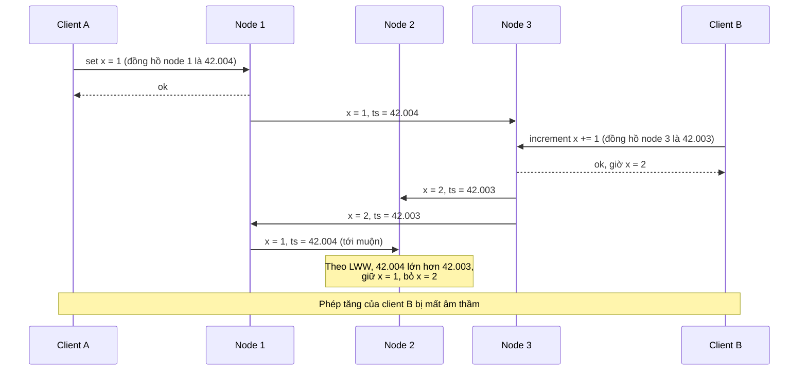

*(Vẽ lại Hình 8-3, tr. 292. Trong hình gốc, mỗi node có các mặt đồng hồ ghi giờ cục bộ: node 1 từ 42.003 tới 42.008, node 3 từ 42.001 tới 42.005; ghi x = 2 của node 3 tới node 2 trước ghi x = 1 của node 1.)*

**Timestamp sắp sai thứ tự** (tr. 292). Lần ghi x = 1 có timestamp **42.004 giây**, còn lần ghi x = 2 có timestamp **42.003 giây**, dù x = 2 xảy ra **sau một cách không thể nhầm lẫn** (B tăng chính giá trị mà A đã ghi). Khi node 2 nhận hai sự kiện này, nó kết luận **sai** rằng x = 1 là giá trị mới hơn và **bỏ** lần ghi x = 2. Thực chất, **phép tăng của client B bị mất**.

**Đây chính là LWW** (tr. 292). Chiến lược giải quyết xung đột này là ***last write wins* (LWW)**, được dùng rộng rãi cả trong multi-leader replication lẫn database leaderless như **Cassandra** [53] và **Riak** [54] ([chương 5, LWW](chapter-05.md#lww), tr. 186). Một số bản cài sinh timestamp **ở client** thay vì ở server, nhưng điều đó **không thay đổi** các vấn đề căn bản của LWW:

1. **Lần ghi biến mất bí ẩn.** Một node có **đồng hồ chậm** **không ghi đè được** giá trị mà một node có **đồng hồ nhanh** đã ghi trước đó, cho tới khi khoảng lệch đồng hồ giữa hai node trôi qua [54, 55]. Kịch bản này có thể làm **mất âm thầm một lượng dữ liệu tùy ý**, không báo lỗi gì cho ứng dụng.
2. **Không phân biệt được tuần tự với đồng thời.** LWW không phân biệt các lần ghi xảy ra **nối tiếp nhau nhanh** (trong Hình 8-3, phép tăng của B **chắc chắn** xảy ra sau lần ghi của A) với các lần ghi **thật sự đồng thời** (không bên ghi nào biết bên kia). Cần thêm cơ chế **theo dõi quan hệ nhân quả**, như **version vector**, để tránh vi phạm causality ([chương 5, B4.5](chapter-05.md#concurrent-writes), tr. 184).
3. **Trùng timestamp.** Hai node có thể **độc lập** sinh ra hai lần ghi **cùng timestamp**, nhất là khi đồng hồ chỉ có độ phân giải mili giây. Cần thêm một **giá trị phân xử** (*tiebreaker*, có thể chỉ là một số ngẫu nhiên lớn), nhưng cách này **cũng có thể vi phạm causality** [53].

> **Ví dụ minh họa do AI xây dựng (kịch bản "lần ghi biến mất").** Node P có đồng hồ chạy **nhanh 100 ms**, node Q chạy đúng giờ. Lúc 10:00:00,000 (giờ thật), P ghi key k với timestamp 10:00:00,100. Lúc 10:00:00,050 (giờ thật), Q ghi k với timestamp 10:00:00,050. Lần ghi của Q xảy ra **sau**, nhưng timestamp **nhỏ hơn**, nên LWW **bỏ** nó. Mọi lần ghi của Q vào k trong 100 ms sau lần ghi của P đều biến mất như vậy, và cả hai client đều nhận được *ok*.

**"Mới nhất" phụ thuộc đồng hồ cục bộ** (tr. 293). Giữ giá trị "mới nhất" và bỏ phần còn lại là cách giải quyết xung đột hấp dẫn. Nhưng cần nhớ định nghĩa "mới nhất" **phụ thuộc vào time-of-day clock cục bộ**, mà đồng hồ đó **hoàn toàn có thể sai**. Ngay cả với đồng hồ đồng bộ NTP chặt chẽ, bạn vẫn có thể gửi một gói tin lúc **100 ms** (theo đồng hồ bên gửi) và nó tới lúc **99 ms** (theo đồng hồ bên nhận): trông như gói tin **tới trước khi được gửi**, điều không thể xảy ra.

**NTP có thể chính xác tới mức tránh được việc sắp sai không?** (tr. 293). **Có lẽ là không.** Độ chính xác đồng bộ của NTP **bị giới hạn bởi round-trip time của mạng**, cộng thêm các nguồn sai số khác như thạch anh trôi. Muốn sắp thứ tự đúng, nguồn đồng hồ phải **chính xác hơn đáng kể** so với **thứ đang được đo** (tức chính độ trễ mạng).

<a id="logical-clocks"></a>

**Logical clocks** (tr. 293). Các ***logical clock*** [56, 57] dựa trên **bộ đếm tăng dần** thay vì tinh thể thạch anh dao động, là cách **an toàn hơn** để sắp thứ tự sự kiện ([chương 5, happens-before](chapter-05.md#happens-before), tr. 184). Logical clock **không đo** giờ trong ngày hay số giây đã trôi qua, mà **chỉ đo thứ tự tương đối** của các sự kiện (sự kiện này xảy ra trước hay sau sự kiện kia). Ngược lại, time-of-day clock và monotonic clock, vốn đo thời gian thực đã trôi qua, còn gọi là ***physical clock***. Sách bàn thêm về thứ tự ở "Ordering Guarantees" (tr. 339, [Chương 9](chapter-09.md#ordering)).

> **Bổ sung ngoài sách.** Tài liệu [56] là bài báo năm 1978 của Leslie Lamport. Quy tắc của **Lamport clock** đơn giản: mỗi node giữ một bộ đếm; tăng nó trước mỗi sự kiện cục bộ; gửi kèm giá trị bộ đếm trong mỗi message; khi nhận message, đặt bộ đếm bằng max(bộ đếm của mình, giá trị nhận được) + 1. Nhờ vậy, nếu A happens before B thì bộ đếm của A nhỏ hơn của B, bất kể đồng hồ vật lý lệch bao nhiêu. Tài liệu [57] đề xuất *hybrid logical clock*, kết hợp đồng hồ vật lý với bộ đếm logic.

<a id="confidence-interval"></a>

**Clock readings have a confidence interval** (tr. 293–294).

- **Độ phân giải không phải độ chính xác** (tr. 293). Có thể đọc time-of-day clock với độ phân giải micro giây hay thậm chí nano giây. Nhưng phép đo mịn như vậy **không có nghĩa** giá trị **chính xác** tới mức đó. Thực tế nhiều khả năng **không**: như đã nói, độ trôi của thạch anh **dễ lên vài mili giây** ngay cả khi đồng bộ với NTP server trong mạng cục bộ **mỗi phút**. Với NTP server trên internet công cộng, độ chính xác tốt nhất có lẽ cỡ **hàng chục mili giây**, và sai số dễ tăng vọt **trên 100 ms** khi mạng nghẽn [57].
- **What — khoảng tin cậy** (tr. 293–294). Vì vậy không nên coi một lần đọc đồng hồ là **một điểm thời gian**, mà là **một khoảng thời gian** nằm trong một ***confidence interval*** (khoảng tin cậy). Ví dụ hệ thống có thể **tin 95%** rằng thời điểm hiện tại nằm giữa **10,3 và 10,5 giây** sau đầu phút, nhưng không biết chính xác hơn [58]. Nếu chỉ biết thời gian với sai số **±100 ms**, các chữ số micro giây trong timestamp **về cơ bản vô nghĩa**.
- **Tính độ bất định** (tr. 294). Giới hạn bất định có thể tính từ nguồn thời gian:
  - Có **bộ thu GPS** hay **đồng hồ nguyên tử (caesium)** gắn trực tiếp vào máy: khoảng sai số kỳ vọng do **nhà sản xuất** công bố.
  - Lấy giờ từ một server: độ bất định gồm **độ trôi thạch anh kỳ vọng kể từ lần đồng bộ cuối** + **độ bất định của NTP server** + **round-trip time tới server** (ước lượng bậc nhất, và giả định bạn tin server).
- **Phần lớn hệ thống không cho biết độ bất định** (tr. 294). Khi gọi `clock_gettime()`, giá trị trả về **không** cho biết sai số kỳ vọng, nên bạn không biết khoảng tin cậy của nó là **5 mili giây hay 5 năm**.

> **Bổ sung ngoài sách (phép tính minh họa công thức của sách).** Máy đồng bộ với NTP server trong mạng cục bộ lần cuối cách đây 60 giây. Với mức trôi 200 ppm, độ trôi kỳ vọng là 60 × 200 × 10⁻⁶ = 12 ms. Nếu NTP server có độ bất định 1 ms và round-trip time tới server là 0,5 ms, độ bất định ước lượng là khoảng 12 + 1 + 0,5 ≈ 13,5 ms. Mọi chữ số dưới mức mili giây của timestamp khi đó không mang thông tin.

<a id="truetime"></a>

**Ngoại lệ đáng chú ý: TrueTime của Google** (tr. 294). **TrueTime API** trong **Spanner** [41] **báo tường minh** khoảng tin cậy của đồng hồ cục bộ. Hỏi giờ hiện tại, bạn nhận **hai giá trị**: **[earliest, latest]**, tức timestamp **sớm nhất** và **muộn nhất** có thể. Dựa trên tính toán độ bất định, đồng hồ **biết** thời điểm thật nằm đâu đó trong khoảng này. Độ rộng của khoảng phụ thuộc, trong số các yếu tố, vào **thời gian đã trôi qua** kể từ lần đồng hồ thạch anh cục bộ được đồng bộ với một nguồn chính xác hơn.

<a id="global-snapshots"></a>

**Synchronized clocks for global snapshots** (tr. 294–295).

**Nhắc lại snapshot isolation** (tr. 294). Ở "Snapshot Isolation and Repeatable Read" (tr. 237, [Chương 7](chapter-07.md#snapshot-isolation)), sách đã bàn **snapshot isolation**, tính năng rất hữu ích cho database cần hỗ trợ cả transaction đọc-ghi **nhỏ và nhanh** lẫn transaction chỉ đọc **lớn và lâu** (ví dụ cho backup hay phân tích). Nó cho transaction chỉ đọc thấy database ở một **trạng thái nhất quán tại một thời điểm**, mà không khóa và không cản trở transaction đọc-ghi.

**Vấn đề sinh transaction ID** (tr. 294–295):

1. Cách cài snapshot isolation phổ biến nhất cần **transaction ID tăng đơn điệu**. Nếu một lần ghi xảy ra **sau** snapshot (có transaction ID lớn hơn snapshot), lần ghi đó **vô hình** với transaction snapshot.
2. Trên database **một node**, một **bộ đếm đơn giản** là đủ để sinh transaction ID.
3. Khi database phân tán trên nhiều máy, có thể ở nhiều datacenter, việc sinh transaction ID **toàn cục, tăng đơn điệu** (trên mọi partition) là **khó**, vì cần **phối hợp**.
4. Transaction ID phải **phản ánh causality**: nếu transaction B đọc một giá trị do transaction A ghi, B phải có ID **lớn hơn** A; nếu không, snapshot sẽ **không nhất quán**.
5. Với rất nhiều transaction nhỏ và nhanh, việc tạo transaction ID trong hệ phân tán trở thành **nút cổ chai không chịu nổi**.

> Chú thích vi (tr. 295). Có các bộ sinh số thứ tự phân tán, như **Snowflake** của Twitter, sinh ID duy nhất **xấp xỉ tăng đơn điệu** một cách có khả năng mở rộng (ví dụ cấp **từng khối** không gian ID cho các node khác nhau). Nhưng chúng thường **không đảm bảo** thứ tự nhất quán với causality, vì **thang thời gian cấp khối ID dài hơn** thang thời gian của các lần đọc và ghi. Xem thêm "Ordering Guarantees" (tr. 339).

**Dùng timestamp từ đồng hồ đồng bộ làm transaction ID?** (tr. 295). Nếu đồng bộ đủ tốt, timestamp có **đúng tính chất cần có**: transaction sau có timestamp lớn hơn. Vấn đề, tất nhiên, là **sự bất định** về độ chính xác của đồng hồ.

**Spanner làm thế nào** (tr. 295). Spanner cài snapshot isolation **xuyên datacenter** theo cách này [59, 60]. Nó dùng khoảng tin cậy do TrueTime báo, dựa trên nhận xét sau:

- Có hai khoảng tin cậy A = [A_earliest, A_latest] và B = [B_earliest, B_latest].
- Nếu hai khoảng **không chồng nhau**, tức A_earliest < A_latest < B_earliest < B_latest, thì B **chắc chắn** xảy ra sau A, không còn nghi ngờ.
- Chỉ khi hai khoảng **chồng nhau** thì mới không chắc A và B xảy ra theo thứ tự nào.

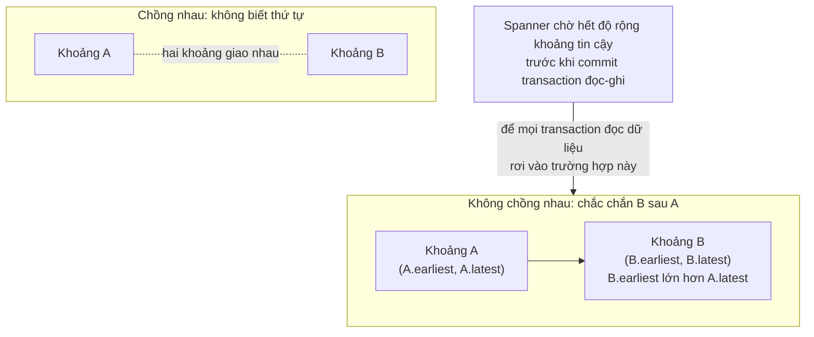

*(Sơ đồ do người viết ghi chú tổng hợp từ tr. 294–295.)*

- **Cố ý chờ trước khi commit** (bài báo Spanner gọi bước này là *commit wait*; sách không dùng tên này). Để timestamp của transaction phản ánh causality, Spanner **cố ý chờ** một khoảng bằng **độ dài khoảng tin cậy** trước khi commit một transaction đọc-ghi. Nhờ vậy, mọi transaction có thể đọc dữ liệu đó xảy ra ở thời điểm **đủ muộn**, nên khoảng tin cậy của chúng **không chồng nhau**.
- **Giữ khoảng chờ ngắn.** Spanner cần giữ độ bất định của đồng hồ **càng nhỏ càng tốt**. Vì vậy Google đặt **bộ thu GPS hoặc đồng hồ nguyên tử** ở **mỗi datacenter**, cho phép đồng bộ đồng hồ trong phạm vi **khoảng 7 ms** [41].
- **Hiện trạng** (lúc viết sách). Dùng đồng bộ đồng hồ cho ngữ nghĩa transaction phân tán là **lĩnh vực nghiên cứu đang sôi động** [57, 61, 62]. Các ý tưởng này thú vị, nhưng **chưa được cài** trong các database phổ biến **ngoài Google**.

> **Bổ sung ngoài sách.** Theo bài báo Spanner [41], quy tắc cụ thể là: chọn timestamp commit s bằng giá trị *latest* của TrueTime lúc commit, rồi chờ cho tới khi giá trị *earliest* của TrueTime vượt qua s mới cho kết quả transaction hiển thị. Thời gian chờ trung bình xấp xỉ hai lần độ bất định, nên giảm độ bất định (GPS, đồng hồ nguyên tử) trực tiếp làm giảm độ trễ commit. Tài liệu [62] ("Living Without Atomic Clocks") bàn cách một database khác xử lý khi không có phần cứng như vậy.

<a id="process-pauses"></a>

#### B3.4 Process Pauses (tr. 295–299)

<a id="lease"></a>

**Bối cảnh: làm sao leader biết mình vẫn là leader?** (tr. 295). Một ví dụ nguy hiểm khác khi dùng đồng hồ trong hệ phân tán. Giả sử database có **một leader cho mỗi partition**; chỉ leader được nhận ghi. Làm sao một node biết **nó vẫn là leader** (chưa bị các node khác tuyên bố đã chết), và có thể nhận ghi an toàn?

- **What — lease.** Một cách là leader xin một ***lease*** từ các node khác. Lease giống **một lock có timeout** [63]: tại mỗi thời điểm chỉ **một node** giữ được lease. Khi giành được lease, node biết mình là leader **trong một khoảng thời gian**, cho tới khi lease hết hạn.
- **How.** Muốn tiếp tục làm leader, node phải **gia hạn lease định kỳ** trước khi nó hết hạn. Nếu node hỏng, nó ngừng gia hạn, và node khác có thể **tiếp quản** khi lease hết hạn (tr. 295–296).

**Vòng lặp xử lý request** (tr. 296). Sách đưa một đoạn code Java minh họa; tóm tắt bằng lời:

| Bước | Việc làm |
| --- | --- |
| 1 | Lặp mãi: lấy request tiếp theo |
| 2 | Nếu thời điểm hết hạn của lease trừ giờ hiện tại của đồng hồ hệ thống (`System.currentTimeMillis()`) **còn dưới 10 giây**, thì gia hạn lease (để lease luôn còn ít nhất 10 giây) |
| 3 | Nếu lease **còn hiệu lực** thì xử lý request |

**Đoạn code này sai ở đâu?** (tr. 296).

1. **Dựa vào đồng hồ đồng bộ.** Thời điểm hết hạn của lease do **một máy khác** đặt (ví dụ bằng giờ hiện tại cộng 30 giây), rồi được so với **đồng hồ hệ thống cục bộ**. Nếu đồng hồ lệch nhau **hơn vài giây**, code sẽ làm những việc kỳ lạ.
2. **Giả định ít thời gian trôi qua giữa lúc kiểm tra và lúc xử lý.** Kể cả khi đổi giao thức để chỉ dùng **monotonic clock cục bộ**, vẫn còn vấn đề: code giả định từ lúc kiểm tra giờ tới lúc xử lý request chỉ trôi qua **rất ít** thời gian. Bình thường code chạy rất nhanh, nên khoảng đệm 10 giây là **thừa đủ** để lease không hết hạn giữa chừng.
3. **Nhưng nếu chương trình bị dừng bất ngờ?** Giả sử thread **dừng 15 giây** quanh dòng kiểm tra lease còn hiệu lực rồi mới chạy tiếp. Khi đó nhiều khả năng lease **đã hết hạn** lúc request được xử lý, và một node khác **đã làm leader**. **Không có gì báo** cho thread rằng nó đã bị dừng lâu như vậy, nên code không nhận ra lease đã hết hạn cho tới **vòng lặp kế tiếp**, lúc đó có thể nó đã làm điều **không an toàn**.

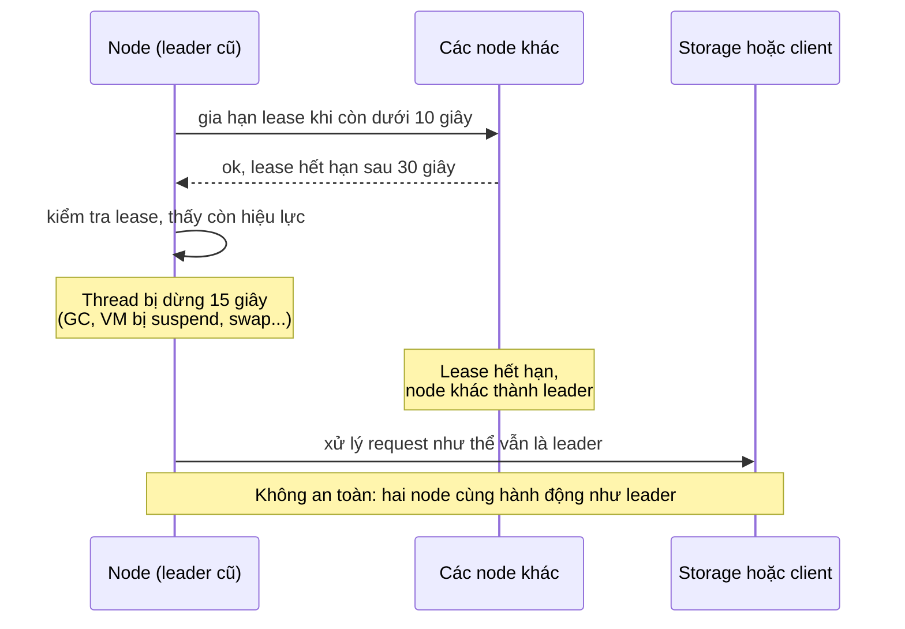

*(Ví dụ minh họa do AI xây dựng theo mô tả ở tr. 295–296.)*

<a id="pause-causes"></a>

**Thread bị dừng lâu như vậy có phải chuyện viển vông?** (tr. 296–297). **Tiếc là không.** Có nhiều lý do:

| Nguyên nhân | Mô tả | Trang |
| --- | --- | --- |
| ***Garbage collector* (GC)** | Nhiều runtime (như Java Virtual Machine) có GC thỉnh thoảng phải **dừng mọi thread đang chạy**. Các lần ***stop-the-world* GC pause** này đôi khi kéo dài **vài phút** [64]! Ngay cả GC gọi là "concurrent" như CMS của HotSpot JVM cũng **không chạy hoàn toàn song song** với code ứng dụng, thỉnh thoảng vẫn phải dừng mọi thứ [65]. Có thể giảm pause bằng cách đổi mẫu cấp phát hay tinh chỉnh GC [66], nhưng muốn đảm bảo bền vững thì **phải giả định điều tệ nhất** | 296–297 |
| **Máy ảo bị suspend rồi resume** | Máy ảo có thể bị **tạm dừng** (dừng mọi tiến trình, lưu nội dung bộ nhớ xuống đĩa) rồi **tiếp tục** (khôi phục bộ nhớ, chạy tiếp). Việc này xảy ra **bất kỳ lúc nào** và kéo dài **tùy ý**. Tính năng này đôi khi dùng cho ***live migration*** máy ảo từ host này sang host khác không cần reboot; khi đó độ dài pause phụ thuộc tốc độ các tiến trình ghi vào bộ nhớ [67] | 297 |
| **Thiết bị người dùng** | Trên laptop, việc thực thi cũng có thể bị suspend và resume tùy ý, ví dụ khi người dùng **gập nắp** | 297 |
| **Context switch** | Khi hệ điều hành chuyển sang thread khác, hoặc hypervisor chuyển sang máy ảo khác, thread đang chạy có thể bị dừng ở **bất kỳ điểm nào** trong code. Với máy ảo, thời gian CPU dành cho máy ảo khác gọi là ***steal time***. Nếu máy **tải nặng** (hàng dài thread chờ chạy), thread bị dừng có thể phải chờ một lúc mới được chạy lại | 297 |
| **I/O đĩa đồng bộ** | Thread có thể dừng chờ một thao tác I/O đĩa chậm [68]. Trong nhiều ngôn ngữ, truy cập đĩa có thể xảy ra **bất ngờ** dù code không nhắc tới file: ví dụ classloader của Java **nạp lười** file class ở lần dùng đầu tiên, có thể vào bất kỳ lúc nào. Pause do I/O và pause do GC còn có thể **cộng dồn** [69]. Nếu "đĩa" thực ra là network filesystem hay network block device (như **Amazon EBS**), độ trễ I/O còn chịu thêm sự biến động của mạng [29] | 297 |
| **Swapping (paging)** | Nếu hệ điều hành cho phép swap xuống đĩa, một lần truy cập bộ nhớ đơn giản có thể gây ***page fault***, phải nạp một page từ đĩa lên bộ nhớ, và thread dừng trong lúc I/O chậm đó diễn ra. Áp lực bộ nhớ cao thì lại phải swap page khác ra đĩa. Cực đoan, hệ điều hành tốn phần lớn thời gian **swap page vào ra** mà gần như không làm được việc gì, gọi là ***thrashing***. Để tránh, paging thường **bị tắt** trên server (thà kill một tiến trình để giải phóng bộ nhớ còn hơn chịu rủi ro thrashing) | 297 |
| **Tín hiệu SIGSTOP** | Một tiến trình Unix có thể bị dừng bằng tín hiệu **SIGSTOP**, ví dụ khi nhấn Ctrl-Z trong shell. Tiến trình **ngừng nhận chu kỳ CPU ngay lập tức** cho tới khi được tiếp tục bằng **SIGCONT**, rồi chạy tiếp từ chỗ đã dừng. Dù môi trường của bạn không dùng SIGSTOP, một kỹ sư vận hành có thể **vô tình** gửi nó | 297 |

**Điểm chung** (tr. 298). Mọi tình huống trên đều có thể ***preempt*** (giành quyền chạy khỏi) thread đang chạy **ở bất kỳ điểm nào**, rồi cho nó chạy tiếp vào lúc nào đó sau, **mà thread không hề hay biết**.

**Giống bài toán thread-safe, nhưng thiếu công cụ** (tr. 298):

- Vấn đề này giống việc làm code đa luồng trên một máy trở nên **thread-safe**: không được giả định gì về thời gian, vì context switch và song song có thể xảy ra tùy ý.
- Trên một máy, ta có công cụ khá tốt: **mutex, semaphore, atomic counter, cấu trúc dữ liệu lock-free, blocking queue**…
- Tiếc là các công cụ đó **không chuyển thẳng** sang hệ phân tán được, vì hệ phân tán **không có shared memory**, chỉ có **message gửi qua một mạng không tin cậy**.

**Kết luận** (tr. 298). Một node trong hệ phân tán phải giả định việc thực thi của nó có thể **bị dừng một khoảng đáng kể ở bất kỳ điểm nào**, kể cả **giữa một hàm**. Trong lúc dừng, phần còn lại của thế giới vẫn chạy, và thậm chí có thể **tuyên bố node đã chết** vì nó không phản hồi. Cuối cùng node bị dừng có thể chạy tiếp mà **không hề nhận ra** mình đã "ngủ", cho tới khi kiểm tra đồng hồ vào lúc nào đó sau.

<a id="real-time"></a>

**Response time guarantees** (tr. 298–299).

- **Có thể loại bỏ nguyên nhân pause, nếu cố gắng đủ** (tr. 298). Trong nhiều ngôn ngữ và hệ điều hành, thread và tiến trình có thể dừng **không giới hạn** như vừa bàn. Các nguyên nhân đó **có thể** bị loại bỏ nếu cố gắng đủ.
- **Hard real-time** (tr. 298). Một số phần mềm chạy trong môi trường mà **không phản hồi trong thời gian quy định** có thể gây **thiệt hại nghiêm trọng**: máy tính điều khiển máy bay, tên lửa, robot, ô tô và các vật thể vật lý khác phải phản hồi **nhanh và dự đoán được** với dữ liệu cảm biến. Trong các hệ này có một ***deadline*** mà phần mềm phải phản hồi trước đó; trễ deadline có thể làm **cả hệ thống hỏng**. Đó là các hệ ***hard real-time***.

> **Ghi chú "Is real-time really real?"** (tr. 298). Trong hệ nhúng, *real-time* nghĩa là hệ thống được **thiết kế và kiểm thử cẩn thận** để đáp ứng các đảm bảo thời gian đã quy định **trong mọi hoàn cảnh**. Nghĩa này khác cách dùng **mơ hồ** của từ *real-time* trên web, nơi nó chỉ việc server đẩy dữ liệu tới client hay stream processing **không có ràng buộc cứng** về response time ([Chương 11](chapter-11.md)).

- **Ví dụ túi khí** (tr. 298). Nếu cảm biến của xe phát hiện bạn đang gặp va chạm, bạn hẳn **không muốn** túi khí bung chậm vì hệ thống điều khiển túi khí đang **GC không đúng lúc**.
- **Cần hỗ trợ ở mọi tầng** (tr. 298–299):
  - một ***real-time operating system* (RTOS)** cho phép lập lịch tiến trình với **lượng CPU được đảm bảo** trong các khoảng thời gian quy định;
  - hàm thư viện phải **ghi rõ thời gian thực thi trong trường hợp xấu nhất**;
  - **cấp phát bộ nhớ động** có thể bị hạn chế hoặc **cấm hẳn** (có real-time GC, nhưng ứng dụng vẫn phải bảo đảm không đưa quá nhiều việc cho GC);
  - **rất nhiều** kiểm thử và đo đạc để bảo đảm các đảm bảo được đáp ứng.
- **Rất đắt** (tr. 299). Tất cả những điều đó cần **rất nhiều công sức** và **giới hạn mạnh** ngôn ngữ, thư viện và công cụ dùng được (vì đa số không cung cấp đảm bảo real-time). Phát triển hệ real-time **rất tốn kém**, và chủ yếu dùng cho **thiết bị nhúng quan trọng về an toàn**.
- **Real-time không phải hiệu năng cao** (tr. 299). Hệ real-time thậm chí có thể có **throughput thấp hơn**, vì phải ưu tiên **phản hồi đúng hạn** trên hết (xem hộp "Latency and Resource Utilization", [B2.4](#latency-utilization), tr. 286).
- **Kết luận** (tr. 299). Với phần lớn hệ thống xử lý dữ liệu phía server, đảm bảo real-time **không kinh tế** hoặc **không phù hợp**. Vì vậy các hệ này phải **chịu** các pause và sự bất ổn định của đồng hồ đến từ việc chạy trong môi trường không real-time.

<a id="limiting-gc"></a>

**Limiting the impact of garbage collection** (tr. 299).

Có thể **giảm tác hại** của process pause mà **không cần** tới đảm bảo lập lịch real-time đắt đỏ. Runtime của ngôn ngữ có **phần nào tự do** quyết định khi nào lập lịch GC, vì nó theo dõi được **tốc độ cấp phát đối tượng** và **lượng bộ nhớ trống còn lại** theo thời gian.

1. **Coi GC pause như một lần ngừng có kế hoạch.** Ý tưởng đang nổi lên: coi GC pause như **ngừng ngắn theo kế hoạch** của một node, và để **node khác** xử lý request của client trong lúc node này dọn rác. Nếu runtime **cảnh báo** ứng dụng rằng node sắp cần GC, ứng dụng có thể **ngừng gửi request mới** tới node đó, **chờ** nó xử lý xong các request đang dở, rồi thực hiện GC khi **không có request nào đang chạy**. Mẹo này **giấu GC pause khỏi client** và giảm **percentile cao** của response time [70, 71]. Một số hệ giao dịch tài chính nhạy độ trễ dùng cách này [72].
2. **Chỉ GC đối tượng sống ngắn, và khởi động lại định kỳ.** Một biến thể: chỉ dùng GC cho **đối tượng sống ngắn** (dọn nhanh), và **khởi động lại tiến trình định kỳ** trước khi nó tích lũy đủ đối tượng sống lâu để cần một lần **full GC** [65, 73]. Có thể khởi động lại **từng node một**, chuyển traffic khỏi node trước lần khởi động lại theo kế hoạch, giống **rolling upgrade** (Chương 4).

Các biện pháp này **không ngăn hoàn toàn** GC pause, nhưng **giảm đáng kể** tác động của chúng lên ứng dụng.

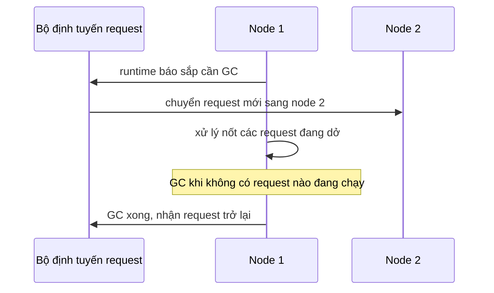

*(Sơ đồ do AI xây dựng cho ý tưởng ở tr. 299.)*

**System Design.**

- **Đo khoảng thời gian bằng monotonic clock**, không bằng time-of-day clock (tr. 288–289).
- Nếu tính đúng đắn phụ thuộc đồng hồ đồng bộ (LWW, lease so với giờ của máy khác), phải **giám sát độ lệch** và loại node lệch quá xa, vì lỗi đồng hồ gây **mất dữ liệu âm thầm** (tr. 291).
- **Không sắp thứ tự sự kiện giữa các node bằng timestamp vật lý** nếu mất dữ liệu là không chấp nhận được; dùng logical clock hay version vector (tr. 292–293). Nếu buộc phải dùng thời gian vật lý cho thứ tự, phải biết **khoảng tin cậy** và chờ cho các khoảng không chồng nhau, như Spanner (tr. 294–295).
- **Mọi lease, lock có thời hạn đều phải chịu được process pause** ở bất kỳ dòng code nào. Kiểm tra "lease còn hiệu lực" rồi mới làm là chưa đủ; cần cơ chế như **fencing token** ([B4.1](#fencing-tokens)) (tr. 296, 301–303).
- **Bổ sung ngoài sách:** trên server, tắt swap, theo dõi thời gian GC pause và steal time như các metric vận hành bình thường, vì chúng là nguyên nhân thường gặp của việc khai tử nhầm node.

---

<a id="b4"></a>

### B4. Knowledge, Truth, and Lies (tr. 300–310)

<a id="knowledge-truth"></a>

#### B4.0 Một node không thể biết chắc điều gì (tr. 300)

**Nhìn lại** (tr. 300). Tới đây chương đã chỉ ra hệ phân tán khác chương trình chạy trên một máy ở chỗ: **không có shared memory**, chỉ có **truyền message** qua một **mạng không tin cậy** với **độ trễ biến động**, và hệ thống có thể chịu **partial failure**, **đồng hồ không tin cậy** và **process pause**.

**Hệ quả gây mất phương hướng** (tr. 300):

- Một node trong mạng **không thể biết chắc điều gì**. Nó chỉ có thể **phỏng đoán** dựa trên các message nó nhận được (hoặc không nhận được) qua mạng.
- Một node chỉ biết **trạng thái** của node khác (lưu dữ liệu gì, có chạy đúng không…) bằng cách **trao đổi message** với node đó.
- Nếu node từ xa không phản hồi, **không có cách nào** biết nó đang ở trạng thái nào, vì **sự cố mạng không phân biệt được một cách tin cậy với sự cố ở node**.

**Câu hỏi gần với triết học** (tr. 300). Trong hệ thống của ta, điều gì được **biết là đúng hay sai**? Có thể chắc chắn về hiểu biết đó tới đâu, khi các cơ chế **nhận thức và đo đạc** đều không tin cậy? Hệ thống phần mềm có nên tuân theo các quy luật ta mong đợi ở thế giới vật lý, như **nhân và quả**?

**What — system model** (tr. 300). May là ta không cần đi tới mức tìm ra ý nghĩa cuộc sống. Trong hệ phân tán, ta có thể **nêu rõ các giả định** về hành vi của hệ thống (gọi là ***system model***) và thiết kế hệ thống thật sao cho **đáp ứng các giả định đó**. Thuật toán có thể được **chứng minh chạy đúng** trong một system model nhất định. Nghĩa là **có thể đạt hành vi tin cậy**, ngay cả khi system model bên dưới cung cấp **rất ít đảm bảo**.

**Nhưng không dễ** (tr. 300). Làm phần mềm hành xử tốt trong một system model không tin cậy là **có thể**, nhưng **không đơn giản**. Phần còn lại của chương khám phá khái niệm **tri thức và sự thật** trong hệ phân tán, để giúp nghĩ về các giả định có thể đặt ra và các đảm bảo muốn cung cấp. [Chương 9](chapter-09.md) xem các ví dụ hệ phân tán và thuật toán cung cấp đảm bảo cụ thể dưới giả định cụ thể.

<a id="truth-majority"></a>

#### B4.1 The Truth Is Defined by the Majority (tr. 300–304)

**Ba kịch bản ác mộng** (tr. 300–301):

1. **Fault bất đối xứng** (tr. 300). Hình dung một mạng có ***asymmetric fault***: một node **nhận được mọi message** gửi tới nó, nhưng **mọi message đi ra** từ nó bị bỏ hoặc trễ [19]. Node đó **chạy hoàn toàn bình thường** và vẫn nhận request từ node khác, nhưng **không ai nghe thấy response** của nó. Sau một timeout, các node khác tuyên bố nó **đã chết**. Sách tả như một cơn ác mộng: node bị kéo ra nghĩa địa trong khi giãy giụa la hét "Tôi chưa chết!", nhưng không ai nghe tiếng la, nên đám tang vẫn tiếp tục.
2. **Node biết mạng có lỗi nhưng bất lực** (tr. 301). Kịch bản bớt ác mộng hơn: node bị cắt một nửa **nhận ra** các message nó gửi không được xác nhận, và hiểu rằng mạng có fault. Dù vậy, nó vẫn bị các node khác **tuyên bố chết nhầm**, và **không làm gì được**.
3. **GC pause dài** (tr. 301). Một node gặp **stop-the-world GC pause** dài: mọi thread bị GC chiếm quyền và dừng **một phút**, nên không request nào được xử lý, không response nào được gửi. Các node khác chờ, thử lại, sốt ruột, cuối cùng tuyên bố node đã chết và "đưa lên xe tang". Rồi GC xong, thread chạy tiếp **như chưa có gì xảy ra**. Các node khác ngạc nhiên khi node "đã chết" đột nhiên ngẩng đầu khỏi quan tài, khỏe mạnh, và vui vẻ trò chuyện với người xung quanh. Ban đầu node bị GC thậm chí **không nhận ra** cả một phút đã trôi qua và nó đã bị tuyên bố chết: với nó, gần như **chưa có thời gian nào trôi qua** kể từ lần cuối nói chuyện với các node khác.

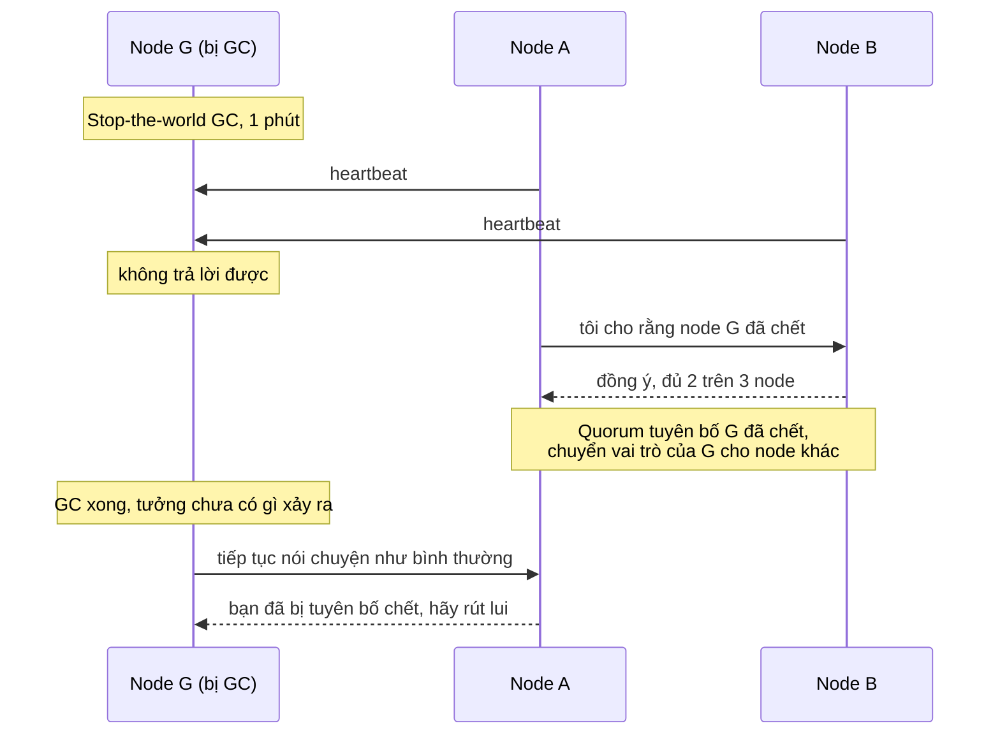

*(Ví dụ minh họa do AI xây dựng cho kịch bản thứ ba ở tr. 301, kết hợp với quy tắc quorum ở cùng trang.)*

**Bài học** (tr. 301). Một node **không nhất thiết tin được phán đoán của chính nó** về tình hình. Hệ phân tán **không thể chỉ dựa vào một node**, vì node có thể hỏng bất kỳ lúc nào, có thể làm hệ thống **kẹt và không phục hồi được**.

<a id="majority-quorum"></a>

**How — quyết định bằng quorum** (tr. 301):

- Nhiều thuật toán phân tán dựa vào **quorum**, tức **bỏ phiếu giữa các node** ([chương 5, quorum](chapter-05.md#quorums), tr. 179): quyết định cần **một số phiếu tối thiểu** từ nhiều node, để giảm sự phụ thuộc vào **một node cụ thể**.
- Điều đó **gồm cả quyết định tuyên bố node đã chết**. Nếu **một quorum** các node tuyên bố một node đã chết, node đó **phải được coi là đã chết**, kể cả khi nó vẫn **cảm thấy mình đang sống**. Node đó phải **tuân theo** quyết định của quorum và **rút lui**.
- Phổ biến nhất, quorum là **đa số tuyệt đối**, tức **hơn một nửa** số node (cũng có loại quorum khác). Majority quorum cho phép hệ thống **tiếp tục chạy** khi có node hỏng: **3 node chịu được 1 node hỏng**, **5 node chịu được 2 node hỏng**.
- **Vẫn an toàn**, vì trong hệ thống **chỉ có thể có một đa số**: không thể có **hai đa số** với quyết định mâu thuẫn **cùng lúc**. Sách bàn kỹ hơn khi tới thuật toán consensus ở [Chương 9](chapter-09.md#fault-tolerant-consensus).

> **Bổ sung ngoài sách (vì sao chỉ có một đa số).** Hai nhóm, mỗi nhóm có hơn n/2 node, thì tổng số node của hai nhóm vượt quá n, nên chúng **phải có ít nhất một node chung**. Nếu mỗi node chỉ bỏ phiếu cho **một** quyết định trong cùng một vòng, node chung đó không thể đồng thời ủng hộ hai quyết định mâu thuẫn. Đây là cùng lập luận "giao nhau" đã dùng cho w + r > n ở [chương 5, B4.2](chapter-05.md#quorums). Với n node, majority quorum chịu được tối đa ⌊(n − 1)/2⌋ node hỏng: 1 node khi n = 3, 2 node khi n = 5, và vẫn chỉ 1 node khi n = 4.

<a id="leader-lock"></a>

**The leader and the lock** (tr. 301–302).

**Hệ thống thường cần "chỉ có một"** (tr. 301–302):

- **Chỉ một node** được làm leader cho một partition của database, để tránh **split brain** ([chương 5, những gì có thể sai khi failover](chapter-05.md#failover-problems), tr. 156).
- **Chỉ một transaction hay client** được giữ lock cho một tài nguyên hay đối tượng, để tránh ghi đồng thời vào nó và làm hỏng nó.
- **Chỉ một người dùng** được đăng ký một username, vì username phải định danh duy nhất một người dùng.

**Vì sao khó** (tr. 302). Cài các yêu cầu này trong hệ phân tán **cần cẩn thận**. Ngay cả khi một node **tin** mình là "người được chọn" (leader của partition, người giữ lock, node xử lý request của người dùng vừa giành được username), điều đó **không nhất thiết** có nghĩa một quorum các node **đồng ý**! Một node có thể **từng là** leader, nhưng nếu trong lúc đó các node khác đã tuyên bố nó chết (ví dụ do mạng gián đoạn hay GC pause), nó có thể đã bị **giáng chức** và một leader khác đã được bầu.

**Hậu quả** (tr. 302). Nếu một node tiếp tục hành động như người được chọn dù **đa số** đã tuyên bố nó chết, hệ thống thiết kế không cẩn thận có thể gặp rắc rối. Node đó có thể gửi message tới node khác **với tư cách tự phong**, và nếu node khác **tin** nó, cả hệ thống có thể làm điều sai.

**Example — Hình 8-4** (tr. 302). Một bug làm **hỏng dữ liệu** do cài lock sai. (Bug này không phải lý thuyết: **HBase** từng gặp vấn đề này [74, 75].) Giả sử bạn muốn một file trong storage service **chỉ được một client truy cập tại một thời điểm**, vì nhiều client cùng ghi sẽ làm file hỏng. Bạn cài bằng cách bắt client phải **xin lease từ một lock service** trước khi truy cập file.

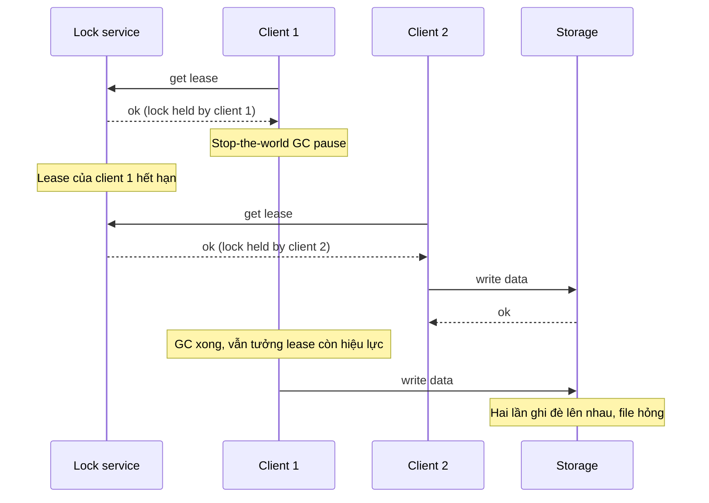

*(Vẽ lại Hình 8-4, tr. 302: cài distributed lock sai; client 1 tin lease vẫn còn hiệu lực dù đã hết hạn, nên làm hỏng file trong storage.)*

**Phân tích** (tr. 302). Đây là ví dụ đúng của [process pause](#process-pauses) (tr. 295): client giữ lease bị dừng quá lâu nên lease **hết hạn**. Client khác giành được lease cho cùng file và bắt đầu ghi. Khi client bị dừng quay lại, nó **tin (sai)** rằng mình vẫn có lease hợp lệ và **cũng ghi** vào file. Kết quả: các lần ghi của hai client **đụng nhau** và làm hỏng file.

<a id="fencing-tokens"></a>

**Fencing tokens** (tr. 303–304).

**Why** (tr. 303). Khi dùng lock hay lease để bảo vệ quyền truy cập một tài nguyên, như file storage ở Hình 8-4, cần bảo đảm một node **đang tin sai** mình là "người được chọn" **không phá được** phần còn lại của hệ thống. Một kỹ thuật khá đơn giản đạt mục tiêu này gọi là ***fencing*** (Hình 8-5).

**What và How** (tr. 303):

1. Mỗi lần lock server cấp lock hay lease, nó trả kèm một ***fencing token***: một **số tăng lên mỗi lần lock được cấp** (ví dụ do lock service tăng dần).
2. Mỗi lần client gửi request ghi tới storage service, nó **phải kèm fencing token hiện tại** của mình.
3. Storage **nhớ token lớn nhất đã xử lý** và **từ chối** mọi lần ghi mang token **cũ hơn**.

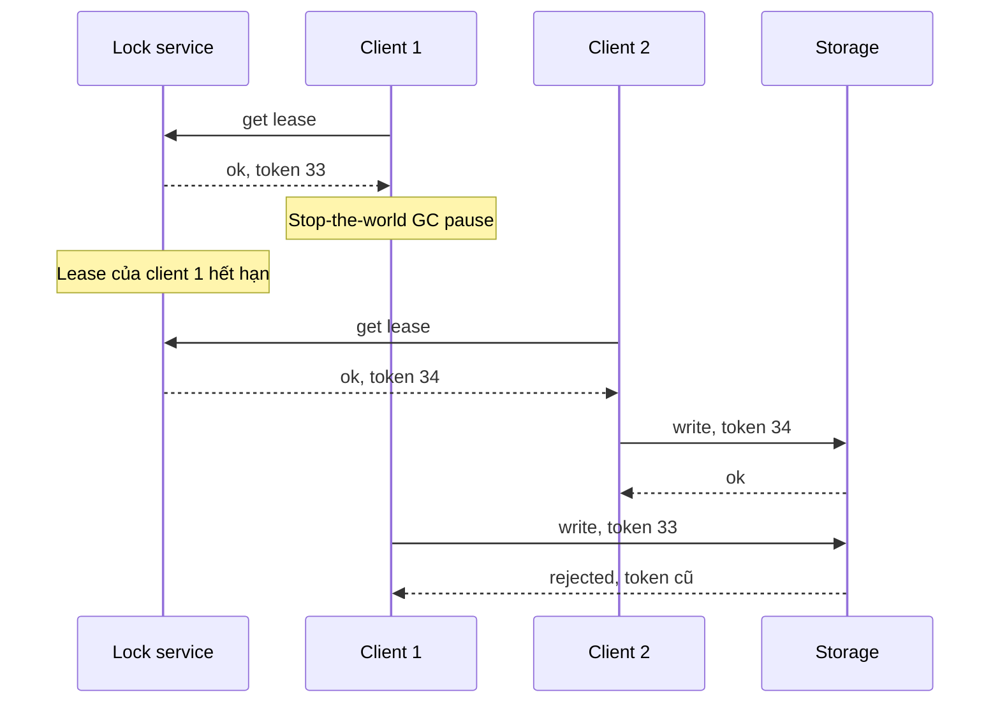

*(Vẽ lại Hình 8-5, tr. 303: storage chỉ cho phép ghi theo thứ tự fencing token tăng dần.)*

**Example** (tr. 303). Client 1 giành lease với **token 33**, rồi rơi vào một pause dài và lease hết hạn. Client 2 giành lease với **token 34** (số luôn tăng) và gửi request ghi tới storage kèm token 34. Sau đó client 1 "sống lại" và gửi lần ghi của nó kèm token 33. Storage **nhớ** rằng nó đã xử lý một lần ghi có token **lớn hơn** (34), nên **từ chối** request mang token 33.

**Trong thực tế** (tr. 303):

- Nếu dùng **ZooKeeper** làm lock service, có thể dùng **transaction ID `zxid`** hoặc **version của node `cversion`** làm fencing token. Chúng được **đảm bảo tăng đơn điệu**, nên có đúng tính chất cần có [74].
- Cơ chế này đòi hỏi **chính tài nguyên** phải **chủ động kiểm tra token**, bằng cách từ chối mọi lần ghi có token cũ hơn token đã xử lý. **Không đủ** nếu chỉ dựa vào việc client tự kiểm tra trạng thái lock của mình.
- Với tài nguyên **không hỗ trợ** fencing token tường minh, vẫn có thể lách giới hạn (ví dụ với file storage, **đưa fencing token vào tên file**). Dù sao, **cần một kiểu kiểm tra nào đó** để tránh xử lý request **nằm ngoài sự bảo vệ** của lock.

**Kiểm tra ở phía server là điều tốt** (tr. 304). Kiểm tra token ở server có vẻ là nhược điểm, nhưng có lẽ là **điều tốt**: không khôn ngoan khi một service giả định client **luôn cư xử đúng mực**, vì client thường do những người có **ưu tiên rất khác** với người vận hành service chạy [76]. Vì vậy, mọi service nên **tự bảo vệ** trước các client **vô tình lạm dụng**.

> **Bổ sung ngoài sách — hai nghĩa của "fencing".** Ở [chương 5](chapter-05.md#failover-problems) (chú thích ii, tr. 158), *fencing* chỉ việc **tắt hẳn** node bị nghi là leader cũ (mạnh tay nhất là STONITH). Fencing token ở đây làm việc khác: không cần giết node cũ, mà làm cho **tài nguyên phớt lờ** node cũ. Hai cách bổ sung cho nhau. STONITH không giúp được nếu request cũ **đã nằm trên đường truyền**; fencing token vẫn chặn được request đó khi nó tới.

> **Bổ sung ngoài sách.** Fencing token chỉ an toàn khi **lock service** tự nó đáng tin: nó phải cấp token tăng đơn điệu ngay cả khi chính nó có node hỏng hay mạng chia cắt. Đó là lý do lock service thường được xây trên một thuật toán consensus như của ZooKeeper, chủ đề của [Chương 9](chapter-09.md#zookeeper). Tính chất mà bộ sinh token cần có được sách nêu tường minh ở [B4.3](#correctness).

<a id="byzantine"></a>

#### B4.2 Byzantine Faults (tr. 304–306)

**Giới hạn của fencing token** (tr. 304). Fencing token phát hiện và chặn được node **vô tình** hành động sai (ví dụ vì chưa biết lease đã hết hạn). Nhưng nếu node **cố ý** muốn phá các đảm bảo của hệ thống, nó dễ dàng làm được bằng cách gửi message kèm **fencing token giả**.

**Giả định của sách: không tin cậy nhưng trung thực** (tr. 304). Sách giả định node **không tin cậy nhưng trung thực** (*unreliable but honest*):

- node có thể **chậm** hoặc **không bao giờ phản hồi** (do fault);
- trạng thái của node có thể **cũ** (do GC pause hay độ trễ mạng);
- nhưng **nếu** node phản hồi, nó **nói "sự thật"**: theo hiểu biết tốt nhất của nó, nó đang **chơi đúng luật** của giao thức.

**What — Byzantine fault** (tr. 304). Bài toán phân tán **khó hơn nhiều** nếu có rủi ro node **"nói dối"** (gửi response sai hay hỏng tùy ý), ví dụ một node **tự nhận đã nhận** một message trong khi thực ra không nhận. Hành vi như vậy gọi là ***Byzantine fault***, và bài toán đạt consensus trong môi trường thiếu tin tưởng này gọi là ***Byzantine Generals Problem*** [77].

<a id="byzantine-generals"></a>

**Hộp "The Byzantine Generals Problem"** (tr. 304).

- **Two Generals Problem.** Byzantine Generals Problem là dạng tổng quát của ***Two Generals Problem*** [78]: hai vị tướng cần **thống nhất kế hoạch tác chiến**. Họ đóng quân ở hai nơi khác nhau, nên chỉ liên lạc được bằng **người đưa tin**, và người đưa tin đôi khi **bị chậm hoặc bị mất** (giống gói tin trên mạng). Sách bàn bài toán consensus này ở [Chương 9](chapter-09.md#consensus).
- **Phiên bản Byzantine.** Có **n vị tướng** cần thống nhất, và việc của họ bị cản trở vì có **kẻ phản bội** trong số họ. Phần lớn các tướng **trung thành** và gửi message trung thực, nhưng kẻ phản bội có thể cố **lừa và gây rối** bằng message **giả hoặc sai** (trong khi cố không bị phát hiện). **Không ai biết trước** ai là kẻ phản bội.
- **Nguồn gốc tên gọi.** Byzantium là một thành phố Hy Lạp cổ, sau thành Constantinople, nay là Istanbul ở Thổ Nhĩ Kỳ. Không có bằng chứng lịch sử nào cho thấy các tướng Byzantium **mưu mô** hơn ở nơi khác. Tên gọi đến từ nghĩa của từ *Byzantine* là **quá phức tạp, quan liêu, xảo trá**, đã được dùng trong chính trị từ rất lâu trước khi có máy tính [79]. Lamport muốn chọn một quốc tịch **không làm phật lòng** người đọc, và được khuyên rằng gọi là "Albanian Generals Problem" không phải ý hay [80].

**What — Byzantine fault-tolerant** (tr. 305). Một hệ thống là ***Byzantine fault-tolerant*** nếu nó **tiếp tục chạy đúng** ngay cả khi một số node **trục trặc và không tuân theo giao thức**, hoặc có **kẻ tấn công** can thiệp vào mạng.

**Khi nào cần quan tâm** (tr. 305):

| Hoàn cảnh | Lý do |
| --- | --- |
| **Hàng không vũ trụ** | Dữ liệu trong bộ nhớ hay thanh ghi CPU có thể **bị bức xạ làm hỏng**, khiến máy phản hồi các node khác theo cách khó lường tùy ý. Hỏng hệ thống thì **rất đắt** (máy bay rơi làm chết mọi người trên khoang, hay tên lửa đâm vào Trạm Vũ trụ Quốc tế), nên hệ điều khiển bay **phải chịu được** Byzantine fault [81, 82] |
| **Nhiều tổ chức cùng tham gia** | Một số bên có thể cố **gian lận** hay lừa đảo bên khác. Không an toàn khi một node cứ tin message của node khác, vì message có thể được gửi với **ý đồ xấu**. Ví dụ mạng peer-to-peer như **Bitcoin** và các blockchain khác có thể coi là cách để các bên **không tin nhau** thống nhất một giao dịch có xảy ra hay không, **không cần cơ quan trung tâm** [83] |

**Khi nào không cần** (tr. 305):

- Trong loại hệ thống sách bàn, thường **có thể giả định an toàn** rằng **không có Byzantine fault**. Trong datacenter của bạn, mọi node do **tổ chức của bạn kiểm soát** (nên hy vọng tin được), và mức bức xạ **đủ thấp** để hỏng bộ nhớ không phải vấn đề lớn.
- Giao thức làm hệ thống chịu Byzantine fault **khá phức tạp** [84], và hệ nhúng chịu lỗi dựa vào **hỗ trợ từ tầng phần cứng** [81]. Với phần lớn hệ dữ liệu phía server, **chi phí** triển khai giải pháp Byzantine fault-tolerant khiến chúng **không thực tế**.

**Client trên web thì sao?** (tr. 305). Ứng dụng web **phải** lường trước hành vi **tùy ý và độc hại** của client dưới quyền người dùng cuối, như trình duyệt. Vì vậy **kiểm tra input** (*input validation*), **làm sạch input** (*sanitization*) và **escape output** rất quan trọng, ví dụ để chống **SQL injection** và **cross-site scripting**. Nhưng ở đây ta thường **không dùng** giao thức Byzantine fault-tolerant, mà chỉ **để server làm chủ** việc quyết định hành vi nào của client được phép. Trong mạng peer-to-peer **không có** cơ quan trung tâm như vậy, Byzantine fault tolerance mới **liên quan hơn**.

**Bug phần mềm và tấn công bảo mật** (tr. 305–306):

- **Bug** có thể coi là một Byzantine fault, nhưng nếu triển khai **cùng phần mềm** trên mọi node, thuật toán Byzantine fault-tolerant **không cứu được bạn**. Phần lớn thuật toán loại này cần một ***supermajority***: **hơn hai phần ba** số node chạy đúng (với **4 node**, tối đa **1 node** được trục trặc). Muốn dùng cách này chống bug, bạn phải có **bốn bản cài độc lập** của cùng phần mềm và hy vọng bug chỉ xuất hiện ở **một** trong bốn.
- **Tấn công.** Thật hấp dẫn nếu một giao thức bảo vệ được ta trước lỗ hổng, việc bị xâm nhập và tấn công độc hại. Tiếc là điều đó **cũng không thực tế**: ở phần lớn hệ thống, kẻ tấn công xâm nhập được **một node** thì có lẽ xâm nhập được **mọi node**, vì chúng chạy **cùng phần mềm** (tr. 306). Các cơ chế truyền thống (**xác thực, kiểm soát truy cập, mã hóa, firewall**…) vẫn là **lớp bảo vệ chính**.

> **Bổ sung ngoài sách.** Con số "hơn hai phần ba" đến từ kết quả kinh điển: muốn chịu được f node Byzantine thì cần ít nhất **n = 3f + 1** node. Với n = 4 thì f = 1, khớp ví dụ của sách. Trực giác: mỗi quyết định phải dựa trên một quorum đủ lớn để, sau khi trừ đi f node có thể nói dối, phần trung thực trong hai quorum bất kỳ vẫn giao nhau.

<a id="weak-lying"></a>

**Weak forms of lying** (tr. 306).

Dù giả định node nói chung **trung thực**, vẫn đáng thêm vào phần mềm các cơ chế chống các dạng **"nói dối yếu"**: message không hợp lệ do **lỗi phần cứng, bug phần mềm và cấu hình sai**. Chúng **không phải** Byzantine fault tolerance đầy đủ (không chống được một kẻ thù quyết tâm), nhưng là các bước **đơn giản, thực dụng** để tăng reliability. Ví dụ:

| Dạng "nói dối yếu" | Cách phòng | Nguồn |
| --- | --- | --- |
| **Gói tin bị hỏng** do lỗi phần cứng hoặc bug trong hệ điều hành, driver, router… Thường bị **checksum của TCP và UDP** bắt, nhưng **đôi khi lọt qua** | Biện pháp đơn giản thường đủ, như **checksum ở giao thức tầng ứng dụng** | [85, 86, 87] |
| **Input từ người dùng** của ứng dụng công khai | **Làm sạch input** cẩn thận: kiểm tra giá trị nằm trong khoảng hợp lý, **giới hạn kích thước chuỗi** để chống từ chối dịch vụ bằng cấp phát bộ nhớ lớn. Service nội bộ sau firewall có thể kiểm tra lỏng hơn, nhưng vẫn nên **kiểm tra cơ bản** giá trị (ví dụ khi parse giao thức) | [85] |
| **NTP server báo giờ sai** | Cấu hình NTP client với **nhiều địa chỉ server**. Khi đồng bộ, client liên lạc **tất cả**, ước lượng sai số của chúng, và kiểm tra **đa số server đồng ý** về một khoảng thời gian. Chừng nào phần lớn server ổn, server cấu hình sai sẽ bị phát hiện là **ngoại lai** và loại khỏi việc đồng bộ. Dùng nhiều server làm NTP **bền bỉ hơn** dùng một server | [37] |

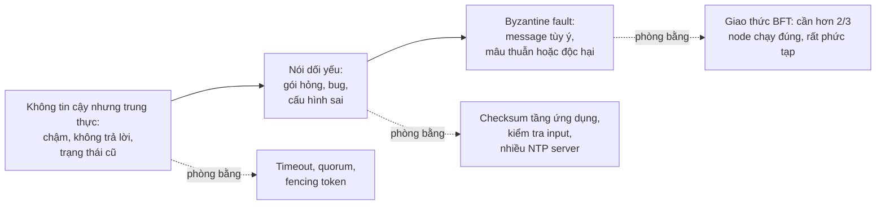

*(Sơ đồ do người viết ghi chú tổng hợp từ tr. 301–306. Cách xếp thành một phổ là của người viết.)*

<a id="system-model"></a>

#### B4.3 System Model and Reality (tr. 306–310)

**Why — cần hình thức hóa các fault** (tr. 306–307). Nhiều thuật toán đã được thiết kế cho các bài toán hệ phân tán, ví dụ lời giải cho bài toán consensus ở [Chương 9](chapter-09.md#fault-tolerant-consensus). Muốn có ích, chúng phải **chịu được** các fault của hệ phân tán đã bàn trong chương. Thuật toán cần được viết sao cho **không phụ thuộc quá nhiều** vào chi tiết phần cứng và phần mềm nơi nó chạy. Điều đó đòi hỏi **hình thức hóa** các loại fault kỳ vọng xảy ra. Ta làm vậy bằng cách định nghĩa một ***system model***: một **trừu tượng** mô tả những gì thuật toán **được phép giả định**.

<a id="timing-models"></a>

**Ba system model về thời gian** (tr. 307):

| Model | Giả định | Thực tế đến đâu |
| --- | --- | --- |
| ***Synchronous model*** | Độ trễ mạng, process pause và sai số đồng hồ đều **có giới hạn**. Không có nghĩa đồng hồ đồng bộ hoàn hảo hay độ trễ bằng 0, chỉ là biết chúng **không bao giờ vượt** một giới hạn trên cố định [88] | **Không thực tế** với phần lớn hệ thực, vì như chương đã bàn, độ trễ và pause không giới hạn **có xảy ra** |
| ***Partially synchronous model*** | Hệ thống hành xử **như đồng bộ phần lớn thời gian**, nhưng **đôi khi vượt** giới hạn về độ trễ mạng, process pause và độ trôi đồng hồ [88] | **Thực tế** với nhiều hệ thống: phần lớn thời gian mạng và tiến trình khá ngoan (nếu không ta chẳng làm được gì), nhưng phải tính tới việc mọi giả định về thời gian **thỉnh thoảng bị phá vỡ**, lúc đó độ trễ, pause và sai số đồng hồ có thể **lớn tùy ý** |
| ***Asynchronous model*** | Thuật toán **không được phép** giả định gì về thời gian; thậm chí **không có đồng hồ** (nên không dùng được timeout) | Một số thuật toán thiết kế được cho model này, nhưng nó **rất gò bó** |

<a id="node-failure-models"></a>

**Ba system model về lỗi của node** (tr. 307):

| Model | Giả định |
| --- | --- |
| ***Crash-stop faults*** | Node chỉ hỏng theo **một cách**: **crash**. Nó có thể đột ngột ngừng phản hồi bất kỳ lúc nào, và từ đó **biến mất vĩnh viễn**, không bao giờ quay lại |
| ***Crash-recovery faults*** | Node có thể crash bất kỳ lúc nào, và **có thể phản hồi trở lại** sau một khoảng thời gian không biết trước. Node được giả định có ***stable storage*** (đĩa không bay hơi) **giữ được qua crash**, còn **trạng thái trong bộ nhớ thì mất** |
| ***Byzantine (arbitrary) faults*** | Node có thể làm **bất cứ điều gì**, kể cả cố lừa gạt node khác như [B4.2](#byzantine) |

**Model hữu ích nhất cho hệ thực** (tr. 308). Để mô hình hóa hệ thống thật, **partially synchronous model với crash-recovery fault** nói chung là hữu ích nhất. Nhưng thuật toán phân tán đối phó với model đó thế nào?

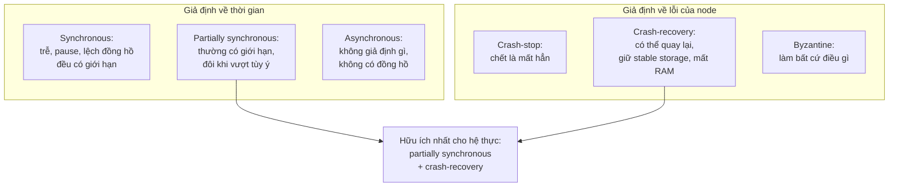

*(Sơ đồ do người viết ghi chú tổng hợp từ tr. 307–308.)*

<a id="correctness"></a>

**Correctness of an algorithm** (tr. 308).

- **Định nghĩa đúng bằng thuộc tính.** Để định nghĩa thế nào là một thuật toán **đúng**, có thể mô tả các ***property*** (thuộc tính) của nó. Ví dụ output của thuật toán sắp xếp có thuộc tính: với hai phần tử khác nhau bất kỳ trong danh sách output, phần tử bên trái nhỏ hơn phần tử bên phải. Đó chỉ là cách hình thức để định nghĩa thế nào là "danh sách đã sắp xếp".
- **Ví dụ: thuật toán sinh fencing token** ([B4.1](#fencing-tokens), tr. 303). Có thể yêu cầu các thuộc tính sau:

| Thuộc tính | Định nghĩa |
| --- | --- |
| ***Uniqueness*** | Không có hai request xin fencing token nào nhận **cùng một giá trị** |
| ***Monotonic sequence*** | Nếu request x nhận token t_x, request y nhận token t_y, và x **hoàn tất trước khi** y bắt đầu, thì t_x < t_y |
| ***Availability*** | Một node xin fencing token và **không crash** thì **rốt cuộc** sẽ nhận được response |

- **Đúng trong một system model** nghĩa là thuật toán **luôn thỏa** các thuộc tính của nó **trong mọi tình huống** mà ta giả định có thể xảy ra trong model đó.
- **Nhưng điều này có hợp lý không?** Nếu **mọi node crash**, hay mọi độ trễ mạng đột nhiên **dài vô hạn**, thì **không thuật toán nào** làm được gì.

<a id="safety-liveness"></a>

**Safety and liveness** (tr. 308–309).

**What** (tr. 308). Để làm rõ, nên phân biệt hai loại thuộc tính: ***safety*** và ***liveness***. Trong ví dụ trên, **uniqueness** và **monotonic sequence** là thuộc tính **safety**, còn **availability** là thuộc tính **liveness**.

**Dấu hiệu nhận biết** (tr. 308). Thuộc tính liveness thường có chữ **"eventually"** (rốt cuộc) trong định nghĩa. Và đúng như bạn đoán, **eventual consistency là một thuộc tính liveness** [89] ([chương 5, eventual consistency](chapter-05.md#eventual-consistency)).

**Định nghĩa không chính thức và chính thức** (tr. 308–309):

- Không chính thức: safety là **"điều xấu không xảy ra"**, liveness là **"điều tốt rốt cuộc sẽ xảy ra"**. Nhưng **đừng suy diễn quá nhiều** từ các định nghĩa này, vì "tốt" và "xấu" là chủ quan.
- Định nghĩa thật thì **chính xác và mang tính toán học** [90]:
  - Nếu một thuộc tính **safety bị vi phạm**, ta **chỉ ra được một thời điểm cụ thể** nó bị phá (ví dụ nếu uniqueness bị vi phạm, ta xác định được thao tác cụ thể đã trả về một fencing token trùng). Sau khi bị vi phạm, vi phạm **không thể hoàn tác**: thiệt hại đã xảy ra.
  - Thuộc tính **liveness** thì ngược lại: nó có thể **chưa đúng** ở một thời điểm (ví dụ node đã gửi request nhưng chưa nhận response), nhưng **luôn còn hy vọng** nó được thỏa trong tương lai (cụ thể là nhận được response).

**Why — lợi ích của việc phân biệt** (tr. 309). Phân biệt safety và liveness giúp xử lý các system model khó:

- Với thuật toán phân tán, thường đòi hỏi thuộc tính **safety luôn đúng** trong **mọi** tình huống có thể của system model [88]. Nghĩa là **ngay cả khi mọi node crash** hay **cả mạng hỏng**, thuật toán vẫn phải bảo đảm **không trả kết quả sai** (thuộc tính safety vẫn được thỏa).
- Với thuộc tính liveness, ta **được phép kèm điều kiện**: ví dụ một request chỉ cần nhận response **nếu đa số node chưa crash**, và **nếu mạng rốt cuộc phục hồi** sau sự cố.
- Định nghĩa của partially synchronous model **đòi hỏi** hệ thống **rốt cuộc quay về trạng thái đồng bộ**: mọi đợt gián đoạn mạng chỉ kéo dài **hữu hạn** rồi được sửa.

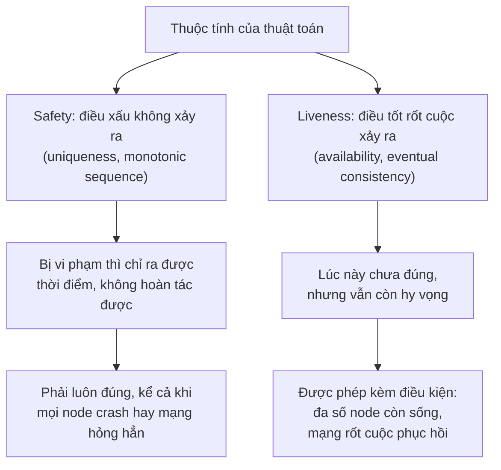

*(Sơ đồ do người viết ghi chú tổng hợp từ tr. 308–309.)*

> **Ví dụ minh họa do AI xây dựng.** Với lock service: "không bao giờ có hai client cùng giữ lock" là **safety**; nếu nó bị phá dù chỉ một lần, dữ liệu có thể đã hỏng và không quay lại được. "Client xin lock thì rốt cuộc sẽ được cấp" là **liveness**; nếu mạng đang chia cắt thì tạm thời chưa thỏa, và chấp nhận được miễn là khi mạng phục hồi thì client được cấp. Một thiết kế tốt thà **tạm ngừng cấp lock** (hy sinh liveness) còn hơn **cấp cho hai client** (phá safety).

<a id="model-vs-reality"></a>

**Mapping system models to the real world** (tr. 309–310).

**Model chỉ là trừu tượng đơn giản hóa** (tr. 309). Safety, liveness và system model **rất hữu ích** để suy luận về tính đúng của thuật toán phân tán. Nhưng khi cài một thuật toán trong thực tế, **các sự thật lộn xộn** của thực tại lại "cắn" bạn, và rõ ràng system model chỉ là một **trừu tượng đơn giản hóa** của thực tế.

**Ví dụ: stable storage không phải lúc nào cũng stable** (tr. 309):

- Thuật toán trong crash-recovery model thường giả định dữ liệu trên stable storage **sống sót qua crash**. Nhưng nếu dữ liệu trên đĩa **bị hỏng**, hay **bị xóa sạch** do lỗi phần cứng hoặc cấu hình sai [91]?
- Nếu server có **bug firmware** và **không nhận ra ổ cứng** khi reboot, dù ổ vẫn được gắn đúng [92]?
- Thuật toán quorum ([chương 5, quorum](chapter-05.md#quorums), tr. 179) dựa vào việc một node **nhớ** dữ liệu mà nó **tuyên bố đã lưu**. Nếu node có thể **"mất trí nhớ"** và quên dữ liệu đã lưu, điều kiện quorum **bị phá**, và do đó **tính đúng của thuật toán bị phá**. (So sánh với kịch bản 5 ở [chương 5, B4.3](chapter-05.md#quorum-limits): node mang giá trị mới hỏng và được khôi phục từ replica cũ.)
- Có lẽ cần một system model mới, trong đó stable storage **phần lớn** sống sót qua crash nhưng **đôi khi** bị mất. Nhưng model đó lại **khó suy luận hơn**.

**Vẫn phải xử lý điều "không thể"** (tr. 310). Mô tả lý thuyết của thuật toán có thể tuyên bố rằng một số việc **được giả định không xảy ra**; và trong hệ không Byzantine, ta **buộc phải** đặt vài giả định về fault nào có thể và không thể xảy ra. Nhưng bản cài thật **vẫn có thể phải có code** xử lý trường hợp điều "không thể" lại xảy ra, dù cách xử lý chỉ là **in một câu than thở rồi thoát chương trình**, tức để **con người vận hành** dọn dẹp [93]. Tác giả cho rằng đây có lẽ chính là **khác biệt giữa khoa học máy tính và kỹ nghệ phần mềm**.

**Nhưng model trừu tượng không vô giá trị** (tr. 310). Hoàn toàn ngược lại:

- Chúng **cực kỳ hữu ích** để chưng cất độ phức tạp của hệ thống thật thành một **tập fault quản lý được** mà ta suy luận được, để hiểu vấn đề và giải quyết **có hệ thống**.
- Có thể **chứng minh** thuật toán đúng bằng cách chỉ ra các thuộc tính của nó **luôn đúng** trong một system model.
- Chứng minh thuật toán đúng **không có nghĩa** bản cài trên hệ thật **luôn** chạy đúng. Nhưng đó là **bước đầu rất tốt**: phân tích lý thuyết có thể phát hiện vấn đề **ẩn rất lâu** trong hệ thật, chỉ lộ ra khi các giả định (ví dụ về thời gian) bị phá vỡ do hoàn cảnh bất thường.
- **Phân tích lý thuyết và kiểm thử thực nghiệm quan trọng như nhau.**

---

<a id="b5"></a>

### B5. Summary — Tổng kết của tác giả (tr. 310–312)

**Các vấn đề đã bàn** (tr. 310):

| Vấn đề | Ý nghĩa |
| --- | --- |
| **Mạng** | Mỗi lần gửi gói tin qua mạng, nó có thể **mất** hoặc **trễ tùy ý**. Reply cũng có thể mất hay trễ, nên **không nhận được reply** thì **không biết** message đã tới chưa |
| **Đồng hồ** | Đồng hồ của một node có thể **lệch đáng kể** so với node khác (dù đã cố cấu hình NTP), có thể **đột ngột nhảy tới hay lùi**. Dựa vào nó là **nguy hiểm**, vì nhiều khả năng bạn không có thước đo tốt cho **khoảng sai số** của đồng hồ |
| **Process pause** | Một tiến trình có thể **dừng một khoảng đáng kể** ở bất kỳ điểm nào (có thể do stop-the-world GC), bị node khác **tuyên bố đã chết**, rồi **sống lại** mà không nhận ra mình đã bị dừng |

**Partial failure là đặc trưng định nghĩa của hệ phân tán** (tr. 310–311). Mỗi khi phần mềm làm gì có dính tới node khác, có khả năng nó **thỉnh thoảng thất bại**, **chậm ngẫu nhiên**, hoặc **không phản hồi** (và rốt cuộc timeout). Trong hệ phân tán, ta cố đưa khả năng **chịu partial failure** vào phần mềm, để hệ thống nói chung tiếp tục chạy khi một số thành phần đã hỏng.

**Bước đầu là phát hiện fault, nhưng điều đó đã khó** (tr. 311):

- Phần lớn hệ thống **không có cơ chế chính xác** để biết một node đã hỏng hay chưa, nên phần lớn thuật toán phân tán dựa vào **timeout**.
- Timeout **không phân biệt** được lỗi mạng với lỗi node, và độ trễ mạng biến động đôi khi khiến một node **bị nghi oan** là đã crash.
- Đôi khi node ở trạng thái **suy giảm** (*degraded*): ví dụ card mạng Gigabit đột nhiên chỉ còn throughput **1 Kb/s** do bug driver [94]. Một node **"đi khập khiễng"** nhưng chưa chết như vậy có thể **còn khó xử lý hơn** một node hỏng hẳn.

**Phát hiện rồi thì chịu đựng cũng không dễ** (tr. 311). **Không có** biến toàn cục, shared memory, tri thức chung hay bất kỳ trạng thái dùng chung nào giữa các máy. Các node **thậm chí không thống nhất được bây giờ là mấy giờ**, nói gì tới điều sâu xa hơn. Cách duy nhất để thông tin đi từ node này sang node khác là **gửi qua mạng không tin cậy**. Quyết định quan trọng **không thể** để một node tự đưa ra một cách an toàn, nên cần các giao thức **nhờ tới các node khác** và cố đạt **sự đồng ý của một quorum**.

**Một máy hay nhiều máy?** (tr. 311):

- Quen viết phần mềm trong thế giới hoàn hảo toán học của một máy (cùng thao tác luôn trả cùng kết quả) thì chuyển sang thực tế lộn xộn của hệ phân tán có thể **hơi sốc**.
- Ngược lại, kỹ sư hệ phân tán thường coi một bài toán là **tầm thường** nếu giải được trên **một máy** [5], và quả thật ngày nay **một máy làm được rất nhiều** [95]. Nếu tránh được việc **mở hộp Pandora** và giữ mọi thứ trên một máy, **nói chung đáng làm vậy**.
- Nhưng như phần giới thiệu Part II đã nói ([chương 5, mục 0](chapter-05.md#part-ii)), scalability **không phải lý do duy nhất** để dùng hệ phân tán. **Fault tolerance** và **độ trễ thấp** (đặt dữ liệu gần người dùng về địa lý) là mục tiêu **quan trọng không kém**, và **không đạt được** với một node.

**Sự không tin cậy không phải quy luật tự nhiên** (tr. 311). Chương cũng đi lạc đề vài lần để xem sự không tin cậy của mạng, đồng hồ và tiến trình có phải **quy luật tự nhiên không tránh khỏi**. Câu trả lời là **không**: có thể đảm bảo response time **hard real-time** và **độ trễ có giới hạn** trong mạng, nhưng làm vậy **rất đắt** và dẫn tới **tận dụng phần cứng thấp hơn**. Phần lớn hệ thống **không quan trọng về an toàn** chọn **rẻ và không tin cậy** thay vì **đắt và tin cậy**.

**Siêu máy tính và hệ phân tán** (tr. 311–312). Siêu máy tính giả định thành phần tin cậy, nên phải **dừng và khởi động lại toàn bộ** khi một thành phần hỏng. Ngược lại, hệ phân tán có thể **chạy mãi** mà không bị gián đoạn ở mức dịch vụ, vì mọi fault và bảo trì có thể được xử lý **ở mức node**, ít nhất là **về lý thuyết**. (Thực tế, nếu một **thay đổi cấu hình tệ** được tung ra **mọi node**, nó vẫn làm hệ phân tán **gục ngã**.)

**Chương tiếp theo** (tr. 312). Chương này toàn **vấn đề** và cho một viễn cảnh ảm đạm. Chương sau chuyển sang **giải pháp**: các thuật toán được thiết kế để đối phó với mọi vấn đề của hệ phân tán ([Chương 9](chapter-09.md)).

---

<a id="c-so-do"></a>

## C. Sơ đồ minh họa

Các sơ đồ gắn với từng mục đã nằm trong phần B:

- Một máy và hệ phân tán, partial failure: [B1.0](#partial-failure)
- Request không có response (Hình 8-1), cách phát hiện fault: [B2.0](#async-network), [B2.2](#detecting-faults)
- Trade-off của timeout, nghẽn ở switch (Hình 8-2): [B2.3](#timeouts), [network congestion](#network-congestion)
- Circuit switching và packet switching: [B2.4](#sync-async-networks)
- Chọn loại đồng hồ: [B3.1](#monotonic-vs-tod)
- LWW sắp sai thứ tự do lệch đồng hồ (Hình 8-3), khoảng tin cậy và Spanner: [B3.3](#timestamps-ordering), [global snapshots](#global-snapshots)
- Lease bị process pause phá, GC như ngừng có kế hoạch: [B3.4](#process-pauses), [limiting GC](#limiting-gc)
- Node bị GC bị quorum tuyên bố chết, distributed lock sai (Hình 8-4), fencing token (Hình 8-5): [B4.1](#truth-majority), [leader and lock](#leader-lock), [fencing tokens](#fencing-tokens)
- Phổ các dạng "nói dối": [B4.2](#weak-lying)
- System model, safety và liveness: [B4.3](#system-model), [safety and liveness](#safety-liveness)

Phần này bổ sung các sơ đồ **tổng hợp** để ôn tập.

### C1. Bản đồ khái niệm của chương 8

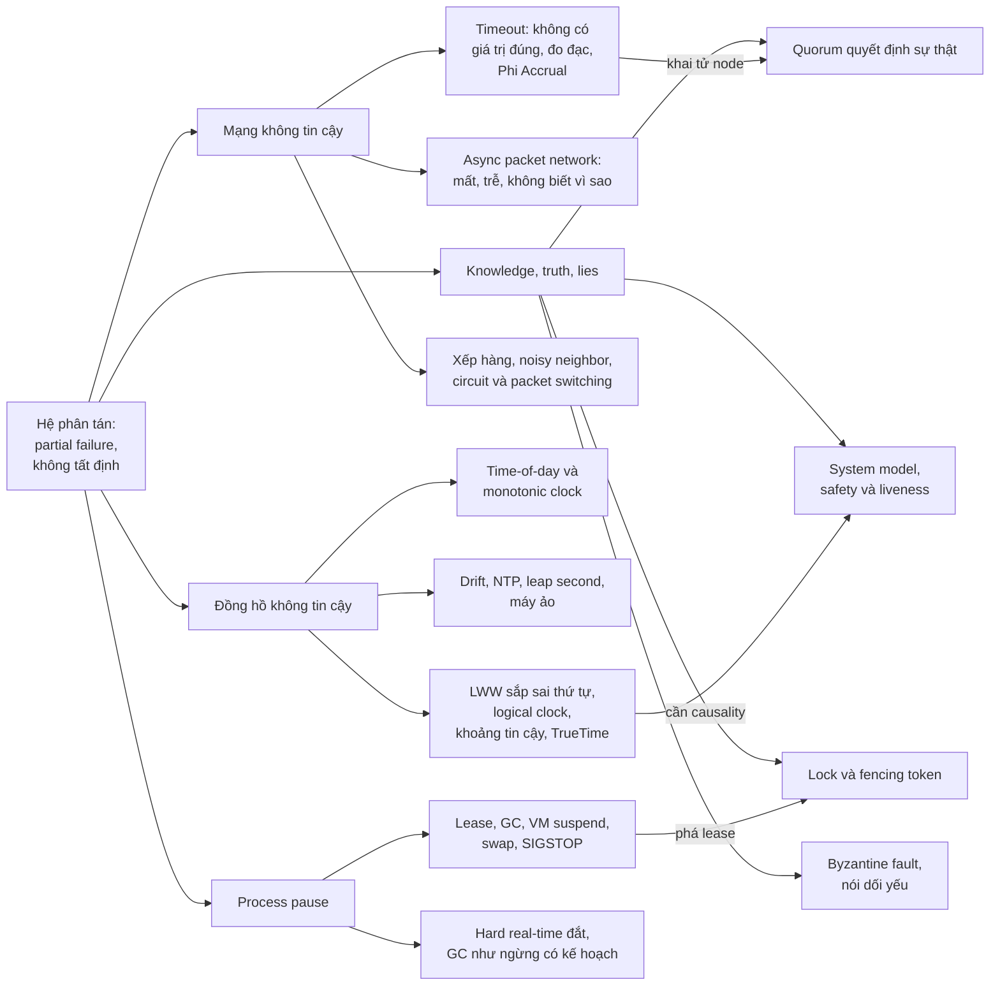

*(Sơ đồ do người viết ghi chú tổng hợp từ toàn chương.)*

### C2. Từ "không nhận được phản hồi" tới một hành động an toàn

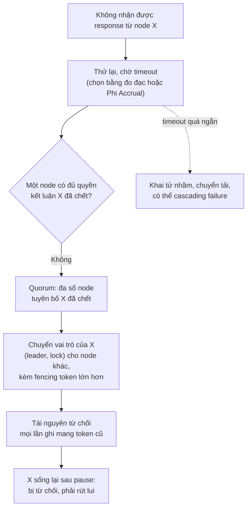

*(Sơ đồ do người viết ghi chú tổng hợp từ tr. 281, 284, 301–304. Đây là cách ghép các ý của sách thành một luồng, không phải một thuật toán sách mô tả.)*

### C3. Ba nguồn rắc rối, một triệu chứng chung

```mermaid
flowchart LR
    ND["Unbounded network delay"] --> S["Một node hành động dựa trên<br/>thông tin đã cũ mà không biết"]
    CE["Clock error:<br/>drift, nhảy, lệch"] --> S
    PP["Process pause:<br/>GC, VM suspend, swap"] --> S
    S --> R1["Khai tử nhầm,<br/>failover thừa (tr. 281)"]
    S --> R2["LWW bỏ mất ghi<br/>(tr. 292)"]
    S --> R3["Hai client cùng tin mình giữ lock,<br/>file hỏng (tr. 302)"]
    R1 --> M1["Timeout đo đạc,<br/>quorum (tr. 284, 301)"]
    R2 --> M2["Logical clock,<br/>version vector (tr. 293)"]
    R3 --> M3["Fencing token,<br/>tài nguyên tự kiểm tra (tr. 303)"]
```

*(Sơ đồ do người viết ghi chú tổng hợp; ba nhãn bên trái lấy từ ba xúc tu của bản đồ đầu chương, tr. 272.)*

---

<a id="d-so-sanh"></a>

## D. So sánh các giải pháp

<a id="d1"></a>

### D1. Siêu máy tính và dịch vụ internet trên cloud (tr. 275–277)

| Tiêu chí | Siêu máy tính (HPC) | Dịch vụ internet (cloud) |
| --- | --- | --- |
| **Nguyên lý xử lý lỗi** | Leo thang partial failure thành total failure: dừng cả cluster, sửa, chạy lại từ checkpoint | Chấp nhận partial failure, xây chịu lỗi trong phần mềm |
| **Workload** | Batch, offline (mô phỏng thời tiết, molecular dynamics) | Online, cần độ trễ thấp mọi lúc |
| **Phần cứng** | Chuyên dụng, node tin cậy, shared memory, RDMA | Máy phổ thông: rẻ hơn với cùng hiệu năng, nhưng hỏng nhiều hơn |
| **Mạng** | Mesh, torus nhiều chiều cho mẫu giao tiếp biết trước | IP, Ethernet, Clos topology; giao tiếp địa lý qua internet |
| **Ưu điểm** | Đơn giản, giống một máy | Không cần dừng dịch vụ, rolling upgrade, thay máy ảo kém |
| **Nhược điểm** | Hệ lớn tốn phần lớn thời gian phục hồi | Phần mềm phức tạp, phải lường mọi loại fault |
| **Dùng khi** | Tính toán khoa học dừng và chạy lại được | Dịch vụ phải luôn sẵn sàng |

<a id="d2"></a>

### D2. Các cách phát hiện fault (tr. 280–281, 284)

| Cách | Nguyên lý | Ưu điểm | Nhược điểm |
| --- | --- | --- | --- |
| **TCP RST hoặc FIN** | Hệ điều hành báo không có tiến trình nghe ở cổng | Phản hồi nhanh | Không biết request đã được xử lý bao nhiêu |
| **Script báo tiến trình chết** (HBase) | Hệ điều hành còn sống báo cho node khác | Tiếp quản không cần chờ timeout | Chỉ khi hệ điều hành còn chạy |
| **Hỏi switch** | Phát hiện link hỏng ở mức phần cứng | Biết máy đã tắt nguồn | Cần quyền vào switch; không dùng được qua internet hay khi mạng tới switch cũng hỏng |
| **ICMP Destination Unreachable** | Router báo IP không với tới được | Tự động | Router cũng không biết chắc |
| **Response tích cực từ ứng dụng** | Chính ứng dụng xác nhận đã xử lý | Cách duy nhất biết chắc request thành công | Thiếu response thì không kết luận được gì |
| **Timeout cố định** | Không nghe gì trong khoảng thời gian thì coi là chết | Luôn dùng được | Không phân biệt lỗi mạng và lỗi node; ngắn thì khai tử nhầm, dài thì phát hiện chậm |
| **Timeout thích nghi** (Phi Accrual) | Đo liên tục phân phối response time và jitter, tự chỉnh ngưỡng | Hợp với môi trường độ trễ biến động | Vẫn chỉ là phỏng đoán |

<a id="d3"></a>

### D3. Circuit switching và packet switching (tr. 284–287)

| Tiêu chí | Circuit switching | Packet switching |
| --- | --- | --- |
| **Nguyên lý** | Giữ chỗ băng thông cố định dọc toàn tuyến trong suốt kết nối | Gói tin tranh nhau băng thông động từng thời điểm |
| **Chia tài nguyên** | Tĩnh | Động |
| **Độ trễ** | Có giới hạn (bounded delay), không xếp hàng | Không giới hạn, do xếp hàng |
| **Tận dụng** | Thấp: khe trống bị bỏ phí | Cao: mỗi byte rẻ hơn |
| **Hợp với** | Lưu lượng đều: cuộc gọi âm thanh, video | Lưu lượng bùng nổ: web, email, truyền file |
| **Nhược điểm** | Phải đoán băng thông; đoán sai thì chậm hoặc không lập được circuit | Độ trễ biến động, nghẽn, mất gói |
| **Ví dụ** | Điện thoại cố định, ISDN (16 bit mỗi 250 µs) | Ethernet, IP, TCP; lai: ATM, InfiniBand, QoS và admission control |

<a id="d4"></a>

### D4. Ba loại đồng hồ (tr. 288–295)

| Tiêu chí | Time-of-day clock | Monotonic clock | Logical clock |
| --- | --- | --- | --- |
| **Đo gì** | Ngày giờ theo lịch (wall-clock), tính từ epoch | Khoảng thời gian đã trôi qua | Thứ tự tương đối của sự kiện |
| **Ví dụ** | `CLOCK_REALTIME`, `System.currentTimeMillis()` | `CLOCK_MONOTONIC`, `System.nanoTime()` | Bộ đếm tăng dần (Lamport [56]), version vector |
| **Đồng bộ giữa máy** | Có, qua NTP (không hoàn hảo) | Không cần, không so sánh được giữa máy | Lan truyền qua message |
| **Có thể nhảy lùi** | Có (bị đặt lại cưỡng bức); bỏ qua leap second | Không (NTP chỉ slewing tối đa 0,05%) | Không |
| **Dùng cho** | Thời điểm cho con người đọc: ngày đăng bài, giờ gửi email, log | Timeout, response time | Sắp thứ tự sự kiện giữa các node |
| **Không dùng cho** | Đo khoảng thời gian; sắp thứ tự sự kiện giữa node | Thời điểm tuyệt đối | Biết giờ thật |

<a id="d5"></a>

### D5. Cách xác định thứ tự sự kiện giữa các node (tr. 291–295)

| Cách | Nguyên lý | Ưu điểm | Nhược điểm | Ví dụ (lúc viết sách) |
| --- | --- | --- | --- | --- |
| **Timestamp từ time-of-day clock + LWW** | Gắn giờ của node gốc, giữ timestamp lớn nhất | Đơn giản, hội tụ | Lần ghi biến mất âm thầm khi lệch đồng hồ; không phân biệt tuần tự với đồng thời; trùng timestamp | Cassandra, Riak |
| **Logical clock, version vector** | Bộ đếm theo dõi happens-before | Không phụ thuộc đồng hồ vật lý; phát hiện được đồng thời | Không cho biết giờ thật; ứng dụng phải xử lý giá trị đồng thời | Riak (version vector, [chương 5](chapter-05.md#version-vectors)) |
| **Bộ đếm tập trung** | Một nơi cấp transaction ID tăng đơn điệu | Đúng causality | Cần phối hợp; nút cổ chai với nhiều transaction nhỏ | Database một node |
| **Cấp khối ID cho từng node** | Mỗi node lấy một khối không gian ID | Mở rộng được | Chỉ xấp xỉ đơn điệu, không đảm bảo causality | Twitter Snowflake |
| **Khoảng tin cậy + chờ trước khi commit** | Chờ hết độ bất định để các khoảng không chồng nhau | Timestamp phản ánh causality, snapshot toàn cục | Cần GPS hoặc đồng hồ nguyên tử để khoảng chờ ngắn (khoảng 7 ms) | Spanner (TrueTime) |

<a id="d6"></a>

### D6. Bảo vệ tài nguyên khỏi "người được chọn" giả (tr. 295–306)

| Tiêu chí | Lease hoặc lock, client tự kiểm tra | Lease + fencing token, tài nguyên kiểm tra | Giao thức Byzantine fault-tolerant |
| --- | --- | --- | --- |
| **Nguyên lý** | Client kiểm tra lease còn hiệu lực rồi mới ghi | Mỗi lần cấp lock kèm token tăng dần; tài nguyên từ chối token cũ | Hệ chạy đúng dù một số node nói dối |
| **Chống được** | Không gì khi có process pause hay lệch đồng hồ | Node **vô tình** sai (pause, mạng chậm) | Node **cố ý** sai, nếu dưới một phần ba |
| **Không chống được** | Pause giữa lúc kiểm tra và lúc ghi (Hình 8-4) | Node cố ý gửi token giả | Bug giống nhau trên mọi node; kẻ tấn công chiếm mọi node |
| **Chi phí** | Thấp | Tài nguyên phải hỗ trợ kiểm tra (hoặc lách, như đưa token vào tên file) | Rất phức tạp, cần hơn 2/3 node đúng |
| **Dùng khi** | Không nên dùng cho tính đúng đắn | Datacenter do một tổ chức kiểm soát | Hàng không vũ trụ, nhiều tổ chức không tin nhau, blockchain |
| **Ví dụ** | Bug từng có ở HBase | ZooKeeper `zxid`, `cversion` | Hệ điều khiển bay, Bitcoin |

<a id="d7"></a>

### D7. Các system model (tr. 306–308)

| Model | Loại | Giả định | Thực tế | Ghi chú |
| --- | --- | --- | --- | --- |
| **Synchronous** | Thời gian | Trễ mạng, pause, lỗi đồng hồ có giới hạn | Không thực tế | Biết giới hạn trên cố định |
| **Partially synchronous** | Thời gian | Thường có giới hạn, đôi khi vượt tùy ý trong khoảng hữu hạn | **Thực tế** | Rốt cuộc quay về đồng bộ |
| **Asynchronous** | Thời gian | Không giả định gì, không có đồng hồ | Rất gò bó | Không dùng được timeout |
| **Crash-stop** | Lỗi node | Chỉ hỏng bằng crash, không quay lại | Đơn giản hơn thực tế | |
| **Crash-recovery** | Lỗi node | Crash rồi có thể quay lại; stable storage còn, bộ nhớ mất | **Thực tế** (nhưng đĩa đôi khi cũng mất) | |
| **Byzantine** | Lỗi node | Làm bất cứ điều gì, kể cả lừa dối | Chỉ cần ở môi trường đặc biệt | Sách giả định không có |

Kết hợp hữu ích nhất cho hệ thực: **partially synchronous + crash-recovery** (tr. 308).

<a id="d8"></a>

### D8. Safety và liveness (tr. 308–309)

| Tiêu chí | Safety | Liveness |
| --- | --- | --- |
| **Ý nghĩa không chính thức** | Điều xấu không xảy ra | Điều tốt rốt cuộc xảy ra |
| **Khi bị vi phạm** | Chỉ ra được thời điểm cụ thể; không hoàn tác được | Có thể chưa đúng lúc này nhưng vẫn còn hy vọng |
| **Dấu hiệu** | Thường là "không bao giờ…" | Thường có chữ "eventually" |
| **Yêu cầu với thuật toán phân tán** | Luôn đúng trong mọi tình huống của system model, kể cả mọi node crash | Được kèm điều kiện (đa số còn sống, mạng phục hồi) |
| **Ví dụ** | Uniqueness và monotonic sequence của fencing token | Availability của fencing token; eventual consistency |

---

<a id="e-system-design"></a>

## E. Tư duy System Design

> **Ví dụ minh họa do AI xây dựng.** Tất cả tình huống dưới đây là giả định để luyện cách suy luận. Mỗi bước lập luận dẫn về nội dung sách. Hãy tự trả lời phần "Câu hỏi cần đặt" trước khi đọc lập luận.

### E1. Cluster database trên cloud liên tục failover nhầm

**Bối cảnh.** Một database single-leader gồm 3 node viết bằng Java, chạy trên máy ảo của một cloud công cộng. Failure detector dùng heartbeat với timeout cố định 3 giây. Vài lần mỗi tuần, leader bị tuyên bố chết và failover xảy ra, dù không node nào crash. Log cho thấy các đợt full GC dài 5–8 giây, và round-trip time tăng vọt vào giờ chạy batch job của các khách thuê khác.

**Câu hỏi cần đặt.** Vì sao node khỏe bị khai tử? Chỉ cần tăng timeout là xong? Làm sao để việc khai tử nhầm, nếu vẫn xảy ra, không gây hại?

**Lập luận.**

1. Timeout chỉ là **phỏng đoán**: nó không phân biệt node chết, node chậm hay mạng chậm (tr. 279, 281, 311).
2. Stop-the-world GC dài vài giây, thậm chí vài phút, là chuyện có thật (tr. 296); máy ảo còn chịu **steal time** (tr. 297), và **noisy neighbor** làm độ trễ mạng biến động mạnh (tr. 284). Một timeout 3 giây gần như chắc chắn sẽ nổ.
3. Timeout 3 giây không đến từ đo đạc. Cần đo **phân phối round-trip time** trong thời gian dài, trên nhiều máy, rồi chọn điểm cân bằng; tốt hơn là dùng detector thích nghi như **Phi Accrual** (tr. 284).
4. Mỗi lần failover thừa là chuyển tải đúng lúc hệ thống đang chật vật, có nguy cơ **cascading failure** (tr. 281); với replication bất đồng bộ còn có thể **mất ghi** ([chương 5](chapter-05.md#failover-problems), tr. 157).
5. Giảm nguồn gây pause: tinh chỉnh GC (tr. 297), coi GC như **ngừng có kế hoạch** hoặc **khởi động lại định kỳ** để tránh full GC (tr. 299), tắt swap (tr. 297).
6. Quan trọng nhất: khai tử nhầm **vẫn sẽ xảy ra**, nên phải an toàn khi nó xảy ra. Quyết định khai tử do **quorum** đưa ra và leader cũ phải tuân theo (tr. 301); mọi tài nguyên mà leader ghi vào nên kiểm tra **fencing token** để leader cũ sống lại sau GC không ghi đè được (tr. 303).

**Nếu yêu cầu thay đổi.** Nếu cần phát hiện lỗi trong vài trăm mili giây, cloud multi-tenant không có QoS sẽ không đáp ứng được (tr. 287); phải dùng phần cứng và băng thông riêng, tức **chia tài nguyên tĩnh** và chấp nhận chi phí cao hơn (tr. 286). Ngược lại, nếu downtime vài chục giây chấp nhận được, timeout dài hơn đáng kể sẽ giảm khai tử nhầm (tr. 281).

### E2. Distributed lock cho các worker ghi file báo cáo

**Bối cảnh.** Nhiều worker xử lý các file báo cáo trên object storage. Để hai worker không cùng ghi một file, mỗi worker xin lease 30 giây từ một lock service, và tự kiểm tra lease còn hạn trước mỗi lần ghi. Thỉnh thoảng một file bị hỏng, chứa dữ liệu trộn lẫn của hai worker.

**Câu hỏi cần đặt.** Lỗi nằm ở đâu? Sửa thế nào? Nếu object storage không tự kiểm tra được token thì sao?

**Lập luận.**

1. Đây đúng là kịch bản Hình 8-4: worker kiểm tra lease xong thì bị dừng (GC, máy ảo bị live migration, I/O chậm…), lease hết hạn, worker khác giành lease và ghi; worker đầu sống lại và ghi tiếp (tr. 296–297, 302).
2. **Client tự kiểm tra lease là không đủ**, vì pause có thể rơi đúng vào khoảng giữa lúc kiểm tra và lúc ghi. Nếu thời điểm hết hạn do máy khác tính rồi so với đồng hồ cục bộ, còn thêm rủi ro **lệch đồng hồ** (tr. 296, 303).
3. Dùng **fencing token**: lock service trả kèm một số tăng dần mỗi lần cấp lease (với ZooKeeper có thể dùng `zxid` hoặc `cversion`), và mọi lần ghi phải kèm token (tr. 303).
4. **Storage phải chủ động** từ chối token nhỏ hơn token lớn nhất đã thấy (tr. 303).
5. Nếu storage không hỗ trợ, sách gợi ý **đưa token vào tên file** (tr. 303). *Ví dụ minh họa do AI xây dựng:* mỗi worker ghi vào file mang hậu tố token của nó, và bước tiêu thụ chỉ đọc file có token lớn nhất. Dù cách nào, phải có **một kiểu kiểm tra** để không xử lý request nằm ngoài sự bảo vệ của lock (tr. 303).
6. *Bổ sung ngoài sách:* lock service tự nó phải cấp token đơn điệu kể cả khi có node hỏng, nên thường dựa trên consensus ([Chương 9](chapter-09.md#using-tob)).

**Nếu yêu cầu thay đổi.** Nếu worker có thể do **bên thứ ba không tin cậy** chạy và có thể cố ý gửi token giả, fencing token không đủ: đó là Byzantine fault (tr. 304). Khi đó storage phải làm chủ quyền quyết định: xác thực và kiểm soát quyền ghi (tr. 305–306).

### E3. Hệ thống tồn kho multi-leader dùng LWW bị mất cập nhật

**Bối cảnh.** Một hệ thống quản lý tồn kho chạy ở ba datacenter theo kiểu multi-leader, giải quyết xung đột bằng **LWW** theo timestamp của server. Kiểm kê cho thấy một số lần cập nhật số lượng "biến mất", dù client đều nhận *ok*. Các server đồng bộ NTP qua internet.

**Câu hỏi cần đặt.** Vì sao cập nhật biến mất? Cấu hình NTP tốt hơn có giải quyết được không? Nên thay LWW bằng gì?

**Lập luận.**

1. Đúng kịch bản Hình 8-3: cập nhật xảy ra **sau** nhưng mang timestamp **nhỏ hơn** thì bị bỏ, và lệch vài mili giây là đủ (tr. 292).
2. Qua internet, NTP có sai số **tối thiểu khoảng 35 ms**, có lúc tới **khoảng một giây** (tr. 290). Node có đồng hồ chậm **không ghi đè được** giá trị của node có đồng hồ nhanh cho tới khi hết khoảng lệch, và dữ liệu mất **không có báo lỗi** (tr. 292).
3. NTP tốt hơn **không giải quyết tận gốc**: độ chính xác của NTP bị giới hạn bởi round-trip time của mạng, trong khi muốn sắp đúng thứ tự cần đồng hồ chính xác hơn hẳn chính độ trễ mạng (tr. 293).
4. Phép tăng giảm tồn kho **phụ thuộc giá trị trước** (quan hệ nhân quả). LWW không phân biệt cập nhật **tuần tự** với **đồng thời** (tr. 292). Cần theo dõi causality bằng **version vector** để phát hiện ghi đồng thời rồi gộp ([chương 5](chapter-05.md#version-vectors), tr. 191), hoặc biểu diễn tồn kho bằng cấu trúc tự gộp được như bộ đếm CRDT ([chương 5](chapter-05.md#automatic-resolution), tr. 174).
5. **Giám sát độ lệch đồng hồ** và loại node lệch quá xa (tr. 291), như một lớp phòng thủ bổ sung, không phải giải pháp chính.

**Nếu yêu cầu thay đổi.** Nếu mỗi lần nhập hay xuất kho được lưu thành một **sự kiện bất biến** với key duy nhất, LWW không còn mất dữ liệu vì không có hai lần ghi vào cùng key ([chương 5, LWW](chapter-05.md#lww), tr. 186); số tồn được tính bằng cách cộng các sự kiện. Nếu có ràng buộc như "không bán quá số tồn", gộp sau không đủ; cần đảm bảo mạnh hơn ở [Chương 7](chapter-07.md#serializability) và [Chương 9](chapter-09.md#linearizability).

### E4. Chọn đồng hồ cho từng tính năng của một ứng dụng

**Bối cảnh.** Một ứng dụng di động có backend cần: (a) đo response time của API; (b) cho mục cache hết hạn sau 10 phút; (c) gửi email nhắc lúc 8 giờ sáng theo giờ của người dùng; (d) giới hạn dùng thử 7 ngày, tính trên thiết bị; (e) ghi log có timestamp để gỡ lỗi sự cố đi qua nhiều service.

**Câu hỏi cần đặt.** Mỗi việc nên dùng loại đồng hồ nào? Rủi ro nằm ở đâu?

**Lập luận.**

1. (a) Là **khoảng thời gian**: dùng **monotonic clock** (tr. 287–289). Time-of-day clock có thể bị NTP đặt lại, cho ra response time âm hoặc khổng lồ.
2. (b) Đếm 10 phút trên một server thì cũng là khoảng thời gian, nên monotonic clock là phù hợp. Nếu thời điểm hết hạn được lưu dưới dạng giờ tuyệt đối để nhiều server cùng dùng thì phải dùng time-of-day clock và **chấp nhận** sai lệch vài giây; với cache, hết hạn sớm hay muộn một chút thường vô hại (tr. 288–290).
3. (c) Là **thời điểm cho con người**: dùng time-of-day clock trên server đã đồng bộ NTP (tr. 288). Sai số vài chục mili giây không quan trọng; leap second và đồng hồ bị đặt lại có thể làm lệch lịch nếu code giả định mỗi phút luôn 60 giây (tr. 290).
4. (d) **Không tin đồng hồ của thiết bị**: người dùng có thể cố ý đặt sai ngày để lách giới hạn, như trong game (tr. 290). Thời hạn dùng thử phải được kiểm soát ở server.
5. (e) Timestamp trong log từ nhiều máy chỉ là **khoảng tin cậy**; thứ tự hai dòng log cách nhau vài mili giây trên hai máy **không đáng tin** (tr. 293). *Bổ sung ngoài sách:* để biết request nào gây ra request nào, nên truyền một ID theo dõi (trace ID) qua các service, tức dựa vào quan hệ nhân quả thay vì đồng hồ, đúng tinh thần logical clock (tr. 293). Vẫn nên giám sát độ lệch đồng hồ (tr. 291).

**Nếu yêu cầu thay đổi.** Nếu log là nhật ký giao dịch tài chính chịu quy định kiểu MiFID II (lệch không quá 100 µs so với UTC), cần bộ thu GPS, PTP, triển khai và giám sát cẩn thận (tr. 290–291).

### E5. Snapshot nhất quán cho database trải trên nhiều datacenter

**Bối cảnh.** Một nhóm tự xây database phân vùng trên nhiều datacenter và muốn có **snapshot isolation** cho các truy vấn báo cáo chạy lâu. Có ba đề xuất sinh transaction ID: (1) một service cấp ID tập trung; (2) bộ sinh ID kiểu Snowflake, cấp khối ID cho từng node; (3) dùng timestamp từ đồng hồ đã đồng bộ NTP.

**Câu hỏi cần đặt.** Đề xuất nào giữ được causality? Cái giá của mỗi đề xuất là gì?

**Lập luận.**

1. Snapshot isolation cần transaction ID **tăng đơn điệu** và **phản ánh causality**: nếu B đọc giá trị do A ghi thì ID của B phải lớn hơn ID của A, nếu không snapshot sẽ không nhất quán (tr. 294).
2. Đề xuất (1) đúng, nhưng cần **phối hợp** và trở thành **nút cổ chai** khi có rất nhiều transaction nhỏ; với nhiều datacenter, mỗi transaction còn phải trả độ trễ liên datacenter (tr. 294–295).
3. Đề xuất (2) mở rộng tốt nhưng chỉ **xấp xỉ** đơn điệu, **không đảm bảo** causality, vì thang thời gian cấp khối ID dài hơn thang thời gian của đọc và ghi (chú thích vi, tr. 295).
4. Đề xuất (3) có đúng tính chất "sau thì lớn hơn" **nếu** đồng hồ đủ chính xác. Nhưng NTP qua mạng có sai số hàng chục mili giây, và API đồng hồ thông thường **không cho biết** độ bất định (tr. 293–294), nên timestamp có thể ngược với causality.
5. Hướng của Spanner: dùng đồng hồ **báo được khoảng tin cậy** (TrueTime) và **chờ hết độ rộng khoảng** trước khi commit, để khoảng của các transaction không chồng nhau; muốn chờ ngắn thì cần GPS hoặc đồng hồ nguyên tử ở mỗi datacenter (khoảng 7 ms) (tr. 294–295).
6. Lúc viết sách, cách này chưa có trong database phổ biến ngoài Google, nên đây là lựa chọn đòi hỏi đầu tư hạ tầng lớn (tr. 295).

**Nếu yêu cầu thay đổi.** Nếu chỉ có một datacenter và lượng transaction vừa phải, bộ đếm tập trung có thể đủ và đơn giản hơn nhiều (tr. 294). Nếu toàn bộ dữ liệu vừa một máy và không cần chịu mất datacenter, sách khuyên **giữ trên một máy** là đáng (tr. 311). Nếu báo cáo chấp nhận số liệu gần đúng, có thể dùng timestamp NTP nhưng phải ghi rõ rủi ro snapshot không nhất quán.

### E6. Khi nào cần Byzantine fault tolerance?

**Bối cảnh.** Ba nhóm cùng hỏi có cần giao thức Byzantine fault-tolerant không: (a) đội vận hành một cluster database nội bộ, lo một node bị bug gửi dữ liệu sai; (b) một liên minh năm ngân hàng muốn có sổ cái chung mà không ai hoàn toàn tin ai; (c) đội làm một API công khai nhận dữ liệu từ ứng dụng di động.

**Câu hỏi cần đặt.** Trường hợp nào thật sự cần BFT? Các trường hợp còn lại nên làm gì?

**Lập luận.**

1. (a) Mọi node nằm trong datacenter do **một tổ chức** kiểm soát, nên có thể giả định không có Byzantine fault (tr. 305). Hơn nữa, bug chạy **giống nhau trên mọi node**, nên BFT không cứu được; muốn dùng BFT chống bug phải có bốn bản cài độc lập (tr. 305). Thay vào đó, chống **nói dối yếu**: checksum ở tầng ứng dụng, kiểm tra hợp lý giá trị khi parse giao thức (tr. 306), cùng kiểm thử kỹ (tr. 310).
2. (b) Nhiều tổ chức có thể **gian lận** lẫn nhau: đây là trường hợp BFT có ý nghĩa, giống blockchain (tr. 305). Cái giá: giao thức phức tạp (tr. 305) và cần **hơn hai phần ba** số node chạy đúng (tr. 305).
3. (c) Client trên thiết bị người dùng có thể hành xử **tùy ý và độc hại**, nhưng không dùng BFT: để **server làm chủ**, kèm kiểm tra input, làm sạch input, escape output (tr. 305), và giới hạn kích thước input để chống từ chối dịch vụ (tr. 306).
4. Về bảo mật nói chung: kẻ tấn công chiếm được một node thì có lẽ chiếm được mọi node chạy cùng phần mềm, nên lớp bảo vệ chính vẫn là xác thực, kiểm soát truy cập, mã hóa, firewall (tr. 306).
5. Mọi service nên tự bảo vệ trước client **vô tình lạm dụng**, vì người chạy client có ưu tiên khác người chạy service (tr. 304).

**Nếu yêu cầu thay đổi.** Nếu (a) là hệ điều khiển bay hay thiết bị chịu bức xạ trong vũ trụ, bit trong bộ nhớ có thể bị lật và hậu quả của lỗi là thảm họa: khi đó cần chịu Byzantine fault, thường với hỗ trợ từ phần cứng (tr. 305).

---

<a id="f-cot-loi"></a>

## F. Kiến thức cốt lõi

1. **Một máy được thiết kế tất định**: chạy đúng hoặc hỏng hẳn, crash còn hơn trả kết quả sai. **Hệ phân tán** phải đối mặt **partial failure** không tất định, và có thể không biết một việc đã thành công hay chưa (tr. 274–275).
2. **Siêu máy tính** leo thang partial failure thành total failure; **dịch vụ internet** phải xây **hệ tin cậy từ thành phần không tin cậy**, dù luôn có giới hạn (TCP không xóa được độ trễ). Trong hệ phân tán, **nghi ngờ, bi quan và hoang tưởng** là đáng giá: xét nhiều loại fault và cố ý tạo chúng khi test (tr. 275–277, 280).
3. **Mạng gói bất đồng bộ** không đảm bảo khi nào gói tới hay có tới không. Không nhận được response thì **không phân biệt** được request mất, node chết, node tạm dừng, response mất hay response trễ (tr. 278–279).
4. **Sự cố mạng phổ biến**: khoảng 12 sự cố mỗi tháng ở một datacenter cỡ vừa, lỗi con người, link chỉ chạy một chiều. Không định nghĩa và test cách xử lý thì có thể **deadlock vĩnh viễn** hoặc **mất dữ liệu**. Xử lý không nhất thiết là chịu đựng: có thể chỉ báo lỗi (tr. 279–280).
5. **Tín hiệu lỗi tường minh** (RST/FIN, script báo, hỏi switch, ICMP) có ích nhưng không trông cậy được. Chỉ **response tích cực từ chính ứng dụng** mới cho biết chắc; còn lại là thử lại và **timeout** (tr. 280–281).
6. **Timeout dài** phát hiện chậm; **timeout ngắn** khai tử nhầm, dẫn tới hành động bị làm hai lần, thêm tải lúc hệ thống yếu và **cascading failure**. Chỉ khi mạng có độ trễ tối đa d và xử lý tối đa r mới có timeout an toàn 2d + r; thực tế độ trễ **không giới hạn** (tr. 281–282).
7. **Độ trễ biến động chủ yếu do xếp hàng**: ở switch, ở CPU máy đích, ở hypervisor, do TCP flow control và retransmission. Tệ nhất khi **gần hết công suất** và khi có **noisy neighbor** (tr. 282–284).
8. **Chọn timeout bằng thực nghiệm** (đo phân phối round-trip time dài hạn trên nhiều máy) hoặc **tự thích nghi** (Phi Accrual failure detector trong Akka, Cassandra) (tr. 284).
9. **Circuit switching** cho bounded delay nhưng lãng phí băng thông; **packet switching** tối ưu cho lưu lượng bùng nổ nhưng phải xếp hàng. Độ trễ biến động là **trade-off chi phí và tận dụng**, không phải quy luật tự nhiên; QoS chưa được bật ở cloud và internet, nên **không có timeout "đúng"** (tr. 284–287).
10. **Time-of-day clock** (wall-clock tính từ epoch, đồng bộ NTP, có thể nhảy lùi, bỏ qua leap second) dùng cho **thời điểm**. **Monotonic clock** (chỉ tiến lên, NTP chỉ slewing tối đa 0,05%, giá trị tuyệt đối vô nghĩa, không so sánh giữa máy) dùng cho **khoảng thời gian** (tr. 288–289).
11. **Đồng bộ đồng hồ không tin cậy**: thạch anh trôi 200 ppm (6 ms nếu đồng bộ mỗi 30 giây, 17 giây nếu mỗi ngày), bị đặt lại cưỡng bức, bị firewall chặn NTP, sai số NTP qua internet tối thiểu 35 ms, NTP server sai, leap second, máy ảo, thiết bị người dùng. Độ chính xác cao (MiFID II: 100 µs) cần GPS, PTP và nhiều công sức (tr. 289–291).
12. **Đồng hồ sai gây mất dữ liệu âm thầm**, không crash ầm ĩ. Dùng phần mềm cần đồng hồ đồng bộ thì phải **giám sát độ lệch** và loại node lệch quá xa (tr. 291).
13. **Timestamp vật lý không sắp đúng thứ tự** sự kiện giữa các node, kể cả khi lệch dưới 3 ms (Hình 8-3). **LWW** bỏ âm thầm lần ghi, không phân biệt tuần tự với đồng thời, và gặp timestamp trùng. **Logical clock** an toàn hơn cho việc sắp thứ tự (tr. 291–293).
14. **Một lần đọc đồng hồ là một khoảng tin cậy**, không phải một điểm. Phần lớn API không cho biết độ bất định; **TrueTime** của Spanner trả về [earliest, latest] (tr. 293–294).
15. **Snapshot isolation phân tán** cần transaction ID phản ánh causality. Bộ đếm tập trung là nút cổ chai, Snowflake không đảm bảo causality. **Spanner** dùng khoảng tin cậy không chồng nhau và **cố ý chờ hết độ bất định trước khi commit**, với GPS hoặc đồng hồ nguyên tử để khoảng chỉ còn khoảng 7 ms (tr. 294–295).
16. **Process pause** (GC tới vài phút, VM suspend và live migration, gập nắp laptop, context switch và steal time, I/O đồng bộ, swap và thrashing, SIGSTOP) có thể xảy ra **ở bất kỳ dòng code nào** mà thread không hề biết. Kiểm tra lease rồi mới làm là **không an toàn** (tr. 295–298).
17. **Hard real-time** loại bỏ được pause nhưng cần hỗ trợ ở mọi tầng, **rất đắt** và throughput thấp hơn. Hệ phía server thay vào đó **giảm tác động của GC**: coi GC như ngừng có kế hoạch, hoặc khởi động lại tiến trình định kỳ (tr. 298–299).
18. **Một node không tin được phán đoán của chính nó.** Quyết định quan trọng, kể cả khai tử một node, do **quorum** (thường là đa số) đưa ra, và node bị khai tử phải rút lui. Chỉ có thể có **một đa số** tại một thời điểm (tr. 300–301).
19. Node **tin** mình là leader hay đang giữ lock có thể đã bị thay. **Fencing token** tăng dần, cùng việc **tài nguyên tự từ chối** token cũ, chặn được node vô tình sai sau pause (tr. 301–304).
20. Sách giả định node **không tin cậy nhưng trung thực**. **Byzantine fault** (node nói dối) cần giao thức BFT với hơn hai phần ba node chạy đúng, chỉ đáng dùng ở hàng không vũ trụ hay khi nhiều tổ chức không tin nhau. BFT không chống được bug giống nhau trên mọi node hay kẻ tấn công chiếm mọi node (tr. 304–306).
21. Vẫn nên chống **"nói dối yếu"**: checksum ở tầng ứng dụng, kiểm tra input, cấu hình NTP với nhiều server (tr. 306).
22. **System model** hình thức hóa giả định: về thời gian (synchronous, **partially synchronous**, asynchronous) và về lỗi node (crash-stop, **crash-recovery**, Byzantine). Partially synchronous với crash-recovery là kết hợp **hữu ích nhất** cho hệ thực (tr. 306–308).
23. Tính đúng được định nghĩa bằng **thuộc tính**: **safety** (điều xấu không xảy ra; vi phạm thì không hoàn tác được) phải **luôn đúng**; **liveness** (điều tốt rốt cuộc xảy ra) được **kèm điều kiện**. Eventual consistency là một liveness property (tr. 308–309).
24. **Model chỉ là trừu tượng**: đĩa có thể mất dữ liệu, node có thể "quên" và phá quorum. Bản cài vẫn phải xử lý điều "không thể". Phân tích lý thuyết và kiểm thử thực nghiệm **quan trọng như nhau**. Nếu giữ được mọi thứ trên **một máy** thì nên giữ, nhưng fault tolerance và độ trễ thấp đòi hỏi phân tán (tr. 309–311).

---

<a id="g-cau-hoi"></a>

## G. Câu hỏi tự kiểm tra

Hãy tự trả lời trước, sau đó mới xem [phần đáp án](#g-dap-an).

1. **Tại sao** máy tính đơn được thiết kế để crash hẳn thay vì trả kết quả sai, và **tại sao** hệ phân tán không thể hành xử như vậy? **So sánh** cách siêu máy tính và dịch vụ internet xử lý partial failure.
2. Gửi request mà không nhận được response: liệt kê các khả năng có thể đã xảy ra. **Tại sao** timeout không xóa được sự mơ hồ đó? **Điều gì xảy ra nếu** client cứ thế gửi lại request?
3. **Tại sao** không có giá trị timeout "đúng"? **Điều gì xảy ra nếu** timeout quá ngắn đúng lúc hệ thống đang quá tải? Nên chọn timeout thế nào?
4. Độ trễ mạng biến động vì những nguyên nhân nào? **Tại sao** mạng điện thoại cố định có bounded delay còn Ethernet/IP thì không, và **tại sao** ta không chuyển datacenter sang circuit switching?
5. **So sánh** time-of-day clock và monotonic clock. **Điều gì xảy ra nếu** đo timeout bằng time-of-day clock? Có so sánh được giá trị monotonic clock của hai máy không?
6. Với mức trôi 200 ppm, đồng hồ đồng bộ mỗi 30 giây và mỗi ngày một lần lệch tối đa bao nhiêu? Nêu thêm ít nhất bốn lý do khác khiến đồng hồ sai. **Tại sao** đồng hồ sai còn nguy hiểm hơn CPU hỏng?
7. Trong Hình 8-3, **tại sao** phép tăng của client B bị mất dù lệch đồng hồ dưới 3 ms? Nêu ba vấn đề căn bản của LWW. Cấu hình NTP chính xác hơn có giải quyết được không?
8. Đọc đồng hồ nên được hiểu là gì? Spanner dùng TrueTime thế nào để timestamp phản ánh causality, và **tại sao** Google cần GPS hoặc đồng hồ nguyên tử ở mỗi datacenter?
9. **Tại sao** "sự thật do đa số quyết định"? Vòng lặp xử lý request với lease ở tr. 296 và Hình 8-4 sai ở đâu? Fencing token sửa thế nào, và **tại sao** tài nguyên phải tự kiểm tra token?
10. Byzantine fault là gì, và **khi nào** cần Byzantine fault tolerance? **Tại sao** BFT không chống được bug phần mềm? Phân biệt **safety** và **liveness** bằng ví dụ fencing token; system model nào hữu ích nhất cho hệ thực?

<a id="g-dap-an"></a>

### Đáp án và giải thích

<details>
<summary><b>Câu 1 — Một máy, siêu máy tính và dịch vụ internet</b></summary>

- **Một máy** (tr. 274): khi phần cứng chạy đúng, cùng thao tác luôn cho cùng kết quả. Khi có fault phần cứng, thiết kế có chủ đích là **crash hẳn** (kernel panic, màn hình xanh), vì kết quả sai rất khó phát hiện và xử lý. Máy tính che giấu thực tế vật lý và đưa ra một system model lý tưởng.
- **Hệ phân tán** (tr. 274–275): có nhiều máy nối qua mạng, nên một phần có thể hỏng trong khi phần khác vẫn chạy (**partial failure**). Không có "một máy" nào để crash hẳn cho gọn; thao tác qua nhiều node có thể lúc được lúc không, và có thể không biết đã thành công hay chưa vì thời gian truyền message cũng không tất định.
- **Siêu máy tính** (tr. 275): ghi checkpoint, khi một node hỏng thì **dừng cả cluster**, sửa, rồi chạy lại từ checkpoint. Nó biến partial failure thành total failure, giống một máy.
- **Dịch vụ internet** (tr. 276): phải online mọi lúc, chạy trên phần cứng phổ thông hay hỏng, quy mô lớn tới mức luôn có gì đó hỏng, và trải qua nhiều vùng địa lý. Vì vậy phải **chịu partial failure trong phần mềm**, xây hệ tin cậy từ thành phần không tin cậy.

</details>

<details>
<summary><b>Câu 2 — Không có response</b></summary>

- **Các khả năng** (tr. 278): request bị mất; request đang chờ trong hàng đợi; node từ xa đã hỏng; node từ xa tạm ngừng phản hồi (ví dụ GC pause); node đã xử lý nhưng response bị mất; node đã xử lý nhưng response bị trễ.
- **Timeout không xóa được mơ hồ** (tr. 279): bên gửi chỉ biết "chưa nhận được response". Sau timeout vẫn không biết node từ xa có nhận request hay không; request còn nằm trong hàng đợi thì vẫn có thể được giao, dù bên gửi đã bỏ cuộc.
- **Gửi lại** (tr. 281; [chương 4](chapter-04.md#rpc-problems)): nếu node từ xa thật ra đã xử lý request (chỉ response bị mất hay node chỉ chậm), gửi lại hoặc để node khác tiếp quản có thể làm hành động **hai lần**, ví dụ gửi email hai lần. Cần thiết kế để thử lại an toàn (idempotence, Chương 11).

</details>

<details>
<summary><b>Câu 3 — Timeout</b></summary>

- **Không có giá trị đúng** (tr. 282, 287): mạng bất đồng bộ có độ trễ **không giới hạn** và server không đảm bảo thời gian xử lý tối đa. Chỉ khi mạng có độ trễ tối đa d và xử lý tối đa r mới có timeout an toàn 2d + r. QoS chưa được bật ở cloud và internet, nên timeout phải xác định bằng thực nghiệm.
- **Timeout quá ngắn lúc quá tải** (tr. 281): node chỉ chậm vì quá tải bị khai tử; tải của nó dồn sang node khác vốn cũng đang quá tải, khiến chúng chậm theo và bị khai tử tiếp: **cascading failure**, cực đoan là mọi node khai tử lẫn nhau và mọi thứ dừng. Node bị khai tử nhầm có thể còn đang làm dở việc, và việc đó bị làm hai lần.
- **Cách chọn** (tr. 284): đo phân phối round-trip time trong thời gian dài, trên nhiều máy, rồi cân bằng giữa độ trễ phát hiện và rủi ro khai tử nhầm theo đặc điểm ứng dụng. Tốt hơn là đo liên tục và tự điều chỉnh, như **Phi Accrual failure detector** (Akka, Cassandra).

</details>

<details>
<summary><b>Câu 4 — Độ trễ mạng, circuit và packet switching</b></summary>

- **Nguyên nhân** (tr. 282–284): xếp hàng ở switch khi nhiều nguồn cùng gửi về một đích (Hình 8-2), tràn hàng đợi thì bỏ gói và phải gửi lại; xếp hàng trong hệ điều hành khi mọi lõi CPU bận; máy ảo bị dừng hàng chục mili giây; TCP flow control xếp hàng ở bên gửi; TCP retransmission thêm thời gian chờ; tài nguyên chung với noisy neighbor. Xếp hàng tệ nhất khi gần hết công suất.
- **Mạng điện thoại** (tr. 284–285): lập **circuit**, giữ chỗ băng thông cố định dọc toàn tuyến (ISDN: 16 bit mỗi frame, 4.000 frame mỗi giây), nên không phải xếp hàng và độ trễ tối đa cố định. **Ethernet/IP** là packet-switched, không có khái niệm circuit, nên xếp hàng và độ trễ không giới hạn.
- **Vì sao không dùng circuit** (tr. 285–286): lưu lượng datacenter và internet **bùng nổ**; truyền file qua circuit phải đoán trước băng thông, đoán thấp thì chậm và bỏ phí công suất, đoán cao thì không lập được circuit. Chia tài nguyên **tĩnh** cho độ trễ đảm bảo nhưng tận dụng thấp, tức đắt; chia **động** rẻ hơn nhưng độ trễ biến động. Đó là trade-off chi phí, không phải quy luật tự nhiên.

</details>

<details>
<summary><b>Câu 5 — Time-of-day và monotonic clock</b></summary>

- **Time-of-day clock** (tr. 288): trả ngày giờ theo lịch (số giây từ epoch, không tính leap second), đồng bộ bằng NTP nên timestamp ở các máy có cùng ý nghĩa (lý tưởng). Nhưng có thể **bị đặt lại cưỡng bức và nhảy lùi**, và độ phân giải từng thô (10 ms trên Windows cũ). Dùng cho **thời điểm**.
- **Monotonic clock** (tr. 288–289): **đảm bảo chỉ tiến lên**; hiệu hai lần đọc trên cùng máy là thời gian đã trôi qua; NTP chỉ chỉnh tốc độ (slewing, tối đa 0,05%) chứ không làm nó nhảy. Dùng cho **khoảng thời gian** như timeout và response time.
- **Đo timeout bằng time-of-day clock**: nếu NTP đặt lại đồng hồ giữa chừng, khoảng thời gian đo được có thể **âm** hoặc **lớn vọt**, nên timeout có thể không bao giờ nổ hoặc nổ ngay; leap second cũng làm sai phép đo (tr. 288).
- **So sánh giữa hai máy**: **không**. Giá trị tuyệt đối của monotonic clock vô nghĩa (có thể là số nano giây từ lúc máy khởi động), nên so giữa hai máy là vô nghĩa (tr. 289).

</details>

<details>
<summary><b>Câu 6 — Độ trôi và các lý do đồng hồ sai</b></summary>

- **Phép tính** (tr. 289): 200 ppm × 30 giây = **6 ms**; 200 ppm × 86.400 giây ≈ **17 giây** mỗi ngày.
- **Lý do khác** (tr. 289–290): đồng hồ lệch quá xa thì NTP từ chối đồng bộ hoặc đặt lại cưỡng bức (thời gian nhảy); node bị firewall chặn khỏi NTP mà không ai biết; NTP chỉ chính xác bằng độ trễ mạng (tối thiểu khoảng 35 ms qua internet, có lúc tới khoảng 1 giây); NTP server sai lệch hàng giờ; leap second tạo phút 59 hay 61 giây; máy ảo bị dừng nên đồng hồ nhảy tới; thiết bị người dùng bị cố ý đặt sai giờ.
- **Nguy hiểm hơn CPU hỏng** (tr. 291): CPU hỏng hay mạng cấu hình sai thì máy không chạy được và bị phát hiện ngay. Đồng hồ sai thì mọi thứ **có vẻ vẫn ổn**, trong khi đồng hồ trôi dần; phần mềm dựa vào nó **mất dữ liệu âm thầm**. Vì vậy phải giám sát độ lệch và loại node lệch quá xa.

</details>

<details>
<summary><b>Câu 7 — LWW và Hình 8-3</b></summary>

- **Vì sao mất** (tr. 291–292): lần ghi x = 1 của A mang timestamp 42.004 theo đồng hồ node 1; phép tăng của B (x = 2) xảy ra **sau** nhưng mang timestamp 42.003 theo đồng hồ node 3, vốn chạy chậm hơn một chút. Node 2 dùng LWW nên giữ x = 1 và bỏ x = 2. Lệch vài mili giây là đủ đảo thứ tự hai sự kiện xảy ra cách nhau vài mili giây.
- **Ba vấn đề của LWW** (tr. 292–293): (1) node có đồng hồ chậm không ghi đè được giá trị của node có đồng hồ nhanh cho tới khi hết khoảng lệch, nên dữ liệu **biến mất âm thầm**; (2) **không phân biệt** ghi nối tiếp nhanh với ghi thật sự đồng thời, cần cơ chế theo dõi causality như version vector; (3) hai node có thể sinh **cùng timestamp**, cần tiebreaker, mà tiebreaker cũng có thể vi phạm causality.
- **NTP tốt hơn?** (tr. 293): có lẽ **không**. Độ chính xác của NTP bị giới hạn bởi round-trip time của mạng và độ trôi thạch anh, trong khi muốn sắp đúng thứ tự thì đồng hồ phải chính xác hơn hẳn chính độ trễ mạng. Cách an toàn hơn là **logical clock**.

</details>

<details>
<summary><b>Câu 8 — Khoảng tin cậy và Spanner</b></summary>

- **Một lần đọc đồng hồ** (tr. 293–294) là **một khoảng** trong một khoảng tin cậy, không phải một điểm: ví dụ tin 95% rằng thời gian nằm giữa 10,3 và 10,5 giây sau đầu phút. Độ bất định gồm độ trôi kể từ lần đồng bộ cuối, độ bất định của server và round-trip time. Phần lớn API (như `clock_gettime()`) không cho biết khoảng này.
- **Spanner** (tr. 294–295): TrueTime trả về [earliest, latest]. Nếu khoảng của A và B **không chồng nhau** thì chắc chắn biết thứ tự. Để timestamp phản ánh causality, Spanner **chờ hết độ rộng khoảng tin cậy** trước khi commit transaction đọc-ghi, để mọi transaction đọc dữ liệu đó có khoảng nằm hẳn sau.
- **Vì sao cần GPS hoặc đồng hồ nguyên tử** (tr. 295): thời gian chờ tỷ lệ với độ bất định. Đặt GPS hoặc đồng hồ nguyên tử ở mỗi datacenter giữ độ bất định khoảng 7 ms, nên mỗi lần commit chỉ phải chờ ngắn.

</details>

<details>
<summary><b>Câu 9 — Đa số, lease và fencing token</b></summary>

- **Sự thật do đa số quyết định** (tr. 300–301): node không tin được phán đoán của chính nó (fault bất đối xứng khiến không ai nghe nó; GC pause khiến nó không biết một phút đã trôi qua). Quyết định cần phiếu của **quorum**, thường là đa số; node bị quorum tuyên bố chết phải rút lui. Chỉ có **một đa số** tại một thời điểm, nên không có hai quyết định mâu thuẫn.
- **Vòng lặp lease** (tr. 296): (1) so thời điểm hết hạn do máy khác đặt với đồng hồ cục bộ, nên phụ thuộc đồng hồ đồng bộ; (2) giả định gần như không có thời gian trôi qua giữa lúc kiểm tra lease và lúc xử lý, nhưng một pause 15 giây làm lease hết hạn mà thread không biết.
- **Hình 8-4** (tr. 302): client 1 bị GC pause, lease hết hạn, client 2 giành lease và ghi; client 1 tỉnh dậy vẫn tin mình giữ lease và ghi tiếp, làm hỏng file.
- **Fencing token** (tr. 303): mỗi lần cấp lease kèm một số tăng dần (33, 34…); mọi lần ghi kèm token; storage nhớ token lớn nhất đã xử lý và từ chối token cũ (token 33 bị từ chối sau khi đã thấy 34).
- **Tài nguyên phải tự kiểm tra** (tr. 303–304): chính client bị pause là thứ không biết mình đã mất lease, nên không thể dựa vào client tự kiểm tra. Và service nói chung không nên giả định client luôn cư xử đúng.

</details>

<details>
<summary><b>Câu 10 — Byzantine, safety, liveness và system model</b></summary>

- **Byzantine fault** (tr. 304): node **nói dối**, gửi response sai hay hỏng tùy ý (ví dụ tự nhận đã nhận một message). Fencing token chặn được node vô tình sai, nhưng node cố ý có thể gửi token giả.
- **Khi nào cần BFT** (tr. 305): hàng không vũ trụ (bức xạ làm hỏng bộ nhớ, lỗi là thảm họa); nhiều tổ chức không tin nhau (Bitcoin, blockchain). Trong datacenter do một tổ chức kiểm soát thì thường giả định không có Byzantine fault; client web thì để server làm chủ và kiểm tra input.
- **Không chống được bug** (tr. 305): BFT cần hơn hai phần ba node chạy đúng, nhưng cùng phần mềm trên mọi node thì bug xuất hiện trên mọi node; phải có bốn bản cài độc lập mới có ý nghĩa.
- **Safety và liveness** (tr. 308–309): uniqueness và monotonic sequence của fencing token là **safety**: vi phạm thì chỉ ra được thời điểm và không hoàn tác được, nên phải luôn đúng kể cả khi mọi node crash. Availability (node không crash thì rốt cuộc nhận được token) là **liveness**: có thể chưa đúng lúc này, và được phép kèm điều kiện như đa số node còn sống, mạng rốt cuộc phục hồi.
- **Model hữu ích nhất** (tr. 308): **partially synchronous** (thường có giới hạn, đôi khi vượt tùy ý nhưng rốt cuộc quay về) với **crash-recovery** (node có thể quay lại, stable storage còn, bộ nhớ mất). Nhưng thực tế còn có đĩa hỏng, firmware không nhận ổ, node "quên" dữ liệu và phá quorum (tr. 309).

</details>

---

<a id="kiem-tra"></a>

## Ghi chú kiểm tra nguồn

**Đối chiếu với mục lục** (bookmark PDF và tiêu đề trong sách):

| Mục trong sách | Trang in | Mục ghi chú |
| --- | --- | --- |
| *(Bản đồ đầu chương)* | 272 | A (blockquote) |
| *(Mở đầu chương 8, chú thích i)* | 273–274 | A |
| Faults and Partial Failures | 274–275 | B1.0 |
| Cloud Computing and Supercomputing (gồm hộp "Building a Reliable System from Unreliable Components") | 275–277 | B1.1 |
| Unreliable Networks | 277–279 | B2.0 |
| Network Faults in Practice (gồm ghi chú "Network partitions") | 279–280 | B2.1 |
| Detecting Faults | 280–281 | B2.2 |
| Timeouts and Unbounded Delays (Network congestion and queueing; hộp "TCP Versus UDP") | 281–284 | B2.3 |
| Synchronous Versus Asynchronous Networks (Can we not simply make network delays predictable?; hộp "Latency and Resource Utilization"; chú thích ii–iv) | 284–287 | B2.4 |
| Unreliable Clocks | 287–288 | B3.0 |
| Monotonic Versus Time-of-Day Clocks (Time-of-day clocks; Monotonic clocks; chú thích v) | 288–289 | B3.1 |
| Clock Synchronization and Accuracy | 289–291 | B3.2 |
| Relying on Synchronized Clocks (Timestamps for ordering events; Clock readings have a confidence interval; Synchronized clocks for global snapshots; chú thích vi) | 291–295 | B3.3 |
| Process Pauses (Response time guarantees; ghi chú "Is real-time really real?"; Limiting the impact of garbage collection) | 295–299 | B3.4 |
| Knowledge, Truth, and Lies | 300 | B4.0 |
| The Truth Is Defined by the Majority (The leader and the lock; Fencing tokens) | 300–304 | B4.1 |
| Byzantine Faults (hộp "The Byzantine Generals Problem"; Weak forms of lying) | 304–306 | B4.2 |
| System Model and Reality (Correctness of an algorithm; Safety and liveness; Mapping system models to the real world) | 306–310 | B4.3 |
| Summary | 310–312 | B5 |
| References [1]–[95] | 312–318 | Số [n] trong ghi chú giữ nguyên số thứ tự tài liệu tham khảo của sách |

Trang bắt đầu của các mục khớp với bookmark của PDF (ví dụ "Faults and Partial Failures" ở PDF 296 = tr. 274, "Process Pauses" ở PDF 317 = tr. 295, "Summary" ở PDF 332 = tr. 310). Tr. 319 (PDF 341) để trắng; tr. 320 (PDF 342) là bản đồ đầu chương 9, không được mô tả ở đây.

**Hình và trang đã kiểm tra trực tiếp trên ảnh trang PDF:**

- Bản đồ đầu chương (tr. 272, PDF 294) và trang mở đầu chương (tr. 273, PDF 295).
- Hình 8-1 (tr. 278), 8-2 (tr. 283, xem thêm bản phóng to), 8-3 (tr. 292, xem thêm bản phóng to), 8-4 (tr. 302), 8-5 (tr. 303).
- Các trang có hộp hoặc ghi chú: tr. 277 ("Building a Reliable System…"), 279 ("Network partitions"), 283 ("TCP Versus UDP"), 286 ("Latency and Resource Utilization"), 298 ("Is real-time really real?"), 304 ("The Byzantine Generals Problem"); trang có đoạn code lease (tr. 296); trang định nghĩa thuộc tính fencing token (tr. 308); và bản phóng to đoạn về khoảng tin cậy của Spanner (tr. 295).
- Các giá trị trong hình khớp với phần chữ: Hình 8-3 có timestamp 42.004 cho x = 1 và 42.003 cho x = 2, đồng hồ node 1 hiển thị 42.003–42.008 và node 3 hiển thị 42.001–42.005; Hình 8-5 có token 33 và 34; Hình 8-2 có port 1, 2, 4 cùng gửi tới port 3.

**Giới hạn và điểm chưa kiểm chứng:**

- Văn bản chương 8 trích xuất tốt. Một số chỗ mất định dạng khi trích xuất và đã được đối chiếu ảnh trang: chỉ số dưới trong A_earliest, A_latest, B_earliest, B_latest (tr. 295) và t_x, t_y (tr. 308) bị dính liền thành chữ thường; ký hiệu chú thích i–vi xuất hiện như chữ cái rời trong dòng; một vài tài liệu tham khảo ([45], [86], [94]) bị vỡ dòng nhưng không ảnh hưởng nội dung.
- Câu đề từ (lời nhại "Call Me Maybe"), lời kể của Coda Hale (tr. 275) và các đoạn văn hình tượng (đám tang của node ở tr. 300–301) được diễn giải bằng tiếng Việt, không chép nguyên văn. Đoạn code Java ở tr. 296 và câu lệnh in-rồi-thoát ở tr. 310 được mô tả bằng lời.
- Các phát biểu về sản phẩm cụ thể (HBase, Akka, Cassandra, Riak, ZooKeeper, Spanner/TrueTime, EC2, EBS, Twitter Snowflake, HotSpot JVM CMS, Bitcoin) phản ánh **thời điểm viết sách (khoảng 2016–2017)**. Ghi chú không kiểm chứng tình trạng hiện tại của chúng. MiFID II được sách mô tả là **dự thảo** quy định.
- Tên Elasticsearch và Redis Sentinel cho hai sự cố ở tr. 280 chỉ lấy từ tiêu đề tài liệu [20], [21]; phần chữ của sách không nêu tên.
- Các nội dung sau là **Bổ sung ngoài sách**: giải thích về Jepsen; giải thích RDMA, bisection bandwidth và Clos topology; phép tính xác suất 1.000 node; ghi chú về tài liệu [11], [13], [24] (von Neumann, Shannon, end-to-end argument); phép tính timeout 2d + r với số cụ thể; công thức hàng đợi M/M/1; cơ chế φ của Phi Accrual; phép tính 64 kbit/s của ISDN; phép tính slewing 0,05% (khoảng 33 phút cho 1 giây); kiểm tra phép tính 200 ppm; ví dụ ước lượng độ bất định 13,5 ms; quy tắc Lamport clock và hybrid logical clock [57]; tên gọi *commit wait* và quy tắc chờ chi tiết của Spanner; lập luận vì sao chỉ có một đa số và công thức ⌊(n − 1)/2⌋; so sánh hai nghĩa của "fencing" (STONITH và fencing token); ghi chú lock service cần consensus; công thức n = 3f + 1; ý tắt swap và theo dõi steal time; trace ID trong E4.
- Các liên hệ tới chương 6, 7, 9, 10, 11, 12 chỉ dựa trên tham chiếu chéo trong chương 8 và mục lục; nội dung các chương đó sẽ được kiểm chứng khi học tới.
- Chương 5 đã hẹn ba chỗ ở chương này: "Unreliable Clocks" (tr. 287), "Timestamps for ordering events" (tr. 291) và "The leader and the lock" (tr. 301). Cả ba đã được đối chiếu đúng trang và được liên kết ngược ở [B3.0](#clocks-intro), [B3.3](#timestamps-ordering), [B4.1](#leader-lock).
