# Chương 9 — Nhất quán và đồng thuận

*Consistency and Consensus*

> **Nguồn:** *Designing Data-Intensive Applications*, Martin Kleppmann, O'Reilly, **First Edition (3/2017)**, Chương 9, **tr. 321–384** (trang PDF 343–406). Bản đồ minh họa của chương nằm ở tr. 320 (PDF 342). Tài liệu tham khảo [1]–[110] ở tr. 375–383; tr. 384 (PDF 406) để trắng. Đây là chương cuối của Part II; phần giới thiệu Part II đã được ghi chú ở [chương 5, mục 0](chapter-05.md#part-ii).
> "tr. N" là số trang in trong sách. Trang PDF = N + 22.
>
> **Quy ước nhãn:**
> - Nội dung không có nhãn là diễn giải từ sách, kèm số trang.
> - **Bổ sung ngoài sách** là kiến thức thêm để giải thích rõ hơn, kể cả phép tính tự làm.
> - **Ví dụ minh họa do AI xây dựng** là ví dụ hoặc tình huống giả định, không phải của tác giả.
>
> Các hình của sách (Hình 9-1 đến 9-10) được vẽ lại bằng Mermaid theo nội dung đã kiểm tra trên ảnh trang. Câu lệnh SQL nhỏ trong Hình 9-1 được mô tả bằng lời. Chương này không có listing code.

## Mục lục ghi chú

- [A. Tổng quan chương](#a-tong-quan)
- [B. Giải thích chi tiết](#b-chi-tiet)
  - [B1. Consistency Guarantees (tr. 322–323)](#b1)
  - [B2. Linearizability (tr. 324–338)](#b2)
  - [B3. Ordering Guarantees (tr. 339–352)](#b3)
  - [B4. Distributed Transactions and Consensus (tr. 352–373)](#b4)
  - [B5. Summary (tr. 373–375)](#b5)
- [C. Sơ đồ minh họa](#c-so-do)
- [D. So sánh các giải pháp](#d-so-sanh)
- [E. Tư duy System Design](#e-system-design)
- [F. Kiến thức cốt lõi](#f-cot-loi)
- [G. Câu hỏi tự kiểm tra](#g-cau-hoi) · [Đáp án](#g-dap-an)
- [Ghi chú kiểm tra nguồn](#kiem-tra)

---

<a id="a-tong-quan"></a>

## A. Tổng quan chương

### Chương này muốn giải quyết điều gì?

Câu đề từ của chương lấy từ bài viết của Jay Kreps về Kafka và Jepsen (2013). Đại ý: nên **còn sống mà sai**, hay **đúng mà đã chết**? (tr. 321). Câu hỏi này chạy suốt chương: khi mạng hỏng, hệ thống phải chọn giữa **tiếp tục phục vụ** (có thể trả kết quả sai, cũ) và **giữ tính đúng** (có thể phải ngừng phục vụ).

**Từ Chương 8 sang Chương 9** (tr. 321). Chương 8 đã cho thấy rất nhiều thứ có thể hỏng trong hệ phân tán. Cách đơn giản nhất để xử lý fault là **để cả service thất bại** và báo lỗi cho người dùng. Nếu cách đó không chấp nhận được, ta phải **chịu lỗi** (*tolerate faults*): giữ service chạy **đúng** dù có thành phần bên trong hỏng (xem fault và fault tolerance ở [chương 1, B3.1](chapter-01.md#fault-failure)).

**Giả định của chương** (tr. 321). Mọi vấn đề của Chương 8 đều có thể xảy ra:

- gói tin có thể **mất, đảo thứ tự, trùng lặp** hoặc **trễ tùy ý** trên mạng;
- đồng hồ **cùng lắm chỉ xấp xỉ** đúng;
- node có thể **tạm dừng** (ví dụ do garbage collection) hoặc **crash** bất cứ lúc nào.

**Chiến lược: tìm abstraction đa dụng** (tr. 321). Cách tốt nhất để xây hệ chịu lỗi là tìm vài **abstraction dùng chung** có **đảm bảo hữu ích**, cài đặt **một lần**, rồi để ứng dụng **dựa vào** các đảm bảo đó. Đây chính là cách transaction làm ở Chương 7: dùng transaction, ứng dụng có thể giả vờ rằng

- không có crash (**atomicity**),
- không ai khác đang truy cập database cùng lúc (**isolation**),
- thiết bị lưu trữ hoàn toàn đáng tin (**durability**).

Crash, race condition và hỏng đĩa vẫn xảy ra, nhưng abstraction transaction **che** chúng đi. Chương 9 tiếp tục theo hướng đó: tìm các abstraction cho phép ứng dụng **bỏ qua** một số vấn đề của hệ phân tán (tr. 321).

**Consensus là abstraction quan trọng bậc nhất** (tr. 321–322). ***Consensus*** là khiến **mọi node đồng ý về một điều gì đó**. Đạt consensus một cách tin cậy, bất chấp lỗi mạng và tiến trình hỏng, là bài toán **khó đáng ngạc nhiên**. Có consensus rồi thì ứng dụng dùng nó cho nhiều mục đích. Ví dụ database single-leader: leader chết, cần failover sang node khác, các node còn lại có thể dùng consensus để **bầu leader mới**. Như đã thấy ở [chương 5, B1.3](chapter-05.md#failover), điều quan trọng là **chỉ có một leader** và **mọi node đồng ý** ai là leader. Hai node cùng tin mình là leader là **split brain**, thường dẫn tới mất dữ liệu ([những điều có thể sai khi failover](chapter-05.md#failover-problems)). Cài consensus đúng giúp tránh các vấn đề đó (tr. 322).

**Trước khi tới consensus** (tr. 322). Phải khám phá **phạm vi các đảm bảo và abstraction** mà hệ phân tán có thể cung cấp, và hiểu **cái gì làm được, cái gì không**: có tình huống hệ thống chịu được lỗi và chạy tiếp, có tình huống điều đó là **bất khả**. Các giới hạn này đã được nghiên cứu sâu, cả bằng **chứng minh lý thuyết** lẫn **cài đặt thực tế**. Tài liệu nghiên cứu rất nhiều; sách chỉ "cào bề mặt", dùng **trực giác phi hình thức** thay cho mô hình hình thức và chứng minh, và dẫn tài liệu tham khảo cho ai muốn đi sâu.

### Mạch lập luận của chương

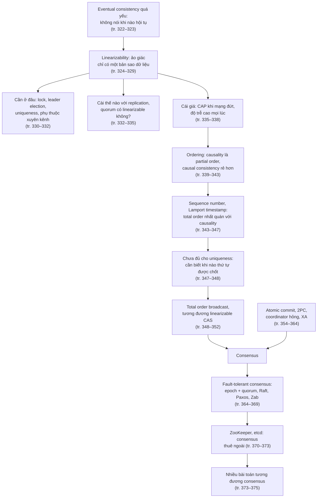

### Liên hệ với các chương khác

| Ý trong chương 9 | Liên hệ | Căn cứ |
| --- | --- | --- |
| Fault tolerance: giữ service chạy đúng dù có thành phần hỏng | **Chương 1** ([B3.1](chapter-01.md#fault-failure)) | tr. 321 |
| Eventual consistency, read-your-writes, consistent prefix | **Chương 5** ([B2.0](chapter-05.md#eventual-consistency), [B2.1](chapter-05.md#read-your-writes), [B2.3](chapter-05.md#consistent-prefix)) | tr. 322–323, 332, 339 |
| Failover, split brain cần consensus | **Chương 5** ([failover](chapter-05.md#failover), [những điều có thể sai](chapter-05.md#failover-problems)) | tr. 322, 352, 367 |
| Single-leader, đồng bộ và bất đồng bộ, chain replication | **Chương 5** ([B1.0](chapter-05.md#leader-based), [B1.1](chapter-05.md#sync-async), [hộp Research on Replication](chapter-05.md#semi-sync)) | tr. 333, 351, 369 |
| Multi-leader nhiều datacenter, write conflict, Hình 5-9 | **Chương 5** ([multi-datacenter](chapter-05.md#multi-datacenter), [B3.2](chapter-05.md#write-conflicts), [B3.3](chapter-05.md#topologies)) | tr. 333, 335, 340 |
| "Linearizability and quorums": quorum, sloppy quorum, LWW, read repair | **Chương 5** ([B4.2](chapter-05.md#quorums), [B4.3](chapter-05.md#quorum-limits), [B4.4](chapter-05.md#sloppy-quorum), [LWW](chapter-05.md#lww), [read repair](chapter-05.md#read-repair)) | tr. 333–335 |
| Happens-before, version number (Hình 5-13), Hình 5-14, version vector | **Chương 5** ([happens-before](chapter-05.md#happens-before), [capturing](chapter-05.md#capturing-happens-before), [version vectors](chapter-05.md#version-vectors)) | tr. 340–343, 346 |
| Shared-disk (Oracle RAC dùng chung hệ thống đĩa) | **Chương 5** ([0.1](chapter-05.md#shared-architectures)) | tr. 330 |
| Commit record trong WAL, secondary index | **Chương 3** ([B4.3](chapter-03.md#wal), [B6](chapter-03.md#secondary-index)) | tr. 354 |
| Message queue giữa web server và resizer | **Chương 4** ([B7.3](chapter-04.md#message-passing)), Chương 11 | tr. 331 |
| Partitioning theo leader, term-partitioned index, rebalancing | **[Chương 6](chapter-06.md)** (tr. 206, 209) | tr. 333, 348, 354, 371 |
| Isolation, compare-and-set, serializability, write skew, SSI, 2PL, atomicity, read committed | **[Chương 7](chapter-07.md)** (tr. 223–261) | tr. 323, 327, 329, 340, 354–356, 362, 364 |
| Đồng hồ không tin cậy, Hình 8-3, Spanner, fencing token, "The Truth Is Defined by the Majority", system model, safety và liveness, Byzantine | **[Chương 8](chapter-08.md)** (tr. 279–308) | tr. 326, 333, 338, 344–345, 349, 353, 365–366, 368 |
| State machine replication, exactly-once, cách thay thế distributed transaction | **[Chương 11](chapter-11.md)** | tr. 349, 361, 364 |
| Ràng buộc lỏng ("Timeliness and Integrity"), tránh linearizability mà vẫn đúng | **[Chương 12](chapter-12.md)** (tr. 524) | tr. 331, 338, 364 |

> **Bản đồ đầu chương (tr. 320).** Bản đồ được in xoay ngang. Giữa bản đồ là ngọn núi lửa đang phun khói, tên **"Mount Consensus"**. Từ núi lửa tỏa ra bốn bán đảo:
> - **"Linearizability"**, với các điểm "Compare-and-set" và "Increment-and-get"; ngoài khơi có hòn đảo nhỏ **"Read-write register"**, nối với "Compare-and-set" bằng đường chấm;
> - **"Global Constraints"**, với "Uniqueness" và "Locking"; điểm "ZooKeeper" nối bằng đường chấm sang đảo **"Failure Detectors"**, nơi có "Membership services";
> - **"Total Order Broadcast"**, với "State machine replication", nối bằng đường chấm tới con tàu "To Single-leader Replication (Chapter 5)";
> - **"Distributed Transactions"**, với "Two-phase commit", nối bằng đường chấm tới con tàu "To Transactions (Chapter 7)".
>
> Hai hòn đảo riêng, **không nối** với núi lửa: **"Timestamp Ordering"** (có điểm "Lamport timestamps") và **"Causal Ordering"**. Phía dưới bản đồ là các xác tàu đắm, chú thích **"Wrecks of Homegrown Consensus Algorithms"** (xác tàu của các thuật toán consensus tự chế).
>
> *Diễn giải của người viết ghi chú:* bốn bán đảo dính vào Mount Consensus khớp với danh sách các bài toán **tương đương consensus** trong Summary (tr. 373–374). "Read-write register" nằm tách riêng, khớp với chú thích x (tr. 350): register đọc-ghi linearizable là bài toán "dễ hơn" consensus, còn compare-and-set thì tương đương consensus. Timestamp ordering và causal ordering là đảo riêng vì chúng **không cần** consensus (tr. 342, 347). Các xác tàu khớp với lời khuyên không tự cài thuật toán consensus (tr. 366, 371, 375).

---

<a id="b-chi-tiet"></a>

## B. Giải thích chi tiết

<a id="b1"></a>

### B1. Consistency Guarantees (tr. 322–323)

<a id="eventual-weak"></a>

**Nhắc lại vấn đề** (tr. 322). Ở "Problems with Replication Lag" ([chương 5, B2](chapter-05.md#b2)) ta đã thấy các vấn đề về thời điểm trong database nhân bản. Nhìn hai node **cùng một thời điểm**, rất có thể thấy **dữ liệu khác nhau**, vì request ghi tới các node vào những lúc khác nhau. Sự bất nhất này xảy ra **bất kể phương pháp replication** (single-leader, multi-leader hay leaderless).

**Eventual consistency là đảm bảo tối thiểu** (tr. 322). Hầu hết database nhân bản cung cấp ít nhất ***eventual consistency***: nếu **ngừng ghi** và chờ một khoảng thời gian **không xác định**, thì **cuối cùng** mọi request đọc sẽ trả **cùng một giá trị** [1]. Nghĩa là bất nhất chỉ là **tạm thời** và tự hết (giả sử lỗi mạng cũng cuối cùng được sửa). Một tên gọi tốt hơn có lẽ là ***convergence*** (hội tụ), vì ta kỳ vọng mọi replica cuối cùng hội tụ về cùng một giá trị [2].

**Vì sao đảm bảo này rất yếu** (tr. 323):

- Nó **không nói gì về khi nào** các replica hội tụ. Trước lúc hội tụ, lần đọc có thể trả **bất cứ thứ gì hoặc không gì cả** [1].
- Ví dụ: ghi một giá trị rồi đọc lại ngay, **không có gì bảo đảm** bạn thấy giá trị vừa ghi, vì lần đọc có thể đi tới replica khác ([read-your-writes](chapter-05.md#read-your-writes), tr. 162).

**Vì sao khó cho người phát triển** (tr. 323). Eventual consistency rất **khác hành vi của biến** trong một chương trình đơn luồng. Gán giá trị cho biến rồi đọc ngay sau đó, bạn không bao giờ chờ đợi đọc lại **giá trị cũ** hay đọc **thất bại**. Database bề ngoài giống một biến đọc ghi được, nhưng ngữ nghĩa của nó **phức tạp hơn nhiều** [3].

- Với database chỉ cho đảm bảo yếu, bạn phải **luôn ý thức** giới hạn của nó và không vô tình **giả định quá nhiều**.
- Bug thường **tinh vi** và **khó tìm bằng test**, vì ứng dụng chạy tốt **phần lớn thời gian**. Các edge case của eventual consistency chỉ lộ ra khi hệ thống **có fault** (ví dụ mạng gián đoạn) hoặc khi **concurrency cao**.

**Hướng của chương** (tr. 323). Chương khám phá các **consistency model mạnh hơn** mà hệ thống dữ liệu có thể chọn cung cấp. Chúng **không miễn phí**: hệ có đảm bảo mạnh hơn có thể **hiệu năng kém hơn** hoặc **kém chịu lỗi hơn**. Dù vậy đảm bảo mạnh hấp dẫn vì **dễ dùng đúng** hơn. Biết vài consistency model khác nhau, bạn sẽ chọn được cái hợp với nhu cầu.

<a id="isolation-vs-consistency"></a>

**Distributed consistency khác transaction isolation** (tr. 323). Có điểm giống giữa các consistency model phân tán và **hệ thứ bậc các isolation level** của transaction [4, 5] ("Weak Isolation Levels", tr. 233, [Chương 7](chapter-07.md#weak-isolation)). Nhưng dù có chồng lấn, chúng **phần lớn là hai mối quan tâm độc lập**:

| | Transaction isolation | Distributed consistency |
| --- | --- | --- |
| **Chủ yếu về** | Tránh **race condition** do các transaction chạy **đồng thời** | **Phối hợp trạng thái các replica** khi có **delay và fault** |
| **Ví dụ đảm bảo** | Read committed, snapshot isolation, serializability (Chương 7) | Eventual consistency, causal consistency, linearizability (chương này) |

**Ba phần của chương, liên kết sâu với nhau** (tr. 323):

1. **Linearizability**, một trong những consistency model **mạnh nhất** được dùng phổ biến, với ưu và nhược điểm ([B2](#b2)).
2. **Sắp thứ tự sự kiện** trong hệ phân tán, đặc biệt quanh **causality** và **total ordering** ([B3](#b3)).
3. **Commit nguyên tử một distributed transaction**, dẫn tới lời giải cho bài toán **consensus** ([B4](#b4)).

> **Bổ sung ngoài sách (liên hệ với Chương 8).** Chương 8 (tr. 308) phân biệt **safety property** ("không có gì xấu xảy ra") và **liveness property** ("điều tốt cuối cùng sẽ xảy ra"), và ghi rằng eventual consistency là một liveness property: nó chỉ hứa điều gì đó "cuối cùng" xảy ra, không hứa gì tại một thời điểm cụ thể. Linearizability ở mục sau là một đảm bảo về **từng thời điểm** (đọc sau ghi phải thấy giá trị mới).

---

<a id="b2"></a>

### B2. Linearizability (tr. 324–338)

<a id="linearizability"></a>

#### B2.0 Ý tưởng: ảo giác chỉ có một bản sao dữ liệu (tr. 324–325)

**Why** (tr. 324). Với database eventually consistent, hỏi **hai replica khác nhau cùng một câu, cùng một lúc**, có thể nhận **hai câu trả lời khác nhau**. Thật khó hiểu. Sẽ đơn giản hơn nhiều nếu database tạo **ảo giác chỉ có một replica**, tức chỉ có **một bản sao dữ liệu**. Khi đó mọi client có **cùng một góc nhìn** về dữ liệu, và không ai phải lo về replication lag.

**What** (tr. 324). Đó là ý tưởng của ***linearizability*** [6], còn gọi là ***atomic consistency*** [7], ***strong consistency***, ***immediate consistency*** hay ***external consistency*** [8]. Định nghĩa chính xác **khá tinh tế** (xem [B2.1](#linearizable-definition)), nhưng ý tưởng cơ bản là:

- làm hệ thống **trông như chỉ có một bản sao dữ liệu**, và
- **mọi thao tác** trên bản sao đó đều **atomic** (có hiệu lực tại một thời điểm duy nhất).

Có đảm bảo này thì dù thực tế có nhiều replica, ứng dụng **không cần lo** về chúng.

<a id="recency-guarantee"></a>

**Linearizability là một recency guarantee** (tr. 324). Trong hệ linearizable, **ngay khi** một client ghi **thành công**, **mọi client** đọc database phải thấy được giá trị vừa ghi. Duy trì ảo giác một bản sao nghĩa là bảo đảm giá trị đọc được là giá trị **mới nhất**, không lấy từ **cache hay replica stale**. Nói cách khác, linearizability là ***recency guarantee*** (đảm bảo về độ mới).

**Example — Hình 9-1: website thể thao không linearizable** [9] (tr. 324–325). Alice và Bob ngồi cùng phòng, cùng xem điện thoại chờ kết quả **chung kết World Cup 2014**. Ngay sau khi tỷ số cuối được công bố, Alice tải lại trang, thấy đội thắng và reo lên báo Bob. Bob ngờ vực bấm *reload*, nhưng request của anh tới một **replica đang lag**, nên điện thoại báo trận đấu **vẫn đang diễn ra**.

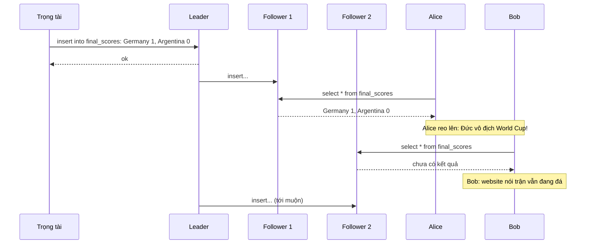

*(Vẽ lại Hình 9-1, tr. 324. Câu lệnh SQL trong hình được rút gọn: trọng tài ghi một hàng vào bảng final_scores với hai đội và tỷ số.)*

**Vì sao đây là vi phạm** (tr. 325). Nếu Alice và Bob bấm reload **cùng lúc**, nhận hai kết quả khác nhau cũng **ít đáng ngạc nhiên**, vì họ không biết chính xác server xử lý request của mỗi người lúc nào. Nhưng Bob **biết** mình bấm reload **sau khi** nghe Alice reo, nên anh kỳ vọng kết quả của mình **ít nhất mới bằng** kết quả của Alice. Truy vấn của anh trả về kết quả stale: đó là **vi phạm linearizability**.

<a id="linearizable-definition"></a>

#### B2.1 What Makes a System Linearizable? (tr. 325–329)

Ý tưởng thì đơn giản ("trông như chỉ có một bản sao"), nhưng **chốt chính xác** nó nghĩa là gì cần cẩn thận. Sách đi qua ba ví dụ, mỗi ví dụ thêm một ràng buộc (tr. 325).

<a id="register"></a>

**Register và ký hiệu** (tr. 325–326). Hình 9-2 cho ba client **đồng thời** đọc và ghi **cùng một key x** trong một database linearizable. Trong tài liệu hệ phân tán, x gọi là ***register***. Thực tế, nó có thể là **một key** trong key-value store, **một hàng** trong relational database, hay **một document** trong document database.

- Hình chỉ vẽ request **từ góc nhìn client**, không vẽ bên trong database. Mỗi **thanh** là một request: đầu thanh là lúc **gửi**, cuối thanh là lúc **nhận response**.
- Vì network delay biến động, client **không biết chính xác** database xử lý request lúc nào. Nó chỉ biết việc xử lý xảy ra **đâu đó giữa** lúc gửi và lúc nhận.
- Hai loại thao tác:
  - **read(x) ⇒ v**: client đọc register x, database trả giá trị v.
  - **write(x, v) ⇒ r**: client đặt x = v, database trả response r (*ok* hoặc *error*).

> Chú thích i (tr. 326). Một chi tiết tinh tế: sơ đồ giả định có **đồng hồ toàn cục** (trục ngang). Hệ thật thường không có đồng hồ chính xác ("Unreliable Clocks", tr. 287, [Chương 8](chapter-08.md#b3)). Giả định này vẫn ổn: khi **phân tích** một thuật toán phân tán, ta được giả vờ có đồng hồ toàn cục chính xác, **miễn là thuật toán không truy cập được nó** [47]. Thuật toán chỉ thấy một **xấp xỉ méo mó** của thời gian thực, do dao động thạch anh và NTP tạo ra.

**Ràng buộc thứ nhất — Hình 9-2** (tr. 326). Ban đầu x = 0. Client C ghi x = 1. Trong lúc đó, A và B **liên tục poll** để đọc giá trị mới nhất. A và B có thể nhận gì?

1. Lần đọc **đầu tiên** của A **kết thúc trước khi** lần ghi bắt đầu, nên **chắc chắn** trả giá trị cũ 0.
2. Lần đọc **cuối cùng** của A **bắt đầu sau khi** lần ghi đã xong, nên nếu database linearizable thì **chắc chắn** trả giá trị mới 1. Lập luận từng bước:
   - lần ghi được xử lý **đâu đó giữa** lúc bắt đầu và lúc kết thúc thao tác ghi;
   - lần đọc được xử lý **đâu đó giữa** lúc bắt đầu và lúc kết thúc thao tác đọc;
   - đọc **bắt đầu sau khi ghi kết thúc**, nên đọc **được xử lý sau** ghi, và phải thấy giá trị mới.
3. Các lần đọc **chồng lấn thời gian** với lần ghi có thể trả **0 hoặc 1**, vì ta không biết lúc lần đọc được xử lý thì lần ghi đã có hiệu lực chưa. Các thao tác này **đồng thời** (*concurrent*) với lần ghi.

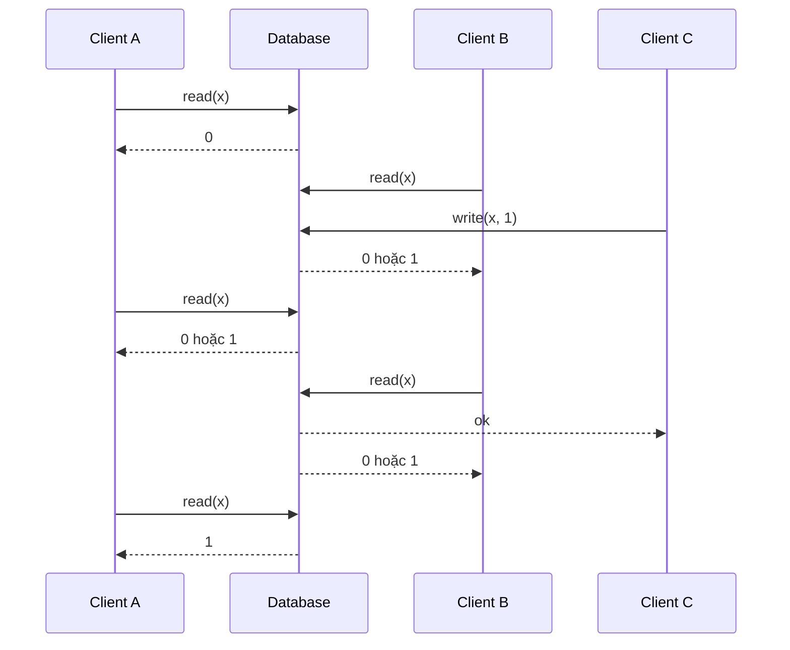

*(Vẽ lại Hình 9-2, tr. 325. Thứ tự các message theo vị trí đầu và cuối của từng thanh trong hình gốc: hai lần đọc của B và lần đọc thứ hai của A chồng lấn với lần ghi của C, nên có thể trả 0 hoặc 1.)*

**Vì sao như vậy chưa đủ** (tr. 326). Nếu mọi lần đọc đồng thời với ghi đều được trả cũ **hoặc** mới tùy ý, người đọc có thể thấy giá trị **lật qua lật lại** giữa cũ và mới nhiều lần trong lúc lần ghi đang diễn ra. Đó không phải hành vi của một hệ giả lập "**một bản sao dữ liệu**".

> Chú thích ii (tr. 326). Register mà lần đọc đồng thời với ghi có thể trả **giá trị cũ hoặc mới** gọi là ***regular register*** [7, 25]. Linearizability đòi hỏi nhiều hơn thế.

**Ràng buộc thứ hai — Hình 9-3** (tr. 327). Trong hệ linearizable, ta hình dung phải có **một thời điểm nào đó** (giữa lúc bắt đầu và kết thúc thao tác ghi) mà giá trị x **lật nguyên tử** từ 0 sang 1. Vì vậy:

- nếu **một** client đọc được giá trị mới 1,
- thì **mọi lần đọc sau đó** (trên cùng client hay client khác) cũng **phải** trả 1, **kể cả khi lần ghi chưa hoàn tất**.

Mũi tên trong Hình 9-3 thể hiện phụ thuộc thời gian này: A là client **đầu tiên** đọc được 1. Ngay sau khi lần đọc của A trả về, B bắt đầu một lần đọc mới. Vì lần đọc của B xảy ra **hẳn sau** lần đọc của A, nó cũng phải trả 1, dù lần ghi của C vẫn đang diễn ra. Đây đúng là tình huống Alice và Bob ở Hình 9-1: Alice đã đọc giá trị mới, nên Bob cũng chờ đợi đọc giá trị mới.

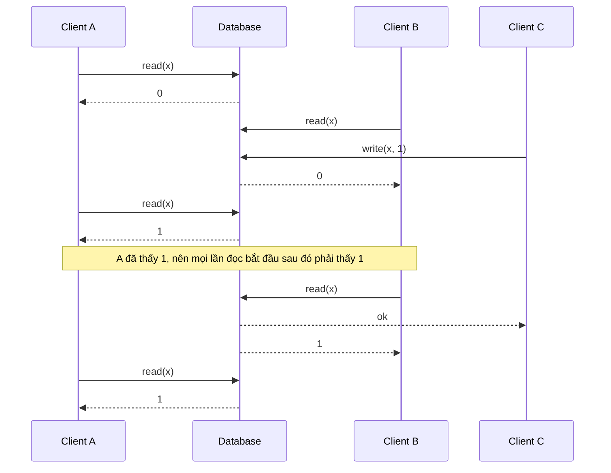

*(Vẽ lại Hình 9-3, tr. 327. Lần đọc thứ hai của B bắt đầu ngay sau khi lần đọc của A trả 1 và trước khi C nhận ok, nhưng vẫn phải trả 1.)*

<a id="linearization-points"></a>

**Ràng buộc thứ ba — Hình 9-4: mỗi thao tác có hiệu lực tại một điểm** (tr. 327–328). Tinh chỉnh tiếp: hình dung **mỗi thao tác có hiệu lực nguyên tử tại một thời điểm** [10]. Hình 9-4 thêm một loại thao tác thứ ba:

- **cas(x, v_old, v_new) ⇒ r**: thao tác ***compare-and-set*** nguyên tử ("Compare-and-set", tr. 245, [Chương 7](chapter-07.md#compare-and-set)). Nếu giá trị hiện tại của x **bằng** v_old thì đặt nguyên tử thành v_new. Nếu x ≠ v_old thì **giữ nguyên** register và trả lỗi. r là response (*ok* hoặc *error*).

Cách đọc Hình 9-4 (tr. 327–328):

1. Mỗi thao tác được đánh dấu bằng một **vạch dọc** (bên trong thanh của thao tác) tại thời điểm ta cho rằng nó **được thực thi**.
2. Nối các vạch theo **thứ tự tuần tự**, kết quả phải là **một chuỗi đọc ghi hợp lệ** của register: mỗi lần đọc trả giá trị do **lần ghi gần nhất** đặt.
3. **Yêu cầu của linearizability:** đường nối các vạch **luôn tiến về phía trước** theo thời gian (trái sang phải), **không bao giờ lùi**.
4. Yêu cầu này bảo đảm recency: một khi giá trị mới **đã được ghi hoặc đã được đọc**, mọi lần đọc sau đó thấy giá trị ấy, cho tới khi nó bị ghi đè.

Bảng dưới liệt kê các điểm hiệu lực trên trục "Database" của Hình 9-4, từ trái sang phải:

| # | Điểm trên trục Database | Thao tác | Kết quả | x sau đó |
| --- | --- | --- | --- | --- |
| 1 | x=0 | D: write(x, 0) | ok | 0 |
| 2 | x=1 | A: write(x, 1) | ok | 1 |
| 3 | read | B: read(x) | 1 | 1 |
| 4 | read | C: read(x) | 1 | 1 |
| 5 | x=2 | B: cas(x, 1, 2) | ok | 2 |
| 6 | read | C: read(x) | 2 | 2 |
| 7 | read | D: cas(x, 0, 3) | error (x không còn là 0) | 2 |
| 8 | x=4 | C: cas(x, 2, 4) | ok | 4 |
| 9 | read | A: read(x) | 4 | 4 |
| 10 | read | B: read(x) | **2: không linearizable** | 4 |

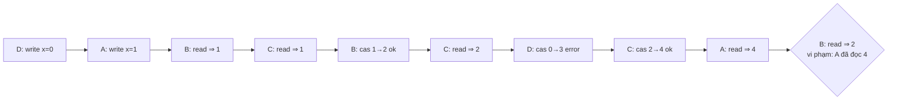

*(Vẽ lại Hình 9-4, tr. 328, dưới dạng chuỗi các điểm hiệu lực theo thời gian. Trong hình gốc, điểm của cas thất bại ở bước 7 được ghi nhãn "read" trên trục Database; diễn giải của người viết ghi chú: cas thất bại không đổi giá trị nên có tác dụng như một lần đọc.)*

**Những chi tiết đáng chú ý trong Hình 9-4** (tr. 328–329):

1. **Thứ tự gửi khác thứ tự xử lý vẫn hợp lệ.** B gửi request đọc **trước**, rồi D gửi ghi 0, rồi A gửi ghi 1. Thế mà B đọc được 1 (giá trị A ghi). Không sao: database đã xử lý ghi của D, rồi ghi của A, rồi mới tới đọc của B. Đây không phải thứ tự gửi, nhưng **chấp nhận được** vì ba request **đồng thời**. Có thể request đọc của B bị **trễ trên mạng** nên tới database sau hai lần ghi.
2. **Đọc được giá trị trước khi người ghi nhận ok.** B đọc được 1 **trước khi** A nhận response báo ghi thành công. Cũng không sao: điều đó không có nghĩa giá trị được đọc trước khi được ghi, chỉ là response *ok* gửi cho A bị **trễ trên mạng**.
3. **Không giả định transaction isolation.** Client khác có thể đổi giá trị **bất cứ lúc nào**. Ví dụ C đọc 1 rồi đọc 2, vì B đổi giá trị giữa hai lần đọc. Có thể dùng **cas** để kiểm tra giá trị chưa bị client khác đổi đồng thời: cas của B và C **thành công**, cas của D **thất bại** (lúc database xử lý nó, x không còn là 0).
4. **Lần đọc cuối của B (thanh tô đậm) không linearizable.** Nó đồng thời với cas của C (đổi x từ 2 thành 4). Nếu không có request nào khác, B trả 2 là **được**. Nhưng A **đã đọc giá trị mới 4 trước khi** lần đọc của B bắt đầu, nên B **không được** đọc giá trị cũ hơn A. Lại là tình huống Alice và Bob.

**Kiểm tra linearizability** (tr. 329). Đó là **trực giác**; định nghĩa hình thức [6] mô tả chính xác hơn. Có thể **kiểm tra** (dù tốn nhiều tính toán) một hệ thống có linearizable hay không: ghi lại **thời điểm** của mọi request và response, rồi kiểm tra xem có **sắp được** chúng thành một **thứ tự tuần tự hợp lệ** hay không [11].

> **Bổ sung ngoài sách.** Tài liệu [11] mô tả Knossos, công cụ kiểm tra linearizability của dự án Jepsen (Kyle Kingsbury). Bài toán kiểm tra một lịch sử bất kỳ có linearizable không là NP-complete trong trường hợp tổng quát, nên công cụ loại này dùng nhiều kỹ thuật cắt tỉa để chạy được trên lịch sử thực tế.

<a id="lin-vs-serializability"></a>

**Hộp "Linearizability Versus Serializability"** (tr. 329). Hai từ này **dễ nhầm** vì cùng gợi ý "xếp được theo một thứ tự tuần tự". Nhưng đây là hai đảm bảo **rất khác nhau**:

| | Serializability | Linearizability |
| --- | --- | --- |
| **Loại đảm bảo** | **Isolation property** của **transaction** | **Recency guarantee** cho đọc ghi một **register** |
| **Phạm vi** | Mỗi transaction có thể đọc ghi **nhiều object** (hàng, document, bản ghi) ("Single-Object and Multi-Object Operations", tr. 228) | **Một object riêng lẻ**; không gom thao tác thành transaction |
| **Nội dung** | Transaction hành xử như thể chạy theo **một thứ tự tuần tự nào đó** (xong transaction này mới tới transaction kia). Thứ tự đó **được phép khác** thứ tự thực tế [12] | Đọc phải thấy giá trị mới nhất theo **thời gian thực** |
| **Không ngăn được** | (đảm bảo mạnh nhất của isolation) | **Write skew** ("Write Skew and Phantoms", tr. 246), trừ khi thêm biện pháp như **materializing conflicts** (tr. 251) |

- Database có thể cung cấp **cả hai**: tổ hợp này gọi là ***strict serializability*** hay ***strong one-copy serializability* (strong-1SR)** [4, 13].
- Serializability cài bằng **two-phase locking** ("Two-Phase Locking (2PL)", tr. 257) hoặc **chạy tuần tự thật** ("Actual Serial Execution", tr. 252) **thường linearizable**.
- **Serializable snapshot isolation** ("SSI", tr. 261) **không linearizable**: theo thiết kế, nó đọc từ **consistent snapshot** để tránh tranh chấp lock giữa người đọc và người ghi. Ý nghĩa của snapshot chính là **không chứa** các lần ghi mới hơn snapshot, nên đọc từ snapshot không linearizable.

<a id="relying-linearizability"></a>

#### B2.2 Relying on Linearizability (tr. 330–332)

**Khi nào linearizability hữu ích?** (tr. 330). Xem tỷ số trận đấu có lẽ là ví dụ **phù phiếm**: kết quả cũ vài giây khó gây hại thật. Nhưng có vài lĩnh vực mà linearizability là **yêu cầu quan trọng** để hệ thống chạy đúng.

<a id="lin-locking"></a>

**1. Locking and leader election** (tr. 330).

- **Why.** Hệ single-leader phải bảo đảm **thật sự chỉ có một leader**, không phải vài leader (split brain). Một cách bầu leader là dùng **lock**: mọi node khởi động đều cố lấy lock, node lấy được thì làm leader [14].
- **Lock phải linearizable.** Dù cài lock thế nào, **mọi node phải đồng ý** node nào đang giữ lock; nếu không, lock vô dụng.
- **Coordination service.** Apache **ZooKeeper** [15] và **etcd** [16] thường được dùng để cài distributed lock và leader election. Chúng dùng **thuật toán consensus** để cài các thao tác linearizable theo cách **chịu lỗi** ([B4.3](#fault-tolerant-consensus)). Vẫn còn nhiều chi tiết tinh vi để cài lock và leader election đúng, ví dụ vấn đề **fencing** ("The leader and the lock", tr. 301, [Chương 8](chapter-08.md#leader-lock)). Thư viện như **Apache Curator** [17] giúp bằng các "công thức" (*recipe*) cấp cao trên ZooKeeper. Nhưng một **storage service linearizable** là **nền tảng cơ bản** cho các tác vụ phối hợp này.
- **Lock ở mức rất chi tiết.** Một số database phân tán, như **Oracle Real Application Clusters (RAC)** [18], dùng distributed locking ở mức nhỏ hơn nhiều: **một lock cho mỗi disk page**, với nhiều node **dùng chung** một hệ thống đĩa (đúng mô tả kiến trúc shared-disk ở [chương 5, 0.1](chapter-05.md#shared-architectures)). Vì các lock linearizable này nằm trên **critical path** của việc thực thi transaction, triển khai RAC thường có **mạng interconnect riêng** cho giao tiếp giữa các node database.

> Chú thích iii (tr. 330). Nói chính xác, ZooKeeper và etcd cung cấp **ghi linearizable**, nhưng **đọc có thể stale**, vì mặc định đọc có thể được phục vụ bởi **bất kỳ replica nào**. Có thể yêu cầu **đọc linearizable**: etcd gọi đó là ***quorum read*** [16]; với ZooKeeper, phải gọi **`sync()`** trước khi đọc [15]. Xem [B3.3](#lin-from-tob) (tr. 350).

<a id="lin-uniqueness"></a>

**2. Constraints and uniqueness guarantees** (tr. 330–331).

- **What.** Ràng buộc **unique** rất phổ biến: username hay email phải định danh **duy nhất** một người dùng; dịch vụ lưu file không được có **hai file cùng path và tên**. Muốn **áp đặt ràng buộc ngay khi ghi** (hai người đồng thời tạo user hay file cùng tên thì một người nhận lỗi), bạn cần linearizability.
- **Giống lock và compare-and-set.** Khi người dùng đăng ký, có thể coi như họ **lấy "lock"** trên username đã chọn. Thao tác cũng rất giống **compare-and-set**: đặt username thành ID của người dùng claim nó, **với điều kiện** username chưa bị lấy.
- **Các ràng buộc tương tự:** số dư tài khoản **không bao giờ âm**; **không bán quá** số hàng trong kho; hai người **không cùng đặt một ghế** trên chuyến bay hay trong nhà hát. Tất cả cần **một giá trị cập nhật duy nhất** (số dư, tồn kho, tình trạng ghế) mà **mọi node đồng ý**.
- **Ràng buộc lỏng.** Trong ứng dụng thật, đôi khi chấp nhận áp dụng ràng buộc **lỏng**: chuyến bay bị đặt quá chỗ thì chuyển khách sang chuyến khác và **bồi thường**. Khi đó có thể **không cần** linearizability; sách bàn ở "Timeliness and Integrity" (tr. 524, [Chương 12](chapter-12.md#timeliness-integrity)).
- **Ràng buộc nào cần, ràng buộc nào không.** Ràng buộc unique **cứng**, như thường thấy trong relational database, **cần** linearizability. Các loại ràng buộc khác như **foreign key** hay **attribute constraint** có thể cài **mà không cần** linearizability [19].

<a id="cross-channel"></a>

**3. Cross-channel timing dependencies** (tr. 331–332).

**Quan sát từ Hình 9-1** (tr. 331). Nếu Alice **không reo lên**, Bob sẽ không biết kết quả của mình stale: anh chỉ tải lại vài giây sau và cuối cùng thấy tỷ số. Vi phạm linearizability **chỉ bị phát hiện** vì trong hệ có thêm **một kênh liên lạc** (giọng Alice tới tai Bob).

**Example — Hình 9-5: dịch vụ resize ảnh** (tr. 331–332). Website cho người dùng upload ảnh; một tiến trình nền **resize** ảnh xuống độ phân giải thấp để tải nhanh hơn (thumbnail).

- Image resizer phải được **chỉ thị tường minh** để làm việc. Chỉ thị được gửi từ web server tới resizer qua một **message queue** (Chương 11; xem message broker ở [chương 4, B7.3](chapter-04.md#message-passing)).
- Web server **không đặt cả bức ảnh** lên queue, vì hầu hết message broker được thiết kế cho **message nhỏ**, còn ảnh có thể **vài MB**. Thay vào đó, ảnh được **ghi vào file storage trước**; ghi xong mới đặt chỉ thị lên queue.

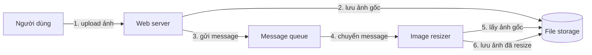

*(Vẽ lại Hình 9-5, tr. 332.)*

**Race condition** (tr. 332):

- File storage **linearizable** thì hệ thống chạy ổn.
- File storage **không linearizable** thì có nguy cơ race condition: message queue (bước 3 và 4) có thể **nhanh hơn** replication **bên trong** storage service. Khi resizer lấy ảnh (bước 5), nó có thể thấy **phiên bản cũ** của ảnh, hoặc **không thấy gì**. Nếu nó xử lý phiên bản cũ, ảnh gốc và ảnh đã resize trong file storage sẽ **bất nhất vĩnh viễn**.

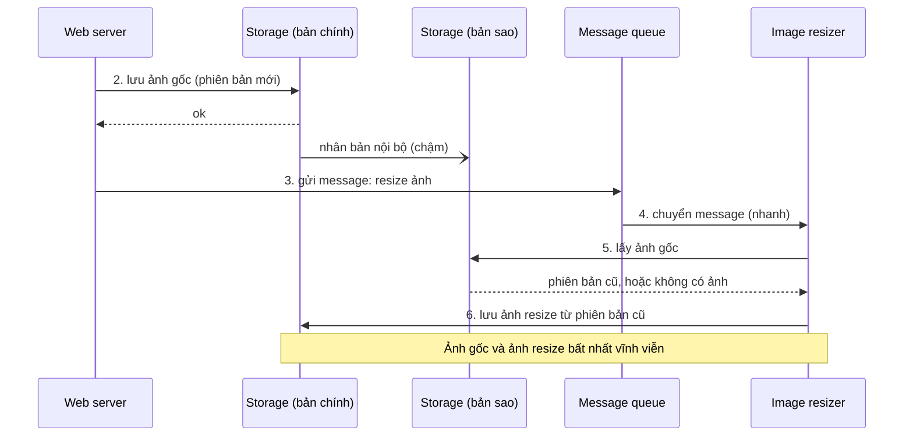

*(Sơ đồ do người viết ghi chú dựng theo mô tả race condition ở tr. 332. Việc file storage có một bản chính và một bản sao là giả định để minh họa "replication bên trong storage service".)*

**Vì sao xảy ra** (tr. 332). Có **hai kênh liên lạc khác nhau** giữa web server và resizer: **file storage** và **message queue**. Không có recency guarantee của linearizability, race giữa hai kênh có thể xảy ra. Tình huống này giống Hình 9-1, nơi cũng có race giữa hai kênh: **replication của database** và **kênh âm thanh** từ miệng Alice tới tai Bob.

**Cách khác** (tr. 332). Linearizability **không phải cách duy nhất** để tránh race này, nhưng là cách **dễ hiểu nhất**. Nếu bạn **kiểm soát** được kênh bổ sung (như message queue, khác với trường hợp Alice và Bob), có thể dùng cách tương tự "Reading Your Own Writes" ([chương 5, B2.1](chapter-05.md#read-your-writes), tr. 162), với cái giá là **phức tạp thêm**.

> **Ví dụ minh họa do AI xây dựng.** Một cách "kiểm soát kênh bổ sung": web server ghi ảnh, nhận lại **số phiên bản** (hoặc hash nội dung) từ storage, và đưa số đó vào message. Resizer chỉ xử lý khi storage trả về **đúng phiên bản đó**; nếu replica trả phiên bản cũ hơn, resizer chờ rồi thử lại, hoặc đọc từ bản chính. Cách này giống kỹ thuật "client nhớ timestamp của lần ghi gần nhất" ở chương 5, chỉ là "client" ở đây là resizer.

<a id="implementing-linearizable"></a>

#### B2.3 Implementing Linearizable Systems (tr. 332–335)

**Cách đơn giản nhất** (tr. 332). Linearizability về bản chất nghĩa là "hành xử như thể chỉ có **một bản sao** dữ liệu, mọi thao tác trên nó atomic". Câu trả lời đơn giản nhất là **thật sự chỉ dùng một bản sao**. Nhưng cách đó **không chịu được lỗi**: node giữ bản sao duy nhất hỏng thì dữ liệu **mất**, hoặc ít nhất **không truy cập được** tới khi node lên lại.

**Xét lại các phương pháp replication của Chương 5** (tr. 333–334). Cách phổ biến nhất để chịu lỗi là **replication**. Phương pháp nào có thể làm linearizable?

<a id="replication-linearizable"></a>

| Phương pháp | Linearizable? | Lập luận |
| --- | --- | --- |
| **Single-leader** ([chương 5, B1](chapter-05.md#leader-based)) | **Có thể** | Leader giữ bản chính dùng cho ghi; follower giữ bản dự phòng. **Đọc từ leader**, hoặc từ follower **cập nhật đồng bộ**, thì **có khả năng** linearizable |
| **Consensus algorithm** | **Có** | Giống single-leader, nhưng có biện pháp **ngăn split brain và replica stale**, nên cài được storage linearizable **an toàn**. ZooKeeper [21] và etcd [22] làm theo cách này |
| **Multi-leader** ([chương 5, B3](chapter-05.md#multi-leader)) | **Không** | Xử lý ghi **đồng thời trên nhiều node** và nhân bản **bất đồng bộ**, nên sinh ra **ghi xung đột** cần giải quyết ([B3.2](chapter-05.md#write-conflicts)). Xung đột chính là hệ quả của việc **không có một bản sao duy nhất** |
| **Leaderless** ([chương 5, B4](chapter-05.md#dynamo-style)) | **Có lẽ không** | Xem chi tiết dưới đây |

**Single-leader: "có thể", không phải "chắc chắn"** (tr. 333).

- Không phải mọi database single-leader đều thực sự linearizable: có cái **do thiết kế** (ví dụ dùng snapshot isolation), có cái do **bug concurrency** [10].
- Đọc từ leader dựa trên giả định **biết chắc ai là leader**. Như "The Truth Is Defined by the Majority" (tr. 300, [Chương 8](chapter-08.md#truth-majority)), node hoàn toàn có thể **tưởng mình là leader** trong khi thực ra không phải. Nếu "leader ảo tưởng" này tiếp tục phục vụ request, rất dễ **vi phạm linearizability** [20].
- Với replication **bất đồng bộ**, failover còn có thể **mất ghi đã commit** ([chương 5, B1.3](chapter-05.md#failover-problems)), vi phạm **cả durability lẫn linearizability**.

> Chú thích iv (tr. 333). Partition (shard) một database single-leader, để **mỗi partition có một leader riêng**, **không ảnh hưởng** linearizability, vì linearizability chỉ là đảm bảo **cho một object**. Transaction **xuyên partition** là chuyện khác ([B4](#b4)).

**Leaderless: "có lẽ không"** (tr. 333–334).

- Người ta đôi khi khẳng định có thể đạt "**strong consistency**" với leaderless bằng cách đòi **quorum read và write** (w + r > n). Tùy cấu hình quorum chính xác và tùy cách định nghĩa strong consistency, điều này **không hẳn đúng**.
- **LWW dựa trên time-of-day clock** (ví dụ Cassandra; "Relying on Synchronized Clocks", tr. 291) **gần như chắc chắn không linearizable**: timestamp của đồng hồ **không đảm bảo** khớp với thứ tự thật của sự kiện, do **clock skew** ([LWW ở chương 5](chapter-05.md#lww)).
- **Sloppy quorum** ([chương 5, B4.4](chapter-05.md#sloppy-quorum)) **phá hỏng mọi cơ hội** linearizable.
- **Ngay cả strict quorum** cũng có thể cho hành vi không linearizable, như phần sau cho thấy.

<a id="lin-quorums"></a>

**Linearizability and quorums** (tr. 334–335).

Đây là phần mà chương 5 đã hẹn trước ([chương 5, B4.3](chapter-05.md#quorum-limits), kịch bản 6: "xui về thời điểm").

**Why.** Trực giác cho rằng quorum đọc ghi **strict** trong mô hình Dynamo-style phải linearizable. Nhưng khi network delay **biến động**, vẫn có race condition (Hình 9-6).

**Example — Hình 9-6** (tr. 334):

- Ban đầu x = 0. Một **writer** cập nhật x = 1 bằng cách gửi lần ghi tới **cả ba** replica (**n = 3, w = 3**).
- **Đồng thời**, client A đọc từ một quorum **hai node** (**r = 2**) và thấy giá trị mới 1 trên **một** trong hai node.
- Cũng đồng thời với lần ghi, client B đọc từ một quorum **hai node khác**, và nhận giá trị cũ 0 từ **cả hai**.

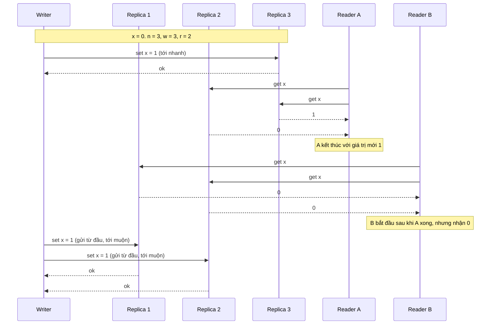

*(Vẽ lại Hình 9-6, tr. 334. Trong hình gốc, writer gửi ba message cùng lúc; message tới replica 3 đến sớm, hai message tới replica 1 và 2 đến sau khi cả A và B đã đọc xong.)*

**Vì sao không linearizable** (tr. 334–335). Điều kiện quorum **được thỏa** (w + r > n). Nhưng lần đọc của B **bắt đầu sau khi** lần đọc của A **hoàn tất**, mà B trả **giá trị cũ** còn A trả **giá trị mới**. Đây lại là tình huống Alice và Bob ở Hình 9-1.

> **Bổ sung ngoài sách — lập luận giao nhau của quorum hỏng ở đâu.** Ở [chương 5, B4.2](chapter-05.md#quorums), w + r > n bảo đảm tập node **đã nhận một lần ghi hoàn tất** (ít nhất w node) giao với tập node được đọc. Lập luận đó chỉ nói về lần ghi **đã hoàn tất**. Trong Hình 9-6, lần ghi **đang diễn ra**: tại thời điểm A và B đọc, chỉ replica 3 có giá trị mới, ít hơn w = 3. Hai quorum đọc {2, 3} và {1, 2} đều giao với mọi quorum ghi tương lai, nhưng chúng **không giao với tập "đã có giá trị mới" lúc đó** theo cùng một cách: A chạm replica 3, B thì không. Không có gì buộc B phải thấy cái A đã thấy.

**Có thể làm quorum linearizable, với cái giá** (tr. 335):

- **Reader** phải làm **read repair đồng bộ** ([chương 5, read repair](chapter-05.md#read-repair)) trước khi trả kết quả cho ứng dụng [23];
- **Writer** phải **đọc trạng thái mới nhất của một quorum** trước khi gửi lần ghi [24, 25].
- Thực tế (lúc viết sách): **Riak không** làm read repair đồng bộ vì giảm hiệu năng [26]. **Cassandra có** chờ read repair xong khi đọc quorum [27], nhưng **mất linearizability** nếu có **nhiều lần ghi đồng thời cùng key**, vì dùng last write wins.
- **Giới hạn:** cách này chỉ cài được **đọc và ghi** linearizable. **Compare-and-set** linearizable thì **không**, vì nó cần **thuật toán consensus** [28].

> **Bổ sung ngoài sách — vì sao read repair đồng bộ sửa được Hình 9-6.** Thuật toán trong [23] thường được gọi là ABD (theo tên Attiya, Bar-Noy, Dolev). Nếu A, sau khi thấy 1 ở replica 3 và 0 ở replica 2, **ghi 1 vào replica 2 và chờ xác nhận** rồi mới trả kết quả, thì lúc A kết thúc đã có **một quorum** {2, 3} chứa giá trị mới. Mọi quorum đọc sau đó (hai trên ba node) phải giao với {2, 3}, nên B chắc chắn thấy 1. Cái giá là mỗi lần đọc có thể thêm một vòng ghi.

**Kết luận** (tr. 335). An toàn nhất là **giả định** hệ leaderless kiểu Dynamo **không** cung cấp linearizability.

<a id="cost-linearizability"></a>

#### B2.4 The Cost of Linearizability (tr. 335–338)

Có phương pháp replication cho được linearizability, có phương pháp thì không. Vậy nên xét kỹ hơn **ưu nhược** của linearizability (tr. 335).

**Example — Hình 9-7: hai datacenter bị đứt kết nối** (tr. 335–336). Chương 5 đã thấy multi-leader thường là lựa chọn tốt cho nhân bản **nhiều datacenter** ([chương 5, multi-datacenter](chapter-05.md#multi-datacenter), tr. 168). Xét điều gì xảy ra nếu **mạng giữa hai datacenter bị gián đoạn**: mạng **trong** mỗi datacenter vẫn chạy, client vẫn tới được datacenter, nhưng **hai datacenter không nối được với nhau**.

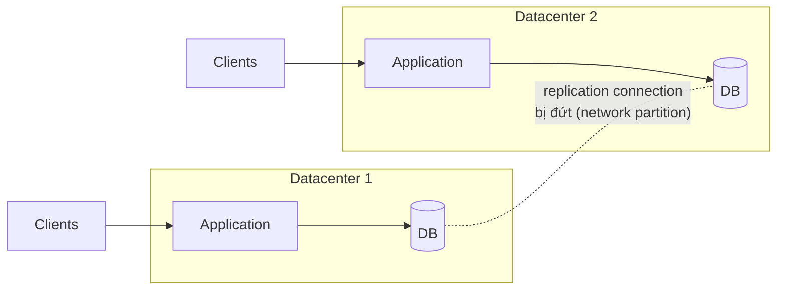

*(Vẽ lại Hình 9-7, tr. 335. Trong hình gốc có bảy client, bốn client nối vào datacenter 1 và ba client nối vào datacenter 2.)*

**Hai cách hành xử** (tr. 336):

| | Multi-leader | Single-leader |
| --- | --- | --- |
| **Bình thường** | Mỗi datacenter nhận ghi cục bộ, nhân bản bất đồng bộ | Leader ở **một** datacenter. Mọi lần ghi và mọi lần **đọc linearizable** phải gửi tới leader; client ở datacenter follower gửi **đồng bộ** qua mạng tới datacenter leader |
| **Khi mạng giữa hai datacenter đứt** | Mỗi datacenter **chạy bình thường**: ghi được **xếp hàng** và trao đổi khi mạng phục hồi | Client ở datacenter follower **không liên lạc được leader**: **không ghi được**, **không đọc linearizable được**. Vẫn đọc từ follower được nhưng có thể **stale** (không linearizable) |
| **Hệ quả** | Luôn available, nhưng không linearizable | Nếu ứng dụng **cần** đọc ghi linearizable, nó **không sẵn sàng** ở các datacenter không tới được leader |

Client nối được thẳng tới datacenter leader thì không sao, ứng dụng ở đó vẫn chạy bình thường. Nhưng client **chỉ tới được datacenter follower** sẽ gặp **outage** cho tới khi đường mạng được sửa (tr. 336).

<a id="cap"></a>

**The CAP theorem** (tr. 336–338).

**Vấn đề tổng quát** (tr. 336). Đây **không chỉ** là hệ quả của single-leader hay multi-leader: **mọi database linearizable** đều gặp vấn đề này, **bất kể cài thế nào**. Nó cũng **không riêng** triển khai nhiều datacenter: nó xảy ra trên **bất kỳ mạng không tin cậy nào**, kể cả **trong một datacenter**. Trade-off như sau:

1. Ứng dụng **cần linearizability**, và một số replica **bị ngắt** khỏi các replica khác do sự cố mạng: các replica đó **không xử lý được request** trong lúc bị ngắt. Chúng phải **chờ** tới khi mạng được sửa, hoặc **trả lỗi**. Cả hai cách đều nghĩa là **unavailable**.
2. Ứng dụng **không cần linearizability**: có thể viết để **mỗi replica xử lý request độc lập** dù bị ngắt khỏi replica khác (ví dụ multi-leader). Ứng dụng **vẫn available** khi có sự cố mạng, nhưng hành vi **không linearizable**.

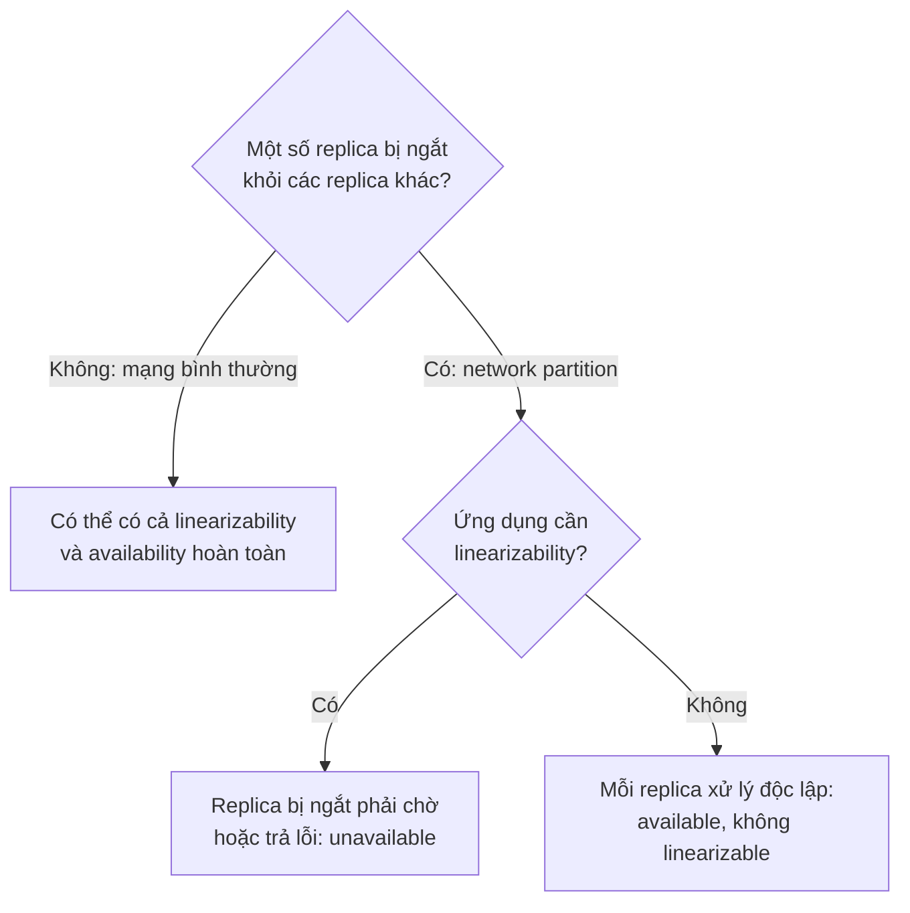

*(Sơ đồ do người viết ghi chú tổng hợp từ tr. 336–337.)*

> Chú thích v (tr. 336). Hai lựa chọn này đôi khi gọi là **CP** (consistent nhưng không available khi có network partition) và **AP** (available nhưng không consistent khi có network partition). Nhưng cách phân loại này **có nhiều lỗi** [9], nên **tốt nhất là tránh**.

**Nguồn gốc của CAP** (tr. 337). Vì vậy ứng dụng **không cần** linearizability **chịu sự cố mạng tốt hơn**. Nhận định này được biết rộng rãi là ***CAP theorem*** [29, 30, 31, 32], do **Eric Brewer** đặt tên năm **2000**, dù người thiết kế database phân tán đã biết trade-off này từ **những năm 1970** [33, 34, 35, 36].

**Vai trò lịch sử** (tr. 337). CAP ban đầu được đề xuất như một **quy tắc kinh nghiệm**, **không có định nghĩa chính xác**, nhằm mở ra thảo luận về trade-off trong database. Lúc đó, nhiều database phân tán tập trung vào ngữ nghĩa linearizable trên cluster máy **dùng chung storage** [18]. CAP khuyến khích kỹ sư khám phá **không gian thiết kế rộng hơn** của các hệ **shared-nothing**, hợp hơn cho web service quy mô lớn [37]. CAP xứng đáng được ghi công cho **sự chuyển dịch văn hóa** này: hãy nhìn sự bùng nổ công nghệ database mới từ **giữa những năm 2000** (gọi chung là **NoSQL**).

<a id="unhelpful-cap"></a>

**Hộp "The Unhelpful CAP Theorem"** (tr. 337):

- **"Chọn 2 trong 3" gây hiểu lầm.** CAP đôi khi được trình bày là *Consistency, Availability, Partition tolerance: chọn 2 trong 3*. Cách nói này **sai lệch** [32], vì **network partition là một loại fault**, không phải thứ bạn **được chọn**: nó **sẽ xảy ra** dù bạn muốn hay không [38].
- **Cách nói tốt hơn.** Khi mạng chạy đúng, hệ thống có thể cung cấp **cả** consistency (linearizability) **lẫn** availability hoàn toàn. Khi có fault mạng, bạn phải chọn **hoặc** linearizability **hoặc** availability hoàn toàn. Vì vậy nên phát biểu CAP là ***either Consistent or Available when Partitioned*** (hoặc consistent, hoặc available, khi bị phân hoạch) [39]. Mạng tin cậy hơn thì **ít phải chọn hơn**, nhưng sớm muộn lựa chọn là **không tránh được**.
- **Định nghĩa availability lộn xộn.** Trong các thảo luận về CAP có **nhiều định nghĩa mâu thuẫn** về availability, và bản hình thức hóa thành định lý [30] **không khớp** với nghĩa thông thường [40]. Nhiều hệ được gọi là "highly available" (chịu lỗi) thực ra **không thỏa** định nghĩa availability **đặc thù** của CAP.
- **Kết luận của hộp.** Có quá nhiều hiểu lầm và nhầm lẫn quanh CAP, và nó không giúp ta hiểu hệ thống tốt hơn, nên **tốt nhất là tránh CAP**.

**Phạm vi rất hẹp của CAP** (tr. 337–338). CAP theo định nghĩa hình thức [30] chỉ xét:

- **một** consistency model (cụ thể là **linearizability**), và
- **một** loại fault: **network partition**, tức các node **còn sống nhưng mất kết nối với nhau**.

Nó **không nói gì** về network delay, node chết hay các trade-off khác. Vì vậy, dù **có ảnh hưởng lớn về lịch sử**, CAP **ít giá trị thực tế** cho thiết kế hệ thống [9, 40]. Có nhiều kết quả bất khả thi **thú vị hơn** trong hệ phân tán [41], và CAP đã bị **thay thế** bởi các kết quả **chính xác hơn** [2, 42], nên ngày nay nó chủ yếu mang **ý nghĩa lịch sử**.

> Chú thích vi (tr. 337). Như "Network Faults in Practice" (tr. 279, [Chương 8](chapter-08.md#network-faults)), sách dùng *partitioning* để chỉ việc **chủ ý chia** dataset lớn thành phần nhỏ (*sharding*, [Chương 6](chapter-06.md#partition-definition)). Ngược lại, ***network partition*** là một **loại fault mạng** cụ thể, thường không được xét riêng so với các fault khác. Nhưng vì nó là chữ **P** trong CAP, ta không tránh được nhầm lẫn ở đây.

> **Bổ sung ngoài sách.**
> - Trong bản hình thức hóa của Gilbert và Lynch [30], "available" nghĩa là **mọi request tới một node không hỏng đều phải nhận được response** (không giới hạn thời gian). Đây là lý do nhiều hệ "highly available" theo nghĩa thông thường (vẫn phục vụ được khi một số node hỏng, nhưng từ chối request ở phía thiểu số) không thỏa định nghĩa này.
> - Tài liệu [46] của Daniel Abadi là bài đề xuất cách nhìn **PACELC**: nếu có **P**artition thì chọn **A** hoặc **C**; **E**lse (mạng bình thường) thì vẫn phải chọn giữa **L**atency và **C**onsistency. Cách nhìn này khớp với ý của sách ở đoạn tiếp theo: linearizability **chậm mọi lúc**, không chỉ khi có fault mạng.

<a id="lin-network-delays"></a>

**Linearizability and network delays** (tr. 338).

**Rất ít hệ thực sự linearizable** (tr. 338). Ngay **RAM trên CPU đa lõi hiện đại** cũng **không linearizable** [43]: một thread trên lõi này ghi vào một địa chỉ bộ nhớ, một thread trên lõi khác đọc cùng địa chỉ ngay sau đó, **không đảm bảo** đọc được giá trị vừa ghi (trừ khi dùng ***memory barrier*** hay ***fence*** [44]).

**Vì sao** (tr. 338):

1. Mỗi lõi CPU có **cache** và **store buffer** riêng.
2. Truy cập bộ nhớ mặc định đi tới **cache trước**; thay đổi được ghi ra **main memory bất đồng bộ**.
3. Truy cập cache **nhanh hơn nhiều** so với main memory [45], nên tính năng này **thiết yếu** cho hiệu năng CPU hiện đại.
4. Nhưng giờ có **nhiều bản sao** của dữ liệu (một trong main memory, có thể thêm vài bản trong các cache), cập nhật **bất đồng bộ**, nên **mất linearizability**.

**Lý do bỏ linearizability là hiệu năng, không phải chịu lỗi** (tr. 338). Dùng CAP để biện minh cho memory consistency model của CPU đa lõi là **vô nghĩa**: trong một máy, ta thường giả định giao tiếp **tin cậy**, và không ai chờ đợi một lõi CPU **tiếp tục chạy bình thường** khi bị ngắt khỏi phần còn lại của máy. Lý do bỏ linearizability là ***performance***.

Nhiều database phân tán cũng vậy: chúng bỏ linearizability **chủ yếu để tăng hiệu năng**, không hẳn vì fault tolerance [46]. **Linearizability chậm**, và điều này đúng **mọi lúc**, không chỉ khi có fault mạng.

**Có cách cài nhanh hơn không? Có vẻ là không** (tr. 338). **Attiya và Welch** [47] chứng minh: nếu muốn linearizability, **response time** của đọc và ghi **ít nhất tỉ lệ với độ bất định của network delay**. Trong mạng có delay **biến động mạnh** như phần lớn mạng máy tính ("Timeouts and Unbounded Delays", tr. 281, [Chương 8](chapter-08.md#timeouts)), response time của đọc ghi linearizable **chắc chắn sẽ cao**.

- **Không tồn tại** thuật toán linearizability nhanh hơn.
- Nhưng consistency model **yếu hơn** có thể **nhanh hơn nhiều**, nên trade-off này **quan trọng** với hệ nhạy độ trễ.
- Chương 12 bàn vài cách **tránh linearizability mà không hy sinh tính đúng**.

> **Ví dụ minh họa do AI xây dựng.** Trong một datacenter, độ trễ mạng giữa hai máy thường dao động trong khoảng mili giây; giữa hai lục địa, nó dao động ở mức hàng chục tới hàng trăm mili giây. Theo kết quả của Attiya và Welch, cùng một thao tác linearizable sẽ "đắt" hơn nhiều khi các replica trải trên nhiều lục địa, ngay cả khi không có sự cố nào. Đây là lý do sách nhấn mạnh hệ phân tán địa lý chịu chi phí linearizability nặng nhất (tr. 342).

---

<a id="b3"></a>

### B3. Ordering Guarantees (tr. 339–352)

<a id="ordering"></a>

#### B3.0 Vì sao thứ tự cứ lặp lại trong sách (tr. 339)

**Từ linearizability tới ordering** (tr. 339). Register linearizable hành xử như thể **chỉ có một bản sao** dữ liệu, và mọi thao tác có hiệu lực **nguyên tử tại một thời điểm**. Định nghĩa này **ngụ ý** các thao tác được thực thi theo **một thứ tự xác định**. Hình 9-4 đã minh họa thứ tự đó bằng cách **nối các thao tác** theo thứ tự chúng dường như được thực thi.

**Ordering đã xuất hiện nhiều lần** (tr. 339), gợi ý đây là một ý tưởng căn bản:

| Ngữ cảnh | Vai trò của thứ tự |
| --- | --- |
| **Chương 5**, single-leader | Mục đích chính của leader là **xác định thứ tự ghi** trong replication log, tức thứ tự follower áp dụng. Không có leader duy nhất thì **xung đột** có thể xảy ra do thao tác đồng thời ([chương 5, B3.2](chapter-05.md#write-conflicts)) |
| **Chương 7**, serializability | Bảo đảm transaction hành xử như thể chạy theo **một thứ tự tuần tự**. Đạt được bằng cách **chạy tuần tự thật**, hoặc cho chạy đồng thời nhưng **ngăn serialization conflict** (bằng lock hoặc abort) |
| **Chương 8**, timestamp và đồng hồ | Một nỗ lực khác **đưa trật tự vào thế giới hỗn loạn**, ví dụ xác định lần ghi nào xảy ra sau ("Relying on Synchronized Clocks", tr. 291) |

**Mục tiêu của phần này** (tr. 339). Hóa ra có **liên hệ sâu** giữa **ordering**, **linearizability** và **consensus**. Phần này lý thuyết và trừu tượng hơn phần còn lại của sách, nhưng rất hữu ích để làm rõ hệ thống **làm được và không làm được** gì.

<a id="causality"></a>

#### B3.1 Ordering and Causality (tr. 339–343)

**Ordering giúp giữ causality** (tr. 339–340). Một lý do ordering cứ quay lại là nó giúp **giữ quan hệ nhân quả** (*causality*). Sách tập hợp các ví dụ đã gặp:

| # | Ví dụ | Quan hệ nhân quả |
| --- | --- | --- |
| 1 | **Consistent prefix reads** (Hình 5-5, tr. 165; [chương 5, B2.3](chapter-05.md#consistent-prefix)): người quan sát thấy câu trả lời trước câu hỏi | Câu hỏi phải có trước, vì người trả lời phải **thấy** câu hỏi (trừ khi họ biết tiên tri). Có ***causal dependency*** giữa câu hỏi và câu trả lời |
| 2 | **Hình 5-9** ([chương 5, B3.3](chapter-05.md#topologies)): ghi giữa ba leader "vượt" nhau, một replica thấy update cho hàng chưa tồn tại | Hàng phải được **tạo trước** rồi mới được **update** |
| 3 | **Detecting Concurrent Writes** (tr. 184; [happens-before](chapter-05.md#happens-before)): A trước B, B trước A, hoặc đồng thời | **Happened before** là một cách diễn đạt khác của causality: A xảy ra trước B nghĩa là B có thể đã biết, xây trên, hoặc phụ thuộc A. A và B đồng thời nghĩa là **không có liên kết nhân quả**, chắc chắn không bên nào biết bên kia |
| 4 | **Snapshot isolation** (tr. 237, [Chương 7](chapter-07.md#snapshot-isolation)): transaction đọc từ consistent snapshot | "Consistent" nghĩa là **nhất quán với causality**: snapshot chứa câu trả lời thì phải chứa câu hỏi [48]. Quan sát cả database **tại một thời điểm** thì thấy hiệu ứng của mọi thao tác xảy ra **nhân quả trước** điểm đó, không thấy thao tác xảy ra **nhân quả sau**. **Read skew** (non-repeatable read, Hình 7-6) là đọc dữ liệu ở trạng thái **vi phạm causality** |
| 5 | **Write skew** (tr. 246, Hình 7-8): Alice được nghỉ trực vì transaction nghĩ Bob còn trực, và ngược lại | Hành động **nghỉ trực phụ thuộc nhân quả** vào việc **quan sát ai đang trực**. **SSI** (tr. 261) phát hiện write skew bằng cách **theo dõi phụ thuộc nhân quả** giữa các transaction |
| 6 | **Alice và Bob xem bóng đá** (Hình 9-1) và dịch vụ resize ảnh ([B2.2](#cross-channel)) | Tiếng reo của Alice **phụ thuộc nhân quả** vào việc công bố tỷ số, nên Bob nghe Alice rồi cũng phải thấy tỷ số. Bob nhận kết quả stale là **vi phạm causality** |

**Causal order** (tr. 340). Causality **áp đặt thứ tự** lên các sự kiện: **nguyên nhân trước kết quả**; message được **gửi trước khi được nhận**; **câu hỏi trước câu trả lời**. Và như ngoài đời, việc này dẫn tới việc kia: một node đọc dữ liệu rồi **ghi gì đó dựa trên nó**, node khác đọc thứ vừa ghi rồi ghi tiếp thứ khác, cứ thế. Các **chuỗi thao tác phụ thuộc nhân quả** này định nghĩa ***causal order*** của hệ thống: cái gì xảy ra trước cái gì.

<a id="causal-consistency"></a>

**Causally consistent** (tr. 341). Hệ thống **tuân theo thứ tự do causality áp đặt** thì gọi là ***causally consistent***. Ví dụ **snapshot isolation cung cấp causal consistency**: khi đọc database và thấy một mẩu dữ liệu, bạn cũng phải thấy được **mọi dữ liệu đi trước nó về nhân quả** (giả sử chúng chưa bị xóa trong lúc đó).

<a id="causal-vs-total"></a>

**The causal order is not a total order** (tr. 341–342).

**Total order và partial order** (tr. 341):

- ***Total order*** cho phép **so sánh hai phần tử bất kỳ**: luôn nói được cái nào lớn hơn. Ví dụ số tự nhiên: cho 5 và 13, bạn nói ngay 13 lớn hơn 5.
- **Tập hợp toán học** thì **không** có thứ tự toàn phần: {a, b} lớn hơn {b, c} không? Không so sánh được, vì **không tập nào là tập con của tập kia**. Ta nói chúng ***incomparable***, nên tập hợp có ***partial order***: có lúc tập này lớn hơn tập kia (khi nó chứa mọi phần tử của tập kia), có lúc không so sánh được.

**Khác biệt này phản ánh vào consistency model** (tr. 341):

| | Linearizability | Causality |
| --- | --- | --- |
| **Loại thứ tự** | **Total order** các thao tác | **Partial order** |
| **Lý do** | Hệ hành xử như thể chỉ có **một bản sao**, mọi thao tác atomic, nên với hai thao tác bất kỳ **luôn nói được** cái nào xảy ra trước. Timeline ở Hình 9-4 là ví dụ | Hai thao tác **đồng thời** nếu không cái nào happened before cái kia (tr. 186). Có quan hệ nhân quả thì **có thứ tự**; đồng thời thì **không so sánh được** |

**Hệ quả** (tr. 341):

- Theo định nghĩa này, **không có thao tác đồng thời** trong datastore linearizable: phải có **một timeline duy nhất** mà mọi thao tác được sắp toàn phần trên đó. Có thể có nhiều request **đang chờ**, nhưng datastore bảo đảm mỗi request được xử lý **nguyên tử tại một thời điểm**, trên **một bản sao**, dọc **một timeline**, **không có concurrency**.
- **Concurrency** nghĩa là timeline **rẽ nhánh rồi hợp lại**; thao tác trên các nhánh khác nhau **không so sánh được** (tức đồng thời). Chương 5 đã thấy hiện tượng này: Hình 5-14 ([chương 5, capturing happens-before](chapter-05.md#capturing-happens-before)) không phải một đường thẳng thứ tự toàn phần mà là **một mớ thao tác đồng thời**; mũi tên trong hình là **phụ thuộc nhân quả**, tức partial order của các thao tác.
- **Git** (tr. 342): lịch sử phiên bản của hệ quản lý phiên bản phân tán **rất giống đồ thị phụ thuộc nhân quả**. Thường commit này nối tiếp commit kia theo đường thẳng, nhưng đôi khi có **nhánh** (nhiều người làm đồng thời), và **merge** được tạo khi gộp các commit tạo đồng thời.

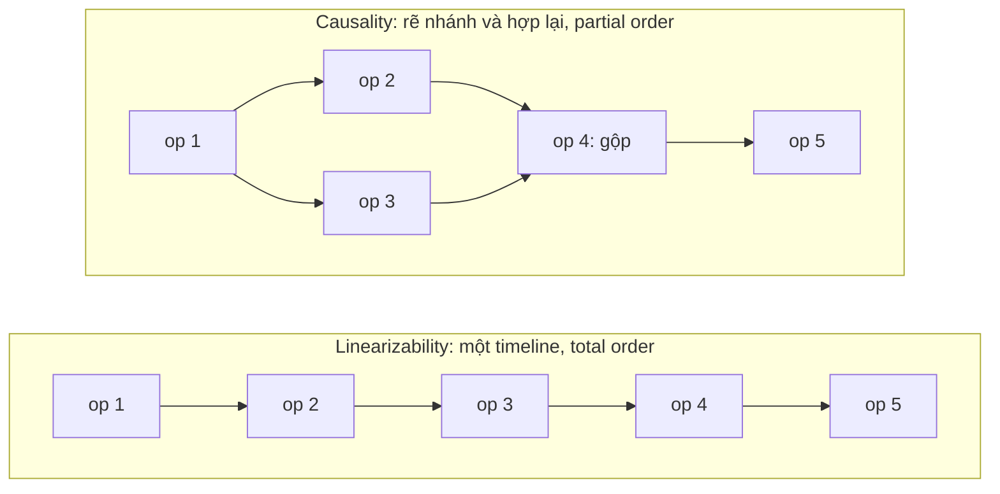

*(Sơ đồ do người viết ghi chú tổng hợp từ tr. 341–342. Bên phải, op 2 và op 3 đồng thời, không so sánh được; op 4 giống một merge commit trong Git.)*

<a id="lin-stronger-causal"></a>

**Linearizability is stronger than causal consistency** (tr. 342).

**Linearizability ngụ ý causality** (tr. 342). Mọi hệ linearizable đều **giữ causality đúng** [7]. Đặc biệt, nếu hệ có **nhiều kênh liên lạc** (như message queue và file storage ở Hình 9-5), linearizability bảo đảm causality **tự động**, hệ thống không phải làm gì đặc biệt (như truyền timestamp giữa các thành phần). Đây là điều làm hệ linearizable **dễ hiểu và hấp dẫn**.

**Nhưng cái giá** (tr. 342). Như [B2.4](#cost-linearizability), làm hệ linearizable có thể **hại hiệu năng và availability**, nhất là khi network delay lớn (ví dụ **phân tán địa lý**). Vì vậy một số hệ dữ liệu phân tán đã **bỏ linearizability**: hiệu năng tốt hơn, nhưng **khó dùng** hơn.

**Tin tốt: có điểm giữa** (tr. 342):

- Linearizability **không phải cách duy nhất** để giữ causality. Hệ thống có thể **causally consistent** mà **không chịu chi phí** của linearizable (đặc biệt, **CAP theorem không áp dụng**).
- Thực ra, **causal consistency là consistency model mạnh nhất có thể** mà **không bị chậm đi vì network delay**, và **vẫn available khi mạng hỏng** [2, 42].
- Nhiều hệ **tưởng cần** linearizability thật ra **chỉ cần causal consistency**, thứ cài được **hiệu quả hơn**. Dựa trên quan sát này, giới nghiên cứu đang khám phá các loại database **giữ causality** với hiệu năng và availability **giống hệ eventually consistent** [49, 50, 51].
- Nghiên cứu còn **khá mới**, chưa vào nhiều hệ production, còn thách thức phải vượt qua [52, 53]. Nhưng đây là **hướng hứa hẹn** cho hệ thống tương lai.

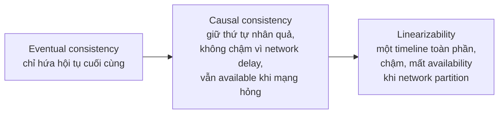

*(Sơ đồ do người viết ghi chú. Mũi tên chỉ hướng "mạnh hơn". Sách nói rõ linearizability mạnh hơn causal consistency và causal consistency là mô hình mạnh nhất vẫn available (tr. 342); việc đặt eventual consistency ở đầu yếu dựa trên tr. 322–323.)*

<a id="capturing-causal"></a>

**Capturing causal dependencies** (tr. 342–343). Sách không đi vào chi tiết cách hệ không linearizable duy trì causal consistency, chỉ điểm qua ý chính.

1. **Phải biết thao tác nào xảy ra trước thao tác nào** (tr. 343). Đây là **partial order**: thao tác **đồng thời** được xử lý theo **thứ tự bất kỳ**, nhưng nếu một thao tác xảy ra trước thao tác kia thì **mọi replica** phải xử lý theo **đúng thứ tự đó**. Khi replica xử lý một thao tác, nó phải bảo đảm **mọi thao tác đi trước về nhân quả** đã được xử lý; nếu thiếu thao tác nào, thao tác sau phải **chờ**.
2. **Mô tả "kiến thức" của một node** (tr. 343). Để xác định phụ thuộc nhân quả, cần cách mô tả **node đã biết gì**. Nếu node **đã thấy** giá trị X khi phát ra lần ghi Y, thì X và Y **có thể** có quan hệ nhân quả. Phân tích này giống câu hỏi trong một vụ điều tra gian lận: **CEO có biết về X vào lúc ra quyết định Y không?**
3. **Kỹ thuật giống phát hiện ghi đồng thời** (tr. 343). Cách xác định thao tác nào xảy ra trước tương tự "Detecting Concurrent Writes" ([chương 5, B4.5](chapter-05.md#concurrent-writes)). Phần đó bàn causality trong datastore leaderless, nơi phải phát hiện ghi đồng thời **vào cùng một key** để tránh lost update. **Causal consistency đi xa hơn**: phải theo dõi phụ thuộc nhân quả **trên toàn database**, không chỉ cho một key. **Version vector** có thể được tổng quát hóa để làm việc này [54] ([chương 5, version vectors](chapter-05.md#version-vectors)).
4. **Database phải biết ứng dụng đã đọc phiên bản nào** (tr. 343). Vì vậy ở Hình 5-13 ([chương 5, thuật toán version number](chapter-05.md#version-algorithm)), version number từ thao tác trước được **gửi lại** cho database khi ghi. Ý tưởng tương tự xuất hiện trong cơ chế phát hiện xung đột của **SSI** (tr. 261): khi transaction muốn commit, database kiểm tra **phiên bản dữ liệu nó đã đọc** còn mới không; để làm vậy, database **theo dõi** dữ liệu nào đã được transaction nào đọc.

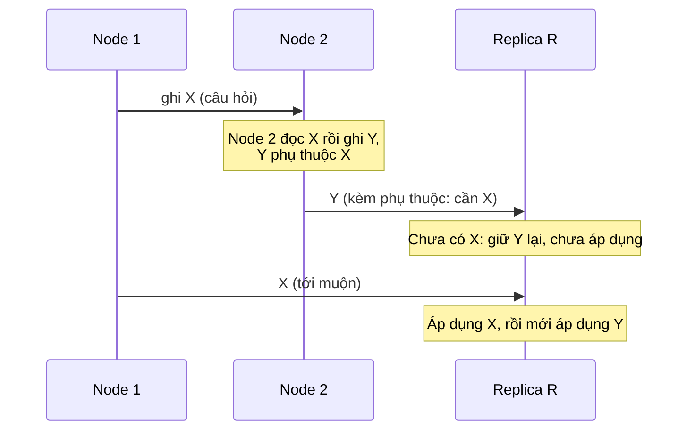

*(Ví dụ minh họa do AI xây dựng cho nguyên tắc ở tr. 343: replica phải chờ thao tác đi trước về nhân quả.)*

<a id="sequence-numbers"></a>

#### B3.2 Sequence Number Ordering (tr. 343–348)

**Why** (tr. 343). Causality là khái niệm lý thuyết quan trọng, nhưng **theo dõi mọi phụ thuộc nhân quả** có thể **không thực tế**. Trong nhiều ứng dụng, client **đọc rất nhiều dữ liệu** trước khi ghi một thứ, và không rõ lần ghi phụ thuộc vào **tất cả** hay chỉ **một phần** các lần đọc đó. Theo dõi tường minh mọi dữ liệu đã đọc nghĩa là **overhead lớn**.

**What** (tr. 343–344). Có cách tốt hơn: dùng ***sequence number*** hoặc **timestamp** để sắp thứ tự sự kiện.

- Timestamp **không cần** đến từ **time-of-day clock** (đồng hồ vật lý có nhiều vấn đề, "Unreliable Clocks", tr. 287). Nó có thể đến từ một ***logical clock***: thuật toán sinh **dãy số** để định danh thao tác, thường dùng **counter tăng** sau mỗi thao tác.
- Sequence number hay timestamp như vậy **gọn** (chỉ vài byte) và cho **total order**: mỗi thao tác có **một số duy nhất**, và luôn so sánh được hai số để biết số nào lớn hơn (thao tác nào xảy ra sau).

**Total order nhất quán với causality** (tr. 344). Có thể tạo sequence number theo total order **nhất quán với causality**: ta hứa rằng nếu A **xảy ra trước** B về nhân quả, thì A **đứng trước** B trong total order (A có số **nhỏ hơn** B). Thao tác đồng thời được sắp **tùy ý**. Total order như vậy **chứa mọi thông tin causality**, nhưng cũng **áp đặt nhiều thứ tự hơn** mức causality đòi hỏi.

> Chú thích vii (tr. 344). Tạo một total order **không nhất quán** với causality thì **dễ** nhưng **vô dụng**. Ví dụ: sinh **UUID ngẫu nhiên** cho mỗi thao tác, so sánh UUID theo thứ tự từ điển. Đây là total order hợp lệ, nhưng UUID ngẫu nhiên **không cho biết gì** về thao tác nào thực sự xảy ra trước, hay chúng có đồng thời không.

**Single-leader làm được điều này một cách tự nhiên** (tr. 344). Với single-leader replication ([chương 5, B1.0](chapter-05.md#leader-based)), **replication log** định nghĩa một total order các lần ghi **nhất quán với causality**. Leader chỉ cần **tăng một counter** cho mỗi thao tác, gán **sequence number tăng đơn điệu** cho mỗi thao tác trong log. Follower áp dụng ghi **theo thứ tự trong log** thì trạng thái của nó **luôn causally consistent**, kể cả khi đang lag sau leader.

> **Bổ sung ngoài sách (liên hệ).** Đây chính là **log sequence number** dùng làm "logical timestamp" trong kỹ thuật read-your-writes ở [chương 5, B2.1](chapter-05.md#read-your-writes): vì vị trí trong log nhất quán với causality, client chỉ cần nhớ vị trí lần ghi cuối của mình và đọc từ replica đã áp dụng tới vị trí đó.

<a id="noncausal-generators"></a>

**Noncausal sequence number generators** (tr. 344–345).

**Bối cảnh** (tr. 344). Nếu **không có leader duy nhất** (dùng multi-leader, leaderless, hoặc database được partition), cách sinh sequence number cho thao tác **không còn rõ ràng**. Thực tế có ba cách:

| Cách | Mô tả | Vì sao không nhất quán với causality |
| --- | --- | --- |
| **1. Mỗi node một dãy riêng** | Hai node: một node chỉ sinh **số lẻ**, node kia chỉ sinh **số chẵn**. Tổng quát: dành vài bit trong biểu diễn nhị phân để chứa **node ID duy nhất**, nên hai node không bao giờ sinh trùng số | Mỗi node xử lý **số thao tác mỗi giây khác nhau**. Counter số chẵn có thể **tụt sau** counter số lẻ hay ngược lại. Có một thao tác số lẻ và một thao tác số chẵn thì **không biết chính xác** cái nào xảy ra trước về nhân quả |
| **2. Timestamp đồng hồ vật lý** | Gắn timestamp từ **time-of-day clock** cho mỗi thao tác [55]. Không tuần tự, nhưng nếu **độ phân giải đủ cao** thì có thể đủ để sắp toàn phần. **LWW** dùng điều này ("Timestamps for ordering events", tr. 291) | Bị **clock skew**. Hình 8-3 (tr. 291–292, [Chương 8](chapter-08.md#timestamps-ordering)) cho thấy một thao tác xảy ra **sau** về nhân quả lại được gán timestamp **nhỏ hơn** |
| **3. Cấp trước khối số** | Node A lấy khối **1 tới 1.000**, node B lấy khối **1.001 tới 2.000**. Mỗi node gán số **độc lập** từ khối của mình, và xin khối mới khi sắp hết | Một thao tác nhận số trong khoảng 1.001–2.000, còn một thao tác **xảy ra sau về nhân quả** có thể nhận số trong khoảng 1–1.000 |

**Ưu và nhược chung** (tr. 345). Cả ba cách đều **nhanh hơn** và **mở rộng tốt hơn** việc đẩy mọi thao tác qua **một leader** tăng counter. Chúng sinh số **duy nhất**, **xấp xỉ tăng** cho mỗi thao tác. Nhưng tất cả có chung một vấn đề: số sinh ra **không nhất quán với causality**, vì các bộ sinh này **không nắm đúng thứ tự thao tác giữa các node khác nhau**.

> Chú thích viii (tr. 345). **Có thể** làm timestamp đồng hồ vật lý nhất quán với causality. Ở "Synchronized clocks for global snapshots" (tr. 294, [Chương 8](chapter-08.md#global-snapshots)), sách đã bàn **Google Spanner**: nó **ước lượng clock skew** và **chờ hết khoảng bất định** trước khi commit một lần ghi. Cách này bảo đảm transaction xảy ra sau về nhân quả được gán timestamp lớn hơn. Nhưng **hầu hết đồng hồ** không cung cấp được **số đo độ bất định** cần thiết.

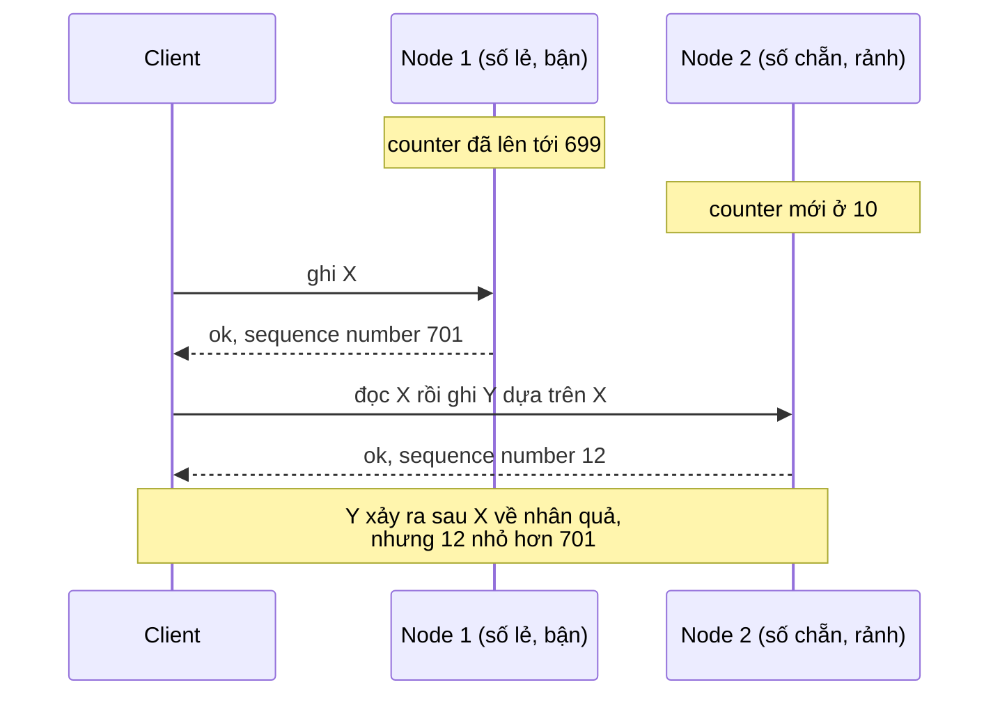

*(Ví dụ minh họa do AI xây dựng cho cách 1 ở tr. 345. Các con số là giả định.)*

<a id="lamport-timestamps"></a>

**Lamport timestamps** (tr. 345–347).

**What** (tr. 345–346). Ba bộ sinh trên không nhất quán với causality, nhưng có một phương pháp **đơn giản** sinh sequence number **nhất quán với causality**: ***Lamport timestamp***, do **Leslie Lamport** đề xuất năm **1978** [56], nay là một trong những bài báo **được trích dẫn nhiều nhất** của lĩnh vực hệ phân tán.

**How — cấu trúc** (tr. 345–346):

- Mỗi node có một **ID duy nhất**, và giữ một **counter** số thao tác đã xử lý.
- Lamport timestamp đơn giản là **cặp (counter, node ID)**. Hai node đôi khi có cùng counter, nhưng nhờ có node ID trong timestamp, **mỗi timestamp là duy nhất**.
- Lamport timestamp **không liên quan gì** tới đồng hồ vật lý, nhưng cho **total order**: so hai timestamp, cái có **counter lớn hơn** thì lớn hơn; counter **bằng nhau** thì cái có **node ID lớn hơn** thì lớn hơn.

**How — ý tưởng then chốt** (tr. 346). Tới đây mô tả này về bản chất **giống bộ đếm lẻ chẵn**. Điều làm Lamport timestamp **nhất quán với causality** là:

1. **Mọi node và mọi client** theo dõi **giá trị counter lớn nhất** mà nó **đã thấy** cho tới lúc đó, và **gửi kèm** giá trị lớn nhất này trong **mọi request**.
2. Khi một node nhận request hoặc response có counter lớn nhất **lớn hơn** counter của chính nó, nó **lập tức tăng** counter của mình lên giá trị đó.

**Example — Hình 9-8** (tr. 346). Client A nhận counter **5** từ node 2, rồi gửi giá trị lớn nhất 5 đó tới node 1. Lúc ấy counter của node 1 **mới là 1**, nhưng nó **lập tức được đẩy lên 5**, nên thao tác tiếp theo có counter tăng thành **6**.

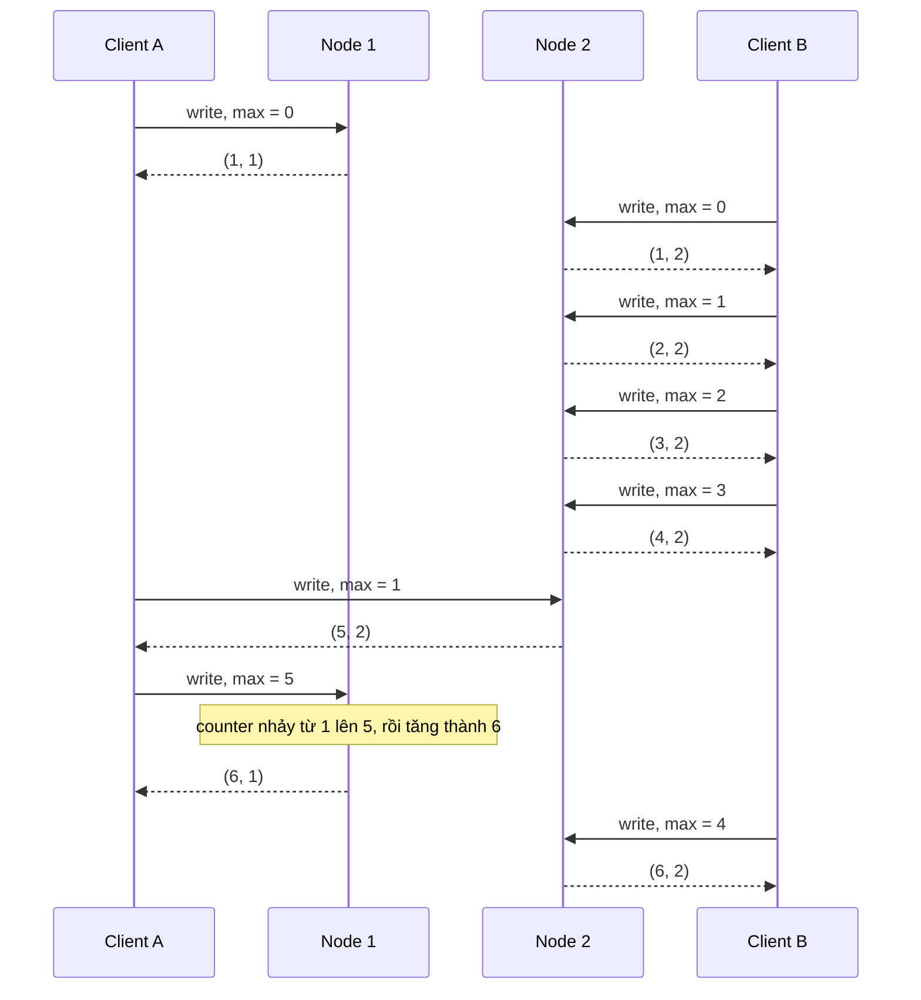

*(Vẽ lại Hình 9-8, tr. 346. Mỗi response là một Lamport timestamp dạng (counter, node ID).)*

**Vì sao nhất quán với causality** (tr. 346). Miễn là counter lớn nhất được **mang theo mọi thao tác**, thứ tự theo Lamport timestamp **nhất quán với causality**, vì **mọi phụ thuộc nhân quả đều dẫn tới timestamp tăng**. Trong Hình 9-8, lần ghi cuối của A tới node 1 xảy ra sau (5, 2) về nhân quả (A đã thấy (5, 2)), và nó nhận (6, 1), lớn hơn (5, 2).

> **Bổ sung ngoài sách — quy tắc gọn và một quan sát từ Hình 9-8.**
> - Quy tắc của mỗi node khi xử lý một thao tác mang giá trị max: counter mới = max(counter hiện tại, max nhận được) + 1. Ví dụ node 2 ở bước A gửi max = 1: counter đang là 4, max(4, 1) + 1 = 5.
> - Thứ tự Lamport trong hình: (1, 1) &lt; (1, 2) &lt; (2, 2) &lt; (3, 2) &lt; (4, 2) &lt; (5, 2) &lt; (6, 1) &lt; (6, 2). Hai lần ghi (1, 1) và (1, 2) **đồng thời** (không bên nào biết bên kia), nhưng vẫn bị xếp thứ tự theo node ID. Tương tự với (6, 1) và (6, 2). Đây là ví dụ cụ thể cho câu "áp đặt nhiều thứ tự hơn mức causality đòi hỏi" (tr. 344).
> - Về mặt hình thức: nếu A xảy ra trước B thì L(A) &lt; L(B); nhưng chiều ngược lại **không** đúng. L(A) &lt; L(B) không cho biết A có xảy ra trước B hay hai thao tác đồng thời.

**Lamport timestamp khác version vector** (tr. 346–347). Hai thứ hay bị nhầm với nhau ([chương 5, version vectors](chapter-05.md#version-vectors)). Chúng có điểm giống nhưng **mục đích khác**:

| | Version vector | Lamport timestamp |
| --- | --- | --- |
| **Cho biết** | Phân biệt được hai thao tác **đồng thời** hay một cái **phụ thuộc nhân quả** vào cái kia | Luôn áp đặt **total order**; từ thứ tự này **không biết** hai thao tác đồng thời hay phụ thuộc |
| **Kích thước** | Một số cho mỗi replica | **Gọn hơn**: một cặp (counter, node ID) |

<a id="timestamp-not-sufficient"></a>

**Timestamp ordering is not sufficient** (tr. 347–348).

Lamport timestamp cho total order nhất quán với causality, nhưng **chưa đủ** để giải nhiều bài toán thường gặp (tr. 347).

**Example — username duy nhất** (tr. 347). Hệ thống phải bảo đảm username **định danh duy nhất** một tài khoản. Hai người **đồng thời** tạo tài khoản cùng username thì một người thành công, người kia thất bại. (Sách đã chạm tới vấn đề này ở "The leader and the lock", tr. 301.)

**Lập luận từng bước** (tr. 347):

1. **Thoạt nhìn có vẻ đủ.** Có total order (ví dụ Lamport timestamp) thì: nếu có hai tài khoản cùng username, chọn cái có **timestamp nhỏ hơn** thắng (người lấy username trước), cái **lớn hơn** thất bại. Timestamp có thứ tự toàn phần, nên phép so sánh **luôn hợp lệ**.
2. **Đúng khi xét sau sự việc.** Cách này xác định được người thắng **sau khi** đã thu thập **mọi** thao tác tạo username trong hệ thống: lúc đó so timestamp là xong.
3. **Sai khi phải quyết định ngay.** Một node **vừa nhận** request tạo username và phải quyết định **ngay bây giờ** thành công hay thất bại. Lúc đó node **không biết** node khác có đang **đồng thời** tạo tài khoản cùng username không, và node kia sẽ gán **timestamp nào** cho thao tác đó.
4. **Muốn chắc chắn thì phải hỏi tất cả.** Để chắc không node nào đang đồng thời tạo cùng username với **timestamp nhỏ hơn**, phải **hỏi mọi node khác** xem chúng đang làm gì [56]. Nếu một node **hỏng** hoặc **không với tới** được do sự cố mạng, **cả hệ thống dừng lại**. Đó không phải hệ chịu lỗi mà ta cần.

**Vấn đề cốt lõi** (tr. 347). Total order của các thao tác **chỉ xuất hiện sau khi đã thu thập đủ mọi thao tác**. Nếu node khác đã sinh vài thao tác mà ta **chưa biết**, ta **không dựng được** thứ tự cuối cùng: các thao tác chưa biết đó có thể phải được **chèn vào nhiều vị trí** trong total order.

**Kết luận** (tr. 347–348). Để cài thứ gì đó như **uniqueness constraint** cho username, có total order **là chưa đủ**: còn phải biết **khi nào thứ tự đó được chốt** (*finalized*). Nếu có thao tác tạo username, và **chắc chắn** không node nào khác có thể **chèn** một claim cho cùng username **trước** thao tác của mình trong total order, thì có thể **an toàn** tuyên bố thao tác thành công. Ý tưởng "biết khi nào total order được chốt" chính là chủ đề ***total order broadcast***.

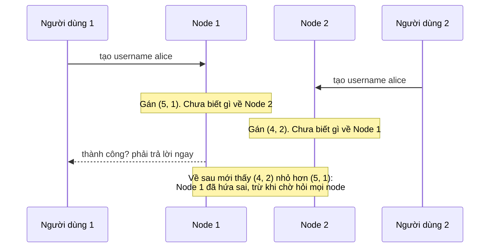

*(Ví dụ minh họa do AI xây dựng cho lập luận ở tr. 347. Các timestamp là giả định.)*

<a id="total-order-broadcast"></a>

#### B3.3 Total Order Broadcast (tr. 348–352)

**Why** (tr. 348). Chương trình chạy trên **một lõi CPU** thì dễ định nghĩa total order: chính là **thứ tự CPU thực thi**. Trong hệ phân tán, khiến **mọi node đồng ý cùng một total order** là **khó**. Phần trước cho thấy sắp thứ tự bằng timestamp hay sequence number **không mạnh bằng** single-leader replication: dùng timestamp ordering để cài uniqueness constraint thì **không chịu được fault nào**.

**Single-leader và giới hạn của nó** (tr. 348). Single-leader xác định total order bằng cách chọn **một node làm leader** và **xếp thứ tự mọi thao tác trên một lõi CPU** của leader. Thách thức:

- làm sao **mở rộng** khi throughput vượt sức **một leader**;
- làm sao xử lý **failover** khi leader hỏng ([chương 5, B1.3](chapter-05.md#failover)).

Trong tài liệu hệ phân tán, bài toán này gọi là ***total order broadcast*** hay ***atomic broadcast*** [25, 57, 58].

> Chú thích ix (tr. 348). *Atomic broadcast* là tên **truyền thống** nhưng **rất dễ nhầm**, vì nó không nhất quán với các nghĩa khác của chữ *atomic*: nó **không liên quan** tới atomicity trong ACID, và chỉ liên quan **gián tiếp** tới atomic operation (theo nghĩa lập trình đa luồng) hay atomic register (storage linearizable). ***Total order multicast*** là một tên đồng nghĩa khác.

<a id="ordering-scope"></a>

**Ghi chú "Scope of ordering guarantee"** (tr. 348). Database partitioned với **một leader cho mỗi partition** thường chỉ giữ thứ tự **trong từng partition**. Nghĩa là chúng **không cung cấp** được các đảm bảo consistency **xuyên partition** (ví dụ **consistent snapshot**, **foreign key reference**). Total order **trên mọi partition** là có thể, nhưng cần **phối hợp thêm** [59].

**What — hai safety property** (tr. 348–349). Total order broadcast thường được mô tả là **giao thức trao đổi message** giữa các node. Phi hình thức, nó đòi hai **safety property** luôn được thỏa:

| Property | Ý nghĩa |
| --- | --- |
| ***Reliable delivery*** | **Không mất message**: message được deliver tới một node thì cũng được deliver tới **mọi node** |
| ***Totally ordered delivery*** | Message được deliver tới mọi node **theo cùng một thứ tự** |

Thuật toán total order broadcast đúng phải **luôn** bảo đảm hai tính chất này, **kể cả khi node hay mạng lỗi**. Dĩ nhiên khi mạng gián đoạn thì message không tới được, nhưng thuật toán có thể **thử lại** để message tới nơi khi mạng cuối cùng được sửa (và khi đó vẫn phải deliver **đúng thứ tự**) (tr. 348–349).

<a id="using-tob"></a>

**Using total order broadcast** (tr. 349).

- **Consensus service cài total order broadcast.** ZooKeeper và etcd **thực ra cài** total order broadcast. Đây là gợi ý về **liên hệ mạnh** giữa total order broadcast và consensus, sẽ được làm rõ ở [B4.3](#consensus-tob).
- **Database replication.** Total order broadcast **đúng là thứ cần** cho nhân bản database: nếu **mỗi message là một lần ghi**, và **mọi replica xử lý cùng các lần ghi theo cùng thứ tự**, thì các replica **nhất quán với nhau** (ngoài replication lag tạm thời). Nguyên lý này gọi là ***state machine replication*** [60]; sách quay lại ở Chương 11.
- **Serializable transaction.** Như "Actual Serial Execution" (tr. 252, [Chương 7](chapter-07.md#serial-execution)): nếu **mỗi message là một transaction tất định** chạy dưới dạng **stored procedure**, và mọi node xử lý các message theo **cùng thứ tự**, thì các partition và replica của database **nhất quán với nhau** [61].
- **Thứ tự được cố định lúc deliver.** Điểm quan trọng: thứ tự **được chốt tại thời điểm message được deliver**. Node **không được chèn ngược** một message vào vị trí **sớm hơn** nếu các message sau đó **đã được deliver**. Chính điều này làm total order broadcast **mạnh hơn timestamp ordering**.
- **Total order broadcast là một cách tạo log.** Một cách nhìn khác: total order broadcast là cách tạo **log** (như replication log, transaction log, write-ahead log). **Deliver một message giống như append vào log.** Mọi node phải deliver cùng message theo cùng thứ tự, nên mọi node **đọc log** đều thấy **cùng một chuỗi message**.
- **Lock service cấp fencing token.** Total order broadcast cũng hữu ích để cài lock service cấp ***fencing token*** ("Fencing tokens", tr. 303, [Chương 8](chapter-08.md#fencing-tokens)). Mỗi request lấy lock được **append vào log** như một message, và mọi message được **đánh số tuần tự** theo thứ tự trong log. Số thứ tự này dùng được làm fencing token vì nó **tăng đơn điệu**. Trong ZooKeeper, số này gọi là ***zxid*** [15].

> **Bổ sung ngoài sách (nhắc lại từ Chương 8, tr. 303).** Fencing token là một số tăng mỗi lần lock hay lease được cấp. Client gửi kèm token trong mọi lần ghi vào tài nguyên được bảo vệ; tài nguyên **từ chối** lần ghi mang token **nhỏ hơn** token lớn nhất đã xử lý. Nhờ vậy, một client tưởng mình vẫn giữ lock (ví dụ sau một lần GC pause dài) không thể ghi đè dữ liệu của người giữ lock mới.

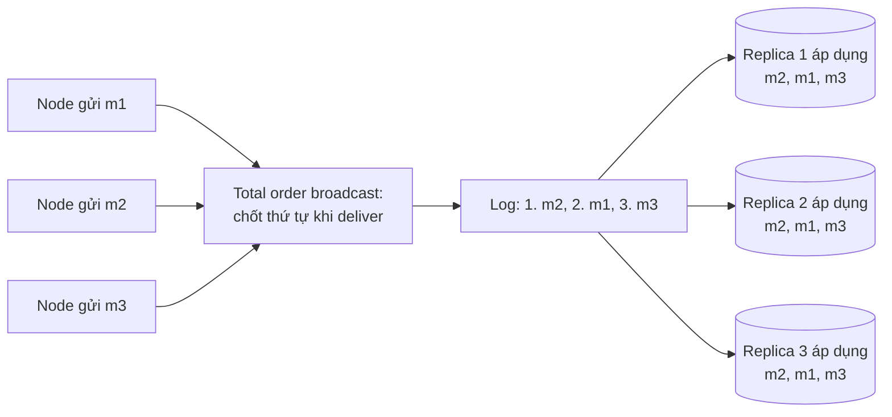

*(Sơ đồ do người viết ghi chú tổng hợp từ tr. 349: total order broadcast nhìn như một log; mọi replica deliver cùng message theo cùng thứ tự, nên đi tới cùng trạng thái, đó là state machine replication. Số thứ tự trong log cũng dùng được làm fencing token.)*

<a id="lin-from-tob"></a>

**Implementing linearizable storage using total order broadcast** (tr. 350–351).

**Liên hệ giữa hai khái niệm** (tr. 350). Hình 9-4 cho thấy hệ linearizable có **total order** các thao tác. Vậy linearizability có **giống** total order broadcast không? **Không hẳn**, nhưng hai thứ **liên hệ chặt**.

| | Total order broadcast | Linearizability |
| --- | --- | --- |
| **Bản chất** | **Bất đồng bộ**: message chắc chắn được deliver tin cậy theo thứ tự cố định, nhưng **không bảo đảm khi nào** (người nhận này có thể lag sau người nhận khác) | **Recency guarantee**: lần đọc chắc chắn thấy **giá trị mới nhất** đã ghi |

> Chú thích x (tr. 350). Về mặt hình thức, **register đọc ghi linearizable** là bài toán **"dễ hơn"**. Total order broadcast **tương đương consensus** [67], mà consensus **không có lời giải tất định** trong mô hình **asynchronous crash-stop** [68]; còn register đọc ghi linearizable **cài được** trong cùng mô hình đó [23, 24, 25]. Nhưng nếu register hỗ trợ thao tác atomic như **compare-and-set** hay **increment-and-get**, nó trở nên **tương đương consensus** [28]. Vậy consensus và register linearizable **liên quan chặt** với nhau.

**Xây storage linearizable trên total order broadcast — ví dụ username** (tr. 350):

- Hình dung **mỗi username có thể có** một **register linearizable** với thao tác **compare-and-set** nguyên tử. Mọi register ban đầu có giá trị **null** (username chưa bị lấy).
- Người dùng muốn tạo username: thực hiện **compare-and-set** trên register của username đó, đặt nó thành **user account ID**, **với điều kiện** giá trị trước đó là null.
- Nhiều người cùng giành một username: **chỉ một** compare-and-set thành công, vì những người khác sẽ thấy giá trị **khác null** (nhờ linearizability).

**Cài compare-and-set linearizable bằng log chỉ ghi nối thêm** [62, 63] (tr. 350):

1. **Append** một message vào log, **tạm** nêu username muốn claim.
2. **Đọc log**, và **chờ** message mình vừa append **được deliver trở lại** cho mình.
3. **Kiểm tra** mọi message claim username mình muốn. Nếu message **đầu tiên** cho username đó là **của mình** thì thành công: có thể **commit** claim (có thể bằng cách append thêm một message) và xác nhận với client. Nếu message đầu tiên là của **người khác**, **abort** thao tác.

> Chú thích xi (tr. 350). Nếu **không chờ** ở bước 2 mà xác nhận lần ghi **ngay sau khi đưa vào hàng đợi**, ta được một mô hình giống **memory consistency model của CPU x86 đa lõi** [43]. Mô hình đó **không linearizable**, cũng **không sequentially consistent**.

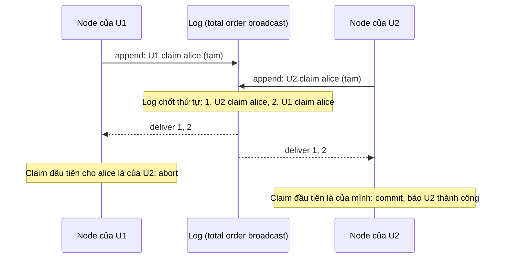

*(Ví dụ minh họa do AI xây dựng theo ba bước ở tr. 350.)*

**Vì sao đúng** (tr. 351). Log entry được deliver tới **mọi node theo cùng thứ tự**, nên khi có nhiều lần ghi đồng thời, **mọi node đồng ý** lần nào tới trước. Chọn lần ghi **đầu tiên** trong các lần xung đột làm người thắng và abort các lần sau, thì mọi node **đồng ý** lần ghi nào được commit, lần nào bị abort. Cách tương tự dùng được để cài **serializable multi-object transaction** trên một log [62].

<a id="sequential-consistency"></a>

**Ghi linearizable, nhưng đọc thì chưa** (tr. 351). Quy trình trên bảo đảm **ghi linearizable**, nhưng **không bảo đảm đọc linearizable**: nếu đọc từ một store được cập nhật **bất đồng bộ** từ log, kết quả có thể **stale**. (Nói chính xác, quy trình này cho ***sequential consistency*** [47, 64], đôi khi gọi là ***timeline consistency*** [65, 66], **yếu hơn linearizability một chút**.)

**Ba cách làm đọc linearizable** (tr. 351):

| Cách | Mô tả | Ví dụ |
| --- | --- | --- |
| **Xếp lần đọc qua log** | Append một message, đọc log, và **thực hiện lần đọc thật** khi message được deliver trở lại. **Vị trí của message trong log** xác định thời điểm lần đọc xảy ra | Quorum read của etcd hoạt động gần như vậy [16] |
| **Hỏi vị trí mới nhất của log** | Nếu log cho lấy **vị trí message mới nhất** theo cách linearizable, hỏi vị trí đó, **chờ** mọi entry tới vị trí đó được deliver cho mình, rồi đọc | Ý tưởng đằng sau **`sync()`** của ZooKeeper [15] |
| **Đọc từ replica cập nhật đồng bộ** | Đọc từ replica được cập nhật **đồng bộ** khi ghi, nên chắc chắn mới nhất | **Chain replication** [63] (xem [hộp "Research on Replication" ở chương 5](chapter-05.md#semi-sync), tr. 155) |

> **Bổ sung ngoài sách — sequential consistency là gì.** Sequential consistency (Lamport, 1979, tài liệu [64]) đòi mọi thao tác xuất hiện theo **một thứ tự toàn phần** mà mọi node cùng thấy, và thứ tự đó **giữ đúng thứ tự thao tác của từng client**. Khác linearizability ở chỗ thứ tự toàn phần **không bắt buộc khớp thời gian thực**: một client có thể đọc giá trị "cũ" dù lần ghi mới đã hoàn tất ở client khác, miễn là mọi người thấy cùng một thứ tự. Đọc từ một replica đang lag của log là ví dụ đúng như vậy.

<a id="tob-from-lin"></a>

**Implementing total order broadcast using linearizable storage** (tr. 351–352).

Đảo ngược hướng: giả sử **có storage linearizable**, xây total order broadcast từ nó (tr. 351).

**How** (tr. 351):

- Cách dễ nhất: có một **register linearizable** lưu **một số nguyên**, với thao tác **increment-and-get** nguyên tử [28]. (Thao tác **compare-and-set** nguyên tử cũng làm được việc này.)
- Với **mỗi message** muốn gửi qua total order broadcast: **increment-and-get** số nguyên linearizable, rồi **gắn giá trị nhận được** làm **sequence number** vào message.
- Gửi message tới **mọi node** (gửi lại message nào bị mất). Người nhận **deliver message liên tiếp theo sequence number**.

**Khác biệt then chốt với Lamport timestamp** (tr. 351–352). Số lấy từ register linearizable tạo thành **dãy không có lỗ hổng** (*no gaps*). Nếu một node đã deliver message 4 và nhận được message có sequence number 6, nó **biết** phải **chờ message 5** rồi mới deliver message 6. Lamport timestamp **không có** tính chất này. Đây chính là **khác biệt then chốt** giữa **total order broadcast** và **timestamp ordering**.

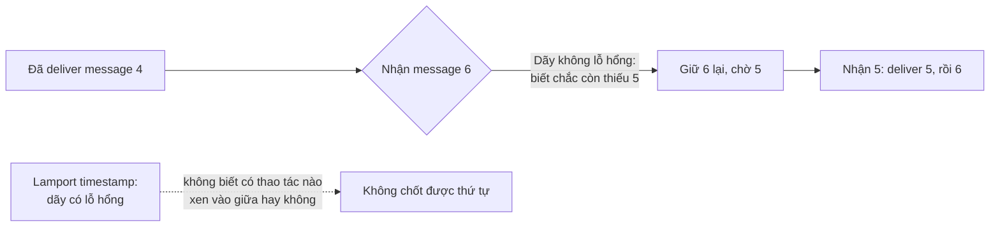

*(Sơ đồ do người viết ghi chú tổng hợp từ tr. 351–352.)*

**Khó cỡ nào?** (tr. 352). Làm một số nguyên linearizable với increment-and-get nguyên tử có khó không? Như thường lệ, nếu không bao giờ có lỗi thì **dễ**: cứ giữ nó trong **một biến trên một node**. Vấn đề nằm ở việc xử lý khi **kết nối mạng tới node đó bị gián đoạn**, và **khôi phục giá trị** khi node đó **hỏng** [59]. Nói chung, nếu suy nghĩ đủ kỹ về bộ sinh sequence number linearizable, **chắc chắn** bạn sẽ đi tới **một thuật toán consensus**.

<a id="consensus-equivalence"></a>

**Không phải trùng hợp: các bài toán tương đương** (tr. 352). Có thể **chứng minh** rằng **register compare-and-set (hoặc increment-and-get) linearizable** và **total order broadcast** đều **tương đương consensus** [28, 67]. Nghĩa là nếu giải được **một** bài, có thể **biến đổi** lời giải đó thành lời giải cho **các bài kia**. Đây là một nhận định **sâu sắc và bất ngờ**. Phần còn lại của chương đối diện trực tiếp với bài toán consensus.

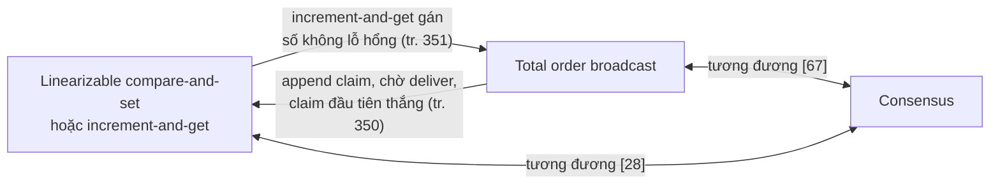

*(Sơ đồ do người viết ghi chú tổng hợp từ tr. 350–352.)*

---

<a id="b4"></a>

### B4. Distributed Transactions and Consensus (tr. 352–373)

<a id="consensus"></a>

#### B4.0 Consensus: bài toán tưởng dễ (tr. 352–353)

**What** (tr. 352). ***Consensus*** là một trong những bài toán **quan trọng và căn bản nhất** của tính toán phân tán. Bề ngoài nó **có vẻ đơn giản**: phi hình thức, mục tiêu chỉ là khiến **vài node đồng ý về một điều gì đó**. Bạn có thể nghĩ chuyện này không khó lắm. Tiếc là **nhiều hệ thống hỏng** đã được xây dựng với **niềm tin sai** rằng bài toán này dễ giải.

**Vì sao xuất hiện muộn trong sách** (tr. 352). Chủ đề này **khá tinh tế**, và để thấy được các điểm tinh tế cần **kiến thức tiền đề**. Ngay trong giới nghiên cứu, hiểu biết về consensus cũng chỉ **dần dần kết tinh qua nhiều thập kỷ**, với nhiều hiểu lầm trên đường đi. Giờ ta đã có đủ nền tảng: replication (Chương 5), transactions (Chương 7), system models (Chương 8), linearizability và total order broadcast (chương này).

**Khi nào các node cần đồng ý** (tr. 352–353):

<a id="leader-election"></a>

- ***Leader election.*** Database single-leader cần **mọi node đồng ý** node nào là leader. Vị trí leader có thể bị **tranh chấp** nếu vài node không liên lạc được với node khác do lỗi mạng. Khi đó consensus quan trọng để tránh một **failover tồi**, dẫn tới **split brain**: hai node cùng tin mình là leader ([chương 5, B1.3](chapter-05.md#failover-problems)). Có hai leader thì cả hai cùng nhận ghi, dữ liệu **phân kỳ**, dẫn tới **bất nhất và mất dữ liệu**.

<a id="atomic-commit"></a>

- ***Atomic commit.*** Database hỗ trợ transaction **trải trên nhiều node hay partition** gặp vấn đề: transaction có thể **thất bại trên node này** nhưng **thành công trên node kia**. Muốn giữ **atomicity** của transaction (theo nghĩa ACID, "Atomicity", tr. 223, [Chương 7](chapter-07.md#atomicity)), phải khiến mọi node **đồng ý về kết quả**: hoặc **tất cả abort/rollback** (nếu có gì sai), hoặc **tất cả commit** (nếu không có gì sai). Trường hợp này của consensus gọi là ***atomic commit problem***.

> Chú thích xii (tr. 353). Atomic commit được hình thức hóa **hơi khác** consensus: transaction **chỉ được commit** nếu **mọi** participant bỏ phiếu commit, và **phải abort** nếu **bất kỳ** participant nào cần abort. Còn consensus được phép quyết định **bất kỳ giá trị nào** do một participant đề xuất. Dù vậy, atomic commit và consensus **quy được về nhau** [70, 71]. ***Nonblocking*** atomic commit thì **khó hơn** consensus (xem [three-phase commit](#3pc), tr. 359).

<a id="flp"></a>

**Hộp "The Impossibility of Consensus"** (tr. 353).

- **What.** Có thể bạn đã nghe về ***FLP result*** [68], đặt theo tên ba tác giả **Fischer, Lynch và Paterson**. Kết quả này chứng minh **không có thuật toán nào luôn đạt được consensus** nếu có nguy cơ **một node crash**. Trong hệ phân tán ta phải giả định node có thể crash, vậy **consensus tin cậy là bất khả**. Thế mà ta vẫn đang bàn thuật toán đạt consensus. Chuyện gì đang xảy ra?
- **Lời giải thích.** FLP được chứng minh trong ***asynchronous system model*** ("System Model and Reality", tr. 306, [Chương 8](chapter-08.md#timing-models)): một mô hình **rất hạn chế**, giả định thuật toán **tất định** và **không được dùng đồng hồ hay timeout**.
  - Nếu thuật toán được dùng **timeout**, hoặc **cách khác để nghi ngờ** node đã crash (dù **đôi khi nghi sai**), thì consensus **giải được** [67].
  - Thậm chí chỉ cần cho thuật toán dùng **số ngẫu nhiên** là đủ để **vượt qua** kết quả bất khả thi [69].
- **Kết luận.** FLP có **tầm quan trọng lý thuyết lớn**, nhưng trên thực tế hệ phân tán **thường đạt được consensus**.

> **Bổ sung ngoài sách.**
> - Nhắc lại từ Chương 8 (tr. 306–307): ba mô hình thời gian là **synchronous** (delay, pause, sai lệch đồng hồ đều có giới hạn), **partially synchronous** (thường có giới hạn nhưng đôi khi vượt), và **asynchronous** (không giả định gì về thời gian, không có đồng hồ). Thuật toán consensus thực tế được thiết kế cho mô hình partially synchronous.
> - FLP không nói thuật toán consensus nào cũng sẽ **quyết sai**. Nó nói rằng trong mô hình asynchronous, mọi thuật toán tất định đều có **một kịch bản** mà nó **không bao giờ đi tới quyết định**. Vì vậy các thuật toán thực tế ưu tiên giữ **safety** mọi lúc, và chỉ bảo đảm **liveness** (đi tới quyết định) khi mạng "đủ ổn định" (xem [B4.3](#consensus-properties)).

**Lộ trình của phần này** (tr. 353):

1. Xem kỹ bài toán **atomic commit**, đặc biệt thuật toán ***two-phase commit* (2PC)**. Đây là cách **phổ biến nhất** để giải atomic commit, được cài trong nhiều database, hệ messaging và application server. Hóa ra **2PC là một dạng thuật toán consensus, nhưng không tốt lắm** [70, 71].
2. Học từ 2PC để đi tới các **thuật toán consensus tốt hơn**, như thuật toán của ZooKeeper (**Zab**) và etcd (**Raft**).

<a id="b4-1"></a>

#### B4.1 Atomic Commit and Two-Phase Commit (2PC) (tr. 354–359)

**Nhắc lại mục đích của atomicity** (tr. 354). Ở Chương 7, atomicity của transaction cung cấp **ngữ nghĩa đơn giản** khi có lỗi **giữa chừng** một loạt lần ghi. Kết quả của transaction chỉ có hai khả năng:

- **commit** thành công: **mọi** lần ghi của transaction trở nên **durable**;
- **abort**: **mọi** lần ghi của transaction bị **rollback** (hoàn tác hoặc bỏ đi).

Atomicity ngăn transaction thất bại **để lại** kết quả dở dang và trạng thái cập nhật nửa vời. Điều này **đặc biệt quan trọng** với **multi-object transaction** ("Single-Object and Multi-Object Operations", tr. 228) và database **có secondary index**. Mỗi secondary index là **một cấu trúc dữ liệu riêng** tách khỏi dữ liệu chính ([chương 3, B6](chapter-03.md#secondary-index)): sửa dữ liệu thì thay đổi tương ứng **cũng phải** được làm trên secondary index. Atomicity bảo đảm index **nhất quán** với dữ liệu chính; index không nhất quán thì không mấy hữu ích (tr. 354).

<a id="single-node-commit"></a>

**From single-node to distributed atomic commit** (tr. 354–355).

**Trên một node** (tr. 354):

1. Atomicity thường do **storage engine** cài.
2. Client yêu cầu node database commit transaction. Database làm các lần ghi của transaction **durable** (thường trong **write-ahead log**, "Making B-trees reliable", tr. 82, [chương 3, B4.3](chapter-03.md#wal)), rồi **append một commit record** vào log trên đĩa.
3. Database crash giữa chừng: khi node khởi động lại, transaction được **phục hồi từ log**. Nếu commit record **đã ghi xong** xuống đĩa trước khi crash, transaction được coi là **committed**; nếu chưa, mọi lần ghi của transaction bị **rollback**.

**Điểm quyết định trên một node** (tr. 354). Vậy trên một node, việc commit **phụ thuộc chặt chẽ** vào **thứ tự** dữ liệu được ghi durable xuống đĩa: **dữ liệu trước, commit record sau** [72]. Khoảnh khắc **then chốt** quyết định commit hay abort là lúc **đĩa ghi xong commit record**:

- **trước** khoảnh khắc đó, vẫn có thể abort (do crash);
- **sau** khoảnh khắc đó, transaction **đã committed** (kể cả khi database crash).

Nghĩa là **một thiết bị duy nhất** (controller của **một ổ đĩa cụ thể**, gắn với **một node cụ thể**) làm cho commit **atomic**.

```mermaid
flowchart LR
    A["Ghi dữ liệu của transaction<br/>vào write-ahead log"] --> B["Append commit record"]
    B --> C{"Đĩa ghi xong<br/>commit record?"}
    C -->|"Chưa, rồi crash"| D["Khi phục hồi: rollback"]
    C -->|"Rồi"| E["Committed, kể cả khi crash ngay sau đó"]
```

*(Sơ đồ do người viết ghi chú tổng hợp từ tr. 354.)*

**Khi có nhiều node** (tr. 354–355). Ví dụ một **multi-object transaction trong database partitioned**, hay một **term-partitioned secondary index** (index entry có thể nằm ở **node khác** với dữ liệu chính, "Partitioning and Secondary Indexes", tr. 206, [Chương 6](chapter-06.md#secondary-indexes)). Hầu hết datastore "NoSQL" phân tán **không hỗ trợ** distributed transaction như vậy, nhưng nhiều hệ relational dạng cluster thì **có** ([B4.2](#dist-tx-practice)).

**Vì sao không thể chỉ gửi commit tới mọi node** (tr. 354–355). Nếu gửi request commit tới mọi node và **mỗi node commit độc lập**, rất dễ xảy ra commit **thành công ở vài node, thất bại ở node khác**, vi phạm atomicity:

- Vài node **phát hiện vi phạm ràng buộc hay xung đột**, buộc phải abort, trong khi node khác commit được.
- Vài request commit **bị mất trên mạng**, cuối cùng abort do **timeout**, trong khi request khác tới nơi.
- Vài node **crash trước khi** commit record được ghi xong và **rollback khi phục hồi**, trong khi node khác commit thành công.

```mermaid
sequenceDiagram
    participant App as Ứng dụng
    participant N1 as Node 1
    participant N2 as Node 2
    App->>N1: commit
    App->>N2: commit
    N1-->>App: committed
    N2-->>App: abort: vi phạm ràng buộc
    Note over N1,N2: N1 đã commit, không rút lại được.<br/>Hai node bất nhất, atomicity bị phá
```

*(Ví dụ minh họa do AI xây dựng cho trường hợp thứ nhất ở tr. 355.)*

**Commit phải không thể thu hồi** (tr. 355):

- Node commit, node khác abort thì các node **bất nhất** với nhau (như Hình 7-3). Transaction đã commit trên một node thì **không rút lại được** nếu sau đó hóa ra nó bị abort ở node khác. Vì vậy, một node **chỉ được commit** khi **chắc chắn** mọi node khác trong transaction **cũng sẽ commit**.
- Commit transaction phải ***irrevocable***: không được **đổi ý** và **abort hồi tố** một transaction đã commit. Lý do: dữ liệu đã commit thì **visible với transaction khác**, nên client khác có thể **đã bắt đầu dựa vào** nó. Nguyên lý này là nền tảng của **read committed isolation** ("Read Committed", tr. 234). Nếu cho phép abort sau khi commit, mọi transaction đã đọc dữ liệu đó sẽ dựa trên dữ liệu **bị tuyên bố hồi tố là chưa từng tồn tại**, nên **cũng phải bị revert theo**.
- (Hiệu ứng của transaction đã commit **có thể** được hoàn tác về sau bằng một ***compensating transaction*** [73, 74]. Nhưng với database, đó là **một transaction riêng**, nên mọi yêu cầu về tính đúng **xuyên transaction** là **việc của ứng dụng**.)

> **Bổ sung ngoài sách.** Tài liệu [74] là bài báo "Sagas" (Garcia-Molina và Salem, 1987). Một *saga* chia một quy trình dài thành chuỗi transaction cục bộ; nếu một bước thất bại, các bước đã commit được hoàn tác bằng compensating transaction tương ứng (ví dụ "hủy đặt phòng" bù cho "đặt phòng"). Đúng như sách nói, tính đúng của cả chuỗi do ứng dụng chịu trách nhiệm, không phải do database.

<a id="2pc"></a>

**Introduction to two-phase commit** (tr. 355–357).

**What** (tr. 355). ***Two-phase commit* (2PC)** là thuật toán đạt **atomic commit** trên **nhiều node**: bảo đảm **hoặc mọi node commit, hoặc mọi node abort**. Đây là thuật toán **kinh điển** của database phân tán [13, 35, 75]. 2PC được dùng **nội bộ** trong một số database, và được đưa tới ứng dụng dưới dạng **XA transaction** [76, 77] (ví dụ Java Transaction API hỗ trợ) hoặc **WS-AtomicTransaction** cho SOAP web service [78, 79].

**How — luồng cơ bản (Hình 9-9)** (tr. 355–356). Thay vì **một** request commit như transaction một node, quá trình commit/abort trong 2PC được chia thành **hai pha** (vì thế có tên).

**Ghi chú "Don't confuse 2PC and 2PL"** (tr. 356). **Two-phase commit** (2PC) và **two-phase locking** ("Two-Phase Locking (2PL)", tr. 257) là **hai thứ rất khác nhau**. 2PC cung cấp **atomic commit** trong database phân tán; 2PL cung cấp **serializable isolation**. Để tránh nhầm, tốt nhất coi chúng là **hai khái niệm hoàn toàn tách biệt** và **bỏ qua** sự giống nhau đáng tiếc về tên gọi.

**Thành phần mới: coordinator** (tr. 356). 2PC dùng một thành phần **không có** trong transaction một node: ***coordinator*** (còn gọi ***transaction manager***).

- Coordinator thường được cài như **một thư viện** nằm **trong cùng tiến trình ứng dụng** yêu cầu transaction (ví dụ nhúng trong một Java EE container), nhưng cũng có thể là **tiến trình hay service riêng**.
- Ví dụ coordinator: **Narayana, JOTM, BTM, MSDTC**.

**Các bước** (tr. 356):

1. Transaction 2PC bắt đầu với việc ứng dụng **đọc và ghi** dữ liệu trên **nhiều node database** như bình thường. Các node này gọi là ***participants*** của transaction.
2. Khi ứng dụng sẵn sàng commit, coordinator bắt đầu **pha 1**: gửi ***prepare request*** tới từng node, hỏi chúng **có commit được không**. Coordinator theo dõi phản hồi:
   - **Mọi** participant trả lời **"yes"** (sẵn sàng commit): coordinator gửi ***commit request*** ở **pha 2**, và commit **thực sự diễn ra**.
   - **Bất kỳ** participant nào trả lời **"no"**: coordinator gửi ***abort request*** tới **mọi node** ở pha 2.

```mermaid
sequenceDiagram
    participant C as Coordinator
    participant D1 as Database 1
    participant D2 as Database 2
    C->>D1: write data
    D1-->>C: ok
    C->>D2: write data
    D2-->>C: ok
    Note over D1,D2: Từ đây mỗi database giữ lock của transaction
    Note over C,D2: Pha 1
    C->>D1: prepare
    C->>D2: prepare
    D1-->>C: yes
    D2-->>C: yes
    Note over C,D2: Pha 2
    C->>D1: commit
    C->>D2: commit
    D1-->>C: ok
    D2-->>C: ok
    Note over D1,D2: Nhả lock sau khi commit
```

*(Vẽ lại Hình 9-9, tr. 356. Trong hình gốc, vạch xám "locks held by transaction" trên mỗi database kéo dài từ lần ghi dữ liệu tới lúc nhận commit.)*

**Ẩn dụ lễ cưới** (tr. 356–357). Quá trình này hơi giống **lễ cưới truyền thống phương Tây**: chủ lễ hỏi **riêng** cô dâu và chú rể có muốn cưới người kia không, và thường nhận câu "I do" từ **cả hai**. Nhận đủ hai xác nhận, chủ lễ tuyên bố hai người thành vợ chồng: **transaction được commit**, và tin vui được **broadcast** tới mọi khách mời. Nếu cô dâu hoặc chú rể **không** nói "yes", buổi lễ bị **abort** [73].

<a id="system-of-promises"></a>

**A system of promises** (tr. 357–358).

**Câu hỏi** (tr. 357). Mô tả ngắn trên chưa cho thấy **vì sao** 2PC bảo đảm atomicity còn commit **một pha** trên nhiều node thì không. Prepare và commit **cũng có thể bị mất** như thường. 2PC khác ở đâu? Phải chia quá trình thành các bước chi tiết hơn:

1. **Xin transaction ID toàn cục.** Ứng dụng muốn bắt đầu distributed transaction thì xin một **transaction ID** từ coordinator. ID này **duy nhất toàn cục**.
2. **Mở transaction trên từng participant.** Ứng dụng bắt đầu **một single-node transaction** trên mỗi participant và **gắn global transaction ID** vào. Mọi đọc ghi được làm trong các single-node transaction này. Nếu có gì sai ở giai đoạn này (node crash, request timeout), **coordinator hoặc bất kỳ participant nào** cũng có thể **abort**.
3. **Prepare.** Ứng dụng sẵn sàng commit: coordinator gửi **prepare** tới **mọi** participant, gắn global ID. Nếu **bất kỳ** request nào **lỗi hoặc timeout**, coordinator gửi **abort** cho transaction ID đó tới **mọi** participant.
4. **Participant hứa.** Participant nhận prepare thì bảo đảm **chắc chắn commit được trong mọi hoàn cảnh**: **ghi mọi dữ liệu** của transaction xuống đĩa (crash, mất điện hay **hết dung lượng đĩa** **không phải lý do chấp nhận được** để từ chối commit về sau), và **kiểm tra** mọi xung đột hay vi phạm ràng buộc. Trả lời **"yes"** cho coordinator nghĩa là participant **hứa** sẽ commit **không lỗi** nếu được yêu cầu. Nói cách khác, participant **từ bỏ quyền abort**, nhưng **chưa thực sự commit**.
5. **Coordinator quyết định: commit point.** Nhận đủ phản hồi prepare, coordinator đưa ra **quyết định dứt khoát** commit hay abort (**chỉ commit khi mọi participant bỏ phiếu "yes"**). Coordinator **phải ghi quyết định** vào **transaction log trên đĩa**, để biết mình đã quyết gì nếu sau đó crash. Thời điểm này gọi là ***commit point***.
6. **Thực thi quyết định, thử lại mãi mãi.** Khi quyết định đã ghi xuống đĩa, request commit hoặc abort được gửi tới **mọi** participant. Nếu request **lỗi hoặc timeout**, coordinator **phải thử lại mãi** cho tới khi thành công. **Không còn đường lui**: đã quyết commit thì quyết định đó **phải được thực thi**, bất kể bao nhiêu lần thử. Nếu một participant crash trong lúc đó, transaction sẽ được commit **khi nó phục hồi**: participant đã bỏ phiếu "yes" nên **không được từ chối** commit khi phục hồi (tr. 357–358).

**Hai điểm không thể quay lại** (tr. 358). Giao thức có hai ***points of no return*** quyết định:

- Khi participant bỏ phiếu **"yes"**, nó **hứa** chắc chắn commit được về sau (dù coordinator **vẫn có thể** chọn abort).
- Khi coordinator **đã quyết định**, quyết định đó **không thể thu hồi**.

Chính các **lời hứa** này bảo đảm atomicity của 2PC. (Atomic commit trên một node **gộp hai sự kiện này làm một**: ghi commit record vào transaction log.)

```mermaid
flowchart TD
    W["Participant: đọc ghi trong<br/>single-node transaction"] -->|"lỗi ở giai đoạn này"| AB1["Ai cũng có thể abort"]
    W -->|"nhận prepare"| P{"Ghi hết xuống đĩa,<br/>kiểm tra ràng buộc: ổn?"}
    P -->|"Không"| NO["Bỏ phiếu no"]
    P -->|"Có"| YES["Bỏ phiếu yes:<br/>điểm không quay lại thứ nhất,<br/>mất quyền tự abort"]
    NO --> DEC["Coordinator quyết định<br/>và ghi vào log trên đĩa:<br/>commit point, điểm không quay lại thứ hai"]
    YES --> DEC
    DEC -->|"mọi phiếu yes"| CM["Gửi commit, thử lại mãi tới khi xong"]
    DEC -->|"có phiếu no hoặc timeout"| AB2["Gửi abort tới mọi participant"]
```

*(Sơ đồ do người viết ghi chú tổng hợp từ sáu bước ở tr. 357–358.)*

**Trở lại ẩn dụ lễ cưới** (tr. 358). **Trước** khi nói "I do", bạn và người kia **còn tự do abort** bằng một câu "Không đời nào!" (hay tương tự). Nhưng **sau** khi nói "I do", bạn **không rút lại** được. Nếu bạn **ngất xỉu** ngay sau khi nói "I do" và không nghe chủ lễ tuyên bố "Hai người giờ là vợ chồng", điều đó **không thay đổi** việc transaction **đã commit**. Khi tỉnh lại, bạn có thể **hỏi chủ lễ** trạng thái của global transaction ID của mình, hoặc **chờ lần thử lại** tiếp theo của request commit từ chủ lễ (việc thử lại vẫn tiếp tục trong suốt lúc bạn bất tỉnh).

<a id="coordinator-failure"></a>

**Coordinator failure** (tr. 358–359).

**Đã rõ khi participant hay mạng hỏng** (tr. 358). Prepare lỗi hay timeout thì coordinator **abort**; commit hay abort lỗi thì coordinator **thử lại vô hạn**. Điều **kém rõ** hơn là chuyện gì xảy ra khi **coordinator crash**.

**Lập luận theo thời điểm coordinator hỏng** (tr. 358):

- Coordinator hỏng **trước khi gửi prepare**: participant có thể **abort an toàn**.
- Participant **đã nhận prepare và bỏ phiếu "yes"**: nó **không được đơn phương abort** nữa; nó **phải chờ** coordinator báo transaction được commit hay abort. Nếu coordinator crash hoặc mạng hỏng **vào lúc này**, participant **chỉ biết chờ**. Transaction của participant ở trạng thái này gọi là ***in doubt*** hay ***uncertain***.

**Example — Hình 9-10** (tr. 358–359). Coordinator **thực ra đã quyết commit**, và database 2 **đã nhận** request commit. Nhưng coordinator **crash trước khi** gửi được commit tới database 1, nên database 1 **không biết** nên commit hay abort.

- **Timeout cũng không giúp được.** Nếu database 1 **đơn phương abort** sau timeout, nó sẽ **bất nhất** với database 2, vốn **đã commit**.
- **Đơn phương commit cũng không an toàn**, vì một participant khác **có thể đã abort**.

```mermaid
sequenceDiagram
    participant C as Coordinator
    participant D1 as Database 1
    participant D2 as Database 2
    C->>D1: write data
    D1-->>C: ok
    C->>D2: write data
    D2-->>C: ok
    Note over C,D2: Pha 1
    C->>D1: prepare
    C->>D2: prepare
    D1-->>C: yes
    D2-->>C: yes
    Note over C,D2: Pha 2: coordinator đã quyết commit
    C->>D2: commit
    D2-->>C: ok
    Note over C: Crash trước khi gửi commit tới Database 1
    Note over D1: Kẹt ở trạng thái prepared:<br/>không biết commit hay abort
```

*(Vẽ lại Hình 9-10, tr. 359.)*

**Vì sao chỉ có thể chờ** (tr. 359). Không nghe được coordinator, participant **không có cách nào** biết nên commit hay abort. Về nguyên tắc, các participant có thể **trao đổi với nhau** để biết mỗi bên đã bỏ phiếu gì và đi tới một thỏa thuận, nhưng việc đó **không thuộc giao thức 2PC**.

**Cách duy nhất để 2PC hoàn tất là chờ coordinator phục hồi** (tr. 359). Đây là lý do coordinator **phải ghi quyết định commit hay abort vào transaction log trên đĩa trước khi** gửi request commit hay abort tới participant:

- Khi phục hồi, coordinator xác định trạng thái của **mọi transaction in doubt** bằng cách **đọc transaction log** của mình.
- Transaction nào **không có commit record** trong log của coordinator thì **bị abort**.
- Vậy commit point của 2PC **quy về một atomic commit bình thường trên một node**: node của coordinator.

<a id="3pc"></a>

**Three-phase commit** (tr. 359).

- **Blocking.** 2PC gọi là ***blocking atomic commit protocol***, vì nó có thể **kẹt** chờ coordinator phục hồi. Về lý thuyết, có thể làm giao thức atomic commit ***nonblocking***, để nó **không kẹt** khi một node hỏng. Nhưng làm được điều đó trong thực tế **không đơn giản**.
- **3PC và giả định của nó.** Thay thế cho 2PC, thuật toán ***three-phase commit* (3PC)** đã được đề xuất [13, 80]. Nhưng 3PC giả định mạng có **delay giới hạn** và node có **thời gian phản hồi giới hạn**. Trong hầu hết hệ thực tế, với **network delay không giới hạn** và **process pause** ([Chương 8](chapter-08.md)), 3PC **không bảo đảm được atomicity**.
- **Điều kiện tổng quát.** Nonblocking atomic commit cần một ***perfect failure detector*** [67, 71]: cơ chế **tin cậy** để biết một node **đã crash hay chưa**. Trong mạng có delay không giới hạn, **timeout không phải** failure detector tin cậy: request có thể timeout do **sự cố mạng** dù **không node nào crash**.
- **Kết quả.** Vì vậy 2PC **vẫn tiếp tục được dùng**, dù vấn đề coordinator hỏng đã được biết rõ.

> **Bổ sung ngoài sách.** Ý tưởng của 3PC (Skeen, 1981, tài liệu [80]) là chèn thêm một pha "pre-commit" giữa pha bỏ phiếu và pha commit: coordinator chỉ gửi commit sau khi mọi participant đã biết quyết định là commit. Khi coordinator im lặng, participant dùng **timeout** để tự đi tới kết luận. Cơ chế này chỉ đúng nếu timeout phản ánh **chắc chắn** việc node đã chết, tức đúng cái giả định "delay giới hạn" mà sách nói là không có trong mạng thực tế.

<a id="dist-tx-practice"></a>

#### B4.2 Distributed Transactions in Practice (tr. 360–364)

**Danh tiếng lẫn lộn** (tr. 360). Distributed transaction, đặc biệt loại cài bằng 2PC, có danh tiếng **trái chiều**:

- **Một mặt**, chúng cung cấp một **đảm bảo an toàn quan trọng**, khó đạt bằng cách khác.
- **Mặt khác**, chúng bị chê là **gây vấn đề vận hành**, **giết hiệu năng**, và **hứa nhiều hơn khả năng** [81, 82, 83, 84]. Nhiều **cloud service** chọn **không cài** distributed transaction vì các vấn đề vận hành chúng gây ra [85, 86].

**Chi phí hiệu năng** (tr. 360). Một số bản cài chịu **phạt hiệu năng nặng**: distributed transaction trong **MySQL** được báo cáo **chậm hơn single-node transaction hơn 10 lần** [87], nên không lạ khi nhiều người khuyên không dùng. Phần lớn chi phí cố hữu của 2PC đến từ:

- các lần **ép ghi đĩa (fsync)** thêm, cần cho crash recovery [88];
- các **round-trip mạng** thêm.

**Đừng gạt bỏ ngay** (tr. 360). Thay vì bác bỏ distributed transaction, nên xem kỹ hơn vì có **bài học quan trọng**. Trước hết phải nói **chính xác** "distributed transaction" là gì. Hai loại **rất khác nhau** thường bị **lẫn lộn**:

<a id="internal-vs-heterogeneous"></a>

| | ***Database-internal distributed transaction*** | ***Heterogeneous distributed transaction*** |
| --- | --- | --- |
| **What** | Một số database phân tán (dùng replication và partitioning trong cấu hình chuẩn) hỗ trợ transaction **nội bộ giữa các node** của database đó | Participant là **hai hay nhiều công nghệ khác nhau**: hai database của **hai hãng**, hoặc cả hệ **không phải database** như **message broker** |
| **Ví dụ** | **VoltDB**, storage engine **NDB** của MySQL Cluster | Database và message broker cùng tham gia một transaction |
| **Đặc điểm** | Mọi node **chạy cùng phần mềm**. Không cần tương thích với hệ nào khác, nên dùng được **giao thức bất kỳ** và **tối ưu riêng** cho công nghệ đó | Phải bảo đảm atomic commit **dù bên trong các hệ hoàn toàn khác nhau** |
| **Thực tế** | Thường chạy **khá tốt** | **Thách thức hơn nhiều** |

<a id="exactly-once"></a>

**Exactly-once message processing** (tr. 360–361).

- **What.** Heterogeneous distributed transaction cho phép **tích hợp** các hệ khác nhau theo cách **mạnh mẽ**. Ví dụ: một message từ message queue được **xác nhận đã xử lý** **khi và chỉ khi** transaction database xử lý message đó **commit thành công**.
- **How.** Commit **nguyên tử** việc **xác nhận message** và **các lần ghi database** trong **một transaction**. Có distributed transaction thì làm được, **kể cả khi** broker và database là **hai công nghệ không liên quan** chạy trên **máy khác nhau**.
- **Why có tác dụng.** Nếu việc deliver message **hoặc** transaction database thất bại, **cả hai bị abort**, nên broker có thể **an toàn gửi lại** message sau. Bằng cách commit nguyên tử message **cùng với side effect** của việc xử lý nó, ta bảo đảm message được xử lý **hiệu quả đúng một lần** (*effectively exactly once*), dù có thể phải thử vài lần mới thành công. Abort **bỏ đi mọi side effect** của transaction dở dang (tr. 361).
- **Giới hạn.** Chỉ được nếu **mọi hệ bị transaction ảnh hưởng** đều dùng **cùng một giao thức atomic commit**. Ví dụ side effect của việc xử lý message là **gửi email**, và email server **không hỗ trợ 2PC**: email có thể bị gửi **hai lần hoặc hơn** nếu xử lý message thất bại rồi thử lại. Nhưng nếu **mọi** side effect được rollback khi abort, bước xử lý có thể thử lại **an toàn như chưa có gì xảy ra**.
- Sách quay lại chủ đề exactly-once ở Chương 11.

```mermaid
sequenceDiagram
    participant MB as Message broker
    participant App as Consumer và coordinator
    participant DB as Database
    MB->>App: deliver message m
    App->>DB: ghi kết quả xử lý m (cùng transaction ID)
    App->>MB: chuẩn bị xác nhận m (cùng transaction ID)
    App->>DB: prepare
    App->>MB: prepare
    DB-->>App: yes
    MB-->>App: yes
    App->>DB: commit
    App->>MB: commit: m được xác nhận
    Note over MB,DB: Lỗi ở bất kỳ bước nào trước commit thì cả hai abort,<br/>broker gửi lại m, không có side effect thừa
```

*(Ví dụ minh họa do AI xây dựng theo mô tả ở tr. 360–361.)*

<a id="xa"></a>

**XA transactions** (tr. 361–362).

- **What.** ***X/Open XA*** (viết tắt của *eXtended Architecture*) là **chuẩn** cài two-phase commit **xuyên các công nghệ không đồng nhất** [76, 77]. Ra đời năm **1991** và được cài **rộng rãi**: nhiều relational database truyền thống (**PostgreSQL, MySQL, DB2, SQL Server, Oracle**) và message broker (**ActiveMQ, HornetQ, MSMQ, IBM MQ**) hỗ trợ XA (lúc viết sách).
- **XA không phải network protocol.** Nó **chỉ là một C API** để giao tiếp với transaction coordinator. API này có binding cho ngôn ngữ khác; ví dụ trong thế giới **Java EE**, XA transaction được cài bằng **Java Transaction API (JTA)**, được hỗ trợ bởi nhiều driver database dùng **JDBC** và driver message broker dùng **JMS** API.
- **Driver và callback.** XA giả định ứng dụng dùng **network driver** hay **client library** để giao tiếp với database hay messaging service tham gia. Driver hỗ trợ XA nghĩa là nó **gọi XA API** để biết một thao tác có thuộc distributed transaction không, và nếu có thì gửi thông tin cần thiết tới database server. Driver cũng cung cấp **callback** để coordinator yêu cầu participant **prepare, commit hoặc abort**.
- **Coordinator thường là một thư viện** (tr. 362). Transaction coordinator **cài XA API**. Chuẩn **không quy định** cài thế nào, nhưng thực tế coordinator thường **chỉ là một thư viện** nạp vào **cùng tiến trình** với ứng dụng phát ra transaction (không phải service riêng). Nó theo dõi các participant, **thu phản hồi** sau khi yêu cầu prepare (qua callback vào driver), và dùng **một log trên đĩa cục bộ** để ghi quyết định commit hay abort cho từng transaction.
- **Khi tiến trình ứng dụng chết** (tr. 362). Tiến trình ứng dụng crash, hay máy chạy ứng dụng chết, thì **coordinator chết theo**. Participant nào có transaction **đã prepare nhưng chưa commit** sẽ **kẹt in doubt**. Log của coordinator nằm trên **đĩa cục bộ của application server**, nên **server đó phải được khởi động lại**, và thư viện coordinator phải **đọc log** để khôi phục kết quả commit hay abort của từng transaction. **Chỉ khi đó** coordinator mới dùng callback XA của driver để yêu cầu participant commit hay abort. **Database server không liên lạc trực tiếp** được với coordinator, vì mọi giao tiếp phải **đi qua client library** của nó.

```mermaid
flowchart LR
    subgraph AP["Tiến trình ứng dụng (application server)"]
        APP["Code ứng dụng"] --> COORD["Thư viện coordinator<br/>(cài XA API, JTA)"]
        COORD --> LOG[("Log quyết định<br/>trên đĩa cục bộ")]
        COORD --> DRV1["Driver JDBC có XA"]
        COORD --> DRV2["Driver JMS có XA"]
    end
    DRV1 -->|"prepare, commit, abort<br/>qua callback"| DB[("Database server")]
    DRV2 -->|"prepare, commit, abort<br/>qua callback"| MQ[("Message broker")]
    DB -.->|"không gọi ngược coordinator được"| COORD
```

*(Sơ đồ do người viết ghi chú tổng hợp từ tr. 361–362. Đường chấm chỉ một khả năng không tồn tại: database chỉ nói chuyện qua client library.)*

<a id="in-doubt-locks"></a>

**Holding locks while in doubt** (tr. 362).

**Câu hỏi** (tr. 362). Vì sao lại lo lắng nhiều về transaction **kẹt in doubt**? Phần còn lại của hệ thống không thể cứ làm việc và **bỏ qua** transaction in doubt, rồi nó sẽ được dọn dẹp sau?

**Vấn đề là lock** (tr. 362):

1. Như "Read Committed" (tr. 234), transaction database thường lấy **row-level exclusive lock** trên mọi hàng nó sửa, để **ngăn dirty write**. Nếu muốn **serializable isolation**, database dùng two-phase locking còn phải lấy **shared lock** trên mọi hàng transaction **đọc** (tr. 257).
2. Database **không nhả** được các lock đó **cho tới khi** transaction commit hoặc abort (vùng tô xám ở Hình 9-9).
3. Vì vậy, khi dùng 2PC, transaction phải **giữ lock suốt thời gian in doubt**. Coordinator crash và mất **20 phút** để khởi động lại thì lock bị giữ **20 phút**. Nếu log của coordinator **mất hẳn** vì lý do nào đó, lock bị giữ **mãi mãi**, hoặc ít nhất tới khi **admin xử lý thủ công**.
4. Trong lúc lock bị giữ, **không transaction nào khác sửa được** các hàng đó. Tùy database, transaction khác có thể **còn bị chặn đọc** các hàng đó.
5. Vậy transaction khác **không thể** cứ làm việc như thường: muốn truy cập cùng dữ liệu là **bị chặn**. Điều này có thể khiến **phần lớn ứng dụng không sẵn sàng** cho tới khi transaction in doubt được giải quyết.

<a id="heuristic-decisions"></a>

**Recovering from coordinator failure** (tr. 363).

- **Lý thuyết và thực tế.** Về lý thuyết, coordinator crash rồi khởi động lại thì phải **khôi phục sạch sẽ** trạng thái từ log và giải quyết mọi transaction in doubt. Thực tế, ***orphaned in-doubt transaction*** **có xảy ra** [89, 90]: transaction mà coordinator **không quyết được kết quả** vì lý do nào đó (ví dụ transaction log **bị mất hay hỏng** do bug phần mềm). Chúng **không được giải quyết tự động**, nên **nằm mãi** trong database, **giữ lock** và **chặn** transaction khác.
- **Reboot database cũng vô ích.** Bản cài 2PC **đúng** phải **giữ lock** của transaction in doubt **qua cả lần khởi động lại** (nếu không sẽ có nguy cơ vi phạm atomicity). Tình huống rất **khó gỡ**.
- **Lối thoát: admin quyết định thủ công.** Admin phải xem các participant của **từng** transaction in doubt, xác định có participant nào **đã commit hoặc abort** chưa, rồi **áp dụng cùng kết quả** cho các participant còn lại. Việc này có thể tốn **rất nhiều công sức thủ công**, và nhiều khả năng phải làm **dưới áp lực cao và gấp rút** trong một **sự cố production nghiêm trọng** (nếu không thì vì sao coordinator lại rơi vào trạng thái tồi tệ như vậy?).
- ***Heuristic decisions.*** Nhiều bản cài XA có một **lối thoát khẩn cấp** gọi là *heuristic decision*: cho phép participant **đơn phương** quyết định abort hay commit một transaction in doubt **mà không cần** quyết định dứt khoát từ coordinator [76, 77, 91]. Nói rõ: *heuristic* ở đây là cách nói **giảm nhẹ** cho "**có lẽ phá vỡ atomicity**", vì nó vi phạm **hệ thống lời hứa** của 2PC. Heuristic decision chỉ dành để **thoát khỏi tình huống thảm họa**, **không** dùng thường xuyên.

<a id="dist-tx-limits"></a>

**Limitations of distributed transactions** (tr. 363–364).

**Nhận định then chốt** (tr. 363). XA transaction giải quyết một bài toán **thật và quan trọng**: giữ nhiều hệ dữ liệu participant **nhất quán với nhau**. Nhưng chúng cũng gây **vấn đề vận hành lớn**. Nhận định then chốt: **transaction coordinator tự nó là một loại database** (nơi lưu kết quả transaction), nên phải được đối xử **cẩn thận như mọi database quan trọng khác**:

1. **Single point of failure.** Nếu coordinator **không được nhân bản** mà chỉ chạy trên **một máy**, nó là **điểm hỏng đơn** cho **cả hệ thống** (hỏng thì các application server khác bị **chặn** bởi lock của transaction in doubt). Đáng ngạc nhiên là nhiều bản cài coordinator **mặc định không highly available**, hoặc chỉ hỗ trợ replication **sơ sài**.
2. **Application server không còn stateless** (tr. 363–364). Nhiều ứng dụng server-side được phát triển theo mô hình **stateless** (được HTTP ưa chuộng), mọi trạng thái bền vững nằm trong database, nhờ đó application server có thể được **thêm bớt tùy ý**. Nhưng khi coordinator là **một phần** của application server, bản chất triển khai **thay đổi**: log của coordinator đột nhiên trở thành **một phần thiết yếu** của trạng thái durable của hệ thống, **quan trọng ngang database**, vì cần nó để **phục hồi** transaction in doubt sau crash. Application server như vậy **không còn stateless**.
3. **Mẫu số chung nhỏ nhất** (tr. 364). XA phải tương thích với **rất nhiều** hệ dữ liệu, nên nó buộc phải là **lowest common denominator**. Ví dụ nó **không phát hiện được deadlock** xuyên các hệ khác nhau (việc này cần một giao thức chuẩn để các hệ trao đổi thông tin về lock mà mỗi transaction đang chờ), và **không chạy được với SSI** (tr. 261), vì SSI cần một giao thức để **nhận diện xung đột** xuyên các hệ khác nhau.
4. **Khuếch đại lỗi** (tr. 364). Với distributed transaction **nội bộ database** (không phải XA), giới hạn **ít hơn**: ví dụ có thể có **SSI phân tán**. Nhưng vẫn còn vấn đề: để 2PC commit thành công, **mọi participant phải phản hồi**. Vì vậy nếu **bất kỳ phần nào** của hệ thống hỏng, transaction **cũng thất bại**. Distributed transaction có xu hướng **khuếch đại lỗi** (*amplifying failures*), **ngược với mục tiêu** xây hệ chịu lỗi.

> **Ví dụ minh họa do AI xây dựng (phép tính).** Giả sử mỗi participant sẵn sàng 99,9% thời gian và hỏng độc lập. Một transaction 2PC cần **cả k participant** phản hồi, nên xác suất commit được là 0,999^k: với k = 5 là khoảng 99,5%, với k = 10 là khoảng 99,0%. Thêm participant làm hệ **kém** sẵn sàng hơn, trái ngược với replication có quorum, nơi thêm node làm hệ **chịu lỗi tốt hơn**. Phép tính này minh họa câu "khuếch đại lỗi" ở tr. 364.

**Có nên từ bỏ?** (tr. 364). Các sự thật này có nghĩa là phải **từ bỏ hy vọng** giữ nhiều hệ thống nhất quán với nhau không? **Không hẳn**: có những phương pháp khác đạt **cùng mục tiêu** mà **không đau đớn** như heterogeneous distributed transaction. Sách quay lại chúng ở **Chương 11 và 12**. Nhưng trước hết cần kết thúc chủ đề consensus.

<a id="fault-tolerant-consensus"></a>

#### B4.3 Fault-Tolerant Consensus (tr. 364–369)

**Phi hình thức** (tr. 364). Consensus là khiến **nhiều node đồng ý** về một điều gì đó. Ví dụ: nhiều người **đồng thời** cố đặt **ghế cuối cùng** trên máy bay, hay **cùng một ghế** trong nhà hát, hay cố đăng ký tài khoản với **cùng một username**. Thuật toán consensus có thể dùng để quyết định thao tác nào trong các thao tác **loại trừ nhau** này là **người thắng**.

**Hình thức hóa** (tr. 364). Một hay nhiều node có thể **đề xuất** (*propose*) giá trị, và thuật toán consensus **quyết định** (*decide*) **một** trong các giá trị đó. Trong ví dụ đặt ghế, khi nhiều khách cùng mua ghế cuối, mỗi node xử lý request của một khách có thể **đề xuất ID của khách** nó đang phục vụ, và **quyết định** cho biết khách nào được ghế.

<a id="consensus-properties"></a>

**Bốn thuộc tính** (tr. 365). Trong hình thức hóa này, thuật toán consensus phải thỏa [25]:

| Thuộc tính | Phát biểu | Loại |
| --- | --- | --- |
| ***Uniform agreement*** | **Không có hai node nào quyết định khác nhau** | Safety |
| ***Integrity*** | **Không node nào quyết định hai lần** | Safety |
| ***Validity*** | Nếu một node quyết định giá trị v, thì v **đã được một node nào đó đề xuất** | Safety |
| ***Termination*** | **Mọi node không crash** cuối cùng **đều quyết định** được một giá trị nào đó | Liveness |

> Chú thích xiii (tr. 365). Biến thể consensus cụ thể này gọi là ***uniform consensus***, **tương đương** consensus thông thường trong hệ **asynchronous** với **failure detector không tin cậy** [71]. Tài liệu học thuật thường nói *process* thay vì *node*, nhưng sách dùng *node* cho nhất quán với phần còn lại.

**Ý nghĩa từng thuộc tính** (tr. 365):

- **Agreement và integrity** là **cốt lõi** của consensus: **mọi người quyết cùng một kết quả**, và **đã quyết thì không đổi ý**.
- **Validity** chủ yếu để **loại các lời giải tầm thường**. Ví dụ một thuật toán **luôn quyết null** bất kể ai đề xuất gì: nó thỏa agreement và integrity, nhưng **không thỏa validity**.
- **Ba thuộc tính đầu thì dễ, nếu không cần chịu lỗi.** Chỉ cần **hardcode một node làm "độc tài"** và để node đó quyết mọi thứ. Nhưng node đó hỏng thì hệ thống **không quyết được gì nữa**. Đây chính là điều đã thấy ở **2PC**: coordinator hỏng thì participant in doubt **không quyết được** commit hay abort.
- **Termination hình thức hóa fault tolerance.** Về bản chất nó nói: thuật toán consensus **không được ngồi yên mãi** mà **phải tiến triển**. Dù vài node hỏng, **các node khác vẫn phải đi tới quyết định**. (Termination là ***liveness property***, ba thuộc tính kia là ***safety property***; xem "Safety and liveness", tr. 308, [Chương 8](chapter-08.md#safety-liveness).)

**Mô hình crash của consensus** (tr. 365). Mô hình hệ thống của consensus giả định node "crash" thì **biến mất đột ngột và không bao giờ quay lại**. (Thay vì crash phần mềm, hãy hình dung một **trận động đất**, và datacenter chứa node của bạn bị **lở đất phá hủy**. Bạn phải giả định node đang nằm dưới **30 feet (khoảng 9 mét) bùn** và **không bao giờ online trở lại**.) Trong mô hình này, **mọi thuật toán phải chờ node phục hồi** đều **không thỏa termination**. Đặc biệt, **2PC không đáp ứng yêu cầu termination**.

**Cần đa số node còn sống** (tr. 366). Nếu **mọi node crash** thì không thuật toán nào quyết được gì. Có **giới hạn** số node hỏng mà thuật toán chịu được: chứng minh được rằng **mọi thuật toán consensus** cần **ít nhất đa số node** chạy đúng để bảo đảm termination [67]. Đa số đó có thể tạo thành một **quorum** an toàn ([chương 5, B4.2](chapter-05.md#quorums), tr. 179).

**Safety vẫn giữ khi đa số hỏng** (tr. 366). Vậy termination dựa trên giả định **ít hơn một nửa** số node crash hoặc không với tới được. Nhưng **hầu hết** bản cài consensus bảo đảm các **safety property** (agreement, integrity, validity) **luôn** được thỏa, **kể cả khi đa số node hỏng** hay mạng gặp sự cố nghiêm trọng [92]. Một sự cố lớn có thể làm hệ thống **ngừng xử lý request**, nhưng **không thể làm hỏng** hệ consensus bằng cách khiến nó ra **quyết định sai**.

**Không có Byzantine fault** (tr. 366). Hầu hết thuật toán consensus giả định **không có Byzantine fault** ("Byzantine Faults", tr. 304, [Chương 8](chapter-08.md#byzantine)). Nghĩa là nếu một node **không tuân thủ đúng giao thức** (ví dụ gửi **message mâu thuẫn** cho các node khác nhau), nó có thể **phá safety** của giao thức. Có thể làm consensus **chịu được Byzantine fault**, miễn là **ít hơn một phần ba** số node bị Byzantine-faulty [25, 93], nhưng sách không bàn chi tiết các thuật toán đó.

> **Bổ sung ngoài sách (phép tính).** Với lỗi crash, n node chịu được f node hỏng khi n ≥ 2f + 1 (phần còn lại vẫn là đa số). Với Byzantine fault, cần n ≥ 3f + 1.
>
> | Số node n | Đa số cần có | Chịu được (crash) | Chịu được (Byzantine) |
> | --- | --- | --- | --- |
> | 3 | 2 | 1 | 0 |
> | 4 | 3 | 1 | 1 |
> | 5 | 3 | 2 | 1 |
> | 7 | 4 | 3 | 2 |
>
> Hàng n = 4 cho thấy thêm node thứ tư **không** tăng số lỗi crash chịu được so với n = 3, nên cluster consensus thường có số node **lẻ**. Hai hàng n = 3 và n = 5 khớp với ví dụ ở tr. 369.

<a id="consensus-tob"></a>

**Consensus algorithms and total order broadcast** (tr. 366–367).

**Các thuật toán nổi tiếng** (tr. 366). Các thuật toán consensus chịu lỗi được biết đến nhiều nhất là ***Viewstamped Replication* (VSR)** [94, 95], ***Paxos*** [96, 97, 98, 99], ***Raft*** [22, 100, 101] và ***Zab*** [15, 21, 102]. Chúng có **nhiều điểm giống nhau** nhưng **không giống hệt** [103]. Sách không đi vào chi tiết từng thuật toán: chỉ cần nắm vài **ý tưởng cấp cao chung**, trừ khi bạn **tự cài** một hệ consensus, điều **có lẽ không nên làm**, vì **rất khó** [98, 104].

**Chúng thực ra là total order broadcast** (tr. 366). Phần lớn các thuật toán này **không trực tiếp** dùng mô hình hình thức ở trên (đề xuất và quyết định **một giá trị**, thỏa bốn thuộc tính). Thay vào đó, chúng quyết định **một chuỗi giá trị**, nên chúng là thuật toán ***total order broadcast*** ([B3.3](#total-order-broadcast)).

**Vì sao total order broadcast tương đương nhiều vòng consensus** (tr. 366–367). Total order broadcast đòi message được deliver **đúng một lần**, **theo cùng thứ tự**, tới **mọi node**. Nghĩ kỹ thì điều này **tương đương** thực hiện **nhiều vòng consensus**: ở mỗi vòng, các node **đề xuất** message chúng muốn gửi tiếp theo, rồi **quyết định** message tiếp theo được deliver trong total order [67]. Mỗi quyết định consensus ứng với **một lần deliver message**:

| Thuộc tính consensus | Hệ quả cho total order broadcast |
| --- | --- |
| **Agreement** | Mọi node quyết định deliver **cùng các message theo cùng thứ tự** |
| **Integrity** | Message **không bị trùng lặp** |
| **Validity** | Message **không bị hỏng**, không bị **bịa ra từ hư không** |
| **Termination** | Message **không bị mất** |

**Tối ưu** (tr. 367). **Viewstamped Replication, Raft và Zab** cài total order broadcast **trực tiếp**, vì như vậy **hiệu quả hơn** chạy lặp lại consensus **từng giá trị một**. Với Paxos, tối ưu này gọi là ***Multi-Paxos***.

```mermaid
flowchart LR
    subgraph R1["Vòng 1"]
        P1["Các node đề xuất<br/>message tiếp theo"] --> D1["Consensus quyết định:<br/>vị trí 1 = m2"]
    end
    subgraph R2["Vòng 2"]
        P2["Các node đề xuất<br/>message tiếp theo"] --> D2["Consensus quyết định:<br/>vị trí 2 = m1"]
    end
    subgraph R3["Vòng 3"]
        P3["Các node đề xuất<br/>message tiếp theo"] --> D3["Consensus quyết định:<br/>vị trí 3 = m3"]
    end
    D1 --> P2
    D2 --> P3
    D3 --> LOG["Log thứ tự toàn phần:<br/>m2, m1, m3"]
```

*(Sơ đồ do người viết ghi chú tổng hợp từ tr. 366–367: total order broadcast nhìn như chuỗi các vòng consensus. Raft, Zab, VSR và Multi-Paxos gộp các vòng này lại cho hiệu quả.)*

<a id="single-leader-consensus"></a>

**Single-leader replication and consensus** (tr. 367).

**Câu hỏi** (tr. 367). Chương 5 bàn single-leader replication ([chương 5, B1](chapter-05.md#leader-based)): lấy mọi lần ghi tới leader và áp dụng lên follower **theo cùng thứ tự**, giữ replica cập nhật. Đó chẳng phải về bản chất là **total order broadcast** sao? Sao ở Chương 5 ta **không phải lo** về consensus?

**Câu trả lời nằm ở cách chọn leader** (tr. 367):

- **Leader do người chọn.** Nếu leader được **người vận hành chọn và cấu hình thủ công**, bạn có về bản chất một "**thuật toán consensus kiểu độc tài**": chỉ **một node** được nhận ghi (tức quyết thứ tự ghi trong replication log), và node đó chết thì hệ thống **không ghi được** cho tới khi người vận hành **cấu hình thủ công** node khác làm leader. Hệ như vậy có thể **chạy tốt trong thực tế**, nhưng **không thỏa termination**, vì cần **con người can thiệp** mới tiến triển được.
- **Leader do hệ tự bầu.** Một số database **tự động** bầu leader và failover, nâng một follower làm leader mới khi leader cũ hỏng ([chương 5, failover](chapter-05.md#failover)). Điều này đưa ta **gần hơn** tới total order broadcast chịu lỗi, tức gần hơn tới **giải consensus**.

**Vòng luẩn quẩn** (tr. 367). Nhưng có vấn đề. Ta đã bàn split brain và nói **mọi node phải đồng ý ai là leader**, nếu không hai node có thể cùng tin mình là leader và đưa database vào trạng thái bất nhất. Vậy **cần consensus để bầu leader**. Nhưng nếu thuật toán consensus thực ra là thuật toán total order broadcast, mà total order broadcast giống single-leader replication, mà single-leader replication cần một leader, thì…

**Để bầu leader, ta cần một leader trước. Để giải consensus, ta phải giải consensus trước.** Thoát khỏi vòng này thế nào?

```mermaid
flowchart LR
    A["Bầu leader"] -->|"tránh split brain"| B["Cần consensus"]
    B -->|"thuật toán consensus<br/>thực ra là"| C["Total order broadcast"]
    C -->|"giống"| D["Single-leader replication"]
    D -->|"cần có"| E["Một leader"]
    E -->|"vậy phải"| A
```

*(Sơ đồ do người viết ghi chú cho vòng luẩn quẩn ở tr. 367. Lối ra là epoch number và quorum, ngay dưới đây.)*

<a id="epoch-quorum"></a>

**Epoch numbering and quorums** (tr. 368).

**Đảm bảo yếu hơn: leader duy nhất trong mỗi epoch** (tr. 368). Mọi giao thức consensus nêu trên đều dùng leader **bên trong** dưới dạng nào đó, nhưng **không bảo đảm leader là duy nhất**. Thay vào đó, chúng đưa ra một đảm bảo **yếu hơn**: định nghĩa một ***epoch number*** (gọi là ***ballot number*** trong Paxos, ***view number*** trong Viewstamped Replication, ***term number*** trong Raft), và bảo đảm **trong mỗi epoch, leader là duy nhất**.

**Bầu leader với epoch tăng dần** (tr. 368):

1. Mỗi khi leader hiện tại **bị cho là đã chết**, các node bắt đầu **bỏ phiếu** bầu leader mới.
2. Cuộc bầu được gán một **epoch number tăng thêm**, nên epoch number có **thứ tự toàn phần** và **tăng đơn điệu**.
3. Nếu có **xung đột** giữa hai leader ở **hai epoch khác nhau** (có thể vì leader trước **thực ra chưa chết**), leader có **epoch cao hơn thắng**.

**Leader phải kiểm tra trước khi quyết định** (tr. 368). Trước khi leader **được quyết định bất cứ điều gì**, nó phải kiểm tra **không có leader nào khác với epoch cao hơn** có thể đưa ra quyết định xung đột. Làm sao leader biết mình **chưa bị lật đổ**? Nhớ lại "The Truth Is Defined by the Majority" (tr. 300, [Chương 8](chapter-08.md#truth-majority)): một node **không nhất thiết tin được phán đoán của chính mình**. Node **tưởng** mình là leader không có nghĩa các node khác **chấp nhận** nó là leader.

**Thu phiếu từ quorum** (tr. 368). Thay vào đó, leader phải **thu phiếu từ một quorum** ([chương 5, B4.2](chapter-05.md#quorums)):

- Với **mỗi quyết định** muốn đưa ra, leader **gửi giá trị đề xuất** tới các node khác và **chờ một quorum** phản hồi **ủng hộ**.
- Quorum **thường, nhưng không luôn luôn**, là **đa số** node [105].
- Một node **chỉ bỏ phiếu ủng hộ** đề xuất nếu nó **không biết** leader nào khác có **epoch cao hơn**.

**Hai vòng bỏ phiếu và điều kiện giao nhau** (tr. 368). Vậy có **hai vòng bỏ phiếu**: một lần **chọn leader**, một lần **bỏ phiếu cho đề xuất** của leader. Nhận định then chốt: **quorum của hai lần bỏ phiếu phải giao nhau**. Nếu lần bỏ phiếu cho một đề xuất **thành công**, thì **ít nhất một** node đã bỏ phiếu cho nó **cũng đã tham gia cuộc bầu leader gần nhất** [105]. Lập luận từng bước:

1. Giả sử có một cuộc bầu với epoch cao hơn đã diễn ra. Quorum bầu chọn của nó **giao với** quorum bỏ phiếu cho đề xuất hiện tại.
2. Node nằm ở phần giao **biết** epoch cao hơn, nên nó sẽ **không ủng hộ** đề xuất, và tiết lộ epoch đó cho leader.
3. Vậy nếu lần bỏ phiếu cho đề xuất **không lộ ra** epoch nào cao hơn, leader hiện tại có thể kết luận **chưa có cuộc bầu leader nào với epoch cao hơn**, nên nó **chắc chắn vẫn giữ quyền leader**.
4. Khi đó leader có thể **an toàn** quyết định giá trị được đề xuất.

```mermaid
sequenceDiagram
    participant N1 as N1 (leader epoch 1)
    participant N2 as N2
    participant N3 as N3
    participant N4 as N4
    participant N5 as N5
    Note over N1: GC pause dài, không gửi heartbeat
    N2->>N3: bầu tôi làm leader, epoch 2
    N2->>N4: bầu tôi làm leader, epoch 2
    N3-->>N2: đồng ý
    N4-->>N2: đồng ý
    Note over N2,N4: Quorum bầu chọn N2, N3, N4: N2 là leader epoch 2
    Note over N1: Tỉnh lại, vẫn tưởng mình là leader
    N1->>N4: đề xuất giá trị v, epoch 1
    N1->>N5: đề xuất giá trị v, epoch 1
    N4-->>N1: từ chối: đã biết epoch 2
    N5-->>N1: đồng ý
    Note over N1: Chỉ 2 phiếu (N1, N5), thiếu đa số 3,<br/>lại biết có epoch 2: không quyết được, lui xuống
```

*(Ví dụ minh họa do AI xây dựng cho lập luận ở tr. 368, với 5 node và quorum đa số 3. Mọi quorum 3 node của N1 đều phải chứa ít nhất một trong N2, N3, N4, nên N1 không thể lặng lẽ quyết định khi đã có leader epoch 2.)*

**So với 2PC** (tr. 368). Quá trình bỏ phiếu này **bề ngoài giống** two-phase commit. Khác biệt lớn nhất:

| | Two-phase commit | Fault-tolerant consensus |
| --- | --- | --- |
| **Người điều phối** | Coordinator **không được bầu** | Leader **được bầu** theo epoch |
| **Số phiếu cần** | **"Yes" từ mọi participant** | **Đa số** node |
| **Khi người điều phối hỏng** | Participant in doubt **chờ** coordinator phục hồi | Có **quy trình phục hồi**: sau khi bầu leader mới, các node được đưa về **trạng thái nhất quán**, bảo đảm safety **luôn** được giữ |
| **Termination** | **Không** thỏa | Thỏa, nếu đa số node còn chạy và với tới được |

Các khác biệt này là **chìa khóa** cho **tính đúng** và **khả năng chịu lỗi** của một thuật toán consensus (tr. 368).

<a id="consensus-limits"></a>

**Limitations of consensus** (tr. 369).

**Đột phá lớn** (tr. 369). Thuật toán consensus là **bước đột phá lớn** cho hệ phân tán: chúng mang lại các **safety property cụ thể** (agreement, integrity, validity) cho hệ thống mà **mọi thứ khác đều bất định**, và **vẫn chịu lỗi** (tiến triển được miễn là **đa số node** chạy và với tới được). Chúng cung cấp **total order broadcast**, nên cũng cài được **thao tác atomic linearizable** theo cách chịu lỗi ([B3.3](#lin-from-tob), tr. 350).

**Nhưng không dùng ở mọi nơi, vì có cái giá** (tr. 369):

1. **Một dạng replication đồng bộ.** Việc các node **bỏ phiếu** cho đề xuất trước khi quyết định là một kiểu **synchronous replication**. Như [chương 5, B1.1](chapter-05.md#sync-async) (tr. 153), database thường được cấu hình **bất đồng bộ**: khi đó một số dữ liệu đã commit **có thể mất** khi failover, nhưng nhiều người **chấp nhận rủi ro này** để có **hiệu năng tốt hơn**.
2. **Luôn cần đa số chặt.** Hệ consensus luôn cần **strict majority** để hoạt động: tối thiểu **3 node** để chịu **1** lỗi (hai node còn lại trong ba là đa số), tối thiểu **5 node** để chịu **2** lỗi (ba node còn lại trong năm là đa số). Nếu sự cố mạng **cắt** một số node khỏi phần còn lại, **chỉ phần đa số** tiến triển được, phần còn lại **bị chặn** (xem thêm [B2.4](#cost-linearizability)).
3. **Tập node cố định.** Hầu hết thuật toán consensus giả định **một tập node cố định** tham gia bỏ phiếu, nghĩa là **không thể** cứ thêm bớt node trong cluster. Các mở rộng ***dynamic membership*** cho phép tập node **thay đổi theo thời gian**, nhưng chúng **kém được hiểu rõ hơn nhiều** so với thuật toán static membership.
4. **Phụ thuộc timeout.** Hệ consensus thường dựa vào **timeout** để phát hiện node hỏng. Trong môi trường network delay **biến động mạnh**, nhất là hệ **phân tán địa lý**, node hay **tưởng nhầm** leader đã hỏng vì một trục trặc mạng **tạm thời**. Lỗi này **không hại safety**, nhưng **bầu leader liên tục** dẫn tới **hiệu năng tệ**: hệ thống có thể tốn **nhiều thời gian chọn leader hơn** làm việc hữu ích.
5. **Nhạy cảm với sự cố mạng đặc biệt.** Ví dụ **Raft** đã được chỉ ra có những **edge case khó chịu** [106]: nếu **toàn mạng chạy đúng** trừ **một đường kết nối cụ thể** **liên tục không ổn định**, Raft có thể rơi vào tình huống **quyền leader nảy qua nảy lại** giữa hai node, hoặc leader hiện tại **liên tục bị buộc từ chức**, nên hệ thống **thực tế không bao giờ tiến triển**. Thuật toán consensus khác có vấn đề tương tự, và thiết kế thuật toán **bền hơn trước mạng không tin cậy** vẫn là **vấn đề nghiên cứu mở**.

<a id="zookeeper"></a>

#### B4.4 Membership and Coordination Services (tr. 370–373)

**Câu hỏi** (tr. 370). Các dự án như **ZooKeeper** hay **etcd** thường được mô tả là "**distributed key-value store**" hoặc "**coordination and configuration service**". API của chúng **khá giống database**: đọc và ghi giá trị theo key, duyệt qua các key. Nếu về cơ bản chúng là database, vì sao phải tốn công **cài thuật toán consensus**? Chúng **khác** các database khác ở đâu?

**Ít khi dùng trực tiếp** (tr. 370). Người phát triển ứng dụng **hiếm khi** cần dùng ZooKeeper **trực tiếp**, vì nó thực ra **không hợp** làm database đa dụng. Nhiều khả năng bạn dựa vào nó **gián tiếp** qua dự án khác: **HBase, Hadoop YARN, OpenStack Nova và Kafka** đều dựa vào ZooKeeper chạy ở nền (lúc viết sách). Các dự án đó nhận được gì từ nó?

**Thiết kế cho dữ liệu nhỏ** (tr. 370). ZooKeeper và etcd được thiết kế để giữ **lượng dữ liệu nhỏ**, **vừa hết trong bộ nhớ** (dù vẫn ghi xuống đĩa để durable), nên bạn sẽ không muốn lưu **toàn bộ** dữ liệu ứng dụng ở đây. Lượng dữ liệu nhỏ đó được **nhân bản trên mọi node** bằng thuật toán **total order broadcast chịu lỗi**. Như đã bàn, total order broadcast đúng là thứ cần cho nhân bản database: mỗi message là một lần ghi, áp dụng cùng các lần ghi theo cùng thứ tự thì replica nhất quán.

**Các tính năng của ZooKeeper** (tr. 370–371). ZooKeeper được mô phỏng theo dịch vụ khóa **Chubby** của Google [14, 98]. Nó cài không chỉ total order broadcast (và do đó consensus) mà còn một tập **tính năng hữu ích** khác cho việc xây hệ phân tán:

| Tính năng | Mô tả | Có cần consensus? |
| --- | --- | --- |
| ***Linearizable atomic operations*** | Dùng **compare-and-set** nguyên tử để cài **lock**: nhiều node đồng thời thử cùng thao tác thì **chỉ một** thành công. Giao thức consensus bảo đảm thao tác **atomic và linearizable**, kể cả khi node hỏng hay mạng gián đoạn **bất cứ lúc nào**. Distributed lock thường được cài như một ***lease***, có **thời hạn** để cuối cùng được **nhả** nếu client hỏng ("Process Pauses", tr. 295) | **Có**: tính năng duy nhất thực sự cần |
| ***Total ordering of operations*** | Như "The leader and the lock" (tr. 301): tài nguyên được bảo vệ bằng lock hay lease thì cần **fencing token** để client không xung đột nhau khi có **process pause**. Fencing token là số **tăng đơn điệu** mỗi lần lock được lấy. ZooKeeper cung cấp điều này bằng cách **sắp toàn phần mọi thao tác**, gán cho mỗi thao tác một **transaction ID (zxid)** và **version number (cversion)** tăng đơn điệu [15] | Không bắt buộc |
| ***Failure detection*** | Client duy trì một ***session*** dài hạn trên server ZooKeeper; client và server định kỳ trao đổi ***heartbeat*** để kiểm tra bên kia còn sống. Kết nối gián đoạn tạm thời hay một node ZooKeeper hỏng thì session **vẫn active**. Nhưng heartbeat ngừng **lâu hơn session timeout** thì ZooKeeper **tuyên bố session đã chết**. Lock của session có thể được cấu hình **tự nhả** khi session timeout (ZooKeeper gọi là ***ephemeral node***) | Không bắt buộc |
| ***Change notifications*** | Client không chỉ **đọc** lock và giá trị do client khác tạo, mà còn **watch** thay đổi của chúng. Nhờ vậy client biết khi **client khác join cluster** (dựa trên giá trị nó ghi vào ZooKeeper), hoặc khi **client khác hỏng** (session timeout, ephemeral node biến mất). **Đăng ký nhận thông báo** giúp client không phải **poll** thường xuyên | Không bắt buộc |

**Sức mạnh nằm ở tổ hợp** (tr. 371). Trong các tính năng trên, **chỉ linearizable atomic operations thực sự cần consensus**. Nhưng chính **sự kết hợp** các tính năng này làm hệ như ZooKeeper **rất hữu ích** cho việc phối hợp phân tán.

<a id="allocating-work"></a>

**Allocating work to nodes** (tr. 371–372).

**Hai ví dụ** (tr. 371):

1. **Chọn leader hay primary.** Có **vài instance** của một tiến trình hay service, và **một** trong số đó phải được chọn làm leader hay primary. Leader hỏng thì một node khác phải **tiếp quản**. Hữu ích cho database single-leader, nhưng cũng cho **job scheduler** và các **hệ stateful** tương tự.
2. **Gán partition cho node.** Có một tài nguyên **được partition** (database, message stream, file storage, distributed actor system…) và phải quyết **partition nào giao cho node nào**. Khi node mới **join** cluster, một số partition phải được **chuyển** từ node cũ sang node mới để **rebalance** tải ("Rebalancing Partitions", tr. 209, [Chương 6](chapter-06.md#rebalancing)). Khi node bị **gỡ** hoặc **hỏng**, node khác phải **nhận lại việc** của nó.

**Cách làm và độ khó** (tr. 371). Các tác vụ này làm được bằng cách dùng **khéo léo** atomic operations, ephemeral nodes và notifications trong ZooKeeper. Làm đúng thì ứng dụng **tự phục hồi** khỏi fault **không cần con người can thiệp**. Việc này **không dễ**, dù đã có thư viện như **Apache Curator** [17] cung cấp công cụ cấp cao trên API client của ZooKeeper. Nhưng vẫn **tốt hơn nhiều** so với **tự cài thuật toán consensus từ đầu**, việc có **lịch sử thành công kém** [107].

**"Thuê ngoài" việc phối hợp** (tr. 372). Ứng dụng ban đầu có thể chỉ chạy trên một node, nhưng về sau có thể lên tới **hàng nghìn node**. Bỏ phiếu đa số trên chừng ấy node sẽ **cực kỳ kém hiệu quả**. Thay vào đó, ZooKeeper chạy trên **một số node cố định** (thường **3 hoặc 5**) và bỏ phiếu đa số **giữa các node đó**, trong khi phục vụ **số lượng client có thể rất lớn**. Như vậy ZooKeeper cung cấp cách **"outsource"** một phần công việc phối hợp node (**consensus, sắp thứ tự thao tác, phát hiện lỗi**) cho **một service bên ngoài**.

**Loại dữ liệu phù hợp** (tr. 372). Dữ liệu ZooKeeper quản lý thường **thay đổi chậm**: nó biểu diễn thông tin kiểu "**node chạy ở 10.1.1.23 là leader của partition 7**", có thể đổi theo **thang phút hay giờ**. Nó **không** dành để lưu **runtime state** của ứng dụng, thứ có thể đổi **hàng nghìn, thậm chí hàng triệu lần mỗi giây**. Nếu cần nhân bản state ứng dụng giữa các node, có thể dùng công cụ khác (như **Apache BookKeeper** [108]).

```mermaid
flowchart TB
    subgraph ZK["ZooKeeper ensemble: 3 node, bỏ phiếu đa số"]
        direction LR
        Z1["ZK node"] <--> Z2["ZK node (leader)"]
        Z2 <--> Z3["ZK node"]
    end
    A1["App node 1<br/>session + heartbeat"] -->|"ephemeral node: tôi còn sống"| ZK
    A2["App node 2<br/>session + heartbeat"] -->|"compare-and-set:<br/>giành lock leader"| ZK
    A3["App node N<br/>(có thể hàng nghìn)"] -->|"watch: báo khi<br/>gán partition thay đổi"| ZK
    ZK -->|"dữ liệu thay đổi chậm: ai là leader<br/>của partition nào, zxid làm fencing token"| A3
```

*(Sơ đồ do người viết ghi chú tổng hợp từ tr. 370–372.)*

<a id="service-discovery"></a>

**Service discovery** (tr. 372).

- **What.** ZooKeeper, etcd và **Consul** cũng hay được dùng cho ***service discovery***: tìm ra **địa chỉ IP** cần kết nối để tới một service cụ thể. Trong môi trường datacenter cloud, nơi máy ảo **liên tục đến và đi**, bạn thường **không biết trước** địa chỉ IP của các service. Thay vào đó, có thể cấu hình service khi khởi động **đăng ký network endpoint** của mình vào một ***service registry***, để các service khác **tìm thấy** ở đó.
- **Có thật cần consensus?** Kém rõ ràng hơn. **DNS** là cách truyền thống để tra IP theo tên service, và nó dùng **nhiều tầng cache** để có hiệu năng và availability tốt. Đọc từ DNS **tuyệt đối không linearizable**, và kết quả DNS **hơi stale** thường **không bị coi là vấn đề** [109]. Quan trọng hơn là DNS **sẵn sàng tin cậy** và **bền trước gián đoạn mạng**.
- **Nhưng leader election thì cần.** Service discovery **không cần** consensus, nhưng **leader election thì cần**. Vậy nếu hệ consensus **đã biết** ai là leader, cũng hợp lý khi dùng thông tin đó để giúp **service khác tìm ra leader**. Vì mục đích này, một số hệ consensus hỗ trợ ***read-only caching replica***: các replica này nhận **log mọi quyết định** của thuật toán consensus một cách **bất đồng bộ**, nhưng **không tham gia bỏ phiếu**. Nhờ vậy chúng phục vụ được các request đọc **không cần linearizable**.

> **Bổ sung ngoài sách.** Trong ZooKeeper, loại replica chỉ nhận log mà không bỏ phiếu được gọi là *observer*. Nó cho phép tăng năng lực đọc mà không làm chậm việc bỏ phiếu đa số, đúng với vai trò sách mô tả.

<a id="membership"></a>

**Membership services** (tr. 372–373).

- **Lịch sử.** ZooKeeper và các hệ tương tự có thể được xem là một phần của **lịch sử nghiên cứu lâu dài** về ***membership service***, bắt đầu từ **những năm 1980**, và quan trọng cho việc xây các hệ **rất đáng tin cậy**, ví dụ hệ **điều khiển không lưu** [110] (tr. 372).
- **What** (tr. 373). Membership service xác định **node nào hiện đang active** và là **thành viên còn sống** của cluster. Như suốt Chương 8 đã thấy, vì **network delay không giới hạn**, **không thể** phát hiện một cách tin cậy liệu node khác đã hỏng chưa. Nhưng nếu **ghép phát hiện lỗi với consensus**, các node có thể **đi tới thỏa thuận** về việc node nào được coi là sống, node nào không.
- **Vẫn có thể nhầm, nhưng nhầm cùng nhau** (tr. 373). Vẫn có thể xảy ra trường hợp một node **bị consensus tuyên bố chết nhầm** dù thực ra còn sống. Nhưng việc hệ thống **có thỏa thuận** về **membership hiện tại** vẫn **rất hữu ích**. Ví dụ, chọn leader có thể đơn giản là chọn **node có số thứ tự nhỏ nhất** trong các thành viên hiện tại; nhưng cách này **không chạy được** nếu các node có **ý kiến khác nhau** về ai đang là thành viên.

---

<a id="b5"></a>

### B5. Summary — Tổng kết của tác giả (tr. 373–375)

**Linearizability** (tr. 373). Chương xem xét consistency và consensus từ nhiều góc. **Linearizability** là một consistency model phổ biến: mục tiêu là làm dữ liệu nhân bản **trông như chỉ có một bản sao**, và mọi thao tác trên nó **atomic**. Nó hấp dẫn vì **dễ hiểu** (làm database hành xử như **một biến trong chương trình đơn luồng**), nhưng có nhược điểm là **chậm**, nhất là trong môi trường có **network delay lớn**.

**Causality** (tr. 373). **Causality** áp đặt **thứ tự** lên các sự kiện (cái gì xảy ra trước cái gì, dựa trên nguyên nhân và kết quả). Khác linearizability, vốn đặt mọi thao tác trên **một timeline có thứ tự toàn phần**, causality là consistency model **yếu hơn**: một số thứ có thể **đồng thời**, nên lịch sử phiên bản giống một **timeline rẽ nhánh và hợp lại**. Causal consistency **không có chi phí phối hợp** của linearizability và **ít nhạy** với sự cố mạng hơn nhiều.

**Từ causality tới consensus** (tr. 373). Dù nắm được thứ tự nhân quả (ví dụ bằng Lamport timestamp), vẫn có những thứ **không cài được** theo cách này. Ví dụ ở [B3.2](#timestamp-not-sufficient) (tr. 347): bảo đảm username **duy nhất** và **từ chối** các lần đăng ký đồng thời cùng tên. Nếu một node sẽ chấp nhận một lần đăng ký, nó cần **biết bằng cách nào đó** rằng node khác **không đang đồng thời** đăng ký cùng tên. Vấn đề này dẫn ta tới **consensus**.

<a id="equivalent-problems"></a>

**Consensus và các bài toán tương đương** (tr. 373–374). Đạt consensus nghĩa là **quyết định một điều** sao cho **mọi node đồng ý** về điều đã quyết, và quyết định **không thể thu hồi**. Đào sâu thì hóa ra **rất nhiều bài toán quy về consensus** và **tương đương với nhau** (có lời giải cho một bài thì dễ dàng biến đổi thành lời giải cho bài khác):

| Bài toán | Điều phải quyết định |
| --- | --- |
| **Linearizable compare-and-set register** | Register phải quyết **nguyên tử** có đặt giá trị hay không, dựa trên việc giá trị hiện tại **có bằng** tham số được truyền vào hay không |
| **Atomic transaction commit** | Database phải quyết **commit hay abort** một distributed transaction |
| **Total order broadcast** | Hệ messaging phải quyết **thứ tự deliver** các message |
| **Locks and leases** | Nhiều client tranh nhau một lock hay lease thì lock quyết **client nào lấy được** |
| **Membership/coordination service** | Có một failure detector (ví dụ timeout), hệ thống phải quyết **node nào còn sống**, node nào bị coi là **chết** vì session timeout |
| **Uniqueness constraint** | Nhiều transaction đồng thời cố tạo **bản ghi xung đột cùng key**, ràng buộc phải quyết **cái nào được phép**, cái nào **thất bại** vì vi phạm ràng buộc |

```mermaid
flowchart TB
    CON(("Consensus"))
    CON <--> CAS["Linearizable<br/>compare-and-set register"]
    CON <--> AC["Atomic transaction commit"]
    CON <--> TOB["Total order broadcast"]
    CON <--> LK["Locks và leases"]
    CON <--> MS["Membership và<br/>coordination service"]
    CON <--> UQ["Uniqueness constraint"]
```

*(Sơ đồ do người viết ghi chú cho danh sách ở tr. 373–374.)*

**Một node thì dễ; leader hỏng thì sao?** (tr. 374). Mọi bài toán trên đều **đơn giản** nếu chỉ có **một node**, hoặc nếu bạn sẵn lòng **giao quyền quyết định cho một node**. Đó là điều xảy ra trong database single-leader: **mọi quyền quyết định** nằm ở leader, nên các database này cung cấp được thao tác linearizable, uniqueness constraint, replication log có thứ tự toàn phần, và nhiều thứ khác. Nhưng nếu leader **hỏng**, hoặc **gián đoạn mạng** làm leader **không với tới được**, hệ thống **không tiến triển được**. Có **ba cách** xử lý:

<a id="three-ways"></a>

| Cách | Mô tả | Đánh giá |
| --- | --- | --- |
| **1. Chờ leader phục hồi** | Chấp nhận hệ thống **bị chặn** trong lúc chờ. Nhiều **transaction coordinator XA/JTA** chọn cách này | **Không giải trọn** consensus vì không thỏa **termination**: leader không phục hồi thì hệ thống **bị chặn mãi** |
| **2. Failover thủ công** | **Con người** chọn node leader mới và cấu hình lại hệ thống. Nhiều relational database dùng cách này | Một kiểu consensus "**act of God**": người vận hành, **bên ngoài** hệ máy tính, ra quyết định. Tốc độ failover **giới hạn bởi tốc độ con người**, thường **chậm hơn** máy |
| **3. Thuật toán tự chọn leader mới** | Dùng một **thuật toán consensus** | Nên dùng **thuật toán đã được kiểm chứng**, xử lý đúng **điều kiện mạng bất lợi** [107] (tr. 375) |

**Leader chỉ "đá cái lon xuống đường"** (tr. 375). Database single-leader cung cấp được linearizability **mà không cần chạy consensus cho mỗi lần ghi**, nhưng **vẫn cần consensus** để **duy trì quyền leader** và để **thay đổi leader**. Theo nghĩa nào đó, có leader chỉ là **"kicks the can down the road"** (trì hoãn vấn đề): consensus **vẫn cần**, chỉ ở **chỗ khác** và **ít thường xuyên hơn**. Tin tốt là các thuật toán và hệ thống consensus chịu lỗi **có tồn tại**, và chương đã điểm qua chúng.

**Dùng ZooKeeper thay vì tự viết** (tr. 375). Các công cụ như ZooKeeper đóng vai trò quan trọng trong việc cung cấp consensus, failure detection và membership service **"thuê ngoài"** cho ứng dụng. Nó **không dễ dùng**, nhưng **tốt hơn nhiều** so với cố tự phát triển thuật toán chịu được mọi vấn đề ở Chương 8. Nếu bạn muốn làm một trong những việc **quy về consensus**, và muốn nó **chịu lỗi**, thì nên dùng thứ như ZooKeeper.

**Không phải hệ nào cũng cần consensus** (tr. 375). Ví dụ hệ **leaderless** và **multi-leader** thường **không dùng consensus toàn cục**. Các xung đột xảy ra trong những hệ này ([chương 5, B3.2](chapter-05.md#write-conflicts), tr. 171) là **hệ quả** của việc **không có consensus** giữa các leader, nhưng **có lẽ như vậy cũng ổn**: có lẽ ta chỉ cần **sống được mà không có linearizability**, và học cách làm việc tốt hơn với dữ liệu có **lịch sử phiên bản rẽ nhánh và hợp lại**.

**Giá trị của nghiên cứu lý thuyết** (tr. 375). Chương dẫn rất nhiều nghiên cứu về lý thuyết hệ phân tán. Bài báo và chứng minh lý thuyết **không phải lúc nào cũng dễ hiểu**, và đôi khi có **giả định phi thực tế**, nhưng chúng **cực kỳ có giá trị** cho công việc thực tế: giúp ta suy luận điều gì **làm được và không làm được**, và tìm ra những cách **phản trực giác** mà hệ phân tán **thường bị lỗi**. Nếu có thời gian, các tài liệu tham khảo rất đáng đọc.

**Kết thúc Part II** (tr. 375). Part II đã bàn **replication** (Chương 5), **partitioning** (Chương 6), **transactions** (Chương 7), **mô hình lỗi của hệ phân tán** (Chương 8), và cuối cùng **consistency và consensus** (Chương 9). Với **nền tảng lý thuyết vững** này, Part III quay lại với các **hệ thống thực tế hơn**, và bàn cách xây **ứng dụng mạnh mẽ** từ **các khối dựng không đồng nhất**.

---

<a id="c-so-do"></a>

## C. Sơ đồ minh họa

Các sơ đồ gắn với từng mục đã nằm trong phần B:

- Website thể thao không linearizable (Hình 9-1): [B2.0](#linearizability)
- Đọc đồng thời với ghi, ràng buộc lật nguyên tử, các điểm hiệu lực (Hình 9-2, 9-3, 9-4): [B2.1](#linearizable-definition), [điểm hiệu lực](#linearization-points)
- Hai kênh liên lạc web server và resizer (Hình 9-5): [B2.2](#cross-channel)
- Strict quorum vẫn không linearizable (Hình 9-6): [B2.3](#lin-quorums)
- Hai datacenter bị đứt và CAP (Hình 9-7): [B2.4](#cost-linearizability), [CAP](#cap)
- Total order và partial order, phổ consistency model: [B3.1](#causal-vs-total), [linearizability mạnh hơn causal](#lin-stronger-causal)
- Bộ sinh số lẻ chẵn, Lamport timestamp (Hình 9-8), giới hạn của timestamp ordering: [B3.2](#sequence-numbers), [Lamport](#lamport-timestamps), [chưa đủ](#timestamp-not-sufficient)
- Total order broadcast như một log, CAS trên log, tương đương với consensus: [B3.3](#total-order-broadcast), [CAS từ log](#lin-from-tob), [tương đương](#consensus-equivalence)
- Commit một node, 2PC thành công (Hình 9-9), hệ thống lời hứa, coordinator hỏng (Hình 9-10): [B4.1](#b4-1), [2PC](#2pc), [lời hứa](#system-of-promises), [coordinator hỏng](#coordinator-failure)
- Exactly-once, kiến trúc XA: [B4.2](#exactly-once), [XA](#xa)
- Vòng consensus, vòng luẩn quẩn của leader, epoch và quorum: [B4.3](#consensus-tob), [single-leader](#single-leader-consensus), [epoch](#epoch-quorum)
- ZooKeeper "thuê ngoài" việc phối hợp: [B4.4](#allocating-work)
- Các bài toán tương đương consensus: [B5](#equivalent-problems)

Phần này bổ sung các sơ đồ **tổng hợp** để ôn tập.

### C1. Bản đồ khái niệm của chương 9

```mermaid
flowchart LR
    EC["Eventual consistency<br/>(quá yếu)"] --> LIN["Linearizability:<br/>một bản sao, recency"]
    LIN --> USE["Dùng cho: lock, leader election,<br/>uniqueness, phụ thuộc xuyên kênh"]
    LIN --> IMPL["Cài bằng: single-leader (có thể),<br/>consensus (có), multi-leader (không),<br/>leaderless (có lẽ không)"]
    LIN --> COST["Cái giá: CAP khi partition,<br/>chậm mọi lúc"]
    LIN -->|"ngụ ý"| CAU["Causality:<br/>partial order"]
    CAU --> CC["Causal consistency:<br/>mạnh nhất mà vẫn available"]
    CAU --> SEQ["Sequence number,<br/>Lamport timestamp"]
    SEQ -->|"chưa đủ cho uniqueness"| TOB["Total order broadcast:<br/>thứ tự chốt khi deliver"]
    TOB <-->|"tương đương"| CAS["Linearizable CAS"]
    TOB <-->|"tương đương"| CON["Consensus"]
    AC["Atomic commit: 2PC,<br/>coordinator hỏng, XA"] -->|"quy về được"| CON
    CON --> FTC["Fault-tolerant consensus:<br/>epoch + quorum<br/>(Paxos, Raft, Zab, VSR)"]
    FTC --> ZK["ZooKeeper, etcd:<br/>lock, fencing, session,<br/>watch, membership"]
```

### C2. Có cần linearizability hay consensus không?

```mermaid
flowchart TD
    S["Yêu cầu nhất quán của một phần dữ liệu"] --> Q1{"Có ràng buộc phải quyết ngay,<br/>mọi node đồng ý? (unique cứng,<br/>lock, leader, số dư không âm)"}
    Q1 -->|"Có"| Q2{"Có thể giao mọi quyết định<br/>cho một leader?"}
    Q2 -->|"Có"| SL["Single-leader, đọc từ leader:<br/>vẫn cần consensus khi đổi leader"]
    Q2 -->|"Không, cần chịu lỗi tự động"| ZK["Consensus đã kiểm chứng:<br/>ZooKeeper, etcd, Raft"]
    Q1 -->|"Không"| Q3{"Có phụ thuộc nhân quả<br/>người dùng nhìn thấy được?<br/>(trả lời sau câu hỏi)"}
    Q3 -->|"Có"| CAU["Causal consistency:<br/>không chậm vì network delay"]
    Q3 -->|"Không"| EVC["Eventual consistency<br/>là đủ"]
    Q1 -.->|"Ràng buộc được phép lỏng:<br/>overbooking rồi bồi thường"| CAU
```

*(Sơ đồ do người viết ghi chú tổng hợp từ tr. 330–331, 342, 373–375. Đây là gợi ý cách suy luận, không phải quy tắc trong sách.)*

### C3. Từ timestamp tới consensus: mỗi bậc thêm gì

```mermaid
flowchart LR
    U["UUID ngẫu nhiên:<br/>total order, vô nghĩa<br/>về nhân quả"] --> NC["Lẻ chẵn, đồng hồ, khối số:<br/>xấp xỉ tăng, không nhất quán<br/>với causality"]
    NC --> LT["Lamport timestamp:<br/>nhất quán với causality,<br/>nhưng thứ tự chỉ rõ sau khi<br/>gom đủ thao tác"]
    LT --> TB["Total order broadcast:<br/>thứ tự được chốt khi deliver,<br/>dãy không lỗ hổng"]
    TB --> CS["Consensus chịu lỗi:<br/>TOB mà vẫn tiến triển<br/>khi thiểu số node hỏng"]
```

*(Sơ đồ do người viết ghi chú tổng hợp từ tr. 344–352, 366–367.)*

---

<a id="d-so-sanh"></a>

## D. So sánh các giải pháp

<a id="d1"></a>

### D1. Các consistency model trong chương (tr. 322–351)

| Tiêu chí | Eventual consistency | Causal consistency | Sequential consistency | Linearizability |
| --- | --- | --- | --- | --- |
| **Nguyên lý** | Ngừng ghi và chờ đủ lâu thì mọi replica trả cùng giá trị | Tuân theo thứ tự nhân quả: thấy dữ liệu thì thấy mọi thứ đi trước nó | Mọi node thấy cùng một thứ tự toàn phần, không bắt buộc khớp thời gian thực | Như một bản sao, mọi thao tác atomic; đọc thấy giá trị mới nhất |
| **Loại thứ tự** | Không hứa gì trước lúc hội tụ | Partial order | Total order | Total order khớp thời gian thực |
| **Ưu điểm** | Nhanh, luôn available | Không chậm vì network delay, vẫn available khi mạng hỏng, CAP không áp dụng | Ghi có thứ tự toàn phần mà đọc không cần chờ | Dễ hiểu nhất, giữ causality tự động qua mọi kênh |
| **Nhược điểm** | Rất yếu, bug khó tìm | Phải theo dõi phụ thuộc trên toàn database; còn ít trong production | Đọc có thể stale | Chậm mọi lúc; unavailable ở phía bị ngắt khi network partition |
| **Ví dụ trong sách** | Hầu hết database nhân bản | Snapshot isolation; nghiên cứu [49–51] | Ghi qua total order broadcast, đọc từ replica cập nhật bất đồng bộ (tr. 351) | ZooKeeper và etcd (ghi), consensus, single-leader đọc từ leader |
| **Trang** | tr. 322–323 | tr. 341–343 | tr. 351 | tr. 324–338 |

*(Cột sequential consistency chỉ dựa trên một câu ở tr. 351 và phần Bổ sung ngoài sách ở [B3.3](#sequential-consistency).)*

<a id="d2"></a>

### D2. Linearizability, serializability và strict serializability (tr. 329)

| Tiêu chí | Serializability | Linearizability | Strict serializability (strong-1SR) |
| --- | --- | --- | --- |
| **Đối tượng** | Transaction, nhiều object | Một register (một object) | Transaction, nhiều object |
| **Đảm bảo** | Như chạy tuần tự theo **một** thứ tự nào đó, có thể khác thứ tự thực | Recency: đọc thấy giá trị mới nhất theo thời gian thực | Cả hai |
| **Ngăn write skew?** | Có | Không (trừ khi materialize conflict) | Có |
| **Cách cài điển hình** | 2PL, chạy tuần tự thật, SSI | Single-leader đọc từ leader, consensus | 2PL hoặc chạy tuần tự thật thường đạt được |
| **Lưu ý** | SSI serializable nhưng **không** linearizable vì đọc từ snapshot | Không gom thao tác thành transaction | |

<a id="d3"></a>

### D3. Phương pháp replication và linearizability (tr. 332–335)

| Phương pháp | Linearizable? | Điều kiện hoặc lý do | Ví dụ (lúc viết sách) |
| --- | --- | --- | --- |
| **Single-leader** | Có thể | Đọc từ leader hoặc follower đồng bộ; phải biết chắc ai là leader; không mất ghi khi failover; không dùng snapshot isolation | Không phải database single-leader nào cũng linearizable [10] |
| **Consensus** | Có | Có biện pháp chống split brain và replica stale | ZooKeeper, etcd |
| **Multi-leader** | Không | Ghi đồng thời trên nhiều node, nhân bản bất đồng bộ, sinh xung đột | |
| **Leaderless + LWW** | Gần như chắc chắn không | Timestamp đồng hồ không khớp thứ tự thật do clock skew | Cassandra |
| **Leaderless + sloppy quorum** | Không | Phá mọi cơ hội linearizable | |
| **Leaderless + strict quorum** | Không nhất thiết | Race khi delay biến động (Hình 9-6) | |
| **Strict quorum + read repair đồng bộ + writer đọc quorum trước** | Có, cho đọc và ghi | Giảm hiệu năng; compare-and-set vẫn không được vì cần consensus | Riak không làm; Cassandra có nhưng LWW phá khi ghi đồng thời |

<a id="d4"></a>

### D4. Các bộ sinh sequence number và cơ chế sắp thứ tự (tr. 343–352)

| Tiêu chí | Counter của một leader | Lẻ chẵn / bit node ID | Timestamp đồng hồ vật lý | Cấp khối số | Lamport timestamp | Version vector | Increment-and-get linearizable |
| --- | --- | --- | --- | --- | --- | --- | --- |
| **Nguyên lý** | Leader tăng counter cho mỗi thao tác trong replication log | Mỗi node một dãy riêng | Gắn giờ của máy | Mỗi node lấy trước một khoảng số | (counter, node ID), mang theo max đã thấy | Một version cho mỗi replica | Register linearizable cấp số |
| **Nhất quán với causality** | Có | Không | Không (clock skew), trừ kiểu Spanner | Không | Có | Có | Có |
| **Phân biệt được đồng thời** | Không | Không | Không | Không | Không | **Có** | Không |
| **Dãy không lỗ hổng** | Có | Không | Không | Không | Không | Không áp dụng | **Có** |
| **Mở rộng và chịu lỗi** | Giới hạn bởi một leader; cần failover | Tốt | Tốt | Tốt | Tốt | Tốt | Thực chất cần consensus |
| **Dùng khi** | Single-leader replication | ID duy nhất, không cần thứ tự nhân quả | LWW (chấp nhận mất ghi) | ID duy nhất, ít phối hợp | Total order gọn, nhất quán nhân quả | Phát hiện ghi đồng thời, siblings | Total order broadcast, uniqueness |
| **Trang** | tr. 344 | tr. 344–345 | tr. 344–345 | tr. 344–345 | tr. 345–347 | tr. 346–347 | tr. 351–352 |

<a id="d5"></a>

### D5. Timestamp ordering và total order broadcast (tr. 347–352)

| Tiêu chí | Timestamp ordering (Lamport) | Total order broadcast |
| --- | --- | --- |
| **Nguyên lý** | Mỗi thao tác một timestamp; so sánh để sắp thứ tự | Giao thức trao đổi message: reliable delivery + totally ordered delivery |
| **Khi nào biết thứ tự cuối** | Chỉ sau khi gom **đủ mọi** thao tác; thao tác chưa biết có thể chen vào | **Chốt khi deliver**; không chèn ngược được |
| **Uniqueness constraint** | Phải hỏi mọi node; một node hỏng là hệ dừng | Claim đầu tiên trong log thắng; mọi node cùng đồng ý |
| **Chịu lỗi** | Không, nếu dùng cho quyết định tức thời | Có, nếu cài bằng consensus chịu lỗi |
| **Ứng dụng** | Sắp thứ tự sau sự việc | State machine replication, serializable transaction, lock với fencing token, CAS linearizable |

<a id="d6"></a>

### D6. Atomic commit và consensus (tr. 354–369)

| Tiêu chí | Commit một node | Two-phase commit (2PC) | Three-phase commit (3PC) | Fault-tolerant consensus |
| --- | --- | --- | --- | --- |
| **Nguyên lý** | Ghi dữ liệu rồi commit record; đĩa ghi xong commit record là commit | Prepare (mọi participant hứa) rồi coordinator quyết và ghi log, rồi commit hoặc abort | Thêm một pha để không bị kẹt khi node hỏng | Leader theo epoch, mỗi quyết định cần phiếu của quorum |
| **Ai quyết** | Controller của một ổ đĩa | Coordinator (không được bầu) | Coordinator | Leader được bầu, cần đa số đồng ý |
| **Số phiếu cần** | Không áp dụng | **Mọi** participant "yes" | Mọi participant | **Đa số** |
| **Khi người quyết định hỏng** | Phục hồi từ log khi khởi động lại | Participant **in doubt**, giữ lock, chờ coordinator | Có thể không kẹt, nhưng chỉ đúng với delay giới hạn | Bầu leader mới, có quy trình phục hồi |
| **Termination** | Không áp dụng | Không | Chỉ với perfect failure detector | Có, nếu đa số còn chạy |
| **Dùng khi** | Transaction trên một node | Database nội bộ, XA giữa các hệ khác nhau | Hầu như không dùng được trong mạng thực tế | Leader election, total order broadcast, lock service |

<a id="d7"></a>

### D7. Distributed transaction: nội bộ database và không đồng nhất (tr. 360–364)

| Tiêu chí | Database-internal | Heterogeneous (XA) |
| --- | --- | --- |
| **Participant** | Các node của cùng một database | Database của nhiều hãng, message broker |
| **Giao thức** | Tùy ý, tối ưu riêng | Chuẩn XA (C API), JTA với JDBC và JMS |
| **Ưu điểm** | Thường chạy khá tốt; có thể có SSI phân tán | Tích hợp hệ khác nhau, exactly-once message processing |
| **Nhược điểm** | 2PC vẫn cần mọi participant phản hồi: khuếch đại lỗi | Coordinator thường là thư viện trong app server (điểm hỏng đơn, app không còn stateless); in doubt giữ lock; không phát hiện deadlock xuyên hệ; không chạy với SSI; heuristic decision phá atomicity |
| **Chi phí** | fsync và round-trip thêm | MySQL distributed transaction được báo cáo chậm hơn hơn 10 lần |
| **Ví dụ (lúc viết sách)** | VoltDB, MySQL Cluster NDB | PostgreSQL, MySQL, DB2, SQL Server, Oracle; ActiveMQ, HornetQ, MSMQ, IBM MQ |

<a id="d8"></a>

### D8. Ba cách xử lý khi leader hỏng (tr. 374–375)

| Tiêu chí | Chờ leader phục hồi | Failover thủ công | Consensus tự động |
| --- | --- | --- | --- |
| **Nguyên lý** | Hệ bị chặn tới khi leader quay lại | Người vận hành chọn và cấu hình leader mới | Thuật toán bầu leader mới |
| **Termination** | Không: leader không về thì chặn mãi | Có, nhưng nhờ con người ("act of God") | Có |
| **Tốc độ** | Phụ thuộc thời gian phục hồi | Tốc độ con người | Tốc độ máy |
| **Rủi ro** | Unavailable dài; lock bị giữ | Chậm, lỗi do con người dưới áp lực | Thuật toán tự viết dễ sai; nên dùng thuật toán đã kiểm chứng [107] |
| **Ví dụ** | Nhiều coordinator XA/JTA | Nhiều relational database | ZooKeeper (Zab), etcd (Raft) |

<a id="d9"></a>

### D9. Tính năng của ZooKeeper và dịch vụ phối hợp (tr. 370–373)

| Tính năng | Cơ chế | Dùng cho | Cần consensus? |
| --- | --- | --- | --- |
| **Linearizable atomic operations** | Compare-and-set, lease có thời hạn | Lock, leader election | **Có** |
| **Total ordering of operations** | zxid, cversion tăng đơn điệu | Fencing token | Đi kèm total order broadcast |
| **Failure detection** | Session, heartbeat, session timeout, ephemeral node | Tự nhả lock khi client chết | Không bắt buộc |
| **Change notifications** | Watch | Biết node join hay hỏng mà không poll | Không bắt buộc |
| **Service discovery** | Service registry | Tìm IP của service | **Không** (DNS cũng đủ); nhưng tìm leader thì dùng thông tin của consensus |
| **Read-only caching replica** | Nhận log bất đồng bộ, không bỏ phiếu | Đọc không cần linearizable | Không |
| **Membership service** | Failure detection + consensus | Thống nhất ai là thành viên còn sống | Có |

---

<a id="e-system-design"></a>

## E. Tư duy System Design

> **Ví dụ minh họa do AI xây dựng.** Tất cả tình huống dưới đây là giả định để luyện cách suy luận. Mỗi bước lập luận dẫn về nội dung sách. Hãy tự trả lời phần "Câu hỏi cần đặt" trước khi đọc lập luận.

### E1. Username duy nhất trên database multi-leader nhiều region

**Bối cảnh.** Một ứng dụng có người dùng ở ba region, mỗi region một leader (multi-leader) để ghi nhanh. Yêu cầu mới: username phải duy nhất toàn cầu, và hai người đăng ký cùng tên cùng lúc thì một người phải nhận lỗi **ngay khi bấm đăng ký**. Một kỹ sư đề xuất: gắn Lamport timestamp cho mỗi lần đăng ký, timestamp nhỏ hơn thắng.

**Câu hỏi cần đặt.** Multi-leader có đáp ứng được không? Đề xuất Lamport timestamp sai ở đâu? Nên đặt phần "claim username" ở đâu, và cái giá là gì?

**Lập luận.**

1. Ràng buộc unique **cứng**, áp dụng ngay lúc ghi, **cần linearizability**: mọi node phải đồng ý một giá trị duy nhất (tr. 330–331).
2. Multi-leader **không linearizable**: hai region đều nhận đăng ký, xung đột chỉ lộ ra khi nhân bản bất đồng bộ (tr. 333).
3. Lamport timestamp cho total order nhất quán với causality, nhưng thứ tự chỉ rõ **sau khi gom đủ** mọi lần đăng ký. Region phải trả lời ngay thì không biết region khác có đang gán timestamp nhỏ hơn cho cùng tên không; muốn chắc phải hỏi mọi region, và một region mất kết nối là cả hệ dừng (tr. 347).
4. Cần biết **khi nào thứ tự được chốt**: đưa thao tác claim qua **total order broadcast** (append claim, chờ deliver, claim đầu tiên thắng) hoặc một **compare-and-set linearizable** trên register của username (tr. 348–351). Thực tế, dùng một hệ consensus như etcd hay ZooKeeper, hoặc đặt riêng bảng username trên single-leader và đọc từ leader (tr. 330, 333).
5. Cái giá: đăng ký ở region xa phải chờ round-trip tới đa số node hoặc tới leader, và region bị cắt khỏi đa số **không đăng ký được** trong lúc mạng đứt (tr. 336, 338, 369). Vì đăng ký hiếm, chấp nhận được; phần dữ liệu còn lại vẫn để multi-leader.

**Nếu yêu cầu thay đổi.** Nếu sản phẩm chấp nhận ràng buộc **lỏng** (cho đăng ký rồi xử lý trùng về sau, ví dụ yêu cầu một người đổi tên kèm lời xin lỗi), có thể bỏ linearizability cho phần này (tr. 331, "Timeliness and Integrity", Chương 12). Nếu chỉ cần "tên hiển thị" không cần duy nhất, không cần gì đặc biệt.

### E2. Thumbnail sai phiên bản ảnh

**Bối cảnh.** Người dùng đổi ảnh đại diện. Web server ghi ảnh vào object storage (nhân bản eventually consistent), rồi gửi message "resize ảnh của user X" qua message queue. Thỉnh thoảng thumbnail được tạo từ **ảnh cũ** và không bao giờ được sửa.

**Câu hỏi cần đặt.** Nguyên nhân gốc là gì? Có những cách sửa nào, và mỗi cách đánh đổi gì?

**Lập luận.**

1. Đây đúng là **cross-channel timing dependency** của Hình 9-5: hai kênh (storage và queue) chạy đua; queue nhanh hơn replication bên trong storage, nên resizer đọc phải phiên bản cũ, và ảnh gốc với thumbnail **bất nhất vĩnh viễn** (tr. 331–332).
2. Cách 1: dùng storage **linearizable** cho thao tác này (đọc từ leader, hoặc chế độ đọc mạnh nếu storage có). Dễ hiểu nhất nhưng tốn độ trễ (tr. 332, 338).
3. Cách 2: vì ta **kiểm soát** message queue, đưa **phiên bản** (hoặc hash) của ảnh vào message; resizer chỉ xử lý khi storage trả đúng phiên bản đó, nếu không thì chờ và thử lại. Đây là kỹ thuật kiểu read-your-writes ([chương 5, B2.1](chapter-05.md#read-your-writes); tr. 332).
4. Cách 3 (bổ sung của người viết): ghi mỗi phiên bản ảnh dưới một **key bất biến mới** (ví dụ UUID) và đưa key đó vào message. Resizer hoặc thấy đúng ảnh, hoặc chưa thấy gì và thử lại, không bao giờ thấy "ảnh cũ dưới cùng key". Ý tưởng giống cách dùng key bất biến để tránh xung đột ở [chương 5, LWW](chapter-05.md#lww).
5. Dù chọn cách nào, resizer phải chịu được việc xử lý lại một message, vì queue có thể gửi lại.

**Nếu yêu cầu thay đổi.** Nếu kênh thứ hai **không do bạn kiểm soát** (ví dụ người dùng tự báo cho bạn bè qua chat, như Alice và Bob), chỉ còn linearizability mới chặn được vi phạm (tr. 331–332).

### E3. Bầu scheduler duy nhất và gán partition cho worker

**Bối cảnh.** Một hệ xử lý job có 50 worker. Cần đúng **một** scheduler tại mỗi thời điểm, và cần gán 200 partition của hàng đợi job cho các worker, gán lại khi worker hỏng hay mới thêm. Nhóm định tự viết: mỗi worker ghi heartbeat vào một bảng MySQL, worker nào thấy scheduler im lặng quá 5 giây thì tự nhận làm scheduler.

**Câu hỏi cần đặt.** Cách tự viết hỏng ở đâu? Dùng ZooKeeper hay etcd thì cần những tính năng nào? Còn thiếu gì để an toàn?

**Lập luận.**

1. Leader election cần một **lock linearizable** mà mọi node đồng ý (tr. 330). Hai worker cùng thấy scheduler im lặng có thể **cùng tự nhận** làm scheduler: split brain. Tự cài consensus có **lịch sử thành công kém** (tr. 371, 375).
2. Dùng ZooKeeper hay etcd với recipe có sẵn (ví dụ Apache Curator): lock bằng compare-and-set, cài dưới dạng **lease** có hạn (tr. 330, 370).
3. **Ephemeral node** cho phát hiện lỗi: worker chết thì session timeout, node biến mất; worker khác **watch** để biết và nhận lại partition, không phải poll (tr. 371).
4. Scheduler cũ có thể bị **process pause** dài và vẫn tưởng mình giữ lock. Dùng **zxid làm fencing token**; tài nguyên phải từ chối thao tác mang token cũ hơn (tr. 349, 370; "Fencing tokens", tr. 303, Chương 8).
5. ZooKeeper chỉ cần **3 hoặc 5 node**, không cho 50 worker cùng bỏ phiếu (tr. 372). Chỉ lưu dữ liệu **thay đổi chậm** (ai là scheduler, partition nào của ai); tiến độ từng job thay đổi liên tục thì để ở chỗ khác (tr. 372).

**Nếu yêu cầu thay đổi.** Nếu chỉ cần worker tìm được địa chỉ của nhau (service discovery), không cần consensus: DNS hoặc replica chỉ đọc là đủ (tr. 372). Nếu chấp nhận một khoảng ngừng khi scheduler chết và có người trực, failover thủ công cũng là một lựa chọn, đổi lại tốc độ phục hồi bằng tốc độ con người (tr. 374).

### E4. Xử lý thanh toán exactly-once bằng XA

**Bối cảnh.** Một service đọc message "thanh toán" từ message broker, ghi giao dịch vào database, rồi gửi email biên nhận. Kiến trúc sư đề xuất dùng XA (JTA) để message được xác nhận khi và chỉ khi database commit.

**Câu hỏi cần đặt.** XA giải quyết được gì và không giải quyết được gì? Những rủi ro vận hành nào cần chuẩn bị?

**Lập luận.**

1. XA commit nguyên tử việc **xác nhận message** và **ghi database**, nên lỗi ở bất kỳ đâu thì cả hai abort và broker gửi lại: xử lý **hiệu quả đúng một lần** cho hai hệ này (tr. 360–361).
2. **Email server không tham gia 2PC**, nên biên nhận có thể bị gửi **nhiều lần** khi thử lại (tr. 361).
3. Coordinator thường là thư viện trong application server: log của nó trở thành **trạng thái durable quan trọng như database**, app server **không còn stateless**, và coordinator không nhân bản là **điểm hỏng đơn** (tr. 362–364).
4. App server crash giữa chừng thì transaction **in doubt** giữ **row lock**; các thanh toán khác chạm cùng hàng (ví dụ cùng tài khoản) bị **chặn** tới khi coordinator phục hồi, có thể hàng chục phút (tr. 362).
5. Cần **quy trình cho admin** xử lý orphaned in-doubt transaction, và hiểu rằng **heuristic decision** có thể phá atomicity (tr. 363).
6. Hiệu năng: fsync và round-trip thêm; distributed transaction ở MySQL được báo cáo chậm hơn hơn 10 lần (tr. 360). Broker hỏng thì **không** thanh toán nào commit được: lỗi bị khuếch đại (tr. 364).

**Nếu yêu cầu thay đổi.** Sách nói có các cách khác đạt cùng mục tiêu mà không đau như heterogeneous distributed transaction, sẽ bàn ở Chương 11 và 12 (tr. 364). *Bổ sung ngoài sách:* một hướng phổ biến là lưu **ID của message đã xử lý** trong **cùng transaction database** với kết quả, để lần xử lý lại nhận ra trùng và bỏ qua (idempotence), và chỉ gửi email từ một bảng "việc cần gửi" sau khi commit.

### E5. Mạng xã hội đa châu lục: "strong consistency ở mọi nơi"?

**Bối cảnh.** Một mạng xã hội chạy ở ba châu lục. Người dùng phàn nàn thấy **câu trả lời trước bình luận gốc**. Quản lý sản phẩm yêu cầu "strong consistency ở mọi nơi".

**Câu hỏi cần đặt.** Anomaly này là gì? Linearizability toàn cầu có cần không, và cái giá ra sao? Có lựa chọn nào yếu hơn mà đủ?

**Lập luận.**

1. Đây là **vi phạm causality**: câu trả lời phụ thuộc nhân quả vào bình luận gốc (tr. 339–340; [chương 5, B2.3](chapter-05.md#consistent-prefix)).
2. Linearizability xuyên châu lục **chậm mọi lúc** (response time tỉ lệ với độ bất định của delay) và làm region bị cắt **không ghi được** khi network partition (tr. 336–338).
3. **Causal consistency** đủ để sửa anomaly, và là mô hình **mạnh nhất** không bị chậm vì network delay và vẫn available khi mạng hỏng (tr. 342).
4. Cách làm: theo dõi phụ thuộc nhân quả (mỗi câu trả lời mang thông tin về bình luận nó trả lời; replica giữ câu trả lời lại cho tới khi đã có bình luận gốc), hoặc đặt các lần ghi có quan hệ nhân quả vào cùng partition (tr. 343; [chương 5, B2.3](chapter-05.md#consistent-prefix)).
5. Chỉ những phần thật sự cần quyết định toàn cục (username duy nhất, món hàng cuối cùng trong kho của shop tích hợp) mới cần linearizability hay consensus (tr. 330–331).

**Nếu yêu cầu thay đổi.** Nếu yêu cầu là "tôi đăng bài rồi nhắn bạn, bạn mở ra phải thấy", đó là **phụ thuộc xuyên kênh** (tr. 331–332): causal consistency trong database không biết về tin nhắn ngoài hệ thống. Khi đó cần đọc linearizable cho bài viết đó, hoặc đưa một **token phiên bản** vào đường link được chia sẻ.

### E6. Đặt cụm consensus trên hai datacenter

**Bối cảnh.** Một nhóm triển khai etcd cho control plane: **2 node ở datacenter A, 2 node ở datacenter B** "cho cân xứng". Election timeout đặt 100 ms, trong khi round-trip giữa hai datacenter thỉnh thoảng vọt lên 300 ms.

**Câu hỏi cần đặt.** Cụm 4 node chịu được bao nhiêu lỗi? Chuyện gì xảy ra khi đường nối hai datacenter đứt? Timeout có vấn đề gì?

**Lập luận.**

1. Consensus cần **đa số chặt**: 4 node cần 3 phiếu, chỉ chịu được **1** node hỏng, không hơn cụm 3 node (tr. 369; phép tính ở [B4.3](#consensus-properties)).
2. Đường nối hai datacenter đứt thì mỗi bên chỉ có 2 node, **không bên nào có đa số**: cả cụm **bị chặn**, dù mọi node đều sống (tr. 369; giống tình huống ở [B2.4](#cost-linearizability)).
3. *Bổ sung của người viết:* đặt số node **lẻ** trải trên **ba** vị trí (ví dụ 2 + 2 + 1), để mất bất kỳ một vị trí nào vẫn còn đa số.
4. Timeout ngắn hơn độ trễ thường gặp khiến node **tưởng nhầm leader chết**, bầu lại liên tục; safety không bị ảnh hưởng nhưng hệ tốn thời gian bầu leader hơn làm việc (tr. 369). Một đường mạng chập chờn còn có thể làm Raft nảy leader qua lại [106] (tr. 369).
5. Thêm bớt node về sau cần **dynamic membership**, vốn kém được hiểu rõ, nên nên định cỡ từ đầu (tr. 369).

**Nếu yêu cầu thay đổi.** Nếu datacenter B chủ yếu cần **đọc** cấu hình, có thể đặt ở đó **replica chỉ đọc không bỏ phiếu** nhận log bất đồng bộ cho các lần đọc không cần linearizable (tr. 372); lần đọc nào cần linearizable thì dùng quorum read hoặc `sync()` (tr. 330, 351).

---

<a id="f-cot-loi"></a>

## F. Kiến thức cốt lõi

1. **Eventual consistency** (đúng hơn là convergence) chỉ hứa các replica **cuối cùng** giống nhau, không nói **khi nào**; bug của nó tinh vi và chỉ lộ ra khi có fault hay concurrency cao (tr. 322–323).
2. **Distributed consistency** (phối hợp trạng thái replica trước delay và fault) phần lớn **độc lập** với **transaction isolation** (tránh race giữa transaction đồng thời) (tr. 323).
3. **Linearizability** tạo ảo giác **một bản sao dữ liệu**, mọi thao tác atomic; nó là **recency guarantee**: ghi xong thì mọi lần đọc sau phải thấy (tr. 324).
4. **Định nghĩa qua thời gian:** đọc bắt đầu sau khi ghi xong phải thấy giá trị mới; đọc đồng thời với ghi được trả cũ hoặc mới, **nhưng** một khi có ai đọc được giá trị mới thì mọi lần đọc bắt đầu sau đó phải thấy giá trị mới. Các điểm hiệu lực nối lại phải luôn **tiến về phía trước** (tr. 325–329).
5. **Linearizability khác serializability:** một là recency trên một object, một là isolation của transaction nhiều object. Có cả hai là **strict serializability**; 2PL và chạy tuần tự thật thường linearizable, **SSI thì không** (tr. 329).
6. **Cần linearizability** cho lock và leader election, ràng buộc unique cứng (và số dư, tồn kho, ghế), và **phụ thuộc thời gian xuyên kênh**. Foreign key và attribute constraint không cần (tr. 330–332).
7. **Replication và linearizability:** single-leader **có thể** (đọc từ leader, biết chắc ai là leader); consensus **có**; multi-leader **không**; leaderless **có lẽ không**: LWW và sloppy quorum phá nó, và **ngay cả strict quorum** cũng có race (Hình 9-6) (tr. 332–335).
8. Quorum có thể linearizable cho đọc và ghi nếu **read repair đồng bộ** và writer đọc quorum trước khi ghi, nhưng **compare-and-set thì cần consensus** (tr. 335).
9. **CAP** nói đúng hơn là "**consistent hoặc available khi bị partition**"; partition là fault, không phải lựa chọn. CAP hình thức rất hẹp (chỉ linearizability và network partition) và nay chủ yếu mang ý nghĩa lịch sử (tr. 336–338).
10. **Linearizability chậm mọi lúc**, không chỉ khi có fault: response time ít nhất tỉ lệ với độ bất định của network delay (Attiya và Welch). Nhiều hệ (kể cả RAM đa lõi) bỏ nó vì **hiệu năng** (tr. 338).
11. **Causality** là **partial order** (đồng thời thì không so sánh được); linearizability là **total order**. Linearizability **ngụ ý** causality (tr. 339–342).
12. **Causal consistency** là mô hình **mạnh nhất** vẫn không chậm vì network delay và vẫn available khi mạng hỏng; nhiều hệ tưởng cần linearizability thật ra chỉ cần nó (tr. 342).
13. Giữ causality cần biết **node đã thấy gì khi ghi**; version vector tổng quát hóa được cho toàn database (tr. 342–343).
14. **Sequence number** gọn và cho total order. Counter của single-leader nhất quán với causality; **lẻ chẵn, đồng hồ vật lý, cấp khối số thì không** (tr. 343–345).
15. **Lamport timestamp** (counter, node ID), mọi node và client mang theo **max đã thấy**: total order **nhất quán với causality**, gọn hơn version vector, nhưng **không phân biệt được** đồng thời với phụ thuộc (tr. 345–347).
16. **Timestamp ordering không đủ** cho uniqueness: thứ tự chỉ rõ sau khi gom đủ thao tác. Cần biết **khi nào thứ tự được chốt** (tr. 347–348).
17. **Total order broadcast** = reliable delivery + totally ordered delivery, thứ tự **chốt khi deliver**; nó là một **log**, nền của state machine replication, serializable transaction và fencing token (zxid) (tr. 348–349).
18. **Linearizable CAS ⇄ total order broadcast ⇄ consensus** là các bài toán **tương đương**. CAS trên log cho ghi linearizable; đọc cần thêm bước (qua log, `sync()`, hoặc replica đồng bộ), nếu không chỉ có sequential consistency (tr. 350–352).
19. **FLP** chỉ áp dụng cho mô hình asynchronous không timeout; dùng timeout hoặc số ngẫu nhiên thì consensus giải được trong thực tế (tr. 353).
20. **Atomic commit** trên nhiều node không thể chỉ gửi commit cho từng node; commit phải **không thể thu hồi** (tr. 354–355).
21. **2PC** là **hệ thống lời hứa**: participant bỏ phiếu yes thì mất quyền abort; coordinator ghi quyết định (commit point) thì không đổi được. Coordinator hỏng sau khi participant đã yes thì participant **in doubt** và chỉ có thể **chờ**; 3PC cần perfect failure detector nên không dùng được trong mạng thực tế (tr. 355–359).
22. **Distributed transaction trong thực tế:** phân biệt nội bộ database và **heterogeneous (XA)**. XA cho exactly-once giữa các hệ cùng tham gia, nhưng coordinator là một database (điểm hỏng đơn, app không còn stateless), in doubt **giữ lock**, orphaned transaction cần admin, heuristic decision phá atomicity, và 2PC **khuếch đại lỗi** (tr. 360–364).
23. **Consensus** cần uniform agreement, integrity, validity (safety) và **termination** (liveness, hình thức hóa fault tolerance); cần **đa số** còn chạy; safety vẫn giữ khi đa số hỏng; giả định không có Byzantine fault (tr. 364–366).
24. Raft, Zab, VSR, Multi-Paxos là **total order broadcast** chịu lỗi. Chúng thoát vòng "cần leader để bầu leader" bằng **epoch number** (leader duy nhất trong mỗi epoch) và **hai vòng bỏ phiếu có quorum giao nhau**; khác 2PC ở chỗ leader được bầu, chỉ cần đa số, và có quy trình phục hồi (tr. 366–368).
25. **Giới hạn của consensus:** đồng bộ nên chậm, cần đa số chặt (3 node chịu 1, 5 chịu 2), tập node cố định, nhạy với timeout và mạng chập chờn. **ZooKeeper, etcd** "thuê ngoài" consensus, lock, fencing, failure detection và membership cho dữ liệu nhỏ thay đổi chậm; single-leader chỉ **dời** consensus sang lúc đổi leader (tr. 369–375).

---

<a id="g-cau-hoi"></a>

## G. Câu hỏi tự kiểm tra

Hãy tự trả lời trước, sau đó mới xem [phần đáp án](#g-dap-an).

1. **Tại sao** eventual consistency khó dùng đúng cho người phát triển ứng dụng? Distributed consistency **khác** transaction isolation ở điểm nào?
2. Định nghĩa linearizability qua các ví dụ thời gian (Hình 9-2, 9-3, 9-4). **Tại sao** B đọc được 1 trước khi A nhận ok vẫn hợp lệ, còn lần đọc cuối của B thì không?
3. **So sánh** linearizability và serializability. SSI có linearizable không, vì sao? Nêu ba loại tình huống mà linearizability là yêu cầu quan trọng.
4. Phương pháp replication nào có thể linearizable? **Điều gì xảy ra** trong Hình 9-6 khiến strict quorum vẫn không linearizable, và có thể sửa thế nào?
5. **Tại sao** "chọn 2 trong 3" là cách nói sai về CAP? Vì sao nhiều hệ bỏ linearizability ngay cả khi mạng không có sự cố?
6. **So sánh** causal order với total order. Vì sao causal consistency là một điểm giữa hấp dẫn? Lamport timestamp hoạt động thế nào và khác version vector ở đâu?
7. **Tại sao** Lamport timestamp không đủ để cài uniqueness constraint? Total order broadcast giải quyết điều đó thế nào, và vì sao nó tương đương consensus?
8. Trình bày 2PC như một hệ thống lời hứa. **Điều gì xảy ra nếu** coordinator crash sau khi mọi participant đã bỏ phiếu yes? Vì sao 3PC không cứu được?
9. Distributed transaction nội bộ database **khác** heterogeneous distributed transaction thế nào? Vì sao transaction in doubt nguy hiểm, và vì sao nói coordinator "là một database"?
10. Nêu bốn thuộc tính của consensus và vì sao 2PC không thỏa termination. Epoch number và quorum giải vòng luẩn quẩn "cần leader để bầu leader" như thế nào? Consensus có những giới hạn gì, và ZooKeeper giúp gì?

<a id="g-dap-an"></a>

### Đáp án và giải thích

<details>
<summary><b>Câu 1 — Eventual consistency và isolation</b></summary>

- Eventual consistency chỉ hứa: ngừng ghi và chờ một khoảng **không xác định** thì các replica hội tụ. Trước lúc đó, đọc có thể trả bất cứ gì hoặc không gì; ghi rồi đọc ngay có thể không thấy giá trị vừa ghi (tr. 322–323).
- Nó khác hẳn hành vi của một **biến** trong chương trình đơn luồng, nên người phát triển dễ vô tình giả định quá nhiều. Bug tinh vi, khó tìm bằng test vì ứng dụng chạy tốt phần lớn thời gian; edge case chỉ lộ ra khi có fault hay concurrency cao (tr. 323).
- **Isolation** chủ yếu về tránh **race condition** giữa các transaction chạy đồng thời; **distributed consistency** chủ yếu về **phối hợp trạng thái replica** trước delay và fault. Có chồng lấn nhưng phần lớn là hai mối quan tâm độc lập (tr. 323).

</details>

<details>
<summary><b>Câu 2 — Định nghĩa linearizability qua thời gian</b></summary>

- Mỗi request được xử lý **đâu đó giữa** lúc gửi và lúc nhận response. Đọc bắt đầu **sau khi** ghi kết thúc thì phải thấy giá trị mới; đọc **chồng lấn** với ghi có thể trả cũ hoặc mới (Hình 9-2, tr. 325–326).
- Thêm ràng buộc: phải có một thời điểm giá trị **lật nguyên tử**; một khi một lần đọc trả giá trị mới, mọi lần đọc **bắt đầu sau đó** cũng phải trả giá trị mới, kể cả khi ghi chưa xong (Hình 9-3, tr. 327).
- Tổng quát (Hình 9-4): mỗi thao tác có một điểm hiệu lực; nối các điểm phải được một chuỗi đọc ghi hợp lệ, và đường nối **không bao giờ đi lùi** theo thời gian (tr. 327–328).
- B đọc 1 trước khi A nhận ok là hợp lệ: ghi của A đã có hiệu lực, chỉ là response *ok* tới A bị trễ trên mạng (tr. 328).
- Lần đọc cuối của B trả 2 là vi phạm: nó đồng thời với cas 2→4 của C, nhưng A **đã đọc được 4 trước khi** lần đọc của B bắt đầu, nên B không được đọc giá trị cũ hơn A (tr. 328–329).

</details>

<details>
<summary><b>Câu 3 — Linearizability, serializability và khi nào cần linearizability</b></summary>

- **Serializability:** isolation property của **transaction** nhiều object; như chạy tuần tự theo **một** thứ tự nào đó, được phép khác thứ tự thực. **Linearizability:** recency guarantee cho **một register**; không gom thao tác, nên không ngăn write skew (tr. 329).
- Có cả hai là **strict serializability** (strong-1SR). 2PL và chạy tuần tự thật thường linearizable. **SSI không linearizable**, vì nó cố ý đọc từ consistent snapshot, không chứa các lần ghi mới hơn snapshot (tr. 329).
- Cần linearizability cho: **lock và leader election** (mọi node phải đồng ý ai giữ lock); **ràng buộc unique cứng** và các ràng buộc cần một giá trị cập nhật duy nhất (số dư, tồn kho, ghế); **phụ thuộc thời gian xuyên kênh** như storage và message queue ở Hình 9-5 (tr. 330–332).

</details>

<details>
<summary><b>Câu 4 — Replication, quorum và Hình 9-6</b></summary>

- Single-leader **có thể** linearizable (đọc từ leader hoặc follower đồng bộ, nhưng phải biết chắc ai là leader và không mất ghi khi failover); consensus **có**; multi-leader **không**; leaderless **có lẽ không** (LWW và sloppy quorum phá nó) (tr. 333–334).
- Hình 9-6: n = 3, w = 3, r = 2. Lần ghi x = 1 mới tới replica 3. A đọc replica 2 và 3, thấy 1. Sau khi A xong, B đọc replica 1 và 2, cả hai còn 0. w + r > n vẫn thỏa, nhưng B bắt đầu sau A mà nhận giá trị cũ: không linearizable (tr. 334–335).
- Lý do sâu: lập luận giao nhau của quorum chỉ áp dụng cho lần ghi **đã hoàn tất**; lần ghi đang diễn ra mới có ở ít hơn w node (giải thích của người viết ghi chú).
- Sửa: reader làm **read repair đồng bộ** trước khi trả kết quả, writer **đọc trạng thái mới nhất của một quorum** trước khi ghi. Cái giá là hiệu năng; Riak không làm, Cassandra có làm nhưng LWW phá khi ghi đồng thời; và compare-and-set vẫn **không** cài được theo cách này vì cần consensus (tr. 335).

</details>

<details>
<summary><b>Câu 5 — CAP và network delay</b></summary>

- Network partition là một **loại fault**: nó xảy ra dù bạn muốn hay không, nên không "chọn" được P. Khi mạng bình thường, hệ có thể có cả linearizability và availability; chỉ **khi bị partition** mới phải chọn một trong hai: *either Consistent or Available when Partitioned* (tr. 337).
- CAP hình thức chỉ xét linearizability và network partition, không nói về delay, node chết hay trade-off khác; định nghĩa availability của nó khác nghĩa thông thường. Nay chủ yếu mang ý nghĩa lịch sử (tr. 337–338).
- Bỏ linearizability thường vì **hiệu năng**, không phải fault tolerance: RAM đa lõi không linearizable vì cache và store buffer; nhiều database cũng vậy [46]. Attiya và Welch chứng minh response time linearizable ít nhất tỉ lệ với **độ bất định của network delay**, nên linearizability chậm **mọi lúc** (tr. 338).

</details>

<details>
<summary><b>Câu 6 — Causality, causal consistency, Lamport timestamp</b></summary>

- **Total order:** so sánh được mọi cặp (linearizability: một timeline). **Partial order:** có cặp không so sánh được (causality: thao tác đồng thời không so sánh được; timeline rẽ nhánh và hợp lại như Git) (tr. 341–342).
- Linearizability **ngụ ý** causality nhưng tốn kém. **Causal consistency** là mô hình mạnh nhất không bị chậm vì network delay và vẫn available khi mạng hỏng; nhiều hệ tưởng cần linearizability thật ra chỉ cần nó (tr. 342).
- **Lamport timestamp:** cặp (counter, node ID); so counter trước, bằng thì so node ID. Mọi node và client mang theo **counter lớn nhất đã thấy**; node nhận giá trị lớn hơn thì nhảy counter lên đó. Vì vậy mọi phụ thuộc nhân quả làm timestamp tăng (Hình 9-8: node 1 nhảy từ 1 lên 5 rồi gán 6) (tr. 345–346).
- **Khác version vector:** version vector phân biệt được đồng thời và phụ thuộc; Lamport timestamp luôn áp đặt total order nên không phân biệt được, nhưng **gọn hơn** (tr. 346–347).

</details>

<details>
<summary><b>Câu 7 — Từ timestamp ordering tới total order broadcast và consensus</b></summary>

- Lamport timestamp chỉ xác định được người thắng **sau khi gom đủ** mọi thao tác. Node phải trả lời đăng ký **ngay** thì không biết node khác có đang gán timestamp nhỏ hơn cho cùng username không; muốn chắc phải hỏi mọi node, một node hỏng là hệ dừng (tr. 347).
- Cần biết **khi nào thứ tự được chốt**. **Total order broadcast** (reliable delivery + totally ordered delivery) chốt thứ tự **lúc deliver** và không cho chèn ngược (tr. 348–349).
- Uniqueness trên TOB: append claim, chờ nó được deliver lại, claim **đầu tiên** cho username thắng; mọi node thấy cùng thứ tự nên cùng đồng ý (tr. 350–351). Đọc thì phải xếp qua log, dùng `sync()`, hoặc đọc replica đồng bộ, nếu không chỉ đạt sequential consistency (tr. 351).
- Ngược lại, có register increment-and-get linearizable thì gán số **không lỗ hổng** cho message, người nhận deliver liên tiếp (nhận 6 mà chưa có 5 thì chờ). Có thể chứng minh linearizable CAS, TOB và consensus **tương đương nhau** (tr. 351–352).

</details>

<details>
<summary><b>Câu 8 — 2PC và coordinator hỏng</b></summary>

- **Các bước** (tr. 357–358): xin global transaction ID; chạy single-node transaction trên từng participant; coordinator gửi prepare; participant ghi hết xuống đĩa, kiểm tra ràng buộc, rồi bỏ phiếu yes (**hứa** commit, mất quyền abort); coordinator quyết định và **ghi vào log trên đĩa** (commit point); gửi commit hay abort, **thử lại mãi**.
- Hai **điểm không quay lại**: phiếu yes của participant và quyết định của coordinator. Commit một node gộp hai điểm này vào việc ghi commit record (tr. 358).
- Coordinator crash sau khi participant đã yes: participant **in doubt**, không được tự abort (participant khác có thể đã commit) cũng không được tự commit (có thể có participant đã abort). Timeout không giúp gì. Chỉ có thể **chờ coordinator phục hồi** và đọc log; transaction không có commit record trong log thì bị abort (Hình 9-10, tr. 358–359).
- **3PC** giả định delay và thời gian phản hồi **có giới hạn**; nonblocking atomic commit cần **perfect failure detector**, mà timeout trong mạng delay không giới hạn thì không tin cậy được. Vì vậy 2PC vẫn được dùng (tr. 359).

</details>

<details>
<summary><b>Câu 9 — Distributed transaction trong thực tế</b></summary>

- **Nội bộ database** (VoltDB, MySQL Cluster NDB): mọi node cùng phần mềm, dùng giao thức và tối ưu riêng, thường chạy khá tốt. **Heterogeneous** (XA): participant là các công nghệ khác nhau (database của nhiều hãng, message broker), khó hơn nhiều (tr. 360).
- In doubt nguy hiểm vì **lock**: transaction giữ row lock (và shared lock nếu dùng 2PL) tới khi commit hay abort. Coordinator mất 20 phút để lên lại thì lock bị giữ 20 phút; log mất thì giữ mãi. Transaction khác chạm cùng dữ liệu bị chặn, có thể làm phần lớn ứng dụng không sẵn sàng (tr. 362). Orphaned in-doubt transaction cần admin xử lý tay; heuristic decision có lẽ phá atomicity (tr. 363).
- Coordinator **lưu kết quả transaction**, nên nó là một database: không nhân bản thì là điểm hỏng đơn; nằm trong app server thì app **không còn stateless**; XA là mẫu số chung nhỏ nhất (không phát hiện deadlock xuyên hệ, không chạy với SSI); và 2PC cần mọi participant phản hồi nên **khuếch đại lỗi** (tr. 363–364).

</details>

<details>
<summary><b>Câu 10 — Fault-tolerant consensus và ZooKeeper</b></summary>

- **Bốn thuộc tính:** uniform agreement, integrity, validity (safety) và termination (liveness) (tr. 365). 2PC giống một "độc tài": coordinator hỏng thì participant in doubt phải chờ nó phục hồi; trong mô hình node crash là biến mất vĩnh viễn, chờ phục hồi nghĩa là **không thỏa termination** (tr. 365).
- **Vòng luẩn quẩn** (tr. 367): bầu leader cần consensus, thuật toán consensus là total order broadcast, total order broadcast giống single-leader, single-leader cần leader.
- **Lối ra** (tr. 368): chỉ bảo đảm leader **duy nhất trong mỗi epoch** (ballot, view, term); epoch cao hơn thắng. Mỗi quyết định của leader cần phiếu của một **quorum**, node chỉ ủng hộ nếu không biết epoch cao hơn. Quorum bầu leader và quorum bỏ phiếu đề xuất **phải giao nhau**, nên nếu không phiếu nào tiết lộ epoch cao hơn, leader biết mình vẫn là leader. Khác 2PC: leader được bầu, chỉ cần đa số, có quy trình phục hồi.
- **Giới hạn** (tr. 369): bỏ phiếu là replication đồng bộ; cần đa số chặt (3 node chịu 1, 5 chịu 2; phía thiểu số bị chặn); tập node cố định; nhạy với timeout và mạng chập chờn (Raft có thể nảy leader).
- **ZooKeeper, etcd** (tr. 370–375): giữ dữ liệu nhỏ, thay đổi chậm, nhân bản bằng total order broadcast chịu lỗi; cung cấp linearizable atomic operations, total ordering (zxid làm fencing token), failure detection (session, ephemeral node), change notifications. Chạy trên 3 hoặc 5 node, "thuê ngoài" consensus cho nhiều client. Muốn làm thứ gì quy về consensus mà chịu lỗi thì nên dùng chúng thay vì tự viết.

</details>

---

<a id="kiem-tra"></a>

## Ghi chú kiểm tra nguồn

**Đối chiếu với mục lục** (bookmark PDF trong `toc.txt` và tiêu đề trong sách):

| Mục trong sách | Trang in | Mục ghi chú |
| --- | --- | --- |
| *(Bản đồ đầu chương)* | 320 | A (blockquote bản đồ) |
| *(Mở đầu chương 9, câu đề từ của Jay Kreps)* | 321–322 | A |
| Consistency Guarantees | 322–323 | B1 |
| Linearizability *(phần mở đầu, Hình 9-1)* | 324–325 | B2.0 |
| What Makes a System Linearizable? (Hình 9-2, 9-3, 9-4; chú thích i, ii; hộp "Linearizability Versus Serializability") | 325–329 | B2.1 |
| Relying on Linearizability (Locking and leader election; Constraints and uniqueness guarantees; Cross-channel timing dependencies, Hình 9-5; chú thích iii) | 330–332 | B2.2 |
| Implementing Linearizable Systems (chú thích iv; Linearizability and quorums, Hình 9-6) | 332–335 | B2.3 |
| The Cost of Linearizability (Hình 9-7; The CAP theorem; chú thích v, vi; hộp "The Unhelpful CAP Theorem"; Linearizability and network delays) | 335–338 | B2.4 |
| Ordering Guarantees *(phần mở đầu)* | 339 | B3.0 |
| Ordering and Causality (The causal order is not a total order; Linearizability is stronger than causal consistency; Capturing causal dependencies) | 339–343 | B3.1 |
| Sequence Number Ordering (chú thích vii; Noncausal sequence number generators; chú thích viii; Lamport timestamps, Hình 9-8; Timestamp ordering is not sufficient) | 343–348 | B3.2 |
| Total Order Broadcast (chú thích ix; ghi chú "Scope of ordering guarantee"; Using total order broadcast; Implementing linearizable storage using total order broadcast, chú thích x, xi; Implementing total order broadcast using linearizable storage) | 348–352 | B3.3 |
| Distributed Transactions and Consensus *(phần mở đầu: Leader election, Atomic commit; chú thích xii; hộp "The Impossibility of Consensus")* | 352–353 | B4.0 |
| Atomic Commit and Two-Phase Commit (2PC) (From single-node to distributed atomic commit; Introduction to two-phase commit, Hình 9-9, ghi chú "Don't confuse 2PC and 2PL"; A system of promises; Coordinator failure, Hình 9-10; Three-phase commit) | 354–359 | B4.1 |
| Distributed Transactions in Practice (Exactly-once message processing; XA transactions; Holding locks while in doubt; Recovering from coordinator failure; Limitations of distributed transactions) | 360–364 | B4.2 |
| Fault-Tolerant Consensus (chú thích xiii; Consensus algorithms and total order broadcast; Single-leader replication and consensus; Epoch numbering and quorums; Limitations of consensus) | 364–369 | B4.3 |
| Membership and Coordination Services (Allocating work to nodes; Service discovery; Membership services) | 370–373 | B4.4 |
| Summary | 373–375 | B5 |
| References [1]–[110] | 375–383 | Số [n] trong ghi chú giữ nguyên số thứ tự tài liệu tham khảo của sách. Tr. 384 (PDF 406) để trắng |

**Hình đã kiểm tra trực tiếp trên ảnh trang PDF:**

- Bản đồ đầu chương (tr. 320, PDF 342), xem ở hai nửa phóng to để đọc nhãn.
- Hình 9-1 (tr. 324), 9-2 (tr. 325), 9-3 (tr. 327), 9-4 (tr. 328, phóng to), 9-5 (tr. 332), 9-6 (tr. 334, phóng to), 9-7 (tr. 335), 9-8 (tr. 346, phóng to), 9-9 (tr. 356), 9-10 (tr. 359).
- Các hộp và ghi chú: "Linearizability Versus Serializability" (tr. 329), "The Unhelpful CAP Theorem" (tr. 337), "Scope of ordering guarantee" (tr. 348), "The Impossibility of Consensus" (tr. 353), "Don't confuse 2PC and 2PL" (tr. 356).
- Đối chiếu số liệu: thứ tự 10 điểm hiệu lực trên trục Database của Hình 9-4 (x=0, x=1, read, read, x=2, read, read, x=4, read, read) khớp với phần chữ ở tr. 328–329; tập replica mà reader A (replica 2, 3) và reader B (replica 1, 2) đọc ở Hình 9-6 khớp với tr. 334; các Lamport timestamp ở Hình 9-8, từ (1, 1) tới (6, 2), khớp với câu "node 1 nhảy từ 1 lên 5, thao tác tiếp theo là 6" ở tr. 346.

**Giới hạn và điểm chưa kiểm chứng:**

- Văn bản chương 9 trích xuất tốt từ PDF; không phát hiện trang thiếu chữ. Ký hiệu chỉ số dưới trong cas(x, v_old, v_new) bị trích xuất thành "vold", "vnew"; đã đối chiếu ảnh trang 327 và ghi lại bằng dấu gạch dưới.
- Trong Hình 9-4, điểm hiệu lực của cas thất bại của D được ghi nhãn "read"; cách giải thích (cas thất bại có tác dụng như một lần đọc) là của người viết ghi chú, sách không nói rõ.
- Câu đề từ, ẩn dụ lễ cưới và đoạn "30 feet bùn" được diễn giải bằng tiếng Việt, không chép nguyên văn.
- Các phát biểu về sản phẩm cụ thể (ZooKeeper, etcd, Consul, Chubby, Curator, BookKeeper, Oracle RAC, Riak, Cassandra, MySQL, VoltDB, MySQL Cluster NDB, Spanner, HBase, YARN, OpenStack Nova, Kafka, các coordinator Narayana, JOTM, BTM, MSDTC, các database và broker hỗ trợ XA) phản ánh **thời điểm viết sách (khoảng 2016–2017)**. Ghi chú không kiểm chứng tình trạng hiện tại của chúng.
- Các tham chiếu tới nội dung Chương 6, 7, 8, 11, 12 (write skew, SSI, Figure 7-6, 7-8, Figure 8-3, fencing token, system model, safety và liveness, Spanner) dựa trên phần chữ của chương 9 và một số đoạn ngắn của Chương 7, 8 đã đọc để nhắc lại đúng (tr. 245, 246, 291–292, 300–301, 303, 306–309). Liên kết tới các chương đó chỉ trỏ tới tệp, chưa có anchor, vì các ghi chú đó đang được viết song song.
- Mục [B2.3](#lin-quorums) của chương này là phần "Linearizability and quorums" mà [chương 5, B4.3](chapter-05.md#quorum-limits) hẹn trước.

**Nội dung Bổ sung ngoài sách trong chương này:** eventual consistency là liveness property (nhắc lại từ tr. 308); Knossos và độ phức tạp của việc kiểm tra linearizability; vì sao lập luận giao nhau của quorum hỏng khi ghi đang diễn ra; thuật toán ABD và vì sao read repair đồng bộ sửa được Hình 9-6; định nghĩa availability của Gilbert và Lynch; PACELC của Abadi; liên hệ giữa log sequence number và read-your-writes; quy tắc max + 1 và quan sát về thứ tự trong Hình 9-8; định nghĩa sequential consistency; nhắc lại fencing token; nhắc lại ba mô hình thời gian và ý nghĩa chính xác của FLP; Sagas; ý tưởng pha pre-commit của 3PC; bảng 2f + 1 và 3f + 1; observer trong ZooKeeper; cách đặt node consensus trên ba vị trí (E6) và hướng idempotence cho exactly-once (E4).
