# Chương 10 — Xử lý theo lô

*Batch Processing*

> **Nguồn:** *Designing Data-Intensive Applications*, Martin Kleppmann, O'Reilly, **First Edition (3/2017)**, Chương 10, **tr. 389–438** (trang PDF 411–460). Phần nội dung nằm ở tr. 389–431, danh sách tài liệu tham khảo ở tr. 431–436. Tr. 437 (PDF 459) để trắng; tr. 438 (PDF 460) là bản đồ đầu chương 11. Phần giới thiệu **Part III — Derived Data** ở **tr. 385–387** (PDF 407–409) được ghi chú ở [mục 0](#part-iii) vì nó đặt bối cảnh cho cả chương 10–12. Tr. 384 (PDF 406) ngay trước Part III để trắng. Bản đồ minh họa của chương 10 nằm ở tr. 388 (PDF 410).
> "tr. N" là số trang in trong sách. Trang PDF = N + 22.
>
> **Quy ước nhãn:**
> - Nội dung không có nhãn là diễn giải từ sách, kèm số trang.
> - **Bổ sung ngoài sách** là kiến thức thêm để giải thích rõ hơn, kể cả phép tính tự làm.
> - **Ví dụ minh họa do AI xây dựng** là ví dụ hoặc tình huống giả định, không phải của tác giả.
>
> Các hình của sách được vẽ lại bằng Mermaid theo nội dung đã kiểm tra trên ảnh trang. Dòng log mẫu, chuỗi lệnh Unix và đoạn chương trình Ruby trong sách được mô tả bằng lời hoặc bằng bảng, không chép nguyên văn.

## Mục lục ghi chú

- [0. Mở đầu Part III — Derived Data (tr. 385–387)](#part-iii)
- [A. Tổng quan chương](#a-tong-quan)
- [B. Giải thích chi tiết](#b-chi-tiet)
  - [B1. Batch Processing with Unix Tools (tr. 391–397)](#b1)
  - [B2. MapReduce and Distributed Filesystems (tr. 397–418)](#b2)
  - [B3. Beyond MapReduce (tr. 419–429)](#b3)
  - [B4. Summary (tr. 429–431)](#b4)
- [C. Sơ đồ minh họa](#c-so-do)
- [D. So sánh các giải pháp](#d-so-sanh)
- [E. Tư duy System Design](#e-system-design)
- [F. Kiến thức cốt lõi](#f-cot-loi)
- [G. Câu hỏi tự kiểm tra](#g-cau-hoi) · [Đáp án](#g-dap-an)
- [Ghi chú kiểm tra nguồn](#kiem-tra)

---

<a id="part-iii"></a>

## 0. Mở đầu Part III — Derived Data (tr. 385–387)

Khác với Part II, trang mở đầu Part III không có câu đề từ. Phần giới thiệu gồm ba trang: lý do của Part III (tr. 385), phân biệt *systems of record* với *derived data* (tr. 386), và lộ trình của ba chương cuối (tr. 387).

**Nhìn lại Part I và II** (tr. 385). Hai phần đầu đã dựng từ dưới lên mọi cân nhắc chính khi xây một **database phân tán**: từ cách đặt dữ liệu trên đĩa tới giới hạn của consistency phân tán khi có lỗi. Nhưng cả hai phần đều ngầm giả định ứng dụng **chỉ có một database**.

**Thực tế phức tạp hơn** (tr. 385). Một ứng dụng lớn thường phải truy cập và xử lý dữ liệu theo **nhiều cách khác nhau**, và **không có database nào** đáp ứng được mọi nhu cầu đó cùng lúc. Vì vậy ứng dụng thường ghép nhiều thứ: vài datastore, index, cache, hệ thống analytics…, cùng các cơ chế **chuyển dữ liệu từ kho này sang kho khác**.

**Mục tiêu của Part III** (tr. 385). Phần cuối của sách xem xét các vấn đề khi **tích hợp nhiều hệ thống dữ liệu khác nhau** thành **một kiến trúc ứng dụng mạch lạc**. Các hệ thống đó có thể có mô hình dữ liệu khác nhau và được tối ưu cho mẫu truy cập khác nhau. Tác giả nhận xét: khía cạnh này thường bị các nhà cung cấp bỏ qua khi họ quảng cáo sản phẩm của mình đáp ứng mọi nhu cầu. Thực tế, **tích hợp các hệ thống rời rạc** là một trong những việc quan trọng nhất của mọi ứng dụng không tầm thường.

> **Liên hệ (nhận xét của người viết ghi chú).** Chương 1 đã gợi ý điều này ở Hình 1-1: một "data system" ghép từ database chính, cache, full-text index và message queue, với application code giữ chúng đồng bộ ([chương 1, B2](chapter-01.md#b2)). Part III quay lại đúng bài toán đó, nhưng một cách có hệ thống.

<a id="systems-of-record"></a>

### 0.1 Systems of Record and Derived Data (tr. 386)

Ở mức cao, các hệ thống lưu và xử lý dữ liệu chia thành **hai nhóm lớn** (tr. 386):

| Nhóm | Định nghĩa | Đặc điểm |
| --- | --- | --- |
| ***System of record*** (còn gọi ***source of truth***) | Giữ **phiên bản có thẩm quyền** (*authoritative*) của dữ liệu. Dữ liệu mới, ví dụ input của người dùng, được **ghi vào đây trước tiên** | Mỗi sự kiện (*fact*) được biểu diễn **đúng một lần**, thường ở dạng **normalized**. Nếu hệ thống khác lệch với system of record, giá trị trong system of record **theo định nghĩa** là giá trị đúng |
| ***Derived data system*** | Dữ liệu là kết quả của việc **lấy dữ liệu có sẵn từ hệ thống khác rồi biến đổi hay xử lý** theo cách nào đó | **Mất thì dựng lại được** từ nguồn gốc |

<a id="derived-data"></a>

**Ví dụ về derived data** (tr. 386):

- **Cache** là ví dụ kinh điển: có dữ liệu trong cache thì phục vụ từ cache, không có thì quay về database bên dưới.
- **Giá trị denormalized**, **index** và **materialized view** cũng thuộc nhóm này ([chương 3, B8.7](chapter-03.md#materialized-views)).
- Trong hệ thống **recommendation**, dữ liệu tóm tắt dùng để dự đoán thường được dẫn xuất từ **usage log**.

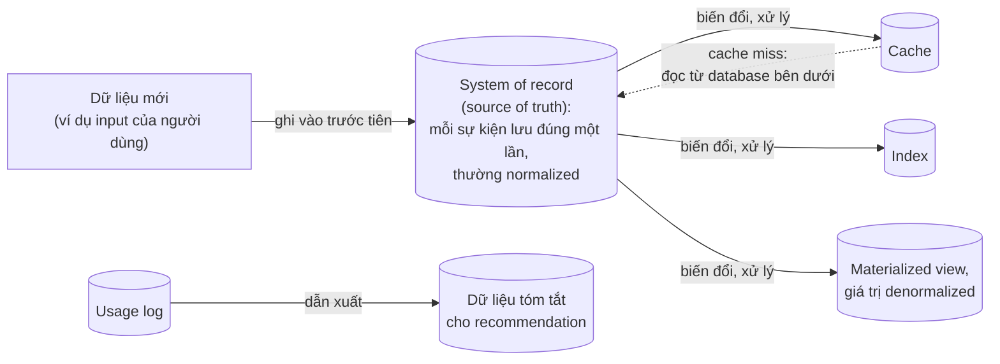

*(Sơ đồ do người viết ghi chú tổng hợp từ tr. 386.)*

**Tính chất của derived data** (tr. 386):

- Về kỹ thuật, derived data là ***redundant*** (dư thừa): nó nhân bản thông tin đã có.
- Nhưng nó thường **thiết yếu** để có hiệu năng tốt cho **truy vấn đọc**.
- Nó thường **denormalized**.
- Từ **một nguồn** có thể dẫn xuất **nhiều dataset khác nhau**, cho phép nhìn dữ liệu từ nhiều "góc nhìn".

**Why — vì sao phân biệt hai nhóm** (tr. 386). Không phải hệ thống nào cũng tách bạch rõ hai nhóm trong kiến trúc. Nhưng phân biệt chúng rất có ích, vì nó **làm rõ dataflow** của hệ thống: phần nào có input nào, output nào, và **phụ thuộc lẫn nhau ra sao**.

**Không phải tính chất của công cụ** (tr. 386). Phần lớn database, storage engine và ngôn ngữ truy vấn **tự bản thân** không phải system of record hay derived system. Database chỉ là công cụ. Một hệ thống thuộc nhóm nào phụ thuộc vào **cách bạn dùng nó** trong ứng dụng, không phụ thuộc vào công cụ.

**Chủ đề xuyên suốt** (tr. 386). Nói rõ **dữ liệu nào dẫn xuất từ dữ liệu nào** giúp một kiến trúc rối rắm trở nên sáng sủa. Đây sẽ là chủ đề chạy suốt Part III.

> **Ví dụ minh họa do AI xây dựng.** Một trang thương mại điện tử có PostgreSQL chứa đơn hàng và sản phẩm (system of record). Từ đó dẫn xuất ra: Elasticsearch để tìm sản phẩm, Redis cache trang chi tiết, bảng "sản phẩm hay mua cùng" do batch job tính hằng đêm, và data warehouse cho báo cáo. Nếu cụm Elasticsearch hỏng hoàn toàn, có thể dựng lại từ PostgreSQL. Nếu PostgreSQL mất dữ liệu, không có gì dựng lại được nó. Cùng là PostgreSQL, ở một công ty khác nó có thể chỉ là bản sao báo cáo dẫn xuất từ một hệ thống khác; vai trò do cách dùng quyết định.

> **Bổ sung ngoài sách.** Một phép thử nhanh: "nếu xóa hệ thống này, có tạo lại được nội dung của nó bằng một quy trình lặp lại được không?" Nếu có, đó là derived data. Glossary của sách (tr. 554) định nghĩa derived data đúng theo hướng này: dataset tạo ra từ dữ liệu khác qua một quy trình **lặp lại được**, có thể chạy lại khi cần.

<a id="part-iii-overview"></a>

### 0.2 Overview of Chapters (tr. 387)

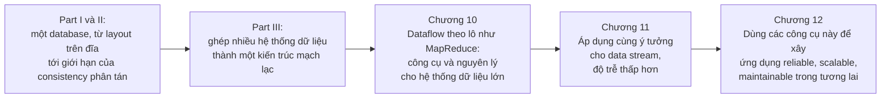

*(Sơ đồ do người viết ghi chú tổng hợp từ tr. 385, 387.)*

---

<a id="a-tong-quan"></a>

## A. Tổng quan chương

### Chương này muốn giải quyết điều gì?

**Câu đề từ** (tr. 389) của Donald Knuth. Đại ý: một hệ thống không thể thành công nếu chịu ảnh hưởng quá mạnh của một người; khi thiết kế ban đầu đã xong và khá vững, thử thách thật mới bắt đầu, lúc nhiều người với nhiều góc nhìn tự làm thí nghiệm của riêng họ. Câu này báo trước hai chủ đề của chương: **ghép các công cụ nhỏ** do nhiều người viết, và **dễ thử nghiệm**.

**Kiểu xử lý quen thuộc: request và response** (tr. 389). Part I và II nói nhiều về *request* và *query* cùng *response* hay *result* tương ứng. Nhiều data system hiện đại giả định kiểu này: bạn hỏi hay ra lệnh, và một lúc sau hệ thống (hy vọng) trả lời. Database, cache, search index, web server đều như vậy. Trong các hệ thống ***online*** này, ta thường giả định request do **người dùng** kích hoạt và **người đó đang chờ**. Vì vậy ta chú ý nhiều tới ***response time*** ([chương 1, B4.2](chapter-01.md#performance)).

Web và các API dựa trên HTTP/REST làm kiểu request/response phổ biến tới mức dễ coi là đương nhiên. Nhưng đó **không phải cách duy nhất** để xây hệ thống. Sách phân biệt **ba kiểu hệ thống** (tr. 389–390):

<a id="three-system-types"></a>

| Kiểu | Hoạt động | Thước đo hiệu năng chính | Chương |
| --- | --- | --- | --- |
| ***Services*** (*online systems*) | Chờ request hay lệnh từ client. Nhận được thì xử lý **nhanh nhất có thể** rồi trả response | **Response time**; **availability** cũng rất quan trọng (client không với tới service thì người dùng nhận lỗi) | Part I, II |
| ***Batch processing systems*** (*offline systems*) | Nhận **một lượng lớn input**, chạy một ***job*** để xử lý, sinh ra output. Job thường chạy lâu (vài phút tới vài ngày), nên **không có ai ngồi chờ**. Job thường được **lập lịch chạy định kỳ** (ví dụ mỗi ngày một lần) | ***Throughput***: thời gian để xử lý xong một input có kích thước cho trước | Chương 10 |
| ***Stream processing systems*** (*near-real-time*, *nearline*) | Nằm **giữa** online và batch. Giống batch: tiêu thụ input và sinh output, **không trả lời request**. Khác batch: xử lý sự kiện **ngay sau khi chúng xảy ra**, còn batch xử lý **một tập input cố định**. Nhờ vậy latency thấp hơn batch tương đương | Latency thấp hơn batch | Chương 11 (xây trên batch) |

**Batch là khối xây dựng quan trọng** (tr. 390). Batch processing là một khối xây dựng quan trọng để có ứng dụng reliable, scalable và maintainable.

- ***MapReduce***, thuật toán xử lý theo lô được công bố năm **2004** [1], từng được gọi (có lẽ hơi quá nhiệt tình) là thuật toán giúp Google "mở rộng khổng lồ" [2]. Sau đó nó được cài trong nhiều hệ mã nguồn mở: **Hadoop**, **CouchDB**, **MongoDB** ([chương 2, B3.2](chapter-02.md#mapreduce)).
- So với các hệ xử lý song song phát triển cho data warehouse **nhiều năm trước đó** [3, 4], MapReduce là mô hình lập trình **khá cấp thấp**. Nhưng nó là **bước tiến lớn về quy mô** xử lý đạt được trên **phần cứng thông dụng** (*commodity hardware*).
- Tầm quan trọng của MapReduce **đang giảm** [5], nhưng vẫn đáng hiểu, vì nó cho **bức tranh rõ ràng** về lý do và cách batch processing hữu ích.

**Batch là hình thức tính toán rất cũ** (tr. 390). Từ trước khi có máy tính số lập trình được, **máy lập bảng dùng thẻ đục lỗ**, như máy Hollerith dùng trong điều tra dân số Mỹ năm **1890** [6], đã làm một dạng batch bán cơ giới để tính thống kê tổng hợp từ input lớn. MapReduce còn giống một cách kỳ lạ các **máy sắp xếp thẻ điện cơ của IBM**, dùng rộng rãi cho xử lý dữ liệu kinh doanh những năm **1940–1950** [7]. Lịch sử có xu hướng lặp lại.

**Kế hoạch của chương** (tr. 390–391). Chương xem xét MapReduce và vài thuật toán, framework batch khác, cùng cách chúng được dùng trong data system hiện đại. Nhưng trước hết là xử lý dữ liệu bằng **công cụ Unix chuẩn**: ý tưởng và bài học từ Unix **áp dụng được** cho hệ thống dữ liệu phân tán lớn và không đồng nhất.

### Mạch lập luận của chương

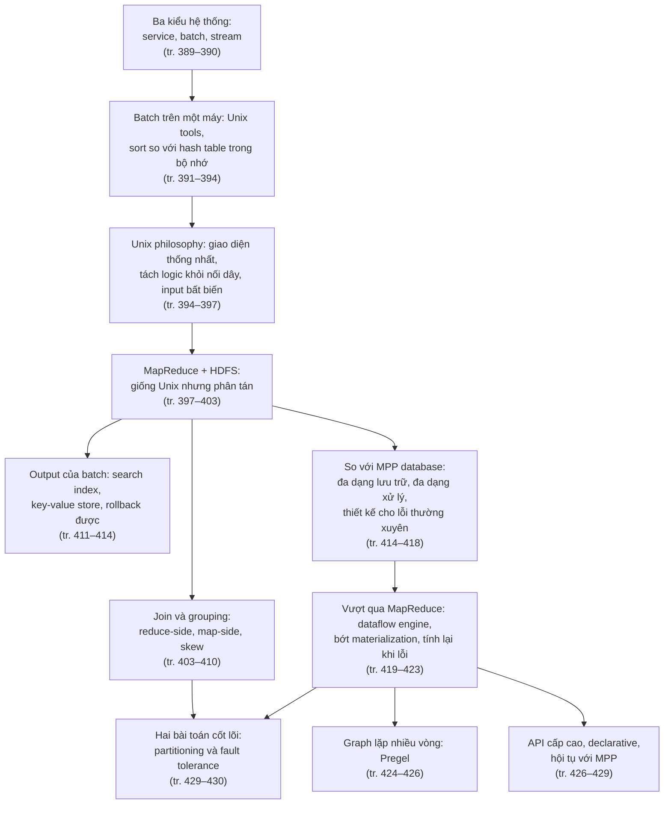

### Liên hệ với các chương khác

| Ý trong chương 10 | Liên hệ | Căn cứ |
| --- | --- | --- |
| Hệ thống dữ liệu ghép từ nhiều thành phần (bối cảnh Part III) | **Chương 1** ([B2](chapter-01.md#b2), nhận xét của người viết ghi chú) | tr. 385 |
| Response time của service, throughput của batch job | **Chương 1** ([B4.2](chapter-01.md#performance)) | tr. 389–390 |
| Sắp từng khối trong bộ nhớ, ghi segment ra đĩa rồi merge; ghi tuần tự | **Chương 3** ([B3](chapter-03.md#b3), [B2.4](chapter-03.md#append-only)) | tr. 394, 401 |
| MapReduce của MongoDB và CouchDB | **Chương 2** ([B3.2](chapter-02.md#mapreduce)) | tr. 399–400 |
| Join, foreign key, document reference, denormalization | **Chương 2** ([B2.3](chapter-02.md#relationships)) | tr. 403 |
| Full table scan so với index; OLTP so với analytics | **Chương 3** ([B7.1](chapter-03.md#oltp-olap)) | tr. 403, 411 |
| Event log là fact table, user database là dimension | **Chương 3** ([B7.4](chapter-03.md#star-schema)) | tr. 404 |
| ETL, data warehouse | **Chương 3** ([B7.2](chapter-03.md#data-warehouse)) | tr. 405, 415–416 |
| Term dictionary, postings list, segment của Lucene | **Chương 3** ([B6.4](chapter-03.md#fuzzy), [B3.3](chapter-03.md#lsm)) | tr. 411–412 |
| File database chỉ đọc không cần WAL | **Chương 3** ([B4.3](chapter-03.md#wal)) | tr. 413 |
| Avro, Parquet trên Hadoop; schema evolution | **Chương 4** ([B5](chapter-04.md#b5), [archival storage trong B7.1](chapter-04.md#dataflow-db)), **Chương 3** ([B8.1](chapter-03.md#column-store)) | tr. 414 |
| Schema-on-read | **Chương 2** ([B2.5](chapter-02.md#schema-flexibility)) | tr. 415–416 |
| Materialized view, materialization | **Chương 3** ([B8.7](chapter-03.md#materialized-views)) | tr. 420 |
| Lưu theo cột, vectorized processing | **Chương 3** ([B8.1](chapter-03.md#column-store), [B8.3](chapter-03.md#vectorized)) | tr. 428 |
| Graph model, transitive closure (Hình 2-6) | **Chương 2** ([B4](chapter-02.md#b4), [B4.6 Datalog](chapter-02.md#datalog)) | tr. 424 |
| Ngôn ngữ truy vấn declarative | **Chương 2** ([B3.0](chapter-02.md#declarative)) | tr. 427 |
| Actor model | **Chương 4** ([distributed actor frameworks](chapter-04.md#actors)) | tr. 425 |
| HDFS theo shared-nothing, khác NAS/SAN; nhân bản block | **Chương 5** ([mục 0.2](chapter-05.md#shared-nothing), [0.1](chapter-05.md#shared-architectures)) | tr. 398 |
| Chương trình một máy có thể nhanh hơn cluster | **Chương 5** ([mục 0.2](chapter-05.md#shared-nothing)) | tr. 426 |
| Partition theo hash của key; skew và hot spot; index phân vùng theo document | [Chương 6](chapter-06.md) ("Partitioning by Hash of Key", tr. 203; "Skewed Workloads and Relieving Hot Spots", tr. 205; "Partitioning and Secondary Indexes", tr. 206) | tr. 401, 407–408, 411 |
| Mạng có thể làm mất, nhân đôi, làm trễ message | [Chương 8](chapter-08.md) ("Unreliable Networks", tr. 277) | tr. 425 |
| Stream processing: input không giới hạn, xử lý tăng dần | [Chương 11](chapter-11.md) | tr. 390, 412, 419, 430–431 |
| Tích hợp dữ liệu | [Chương 12](chapter-12.md) | bản đồ tr. 388 |

> **Bản đồ đầu chương (tr. 388).** Bản đồ vẽ một hòn đảo giữa "Sea of Derived Data" (biển dữ liệu dẫn xuất). Một dãy núi lớn chạy chéo qua đảo mang tên **"Distributed Filesystems"**; Hive nằm trên con đường xuyên qua dãy núi. Ở bờ tây là vùng "MPP Databases" với Impala và "ETL Harbor"; từ đây một con tàu đi "To Kingdom of Analytics (Chapter 3) and Data Integration (Chapter 12)". Dọc chân núi phía đông là con đường nối Spark, Tez và "MapReduce workflows". Giữa đảo là vùng "Dataflow Systems", với khu rừng "Search Indexes" bên dòng "River of Batch Outputs" chảy qua Solr. Phía bắc là "Delta Machine of Learning" với Mahout, Terrapin, Voldemort và "Recommendation Engines". Phía đông là con đường "Iterative Processing" nối Flink, GraphX, Giraph, xuống tới GraphChi. Phía nam là vùng "Single-node Processing" với "Unix tools". Ở bờ đông, một con tàu đi "To Stream Processing (Chapter 11)".
>
> *Diễn giải của người viết ghi chú:* các địa danh khớp với trình tự của chương: Unix tools ở rìa (một máy), dãy núi HDFS làm nền, MapReduce và dataflow engine ở giữa, output batch (search index, key-value store cho recommendation) chảy ra, và nhánh xử lý graph lặp (Giraph, GraphX, GraphChi) tách riêng.

---

<a id="b-chi-tiet"></a>

## B. Giải thích chi tiết

<a id="b1"></a>

### B1. Batch Processing with Unix Tools (tr. 391–397)

<a id="nginx-log"></a>

#### B1.0 Ví dụ xuất phát: log truy cập của web server (tr. 391)

**Bối cảnh** (tr. 391). Một web server nối thêm **một dòng vào file log** mỗi lần phục vụ một request. Sách dùng định dạng access log mặc định của **nginx**. Để hiểu một dòng, phải xem định nghĩa định dạng log. Dòng ví dụ trong sách (thực ra là một dòng, được ngắt cho dễ đọc) chứa các trường sau:

| Trường trong định dạng | Ý nghĩa | Giá trị trong dòng ví dụ |
| --- | --- | --- |
| Địa chỉ client | IP của client gửi request | 216.58.210.78 |
| Người dùng | Người dùng đã xác thực; chưa xác thực thì là dấu gạch ngang | gạch ngang (chưa xác thực) |
| Thời điểm | Giờ cục bộ của server | 27/2/2015, 17:55:11 UTC |
| Request | Phương thức, đường dẫn, giao thức | GET file */css/typography.css*, HTTP/1.1 |
| Status | Mã trạng thái response | 200 (thành công) |
| Số byte | Kích thước body của response | 3.377 byte |
| Referer | Trang chứa liên kết dẫn tới file | trang chủ martin.kleppmann.com |
| User agent | Trình duyệt | Chrome 40 trên Mac OS X |

<a id="unix-log-analysis"></a>

#### B1.1 Simple Log Analysis (tr. 391–394)

**Bài toán** (tr. 391). Có nhiều công cụ dựng báo cáo traffic từ file log, nhưng để luyện tập, sách tự dựng bằng công cụ Unix cơ bản: tìm **5 trang được xem nhiều nhất** của website. Lời giải là một **chuỗi lệnh nối bằng pipe** gồm sáu bước:

| Bước | Công cụ | Việc làm |
| --- | --- | --- |
| 1 | `cat` | Đọc file log của nginx |
| 2 | `awk` | Tách mỗi dòng thành các trường theo khoảng trắng, chỉ in ra **trường thứ bảy**, tình cờ chính là URL được yêu cầu (ở dòng ví dụ là */css/typography.css*) |
| 3 | `sort` | Sắp danh sách URL theo **thứ tự chữ cái**. URL nào được yêu cầu n lần thì sau khi sắp sẽ xuất hiện **n lần liền nhau** |
| 4 | `uniq` | Lọc các dòng lặp bằng cách so **hai dòng liền kề**. Tùy chọn `-c` cho in kèm **bộ đếm**: mỗi URL khác nhau đi kèm số lần nó xuất hiện |
| 5 | `sort` lần hai | Sắp theo **con số ở đầu dòng** (tùy chọn `-n`), tức số lượt request, theo thứ tự **đảo ngược** (`-r`): lớn nhất lên đầu |
| 6 | `head` | Chỉ giữ **5 dòng đầu** (`-n 5`), bỏ phần còn lại |

> Chú thích i (tr. 391). Có người thích chỉ ra rằng `cat` ở đây là thừa, vì có thể đưa file trực tiếp làm tham số cho `awk`. Nhưng viết như vậy thì **pipeline tuyến tính** hiện ra rõ hơn.

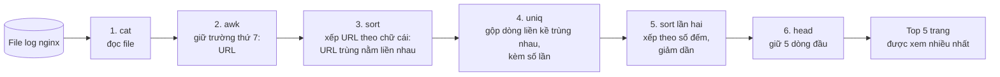

*(Sơ đồ do người viết ghi chú dựng theo mô tả sáu bước ở tr. 391–392.)*

**Kết quả** (tr. 392). Output có dạng "số lượt — URL", ví dụ trong sách: */favicon.ico* với 4.189 lượt đứng đầu, tiếp theo là hai bài blog (về bảo mật khóa SSH, và về schema evolution trong Avro, Protocol Buffers, Thrift), rồi trang chủ, cuối cùng là chính file */css/typography.css* với 915 lượt.

**Mạnh hơn vẻ ngoài** (tr. 392). Chuỗi lệnh trông khó hiểu nếu chưa quen Unix, nhưng **cực kỳ mạnh**:

- Nó xử lý **hàng gigabyte** log trong **vài giây**.
- Dễ sửa phân tích theo nhu cầu: muốn **bỏ file CSS** khỏi báo cáo thì thêm vào `awk` điều kiện loại các URL kết thúc bằng *.css*; muốn đếm **IP client** nhiều nhất thay vì trang thì cho `awk` in **trường thứ nhất**.
- Sách không có chỗ đi sâu vào Unix tools, nhưng chúng **rất đáng học**. Đáng ngạc nhiên là nhiều phân tích dữ liệu làm được trong vài phút bằng tổ hợp `awk`, `sed`, `grep`, `sort`, `uniq`, `xargs`, và **hiệu năng tốt đáng ngạc nhiên** [8].

> **Bổ sung ngoài sách.** Tài liệu [8] của sách có tiêu đề nói rằng công cụ dòng lệnh có thể nhanh hơn một cluster Hadoop tới 235 lần. Lý do thường gặp: với dữ liệu vừa một máy, cluster tốn nhiều chi phí khởi động job, ghi đĩa và chép qua mạng, trong khi pipeline Unix chạy các bước **song song trong bộ nhớ** qua pipe.

<a id="custom-program"></a>

**Chain of commands versus custom program** (tr. 392–393). Thay vì chuỗi lệnh, có thể viết một **chương trình nhỏ**. Sách đưa một chương trình Ruby làm cùng việc:

1. Tạo một **hash table** giữ bộ đếm cho mỗi URL; bộ đếm mặc định bằng 0.
2. Với mỗi dòng log, lấy URL là **trường thứ bảy** tách theo khoảng trắng (chỉ số mảng là 6 vì mảng Ruby đánh số từ 0).
3. **Tăng bộ đếm** của URL đó.
4. Sắp nội dung hash table theo bộ đếm, **giảm dần**, lấy 5 mục đầu.
5. In 5 mục đó.

Chương trình không gọn bằng chuỗi pipe, nhưng **khá dễ đọc**; chọn cách nào một phần là chuyện sở thích. Tuy nhiên, ngoài khác biệt cú pháp bề mặt, hai cách có **khác biệt lớn trong luồng thực thi**, lộ ra khi chạy trên **file lớn** (tr. 393).

<a id="sort-vs-hash"></a>

**Sorting versus in-memory aggregation** (tr. 393–394).

**What.** Chương trình Ruby giữ một **hash table trong bộ nhớ**: mỗi URL ánh xạ tới số lần đã thấy. Pipeline Unix **không có** hash table nào, mà dựa vào việc **sắp xếp** một danh sách URL trong đó các lần xuất hiện của cùng URL **chỉ đơn giản là lặp lại**.

**Cách nào tốt hơn? Tùy số URL khác nhau** (tr. 393). Lập luận từng bước:

1. Với phần lớn website nhỏ và vừa, có thể chứa **mọi URL khác nhau** cùng bộ đếm của chúng trong, chẳng hạn, **1 GB bộ nhớ**.
2. Khái niệm then chốt là ***working set*** của job: **lượng bộ nhớ mà job cần truy cập ngẫu nhiên**. Ở đây working set chỉ phụ thuộc **số URL khác nhau**, không phụ thuộc số dòng log: một triệu dòng log cho cùng một URL vẫn chỉ tốn chỗ cho **một URL cộng một bộ đếm**.
3. Nếu working set **đủ nhỏ**, hash table trong bộ nhớ chạy tốt, **kể cả trên laptop**.
4. Nếu working set **lớn hơn bộ nhớ**, cách sắp xếp có lợi thế: nó **dùng đĩa hiệu quả**. Đây là cùng nguyên lý với **SSTable và LSM-tree** ([chương 3, B3](chapter-03.md#b3)): sắp từng khối dữ liệu trong bộ nhớ, ghi ra đĩa thành **segment file**, rồi **merge** nhiều segment đã sắp thành một file lớn đã sắp (tr. 394).
5. **Mergesort** có mẫu truy cập **tuần tự**, chạy tốt trên đĩa. Tối ưu cho I/O tuần tự là chủ đề lặp lại ở Chương 3, và nó xuất hiện lại ở đây (tr. 394).

**Unix sort làm sẵn việc này** (tr. 394). Tiện ích `sort` của GNU Coreutils (Linux) **tự tràn ra đĩa** (*spill to disk*) khi dataset lớn hơn bộ nhớ, và **tự song song hóa** việc sắp xếp trên nhiều lõi CPU [9]. Vì vậy chuỗi lệnh Unix đơn giản ở trên **dễ dàng mở rộng** tới dataset lớn mà không hết bộ nhớ. Nút cổ chai khả năng cao là **tốc độ đọc file input từ đĩa**.

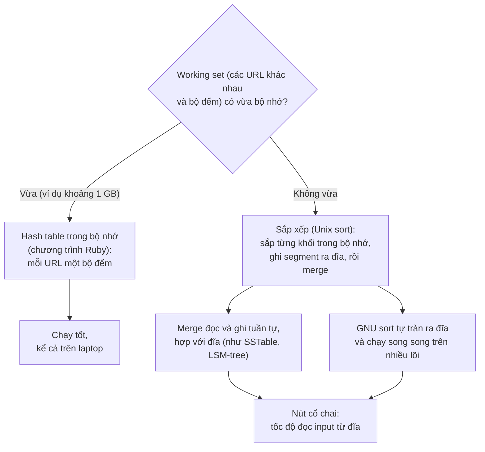

*(Sơ đồ do người viết ghi chú tổng hợp từ tr. 393–394.)*

> **Ví dụ minh họa do AI xây dựng (phép tính).** Một tỷ dòng log, nhưng chỉ khoảng một triệu URL khác nhau, mỗi URL trung bình 100 byte. Hash table cần cỡ 10⁶ × (100 byte + bộ đếm + chi phí cấu trúc) ≈ vài trăm MB: vừa bộ nhớ. Giờ đổi bài toán thành đếm theo **session ID**, và có 500 triệu session khác nhau: working set lên cỡ 500 × 10⁶ × 100 byte ≈ 50 GB, quá bộ nhớ của laptop. Khi đó cách sắp xếp ngoài bộ nhớ vẫn chạy được, vì nó chỉ cần giữ một khối trong bộ nhớ tại mỗi thời điểm.

> **Bổ sung ngoài sách — external merge sort.** Với 50 GB dữ liệu và 1 GB bộ nhớ: bước 1 đọc lần lượt từng khối 1 GB, sắp trong bộ nhớ, ghi ra đĩa thành 50 file đã sắp (*run*). Bước 2 mở cả 50 file, mỗi lần lấy phần tử nhỏ nhất trong 50 đầu file (*k-way merge*), ghi ra file kết quả. Mỗi bước chỉ đọc và ghi **tuần tự**, nên dù dữ liệu lớn gấp 50 lần bộ nhớ, tổng I/O chỉ cỡ hai lần đọc và hai lần ghi toàn bộ dữ liệu.

<a id="unix-philosophy"></a>

#### B1.2 The Unix Philosophy (tr. 394–397)

**Không phải tình cờ** (tr. 394). Phân tích log dễ dàng bằng một chuỗi lệnh như trên chính là một trong những **ý tưởng thiết kế chủ chốt của Unix**, và nó vẫn **còn nguyên giá trị** hôm nay. Sách xem kỹ hơn để **mượn ý tưởng** từ Unix [10].

**Nguồn gốc** (tr. 394). **Doug McIlroy**, người phát minh ra Unix pipe, mô tả chúng lần đầu năm **1964** [11]. Đại ý: nên có cách **nối các chương trình như nối ống tưới vườn**: khi cần xử lý dữ liệu theo cách khác thì vặn thêm một đoạn ống; I/O cũng nên như vậy. Phép ví "đường ống" đó bám rễ, và ý tưởng nối chương trình bằng pipe trở thành một phần của ***Unix philosophy***, bộ nguyên tắc thiết kế phổ biến trong giới phát triển và sử dụng Unix. Năm **1978**, triết lý này được mô tả thành bốn điều [12, 13]:

| # | Nguyên tắc (diễn giải) |
| --- | --- |
| 1 | **Mỗi chương trình làm tốt một việc.** Có việc mới thì viết chương trình mới, đừng làm chương trình cũ phức tạp thêm bằng "tính năng" mới |
| 2 | **Kỳ vọng output của mọi chương trình sẽ thành input của một chương trình khác, chưa biết trước.** Đừng nhồi thông tin thừa vào output. Tránh định dạng input dạng cột cứng nhắc hay nhị phân. Đừng đòi input tương tác |
| 3 | **Thiết kế và xây phần mềm, kể cả hệ điều hành, để dùng thử sớm**, lý tưởng là trong vài tuần. Đừng ngại vứt phần vụng về và xây lại |
| 4 | **Dùng công cụ thay vì sức người thiếu chuyên môn** để giảm nhẹ việc lập trình, kể cả khi phải đi đường vòng để xây công cụ và biết trước sẽ vứt bớt một số sau khi dùng xong |

Cách làm này (tự động hóa, làm prototype nhanh, lặp tăng dần, thân thiện với thử nghiệm, chia dự án lớn thành phần nhỏ dễ quản lý) nghe **rất giống phong trào Agile và DevOps** ngày nay. Bốn thập kỷ trôi qua mà thay đổi đáng ngạc nhiên là ít (tr. 394).

**Ví dụ `sort`** (tr. 395). `sort` là ví dụ tuyệt vời cho chương trình **làm tốt một việc**. Có thể nói nó là bản cài sắp xếp **tốt hơn** thư viện chuẩn của phần lớn ngôn ngữ lập trình (vốn **không tràn ra đĩa** và **không dùng nhiều luồng**, kể cả khi điều đó có lợi). Thế nhưng **đứng một mình** thì `sort` gần như vô dụng. Nó chỉ mạnh khi **kết hợp** với công cụ Unix khác như `uniq`.

Một shell như bash cho phép **ghép** các chương trình nhỏ thành job xử lý dữ liệu mạnh đáng ngạc nhiên, dù chúng do **nhiều nhóm người khác nhau** viết. Unix làm gì để có khả năng ghép (*composability*) này? Sách nêu ba yếu tố (tr. 395).

<a id="uniform-interface"></a>

**A uniform interface** (tr. 395–396).

- **Why.** Nếu output của chương trình này là input của chương trình kia, hai chương trình phải dùng **cùng định dạng dữ liệu**, tức một giao diện tương thích. Muốn nối output của **bất kỳ** chương trình nào vào input của **bất kỳ** chương trình nào, thì **mọi** chương trình phải dùng **cùng một giao diện I/O**.
- **What.** Trong Unix, giao diện đó là **file**, chính xác hơn là **file descriptor**. File chỉ là **một chuỗi byte có thứ tự**. Vì giao diện đơn giản như vậy, rất nhiều thứ khác nhau dùng chung được: file thật trên filesystem, kênh giao tiếp với tiến trình khác (Unix socket, stdin, stdout), device driver (ví dụ thiết bị âm thanh, máy in), socket của kết nối TCP… Việc những thứ khác nhau như vậy chia sẻ một giao diện thống nhất để **cắm vào nhau dễ dàng** là điều đáng chú ý.

> Chú thích ii (tr. 395). Một ví dụ khác của giao diện thống nhất là **URL và HTTP**, nền móng của web. URL định danh một tài nguyên trên website, và có thể liên kết tới bất kỳ URL nào từ bất kỳ website nào. Người dùng nhờ vậy nhảy giữa các website bằng liên kết, dù server do các tổ chức hoàn toàn không liên quan vận hành. Nguyên tắc này nay có vẻ hiển nhiên, nhưng từng là **nhận thức then chốt** làm nên thành công của web. Các hệ trước đó không thống nhất như vậy: thời **bulletin board system (BBS)**, mỗi hệ có số điện thoại và cấu hình baud rate riêng; muốn tham chiếu sang BBS khác phải ghi số điện thoại và thông số modem, người dùng phải gác máy, quay số BBS kia rồi tự tìm thông tin. Không thể liên kết thẳng tới nội dung bên trong BBS khác.

- **Quy ước văn bản ASCII** (tr. 395). Theo quy ước, nhiều (không phải tất cả) chương trình Unix coi chuỗi byte là **văn bản ASCII**. Ví dụ phân tích log dựa vào đó: `awk`, `sort`, `uniq`, `head` đều coi input là **danh sách bản ghi ngăn cách bằng ký tự xuống dòng** (ASCII 0x0A). Chọn ký tự xuống dòng là **tùy ý**; có thể nói ký tự *record separator* của ASCII (0x1E) hợp hơn vì nó sinh ra cho đúng mục đích này [14]. Dù sao, việc mọi chương trình **chuẩn hóa cùng một ký tự ngăn bản ghi** giúp chúng làm việc được với nhau.
- **Tách trường thì mơ hồ hơn** (tr. 396). Công cụ Unix thường tách dòng thành trường theo khoảng trắng hay tab, nhưng CSV, ngăn bằng dấu gạch đứng và các cách mã hóa khác cũng được dùng. Ngay cả công cụ khá đơn giản như `xargs` cũng có khoảng **nửa tá tùy chọn** chỉ để chỉ định cách parse input.
- **Không hoàn hảo** (tr. 396). Giao diện văn bản ASCII **phần lớn chạy được**, nhưng không đẹp: ví dụ log dùng "trường thứ 7" để lấy URL, rất khó đọc. Lý tưởng thì nên gọi được trường theo **tên** (kiểu "request_url"). Sách sẽ quay lại ý này ([B2.4](#output-philosophy): Avro và Parquet trên Hadoop).
- **Vẫn đáng nể** (tr. 396). Dù không hoàn hảo, sau mấy thập kỷ, giao diện thống nhất của Unix vẫn là điều đáng chú ý. Không có nhiều phần mềm **phối hợp và ghép** được tốt như công cụ Unix. Ví dụ, không thể dễ dàng cho nội dung hộp thư email và lịch sử mua hàng online chạy qua một công cụ phân tích tự viết, đổ vào bảng tính, rồi đăng kết quả lên mạng xã hội hay wiki. Ngày nay, chương trình phối hợp trơn tru như Unix là **ngoại lệ**, không phải chuẩn mực.
- **Balkanization of data** (tr. 396). Ngay cả các database **cùng mô hình dữ liệu** cũng thường không làm cho việc chuyển dữ liệu từ cái này sang cái kia dễ dàng. Thiếu tích hợp dẫn tới ***Balkanization of data***: dữ liệu bị chia cắt thành nhiều vùng không thông với nhau.

> **Nhận xét của người viết ghi chú.** "Balkanization of data" chính là vấn đề mà phần giới thiệu Part III nêu ra: ứng dụng phải ghép nhiều hệ thống, nhưng các hệ thống đó không được thiết kế để chuyển dữ liệu cho nhau ([mục 0](#part-iii)).

<a id="logic-wiring"></a>

**Separation of logic and wiring** (tr. 396–397).

- **What.** Một đặc điểm nữa của công cụ Unix là dùng ***standard input*** (*stdin*) và ***standard output*** (*stdout*). Chạy chương trình mà không chỉ định gì thì stdin đến từ bàn phím, stdout ra màn hình. Nhưng có thể lấy input từ file hoặc chuyển output vào file. **Pipe** cho phép gắn stdout của tiến trình này vào stdin của tiến trình khác, qua một **bộ đệm nhỏ trong bộ nhớ**, **không ghi toàn bộ luồng dữ liệu trung gian ra đĩa**.
- **Why.** Chương trình vẫn đọc ghi file trực tiếp được nếu cần, nhưng cách Unix chạy tốt nhất khi chương trình **không bận tâm tới đường dẫn file cụ thể**, chỉ dùng stdin và stdout. Khi đó người dùng shell **nối dây** input và output theo ý muốn; chương trình **không biết, không quan tâm** input từ đâu tới và output đi đâu. Có thể coi đây là một dạng ***loose coupling***, ***late binding*** [15] hay ***inversion of control*** [16]. Tách việc nối dây I/O khỏi logic chương trình giúp **ghép công cụ nhỏ thành hệ thống lớn** dễ hơn.
- **Example.** Bạn tự viết chương trình và ghép với công cụ của hệ điều hành; chỉ cần đọc stdin và ghi stdout là tham gia được pipeline. Trong ví dụ log, có thể viết một công cụ đổi chuỗi user agent thành tên trình duyệt dễ hiểu, hay đổi địa chỉ IP thành mã quốc gia, rồi **cắm vào pipeline**. `sort` không quan tâm nó đang nói chuyện với một phần của hệ điều hành hay với chương trình bạn viết.
- **Giới hạn** (tr. 397). stdin và stdout có giới hạn. Chương trình cần **nhiều input hay output** thì làm được nhưng rắc rối. **Không thể pipe output vào một kết nối mạng** [17, 18]. Nếu chương trình tự mở file để đọc ghi, tự khởi động chương trình con, hay tự mở kết nối mạng, thì I/O do **chính chương trình** nối dây. Vẫn cấu hình được (ví dụ qua tham số dòng lệnh), nhưng **mất bớt sự linh hoạt** của việc nối dây trong shell.

> Chú thích iii (tr. 397). Trừ khi dùng công cụ riêng như `netcat` hay `curl`. Unix ban đầu cố biểu diễn mọi thứ thành file, nhưng **BSD sockets API** đi lệch khỏi quy ước đó [17]. Các hệ điều hành nghiên cứu **Plan 9** và **Inferno** nhất quán hơn: chúng biểu diễn một kết nối TCP thành một file trong thư mục mạng [18].

<a id="transparency"></a>

**Transparency and experimentation** (tr. 397). Một phần lý do công cụ Unix thành công là chúng giúp **dễ thấy chuyện gì đang xảy ra**:

1. **File input thường được coi là bất biến** (*immutable*). Có thể chạy lệnh bao nhiêu lần tùy ý, thử đủ loại tùy chọn, mà **không làm hỏng** file input.
2. Có thể **dừng pipeline ở bất kỳ điểm nào**, chuyển output vào `less` để xem nó có đúng dạng mong đợi không. Khả năng quan sát này rất tốt cho debug.
3. Có thể **ghi output của một stage vào file** rồi dùng file đó làm input cho stage sau. Nhờ vậy chạy lại stage sau mà **không phải chạy lại cả pipeline**.

Vì vậy, dù công cụ Unix khá **thô sơ** so với query optimizer của relational database, chúng vẫn **hữu ích đáng kinh ngạc**, nhất là để **thử nghiệm**.

**Giới hạn lớn nhất** (tr. 397). Công cụ Unix **chỉ chạy trên một máy**. Đó là chỗ các công cụ như **Hadoop** bước vào.

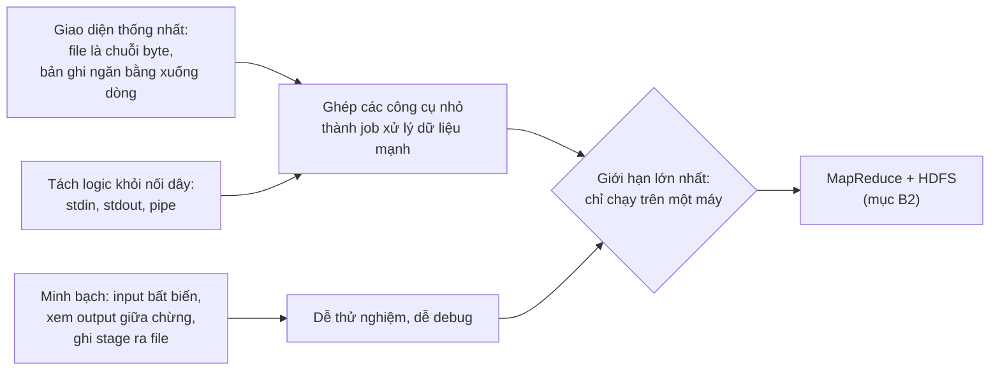

*(Sơ đồ do người viết ghi chú tổng hợp từ tr. 395–397.)*

---

<a id="b2"></a>

### B2. MapReduce and Distributed Filesystems (tr. 397–418)

<a id="hdfs"></a>

#### B2.0 MapReduce như "Unix phân tán" và HDFS (tr. 397–399)

**MapReduce giống Unix tools** (tr. 397). MapReduce hơi giống công cụ Unix, nhưng **phân tán trên tới hàng nghìn máy**. Như công cụ Unix, nó **thô, kiểu vét cạn** (*brute-force*), nhưng **hiệu quả đáng ngạc nhiên**.

- Một **MapReduce job** tương đương **một tiến trình Unix**: nhận một hay nhiều input, sinh một hay nhiều output.
- Như phần lớn công cụ Unix, chạy job **không sửa input** và **không có side effect** nào ngoài việc sinh output.
- File output được **ghi một lần, tuần tự** (không sửa phần nào của file sau khi đã ghi) (tr. 398).

**Filesystem phân tán thay cho stdin, stdout** (tr. 398). Công cụ Unix dùng stdin và stdout; MapReduce job **đọc và ghi file trên một distributed filesystem**. Trong bản cài MapReduce của Hadoop, filesystem đó là ***HDFS*** (*Hadoop Distributed File System*), bản cài lại mã nguồn mở của **Google File System (GFS)** [19].

- Có các distributed filesystem khác: **GlusterFS**, **Quantcast File System (QFS)** [20].
- Các dịch vụ ***object storage*** như **Amazon S3**, **Azure Blob Storage**, **OpenStack Swift** [21] giống HDFS ở nhiều điểm.
- Chương dùng HDFS làm ví dụ xuyên suốt, nhưng nguyên lý áp dụng cho **mọi** distributed filesystem.

> Chú thích iv (tr. 398). Một khác biệt: với HDFS, task tính toán có thể được **lập lịch chạy trên chính máy giữ bản sao** của file, còn object store thường **tách lưu trữ khỏi tính toán**. Đọc từ đĩa cục bộ có lợi về hiệu năng nếu **băng thông mạng** là nút cổ chai. Nhưng nếu dùng **erasure coding** thì lợi thế locality mất, vì phải ghép dữ liệu từ nhiều máy mới tái tạo được file gốc [20].

**HDFS theo shared-nothing** (tr. 398). HDFS dựa trên nguyên lý **shared-nothing** (phần giới thiệu Part II, [chương 5, mục 0.2](chapter-05.md#shared-nothing)), trái với cách **shared-disk** của **NAS** và **SAN** ([chương 5, mục 0.1](chapter-05.md#shared-architectures)). Lưu trữ shared-disk được cài bằng một **thiết bị lưu trữ tập trung**, thường dùng phần cứng tùy biến và hạ tầng mạng đặc biệt như **Fibre Channel**. Shared-nothing **không cần phần cứng đặc biệt**, chỉ cần máy tính nối bằng **mạng datacenter thông thường**.

**How — cấu trúc của HDFS** (tr. 398):

1. Mỗi máy chạy một **tiến trình daemon**, mở một dịch vụ mạng cho phép node khác **truy cập file lưu trên máy đó** (giả định mỗi máy đa dụng trong datacenter đều gắn vài đĩa).
2. Một **server trung tâm** gọi là ***NameNode*** theo dõi **block nào của file nằm trên máy nào**.
3. Nhờ vậy, về khái niệm, HDFS tạo ra **một filesystem lớn** dùng được dung lượng đĩa của **mọi máy** chạy daemon.

**Chịu lỗi** (tr. 398). Để chịu được máy và đĩa hỏng, block của file được **nhân bản trên nhiều máy**. Nhân bản có thể chỉ là **nhiều bản sao** của cùng dữ liệu, như Chương 5, hoặc một sơ đồ ***erasure coding*** như **mã Reed–Solomon**, cho phép khôi phục dữ liệu mất với **chi phí lưu trữ thấp hơn** nhân bản toàn phần [20, 22]. Kỹ thuật này giống **RAID** (dư thừa trên nhiều đĩa của cùng một máy); khác biệt là ở distributed filesystem, việc truy cập và nhân bản file diễn ra qua **mạng datacenter thông thường**, không cần phần cứng đặc biệt.

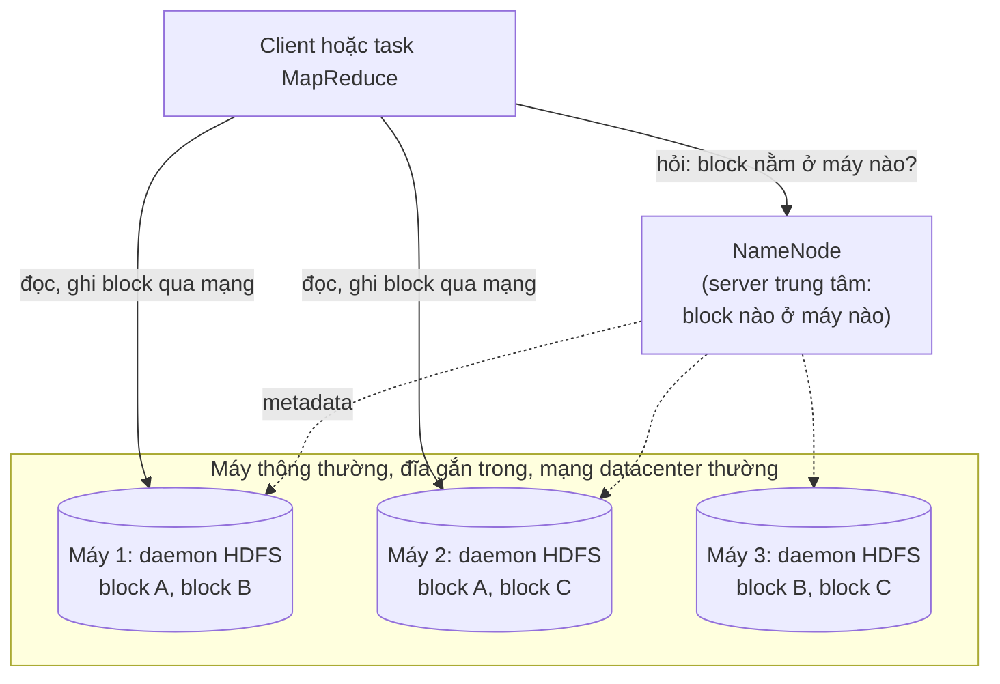

*(Sơ đồ do người viết ghi chú tổng hợp từ tr. 398. Cách đặt các bản sao block là giả định để minh họa nhân bản: mỗi block có hai bản trên hai máy khác nhau.)*

> **Bổ sung ngoài sách.** Trong Hadoop, daemon trên mỗi máy gọi là **DataNode**. Về chi phí: nhân bản 3 bản tốn thêm 200% dung lượng và chịu được mất 2 bản; một sơ đồ Reed–Solomon kiểu 6 khối dữ liệu + 3 khối parity tốn thêm 50% và chịu được mất bất kỳ 3 trong 9 khối. Đổi lại, khôi phục cần đọc từ nhiều máy, và như chú thích iv nói, task không còn đọc trọn file từ đĩa cục bộ được.

**Quy mô** (tr. 399). HDFS mở rộng tốt: lúc viết sách, các triển khai HDFS lớn nhất chạy trên **hàng chục nghìn máy**, tổng dung lượng **hàng trăm petabyte** [23]. Quy mô này khả thi vì chi phí lưu trữ và truy cập trên HDFS, dùng phần cứng thông dụng và phần mềm mã nguồn mở, **thấp hơn nhiều** so với dung lượng tương đương trên thiết bị lưu trữ chuyên dụng [24].

<a id="mapreduce-execution"></a>

#### B2.1 MapReduce Job Execution (tr. 399–403)

**What** (tr. 399). MapReduce là một **framework lập trình** để viết code xử lý dataset lớn trong distributed filesystem như HDFS. Cách dễ hiểu nhất là so với ví dụ phân tích log ở [B1.1](#unix-log-analysis). Mẫu xử lý gồm bốn bước:

| Bước | MapReduce | Trong ví dụ log Unix |
| --- | --- | --- |
| 1 | **Đọc tập file input**, chia thành **bản ghi** | Mỗi bản ghi là một dòng log (ký tự xuống dòng ngăn bản ghi) |
| 2 | Gọi hàm ***mapper*** để **trích key và value** từ mỗi bản ghi | `awk` lấy trường thứ 7: URL làm **key**, value để trống |
| 3 | **Sắp mọi cặp key-value theo key** | Lệnh `sort` đầu tiên |
| 4 | Gọi hàm ***reducer*** để duyệt các cặp đã sắp. Key trùng nhau đã **nằm liền nhau** nhờ sắp xếp, nên dễ gộp giá trị **mà không phải giữ nhiều trạng thái trong bộ nhớ** | `uniq` với bộ đếm: đếm số bản ghi liền kề cùng key |

- Bốn bước chạy trong **một** MapReduce job.
- Bước 2 (map) và 4 (reduce) là nơi viết **code xử lý tùy biến**.
- Bước 1 do ***input format parser*** lo.
- Bước 3 (sort) **ngầm định**: không phải viết, vì output của mapper **luôn được sắp** trước khi đưa cho reducer.

**Hai callback** (tr. 399–400). Muốn tạo MapReduce job, cài hai hàm callback (xem thêm [chương 2, B3.2](chapter-02.md#mapreduce)):

| Callback | Hành vi |
| --- | --- |
| **Mapper** | Được gọi **một lần cho mỗi bản ghi input**, trích key và value. Mỗi input sinh **bao nhiêu cặp key-value cũng được** (kể cả không cặp nào). **Không giữ trạng thái** từ bản ghi này sang bản ghi khác, nên mỗi bản ghi được xử lý **độc lập** |
| **Reducer** | Framework lấy các cặp key-value do mapper sinh ra, **gom mọi value cùng key**, rồi gọi reducer với một **iterator** trên tập value đó. Reducer sinh bản ghi output (ví dụ số lần xuất hiện của một URL) |

**Lần sort thứ hai** (tr. 400). Ví dụ Unix có lệnh `sort` thứ hai ở bước 5 để xếp hạng URL. Trong MapReduce, cần stage sort thứ hai thì viết **job MapReduce thứ hai**, dùng output của job đầu làm input. Nhìn theo cách này: **vai trò của mapper là chuẩn bị dữ liệu thành dạng hợp cho việc sắp xếp**, còn **vai trò của reducer là xử lý dữ liệu đã sắp**.

<a id="mapreduce-distributed"></a>

**Distributed execution of MapReduce** (tr. 400–402).

**Khác biệt chính với pipeline Unix** (tr. 400). MapReduce **song song hóa** tính toán trên nhiều máy **mà không cần viết code xử lý song song** tường minh. Mapper và reducer chỉ xử lý **một bản ghi mỗi lần**; chúng không cần biết input từ đâu hay output đi đâu, nên **framework lo mọi phức tạp** của việc chuyển dữ liệu giữa các máy.

- Có thể dùng công cụ Unix chuẩn làm mapper và reducer trong tính toán phân tán [25], nhưng thường chúng là **hàm trong ngôn ngữ lập trình thông thường**. Trong Hadoop MapReduce, mapper và reducer là **class Java** cài một interface. Trong MongoDB và CouchDB, chúng là **hàm JavaScript**.

**How — luồng dữ liệu của một job Hadoop MapReduce (Hình 10-1)** (tr. 400–402):

1. **Song song hóa dựa trên partitioning** ([Chương 6](chapter-06.md#partition-definition)). Input của job thường là **một thư mục trong HDFS**; mỗi file hay block trong thư mục là **một partition riêng**, xử lý bởi **một map task riêng** (m 1, m 2, m 3 trong hình).
2. **Đưa tính toán tới gần dữ liệu.** Mỗi file input thường cỡ **hàng trăm MB**. Scheduler của MapReduce cố chạy mỗi mapper trên **một máy đang giữ replica của file input**, nếu máy đó đủ RAM và CPU rảnh [26]. Nguyên tắc này gọi là ***putting the computation near the data*** [27]: tránh chép file input qua mạng, **giảm tải mạng** và **tăng locality**.
3. **Chép code tới máy.** Thường code ứng dụng chưa có trên máy được giao map task, nên framework **chép code** tới đó trước (ví dụ file JAR với chương trình Java). Rồi nó khởi động map task, đọc file input, **mỗi lần đưa một bản ghi** cho callback mapper. Output của mapper là các cặp key-value (tr. 401).
4. **Phía reduce cũng được partition.** Số map task do **số block của file input** quyết định; số reduce task do **người viết job cấu hình** (có thể khác số map task). Để mọi cặp cùng key về **cùng một reducer**, framework dùng **hash của key** để quyết định reduce task nào nhận cặp đó ("Partitioning by Hash of Key", tr. 203, [Chương 6](chapter-06.md#hash-partitioning)).
5. **Sắp xếp theo từng giai đoạn.** Dataset quá lớn để sắp bằng thuật toán thông thường trên một máy. Mỗi map task **chia output theo reducer** dựa trên hash của key, và ghi mỗi phần thành **một file đã sắp xếp trên đĩa cục bộ** của mapper, bằng kỹ thuật giống **SSTable và LSM-tree** ([chương 3, B3](chapter-03.md#b3)).
6. **Shuffle** (tr. 402). Khi mapper đọc xong input và ghi xong các file output đã sắp, scheduler **báo cho reducer** rằng có thể lấy output từ mapper đó. Reducer **kết nối tới từng mapper** và tải các file cặp key-value đã sắp **của partition mình**. Quá trình chia theo reducer, sắp xếp và chép partition từ mapper sang reducer gọi là ***shuffle*** [26]. Tên này dễ gây nhầm: khác với xáo bài, **không có gì ngẫu nhiên** trong MapReduce.
7. **Merge.** Reduce task lấy các file từ mapper và **merge** chúng, **giữ thứ tự sắp xếp**. Vì vậy nếu nhiều mapper sinh bản ghi cùng key, chúng sẽ **nằm liền nhau** trong input đã merge của reducer.
8. **Gọi reducer.** Reducer được gọi với một key và một **iterator quét dần** mọi bản ghi cùng key (có trường hợp không vừa bộ nhớ). Reducer dùng logic tùy ý để xử lý, sinh bao nhiêu bản ghi output cũng được. Output được ghi thành **file trên distributed filesystem** (thường một bản trên đĩa cục bộ của máy chạy reducer, replica ở máy khác).

<a id="figure-10-1"></a>

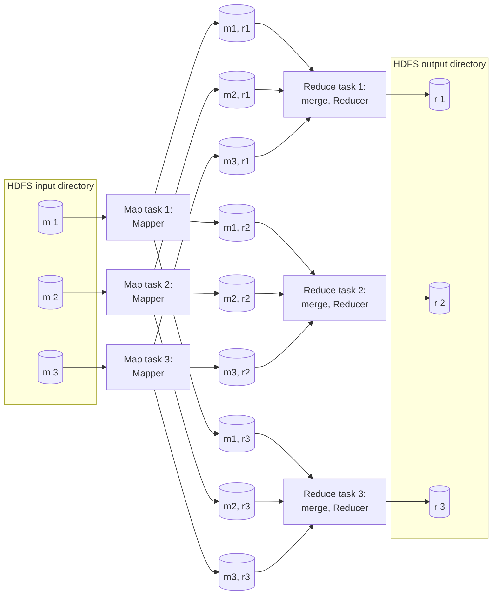

*(Vẽ lại Hình 10-1, tr. 401: job MapReduce với ba mapper và ba reducer. Mỗi map task ghi ba file đã sắp trên đĩa cục bộ, mỗi file cho một reducer; mỗi reduce task lấy phần của mình từ cả ba mapper, merge rồi chạy reducer.)*

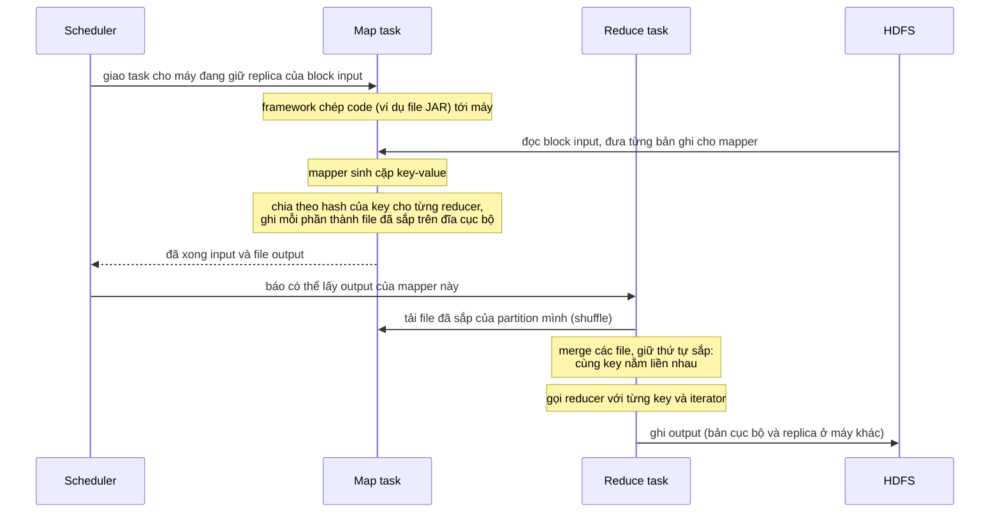

*(Sơ đồ do người viết ghi chú tổng hợp từ tr. 400–402.)*

> **Ví dụ minh họa do AI xây dựng.** Đếm lượt xem mỗi URL với 3 reducer. Giả sử hash của */favicon.ico* chia 3 dư 1, hash của */* chia 3 dư 2. Mọi mapper đều ghi các cặp có key */favicon.ico* vào file dành cho reducer 1. Reducer 1 tải phần đó từ cả ba mapper, merge lại: mọi bản ghi */favicon.ico* nằm liền nhau, và reducer chỉ việc đếm như `uniq` đếm dòng liền kề. Không reducer nào khác nhìn thấy */favicon.ico*, nên kết quả đếm không bị chia đôi.

<a id="mapreduce-workflows"></a>

**MapReduce workflows** (tr. 402–403).

- **Một job làm được ít** (tr. 402). Với ví dụ log, một job đếm được **lượt xem mỗi URL**, nhưng không tìm được **URL phổ biến nhất**, vì việc đó cần **một vòng sắp xếp nữa**.
- **Nối job thành workflow.** Vì vậy rất hay nối các MapReduce job thành ***workflow***: output của job này là input của job sau. Hadoop MapReduce **không hỗ trợ riêng** cho workflow, nên việc nối diễn ra **ngầm qua tên thư mục**: job đầu được cấu hình ghi output vào một thư mục chỉ định trong HDFS, job sau được cấu hình đọc chính thư mục đó. Với framework, đó là **hai job độc lập**.
- **Giống file tạm hơn là pipe.** Vì vậy job MapReduce nối nhau **ít giống** pipeline Unix (chuyển output thẳng sang input qua bộ đệm nhỏ trong bộ nhớ), mà **giống một chuỗi lệnh** trong đó mỗi lệnh ghi output ra **file tạm** và lệnh sau đọc file đó. Thiết kế này có ưu và nhược, bàn ở [B3.1](#materialization).
- **Chỉ hợp lệ khi thành công.** Output của batch job chỉ được coi là hợp lệ khi job **hoàn tất thành công** (MapReduce **bỏ output dở dang** của job thất bại). Vì vậy một job trong workflow chỉ bắt đầu được khi **các job trước, tức các job sinh thư mục input của nó, đã thành công**.
- **Workflow scheduler** (tr. 403). Để quản lý phụ thuộc giữa các lần chạy job, đã có nhiều workflow scheduler cho Hadoop: **Oozie, Azkaban, Luigi, Airflow, Pinball** [28]. Chúng còn có tính năng quản lý hữu ích khi duy trì nhiều batch job. Workflow gồm **50 tới 100 MapReduce job** là phổ biến khi xây hệ **recommendation** [29]; trong tổ chức lớn, nhiều nhóm chạy các job **đọc output của nhau**. Công cụ hỗ trợ rất quan trọng cho dataflow phức tạp như vậy.
- **Công cụ cấp cao.** Các công cụ cấp cao cho Hadoop như **Pig** [30], **Hive** [31], **Cascading** [32], **Crunch** [33], **FlumeJava** [34] cũng dựng workflow nhiều stage MapReduce và **tự nối chúng** một cách phù hợp.

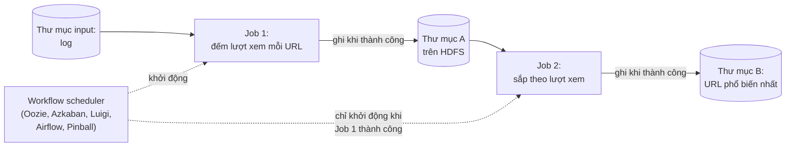

*(Sơ đồ do người viết ghi chú tổng hợp từ tr. 402–403.)*

<a id="reduce-side-joins"></a>

#### B2.2 Reduce-Side Joins and Grouping (tr. 403–408)

**Bối cảnh** (tr. 403). Chương 2 đã bàn join trong bối cảnh mô hình dữ liệu và ngôn ngữ truy vấn, nhưng chưa đi vào **cách join được cài đặt**. Giờ là lúc nối lại sợi chỉ đó.

**Why — vì sao cần join** (tr. 403). Trong nhiều dataset, một bản ghi thường **liên kết** với bản ghi khác: **foreign key** trong mô hình relational, **document reference** trong mô hình document, **cạnh** trong mô hình graph ([chương 2, B2.3](chapter-02.md#relationships)). Cần ***join*** mỗi khi có code phải truy cập bản ghi ở **cả hai đầu** của liên kết. Denormalization giảm được nhu cầu join nhưng thường **không xóa hẳn** ([chương 2](chapter-02.md#normalization)).

> Chú thích v (tr. 403). Join trong sách thường là ***equi-join***, loại phổ biến nhất: một bản ghi liên kết với bản ghi khác có **giá trị giống hệt** ở một trường nào đó (ví dụ một ID). Một số database hỗ trợ join tổng quát hơn, ví dụ dùng phép "nhỏ hơn" thay cho phép bằng, nhưng sách không bàn.

**MapReduce không có index** (tr. 403). Trong database, truy vấn chỉ chạm **ít bản ghi** thì thường dùng **index** để tìm nhanh ([Chương 3](chapter-03.md#b1)); truy vấn có join có thể cần nhiều lần tra index. Nhưng MapReduce **không có khái niệm index**, ít nhất theo nghĩa thông thường.

- MapReduce job nhận một tập file làm input thì **đọc toàn bộ nội dung** mọi file đó. Database gọi thao tác này là ***full table scan***.
- Chỉ cần đọc vài bản ghi thì full table scan **đắt khủng khiếp** so với tra index.
- Nhưng truy vấn **analytics** ([chương 3, B7.1](chapter-03.md#oltp-olap)) thường tính tổng hợp trên **rất nhiều bản ghi**. Khi đó quét toàn bộ input là **khá hợp lý**, nhất là khi song song hóa được trên nhiều máy.

**Join trong batch nghĩa là gì** (tr. 404). Trong batch processing, join nghĩa là **giải quyết mọi lần xuất hiện của một liên kết trong dataset**. Ví dụ, job xử lý dữ liệu của **mọi người dùng cùng lúc**, không phải chỉ tra dữ liệu của một người (việc đó làm bằng index sẽ hiệu quả hơn nhiều).

<a id="activity-events"></a>

**Example: analysis of user activity events** (tr. 404–405).

**Bài toán (Hình 10-2).** Bên trái là **log sự kiện** mô tả những gì người dùng đã đăng nhập làm trên website, gọi là ***activity events*** hay ***clickstream data***. Bên phải là **database người dùng**. Có thể coi đây là một phần của **star schema** ([chương 3, B7.4](chapter-03.md#star-schema)): log sự kiện là **fact table**, database người dùng là một **dimension**.

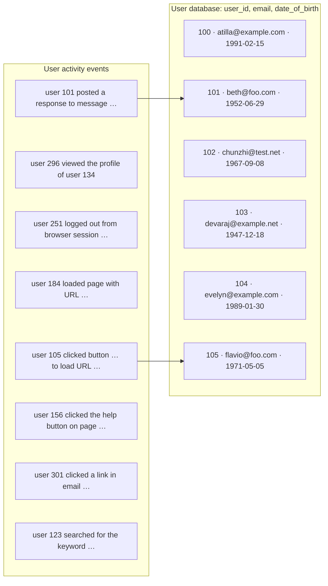

*(Vẽ lại Hình 10-2, tr. 404: join giữa log hoạt động của người dùng và database hồ sơ người dùng. Hình gốc chỉ vẽ hai mũi tên mẫu: sự kiện của user 105 và user 101 trỏ tới hàng tương ứng.)*

**Why cần join.** Một tác vụ analytics có thể cần **gắn hoạt động với thông tin hồ sơ**: nếu hồ sơ có tuổi hay ngày sinh, hệ thống có thể biết **trang nào phổ biến với nhóm tuổi nào**. Nhưng activity event **chỉ chứa user ID**, không chứa toàn bộ hồ sơ. Nhúng hồ sơ vào **từng** sự kiện thì quá lãng phí. Vậy phải **join** activity events với database hồ sơ (tr. 404).

**Cách ngây thơ và vì sao tệ** (tr. 404–405). Cách cài đơn giản nhất: duyệt từng sự kiện và **truy vấn database người dùng (trên server ở xa)** cho mỗi user ID gặp được. Làm được, nhưng **hiệu năng rất kém**:

1. **Throughput bị giới hạn bởi round-trip time** tới server database.
2. **Hiệu quả của cache cục bộ** phụ thuộc rất nhiều vào **phân phối dữ liệu**.
3. Chạy **nhiều truy vấn song song** dễ làm **quá tải** database [35].
4. Muốn throughput tốt, tính toán phải **cục bộ trên một máy** càng nhiều càng tốt. Gửi request truy cập ngẫu nhiên qua mạng cho **từng bản ghi** là quá chậm (tr. 405).
5. Truy vấn database ở xa còn làm batch job **không tất định** (*nondeterministic*), vì dữ liệu trong database đó **có thể thay đổi** giữa chừng.

> **Ví dụ minh họa do AI xây dựng (phép tính).** Một tỷ sự kiện, mỗi lần tra database mất 1 ms round-trip. Chạy tuần tự: 10⁹ × 1 ms = 10⁶ giây ≈ 11,6 ngày. Chạy 100 luồng song song: khoảng 2,8 giờ, nhưng database phải chịu 100 × 1.000 = 100.000 truy vấn mỗi giây, đúng kiểu tải dễ làm sập database đang phục vụ người dùng thật. Và nếu một người dùng đổi ngày sinh giữa lúc job chạy, chạy lại job sẽ cho kết quả khác.

**Cách tốt hơn** (tr. 405). Lấy **một bản sao** của database người dùng (ví dụ trích từ **bản backup** bằng một quy trình **ETL**, [chương 3, B7.2](chapter-03.md#data-warehouse)) và đặt nó vào **cùng distributed filesystem** với log hoạt động. Khi đó database người dùng là một tập file trong HDFS, activity events là một tập file khác, và MapReduce có thể **đưa mọi bản ghi liên quan về cùng một chỗ** để xử lý hiệu quả.

<a id="sort-merge-join"></a>

**Sort-merge joins** (tr. 405–406).

**How — từng bước (Hình 10-3):**

1. **Mapper trích key và value.** Ở Hình 10-2, key là **user ID**. Một nhóm mapper duyệt activity events (key = user ID, value = sự kiện); một nhóm mapper khác duyệt database người dùng (key = user ID, value = **ngày sinh**).
2. **Partition rồi sắp theo key.** Framework chia output của mapper theo key rồi sắp các cặp key-value. Hệ quả: **mọi activity event và bản ghi người dùng có cùng user ID nằm liền nhau** trong input của reducer.
3. **Secondary sort.** Job có thể sắp sao cho reducer **luôn thấy bản ghi từ database người dùng trước**, rồi mới tới các activity event **theo thứ tự timestamp**. Kỹ thuật này gọi là ***secondary sort*** [26] (tr. 406).
4. **Reducer join.** Reducer được gọi **một lần cho mỗi user ID**. Nhờ secondary sort, value đầu tiên chắc chắn là **bản ghi ngày sinh**. Reducer lưu ngày sinh vào **một biến cục bộ**, rồi duyệt các activity event cùng user ID, xuất ra cặp **(URL đã xem, tuổi người xem)**.
5. **Job tiếp theo.** Các MapReduce job sau có thể tính **phân phối tuổi người xem cho mỗi URL**, rồi gom theo nhóm tuổi.

**Vì sao hiệu quả** (tr. 406). Reducer xử lý **mọi bản ghi của một user ID trong một lần**, nên chỉ cần giữ **một bản ghi người dùng trong bộ nhớ** tại mỗi thời điểm, và **không bao giờ gửi request qua mạng**. Thuật toán này gọi là ***sort-merge join***: output của mapper được **sắp theo key**, rồi reducer **merge** các danh sách bản ghi đã sắp từ **hai phía** của join.

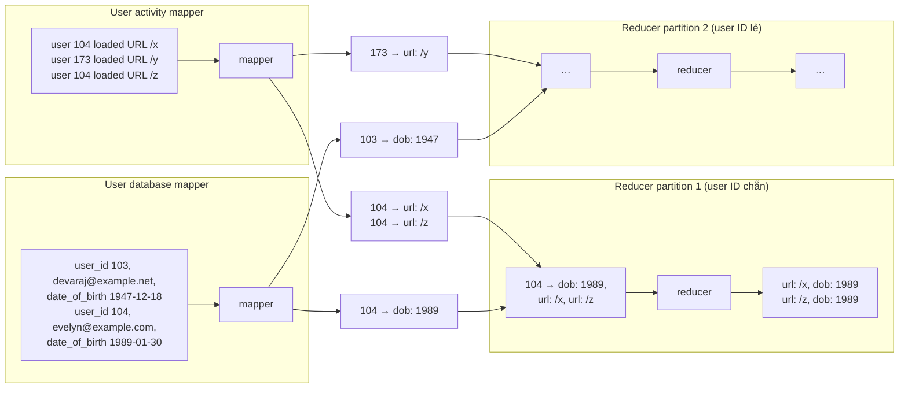

*(Vẽ lại Hình 10-3, tr. 405: reduce-side sort-merge join theo user ID. Nếu dataset input được chia thành nhiều file, mỗi file có thể do nhiều mapper xử lý song song. Trong hình, output của reducer ghép URL với năm sinh; phần chữ nói reducer xuất tuổi người xem, tính từ ngày sinh.)*

> **Bổ sung ngoài sách — secondary sort được làm thế nào.** Cách thường dùng là cho mapper sinh **key ghép** gồm (user ID, nhãn nguồn), trong đó nhãn của database người dùng nhỏ hơn nhãn của activity event, và đặt timestamp sau nhãn. Hàm partition chỉ dùng phần **user ID** để mọi bản ghi của một người về cùng reducer; hàm sắp xếp dùng **cả key ghép**, nên bản ghi người dùng luôn đứng đầu nhóm, các sự kiện theo sau theo thời gian.

<a id="bring-together"></a>

**Bringing related data together in the same place** (tr. 406).

- **Dồn dữ liệu cần thiết về một chỗ.** Trong sort-merge join, mapper và quá trình sắp xếp bảo đảm mọi dữ liệu cần cho phép join của **một user ID** được đưa về **cùng một chỗ**: **một lần gọi reducer**. Đã xếp sẵn mọi dữ liệu cần thiết, reducer có thể là đoạn code **đơn luồng, khá đơn giản**, xử lý bản ghi với **throughput cao** và **ít bộ nhớ**.
- **Mapper "gửi message" cho reducer.** Một cách nhìn kiến trúc này: khi mapper phát ra một cặp key-value, **key đóng vai địa chỉ đích** mà value cần được giao tới. Key chỉ là một chuỗi tùy ý (không phải địa chỉ mạng thật như IP và cổng), nhưng hành xử như địa chỉ: **mọi cặp cùng key được giao tới cùng một đích** (một lần gọi reducer).
- **Tách giao tiếp mạng khỏi logic ứng dụng.** Mô hình MapReduce tách phần **giao tiếp mạng vật lý** (đưa dữ liệu tới đúng máy) khỏi **logic ứng dụng** (xử lý dữ liệu khi đã có nó). Điều này trái với cách dùng database thường gặp, nơi request lấy dữ liệu nằm **sâu bên trong** code ứng dụng [36].
- **Che lỗi từng phần.** Vì MapReduce lo **mọi giao tiếp mạng**, nó cũng che cho code ứng dụng khỏi phải lo **lỗi từng phần** (*partial failure*), như một node khác bị crash: MapReduce **tự động thử lại** task lỗi mà không ảnh hưởng logic ứng dụng.

<a id="group-by"></a>

**GROUP BY** (tr. 406–407).

- **What.** Ngoài join, một cách dùng phổ biến khác của mẫu "đưa dữ liệu liên quan về cùng chỗ" là **gom bản ghi theo key** (như mệnh đề GROUP BY trong SQL). Mọi bản ghi cùng key tạo thành một nhóm, và bước tiếp theo thường là **tổng hợp** trong mỗi nhóm, ví dụ:
  - **đếm** số bản ghi mỗi nhóm (như đếm lượt xem trang; trong SQL là phép đếm mọi hàng);
  - **cộng** giá trị một trường (phép SUM trong SQL);
  - lấy **k bản ghi đứng đầu** theo một hàm xếp hạng.
- **How.** Cách đơn giản nhất: cho mapper sinh cặp key-value với **key là khóa gom nhóm** mong muốn. Quá trình partition và sắp xếp sẽ đưa mọi bản ghi cùng key về cùng reducer. Vì vậy, trên MapReduce, **grouping và joining trông khá giống nhau** (tr. 407).
- ***Sessionization*** [37]. Một cách dùng phổ biến khác của grouping là **gom mọi activity event của một phiên người dùng** để biết **chuỗi hành động** người đó đã làm. Ví dụ: kiểm tra người dùng thấy phiên bản website mới có mua hàng nhiều hơn người thấy phiên bản cũ không (***A/B testing***), hoặc tính xem một hoạt động marketing có đáng không.
- **Dữ liệu nằm rải rác.** Nếu nhiều web server cùng phục vụ request, activity event của một người dùng thường **rải rác trong file log của nhiều server**. Có thể cài sessionization bằng cách dùng **session cookie, user ID** hay định danh tương tự làm khóa gom nhóm: đưa mọi sự kiện của một người về một chỗ, trong khi **sự kiện của những người khác nhau được trải ra các partition khác nhau**.

<a id="skew"></a>

**Handling skew** (tr. 407–408).

**Why — vấn đề** (tr. 407). Mẫu "đưa mọi bản ghi cùng key về cùng chỗ" **sụp đổ** nếu có **rất nhiều dữ liệu gắn với một key**. Ví dụ, trong mạng xã hội, phần lớn người dùng kết nối với vài trăm người, nhưng **một số ít người nổi tiếng** có **hàng triệu** người theo dõi. Các bản ghi database **hoạt động lệch hẳn** như vậy gọi là ***linchpin objects*** [38] hay ***hot keys***.

- Gom mọi hoạt động liên quan tới một người nổi tiếng (ví dụ các trả lời cho bài họ đăng) vào **một reducer** có thể gây ***skew*** đáng kể (còn gọi ***hot spot***): một reducer phải xử lý **nhiều bản ghi hơn hẳn** các reducer khác ("Skewed Workloads and Relieving Hot Spots", tr. 205, [Chương 6](chapter-06.md#skewed-workloads)).
- Một MapReduce job **chỉ xong khi mọi mapper và reducer đã xong**, nên mọi job phía sau phải **chờ reducer chậm nhất**.

> **Liên hệ.** Chương 1 đã nhắc rằng thời gian chạy batch job thực tế thường lâu hơn lý tưởng vì skew và vì phải chờ task chậm nhất ([chương 1, B4.2](chapter-01.md#performance)).

**How — các thuật toán bù trừ** (tr. 407–408):

| Kỹ thuật | Cách làm | Cái giá |
| --- | --- | --- |
| ***Skewed join*** của **Pig** | Chạy một **job lấy mẫu** trước để biết key nào nóng [39]. Khi join thật, mapper gửi bản ghi của hot key tới **một trong vài reducer, chọn ngẫu nhiên** (khác MapReduce thường, vốn chọn reducer **tất định** theo hash của key). Với **input còn lại** của join, bản ghi của hot key được **nhân bản tới mọi reducer** xử lý key đó [40] | Phải **nhân bản** input kia tới nhiều reducer |
| ***Sharded join*** của **Crunch** | Giống skewed join, nhưng hot key phải được **chỉ định tường minh** thay vì dùng job lấy mẫu | Phải biết trước hot key |
| ***Skewed join optimization*** của **Hive** | Hot key phải được chỉ định tường minh trong **metadata của bảng**; bản ghi của chúng được lưu **trong file riêng**. Khi join bảng đó, dùng **map-side join** ([B2.3](#map-side-joins)) cho hot key | Phải khai báo hot key trong metadata |

- Kỹ thuật rải ngẫu nhiên này giúp **chia việc xử lý hot key** cho nhiều reducer, **song song hóa tốt hơn**. Nó cũng rất giống cách dùng **ngẫu nhiên hóa** để giảm hot spot trong database phân vùng ở Chương 6 (tr. 205) (tr. 408).
- **Gom nhóm theo hot key rồi tổng hợp: hai giai đoạn** (tr. 408). Stage MapReduce thứ nhất gửi bản ghi tới **reducer ngẫu nhiên**, mỗi reducer gom nhóm **một tập con** bản ghi của hot key và xuất ra **một giá trị tổng hợp gọn hơn** cho mỗi key. Job MapReduce thứ hai **gộp giá trị từ mọi reducer của stage một** thành **một giá trị cho mỗi key**.

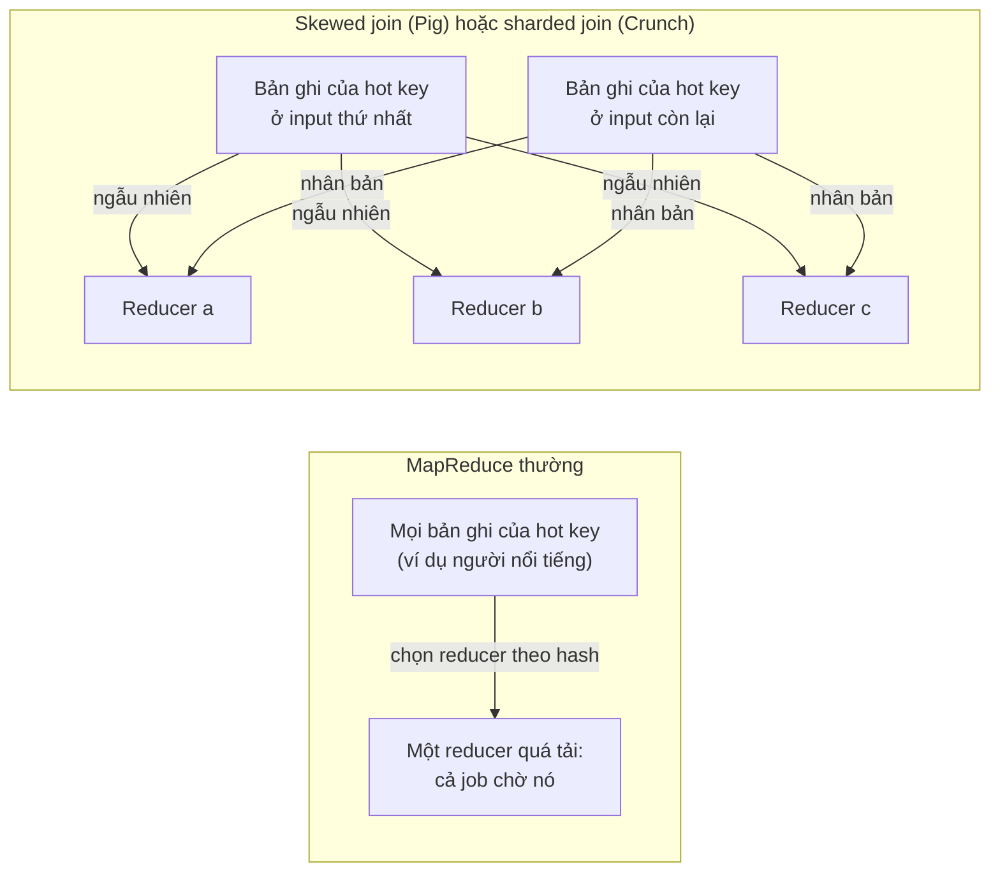

*(Sơ đồ do người viết ghi chú tổng hợp từ tr. 407–408.)*

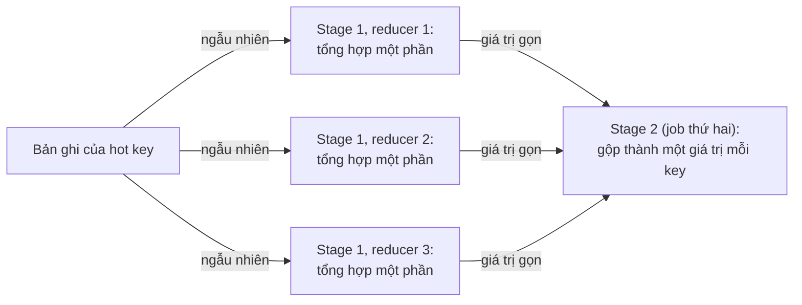

*(Sơ đồ do người viết ghi chú dựng theo mô tả tổng hợp hai giai đoạn ở tr. 408.)*

> **Bổ sung ngoài sách.** Tổng hợp hai giai đoạn chỉ đúng với phép tổng hợp **gộp được từng phần**: đếm, cộng, max, min. Muốn tính **trung bình**, stage một phải xuất cặp (tổng, số lượng), không phải trung bình từng phần. **Trung vị** thì không gộp đơn giản được như vậy. Hadoop có khái niệm *combiner* dựa trên cùng ý tưởng: tổng hợp sơ bộ ngay ở phía mapper trước khi shuffle.

> **Ví dụ minh họa do AI xây dựng.** Đếm số trả lời cho mỗi bài đăng. Một bài của người nổi tiếng có 20 triệu trả lời, các bài khác chỉ vài chục. Với 200 reducer, reducer nhận bài đó phải đếm 20 triệu bản ghi trong khi các reducer khác xong rất sớm. Với tổng hợp hai giai đoạn, rải 20 triệu bản ghi ngẫu nhiên cho 200 reducer: mỗi reducer đếm khoảng 100.000 bản ghi và xuất ra một con số; job thứ hai chỉ cộng 200 con số.

<a id="map-side-joins"></a>

#### B2.3 Map-Side Joins (tr. 408–410)

**Reduce-side join: ưu và nhược** (tr. 408). Các thuật toán ở [B2.2](#reduce-side-joins) làm logic join trong **reducer**, nên gọi là ***reduce-side joins***. Mapper đóng vai **chuẩn bị input**: trích key và value từ mỗi bản ghi, gán cặp key-value vào một partition reducer, và sắp theo key.

- **Ưu:** **không cần giả định gì** về input. Dù input có tính chất và cấu trúc thế nào, mapper cũng chuẩn bị được cho join.
- **Nhược:** toàn bộ việc sắp xếp, chép tới reducer và merge input của reducer có thể **khá tốn kém**. Tùy bộ đệm bộ nhớ, dữ liệu có thể bị **ghi ra đĩa nhiều lần** khi đi qua các stage của MapReduce [37].

**What — map-side join** (tr. 408). Nếu **giả định được** vài điều về input, có thể join nhanh hơn bằng ***map-side join***. Đây là MapReduce job **rút gọn**: **không reducer, không sắp xếp**. Mỗi mapper chỉ đọc **một block input** từ distributed filesystem và ghi **một file output** vào filesystem, vậy thôi.

<a id="broadcast-hash-join"></a>

**Broadcast hash joins** (tr. 409).

- **Khi nào dùng.** Cách map-side join đơn giản nhất áp dụng khi join một dataset **lớn** với một dataset **nhỏ**, cụ thể là dataset nhỏ phải **đủ nhỏ để nạp trọn vào bộ nhớ của mỗi mapper**.
- **How.** Ở Hình 10-2, giả sử database người dùng đủ nhỏ để vừa bộ nhớ. Khi một mapper khởi động, trước tiên nó **đọc database người dùng** từ distributed filesystem vào một **hash table trong bộ nhớ**. Xong, mapper quét activity events và **tra user ID** của mỗi sự kiện trong hash table.
- Vẫn có **nhiều map task**: mỗi task cho **một block của input lớn** (ở Hình 10-2 là activity events). Mỗi mapper đều nạp **trọn input nhỏ** vào bộ nhớ.
- **Tên gọi.** *Broadcast*: mỗi mapper cho một partition của input lớn đọc **toàn bộ** input nhỏ, nên input nhỏ thực chất được "phát" (*broadcast*) tới mọi partition của input lớn. *Hash*: dùng hash table.
- **Hỗ trợ.** **Pig** (tên "replicated join"), **Hive** ("MapJoin"), **Cascading**, **Crunch**; cũng dùng trong query engine của data warehouse như **Impala** [41].
- **Biến thể.** Thay vì nạp input nhỏ vào hash table trong bộ nhớ, có thể lưu nó trong **một index chỉ đọc trên đĩa cục bộ** [42]. Phần hay dùng của index sẽ nằm trong **page cache của hệ điều hành**, nên tra cứu ngẫu nhiên **nhanh gần bằng** hash table trong bộ nhớ, mà **không cần dataset vừa bộ nhớ**.

> Chú thích vi (tr. 409). Ví dụ này giả định hash table có **đúng một mục cho mỗi key**, điều có lẽ đúng với database người dùng (user ID định danh duy nhất một người). Tổng quát, hash table có thể chứa **nhiều mục cùng key**, và phép join sẽ xuất **mọi cặp khớp** của key đó.

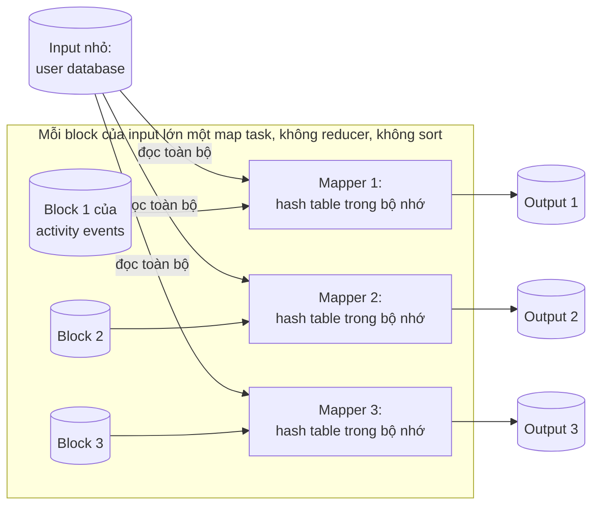

*(Sơ đồ do người viết ghi chú tổng hợp từ tr. 409.)*

<a id="partitioned-hash-join"></a>

**Partitioned hash joins** (tr. 409–410).

- **What.** Nếu các input của map-side join **được partition theo cùng một cách**, thì có thể áp dụng hash join **cho từng partition độc lập**.
- **Example.** Ở Hình 10-2, có thể chia cả activity events lẫn database người dùng theo **chữ số thập phân cuối của user ID** (mỗi bên 10 partition). Mapper 3 nạp mọi người dùng có ID tận cùng bằng 3 vào hash table, rồi quét mọi activity event của người dùng có ID tận cùng bằng 3.
- **Vì sao đúng.** Nếu partition đúng cách, mọi bản ghi cần join với nhau **nằm trong partition cùng số**, nên mỗi mapper chỉ cần đọc **một partition của mỗi input**. Lợi ích: mỗi mapper nạp **ít dữ liệu hơn** vào hash table.
- **Điều kiện** (tr. 410). Chỉ dùng được khi **cả hai** input có **cùng số partition**, và bản ghi được gán vào partition theo **cùng key** và **cùng hàm hash**. Nếu input do các MapReduce job trước sinh ra và chúng **đã gom nhóm như vậy**, giả định này là hợp lý.
- Trong Hive, partitioned hash join gọi là ***bucketed map joins*** [37].

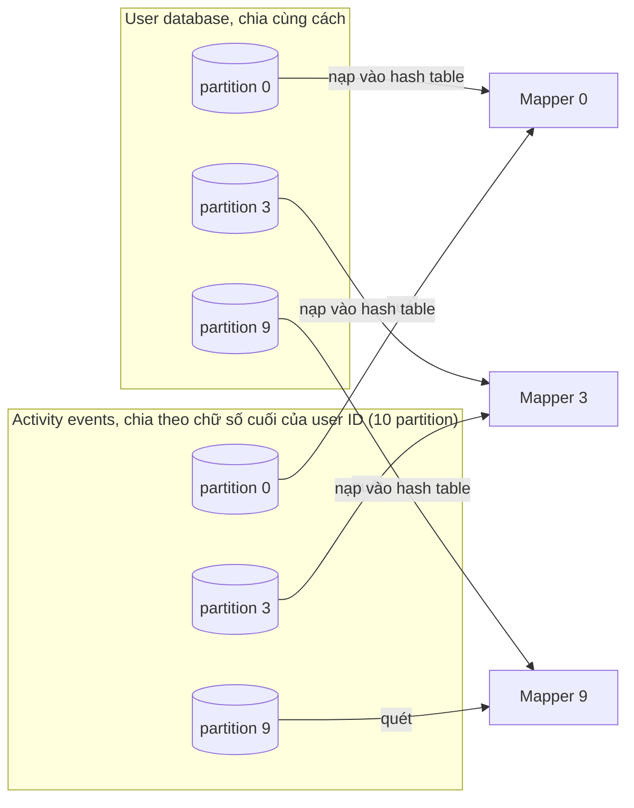

*(Sơ đồ do người viết ghi chú dựng theo ví dụ ở tr. 409; chỉ vẽ ba trong mười partition.)*

<a id="map-side-merge-join"></a>

**Map-side merge joins** (tr. 410).

- **What.** Một biến thể nữa áp dụng khi các dataset input không chỉ được **partition cùng cách** mà còn được **sắp theo cùng key**. Khi đó, input có vừa bộ nhớ hay không **không quan trọng**, vì mapper có thể làm đúng việc merge mà reducer thường làm: **đọc dần cả hai file input theo thứ tự key tăng dần**, và ghép các bản ghi cùng key.
- **Khi nào hợp lý.** Nếu map-side merge join khả thi, nhiều khả năng các MapReduce job trước **đã đưa input về dạng được partition và sắp xếp** như vậy. Về nguyên tắc, join này lẽ ra đã làm được ở **stage reduce của job trước**. Nhưng vẫn có thể hợp lý khi làm merge join trong **một job chỉ có map riêng**, ví dụ khi dataset đã partition và sắp xếp đó **còn được dùng cho mục đích khác** ngoài phép join này.

<a id="map-side-workflows"></a>

**MapReduce workflows with map-side joins** (tr. 410).

- **Cấu trúc output khác nhau.** Khi output của join được job phía sau tiêu thụ, lựa chọn map-side hay reduce-side **ảnh hưởng tới cấu trúc output**:
  - Output của **reduce-side join** được **partition và sắp theo join key**.
  - Output của **map-side join** được partition và sắp **giống input lớn** (vì mỗi block của input lớn khởi động một map task, dù là partitioned join hay broadcast join).
- **Phải biết layout vật lý.** Map-side join đặt **nhiều giả định hơn** về kích thước, thứ tự sắp và cách partition của input. Khi tối ưu chiến lược join, **biết layout vật lý** của dataset trong distributed filesystem trở nên quan trọng: không đủ nếu chỉ biết định dạng mã hóa và tên thư mục; còn phải biết **số partition** và **key dùng để partition và sắp xếp**.
- Trong hệ sinh thái Hadoop, metadata về cách partition dataset thường được giữ trong **HCatalog** và **Hive metastore** [37].

<a id="batch-output"></a>

#### B2.4 The Output of Batch Workflows (tr. 411–414)

**Câu hỏi bị bỏ quên** (tr. 411). Đã bàn nhiều thuật toán cho workflow MapReduce, nhưng còn một câu hỏi quan trọng: **kết quả** của mọi xử lý đó là gì? Vì sao phải chạy các job này?

- Với truy vấn database, sách đã phân biệt **OLTP** và **analytics** ([chương 3, B7.1](chapter-03.md#oltp-olap)). Truy vấn OLTP thường tra **ít bản ghi theo key** bằng index để hiển thị cho người dùng (ví dụ trên trang web). Truy vấn analytics thường **quét rất nhiều bản ghi**, gom nhóm và tổng hợp, và output thường là **báo cáo**: đồ thị một chỉ số theo thời gian, top 10 theo một xếp hạng, hay phân rã một đại lượng thành các nhóm con. Người dùng báo cáo thường là **nhà phân tích** hay **quản lý** cần ra quyết định kinh doanh.
- **Batch nằm ở đâu?** Nó **không phải** transaction processing, cũng **không phải** analytics. Nó **gần analytics hơn**, vì thường quét phần lớn dataset input. Nhưng một workflow MapReduce **khác** một truy vấn SQL dùng cho analytics ([B2.5](#hadoop-vs-mpp)). Output của batch thường **không phải báo cáo**, mà là **một loại cấu trúc khác**.

<a id="search-indexes"></a>

**Building search indexes** (tr. 411–412).

- **Lịch sử.** Cách dùng MapReduce đầu tiên của Google là **dựng index cho search engine**, cài thành một workflow **5 tới 10 MapReduce job** [1]. Về sau Google **thôi dùng** MapReduce cho việc này [43], nhưng nhìn MapReduce qua lăng kính dựng search index giúp hiểu nó. (Ngay cả lúc viết sách, Hadoop MapReduce vẫn là cách tốt để dựng index cho **Lucene/Solr** [44].)
- **Nhắc lại cấu trúc index** ([chương 3, B6.4](chapter-03.md#fuzzy)). Full-text index như Lucene là một file (***term dictionary***) cho phép tra nhanh một từ khóa và tìm **danh sách mọi document ID chứa từ đó** (***postings list***). Đây là cách nhìn rất đơn giản hóa: thực tế index cần thêm dữ liệu để **xếp hạng theo mức liên quan**, sửa lỗi chính tả, xử lý từ đồng nghĩa…, nhưng nguyên lý vẫn vậy.
- **How.** Cần full-text search trên **một tập document cố định** thì batch là cách **rất hiệu quả** để dựng index: **mapper chia tập document** theo partition, **mỗi reducer dựng index cho partition của mình**, file index được ghi vào distributed filesystem. Dựng index **phân vùng theo document** như vậy ("Partitioning and Secondary Indexes", tr. 206, [Chương 6](chapter-06.md#document-index)) **song song hóa rất tốt**.
- **Bất biến** (tr. 412). Truy vấn search index theo từ khóa là thao tác **chỉ đọc**, nên file index **bất biến** sau khi tạo.
- **Khi tập document thay đổi**, có hai lựa chọn:
  1. **Chạy lại toàn bộ** workflow dựng index định kỳ cho cả tập document, xong thì **thay nguyên khối** file index cũ bằng file mới. Tốn tính toán nếu chỉ vài document đổi, nhưng **rất dễ suy luận**: document vào, index ra.
  2. **Dựng index tăng dần.** Như Chương 3 đã nói ([B3.3](chapter-03.md#lsm)), muốn thêm, xóa, sửa document, Lucene ghi ra **segment file mới** rồi **merge và compact** các segment ở nền, bất đồng bộ. Xử lý tăng dần kiểu này sẽ bàn thêm ở [Chương 11](chapter-11.md).

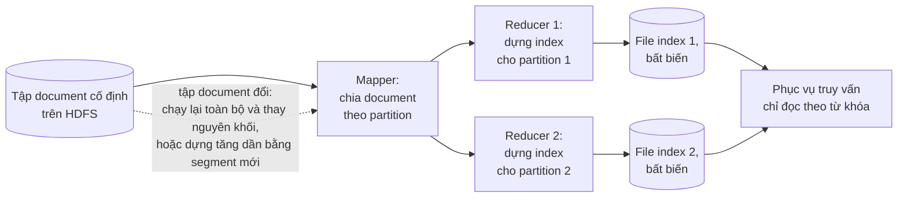

*(Sơ đồ do người viết ghi chú tổng hợp từ tr. 411–412.)*

<a id="kv-output"></a>

**Key-value stores as batch process output** (tr. 412–413).

**Bối cảnh** (tr. 412). Search index chỉ là một ví dụ. Batch còn hay được dùng để xây hệ **machine learning** như **classifier** (lọc spam, phát hiện bất thường, nhận dạng ảnh) và hệ **recommendation** (người bạn có thể biết, sản phẩm bạn có thể thích, tìm kiếm liên quan [29]).

- Output của các job này thường là **một loại database**: ví dụ database tra theo user ID để lấy **gợi ý kết bạn**, hay tra theo product ID để lấy **sản phẩm liên quan** [45].
- Database đó phải được truy vấn từ **web application** phục vụ người dùng, vốn thường **tách khỏi** hạ tầng Hadoop. Vậy output của batch về một database mà web app truy vấn được bằng cách nào?

**Cách hiển nhiên và vì sao tồi** (tr. 412–413). Cách hiển nhiên nhất: dùng **thư viện client** của database ưa thích **ngay trong mapper hay reducer**, ghi từ batch job **trực tiếp** vào database server, **từng bản ghi một**. Cách này chạy được (nếu firewall cho phép môi trường Hadoop truy cập thẳng database production), nhưng là **ý tưởng tồi** vì ba lý do:

1. **Chậm.** Như đã thấy ở join, gửi một request mạng cho **mỗi bản ghi** chậm hơn throughput bình thường của batch task **nhiều bậc độ lớn**. Kể cả khi thư viện client hỗ trợ gom lô, hiệu năng vẫn kém.
2. **Làm sập database.** MapReduce job thường chạy **nhiều task song song**. Nếu mọi mapper hay reducer cùng ghi vào một database output với tốc độ của batch, database đó **dễ bị quá tải**, hiệu năng phục vụ truy vấn bị ảnh hưởng, và điều này có thể gây **sự cố vận hành ở các phần khác** của hệ thống [35] (tr. 413).
3. **Mất đảm bảo all-or-nothing.** Bình thường MapReduce cho đảm bảo **"tất cả hoặc không có gì"** gọn gàng cho output của job: job thành công thì kết quả là output của việc chạy **mỗi task đúng một lần**, kể cả khi vài task từng lỗi và phải thử lại; cả job thất bại thì **không có output**. Ghi vào hệ thống ngoài từ bên trong job tạo ra **side effect nhìn thấy được từ bên ngoài**, không che giấu được như vậy. Bạn phải lo kết quả của **job chạy dở** hiện ra cho hệ thống khác, cùng sự phức tạp của **task attempt** và ***speculative execution*** trong Hadoop.

> **Bổ sung ngoài sách — speculative execution.** Khi một task chạy chậm bất thường, Hadoop có thể khởi động **một bản sao** của task đó trên máy khác và dùng kết quả của bản nào xong trước, bỏ bản kia. Với output ghi vào HDFS, framework chỉ "công bố" output của một attempt, nên vô hại. Nhưng nếu task ghi thẳng vào database ngoài, **cả hai attempt** đều đã ghi, và database nhận dữ liệu trùng lặp hay dở dang. Phần Summary của sách nhắc đúng ý này: nhiều task cho cùng partition có thể thành công, nhưng chỉ một task được công bố output (tr. 430).

**Cách tốt hơn nhiều** (tr. 413). **Dựng một database hoàn toàn mới ngay trong batch job** và ghi nó thành **file** vào thư mục output của job trên distributed filesystem, giống search index ở trên. File dữ liệu **bất biến** sau khi ghi, và được **nạp hàng loạt** (*bulk load*) vào các server phục vụ truy vấn **chỉ đọc**. Nhiều key-value store hỗ trợ dựng file database trong MapReduce job: **Voldemort** [46], **Terrapin** [47], **ElephantDB** [48], và **HBase bulk loading** [49].

- **Vì sao hợp với MapReduce.** Dùng mapper trích key rồi **sắp theo key** đã là **phần lớn công việc** để dựng một index.
- **Cấu trúc đơn giản.** Vì phần lớn các key-value store này **chỉ đọc** (file chỉ được batch job ghi một lần rồi bất biến), cấu trúc dữ liệu **khá đơn giản**. Ví dụ, chúng **không cần WAL** ([chương 3, B4.3](chapter-03.md#wal)).
- **Ví dụ Voldemort.** Khi nạp dữ liệu, server **tiếp tục phục vụ** request từ file dữ liệu cũ trong lúc file mới được chép từ distributed filesystem về đĩa cục bộ. Chép xong, server **chuyển nguyên tử** sang truy vấn file mới. Có trục trặc thì **chuyển lại file cũ** dễ dàng, vì chúng **vẫn còn đó và bất biến** [46].

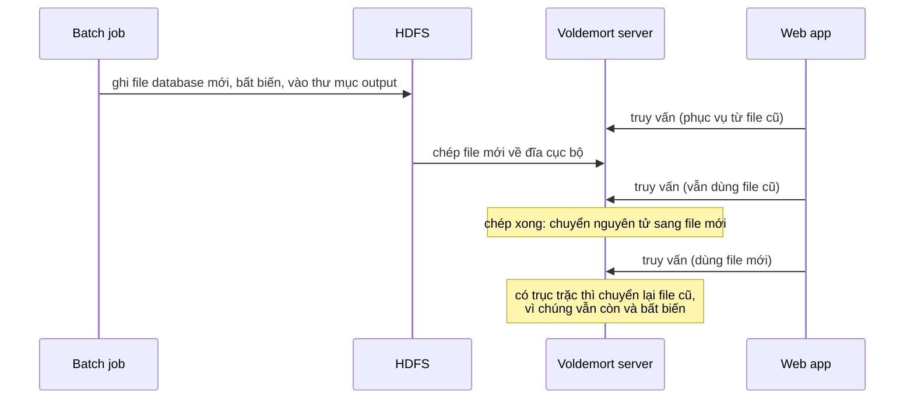

*(Sơ đồ do người viết ghi chú tổng hợp từ tr. 413.)*

<a id="output-philosophy"></a>

**Philosophy of batch process outputs** (tr. 413–414).

**Nhắc lại Unix** (tr. 413). Triết lý Unix ([B1.2](#unix-philosophy)) khuyến khích thử nghiệm bằng cách làm **dataflow rất tường minh**: chương trình đọc input và ghi output. Trong quá trình đó, **input không đổi**, **output trước bị thay hoàn toàn** bằng output mới, và **không có side effect nào khác**. Nhờ vậy có thể chạy lại lệnh bao nhiêu lần tùy ý, chỉnh sửa hay debug, mà **không làm rối trạng thái hệ thống**.

**MapReduce theo cùng triết lý.** Coi **input là bất biến** và **tránh side effect** (như ghi vào database ngoài), batch job không chỉ có hiệu năng tốt mà còn **dễ bảo trì hơn nhiều** (tr. 413–414):

1. **Sửa sai bằng cách chạy lại.** Lỡ đưa bug vào code khiến output sai hay hỏng, chỉ cần **rollback** về phiên bản code trước và **chạy lại job**, output sẽ đúng trở lại. Đơn giản hơn nữa: **giữ output cũ ở thư mục khác** và chỉ việc **chuyển về** nó. Database có transaction đọc ghi **không có** tính chất này: deploy code lỗi ghi dữ liệu sai vào database thì rollback code **không sửa được** dữ liệu đã nằm trong database. Ý tưởng phục hồi được từ code lỗi được gọi là ***human fault tolerance*** [50].
2. **Phát triển nhanh hơn.** Nhờ rollback dễ, phát triển tính năng có thể **nhanh hơn** so với môi trường mà sai lầm gây **hư hại không đảo ngược được**. Nguyên tắc ***minimizing irreversibility*** (giảm tối đa những gì không đảo ngược được) có lợi cho phát triển phần mềm Agile [51].
3. **Retry tự động an toàn.** Map hay reduce task lỗi thì framework **tự lập lịch chạy lại** trên **cùng input**. Lỗi do bug trong code thì task cứ crash mãi và cuối cùng job thất bại sau vài lần thử; lỗi do sự cố **tạm thời** thì được chịu đựng. Retry tự động chỉ an toàn **vì input bất biến** và **output của task lỗi bị framework bỏ đi**.
4. **Tái sử dụng input.** Cùng một tập file có thể làm input cho **nhiều job khác nhau**, kể cả **job giám sát**: tính metric và đánh giá output của một job có đặc điểm như mong đợi không (ví dụ so với output lần chạy trước và đo độ chênh lệch).
5. **Tách logic khỏi nối dây.** Như công cụ Unix, MapReduce job tách logic khỏi việc nối dây (cấu hình thư mục input và output). Điều này cho **phân tách mối quan tâm** và khả năng **tái sử dụng code**: một nhóm tập trung viết job **làm tốt một việc**, các nhóm khác quyết định **chạy job đó ở đâu, khi nào**.

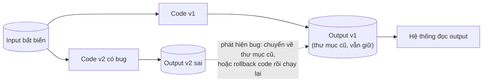

*(Sơ đồ do người viết ghi chú tổng hợp từ tr. 413–414.)*

**Khác biệt giữa Unix và Hadoop** (tr. 414). Ở các điểm trên, nguyên tắc thiết kế hợp với Unix cũng hợp với Hadoop. Nhưng hai bên cũng khác nhau. Vì phần lớn công cụ Unix giả định **file văn bản không có kiểu**, chúng phải **parse input** rất nhiều (ví dụ đầu chương lấy URL bằng "trường thứ 7"). Trên Hadoop, một phần các chuyển đổi cú pháp ít giá trị đó được loại bỏ nhờ **định dạng file có cấu trúc hơn**: **Avro** ([chương 4, B5](chapter-04.md#b5)) và **Parquet** ([chương 3, B8.1](chapter-03.md#column-store)) hay được dùng, vì chúng cho **mã hóa dựa trên schema** hiệu quả và cho phép **schema tiến hóa** theo thời gian ([Chương 4](chapter-04.md#compatibility)).

> **Liên hệ.** Chương 4 đã nhắc Avro object container file (một file lớn nhiều bản ghi cùng schema, writer's schema ở đầu file) là cách dùng phổ biến với Hadoop, và Parquet là định dạng hợp để lưu dữ liệu archive ([chương 4, B5.4](chapter-04.md#which-writer-schema), [B7.1](chapter-04.md#dataflow-db)).

<a id="hadoop-vs-mpp"></a>

#### B2.5 Comparing Hadoop to Distributed Databases (tr. 414–418)

**Hadoop như một Unix phân tán** (tr. 414–415). Như đã thấy, Hadoop hơi giống **phiên bản phân tán của Unix**: HDFS là filesystem, còn MapReduce là một cách cài **tiến trình Unix** khá kỳ quặc (luôn chạy tiện ích sort giữa pha map và pha reduce). Các phép join và grouping được cài trên các nguyên thủy đó.

**Không hề mới** (tr. 415). Khi bài báo MapReduce [1] ra đời, theo nghĩa nào đó nó **chẳng mới chút nào**. Mọi thuật toán xử lý và join song song bàn ở mấy mục trước đã được cài trong các database ***massively parallel processing* (MPP)** từ **hơn mười năm trước** [3, 40]. Ví dụ **Gamma database machine**, **Teradata** và **Tandem NonStop SQL** là những hệ tiên phong [52].

**Khác biệt lớn nhất** (tr. 415). MPP database tập trung vào **thực thi song song truy vấn SQL analytics** trên cụm máy. Còn tổ hợp MapReduce + distributed filesystem [19] cho thứ **giống một hệ điều hành đa dụng** hơn nhiều, **chạy được chương trình tùy ý**.

<a id="diversity-storage"></a>

**Diversity of storage** (tr. 415–416).

- **Database bắt cấu trúc, file thì không.** Database buộc dữ liệu theo **một mô hình** (relational hay document). File trong distributed filesystem chỉ là **chuỗi byte**, ghi theo **mô hình và cách mã hóa bất kỳ**: tập bản ghi database, nhưng cũng có thể là văn bản, ảnh, video, số đo cảm biến, ma trận thưa, feature vector, chuỗi gen hay bất kỳ loại dữ liệu nào.
- **Đổ dữ liệu vào trước, tính sau.** Nói thẳng, Hadoop mở ra khả năng **đổ dữ liệu bừa bãi vào HDFS** và chỉ sau đó mới tìm cách xử lý tiếp [53]. Ngược lại, MPP database thường đòi **mô hình hóa cẩn thận từ đầu** cả dữ liệu lẫn mẫu truy vấn trước khi nhập dữ liệu vào **định dạng lưu trữ độc quyền** của database.
- **Thực dụng hơn thuần khiết.** Theo quan điểm thuần khiết, mô hình hóa và nhập dữ liệu cẩn thận có vẻ đáng mong muốn vì người dùng database có dữ liệu chất lượng tốt hơn. Nhưng thực tế, **cho dữ liệu sẵn sàng nhanh**, kể cả ở **dạng thô kỳ quặc, khó dùng**, thường **giá trị hơn** việc cố quyết định mô hình lý tưởng từ đầu [54].
- **Giống data warehouse** ([chương 3, B7.2](chapter-03.md#data-warehouse)). Chỉ riêng việc **gom dữ liệu từ nhiều bộ phận** của một tổ chức lớn về một chỗ đã có giá trị, vì nó cho phép **join giữa các dataset** trước đây tách rời. Thiết kế schema cẩn thận mà MPP đòi hỏi **làm chậm** việc gom dữ liệu tập trung; gom dữ liệu **ở dạng thô** và lo thiết kế schema sau thì **tăng tốc** việc gom. Khái niệm này đôi khi gọi là ***data lake*** hay ***enterprise data hub*** [55].
- **Đẩy gánh diễn giải sang người dùng** (tr. 415–416). Đổ dữ liệu bừa bãi **chuyển gánh nặng diễn giải dữ liệu**: thay vì bắt **người tạo** dataset đưa nó về định dạng chuẩn, việc diễn giải thành bài toán của **người tiêu thụ**: cách tiếp cận ***schema-on-read*** [56] ([chương 2, B2.5](chapter-02.md#schema-flexibility)). Điều này có thể là **ưu điểm** nếu người tạo và người tiêu thụ là **các nhóm khác nhau với ưu tiên khác nhau**. Có thể **không có một mô hình dữ liệu lý tưởng**, mà chỉ có **các góc nhìn khác nhau** hợp với mục đích khác nhau. Đổ dữ liệu ở dạng thô cho phép nhiều phép biến đổi như vậy. Cách tiếp cận này được gọi là ***sushi principle***: "raw data is better" (dữ liệu thô thì tốt hơn) [57].
- **Hadoop làm ETL** (tr. 416). Vì vậy Hadoop thường được dùng để cài quy trình **ETL**: dữ liệu từ các hệ thống transaction processing được **đổ thô** vào distributed filesystem, rồi MapReduce job **làm sạch**, **biến đổi sang dạng relational**, và **nhập vào MPP data warehouse** cho analytics. **Mô hình hóa dữ liệu vẫn diễn ra**, nhưng ở **một bước riêng**, tách khỏi việc gom dữ liệu. Tách được như vậy vì distributed filesystem hỗ trợ dữ liệu mã hóa **ở bất kỳ định dạng nào**.

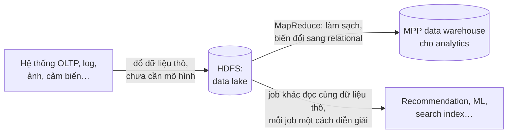

*(Sơ đồ do người viết ghi chú tổng hợp từ tr. 415–416.)*

<a id="diversity-processing"></a>

**Diversity of processing models** (tr. 416–417).

- **MPP: nguyên khối, tối ưu chặt.** MPP database là phần mềm **nguyên khối, tích hợp chặt**, lo cả layout lưu trữ trên đĩa, lập kế hoạch truy vấn, lập lịch và thực thi. Vì mọi thành phần có thể được tinh chỉnh cho nhu cầu riêng của database, cả hệ thống đạt **hiệu năng rất tốt** cho loại truy vấn nó được thiết kế. Ngôn ngữ **SQL** cho truy vấn biểu đạt mạnh và ngữ nghĩa thanh lịch **không cần viết code**, nên dùng được với công cụ đồ họa của nhà phân tích kinh doanh (như **Tableau**).
- **Không phải gì cũng là SQL.** Không phải loại xử lý nào cũng diễn đạt hợp lý bằng truy vấn SQL. Xây hệ **machine learning** và **recommendation**, **full-text search index** với mô hình xếp hạng mức liên quan, hay **phân tích ảnh** thường cần **mô hình xử lý tổng quát hơn**. Các xử lý này thường **rất riêng cho từng ứng dụng** (feature engineering cho machine learning, mô hình ngôn ngữ tự nhiên cho dịch máy, hàm ước lượng rủi ro cho dự đoán gian lận), nên **tất yếu phải viết code**, không chỉ viết truy vấn.
- **MapReduce mở cửa cho code tùy ý.** MapReduce cho kỹ sư khả năng **dễ dàng chạy code của mình** trên dataset lớn. Có HDFS và MapReduce thì có thể **xây một SQL engine bên trên**, và đó chính là việc dự án **Hive** đã làm [31]. Nhưng cũng viết được nhiều dạng batch khác **không hợp với SQL**.
- **Còn cần nhiều mô hình hơn nữa.** Về sau, người ta thấy MapReduce **quá giới hạn** và **chạy quá kém** cho một số loại xử lý, nên nhiều mô hình xử lý khác được phát triển **trên Hadoop** ([B3](#b3)). Hai mô hình (SQL và MapReduce) là **chưa đủ**. Nhờ **tính mở** của nền tảng Hadoop, cài được cả loạt cách tiếp cận, điều **không thể** trong khuôn khổ một MPP database nguyên khối [58] (tr. 417).
- **Một cluster dùng chung.** Điều then chốt: các mô hình xử lý đó **chạy được trên cùng một cluster dùng chung**, cùng truy cập **những file giống nhau** trên distributed filesystem. Theo cách Hadoop, không cần **nhập dữ liệu vào nhiều hệ chuyên dụng khác nhau** cho từng kiểu xử lý: hệ thống đủ linh hoạt để chạy **nhiều loại workload trong cùng cluster**. **Không phải di chuyển dữ liệu** giúp khai thác giá trị dữ liệu và **thử mô hình xử lý mới** dễ hơn nhiều.
- **Cả OLTP lẫn MPP trên HDFS.** Hệ sinh thái Hadoop gồm cả database OLTP truy cập ngẫu nhiên như **HBase** ([chương 3, B3](chapter-03.md#b3)) lẫn database analytics kiểu MPP như **Impala** [41]. Cả hai **không dùng MapReduce**, nhưng **cùng dùng HDFS** để lưu trữ. Đó là hai cách truy cập và xử lý dữ liệu rất khác nhau, nhưng vẫn **cùng tồn tại và tích hợp** được trong một hệ thống.

```mermaid
flowchart TB
    subgraph ENGINES["Nhiều mô hình xử lý trên một cluster dùng chung"]
        MR["MapReduce"]
        HIVE["Hive:<br/>SQL engine trên MapReduce"]
        DF["Mô hình xử lý mới:<br/>dataflow engine, xử lý graph"]
        HB["HBase:<br/>OLTP, truy cập ngẫu nhiên"]
        IM["Impala:<br/>analytics kiểu MPP"]
    end
    MR --> HDFS[("HDFS:<br/>cùng các file")]
    HIVE --> HDFS
    DF --> HDFS
    HB --> HDFS
    IM --> HDFS
```

*(Sơ đồ do người viết ghi chú tổng hợp từ tr. 416–417.)*

<a id="frequent-faults"></a>

**Designing for frequent faults** (tr. 417–418).

**Hai khác biệt nữa** (tr. 417). So MapReduce với MPP database, còn hai khác biệt nổi bật trong cách thiết kế: **xử lý lỗi** và **dùng bộ nhớ và đĩa**. Batch **ít nhạy với lỗi** hơn hệ online, vì lỗi không ảnh hưởng người dùng **ngay lập tức** và luôn **chạy lại được**.

| | MPP database | MapReduce |
| --- | --- | --- |
| **Node crash giữa truy vấn** | Phần lớn **hủy cả truy vấn**, để người dùng gửi lại hoặc tự chạy lại [3]. Truy vấn thường chỉ chạy **vài giây tới vài phút**, nên cách này chấp nhận được: thử lại không tốn nhiều | Chịu được lỗi của **một map hay reduce task** mà **không ảnh hưởng cả job**, nhờ **thử lại ở mức từng task** |
| **Bộ nhớ và đĩa** | Thích giữ **càng nhiều dữ liệu trong bộ nhớ càng tốt** (ví dụ dùng hash join) để tránh chi phí đọc đĩa | **Rất hăng ghi dữ liệu ra đĩa**: một phần để chịu lỗi, một phần vì giả định dataset **dù sao cũng quá lớn** cho bộ nhớ |

**Lập luận cho cách của MapReduce** (tr. 417). Cách MapReduce hợp hơn với **job lớn**: job xử lý nhiều dữ liệu và chạy lâu tới mức **nhiều khả năng gặp ít nhất một task lỗi**. Khi đó, chạy lại cả job chỉ vì một task lỗi là **lãng phí**. Dù phục hồi ở mức từng task tạo ra **chi phí phụ** làm xử lý **lúc không lỗi chậm hơn**, đó vẫn có thể là **trade-off hợp lý** nếu **tỷ lệ task lỗi đủ cao**.

**Nhưng giả định đó thực tế đến đâu?** (tr. 417–418). Ở phần lớn cluster, **máy hỏng có xảy ra nhưng không thường xuyên**, có lẽ đủ hiếm để phần lớn job không gặp. Vậy có đáng chịu chi phí đáng kể vì fault tolerance không?

**Lời giải: môi trường mà MapReduce được thiết kế cho** (tr. 418).

1. Google có **datacenter dùng chung**: **service online production** và **batch job offline** chạy **trên cùng máy**.
2. Mỗi task có **phần tài nguyên được cấp** (lõi CPU, RAM, dung lượng đĩa…), được thực thi bằng **container**. Mỗi task còn có **mức ưu tiên**. Nếu task ưu tiên cao cần thêm tài nguyên, task ưu tiên thấp trên cùng máy có thể bị **dừng** (***preempted***) để giải phóng tài nguyên.
3. Ưu tiên còn quyết định **giá**: các nhóm phải trả tiền cho tài nguyên họ dùng, và tiến trình ưu tiên cao **đắt hơn** [59].
4. Kiến trúc này cho phép **cấp vượt mức** (*overcommit*) tài nguyên **không phải production** (ưu tiên thấp), vì hệ thống biết có thể **thu hồi** khi cần. Overcommit cho phép **tận dụng máy tốt hơn**, hiệu quả hơn so với hệ thống tách riêng task production và non-production.
5. Nhưng vì MapReduce job chạy ở **ưu tiên thấp**, chúng có nguy cơ **bị preempt bất cứ lúc nào** khi tiến trình ưu tiên cao cần tài nguyên. Batch job thực chất "nhặt phần thừa dưới gầm bàn": dùng mọi tài nguyên còn lại sau khi tiến trình ưu tiên cao lấy đủ phần mình.
6. **Con số** [59]: ở Google, một MapReduce task chạy **một giờ** có khoảng **5% nguy cơ bị dừng** để nhường chỗ cho tiến trình ưu tiên cao hơn. Tỷ lệ này **cao hơn hơn một bậc độ lớn** so với tỷ lệ lỗi do phần cứng, reboot máy hay lý do khác. Với tốc độ preempt này, một job có **100 task, mỗi task chạy 10 phút**, có **hơn 50% nguy cơ** ít nhất một task bị dừng trước khi xong.
7. **Kết luận**: MapReduce được thiết kế để chịu được **việc task bị dừng bất ngờ thường xuyên**, **không phải vì phần cứng đặc biệt kém tin cậy**, mà vì **quyền tự do dừng tiến trình tùy ý** cho phép **tận dụng tài nguyên cluster tốt hơn**.

> **Bổ sung ngoài sách (phép tính kiểm chứng).** Nếu nguy cơ bị dừng là 5% cho mỗi giờ chạy và các lần dừng độc lập, thì xác suất một task 10 phút sống sót là 0,95^(1/6) ≈ 0,9915, tức nguy cơ bị dừng khoảng 0,85%. Xác suất cả 100 task đều sống sót là 0,9915¹⁰⁰ ≈ 0,43. Vậy nguy cơ có ít nhất một task bị dừng ≈ 57%, khớp với nhận định "hơn 50%" của sách. Cách nhìn khác: tổng thời gian chạy là 100 × 10 phút ≈ 16,7 giờ-task, tức kỳ vọng khoảng 0,85 lần bị dừng cho mỗi lần chạy job. Nếu chạy lại cả job mỗi khi có một task bị dừng, job lớn hơn nữa có thể **không bao giờ xong**.

**Ở thế giới mã nguồn mở** (tr. 418). Trong các cluster scheduler mã nguồn mở, preemption **ít được dùng** hơn. **CapacityScheduler** của YARN hỗ trợ preemption để cân bằng tài nguyên giữa các hàng đợi [58], nhưng lúc viết sách, **preemption tổng quát theo ưu tiên** không được hỗ trợ trong **YARN, Mesos hay Kubernetes** [60]. Trong môi trường task **không hay bị dừng**, các quyết định thiết kế của MapReduce **kém hợp lý** hơn. Mục tiếp theo xem xét các lựa chọn thay thế với quyết định thiết kế khác.

```mermaid
flowchart TD
    G["Datacenter dùng chung ở Google:<br/>service online và batch<br/>chạy trên cùng máy"] --> P["Mỗi task có phần tài nguyên<br/>(container) và mức ưu tiên"]
    P --> O["Overcommit tài nguyên ưu tiên thấp:<br/>tận dụng máy tốt hơn"]
    O --> PR["Task MapReduce ưu tiên thấp<br/>bị preempt khoảng 5 phần trăm mỗi giờ,<br/>cao hơn hẳn tỷ lệ hỏng phần cứng"]
    PR --> D["Thiết kế: retry theo từng task,<br/>ghi đĩa sớm và nhiều"]
    D --> Q{"Môi trường của bạn<br/>có preempt thường xuyên?"}
    Q -->|"Có"| OK["Thiết kế của MapReduce<br/>đáng chi phí của nó"]
    Q -->|"Không (YARN, Mesos, Kubernetes<br/>lúc viết sách)"| ALT["Thiết kế đó kém hợp lý:<br/>xem các lựa chọn ở B3"]
```

*(Sơ đồ do người viết ghi chú tổng hợp lập luận ở tr. 417–418.)*

---

<a id="b3"></a>

### B3. Beyond MapReduce (tr. 419–429)

<a id="beyond-mapreduce"></a>

#### B3.0 MapReduce chỉ là một trong nhiều mô hình (tr. 419)

- **Một mô hình giữa nhiều mô hình.** MapReduce rất phổ biến và được thổi phồng nhiều vào **cuối những năm 2000**, nhưng nó chỉ là **một trong nhiều** mô hình lập trình cho hệ phân tán. Tùy **khối lượng**, **cấu trúc** dữ liệu và **loại xử lý**, công cụ khác có thể hợp hơn để diễn đạt một phép tính.
- **Vì sao vẫn dành nhiều trang cho MapReduce.** Nó là **công cụ học tập** hữu ích: một abstraction **khá rõ và đơn giản** trên distributed filesystem. Đơn giản theo nghĩa **dễ hiểu nó đang làm gì**, **không phải dễ dùng**. Ngược lại hẳn: cài một job phức tạp bằng API MapReduce thô **khá khó và vất vả**, ví dụ phải **tự cài mọi thuật toán join** từ đầu [37].
- **Lớp abstraction cấp cao.** Đáp lại cái khó đó, nhiều mô hình lập trình cấp cao (**Pig, Hive, Cascading, Crunch**) ra đời như abstraction **trên** MapReduce. Hiểu MapReduce thì học chúng khá dễ, và cấu trúc cấp cao của chúng làm nhiều tác vụ batch thường gặp **dễ cài hơn đáng kể**.
- **Vấn đề nằm ở chính mô hình thực thi.** Nhưng mô hình thực thi MapReduce **có vấn đề riêng**, không sửa được bằng cách thêm một tầng abstraction, và lộ ra thành **hiệu năng kém** cho một số loại xử lý.
  - Một mặt, MapReduce **rất bền bỉ**: dùng nó xử lý lượng dữ liệu **gần như lớn tùy ý** trên hệ thống **nhiều người dùng chung, không tin cậy**, task bị dừng thường xuyên, và nó vẫn **làm xong việc** (dù chậm).
  - Mặt khác, công cụ khác đôi khi **nhanh hơn nhiều bậc độ lớn** cho một số loại xử lý.
- **Phần còn lại của chương** xem một số lựa chọn thay thế cho batch. [Chương 11](chapter-11.md) chuyển sang **stream processing**, có thể coi là **một cách khác để tăng tốc batch**.

<a id="materialization"></a>

#### B3.1 Materialization of Intermediate State (tr. 419–423)

**Job độc lập, nối nhau qua thư mục** (tr. 419). Như đã bàn, mỗi MapReduce job **độc lập** với mọi job khác. Điểm tiếp xúc chính của một job với thế giới bên ngoài là **thư mục input và output** trên distributed filesystem. Muốn output của job này là input của job thứ hai, phải cấu hình thư mục input của job hai **trùng** thư mục output của job một, và một **workflow scheduler bên ngoài** chỉ khởi động job hai khi job một đã xong.

**Khi nào cách này hợp lý** (tr. 419–420). Hợp lý nếu output của job một là **dataset muốn công bố rộng rãi** trong tổ chức. Khi đó cần **gọi được nó theo tên** và **dùng lại** làm input cho nhiều job khác (kể cả job của nhóm khác). Công bố dữ liệu ở **vị trí ai cũng biết** trong distributed filesystem cho phép **loose coupling**: job không cần biết **ai sinh ra input** hay **ai tiêu thụ output** của nó ([tách logic khỏi nối dây](#logic-wiring)).

**Khi nào không** (tr. 420). Nhưng trong nhiều trường hợp, bạn biết output của một job **chỉ dùng làm input cho đúng một job khác**, do **cùng một nhóm** duy trì. Khi đó file trên distributed filesystem chỉ là ***intermediate state*** (trạng thái trung gian): một cách **chuyển dữ liệu** từ job này sang job sau. Trong workflow phức tạp để xây hệ recommendation gồm **50 hay 100 MapReduce job** [29], có **rất nhiều** trạng thái trung gian như vậy.

**What — materialization** (tr. 420). Quá trình **ghi trạng thái trung gian ra file** gọi là ***materialization***. Thuật ngữ này đã gặp ở **materialized view** ([chương 3, B8.7](chapter-03.md#materialized-views)): nó nghĩa là **tính sẵn** kết quả của một phép toán và ghi ra, thay vì **tính khi có yêu cầu**.

**Đối chiếu với Unix pipe.** Ví dụ phân tích log đầu chương dùng pipe để nối output của lệnh này vào input của lệnh kia. Pipe **không materialize hoàn toàn** trạng thái trung gian, mà **stream** output sang input **dần dần**, chỉ dùng **bộ đệm nhỏ trong bộ nhớ**.

**Why — nhược điểm của việc materialize hoàn toàn** (tr. 420), so với Unix pipe:

1. **Phải chờ stage trước xong hẳn.** Một MapReduce job chỉ bắt đầu được khi **mọi task** của các job trước (sinh ra input của nó) **đã xong**, trong khi các tiến trình nối bằng pipe **khởi động cùng lúc**, output được tiêu thụ **ngay khi sinh ra**. Skew hay tải không đều giữa các máy khiến job thường có vài ***straggler*** (task tụt lại) chạy lâu hơn hẳn số còn lại. Phải chờ mọi task của job trước xong làm **chậm cả workflow**.
2. **Mapper thường thừa.** Chúng chỉ **đọc lại chính file reducer vừa ghi**, rồi chuẩn bị cho đợt partition và sắp xếp tiếp theo. Trong nhiều trường hợp, code của mapper có thể **là một phần của reducer trước**: nếu output của reducer được partition và sắp **giống output của mapper**, thì có thể **nối thẳng các reducer** với nhau, không cần chèn stage mapper.
3. **Nhân bản thừa.** Lưu trạng thái trung gian trên distributed filesystem nghĩa là các file đó được **nhân bản trên nhiều node**, thường là **quá mức cần thiết** cho dữ liệu tạm.

<a id="dataflow-engines"></a>

**Dataflow engines** (tr. 421–422).

**What** (tr. 421). Để sửa các vấn đề trên, nhiều **execution engine** mới cho tính toán batch phân tán đã ra đời; nổi tiếng nhất là **Spark** [61, 62], **Tez** [63, 64] và **Flink** [65, 66]. Thiết kế của chúng khác nhau ở nhiều điểm, nhưng có một điểm chung: chúng **xử lý cả workflow như một job**, thay vì chia thành các job con độc lập.

- Vì chúng **mô hình hóa tường minh luồng dữ liệu** qua nhiều stage xử lý, các hệ này gọi là ***dataflow engines***.
- **Giống MapReduce:** chúng **gọi lặp lại một hàm do người dùng định nghĩa** để xử lý **từng bản ghi trên một luồng**; song song hóa bằng **partition input**; và **chép output của một hàm qua mạng** để làm input cho hàm khác.
- **Khác MapReduce:** các hàm **không cần đóng vai cứng nhắc** xen kẽ map rồi reduce, mà có thể **lắp ghép linh hoạt** hơn. Sách gọi các hàm này là ***operators***.

**Ba cách nối output của một operator vào input của operator khác** (tr. 421):

| Cách nối | Khi nào dùng |
| --- | --- |
| **Repartition và sắp theo key**, như stage shuffle của MapReduce | Cho sort-merge join và grouping giống MapReduce |
| Nhận **nhiều input**, **partition cùng cách** nhưng **bỏ qua sắp xếp** | Tiết kiệm công cho **partitioned hash join**: partition quan trọng nhưng thứ tự không, vì dựng hash table đằng nào cũng xáo trộn thứ tự |
| **Gửi cùng một output** của operator tới **mọi partition** của operator join | **Broadcast hash join** |

**Nguồn gốc và ưu điểm** (tr. 421–422). Kiểu engine này dựa trên các hệ nghiên cứu như **Dryad** [67] và **Nephele** [68]. So với MapReduce, nó có các ưu điểm:

1. **Chỉ sắp xếp khi cần.** Việc tốn kém như sắp xếp chỉ làm ở **chỗ thực sự cần**, thay vì **luôn diễn ra mặc định** giữa mọi stage map và reduce.
2. **Không có map task thừa.** Việc của mapper thường **gộp được vào operator reduce đứng trước** (vì mapper **không đổi cách partition** của dataset).
3. **Tối ưu locality.** Vì mọi phép join và phụ thuộc dữ liệu trong workflow **được khai báo tường minh**, scheduler có **cái nhìn tổng thể** dữ liệu nào cần ở đâu, nên tối ưu được locality. Ví dụ, đặt task tiêu thụ dữ liệu **trên cùng máy** với task sinh ra nó, để trao đổi qua **bộ đệm bộ nhớ dùng chung** thay vì chép qua mạng.
4. **Trạng thái trung gian nhẹ hơn** (tr. 422). Giữ trạng thái trung gian giữa các operator **trong bộ nhớ** hoặc ghi ra **đĩa cục bộ** thường là đủ; tốn ít I/O hơn ghi vào HDFS (nơi nó phải được nhân bản sang nhiều máy và ghi đĩa trên mỗi replica). MapReduce **đã** tối ưu kiểu này cho **output của mapper**; dataflow engine **tổng quát hóa** cho **mọi** trạng thái trung gian.
5. **Không chờ cả stage.** Operator **bắt đầu chạy ngay khi input sẵn sàng**; không cần chờ **cả stage trước** xong.
6. **Dùng lại tiến trình JVM.** Các tiến trình Java Virtual Machine đã có được **dùng lại** để chạy operator mới, giảm chi phí khởi động so với MapReduce (vốn **khởi động một JVM mới cho mỗi task**).

**Chạy được cùng code** (tr. 422). Dataflow engine cài được **cùng những phép tính** như workflow MapReduce, và thường **chạy nhanh hơn đáng kể** nhờ các tối ưu trên. Vì operator là **tổng quát hóa** của map và reduce, **cùng code xử lý chạy được trên cả hai engine**: workflow viết bằng **Pig, Hive** hay **Cascading** chuyển từ MapReduce sang **Tez** hay **Spark** chỉ bằng **một thay đổi cấu hình**, không sửa code [64].

**Tez khác Spark và Flink** (tr. 422). **Tez** là thư viện **khá mỏng**, dựa vào **YARN shuffle service** để chép dữ liệu giữa các node [58]. **Spark** và **Flink** là **framework lớn**, có tầng giao tiếp mạng, scheduler và API hướng người dùng riêng. API cấp cao bàn ở [B3.3](#high-level-apis).

```mermaid
flowchart TB
    subgraph MRW["Workflow MapReduce: materialize mọi trạng thái trung gian"]
        direction LR
        A1["Map"] --> A2["Reduce"]
        A2 --> A3[("HDFS,<br/>nhân bản")]
        A3 --> A4["Map<br/>(thường thừa)"]
        A4 --> A5["Reduce"]
        A5 --> A6[("HDFS")]
    end
    subgraph DFE["Dataflow engine: cả workflow là một job"]
        direction LR
        B1["Operator 1"] -->|"bộ nhớ hoặc<br/>đĩa cục bộ"| B2["Operator 2"]
        B2 -->|"repartition,<br/>chỉ sort khi cần"| B3["Operator 3"]
        B3 --> B4[("HDFS:<br/>output cuối")]
    end
```

*(Sơ đồ do người viết ghi chú tổng hợp từ tr. 419–422.)*

<a id="dataflow-fault-tolerance"></a>

**Fault tolerance** (tr. 422–423).

**Cái giá của việc không materialize** (tr. 422). Materialize hoàn toàn trạng thái trung gian vào distributed filesystem có một ưu điểm: nó **durable**, nên fault tolerance trong MapReduce **khá dễ**: task lỗi thì **khởi động lại trên máy khác** và đọc lại **cùng input** từ filesystem.

**How — tính lại thay vì đọc lại.** Spark, Flink và Tez **tránh ghi trạng thái trung gian vào HDFS**, nên chịu lỗi theo cách khác: máy hỏng và trạng thái trung gian trên máy đó mất thì nó được **tính lại** từ dữ liệu khác **còn sẵn**: một **stage trung gian trước đó** nếu được, nếu không thì từ **input gốc** (thường nằm trên HDFS).

- Để tính lại được, framework phải **theo dõi một phần dữ liệu được tính ra thế nào**: dùng **partition input nào**, áp **operator nào**.
- **Spark** dùng abstraction ***resilient distributed dataset* (RDD)** để theo dõi **"dòng dõi"** (*ancestry*) của dữ liệu [61].
- **Flink** **checkpoint trạng thái của operator**, cho phép tiếp tục chạy một operator gặp lỗi giữa chừng [66].

**Vì sao tính tất định quan trọng** (tr. 423). Khi tính lại dữ liệu, cần biết phép tính có ***deterministic*** không: **cùng input** thì operator có **luôn cho cùng output** không? Câu hỏi này quan trọng nếu **một phần dữ liệu bị mất đã được gửi** cho operator phía sau. Lập luận từng bước:

1. Operator A sinh dữ liệu D và đã gửi một phần D cho operator B phía sau.
2. Máy chạy A hỏng; D mất. Framework chạy lại A để tính lại D.
3. Nếu A **không tất định**, kết quả tính lại D′ **khác** D. B giờ đang giữ một phần D và sẽ nhận D′: rất khó để B **hòa giải mâu thuẫn** giữa dữ liệu cũ và mới.
4. Giải pháp thường dùng với operator không tất định: **dừng luôn các operator phía sau**, rồi chạy lại chúng trên dữ liệu mới. Lỗi lan dây chuyền như vậy (*cascading faults*) tốn kém.
5. Để tránh, **tốt hơn là làm operator tất định**.

**Không tất định len vào dễ dàng** (tr. 423):

- Nhiều ngôn ngữ lập trình **không bảo đảm thứ tự** khi duyệt phần tử của hash table.
- Nhiều thuật toán xác suất và thống kê **cố ý dùng số ngẫu nhiên**.
- Mọi việc dùng **đồng hồ hệ thống** hay **nguồn dữ liệu bên ngoài** đều không tất định.

Phải loại các nguồn không tất định này để phục hồi lỗi tin cậy được, ví dụ sinh **số giả ngẫu nhiên với seed cố định**.

**Tính lại không phải lúc nào cũng đúng** (tr. 423). Nếu dữ liệu trung gian **nhỏ hơn nhiều** dữ liệu nguồn, hoặc phép tính **rất tốn CPU**, thì **materialize** dữ liệu trung gian ra file có lẽ **rẻ hơn** tính lại.

```mermaid
flowchart TD
    F["Máy hỏng: mất trạng thái trung gian<br/>của một partition"] --> L["Tra dòng dõi:<br/>partition input nào, operator nào"]
    L --> S{"Còn stage trung gian<br/>trước đó?"}
    S -->|"Còn"| R1["Tính lại từ stage đó"]
    S -->|"Không"| R2["Tính lại từ input gốc trên HDFS"]
    R1 --> D{"Operator tất định?"}
    R2 --> D
    D -->|"Có"| OK["Kết quả tính lại giống bản đã mất:<br/>operator phía sau không bị ảnh hưởng"]
    D -->|"Không"| K["Phải dừng và chạy lại<br/>cả các operator phía sau"]
    F -.->|"dữ liệu trung gian nhỏ,<br/>hoặc phép tính rất tốn CPU"| M["Nên materialize ra file<br/>thay vì tính lại"]
```

*(Sơ đồ do người viết ghi chú tổng hợp từ tr. 422–423.)*

> **Ví dụ minh họa do AI xây dựng.** Một operator lấy mẫu ngẫu nhiên 1% người dùng để huấn luyện mô hình, bằng bộ sinh số ngẫu nhiên không cố định seed. Operator join phía sau đã nhận một nửa mẫu. Máy hỏng, operator lấy mẫu chạy lại và chọn một tập người dùng **khác**. Operator join giờ có nửa mẫu cũ trộn với mẫu mới: một số người bị tính hai lần, một số không thuộc mẫu nào. Cố định seed (và cố định thứ tự duyệt input) làm lần chạy lại chọn đúng tập người dùng cũ.

> **Liên hệ (nhận xét của người viết ghi chú).** Đây là cùng bài học với **statement-based replication** ở Chương 5: hàm không tất định như lấy giờ hiện tại hay số ngẫu nhiên khiến chạy lại cùng một thao tác ở chỗ khác cho kết quả khác ([chương 5, B1.4](chapter-05.md#statement-based)). Ở cả hai nơi, muốn "chạy lại để phục hồi" thì phép tính phải tất định.

<a id="pipelined"></a>

**Discussion of materialization** (tr. 423).

- **Trở lại phép so sánh với Unix.** MapReduce giống việc **ghi output của từng lệnh vào file tạm**, còn dataflow engine **giống Unix pipe hơn nhiều**. Đặc biệt, **Flink** được xây quanh ý tưởng ***pipelined execution***: chuyển **dần** output của một operator sang các operator khác, **không chờ** input đủ mới bắt đầu xử lý.
- **Sắp xếp là ngoại lệ không tránh được.** Phép sắp xếp **buộc phải tiêu thụ hết input** rồi mới cho ra output, vì **bản ghi cuối cùng** có thể có **key nhỏ nhất**, tức phải là **bản ghi output đầu tiên**. Vì vậy mọi operator cần sắp xếp đều phải **tích trạng thái**, ít nhất là tạm thời. Nhưng nhiều phần khác của workflow chạy kiểu pipeline được.
- **Input và output cuối vẫn nằm trên HDFS.** Khi job xong, output phải tới **nơi bền vững** để người dùng tìm và dùng, khả năng cao lại là distributed filesystem. Vì vậy khi dùng dataflow engine, **dataset materialize trên HDFS vẫn thường là input và output cuối** của job. Như MapReduce, **input bất biến** và **output được thay hoàn toàn**. Cải tiến so với MapReduce là **khỏi phải ghi mọi trạng thái trung gian** vào filesystem.

<a id="graph-processing"></a>

#### B3.2 Graphs and Iterative Processing (tr. 424–426)

**Graph trong batch** (tr. 424). Chương 2 ([B4](chapter-02.md#b4)) đã bàn dùng **graph** để mô hình hóa dữ liệu và dùng ngôn ngữ truy vấn graph để duyệt cạnh và đỉnh. Khi đó trọng tâm là kiểu **OLTP**: chạy nhanh truy vấn tìm **ít đỉnh** thỏa điều kiện. Cũng đáng xem graph trong bối cảnh **batch**: mục tiêu là **xử lý hay phân tích offline toàn bộ graph**.

- Nhu cầu này hay xuất hiện ở ứng dụng **machine learning** như **recommendation engine**, hay ở **hệ xếp hạng**.
- Ví dụ nổi tiếng nhất là ***PageRank*** [69]: ước lượng **mức phổ biến của một trang web** dựa trên **những trang nào liên kết tới nó**. Nó là một phần của công thức quyết định **thứ tự kết quả** của search engine.

> **Lưu ý của sách** (tr. 424). Dataflow engine như Spark, Flink, Tez thường xếp các operator của một job thành một ***directed acyclic graph* (DAG)**. Đó **không phải** xử lý graph: trong dataflow engine, **luồng dữ liệu giữa các operator** có cấu trúc graph, còn **bản thân dữ liệu** thường là tuple kiểu relational. Trong xử lý graph, **chính dữ liệu** có dạng graph. Lại một sự nhầm lẫn tên gọi đáng tiếc.

**Thuật toán graph thường lặp tới khi xong** (tr. 424). Nhiều thuật toán graph được diễn đạt bằng cách **đi qua từng cạnh một**: join một đỉnh với đỉnh kề để **lan truyền thông tin**, và **lặp lại** tới khi thỏa điều kiện (ví dụ **hết cạnh để đi**, hay **một chỉ số hội tụ**). Hình 2-6 là một ví dụ: lập danh sách mọi địa điểm ở Bắc Mỹ trong database bằng cách lặp lại việc đi theo cạnh "nằm trong" ([chương 2, B4.6](chapter-02.md#datalog)). Loại thuật toán này gọi là ***transitive closure*** (bao đóng bắc cầu).

**MapReduce chỉ đi một lượt** (tr. 424–425). Có thể lưu graph trong distributed filesystem (file chứa danh sách đỉnh và cạnh), nhưng ý tưởng **"lặp tới khi xong"** **không diễn đạt được** trong MapReduce thuần, vì nó chỉ **đi qua dữ liệu một lượt**. Vì vậy loại thuật toán này thường được cài theo kiểu ***iterative***:

1. Một **scheduler bên ngoài** chạy một batch process để tính **một bước** của thuật toán.
2. Batch process xong, scheduler **kiểm tra đã xong chưa** (theo điều kiện dừng: hết cạnh để đi, hay thay đổi so với vòng trước **dưới một ngưỡng**).
3. Chưa xong thì quay lại bước 1, chạy thêm một vòng.

Cách này chạy được, nhưng cài bằng MapReduce thường **rất kém hiệu quả**, vì MapReduce **không tính đến bản chất lặp** của thuật toán: nó **luôn đọc toàn bộ dataset input** và sinh **dataset output hoàn toàn mới**, kể cả khi chỉ **một phần nhỏ** graph thay đổi so với vòng trước (tr. 425).

```mermaid
flowchart TD
    S["Scheduler bên ngoài"] --> B["Chạy một batch process:<br/>tính một bước của thuật toán"]
    B --> C{"Đã đạt điều kiện dừng?<br/>(hết cạnh để đi, hoặc thay đổi<br/>so với vòng trước dưới ngưỡng)"}
    C -->|"Chưa"| B
    C -->|"Rồi"| DONE["Kết thúc"]
    B -.->|"MapReduce: mỗi vòng đọc lại toàn bộ input,<br/>ghi output mới hoàn toàn"| W["Kém hiệu quả khi<br/>chỉ một phần nhỏ graph đổi"]
```

*(Sơ đồ do người viết ghi chú dựng theo ba bước ở tr. 424–425.)*

<a id="pregel"></a>

**The Pregel processing model** (tr. 425).

**What.** Như một tối ưu cho batch trên graph, mô hình tính toán ***bulk synchronous parallel* (BSP)** [70] đã trở nên phổ biến. Nó được cài bởi **Apache Giraph** [37], **GraphX API** của Spark, **Gelly API** của Flink [71]… Nó còn gọi là ***Pregel model***, vì bài báo **Pregel** của Google phổ biến cách xử lý graph này [72].

**How — so với MapReduce:**

- Trong MapReduce, mapper về khái niệm **"gửi message"** tới một lần gọi reducer, vì framework gom mọi output cùng key ([B2.2](#bring-together)). Pregel dựa trên ý tưởng tương tự: **một đỉnh có thể "gửi message" tới đỉnh khác**, thường là **dọc theo cạnh** của graph.
- Ở **mỗi iteration**, một hàm được gọi **cho từng đỉnh**, nhận **mọi message gửi tới nó**, rất giống một lần gọi reducer.
- **Khác MapReduce:** trong Pregel, đỉnh **nhớ trạng thái của nó trong bộ nhớ** từ iteration này sang iteration sau, nên hàm chỉ cần xử lý **message mới tới**. Nếu một phần graph **không có message nào** được gửi, phần đó **không phải làm gì**.

**Giống actor model** ([chương 4, distributed actor frameworks](chapter-04.md#actors)) nếu coi mỗi đỉnh là một actor, **trừ hai điểm**: trạng thái đỉnh và message giữa các đỉnh **chịu lỗi và bền vững**; và giao tiếp diễn ra theo **vòng cố định**: ở mỗi iteration, framework giao **mọi message gửi trong iteration trước**. Actor thường **không có đảm bảo thời gian** như vậy.

```mermaid
sequenceDiagram
    participant F as Framework
    participant A as Vertex A
    participant B as Vertex B
    participant C as Vertex C
    Note over F,C: Iteration 1
    F->>A: gọi hàm của A với các message A đã nhận
    A->>B: message dọc cạnh A→B
    A->>C: message dọc cạnh A→C
    Note over F,C: Kết thúc iteration: mọi message phải được chép qua mạng xong,<br/>định kỳ checkpoint trạng thái mọi đỉnh
    Note over F,C: Iteration 2
    F->>B: gọi hàm của B với message từ A
    F->>C: gọi hàm của C với message từ A
    Note over B,C: Trạng thái đỉnh nằm trong bộ nhớ giữa các iteration
    C->>A: message dọc cạnh C→A
    Note over F,C: Iteration 3: chỉ A có message mới,<br/>phần graph không có message thì không phải làm gì
```

*(Sơ đồ do người viết ghi chú tổng hợp từ tr. 425–426; graph ba đỉnh là giả định.)*

> **Ví dụ minh họa do AI xây dựng — PageRank theo kiểu "nghĩ như một đỉnh".** Ba trang A, B, C với liên kết A→B, A→C, B→C, C→A; mỗi trang bắt đầu với hạng 1/3. Mỗi iteration, mỗi đỉnh **chia hạng của mình đều cho các cạnh đi ra** và gửi thành message; rồi mỗi đỉnh **cộng các message nhận được** làm hạng mới. Iteration 1: A gửi 1/6 cho B và 1/6 cho C; B gửi 1/3 cho C; C gửi 1/3 cho A. Hạng mới: A = 1/3, B = 1/6, C = 1/6 + 1/3 = 1/2. Lặp tới khi thay đổi giữa hai vòng dưới ngưỡng. (Đơn giản hóa: bỏ qua *damping factor* của PageRank thật.)

<a id="pregel-fault-tolerance"></a>

**Fault tolerance** (tr. 425–426).

- **Chỉ giao tiếp bằng message giúp hiệu năng.** Đỉnh chỉ giao tiếp bằng **truyền message** (không truy vấn trực tiếp đỉnh khác), nên message **gom lô được** và **ít phải chờ giao tiếp**. Chỗ phải chờ duy nhất là **giữa các iteration**: vì Pregel bảo đảm mọi message gửi trong một iteration được giao ở iteration sau, iteration trước phải **xong hẳn**, và **mọi message của nó phải được chép qua mạng**, rồi iteration sau mới bắt đầu.
- **Đúng một lần dù mạng không tin cậy.** Mạng bên dưới có thể **làm mất, nhân đôi hay làm trễ tùy ý** message ("Unreliable Networks", tr. 277, [Chương 8](chapter-08.md#b2)), nhưng các bản cài Pregel bảo đảm message được **xử lý đúng một lần** tại đỉnh đích ở iteration sau. Như MapReduce, framework **phục hồi lỗi trong suốt** để đơn giản hóa mô hình lập trình cho thuật toán chạy trên Pregel.
- **Checkpoint** (tr. 426). Fault tolerance đạt được bằng cách **định kỳ checkpoint trạng thái mọi đỉnh ở cuối một iteration**, tức ghi **toàn bộ trạng thái** ra storage bền vững. Một node hỏng và mất trạng thái trong bộ nhớ thì cách đơn giản nhất là **quay cả phép tính graph về checkpoint cuối** rồi chạy lại. Nếu thuật toán **tất định** và message **được ghi log**, còn có thể **chỉ phục hồi partition bị mất** (giống dataflow engine) [72].

<a id="pregel-parallel"></a>

**Parallel execution** (tr. 426).

- **Đỉnh không cần biết mình ở máy nào.** Khi gửi message, đỉnh chỉ gửi tới **ID đỉnh**. **Framework** lo partition graph: quyết định **đỉnh nào chạy trên máy nào**, và **định tuyến message** qua mạng tới đúng chỗ.
- **"Thinking like a vertex".** Vì mô hình lập trình chỉ xử lý **một đỉnh mỗi lần**, framework có thể partition graph **tùy ý**. Lý tưởng thì partition sao cho các đỉnh **giao tiếp nhiều** với nhau nằm **trên cùng máy**. Nhưng tìm partition tối ưu như vậy **rất khó**; thực tế graph thường chỉ được partition theo **ID đỉnh gán tùy ý**, không cố gom các đỉnh liên quan.
- **Hệ quả.** Thuật toán graph thường có **nhiều chi phí giao tiếp giữa các máy**, và trạng thái trung gian (message giữa các node) **thường lớn hơn cả graph gốc**. Chi phí gửi message qua mạng có thể **làm chậm đáng kể** thuật toán graph phân tán.
- **Kết luận thực dụng.** Vì vậy, nếu graph **vừa bộ nhớ của một máy**, rất có thể thuật toán **một máy** (thậm chí **đơn luồng**) sẽ **nhanh hơn** một batch process phân tán [73, 74]. Kể cả khi graph lớn hơn bộ nhớ nhưng **vừa đĩa của một máy**, xử lý trên một máy bằng framework như **GraphChi** vẫn là lựa chọn khả thi [75]. Nếu graph **quá lớn cho một máy**, cách phân tán như Pregel là **không tránh được**; song song hóa hiệu quả thuật toán graph vẫn là **lĩnh vực đang nghiên cứu** [76].

> **Liên hệ.** Phần giới thiệu Part II cũng đã cảnh báo: có trường hợp một chương trình đơn luồng đơn giản chạy nhanh hơn đáng kể một cluster hơn 100 lõi CPU ([chương 5, mục 0.2](chapter-05.md#shared-nothing)).

<a id="high-level-apis"></a>

#### B3.3 High-Level APIs and Languages (tr. 426–429)

**Hạ tầng đã trưởng thành** (tr. 426). Từ khi MapReduce phổ biến, execution engine cho batch phân tán đã **trưởng thành**. Hạ tầng đủ vững để lưu và xử lý **nhiều petabyte** dữ liệu trên cluster **hơn 10.000 máy**. Khi bài toán **vận hành vật lý** batch ở quy mô đó được coi là **gần như đã giải xong**, sự chú ý chuyển sang: **cải thiện mô hình lập trình**, **tăng hiệu quả xử lý**, và **mở rộng loại bài toán** mà công nghệ này giải được.

**Ngôn ngữ và API cấp cao** (tr. 427).

- **Hive, Pig, Cascading, Crunch** phổ biến vì lập trình MapReduce bằng tay **khá vất vả**. Khi **Tez** xuất hiện, các ngôn ngữ cấp cao này có thêm lợi ích: **chuyển sang engine dataflow mới mà không viết lại code job**. **Spark** và **Flink** cũng có **API dataflow cấp cao** riêng, thường lấy cảm hứng từ **FlumeJava** [34].
- **Khối xây dựng kiểu relational.** Các API dataflow này thường diễn đạt phép tính bằng khối xây dựng kiểu relational: **join** dataset theo giá trị một trường; **gom nhóm** tuple theo key; **lọc** theo điều kiện; **tổng hợp** tuple bằng đếm, cộng hay hàm khác. Bên trong, các thao tác này được cài bằng **các thuật toán join và grouping** đã bàn trong chương.
- **Dùng tương tác.** Ngoài ưu điểm hiển nhiên là **ít code hơn**, giao diện cấp cao còn cho phép **dùng tương tác**: viết code phân tích **dần dần trong một shell** và chạy thường xuyên để xem nó làm gì. Kiểu phát triển này rất có ích khi **khám phá dataset** và **thử nghiệm** cách xử lý. Nó gợi nhớ **Unix philosophy** ([B1.2](#unix-philosophy)).
- **Lợi cả cho máy.** Giao diện cấp cao không chỉ giúp **con người** làm việc năng suất hơn, mà còn tăng **hiệu quả thực thi job** ở mức máy.

<a id="declarative-batch"></a>

**The move toward declarative query languages** (tr. 427–428).

**Optimizer chọn thuật toán join** (tr. 427). Chỉ định join bằng **toán tử relational**, so với viết ra code thực hiện join, có ưu điểm: framework **phân tích tính chất của input join** và **tự quyết định** thuật toán join nào ở trên hợp nhất. **Hive, Spark, Flink** có ***cost-based query optimizer*** làm được việc này, thậm chí **đổi thứ tự các phép join** để giảm lượng trạng thái trung gian [66, 77, 78, 79].

- Chọn thuật toán join ảnh hưởng **rất lớn** tới hiệu năng batch job, và thật dễ chịu khi **không phải hiểu và nhớ** mọi thuật toán join trong chương. Điều đó khả thi nếu join được chỉ định **declarative**: ứng dụng chỉ nói **cần join nào**, còn query optimizer quyết định **thực thi tốt nhất ra sao**. Ý tưởng này đã gặp ở "Query Languages for Data" ([chương 2, B3.0](chapter-02.md#declarative)).

**Nhưng MapReduce vẫn khác SQL ở callback** (tr. 427–428). Ở những mặt khác, MapReduce và các hậu duệ dataflow **rất khác** mô hình truy vấn **hoàn toàn declarative** của SQL. MapReduce được xây quanh ý tưởng **function callback**: với mỗi bản ghi hay nhóm bản ghi, một **hàm do người dùng định nghĩa** (mapper hay reducer) được gọi, và hàm đó **tự do gọi code tùy ý** để quyết định output.

- **Ưu điểm:** tận dụng được **hệ sinh thái thư viện** lớn có sẵn để parse, phân tích ngôn ngữ tự nhiên, phân tích ảnh, chạy thuật toán số học hay thống kê (tr. 428).
- **Điểm phân biệt lâu đời.** Tự do chạy code tùy ý là điều từ lâu **phân biệt** hệ batch dòng dõi MapReduce với MPP database ([B2.5](#hadoop-vs-mpp)). Database có tiện ích viết **user-defined function**, nhưng thường **cồng kềnh** và **không tích hợp tốt** với package manager và hệ quản lý phụ thuộc phổ biến của ngôn ngữ lập trình (như Maven cho Java, npm cho JavaScript, Rubygems cho Ruby).

**Declarative có lợi cả ngoài join** (tr. 428). Dataflow engine nhận ra rằng đưa thêm **tính năng declarative** vào các phần khác ngoài join cũng có lợi.

- Ví dụ, nếu một callback chỉ chứa **điều kiện lọc đơn giản**, hay chỉ **chọn vài trường** của bản ghi, thì gọi hàm cho **từng bản ghi** tốn **chi phí CPU đáng kể**.
- Nếu các phép lọc và ánh xạ đơn giản đó được diễn đạt **declarative**, query optimizer có thể tận dụng **layout lưu theo cột** ([chương 3, B8.1](chapter-03.md#column-store)) và **chỉ đọc các cột cần** từ đĩa.
- **Hive, Spark DataFrames** và **Impala** còn dùng ***vectorized execution*** ([chương 3, B8.3](chapter-03.md#vectorized)): duyệt dữ liệu trong **vòng lặp trong chặt**, thân thiện với CPU cache, **tránh gọi hàm**. **Spark sinh JVM bytecode** [79], còn **Impala dùng LLVM** sinh mã máy cho các vòng lặp này [41].

**Kết quả: hai thế giới gặp nhau** (tr. 428). Nhờ đưa yếu tố declarative vào API cấp cao, và có query optimizer tận dụng chúng khi thực thi, framework batch **bắt đầu giống MPP database** (và đạt **hiệu năng tương đương**). Đồng thời, nhờ vẫn **mở rộng được** để chạy **code tùy ý** và đọc dữ liệu **ở định dạng tùy ý**, chúng **giữ được lợi thế linh hoạt**.

<a id="specialization"></a>

**Specialization for different domains** (tr. 428–429).

- **Khối xây dựng dùng lại được.** Chạy code tùy ý thì hữu ích, nhưng có nhiều trường hợp thường gặp mà **các mẫu xử lý chuẩn cứ lặp lại**, nên đáng có **bản cài dùng lại được** cho các khối xây dựng chung. Theo truyền thống, MPP database phục vụ nhu cầu **business intelligence** và **báo cáo kinh doanh**, nhưng đó chỉ là **một trong nhiều lĩnh vực** dùng batch.
- **Machine learning.** Một lĩnh vực ngày càng quan trọng là **thuật toán thống kê và số học**, cần cho ứng dụng machine learning như **phân loại** và **recommendation**. Các bản cài dùng lại được đang xuất hiện: **Mahout** cài nhiều thuật toán machine learning trên MapReduce, Spark và Flink; **MADlib** cài chức năng tương tự **bên trong một MPP database relational** (Apache HAWQ) [54].
- **Thuật toán không gian và tìm kiếm gần đúng** (tr. 429). Hữu ích nữa là thuật toán không gian như ***k-nearest neighbors*** [80]: tìm các phần tử **gần** một phần tử cho trước trong không gian nhiều chiều, một dạng **tìm kiếm tương tự**. **Tìm kiếm gần đúng** cũng quan trọng cho thuật toán **phân tích gen**: tìm chuỗi **giống nhưng không giống hệt** [81].
- **Hội tụ.** Batch engine đang được dùng để thực thi phân tán thuật toán từ **ngày càng nhiều lĩnh vực**. Khi hệ batch có thêm **chức năng dựng sẵn** và **toán tử declarative cấp cao**, còn MPP database trở nên **lập trình được và linh hoạt hơn**, hai bên **bắt đầu giống nhau**: rốt cuộc, tất cả đều chỉ là **hệ thống lưu trữ và xử lý dữ liệu**.

```mermaid
flowchart LR
    MRH["Batch dòng dõi MapReduce:<br/>callback chạy code tùy ý,<br/>đọc định dạng tùy ý"] -->|"thêm operator declarative,<br/>cost-based optimizer,<br/>đọc theo cột, vectorized"| MID["Hai bên dần giống nhau:<br/>đều là hệ thống lưu trữ<br/>và xử lý dữ liệu"]
    MPP["MPP database:<br/>SQL, tối ưu chặt cho analytics"] -->|"lập trình được hơn,<br/>linh hoạt hơn (ví dụ MADlib)"| MID
```

*(Sơ đồ do người viết ghi chú tổng hợp từ tr. 427–429.)*

---

<a id="b4"></a>

### B4. Summary — Tổng kết của tác giả (tr. 429–431)

**Từ Unix tới dataflow engine** (tr. 429). Chương bắt đầu với công cụ Unix như `awk`, `grep`, `sort`, và thấy triết lý thiết kế của chúng được **mang sang MapReduce** và các **dataflow engine** gần đây. Một số nguyên tắc thiết kế đó:

- **Input bất biến**.
- **Output được dự định làm input** cho một chương trình khác (chưa biết trước).
- Bài toán phức tạp được giải bằng cách **ghép các công cụ nhỏ** "làm tốt một việc".

**Giao diện thống nhất** (tr. 429). Trong thế giới Unix, giao diện cho phép ghép chương trình là **file và pipe**; trong MapReduce, giao diện đó là **distributed filesystem**. Dataflow engine thêm cơ chế truyền dữ liệu **giống pipe** để **tránh materialize trạng thái trung gian** vào distributed filesystem, nhưng **input ban đầu và output cuối** của job vẫn thường nằm trên HDFS.

**Hai bài toán chính** mà framework batch phân tán phải giải (tr. 429):

| Bài toán | MapReduce | Dataflow engine sau MapReduce |
| --- | --- | --- |
| **Partitioning** | Mapper được partition theo **block của file input**. Output của mapper được **repartition, sắp xếp và merge** vào một số partition reducer cấu hình được. Mục đích: **đưa mọi dữ liệu liên quan** (ví dụ mọi bản ghi cùng key) **về cùng một chỗ** | Cố **tránh sắp xếp** trừ khi cần, còn lại partition theo cách **gần giống** |
| **Fault tolerance** | **Ghi đĩa thường xuyên**: dễ phục hồi **từng task lỗi** mà không chạy lại cả job, nhưng **chậm hơn khi không có lỗi** | **Ít materialize**, giữ nhiều trong bộ nhớ: node hỏng thì phải **tính lại nhiều hơn**. Operator **tất định** giúp giảm lượng phải tính lại |

**Các thuật toán join** (tr. 430). Chương bàn nhiều thuật toán join cho MapReduce, phần lớn cũng được dùng bên trong MPP database và dataflow engine. Chúng cũng minh họa tốt cách **thuật toán phân vùng** hoạt động:

| Thuật toán | Cách làm |
| --- | --- |
| **Sort-merge join** | Mỗi input đi qua một mapper **trích join key**. Nhờ partition, sắp xếp và merge, mọi bản ghi cùng key tới **cùng một lần gọi reducer**, và hàm này xuất bản ghi đã join |
| **Broadcast hash join** | Một trong hai input **nhỏ**, nên **không cần partition** và nạp trọn được vào hash table. Khởi động một mapper cho **mỗi partition của input lớn**, nạp hash table của input nhỏ vào mỗi mapper, rồi quét input lớn từng bản ghi và tra hash table |
| **Partitioned hash join** | Nếu hai input được **partition cùng cách** (cùng key, cùng hàm hash, cùng số partition), dùng cách hash table **độc lập cho từng partition** |

**Mô hình lập trình bị giới hạn có chủ đích** (tr. 430). Engine batch phân tán có mô hình lập trình **cố ý bị hạn chế**: callback (như mapper, reducer) được giả định **không trạng thái** và **không có side effect nhìn thấy từ bên ngoài** ngoài output được chỉ định. Hạn chế này cho phép framework **che** một số bài toán khó của hệ phân tán sau abstraction của nó: khi có crash và sự cố mạng, task được **thử lại an toàn**, output của task lỗi **bị bỏ**. Nếu **nhiều task cho cùng một partition** đều thành công, **chỉ một** trong số đó thực sự công bố output.

**Đảm bảo mạnh hơn hệ online** (tr. 430). Nhờ framework, code trong batch job **không cần tự cài cơ chế chịu lỗi**: framework bảo đảm **output cuối của job giống như khi không có lỗi nào**, dù thực tế nhiều task có thể đã phải thử lại. Ngữ nghĩa tin cậy này **mạnh hơn nhiều** so với các service online xử lý request người dùng và **ghi vào database như side effect** của việc xử lý request.

**Đặc trưng của batch: input có giới hạn** (tr. 430). Đặc điểm phân biệt batch job: nó **đọc input**, **sinh output**, **không sửa input**; nói cách khác, **output được dẫn xuất từ input** (đúng tinh thần *derived data* của [Part III](#derived-data)). Điều then chốt: input là ***bounded***: có **kích thước biết trước, cố định** (ví dụ tập file log tại một thời điểm, hay một **snapshot** nội dung database). Vì có giới hạn, job **biết khi nào đã đọc hết input**, nên cuối cùng nó **hoàn tất**.

**Chương tiếp theo** (tr. 430–431). Chương 11 chuyển sang **stream processing**, nơi input là ***unbounded***: vẫn có job, nhưng input là **luồng dữ liệu không bao giờ dứt**. Khi đó job **không bao giờ hoàn tất**, vì lúc nào cũng có thể còn việc tới. Stream và batch **giống nhau ở vài mặt**, nhưng giả định luồng không giới hạn **thay đổi rất nhiều** cách xây hệ thống.

---

<a id="c-so-do"></a>

## C. Sơ đồ minh họa

Các sơ đồ gắn với từng mục đã nằm trong phần B:

- System of record và derived data, lộ trình Part III: [mục 0](#part-iii)
- Pipeline phân tích log bằng Unix, sort so với hash table, ba yếu tố của Unix philosophy: [B1.1](#unix-log-analysis), [B1.2](#unix-philosophy)
- HDFS, luồng dữ liệu của job MapReduce (Hình 10-1), trình tự shuffle, workflow nối qua thư mục: [B2.0](#hdfs), [B2.1](#mapreduce-distributed), [workflow](#mapreduce-workflows)
- Join activity events với user database (Hình 10-2, 10-3), xử lý hot key: [B2.2](#reduce-side-joins)
- Broadcast hash join, partitioned hash join: [B2.3](#map-side-joins)
- Dựng search index, nạp file Voldemort, rollback output: [B2.4](#batch-output)
- Data lake, cluster dùng chung, lập luận về preemption: [B2.5](#hadoop-vs-mpp)
- MapReduce so với dataflow engine, phục hồi bằng tính lại: [B3.1](#materialization)
- Xử lý graph lặp và Pregel: [B3.2](#graph-processing)
- Batch và MPP hội tụ: [B3.3](#high-level-apis)

Phần này bổ sung các sơ đồ **tổng hợp** để ôn tập.

### C1. Bản đồ khái niệm của chương 10

```mermaid
flowchart LR
    DD["Derived data<br/>(Part III)"] --> BATCH["Batch processing:<br/>input có giới hạn,<br/>output dẫn xuất từ input"]
    BATCH --> UNIX["Unix tools:<br/>pipe, sort, giao diện thống nhất"]
    BATCH --> MR["MapReduce + HDFS"]
    MR --> PART["Partitioning:<br/>mapper, shuffle, reducer"]
    MR --> FT["Fault tolerance:<br/>retry từng task, materialize"]
    PART --> JOIN["Join: sort-merge,<br/>broadcast hash, partitioned hash,<br/>map-side merge"]
    PART --> GRP["Grouping, sessionization,<br/>xử lý skew"]
    MR --> OUT["Output: search index,<br/>key-value store, bất biến"]
    MR --> MPP["So với MPP: lưu trữ đa dạng,<br/>xử lý đa dạng, preemption"]
    FT --> DFE["Dataflow engine:<br/>Spark, Tez, Flink,<br/>tính lại nhờ dòng dõi"]
    DFE --> DET["Operator tất định"]
    BATCH --> GPH["Graph lặp: Pregel / BSP"]
    DFE --> API["API cấp cao, declarative,<br/>hội tụ với MPP"]
    UNIX -.->|"cùng triết lý"| OUT
```

### C2. Chọn thuật toán join trong batch

```mermaid
flowchart TD
    S["Cần join hai dataset trong batch"] --> R0{"Đang định truy vấn database<br/>ở xa cho từng bản ghi?"}
    R0 -->|"Có"| NO["Đừng: chậm, làm quá tải database,<br/>không tất định. Chép dữ liệu vào HDFS"]
    R0 -->|"Không"| Q0{"Biết gì về các input?"}
    NO --> Q0
    Q0 -->|"Không giả định được gì"| RS["Reduce-side sort-merge join<br/>(secondary sort nếu cần thứ tự)"]
    Q0 -->|"Một bên đủ nhỏ để nạp<br/>vào bộ nhớ mỗi mapper"| BH["Broadcast hash join"]
    Q0 -->|"Hai bên partition cùng cách<br/>(cùng key, hàm hash, số partition)"| Q1{"Cũng sắp theo cùng key?"}
    Q1 -->|"Có"| MM["Map-side merge join"]
    Q1 -->|"Không"| PH["Partitioned hash join<br/>(bucketed map join của Hive)"]
    RS --> SK{"Có hot key?"}
    SK -->|"Có"| SKJ["Skewed join, sharded join,<br/>hoặc map-side join cho hot key"]
    BH -.->|"không vừa bộ nhớ"| IDX["Index chỉ đọc trên đĩa cục bộ,<br/>nhờ page cache"]
```

*(Sơ đồ do người viết ghi chú tổng hợp từ tr. 404–410. Với API declarative, cost-based optimizer có thể tự chọn thay bạn (tr. 427).)*

### C3. Chọn cách xử lý theo lô

```mermaid
flowchart TD
    S["Bài toán xử lý dữ liệu lớn theo lô"] --> Q1{"Dữ liệu, hoặc ít nhất working set,<br/>vừa một máy?"}
    Q1 -->|"Có"| U["Một máy: Unix tools, sort ngoài bộ nhớ,<br/>thuật toán đơn luồng, GraphChi cho graph"]
    Q1 -->|"Không"| Q2{"Diễn đạt gọn bằng SQL<br/>trên dữ liệu đã mô hình hóa?"}
    Q2 -->|"Có"| SQL["MPP database,<br/>hoặc SQL trên Hadoop (Hive, Impala)"]
    Q2 -->|"Không: ML, search index,<br/>xử lý ảnh, code tùy ý"| Q3{"Thuật toán graph lặp nhiều vòng?"}
    Q3 -->|"Có"| PG["Pregel / BSP<br/>(Giraph, GraphX, Gelly)"]
    Q3 -->|"Không"| Q4{"Cluster hay preempt task,<br/>job cực lớn và chạy rất lâu?"}
    Q4 -->|"Có"| MRX["Kiểu MapReduce:<br/>materialize, retry từng task"]
    Q4 -->|"Không"| DF["Dataflow engine<br/>(Spark, Tez, Flink)<br/>qua API cấp cao"]
```

*(Sơ đồ do người viết ghi chú tổng hợp từ tr. 391–394, 414–429. Đây là gợi ý cách suy luận, không phải quy tắc trong sách; thực tế các lựa chọn thường kết hợp, ví dụ SQL trên dataflow engine.)*

---

<a id="d-so-sanh"></a>

## D. So sánh các giải pháp

<a id="d1"></a>

### D1. Ba kiểu hệ thống (tr. 389–390)

| Tiêu chí | Service (online) | Batch (offline) | Stream (near-real-time) |
| --- | --- | --- | --- |
| **Nguyên lý** | Chờ request, trả response nhanh nhất có thể | Chạy job trên một lượng lớn input cố định, sinh output | Tiêu thụ sự kiện ngay sau khi xảy ra, sinh output |
| **Có ai chờ không** | Có: người dùng đang chờ | Không; job thường chạy định kỳ | Không trả lời request |
| **Thước đo chính** | Response time, availability | Throughput | Latency thấp hơn batch |
| **Input** | Từng request | Bounded: kích thước biết trước | Unbounded: không bao giờ dứt (tr. 430) |
| **Thời gian chạy** | Càng nhanh càng tốt cho mỗi request | Vài phút tới vài ngày | Job không bao giờ "xong" |
| **Trong sách** | Part I, II | Chương 10 | [Chương 11](chapter-11.md) |

<a id="d2"></a>

### D2. Hash table trong bộ nhớ và sắp xếp (tr. 393–394)

| Tiêu chí | Hash table trong bộ nhớ (chương trình Ruby) | Sắp xếp (pipeline Unix) |
| --- | --- | --- |
| **Nguyên lý** | Mỗi key một bộ đếm trong bộ nhớ | Sắp danh sách có lặp, rồi gộp các dòng liền kề |
| **Bộ nhớ cần** | Working set: tỷ lệ với **số key khác nhau** | Chỉ một khối mỗi lúc; phần còn lại tràn ra đĩa |
| **Ưu điểm** | Đơn giản, nhanh khi working set vừa bộ nhớ | Dùng đĩa hiệu quả nhờ merge tuần tự; GNU sort tự song song hóa |
| **Nhược điểm** | Hỏng khi working set lớn hơn bộ nhớ | Thêm chi phí sắp xếp và I/O đĩa |
| **Dùng khi** | Ít key khác nhau (ví dụ URL của website nhỏ, vừa) | Rất nhiều key khác nhau, dataset lớn hơn bộ nhớ |
| **Xuất hiện lại ở** | Broadcast hash join, MPP database (tr. 409, 417) | Shuffle của MapReduce, sort-merge join (tr. 401–406) |

<a id="d3"></a>

### D3. Pipeline Unix, workflow MapReduce và dataflow engine (tr. 391–423)

| Tiêu chí | Pipeline Unix | Workflow MapReduce | Dataflow engine (Spark, Tez, Flink) |
| --- | --- | --- | --- |
| **Chạy trên** | Một máy | Cluster, tới hàng nghìn máy | Cluster |
| **Giao diện giữa các bước** | File, stdin, stdout, pipe | Thư mục trên distributed filesystem | Kênh giữa operator do engine quản lý |
| **Trạng thái trung gian** | Stream qua bộ đệm nhỏ trong bộ nhớ | **Materialize hoàn toàn** vào HDFS (nhân bản) | Bộ nhớ hoặc đĩa cục bộ |
| **Bước sau bắt đầu khi** | Ngay, các tiến trình chạy cùng lúc | Mọi task của job trước đã xong | Input của operator sẵn sàng (pipelined) |
| **Sắp xếp** | Khi người dùng gọi `sort` | Luôn có giữa map và reduce | Chỉ khi cần |
| **Chịu lỗi** | Sách không bàn; input bất biến nên chạy lại thoải mái (tr. 397) | Chạy lại task lỗi, đọc lại input từ HDFS | Tính lại từ dòng dõi (RDD) hoặc checkpoint (Flink); cần tất định |
| **Ưu điểm** | Nhanh, dễ thử nghiệm | Rất bền, xử lý dữ liệu gần như tùy ý lớn | Nhanh hơn nhiều; cùng code chạy được (Pig, Hive, Cascading) |
| **Nhược điểm** | Chỉ một máy | Straggler, mapper thừa, nhân bản dữ liệu tạm; API thô khó dùng | Node hỏng phải tính lại nhiều hơn |

<a id="d4"></a>

### D4. Các thuật toán join trong batch (tr. 403–410)

| Tiêu chí | Reduce-side sort-merge join | Broadcast hash join | Partitioned hash join | Map-side merge join |
| --- | --- | --- | --- | --- |
| **Nguyên lý** | Mapper trích join key; shuffle đưa cùng key về một lần gọi reducer; reducer merge hai phía | Mỗi mapper nạp trọn input nhỏ vào hash table, quét một block của input lớn | Hash join riêng cho từng cặp partition cùng số | Mapper đọc dần hai input đã sắp, ghép cùng key |
| **Giả định về input** | **Không cần** | Một input đủ nhỏ để vừa bộ nhớ mỗi mapper | Cùng số partition, cùng key, cùng hàm hash | Như partitioned hash join, thêm: **sắp theo cùng key** |
| **Reducer, sort** | Có | Không | Không | Không |
| **Ưu điểm** | Tổng quát; reducer đơn luồng, ít bộ nhớ, không gọi mạng | Rất nhanh, không shuffle | Hash table nhỏ hơn (một partition) | Không cần vừa bộ nhớ |
| **Nhược điểm** | Sort, chép, merge tốn kém; có thể ghi đĩa nhiều lần; nhạy với hot key | Input nhỏ phải thật nhỏ (hoặc dùng index trên đĩa) | Phụ thuộc cách job trước đã partition | Phụ thuộc job trước đã partition và sắp |
| **Output** | Partition và sắp theo **join key** | Partition và sắp **như input lớn** | Như input lớn | Như input lớn |
| **Tên trong công cụ** | Mặc định; secondary sort | Pig: replicated join; Hive: MapJoin; Cascading, Crunch, Impala | Hive: bucketed map join | — |

<a id="d5"></a>

### D5. Xử lý hot key (tr. 407–408)

| Kỹ thuật | Biết hot key bằng cách nào | Cách rải tải | Cái giá |
| --- | --- | --- | --- |
| **Skewed join (Pig)** | Job lấy mẫu chạy trước | Bản ghi hot key của một input tới reducer ngẫu nhiên; input kia nhân bản tới mọi reducer của key đó | Nhân bản input kia; thêm một job lấy mẫu |
| **Sharded join (Crunch)** | Chỉ định tường minh | Như skewed join | Phải biết trước hot key |
| **Skewed join optimization (Hive)** | Khai báo trong metadata của bảng | Bản ghi hot key lưu file riêng, join bằng map-side join | Phải duy trì metadata |
| **Tổng hợp hai giai đoạn** | Không cần biết trước | Stage một rải ngẫu nhiên và tổng hợp từng phần; stage hai gộp | Thêm một job; chỉ hợp với phép tổng hợp gộp được từng phần (bổ sung ngoài sách) |

<a id="d6"></a>

### D6. Đưa output của batch ra phục vụ (tr. 411–414)

| Tiêu chí | Ghi trực tiếp vào database production từ mapper, reducer | Dựng file database trong job, nạp hàng loạt |
| --- | --- | --- |
| **Nguyên lý** | Thư viện client ghi từng bản ghi qua mạng | Sắp theo key, ghi file bất biến vào thư mục output, server chỉ đọc nạp file rồi chuyển nguyên tử |
| **Throughput** | Chậm hơn batch nhiều bậc độ lớn | Ở tốc độ batch |
| **Ảnh hưởng database đang phục vụ** | Dễ quá tải, gây sự cố dây chuyền | Server vẫn phục vụ file cũ trong lúc chép |
| **Đảm bảo all-or-nothing** | Mất: kết quả dở dang, attempt trùng lặp, speculative execution | Giữ: output chỉ công bố khi job thành công |
| **Rollback** | Rollback code không sửa được dữ liệu đã ghi | Chuyển lại file cũ (human fault tolerance) |
| **Ví dụ** | (Cách sách khuyên tránh) | Voldemort, Terrapin, ElephantDB, HBase bulk loading; search index cho Lucene/Solr |

<a id="d7"></a>

### D7. Hadoop (HDFS + MapReduce) và MPP database (tr. 414–418)

| Tiêu chí | MPP database | Hadoop |
| --- | --- | --- |
| **Nguyên lý** | Thực thi song song truy vấn SQL analytics | Giống hệ điều hành đa dụng: chạy chương trình tùy ý trên filesystem phân tán |
| **Lưu trữ** | Định dạng độc quyền; mô hình hóa cẩn thận từ đầu | Chuỗi byte, định dạng tùy ý; đổ dữ liệu thô trước (data lake, schema-on-read, sushi principle) |
| **Mô hình xử lý** | SQL, tối ưu chặt; dùng được với công cụ BI | MapReduce, SQL (Hive), dataflow engine, xử lý graph, HBase, Impala trên cùng cluster |
| **Xử lý lỗi** | Hủy cả truy vấn, chạy lại | Retry từng task |
| **Bộ nhớ và đĩa** | Giữ nhiều trong bộ nhớ (hash join) | Ghi đĩa sớm và nhiều |
| **Ưu điểm** | Hiệu năng rất tốt cho loại truy vấn được thiết kế | Linh hoạt, gom dữ liệu nhanh, không phải di chuyển dữ liệu giữa hệ chuyên dụng |
| **Nhược điểm** | Gom dữ liệu chậm; không hợp với xử lý cần code | Người tiêu thụ gánh việc diễn giải dữ liệu; MapReduce chậm cho nhiều loại xử lý |
| **Dùng khi** | Truy vấn analytics trên dữ liệu đã hiểu rõ | Dữ liệu đa dạng, xử lý cần code, nhiều nhóm với nhu cầu khác nhau |
| **Xu hướng** | Lập trình được hơn (MADlib) | Declarative hơn (cost-based optimizer, vectorized) |

<a id="d8"></a>

### D8. Cách chịu lỗi của bốn kiểu hệ thống (tr. 417–426)

| Tiêu chí | MPP database | MapReduce | Dataflow engine | Pregel |
| --- | --- | --- | --- | --- |
| **Đơn vị phục hồi** | Cả truy vấn | Một task | Partition dữ liệu bị mất | Cả graph về checkpoint, hoặc chỉ partition bị mất |
| **Dựa vào** | Truy vấn ngắn, thử lại rẻ | Input bất biến và output trung gian trên HDFS | Dòng dõi dữ liệu (RDD) hoặc checkpoint operator (Flink) | Checkpoint trạng thái đỉnh cuối iteration; log message |
| **Điều kiện** | Truy vấn vài giây tới vài phút | Output của task lỗi bị bỏ | Operator tất định (nếu không phải chạy lại cả phía sau) | Phục hồi chọn lọc cần thuật toán tất định và message được log |
| **Chi phí lúc không lỗi** | Thấp | Cao: ghi đĩa và nhân bản nhiều | Thấp | Chi phí checkpoint định kỳ |
| **Hợp với** | Truy vấn analytics ngắn | Job rất lớn trong cluster hay preempt | Phần lớn workflow batch | Thuật toán graph lặp |

*(Hàng "Chi phí lúc không lỗi" là suy luận của người viết ghi chú từ tr. 417–426; sách chỉ nói rõ MapReduce chậm hơn khi không có lỗi (tr. 417, 429).)*

---

<a id="e-system-design"></a>

## E. Tư duy System Design

> **Ví dụ minh họa do AI xây dựng.** Tất cả tình huống dưới đây là giả định để luyện cách suy luận. Mỗi bước lập luận dẫn về nội dung sách. Hãy tự trả lời phần "Câu hỏi cần đặt" trước khi đọc lập luận.

### E1. Phân tích log hằng ngày: một máy hay một cluster?

**Bối cảnh.** Một công ty nhỏ sinh khoảng 200 GB log nginx mỗi ngày. Họ muốn mỗi sáng có báo cáo: trang xem nhiều nhất, IP gửi nhiều request nhất, tỷ lệ lỗi theo giờ. Một kỹ sư đề xuất dựng cluster Hadoop 20 máy.

**Câu hỏi cần đặt.** Working set của từng báo cáo lớn cỡ nào? Một máy có đủ không? Khi nào thật sự cần cluster?

**Lập luận.**

1. Working set phụ thuộc **số key khác nhau**, không phụ thuộc kích thước log (tr. 393). Số URL khác nhau của một website nhỏ thường vừa bộ nhớ, nên hash table chạy tốt, kể cả trên laptop.
2. Với báo cáo theo IP (có thể rất nhiều IP khác nhau), cách **sắp xếp** vẫn chạy được khi working set vượt bộ nhớ: GNU sort tràn ra đĩa và chạy song song trên nhiều lõi; nút cổ chai là tốc độ đọc đĩa (tr. 394).
3. **Bổ sung ngoài sách (phép tính):** đọc tuần tự 200 GB ở khoảng 500 MB/s mất khoảng 400 giây, chưa tới 7 phút. Một job hằng đêm như vậy không cần cluster.
4. Áp dụng Unix philosophy: giữ log gốc **bất biến**, ghi output từng stage ra file để thử nghiệm và chạy lại stage sau mà không chạy lại tất cả (tr. 397).
5. Công cụ dòng lệnh có thể nhanh đáng ngạc nhiên so với cluster cho dữ liệu cỡ này [8] (tr. 392).

**Nếu yêu cầu thay đổi.** Nếu dữ liệu lên hàng chục TB mỗi ngày, cần join với dataset lớn khác, hoặc nhiều nhóm cùng đọc output của nhau, giới hạn "chỉ một máy" của Unix trở thành vấn đề thật (tr. 397): chuyển sang distributed filesystem cùng MapReduce hay dataflow engine, nhưng giữ cùng triết lý (input bất biến, output thay nguyên khối). Nếu cần báo cáo trong vài giây sau khi sự kiện xảy ra, batch không đủ: cần stream processing ([Chương 11](chapter-11.md)).

### E2. Join clickstream với hồ sơ người dùng để biết trang nào hợp với nhóm tuổi nào

**Bối cảnh.** Mỗi ngày có khoảng 2 TB activity event. Database người dùng có 500 triệu người, khoảng 50 GB. Job hiện tại gọi API của user service cho từng sự kiện để lấy ngày sinh, chạy rất chậm và đôi lúc làm user service chậm theo.

**Câu hỏi cần đặt.** Vì sao cách hiện tại chậm và nguy hiểm? Chọn thuật toán join nào? Có hot key không?

**Lập luận.**

1. Gọi service cho từng bản ghi: throughput bị giới hạn bởi round-trip, cache phụ thuộc phân phối dữ liệu, truy vấn song song làm quá tải service, và job thành không tất định vì dữ liệu ở xa có thể đổi (tr. 404–405).
2. Chép một **snapshot** database người dùng (từ backup, qua ETL) vào HDFS cạnh activity event (tr. 405).
3. Database người dùng 50 GB khó nạp trọn vào bộ nhớ của **mỗi** mapper, nên broadcast hash join không hợp, trừ khi dùng index chỉ đọc trên đĩa cục bộ (tr. 409).
4. Nếu job trước đã partition cả hai dataset theo user ID với cùng hàm hash và cùng số partition, dùng **partitioned hash join** (tr. 409–410). Nếu không, dùng **reduce-side sort-merge join** với **secondary sort**: ngày sinh tới trước, sự kiện theo sau (tr. 405–406).
5. Job sau gom theo URL và nhóm tuổi; đó cũng chỉ là grouping trên MapReduce (tr. 406–407).
6. Một tài khoản bot hay người nổi tiếng có thể sinh hàng chục triệu sự kiện: một reducer quá tải và cả job chờ nó. Dùng skewed join hay sharded join (tr. 407–408).
7. Output của reduce-side join được partition theo user ID; bước gom theo URL phía sau vẫn phải shuffle lại (tr. 410).

**Nếu yêu cầu thay đổi.** Nếu chỉ cần join với bảng nhỏ như bảng quốc gia (vài KB), dùng broadcast hash join (tr. 409). Nếu viết job bằng Hive, Spark hay Flink với join declarative, cost-based optimizer có thể tự chọn thuật toán và thứ tự join (tr. 427).

### E3. Đưa "người bạn có thể biết" từ batch tới web app

**Bối cảnh.** Mỗi đêm một workflow tính gợi ý kết bạn cho 300 triệu người dùng. Một đề xuất: cho reducer ghi thẳng kết quả vào cụm database mà website đang đọc.

**Câu hỏi cần đặt.** Ghi trực tiếp có vấn đề gì? Cách nào an toàn hơn? Làm sao lỡ deploy code lỗi vẫn sửa nhanh được?

**Lập luận.**

1. Ghi từng bản ghi qua mạng chậm hơn throughput batch nhiều bậc; nhiều task cùng ghi dễ làm database production quá tải, ảnh hưởng người dùng; và mất đảm bảo all-or-nothing: job chạy dở hay attempt trùng lặp đều lộ ra ngoài (tr. 412–413).
2. Thay vào đó, dựng **file database mới** ngay trong job: sắp theo user ID (đã là phần lớn việc dựng index), ghi file bất biến vào thư mục output (tr. 413).
3. Nạp bằng một key-value store hỗ trợ bulk load (Voldemort, Terrapin, ElephantDB, HBase bulk loading). Server tiếp tục phục vụ file cũ, chép file mới, rồi **chuyển nguyên tử** (tr. 413).
4. Giữ output của vài đêm trước ở các thư mục riêng. Deploy code lỗi thì **chuyển về** output cũ hoặc rollback code và chạy lại: human fault tolerance (tr. 414).
5. Thêm một **job giám sát** so output mới với output đêm trước (ví dụ số gợi ý trung bình mỗi người), chặn việc chuyển sang file mới nếu chênh lệch bất thường (tr. 414).

**Nếu yêu cầu thay đổi.** Nếu gợi ý phải cập nhật trong vài phút sau khi hai người kết bạn, dựng lại toàn bộ mỗi đêm không đủ: cần xử lý tăng dần, chủ đề của [Chương 11](chapter-11.md) (tr. 412). Nếu output là search index, cùng ý tưởng áp dụng: dựng file index bất biến rồi thay nguyên khối, hoặc ghi segment mới và merge dần như Lucene (tr. 411–412).

### E4. Workflow 60 job MapReduce chạy 9 tiếng: chuyển sang dataflow engine

**Bối cảnh.** Pipeline recommendation gồm 60 job MapReduce do một nhóm duy trì. Mỗi job chờ job trước xong hẳn; dữ liệu trung gian được ghi vào HDFS với 3 bản sao. Tổng thời gian 9 tiếng, thường bị kéo dài vì vài task chậm. Cluster dùng YARN, hầu như không preempt task.

**Câu hỏi cần đặt.** Thời gian đang mất vào đâu? Chuyển sang Spark hay Flink thì được gì, mất gì? Cần sửa gì trong code để phục hồi lỗi đúng?

**Lập luận.**

1. Ba nguồn lãng phí của materialization: chờ straggler giữa các job, mapper thừa chỉ đọc lại output của reducer, nhân bản dữ liệu tạm (tr. 420).
2. Dataflow engine xử lý cả workflow như một job: chỉ sắp khi cần, bỏ map task thừa, giữ trạng thái trung gian trong bộ nhớ hay đĩa cục bộ, operator chạy ngay khi input sẵn sàng, dùng lại JVM (tr. 421–422).
3. Nếu workflow viết bằng Pig, Hive hay Cascading, có thể chuyển engine sang Tez hay Spark chỉ bằng cấu hình (tr. 422).
4. Fault tolerance chuyển sang **tính lại từ dòng dõi** (tr. 422). Phải rà các nguồn không tất định: duyệt hash table, số ngẫu nhiên (cố định seed), đồng hồ hệ thống, gọi dịch vụ ngoài (tr. 423).
5. Ở những bước mà dữ liệu trung gian nhỏ hơn nhiều input, hay phép tính rất tốn CPU, vẫn nên **materialize** chủ động (tr. 423).
6. Dataset mà nhóm khác dùng vẫn công bố ở vị trí cố định trên HDFS; input và output cuối vẫn bất biến và thay nguyên khối (tr. 419–420, 423).
7. Cluster ít preempt nên thiết kế ghi đĩa dày đặc của MapReduce không còn đáng chi phí (tr. 418).

**Nếu yêu cầu thay đổi.** Nếu job chạy ở mức ưu tiên thấp trên cluster dùng chung hay bị preempt (như môi trường Google mô tả ở tr. 418), job rất dài có nhiều khả năng mất task; khi đó materialize thường xuyên hơn (checkpoint) hoặc chấp nhận cách của MapReduce lại hợp lý.

### E5. Tính "mức ảnh hưởng" trên đồ thị theo dõi

**Bối cảnh.** Một mạng xã hội có 50 triệu tài khoản và 2 tỷ cạnh "theo dõi"; muốn chạy một thuật toán kiểu PageRank mỗi tuần. Nhóm dữ liệu định dựng cụm Giraph 50 máy.

**Câu hỏi cần đặt.** Cài bằng MapReduce có ổn không? Pregel giúp gì? Có cần phân tán không?

**Lập luận.**

1. Thuật toán lặp tới khi hội tụ. MapReduce chỉ đi một lượt, nên cần scheduler ngoài chạy lại nhiều vòng, mỗi vòng đọc lại toàn bộ graph và ghi output mới hoàn toàn: rất lãng phí (tr. 424–425).
2. Pregel giữ trạng thái đỉnh trong bộ nhớ giữa các iteration, chỉ xử lý message mới, bảo đảm message xử lý đúng một lần, và checkpoint cuối iteration (tr. 425–426).
3. Nhưng graph thường partition theo ID tùy ý, nên message giữa các máy rất nhiều, có khi lớn hơn cả graph (tr. 426).
4. **Bổ sung ngoài sách (phép tính):** 2 tỷ cạnh, mỗi cạnh lưu hai ID 4 byte, là khoảng 16 GB; vừa bộ nhớ của một server lớn. Theo sách, khi graph vừa bộ nhớ một máy, thuật toán một máy, thậm chí đơn luồng, nhiều khả năng nhanh hơn batch phân tán [73, 74]; vừa đĩa một máy thì có GraphChi (tr. 426).
5. Đừng nhầm "graph" của Pregel với DAG operator của dataflow engine: một bên là dữ liệu dạng graph, một bên là luồng dữ liệu dạng graph (tr. 424).

**Nếu yêu cầu thay đổi.** Nếu graph lên hàng trăm tỷ cạnh, vượt một máy, Pregel là không tránh được; nên cân nhắc partition để gom các đỉnh hay giao tiếp với nhau, dù việc đó khó và còn đang được nghiên cứu (tr. 426).

### E6. Xây nền tảng dữ liệu: đổ thô vào HDFS hay mô hình hóa trước trong MPP?

**Bối cảnh.** Một tập đoàn có 30 hệ OLTP ở các bộ phận khác nhau. Nhóm BI muốn kho dữ liệu thống nhất để làm báo cáo bằng SQL và Tableau. Nhóm khoa học dữ liệu muốn clickstream thô, ảnh sản phẩm, dữ liệu cảm biến kho bãi để huấn luyện mô hình.

**Câu hỏi cần đặt.** Có nên thiết kế schema chung cho mọi thứ trước khi gom dữ liệu? Ai chịu trách nhiệm diễn giải dữ liệu? Làm sao phục vụ cả hai nhóm?

**Lập luận.**

1. MPP đòi mô hình hóa cẩn thận từ đầu, làm **chậm** việc gom dữ liệu tập trung; với 30 hệ thống, đó là rào cản lớn (tr. 415).
2. Đổ dữ liệu thô vào HDFS (data lake): gom nhanh, cho phép join giữa các dataset trước đây tách rời; mỗi nhóm diễn giải theo cách riêng (schema-on-read, sushi principle) (tr. 415–416).
3. Dùng Hadoop làm **ETL**: làm sạch, biến đổi dữ liệu thô sang relational rồi nạp vào MPP warehouse cho nhóm BI. Mô hình hóa vẫn diễn ra, nhưng tách khỏi bước gom (tr. 416).
4. Nhóm khoa học dữ liệu cần code chứ không chỉ SQL; họ chạy MapReduce hay dataflow engine trên **cùng cluster**, cùng file, không phải chép dữ liệu sang hệ khác (tr. 416–417).
5. Lưu bằng Avro hay Parquet để bớt parse và cho phép schema tiến hóa (tr. 414); ghi metadata về partition và thứ tự sắp vào HCatalog hay Hive metastore để tối ưu join (tr. 410).

**Nếu yêu cầu thay đổi.** Nếu chỉ có báo cáo SQL trên dữ liệu relational đã hiểu rõ, một MPP database tối ưu chặt có thể cho hiệu năng tốt hơn cho đúng loại truy vấn đó (tr. 416). Về dài hạn, SQL trên Hadoop (Hive, Impala, Spark) có cost-based optimizer và vectorized execution ngày càng gần MPP (tr. 427–429).

---

<a id="f-cot-loi"></a>

## F. Kiến thức cốt lõi

1. **System of record** giữ phiên bản có thẩm quyền, mỗi sự kiện một lần; **derived data** (cache, index, materialized view, dữ liệu recommendation) là dư thừa, dựng lại được từ nguồn, dùng để đọc nhanh. Phân biệt hai loại làm rõ dataflow; vai trò do cách dùng quyết định, không do công cụ (tr. 385–386).
2. **Ba kiểu hệ thống:** service (response time, availability), batch (throughput, input lớn và cố định, chạy định kỳ), stream (giữa hai loại, xử lý sự kiện ngay sau khi xảy ra) (tr. 389–390).
3. Batch rất cũ (thẻ đục lỗ, máy sắp thẻ IBM); **MapReduce** (2004) là mô hình cấp thấp nhưng là bước tiến về quy mô trên phần cứng thông dụng; tầm quan trọng giảm nhưng vẫn đáng hiểu (tr. 390).
4. **Hash table hay sắp xếp:** working set phụ thuộc số key khác nhau. Vừa bộ nhớ thì hash table; không vừa thì sắp từng khối, ghi segment, merge tuần tự như SSTable. GNU sort tự tràn ra đĩa và song song hóa (tr. 393–394).
5. **Unix philosophy:** mỗi chương trình làm tốt một việc; output là input của chương trình chưa biết; thử sớm; dùng công cụ (tr. 394).
6. Ba yếu tố giúp Unix ghép được: **giao diện thống nhất** (file là chuỗi byte, bản ghi ngăn bằng xuống dòng), **tách logic khỏi nối dây** (stdin, stdout), **minh bạch** (input bất biến, xem output giữa chừng, ghi stage ra file). Giới hạn lớn nhất: một máy (tr. 395–397).
7. **HDFS:** shared-nothing, daemon trên mỗi máy, NameNode theo dõi block, nhân bản hay erasure coding qua mạng thường; tới hàng chục nghìn máy, hàng trăm petabyte (tr. 398–399).
8. **MapReduce:** mapper (mỗi bản ghi, không trạng thái) → sắp xếp ngầm → reducer (iterator trên các value cùng key). Mapper chuẩn bị dữ liệu để sắp; reducer xử lý dữ liệu đã sắp (tr. 399–400).
9. **Thực thi phân tán:** mỗi block input một map task, đặt gần dữ liệu; reducer chọn theo hash của key; **shuffle** = chia theo reducer, sắp trên đĩa cục bộ, reducer tải về và merge (tr. 400–402).
10. **Workflow** nối job qua thư mục HDFS; output chỉ hợp lệ khi job thành công; cần workflow scheduler; 50–100 job là thường gặp (tr. 402–403).
11. **Join trong batch** là giải quyết mọi liên kết trong dataset; full scan hợp lý cho analytics. **Đừng truy vấn database ở xa cho từng bản ghi**: chậm, quá tải, không tất định; chép dữ liệu vào HDFS (tr. 403–405).
12. **Sort-merge join** (với secondary sort) đưa mọi bản ghi cùng key về một lần gọi reducer; key như **địa chỉ đích của message**; MapReduce tách giao tiếp mạng khỏi logic và tự thử lại task lỗi (tr. 405–406).
13. **GROUP BY** và **sessionization** dùng cùng mẫu (tr. 406–407).
14. **Skew:** hot key làm một reducer quá tải và cả job chờ nó. Dùng skewed join (Pig), sharded join (Crunch), skewed join của Hive, hoặc tổng hợp hai giai đoạn (tr. 407–408).
15. **Map-side join** (broadcast hash, partitioned hash, map-side merge) bỏ reducer và sort nhưng đòi giả định về kích thước, partition, thứ tự; output có layout của input lớn; cần metadata layout (HCatalog, Hive metastore) (tr. 408–410).
16. **Output của batch** thường là cấu trúc dữ liệu (search index, key-value store), không phải báo cáo. Dựng file bất biến trong job rồi nạp hàng loạt, **không ghi trực tiếp** vào database production (tr. 411–413).
17. **Input bất biến, không side effect:** rollback được (human fault tolerance), giảm điều không đảo ngược được, retry an toàn, tái dùng input cho giám sát, tách logic khỏi nối dây; Avro và Parquet thay cho văn bản không kiểu (tr. 413–414).
18. **Hadoop so với MPP:** MPP tối ưu cho SQL analytics; Hadoop giống hệ điều hành đa dụng: lưu mọi định dạng (data lake, schema-on-read, sushi principle), chạy nhiều mô hình xử lý trên cùng cluster, làm ETL cho MPP (tr. 414–417).
19. **Thiết kế cho lỗi thường xuyên:** MPP hủy cả truy vấn và giữ dữ liệu trong bộ nhớ; MapReduce retry từng task và ghi đĩa nhiều, vì ở Google task ưu tiên thấp bị **preempt** (khoảng 5% mỗi giờ), không phải vì phần cứng kém. Không có preemption thì thiết kế này kém hợp lý (tr. 417–418).
20. **Materialization** trạng thái trung gian gây chờ straggler, mapper thừa và nhân bản dữ liệu tạm (tr. 419–420).
21. **Dataflow engine** (Spark, Tez, Flink): cả workflow là một job, operator nối linh hoạt, chỉ sắp khi cần, trạng thái trung gian trong bộ nhớ hay đĩa cục bộ, chạy pipeline, dùng lại JVM; cùng code chạy được trên MapReduce (tr. 421–422).
22. **Chịu lỗi bằng tính lại** (RDD theo dõi dòng dõi, Flink checkpoint operator) đòi operator **tất định**; nếu không, phải chạy lại cả phía sau. Dữ liệu trung gian nhỏ hay tính toán đắt thì vẫn nên materialize (tr. 422–423).
23. **Graph lặp:** MapReduce chỉ đi một lượt; **Pregel/BSP** giữ trạng thái đỉnh trong bộ nhớ, message dọc cạnh theo vòng cố định, đúng một lần, checkpoint cuối iteration. Partition tùy ý gây nhiều message qua mạng; graph vừa một máy thì một máy thường nhanh hơn (tr. 424–426).
24. **API cấp cao** dùng khối xây dựng relational; join declarative cho phép cost-based optimizer chọn thuật toán và thứ tự join; lọc và chọn trường declarative cho phép đọc theo cột và vectorized execution; vẫn chạy được code tùy ý. Batch và MPP đang hội tụ (tr. 426–429).
25. **Tổng kết:** hai bài toán chính là **partitioning** và **fault tolerance**; mô hình lập trình bị hạn chế (callback không trạng thái, không side effect) cho phép framework bảo đảm output như khi không có lỗi. Batch đọc input **bounded**, sinh output dẫn xuất; stream xử lý input **unbounded** (tr. 429–431).

---

<a id="g-cau-hoi"></a>

## G. Câu hỏi tự kiểm tra

Hãy tự trả lời trước, sau đó mới xem [phần đáp án](#g-dap-an).

1. **Tại sao** nên phân biệt system of record với derived data? **Tại sao** sự phân biệt đó không phụ thuộc vào công cụ? Cho một ví dụ cùng một database đóng hai vai trò khác nhau.
2. **So sánh** cách đếm URL bằng hash table trong bộ nhớ và bằng sắp xếp. **Điều gì xảy ra nếu** số URL khác nhau lớn gấp 50 lần bộ nhớ? Vì sao cách sắp xếp vẫn chạy được, và nó liên hệ thế nào với SSTable?
3. Ba ý tưởng thiết kế nào giúp công cụ Unix ghép được với nhau? Mỗi ý tưởng xuất hiện lại ở MapReduce dưới dạng nào? Hadoop **khác** Unix ở điểm nào?
4. Mô tả từng bước điều gì xảy ra từ khi một MapReduce job bắt đầu tới khi reducer ghi output. Shuffle là gì? "Đưa tính toán tới gần dữ liệu" nghĩa là gì, và erasure coding ảnh hưởng tới nó thế nào?
5. **Tại sao** batch job không nên truy vấn database ở xa cho từng bản ghi khi join? Sort-merge join giải quyết thế nào, secondary sort để làm gì? **Điều gì xảy ra nếu** có một hot key?
6. **So sánh** reduce-side join với broadcast hash join, partitioned hash join và map-side merge join: mỗi cách cần giả định gì về input? Output của chúng được partition và sắp theo gì, và vì sao điều đó quan trọng với job phía sau?
7. **Tại sao** ghi trực tiếp từ mapper hay reducer vào database production là ý tưởng tồi? Cách thay thế là gì? "Human fault tolerance" nghĩa là gì và vì sao database đọc ghi thông thường không có nó?
8. **So sánh** Hadoop với MPP database về lưu trữ, mô hình xử lý và xử lý lỗi. **Tại sao** MapReduce ghi đĩa nhiều và retry theo từng task? Kiểm tra con số "100 task × 10 phút có hơn 50% nguy cơ".
9. Materialization trạng thái trung gian có những nhược điểm gì? Dataflow engine khắc phục chúng ra sao? Không materialize thì chịu lỗi thế nào, và **tại sao** operator phải tất định?
10. **Tại sao** MapReduce kém hiệu quả cho thuật toán graph lặp? Pregel hoạt động thế nào và chịu lỗi ra sao? **Khi nào** một máy đơn lại tốt hơn một cluster Pregel?

<a id="g-dap-an"></a>

### Đáp án và giải thích

<details>
<summary><b>Câu 1 — System of record và derived data</b></summary>

- **System of record** giữ phiên bản có thẩm quyền: dữ liệu mới ghi vào đây trước, mỗi sự kiện một lần (thường normalized), và khi lệch thì nó đúng theo định nghĩa. **Derived data** là kết quả biến đổi dữ liệu từ hệ khác: cache, index, materialized view, giá trị denormalized, dữ liệu recommendation; mất thì dựng lại được (tr. 386).
- **Vì sao hữu ích:** làm rõ **dataflow**: phần nào có input, output nào và phụ thuộc nhau ra sao. Kiến trúc rối rắm trở nên sáng sủa khi biết dữ liệu nào dẫn xuất từ dữ liệu nào (tr. 386).
- **Không phụ thuộc công cụ:** database chỉ là công cụ; nó là system of record hay derived system tùy **cách dùng** trong ứng dụng (tr. 386).
- *Ví dụ minh họa do AI xây dựng:* PostgreSQL lưu đơn hàng là system of record ở hệ thống bán hàng; một PostgreSQL khác nạp dữ liệu tổng hợp từ batch job hằng đêm để phục vụ dashboard là derived data, dựng lại được bằng cách chạy lại job.

</details>

<details>
<summary><b>Câu 2 — Hash table và sắp xếp</b></summary>

- **Hash table** (chương trình Ruby): mỗi URL một bộ đếm trong bộ nhớ. **Sắp xếp** (Unix): sắp danh sách URL có lặp để URL trùng nằm liền nhau, rồi đếm dòng liền kề (tr. 393).
- **Working set** là bộ nhớ cần truy cập ngẫu nhiên; ở đây chỉ phụ thuộc số URL khác nhau. Vừa bộ nhớ (ví dụ 1 GB) thì hash table chạy tốt, kể cả trên laptop (tr. 393).
- Nếu working set lớn gấp 50 lần bộ nhớ, hash table không chạy được. Cách sắp xếp vẫn chạy: sắp từng khối trong bộ nhớ, ghi thành segment trên đĩa, rồi merge các segment. Mergesort đọc ghi **tuần tự**, hợp với đĩa: đúng nguyên lý của **SSTable và LSM-tree** (tr. 393–394).
- GNU sort tự tràn ra đĩa và song song hóa trên nhiều lõi; nút cổ chai thường là tốc độ đọc input (tr. 394).

</details>

<details>
<summary><b>Câu 3 — Từ Unix tới MapReduce</b></summary>

| Ý tưởng Unix | Ở MapReduce |
| --- | --- |
| **Giao diện thống nhất**: file là chuỗi byte (tr. 395) | Distributed filesystem: mọi job đọc, ghi file trên HDFS (tr. 398, 429) |
| **Tách logic khỏi nối dây**: stdin, stdout (tr. 396) | Job chỉ viết logic; thư mục input, output được cấu hình riêng; nhóm khác quyết định chạy ở đâu, khi nào (tr. 414) |
| **Minh bạch, input bất biến** (tr. 397) | Input bất biến, output thay hoàn toàn, không side effect: chạy lại, rollback, retry an toàn (tr. 413–414) |

**Khác biệt** (tr. 414, 420): Unix dùng văn bản không kiểu nên phải parse nhiều; Hadoop dùng Avro, Parquet có schema. Unix pipe stream dữ liệu trung gian qua bộ đệm nhỏ, còn MapReduce materialize hoàn toàn vào HDFS; dataflow engine gần với pipe hơn.

</details>

<details>
<summary><b>Câu 4 — Thực thi MapReduce và shuffle</b></summary>

1. Input là một thư mục HDFS; mỗi file hay block là một partition, xử lý bởi một map task (tr. 400).
2. Scheduler cố chạy map task trên máy giữ replica của block, nếu đủ RAM và CPU: **đưa tính toán tới gần dữ liệu**, tránh chép input qua mạng (tr. 400).
3. Framework chép code (ví dụ JAR) tới máy, chạy mapper trên từng bản ghi (tr. 401).
4. Mỗi map task chia output theo reducer bằng **hash của key**, ghi mỗi phần thành file đã sắp trên đĩa cục bộ (tr. 401).
5. Mapper xong thì scheduler báo reducer; reducer tải phần của mình từ mọi mapper. Chia theo reducer + sắp xếp + chép = **shuffle** (không có gì ngẫu nhiên) (tr. 402).
6. Reducer merge các file, giữ thứ tự, nên cùng key nằm liền nhau; reducer được gọi với key và iterator; output ghi vào HDFS (tr. 402).

**Erasure coding** (chú thích iv, tr. 398): file được tái tạo từ dữ liệu trên nhiều máy, nên không còn máy nào giữ trọn block để đọc cục bộ: mất lợi thế locality.

</details>

<details>
<summary><b>Câu 5 — Join trong batch và hot key</b></summary>

- **Truy vấn từ xa cho từng bản ghi** (tr. 404–405): throughput bị giới hạn bởi round-trip; cache phụ thuộc phân phối dữ liệu; nhiều truy vấn song song làm quá tải database; job thành không tất định vì dữ liệu ở xa có thể đổi.
- **Cách làm:** chép bản sao database (qua ETL từ backup) vào HDFS, rồi dùng **sort-merge join**: mapper của hai dataset cùng phát key là user ID; shuffle đưa mọi bản ghi cùng user ID về một lần gọi reducer (tr. 405–406).
- **Secondary sort:** sắp để reducer thấy bản ghi người dùng trước, rồi các sự kiện theo timestamp; reducer chỉ cần giữ một bản ghi người dùng trong biến cục bộ và không gọi mạng (tr. 406).
- **Hot key** (tr. 407–408): mọi bản ghi của nó về một reducer, reducer đó chạy lâu hơn hẳn và cả job (cùng mọi job phía sau) phải chờ. Xử lý: skewed join của Pig (lấy mẫu, rải ngẫu nhiên, nhân bản input kia), sharded join của Crunch (chỉ định hot key), skewed join của Hive (file riêng, map-side join), hoặc tổng hợp hai giai đoạn khi gom nhóm.

</details>

<details>
<summary><b>Câu 6 — Các kiểu map-side join</b></summary>

- **Reduce-side join**: không cần giả định gì; nhưng sort, chép và merge tốn kém, có thể ghi đĩa nhiều lần (tr. 408).
- **Broadcast hash join**: một input đủ nhỏ để mỗi mapper nạp trọn vào hash table (hoặc dùng index chỉ đọc trên đĩa cục bộ) (tr. 409).
- **Partitioned hash join**: hai input cùng số partition, cùng key, cùng hàm hash; mỗi mapper chỉ nạp một partition (tr. 409–410).
- **Map-side merge join**: như trên, thêm điều kiện **sắp theo cùng key**; không cần vừa bộ nhớ (tr. 410).
- **Output** (tr. 410): reduce-side join cho output partition và sắp theo **join key**; map-side join cho output partition và sắp **như input lớn**. Job phía sau dựa vào layout này (ví dụ để dùng tiếp map-side join), nên phải biết số partition và key partition, sắp xếp; metadata này nằm trong HCatalog, Hive metastore.

</details>

<details>
<summary><b>Câu 7 — Output của batch và human fault tolerance</b></summary>

- **Ghi trực tiếp là tồi** (tr. 412–413): request mạng cho từng bản ghi chậm hơn batch nhiều bậc; nhiều task song song làm quá tải database đang phục vụ người dùng; mất đảm bảo all-or-nothing, vì kết quả của job chạy dở, task attempt và speculative execution lộ ra ngoài.
- **Thay thế** (tr. 413): dựng file database mới trong job, ghi vào thư mục output; file bất biến được nạp hàng loạt vào server chỉ đọc (Voldemort, Terrapin, ElephantDB, HBase bulk loading). Voldemort phục vụ file cũ trong lúc chép, chuyển nguyên tử, có lỗi thì chuyển lại.
- **Human fault tolerance** (tr. 414): phục hồi được sau khi deploy code lỗi: rollback code và chạy lại, hoặc chuyển về output cũ ở thư mục khác. Database đọc ghi thì rollback code **không sửa** dữ liệu sai đã ghi vào.

</details>

<details>
<summary><b>Câu 8 — Hadoop và MPP, preemption</b></summary>

- **Lưu trữ** (tr. 415–416): MPP đòi mô hình hóa từ đầu, định dạng độc quyền; HDFS chứa chuỗi byte định dạng tùy ý, đổ dữ liệu thô trước (data lake, schema-on-read, sushi principle), dùng làm ETL cho MPP.
- **Xử lý** (tr. 416–417): MPP nguyên khối, tối ưu cho SQL; Hadoop chạy code tùy ý, SQL (Hive), nhiều engine, cả HBase và Impala trên cùng cluster, không phải chép dữ liệu.
- **Lỗi** (tr. 417): MPP hủy cả truy vấn ngắn và giữ dữ liệu trong bộ nhớ; MapReduce retry từng task và ghi đĩa nhiều.
- **Vì sao** (tr. 418): ở Google, batch chạy ưu tiên thấp trên máy dùng chung với service online; tài nguyên được overcommit và task ưu tiên thấp bị preempt khoảng 5% mỗi giờ, cao hơn hẳn tỷ lệ hỏng phần cứng. Thiết kế này nhằm tận dụng tài nguyên; trong YARN, Mesos, Kubernetes (lúc viết sách) không có preemption tổng quát theo ưu tiên nên nó kém hợp lý hơn.
- **Kiểm tra** (bổ sung ngoài sách): xác suất một task 10 phút sống sót ≈ 0,95^(1/6) ≈ 0,9915; cả 100 task sống sót ≈ 0,9915¹⁰⁰ ≈ 0,43; vậy nguy cơ ít nhất một task bị dừng ≈ 57%, hơn 50%.

</details>

<details>
<summary><b>Câu 9 — Materialization và dataflow engine</b></summary>

- **Nhược điểm của materialization** (tr. 420): phải chờ mọi task của job trước (kể cả straggler); mapper thừa chỉ đọc lại output của reducer; dữ liệu tạm bị nhân bản trên HDFS.
- **Dataflow engine** (tr. 421–422): cả workflow một job; operator nối linh hoạt (repartition có hoặc không sort, broadcast); chỉ sắp khi cần; không map task thừa; scheduler tối ưu locality; trạng thái trung gian trong bộ nhớ hay đĩa cục bộ; operator chạy ngay khi input sẵn sàng; dùng lại JVM.
- **Chịu lỗi** (tr. 422): tính lại dữ liệu mất từ stage trước hay từ input gốc; Spark theo dõi dòng dõi bằng RDD, Flink checkpoint trạng thái operator.
- **Tất định** (tr. 423): nếu dữ liệu mất đã được gửi cho operator sau, kết quả tính lại phải giống bản cũ; nếu không, phải dừng và chạy lại cả phía sau. Nguồn không tất định: thứ tự duyệt hash table, số ngẫu nhiên, đồng hồ, dữ liệu ngoài; sửa bằng seed cố định… Nếu dữ liệu trung gian nhỏ hay phép tính rất tốn CPU, materialize thì rẻ hơn.

</details>

<details>
<summary><b>Câu 10 — Graph lặp và Pregel</b></summary>

- **MapReduce** chỉ đi một lượt, nên thuật toán "lặp tới khi xong" cần scheduler ngoài chạy nhiều vòng; mỗi vòng đọc lại **toàn bộ** graph và ghi output mới hoàn toàn, dù chỉ một phần nhỏ thay đổi (tr. 424–425).
- **Pregel/BSP** (tr. 425): mỗi iteration gọi hàm cho từng đỉnh với các message gửi tới nó; đỉnh giữ trạng thái trong bộ nhớ, chỉ xử lý message mới; message giao theo vòng cố định, xử lý đúng một lần dù mạng mất hay nhân đôi message.
- **Chịu lỗi** (tr. 426): checkpoint trạng thái mọi đỉnh cuối iteration; node hỏng thì quay về checkpoint; thuật toán tất định và message có log thì chỉ phục hồi partition bị mất.
- **Một máy tốt hơn khi** (tr. 426): graph vừa bộ nhớ một máy (thuật toán một máy, thậm chí đơn luồng, thường nhanh hơn), hoặc vừa đĩa một máy (GraphChi). Lý do: partition theo ID tùy ý gây rất nhiều message giữa các máy, có khi lớn hơn cả graph. Graph quá lớn cho một máy thì Pregel là không tránh được.

</details>

---

<a id="kiem-tra"></a>

## Ghi chú kiểm tra nguồn

**Đối chiếu với mục lục** (bookmark PDF và tiêu đề trong sách):

| Mục trong sách | Trang in | Mục ghi chú |
| --- | --- | --- |
| *(Trang trắng cuối phạm vi chương 9)* | 384 | — |
| Part III. Derived Data (Systems of Record and Derived Data; Overview of Chapters) | 385–387 | 0 |
| *(Bản đồ đầu chương 10)* | 388 | A |
| *(Mở đầu chương 10: ba kiểu hệ thống, lịch sử batch)* | 389–391 | A |
| Batch Processing with Unix Tools (ví dụ log nginx) | 391 | B1.0 |
| Simple Log Analysis (Chain of commands versus custom program; Sorting versus in-memory aggregation) | 391–394 | B1.1 |
| The Unix Philosophy (A uniform interface; Separation of logic and wiring; Transparency and experimentation) | 394–397 | B1.2 |
| MapReduce and Distributed Filesystems | 397–399 | B2.0 |
| MapReduce Job Execution (Distributed execution of MapReduce; MapReduce workflows) | 399–403 | B2.1 |
| Reduce-Side Joins and Grouping (Example: analysis of user activity events; Sort-merge joins; Bringing related data together in the same place; GROUP BY; Handling skew) | 403–408 | B2.2 |
| Map-Side Joins (Broadcast hash joins; Partitioned hash joins; Map-side merge joins; MapReduce workflows with map-side joins) | 408–410 | B2.3 |
| The Output of Batch Workflows (Building search indexes; Key-value stores as batch process output; Philosophy of batch process outputs) | 411–414 | B2.4 |
| Comparing Hadoop to Distributed Databases (Diversity of storage; Diversity of processing models; Designing for frequent faults) | 414–418 | B2.5 |
| Beyond MapReduce | 419 | B3.0 |
| Materialization of Intermediate State (Dataflow engines; Fault tolerance; Discussion of materialization) | 419–423 | B3.1 |
| Graphs and Iterative Processing (lưu ý về DAG; The Pregel processing model; Fault tolerance; Parallel execution) | 424–426 | B3.2 |
| High-Level APIs and Languages (The move toward declarative query languages; Specialization for different domains) | 426–429 | B3.3 |
| Summary | 429–431 | B4 |
| References [1]–[81] | 431–436 | Số [n] trong ghi chú giữ nguyên số thứ tự tài liệu tham khảo của sách. Phần giới thiệu Part III không có tài liệu tham khảo |
| *(Trang trắng; bản đồ đầu chương 11)* | 437; 438 | — |

Trang bắt đầu của mọi mục khớp với bookmark PDF (`toc.txt`): Part III ở PDF 407, chương 10 ở PDF 411, các mục cấp 2 và cấp 3 ở PDF 413, 413, 416, 419, 421, 425, 430, 433, 436, 441, 441, 446, 448, 451 (trừ 22 ra trang in).

**Trang đã kiểm tra trực tiếp trên ảnh trang PDF:**

- PDF 406 (tr. 384) trắng; PDF 407–409 (tr. 385–387) là phần giới thiệu Part III, không có câu đề từ; PDF 410 (tr. 388) là bản đồ đầu chương 10 (xem cả ảnh phóng to để đọc tên địa danh); PDF 411 (tr. 389) là trang mở đầu chương với câu đề từ của Donald Knuth.
- PDF 459 (tr. 437) trắng; PDF 460 (tr. 438) là bản đồ đầu chương 11 (có con tàu "To Batch Processing (Chapter 10) and Data Integration (Chapter 12)"). Vì vậy phạm vi bookmark 389–438 của chương 10 gồm cả hai trang này.
- PDF 412–417 (tr. 390–395): ba kiểu hệ thống, dòng log mẫu, chuỗi lệnh sáu bước có đánh số, chương trình Ruby năm bước có đánh số, danh sách bốn nguyên tắc Unix năm 1978.
- Hình 10-1 (tr. 401), Hình 10-2 (tr. 404), Hình 10-3 (tr. 405), đã phóng to để đọc chi tiết; hộp lưu ý về DAG (tr. 424).
- Số liệu trong hình khớp với phần chữ: ba map task và ba reduce task, mỗi map task ghi ba file m*i*, r*j* (Hình 10-1); hai mũi tên mẫu cho user 105 và 101 (Hình 10-2); partition 1 chứa user ID chẵn, partition 2 chứa user ID lẻ, user 104 có ngày sinh 1989-01-30 và user 103 có ngày sinh 1947-12-18 (Hình 10-3). Riêng Hình 10-3 ghi output của reducer là URL kèm **năm sinh**, trong khi phần chữ (tr. 406) nói reducer xuất **tuổi người xem**; ghi chú giữ cả hai và nêu rõ ở chú thích hình.

**Giới hạn và điểm chưa kiểm chứng:**

- Văn bản chương 10 và phần giới thiệu Part III trích xuất tốt từ PDF. Lỗi trích xuất duy nhất đáng kể: các số chú thích đánh số trong chuỗi lệnh và chương trình Ruby (vòng tròn số 1–6) bị mất trong văn bản; thứ tự các bước đã được đối chiếu lại trên ảnh trang. Chú thích cuối trang (i–vi) bị trích ra ở đầu trang trong văn bản, nhưng trên ảnh nằm ở cuối trang; số trang của chú thích được ghi theo ảnh.
- Câu đề từ, câu của Doug McIlroy và bốn nguyên tắc Unix năm 1978 được diễn giải bằng tiếng Việt, không chép nguyên văn. Dòng log mẫu, chuỗi lệnh Unix và chương trình Ruby được mô tả bằng bảng và lời.
- Các phát biểu về sản phẩm cụ thể (Hadoop, HDFS, GFS, GlusterFS, QFS, S3, Azure Blob Storage, OpenStack Swift, Pig, Hive, Cascading, Crunch, FlumeJava, Oozie, Azkaban, Luigi, Airflow, Pinball, Voldemort, Terrapin, ElephantDB, HBase, Impala, HCatalog, Spark, Tez, Flink, YARN, Mesos, Kubernetes, Giraph, GraphX, Gelly, GraphChi, Mahout, MADlib, HAWQ, Lucene, Solr, Tableau) phản ánh **thời điểm viết sách (khoảng 2016–2017)**, kể cả các con số về quy mô HDFS và tỷ lệ preempt ở Google. Ghi chú không kiểm chứng tình trạng hiện tại của chúng.
- Chương 4 của bộ ghi chú ([B7.1](chapter-04.md#dataflow-db)) nói Chương 10 sẽ bàn thêm về dữ liệu trong archival storage. Chương 10 **không dùng** chữ "archival storage"; các ý gần nhất là dùng Avro và Parquet trên Hadoop (tr. 414), dữ liệu thô bất biến trong data lake (tr. 415–416), và việc lấy bản sao database từ backup qua ETL (tr. 405).
- Liên kết tới chương 6, 8, 11, 12 chỉ dựa trên tham chiếu chéo trong chương 10 (số trang được sách nêu) và mục lục; nội dung các chương đó chưa được kiểm chứng trong ghi chú này.
- Các nội dung sau là **Bổ sung ngoài sách**: phép thử "xóa đi có dựng lại được không" cho derived data; giải thích lý do công cụ dòng lệnh nhanh hơn cluster cho dữ liệu nhỏ; phép tính working set; external merge sort; tên DataNode và chi phí của nhân bản 3 bản so với Reed–Solomon; cách cài secondary sort bằng key ghép; điều kiện của tổng hợp hai giai đoạn và khái niệm combiner; giải thích speculative execution; phép tính kiểm chứng nguy cơ preempt; ví dụ PageRank ba trang; các phép tính trong phần E. Các ví dụ và tình huống giả định mang nhãn **Ví dụ minh họa do AI xây dựng**.
- Liên hệ giữa operator không tất định và statement-based replication (Chương 5), giữa "Balkanization of data" và phần giới thiệu Part III, và giữa Part III với Hình 1-1 là nhận xét của người viết ghi chú, không phải tham chiếu của sách.
