# Chương 11 — Xử lý luồng

*Stream Processing*

> **Nguồn:** *Designing Data-Intensive Applications*, Martin Kleppmann, O'Reilly, **First Edition (3/2017)**, Chương 11, **tr. 439–488** (trang PDF 461–510). Nội dung chính ở tr. 439–481, danh sách tài liệu tham khảo [1]–[100] ở tr. 481–487. Bản đồ minh họa của chương nằm ở tr. 438 (PDF 460); tr. 488 (PDF 510) là bản đồ của Chương 12.
> "tr. N" là số trang in trong sách. Trang PDF = N + 22.
>
> **Quy ước nhãn:**
> - Nội dung không có nhãn là diễn giải từ sách, kèm số trang.
> - **Bổ sung ngoài sách** là kiến thức thêm để giải thích rõ hơn, kể cả phép tính tự làm.
> - **Ví dụ minh họa do AI xây dựng** là ví dụ hoặc tình huống giả định, không phải của tác giả.
>
> Các hình của sách được vẽ lại bằng Mermaid hoặc bảng, theo nội dung đã kiểm tra trên ảnh trang. Câu SQL ở tr. 475 và công thức ở Hình 11-6 được mô tả bằng lời.

## Mục lục ghi chú

- [A. Tổng quan chương](#a-tong-quan)
- [B. Giải thích chi tiết](#b-chi-tiet)
  - [B1. Transmitting Event Streams (tr. 440–451)](#b1)
  - [B2. Databases and Streams (tr. 451–464)](#b2)
  - [B3. Processing Streams (tr. 464–479)](#b3)
  - [B4. Summary (tr. 479–481)](#b4)
- [C. Sơ đồ minh họa](#c-so-do)
- [D. So sánh các giải pháp](#d-so-sanh)
- [E. Tư duy System Design](#e-system-design)
- [F. Kiến thức cốt lõi](#f-cot-loi)
- [G. Câu hỏi tự kiểm tra](#g-cau-hoi) · [Đáp án](#g-dap-an)
- [Ghi chú kiểm tra nguồn](#kiem-tra)

---

<a id="a-tong-quan"></a>

## A. Tổng quan chương

### Chương này muốn giải quyết điều gì?

Câu đề từ của chương lấy từ John Gall (*Systemantics*, 1975). Đại ý: một hệ thống phức tạp chạy được luôn là kết quả tiến hóa từ một hệ thống đơn giản chạy được; còn hệ phức tạp được thiết kế từ con số không thì không bao giờ chạy được (tr. 439). Câu này hợp với mạch của chương: stream processing không phát minh lại từ đầu, mà **mở rộng dần** những ý tưởng đơn giản đã chạy tốt (file, log, batch job) sang dữ liệu không bao giờ kết thúc.

**Điểm xuất phát: batch processing và giả định "input có hạn"** (tr. 439). Chương 10 bàn về batch processing: đọc một tập file làm input và sinh ra một tập file mới làm output. Output là ***derived data*** (dữ liệu dẫn xuất), tức tập dữ liệu có thể **tạo lại** bằng cách chạy lại batch process. Nhưng suốt Chương 10 có một giả định lớn: input là ***bounded*** (có kích thước biết trước và hữu hạn), nên batch process biết khi nào đọc xong. Ví dụ, bước sort trung tâm của MapReduce phải đọc **toàn bộ** input rồi mới sinh output được: bản ghi cuối cùng có thể là bản ghi có key nhỏ nhất, tức phải đứng đầu output, nên không thể bắt đầu xuất sớm.

**Thực tế: dữ liệu không có điểm kết thúc** (tr. 439). Rất nhiều dữ liệu là ***unbounded*** (không giới hạn), vì nó đến dần theo thời gian: người dùng tạo dữ liệu hôm qua, hôm nay và sẽ tiếp tục ngày mai. Trừ khi công ty phá sản, quá trình này không bao giờ dừng, nên dataset không bao giờ "đầy đủ" theo nghĩa nào cả [1]. Vì vậy batch processor phải **cắt nhân tạo** dữ liệu thành các khúc có độ dài cố định, ví dụ xử lý dữ liệu một ngày vào cuối mỗi ngày, hay một giờ vào cuối mỗi giờ.

**Vì sao cần stream processing** (tr. 439–440). Batch hằng ngày nghĩa là thay đổi ở input chỉ hiện ra ở output **một ngày sau**, quá chậm với nhiều người dùng sốt ruột. Có thể chạy thường xuyên hơn, ví dụ xử lý dữ liệu một giây vào cuối mỗi giây. Hoặc đi tới cùng: **bỏ hẳn** việc cắt theo khúc thời gian và **xử lý từng event ngay khi nó xảy ra**. Đó là ý tưởng của ***stream processing***.

**"Stream" nghĩa là gì** (tr. 440). Nói chung, *stream* là dữ liệu **được cung cấp dần theo thời gian**. Khái niệm này có ở nhiều nơi: stdin và stdout của Unix, lazy list trong ngôn ngữ lập trình [2], API filesystem như `FileInputStream` của Java, kết nối TCP, truyền âm thanh và video qua internet. Chương này xem ***event stream*** như một **cơ chế quản lý dữ liệu**: phiên bản không giới hạn, xử lý tăng dần, của dữ liệu batch ở chương trước.

**Ba phần của chương** (tr. 440):

1. Stream được **biểu diễn, lưu trữ và truyền qua mạng** thế nào ([B1](#b1)).
2. **Quan hệ giữa stream và database** ([B2](#b2)).
3. Các cách và công cụ **xử lý stream liên tục**, và cách dùng chúng để xây ứng dụng ([B3](#b3)).

### Mạch lập luận của chương

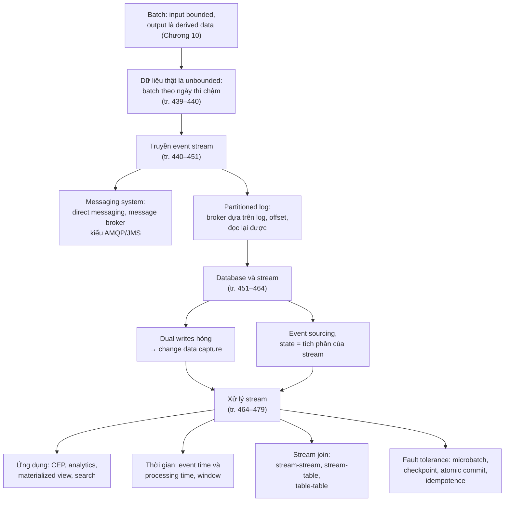

*(Sơ đồ do người viết ghi chú tổng hợp từ tr. 439–481.)*

### Liên hệ với các chương khác

| Ý trong chương 11 | Liên hệ | Căn cứ |
| --- | --- | --- |
| Bounded input, derived data, system of record, MapReduce, sort-merge join, map-side hash join, sessionization | **Chương 10** và phần giới thiệu Part III ([chapter-10.md](chapter-10.md)) | tr. 439, 454, 464, 472–474 |
| Message broker, message-passing dataflow, actor, so sánh broker và nối các topic | **Chương 4** ([B7.3](chapter-04.md#message-passing), [actor](chapter-04.md#actors)) | tr. 441, 464, 468, 479 |
| Webhook là request HTTP hay RPC trực tiếp | **Chương 4** ([B7.2](chapter-04.md#dataflow-services)) | tr. 443 |
| Idempotence để thử lại an toàn | **Chương 4** ([vấn đề của RPC](chapter-04.md#rpc-problems)) | tr. 478 |
| Encoding event (text, JSON, nhị phân) | **Chương 4** ([B1](chapter-04.md#b1)) | tr. 440 |
| Log, log-structured storage, WAL | **Chương 3** ([B1.2](chapter-03.md#log), [B4.3](chapter-03.md#wal)) | tr. 447, 480 |
| Log compaction và tombstone | **Chương 3** ([B2.2](chapter-03.md#compaction)) | tr. 456 |
| Data warehouse, ETL, fact table của star schema, materialized view, Bloom filter | **Chương 3** ([B7.2](chapter-03.md#data-warehouse), [B7.4](chapter-03.md#star-schema), [B8.7](chapter-03.md#materialized-views), [B3.4](chapter-03.md#lsm-optimizations)) | tr. 452, 458, 466, 467 |
| Consumer offset giống log sequence number; initial snapshot giống thêm follower mới | **Chương 5** ([B1.2](chapter-05.md#new-followers)) | tr. 449, 455 |
| Replication log là một stream; CDC đọc log; trigger-based replication | **Chương 5** ([B1.4](chapter-05.md#replication-logs), [logical log](chapter-05.md#logical-log), [trigger](chapter-05.md#trigger-based)) | tr. 452, 455 |
| Replication lag, read-your-writes | **Chương 5** ([B2](chapter-05.md#b2), [B2.1](chapter-05.md#read-your-writes)) | tr. 455, 462 |
| Dual writes giống multi-leader; version vector để phát hiện ghi đồng thời | **Chương 5** ([B3](chapter-05.md#multi-leader), [B4.5](chapter-05.md#concurrent-writes)) | tr. 453 |
| Head-of-line blocking, percentile, timeline của Twitter | **Chương 1** ([hol-blocking](chapter-01.md#hol-blocking), [percentile](chapter-01.md#percentile-calc), [B4.1](chapter-01.md#load-parameters)) | tr. 449, 462, 466, 474 |
| Normalization và denormalization | **Chương 2** ([B2.3](chapter-02.md#relationships)) | tr. 462 |
| Partition log để vượt sức một đĩa | **Chương 6** ([chapter-06.md](chapter-06.md)) | tr. 447 |
| "Replication and Durability", multi-object transaction, snapshot isolation, actual serial execution | **Chương 7** ([chapter-07.md](chapter-07.md)) | tr. 442, 462–463, 479 |
| Đồng hồ time-of-day, nghẽn mạng, TCP và UDP, đồng hồ thiết bị, fencing | **Chương 8** ([chapter-08.md](chapter-08.md)) | tr. 440, 442, 469, 471, 478 |
| Total order broadcast, 2PC, XA, exactly-once message processing, consensus | **Chương 9** ([chapter-09.md](chapter-09.md)) | tr. 443, 445, 452, 459, 462, 477 |
| Event chạm nhiều partition, xử lý nhiều partition, luật về dữ liệu cá nhân | **Chương 12** ([chapter-12.md](chapter-12.md)) | tr. 463, 464, 468 |

> **Bản đồ đầu chương (tr. 438).** Bản đồ in xoay ngang trên trang. Ở phía đông là vùng **Message Queues** (AMQP, JMS) và một chảo ăng-ten **Sensors**. Từ đó một dòng sông chảy về phía tây qua **Forest of Logs** (Kafka, Kinesis) và dãy **Mountains of State** (Event sourcing, Change data capture). Phía bắc dòng sông là một cây cầu gần Samza và Kafka Streams; từ cầu tỏa ra vùng **Stream Analytics** (Esper, Flink, Storm, Spark Streaming, Dataflow), vùng **CEP** và sa mạc **Sands of Time** có "The Window" và "The Old Clock Tower". Phía tây là vùng **Materialized View Maintenance** với ETL và nhánh "To Databases", men theo con đường "The Great Event Stream". Bờ tây giáp **Sea of Derived Data**; một con tàu đi "To Batch Processing (Chapter 10) and Data Integration (Chapter 12)".
>
> *Diễn giải của người viết ghi chú:* bố cục bản đồ đi theo đúng trình tự của chương. Nguồn event (cảm biến, message queue) ở một đầu; log và state (Kafka, CDC, event sourcing) ở giữa; các cách dùng stream (analytics, CEP, materialized view) ở đầu kia. "The Window" và "The Old Clock Tower" ứng với phần window và lập luận về thời gian ([B3.2](#reasoning-about-time)).

---

<a id="b-chi-tiet"></a>

## B. Giải thích chi tiết

<a id="b1"></a>

### B1. Transmitting Event Streams (tr. 440–451)

<a id="events"></a>

#### B1.0 Event, producer, consumer, topic (tr. 440–441)

**Câu hỏi mở đầu** (tr. 440). Trong batch processing, input và output của job là **file** (có thể trên distributed filesystem). Bên streaming, thứ tương đương trông thế nào?

**What — event.** Khi input là file (chuỗi byte), bước xử lý đầu tiên thường là parse nó thành chuỗi **bản ghi**. Trong stream processing, bản ghi thường được gọi là ***event***, nhưng về bản chất là một: một **object nhỏ, tự chứa, bất biến** (*immutable*), mô tả chi tiết **một việc đã xảy ra** tại một thời điểm. Event thường mang **timestamp** cho biết nó xảy ra lúc nào theo **đồng hồ time-of-day** ("Monotonic Versus Time-of-Day Clocks", tr. 288, Chương 8) (tr. 440).

**Example** (tr. 440). Việc đã xảy ra có thể là **hành động của người dùng** (xem một trang, mua hàng), hoặc xuất phát từ **máy móc** (số đo định kỳ của cảm biến nhiệt độ, metric mức dùng CPU). Trong ví dụ phân tích log ở Chương 10 ("Batch Processing with Unix Tools", tr. 391), **mỗi dòng log** của web server là một event.

**Encoding** (tr. 440). Event có thể được mã hóa thành chuỗi văn bản, JSON, hoặc dạng nhị phân ([Chương 4](chapter-04.md#b1)). Mã hóa cho phép **lưu** event (nối vào file, insert vào bảng quan hệ, ghi vào document database) và **gửi** event qua mạng tới node khác để xử lý.

**Producer, consumer, topic** (tr. 440–441). Trong batch, một file được **ghi một lần** rồi có thể được **nhiều job đọc**. Tương tự, trong streaming, một event được **sinh một lần** bởi ***producer*** (còn gọi *publisher*, *sender*), rồi có thể được **nhiều *consumer*** (*subscriber*, *recipient*) xử lý [3]. Trong filesystem, **tên file** định danh một tập bản ghi liên quan; trong hệ thống streaming, các event liên quan thường được gom vào một ***topic*** hay ***stream***.

| Batch (Chương 10) | Streaming (Chương 11) |
| --- | --- |
| Bản ghi (record) | Event |
| File, ghi một lần | Event, sinh một lần bởi producer |
| Nhiều job đọc cùng một file | Nhiều consumer xử lý cùng một event |
| Tên file gom các bản ghi liên quan | Topic hay stream gom các event liên quan |

<a id="polling"></a>

**Vì sao không dùng file hay database rồi polling?** (tr. 441).

- **Về nguyên tắc là đủ:** producer ghi mọi event vào datastore, mỗi consumer **định kỳ polling** để xem có event nào mới kể từ lần chạy trước. Đó gần như chính là việc batch process làm khi xử lý dữ liệu một ngày vào cuối ngày.
- **Nhưng khi muốn xử lý liên tục, độ trễ thấp**, polling trở nên **tốn kém** nếu datastore không được thiết kế cho kiểu dùng này. Poll càng thường xuyên, **tỷ lệ request trả về event mới càng thấp**, nên chi phí phụ càng cao. Tốt hơn là consumer được **thông báo** khi có event mới.
- **Database truyền thống hỗ trợ thông báo kém.** Relational database thường có **trigger**, phản ứng được với thay đổi (ví dụ một hàng được insert), nhưng trigger **rất hạn chế** và là thứ **"nghĩ thêm về sau"** trong thiết kế database [4, 5]. Vì vậy người ta phát triển **công cụ chuyên dụng** để giao thông báo event.

> **Bổ sung ngoài sách (phép tính).** Giả sử một topic có trung bình 1 event mỗi phút. Consumer poll mỗi giây sẽ gửi 60 request mỗi phút mà chỉ 1 request có dữ liệu mới, tức khoảng 98% request là vô ích. Muốn độ trễ 100 ms thì phải poll 600 lần mỗi phút, tỷ lệ vô ích lên khoảng 99,8%. Đây là lý do sách nói poll càng dày thì chi phí phụ càng cao (tr. 441).

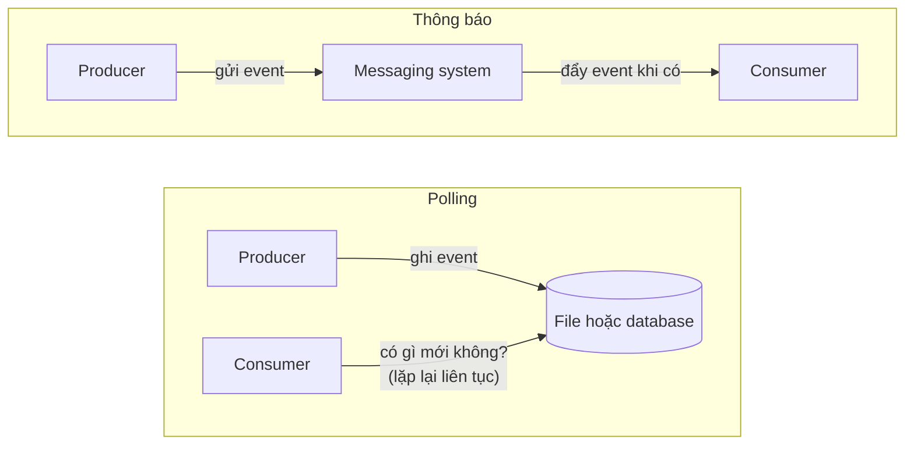

*(Sơ đồ do người viết ghi chú tổng hợp từ tr. 441.)*

<a id="messaging-systems"></a>

#### B1.1 Messaging Systems (tr. 441–446)

**What** (tr. 441). Cách phổ biến để báo cho consumer biết có event mới là dùng ***messaging system***: producer gửi một **message** chứa event, rồi message được **đẩy** tới consumer. Chương 4 đã chạm tới các hệ thống này ở "Message-Passing Dataflow" ([chương 4, B7.3](chapter-04.md#message-passing), tr. 136); chương này đi sâu hơn.

**Từ kênh trực tiếp tới publish/subscribe** (tr. 441). Một kênh liên lạc trực tiếp như **Unix pipe** hay **kết nối TCP** giữa producer và consumer là cách đơn giản để làm messaging system. Nhưng pipe và TCP chỉ nối **đúng một** người gửi với **đúng một** người nhận. Messaging system mở rộng mô hình này: **nhiều producer** gửi message vào cùng một topic, **nhiều consumer** nhận message của một topic. Trong mô hình ***publish/subscribe*** này, mỗi hệ thống chọn cách làm khác nhau, và **không có câu trả lời đúng cho mọi mục đích**.

<a id="backpressure"></a>

**Hai câu hỏi để phân biệt các hệ thống** (tr. 441–442).

**Câu hỏi 1: producer gửi nhanh hơn consumer xử lý thì sao?** Có ba lựa chọn:

| Lựa chọn | Cách làm | Ví dụ, lưu ý |
| --- | --- | --- |
| **Drop** | Bỏ message | Chấp nhận mất dữ liệu |
| **Buffer** | Đệm message trong một **hàng đợi** (*queue*) | Cần hiểu chuyện gì xảy ra khi hàng đợi lớn dần: hệ thống **crash** khi hàng đợi không còn vừa bộ nhớ, hay **ghi ra đĩa**? Nếu ghi đĩa, truy cập đĩa ảnh hưởng hiệu năng thế nào [6]? |
| ***Backpressure*** (còn gọi ***flow control***) | **Chặn** producer, không cho gửi thêm | Unix pipe và TCP dùng cách này: có một buffer nhỏ cố định; buffer đầy thì người gửi bị chặn tới khi người nhận lấy bớt dữ liệu ra ("Network congestion and queueing", tr. 282, Chương 8) |

Glossary của sách định nghĩa *backpressure* là **buộc bên gửi chậm lại** vì bên nhận không theo kịp (tr. 553).

**Câu hỏi 2: node crash hay tạm offline thì có mất message không?** Như với database, **durability** có thể cần kết hợp **ghi ra đĩa** và/hoặc **replication** (hộp "Replication and Durability", tr. 227, Chương 7), và việc đó có **giá**. Nếu chấp nhận thỉnh thoảng mất message, có thể đạt **throughput cao hơn** và **latency thấp hơn** trên cùng phần cứng (tr. 442).

**Mất message có chấp nhận được không? Tùy ứng dụng** (tr. 442).

- **Số đo cảm biến và metric gửi định kỳ:** thỉnh thoảng thiếu một điểm dữ liệu có lẽ không quan trọng, vì giá trị mới sẽ đến ngay sau đó. Nhưng cẩn thận: nếu **rất nhiều** message bị bỏ, có thể **không nhận ra ngay** rằng metric đã sai [7].
- **Đếm event:** việc giao **đáng tin cậy** quan trọng hơn nhiều, vì **mỗi message mất là một bộ đếm sai**.

**Đặt mục tiêu cho phần sau** (tr. 442). Batch processing ở Chương 10 có một tính chất đẹp: **đảm bảo độ tin cậy mạnh**. Task lỗi được **tự động thử lại**, output dở dang của task lỗi được **tự động bỏ đi**. Nhờ vậy output **giống như khi không có lỗi nào**, giúp mô hình lập trình đơn giản. Phần sau của chương ([B3.4](#fault-tolerance)) sẽ xét cách có đảm bảo tương tự trong streaming.

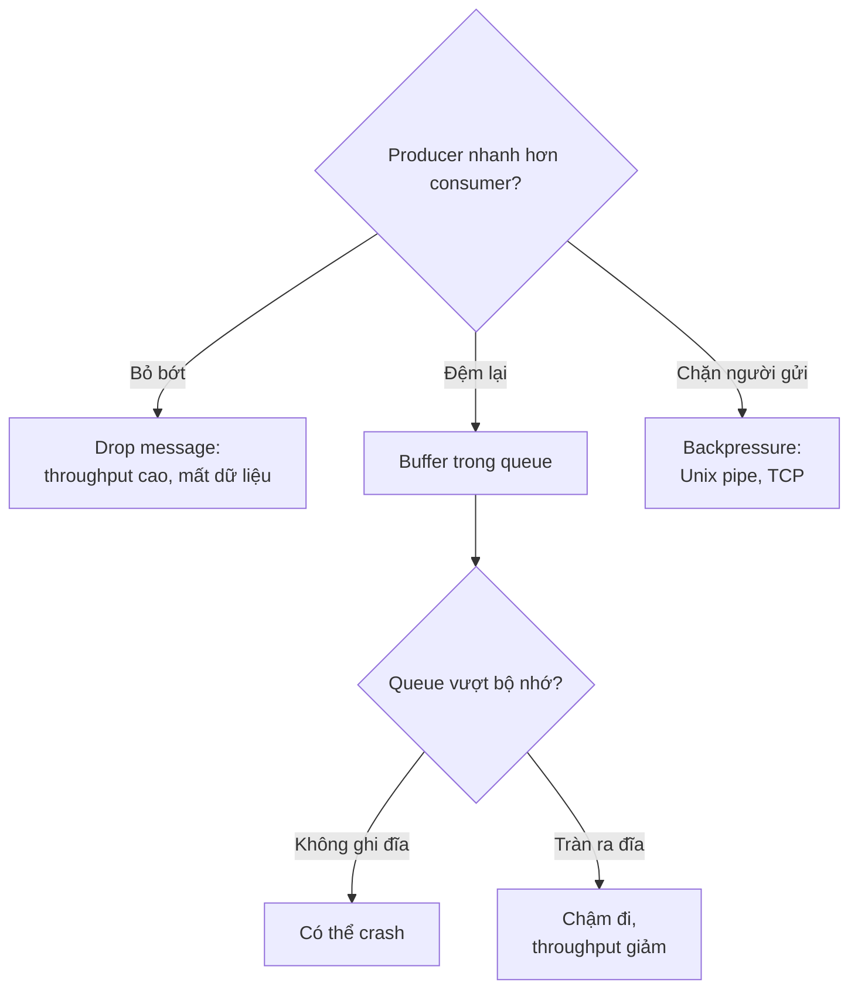

*(Sơ đồ do người viết ghi chú tổng hợp từ tr. 441–442.)*

<a id="direct-messaging"></a>

**Direct messaging from producers to consumers** (tr. 442–443). Một số messaging system cho producer và consumer **giao tiếp mạng trực tiếp**, không qua node trung gian:

| Cách | Mô tả |
| --- | --- |
| **UDP multicast** | Dùng rộng rãi trong **ngành tài chính** cho các stream như **giá chứng khoán**, nơi latency thấp là quan trọng [8]. Bản thân UDP không tin cậy, nhưng giao thức tầng ứng dụng có thể **khôi phục gói mất**: producer phải **nhớ các gói đã gửi** để gửi lại khi được yêu cầu |
| **Thư viện messaging không cần broker** | **ZeroMQ** [9] và **nanomsg** làm tương tự: publish/subscribe qua TCP hoặc IP multicast |
| **StatsD** [10], **Brubeck** [7] | Dùng UDP không tin cậy để **thu thập metric** từ mọi máy trong mạng và giám sát. Trong giao thức StatsD, metric **bộ đếm chỉ đúng nếu nhận đủ mọi message**; dùng UDP khiến metric **tối đa là xấp xỉ** [11] ("TCP Versus UDP", tr. 283, Chương 8) |
| **Webhook** | Nếu consumer phơi một service trên mạng, producer có thể gửi **request HTTP hay RPC trực tiếp** ([chương 4, B7.2](chapter-04.md#dataflow-services)) để đẩy message tới consumer. ***Webhook*** [12] là mẫu trong đó **URL callback** của một service được **đăng ký** với service khác, và service kia gửi request tới URL đó **mỗi khi có event** |

**Giới hạn của direct messaging** (tr. 443):

- Các hệ thống này chạy tốt trong tình huống chúng được thiết kế cho, nhưng thường đòi **code ứng dụng phải biết** khả năng mất message.
- Lỗi chịu được **khá hạn chế**: dù giao thức phát hiện và gửi lại gói bị mất trên mạng, chúng thường **giả định producer và consumer luôn online**.
- Consumer **offline** có thể **bỏ lỡ** message gửi trong lúc nó không với tới được.
- Một số giao thức cho producer **thử lại** lần giao thất bại, nhưng cách này hỏng nếu **producer crash**: nó mất buffer các message lẽ ra phải gửi lại.

<a id="message-brokers"></a>

**Message brokers** (tr. 443).

**What.** Cách thay thế được dùng rộng rãi là gửi message qua ***message broker*** (còn gọi ***message queue***). Về bản chất, broker là **một loại database được tối ưu cho việc xử lý message stream** [13]. Nó chạy như một **server**; producer và consumer kết nối tới nó như **client**. Producer ghi message vào broker, consumer nhận message bằng cách đọc từ broker.

**Why — tập trung dữ liệu vào broker giúp gì:**

- Hệ thống **chịu được client đến rồi đi** (kết nối, ngắt kết nối, crash) dễ hơn.
- Câu hỏi **durability được chuyển sang broker**. Có broker chỉ giữ message **trong bộ nhớ**; broker khác (tùy cấu hình) **ghi ra đĩa** để không mất khi broker crash.
- Gặp **consumer chậm**, broker thường cho **xếp hàng không giới hạn** (thay vì bỏ message hay backpressure), dù lựa chọn này cũng có thể tùy cấu hình.

**Hệ quả: consumer thường bất đồng bộ.** Khi producer gửi message, nó thường **chỉ chờ broker xác nhận đã đệm** message, **không chờ** consumer xử lý xong. Message được giao tới consumer vào một thời điểm **không xác định** trong tương lai: thường trong **chưa tới một giây**, nhưng đôi khi **trễ đáng kể** nếu hàng đợi tồn đọng.

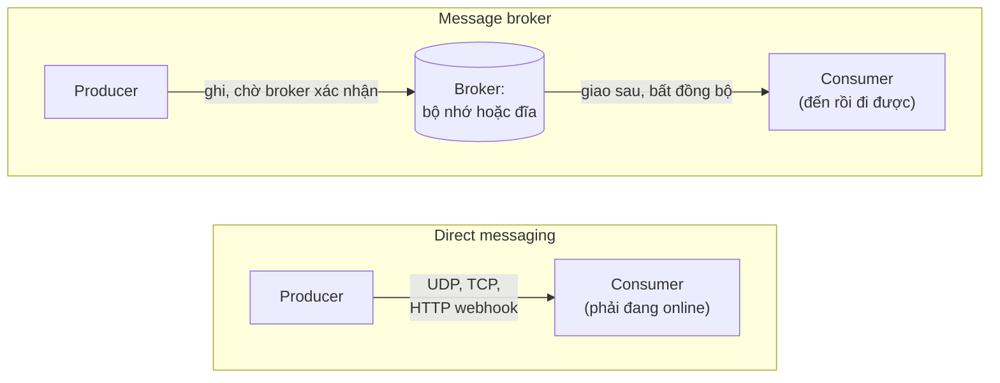

*(Sơ đồ do người viết ghi chú tổng hợp từ tr. 442–443.)*

<a id="broker-vs-database"></a>

**Message brokers compared to databases** (tr. 443–444). Một số broker còn tham gia được giao thức **two-phase commit** qua XA hay JTA ("Distributed Transactions in Practice", tr. 360, Chương 9). Tính năng này làm broker **khá giống database**, nhưng vẫn có khác biệt thực tế quan trọng:

| Khía cạnh | Database | Message broker (kiểu truyền thống) |
| --- | --- | --- |
| **Thời gian giữ dữ liệu** | Giữ tới khi bị **xóa tường minh** | Phần lớn **tự xóa** message khi đã giao thành công tới consumer, nên **không hợp lưu trữ lâu dài** |
| **Kích thước working set** | Có thể lớn | Vì xóa nhanh, phần lớn broker **giả định working set nhỏ** (hàng đợi ngắn). Nếu phải đệm nhiều message vì consumer chậm (có thể tràn ra đĩa khi không vừa bộ nhớ), **mỗi message xử lý lâu hơn** và **throughput tổng có thể giảm** [6] |
| **Chọn phần dữ liệu muốn biết** | **Secondary index** và nhiều cách tìm kiếm | **Đăng ký một tập con topic** khớp một mẫu (pattern). Cơ chế khác nhau, nhưng đều là cách để client chọn phần dữ liệu nó quan tâm |
| **Khi dữ liệu thay đổi** | Kết quả truy vấn dựa trên **snapshot tại một thời điểm**; client khác ghi làm kết quả cũ đi thì client đầu **không biết** (trừ khi truy vấn lại hoặc polling) | **Không** hỗ trợ truy vấn tùy ý, nhưng **thông báo** cho client khi dữ liệu thay đổi (khi có message mới) |

**Quan điểm truyền thống** (tr. 444). Đây là cách nhìn truyền thống về broker, được đúc kết trong các chuẩn như **JMS** [14] và **AMQP** [15], và được cài trong RabbitMQ, ActiveMQ, HornetQ, Qpid, TIBCO Enterprise Message Service, IBM MQ, Azure Service Bus và Google Cloud Pub/Sub [16].

<a id="multiple-consumers"></a>

**Multiple consumers** (tr. 444–445). Khi nhiều consumer đọc message trong cùng một topic, có hai mẫu chính (Hình 11-1):

- ***Load balancing***: mỗi message được giao tới **một** trong các consumer, nên các consumer **chia nhau** công việc xử lý message của topic. Broker có thể gán message cho consumer **tùy ý**. Mẫu này hữu ích khi message **tốn kém để xử lý**, và bạn muốn **thêm consumer để xử lý song song**. (Trong AMQP, làm bằng cách cho nhiều client cùng tiêu thụ **một queue**; trong JMS gọi là **shared subscription**.)
- ***Fan-out***: mỗi message được giao tới **mọi** consumer. Nhiều consumer độc lập cùng "bắt sóng" một luồng phát mà **không ảnh hưởng nhau**, giống **nhiều batch job đọc cùng một file input**. (JMS: **topic subscription**; AMQP: **exchange binding**.)

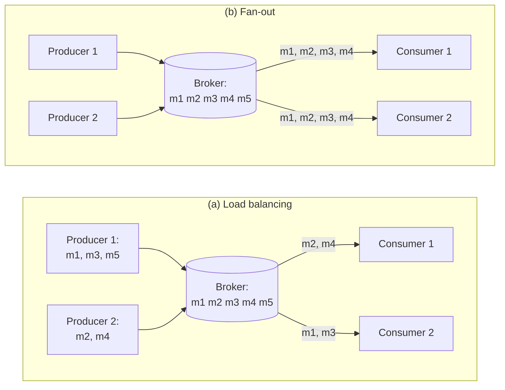

*(Vẽ lại Hình 11-1, tr. 445. Trong hình gốc, m5 vừa tới broker và chưa được giao.)*

**Kết hợp hai mẫu** (tr. 445). Ví dụ hai **nhóm** consumer riêng biệt cùng đăng ký một topic: **mỗi nhóm** nhận đủ mọi message, nhưng **trong mỗi nhóm** chỉ một node nhận mỗi message.

<a id="acks-redelivery"></a>

**Acknowledgments and redelivery** (tr. 445–446).

- **Why.** Consumer có thể crash bất cứ lúc nào: broker giao message cho consumer, nhưng consumer **chưa bao giờ xử lý**, hoặc mới **xử lý dở** thì crash.
- **What.** Để không mất message, broker dùng ***acknowledgment*** (xác nhận): client phải **nói rõ** với broker khi đã xử lý xong một message, để broker **xóa** nó khỏi hàng đợi.
- **How.** Nếu kết nối tới client bị **đóng** hoặc **timeout** mà broker chưa nhận được acknowledgment, broker **giả định message chưa được xử lý** và **giao lại** cho consumer khác.
- **Kẽ hở.** Có thể message **đã được xử lý xong**, chỉ là acknowledgment **mất trên mạng**. Xử lý trường hợp này cần một **giao thức atomic commit** ("Distributed Transactions in Practice", tr. 360, Chương 9).

**Redelivery làm đảo thứ tự** (tr. 446). Kết hợp với load balancing, việc giao lại có hiệu ứng thú vị lên **thứ tự** message. Trong Hình 11-2, các consumer nhìn chung xử lý message theo thứ tự producer gửi. Nhưng consumer 2 **crash khi đang xử lý m3**, cùng lúc consumer 1 đang xử lý m4. m3 chưa được xác nhận nên được **giao lại cho consumer 1**. Kết quả: consumer 1 xử lý theo thứ tự **m4, m3, m5**, tức m3 và m4 **không** được giao theo thứ tự producer 1 đã gửi.

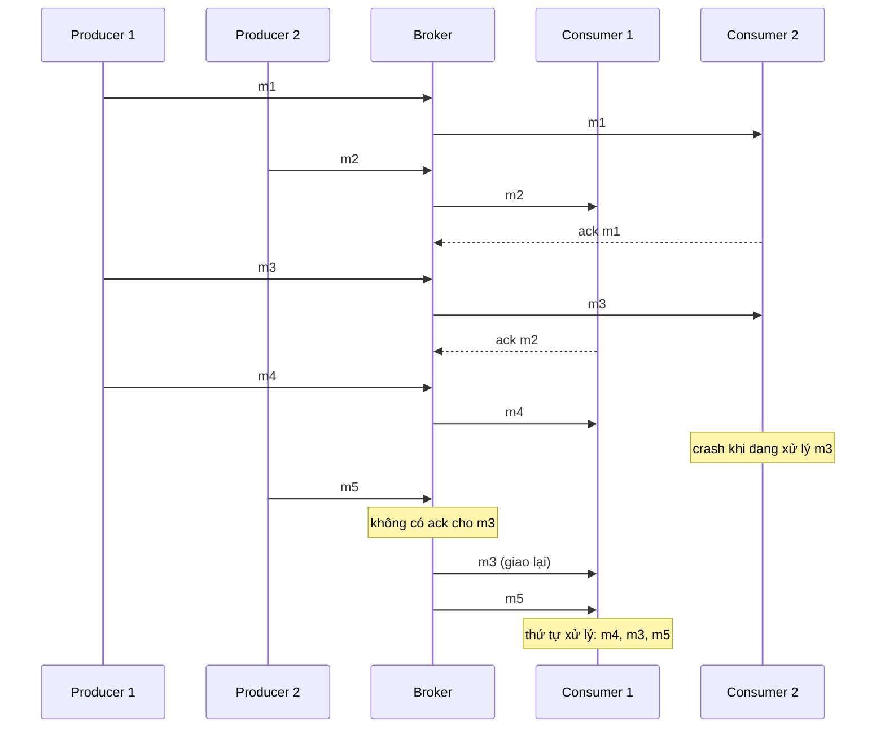

*(Vẽ lại Hình 11-2, tr. 446.)*

**Kết luận** (tr. 446):

- Kể cả khi broker **cố giữ thứ tự** message (cả chuẩn JMS lẫn AMQP đều yêu cầu), sự kết hợp **load balancing + redelivery** **không tránh khỏi** việc đảo thứ tự.
- Cách tránh: dùng **một queue riêng cho mỗi consumer** (không dùng tính năng load balancing).
- Đảo thứ tự **không thành vấn đề** nếu các message **hoàn toàn độc lập** với nhau, nhưng **quan trọng** nếu giữa chúng có **phụ thuộc nhân quả** (*causal dependency*), như sẽ thấy ở phần sau của chương ([B3.3](#join-time-dependence)).

> **Bổ sung ngoài sách.** Ngữ nghĩa giao nhận ở đây thường được gọi là ***at-least-once delivery***: nhờ acknowledgment và redelivery, message không bị mất, nhưng có thể được xử lý **hơn một lần** (khi acknowledgment bị mất). Ngược lại, nếu xóa message ngay khi giao mà không chờ xác nhận thì là *at-most-once*: không trùng nhưng có thể mất. Sách không dùng hai thuật ngữ này trong chương 11; nó dùng *exactly-once* và *effectively-once* ở [B3.4](#exactly-once).

<a id="partitioned-logs"></a>

#### B1.2 Partitioned Logs (tr. 446–451)

**Hai tư duy đối lập** (tr. 446–447).

- **Tư duy nhất thời** (*transient*). Gửi một gói tin qua mạng hay gửi request tới một network service thường là thao tác **nhất thời**, không để lại dấu vết lâu dài. Có thể ghi lại (packet capture, logging), nhưng ta thường không nghĩ như vậy. Ngay cả broker ghi message ra đĩa một cách durable cũng **xóa nhanh** message sau khi đã giao, vì chúng được xây quanh tư duy messaging nhất thời.
- **Tư duy lưu vĩnh viễn**. Database và filesystem làm ngược lại: mọi thứ ghi vào đều được kỳ vọng **lưu vĩnh viễn**, ít nhất tới khi có người chủ động xóa.

**Vì sao khác biệt này quan trọng với derived data** (tr. 447):

- Một đặc điểm then chốt của batch process là có thể **chạy đi chạy lại**, thử nghiệm các bước xử lý, mà **không sợ hỏng input** (input chỉ đọc).
- Với messaging kiểu AMQP/JMS thì không: **nhận message là thao tác phá hủy** nếu acknowledgment khiến message bị xóa khỏi broker. Không thể chạy lại cùng một consumer và kỳ vọng cùng kết quả.
- Thêm một **consumer mới** vào messaging system: nó thường chỉ nhận message gửi **sau** lúc nó đăng ký; message trước đó **đã mất, không khôi phục được**. Còn với file và database, client mới có thể đọc dữ liệu ghi **từ rất xa trong quá khứ** (miễn là chưa bị ghi đè hay xóa).

**Câu hỏi của tác giả** (tr. 447). Sao không có một **lai ghép**: lưu trữ durable của database cộng với khả năng **thông báo độ trễ thấp** của messaging? Đó là ý tưởng của ***log-based message broker***.

<a id="log-based-brokers"></a>

**Using logs for message storage** (tr. 447–448).

**What.** ***Log*** đơn giản là **chuỗi bản ghi chỉ ghi nối thêm** (*append-only*) trên đĩa. Sách đã bàn log trong log-structured storage engine và write-ahead log ([chương 3, B1.2](chapter-03.md#log), [B4.3](chapter-03.md#wal)), và trong replication ([chương 5, B1.4](chapter-05.md#replication-logs)).

**How — dùng log làm broker:**

1. Producer gửi message bằng cách **nối nó vào cuối log**.
2. Consumer nhận message bằng cách **đọc log tuần tự**.
3. Đọc tới cuối log thì consumer **chờ thông báo** có message mới được nối thêm. Công cụ Unix `tail -f`, vốn theo dõi một file được nối thêm dữ liệu, hoạt động về cơ bản như vậy.

**Partition hóa để vượt sức một đĩa** (tr. 447). Muốn throughput cao hơn một đĩa cho phép, log có thể được **partition** (theo nghĩa của [Chương 6](chapter-06.md#partition-definition)). Các partition đặt trên **các máy khác nhau**; mỗi partition là **một log riêng**, đọc và ghi **độc lập** với partition khác. Một **topic** khi đó là **một nhóm partition** cùng mang message **cùng loại** (Hình 11-3).

**Offset và thứ tự** (tr. 447). Trong mỗi partition, broker gán cho mỗi message một **số thứ tự tăng đơn điệu**, gọi là ***offset***. Số thứ tự này có nghĩa vì partition **chỉ nối thêm**, nên message **trong một partition** có **thứ tự toàn phần** (*totally ordered*). **Không có đảm bảo thứ tự giữa các partition** khác nhau.

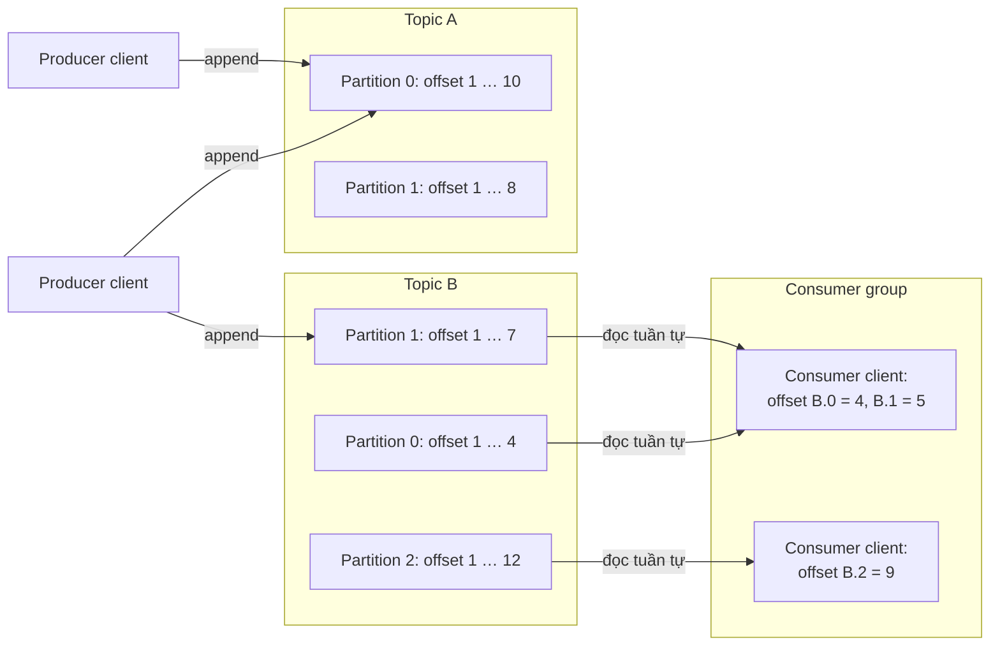

*(Vẽ lại Hình 11-3, tr. 448. Mỗi ô số trong hình gốc là một message với offset của nó.)*

**Ai dùng** (tr. 448). **Apache Kafka** [17, 18], **Amazon Kinesis Streams** [19] và **DistributedLog** của Twitter [20, 21] là các log-based broker hoạt động như vậy. **Google Cloud Pub/Sub** có kiến trúc tương tự nhưng phơi ra API **kiểu JMS** thay vì abstraction dạng log [16]. Dù ghi **mọi message ra đĩa**, các broker này đạt throughput **hàng triệu message mỗi giây** nhờ partition qua nhiều máy, và **chịu lỗi** nhờ replication message [22, 23].

> **Bổ sung ngoài sách.** Trong Kafka, producer thường chọn partition theo **hash của key** của message (ví dụ user ID). Nhờ vậy mọi message cùng key nằm trong cùng partition và được đọc **theo đúng thứ tự ghi**, dù giữa các partition không có thứ tự. Đây là cách phổ biến để có "thứ tự theo từng thực thể" mà vẫn mở rộng được.

<a id="logs-vs-messaging"></a>

**Logs compared to traditional messaging** (tr. 448–449).

- **Fan-out: có sẵn, gần như miễn phí.** Nhiều consumer đọc log **độc lập** mà không ảnh hưởng nhau, vì **đọc message không xóa** nó khỏi log.
- **Load balancing: theo partition.** Thay vì gán **từng message** cho consumer, broker gán **cả partition** cho các node trong ***consumer group***. Mỗi client tiêu thụ **mọi** message trong các partition được gán cho nó, thường đọc **tuần tự, đơn luồng**.

**Nhược điểm của cách chia tải "thô" này** (tr. 449):

1. **Số node chia nhau tiêu thụ một topic tối đa bằng số partition** của topic, vì message trong cùng partition được giao tới cùng một node.
2. Một message **xử lý chậm** sẽ **chặn** các message sau nó trong cùng partition (một dạng ***head-of-line blocking***, xem [chương 1](chapter-01.md#hol-blocking), "Describing Performance", tr. 13).

> Chú thích i (tr. 449). Vẫn có thể cho **hai consumer chia nhau một partition**: cả hai đọc toàn bộ message, nhưng một bên chỉ xử lý message có offset **chẵn**, bên kia xử lý offset **lẻ**. Hoặc rải việc xử lý message ra một **thread pool**, nhưng cách đó làm **quản lý consumer offset phức tạp hơn**. Nói chung, nên xử lý mỗi partition **đơn luồng**, và tăng song song bằng cách **dùng nhiều partition hơn**.

**Khi nào chọn kiểu nào** (tr. 449):

| Tình huống | Nên chọn |
| --- | --- |
| Message **tốn kém** để xử lý, muốn song song hóa **theo từng message**, thứ tự **không quan trọng lắm** | Broker kiểu **JMS/AMQP** |
| **Throughput cao**, mỗi message xử lý **nhanh**, thứ tự **quan trọng** | Broker **dựa trên log** |

<a id="consumer-offsets"></a>

**Consumer offsets** (tr. 449).

- **What.** Đọc partition tuần tự khiến việc biết message nào **đã xử lý** trở nên dễ: mọi message có offset **nhỏ hơn** offset hiện tại của consumer đã được xử lý; mọi message có offset **lớn hơn** chưa được thấy.
- **Why tốt.** Broker **không cần theo dõi acknowledgment cho từng message**, chỉ cần **định kỳ ghi lại consumer offset**. Bớt sổ sách, cộng với cơ hội **gom lô** (*batching*) và **pipelining**, giúp tăng throughput của hệ thống dựa trên log.
- **Liên hệ Chương 5.** Offset này **rất giống log sequence number** trong single-leader replication ([chương 5, B1.2](chapter-05.md#new-followers), "Setting Up New Followers", tr. 155). Trong replication, log sequence number cho follower **kết nối lại** leader sau khi mất kết nối và **tiếp tục** nhân bản mà không bỏ sót lần ghi nào. Nguyên lý ở đây **y hệt**: broker đóng vai **leader**, consumer đóng vai **follower**.
- **Khi consumer hỏng.** Một node khác trong consumer group được gán các partition của consumer hỏng, và bắt đầu tiêu thụ từ **offset được ghi lại cuối cùng**. Nếu consumer cũ **đã xử lý** một số message sau đó nhưng **chưa kịp ghi offset**, những message này sẽ được **xử lý lần thứ hai** khi khởi động lại. Sách bàn cách xử lý ở [B3.4](#fault-tolerance).

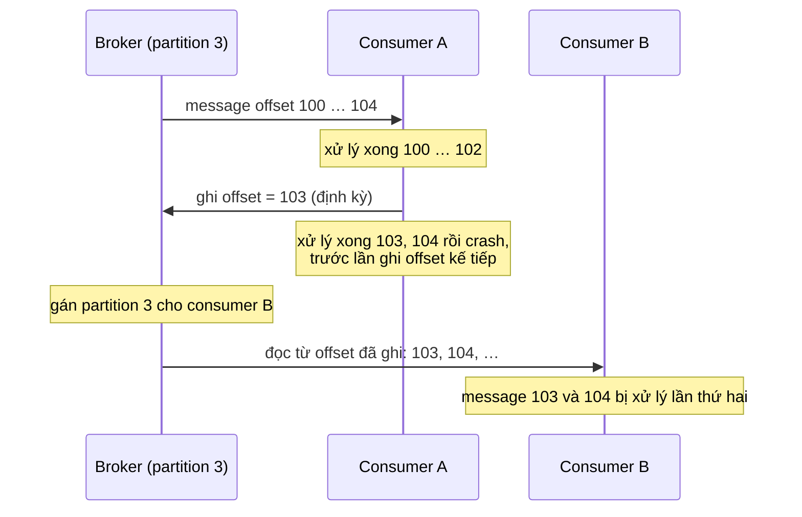

*(Ví dụ minh họa do AI xây dựng cho đoạn tr. 449. Ở đây "offset đã ghi" được hiểu là message tiếp theo cần đọc; quy ước này và các số offset là giả định để minh họa.)*

<a id="disk-space"></a>

**Disk space usage** (tr. 450).

- **Vấn đề.** Chỉ nối thêm thì sớm muộn **hết đĩa**. Để thu hồi chỗ, log thực ra được chia thành ***segment***, và thỉnh thoảng các segment **cũ bị xóa** hoặc **chuyển sang kho lưu trữ**. (Một cách tinh vi hơn để giải phóng đĩa sẽ được bàn sau: [log compaction](#log-compaction).)
- **Hệ quả.** Nếu một consumer chậm **tụt lại xa** tới mức offset của nó trỏ vào segment **đã bị xóa**, nó sẽ **bỏ lỡ** một số message. Thực chất, log là một **buffer kích thước giới hạn**, bỏ message cũ khi đầy, còn gọi là ***circular buffer*** hay ***ring buffer***. Nhưng vì buffer nằm **trên đĩa**, nó có thể **khá lớn**.

**Phép tính sơ bộ của tác giả** (tr. 450). Lúc viết sách, một ổ cứng lớn điển hình có dung lượng **6 TB** và throughput ghi tuần tự **150 MB/s**. Ghi message với tốc độ tối đa thì mất khoảng **11 giờ** để đầy ổ. Vậy đĩa đệm được **11 giờ** message, sau đó bắt đầu ghi đè message cũ. **Tỷ lệ này giữ nguyên** dù dùng nhiều ổ và nhiều máy. Trên thực tế, triển khai **hiếm khi dùng hết** băng thông ghi của đĩa, nên log thường giữ được **vài ngày, thậm chí vài tuần** message.

> **Bổ sung ngoài sách (phép tính).** 6 TB ÷ 150 MB/s = 6 000 000 MB ÷ 150 MB/s = 40 000 giây ≈ 11,1 giờ, khớp với con số "khoảng 11 giờ" của sách. Nếu chỉ dùng 10% băng thông ghi (15 MB/s), cùng ổ đĩa đó giữ được khoảng 111 giờ, tức hơn 4,6 ngày. Tỷ lệ không đổi khi thêm máy vì cả dung lượng lẫn băng thông ghi đều tăng cùng hệ số.

**Throughput ổn định** (tr. 450). Dù giữ message bao lâu, throughput của log **gần như không đổi**, vì **mọi message đều được ghi ra đĩa** [18]. Ngược lại, các messaging system mặc định giữ message **trong bộ nhớ** và chỉ ghi ra đĩa khi hàng đợi quá lớn thì **nhanh khi hàng đợi ngắn** và **chậm hẳn khi bắt đầu ghi đĩa**: throughput **phụ thuộc lượng lịch sử đang giữ**.

<a id="slow-consumers"></a>

**When consumers cannot keep up with producers** (tr. 450–451).

- **Xếp vào phân loại cũ.** Nhớ lại ba lựa chọn ở [B1.1](#backpressure): bỏ message, đệm, hoặc backpressure. Log-based broker là một dạng **đệm** với buffer **lớn nhưng cố định** (giới hạn bởi dung lượng đĩa).
- **Khi tụt quá xa.** Nếu consumer tụt lại tới mức message nó cần **cũ hơn** những gì còn giữ trên đĩa, nó **không đọc được** các message đó: broker thực chất **bỏ** các message cũ vượt quá kích thước buffer.
- **Giám sát.** Có thể theo dõi consumer **tụt sau đầu log bao xa** và **cảnh báo** khi tụt nhiều. Vì buffer lớn, có **đủ thời gian** để người vận hành sửa consumer chậm và cho nó bắt kịp trước khi bắt đầu mất message.
- **Chỉ consumer đó bị ảnh hưởng.** Kể cả khi một consumer tụt quá xa và mất message, **các consumer khác không bị gián đoạn**. Đây là **lợi thế vận hành lớn**: có thể **thử nghiệm** tiêu thụ log production cho mục đích phát triển, test hay debug mà **không lo làm hỏng** dịch vụ production. Consumer bị tắt hay crash thì **ngừng tiêu tốn tài nguyên**; thứ duy nhất còn lại là **consumer offset** của nó.
- **So với broker truyền thống.** Phải cẩn thận **xóa các queue** mà consumer đã bị tắt; nếu không, queue tiếp tục **tích lũy message vô ích** và **chiếm bộ nhớ** của các consumer còn hoạt động.

> **Bổ sung ngoài sách.** Khoảng cách giữa offset mới nhất của partition và offset của consumer thường được gọi là ***consumer lag***. Đây là metric giám sát chính của hệ thống dựa trên log, tương tự cách đo replication lag bằng hiệu hai vị trí log ở [chương 5](chapter-05.md#monitoring-staleness).

<a id="replay"></a>

**Replaying old messages** (tr. 451).

- **Broker AMQP/JMS:** xử lý và xác nhận message là thao tác **phá hủy**, vì message bị xóa trên broker.
- **Log-based broker:** tiêu thụ message giống **đọc file**: thao tác **chỉ đọc**, **không thay đổi log**. Tác động phụ duy nhất của việc xử lý, ngoài output của consumer, là **consumer offset tiến lên**.
- **Offset nằm trong tay consumer**, nên dễ chỉnh khi cần. Ví dụ: chạy một **bản sao** của consumer với **offset của hôm qua** và ghi output ra **chỗ khác**, để **xử lý lại** message của ngày hôm qua. Có thể lặp lại **bao nhiêu lần cũng được**, mỗi lần thay đổi code xử lý.
- **Ý nghĩa.** Điều này làm log-based messaging **giống batch process** của chương trước: derived data **tách rõ** khỏi input qua một quá trình biến đổi **lặp lại được**. Nó cho phép **thử nghiệm nhiều hơn**, **phục hồi dễ hơn** sau lỗi và bug, nên là công cụ tốt để **tích hợp các luồng dữ liệu** trong một tổ chức [24].

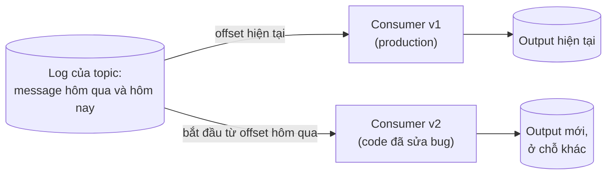

*(Sơ đồ do người viết ghi chú tổng hợp từ tr. 451.)*

---

<a id="b2"></a>

### B2. Databases and Streams (tr. 451–464)

<a id="db-streams"></a>

#### B2.0 Ghi vào database cũng là một event (tr. 451–452)

**Đi theo chiều ngược lại** (tr. 451). Ở B1, log-based broker đã thành công nhờ **lấy ý tưởng từ database** đưa vào messaging. Có thể làm **ngược lại**: lấy ý tưởng từ messaging và stream đưa vào database.

**Lập luận từng bước** (tr. 451–452):

1. Event là **bản ghi về một việc đã xảy ra** tại một thời điểm.
2. Việc đã xảy ra có thể là hành động của người dùng (gõ một truy vấn tìm kiếm), số đo cảm biến, **và cũng có thể là một lần ghi vào database**.
3. "Đã có thứ được ghi vào database" là một event có thể được **capture, lưu trữ và xử lý**.
4. Vậy quan hệ giữa database và stream **sâu hơn** chuyện cả hai cùng lưu log trên đĩa: nó **mang tính căn bản**.

**Bằng chứng 1: replication log** (tr. 452). ***Replication log*** ([chương 5, B1.4](chapter-05.md#replication-logs), tr. 158) chính là **một stream các event ghi vào database**, do leader sinh ra khi xử lý transaction. Follower áp dụng stream đó vào bản sao của mình và nhờ vậy có **bản sao chính xác** của cùng dữ liệu. Các event trong replication log **mô tả các thay đổi dữ liệu** đã xảy ra.

**Bằng chứng 2: state machine replication** (tr. 452). Nguyên lý ***state machine replication*** ("Total Order Broadcast", tr. 348, [Chương 9](chapter-09.md#total-order-broadcast)): nếu **mỗi event là một lần ghi** vào database, và **mọi replica xử lý cùng các event theo cùng thứ tự**, thì mọi replica sẽ đi tới **cùng trạng thái cuối**. (Xử lý một event được giả định là thao tác **tất định**.) Đó lại là một trường hợp của event stream.

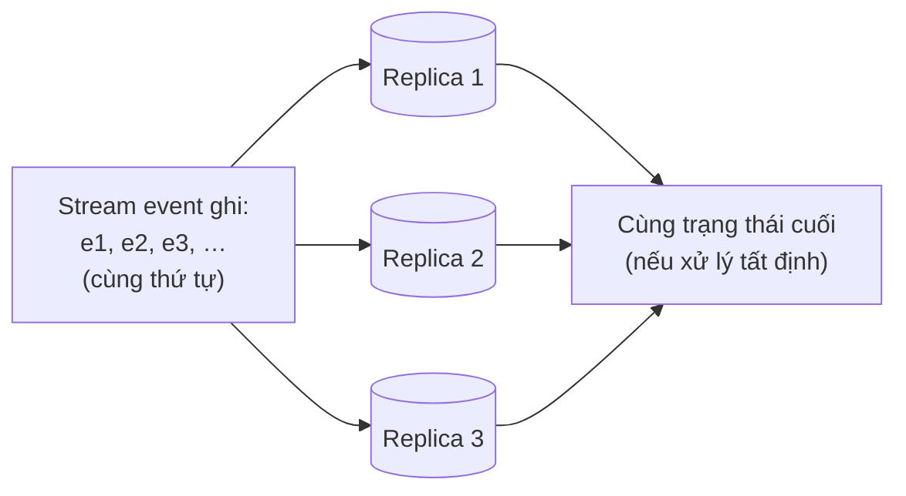

*(Sơ đồ do người viết ghi chú tổng hợp từ tr. 452.)*

**Lộ trình của mục** (tr. 452). Trước hết xét một vấn đề nảy sinh trong **hệ thống dữ liệu dị chủng** (*heterogeneous*), rồi giải quyết nó bằng cách đưa ý tưởng event stream vào database.

<a id="keeping-in-sync"></a>

#### B2.1 Keeping Systems in Sync (tr. 452–453)

**Bối cảnh** (tr. 452). Như đã thấy suốt cuốn sách, **không có hệ thống nào** đáp ứng được mọi nhu cầu lưu trữ, truy vấn và xử lý dữ liệu. Ứng dụng không tầm thường thường phải **ghép nhiều công nghệ**:

- **OLTP database** phục vụ request của người dùng;
- **cache** tăng tốc request phổ biến;
- **full-text index** cho truy vấn tìm kiếm;
- **data warehouse** cho phân tích.

Mỗi thứ giữ **bản sao dữ liệu riêng**, ở **dạng biểu diễn riêng** tối ưu cho mục đích của nó. Khi cùng một dữ liệu (hoặc dữ liệu liên quan) xuất hiện ở nhiều nơi, chúng phải được **giữ đồng bộ**: một item được cập nhật trong database thì cũng phải được cập nhật trong cache, search index và data warehouse.

**Cách 1: batch định kỳ** (tr. 452). Với data warehouse, việc đồng bộ thường do quá trình **ETL** ([chương 3, B7.2](chapter-03.md#data-warehouse), "Data Warehousing", tr. 91) đảm nhận, thường bằng cách **lấy bản sao toàn bộ** database, biến đổi rồi **nạp hàng loạt** vào warehouse, tức một **batch process**. Search index, hệ thống gợi ý và các hệ thống derived data khác cũng có thể được tạo bằng batch ("The Output of Batch Workflows", tr. 411, [Chương 10](chapter-10.md#batch-output)).

<a id="dual-writes"></a>

**Cách 2: dual writes** (tr. 452). Nếu dump toàn bộ database định kỳ là **quá chậm**, một cách thay thế đôi khi được dùng là ***dual writes***: **code ứng dụng tự ghi tường minh vào từng hệ thống** khi dữ liệu thay đổi. Ví dụ ghi vào database trước, rồi cập nhật search index, rồi invalidate các mục trong cache (hoặc làm các lần ghi đó **đồng thời**).

**Vấn đề 1 của dual writes: race condition** (tr. 452–453, Hình 11-4). Hai client cùng lúc muốn cập nhật item X: client 1 muốn đặt giá trị A, client 2 muốn đặt giá trị B. Cả hai **ghi database trước, rồi ghi search index**. Do thời điểm xui, các request **đan xen**:

- Database thấy lần ghi của client 1 (đặt A) **trước**, rồi của client 2 (đặt B): giá trị cuối là **B**.
- Search index thấy lần ghi của client 2 **trước**, rồi của client 1: giá trị cuối là **A**.

Hai hệ thống giờ **bất nhất vĩnh viễn**, dù **không có lỗi nào xảy ra**.

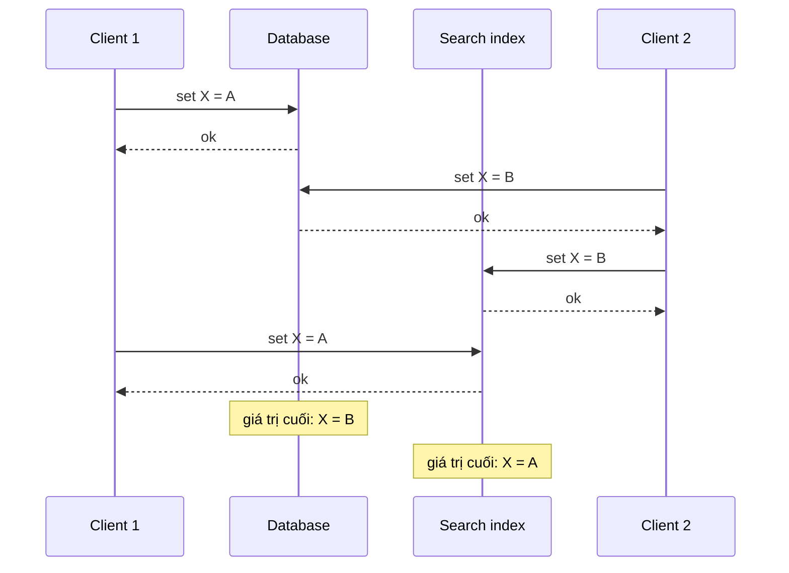

*(Vẽ lại Hình 11-4, tr. 453.)*

- Trừ khi có thêm cơ chế **phát hiện ghi đồng thời**, như version vector ([chương 5, B4.5](chapter-05.md#concurrent-writes), "Detecting Concurrent Writes", tr. 184), bạn thậm chí **không nhận ra** đã có ghi đồng thời: một giá trị cứ thế **âm thầm ghi đè** giá trị kia (tr. 453).

**Vấn đề 2 của dual writes: một lần ghi thất bại** (tr. 453). Một lần ghi có thể **thất bại** trong khi lần kia **thành công**. Đây là vấn đề **fault tolerance**, không phải vấn đề đồng thời, nhưng hậu quả cũng là hai hệ thống bất nhất. Bảo đảm **cả hai cùng thành công hoặc cùng thất bại** là bài toán ***atomic commit***, **tốn kém** để giải ("Atomic Commit and Two-Phase Commit (2PC)", tr. 354, [Chương 9](chapter-09.md#2pc)).

**Chẩn đoán gốc rễ: không có một leader duy nhất** (tr. 453).

- Nếu chỉ có **một database nhân bản với single leader**, leader **quyết định thứ tự ghi**, nên state machine replication hoạt động giữa các replica.
- Trong Hình 11-4 **không có leader duy nhất**: database có thể có leader, search index có thể có leader, nhưng **không cái nào theo cái nào**, nên **xung đột** có thể xảy ra, giống multi-leader replication ([chương 5, B3](chapter-05.md#multi-leader), tr. 168).
- Tình hình sẽ tốt hơn nếu thật sự chỉ có **một leader**, ví dụ database, và **biến search index thành follower** của database. Nhưng làm vậy trong thực tế được không? Mục tiếp theo trả lời.

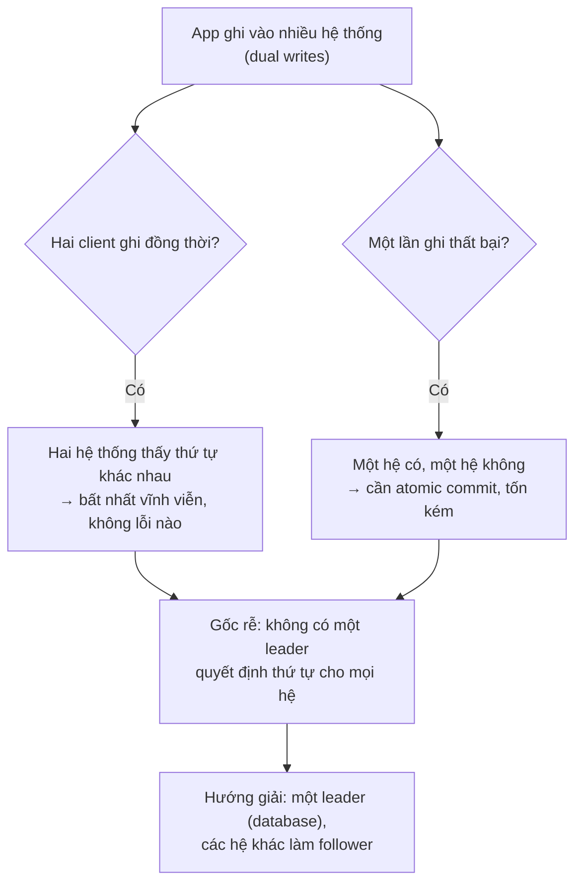

*(Sơ đồ do người viết ghi chú tổng hợp từ tr. 452–453.)*

<a id="cdc"></a>

#### B2.2 Change Data Capture (tr. 454–457)

**Why — vấn đề lâu năm** (tr. 454). Replication log của phần lớn database từ lâu được coi là **chi tiết cài đặt nội bộ**, không phải **API công khai**. Client được kỳ vọng truy vấn database qua **mô hình dữ liệu và ngôn ngữ truy vấn**, không phải parse replication log để trích dữ liệu. Suốt nhiều thập kỷ, nhiều database **không có cách được tài liệu hóa** để lấy log các thay đổi đã ghi vào nó. Vì vậy rất khó lấy mọi thay đổi trong một database và nhân bản sang một **công nghệ lưu trữ khác** như search index, cache hay data warehouse.

**What** (tr. 454). Gần đây có sự quan tâm ngày càng lớn tới ***change data capture* (CDC)**: quá trình **quan sát mọi thay đổi dữ liệu** được ghi vào một database và **trích chúng ra** ở dạng có thể **nhân bản sang hệ thống khác**. CDC đặc biệt thú vị nếu thay đổi được cung cấp **dưới dạng stream, ngay khi được ghi**.

**Example** (tr. 454). Capture thay đổi trong database và **liên tục áp dụng cùng các thay đổi** vào search index. Nếu log thay đổi được áp dụng **theo cùng thứ tự**, có thể kỳ vọng dữ liệu trong search index **khớp** với database. Search index và mọi hệ thống derived data khác **chỉ là consumer của change stream** (Hình 11-5).

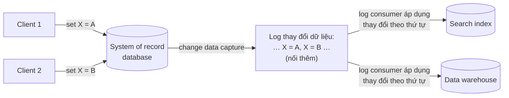

*(Vẽ lại Hình 11-5, tr. 454: lấy dữ liệu theo thứ tự đã ghi vào một database, rồi áp dụng thay đổi cho các hệ thống khác theo cùng thứ tự.)*

<a id="implementing-cdc"></a>

**Implementing change data capture** (tr. 454–455).

- **Derived data system.** Có thể gọi các log consumer là ***derived data system***, như phần giới thiệu Part III ([Chương 10](chapter-10.md#derived-data), tr. 386): dữ liệu trong search index và data warehouse chỉ là **một góc nhìn khác** lên dữ liệu trong ***system of record***. CDC là cơ chế bảo đảm **mọi thay đổi** ở system of record **cũng phản ánh** vào derived data system, để chúng có **bản sao chính xác**.
- **Bản chất: biến một database thành leader** (tr. 455). CDC về cơ bản biến **một database thành leader** (database bị capture thay đổi) và **biến các hệ thống khác thành follower**. Đây chính là lời giải cho câu hỏi cuối của [B2.1](#dual-writes).
- **Phương tiện vận chuyển.** Log-based broker **rất hợp** để chở change event từ database nguồn, vì nó **giữ thứ tự** message (tránh vấn đề đảo thứ tự ở [Hình 11-2](#acks-redelivery)).

Glossary của sách: *system of record* (còn gọi *source of truth*) giữ **phiên bản có thẩm quyền** của dữ liệu; thay đổi được ghi vào đó **trước**, các dataset khác có thể dẫn xuất từ nó (tr. 557). *Derived data* là dataset tạo từ dữ liệu khác qua một quá trình **lặp lại được**; index, cache, materialized view là ví dụ (tr. 554).

**Hai cách cài CDC** (tr. 455):

| Cách | Mô tả | Đánh giá |
| --- | --- | --- |
| **Trigger** | Đăng ký trigger quan sát mọi thay đổi trên các bảng dữ liệu, thêm bản ghi tương ứng vào một **bảng changelog** ([trigger-based replication](chapter-05.md#trigger-based), tr. 161) | **Dễ vỡ**, **tốn hiệu năng đáng kể** |
| **Parse replication log** | Đọc log nhân bản của database | **Bền vững hơn**, nhưng cũng có thách thức, như xử lý **thay đổi schema** |

**Ai dùng** (tr. 455):

| Công cụ | Nguồn |
| --- | --- |
| Databus của LinkedIn [25], Wormhole của Facebook [26], Sherpa của Yahoo! [27] | Dùng ý tưởng này ở quy mô lớn |
| **Bottled Water** | PostgreSQL, qua API **giải mã write-ahead log** [28] |
| **Maxwell**, **Debezium** | MySQL, bằng cách **parse binlog** [29, 30, 31] |
| **Mongoriver** | Đọc **oplog** của MongoDB [32, 33] |
| **GoldenGate** | Tính năng tương tự cho Oracle [34, 35] |

> **Bổ sung ngoài sách (liên hệ).** Đây chính là lời hứa ở [chương 5, logical log](chapter-05.md#logical-log): logical (row-based) log tách khỏi storage engine nên **dễ cho ứng dụng ngoài parse**, và kỹ thuật dùng nó để gửi thay đổi sang hệ thống khác gọi là change data capture (tr. 160–161). Bottled Water là trường hợp thú vị: nó dùng tính năng giải mã WAL của PostgreSQL (logical decoding) để có dạng logic thay vì byte trong block đĩa.

**CDC thường bất đồng bộ** (tr. 455). Giống message broker, CDC thường **asynchronous**: database system of record **không chờ** thay đổi được áp dụng ở consumer rồi mới commit.

- **Ưu điểm vận hành:** thêm một consumer chậm **không ảnh hưởng nhiều** tới system of record.
- **Nhược điểm:** **mọi vấn đề của replication lag** đều áp dụng ([chương 5, B2](chapter-05.md#b2), "Problems with Replication Lag", tr. 161).

<a id="initial-snapshot"></a>

**Initial snapshot** (tr. 455).

- **Về lý thuyết:** có log **mọi thay đổi từng xảy ra** thì **dựng lại toàn bộ trạng thái** database bằng cách replay log.
- **Thực tế:** giữ mọi thay đổi mãi mãi **tốn quá nhiều đĩa**, replay lại **quá lâu**, nên log phải bị **cắt bớt**.
- **Hệ quả:** dựng một full-text index mới cần **bản sao đầy đủ** của database. Chỉ áp dụng log các thay đổi gần đây là **không đủ**, vì sẽ thiếu các item **lâu rồi không được cập nhật**. Nếu không có toàn bộ lịch sử log, phải bắt đầu từ một **consistent snapshot**, như khi thêm follower mới ([chương 5, B1.2](chapter-05.md#new-followers), tr. 155).
- **Điều kiện then chốt:** snapshot phải **ứng với một vị trí hay offset đã biết** trong change log, để biết **bắt đầu áp dụng thay đổi từ đâu** sau khi xử lý xong snapshot. Một số công cụ CDC tích hợp sẵn tính năng snapshot; số khác để người dùng làm tay.

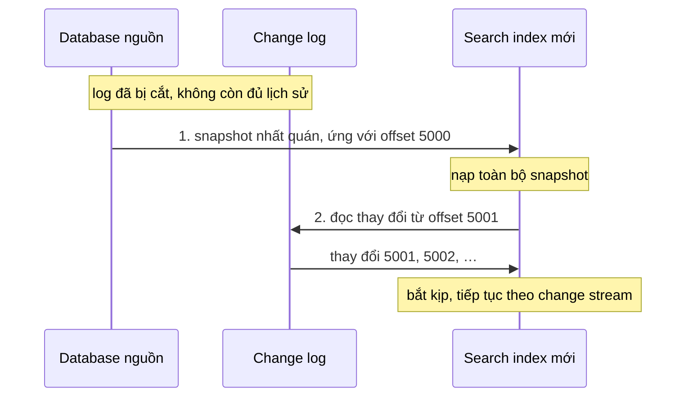

*(Ví dụ minh họa do AI xây dựng theo tr. 455. Các số offset là giả định.)*

<a id="log-compaction"></a>

**Log compaction** (tr. 456).

**Why.** Nếu chỉ giữ được **lượng lịch sử log có hạn**, mỗi lần muốn thêm một derived data system mới lại phải làm **quy trình snapshot**. ***Log compaction*** là một lựa chọn thay thế tốt.

**How — nhắc lại Chương 3** ([chương 3, B2.2](chapter-03.md#compaction), "Hash Indexes", tr. 72, Hình 3-2). Nguyên lý đơn giản: storage engine **định kỳ** tìm các bản ghi log có **cùng key**, **bỏ bản trùng**, chỉ giữ **lần cập nhật mới nhất** cho mỗi key. Quá trình compaction và merge chạy **ở nền**.

- Một lần cập nhật với giá trị **null** đặc biệt (***tombstone***) báo key đã bị xóa, và khiến key bị **loại bỏ** khi compaction.
- Chừng nào key **chưa bị ghi đè hay xóa**, nó **ở trong log mãi mãi**.
- Dung lượng đĩa của log đã compaction **chỉ phụ thuộc nội dung hiện tại** của database, **không** phụ thuộc số lần ghi từng xảy ra. Key bị ghi đè thường xuyên thì các giá trị cũ cuối cùng bị thu gom rác, chỉ giá trị mới nhất được giữ.

**Áp dụng cho broker và CDC** (tr. 456). Nếu hệ thống CDC được thiết lập sao cho **mỗi thay đổi có primary key**, và **mỗi lần cập nhật một key thay thế** giá trị trước của key đó, thì **chỉ cần giữ lần ghi mới nhất** cho mỗi key.

**Kết quả** (tr. 456). Khi muốn dựng lại một derived data system như search index, chỉ cần khởi động **consumer mới từ offset 0** của topic đã log compaction và **quét tuần tự** mọi message. Log được **bảo đảm chứa giá trị mới nhất của mọi key** trong database (có thể kèm vài giá trị cũ hơn). Nói cách khác, có thể lấy **bản sao đầy đủ** nội dung database **mà không phải chụp snapshot** database nguồn thêm lần nữa.

**Ai hỗ trợ** (tr. 456). **Apache Kafka** có tính năng log compaction. Như sẽ thấy, tính năng này cho phép dùng broker làm **kho lưu trữ durable**, không chỉ để messaging nhất thời.

```mermaid
flowchart LR
    subgraph BEFORE["Log trước compaction"]
        direction TB
        L1["offset 1: user 7 = Hà Nội"]
        L2["offset 2: user 9 = Huế"]
        L3["offset 3: user 7 = Đà Nẵng"]
        L4["offset 4: user 9 = null (tombstone)"]
        L5["offset 5: user 3 = Cần Thơ"]
    end
    subgraph AFTER["Sau compaction"]
        direction TB
        K3["offset 3: user 7 = Đà Nẵng"]
        K5["offset 5: user 3 = Cần Thơ"]
    end
    BEFORE -->|"giữ bản mới nhất mỗi key,<br/>bỏ key có tombstone"| AFTER
    AFTER -->|"consumer mới đọc từ offset 0"| NEW[("Derived system mới:<br/>bản sao đầy đủ")]
```

*(Ví dụ minh họa do AI xây dựng theo nguyên lý ở tr. 456. Offset giữ nguyên sau compaction, chỉ một số message bị bỏ đi. Thời điểm tombstone được xóa hẳn tùy cài đặt.)*

<a id="change-stream-api"></a>

**API support for change streams** (tr. 456–457). Ngày càng nhiều database hỗ trợ change stream như **giao diện chính thức** (*first-class interface*), thay vì các nỗ lực CDC **gắn thêm về sau** và **dịch ngược** (*reverse-engineered*) như trước:

- **RethinkDB** cho truy vấn **đăng ký nhận thông báo** khi kết quả truy vấn thay đổi [36].
- **Firebase** [37] và **CouchDB** [38] đồng bộ dữ liệu dựa trên một **change feed**, cũng được cung cấp cho ứng dụng.
- **Meteor** dùng **oplog của MongoDB** để đăng ký thay đổi dữ liệu và cập nhật giao diện người dùng [39].
- **VoltDB** cho transaction **liên tục xuất dữ liệu** ra dạng stream [40]. Trong mô hình quan hệ, output stream được biểu diễn như **một bảng** mà transaction có thể insert tuple vào nhưng **không truy vấn được**. Stream là log các tuple mà các transaction **đã commit** ghi vào bảng đặc biệt này, **theo thứ tự commit**. Consumer bên ngoài tiêu thụ log này bất đồng bộ để cập nhật derived data system.
- **Kafka Connect** [41] là nỗ lực tích hợp công cụ CDC cho nhiều loại database với Kafka. Khi change event đã vào Kafka, nó có thể cập nhật derived data system như search index, và **cấp vào hệ thống stream processing** như phần sau của chương.

<a id="event-sourcing"></a>

#### B2.3 Event Sourcing (tr. 457–459)

**What** (tr. 457). Có những điểm tương đồng giữa các ý tưởng trên và ***event sourcing***, một kỹ thuật phát triển trong cộng đồng ***domain-driven design* (DDD)** [42, 43, 44]. Sách bàn ngắn về event sourcing vì nó chứa vài ý tưởng hữu ích cho hệ thống streaming. Giống CDC, event sourcing **lưu mọi thay đổi** của trạng thái ứng dụng thành **log các change event**. Khác biệt lớn nhất: event sourcing áp dụng ý tưởng này **ở một mức trừu tượng khác**.

| | Change data capture | Event sourcing |
| --- | --- | --- |
| **Ứng dụng dùng database thế nào** | Theo kiểu **mutable**: update, delete bản ghi tùy ý | Logic ứng dụng được xây **tường minh** trên các **event bất biến** ghi vào event log |
| **Log lấy từ đâu** | Trích từ database **ở mức thấp** (ví dụ parse replication log). Nhờ vậy thứ tự ghi trích ra **khớp với thứ tự ghi thật**, tránh race condition ở [Hình 11-4](#dual-writes) | Event store **chỉ nối thêm**; update hay delete **không được khuyến khích hoặc bị cấm** |
| **Event phản ánh gì** | Thay đổi trạng thái mức thấp (hàng nào, cột nào đổi) | **Việc đã xảy ra ở mức ứng dụng**, không phải thay đổi trạng thái mức thấp |
| **Ứng dụng có cần biết?** | **Không** cần biết CDC đang diễn ra | Có, vì ứng dụng được thiết kế quanh event |

**Why — event sourcing mạnh ở đâu** (tr. 457). Đây là kỹ thuật **mô hình hóa dữ liệu** mạnh: từ góc nhìn ứng dụng, ghi lại **hành động của người dùng** dưới dạng event bất biến **có ý nghĩa hơn** là ghi **tác động** của hành động đó lên một database mutable. Event sourcing:

- giúp **tiến hóa ứng dụng** dễ hơn theo thời gian;
- giúp **debug**, vì dễ hiểu **về sau** tại sao một việc đã xảy ra;
- **chống bug ứng dụng** (xem [ưu điểm của event bất biến](#immutable-advantages), tr. 460).

**Example** (tr. 457–458). Lưu event "**sinh viên đã hủy đăng ký khóa học**" diễn đạt rõ **ý định** của một hành động, một cách trung lập. Còn các tác động phụ "**một dòng bị xóa khỏi bảng đăng ký, một lý do hủy được thêm vào bảng phản hồi của sinh viên**" nhúng **nhiều giả định** về cách dữ liệu sẽ được dùng sau này. Nếu thêm tính năng mới, ví dụ "**chỗ trống được mời cho người kế tiếp trong danh sách chờ**", event sourcing cho phép **nối tác động phụ mới** vào event đã có một cách dễ dàng.

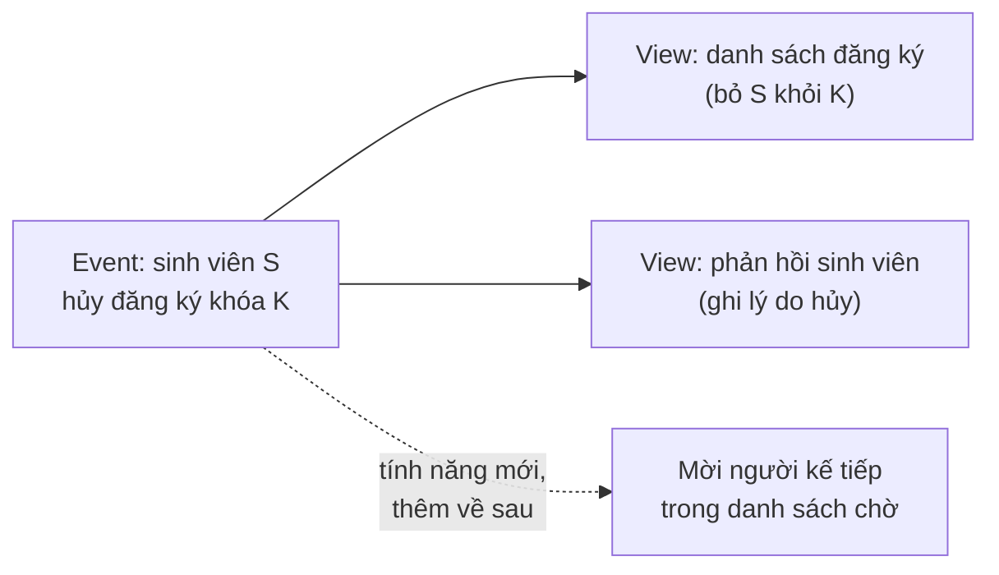

*(Sơ đồ do AI xây dựng cho ví dụ ở tr. 457–458.)*

**Liên hệ** (tr. 458). Event sourcing giống ***chronicle data model*** [45], và event log cũng có nét giống **fact table** trong star schema ([chương 3, B7.4](chapter-03.md#star-schema), tr. 93). Có database chuyên dụng như **Event Store** [46] hỗ trợ ứng dụng dùng event sourcing, nhưng nói chung cách tiếp cận này **không phụ thuộc công cụ** nào: database thông thường hay log-based broker cũng dùng được.

<a id="deriving-state"></a>

**Deriving current state from the event log** (tr. 458).

- **Why.** Bản thân event log **không hữu ích lắm**, vì người dùng thường muốn thấy **trạng thái hiện tại**, không phải lịch sử sửa đổi. Ví dụ trên trang mua sắm, người dùng muốn thấy **giỏ hàng hiện có gì**, không phải danh sách mọi thay đổi họ từng làm với giỏ.
- **How.** Ứng dụng dùng event sourcing phải lấy log event (dữ liệu **được ghi** vào hệ thống) và **biến đổi** thành trạng thái ứng dụng phù hợp để **hiển thị** cho người dùng (cách dữ liệu **được đọc** [47]). Phép biến đổi có thể dùng **logic tùy ý**, nhưng phải **tất định**, để chạy lại thì dẫn xuất ra **cùng trạng thái**.
- **Replay.** Giống CDC, replay event log cho phép **dựng lại** trạng thái hiện tại.

**Log compaction khác nhau** (tr. 458):

| | CDC | Event sourcing |
| --- | --- | --- |
| **Nội dung event cập nhật** | Thường chứa **toàn bộ phiên bản mới** của bản ghi | Thể hiện **ý định** của hành động người dùng, không phải cơ chế cập nhật trạng thái |
| **Giá trị hiện tại** | Được quyết định hoàn toàn bởi **event mới nhất** của primary key đó | Event sau thường **không ghi đè** event trước; cần **toàn bộ lịch sử** để dựng trạng thái cuối |
| **Log compaction** | **Được**: bỏ event cũ của cùng key | **Không làm được theo cách đó** |

> **Ví dụ minh họa do AI xây dựng.** Giỏ hàng nhận các event "thêm 2 cuốn sách", "thêm 1 bút", "bỏ 1 cuốn sách". Không event nào là "giá trị mới của giỏ"; muốn biết giỏ có 1 sách và 1 bút phải cộng dồn **cả ba** event. Nếu compaction giữ event mới nhất ("bỏ 1 cuốn sách"), trạng thái sẽ sai. Còn CDC của bảng giỏ hàng sẽ phát ra hàng mới nhất (ví dụ "giỏ 42: sách 1, bút 1"), nên giữ bản cuối cùng là đủ.

**Snapshot chỉ là tối ưu hóa** (tr. 458). Ứng dụng dùng event sourcing thường có cơ chế **lưu snapshot** của trạng thái hiện tại dẫn xuất từ log, để không phải xử lý lại toàn bộ log nhiều lần. Nhưng đó **chỉ là tối ưu hiệu năng** cho việc đọc và phục hồi sau crash. Ý đồ vẫn là hệ thống **lưu mọi event gốc mãi mãi** và có thể **xử lý lại toàn bộ** event log khi cần. Giả định này được bàn ở "[Limitations of immutability](#immutability-limits)" (tr. 463).

<a id="commands-events"></a>

**Commands and events** (tr. 459).

- **What.** Triết lý event sourcing cẩn thận **phân biệt *event* và *command*** [48]. Request của người dùng khi mới đến là một ***command***: lúc này nó **vẫn có thể thất bại**, ví dụ vì vi phạm một điều kiện toàn vẹn. Ứng dụng phải **kiểm tra** trước rằng nó thực hiện được command. Nếu kiểm tra thành công và command được chấp nhận, nó trở thành một ***event***, **durable và bất biến**.
- **Example.** Người dùng đăng ký một **username**, hay đặt một **ghế** trên máy bay hay trong rạp: ứng dụng phải kiểm tra username hay ghế **chưa bị lấy** (ví dụ đã gặp ở "Fault-Tolerant Consensus", tr. 364, [Chương 9](chapter-09.md#fault-tolerant-consensus)). Kiểm tra thành công thì sinh event: username X đã được đăng ký bởi user ID Y, hay ghế Z đã được đặt cho khách W.
- **Event là sự thật.** Lúc được sinh ra, event trở thành **một sự thật** (*fact*). Kể cả khi khách hàng sau đó **đổi hay hủy** chỗ, sự thật **trước đó họ đã giữ ghế** vẫn đúng; việc đổi hay hủy là **một event riêng** được thêm vào sau.
- **Consumer không được từ chối event.** Khi consumer thấy event, nó **đã là phần bất biến** của log, và có thể đã được **consumer khác** thấy. Vì vậy **mọi việc kiểm tra command phải diễn ra đồng bộ, trước khi nó thành event**, ví dụ dùng một **serializable transaction** vừa kiểm tra command vừa phát event một cách nguyên tử.
- **Cách khác: tách làm hai event.** Request đặt ghế có thể tách thành event **đặt tạm** (*tentative reservation*), rồi một event **xác nhận** riêng khi việc đặt đã được kiểm tra ("Implementing linearizable storage using total order broadcast", tr. 350, Chương 9). Cách tách này cho phép kiểm tra trong một **tiến trình bất đồng bộ**.

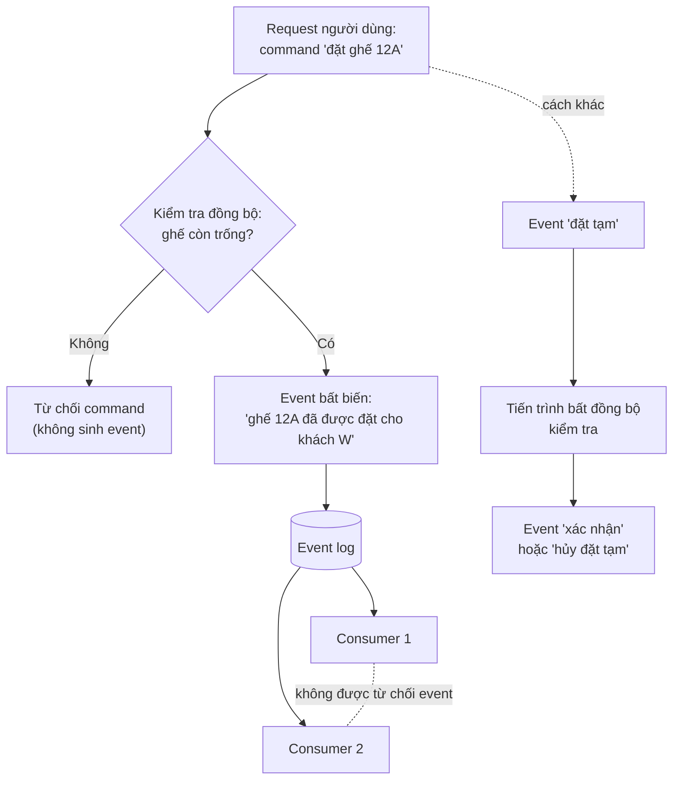

*(Sơ đồ do người viết ghi chú tổng hợp từ tr. 459. Nhánh "hủy đặt tạm" là suy luận của người viết ghi chú; sách chỉ nêu event xác nhận.)*

<a id="immutability"></a>

#### B2.4 State, Streams, and Immutability (tr. 459–464)

**Câu hỏi** (tr. 459). Chương 10 cho thấy batch processing hưởng lợi từ **tính bất biến của file input**: có thể chạy job thử nghiệm trên input sẵn có mà không sợ làm hỏng. Nguyên lý **immutability** này cũng là thứ làm event sourcing và CDC **mạnh**. Nhưng ta thường nghĩ database lưu **trạng thái hiện tại** của ứng dụng: biểu diễn này **tối ưu cho đọc**, thường tiện nhất để phục vụ truy vấn. Bản chất của state là **thay đổi**, nên database hỗ trợ update và delete chứ không chỉ insert. Vậy điều này khớp với immutability thế nào?

**Lập luận: state là kết quả của event** (tr. 460).

1. Hễ có state thay đổi, state đó là **kết quả của các event** đã làm nó đổi theo thời gian.
2. Ví dụ: danh sách **ghế còn trống** là kết quả của các lượt đặt đã xử lý; **số dư tài khoản** là kết quả của các khoản ghi có và ghi nợ; **biểu đồ thời gian phản hồi** của web server là tổng hợp thời gian phản hồi của từng request đã xảy ra.
3. Dù state thay đổi thế nào, **luôn có một chuỗi event** gây ra thay đổi đó. Kể cả khi việc được làm rồi hoàn tác, **sự thật là các event đó đã xảy ra** vẫn đúng.
4. **Ý then chốt:** state mutable và log append-only các event bất biến **không mâu thuẫn**: chúng là **hai mặt của một đồng xu**. Log mọi thay đổi, gọi là ***changelog***, biểu diễn **sự tiến hóa của state theo thời gian**.

<a id="state-integral"></a>

**State là tích phân, stream là đạo hàm** (tr. 460, Hình 11-6). Nếu thích toán học, có thể nói: **trạng thái ứng dụng** là thứ có được khi **tích phân event stream theo thời gian**; còn **change stream** là thứ có được khi **lấy đạo hàm state theo thời gian** [49, 50, 51].

- Hình 11-6 viết hai công thức: state tại thời điểm *now* bằng **tích phân của stream(t) theo t, từ t = 0 tới now**; và stream(t) bằng **đạo hàm của state(t) theo t**.
- Phép so sánh có **giới hạn** (ví dụ **đạo hàm bậc hai** của state có vẻ không có nghĩa), nhưng là **điểm xuất phát hữu ích** để nghĩ về dữ liệu.

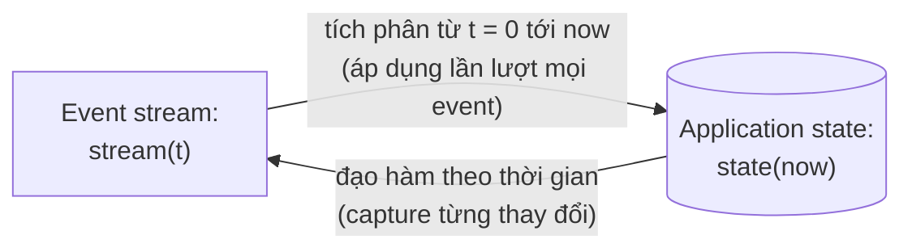

*(Vẽ lại ý của Hình 11-6, tr. 460, dưới dạng sơ đồ; hình gốc là hai công thức toán.)*

> **Ví dụ minh họa do AI xây dựng.** Tài khoản có các event +500, −200, +100. Tích phân là cộng dồn: số dư 0 → 500 → 300 → 400. Ngược lại, nếu chỉ biết chuỗi số dư 0, 500, 300, 400 thì lấy hiệu hai giá trị liên tiếp sẽ được lại chuỗi thay đổi +500, −200, +100.

**Log là sự thật** (tr. 460). Nếu lưu changelog một cách durable, hiệu quả đơn giản là **state có thể tái tạo**. Nếu coi **log event là system of record**, và mọi state mutable là **dẫn xuất** từ nó, thì việc suy luận về luồng dữ liệu qua hệ thống trở nên **dễ hơn**. Sách trích Pat Helland [52]. Đại ý: transaction log ghi mọi thay đổi của database, và nối thêm tốc độ cao là cách duy nhất để thay đổi log. Từ góc nhìn đó, nội dung database chỉ là **cache các giá trị mới nhất** trong log. **Sự thật là log; database là cache của một tập con của log**, tức giá trị mới nhất của mỗi bản ghi và mỗi giá trị index.

**Log compaction là cây cầu** (tr. 460). [Log compaction](#log-compaction) là một cách nối khoảng cách giữa log và state của database: nó **chỉ giữ phiên bản mới nhất** của mỗi bản ghi và **bỏ các phiên bản đã bị ghi đè**.

<a id="immutable-advantages"></a>

**Advantages of immutable events** (tr. 460–461).

**1. Kế toán đã làm thế từ hàng thế kỷ** (tr. 460–461). Immutability trong database là ý tưởng **cũ**. Kế toán dùng nó trong sổ sách tài chính từ **hàng thế kỷ**:

- Mỗi giao dịch được ghi vào một **sổ cái chỉ ghi thêm** (*ledger*), về bản chất là log các event mô tả tiền, hàng hóa hay dịch vụ đã đổi chủ. Các báo cáo như **lãi lỗ** hay **bảng cân đối** được **dẫn xuất** bằng cách cộng dồn giao dịch trong sổ cái [53].
- Nếu có sai sót, kế toán **không xóa hay sửa** giao dịch sai. Họ **thêm một giao dịch bù trừ**, ví dụ hoàn tiền một khoản thu sai. Giao dịch sai **vẫn nằm trong sổ mãi mãi**, vì có thể cần cho **kiểm toán**.
- Nếu số liệu sai (dẫn xuất từ sổ sai) **đã được công bố**, số liệu kỳ kế toán sau sẽ **kèm phần điều chỉnh**. Quá trình này **hoàn toàn bình thường** trong kế toán [54].

**2. Phục hồi sau bug dễ hơn** (tr. 461). Khả năng kiểm toán đặc biệt quan trọng với hệ thống tài chính, nhưng cũng có lợi cho nhiều hệ thống khác. Như đã bàn ở "Philosophy of batch process outputs" (tr. 413, [Chương 10](chapter-10.md#output-philosophy)), nếu lỡ deploy code lỗi **ghi dữ liệu sai** vào database, phục hồi **khó hơn nhiều** nếu code đó có thể **ghi đè phá hủy** dữ liệu. Với log append-only các event bất biến, **chẩn đoán** chuyện gì đã xảy ra và **phục hồi** dễ hơn nhiều.

**3. Giữ nhiều thông tin hơn trạng thái hiện tại** (tr. 461). Trên trang mua sắm, khách **thêm** một món vào giỏ rồi **bỏ** nó ra. Với việc giao hàng, event thứ hai triệt tiêu event thứ nhất. Nhưng với **phân tích**, biết khách **đã cân nhắc** món đó rồi đổi ý là thông tin hữu ích: có thể sau này họ sẽ mua, hoặc đã tìm được món thay thế. Thông tin này nằm trong event log, nhưng **mất** trong database xóa món khỏi giỏ khi khách bỏ nó [42].

<a id="several-views"></a>

**Deriving several views from the same event log** (tr. 461–462).

**What.** Tách state mutable khỏi event log bất biến cho phép dẫn xuất **nhiều biểu diễn hướng đọc khác nhau** từ **cùng một log**. Cách này giống việc có nhiều consumer của một stream (Hình 11-5). Ví dụ (tr. 461):

- Database phân tích **Druid** nạp trực tiếp từ Kafka theo cách này [55].
- **Pistachio** là key-value store phân tán dùng Kafka làm **commit log** [56].
- **Kafka Connect sink** xuất dữ liệu từ Kafka sang nhiều database và index khác nhau [41].
- Sẽ hợp lý nếu nhiều hệ lưu trữ và index khác, như **search server**, cũng lấy input từ một log phân tán ([B2.1](#keeping-in-sync)).

**Why — tiến hóa ứng dụng dễ hơn** (tr. 461–462). Có một bước **dịch tường minh** từ event log sang database thì dễ tiến hóa ứng dụng hơn. Muốn ra tính năng mới trình bày dữ liệu cũ theo cách mới, có thể dùng event log để dựng **một view riêng tối ưu cho đọc** cho tính năng đó, và chạy nó **song song** với hệ thống hiện có mà **không phải sửa** hệ thống cũ. Chạy cũ và mới song song thường **dễ hơn** một cuộc **schema migration** phức tạp trên hệ thống đang chạy. Khi hệ thống cũ không còn cần, chỉ việc **tắt** và thu hồi tài nguyên [47, 57].

<a id="cqrs"></a>

**CQRS** (tr. 462). Lưu dữ liệu thường **khá đơn giản** nếu không phải lo nó sẽ được truy vấn và truy cập thế nào. Phần lớn sự phức tạp của **thiết kế schema, indexing và storage engine** là kết quả của việc muốn hỗ trợ một số mẫu truy vấn và truy cập (Chương 3). Vì vậy có được **nhiều linh hoạt** khi **tách dạng dữ liệu được ghi khỏi dạng dữ liệu được đọc**, và cho phép **nhiều view đọc khác nhau**. Ý tưởng này đôi khi gọi là ***command query responsibility segregation* (CQRS)** [42, 58, 59].

**Ngụy biện của thiết kế truyền thống** (tr. 462). Cách thiết kế database và schema truyền thống dựa trên **ngụy biện** rằng dữ liệu **phải được ghi ở cùng dạng với khi được truy vấn**. Tranh luận về **normalization và denormalization** ([chương 2, B2.3](chapter-02.md#relationships), tr. 33) phần lớn **mất ý nghĩa** nếu có thể dịch dữ liệu từ event log **tối ưu cho ghi** sang state ứng dụng **tối ưu cho đọc**: hoàn toàn hợp lý khi **denormalize** trong các view đọc, vì quá trình dịch cho ta **cơ chế giữ chúng nhất quán** với event log.

**Ví dụ timeline Twitter** (tr. 462). Ở "Describing Load" ([chương 1, B4.1](chapter-01.md#load-parameters), tr. 11), home timeline của Twitter là **cache các tweet gần đây** của những người mà một user theo dõi (giống hộp thư). Đây là một ví dụ khác về state **tối ưu cho đọc**: home timeline **denormalize rất mạnh**, vì tweet của bạn được **nhân bản vào timeline của mọi người theo dõi bạn**. Nhưng **dịch vụ fan-out** giữ trạng thái trùng lặp này **đồng bộ** với tweet mới và quan hệ theo dõi mới, nên sự trùng lặp **vẫn quản lý được**.

Glossary của sách định nghĩa *denormalize* là đưa một lượng dư thừa hay trùng lặp vào dataset đã normalize, thường dưới dạng cache hay index, để **tăng tốc đọc**; giá trị denormalize là một dạng **kết quả truy vấn tính trước**, giống materialized view (tr. 554).

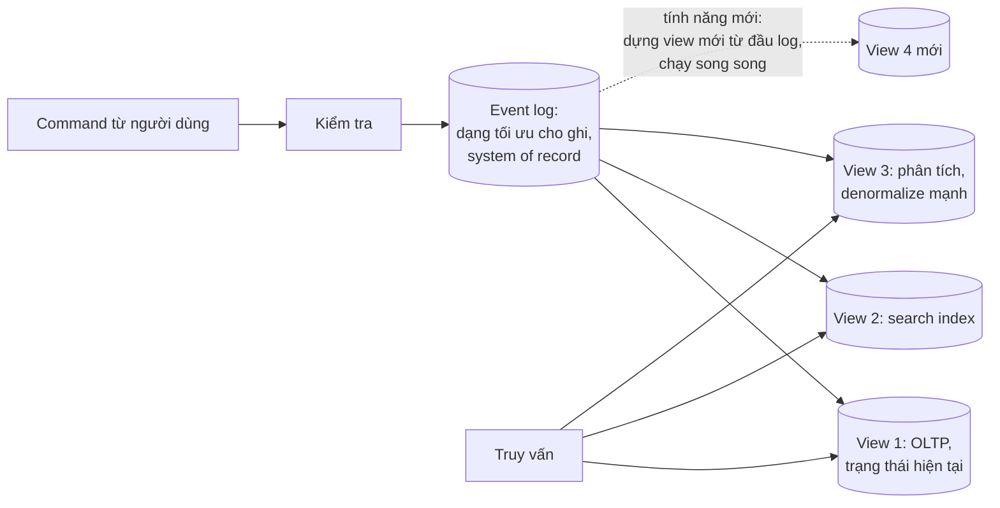

*(Sơ đồ do người viết ghi chú tổng hợp từ tr. 461–462.)*

<a id="concurrency-control"></a>

**Concurrency control** (tr. 462–463).

**Nhược điểm lớn nhất** (tr. 462). Consumer của event log thường **bất đồng bộ**, nên người dùng có thể ghi vào log, rồi đọc từ một view dẫn xuất từ log và thấy **lần ghi của mình chưa được phản ánh**. Đây là vấn đề "Reading Your Own Writes" ([chương 5, B2.1](chapter-05.md#read-your-writes), tr. 162). Cách giải:

- **Cập nhật view đọc đồng bộ** với việc nối event vào log. Việc này cần **transaction** để gộp các lần ghi thành một đơn vị nguyên tử: hoặc giữ event log và view đọc **trong cùng một hệ lưu trữ**, hoặc dùng **distributed transaction** giữa các hệ thống khác nhau.
- Hoặc dùng cách ở "Implementing linearizable storage using total order broadcast" (tr. 350, [Chương 9](chapter-09.md#lin-from-tob)).

**Nhưng event log cũng làm concurrency control đơn giản hơn** (tr. 462–463):

1. Phần lớn nhu cầu **multi-object transaction** ("Single-Object and Multi-Object Operations", tr. 228, [Chương 7](chapter-07.md#multi-object)) xuất phát từ việc **một hành động** của người dùng phải đổi dữ liệu ở **nhiều nơi**.
2. Với event sourcing, có thể thiết kế event là **mô tả tự chứa** của một hành động người dùng. Hành động đó chỉ cần **một lần ghi ở một chỗ**: nối event vào log. Việc này **dễ làm nguyên tử**.
3. Nếu event log và state ứng dụng được **partition theo cùng cách** (ví dụ xử lý event của khách ở partition 3 chỉ cần cập nhật partition 3 của state), thì một **log consumer đơn luồng** đơn giản **không cần concurrency control cho việc ghi**: theo cấu trúc, nó chỉ xử lý **một event một lúc** ("Actual Serial Execution", tr. 252, Chương 7).
4. Log **loại bỏ tính không tất định của đồng thời** bằng cách định nghĩa **một thứ tự tuần tự** cho các event trong một partition [24].
5. Nếu một event chạm **nhiều partition** của state thì cần làm thêm, sẽ bàn ở [Chương 12](chapter-12.md#multi-partition-processing).

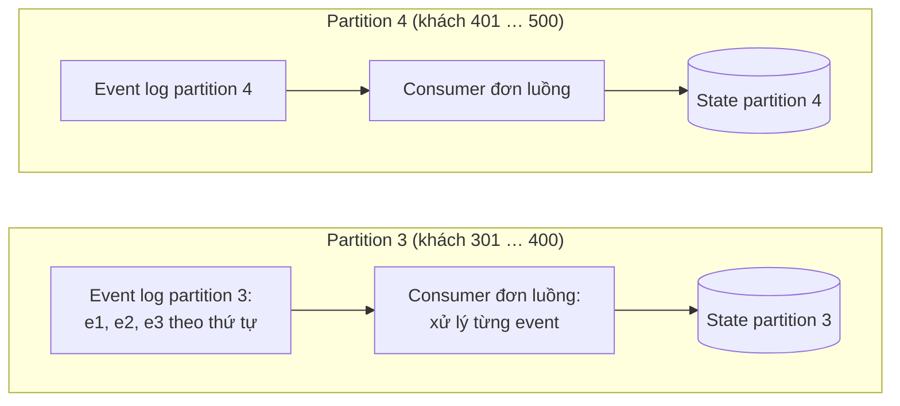

*(Sơ đồ do người viết ghi chú tổng hợp từ tr. 463. Cách chia khách theo dải số là giả định.)*

<a id="immutability-limits"></a>

**Limitations of immutability** (tr. 463–464).

**Immutability có ở nhiều nơi** (tr. 463). Nhiều hệ thống không dùng mô hình event sourcing vẫn **dựa vào immutability**: nhiều database bên trong dùng **cấu trúc dữ liệu bất biến** hoặc **dữ liệu nhiều phiên bản** để hỗ trợ snapshot tại một thời điểm ("Indexes and snapshot isolation", tr. 241, Chương 7). Các hệ quản lý phiên bản **Git, Mercurial, Fossil** cũng dựa vào dữ liệu bất biến để giữ lịch sử phiên bản file.

**Giữ lịch sử bất biến mãi mãi có khả thi?** (tr. 463). Tùy mức **biến động** (*churn*) của dataset:

| Workload | Giữ bất biến |
| --- | --- |
| Chủ yếu **thêm** dữ liệu, ít update hay delete | **Dễ** |
| **Tỷ lệ update và delete cao** trên một dataset **tương đối nhỏ** | Lịch sử bất biến có thể **lớn tới mức không chịu nổi**, **phân mảnh** có thể thành vấn đề, và hiệu năng của **compaction và garbage collection** trở thành yếu tố sống còn cho sự ổn định vận hành [60, 61] |

**Lý do quản trị buộc phải xóa** (tr. 463). Ngoài lý do hiệu năng, có tình huống **phải xóa dữ liệu**, bất chấp immutability:

- luật về **quyền riêng tư** có thể yêu cầu xóa thông tin cá nhân sau khi người dùng đóng tài khoản;
- luật **bảo vệ dữ liệu** có thể yêu cầu gỡ bỏ thông tin sai;
- một vụ **lộ thông tin nhạy cảm** do sơ suất cần được ngăn chặn.

Khi đó, nối thêm một event báo "dữ liệu trước nên coi là đã xóa" là **không đủ**: bạn thật sự muốn **viết lại lịch sử** và giả vờ dữ liệu **chưa từng được ghi**. **Datomic** gọi tính năng này là ***excision*** [62]; hệ quản lý phiên bản **Fossil** có khái niệm tương tự gọi là ***shunning*** [63].

**Xóa thật sự khó đáng ngạc nhiên** (tr. 463–464) [64]. Bản sao có thể nằm ở nhiều nơi: storage engine, filesystem và SSD thường **ghi sang chỗ mới** thay vì ghi đè tại chỗ [52]; **backup** thường được cố ý làm **bất biến** để tránh bị xóa hay hỏng do sơ suất. Xóa giống **"làm cho khó lấy lại dữ liệu hơn"** hơn là **"làm cho không thể lấy lại"**. Dù vậy, đôi khi vẫn phải cố, như sẽ thấy ở "Legislation and self-regulation" (tr. 542, [Chương 12](chapter-12.md#legislation)).

> **Bổ sung ngoài sách.** Một kỹ thuật thường được nhắc tới cho bài toán "xóa trong log bất biến" là ***crypto-shredding***: mã hóa dữ liệu cá nhân của mỗi người dùng bằng một khóa riêng, lưu khóa ở hệ thống có thể xóa được; muốn "xóa" thì hủy khóa, mọi bản sao bản mã trong log và backup trở nên không đọc được. Cách này không có trong sách và có giới hạn riêng (khóa phải thật sự bị hủy ở mọi nơi, dữ liệu đã giải mã ở chỗ khác vẫn còn).

---

<a id="b3"></a>

### B3. Processing Streams (tr. 464–479)

<a id="processing-options"></a>

#### B3.0 Làm gì với một stream? (tr. 464–465)

**Nhìn lại** (tr. 464). Tới đây chương đã bàn stream **đến từ đâu** (event hoạt động của người dùng, cảm biến, lần ghi vào database) và **được chuyên chở thế nào** (direct messaging, message broker, event log). Còn lại: có stream rồi thì **xử lý** nó ra sao. Có ba lựa chọn lớn:

1. **Ghi dữ liệu của event vào database, cache, search index** hay hệ lưu trữ tương tự, để client khác truy vấn. Như Hình 11-5, đây là cách tốt để giữ một database **đồng bộ** với thay đổi ở phần khác của hệ thống, **đặc biệt nếu stream consumer là client duy nhất ghi vào database đó**. Đây là phiên bản streaming của "The Output of Batch Workflows" (tr. 411, [Chương 10](chapter-10.md#batch-output)).
2. **Đẩy event tới người dùng**: gửi email cảnh báo, push notification, hoặc stream event tới một **dashboard thời gian thực** để trực quan hóa. Khi đó **con người** là consumer cuối cùng.
3. **Xử lý một hay nhiều input stream để sinh một hay nhiều output stream**. Stream có thể đi qua một **pipeline** nhiều bước xử lý như vậy, rồi cuối cùng kết thúc ở một output (lựa chọn 1 hoặc 2).

Phần còn lại của chương bàn **lựa chọn 3**: xử lý stream để sinh ra các stream dẫn xuất khác.

```mermaid
flowchart LR
    IN["Input stream"] --> OP1["Operator / job 1"]
    OP1 -->|"output stream<br/>(dẫn xuất)"| OP2["Operator / job 2"]
    OP2 --> DB[("1. Database, cache,<br/>search index")]
    OP2 --> HU["2. Con người:<br/>email, push, dashboard"]
    IN -.->|"lựa chọn 1 trực tiếp"| DB
```

*(Sơ đồ do người viết ghi chú tổng hợp từ tr. 464. Pipeline ở giữa là lựa chọn 3.)*

> **Bổ sung ngoài sách (liên hệ).** Lựa chọn 3 chính là việc "nối chuỗi topic" mà Chương 4 đã báo trước: consumer xuất bản message sang topic khác ([chương 4, B7.3](chapter-04.md#message-passing), tr. 138). Ở chương 11, mỗi bước trong pipeline đọc input stream và ghi output stream mới, nên các topic nối với nhau thành một luồng dữ liệu nhiều tầng.

**Operator, job** (tr. 464). Đoạn code xử lý stream như vậy gọi là ***operator*** hay ***job***. Nó **liên quan chặt** tới tiến trình Unix và job MapReduce ở Chương 10, và mẫu luồng dữ liệu **giống nhau**: stream processor tiêu thụ input stream theo kiểu **chỉ đọc** và ghi output ra **một chỗ khác** theo kiểu **chỉ nối thêm**. Các mẫu **partitioning và song song hóa** trong stream processor cũng **rất giống** MapReduce và dataflow engine ở Chương 10, nên sách không nhắc lại. Các thao tác mapping cơ bản như **biến đổi và lọc** bản ghi cũng hoạt động như vậy.

**Khác biệt căn bản với batch: stream không bao giờ kết thúc** (tr. 464–465). Khác biệt này có nhiều hệ quả:

- Như đầu chương đã nói, **sort không có nghĩa** với dataset không giới hạn, nên **sort-merge join** ("Reduce-Side Joins and Grouping", tr. 403, Chương 10) **không dùng được**.
- Cơ chế **fault tolerance phải đổi**: batch job chạy vài phút thì task lỗi chỉ việc **chạy lại từ đầu**; stream job đã chạy **nhiều năm** thì chạy lại từ đầu sau crash có thể **không khả thi**.

<a id="uses"></a>

#### B3.1 Uses of Stream Processing (tr. 465–468)

**Giám sát là ứng dụng lâu đời** (tr. 465). Stream processing từ lâu được dùng để **giám sát**, khi tổ chức muốn được **cảnh báo** nếu có điều gì xảy ra:

- **Phát hiện gian lận:** xác định thói quen dùng thẻ tín dụng có **thay đổi bất thường** không, và khóa thẻ nếu nhiều khả năng bị đánh cắp.
- **Hệ thống giao dịch:** xem biến động giá trên thị trường tài chính và **thực hiện lệnh** theo quy tắc đã định.
- **Sản xuất:** giám sát trạng thái máy móc trong nhà máy, **nhanh chóng xác định** vấn đề khi có trục trặc.
- **Quân sự và tình báo:** theo dõi hoạt động của đối thủ tiềm năng, **báo động** khi có dấu hiệu tấn công.

Các ứng dụng này cần **so khớp mẫu và tương quan khá tinh vi**. Theo thời gian, các cách dùng khác cũng xuất hiện; sách so sánh ngắn các cách dùng đó.

<a id="cep"></a>

**Complex event processing** (tr. 465–466).

- **What.** ***Complex event processing* (CEP)** là cách tiếp cận ra đời từ **thập niên 1990** để phân tích event stream, đặc biệt hướng tới ứng dụng cần **tìm các mẫu event nhất định** [65, 66]. Giống như **biểu thức chính quy** cho phép tìm mẫu ký tự trong một chuỗi, CEP cho phép đặt **quy tắc** để tìm mẫu event trong một stream.
- **How.** Hệ thống CEP thường dùng **ngôn ngữ truy vấn khai báo cấp cao** như SQL, hoặc **giao diện đồ họa**, để mô tả mẫu event cần phát hiện. Truy vấn được gửi tới một **engine xử lý** tiêu thụ các input stream và **bên trong duy trì một state machine** thực hiện việc so khớp. Khi tìm thấy một khớp, engine phát ra một ***complex event*** (vì thế có tên) kèm chi tiết mẫu event đã phát hiện [67].
- **Đảo vai truy vấn và dữ liệu** (tr. 465). Database thông thường lưu **dữ liệu lâu dài** và coi **truy vấn là nhất thời**: truy vấn đến, database tìm dữ liệu khớp, xong thì **quên** truy vấn. CEP **đảo ngược**: **truy vấn được lưu lâu dài**, còn event từ input stream **liên tục chảy qua** chúng để tìm truy vấn khớp một mẫu event [68].
- **Cài đặt** (tr. 466). Esper [69], IBM InfoSphere Streams [70], Apama, TIBCO StreamBase, SQLstream. Các stream processor phân tán như **Samza** cũng đang có hỗ trợ **SQL** cho truy vấn khai báo trên stream [71].

```mermaid
flowchart LR
    subgraph DBQ["Database thông thường"]
        direction LR
        Q1["Truy vấn (nhất thời):<br/>đến, chạy, bị quên"] --> D1[("Dữ liệu<br/>lưu lâu dài")]
    end
    subgraph CEPQ["CEP, search on streams"]
        direction LR
        E1["Event (nhất thời):<br/>chảy qua"] --> Q2[("Truy vấn<br/>lưu lâu dài")]
        Q2 -->|"khớp mẫu"| CE["Complex event<br/>hoặc thông báo"]
    end
```

*(Sơ đồ do người viết ghi chú tổng hợp từ tr. 465 và 467.)*

> **Ví dụ minh họa do AI xây dựng.** Một quy tắc CEP cho gian lận thẻ: "cùng một thẻ có **giao dịch ở hai quốc gia khác nhau trong vòng 10 phút**, sau đó là **một giao dịch lớn hơn 1 000 USD**". Engine giữ state cho từng thẻ, và khi chuỗi ba event khớp mẫu thì phát complex event "nghi gian lận" để hệ thống khóa thẻ.

<a id="stream-analytics"></a>

**Stream analytics** (tr. 466).

- **What.** Ranh giới giữa CEP và stream analytics **mờ**. Quy tắc chung: analytics **ít quan tâm** tới việc tìm chuỗi event cụ thể, mà thiên về **tổng hợp** và **chỉ số thống kê** trên **số lượng lớn event**, ví dụ:
  - đo **tần suất** một loại event (bao nhiêu lần mỗi khoảng thời gian);
  - tính **trung bình trượt** (*rolling average*) của một giá trị trong một khoảng thời gian;
  - so sánh thống kê hiện tại với **khoảng thời gian trước** (phát hiện xu hướng, hoặc cảnh báo metric cao hay thấp bất thường so với **cùng giờ tuần trước**).
- **Window.** Các thống kê này thường được tính trên **khoảng thời gian cố định**. Ví dụ: số truy vấn trung bình mỗi giây tới một service trong **5 phút qua**, và **percentile 99** thời gian phản hồi trong khoảng đó. Lấy trung bình vài phút giúp **làm mượt** dao động vô nghĩa từ giây này sang giây khác, mà vẫn cho bức tranh **kịp thời** về thay đổi lưu lượng. Khoảng thời gian dùng để tổng hợp gọi là ***window*** ([B3.2](#windows)).
- **Thuật toán xác suất.** Hệ thống stream analytics đôi khi dùng **thuật toán xác suất**: **Bloom filter** ([chương 3, B3.4](chapter-03.md#lsm-optimizations), tr. 79) để kiểm tra thành viên tập hợp, **HyperLogLog** [72] để ước lượng số phần tử khác nhau (*cardinality*), và nhiều thuật toán **ước lượng percentile** ([chương 1](chapter-01.md#percentile-calc), "Percentiles in Practice", tr. 16). Chúng cho kết quả **xấp xỉ**, nhưng cần **ít bộ nhớ hơn đáng kể** so với thuật toán chính xác.
- **Ngộ nhận cần tránh.** Việc dùng thuật toán xấp xỉ khiến có người tin rằng stream processing **luôn mất mát và thiếu chính xác**. Điều đó **sai**: stream processing **không có gì vốn dĩ xấp xỉ**; thuật toán xác suất **chỉ là một tối ưu hóa** [73].
- **Framework.** Nhiều framework stream processing phân tán mã nguồn mở được thiết kế với analytics trong đầu: **Apache Storm, Spark Streaming, Flink, Concord, Samza, Kafka Streams** [74]. Dịch vụ được host: **Google Cloud Dataflow**, **Azure Stream Analytics**.

> **Bổ sung ngoài sách.** HyperLogLog ước lượng số giá trị khác nhau (ví dụ số user duy nhất) bằng cách hash mỗi giá trị và ghi nhận **độ dài chuỗi bit 0 đầu dài nhất** gặp được trong từng nhóm. Vài kilobyte bộ nhớ đủ để ước lượng hàng tỷ giá trị với sai số khoảng 1–2%, trong khi đếm chính xác phải giữ cả tập giá trị.

<a id="materialized-view-maintenance"></a>

**Maintaining materialized views** (tr. 467).

- **What.** Ở [B2](#b2) đã thấy một stream các thay đổi của database có thể giữ cho derived data system (cache, search index, data warehouse) cập nhật theo database nguồn. Có thể coi đó là trường hợp riêng của **duy trì *materialized view*** ([chương 3, B8.7](chapter-03.md#materialized-views), "Aggregation: Data Cubes and Materialized Views", tr. 101): dẫn xuất một **góc nhìn khác** lên dataset để truy vấn hiệu quả, và **cập nhật view đó mỗi khi dữ liệu gốc thay đổi** [50].
- **Event sourcing cũng vậy.** State ứng dụng được duy trì bằng cách áp dụng log event, nên **cũng là một loại materialized view**.
- **Khác analytics ở window.** Thường **không đủ** nếu chỉ xét event trong một window: dựng materialized view có thể cần **mọi event trong khoảng thời gian tùy ý**, trừ các event lỗi thời bị bỏ bởi [log compaction](#log-compaction). Thực chất cần một window **kéo dài về tận đầu thời gian**.
- **Công cụ.** Về nguyên tắc stream processor nào cũng dùng được, nhưng nhu cầu **giữ event mãi mãi** đi ngược giả định của một số framework thiên về analytics, vốn chủ yếu làm việc trên window có độ dài giới hạn. **Samza** và **Kafka Streams** hỗ trợ kiểu dùng này, dựa trên log compaction của Kafka [75].

<a id="search-on-streams"></a>

**Search on streams** (tr. 467).

- **What.** Ngoài CEP (tìm mẫu gồm nhiều event), đôi khi cần **tìm từng event riêng lẻ** theo tiêu chí phức tạp, như truy vấn **full-text search**.
- **Example.** Dịch vụ **theo dõi truyền thông** đăng ký nguồn tin bài báo và chương trình phát sóng, tìm tin nhắc tới công ty, sản phẩm hay chủ đề quan tâm. Cách làm: **soạn truy vấn tìm kiếm trước**, rồi **liên tục so khớp** stream tin tức với truy vấn đó. Một số website có tính năng tương tự: người dùng trang **bất động sản** có thể yêu cầu được báo khi có căn nhà mới khớp tiêu chí tìm kiếm. Tính năng ***percolator*** của **Elasticsearch** [76] là một lựa chọn để cài loại tìm kiếm này.
- **Đảo vai, giống CEP.** Search engine thông thường **index tài liệu trước** rồi chạy truy vấn trên index. Tìm kiếm trên stream **lộn ngược** quá trình: **truy vấn được lưu**, tài liệu **chạy qua** các truy vấn.
- **Tối ưu.** Đơn giản nhất là thử **mọi tài liệu với mọi truy vấn**, nhưng chậm khi có rất nhiều truy vấn. Để tối ưu, có thể **index cả truy vấn** lẫn tài liệu, nhờ đó **thu hẹp** tập truy vấn có thể khớp [77].

<a id="actors-vs-streams"></a>

**Message passing and RPC** (tr. 468). Chương 4 đã bàn hệ thống message-passing như một lựa chọn thay cho RPC, tức cơ chế để các service giao tiếp, ví dụ trong **actor model** ([chương 4, actor](chapter-04.md#actors), tr. 136). Dù cũng dựa trên message và event, ta thường **không** coi chúng là stream processor:

| Khía cạnh | Actor framework | Stream processing |
| --- | --- | --- |
| **Mục đích chính** | Cơ chế **quản lý đồng thời** và **thực thi phân tán** các module giao tiếp với nhau | Kỹ thuật **quản lý dữ liệu** |
| **Kiểu giao tiếp** | Thường **nhất thời** và **một-một** | Event log **durable** và **nhiều subscriber** |
| **Hình dạng luồng** | Giao tiếp **tùy ý**, kể cả mẫu request/response **có vòng** | Thường là **pipeline không vòng** (*acyclic*): mỗi stream là output của **một job cụ thể**, dẫn xuất từ một tập input stream **xác định rõ** |

**Vùng giao thoa** (tr. 468):

- **Apache Storm** có tính năng ***distributed RPC***: truy vấn của người dùng được **phân ra** cho một tập node cũng đang xử lý event stream; truy vấn được **đan xen** với event từ input stream, rồi kết quả được tổng hợp và gửi lại người dùng [78] (xem thêm "Multi-partition data processing", tr. 514, [Chương 12](chapter-12.md#multi-partition-processing)).
- Cũng có thể **xử lý stream bằng actor framework**. Nhưng nhiều framework như vậy **không bảo đảm giao message** khi crash, nên việc xử lý **không chịu lỗi** trừ khi tự cài thêm logic thử lại.

<a id="reasoning-about-time"></a>

#### B3.2 Reasoning About Time (tr. 468–472)

**Vấn đề** (tr. 468). Stream processor thường phải làm việc với **thời gian**, nhất là khi dùng cho analytics với time window như "**trung bình trong năm phút qua**". Nghĩa của "năm phút qua" tưởng như rõ ràng, nhưng thật ra **khó một cách đáng ngạc nhiên**.

**Batch dùng timestamp trong event** (tr. 468–469). Batch process **nghiền nhanh** một khối lớn event lịch sử. Nếu cần chia theo thời gian, nó phải nhìn **timestamp nhúng trong mỗi event**. Nhìn **đồng hồ hệ thống** của máy đang chạy batch là **vô nghĩa**, vì thời điểm chạy process **không liên quan** gì tới thời điểm event thật sự xảy ra. Batch có thể đọc **một năm** event lịch sử trong **vài phút**; thứ ta quan tâm là **một năm lịch sử**, không phải vài phút xử lý. Hơn nữa, dùng timestamp trong event làm việc xử lý **tất định**: chạy lại cùng process trên cùng input cho **cùng kết quả** ("Fault tolerance", tr. 422, Chương 10).

**Nhiều stream framework dùng đồng hồ cục bộ** (tr. 469). Ngược lại, nhiều framework stream processing dùng **đồng hồ hệ thống cục bộ** trên máy xử lý (***processing time***) để chia window [79]. Cách này **đơn giản**, và **hợp lý nếu độ trễ** giữa lúc tạo event và lúc xử lý event **nhỏ không đáng kể**. Nhưng nó **hỏng** nếu có **processing lag** đáng kể, tức việc xử lý có thể diễn ra **muộn rõ rệt** so với lúc event thật sự xảy ra.

<a id="event-vs-processing-time"></a>

**Event time versus processing time** (tr. 469).

**Vì sao xử lý có thể bị trễ:** xếp hàng; sự cố mạng ("Unreliable Networks", tr. 277, [Chương 8](chapter-08.md#b2)); vấn đề hiệu năng gây **tranh chấp** trong message broker hay processor; **khởi động lại** stream consumer; hoặc **xử lý lại** event cũ ([replay](#replay)) khi phục hồi sau lỗi hay sau khi sửa bug.

**Trễ còn làm đảo thứ tự.** Người dùng gửi request thứ nhất (server A xử lý) rồi request thứ hai (server B xử lý). A và B phát event mô tả request mình đã xử lý, nhưng event của B **tới broker trước** event của A. Stream processor sẽ thấy event B **trước** event A, dù thực tế chúng xảy ra **theo thứ tự ngược lại**.

**Ví von Star Wars** (tr. 469). Chú thích ii: tác giả cảm ơn Kostas Kloudas trong cộng đồng Flink đã nghĩ ra phép so sánh này [80].

| Phim | Năm ra mắt (≈ processing time nếu xem theo năm ra mắt) | Số tập (≈ event timestamp) |
| --- | --- | --- |
| Episode IV | 1977 | 4 |
| Episode V | 1980 | 5 |
| Episode VI | 1983 | 6 |
| Episode I | 1999 | 1 |
| Episode II | 2002 | 2 |
| Episode III | 2005 | 3 |
| Episode VII | 2015 | 7 |

Nếu xem phim theo thứ tự ra mắt, thứ tự bạn "xử lý" các phim **không khớp** thứ tự cốt truyện. **Số tập** giống **event timestamp**, còn **ngày bạn xem phim** giống **processing time**. Con người xoay xở được với sự đứt đoạn này, nhưng thuật toán stream processing phải được **viết riêng** để chịu được các vấn đề về thời điểm và thứ tự như vậy.

**Nhầm hai loại thời gian dẫn tới dữ liệu sai** (tr. 469–470, Hình 11-7). Một stream processor **đo tốc độ request** (đếm số request mỗi giây). Khi **redeploy**, nó có thể **tắt một phút**, rồi xử lý **lượng tồn đọng** khi chạy lại. Nếu đo theo processing time, sẽ trông như có **một đợt tăng vọt bất thường** trong lúc xử lý tồn đọng, trong khi tốc độ request thật **vẫn đều**.

| Mốc thời gian (theo hình) | 1 | 2 | 3 | 4 | 5 | 6 | 7 | 8 |
| --- | --- | --- | --- | --- | --- | --- | --- | --- |
| Tốc độ đo theo **processing time** | 10 | 10 | ≈ 7 | 0 | ≈ 5 | ≈ 17 | ≈ 17 | ≈ 13 |
| Tốc độ request **thật** | 10 | 10 | 10 | 10 | 10 | 10 | 10 | 10 |

*(Vẽ lại Hình 11-7, tr. 470, dưới dạng bảng. Hình gốc có ba dải: web server phát request đều; stream processor có một đoạn "restarting" rồi xử lý dồn dập; hai đồ thị bên dưới. Trục y chỉ ghi các mốc 0 và 10; các giá trị có dấu ≈ là người viết ghi chú ước lượng bằng mắt từ đồ thị.)*

```mermaid
sequenceDiagram
    participant W as Web server
    participant SP as Stream processor
    W->>SP: 10 request mỗi giây (đều)
    Note over SP: redeploy: tắt khoảng 1 phút
    W-)SP: request vẫn đến, xếp hàng ở broker
    Note over SP: chạy lại: xử lý dồn tồn đọng
    Note over SP: đếm theo processing time:<br/>0 lúc tắt, rồi vọt lên trên 10
    Note over W,SP: đếm theo event time:<br/>vẫn 10 mỗi giây suốt thời gian đó
```

*(Sơ đồ do người viết ghi chú tổng hợp từ tr. 469–470.)*

<a id="knowing-ready"></a>

**Knowing when you're ready** (tr. 470–471).

**Vấn đề.** Khi định nghĩa window theo **event time**, bạn **không bao giờ chắc** đã nhận **đủ** event của một window, hay vẫn còn event sắp tới.

**Example** (tr. 470). Gom event vào window **một phút** để đếm request mỗi phút. Bạn đã đếm một số event có timestamp trong **phút thứ 37** của giờ, và thời gian trôi đi; giờ phần lớn event đến thuộc **phút 38 và 39**. Khi nào tuyên bố window phút 37 **đã xong** và xuất ra giá trị bộ đếm?

- Có thể **timeout**: tuyên bố window sẵn sàng sau một lúc không thấy event mới nào.
- Nhưng vẫn có thể có event **bị đệm ở một máy khác**, trễ vì mạng gián đoạn. Phải xử lý được các event ***straggler*** (đến muộn) tới **sau khi** window đã được tuyên bố hoàn tất.

**Hai lựa chọn** [1] (tr. 470):

1. **Bỏ qua** straggler, vì trong điều kiện bình thường chúng có lẽ chỉ chiếm **tỷ lệ nhỏ**. Có thể theo dõi **số event bị bỏ** như một metric, và **cảnh báo** nếu bắt đầu bỏ một lượng dữ liệu đáng kể.
2. **Công bố một bản sửa** (***correction***): giá trị cập nhật cho window **kèm cả straggler**. Có thể cũng phải **rút lại** (*retract*) output trước đó.

**Message đặc biệt báo mốc** (tr. 471). Trong một số trường hợp có thể dùng một **message đặc biệt** nói rằng "**từ giờ sẽ không còn message nào có timestamp sớm hơn t**", và consumer dùng nó để **kích hoạt** window [81]. Nhưng nếu **nhiều producer** trên nhiều máy cùng sinh event, mỗi producer có **ngưỡng timestamp tối thiểu riêng**, consumer phải **theo dõi từng producer**. Khi đó **thêm và bớt producer** trở nên khó hơn.

> **Bổ sung ngoài sách.** Message đặc biệt này thường được gọi là ***watermark*** trong MillWheel [81], Google Cloud Dataflow và Flink. Watermark của một operator thường được tính là **mức tối thiểu** của watermark từ mọi input, nên một producer chậm sẽ giữ watermark của cả hệ thống lại. Đó chính là lý do sách nói consumer phải theo dõi từng producer.

```mermaid
flowchart TD
    W37["Window phút 37 đang mở"] --> Q{"Đã nhận đủ event<br/>của phút 37 chưa?"}
    Q -->|"Không chắc chắn được"| T["Timeout, hoặc message báo:<br/>'không còn event trước t'"]
    T --> OUT["Xuất kết quả phút 37"]
    OUT --> S{"Straggler phút 37<br/>đến sau đó?"}
    S -->|"Lựa chọn 1"| IG["Bỏ qua,<br/>đếm số event bị bỏ làm metric"]
    S -->|"Lựa chọn 2"| CO["Công bố correction,<br/>có thể rút lại output cũ"]
```

*(Sơ đồ do người viết ghi chú tổng hợp từ tr. 470–471.)*

<a id="whose-clock"></a>

**Whose clock are you using, anyway?** (tr. 471).

**Vấn đề** (tr. 471). Gán timestamp cho event còn **khó hơn** khi event có thể bị đệm ở **nhiều điểm** trong hệ thống. Ví dụ một **app di động** báo event về số liệu sử dụng cho server. App có thể được dùng khi thiết bị **offline**: nó đệm event cục bộ và gửi lên server khi có kết nối internet lần sau, có thể là **vài giờ, thậm chí vài ngày** sau. Với mọi consumer của stream, các event này trông như **straggler trễ cực độ**.

**Dùng đồng hồ nào?**

| Đồng hồ | Ưu | Nhược |
| --- | --- | --- |
| **Đồng hồ thiết bị** lúc tương tác xảy ra | Đúng nghĩa: timestamp **nên** là thời điểm người dùng tương tác | Đồng hồ trên thiết bị do người dùng kiểm soát **thường không tin được**: có thể bị đặt sai **vô tình hay cố ý** ("Clock Synchronization and Accuracy", tr. 289, Chương 8) |
| **Đồng hồ server** lúc nhận event | **Dễ chính xác hơn**, vì server nằm trong tầm kiểm soát | **Ít ý nghĩa** về tương tác của người dùng |

**Cách điều chỉnh: ghi ba timestamp** [82] (tr. 471):

1. Thời điểm event **xảy ra**, theo **đồng hồ thiết bị**;
2. Thời điểm event **được gửi** lên server, theo **đồng hồ thiết bị**;
3. Thời điểm event **được server nhận**, theo **đồng hồ server**.

Lấy **(3) trừ (2)** để ước lượng **độ lệch** giữa đồng hồ thiết bị và đồng hồ server (giả định **độ trễ mạng nhỏ không đáng kể** so với độ chính xác cần có). Rồi áp độ lệch đó vào timestamp (1) để ước lượng **thời điểm thật** event xảy ra (giả định độ lệch đồng hồ thiết bị **không đổi** từ lúc event xảy ra tới lúc gửi).

```mermaid
sequenceDiagram
    participant D as Thiết bị (đồng hồ chạy nhanh 2 giờ)
    participant S as Server
    Note over D: (1) event xảy ra: thiết bị ghi 10:00
    Note over D: offline, đệm event cục bộ
    D->>S: (2) gửi lúc thiết bị ghi 15:00
    Note over S: (3) server nhận lúc 13:00 theo đồng hồ server
    Note over S: độ lệch = (3) − (2) = 13:00 − 15:00 = −2 giờ
    Note over S: thời điểm thật ≈ (1) + độ lệch = 08:00
```

*(Ví dụ minh họa do AI xây dựng cho cách làm ở tr. 471. Các mốc giờ là giả định; độ trễ mạng coi như bằng 0.)*

**Không riêng stream** (tr. 471). Vấn đề này **không chỉ có ở stream processing**: batch processing cũng gặp **đúng các vấn đề** lập luận về thời gian. Nó chỉ **dễ thấy hơn** trong streaming, nơi ta ý thức rõ hơn về **dòng chảy thời gian**.

<a id="windows"></a>

**Types of windows** (tr. 472). Khi đã biết timestamp của event nên được xác định thế nào, bước tiếp là quyết định **window trên các khoảng thời gian** được định nghĩa ra sao. Window rồi được dùng để **tổng hợp**: đếm event, tính trung bình giá trị trong window. Có vài loại window thông dụng [79, 83]:

| Loại | Định nghĩa | Ví dụ của sách | Cách cài |
| --- | --- | --- | --- |
| ***Tumbling window*** | Độ dài **cố định**, mỗi event thuộc **đúng một** window | Window 1 phút: event có timestamp từ 10:03:00 tới 10:03:59 vào một window, từ 10:04:00 tới 10:04:59 vào window kế tiếp | Lấy timestamp của event **làm tròn xuống phút gần nhất** để biết window của nó |
| ***Hopping window*** | Độ dài **cố định**, nhưng các window **chồng lên nhau** để làm mượt | Window 5 phút, bước nhảy (*hop*) 1 phút: một window chứa event từ 10:03:00 tới 10:07:59, window kế tiếp từ 10:04:00 tới 10:08:59, v.v. | Tính tumbling window 1 phút trước, rồi **tổng hợp nhiều window liền kề** |
| ***Sliding window*** | Chứa mọi event xảy ra **trong một khoảng cách nào đó với nhau** | Sliding window 5 phút chứa cả event lúc 10:03:39 và 10:08:12, vì chúng cách nhau **dưới 5 phút**. Tumbling hay hopping 5 phút **không** đặt hai event này vào cùng window, vì chúng dùng **ranh giới cố định** | Giữ **buffer event sắp theo thời gian**, bỏ event cũ khi chúng **hết hạn** khỏi window |
| ***Session window*** | **Không có độ dài cố định**. Gom mọi event của **cùng một người dùng** xảy ra **gần nhau** theo thời gian; window kết thúc khi người dùng **không hoạt động** một lúc (ví dụ không có event nào trong **30 phút**) | Gom các lượt xem trang thành phiên truy cập | ***Sessionization*** là yêu cầu thường gặp trong phân tích website ("GROUP BY", tr. 406, [Chương 10](chapter-10.md#group-by)) |

> **Bổ sung ngoài sách (kiểm tra ví dụ của sách).** 10:08:12 − 10:03:39 = 4 phút 33 giây, nhỏ hơn 5 phút, nên sliding window 5 phút chứa cả hai. Với hopping window 5 phút bước 1 phút, window 10:03:00–10:07:59 chứa 10:03:39 nhưng không chứa 10:08:12; window 10:04:00–10:08:59 chứa 10:08:12 nhưng không chứa 10:03:39. Không window cố định nào chứa cả hai, đúng như sách nói.

```mermaid
flowchart LR
    subgraph TUM["Tumbling 1 phút"]
        direction LR
        T1["10:03:00–10:03:59"] --> T2["10:04:00–10:04:59"] --> T3["10:05:00–10:05:59"]
    end
    subgraph HOP["Hopping 5 phút, bước 1 phút"]
        direction LR
        H1["10:03:00–10:07:59"] --> H2["10:04:00–10:08:59"] --> H3["10:05:00–10:09:59"]
    end
    subgraph SES["Session (nghỉ 30 phút thì đóng)"]
        direction LR
        S1["Phiên 1: event 9:00, 9:05, 9:20"] -->|"không có event<br/>trong 30 phút"| S2["Phiên 2: event 10:15, 10:16"]
    end
```

*(Sơ đồ do người viết ghi chú tổng hợp từ tr. 472. Các mốc giờ của session window là giả định.)*

<a id="stream-joins"></a>

#### B3.3 Stream Joins (tr. 472–476)

**Why** (tr. 472–473). Chương 10 đã bàn batch job **join dataset theo key**, và join là phần quan trọng của pipeline dữ liệu. Vì stream processing **tổng quát hóa** pipeline dữ liệu thành **xử lý tăng dần** trên dataset không giới hạn, nhu cầu join trên stream **y như vậy**. Nhưng việc **event mới có thể xuất hiện bất cứ lúc nào** khiến join trên stream **khó hơn** trong batch. Sách phân biệt **ba loại join**: stream-stream, stream-table và table-table [84].

<a id="stream-stream-join"></a>

**Stream-stream join (window join)** (tr. 473).

**Example.** Website có tính năng tìm kiếm, và bạn muốn phát hiện **xu hướng gần đây** của các URL được tìm. Mỗi lần ai đó gõ truy vấn tìm kiếm, bạn ghi một event chứa **truy vấn và kết quả trả về**. Mỗi lần ai đó **click** một kết quả, bạn ghi một event khác ghi nhận cú click. Muốn tính **tỷ lệ click** (*click-through rate*) cho mỗi URL trong kết quả, phải **ghép** event tìm kiếm với event click, nối với nhau bằng **cùng session ID**. Hệ thống quảng cáo cần phân tích tương tự [85].

**Vì sao khó:**

- Click có thể **không bao giờ đến** nếu người dùng bỏ dở việc tìm kiếm.
- Kể cả khi đến, khoảng cách giữa tìm kiếm và click **biến động rất lớn**: thường vài giây, nhưng có thể **vài ngày hay vài tuần** (người dùng tìm, quên tab trình duyệt đó, rồi quay lại click một kết quả).
- Do độ trễ mạng biến động, event click thậm chí có thể **đến trước** event tìm kiếm.

**Chọn window.** Có thể chọn window phù hợp cho join, ví dụ chỉ ghép click với tìm kiếm nếu chúng xảy ra **cách nhau tối đa một giờ**.

**Vì sao không nhúng thông tin tìm kiếm vào event click?** Làm vậy **không tương đương** với join: nó chỉ cho biết các trường hợp người dùng **đã click**, không cho biết các lần tìm kiếm mà người dùng **không click** gì. Muốn đo **chất lượng tìm kiếm** phải có click-through rate chính xác, tức cần **cả hai** loại event.

**How** (tr. 473). Stream processor phải **duy trì state**, ví dụ mọi event xảy ra trong **giờ vừa qua**, **index theo session ID**:

1. Mỗi khi có event tìm kiếm hoặc event click, thêm nó vào **index tương ứng**.
2. Đồng thời kiểm tra **index bên kia** xem đã có event cùng session ID chưa.
3. Nếu có event khớp, phát ra event cho biết **kết quả tìm kiếm nào được click**.
4. Nếu event tìm kiếm **hết hạn** mà không thấy click nào khớp, phát ra event cho biết **những kết quả nào không được click**.

```mermaid
flowchart LR
    SE["Stream event tìm kiếm<br/>(session, truy vấn, kết quả)"] --> J["Join operator:<br/>state 1 giờ qua,<br/>index theo session ID"]
    CL["Stream event click<br/>(session, URL)"] --> J
    J -->|"có cặp khớp"| O1["Event: kết quả X<br/>đã được click"]
    J -->|"event tìm kiếm hết hạn,<br/>không có click"| O2["Event: các kết quả<br/>không được click"]
    O1 --> CTR["Tính click-through rate"]
    O2 --> CTR
```

*(Sơ đồ do người viết ghi chú tổng hợp từ tr. 473.)*

<a id="stream-table-join"></a>

**Stream-table join (stream enrichment)** (tr. 473–474).

**Example** (tr. 473–474). Ở "Example: analysis of user activity events" (tr. 404, Hình 10-2, [Chương 10](chapter-10.md#activity-events)), một batch job join hai dataset: tập **event hoạt động của người dùng** và **database hồ sơ người dùng**. Tự nhiên có thể coi event hoạt động là một **stream** và làm **cùng phép join liên tục** trong stream processor: input là stream event hoạt động chứa user ID; output là stream event hoạt động trong đó user ID được **bổ sung thông tin hồ sơ**. Quá trình này đôi khi gọi là ***enriching*** (làm giàu) event hoạt động bằng thông tin từ database.

**How — ba phương án** (tr. 474):

1. **Truy vấn database ở xa** cho từng event: xem từng event, tra user ID trong database, thêm thông tin hồ sơ. Nhưng như Chương 10 đã nói, truy vấn từ xa **dễ chậm** và **có nguy cơ làm quá tải** database [75].
2. **Nạp bản sao database vào stream processor**, để truy vấn **cục bộ** không mất vòng mạng. Kỹ thuật này **rất giống hash join** ở "Map-Side Joins" (tr. 408, Chương 10): bản sao cục bộ có thể là **hash table trong bộ nhớ** nếu đủ nhỏ, hoặc **index trên đĩa cục bộ**.
3. **Giữ bản sao cục bộ luôn mới bằng CDC.** Khác biệt với batch: batch job dùng **snapshot tại một thời điểm** của database làm input, còn stream processor **chạy lâu dài** và nội dung database **thay đổi theo thời gian**, nên bản sao cục bộ phải được **cập nhật**. Giải bằng **change data capture**: stream processor đăng ký **changelog của database hồ sơ** cùng với stream event hoạt động. Khi hồ sơ được tạo hay sửa, stream processor cập nhật bản sao cục bộ. Vậy ta có **join giữa hai stream**: event hoạt động và cập nhật hồ sơ.

```mermaid
flowchart LR
    ACT["Stream event hoạt động<br/>(user ID, hành động)"] --> OP["Stream processor"]
    PDB[("Database hồ sơ")] -->|"CDC: changelog hồ sơ"| LOC[("Bản sao cục bộ:<br/>hash table hoặc index đĩa")]
    LOC --- OP
    OP -->|"tra cục bộ, không qua mạng"| OUT["Stream event đã làm giàu:<br/>hành động + thông tin hồ sơ"]
```

*(Sơ đồ do người viết ghi chú tổng hợp từ tr. 473–474.)*

**Giống stream-stream join, chỉ khác window** (tr. 474). Stream-table join thật ra **rất giống** stream-stream join. Khác biệt lớn nhất: với **changelog stream của bảng**, join dùng window **kéo về tận "đầu thời gian"** (một window **vô hạn về khái niệm**), trong đó phiên bản mới của bản ghi **ghi đè** phiên bản cũ. Với **stream input**, join có thể **không duy trì window nào**.

<a id="table-table-join"></a>

**Table-table join (materialized view maintenance)** (tr. 474–475).

**Example — timeline Twitter** (tr. 474). Ở "Describing Load" ([chương 1, B4.1](chapter-01.md#load-parameters), tr. 11), khi người dùng muốn xem home timeline, việc duyệt mọi người họ theo dõi, tìm tweet gần đây và trộn lại là **quá tốn**. Thay vào đó cần một **timeline cache**: một kiểu "hộp thư" cho từng người dùng, tweet được ghi vào khi được gửi, nên đọc timeline chỉ là **một lần tra cứu**. Dựng và duy trì cache này cần xử lý các event sau (tr. 474–475):

| Event | Tác động lên timeline cache |
| --- | --- |
| User u **gửi tweet mới** | Thêm vào timeline của **mọi người theo dõi u** |
| Người dùng **xóa tweet** | Gỡ khỏi timeline của **mọi người dùng** |
| User u₁ **bắt đầu theo dõi** u₂ | Thêm các tweet **gần đây** của u₂ vào timeline của u₁ |
| User u₁ **bỏ theo dõi** u₂ | Gỡ các tweet của u₂ khỏi timeline của u₁ |

**How** (tr. 475). Cần stream event cho **tweet** (gửi và xóa) và cho **quan hệ theo dõi** (theo dõi và bỏ theo dõi). Stream process phải duy trì một database chứa **tập người theo dõi của mỗi người dùng**, để biết **timeline nào** cần cập nhật khi có tweet mới [86].

**Một cách nhìn khác: materialized view của một phép join SQL** (tr. 475). Stream process này duy trì materialized view cho một truy vấn **join hai bảng** tweets và follows. Câu SQL trong sách, diễn giải bằng lời: **join** bảng tweets với bảng follows ở điều kiện người được theo dõi (followee) chính là người gửi tweet; **nhóm theo người theo dõi** (follower); với mỗi nhóm, gom các tweet thành **một mảng sắp theo timestamp giảm dần**, và dùng ID người theo dõi làm **ID của timeline**. **Join của các stream tương ứng trực tiếp với join của các bảng** trong truy vấn đó. Timeline thực chất là **cache kết quả** của truy vấn này, được **cập nhật mỗi khi bảng bên dưới thay đổi**.

> Chú thích iii (tr. 475). Nếu coi stream là **đạo hàm** của bảng như ở Hình 11-6, và coi join là **tích của hai bảng** u·v, thì có điều thú vị: stream các thay đổi của join đã materialize tuân theo **quy tắc đạo hàm của tích**: (u·v)′ = u′v + uv′. Nói bằng lời: **mỗi thay đổi về tweet** được join với **tập người theo dõi hiện tại**, và **mỗi thay đổi về người theo dõi** được join với **tập tweet hiện tại** [49, 50].

```mermaid
flowchart LR
    TW["Stream tweet:<br/>gửi, xóa"] --> OP["Stream processor"]
    FO["Stream follow:<br/>theo dõi, bỏ theo dõi"] --> OP
    OP --- ST[("State: tập follower<br/>của mỗi user, tweet gần đây")]
    OP -->|"thay đổi tweet<br/>× follower hiện tại"| TL[("Timeline cache<br/>của từng user")]
    OP -->|"thay đổi follow<br/>× tweet hiện tại"| TL
```

*(Sơ đồ do người viết ghi chú tổng hợp từ tr. 474–475 và chú thích iii.)*

> **Ví dụ minh họa do AI xây dựng (quy tắc tích).** An theo dõi Bình. (1) Bình gửi tweet t9: đây là u′ (thay đổi bảng tweets), join với v hiện tại (follower của Bình gồm An), sinh thay đổi "thêm t9 vào timeline của An". (2) Sau đó Chi bắt đầu theo dõi Bình: đây là v′ (thay đổi bảng follows), join với u hiện tại (các tweet gần đây của Bình gồm t9), sinh thay đổi "thêm t9 vào timeline của Chi". Hai số hạng u′v và uv′ ứng đúng với hai loại cập nhật.

<a id="join-time-dependence"></a>

**Time-dependence of joins** (tr. 475–476).

**Điểm chung của ba loại join** (tr. 475). Cả ba (stream-stream, stream-table, table-table) đều yêu cầu stream processor **duy trì một state** (event tìm kiếm và click, hồ sơ người dùng, hay danh sách follower) dựa trên **một input** của join, và **truy vấn state đó** khi có message từ **input kia**.

**Thứ tự quan trọng.** Thứ tự các event duy trì state **có ý nghĩa** (theo dõi rồi bỏ theo dõi khác hẳn bỏ theo dõi rồi theo dõi). Trong partitioned log, thứ tự event **trong một partition** được giữ, nhưng thường **không có đảm bảo thứ tự** giữa **các stream hay partition khác nhau**.

**Câu hỏi then chốt** (tr. 475–476). Nếu event trên các stream khác nhau xảy ra **gần cùng lúc**, chúng được xử lý theo thứ tự nào? Trong ví dụ stream-table join, nếu người dùng **cập nhật hồ sơ**, những event hoạt động nào được join với **hồ sơ cũ** (xử lý trước cập nhật), những event nào với **hồ sơ mới** (xử lý sau)? Nói cách khác: nếu state thay đổi theo thời gian và bạn join với state đó, **dùng thời điểm nào** cho phép join [45]?

**Example — thuế suất** (tr. 476). Nếu bán hàng, phải áp **đúng thuế suất** cho hóa đơn, vốn phụ thuộc quốc gia hay bang, loại sản phẩm và **ngày bán** (vì thuế suất thay đổi theo thời gian). Khi join doanh số với bảng thuế suất, có lẽ bạn muốn join với **thuế suất tại thời điểm bán**, có thể **khác thuế suất hiện tại** nếu đang xử lý lại dữ liệu lịch sử.

**Hệ quả: join không tất định** (tr. 476). Nếu thứ tự event giữa các stream **không xác định**, join trở nên **không tất định** [87]: chạy lại cùng job trên cùng input **chưa chắc** cho cùng kết quả, vì event trên các input stream có thể được **đan xen theo cách khác** ở lần chạy sau.

**Slowly changing dimension** (tr. 476). Trong data warehouse, vấn đề này gọi là ***slowly changing dimension* (SCD)**, và thường được giải bằng cách dùng **định danh duy nhất cho mỗi phiên bản** của bản ghi được join. Ví dụ mỗi lần thuế suất đổi, nó được cấp **một định danh mới**, và hóa đơn chứa **định danh của thuế suất tại thời điểm bán** [88, 89]. Cách này làm join **tất định**, nhưng hệ quả là **không thể log compaction**, vì phải giữ **mọi phiên bản** của các bản ghi trong bảng.

```mermaid
sequenceDiagram
    participant TR as Stream thuế suất
    participant J as Join operator
    participant SA as Stream đơn bán
    TR->>J: thuế suất VAT, id r1 = 8 phần trăm
    SA->>J: đơn A (bán ngày 1)
    TR->>J: thuế suất mới, id r2 = 10 phần trăm
    SA->>J: đơn B (bán ngày 1, tới muộn)
    Note over J: không có SCD: đơn B bị join với r2 (sai)
    Note over J: có SCD: đơn B mang sẵn id r1, join tất định với r1
```

*(Ví dụ minh họa do AI xây dựng cho đoạn tr. 475–476. Mức thuế và thứ tự tới là giả định.)*

<a id="fault-tolerance"></a>

#### B3.4 Fault Tolerance (tr. 476–479)

<a id="exactly-once"></a>

**Batch chịu lỗi thế nào** (tr. 476). Chương 10 cho thấy batch framework chịu lỗi **khá dễ**: task MapReduce lỗi thì **chạy lại trên máy khác**, output của task lỗi **bị bỏ**. Việc thử lại trong suốt này khả thi vì: file input **bất biến**; mỗi task ghi output ra **file riêng** trên HDFS; output chỉ **hiện ra** khi task **hoàn tất thành công**.

**Exactly-once semantics** (tr. 476). Cách chịu lỗi của batch bảo đảm output **giống như khi không có gì hỏng**, dù thật ra có task đã lỗi. Trông như **mọi bản ghi input được xử lý đúng một lần**: không bản ghi nào bị bỏ sót, không bản ghi nào bị xử lý hai lần. Dù khởi động lại task nghĩa là bản ghi **thật ra có thể được xử lý nhiều lần**, **hiệu ứng nhìn thấy được** ở output như thể chúng **chỉ được xử lý một lần**. Nguyên lý này gọi là ***exactly-once semantics***, dù gọi là ***effectively-once*** thì **mô tả đúng hơn** [90].

**Vì sao khó hơn với stream** (tr. 476). Vấn đề chịu lỗi cũng có trong stream processing, nhưng **không đơn giản bằng**: **chờ task xong** rồi mới cho output hiện ra là **không thể**, vì stream **vô hạn**, bạn **không bao giờ xử lý xong**.

<a id="microbatching"></a>

**Microbatching and checkpointing** (tr. 477).

**Microbatching.**

- **What.** Chia stream thành **các khối nhỏ**, coi mỗi khối như **một batch process thu nhỏ**. Cách này gọi là ***microbatching***, được dùng trong **Spark Streaming** [91].
- **Kích thước batch** thường khoảng **một giây**, là kết quả của một **thỏa hiệp hiệu năng**: batch **nhỏ hơn** thì tốn thêm chi phí **lập lịch và điều phối**; batch **lớn hơn** thì kết quả của stream processor **hiện ra chậm hơn**.
- **Window ngầm định.** Microbatching ngầm cung cấp một **tumbling window bằng kích thước batch** (chia theo **processing time**, không theo event timestamp). Job cần window **lớn hơn** phải **tự mang state** từ microbatch này sang microbatch sau.

**Checkpointing.**

- **What.** Một biến thể, dùng trong **Apache Flink**, là định kỳ tạo **checkpoint luân phiên** (*rolling checkpoint*) của state và ghi vào **kho lưu trữ durable** [92, 93].
- **How.** Nếu một stream operator crash, nó **khởi động lại từ checkpoint gần nhất** và **bỏ mọi output** sinh ra giữa checkpoint đó và lúc crash. Checkpoint được kích hoạt bởi các ***barrier*** (rào) trong message stream, giống ranh giới giữa các microbatch, nhưng **không ép** một kích thước window nào.

**Giới hạn chung** (tr. 477). **Trong phạm vi** framework stream processing, microbatching và checkpointing cho **cùng exactly-once semantics** như batch. Nhưng ngay khi output **rời khỏi** stream processor (ghi vào database, gửi message tới broker bên ngoài, gửi email), framework **không còn bỏ được** output của batch lỗi. Khi đó khởi động lại task lỗi khiến **tác động phụ bên ngoài xảy ra hai lần**, và chỉ microbatching hay checkpointing là **không đủ** để ngăn.

```mermaid
sequenceDiagram
    participant IN as Input stream
    participant OP as Operator
    participant CK as Kho durable
    participant EXT as Hệ thống ngoài (email)
    IN->>OP: barrier: checkpoint 7
    OP->>CK: lưu state tại checkpoint 7
    IN->>OP: event e1, e2
    OP->>EXT: gửi email cho e1
    Note over OP: crash trước checkpoint 8
    OP->>CK: khôi phục state checkpoint 7
    Note over OP: output nội bộ sau checkpoint 7 bị bỏ
    IN->>OP: phát lại e1, e2
    OP->>EXT: gửi email cho e1 lần nữa
    Note over EXT: tác động phụ bên ngoài xảy ra hai lần
```

*(Ví dụ minh họa do AI xây dựng cho đoạn tr. 477.)*

> **Bổ sung ngoài sách.** Barrier của Flink dựa trên thuật toán chụp snapshot phân tán bất đồng bộ [93], một biến thể của thuật toán Chandy–Lamport: barrier chảy theo stream; khi một operator đã nhận barrier từ mọi input, nó chụp state rồi chuyển barrier đi tiếp. Nhờ vậy snapshot của mọi operator nhất quán với cùng một vị trí trong input mà không cần dừng cả hệ thống.

<a id="atomic-commit-revisited"></a>

**Atomic commit revisited** (tr. 477–478).

**Yêu cầu** (tr. 477). Muốn **trông như** exactly-once khi có lỗi, phải bảo đảm **mọi output và tác động phụ** của việc xử lý một event **có hiệu lực khi và chỉ khi** việc xử lý thành công. Các tác động đó gồm:

- message gửi tới **operator phía sau** hay hệ thống messaging **bên ngoài** (kể cả email, push notification);
- **ghi database**;
- thay đổi **state của operator**;
- **acknowledgment** message input (kể cả việc **dời consumer offset** trong log-based broker).

Những việc đó hoặc **cùng xảy ra nguyên tử**, hoặc **không việc nào xảy ra**; chúng **không được lệch nhau**. Nghe quen, vì đã bàn ở "Exactly-once message processing" (tr. 360, [Chương 9](chapter-09.md#exactly-once)) trong bối cảnh distributed transaction và two-phase commit.

**Làm hiệu quả trong môi trường hạn chế** (tr. 477–478). Chương 9 đã bàn các vấn đề của distributed transaction kiểu truyền thống như **XA**. Nhưng trong môi trường **hạn chế hơn**, có thể cài cơ chế atomic commit **hiệu quả**:

- Được dùng trong **Google Cloud Dataflow** [81, 92] và **VoltDB** [94]; lúc viết sách có **kế hoạch** thêm tính năng tương tự vào **Apache Kafka** [95, 96].
- **Khác XA**, các bản cài này **không cố** cung cấp transaction **xuyên các công nghệ dị chủng**. Chúng giữ transaction **nội bộ**, bằng cách quản lý **cả thay đổi state lẫn messaging** bên trong framework stream processing.
- Chi phí của giao thức transaction có thể được **khấu hao** bằng cách xử lý **nhiều message input trong một transaction**.

> **Bổ sung ngoài sách.** Kế hoạch [96] (KIP-98) được phát hành trong Kafka 0.11 vào giữa năm 2017, sau khi sách in: producer idempotent và transaction cho phép ghi output vào nhiều topic và ghi consumer offset trong cùng một transaction. Đúng như sách mô tả, nó chỉ nguyên tử **bên trong Kafka**; tác động phụ ra hệ thống ngoài vẫn cần idempotence hoặc cơ chế khác.

<a id="idempotence"></a>

**Idempotence** (tr. 478).

**Mục tiêu** (tr. 478). Bỏ output dở dang của task lỗi để có thể **thử lại an toàn** mà **không có hiệu lực hai lần**. Distributed transaction là một cách; cách khác là dựa vào ***idempotence*** [97]. Đây là mục mà Chương 4 đã hẹn ([chương 4, vấn đề của RPC](chapter-04.md#rpc-problems)): thử lại request qua mạng chỉ an toàn khi có cơ chế khử trùng lặp.

**What.** Thao tác ***idempotent*** là thao tác thực hiện **nhiều lần** có **cùng hiệu quả** như thực hiện **một lần**.

| Thao tác | Idempotent? | Vì sao |
| --- | --- | --- |
| **Đặt** một key trong key-value store thành một **giá trị cố định** | **Có** | Ghi lại chỉ ghi đè bằng giá trị y hệt |
| **Tăng** một bộ đếm | **Không** | Làm lại nghĩa là tăng **hai lần** |

**Biến thao tác thành idempotent bằng metadata** (tr. 478). Kể cả thao tác **vốn không idempotent** thường cũng làm được idempotent với **một ít metadata**. Ví dụ khi tiêu thụ message từ Kafka, mỗi message có một **offset durable, tăng đơn điệu**. Khi ghi một giá trị vào database bên ngoài, có thể **ghi kèm offset** của message đã kích hoạt **lần ghi cuối**. Nhờ vậy biết được một cập nhật **đã được áp dụng chưa**, và tránh làm lại. Cách quản lý state của **Trident** (trong Storm) dựa trên ý tưởng tương tự [78].

```mermaid
sequenceDiagram
    participant K as Kafka partition
    participant SP as Stream processor
    participant DB as Database ngoài
    K->>SP: message offset 42: cộng 5 điểm cho user 7
    SP->>DB: điểm user 7 = 105, kèm offset cuối = 42
    Note over SP: crash trước khi ghi consumer offset
    K->>SP: phát lại message offset 42
    SP->>DB: đọc user 7: offset cuối = 42
    Note over SP: 42 không lớn hơn 42: đã áp dụng, bỏ qua
    K->>SP: message offset 43: cộng 3 điểm
    SP->>DB: điểm user 7 = 108, kèm offset cuối = 43
```

*(Ví dụ minh họa do AI xây dựng cho kỹ thuật ở tr. 478. Giả định giá trị và offset được ghi trong cùng một lần ghi nguyên tử vào một hàng.)*

**Các giả định khi dựa vào idempotence** (tr. 478) [98, 99]:

1. Khởi động lại task lỗi phải **phát lại cùng các message theo cùng thứ tự** (log-based broker làm được điều này).
2. Việc xử lý phải **tất định**.
3. **Không node nào khác** cập nhật **đồng thời** cùng giá trị đó.

**Fencing khi failover** (tr. 478). Khi chuyển việc xử lý từ node này sang node khác, có thể cần **fencing** ("The leader and the lock", tr. 301, [Chương 8](chapter-08.md#leader-lock)) để ngăn một node **bị tưởng là đã chết nhưng thật ra còn sống** can thiệp vào.

**Kết luận** (tr. 478). Dù có các lưu ý trên, thao tác idempotent có thể là **cách hiệu quả** để đạt exactly-once semantics với **chi phí phụ nhỏ**.

<a id="rebuild-state"></a>

**Rebuilding state after a failure** (tr. 478–479).

**Vấn đề** (tr. 478). Stream process nào cần **state** đều phải bảo đảm state **khôi phục được** sau lỗi: mọi phép tổng hợp theo window (bộ đếm, trung bình, histogram), mọi bảng và index dùng cho join.

**Các phương án** (tr. 478–479):

| Phương án | Cách làm | Ví dụ | Nhận xét |
| --- | --- | --- | --- |
| **State ở datastore xa, có replication** | Giữ state trong một datastore từ xa và nhân bản nó | — | Truy vấn database xa **cho từng message** có thể **chậm** (như ở [stream-table join](#stream-table-join)) |
| **State cục bộ + snapshot định kỳ** | Giữ state **cục bộ** ở stream processor, định kỳ nhân bản; task mới khi phục hồi đọc state đã nhân bản và tiếp tục **không mất dữ liệu** | **Flink** định kỳ chụp snapshot state của operator và ghi vào kho durable như **HDFS** [92, 93] | |
| **State cục bộ + changelog có log compaction** | Gửi thay đổi state tới một **Kafka topic riêng có log compaction**, giống change data capture | **Samza**, **Kafka Streams** [84, 100] | |
| **Xử lý dư thừa** | Xử lý **mỗi message input trên nhiều node** | **VoltDB** ("Actual Serial Execution", tr. 252, Chương 7) | |
| **Không nhân bản, dựng lại từ input** | Window **khá ngắn**: replay các event input của window đó đủ nhanh. State là **bản sao database cục bộ** do CDC duy trì: dựng lại từ change stream đã [log compaction](#log-compaction) | — | Không tốn chi phí nhân bản |

**Không có trade-off lý tưởng cho mọi nơi** (tr. 479). Mọi trade-off trên **phụ thuộc đặc tính hiệu năng của hạ tầng**: ở một số hệ thống, **độ trễ mạng có thể thấp hơn độ trễ truy cập đĩa**, và **băng thông mạng có thể ngang băng thông đĩa**. Không có trade-off lý tưởng cho mọi tình huống, và ưu thế của **state cục bộ** so với **state từ xa** cũng có thể **thay đổi** khi công nghệ lưu trữ và mạng tiến hóa.

```mermaid
flowchart TD
    Q{"Stream operator có state<br/>(window, bảng join)"} --> A{"State dựng lại nhanh<br/>từ input được không?"}
    A -->|"Window ngắn"| R1["Replay event của window"]
    A -->|"Bản sao DB do CDC duy trì"| R2["Đọc lại change stream<br/>đã log compaction"]
    A -->|"Không"| B{"Đặt state ở đâu?"}
    B -->|"Ở xa"| R3["Datastore xa có replication:<br/>đơn giản, nhưng mỗi message<br/>một lần đi mạng"]
    B -->|"Cục bộ"| C{"Nhân bản bằng cách nào?"}
    C --> R4["Snapshot định kỳ<br/>ra kho durable (Flink)"]
    C --> R5["Changelog vào topic<br/>log compaction (Samza, Kafka Streams)"]
    C --> R6["Xử lý dư thừa<br/>trên nhiều node (VoltDB)"]
```

*(Sơ đồ do người viết ghi chú tổng hợp từ tr. 478–479. Đây là gợi ý cách suy luận, không phải quy tắc trong sách.)*

---

<a id="b4"></a>

### B4. Summary — Tổng kết của tác giả (tr. 479–481)

**Stream processing là batch làm liên tục** (tr. 479). Chương đã bàn event stream, chúng phục vụ mục đích gì và cách xử lý chúng. Ở một số mặt, stream processing **rất giống** batch processing ở Chương 10, nhưng làm **liên tục** trên stream **không giới hạn** thay vì trên input kích thước cố định. Từ góc nhìn này, **message broker và event log** là **phiên bản streaming của filesystem**.

**Hai loại message broker** (tr. 479–480):

| Loại | Cách hoạt động | Hợp với |
| --- | --- | --- |
| **AMQP/JMS-style** | Broker gán **từng message** cho consumer; consumer **xác nhận từng message** khi xử lý xong; message **bị xóa** khi đã xác nhận | Dạng **RPC bất đồng bộ** ([chương 4, B7.3](chapter-04.md#message-passing)), ví dụ **task queue**, khi thứ tự xử lý chính xác không quan trọng và không cần quay lại đọc message cũ |
| **Log-based** | Broker gán **mọi message của một partition** cho cùng một consumer node, luôn giao **theo cùng thứ tự**. Song song hóa nhờ **partitioning**; consumer theo dõi tiến độ bằng cách **checkpoint offset** của message cuối đã xử lý. Broker **giữ message trên đĩa**, nên có thể **quay lại đọc** message cũ khi cần | Hệ thống stream processing tiêu thụ input stream và sinh **derived state** hoặc **derived output stream** |

Cách dựa trên log **giống replication log** của database (Chương 5) và **log-structured storage engine** (Chương 3) (tr. 480).

**Stream đến từ đâu** (tr. 480). Event hoạt động của người dùng, cảm biến đọc số định kỳ, và **nguồn dữ liệu** (data feed, ví dụ dữ liệu thị trường trong tài chính) tự nhiên được biểu diễn thành stream. Cũng hữu ích khi coi **các lần ghi vào database là một stream**: có thể capture **changelog** (lịch sử mọi thay đổi của database) một cách **ngầm** qua change data capture hoặc **tường minh** qua event sourcing. **Log compaction** cho phép stream giữ **bản sao đầy đủ** nội dung database.

**Database dưới dạng stream mở ra cơ hội tích hợp** (tr. 480). Có thể giữ search index, cache và hệ thống phân tích **luôn cập nhật** bằng cách tiêu thụ log thay đổi và áp dụng cho derived system. Thậm chí có thể dựng **view mới** cho dữ liệu sẵn có bằng cách **bắt đầu từ đầu** và tiêu thụ log thay đổi **từ đầu tới hiện tại**.

**Nền tảng cho join và fault tolerance** (tr. 480). Khả năng **duy trì state dưới dạng stream** và **phát lại message** là nền tảng cho các kỹ thuật **stream join** và **fault tolerance** trong nhiều framework. Các mục đích của stream processing đã bàn: tìm mẫu event (**CEP**), tính tổng hợp theo window (**stream analytics**), giữ derived data system cập nhật (**materialized view**).

**Thời gian** (tr. 480). Khó khăn khi lập luận về thời gian: phân biệt **processing time** và **event timestamp**, và xử lý **straggler** đến sau khi tưởng window đã đủ.

**Ba loại join** (tr. 480–481):

| Loại | Hai input | Hoạt động |
| --- | --- | --- |
| **Stream-stream** | Cả hai là stream **event hoạt động** | Tìm các event **liên quan** xảy ra **trong một window** thời gian, ví dụ hai hành động của cùng người dùng cách nhau dưới 30 phút. Hai input có thể **là cùng một stream** (***self-join***) nếu muốn tìm event liên quan trong chính stream đó |
| **Stream-table** | Một stream event hoạt động, một **changelog database** | Changelog giữ **bản sao cục bộ** của database luôn mới. Với mỗi event hoạt động, operator truy vấn database và xuất event **đã làm giàu** |
| **Table-table** | Cả hai là **changelog database** | Mỗi thay đổi bên này được join với **trạng thái mới nhất** bên kia. Kết quả là stream các **thay đổi của materialized view** của phép join giữa hai bảng |

**Fault tolerance** (tr. 481). Các kỹ thuật đạt fault tolerance và exactly-once semantics trong stream processor. Như batch, phải **bỏ output dở dang** của task lỗi. Nhưng vì stream process **chạy lâu dài** và sinh output **liên tục**, không thể bỏ **toàn bộ** output. Thay vào đó dùng cơ chế phục hồi **mịn hơn**, dựa trên **microbatching**, **checkpointing**, **transaction** hoặc **ghi idempotent**.

---

<a id="c-so-do"></a>

## C. Sơ đồ minh họa

Các sơ đồ gắn với từng mục đã nằm trong phần B:

- Polling và thông báo; ba lựa chọn khi producer nhanh hơn consumer; direct messaging và broker: [B1.0](#polling), [B1.1](#backpressure), [message broker](#message-brokers)
- Load balancing và fan-out (Hình 11-1), redelivery đảo thứ tự (Hình 11-2): [multiple consumers](#multiple-consumers), [acknowledgment](#acks-redelivery)
- Topic, partition, offset, consumer group (Hình 11-3); consumer hỏng thì xử lý lại; replay: [B1.2](#log-based-brokers), [consumer offset](#consumer-offsets), [replay](#replay)
- State machine replication; race condition của dual writes (Hình 11-4): [B2.0](#db-streams), [B2.1](#dual-writes)
- Change data capture (Hình 11-5), initial snapshot, log compaction: [B2.2](#cdc), [snapshot](#initial-snapshot), [log compaction](#log-compaction)
- Event sourcing, command và event: [B2.3](#event-sourcing), [command](#commands-events)
- State và stream (Hình 11-6), nhiều view từ một log (CQRS), partition và consumer đơn luồng: [B2.4](#state-integral), [CQRS](#cqrs), [concurrency control](#concurrency-control)
- Ba lựa chọn xử lý stream; CEP đảo vai truy vấn và dữ liệu: [B3.0](#processing-options), [CEP](#cep)
- Event time và processing time (Hình 11-7), straggler, ba timestamp, các loại window: [B3.2](#reasoning-about-time), [window](#windows)
- Ba loại join, thuế suất và SCD: [B3.3](#stream-joins)
- Checkpoint và tác động phụ bên ngoài, idempotence bằng offset, khôi phục state: [B3.4](#fault-tolerance)

Phần này bổ sung các sơ đồ **tổng hợp** để ôn tập.

### C1. Bản đồ khái niệm của chương 11

```mermaid
flowchart LR
    ST["Event stream<br/>(unbounded)"] --> TR["Truyền"]
    ST --> DBS["Database và stream"]
    ST --> PR["Xử lý"]
    TR --> DM["Direct messaging:<br/>UDP, ZeroMQ, webhook"]
    TR --> MB["Broker AMQP/JMS:<br/>ack, redelivery,<br/>load balancing, fan-out"]
    TR --> LB["Broker dựa trên log:<br/>partition, offset,<br/>ring buffer trên đĩa, replay"]
    DBS --> SYNC["Dual writes hỏng:<br/>race, ghi thất bại một phần"]
    SYNC --> CDC["Change data capture:<br/>snapshot, log compaction"]
    DBS --> ES["Event sourcing:<br/>command và event"]
    CDC --> IMM["State = tích phân stream,<br/>log là sự thật, CQRS"]
    ES --> IMM
    PR --> USE["CEP, analytics,<br/>materialized view, search"]
    PR --> TIME["Event time, processing time,<br/>straggler, window"]
    PR --> JOIN["Join: stream-stream,<br/>stream-table, table-table"]
    PR --> FT["Exactly-once: microbatch,<br/>checkpoint, atomic commit,<br/>idempotence"]
    LB -->|"chở change event<br/>giữ thứ tự"| CDC
    LB -->|"replay, offset"| FT
    CDC -->|"giữ bảng cục bộ"| JOIN
```

*(Sơ đồ do người viết ghi chú tổng hợp từ toàn chương.)*

### C2. Chọn cách truyền event

```mermaid
flowchart TD
    S["Cần truyền event giữa các thành phần"] --> Q1{"Producer và consumer<br/>luôn online, chấp nhận<br/>code phải lo mất message?"}
    Q1 -->|"Có, cần latency thấp nhất"| DM["Direct messaging:<br/>UDP multicast, ZeroMQ, webhook"]
    Q1 -->|"Không"| Q2{"Cần đọc lại message cũ,<br/>thêm consumer mới đọc lịch sử,<br/>thứ tự quan trọng?"}
    Q2 -->|"Có"| LOG["Broker dựa trên log:<br/>partition theo key cần giữ thứ tự,<br/>số consumer tối đa bằng số partition"]
    Q2 -->|"Không"| Q3{"Mỗi message tốn kém,<br/>muốn song song theo từng message?"}
    Q3 -->|"Có"| AMQP["Broker AMQP/JMS:<br/>load balancing, ack, redelivery<br/>(chấp nhận đảo thứ tự)"]
    Q3 -->|"Không, throughput cao,<br/>message xử lý nhanh"| LOG
```

*(Sơ đồ do người viết ghi chú tổng hợp từ tr. 443, 449, 479–480. Đây là gợi ý cách suy luận, không phải quy tắc trong sách.)*

### C3. Log làm xương sống cho các hệ thống dẫn xuất

```mermaid
flowchart LR
    APP["Ứng dụng"] -->|"ghi mutable"| DB[("System of record:<br/>OLTP database")]
    APP -->|"command → event"| EL[("Event log<br/>(event sourcing)")]
    DB -->|"CDC: parse replication log"| CL[("Change log<br/>trên broker dựa trên log,<br/>log compaction")]
    CL --> SI[("Search index")]
    CL --> CA[("Cache")]
    CL --> DW[("Data warehouse")]
    CL --> SP["Stream processor:<br/>join, window, CEP"]
    EL --> SP
    EL --> RV[("Các view đọc (CQRS)")]
    SP -->|"output stream dẫn xuất"| OUT[("Topic mới, dashboard,<br/>email, materialized view")]
```

*(Sơ đồ do người viết ghi chú tổng hợp từ tr. 454–462, 464, 480. Một hệ thống thật thường chỉ dùng một phần của bức tranh này.)*

### C4. Đạt exactly-once (effectively-once) thế nào

```mermaid
flowchart TD
    S["Output của việc xử lý một event"] --> Q1{"Output chỉ ở trong<br/>framework (state, topic nội bộ)?"}
    Q1 -->|"Có"| MC["Microbatching (Spark Streaming)<br/>hoặc checkpoint (Flink):<br/>bỏ output từ checkpoint cuối"]
    Q1 -->|"Không: ghi DB ngoài, gửi email,<br/>message ra broker ngoài"| Q2{"Framework quản lý được cả<br/>state lẫn messaging trong<br/>một transaction?"}
    Q2 -->|"Có"| AC["Atomic commit nội bộ:<br/>Dataflow, VoltDB<br/>(gom nhiều message mỗi transaction)"]
    Q2 -->|"Không"| Q3{"Thao tác ngoài<br/>làm idempotent được?"}
    Q3 -->|"Có: ghi kèm offset,<br/>replay cùng thứ tự, tất định,<br/>một người ghi + fencing"| ID["Idempotent write"]
    Q3 -->|"Không"| XA["Distributed transaction kiểu XA<br/>(nhiều vấn đề, Chương 9)<br/>hoặc chấp nhận at-least-once"]
```

*(Sơ đồ do người viết ghi chú tổng hợp từ tr. 476–478. Nhánh "chấp nhận at-least-once" là bổ sung của người viết ghi chú.)*

---

<a id="d-so-sanh"></a>

## D. So sánh các giải pháp

<a id="d1"></a>

### D1. Ba cách truyền event stream (tr. 442–451, 479–480)

| Tiêu chí | Direct messaging | Broker kiểu AMQP/JMS | Broker dựa trên log |
| --- | --- | --- | --- |
| **Nguyên lý** | Producer gửi thẳng tới consumer qua mạng (UDP, TCP, HTTP) | Broker là server trung gian, giao từng message, xóa khi được xác nhận | Broker nối message vào log partition trên đĩa; consumer đọc tuần tự và tự giữ offset |
| **Khi consumer chậm** | Tùy giao thức: mất message hoặc backpressure | Thường xếp hàng không giới hạn; hàng dài thì chậm đi | Đệm trong ring buffer lớn trên đĩa; tụt quá xa thì mất message cũ |
| **Khi node hỏng** | Consumer offline thì lỡ message; producer crash thì mất buffer gửi lại | Ack và redelivery; durability chuyển sang broker | Consumer khác nhận partition, đọc từ offset ghi cuối (có thể xử lý lại) |
| **Thứ tự** | Tùy giao thức | Load balancing + redelivery làm đảo thứ tự | Toàn phần trong partition; không có giữa các partition |
| **Đọc lại** | Không | Không: nhận message là phá hủy | Có: chỉnh offset để replay |
| **Song song hóa** | — | Theo từng message | Theo partition: số consumer tối đa bằng số partition; message chậm chặn partition |
| **Hợp với** | Latency cực thấp, chịu được mất mát (giá chứng khoán, metric) | Task queue, RPC bất đồng bộ, message tốn kém, thứ tự không quan trọng | Throughput cao, message nhanh, thứ tự quan trọng, sinh derived data |
| **Ví dụ (lúc viết sách)** | UDP multicast, ZeroMQ, nanomsg, StatsD, Brubeck, webhook | RabbitMQ, ActiveMQ, HornetQ, Qpid, TIBCO EMS, IBM MQ, Azure Service Bus, Google Cloud Pub/Sub | Kafka, Amazon Kinesis Streams, Twitter DistributedLog |

<a id="d2"></a>

### D2. Ba lựa chọn khi producer nhanh hơn consumer (tr. 441–442, 450)

| Tiêu chí | Drop | Buffer | Backpressure (flow control) |
| --- | --- | --- | --- |
| **Nguyên lý** | Bỏ message vượt quá khả năng | Đệm message trong hàng đợi | Chặn producer tới khi consumer lấy bớt |
| **Ưu điểm** | Không chậm producer, throughput cao | Không mất message, không chặn producer (khi còn chỗ) | Không mất message, bộ nhớ có giới hạn |
| **Nhược điểm** | Mất dữ liệu; có thể không nhận ra metric đã sai | Hàng đợi lớn: hết bộ nhớ thì crash, tràn ra đĩa thì chậm | Producer bị chậm theo consumer chậm nhất |
| **Ví dụ** | Metric qua UDP | Broker AMQP/JMS (trong bộ nhớ, có thể tràn đĩa); broker dựa trên log (buffer cố định trên đĩa) | Unix pipe, TCP |

<a id="d3"></a>

### D3. Message broker truyền thống và database (tr. 443–444)

| Tiêu chí | Database | Message broker truyền thống |
| --- | --- | --- |
| **Thời gian giữ dữ liệu** | Tới khi bị xóa tường minh | Xóa khi đã giao thành công |
| **Working set** | Có thể lớn | Giả định nhỏ; hàng dài thì throughput giảm |
| **Chọn dữ liệu** | Secondary index, truy vấn tùy ý | Đăng ký topic theo mẫu |
| **Thay đổi dữ liệu** | Không báo kết quả truy vấn đã cũ | Báo cho client khi có message mới |
| **Two-phase commit** | Có | Một số broker có (XA, JTA) |

<a id="d4"></a>

### D4. Cách giữ nhiều hệ thống dữ liệu đồng bộ (tr. 452–459)

| Tiêu chí | Batch ETL / dump toàn bộ | Dual writes | CDC bằng trigger | CDC bằng parse replication log | Change stream API có sẵn | Event sourcing |
| --- | --- | --- | --- | --- | --- | --- |
| **Nguyên lý** | Định kỳ chép toàn bộ, biến đổi, nạp hàng loạt | Ứng dụng tự ghi vào từng hệ thống | Trigger ghi thay đổi vào bảng changelog | Đọc log nhân bản của database nguồn | Database phơi change feed như giao diện chính thức | Ứng dụng ghi event bất biến; mọi view dẫn xuất từ event log |
| **Thứ tự ghi** | Theo snapshot | Mỗi hệ thấy thứ tự riêng: race condition | Theo database nguồn | Khớp thứ tự ghi thật | Theo database (ví dụ thứ tự commit ở VoltDB) | Theo event log |
| **Khi một bên lỗi** | Chạy lại batch | Bất nhất, cần atomic commit tốn kém | Consumer bắt kịp sau | Consumer bắt kịp sau | Consumer bắt kịp sau | Consumer bắt kịp sau |
| **Độ trễ** | Cao (theo chu kỳ batch) | Thấp | Thấp, bất đồng bộ | Thấp, bất đồng bộ | Thấp, bất đồng bộ | Thấp, bất đồng bộ |
| **Nhược điểm** | Quá chậm cho nhiều nhu cầu | Bất nhất vĩnh viễn mà không báo lỗi | Dễ vỡ, tốn hiệu năng | Phải xử lý thay đổi schema; replication lag | Phụ thuộc database hỗ trợ | Phải thiết kế ứng dụng quanh event; không compaction được; read-your-writes |
| **Ví dụ (lúc viết sách)** | ETL vào data warehouse | — | Databus for Oracle, Bucardo (Chương 5, tr. 161) | Bottled Water, Maxwell, Debezium, Mongoriver, GoldenGate | RethinkDB, Firebase, CouchDB, Meteor, VoltDB, Kafka Connect | Event Store, hoặc database thường, broker dựa trên log |

*Sách nêu Databus (LinkedIn), Wormhole (Facebook) và Sherpa (Yahoo!) là các hệ thống dùng CDC ở quy mô lớn, nhưng không nói rõ chúng đọc log hay dùng trigger (tr. 455). Chương 5 xếp Databus for Oracle vào nhóm trigger-based (tr. 161).*

<a id="d5"></a>

### D5. Change data capture và event sourcing (tr. 457–459)

| Tiêu chí | Change data capture | Event sourcing |
| --- | --- | --- |
| **Mức trừu tượng** | Thay đổi trạng thái mức thấp | Hành động ở mức ứng dụng (ý định của người dùng) |
| **Ứng dụng** | Dùng database mutable, không cần biết CDC | Xây tường minh trên event bất biến |
| **Event cập nhật chứa** | Toàn bộ phiên bản mới của bản ghi | Ý định, không phải kết quả |
| **Log compaction** | Được: giữ event mới nhất mỗi primary key | Không theo cách đó: cần toàn bộ lịch sử; dùng snapshot làm tối ưu |
| **Kiểm tra ràng buộc** | Database nguồn làm khi ghi | Kiểm tra command đồng bộ trước khi thành event, hoặc tách đặt tạm và xác nhận |
| **Ưu điểm** | Không đổi ứng dụng; thứ tự đúng | Dễ tiến hóa, debug, chống bug, giữ nhiều thông tin hơn |

<a id="d6"></a>

### D6. Các cách dùng stream processing (tr. 465–468)

| Cách dùng | Mục đích | Window | Ví dụ công cụ (lúc viết sách) |
| --- | --- | --- | --- |
| **Complex event processing** | Tìm **mẫu nhiều event**; truy vấn lưu lâu dài, event chảy qua; phát complex event | Theo mẫu cần tìm | Esper, IBM InfoSphere Streams, Apama, TIBCO StreamBase, SQLstream |
| **Stream analytics** | Tổng hợp, thống kê trên nhiều event: tần suất, trung bình trượt, so với kỳ trước | Window giới hạn (ví dụ 5 phút) | Storm, Spark Streaming, Flink, Concord, Samza, Kafka Streams, Google Cloud Dataflow, Azure Stream Analytics |
| **Duy trì materialized view** | Giữ cache, index, warehouse, state ứng dụng cập nhật | Kéo về tận đầu thời gian (cần log compaction) | Samza, Kafka Streams |
| **Search on streams** | Tìm **từng event** theo tiêu chí phức tạp (full-text); truy vấn lưu trước | Không cần | Elasticsearch percolator |
| **Actor, message passing** (thường không coi là stream processing) | Quản lý đồng thời, thực thi phân tán; giao tiếp nhất thời, một-một, có thể có vòng | — | Actor framework; Storm distributed RPC là vùng giao thoa |

<a id="d7"></a>

### D7. Các loại window (tr. 472)

| Tiêu chí | Tumbling | Hopping | Sliding | Session |
| --- | --- | --- | --- | --- |
| **Độ dài** | Cố định | Cố định | Cố định (khoảng cách giữa event) | Không cố định |
| **Chồng lên nhau** | Không: mỗi event đúng một window | Có, lệch nhau một bước nhảy | Theo từng cặp event | Không (theo từng người dùng) |
| **Ranh giới** | Cố định | Cố định | Không cố định | Kết thúc khi người dùng nghỉ lâu |
| **Cách cài** | Làm tròn timestamp xuống | Gộp các tumbling window nhỏ liền kề | Buffer event sắp theo thời gian, bỏ event hết hạn | Gom event theo người dùng, đóng khi hết thời gian nghỉ |
| **Dùng khi** | Đếm theo phút, theo giờ | Cần làm mượt | Tìm event gần nhau bất kể ranh giới | Phân tích phiên truy cập website |

<a id="d8"></a>

### D8. Ba loại stream join (tr. 472–476, 480–481)

| Tiêu chí | Stream-stream (window join) | Stream-table (enrichment) | Table-table (materialized view) |
| --- | --- | --- | --- |
| **Hai input** | Hai stream event hoạt động (có thể là cùng một stream: self-join) | Stream event hoạt động + changelog database | Hai changelog database |
| **State cần giữ** | Event trong window (ví dụ 1 giờ), index theo khóa join | Bản sao cục bộ của bảng (hash table hoặc index đĩa), cập nhật bằng CDC | Trạng thái mới nhất của cả hai bảng (ví dụ tập follower, tweet gần đây) |
| **Window** | Giới hạn | Bên bảng: vô hạn, bản mới ghi đè bản cũ. Bên stream: có thể không cần | Vô hạn |
| **Output** | Event ghép cặp, hoặc event "không có cặp" khi hết hạn | Event đã làm giàu | Stream thay đổi của kết quả join |
| **Ví dụ** | Tìm kiếm và click theo session ID | Hoạt động người dùng + hồ sơ | Timeline Twitter: tweets join follows |
| **Liên hệ batch** | — | Map-side hash join (Chương 10) | Materialized view (Chương 3) |
| **Vấn đề chung** | Thứ tự giữa các stream không xác định → join không tất định; SCD làm tất định nhưng mất log compaction | | |

<a id="d9"></a>

### D9. Kỹ thuật fault tolerance trong stream processing (tr. 476–479)

| Tiêu chí | Microbatching | Checkpointing | Atomic commit nội bộ | Idempotence |
| --- | --- | --- | --- | --- |
| **Nguyên lý** | Chia stream thành batch khoảng 1 giây, xử lý như batch nhỏ | Định kỳ chụp state ra kho durable theo barrier; crash thì quay về checkpoint cuối | Mọi output, state, ack (offset) của một event cùng commit hoặc cùng hủy, trong phạm vi framework | Thao tác làm nhiều lần cùng hiệu quả như một lần (ví dụ ghi kèm offset) |
| **Phạm vi exactly-once** | Bên trong framework | Bên trong framework | Bên trong framework (không xuyên công nghệ dị chủng như XA) | Cả với hệ thống ngoài, nếu đủ giả định |
| **Chi phí** | Lập lịch, điều phối mỗi batch; độ trễ bằng cỡ batch | Chụp snapshot định kỳ | Giao thức transaction, khấu hao bằng gom nhiều message | Nhỏ |
| **Giới hạn** | Window ngầm theo processing time; tác động phụ bên ngoài lặp lại | Tác động phụ bên ngoài lặp lại | Không bao trùm hệ thống ngoài khác loại | Cần replay cùng thứ tự, xử lý tất định, không ai ghi đồng thời, fencing khi failover |
| **Ví dụ (lúc viết sách)** | Spark Streaming | Apache Flink | Google Cloud Dataflow, VoltDB, (kế hoạch) Kafka | Ghi offset Kafka kèm giá trị; Storm Trident |

---

<a id="e-system-design"></a>

## E. Tư duy System Design

> **Ví dụ minh họa do AI xây dựng.** Tất cả tình huống dưới đây là giả định để luyện cách suy luận. Mỗi bước lập luận dẫn về nội dung sách. Hãy tự trả lời phần "Câu hỏi cần đặt" trước khi đọc lập luận.

### E1. Sàn thương mại điện tử: search index và cache lệch với database

**Bối cảnh.** Dịch vụ sản phẩm lưu dữ liệu trong PostgreSQL. Khi người bán sửa giá, code ứng dụng ghi PostgreSQL, rồi gọi Elasticsearch để cập nhật index, rồi xóa key trong Redis. Thỉnh thoảng giá trên trang tìm kiếm khác giá trên trang chi tiết, và lệch mãi không tự hết. Đội dữ liệu còn muốn nạp mọi thay đổi vào data warehouse gần thời gian thực.

**Câu hỏi cần đặt.** Vì sao lệch "vĩnh viễn"? Thay dual writes bằng gì? Thêm một hệ thống dẫn xuất mới về sau thì làm sao?

**Lập luận.**

1. Đây là **dual writes**. Hai người bán (hoặc hai lần sửa) đồng thời có thể đến database và Elasticsearch **theo thứ tự khác nhau**, để lại hai giá trị cuối khác nhau mà **không có lỗi nào** (Hình 11-4, tr. 452–453). Thêm nữa, gọi Elasticsearch có thể **thất bại** sau khi database đã commit; muốn cả hai cùng thành công hay cùng thất bại thì cần atomic commit, rất tốn (tr. 453).
2. Gốc rễ là **không có một leader** quyết định thứ tự cho mọi hệ. Biến PostgreSQL thành **leader duy nhất** và các hệ khác thành **follower** bằng **change data capture** (tr. 453, 455).
3. Chọn **parse replication log** (giải mã WAL như Bottled Water, hoặc công cụ tương tự) thay vì trigger, vì trigger **dễ vỡ** và **tốn hiệu năng** (tr. 455).
4. Đưa change event vào một **broker dựa trên log**, partition theo **ID sản phẩm**, để thay đổi của cùng sản phẩm **giữ thứ tự** (tr. 447, 455). Elasticsearch, Redis và data warehouse là ba **consumer** độc lập (Hình 11-5, tr. 454).
5. Bật **log compaction** cho topic (mỗi change event mang primary key và toàn bộ giá trị mới): khi cần dựng lại index hay thêm hệ thống mới, chỉ việc đọc từ **offset 0**, không phải chụp snapshot database nữa (tr. 456). Lần đầu thì cần **snapshot ứng với một offset** đã biết (tr. 455).
6. Chấp nhận **CDC là bất đồng bộ**: index có thể chậm vài giây so với database. Mọi vấn đề **replication lag** áp dụng (tr. 455). Người bán vừa sửa giá nên được đọc trang quản lý của họ **từ database** (read-your-writes, tr. 462; chương 5, tr. 163).

**Nếu yêu cầu thay đổi.** Nếu database không cho đọc replication log, có thể dùng **trigger ghi vào bảng changelog**, chấp nhận chi phí hiệu năng (tr. 455). *Bổ sung ngoài sách:* một mẫu phổ biến khác là ứng dụng ghi thêm một hàng "outbox" trong **cùng transaction** với thay đổi nghiệp vụ, rồi một tiến trình CDC đọc bảng outbox; cách này giữ được nguyên tắc "một leader quyết định thứ tự" mà không cần dual writes.

### E2. Chọn broker: hàng đợi xử lý video và luồng clickstream

**Bối cảnh.** Một nền tảng video có hai nhu cầu: (a) mỗi video tải lên cần **chuyển mã** mất 2–10 phút, các video độc lập nhau; (b) khoảng 20 000 event click mỗi giây, mỗi event khoảng 500 byte, dùng cho analytics và gợi ý; đội dữ liệu muốn **xử lý lại 7 ngày** dữ liệu khi sửa bug.

**Câu hỏi cần đặt.** Mỗi nhu cầu hợp với loại broker nào? Cần bao nhiêu đĩa cho (b)?

**Lập luận.**

1. (a) là **task queue**: message **tốn kém**, muốn song song **theo từng message**, thứ tự không quan trọng, không cần đọc lại. Đó đúng là chỗ của broker **AMQP/JMS** với load balancing, acknowledgment và redelivery (tr. 444–446, 449, 479).
2. Ở (a), redelivery có thể làm **đảo thứ tự**, nhưng các video độc lập nên không sao (tr. 446). Cần idempotence nếu chuyển mã một video hai lần gây hại, vì ack có thể mất sau khi đã xử lý xong (tr. 445).
3. (b) là **throughput cao**, message xử lý **nhanh**, cần **thứ tự** theo người dùng và cần **replay**: hợp với broker **dựa trên log** (tr. 449, 451). Partition theo **user ID** để giữ thứ tự từng người dùng.
4. **Phép tính (Ví dụ minh họa do AI xây dựng):** 20 000 × 500 byte = 10 MB/s ≈ 864 GB mỗi ngày; 7 ngày ≈ 6 TB; nhân 3 replica ≈ 18 TB. Đây là cùng kiểu tính "dung lượng chia băng thông ghi" của sách (tr. 450).
5. Số consumer song song cho (b) **tối đa bằng số partition** (tr. 449). Chọn số partition dư ra cho tăng trưởng.
6. Giám sát **consumer lag** và cảnh báo trước khi consumer chậm tụt khỏi phần log còn giữ; consumer thử nghiệm đọc log production **không ảnh hưởng** consumer khác (tr. 450–451).

**Nếu yêu cầu thay đổi.** Nếu các bước chuyển mã của **cùng một video** phải chạy đúng thứ tự (tách âm thanh trước, ghép phụ đề sau), load balancing kiểu AMQP sẽ đảo thứ tự khi có redelivery; cần **queue riêng cho mỗi consumer** hoặc log partition theo video ID (tr. 446). Nếu một số event click có thể rất chậm để xử lý (gọi dịch vụ ngoài), chúng sẽ **chặn cả partition** (head-of-line blocking, tr. 449): tách sang topic riêng.

### E3. Dashboard thời gian thực: số request mỗi phút và p99

**Bối cảnh.** Dashboard hiển thị số request mỗi phút và percentile 99 thời gian phản hồi, từ log của web server và event của app di động. Mỗi lần redeploy stream job, đồ thị có một hố rồi một đỉnh nhọn; người trực bị đánh thức vì "lưu lượng tăng vọt". Event từ app di động có khi tới muộn vài giờ.

**Câu hỏi cần đặt.** Vì sao có đỉnh giả? Dùng thời gian nào để chia window? Xử lý event tới muộn thế nào?

**Lập luận.**

1. Đỉnh giả là do chia window theo **processing time**: job tắt một phút rồi xử lý dồn tồn đọng (Hình 11-7, tr. 469–470). Chuyển sang **event time** (timestamp trong event).
2. Với event time, không bao giờ chắc **đã đủ event** của một phút. Đặt **timeout** (hoặc dùng message báo mốc thời gian nếu nguồn hỗ trợ), rồi chọn chính sách cho **straggler** (tr. 470–471).
3. Với dashboard vận hành, có thể **bỏ straggler** nhưng **đếm số event bị bỏ** làm metric và cảnh báo khi nó tăng (tr. 470).
4. Event từ app di động: ghi **ba timestamp** (thiết bị lúc xảy ra, thiết bị lúc gửi, server lúc nhận) để ước lượng độ lệch đồng hồ thiết bị và điều chỉnh (tr. 471).
5. Chọn **tumbling window 1 phút** cho bộ đếm; nếu muốn đường mượt, dùng **hopping window 5 phút bước 1 phút**, cài bằng cách gộp các tumbling 1 phút (tr. 472).
6. p99 có thể tính bằng **thuật toán ước lượng percentile** để tiết kiệm bộ nhớ; đây là tối ưu hóa, không phải vì stream processing "vốn xấp xỉ" (tr. 466).

**Nếu yêu cầu thay đổi.** Nếu số liệu dùng để **tính tiền** khách hàng, không được bỏ straggler: phải **công bố correction** và có thể **rút lại** kết quả cũ (tr. 470); và nên giữ việc tính toán **tất định** theo event time để xử lý lại cho cùng kết quả (tr. 468–469). Nếu muốn đo thời gian **mỗi phiên dùng app**, chuyển sang **session window** (tr. 472).

### E4. Đo chất lượng tìm kiếm và làm giàu event bằng hồ sơ người dùng

**Bối cảnh.** Một website muốn tính **click-through rate** của từng URL trong kết quả tìm kiếm, phân theo nhóm tuổi người dùng. Event tìm kiếm và event click đi qua hai topic; hồ sơ người dùng nằm trong một database MySQL.

**Câu hỏi cần đặt.** Cần những join nào? Giữ state gì? Tại sao không chỉ nhúng thông tin tìm kiếm vào event click? Lấy nhóm tuổi thế nào mà không làm quá tải MySQL?

**Lập luận.**

1. Ghép tìm kiếm với click là **stream-stream join** theo **session ID**, với window ví dụ **1 giờ** (tr. 473).
2. Phải có **cả** event tìm kiếm không có click; nhúng thông tin tìm kiếm vào click chỉ thấy các lần đã click, nên CTR sai (tr. 473).
3. State: event trong giờ qua, **index theo session ID** ở cả hai phía; khi tìm kiếm hết hạn mà không có click thì phát event "không được click" (tr. 473).
4. Thêm nhóm tuổi là **stream-table join**. Truy vấn MySQL cho từng event thì **chậm và dễ làm quá tải** (tr. 474). Thay vào đó giữ **bản sao cục bộ** của bảng hồ sơ trong stream processor, cập nhật bằng **CDC từ binlog** (tr. 474, 455).
5. Partition cả stream event và changelog hồ sơ theo **user ID** để mỗi node chỉ giữ phần hồ sơ nó cần. Đây là suy luận của người viết ghi chú, dựa trên nhận xét của sách rằng mẫu partitioning của stream processor giống MapReduce (tr. 464).
6. Lưu ý **phụ thuộc thời gian**: người dùng đổi ngày sinh thì event trước và sau thay đổi có thể bị join với hồ sơ khác nhau, và chạy lại job có thể cho kết quả khác (tr. 475–476).

**Nếu yêu cầu thay đổi.** Nếu kết quả dùng cho **đối soát hợp đồng quảng cáo** và phải chạy lại cho đúng y như cũ, cần join **tất định**: gắn **ID phiên bản** của hồ sơ (kiểu slowly changing dimension) vào event, và chấp nhận **không log compaction được** bảng hồ sơ vì phải giữ mọi phiên bản (tr. 476).

### E5. Cộng điểm thưởng và gửi email: tránh làm hai lần

**Bối cảnh.** Một stream job đọc event "đơn hàng đã thanh toán" từ Kafka, **cộng điểm thưởng** vào bảng điểm trong một database ngoài, và **gửi email** cảm ơn. Job chạy trên Flink có checkpoint. Sau một lần node crash, một số khách được cộng điểm hai lần và nhận hai email.

**Câu hỏi cần đặt.** Checkpoint không phải đã cho exactly-once sao? Làm sao để cộng điểm đúng một lần?

**Lập luận.**

1. Checkpoint (hay microbatching) cho exactly-once **chỉ bên trong framework**. Ghi database ngoài và gửi email là **tác động phụ bên ngoài**; khi task chạy lại từ checkpoint cuối, chúng **xảy ra lần nữa** (tr. 477).
2. "Cộng điểm" **không idempotent** (giống tăng bộ đếm). Làm nó idempotent bằng metadata: ghi **offset Kafka** của message cuối đã áp dụng **cùng hàng** với số điểm; khi phát lại, thấy offset đã áp dụng thì bỏ qua (tr. 478).
3. Kiểm các **giả định**: replay phải **cùng message, cùng thứ tự** (Kafka làm được); xử lý **tất định**; **không node nào khác** cập nhật cùng hàng đồng thời (partition theo khách hàng); khi failover dùng **fencing** để node "tưởng đã chết" không ghi chen vào (tr. 478).
4. Với email, không có offset để ghi kèm ở phía người nhận. *Bổ sung ngoài sách:* lưu một bản ghi "đã gửi email cho đơn X" (khóa là ID đơn) trước hoặc cùng lúc gửi, và kiểm tra trước khi gửi; vẫn có khe nhỏ nếu crash đúng giữa gửi và ghi, nên email là trường hợp thường chấp nhận at-least-once.
5. Lựa chọn khác là **atomic commit** bên trong framework (Dataflow, VoltDB), nhưng nó chỉ bao trùm state và messaging **trong framework**, không bao trùm database ngoài khác loại (tr. 477–478).

**Nếu yêu cầu thay đổi.** Nếu điểm thưởng được ghi vào một **topic Kafka** khác (thay vì database ngoài) rồi một job khác áp dụng, thì ghi output và dời offset có thể nằm trong cùng một transaction của hệ thống messaging (tr. 477–478; *Bổ sung ngoài sách:* Kafka hỗ trợ từ bản 0.11, sau khi sách in).

### E6. Hệ thống bán vé dùng event sourcing

**Bối cảnh.** Hệ thống bán vé hòa nhạc muốn dùng event sourcing: mọi thao tác thành event trong log; có view sơ đồ ghế, view lịch sử của khách, view phân tích. Yêu cầu pháp lý: khi khách xóa tài khoản phải xóa thông tin cá nhân.

**Câu hỏi cần đặt.** Kiểm tra "ghế còn trống" ở đâu? Khách vừa mua xong mở trang "vé của tôi" chưa thấy vé thì sao? Event log bất biến thì xóa dữ liệu cá nhân thế nào?

**Lập luận.**

1. Phân biệt **command** "đặt ghế 12A" và **event** "ghế 12A đã được đặt cho khách W". Kiểm tra ghế trống phải diễn ra **đồng bộ, trước khi** command thành event, ví dụ trong một **serializable transaction** vừa kiểm tra vừa phát event; consumer **không được từ chối** event sau đó (tr. 459).
2. Nếu muốn kiểm tra bất đồng bộ, tách thành event **đặt tạm** và event **xác nhận** (tr. 459).
3. Partition event log và state **theo buổi diễn**: một consumer đơn luồng cho mỗi partition xử lý từng event, **không cần concurrency control** cho việc ghi (tr. 463).
4. Hủy vé là **một event mới**, không xóa event đặt; nhờ vậy có lịch sử để kiểm toán và phân tích (ví dụ khách hay hủy vào phút chót) (tr. 459, 461).
5. Các view (sơ đồ ghế, lịch sử khách, phân tích) là **CQRS**: denormalize thoải mái, vì luôn dựng lại được từ log (tr. 461–462).
6. View cập nhật **bất đồng bộ** nên khách có thể chưa thấy vé vừa mua: đọc trang "vé của tôi" từ chỗ được cập nhật **đồng bộ** cùng log (cùng hệ lưu trữ hoặc transaction), hoặc chờ view bắt kịp (tr. 462).
7. Xóa thông tin cá nhân: nối event "đã xóa" là **không đủ**; cần **viết lại lịch sử** (như excision của Datomic), và nhớ bản sao trong backup, SSD (tr. 463–464). *Bổ sung ngoài sách:* có thể thiết kế trước bằng cách tách thông tin cá nhân khỏi event, hoặc dùng crypto-shredding.

**Nếu yêu cầu thay đổi.** Nếu thêm tính năng **chuyển vé giữa hai buổi diễn** (event chạm hai partition), consumer đơn luồng theo partition không còn đủ; sách để vấn đề này cho Chương 12 (tr. 463). Nếu lượng event lớn nhưng chủ yếu là thêm mới, giữ toàn bộ lịch sử là khả thi; nếu có rất nhiều cập nhật trên một tập nhỏ (ví dụ trạng thái ghế đổi liên tục), lịch sử có thể phình to và cần **snapshot** cùng compaction cẩn thận (tr. 458, 463).

---

<a id="f-cot-loi"></a>

## F. Kiến thức cốt lõi

1. **Batch giả định input bounded**; dữ liệu thật **unbounded**, nên batch phải cắt khúc nhân tạo và chậm. **Stream processing** xử lý từng event khi nó xảy ra (tr. 439–440).
2. **Event** là object nhỏ, tự chứa, **bất biến**, mô tả việc đã xảy ra, thường kèm timestamp. Producer sinh một lần, nhiều consumer xử lý; event liên quan gom thành **topic** (tr. 440–441).
3. **Polling** tốn kém khi cần độ trễ thấp; database truyền thống thông báo kém, nên cần **messaging system** (tr. 441).
4. Phân biệt messaging system bằng hai câu hỏi: producer nhanh hơn consumer thì **drop, buffer hay backpressure**; node hỏng thì **có mất message không** (tr. 441–442).
5. **Direct messaging** (UDP multicast, ZeroMQ, StatsD, webhook) nhanh nhưng giả định hai bên luôn online; **message broker** tập trung dữ liệu, chịu được client đến đi, consumer **bất đồng bộ** (tr. 442–443).
6. Broker truyền thống **khác database**: xóa message khi đã giao, giả định hàng đợi ngắn, đăng ký theo mẫu topic thay vì truy vấn, nhưng **báo khi có dữ liệu mới** (tr. 443–444).
7. **Load balancing** (mỗi message một consumer) và **fan-out** (mỗi message mọi consumer) kết hợp được. **Ack và redelivery** chống mất message, nhưng cùng load balancing **làm đảo thứ tự** (tr. 444–446).
8. **Broker dựa trên log**: nối message vào log partition; **offset** cho thứ tự toàn phần trong partition, không có thứ tự giữa partition. Fan-out miễn phí; load balancing theo partition, nên số consumer ≤ số partition và message chậm chặn partition (tr. 446–449).
9. **Consumer offset** giống log sequence number: broker như leader, consumer như follower. Consumer hỏng thì consumer khác đọc từ offset ghi cuối, có thể **xử lý lại** (tr. 449).
10. Log là **ring buffer trên đĩa**: 6 TB ÷ 150 MB/s ≈ 11 giờ ở tốc độ tối đa, thực tế vài ngày tới vài tuần. Throughput ổn định; consumer chậm chỉ hại chính nó; **replay** bằng cách chỉnh offset, như batch (tr. 450–451).
11. **Ghi vào database cũng là event**; replication log là stream; **state machine replication**: cùng event, cùng thứ tự, xử lý tất định thì cùng trạng thái (tr. 451–452).
12. **Dual writes** hỏng vì **race condition** (hai hệ thấy thứ tự khác nhau) và **ghi thất bại một phần** (cần atomic commit). Gốc rễ là không có một leader (tr. 452–453).
13. **Change data capture** biến một database thành leader, các hệ khác thành follower; nên **parse replication log** hơn trigger; thường bất đồng bộ nên có replication lag (tr. 454–455).
14. Dựng derived system mới cần **snapshot ứng với offset**, hoặc **log compaction** (giữ bản mới nhất mỗi key, tombstone để xóa) để đọc lại từ offset 0 (tr. 455–456).
15. **Event sourcing** ghi **ý định** ở mức ứng dụng dưới dạng event bất biến; dẫn xuất state bằng logic **tất định**; **không log compaction** như CDC được; snapshot chỉ là tối ưu hóa (tr. 457–458).
16. **Command** có thể bị từ chối; **event** là sự thật bất biến, consumer không được từ chối. Kiểm tra command phải **đồng bộ** trước khi thành event, hoặc tách đặt tạm và xác nhận (tr. 459).
17. **State là tích phân của stream, stream là đạo hàm của state**; "log là sự thật, database là cache của một tập con của log" (tr. 460).
18. Event bất biến giúp **kiểm toán**, **phục hồi sau bug**, giữ **nhiều thông tin hơn**; nhiều **view đọc** từ cùng log (**CQRS**) làm tiến hóa dễ và làm tranh luận normalization bớt quan trọng (tr. 460–462).
19. Event sourcing có vấn đề **read-your-writes** (consumer bất đồng bộ), nhưng làm **concurrency control** đơn giản: một event tự chứa là một lần ghi; partition giống nhau thì consumer đơn luồng (tr. 462–463).
20. **Giới hạn của immutability**: churn cao làm lịch sử phình to; luật pháp có thể buộc **xóa thật** (excision, shunning); xóa thật sự rất khó (tr. 463–464).
21. Ba cách xử lý stream: ghi vào hệ lưu trữ, đẩy tới người dùng, hoặc **sinh stream dẫn xuất**. Stream không kết thúc nên không sort-merge join được và fault tolerance phải khác (tr. 464–465).
22. Ứng dụng: **CEP** (truy vấn lưu lâu, event chảy qua, tìm mẫu), **stream analytics** (tổng hợp theo window; thuật toán xác suất chỉ là tối ưu), **materialized view** (window từ đầu thời gian), **search on streams**; actor framework là chuyện khác (tr. 465–468).
23. **Event time khác processing time**; dùng processing time thì redeploy gây đỉnh giả. Không bao giờ chắc window đã đủ: **bỏ straggler** (kèm metric) hoặc **công bố correction**. Đồng hồ thiết bị không tin được: ghi **ba timestamp**. Bốn loại **window**: tumbling, hopping, sliding, session (tr. 468–472).
24. Ba loại **join**: stream-stream (window), stream-table (bản sao cục bộ cập nhật bằng CDC), table-table (materialized view, quy tắc tích). Thứ tự giữa các stream không xác định làm join **không tất định**; **SCD** làm tất định nhưng mất log compaction (tr. 472–476).
25. **Exactly-once** (đúng hơn là **effectively-once**): microbatching, checkpointing (chỉ trong framework), **atomic commit** nội bộ, **idempotence** (cần replay cùng thứ tự, tất định, một người ghi, fencing). State khôi phục bằng snapshot, changelog có compaction, xử lý dư thừa, hoặc dựng lại từ input (tr. 476–479).

---

<a id="g-cau-hoi"></a>

## G. Câu hỏi tự kiểm tra

Hãy tự trả lời trước, sau đó mới xem [phần đáp án](#g-dap-an).

1. **Tại sao** không chỉ dùng file hay database rồi để consumer polling? Hai câu hỏi nào giúp phân biệt các messaging system? **So sánh** direct messaging với message broker về các lỗi chịu được.
2. Message broker truyền thống **khác** database ở những điểm nào? Load balancing và fan-out khác nhau thế nào? **Tại sao** load balancing cộng redelivery làm đảo thứ tự message, và tránh bằng cách nào?
3. Broker dựa trên log chia tải cho consumer thế nào? **Tại sao** consumer offset giúp tăng throughput? **Điều gì xảy ra nếu** consumer crash sau khi xử lý message nhưng trước khi ghi offset? Khi nào nên chọn broker kiểu JMS/AMQP thay vì broker dựa trên log?
4. Tính lại phép tính 6 TB và 150 MB/s của sách. **Điều gì xảy ra** với consumer chậm trong broker dựa trên log, và **tại sao** chỉ consumer đó bị ảnh hưởng? Replay message mang lại gì?
5. **Tại sao** dual writes có thể làm search index lệch database vĩnh viễn mà không có lỗi nào? Change data capture giải quyết gốc rễ đó thế nào, và đánh đổi gì?
6. **So sánh** initial snapshot và log compaction khi dựng một derived system mới. **Tại sao** log compaction dùng được cho CDC nhưng không dùng được theo cùng cách cho event sourcing?
7. Command và event khác nhau thế nào? **Tại sao** consumer không được từ chối event? Nêu ba ưu điểm của event bất biến và hai giới hạn của immutability. CQRS là gì?
8. **Điều gì xảy ra nếu** stream job đếm request theo processing time và bị redeploy? Hai cách xử lý straggler? Ba timestamp của app di động dùng để làm gì? Phân biệt bốn loại window.
9. **So sánh** ba loại stream join (input, state cần giữ, window). **Tại sao** join trên stream có thể không tất định, và slowly changing dimension giải quyết với cái giá nào?
10. **Tại sao** exactly-once khó hơn trong stream processing? Microbatching và checkpointing thiếu gì? Idempotence cần những giả định nào? Nêu các cách khôi phục state của operator.

<a id="g-dap-an"></a>

### Đáp án và giải thích

<details>
<summary><b>Câu 1 — Polling, hai câu hỏi phân loại, direct messaging và broker</b></summary>

- **Polling** (tr. 441): về nguyên tắc file hay database là đủ, nhưng khi cần độ trễ thấp phải poll thường xuyên; poll càng dày thì **tỷ lệ request có event mới càng thấp**, chi phí phụ càng cao. Database truyền thống chỉ có trigger, vốn rất hạn chế, nên cần công cụ chuyên **thông báo** cho consumer.
- **Hai câu hỏi** (tr. 441–442): (1) producer nhanh hơn consumer thì **drop, buffer hay backpressure**? Nếu buffer, hàng đợi lớn thì crash hay ghi đĩa, và hiệu năng ra sao? (2) node crash hay offline thì **có mất message không**? Durability cần ghi đĩa hay replication, và có giá.
- **Direct messaging** (tr. 442–443): UDP multicast, ZeroMQ, StatsD, webhook. Nhanh, nhưng code ứng dụng phải lo **mất message**; thường giả định producer và consumer **luôn online**; consumer offline thì lỡ message; producer crash thì mất buffer gửi lại.
- **Message broker** (tr. 443): server trung gian lưu message, chịu được client **đến, đi, crash**; durability chuyển sang broker; thường xếp hàng không giới hạn khi consumer chậm; consumer **bất đồng bộ**.

</details>

<details>
<summary><b>Câu 2 — Broker và database, load balancing, fan-out, đảo thứ tự</b></summary>

- **Khác database** (tr. 443–444): broker **xóa message khi đã giao** (không hợp lưu lâu dài); giả định **hàng đợi ngắn**, hàng dài thì throughput giảm; chọn dữ liệu bằng **đăng ký topic theo mẫu** chứ không có secondary index hay truy vấn tùy ý; nhưng **báo cho client** khi có dữ liệu mới, trong khi kết quả truy vấn database là snapshot và không tự báo khi đã cũ.
- **Load balancing** (tr. 444): mỗi message tới **một** consumer để chia việc. **Fan-out** (tr. 445): mỗi message tới **mọi** consumer, như nhiều batch job đọc cùng file. Hai mẫu kết hợp được qua các nhóm consumer.
- **Đảo thứ tự** (tr. 445–446, Hình 11-2): consumer phải **ack** khi xử lý xong; không có ack (kết nối đóng hay timeout) thì broker **giao lại** cho consumer khác. Consumer 2 crash khi xử lý m3 trong lúc consumer 1 xử lý m4, nên m3 được giao lại cho consumer 1 sau m4: thứ tự m4, m3, m5. Tránh bằng **queue riêng cho mỗi consumer** (bỏ load balancing). Chỉ quan trọng khi message có **phụ thuộc nhân quả**.

</details>

<details>
<summary><b>Câu 3 — Broker dựa trên log và consumer offset</b></summary>

- **Chia tải** (tr. 448–449): broker gán **cả partition** cho từng node trong consumer group; mỗi node đọc tuần tự, đơn luồng. Hệ quả: số node **tối đa bằng số partition**; một message chậm **chặn** cả partition (head-of-line blocking).
- **Offset** (tr. 449): message có offset nhỏ hơn offset hiện tại đã được xử lý, nên broker **không phải theo dõi ack từng message**, chỉ định kỳ ghi offset. Bớt sổ sách, cộng batching và pipelining, giúp throughput cao. Offset giống **log sequence number** trong replication.
- **Crash trước khi ghi offset** (tr. 449): node khác nhận partition và đọc từ **offset ghi cuối**, nên các message đã xử lý mà chưa ghi offset sẽ được **xử lý lần thứ hai**. Đây là lý do cần các kỹ thuật ở B3.4.
- **Chọn JMS/AMQP** (tr. 449) khi message **tốn kém**, cần song song **từng message**, thứ tự **không quan trọng**. Chọn **log** khi throughput cao, message nhanh, thứ tự quan trọng (và cần đọc lại).

</details>

<details>
<summary><b>Câu 4 — Ring buffer trên đĩa và replay</b></summary>

- **Phép tính** (tr. 450): 6 TB ÷ 150 MB/s = 40 000 giây ≈ **11 giờ** ở tốc độ ghi tối đa. Tỷ lệ không đổi khi thêm đĩa và máy; thực tế ít dùng hết băng thông ghi nên giữ được **vài ngày tới vài tuần**.
- **Consumer chậm** (tr. 450–451): log là **buffer cố định** (ring buffer); nếu offset của consumer trỏ vào segment **đã bị xóa** thì nó **mất** các message đó. Nên giám sát consumer tụt sau đầu log bao xa và cảnh báo sớm.
- **Chỉ consumer đó bị ảnh hưởng** (tr. 451): đọc không xóa message, mỗi consumer chỉ có một offset riêng, nên consumer chậm không làm hại consumer khác. Có thể thử nghiệm trên log production an toàn. Broker truyền thống thì queue của consumer đã chết vẫn tích message và chiếm bộ nhớ.
- **Throughput** (tr. 450): ổn định vì mọi message đều ghi đĩa; broker giữ trong bộ nhớ thì chậm hẳn khi tràn ra đĩa.
- **Replay** (tr. 451): tiêu thụ là **chỉ đọc**; chạy bản sao consumer từ **offset hôm qua**, ghi output chỗ khác, lặp lại tùy ý. Giống batch: tách derived data khỏi input, dễ thử nghiệm và phục hồi sau bug.

</details>

<details>
<summary><b>Câu 5 — Dual writes và change data capture</b></summary>

- **Race condition** (tr. 452–453, Hình 11-4): client 1 đặt X = A, client 2 đặt X = B, mỗi client ghi database rồi search index. Database thấy A rồi B (cuối cùng B), search index thấy B rồi A (cuối cùng A). Không ai báo lỗi; nếu không có cơ chế như version vector thì **không ai nhận ra**.
- **Ghi thất bại một phần** (tr. 453): một bên thành công, bên kia thất bại; muốn cả hai cùng thành công hoặc cùng thất bại là bài toán **atomic commit**, tốn kém.
- **Gốc rễ** (tr. 453): database và search index đều có "leader" riêng, không cái nào theo cái nào, giống multi-leader.
- **CDC** (tr. 454–455): quan sát mọi thay đổi ghi vào database (tốt nhất bằng **parse replication log**), đưa vào broker dựa trên log **giữ thứ tự**, rồi các derived system áp dụng **theo cùng thứ tự**. Database thành **leader duy nhất**, các hệ khác thành **follower**.
- **Đánh đổi** (tr. 455): CDC thường **bất đồng bộ**, nên có **replication lag** với mọi vấn đề của nó; parse log phải xử lý **thay đổi schema**; trigger thì dễ vỡ, tốn hiệu năng.

</details>

<details>
<summary><b>Câu 6 — Initial snapshot, log compaction, CDC và event sourcing</b></summary>

- **Initial snapshot** (tr. 455): log thường bị cắt, nên derived system mới (ví dụ full-text index) cần **bản sao đầy đủ**. Chụp **consistent snapshot** ứng với **một offset đã biết** trong change log, nạp snapshot, rồi áp dụng thay đổi từ offset đó.
- **Log compaction** (tr. 456): giữ **giá trị mới nhất mỗi key**, tombstone để xóa; dung lượng chỉ phụ thuộc nội dung hiện tại. Derived system mới chỉ cần đọc từ **offset 0**, không phải chụp snapshot database nguồn nữa.
- **Vì sao hợp với CDC** (tr. 458): event CDC cho một lần cập nhật thường chứa **toàn bộ phiên bản mới** của bản ghi; event mới nhất của một primary key quyết định hoàn toàn giá trị hiện tại.
- **Vì sao không hợp với event sourcing** (tr. 458): event thể hiện **ý định** người dùng (ví dụ "thêm 2 cuốn sách"), event sau **không ghi đè** event trước; cần **toàn bộ lịch sử** để dựng state. Ứng dụng event sourcing dùng **snapshot** state chỉ như tối ưu hiệu năng.

</details>

<details>
<summary><b>Câu 7 — Command, event, immutability, CQRS</b></summary>

- **Command và event** (tr. 459): command là request **còn có thể bị từ chối** (vi phạm ràng buộc); qua kiểm tra thì thành event **durable, bất biến**, là **một sự thật**. Hủy đặt chỗ là **một event mới**, không xóa event cũ.
- **Không được từ chối event** (tr. 459): khi consumer thấy event, nó đã là phần bất biến của log và có thể **consumer khác đã thấy**. Vì vậy kiểm tra phải **đồng bộ** trước khi thành event (ví dụ serializable transaction), hoặc tách **đặt tạm** và **xác nhận**.
- **Ưu điểm của event bất biến** (tr. 460–461): **kiểm toán** như sổ cái kế toán (sửa sai bằng giao dịch bù trừ); **phục hồi sau bug** dễ hơn vì không có ghi đè phá hủy; giữ **nhiều thông tin hơn** trạng thái hiện tại (khách thêm rồi bỏ món khỏi giỏ).
- **Giới hạn** (tr. 463–464): dataset có **tỷ lệ update, delete cao** làm lịch sử phình to, phân mảnh, compaction và GC thành yếu tố sống còn; **luật pháp** có thể buộc xóa thật (excision của Datomic, shunning của Fossil), và xóa thật rất khó vì bản sao ở SSD, filesystem, backup.
- **CQRS** (tr. 461–462): tách **dạng ghi** (event log) khỏi **dạng đọc**, cho phép nhiều view đọc dẫn xuất từ cùng log, chạy view mới song song thay vì migration; denormalize trong view là hợp lý vì quá trình dịch giữ chúng nhất quán.

</details>

<details>
<summary><b>Câu 8 — Thời gian và window</b></summary>

- **Redeploy** (tr. 469–470, Hình 11-7): job tắt khoảng một phút rồi xử lý dồn tồn đọng. Đếm theo **processing time** sẽ thấy tốc độ **rơi về 0** rồi **vọt lên** cao bất thường, dù tốc độ thật vẫn đều. Đếm theo **event time** thì không có đỉnh giả.
- **Straggler** (tr. 470): không bao giờ chắc window đã đủ event. Hoặc **bỏ qua** straggler và theo dõi số event bị bỏ như metric; hoặc **công bố correction** (có thể rút lại output cũ). Có thể dùng message đặc biệt "không còn event trước t", nhưng phải theo dõi từng producer (tr. 471).
- **Ba timestamp** (tr. 471): thiết bị lúc xảy ra, thiết bị lúc gửi, server lúc nhận. Lấy (nhận − gửi) ước lượng **độ lệch đồng hồ thiết bị**, rồi cộng vào thời điểm xảy ra để ước lượng thời điểm thật (giả định độ trễ mạng không đáng kể và độ lệch không đổi).
- **Window** (tr. 472): **tumbling** (cố định, không chồng); **hopping** (cố định, chồng lên nhau, gộp từ tumbling nhỏ); **sliding** (mọi event trong một khoảng cách với nhau, không ranh giới cố định); **session** (không độ dài cố định, đóng khi người dùng nghỉ lâu).

</details>

<details>
<summary><b>Câu 9 — Ba loại join và phụ thuộc thời gian</b></summary>

- **Stream-stream** (tr. 473): hai stream event (tìm kiếm và click), ghép theo session ID trong **window giới hạn** (ví dụ 1 giờ); state là event trong window, index theo khóa; phát event "không được click" khi tìm kiếm hết hạn.
- **Stream-table** (tr. 473–474): stream event + **changelog** của bảng (hồ sơ); state là **bản sao cục bộ** của bảng (hash table hoặc index đĩa) cập nhật bằng **CDC**; bên bảng có window **vô hạn**, bản mới ghi đè bản cũ.
- **Table-table** (tr. 474–475): hai changelog (tweets, follows); state là trạng thái mới nhất của cả hai; output là stream **thay đổi của materialized view** (timeline). Theo quy tắc tích (u·v)′ = u′v + uv′.
- **Không tất định** (tr. 475–476): mọi loại đều giữ state từ một input và truy vấn khi có message từ input kia; thứ tự giữa các stream hay partition **không được bảo đảm**, nên chạy lại có thể đan xen khác và cho kết quả khác (ví dụ event join với hồ sơ cũ hay mới, thuế suất cũ hay mới).
- **SCD** (tr. 476): mỗi phiên bản bản ghi (mỗi mức thuế) có **ID riêng**, và event mang ID phiên bản tại thời điểm xảy ra. Join thành **tất định**, nhưng phải giữ **mọi phiên bản**, nên **không log compaction** được.

</details>

<details>
<summary><b>Câu 10 — Fault tolerance và exactly-once</b></summary>

- **Vì sao khó** (tr. 476): batch chờ task xong mới cho output hiện ra, nên bỏ output của task lỗi dễ dàng. Stream **vô hạn**, không bao giờ "xong", nên không chờ được.
- **Microbatching** (Spark Streaming, batch khoảng 1 giây) và **checkpointing** (Flink, barrier trong stream, snapshot state ra kho durable) cho exactly-once **bên trong framework**. Nhưng khi output **rời framework** (ghi database, gửi email, gửi message ra broker ngoài), chạy lại task làm **tác động phụ xảy ra hai lần** (tr. 477).
- **Atomic commit nội bộ** (tr. 477–478): mọi output, thay đổi state và ack (dời offset) cùng có hiệu lực hoặc cùng không; Dataflow, VoltDB làm được hiệu quả vì chỉ quản lý bên trong framework, khác XA.
- **Idempotence** (tr. 478): làm nhiều lần cùng hiệu quả như một lần; thao tác không idempotent có thể làm idempotent bằng cách **ghi offset kèm giá trị**. Giả định: replay **cùng message, cùng thứ tự**; xử lý **tất định**; **không ai khác** ghi đồng thời; **fencing** khi failover.
- **Khôi phục state** (tr. 478–479): state ở datastore xa có replication (chậm nếu truy vấn từng message); state cục bộ với **snapshot định kỳ** (Flink) hoặc **changelog vào topic log compaction** (Samza, Kafka Streams); **xử lý dư thừa** (VoltDB); hoặc **dựng lại từ input** (window ngắn, hoặc change stream đã compaction). Không có trade-off lý tưởng cho mọi hạ tầng.

</details>

---

<a id="kiem-tra"></a>

## Ghi chú kiểm tra nguồn

**Đối chiếu với mục lục** (bookmark PDF và tiêu đề trong sách):

| Mục trong sách | Trang in | Mục ghi chú |
| --- | --- | --- |
| *(Bản đồ đầu chương)* | 438 | A (blockquote bản đồ) |
| *(Mở đầu chương 11)* | 439–440 | A |
| Transmitting Event Streams | 440–441 | B1.0 |
| Messaging Systems (Direct messaging from producers to consumers; Message brokers; Message brokers compared to databases; Multiple consumers; Acknowledgments and redelivery) | 441–446 | B1.1 |
| Partitioned Logs (Using logs for message storage; Logs compared to traditional messaging; Consumer offsets; Disk space usage; When consumers cannot keep up with producers; Replaying old messages) | 446–451 | B1.2 |
| Databases and Streams | 451–452 | B2.0 |
| Keeping Systems in Sync | 452–453 | B2.1 |
| Change Data Capture (Implementing change data capture; Initial snapshot; Log compaction; API support for change streams) | 454–457 | B2.2 |
| Event Sourcing (Deriving current state from the event log; Commands and events) | 457–459 | B2.3 |
| State, Streams, and Immutability (Advantages of immutable events; Deriving several views from the same event log; Concurrency control; Limitations of immutability) | 459–464 | B2.4 |
| Processing Streams | 464–465 | B3.0 |
| Uses of Stream Processing (Complex event processing; Stream analytics; Maintaining materialized views; Search on streams; Message passing and RPC) | 465–468 | B3.1 |
| Reasoning About Time (Event time versus processing time; Knowing when you're ready; Whose clock are you using, anyway?; Types of windows) | 468–472 | B3.2 |
| Stream Joins (Stream-stream join (window join); Stream-table join (stream enrichment); Table-table join (materialized view maintenance); Time-dependence of joins) | 472–476 | B3.3 |
| Fault Tolerance (Microbatching and checkpointing; Atomic commit revisited; Idempotence; Rebuilding state after a failure) | 476–479 | B3.4 |
| Summary | 479–481 | B4 |
| References [1]–[100] | 481–487 | Số [n] trong ghi chú giữ nguyên số thứ tự tài liệu tham khảo của sách |
| *(Bản đồ đầu Chương 12)* | 488 | Không thuộc chương 11 |

Các mục cấp 1 và cấp 2 khớp với bookmark trong `toc.txt` (Transmitting Event Streams tr. 440; Messaging Systems tr. 441; Partitioned Logs tr. 446; Databases and Streams tr. 451; Keeping Systems in Sync tr. 452; Change Data Capture tr. 454; Event Sourcing tr. 457; State, Streams, and Immutability tr. 459; Processing Streams tr. 464; Uses of Stream Processing tr. 465; Reasoning About Time tr. 468; Stream Joins tr. 472; Fault Tolerance tr. 476; Summary tr. 479). Chương 11 **không có hộp (sidebar)**; có ba chú thích cuối trang: i (tr. 449), ii (tr. 469), iii (tr. 475).

**Hình đã kiểm tra trực tiếp trên ảnh trang PDF:**

- Bản đồ đầu chương (tr. 438, PDF 460), in xoay ngang; đã xoay ảnh để đọc các nhãn. Trang tr. 488 (PDF 510) là bản đồ của Chương 12 (Realm of Dataflow, Data Integration, Unbundling, Privacy, Security…), không thuộc chương này.
- Hình 11-1 (tr. 445): producer 1 gửi m1, m3, m5; producer 2 gửi m2, m4. Load balancing: consumer 1 nhận m2, m4, consumer 2 nhận m1, m3. Fan-out: cả hai nhận m1 tới m4; m5 chưa được giao trong hình.
- Hình 11-2 (tr. 446): thứ tự xử lý của consumer 1 là m2, m4, m3, m5; consumer 2 xử lý m1 rồi crash khi đang xử lý m3. Khớp với phần chữ.
- Hình 11-3 (tr. 448): topic A có partition 0 (offset 1–10) và 1 (1–8); topic B có partition 0 (1–4), 1 (1–7), 2 (1–12); consumer group có hai client với offset B.0 = 4, B.1 = 5 và B.2 = 9.
- Hình 11-4 (tr. 453), Hình 11-5 (tr. 454): khớp với phần chữ (giá trị cuối X = B ở database, X = A ở search index; change log chứa "X = A, X = B").
- Hình 11-6 (tr. 460): hai công thức state(now) bằng tích phân stream(t) từ 0 tới now, và stream(t) bằng đạo hàm state(t) theo t. Ghi chú mô tả bằng lời và sơ đồ.
- Hình 11-7 (tr. 470): trục y chỉ ghi nhãn 0 và 10 (có vạch phụ ở 5 và 15). Các giá trị ≈ 7, ≈ 5, ≈ 17, ≈ 13 trong bảng là **ước lượng bằng mắt** của người viết ghi chú; sách không ghi số cụ thể.
- Chú thích iii (tr. 475): đã đối chiếu ảnh trang để chắc công thức (u·v)′ = u′v + uv′ không mất dấu phẩy trên khi trích xuất chữ.

**Giới hạn và điểm chưa kiểm chứng:**

- Văn bản chương 11 trích xuất tốt từ PDF; không phát hiện trang thiếu chữ. Riêng tài liệu tham khảo [27] ghi ngày "June 8, ." (thiếu năm); đối chiếu ảnh trang tr. 483 cho thấy đây là lỗi in của chính sách, không phải lỗi trích xuất. Ghi chú không dùng chi tiết này.
- Câu đề từ của John Gall, phép so sánh Star Wars và câu trích của Pat Helland được diễn giải bằng tiếng Việt, không chép nguyên văn. Câu SQL ở tr. 475 được mô tả bằng lời.
- Sách nêu Databus, Wormhole, Sherpa dùng "ý tưởng này" ở quy mô lớn ngay sau đoạn về parse replication log (tr. 455), nhưng không nói rõ từng hệ dùng trigger hay đọc log; Chương 5 xếp Databus for Oracle vào trigger-based (tr. 161). Ghi chú không khẳng định cơ chế của từng hệ.
- Các phát biểu về sản phẩm cụ thể (Kafka, Kinesis, DistributedLog, Google Cloud Pub/Sub, RabbitMQ, ActiveMQ, HornetQ, Qpid, TIBCO, IBM MQ, Azure Service Bus, ZeroMQ, nanomsg, StatsD, Brubeck, Databus, Wormhole, Sherpa, Bottled Water, Maxwell, Debezium, Mongoriver, GoldenGate, RethinkDB, Firebase, CouchDB, Meteor, VoltDB, Kafka Connect, Event Store, Druid, Pistachio, Datomic, Fossil, Esper, Storm, Spark Streaming, Flink, Concord, Samza, Kafka Streams, Dataflow, Azure Stream Analytics, Elasticsearch) phản ánh **thời điểm viết sách (khoảng 2016–2017)**. Ghi chú không kiểm chứng tình trạng hiện tại của chúng, trừ một ghi chú Bổ sung ngoài sách về Kafka 0.11.
- Các liên kết tới Chương 6–10 và 12 chỉ trỏ tới tệp, vì ghi chú các chương đó được viết song song; phần "Liên hệ" dựa trên tham chiếu chéo trong chương 11.
- Các nội dung sau là **Bổ sung ngoài sách**: phép tính chi phí polling; khái niệm at-least-once và at-most-once; chọn partition theo hash của key trong Kafka; phép tính 6 TB ÷ 150 MB/s và trường hợp dùng 10% băng thông; khái niệm consumer lag; liên hệ CDC với logical decoding của PostgreSQL; ví dụ "nối chuỗi topic" của Chương 4; crypto-shredding; mô tả HyperLogLog; thuật ngữ watermark; kiểm tra ví dụ sliding window; thuật toán snapshot của Flink (Chandy–Lamport); việc Kafka 0.11 phát hành KIP-98; mẫu outbox và cách khử trùng lặp email trong phần E.
