# Chương 12 — Tương lai của các hệ thống dữ liệu

*The Future of Data Systems*

> **Nguồn:** *Designing Data-Intensive Applications*, Martin Kleppmann, O'Reilly, **First Edition (3/2017)**, Chương 12, **tr. 489–552** (trang PDF 511–574). Phần chữ chính ở tr. 489–544; References [1]–[114] ở tr. 545–552. Bản đồ minh họa của chương nằm ở **tr. 488** (PDF 510), ngay trước trang mở đầu chương; trang này chỉ có hình, in xoay ngang.
> "tr. N" là số trang in trong sách. Trang PDF = N + 22.
>
> **Quy ước nhãn:**
> - Nội dung không có nhãn là diễn giải từ sách, kèm số trang.
> - **Bổ sung ngoài sách** là kiến thức thêm để giải thích rõ hơn, kể cả phép tính tự làm.
> - **Ví dụ minh họa do AI xây dựng** là ví dụ hoặc tình huống giả định, không phải của tác giả.
>
> Chương này chỉ có một hình (Hình 12-1), được vẽ lại bằng Mermaid theo nội dung đã kiểm tra trên ảnh trang. Hai đoạn SQL (Example 12-1 và 12-2) được mô tả bằng lời, không chép code.
>
> **Lưu ý riêng của chương 12.** Tác giả nói rõ chương cuối chứa **ý kiến cá nhân và dự đoán** về tương lai, nên viết ở ngôi thứ nhất (tr. 489). Ghi chú giữ tinh thần đó bằng các cụm "tác giả cho rằng", "theo tác giả". Đây là quan điểm có lập luận, không phải kết luận đã được chứng minh như phần lớn các chương trước.

## Mục lục ghi chú

- [A. Tổng quan chương](#a-tong-quan)
- [B. Giải thích chi tiết](#b-chi-tiet)
  - [B1. Data Integration (tr. 490–498)](#b1)
  - [B2. Unbundling Databases (tr. 499–515)](#b2)
  - [B3. Aiming for Correctness (tr. 515–533)](#b3)
  - [B4. Doing the Right Thing (tr. 533–543)](#b4)
  - [B5. Summary (tr. 543–544)](#b5)
- [C. Sơ đồ minh họa](#c-so-do)
- [D. So sánh các giải pháp](#d-so-sanh)
- [E. Tư duy System Design](#e-system-design)
- [F. Kiến thức cốt lõi](#f-cot-loi)
- [G. Câu hỏi tự kiểm tra](#g-cau-hoi) · [Đáp án](#g-dap-an)
- [Ghi chú kiểm tra nguồn](#kiem-tra)

---

<a id="a-tong-quan"></a>

## A. Tổng quan chương

### Chương này muốn giải quyết điều gì?

Câu đề từ lấy từ Thomas Aquinas (*Summa Theologica*, 1265–1274). Đại ý: nếu một vật được tạo ra để phục vụ một mục đích khác, thì mục đích cuối cùng của nó không thể chỉ là giữ cho bản thân tồn tại. Thuyền trưởng không coi việc giữ an toàn con tàu là mục đích cuối cùng, vì con tàu sinh ra để đi biển. Câu này hay được trích lại ở dạng: nếu mục tiêu cao nhất của thuyền trưởng là giữ con tàu, ông sẽ để nó nằm trong cảng mãi mãi (tr. 489).

> *Diễn giải của người viết ghi chú:* một hệ thống dữ liệu không tồn tại chỉ để "an toàn" và "đúng". Nó tồn tại để phục vụ con người. Câu đề từ báo trước cả hai nửa của chương: nửa đầu bàn cách làm hệ thống hữu ích và đúng hơn; nửa cuối hỏi hệ thống được xây **để làm gì** và gây **hậu quả gì** cho thế giới.

**Đổi góc nhìn** (tr. 489). Các chương trước chủ yếu mô tả mọi thứ **như hiện tại**. Chương cuối nhìn về **tương lai** và bàn mọi thứ **nên như thế nào**. Tác giả đề xuất một số ý tưởng và cách tiếp cận mà ông tin có thể cải thiện căn bản cách thiết kế và xây dựng ứng dụng.

**Ý kiến cá nhân** (tr. 489). Quan điểm và dự đoán về tương lai tất nhiên mang tính chủ quan. Tác giả mời người đọc phản biện và tự hình thành quan điểm. Ông hy vọng chương này ít nhất là điểm khởi đầu cho thảo luận hữu ích, và làm rõ những khái niệm hay bị nhầm lẫn.

**Gom lại mục tiêu của cả cuốn sách** (tr. 489). Chương 1 đặt mục tiêu: xây ứng dụng **reliable**, **scalable**, **maintainable**. Các chủ đề này chạy qua mọi chương: nhiều thuật toán chịu lỗi giúp reliability; partitioning giúp scalability; cơ chế tiến hóa và abstraction giúp maintainability. Chương 12 gộp tất cả lại và xây tiếp trên đó để hình dung tương lai. Mục tiêu là thiết kế ứng dụng tốt hơn ứng dụng hôm nay: **robust, correct, evolvable**, và cuối cùng **có ích cho nhân loại**.

**Bốn câu hỏi lớn của chương:**

| Mục | Câu hỏi chính |
| --- | --- |
| [B1. Data Integration](#b1) | Không công cụ nào hợp mọi nhu cầu. Vậy làm sao ghép nhiều công cụ mà dữ liệu vẫn nhất quán? |
| [B2. Unbundling Databases](#b2) | Nếu coi dataflow của cả tổ chức như một database lớn, nên ghép các thành phần thế nào, và ứng dụng nên được thiết kế quanh dataflow ra sao? |
| [B3. Aiming for Correctness](#b3) | Khi bỏ distributed transaction, làm sao hệ thống vẫn **đúng**: không mất, không trùng, không hỏng dữ liệu? |
| [B4. Doing the Right Thing](#b4) | Hệ thống dữ liệu ảnh hưởng tới con người thế nào, và kỹ sư có trách nhiệm gì? |

### Mạch lập luận của chương

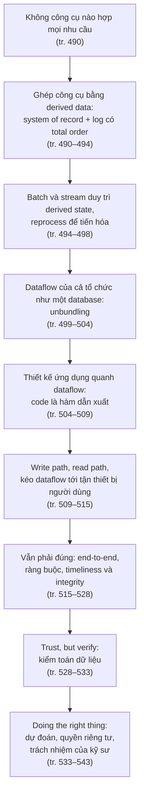

### Liên hệ với các chương khác

Chương 12 là chương tổng hợp, dẫn lại rất nhiều mục trước đó. Bảng dưới liệt kê các liên hệ chính. Với chương 6–11, ghi chú chỉ dẫn tới tệp và số trang mà sách nêu.

| Ý trong chương 12 | Liên hệ | Căn cứ |
| --- | --- | --- |
| Mục tiêu reliable, scalable, maintainable | **Chương 1** ([B3](chapter-01.md#b3), [B4](chapter-01.md#b4), [B5](chapter-01.md#b5)) | tr. 489 |
| Ghép nhiều công cụ thành một data system; giữ cache, index đồng bộ là việc của ứng dụng | **Chương 1** ([B2](chapter-01.md#b2)) | tr. 490–491 (liên hệ do người viết ghi chú nêu) |
| Dịch ranh giới write path và read path; ví dụ Twitter quay lại | **Chương 1** ([B4.1](chapter-01.md#load-parameters)) | tr. 511 |
| Bug ứng dụng và lỗi con người; tiến hóa nhanh khi không sợ thay đổi | **Chương 1** ([B3](chapter-01.md#b3), [evolvability](chapter-01.md#evolvability)) | tr. 516, 532 |
| Schema-on-read, schema-on-write | **Chương 2** ([schema flexibility](chapter-02.md#schema-flexibility)) | tr. 496 |
| Truy vấn đệ quy trên graph như một materialized view | **Chương 2** ([B4](chapter-02.md#b4)) | tr. 504 |
| Ba cách lưu trữ cho cùng một bài toán | **Chương 3** ([B3](chapter-03.md#b3), [B4](chapter-03.md#b4), [B8](chapter-03.md#b8)) | tr. 490 |
| Secondary index, spatial index, full-text index, materialized view là tính năng có sẵn của database | **Chương 3** ([B6](chapter-03.md#b6), [B6.3](chapter-03.md#multi-column), [B6.4](chapter-03.md#fuzzy), [B8.7](chapter-03.md#materialized-views)) | tr. 499–501, 505 |
| Tiến hóa schema; reprocess cho phép thay đổi lớn hơn | **Chương 4** ([tương thích](chapter-04.md#compatibility), [data outlives code](chapter-04.md#data-outlives-code)) | tr. 496 |
| Microservices qua REST/RPC; message-passing và actor | **Chương 4** ([B7.2](chapter-04.md#dataflow-services), [B7.3](chapter-04.md#message-passing)) | tr. 493, 507–508 |
| Ba cách replication; replication log | **Chương 5** ([D1](chapter-05.md#d1), [B1.4](chapter-05.md#replication-logs)) | tr. 490, 500 |
| Dựng follower mới giống `CREATE INDEX` | **Chương 5** ([B1.2](chapter-05.md#new-followers)) | tr. 500 |
| Mỗi datacenter một leader; client làm việc offline | **Chương 5** ([multi-datacenter](chapter-05.md#multi-datacenter), [offline](chapter-05.md#offline-clients)) | tr. 493, 511 |
| Tự động giải quyết xung đột; "What is a conflict?"; xử lý xung đột ghi | **Chương 5** ([hộp Automatic Conflict Resolution](chapter-05.md#automatic-resolution), [what is a conflict](chapter-05.md#what-is-conflict), [B3.2](chapter-05.md#write-conflicts)) | tr. 494, 522, 527 |
| Replication lag, read-your-writes là một dạng timeliness | **Chương 5** ([B2](chapter-05.md#b2), [B2.1](chapter-05.md#read-your-writes)) | tr. 492, 524 |
| Chương 5 hứa "cơ chế thay thế transaction ở Part III" | **Chương 5** ([B2.4](chapter-05.md#lag-solutions)) | tr. 492, 515–528 |
| Leaderless: mô hình bỏ transaction, ngữ nghĩa lộn xộn hơn | **Chương 5** ([B4](chapter-05.md#b4)) | tr. 515 |
| Secondary index xuyên partition, request routing, partition theo hash | [Chương 6](chapter-06.md) | tr. 495–496, 514, 521 |
| ACID, weak isolation, write skew, single-object write, serial execution, 2PL | [Chương 7](chapter-07.md) | tr. 492, 515, 519–520, 523, 526, 529 |
| Fencing ("The leader and the lock"), system model, Byzantine fault, dữ liệu hỏng lọt checksum TCP, Hình 8-1 | [Chương 8](chapter-08.md) | tr. 517, 528–529, 532 |
| Linearizability, total order broadcast, consensus, 2PC, XA, CAP, uniqueness | [Chương 9](chapter-09.md) | tr. 492–493, 517, 521–522, 524 |
| Output của batch workflow, triết lý Unix, Hadoop so với MPP, reduce-side join | [Chương 10](chapter-10.md) | tr. 495, 499, 503, 514 |
| Dual writes, CDC, event sourcing, bất biến, idempotence, exactly-once, time-dependence of joins, event time | [Chương 11](chapter-11.md) | tr. 491–498, 507–509, 516, 525–526 |

> **Bản đồ đầu chương (tr. 488).** Bản đồ in xoay ngang, vẽ một vùng bờ biển. Ngoài khơi là "Sea of Derived Data" (biển dữ liệu dẫn xuất) với hai con tàu: một tàu ghi "To Batch Processing (Chapter 10)", tàu kia ghi "To Stream Processing (Chapter 11)". Cả hai cập bến "Data Harbor". Từ bến chạy ra "Big Data Road". Trên đất liền là vùng "Realm of Dataflow" với các điểm "Unbundling", "Spreadsheets", "Reactive programming", "Index maintenance" và "Materialized view maintenance". Một dãy núi mang tên "Data Integration". Phía xa có hai con rồng ghi "Security" và "Privacy", một ngọn núi "Mountain of Trust", và vùng "Unknown". Phần còn lại là "Uncharted Territory" (vùng chưa vẽ bản đồ).
>
> *Diễn giải của người viết ghi chú:* hai con tàu nối chương 10 và 11 với chương này: batch và stream là công cụ tích hợp dữ liệu ([B1](#b1)). "Realm of Dataflow" khớp với [B2](#b2) (unbundling, spreadsheet, duy trì index và materialized view). Hai con rồng Security và Privacy cùng "Mountain of Trust" gợi tới phần kiểm toán ([B3.4](#trust-verify)) và đạo đức ([B4](#b4)). "Unknown" và "Uncharted Territory" hợp với tinh thần của chương: bàn về tương lai, nơi chưa ai vẽ bản đồ.

---

<a id="b-chi-tiet"></a>

## B. Giải thích chi tiết

<a id="b1"></a>

### B1. Data Integration (tr. 490–498)

<a id="data-integration"></a>

#### B1.0 Không có một giải pháp đúng cho mọi hoàn cảnh (tr. 490)

**Chủ đề lặp lại của cả sách** (tr. 490). Với mỗi bài toán thường có **nhiều giải pháp**, mỗi giải pháp có ưu điểm, nhược điểm và trade-off riêng. Ví dụ: chương 3 có log-structured storage, B-tree và column-oriented storage; chương 5 có single-leader, multi-leader và leaderless replication.

**Vì sao một phần mềm không làm được tất cả** (tr. 490). Bài toán "lưu dữ liệu rồi tra lại sau" không có một lời giải đúng duy nhất. Mỗi cách hợp với một hoàn cảnh. Một phần mềm thường phải **chọn một** cách. Làm cho một code path vừa robust vừa nhanh đã đủ khó. Cố làm mọi thứ trong một phần mềm gần như chắc chắn dẫn tới một bản cài kém. Vì vậy, kể cả database gọi là "general-purpose" cũng được thiết kế cho một **mẫu sử dụng cụ thể**.

**Hai thách thức** (tr. 490):

1. **Ánh xạ sản phẩm với hoàn cảnh phù hợp.** Vendor hiểu được là ngại nói workload nào sản phẩm của họ làm kém. Các chương trước trang bị cho người đọc những câu hỏi để "đọc giữa các dòng" và hiểu trade-off.
2. **Dữ liệu được dùng theo nhiều cách.** Dù hiểu hoàn hảo ánh xạ trên, ứng dụng phức tạp thường dùng cùng dữ liệu theo nhiều cách khác nhau. Khó có một phần mềm hợp mọi cách dùng, nên **không tránh khỏi** việc ghép nhiều phần mềm để cung cấp chức năng.

<a id="deriving-data"></a>

#### B1.1 Combining Specialized Tools by Deriving Data (tr. 490–494)

**Ví dụ mở đầu** (tr. 490–491). Thường phải tích hợp một **database OLTP** với một **full-text search index** để trả lời truy vấn theo từ khóa bất kỳ.

- Một số database như PostgreSQL có sẵn full-text indexing, đủ cho ứng dụng đơn giản [1]. Tìm kiếm phức tạp hơn cần công cụ **information retrieval** chuyên dụng.
- Ngược lại, search index thường **không hợp** làm **system of record** bền vững.
- Vì vậy nhiều ứng dụng phải ghép hai công cụ để đáp ứng mọi yêu cầu. Chương 11 đã chạm vấn đề này ở "Keeping Systems in Sync" (tr. 452).

**Càng nhiều biểu diễn, càng khó** (tr. 491). Ngoài database và search index, có thể còn phải giữ bản sao dữ liệu trong hệ analytics (data warehouse, hệ batch và stream), duy trì cache hoặc phiên bản denormalized của object, đưa dữ liệu qua hệ machine learning, phân loại, xếp hạng hay gợi ý, hoặc gửi thông báo khi dữ liệu thay đổi.

**"99% người chỉ cần X"** (tr. 491). Tác giả hay nghe kỹ sư nói kiểu "theo kinh nghiệm của tôi, 99% người chỉ cần X" hoặc "không cần X". Theo ông, câu đó nói về **kinh nghiệm của người nói** nhiều hơn là về giá trị thật của công nghệ. Những việc có thể làm với dữ liệu rộng tới chóng mặt. Tính năng vô nghĩa với người này có thể là yêu cầu trung tâm của người khác. Nhu cầu tích hợp dữ liệu thường chỉ lộ ra khi **lùi xa** và nhìn dataflow của **cả tổ chức**.

<a id="reasoning-dataflows"></a>

**Reasoning about dataflows** (tr. 491–492).

**What.** Khi cùng một dữ liệu phải có bản sao ở nhiều hệ lưu trữ để phục vụ các access pattern khác nhau, phải **rất rõ về input và output**:

- Dữ liệu được ghi **đầu tiên** ở đâu?
- Biểu diễn nào được **dẫn xuất từ** nguồn nào?
- Làm sao đưa dữ liệu tới **đúng mọi nơi**, ở **đúng định dạng**?

**How — cách nên làm** (tr. 491). Ghi dữ liệu trước vào một database làm ***system of record***. Bắt các thay đổi trên database đó bằng ***change data capture*** (CDC, "Change Data Capture", tr. 454, Chương 11). Rồi áp dụng các thay đổi lên search index **theo cùng thứ tự**. Nếu CDC là **cách duy nhất** để cập nhật index, ta có thể tin index được **dẫn xuất hoàn toàn** từ system of record, nên nhất quán với nó (trừ khi phần mềm có bug). Khi đó **ghi vào database là cách duy nhất** để đưa input mới vào hệ thống.

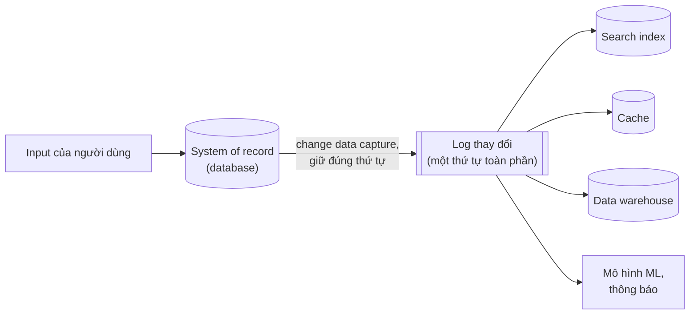

*(Sơ đồ do người viết ghi chú tổng hợp từ tr. 490–492.)*

**Why — điều xảy ra nếu ghi thẳng vào cả hai** (tr. 491). Nếu ứng dụng **tự ghi trực tiếp** vào cả search index lẫn database (*dual writes*), sẽ gặp vấn đề ở Hình 11-4: hai client đồng thời gửi hai lần ghi xung đột, và hai hệ lưu trữ xử lý chúng **theo thứ tự khác nhau**. Không hệ nào "chịu trách nhiệm" quyết định thứ tự ghi. Hai hệ có thể đưa ra quyết định **mâu thuẫn** và **bất nhất vĩnh viễn** với nhau.

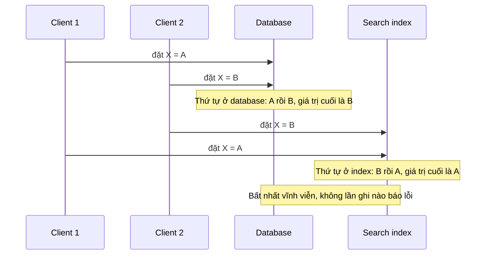

*(Ví dụ minh họa do AI xây dựng theo vấn đề ở Hình 11-4 mà tr. 491 nhắc tới. Theo chú thích của Hình 11-4 trong Chương 11, ở database X được đặt A rồi B, còn ở search index các lần ghi tới theo thứ tự ngược lại.)*

**Nguyên lý rút ra** (tr. 491). Nếu dồn được **mọi input của người dùng** qua **một hệ thống quyết định thứ tự cho mọi lần ghi**, việc dẫn xuất các biểu diễn khác trở nên dễ hơn nhiều: chỉ cần xử lý các lần ghi **theo cùng thứ tự**. Đây là một áp dụng của ***state machine replication*** ("Total Order Broadcast", tr. 348, Chương 9). Dùng CDC hay dùng event sourcing log **ít quan trọng hơn** bản thân nguyên lý: **quyết định một total order**.

**Phục hồi dễ** (tr. 492). Cập nhật một hệ derived data dựa trên event log thường có thể làm **tất định** (*deterministic*) và **idempotent** ("Idempotence", tr. 478). Nhờ vậy phục hồi sau lỗi khá dễ: chỉ cần xử lý lại từ log.

> **Bổ sung ngoài sách.** Đây là cùng ý tưởng với replication log ở [chương 5](chapter-05.md#leader-based): follower áp dụng thay đổi của leader **theo đúng thứ tự**, nên luôn đi tới cùng trạng thái. Ở đây search index, cache, warehouse đóng vai "follower" của system of record. Bài toán dual writes chính là trường hợp **hai leader không ai theo ai**, giống multi-leader ở [chương 5](chapter-05.md#write-conflicts).

<a id="derived-vs-dist-tx"></a>

**Derived data versus distributed transactions** (tr. 492).

**Câu hỏi.** Cách cổ điển để giữ nhiều hệ dữ liệu nhất quán với nhau là **distributed transaction** ("Atomic Commit and Two-Phase Commit (2PC)", tr. 354, Chương 9). Cách dùng derived data so với nó thì sao?

**Cùng mục tiêu, khác phương tiện** (tr. 492):

| Khía cạnh | Distributed transactions | Derived data qua log (CDC, event sourcing) |
| --- | --- | --- |
| Quyết định thứ tự ghi | Dùng **lock** để loại trừ lẫn nhau ("Two-Phase Locking (2PL)", tr. 257) | Dùng **log** |
| Bảo đảm thay đổi có hiệu lực **đúng một lần** | **Atomic commit** | **Retry tất định** và **idempotence** |
| Đảm bảo về thời điểm | Thường có **linearizability** ("Linearizability", tr. 324), kéo theo các đảm bảo hữu ích như đọc thấy ghi của chính mình ([chương 5](chapter-05.md#read-your-writes)) | Thường cập nhật **bất đồng bộ**, nên **mặc định không có** cùng đảm bảo về thời điểm |

**Đánh giá của tác giả** (tr. 492):

- Trong những môi trường hạn chế, chấp nhận trả chi phí của distributed transaction, chúng đã được dùng thành công.
- Nhưng tác giả cho rằng **XA** có đặc tính **chịu lỗi** và **hiệu năng** kém ("Distributed Transactions in Practice", tr. 360), nên giới hạn nghiêm trọng tính hữu ích của nó.
- Có thể tạo được một giao thức distributed transaction tốt hơn. Nhưng để nó được chấp nhận rộng rãi và tích hợp với các công cụ có sẵn là việc khó, và khó xảy ra sớm.

**Kết luận** (tr. 492). Khi chưa có giao thức distributed transaction tốt được hỗ trợ rộng rãi, tác giả tin **derived data dựa trên log** là cách hứa hẹn nhất để tích hợp các hệ dữ liệu khác nhau. Nhưng các đảm bảo như **đọc thấy ghi của chính mình** vẫn hữu ích. Tác giả không cho rằng có ích khi bảo mọi người "eventual consistency là không tránh được, chịu khó mà sống với nó", ít nhất là khi không kèm hướng dẫn tốt cách xử lý. Mục [B3](#b3) sẽ bàn cách có **đảm bảo mạnh hơn** trên các hệ derived bất đồng bộ, hướng tới **điểm giữa** của distributed transaction và hệ log bất đồng bộ.

> **Bổ sung ngoài sách (liên hệ).** Ở [chương 5, B2.4](chapter-05.md#lag-solutions), sách nói nhiều hệ phân tán đã bỏ transaction và cho rằng eventual consistency là không tránh được; nhận định đó "có phần đúng nhưng quá đơn giản", và Part III sẽ bàn cơ chế thay thế. Mục này và [B3](#b3) chính là phần trả lời cho lời hứa đó.

<a id="total-order-limits"></a>

**The limits of total ordering** (tr. 493).

Với hệ **đủ nhỏ**, dựng một event log có **thứ tự toàn phần** (*totally ordered*) hoàn toàn khả thi. Bằng chứng là sự phổ biến của database single-leader replication, vốn dựng đúng một log như vậy. Nhưng khi hệ lớn và workload phức tạp hơn, giới hạn bắt đầu xuất hiện (tr. 493):

| Tình huống | Vì sao mất total order |
| --- | --- |
| **Throughput vượt một máy** | Total order thường đòi mọi event đi qua **một leader** quyết định thứ tự. Nếu lượng event vượt sức một máy, phải partition log ra nhiều máy ("Partitioned Logs", tr. 446). Thứ tự giữa event ở hai partition khác nhau khi đó **mơ hồ** |
| **Nhiều datacenter** | Để chịu được mất cả một datacenter, thường mỗi datacenter có **leader riêng**, vì độ trễ mạng làm phối hợp đồng bộ liên datacenter kém hiệu quả ([chương 5](chapter-05.md#multi-datacenter)). Thứ tự của event phát sinh ở hai datacenter **không xác định** |
| **Microservices** | Thiết kế phổ biến là triển khai mỗi service cùng **durable state riêng** như một đơn vị độc lập, không chia sẻ state bền giữa các service ([chương 4](chapter-04.md#dataflow-services)). Event phát sinh ở hai service **không có thứ tự xác định** |
| **Client giữ state, chạy offline** | Một số ứng dụng cập nhật state phía client ngay khi người dùng nhập, không chờ server xác nhận, và chạy được offline ([chương 5](chapter-05.md#offline-clients)). Client và server rất có thể thấy event **theo thứ tự khác nhau** |

**Vì sao không chỉ cần "consensus nhanh hơn"** (tr. 493). Về hình thức, quyết định một total order cho event gọi là ***total order broadcast***, và nó **tương đương consensus** ("Consensus algorithms and total order broadcast", tr. 366). Hầu hết thuật toán consensus được thiết kế cho trường hợp **throughput của một node** đủ xử lý cả stream event. Chúng không có cơ chế để **nhiều node chia nhau việc sắp thứ tự**. Thiết kế thuật toán consensus vượt được throughput của một node và chạy tốt khi phân tán địa lý vẫn là **bài toán nghiên cứu mở**.

<a id="causality-ordering"></a>

**Ordering events to capture causality** (tr. 493–494).

**Khi nào thiếu total order không sao** (tr. 493). Nếu giữa các event **không có liên hệ nhân quả**, thiếu total order không phải vấn đề lớn: các event đồng thời có thể được xếp **tùy ý** (xem khái niệm *concurrent* ở [chương 5](chapter-05.md#happens-before)). Một số trường hợp khác cũng dễ: nhiều cập nhật vào **cùng một object** có thể được sắp toàn phần bằng cách route mọi cập nhật theo ID của object đó vào **cùng một partition log**.

**Khi phụ thuộc nhân quả tinh vi** (tr. 494). Phụ thuộc nhân quả đôi khi xuất hiện theo cách khó thấy ("Ordering and Causality", tr. 339, Chương 9).

**Example — chia tay trên mạng xã hội** (tr. 494). Hai người dùng từng có quan hệ tình cảm vừa chia tay. Một người **hủy kết bạn** với người kia, **rồi** gửi tin cho những người bạn còn lại, phàn nàn về người cũ. Ý định của họ: người cũ **không được thấy** tin nhắn khó nghe này, vì tin được gửi **sau khi** đã hủy kết bạn.

- Nhưng nếu hệ thống lưu trạng thái bạn bè ở **một nơi** và tin nhắn ở **nơi khác**, phụ thuộc thứ tự giữa event "unfriend" và event "gửi tin" có thể **mất**.
- Nếu không nắm được phụ thuộc nhân quả, service gửi thông báo về tin nhắn mới có thể xử lý event gửi tin **trước** event unfriend, và **gửi nhầm thông báo** cho người cũ.

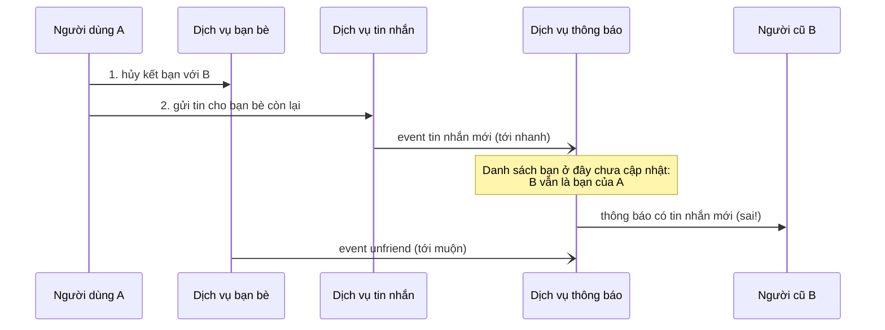

*(Ví dụ minh họa do AI xây dựng theo tình huống ở tr. 494. Sách không nêu cụ thể các service.)*

**Vì sao khó** (tr. 494). Thông báo ở đây thực chất là một **join** giữa tin nhắn và danh sách bạn. Vì vậy nó liên quan tới vấn đề thời điểm của join đã bàn ở "Time-dependence of joins" (tr. 475, Chương 11). Tiếc là dường như **chưa có câu trả lời đơn giản** [2, 3]. Các điểm khởi đầu:

1. **Logical timestamp** cho total ordering **không cần phối hợp** ("Sequence Number Ordering", tr. 343). Nó giúp khi total order broadcast không khả thi. Nhưng bên nhận **vẫn phải xử lý** event tới không theo thứ tự, và phải truyền **thêm metadata**.
2. **Ghi lại trạng thái người dùng đã thấy.** Nếu log được một event ghi lại trạng thái hệ thống mà người dùng thấy **trước khi** ra quyết định, và gán cho event đó một **ID duy nhất**, thì mọi event sau có thể **tham chiếu ID đó** để ghi lại phụ thuộc nhân quả [4]. Sách quay lại ý này ở "Reads are events too" ([B2.3](#reads-are-events)).
3. **Thuật toán giải quyết xung đột** ([hộp Automatic Conflict Resolution](chapter-05.md#automatic-resolution), tr. 174) giúp xử lý event tới theo thứ tự bất ngờ. Chúng hữu ích để **duy trì state**, nhưng **không giúp** nếu hành động có **side effect bên ngoài**, ví dụ gửi thông báo cho người dùng.

> **Bổ sung ngoài sách.** Điểm 3 đáng nhớ: CRDT hay thuật toán gộp có thể làm state **cuối cùng** đúng, nhưng một thông báo đã gửi thì không "gộp lại" được. Side effect ra thế giới bên ngoài là không đảo ngược, nên cần đúng thứ tự **trước khi** hành động.

**Triển vọng** (tr. 494). Tác giả hy vọng theo thời gian sẽ xuất hiện các **pattern** phát triển ứng dụng cho phép nắm phụ thuộc nhân quả hiệu quả và duy trì derived state đúng, **mà không** buộc mọi event đi qua **nút cổ chai** của total order broadcast.

<a id="batch-stream"></a>

#### B1.2 Batch and Stream Processing (tr. 494–498)

**Mục tiêu của data integration** (tr. 494–495). Theo tác giả, mục tiêu là bảo đảm dữ liệu **ở đúng dạng, ở mọi nơi đúng**. Muốn vậy phải consume input, biến đổi, join, lọc, gộp, huấn luyện model, đánh giá, và cuối cùng ghi ra output thích hợp. **Batch processor và stream processor** là công cụ để đạt mục tiêu này.

**Output là derived dataset** (tr. 495): search index, materialized view, gợi ý hiển thị cho người dùng, metric tổng hợp… ("The Output of Batch Workflows", tr. 411; "Uses of Stream Processing", tr. 465).

**Batch và stream đang xích lại gần nhau** (tr. 495). Như chương 10 và 11 cho thấy, hai loại có nhiều nguyên lý chung. Khác biệt căn bản: stream processor làm việc với dataset **không giới hạn** (*unbounded*), còn input của batch có **kích thước biết trước, hữu hạn**. Cách cài các engine cũng khác nhau ở nhiều chi tiết, nhưng ranh giới đang mờ dần:

- **Spark** làm stream processing **trên một batch engine**, bằng cách chia stream thành **microbatch**.
- **Apache Flink** làm batch processing **trên một stream engine** [5].
- Về nguyên lý, loại này mô phỏng được loại kia, nhưng đặc tính hiệu năng khác nhau. Ví dụ microbatch có thể chạy **kém** với hopping window hay sliding window [6].

<a id="derived-state"></a>

**Maintaining derived state** (tr. 495–496).

**Hương vị functional** (tr. 495). Batch processing mang đậm tính functional, dù code không viết bằng ngôn ngữ functional:

- Khuyến khích **hàm tất định, thuần** (*pure function*): output chỉ phụ thuộc input, không có side effect nào ngoài output tường minh.
- Coi input là **bất biến**, output là **chỉ ghi thêm**.

Stream processing tương tự, nhưng mở rộng operator để có **state được quản lý và chịu lỗi** ("Rebuilding state after a failure", tr. 478).

**Vì sao nguyên lý này tốt** (tr. 495). Hàm tất định với input và output rõ ràng **không chỉ tốt cho fault tolerance** (idempotence, tr. 478) mà còn **đơn giản hóa việc suy luận** về dataflow trong tổ chức [7]. Dù derived data là search index, mô hình thống kê hay cache, nên nghĩ theo **data pipeline** dẫn xuất thứ này từ thứ kia: đẩy thay đổi state ở một hệ qua code ứng dụng kiểu functional, rồi áp hiệu ứng lên các hệ derived.

**Đồng bộ hay bất đồng bộ?** (tr. 495).

- Về nguyên lý, hệ derived data **có thể** được duy trì **đồng bộ**, giống relational database cập nhật secondary index đồng bộ **trong cùng transaction** với lần ghi vào bảng.
- Nhưng chính tính **bất đồng bộ** làm các hệ dựa trên event log **robust**: nó cho phép lỗi ở một phần hệ thống được **khoanh vùng cục bộ**.
- Ngược lại, distributed transaction **abort nếu bất kỳ participant nào hỏng**, nên có xu hướng **khuếch đại lỗi**, lan nó ra phần còn lại của hệ thống ("Limitations of distributed transactions", tr. 363).

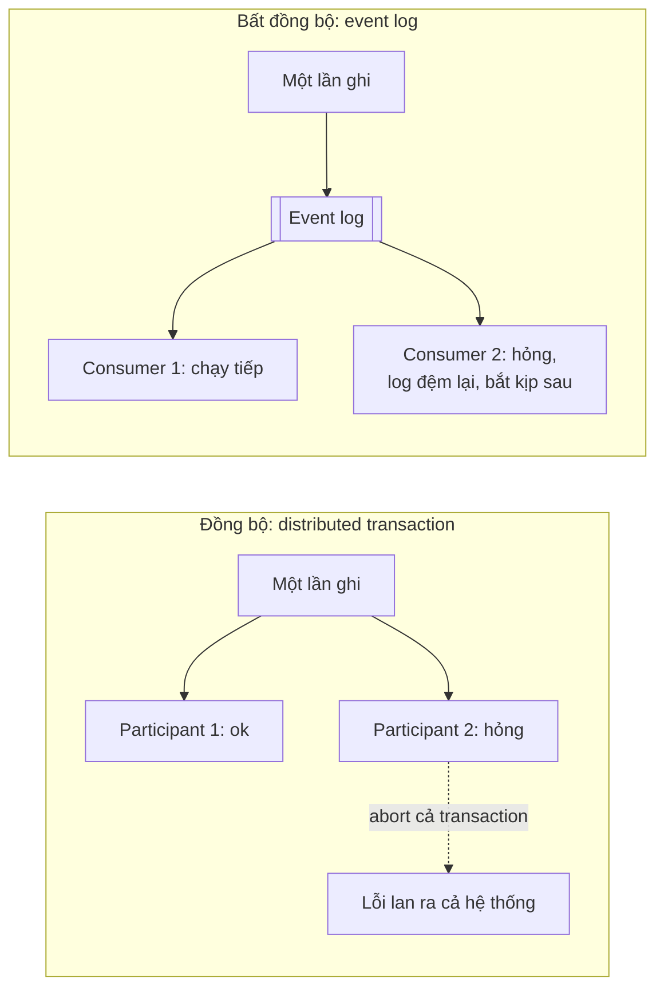

*(Sơ đồ do người viết ghi chú tổng hợp từ tr. 495 và 502.)*

**Secondary index xuyên partition** (tr. 495–496). Secondary index thường **vượt qua ranh giới partition** ("Partitioning and Secondary Indexes", tr. 206, Chương 6). Hệ có partition và secondary index hoặc phải gửi **ghi tới nhiều partition** (index partition theo term), hoặc gửi **đọc tới mọi partition** (index partition theo document). Giao tiếp xuyên partition như vậy cũng **tin cậy và scale tốt nhất** nếu index được duy trì **bất đồng bộ** [8] (xem thêm [Multi-partition data processing](#multi-partition-processing), tr. 514).

<a id="reprocessing"></a>

**Reprocessing data for application evolution** (tr. 496–497).

**Hai vai trò bổ sung nhau** (tr. 496). Khi duy trì derived data, cả batch và stream đều hữu ích:

- **Stream processing** phản ánh thay đổi ở input vào derived view với **độ trễ thấp**.
- **Batch processing** cho phép **xử lý lại** (*reprocess*) lượng lớn dữ liệu lịch sử tích lũy, để dẫn xuất **view mới** trên dataset đã có.

**Why — reprocess là cơ chế tiến hóa** (tr. 496). Xử lý lại dữ liệu có sẵn là cơ chế tốt để **bảo trì** hệ thống và **tiến hóa** nó cho tính năng mới, yêu cầu mới (Chương 4).

- **Không có reprocess**, schema evolution bị giới hạn ở thay đổi đơn giản: thêm một trường optional vào bản ghi, thêm một kiểu bản ghi mới. Điều này đúng cả với schema-on-write lẫn schema-on-read ([chương 2](chapter-02.md#schema-flexibility), tr. 39).
- **Có reprocess**, có thể **tái cấu trúc** dataset thành một **mô hình hoàn toàn khác** để phục vụ yêu cầu mới tốt hơn.

> **Bổ sung ngoài sách (liên hệ).** Ở [chương 4](chapter-04.md#data-outlives-code), "data outlives code": migration (ghi lại toàn bộ dữ liệu theo schema mới) tốn kém nên database tránh nếu được. Reprocess từ log là cách làm migration lớn **mà không phá dữ liệu gốc**: dữ liệu gốc giữ nguyên, chỉ có thêm một view mới.

<a id="railways"></a>

**Hộp "Schema Migrations on Railways"** (tr. 496).

- "Schema migration" quy mô lớn cũng xảy ra ở hệ thống ngoài máy tính. Ở nước Anh đầu thế kỷ 19, thời mới xây đường sắt, có nhiều chuẩn **khổ đường ray** (*gauge*, khoảng cách giữa hai ray) cạnh tranh nhau. Tàu đóng cho khổ này không chạy được trên ray khổ kia, nên mạng đường sắt bị hạn chế kết nối [9].
- Năm **1846** người ta chọn được một khổ chuẩn duy nhất. Ray khổ khác phải chuyển đổi. Nhưng làm sao chuyển mà không đóng tuyến hàng tháng, hàng năm?
- Lời giải: trước hết chuyển ray thành **dual gauge** hay **mixed gauge** bằng cách **thêm một ray thứ ba**. Việc này làm **dần dần** được. Xong rồi thì tàu của **cả hai khổ** đều chạy được trên tuyến, mỗi loại dùng hai trong ba ray. Khi mọi tàu đã chuyển sang khổ chuẩn, ray dành cho khổ phi chuẩn được gỡ bỏ.
- "Reprocess" đường ray theo cách này, cho phiên bản cũ và mới **cùng tồn tại song song**, giúp đổi khổ dần trong nhiều năm. Dù vậy, đây vẫn là việc **tốn kém**, nên khổ phi chuẩn vẫn còn tới nay. Ví dụ hệ thống BART ở vùng Vịnh San Francisco dùng khổ ray khác với phần lớn nước Mỹ.

**Derived view cho phép tiến hóa dần** (tr. 497). Muốn tái cấu trúc một dataset, **không cần** migrate theo kiểu chuyển đổi đột ngột:

1. Giữ **schema cũ và schema mới song song**, như **hai view dẫn xuất độc lập** trên cùng dữ liệu gốc.
2. Chuyển **một số ít người dùng** sang view mới để kiểm tra hiệu năng và tìm bug; đa số người dùng vẫn được route tới view cũ.
3. **Tăng dần** tỷ lệ người dùng dùng view mới.
4. Cuối cùng **bỏ view cũ** [10].

**Cái đẹp của cách làm này** (tr. 497). **Mọi bước đều dễ đảo ngược** nếu có sự cố: luôn có một hệ thống đang chạy tốt để quay về. Rủi ro gây **hư hại không đảo ngược được** giảm đi, nên ta tự tin tiến lên hơn, và nhờ đó **cải thiện hệ thống nhanh hơn** [11].

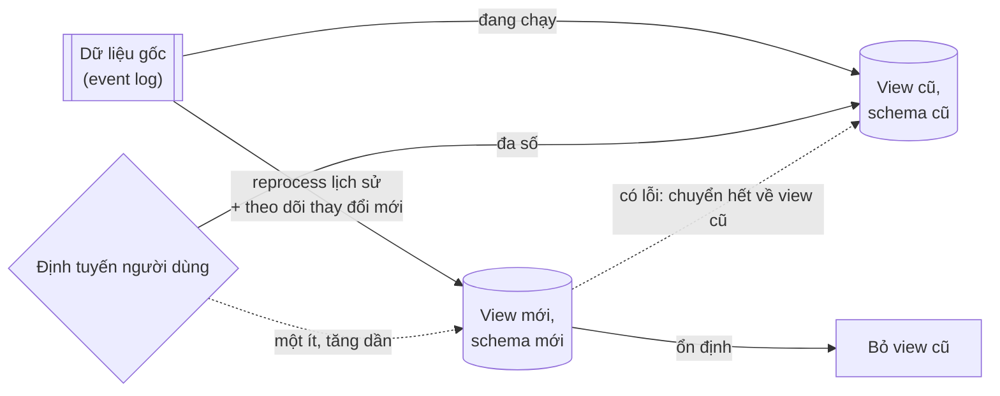

*(Sơ đồ do người viết ghi chú tổng hợp từ tr. 497. View mới đóng vai "ray thứ ba" trong hộp ở tr. 496.)*

> **Bổ sung ngoài sách.** Trong thực tế, kỹ thuật này gần với **canary release** hay **dark launch**: phiên bản mới nhận một phần nhỏ traffic thật, được so sánh với phiên bản cũ, rồi mới mở rộng. Điểm riêng ở đây là cả hai view được **dẫn xuất từ cùng nguồn**, nên có thể dựng lại view mới bất cứ lúc nào.

<a id="lambda"></a>

**The lambda architecture** (tr. 497–498).

**Câu hỏi** (tr. 497). Nếu batch dùng để reprocess dữ liệu lịch sử và stream dùng để xử lý cập nhật gần đây, làm sao **kết hợp** hai thứ? ***Lambda architecture*** [12] là một đề xuất được chú ý nhiều.

**What và How** (tr. 497):

- Dữ liệu tới được ghi bằng cách **nối thêm event bất biến** vào một dataset luôn lớn dần, tương tự event sourcing ("Event Sourcing", tr. 457, Chương 11). Từ các event này dẫn xuất các view tối ưu cho đọc.
- Chạy **hai hệ song song**: một hệ batch như **Hadoop MapReduce**, và một hệ stream riêng như **Storm**.
- Stream processor consume event và nhanh chóng tạo **cập nhật xấp xỉ** cho view. Sau đó batch processor consume **cùng tập event** và tạo **phiên bản đã sửa đúng** của view.

**Why — lý do của thiết kế** (tr. 497). Batch processing **đơn giản hơn**, nên ít bug hơn. Stream processor bị coi là **kém tin cậy** và **khó làm chịu lỗi** ("Fault Tolerance", tr. 476). Ngoài ra stream có thể dùng thuật toán **xấp xỉ nhanh**, còn batch dùng thuật toán **chính xác nhưng chậm hơn**.

**Đánh giá** (tr. 497–498). Lambda architecture là ý tưởng **có ảnh hưởng**, giúp thiết kế data system tốt hơn, nhất là nhờ phổ biến nguyên lý **dẫn xuất view từ stream event bất biến** và **reprocess event khi cần**. Nhưng tác giả thấy nó có một số vấn đề thực tế:

1. **Duy trì cùng logic ở hai nơi.** Phải giữ cùng một logic chạy được trên cả framework batch và framework stream là **công sức lớn**. Thư viện như Summingbird [13] cho một abstraction chạy được ở cả hai ngữ cảnh, nhưng **độ phức tạp vận hành** (debug, tinh chỉnh, bảo trì hai hệ khác nhau) vẫn còn [14].
2. **Phải gộp hai output.** Hai pipeline cho output riêng, nên phải **gộp** khi trả lời request. Gộp khá dễ nếu là aggregation đơn giản trên tumbling window, nhưng khó hơn nhiều nếu view được dẫn xuất bằng phép phức tạp như **join** và **sessionization**, hoặc nếu output **không phải time series**.
3. **Reprocess toàn bộ thì đắt.** Xử lý lại cả dataset lịch sử rất hay, nhưng làm thường xuyên với dataset lớn thì đắt. Vì vậy batch pipeline thường phải chạy theo **batch tăng dần** (ví dụ cuối mỗi giờ xử lý dữ liệu của một giờ). Khi đó gặp các vấn đề ở "Reasoning About Time" (tr. 468): xử lý **straggler** (event tới muộn), xử lý window **vắt qua ranh giới** giữa hai batch. Làm batch thành tăng dần thêm độ phức tạp, khiến nó **giống tầng stream**, đi ngược mục tiêu giữ tầng batch **đơn giản nhất có thể**.

<a id="unifying-batch-stream"></a>

**Unifying batch and stream processing** (tr. 498).

Công trình gần đây hơn cho phép hưởng lợi ích của lambda architecture **mà không có nhược điểm**: cài cả tính toán batch (reprocess lịch sử) lẫn tính toán stream (xử lý event khi chúng tới) **trong cùng một hệ thống** [15]. Hợp nhất như vậy cần các tính năng sau, ngày càng phổ biến (tr. 498):

1. **Replay event lịch sử** qua **cùng engine** đang xử lý stream event gần đây. Ví dụ log-based message broker có thể replay message ("Replaying old messages", tr. 451), và một số stream processor đọc được input từ filesystem phân tán như HDFS.
2. **Exactly-once semantics** cho stream processor: bảo đảm output **giống như không có lỗi nào**, dù lỗi thật sự đã xảy ra ("Fault Tolerance", tr. 476). Như batch processing, việc này đòi hỏi **bỏ output dở dang** của mọi task bị lỗi.
3. **Windowing theo event time**, không theo processing time, vì processing time **vô nghĩa** khi reprocess event lịch sử ("Reasoning About Time", tr. 468). Ví dụ Apache Beam cung cấp API để diễn đạt tính toán như vậy, rồi chạy trên Apache Flink hoặc Google Cloud Dataflow.

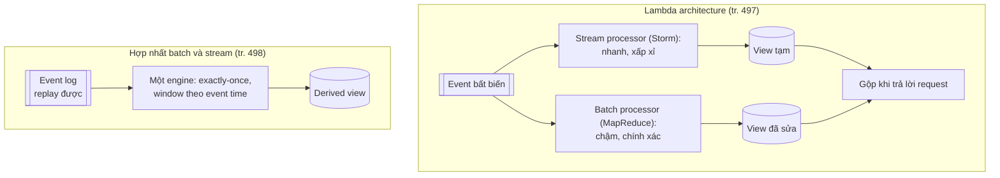

*(Sơ đồ do người viết ghi chú tổng hợp từ tr. 497–498. So sánh chi tiết ở [D2](#d2).)*

> **Bổ sung ngoài sách.** Hướng "một hệ thống, replay log để reprocess" thường được gọi là **kappa architecture**, cái tên Jay Kreps đưa ra trong bài viết được sách trích ở [14]. Sách không dùng tên này.

---

<a id="b2"></a>

### B2. Unbundling Databases (tr. 499–515)

<a id="unix-vs-relational"></a>

#### B2.0 Unix và relational database: hai triết lý quản lý thông tin (tr. 499)

**Cùng một chức năng ở mức trừu tượng nhất** (tr. 499). Database, Hadoop và hệ điều hành đều làm **cùng các chức năng**: lưu dữ liệu, và cho phép xử lý, truy vấn dữ liệu đó [16]. Database lưu dữ liệu thành bản ghi theo một mô hình dữ liệu (hàng trong bảng, document, đỉnh trong graph…). Filesystem của hệ điều hành lưu dữ liệu thành file. Nhưng cốt lõi, cả hai đều là hệ **"quản lý thông tin"** (*information management*) [17]. Chương 10 đã cho thấy hệ sinh thái Hadoop giống một **phiên bản phân tán của Unix**.

**Khác biệt thực tế** (tr. 499). Tất nhiên có nhiều khác biệt. Ví dụ nhiều filesystem xử lý **không tốt** một thư mục chứa **10 triệu file nhỏ**, trong khi một database chứa 10 triệu bản ghi nhỏ là chuyện **hoàn toàn bình thường**. Dù vậy, điểm giống và khác giữa hệ điều hành và database đáng để khám phá.

**Hai triết lý** (tr. 499):

| | Unix | Relational database |
| --- | --- | --- |
| **Mục đích** | Cho lập trình viên một abstraction phần cứng **logic nhưng khá thấp** | Cho lập trình viên ứng dụng một abstraction **mức cao**, che giấu cấu trúc dữ liệu trên đĩa, concurrency, crash recovery… |
| **Công cụ phát triển ra** | **Pipe** và **file**, vốn chỉ là chuỗi byte | **SQL** và **transaction** |
| **"Đơn giản" theo nghĩa** | Là lớp bọc **khá mỏng** quanh tài nguyên phần cứng | Một truy vấn **khai báo ngắn** dùng được rất nhiều hạ tầng mạnh (query optimizer, index, cách join, concurrency control, replication…) mà người viết truy vấn không cần hiểu chi tiết cài đặt |

**Cách nào tốt hơn?** (tr. 499). Tất nhiên tùy điều bạn muốn. Căng thẳng giữa hai triết lý đã kéo dài **hàng chục năm** (cả Unix lẫn mô hình relational ra đời đầu thập niên 1970) và **vẫn chưa ngã ngũ**. Ví dụ, tác giả diễn giải phong trào **NoSQL** là mong muốn áp dụng cách tiếp cận **abstraction mức thấp kiểu Unix** vào lĩnh vực lưu trữ OLTP phân tán.

**Mục tiêu của phần này** (tr. 499). Tác giả cố **dung hòa** hai triết lý, hy vọng kết hợp được **cái tốt nhất của cả hai**.

> **Bổ sung ngoài sách (liên hệ).** Đây là cùng câu chuyện **declarative và imperative** ở [chương 2](chapter-02.md#declarative): SQL cho database tự chọn cách thực thi; Unix pipe bắt người dùng tự ghép từng bước. Phần B2 sẽ đề xuất một thứ ở giữa: thành phần nhỏ ghép kiểu Unix, nhưng được mô tả **khai báo** như `CREATE INDEX`.

<a id="composing"></a>

#### B2.1 Composing Data Storage Technologies (tr. 499–504)

**Nhắc lại các tính năng của database** (tr. 499–500). Suốt cuốn sách đã bàn nhiều tính năng database cung cấp và cách chúng hoạt động:

| Tính năng | Ý nghĩa | Nơi đã gặp |
| --- | --- | --- |
| **Secondary index** | Tìm bản ghi hiệu quả theo giá trị của một trường | "Other Indexing Structures", tr. 85 ([chương 3](chapter-03.md#b6)) |
| **Materialized view** | Một kiểu **cache tính sẵn** kết quả truy vấn | "Aggregation: Data Cubes and Materialized Views", tr. 101 ([chương 3](chapter-03.md#materialized-views)) |
| **Replication log** | Giữ bản sao dữ liệu trên node khác luôn cập nhật | "Implementation of Replication Logs", tr. 158 ([chương 5](chapter-05.md#replication-logs)) |
| **Full-text search index** | Tìm theo từ khóa trong văn bản; có sẵn trong một số relational database [1] | "Full-text search and fuzzy indexes", tr. 88 ([chương 3](chapter-03.md#fuzzy)) |

Chương 10 và 11 có chủ đề tương tự: **xây full-text search index** ("The Output of Batch Workflows", tr. 411), **duy trì materialized view** ("Maintaining materialized views", tr. 467), và **nhân bản thay đổi** từ database sang hệ derived data ("Change Data Capture", tr. 454). Có vẻ như có sự **song song** giữa tính năng có sẵn trong database và các hệ derived data mà người ta dựng bằng batch và stream processor (tr. 500).

<a id="create-index"></a>

**Creating an index** (tr. 500).

**How — `CREATE INDEX` làm gì** (tr. 500). Khi chạy `CREATE INDEX` để tạo index mới trong relational database:

1. Database **quét một consistent snapshot** của bảng, lấy ra mọi giá trị của trường được index, **sắp xếp** chúng, và ghi ra index.
2. Rồi nó phải xử lý **phần tồn đọng** (*backlog*) các lần ghi đã diễn ra từ khi chụp snapshot (giả sử bảng **không bị khóa** trong lúc tạo index, nên ghi vẫn tiếp tục).
3. Xong rồi, database phải **tiếp tục cập nhật index** mỗi khi có transaction ghi vào bảng.

**Cùng một mẫu xuất hiện ba lần** (tr. 500). Quá trình này **rất giống** việc dựng một follower mới ([chương 5, B1.2](chapter-05.md#new-followers), tr. 155), và cũng rất giống việc **khởi tạo change data capture** trong hệ streaming ("Initial snapshot", tr. 455).

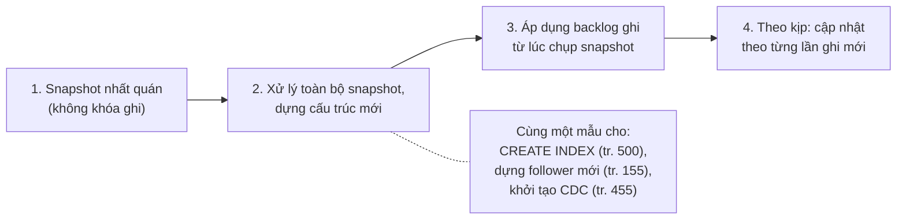

*(Sơ đồ do người viết ghi chú tổng hợp từ tr. 500.)*

**`CREATE INDEX` là reprocess** (tr. 500). Mỗi khi chạy `CREATE INDEX`, database về bản chất **xử lý lại dataset có sẵn** ([B1.2](#reprocessing), tr. 496) và **dẫn xuất index như một view mới** trên dữ liệu có sẵn. Dữ liệu có sẵn có thể là **snapshot của state** chứ không phải log mọi thay đổi từng xảy ra, nhưng hai thứ **liên quan chặt chẽ** ("State, Streams, and Immutability", tr. 459, Chương 11).

<a id="meta-database"></a>

**The meta-database of everything** (tr. 500–501).

**Cả tổ chức như một database** (tr. 500–501). Nhìn theo hướng đó, tác giả thấy **dataflow trong cả một tổ chức** bắt đầu trông như **một database khổng lồ** [7]:

- Mỗi khi một tiến trình batch, stream hay ETL **chuyển dữ liệu** từ nơi và dạng này sang nơi và dạng khác, nó đóng vai **subsystem của database** lo giữ index hay materialized view luôn cập nhật.
- Batch và stream processor giống **cài đặt công phu** của trigger, stored procedure và thủ tục duy trì materialized view.
- Các hệ derived data mà chúng duy trì giống **các loại index**. Một relational database có thể hỗ trợ B-tree index, hash index, spatial index ("Multi-column indexes", tr. 87, [chương 3](chapter-03.md#multi-column)) và các loại khác. Trong kiến trúc derived data đang hình thành, thay vì là tính năng của **một sản phẩm database tích hợp**, các "index" này do **nhiều phần mềm khác nhau** cung cấp, chạy trên **máy khác nhau**, do **đội khác nhau** quản trị.

**Hai con đường cho tương lai** (tr. 501). Nếu xuất phát từ tiền đề **không có một mô hình dữ liệu hay định dạng lưu trữ nào hợp mọi access pattern**, tác giả đoán có hai con đường để ghép các công cụ lưu trữ và xử lý khác nhau thành một hệ thống gắn kết:

<a id="federated"></a>

- ***Federated databases*: thống nhất việc đọc** (tr. 501).
  - **What.** Cung cấp **một giao diện truy vấn thống nhất** cho nhiều storage engine và phương pháp xử lý bên dưới. Cách này gọi là ***federated database*** hay ***polystore*** [18, 19]. Ví dụ tính năng ***foreign data wrapper*** của PostgreSQL theo mẫu này [20].
  - **How.** Ứng dụng cần mô hình dữ liệu hay giao diện truy vấn chuyên biệt vẫn **truy cập trực tiếp** storage engine bên dưới. Người dùng muốn **kết hợp dữ liệu** từ nhiều nơi thì làm dễ dàng qua giao diện federated.
  - **Truyền thống.** Giao diện truy vấn federated đi theo **truyền thống relational**: một hệ tích hợp duy nhất, ngôn ngữ truy vấn mức cao, ngữ nghĩa đẹp, nhưng **cài đặt phức tạp**.
- ***Unbundled databases*: thống nhất việc ghi** (tr. 501).
  - **Why.** Federation giải quyết truy vấn **chỉ đọc** qua nhiều hệ, nhưng **không có câu trả lời tốt** cho việc **đồng bộ các lần ghi** giữa các hệ đó.
  - **What.** Trong một database, tạo một index **nhất quán** là tính năng có sẵn. Khi ghép nhiều hệ lưu trữ, cũng cần bảo đảm **mọi thay đổi dữ liệu tới đúng mọi nơi**, kể cả khi có lỗi. Làm cho việc **cắm các hệ lưu trữ với nhau một cách tin cậy** trở nên dễ hơn (ví dụ qua change data capture và event log) giống như ***unbundling***, tức **tháo rời** tính năng duy trì index của database ra, để đồng bộ ghi qua nhiều công nghệ khác nhau [7, 21].
  - **Truyền thống.** Cách unbundled đi theo **truyền thống Unix**: các công cụ nhỏ **làm tốt một việc** [22], giao tiếp qua một **API mức thấp thống nhất** (pipe), và được ghép bằng một **ngôn ngữ mức cao hơn** (shell) [16].

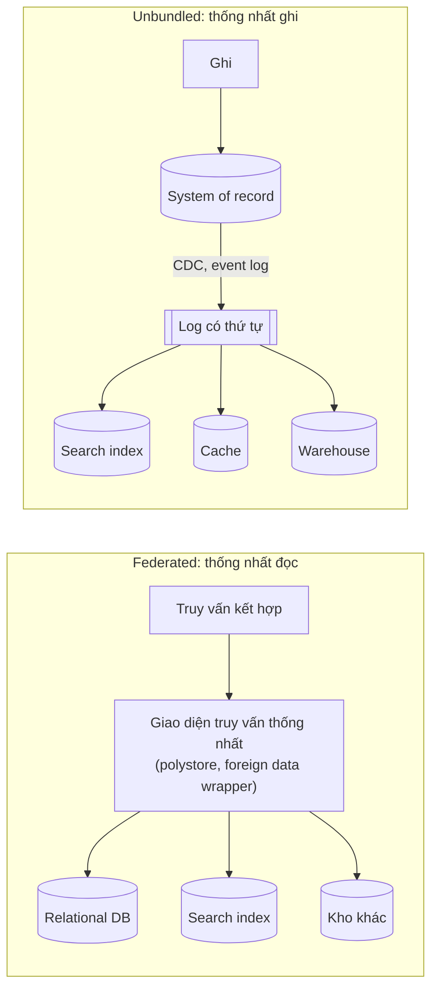

*(Sơ đồ do người viết ghi chú tổng hợp từ tr. 501. So sánh chi tiết ở [D3](#d3).)*

<a id="making-unbundling-work"></a>

**Making unbundling work** (tr. 501–502).

**Hai mặt của một đồng xu** (tr. 501–502). Federation và unbundling cùng hướng tới một mục tiêu: **ghép một hệ reliable, scalable, maintainable từ các thành phần đa dạng**.

- Truy vấn federated chỉ đọc cần **ánh xạ mô hình dữ liệu này sang mô hình kia**. Việc này cần suy nghĩ nhưng cuối cùng là bài toán **khá quản lý được**.
- Tác giả cho rằng **giữ các lần ghi vào nhiều hệ lưu trữ đồng bộ** là bài toán kỹ thuật **khó hơn**, nên tập trung vào nó.

**Distributed transaction là lời giải sai** (tr. 502). Cách truyền thống để đồng bộ ghi là distributed transaction qua các hệ lưu trữ **khác loại** [18]. Tác giả cho đó là **lời giải sai** ([B1.1](#derived-vs-dist-tx), tr. 492).

- Transaction **bên trong một** hệ lưu trữ hay một stream processor là **khả thi**.
- Nhưng khi dữ liệu **vượt ranh giới giữa các công nghệ**, tác giả tin **event log bất đồng bộ với ghi idempotent** là cách **robust và thực tế hơn nhiều**.
- Ví dụ: một số stream processor dùng distributed transaction **bên trong** để đạt exactly-once ("Atomic commit revisited", tr. 477), và chạy khá tốt. Nhưng khi transaction phải gồm các hệ do **những nhóm người khác nhau** viết (ví dụ stream processor ghi vào một distributed key-value store hay search index), việc **thiếu giao thức transaction chuẩn hóa** làm tích hợp khó hơn nhiều.
- **Log có thứ tự với consumer idempotent** ("Idempotence", tr. 478) là abstraction **đơn giản hơn nhiều**, nên khả thi hơn nhiều khi cài qua các hệ khác loại [7].

**Lợi thế lớn: loose coupling, ở hai mức** (tr. 502):

1. **Mức hệ thống.** Event stream bất đồng bộ làm cả hệ **robust hơn** trước sự cố hay suy giảm hiệu năng của **từng thành phần**. Nếu một consumer chạy chậm hay hỏng, event log có thể **đệm** message ("Disk space usage", tr. 450), cho producer và các consumer khác **tiếp tục chạy** không bị ảnh hưởng. Consumer lỗi **bắt kịp** khi được sửa, nên **không bỏ lỡ** dữ liệu nào, và lỗi được **khoanh vùng**. Ngược lại, tương tác **đồng bộ** của distributed transaction có xu hướng **leo thang lỗi cục bộ thành sự cố diện rộng** ("Limitations of distributed transactions", tr. 363).
2. **Mức con người.** Unbundling cho phép các thành phần phần mềm và service được **phát triển, cải tiến và bảo trì độc lập** bởi các đội khác nhau. Chuyên môn hóa cho mỗi đội tập trung **làm tốt một việc**, với **giao diện rõ ràng** tới hệ của đội khác. Event log là một giao diện **đủ mạnh** để giữ các tính chất consistency khá mạnh (nhờ **durability** và **thứ tự** của event), mà cũng **đủ tổng quát** để áp dụng cho gần như mọi loại dữ liệu.

<a id="unbundled-vs-integrated"></a>

**Unbundled versus integrated systems** (tr. 502–503).

**Unbundling không thay thế database** (tr. 502–503). Nếu unbundling thật sự là tương lai, nó cũng **không thay thế** database ở dạng hiện nay; database vẫn cần **như bao giờ hết**:

- Database vẫn cần để **duy trì state trong stream processor**, và để **phục vụ truy vấn** trên output của batch và stream processor ("The Output of Batch Workflows", tr. 411; "Processing Streams", tr. 464).
- Query engine chuyên dụng vẫn quan trọng cho workload riêng. Ví dụ query engine trong **MPP data warehouse** được tối ưu cho truy vấn phân tích khám phá và xử lý loại workload này rất tốt ("Comparing Hadoop to Distributed Databases", tr. 414).

**Cái giá của nhiều thành phần** (tr. 503).

- Chạy nhiều hạ tầng khác nhau có thể là vấn đề: mỗi phần mềm có **đường cong học tập**, vấn đề cấu hình, và **tính khí vận hành** riêng. Vì vậy nên triển khai **càng ít thành phần chuyển động càng tốt**.
- Một sản phẩm **tích hợp** có thể đạt hiệu năng **tốt hơn và dễ đoán hơn** với loại workload nó được thiết kế, so với một hệ ghép từ nhiều công cụ bằng code ứng dụng [23].
- Như Preface đã nói: xây cho quy mô **không cần đến** là công sức lãng phí, và có thể **khóa bạn** vào một thiết kế cứng nhắc. Thực chất đó là một dạng ***premature optimization*** (tối ưu hóa quá sớm).

**Mục tiêu thật của unbundling** (tr. 503). Không phải **cạnh tranh hiệu năng** với từng database ở một workload cụ thể. Mục tiêu là cho phép **kết hợp nhiều database** để có hiệu năng tốt trên một **dải workload rộng hơn nhiều** so với một phần mềm đơn lẻ. Đó là chuyện **bề rộng, không phải chiều sâu**, cùng tinh thần với sự đa dạng mô hình lưu trữ và xử lý ở tr. 414.

**Khi nào không nên unbundle** (tr. 503). Nếu có **một công nghệ làm được mọi thứ bạn cần**, gần như chắc chắn tốt nhất là **cứ dùng sản phẩm đó**, thay vì tự cài lại từ các thành phần mức thấp. Lợi ích của unbundling và ghép thành phần **chỉ xuất hiện** khi **không có phần mềm nào** đáp ứng mọi yêu cầu của bạn.

> **Bổ sung ngoài sách (liên hệ).** Lời khuyên này lặp lại [chương 1, B5.2](chapter-01.md#simplicity): mỗi thành phần thêm vào là thêm độ phức tạp ngẫu nhiên phải vận hành. Unbundling là công cụ cho bài toán **thật sự** cần nhiều công cụ, không phải mặc định.

<a id="whats-missing"></a>

**What's missing?** (tr. 503–504).

**Thiếu một "shell"** (tr. 503). Công cụ ghép data system đang tốt dần, nhưng tác giả thấy còn thiếu một phần lớn: chưa có **thứ tương đương Unix shell** cho unbundled database, tức một **ngôn ngữ mức cao** để ghép các hệ lưu trữ và xử lý một cách **đơn giản và khai báo**.

**Ví dụ mong muốn** (tr. 503). Tác giả mong có thể khai báo đơn giản kiểu `mysql | elasticsearch`, tương tự pipe của Unix [22]. Đó sẽ là **bản unbundled của `CREATE INDEX`**:

- Lấy mọi document trong một database MySQL và index chúng vào một cluster Elasticsearch.
- Rồi **liên tục bắt** mọi thay đổi trên database và **tự động áp** lên search index, **không cần viết code tùy biến**.
- Kiểu tích hợp này nên làm được với **gần như mọi** hệ lưu trữ hay index.

**Cache khai báo** (tr. 504). Tương tự, sẽ rất tốt nếu **tính sẵn và cập nhật cache** dễ hơn. Materialized view về bản chất là **cache tính sẵn**, nên có thể hình dung tạo cache bằng cách **khai báo materialized view** cho truy vấn phức tạp, kể cả **truy vấn đệ quy trên graph** ([chương 2](chapter-02.md#b4), tr. 49) và logic ứng dụng. Có nghiên cứu giai đoạn đầu thú vị như ***differential dataflow*** [24, 25]; tác giả hy vọng các ý tưởng này đi vào hệ production.

<a id="dataflow-apps"></a>

#### B2.2 Designing Applications Around Dataflow (tr. 504–509)

**Tên gọi "database inside-out"** (tr. 504). Cách unbundle database bằng cách ghép các hệ lưu trữ và xử lý chuyên dụng với code ứng dụng còn được gọi là cách tiếp cận **"database inside-out"** [26], theo tên một bài nói hội nghị tác giả trình bày năm 2014 [27]. Nhưng gọi nó là "kiến trúc mới" thì **quá phô trương**. Tác giả coi nó là một **design pattern**, một điểm khởi đầu thảo luận; đặt tên chỉ để dễ nói về nó.

**Không phải ý tưởng của riêng tác giả** (tr. 504). Đây là tổng hợp ý tưởng của người khác mà theo ông ta nên học:

- Ngôn ngữ **dataflow** như Oz [28] và Juttle [29];
- Ngôn ngữ **functional reactive programming** (FRP) như Elm [30, 31];
- Ngôn ngữ **logic programming** như Bloom [32].
- Thuật ngữ *unbundling* trong ngữ cảnh này do **Jay Kreps** đề xuất [7].

**Bài học từ spreadsheet** (tr. 504). Ngay cả **spreadsheet** cũng có khả năng dataflow programming **vượt xa** hầu hết ngôn ngữ lập trình chính thống [33]. Trong spreadsheet, đặt một công thức vào một ô (ví dụ tổng các ô của một cột khác); mỗi khi input của công thức đổi, kết quả **tự động được tính lại**.

- Đó **chính là điều ta muốn** ở mức data system: khi một bản ghi trong database đổi, mọi index của bản ghi đó **tự cập nhật**, mọi cached view hay aggregation phụ thuộc vào nó **tự làm mới**. Không phải lo chi tiết kỹ thuật làm mới diễn ra thế nào, chỉ cần **tin rằng nó chạy đúng**.
- Vì vậy tác giả cho rằng phần lớn data system còn nhiều điều học được từ tính năng mà **VisiCalc** đã có từ **1979** [34].

**Khác với spreadsheet** (tr. 504). Data system ngày nay phải **chịu lỗi**, **scale**, và **lưu dữ liệu bền**. Chúng còn phải **tích hợp các công nghệ khác nhau** do nhiều nhóm người viết qua thời gian, và **tái sử dụng** thư viện, service có sẵn: không thực tế khi mong mọi phần mềm được viết bằng **một** ngôn ngữ, framework hay công cụ.

<a id="derivation-function"></a>

**Application code as a derivation function** (tr. 505).

**What.** Khi một dataset được dẫn xuất từ dataset khác, nó đi qua một **hàm biến đổi** nào đó (tr. 505):

| Derived dataset | Hàm dẫn xuất |
| --- | --- |
| **Secondary index** | Hàm khá thẳng: với mỗi hàng hay document trong bảng gốc, lấy giá trị các cột hay trường được index, rồi **sắp xếp** theo giá trị đó (giả sử index B-tree hay SSTable, vốn sắp theo key, [chương 3](chapter-03.md#b3)) |
| **Full-text search index** | Áp nhiều hàm **xử lý ngôn ngữ tự nhiên**: nhận diện ngôn ngữ, tách từ, stemming hay lemmatization, sửa chính tả, nhận diện từ đồng nghĩa; rồi dựng cấu trúc dữ liệu tra cứu hiệu quả như **inverted index** |
| **Mô hình machine learning** | Model được dẫn xuất từ **training data** qua các hàm trích xuất đặc trưng (*feature extraction*) và phân tích thống kê. Khi áp model lên input mới, output được dẫn xuất từ input và model, tức **gián tiếp** từ training data |
| **Cache** | Thường chứa aggregation ở **đúng dạng sẽ hiển thị trên UI**. Điền cache cần biết UI tham chiếu những trường nào; UI đổi thì có thể phải đổi định nghĩa cách điền cache và **dựng lại cache** |

**Mức độ "có sẵn" khác nhau** (tr. 505).

- Hàm dẫn xuất cho secondary index cần thường xuyên tới mức được **tích hợp vào database** như tính năng lõi: chỉ cần gõ `CREATE INDEX`.
- Với full-text index, tính năng ngôn ngữ cơ bản cho các ngôn ngữ phổ biến có thể có sẵn, nhưng tính năng tinh vi hơn thường cần **tinh chỉnh theo lĩnh vực**.
- Với machine learning, **feature engineering** nổi tiếng là **đặc thù ứng dụng**, thường phải dùng hiểu biết chi tiết về **tương tác người dùng** và cách **triển khai** ứng dụng [35].

**Chỗ database chật vật** (tr. 505). Khi hàm tạo derived dataset **không phải** hàm "đúc khuôn" như tạo secondary index, cần **code tùy biến** cho phần đặc thù ứng dụng. Và đây là chỗ nhiều database **chật vật**. Relational database thường có **trigger, stored procedure, user-defined function** để chạy code ứng dụng bên trong database, nhưng chúng là thứ **được nghĩ thêm về sau** trong thiết kế database ("Transmitting Event Streams", tr. 440).

<a id="code-state-separation"></a>

**Separation of application code and state** (tr. 505–506).

**Database không hợp làm môi trường chạy code** (tr. 505–506). Về lý thuyết, database có thể là môi trường triển khai code ứng dụng bất kỳ, giống một hệ điều hành. Thực tế chúng **không hợp** cho việc này. Chúng không đáp ứng tốt yêu cầu của phát triển ứng dụng hiện đại: quản lý dependency và package, version control, rolling upgrade, evolvability, monitoring, metric, gọi service qua mạng, tích hợp với hệ thống bên ngoài.

**Công cụ chuyên chạy code** (tr. 506). Ngược lại, công cụ triển khai và quản lý cluster như **Mesos, YARN, Docker, Kubernetes** được thiết kế **riêng** để chạy code ứng dụng. Nhờ tập trung **làm tốt một việc**, chúng làm việc đó tốt hơn nhiều so với database coi việc chạy user-defined function là một trong nhiều tính năng.

**Quan điểm của tác giả** (tr. 506). Hợp lý khi có **phần chuyên lưu trữ dữ liệu bền** và **phần chuyên chạy code ứng dụng**. Hai phần **tương tác** với nhau nhưng vẫn **độc lập**.

**Mô hình web app phổ biến** (tr. 506).

- Hầu hết web app hiện nay được triển khai dạng ***stateless service***: request của người dùng có thể tới **bất kỳ** application server nào, và server **quên hết** về request sau khi gửi response.
- Cách triển khai này tiện: thêm hay bớt server tùy ý. Nhưng **state phải nằm ở đâu đó**: thường là trong database.
- Xu hướng: tách logic ứng dụng stateless khỏi quản lý state (database): **không đặt logic ứng dụng trong database**, **không đặt state bền trong ứng dụng** [36]. Giới functional programming hay đùa: họ tin vào "sự tách biệt giữa Church và state" [37].

> Chú thích i (tr. 506). Giải thích câu đùa (tác giả nói giải thích một câu đùa hiếm khi làm nó hay hơn, nhưng không muốn ai thấy bị bỏ rơi): *Church* là nhà toán học **Alonzo Church**, người tạo ra **lambda calculus**, một dạng tính toán sơ khai làm nền cho hầu hết ngôn ngữ functional. Lambda calculus **không có mutable state** (không có biến bị ghi đè), nên có thể nói mutable state tách biệt khỏi công trình của Church. (Câu đùa chơi chữ với nguyên tắc "tách biệt nhà thờ và nhà nước", *separation of church and state*.)

**Database như một biến chia sẻ thụ động** (tr. 506).

- Trong mô hình web app điển hình, database đóng vai một **biến chia sẻ mutable**, truy cập **đồng bộ** qua mạng. Ứng dụng đọc và cập nhật biến; database lo làm nó **bền**, cung cấp một mức **concurrency control** và **fault tolerance**.
- Nhưng ở hầu hết ngôn ngữ lập trình, **không subscribe được** thay đổi của một biến mutable: chỉ có thể **đọc định kỳ**. Khác với spreadsheet, người đọc biến **không được báo** khi giá trị đổi. (Có thể tự cài thông báo như vậy: đó là ***observer pattern***, nhưng hầu hết ngôn ngữ không có sẵn pattern này.)
- Database thừa hưởng cách tiếp cận **thụ động** này: muốn biết nội dung database đã đổi chưa, thường chỉ có cách **poll** (lặp lại truy vấn định kỳ). Subscribe thay đổi chỉ mới **bắt đầu xuất hiện** như một tính năng ("API support for change streams", tr. 456).

<a id="dataflow-interplay"></a>

**Dataflow: Interplay between state changes and application code** (tr. 507–508).

**What — đổi cách nghĩ** (tr. 507). Nghĩ về ứng dụng theo dataflow nghĩa là **đàm phán lại quan hệ** giữa code ứng dụng và quản lý state. Thay vì coi database là **biến thụ động** bị ứng dụng thao tác, ta nghĩ nhiều hơn về **sự tương tác và hợp tác** giữa state, thay đổi state, và code xử lý các thay đổi đó. **Code ứng dụng phản ứng với thay đổi state ở một nơi bằng cách kích hoạt thay đổi state ở nơi khác.**

**Đã gặp ở đâu** (tr. 507):

- "Databases and Streams" (tr. 451, Chương 11): coi log thay đổi của database như một stream event có thể subscribe.
- Hệ message-passing như **actor** ("Message-Passing Dataflow", tr. 136, [chương 4](chapter-04.md#message-passing)) cũng có khái niệm phản ứng với event.
- Ngay từ thập niên 1980, mô hình ***tuple spaces*** đã thử diễn đạt tính toán phân tán bằng các tiến trình **quan sát thay đổi state** và **phản ứng** với chúng [38, 39].

**Unbundling là đưa cơ chế bên trong database ra ngoài** (tr. 507). Bên trong một database, điều tương tự xảy ra khi một **trigger** chạy do dữ liệu thay đổi, hay khi một **secondary index** được cập nhật để phản ánh thay đổi trong bảng. **Unbundle database** nghĩa là lấy ý tưởng này và áp dụng cho việc tạo derived dataset **bên ngoài** database chính: cache, full-text search index, machine learning, hệ analytics. Có thể dùng stream processing và hệ messaging cho mục đích này.

**Lưu ý quan trọng: duy trì derived data khác chạy job bất đồng bộ** (tr. 507). Hệ messaging truyền thống được thiết kế cho **thực thi job bất đồng bộ** ("Logs compared to traditional messaging", tr. 448). Duy trì derived data đòi hỏi nhiều hơn:

1. **Thứ tự thay đổi state thường quan trọng.** Nếu nhiều view cùng dẫn xuất từ một event log, chúng phải xử lý event **theo cùng thứ tự** để nhất quán với nhau. Như "Acknowledgments and redelivery" (tr. 445), nhiều message broker **không có** tính chất này khi gửi lại message chưa được xác nhận. **Dual writes** cũng bị loại ("Keeping Systems in Sync", tr. 452).
2. **Fault tolerance là then chốt.** Chỉ cần **mất một message** là derived dataset **lệch vĩnh viễn** khỏi nguồn dữ liệu. Cả việc **giao message** lẫn việc **cập nhật derived state** phải tin cậy. Ví dụ nhiều actor system mặc định giữ state và message của actor **trong bộ nhớ**, nên **mất hết** nếu máy chạy actor crash.

**Đắt nhưng vẫn rẻ hơn distributed transaction** (tr. 507). Thứ tự message ổn định và xử lý message chịu lỗi là yêu cầu **khá khắt khe**, nhưng **rẻ hơn nhiều** và **robust hơn về vận hành** so với distributed transaction. Stream processor hiện đại cung cấp được các đảm bảo về thứ tự và độ tin cậy này **ở quy mô lớn**, và cho phép chạy code ứng dụng như **stream operator**.

**Ghép như pipe Unix** (tr. 508). Code ứng dụng này làm được những xử lý **tùy ý** mà các hàm dẫn xuất có sẵn trong database thường không có. Giống công cụ Unix nối bằng pipe, stream operator có thể **ghép lại** để xây hệ lớn quanh dataflow: mỗi operator nhận **stream thay đổi state** làm input, và sinh ra **stream thay đổi state khác** làm output.

<a id="stream-vs-services"></a>

**Stream processors and services** (tr. 508–509).

**Microservices và dataflow giống nhau ở đâu** (tr. 508).

- Kiểu phát triển ứng dụng đang thịnh hành: chia chức năng thành một tập **service** giao tiếp qua **request mạng đồng bộ** như REST API ("Dataflow Through Services: REST and RPC", tr. 131, [chương 4](chapter-04.md#dataflow-services)).
- Lợi thế của kiến trúc hướng service so với một ứng dụng monolithic chủ yếu là **khả năng mở rộng về mặt tổ chức** nhờ **loose coupling**: các đội làm các service khác nhau, giảm công phối hợp giữa đội (miễn là service triển khai và cập nhật được độc lập).
- Ghép stream operator thành hệ dataflow có **nhiều đặc điểm giống** cách tiếp cận microservices [40]. Nhưng **cơ chế giao tiếp bên dưới rất khác**: **stream message một chiều, bất đồng bộ**, thay vì tương tác **request/response đồng bộ**.

**Dataflow nhanh hơn: ví dụ tỷ giá** (tr. 508). Ngoài các lợi ích ở "Message-Passing Dataflow" (tr. 136) như chịu lỗi tốt hơn, hệ dataflow còn có thể đạt **hiệu năng tốt hơn**. Ví dụ: khách mua một món hàng định giá bằng một loại tiền nhưng thanh toán bằng loại tiền khác. Để quy đổi, cần biết **tỷ giá hiện tại**. Có hai cách cài [40, 41]:

1. **Microservices:** code xử lý mua hàng có lẽ sẽ **query** một service hay database tỷ giá để lấy tỷ giá hiện tại của loại tiền đó.
2. **Dataflow:** code xử lý mua hàng **subscribe từ trước** một stream cập nhật tỷ giá, và ghi tỷ giá hiện tại vào một **database cục bộ** mỗi khi nó đổi. Khi xử lý mua hàng, chỉ cần **query database cục bộ**.

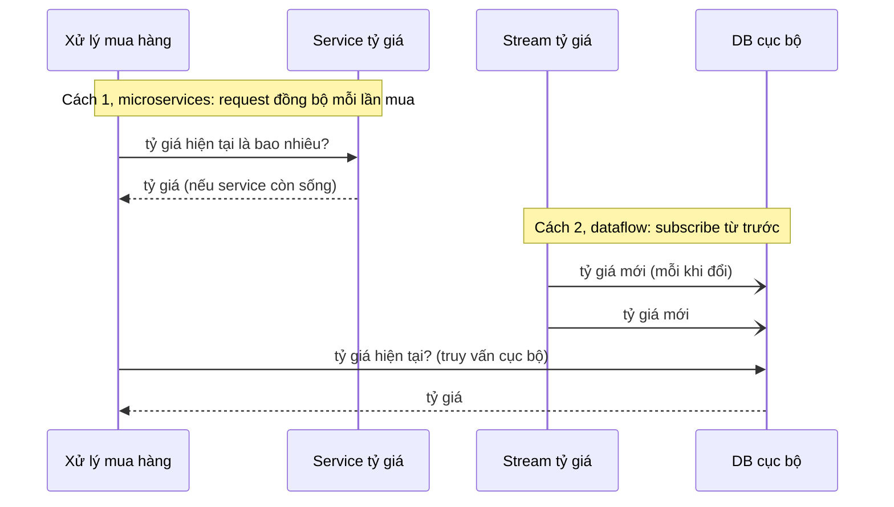

*(Sơ đồ do người viết ghi chú dựng theo hai cách ở tr. 508.)*

**Vì sao cách 2 tốt hơn** (tr. 508–509).

- Cách 2 thay **request mạng đồng bộ** tới service khác bằng **truy vấn database cục bộ** (có thể cùng máy, thậm chí cùng tiến trình).
- Không chỉ **nhanh hơn**, cách dataflow còn **robust hơn** trước việc service kia hỏng. Theo cách nói của tác giả: request mạng nhanh nhất và tin cậy nhất là **không có request mạng nào cả**.
- Thay vì RPC, giờ ta có một **stream join** giữa event mua hàng và event cập nhật tỷ giá ("Stream-table join (stream enrichment)", tr. 473, Chương 11).

> Chú thích ii (tr. 508). Trong cách microservices, có thể tránh request mạng đồng bộ bằng cách **cache tỷ giá cục bộ** trong service xử lý mua hàng. Nhưng để giữ cache mới, phải **poll định kỳ** tỷ giá cập nhật, hoặc **subscribe stream thay đổi**, mà đó **chính là** điều xảy ra trong cách dataflow.

**Join phụ thuộc thời gian** (tr. 509). Join này **phụ thuộc thời gian**: nếu event mua hàng được **reprocess** vào lúc sau, tỷ giá đã đổi. Muốn dựng lại **đúng output gốc**, phải lấy **tỷ giá lịch sử** tại thời điểm mua. Dù query service hay subscribe stream, đều phải xử lý sự phụ thuộc thời gian này ("Time-dependence of joins", tr. 475).

**Hướng hứa hẹn** (tr. 509). Subscribe một stream thay đổi, thay vì query state hiện tại khi cần, đưa ta **gần hơn tới mô hình tính toán kiểu spreadsheet**: khi một mẩu dữ liệu đổi, mọi derived data phụ thuộc vào nó được **cập nhật nhanh**. Còn nhiều câu hỏi mở, ví dụ quanh time-dependent join, nhưng tác giả tin **xây ứng dụng quanh ý tưởng dataflow** là hướng **rất hứa hẹn**.

<a id="observing-derived-state"></a>

#### B2.3 Observing Derived State (tr. 509–515)

<a id="write-read-path"></a>

**Write path và read path** (tr. 509–510).

**What** (tr. 509–510).

- Ở mức trừu tượng, hệ dataflow ở mục trước cho ta một **quy trình** tạo derived dataset (search index, materialized view, predictive model) và giữ chúng cập nhật. Gọi quy trình đó là ***write path***: mỗi khi có thông tin được ghi vào hệ, nó có thể đi qua nhiều giai đoạn batch và stream, và cuối cùng **mọi derived dataset** được cập nhật để chứa dữ liệu vừa ghi. Hình 12-1 là ví dụ cập nhật một search index.
- Nhưng tạo derived dataset để làm gì? Gần như chắc chắn là để **truy vấn lại** sau này. Đó là ***read path***: khi phục vụ request người dùng, đọc từ derived dataset, có thể xử lý thêm kết quả, rồi dựng response.

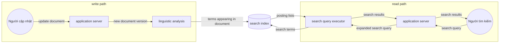

*(Vẽ lại Hình 12-1, tr. 509: trong một search index, ghi (cập nhật document) gặp đọc (truy vấn). Nhãn mũi tên giữ nguyên tiếng Anh như trong hình.)*

**Hành trình trọn vẹn của dữ liệu** (tr. 510).

- Gộp lại, write path và read path bao trọn **hành trình của dữ liệu**, từ lúc được **thu thập** tới lúc được **tiêu thụ** (có lẽ bởi một người khác).
- **Write path** là phần hành trình được **tính sẵn** (*precomputed*): làm **ngay** (*eagerly*) khi dữ liệu tới, bất kể đã có ai hỏi xem hay chưa.
- **Read path** là phần hành trình **chỉ xảy ra khi có người hỏi**.
- Với người quen functional programming: write path giống ***eager evaluation***, read path giống ***lazy evaluation***.

**Derived dataset là nơi hai đường gặp nhau** (tr. 510). Như Hình 12-1, derived dataset là chỗ write path và read path **gặp nhau**. Nó đại diện cho một **trade-off** giữa lượng việc phải làm **lúc ghi** và lượng việc phải làm **lúc đọc**.

<a id="views-caching"></a>

**Materialized views and caching** (tr. 510–511).

**Full-text index là ví dụ tốt** (tr. 510). Write path cập nhật index; read path tìm từ khóa trong index. **Cả hai** đều phải làm việc:

- **Ghi** phải cập nhật mục index cho **mọi term** xuất hiện trong document.
- **Đọc** phải tìm từng từ trong truy vấn, rồi áp **logic Boolean**: tìm document chứa **mọi** từ trong truy vấn (phép AND), hoặc chứa **từ đồng nghĩa** của mỗi từ (phép OR).

**Dịch ranh giới tới hai cực** (tr. 510–511):

| Lựa chọn | Việc ở write path | Việc ở read path |
| --- | --- | --- |
| **Không có index** | Ít hơn: không có index để cập nhật | Rất nhiều: phải quét mọi document (như `grep`), rất đắt khi có nhiều document |
| **Có index** | Cập nhật mục index cho mọi term | Tra index rồi áp logic Boolean |
| **Cache kết quả cho một tập cố định các truy vấn phổ biến nhất** | Thêm việc: cập nhật kết quả cache khi có document mới cần có mặt trong kết quả | Truy vấn phổ biến trả ngay, không cần tới index; truy vấn hiếm vẫn đi qua index |
| **Tính sẵn kết quả cho mọi truy vấn có thể** | **Vô hạn**: tập truy vấn có thể hỏi là vô hạn, nên cần thời gian và không gian lưu trữ vô hạn | Rất ít: không cần logic Boolean, chỉ tìm kết quả cho truy vấn và trả về |

> Chú thích iii (tr. 510). Nói ít đùa cợt hơn: với một corpus hữu hạn, tập các truy vấn **khác nhau có kết quả không rỗng** là **hữu hạn**. Nhưng nó tăng **theo hàm mũ** theo số term trong corpus, nên vẫn là tin rất xấu.

> **Bổ sung ngoài sách (phép tính minh họa).** Nếu chỉ xét truy vấn AND trên các tập term, corpus có m term phân biệt thì có tới 2^m − 1 tập term khác rỗng. Với m = 30 đã là khoảng một tỷ tập; corpus thật có hàng trăm nghìn term. Đó là lý do "tính sẵn mọi truy vấn" không khả thi dù về lý thuyết là hữu hạn.

**Cache cũng là materialized view** (tr. 510–511). Cách thứ ba thường gọi là **cache các truy vấn phổ biến**, nhưng cũng có thể gọi là **materialized view**, vì nó phải được cập nhật khi có document mới cần xuất hiện trong kết quả của một truy vấn phổ biến.

**Kết luận: index chỉ là một ranh giới khả dĩ** (tr. 511). Index **không phải ranh giới duy nhất** giữa write path và read path. Cache kết quả tìm kiếm phổ biến là khả thi; quét kiểu `grep` không cần index cũng khả thi với số ít document. Nhìn như vậy, vai trò của **cache, index và materialized view** rất đơn giản: chúng **dịch chuyển ranh giới** giữa read path và write path. Chúng cho phép làm **nhiều việc hơn ở write path** (tính sẵn kết quả) để **đỡ việc ở read path**.

**Quay lại Twitter** (tr. 511). Dịch ranh giới giữa việc làm ở write path và read path thực ra **chính là chủ đề của ví dụ Twitter** ở đầu sách ("Describing Load", tr. 11, [chương 1, B4.1](chapter-01.md#load-parameters)). Ở đó ta cũng thấy ranh giới có thể được vẽ **khác nhau** cho **người nổi tiếng** và **người dùng thường**. Sau 500 trang, ta đã **đi trọn một vòng**.

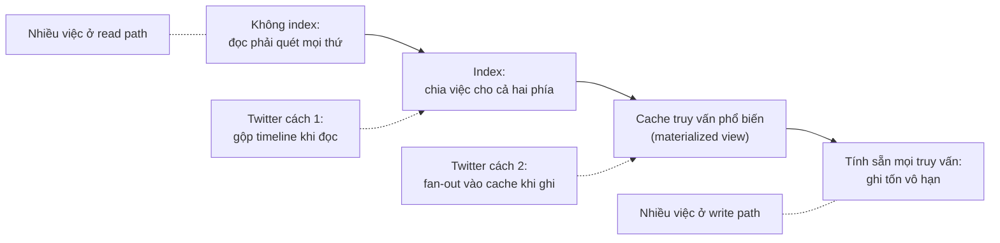

*(Sơ đồ do người viết ghi chú tổng hợp từ tr. 510–511. Vị trí hai cách của Twitter trên phổ là cách đọc của người viết ghi chú, dựa trên [chương 1](chapter-01.md#load-parameters).)*

<a id="offline-first"></a>

**Stateful, offline-capable clients** (tr. 511–512).

**Chất vấn hiện trạng** (tr. 511). Tác giả thấy ý tưởng ranh giới giữa write path và read path thú vị vì ta có thể bàn chuyện **dịch nó** và ý nghĩa thực tế của việc dịch. Xét trong một ngữ cảnh khác:

- Sự phổ biến lớn của web app trong hai thập kỷ qua tạo ra những **giả định dễ coi là hiển nhiên**. Đặc biệt là mô hình **client/server**: client gần như **stateless**, server **có thẩm quyền** với dữ liệu. Mô hình này phổ biến tới mức ta gần như quên rằng còn cách khác.
- Nhưng công nghệ tiếp tục tiến lên, và thỉnh thoảng nên **chất vấn hiện trạng**.

**Client đã thay đổi** (tr. 511).

- Trước đây trình duyệt là **client stateless**, chỉ làm được việc hữu ích khi có internet. (Gần như việc duy nhất làm được khi offline là cuộn lên xuống một trang đã tải lúc online.)
- Web app JavaScript kiểu **"single-page"** gần đây có nhiều khả năng **stateful**: tương tác UI phía client và **lưu trữ cục bộ bền** trong trình duyệt.
- **Mobile app** cũng lưu được nhiều state trên thiết bị, và phần lớn tương tác không cần **round-trip** tới server.

**Offline-first** (tr. 511). Các khả năng mới này làm sống lại sự quan tâm tới ứng dụng ***offline-first***: làm **nhiều nhất có thể** bằng database cục bộ trên thiết bị, không cần internet, và **đồng bộ nền** với server khi có mạng [42]. Thiết bị di động thường có mạng di động **chậm và không tin cậy**, nên người dùng được lợi lớn nếu UI không phải chờ request mạng đồng bộ và app chủ yếu chạy được offline ("Clients with offline operation", tr. 170, [chương 5](chapter-05.md#offline-clients)).

**State trên thiết bị là cache** (tr. 512). Khi bỏ giả định client stateless nói chuyện với một database trung tâm, chuyển sang **state duy trì trên thiết bị người dùng**, nhiều cơ hội mới mở ra. Đặc biệt, có thể coi **state trên thiết bị là cache của state trên server**:

- **Pixel trên màn hình** là **materialized view** của các model object trong app phía client.
- **Model object** là **replica cục bộ** của state ở một datacenter xa [27].

<a id="push-to-clients"></a>

**Pushing state changes to clients** (tr. 512).

**Trang web là cache stale** (tr. 512). Trong một trang web điển hình, nếu tải trang rồi sau đó dữ liệu trên server đổi, trình duyệt **không biết** gì cho tới khi tải lại trang. Trình duyệt chỉ đọc dữ liệu **tại một thời điểm**, giả định nó **tĩnh**, và **không subscribe** cập nhật từ server. Vì vậy state trên thiết bị là **cache stale**, không được cập nhật trừ khi **poll** tường minh. (Giao thức đăng ký feed qua HTTP như RSS thực ra chỉ là một dạng **poll** cơ bản.)

**Giao thức đẩy** (tr. 512). Các giao thức gần đây vượt qua mẫu request/response cơ bản của HTTP: ***server-sent events*** (EventSource API) và ***WebSockets*** cho trình duyệt **giữ một kết nối TCP mở** tới server, và server có thể **chủ động đẩy** message tới trình duyệt chừng nào còn kết nối. Nhờ vậy server có thể chủ động báo client về mọi thay đổi của state mà client lưu cục bộ, **giảm độ stale** của state phía client.

**Kéo dài write path tới người dùng cuối** (tr. 512).

- Theo mô hình write path và read path, chủ động đẩy thay đổi state tới tận thiết bị client nghĩa là **kéo dài write path tới tận người dùng cuối**.
- Khi client **khởi tạo lần đầu**, nó vẫn cần **read path** để lấy state ban đầu. Sau đó nó có thể dựa vào **stream thay đổi state** do server gửi.
- Các ý tưởng về stream processing và messaging **không chỉ** chạy trong datacenter: có thể đưa chúng đi xa hơn, tới tận **thiết bị người dùng** [43].

**Thiết bị offline thì sao?** (tr. 512). Thiết bị sẽ offline lúc này lúc khác, và không nhận được thông báo thay đổi trong thời gian đó. Nhưng bài toán này **đã có lời giải**: ở "Consumer offsets" (tr. 449, Chương 11), consumer của log-based message broker có thể **kết nối lại** sau khi hỏng hay mất kết nối, và bảo đảm **không bỏ lỡ** message nào tới trong lúc mất kết nối. Kỹ thuật này áp dụng được cho từng người dùng: **mỗi thiết bị là một subscriber nhỏ của một stream event nhỏ**.

<a id="end-to-end-streams"></a>

**End-to-end event streams** (tr. 512–513).

**Client đã nghĩ theo event** (tr. 512–513). Công cụ gần đây để phát triển client và UI stateful, như ngôn ngữ **Elm** [30] và bộ công cụ **React, Flux, Redux** của Facebook [44], đã quản lý state nội bộ phía client bằng cách **subscribe một stream event** biểu diễn input của người dùng hoặc response từ server, có cấu trúc giống event sourcing ("Event Sourcing", tr. 457).

**Write path end-to-end** (tr. 513).

- Sẽ rất tự nhiên nếu mở rộng mô hình lập trình này để server cũng **đẩy event thay đổi state** vào pipeline event phía client.
- Khi đó thay đổi state đi qua một **write path end-to-end**: từ tương tác trên một thiết bị kích hoạt thay đổi state, qua event log, qua nhiều hệ derived data và stream processor, tới tận **UI của người đang quan sát** state trên một thiết bị khác.
- Thay đổi có thể lan truyền với độ trễ khá thấp, ví dụ **dưới một giây** end to end.

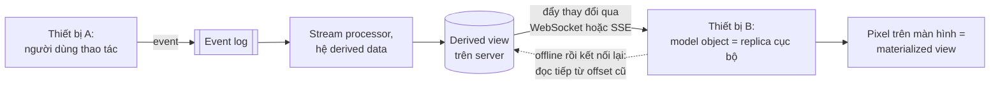

*(Sơ đồ do người viết ghi chú tổng hợp từ tr. 511–513.)*

**Vì sao chưa phổ biến?** (tr. 513).

- Một số ứng dụng như **nhắn tin tức thời** và **game online** đã có kiến trúc "real-time" như vậy (theo nghĩa tương tác độ trễ thấp, **không** theo nghĩa đảm bảo thời gian phản hồi ở "Response time guarantees", tr. 298). Sao không xây **mọi** ứng dụng như vậy?
- Thách thức: giả định **client stateless** và **tương tác request/response** đã **ăn rất sâu** vào database, thư viện, framework và giao thức của ta. Nhiều datastore hỗ trợ đọc và ghi kiểu **một request, một response**, nhưng **ít hơn nhiều** cho phép **subscribe thay đổi**, tức một request trả về **một stream response theo thời gian** ("API support for change streams", tr. 456).
- Để kéo dài write path tới người dùng cuối, phải **nghĩ lại căn bản** cách xây nhiều hệ: chuyển từ tương tác request/response sang **dataflow publish/subscribe** [27].

**Ý kiến tác giả** (tr. 513). Lợi ích của UI **phản hồi nhanh hơn** và **hỗ trợ offline tốt hơn** đáng công sức đó. Khi thiết kế data system, hãy nhớ tới lựa chọn **subscribe thay đổi**, không chỉ **query state hiện tại**.

<a id="reads-are-events"></a>

**Reads are events too** (tr. 513–514).

**Store là ranh giới** (tr. 513). Khi stream processor ghi derived data vào một store (database, cache, index) và request người dùng truy vấn store đó, **store là ranh giới** giữa write path và read path. Store cho phép truy vấn đọc **truy cập ngẫu nhiên**, việc lẽ ra phải quét toàn bộ event log.

**Stream processor như database** (tr. 513). Thường thì store tách khỏi hệ streaming. Nhưng stream processor cũng phải duy trì state để làm aggregation và join ("Stream Joins", tr. 472). State này thường **ẩn** trong stream processor, nhưng một số framework cho phép **client bên ngoài truy vấn** nó [45], biến chính stream processor thành một kiểu **database đơn giản**.

**Đi xa hơn: biểu diễn cả đọc thành event** (tr. 513–514).

- Đến giờ, ghi tới store đi qua event log, còn đọc là **request mạng tạm thời** đi thẳng tới node lưu dữ liệu được truy vấn. Thiết kế này hợp lý, nhưng **không phải thiết kế duy nhất**.
- Có thể biểu diễn **request đọc như stream event**, gửi **cả event đọc lẫn event ghi** qua một stream processor; processor trả lời event đọc bằng cách **phát kết quả đọc** ra một output stream [46].
- Khi cả ghi lẫn đọc đều là event, cùng được route tới một stream operator để xử lý, ta thực chất đang làm **stream-table join** giữa stream truy vấn đọc và database. Event đọc phải được gửi tới **partition chứa dữ liệu** ("Request Routing", tr. 214, Chương 6), giống như batch và stream processor phải **copartition** input theo cùng key khi join ("Reduce-Side Joins and Grouping", tr. 403, Chương 10).

**Phục vụ request chính là join** (tr. 514). Sự tương ứng giữa **phục vụ request** và **thực hiện join** là **khá căn bản** [47]:

- Một **request đọc một lần** chỉ đi qua join operator rồi **bị quên ngay**.
- Một **request subscribe** là một **join bền** với các event **quá khứ và tương lai** ở phía bên kia của join.

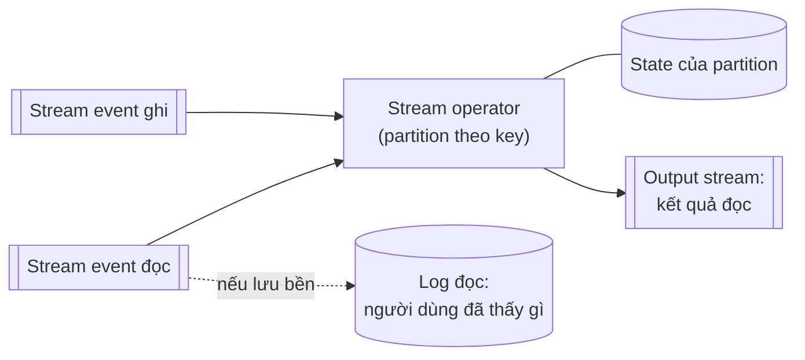

*(Sơ đồ do người viết ghi chú tổng hợp từ tr. 513–514.)*

**Lợi ích: nhân quả và provenance** (tr. 514). Ghi log các event đọc còn có lợi cho việc theo dõi **phụ thuộc nhân quả** và ***data provenance*** (nguồn gốc dữ liệu) trong hệ: nó cho phép **dựng lại người dùng đã thấy gì** trước khi ra một quyết định cụ thể.

- Ví dụ trong một shop online, **ngày giao hàng dự kiến** và **tình trạng kho** hiển thị cho khách nhiều khả năng ảnh hưởng tới việc họ có mua hay không [4]. Muốn phân tích mối liên hệ này, phải **ghi lại kết quả** truy vấn của người dùng về giao hàng và tồn kho.
- Đây chính là điểm khởi đầu số 2 ở [B1.1](#causality-ordering): ghi event "người dùng đã thấy gì" để các event sau tham chiếu.

**Cái giá** (tr. 514). Ghi event đọc vào lưu trữ bền giúp theo dõi nhân quả tốt hơn ("Ordering events to capture causality", tr. 493), nhưng tốn thêm **lưu trữ** và **I/O**. Tối ưu các hệ như vậy để giảm overhead vẫn là **bài toán nghiên cứu mở** [2]. Tuy vậy, nếu bạn **đã log** request đọc cho mục đích vận hành (như một side effect của xử lý request), thì việc biến log đó thành **nguồn** của request không phải thay đổi lớn.

<a id="multi-partition-processing"></a>

**Multi-partition data processing** (tr. 514–515).

**Khi nào đáng làm** (tr. 514). Với truy vấn chỉ chạm **một partition**, gửi truy vấn qua stream rồi thu một stream response có lẽ là **quá tay**. Nhưng ý tưởng này mở ra khả năng **thực thi phân tán** các truy vấn phức tạp cần **kết hợp dữ liệu từ nhiều partition**, tận dụng hạ tầng định tuyến message, partition và join mà stream processor **đã có sẵn**.

**Ví dụ** (tr. 514–515):

- **Storm distributed RPC** hỗ trợ mẫu sử dụng này ("Message passing and RPC", tr. 468). Nó từng được dùng để tính **số người đã thấy một URL trên Twitter**, tức **hợp các tập follower** của mọi người đã tweet URL đó [48]. Vì tập người dùng Twitter được partition, phép tính này cần kết hợp kết quả từ **nhiều partition**.
- **Chống gian lận:** để đánh giá rủi ro một event mua hàng có gian lận không, có thể xem **điểm uy tín** của địa chỉ IP, email, địa chỉ thanh toán, địa chỉ giao hàng… của người dùng. Mỗi database điểm uy tín **tự nó được partition**, nên thu điểm cho một event mua hàng cần **một chuỗi join** với các dataset được partition **khác nhau** [49].

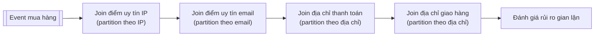

*(Sơ đồ do người viết ghi chú dựng theo ví dụ ở tr. 515. Thứ tự các bước join là giả định.)*

**So với MPP database** (tr. 515). Đồ thị thực thi truy vấn nội bộ của **MPP database** có đặc điểm tương tự ("Comparing Hadoop to Distributed Databases", tr. 414). Nếu cần kiểu **multi-partition join** này, có lẽ **dùng một database có sẵn tính năng đó** đơn giản hơn tự cài bằng stream processor. Nhưng **coi truy vấn như stream** cho ta thêm một lựa chọn để cài các ứng dụng quy mô lớn **chạm tới giới hạn** của các giải pháp có sẵn.

---

<a id="b3"></a>

### B3. Aiming for Correctness (tr. 515–533)

<a id="correctness"></a>

#### B3.0 Vì sao correctness đáng lo hơn ở hệ có state (tr. 515–516)

**Stateless và stateful khác nhau** (tr. 515). Với service **stateless** chỉ đọc dữ liệu, có gì hỏng thì cũng không nghiêm trọng: sửa bug, khởi động lại service, mọi thứ trở lại bình thường. Hệ **stateful** như database thì không đơn giản vậy: chúng được thiết kế để **nhớ mãi** (ít nhiều). Nên nếu có gì hỏng, hậu quả cũng có thể **kéo dài mãi**, và cần suy nghĩ cẩn thận hơn [50].

**Mục tiêu: reliable và correct** (tr. 515). Ta muốn ứng dụng **tin cậy** và **đúng**, tức chương trình có **ngữ nghĩa được định nghĩa rõ và hiểu được**, kể cả khi có nhiều loại lỗi.

- Khoảng **bốn thập kỷ**, các tính chất transaction **atomicity, isolation, durability** (Chương 7) là công cụ được chọn để xây ứng dụng đúng.
- Nhưng nền tảng đó **yếu hơn vẻ ngoài**: bằng chứng là sự lộn xộn của các **weak isolation level** ("Weak Isolation Levels", tr. 233).
- Có lĩnh vực **bỏ hẳn transaction**, thay bằng mô hình có hiệu năng và khả năng scale tốt hơn, nhưng **ngữ nghĩa lộn xộn hơn nhiều** (ví dụ [leaderless replication](chapter-05.md#b4), tr. 177).
- **Consistency** được nhắc nhiều nhưng **định nghĩa kém** ("Consistency", tr. 224, và Chương 9). Có người khẳng định nên "chấp nhận weak consistency" để có availability tốt hơn, mà **thiếu ý niệm rõ** điều đó thực tế nghĩa là gì.

**Hiểu biết còn chập chờn** (tr. 515–516).

- Với một chủ đề quan trọng như vậy, hiểu biết và phương pháp kỹ thuật của ta **chập chờn đáng ngạc nhiên**. Ví dụ rất khó xác định có **an toàn** không khi chạy một ứng dụng cụ thể ở một isolation level hay một cấu hình replication cụ thể [51, 52].
- Giải pháp đơn giản thường có vẻ đúng khi **concurrency thấp** và **không có lỗi**, nhưng hóa ra có **nhiều bug tinh vi** trong hoàn cảnh khắt khe hơn.
- Các thí nghiệm **Jepsen** của Kyle Kingsbury [53] cho thấy **khác biệt rõ rệt** giữa đảm bảo an toàn mà một số sản phẩm **tuyên bố** và hành vi **thật** của chúng khi có sự cố mạng và crash.
- Kể cả nếu sản phẩm hạ tầng như database **không có vấn đề**, code ứng dụng vẫn phải **dùng đúng** tính năng chúng cung cấp. Việc này **dễ sai** nếu cấu hình khó hiểu, như weak isolation level, cấu hình quorum…

**Lựa chọn hiện có** (tr. 516).

- Nếu ứng dụng chịu được thỉnh thoảng **hỏng hay mất dữ liệu** theo cách khó đoán, cuộc sống đơn giản hơn nhiều: có thể chỉ cần "bắt chéo ngón tay và cầu may".
- Nếu cần **đảm bảo correctness mạnh hơn**, **serializability** và **atomic commit** là cách đã được kiểm chứng. Nhưng chúng **có giá**: thường **chỉ chạy trong một datacenter** (loại bỏ kiến trúc phân tán địa lý), và **giới hạn quy mô** cùng tính **chịu lỗi** có thể đạt được.

**Định hướng của phần này** (tr. 516). Transaction truyền thống **không biến mất**, nhưng tác giả tin nó **không phải lời cuối cùng** cho việc làm ứng dụng đúng và chịu lỗi. Phần này gợi ý một số cách nghĩ về correctness trong **kiến trúc dataflow**.

<a id="end-to-end"></a>

#### B3.1 The End-to-End Argument for Databases (tr. 516–520)

**Luận điểm** (tr. 516). Ứng dụng dùng một data system có tính chất an toàn **khá mạnh**, như **serializable transaction**, **không có nghĩa** là được bảo đảm không mất hay hỏng dữ liệu. Ví dụ: nếu ứng dụng có bug ghi **dữ liệu sai**, hay **xóa** dữ liệu khỏi database, serializable transaction **không cứu được** bạn.

- Ví dụ này nghe có vẻ tầm thường, nhưng đáng nghiêm túc: **bug ứng dụng có xảy ra**, và **con người có mắc lỗi** ([chương 1, B3](chapter-01.md#b3)).
- Tác giả đã dùng ví dụ này ở "State, Streams, and Immutability" (tr. 459, Chương 11) để ủng hộ dữ liệu **bất biến, chỉ ghi thêm**: phục hồi sau sai sót dễ hơn khi code lỗi **không có khả năng phá hủy** dữ liệu tốt.
- Bất biến hữu ích, nhưng tự nó **không phải thuốc chữa mọi bệnh**. Hãy xét một ví dụ hỏng dữ liệu **tinh vi hơn**.

<a id="exactly-once"></a>

**Exactly-once execution of an operation** (tr. 516–517).

**Vấn đề** (tr. 516). Ở "Fault Tolerance" (tr. 476, Chương 11) ta đã gặp ý tưởng ***exactly-once*** (hay ***effectively-once***) semantics. Nếu xử lý một message gặp lỗi, có hai lựa chọn:

- **Bỏ cuộc**: drop message, tức chấp nhận **mất dữ liệu**.
- **Thử lại**: nhưng có rủi ro lần đầu **thật ra đã thành công**, chỉ là ta không biết, nên message bị xử lý **hai lần**.

**Xử lý hai lần cũng là hỏng dữ liệu** (tr. 516–517). Tính tiền khách **hai lần** cho cùng một dịch vụ (thu quá tiền), hay tăng một bộ đếm **hai lần** (thổi phồng metric) đều là không mong muốn. Trong ngữ cảnh này, exactly-once nghĩa là **sắp xếp phép tính sao cho hiệu ứng cuối cùng giống như không có lỗi nào**, dù thao tác thật ra đã bị thử lại do lỗi.

**Idempotence là cách hiệu quả nhất, nhưng không miễn phí** (tr. 517). Một trong những cách hiệu quả nhất là làm thao tác **idempotent** ("Idempotence", tr. 478): bảo đảm nó có **cùng hiệu ứng** dù chạy một lần hay nhiều lần. Nhưng biến một thao tác **vốn không idempotent** thành idempotent cần công sức và cẩn trọng:

- Có thể phải giữ **thêm metadata**, ví dụ tập các **operation ID** đã cập nhật một giá trị.
- Phải bảo đảm **fencing** khi failover từ node này sang node khác ("The leader and the lock", tr. 301, Chương 8).

<a id="duplicate-suppression"></a>

**Duplicate suppression** (tr. 517–518).

**TCP chặn trùng, nhưng chỉ trong một kết nối** (tr. 517). Nhu cầu chặn bản trùng xuất hiện ở nhiều nơi ngoài stream processing. Ví dụ **TCP** dùng **sequence number** trên gói tin để xếp chúng đúng thứ tự ở bên nhận, và xác định gói nào bị mất hay bị trùng trên mạng. Gói mất được **gửi lại**, gói trùng được TCP stack **bỏ đi** trước khi giao dữ liệu cho ứng dụng. Nhưng cơ chế này chỉ hoạt động **trong ngữ cảnh một kết nối TCP**.

**Example 12-1 — chuyển tiền không idempotent** (tr. 517). Hình dung kết nối TCP là kết nối của client tới database, đang chạy transaction ở Example 12-1. Mô tả bằng lời: trong một transaction, **cộng 11,00** vào số dư tài khoản 1234, **trừ 11,00** khỏi số dư tài khoản 4321, rồi **commit**.

- Ở nhiều database, transaction **gắn với kết nối client**: nếu client gửi nhiều truy vấn, database biết chúng thuộc cùng một transaction vì chúng đi trên **cùng kết nối TCP**.
- Nếu client gặp **gián đoạn mạng** và **timeout kết nối** sau khi gửi `COMMIT` nhưng **trước khi nhận phản hồi**, nó **không biết** transaction đã commit hay abort (Hình 8-1, Chương 8).
- Client có thể kết nối lại và thử lại transaction, nhưng giờ lần thử nằm **ngoài phạm vi** chặn trùng của TCP. Vì transaction ở Example 12-1 **không idempotent**, có thể **22 đô la** bị chuyển thay vì 11 đô la như mong muốn.
- Vì vậy dù Example 12-1 là ví dụ chuẩn cho **atomicity** của transaction, nó **thật ra không đúng**, và ngân hàng thật **không làm như vậy** [3].

**2PC cũng chưa đủ** (tr. 517–518). Giao thức **two-phase commit** ("Atomic Commit and Two-Phase Commit (2PC)", tr. 354) **phá vỡ** ánh xạ 1:1 giữa kết nối TCP và transaction, vì nó phải cho coordinator **kết nối lại** database sau lỗi mạng và bảo database commit hay abort một transaction đang ở trạng thái **in-doubt**. Vậy đủ để bảo đảm transaction chỉ chạy **một lần**? **Không**.

**Chặng mạng từ người dùng tới server** (tr. 518).

- Kể cả chặn được transaction trùng giữa database client và server, vẫn phải lo **mạng giữa thiết bị người dùng cuối và application server**.
- Ví dụ client là trình duyệt, gửi lệnh tới server bằng một **HTTP POST**. Người dùng đang dùng mạng di động yếu: gửi POST **thành công**, nhưng sóng yếu đi **trước khi** nhận được response.
- Người dùng nhiều khả năng thấy thông báo lỗi và **tự thử lại**. Trình duyệt cảnh báo "bạn có chắc muốn gửi lại form này?", và người dùng đồng ý, vì họ **muốn** thao tác xảy ra. (Mẫu **Post/Redirect/Get** [54] tránh cảnh báo này khi hoạt động bình thường, nhưng **không giúp** được nếu request POST bị timeout.)
- Với web server, lần thử lại là **một request riêng**; với database, nó là **một transaction riêng**. Các cơ chế khử trùng thông thường **không giúp được**.

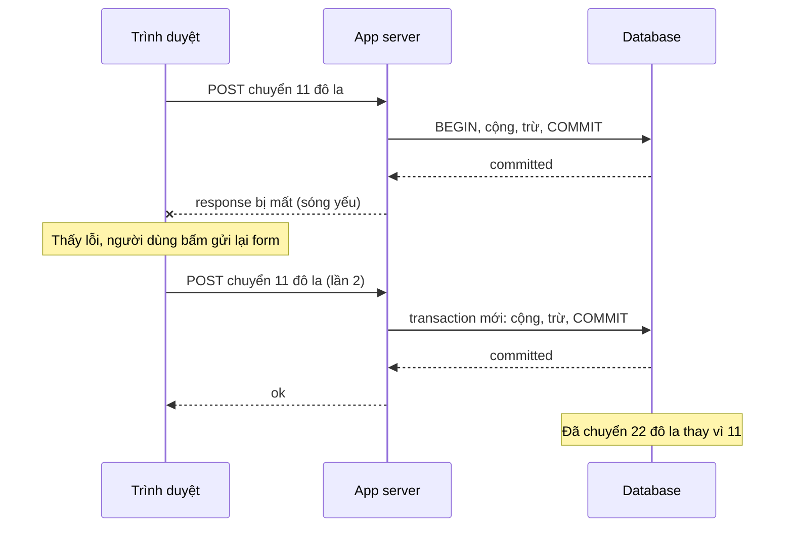

*(Ví dụ minh họa do AI xây dựng theo tình huống ở tr. 517–518.)*

<a id="operation-id"></a>

**Operation identifiers** (tr. 518–519).

**Why** (tr. 518). Để thao tác idempotent qua **nhiều chặng** giao tiếp mạng, **không đủ** dựa vào cơ chế transaction do database cung cấp. Phải xét luồng **end-to-end** của request.

**How** (tr. 518).

- Sinh một **ID duy nhất** cho thao tác (như **UUID**) và đặt nó thành một **trường ẩn** trong form ở ứng dụng phía client; hoặc tính **hash của mọi trường liên quan** trong form để có operation ID [3].
- Nếu trình duyệt gửi POST **hai lần**, hai request mang **cùng operation ID**.
- Truyền operation ID đó **tới tận database**, và kiểm tra rằng **chỉ chạy một thao tác** với mỗi ID, như Example 12-2.

**Example 12-2 — chặn request trùng bằng ID duy nhất** (tr. 518). Mô tả bằng lời:

1. Thêm **ràng buộc UNIQUE** cho cột `request_id` của bảng `requests`.
2. Trong một transaction: **insert một hàng** vào `requests` (request_id là một UUID, tài khoản nguồn 4321, tài khoản đích 1234, số tiền 11,00); cộng 11,00 vào tài khoản 1234; trừ 11,00 khỏi tài khoản 4321; commit.

**Vì sao hoạt động** (tr. 519).

- Example 12-2 dựa vào **uniqueness constraint** trên cột `request_id`. Nếu một transaction cố insert một ID **đã tồn tại**, lệnh INSERT **thất bại** và transaction bị **abort**, nên nó không có hiệu lực hai lần.
- Relational database nói chung **duy trì đúng** uniqueness constraint, **kể cả ở isolation level yếu**. Ngược lại, kiểm tra kiểu "**kiểm tra rồi mới insert**" ở tầng ứng dụng có thể **hỏng** dưới isolation không serializable ("Write Skew and Phantoms", tr. 246, Chương 7).

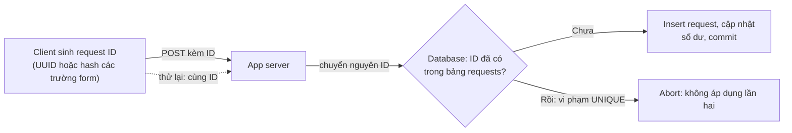

*(Sơ đồ do người viết ghi chú tổng hợp từ tr. 518–519.)*

**Bảng requests là một event log** (tr. 519). Ngoài việc chặn request trùng, bảng `requests` ở Example 12-2 đóng vai **một kiểu event log**, gợi tới **event sourcing** ("Event Sourcing", tr. 457). Cập nhật số dư tài khoản **không thật sự cần** nằm trong cùng transaction với việc insert event: chúng là **dư thừa**, có thể được **dẫn xuất** từ event request ở một **consumer phía sau**, miễn là event được xử lý **đúng một lần**. Điều này lại có thể được thực thi bằng **request ID**.

> **Bổ sung ngoài sách.** Nhiều API thanh toán ngày nay dùng đúng ý tưởng này dưới tên **idempotency key**: client gửi kèm một khóa duy nhất trong header của request, server ghi nhớ khóa đã xử lý và trả lại kết quả cũ nếu gặp lại khóa (xem thuật ngữ này trong [glossary](glossary.md#chuong-4), phần bổ sung chương 4).

<a id="end-to-end-argument"></a>

**The end-to-end argument** (tr. 519–520).

**What** (tr. 519). Chặn transaction trùng chỉ là một ví dụ của một nguyên lý tổng quát hơn gọi là ***end-to-end argument***, do **Saltzer, Reed và Clark** phát biểu năm **1984** [55]. Diễn giải đoạn trích trong sách:

- Một chức năng chỉ có thể được cài **đầy đủ và đúng** khi có **hiểu biết và sự hỗ trợ của ứng dụng đứng ở hai đầu** của hệ thống truyền thông.
- Vì vậy **không thể** cung cấp chức năng đó như một tính năng của **riêng bản thân hệ thống truyền thông**.
- Đôi khi một **phiên bản chưa đầy đủ** của chức năng do hệ truyền thông cung cấp vẫn hữu ích, như một cách **tăng hiệu năng**.

**Áp vào chặn trùng** (tr. 519). Ở ví dụ của ta, chức năng cần bàn là **chặn bản trùng**.

- TCP chặn gói trùng ở mức **kết nối TCP**.
- Một số stream processor cung cấp cái gọi là exactly-once semantics ở mức **xử lý message**.
- Nhưng **chưa đủ** để ngăn người dùng gửi **request trùng** khi lần đầu timeout. Tự chúng, **TCP, transaction database và stream processor** đều không loại bỏ hoàn toàn bản trùng.
- Giải quyết vấn đề cần **giải pháp end-to-end**: một **transaction identifier** được truyền **suốt đường đi** từ client của người dùng cuối tới database.

**Áp vào kiểm tra toàn vẹn** (tr. 519). **Checksum** có sẵn trong Ethernet, TCP và TLS phát hiện được gói tin **hỏng trên mạng**. Nhưng chúng **không** phát hiện được hỏng do **bug phần mềm** ở hai đầu kết nối mạng, hay hỏng **trên đĩa** lưu dữ liệu. Muốn bắt **mọi nguồn** hỏng dữ liệu, cần **checksum end-to-end**.

**Áp vào mã hóa** (tr. 519–520) [55]. Mật khẩu WiFi ở nhà bảo vệ khỏi người **nghe lén lưu lượng WiFi**, nhưng không khỏi kẻ tấn công **ở nơi khác trên internet**. TLS/SSL giữa client và server bảo vệ khỏi kẻ tấn công **trên mạng**, nhưng không khỏi việc **server bị xâm nhập**. Chỉ **mã hóa và xác thực end-to-end** mới bảo vệ được khỏi tất cả.

**Tính năng mức thấp vẫn có ích** (tr. 520). Tính năng mức thấp (chặn trùng của TCP, checksum của Ethernet, mã hóa WiFi) **tự chúng** không đem lại tính năng end-to-end mong muốn, nhưng **vẫn hữu ích**, vì chúng **giảm xác suất** vấn đề ở tầng cao hơn. Ví dụ HTTP request sẽ thường xuyên bị xáo trộn nếu không có TCP xếp gói tin lại đúng thứ tự. Chỉ cần nhớ: **tính năng tin cậy mức thấp tự chúng không đủ** để bảo đảm correctness end-to-end.

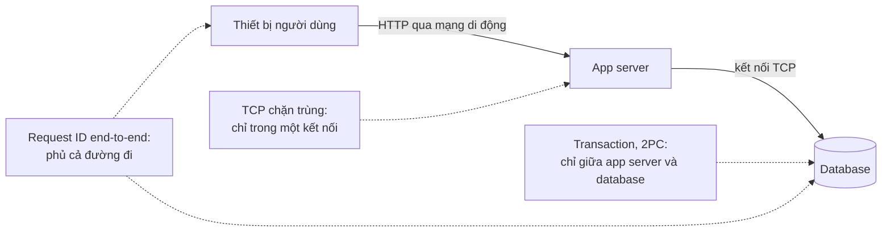

*(Sơ đồ do người viết ghi chú tổng hợp từ tr. 517–519: mỗi cơ chế mức thấp chỉ phủ một chặng; request ID phủ từ đầu tới cuối.)*

<a id="applying-end-to-end"></a>

**Applying end-to-end thinking in data systems** (tr. 520).

**Quay lại luận điểm ban đầu** (tr. 520). Ứng dụng dùng data system có tính chất an toàn khá mạnh như serializable transaction **không có nghĩa** là được bảo đảm không mất hay hỏng dữ liệu. **Bản thân ứng dụng** phải có **biện pháp end-to-end**, như chặn trùng.

**Đáng tiếc, vì chịu lỗi khó làm đúng** (tr. 520).

- Cơ chế tin cậy mức thấp như của TCP hoạt động **khá tốt**, nên lỗi ở tầng cao còn lại xảy ra **khá hiếm**.
- Sẽ rất tốt nếu gói phần cơ chế chịu lỗi tầng cao còn lại vào **một abstraction**, để code ứng dụng khỏi phải lo. Nhưng tác giả e rằng **ta chưa tìm ra abstraction đúng**.

**Transaction là abstraction tốt nhưng chưa đủ** (tr. 520).

- Transaction từ lâu được coi là abstraction tốt, và tác giả tin chúng **hữu ích**. Như phần mở đầu Chương 7, chúng **gom** nhiều vấn đề có thể xảy ra (ghi đồng thời, vi phạm ràng buộc, crash, gián đoạn mạng, hỏng đĩa) về **hai kết cục**: **commit** hoặc **abort**. Đó là một sự **đơn giản hóa lớn** cho mô hình lập trình, nhưng tác giả e là **chưa đủ**.
- Transaction **đắt**, nhất là khi gồm các công nghệ lưu trữ **khác loại** ("Distributed Transactions in Practice", tr. 360).
- Khi từ chối distributed transaction vì quá đắt, ta lại phải **cài lại cơ chế chịu lỗi** trong code ứng dụng. Như nhiều ví dụ suốt cuốn sách, suy luận về **concurrency** và **partial failure** là **khó và phản trực giác**. Vì vậy tác giả ngờ rằng **hầu hết cơ chế ở tầng ứng dụng không hoạt động đúng**. Hậu quả là dữ liệu **bị mất hoặc hỏng**.

**Hướng đi** (tr. 520). Vì những lý do đó, đáng để khám phá các **abstraction chịu lỗi** giúp **dễ** cung cấp các tính chất correctness end-to-end **đặc thù ứng dụng**, mà vẫn giữ **hiệu năng tốt** và **đặc tính vận hành tốt** trong môi trường phân tán quy mô lớn.

<a id="constraints"></a>

#### B3.2 Enforcing Constraints (tr. 521–524)

**Câu hỏi** (tr. 521). Hãy nghĩ về correctness trong ngữ cảnh ý tưởng **unbundling database** ([B2](#b2), tr. 499). Ta đã thấy chặn trùng end-to-end làm được bằng một **request ID** truyền suốt từ client tới database ghi lần ghi. Còn **các loại ràng buộc khác** thì sao?

**Tập trung vào uniqueness constraint** (tr. 521). Như ràng buộc mà Example 12-2 dựa vào. Ở "Constraints and uniqueness guarantees" (tr. 330, Chương 9) có nhiều ví dụ tính năng ứng dụng cần thực thi tính duy nhất:

- **username** hay **địa chỉ email** phải định danh duy nhất một người dùng;
- dịch vụ lưu file không được có **hai file cùng tên**;
- hai người không được đặt **cùng một ghế** trên chuyến bay hay trong rạp.

**Các ràng buộc tương tự** (tr. 521): số dư tài khoản **không bao giờ âm**; **không bán quá** số hàng tồn trong kho; phòng họp **không bị đặt chồng giờ** (giống ví dụ ở [chương 5, What is a conflict?](chapter-05.md#what-is-conflict)). Kỹ thuật thực thi tính duy nhất thường dùng được cho cả các ràng buộc này.

<a id="uniqueness-consensus"></a>

**Uniqueness constraints require consensus** (tr. 521).

**Why — cần consensus** (tr. 521). Chương 9 cho thấy trong môi trường phân tán, thực thi uniqueness constraint **cần consensus**: nếu có nhiều request đồng thời với **cùng giá trị**, hệ thống phải bằng cách nào đó **quyết định** chấp nhận thao tác nào trong số các thao tác xung đột, và **từ chối** các thao tác còn lại như vi phạm ràng buộc.

**Cách phổ biến: một leader** (tr. 521). Cách phổ biến nhất để đạt consensus này là cho **một node làm leader** và giao cho nó **mọi quyết định**.

- Cách này ổn chừng nào bạn chấp nhận **dồn mọi request qua một node** (kể cả khi client ở bên kia trái đất), và chừng nào node đó **không hỏng**.
- Nếu muốn chịu được leader hỏng, bạn lại **quay về bài toán consensus** ("Single-leader replication and consensus", tr. 367).

**Scale out bằng partition** (tr. 521). Kiểm tra tính duy nhất có thể **scale out** bằng cách partition theo **giá trị cần duy nhất**:

- Cần duy nhất theo request ID như Example 12-2: bảo đảm mọi request có **cùng request ID** được route tới **cùng một partition** (Chương 6).
- Cần username duy nhất: partition theo **hash của username**.

**Multi-master bất đồng bộ bị loại** (tr. 521). Replication **multi-master bất đồng bộ** không dùng được, vì có thể xảy ra chuyện các master khác nhau **cùng lúc chấp nhận** các lần ghi xung đột, và giá trị **không còn duy nhất** ("Implementing Linearizable Systems", tr. 332). Nếu muốn **từ chối ngay lập tức** mọi lần ghi vi phạm ràng buộc, thì **phối hợp đồng bộ là không tránh được** [56].

<a id="uniqueness-log"></a>

**Uniqueness in log-based messaging** (tr. 522).

**Nền tảng** (tr. 522). Log bảo đảm **mọi consumer thấy message theo cùng thứ tự**. Về hình thức, đảm bảo này gọi là **total order broadcast** và **tương đương consensus** ("Total Order Broadcast", tr. 348). Trong cách unbundle database với messaging dựa trên log, có thể dùng cách **rất giống** để thực thi uniqueness constraint.

**Vì sao log giải được** (tr. 522). Một stream processor consume mọi message trong **một partition log** một cách **tuần tự, trên một luồng** ("Logs compared to traditional messaging", tr. 448). Vì vậy nếu log được partition theo **giá trị cần duy nhất**, stream processor có thể quyết định **không mơ hồ và tất định** thao tác nào trong số các thao tác xung đột **tới trước**.

**How — nhiều người cùng giành một username** (tr. 522) [57]:

1. Mỗi request xin một username được mã hóa thành một **message**, và được nối vào **partition xác định bởi hash của username**.
2. Một stream processor **đọc tuần tự** các request trong log, dùng một **database cục bộ** để theo dõi username nào đã bị lấy. Với mỗi request xin username **còn trống**, nó ghi tên đó là đã lấy và phát một **message thành công** ra output stream. Với mỗi request xin username **đã bị lấy**, nó phát một **message từ chối** ra output stream.
3. Client xin username **theo dõi output stream** và chờ message thành công hay từ chối **ứng với request của mình**.

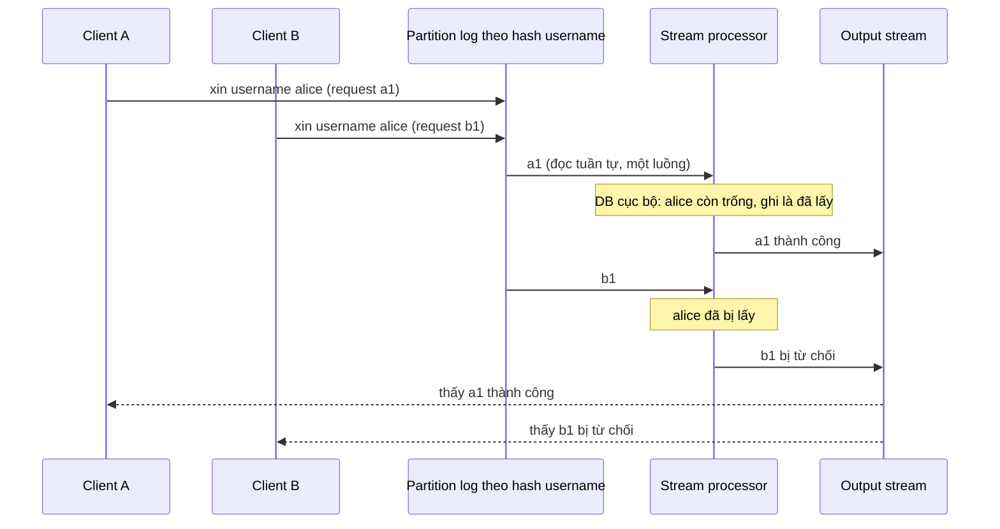

*(Ví dụ minh họa do AI xây dựng theo ba bước ở tr. 522. Tên và ID request là giả định.)*

**Đánh giá** (tr. 522).

- Thuật toán này **về cơ bản giống** "Implementing linearizable storage using total order broadcast" (tr. 350, Chương 9).
- Nó **scale dễ dàng** theo throughput request bằng cách **tăng số partition**, vì mỗi partition được xử lý **độc lập**.

**Không chỉ cho uniqueness** (tr. 522). Cách này dùng được cho **nhiều loại ràng buộc khác**. **Nguyên lý căn bản**: mọi lần ghi **có thể xung đột** được route tới **cùng một partition** và xử lý **tuần tự**.

- Như "What is a conflict?" (tr. 174, [chương 5](chapter-05.md#what-is-conflict)) và "Write Skew and Phantoms" (tr. 246, Chương 7), định nghĩa thế nào là xung đột có thể **phụ thuộc ứng dụng**. Nhưng stream processor có thể dùng **logic tùy ý** để kiểm tra một request.
- Ý tưởng này giống cách tiếp cận mà hệ **Bayou** tiên phong từ thập niên 1990 [58].

<a id="multi-partition-request"></a>

**Multi-partition request processing** (tr. 522–524).

**Vấn đề** (tr. 522–523). Bảo đảm một thao tác thực thi **nguyên tử** mà vẫn thỏa ràng buộc trở nên **thú vị hơn** khi có **nhiều partition** tham gia. Trong Example 12-2, có thể có **ba partition**: partition chứa **request ID**, partition chứa **tài khoản người nhận**, partition chứa **tài khoản người trả**. Không có lý do gì để ba thứ này nằm cùng một partition, vì chúng **độc lập** với nhau.

**Cách truyền thống và cái giá** (tr. 523). Trong cách tiếp cận database truyền thống, thực thi transaction này cần **atomic commit qua cả ba partition**. Về bản chất, việc đó **ép** transaction vào **một total order** với **mọi transaction khác** trên bất kỳ partition nào trong ba. Vì có **phối hợp xuyên partition**, các partition **không còn xử lý độc lập** được nữa, nên **throughput dễ giảm**.

**How — correctness tương đương, không cần atomic commit** (tr. 523). Hóa ra có thể đạt **correctness tương đương** bằng **partitioned log**, **không cần atomic commit**:

1. Request chuyển tiền từ tài khoản A sang tài khoản B được client gán một **request ID duy nhất**, và được nối vào một **partition log theo request ID**.
2. Một stream processor đọc log request. Với mỗi message request, nó phát **hai message** ra output stream: một **lệnh ghi nợ** (*debit*) tới tài khoản trả A (**partition theo A**), và một **lệnh ghi có** (*credit*) tới tài khoản nhận B (**partition theo B**). **Request ID gốc** được kèm trong cả hai message.
3. Các processor tiếp theo consume các stream lệnh credit và debit, **khử trùng theo request ID**, và áp thay đổi vào số dư tài khoản.

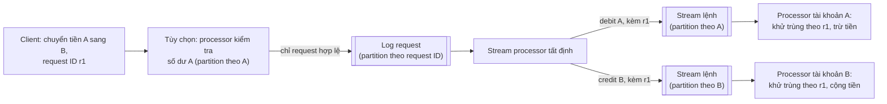

*(Sơ đồ do người viết ghi chú tổng hợp từ tr. 523. Bước kiểm tra số dư là phần mở rộng sách nêu ở cuối mục.)*

**Why — vì sao cần bước 1 và 2** (tr. 523). Nếu client **gửi thẳng** lệnh credit và debit, sẽ cần **atomic commit** qua hai partition đó để bảo đảm **cả hai hoặc không cái nào** xảy ra. Để tránh distributed transaction:

- Trước hết **ghi bền request thành một message duy nhất**.
- Rồi **dẫn xuất** lệnh credit và debit **từ message đầu tiên đó**.
- **Ghi một object** là thao tác **nguyên tử** ở gần như mọi data system ("Single-object writes", tr. 230, Chương 7). Vì vậy request **hoặc có trong log, hoặc không**, không cần atomic commit nhiều partition.

**Khi stream processor ở bước 2 crash** (tr. 523). Nó **tiếp tục từ checkpoint cuối cùng**. Khi làm vậy, nó **không bỏ sót** message request nào, nhưng có thể xử lý một request **nhiều lần** và sinh ra lệnh credit, debit **trùng**. Tuy nhiên vì nó **tất định**, nó chỉ sinh lại **đúng các lệnh đó**, và processor ở bước 3 dễ dàng **khử trùng** bằng **request ID end-to-end**.

**Chống thấu chi** (tr. 523). Nếu muốn bảo đảm tài khoản trả **không bị thấu chi** bởi lần chuyển này, có thể thêm một stream processor (partition theo **số tài khoản trả**) duy trì số dư và **kiểm tra hợp lệ** các giao dịch. Chỉ giao dịch **hợp lệ** mới được đưa vào log request ở bước 1.

**Kết quả** (tr. 523–524). Bằng cách **tách transaction nhiều partition thành hai giai đoạn được partition khác nhau**, và dùng **request ID end-to-end**, ta đạt **cùng tính chất correctness**: mỗi request được áp dụng **đúng một lần** cho **cả** tài khoản trả **lẫn** tài khoản nhận, kể cả khi có lỗi, và **không dùng giao thức atomic commit**. Ý tưởng dùng nhiều giai đoạn partition khác nhau giống [Multi-partition data processing](#multi-partition-processing) (tr. 514) và "Concurrency control" (tr. 462, Chương 11).

> **Bổ sung ngoài sách.** Để bước 3 khử trùng đúng, processor của mỗi tài khoản cần nhớ **tập request ID đã áp dụng** cho tài khoản đó, và cập nhật tập này **cùng lúc** với số dư (cùng một partition, nên là ghi một object hoặc một transaction cục bộ). Đây chính là "metadata thêm" mà tr. 517 nói tới khi biến một thao tác thành idempotent. Cũng cần lưu ý: trong khoảng giữa lúc debit đã áp dụng và credit chưa áp dụng, tổng tiền nhìn thấy có thể tạm lệch; đó là vấn đề **timeliness**, không phải integrity ([B3.3](#timeliness-integrity)).

<a id="timeliness-integrity"></a>

#### B3.3 Timeliness and Integrity (tr. 524–528)

**Transaction cho ta linearizability** (tr. 524). Một tính chất tiện lợi của transaction là chúng thường **linearizable** ("Linearizability", tr. 324): người ghi **chờ** tới khi transaction commit, và sau đó lần ghi **lập tức hiện ra** với mọi người đọc.

**Hệ nhiều giai đoạn thì khác** (tr. 524). Khi unbundle một thao tác qua **nhiều giai đoạn stream processor**, điều đó không còn đúng: consumer của log **bất đồng bộ theo thiết kế**, nên người gửi **không chờ** tới khi message được consumer xử lý. Tuy vậy, client **có thể chờ** một message xuất hiện ở output stream. Đó chính là điều ta làm ở [Uniqueness in log-based messaging](#uniqueness-log) (tr. 522) khi kiểm tra uniqueness constraint có được thỏa hay không.

**Chờ chỉ để báo tin** (tr. 524). Ở ví dụ đó, **correctness của kiểm tra uniqueness không phụ thuộc** vào việc người gửi có chờ kết quả hay không. Việc chờ chỉ nhằm **báo đồng bộ** cho người gửi biết kiểm tra có thành công không. Thông báo này có thể **tách rời** khỏi hiệu ứng của việc xử lý message.

**Consistency gộp hai yêu cầu khác nhau** (tr. 524–525). Tổng quát hơn, tác giả cho rằng từ ***consistency*** **gộp lẫn hai yêu cầu khác nhau**, đáng được xét riêng:

<a id="timeliness"></a>

- ***Timeliness*** (tính kịp thời) (tr. 524).
  - **What.** Bảo đảm người dùng quan sát hệ thống ở **trạng thái cập nhật**.
  - Như đã thấy, nếu người dùng đọc từ một **bản sao stale**, họ có thể thấy hệ thống ở trạng thái bất nhất ("Problems with Replication Lag", tr. 161, [chương 5](chapter-05.md#b2)). Nhưng bất nhất đó là **tạm thời**, và sẽ tự hết khi **chờ rồi thử lại**.
  - **CAP theorem** ("The Cost of Linearizability", tr. 335) dùng consistency theo nghĩa **linearizability**, một cách **mạnh** để đạt timeliness. Các tính chất timeliness **yếu hơn** như **read-after-write consistency** ("Reading Your Own Writes", tr. 162, [chương 5](chapter-05.md#read-your-writes)) cũng có thể hữu ích.

<a id="integrity"></a>

- ***Integrity*** (tính toàn vẹn) (tr. 524–525).
  - **What.** **Không có hỏng hóc**: không mất dữ liệu, không có dữ liệu **mâu thuẫn** hay **sai**.
  - Đặc biệt, nếu một derived dataset được duy trì như **view** của dữ liệu nền ("Deriving current state from the event log", tr. 458), **phép dẫn xuất phải đúng**. Ví dụ index của database phải **phản ánh đúng** nội dung database; một index **thiếu bản ghi** thì không mấy hữu ích.
  - Nếu integrity bị vi phạm, bất nhất là **vĩnh viễn**: chờ và thử lại **không sửa được** database bị hỏng trong đa số trường hợp. Cần **kiểm tra và sửa tường minh**.
  - Trong ngữ cảnh ACID ("The Meaning of ACID", tr. 223), consistency thường được hiểu là một khái niệm **integrity đặc thù ứng dụng**. **Atomicity** và **durability** là công cụ quan trọng để giữ integrity.

**Khẩu hiệu** (tr. 525). Vi phạm timeliness là "**eventual consistency**", còn vi phạm integrity là "**perpetual inconsistency**" (bất nhất vĩnh viễn).

**Integrity quan trọng hơn** (tr. 525). Tác giả khẳng định: ở **hầu hết** ứng dụng, **integrity quan trọng hơn timeliness nhiều**. Vi phạm timeliness có thể gây khó chịu và khó hiểu, nhưng vi phạm integrity có thể **thảm họa**.

**Example — sao kê thẻ tín dụng** (tr. 525).

- Giao dịch bạn làm **trong 24 giờ qua** chưa xuất hiện trên sao kê là chuyện **không lạ**: các hệ này có độ trễ là bình thường. Ngân hàng **đối soát và quyết toán** giao dịch **bất đồng bộ**, và timeliness ở đây không quan trọng lắm [3].
- Nhưng sẽ **rất tệ** nếu số dư trên sao kê **không bằng** tổng các giao dịch cộng số dư kỳ trước (**sai phép cộng**), hoặc nếu một giao dịch **bị trừ tiền bạn** mà **không trả cho người bán** (**tiền biến mất**). Đó là vi phạm **integrity** của hệ thống.

```mermaid
flowchart TD
    CON["Consistency<br/>(một từ, hai nghĩa)"] --> T["Timeliness:<br/>thấy trạng thái cập nhật"]
    CON --> I["Integrity:<br/>không mất, không mâu thuẫn,<br/>dẫn xuất đúng"]
    T --> TV["Vi phạm = eventual consistency:<br/>tạm thời, chờ rồi thử lại là hết"]
    I --> IV["Vi phạm = perpetual inconsistency:<br/>vĩnh viễn, phải kiểm tra và sửa"]
    T --> TE["Ví dụ: linearizability (mạnh),<br/>read-after-write (yếu hơn)"]
    I --> IE["Công cụ: atomicity, durability,<br/>exactly-once, khử trùng"]
    TV --> EX1["Sao kê thiếu giao dịch 24 giờ qua:<br/>chấp nhận được"]
    IV --> EX2["Số dư sai, tiền biến mất:<br/>thảm họa"]
```

*(Sơ đồ do người viết ghi chú tổng hợp từ tr. 524–526.)*

<a id="dataflow-correctness"></a>

**Correctness of dataflow systems** (tr. 525–526).

**ACID gộp cả hai** (tr. 525). ACID transaction thường cung cấp **cả** đảm bảo timeliness (ví dụ linearizability) **lẫn** integrity (ví dụ atomic commit). Vì vậy nếu nhìn correctness từ góc ACID, phân biệt timeliness với integrity **không mấy quan trọng**.

**Dataflow tách rời hai thứ** (tr. 525). Một tính chất thú vị của các hệ dataflow dựa trên event là chúng **tách rời** timeliness và integrity.

- Khi xử lý event stream **bất đồng bộ**, **không có đảm bảo timeliness**, trừ khi bạn tự xây consumer **chờ** message tới rồi mới trả lời.
- Nhưng **integrity lại là trung tâm** của hệ streaming.

**Exactly-once là cơ chế giữ integrity** (tr. 525). Exactly-once hay effectively-once semantics ("Fault Tolerance", tr. 476) là cơ chế **giữ integrity**. Nếu một event bị **mất**, hoặc có hiệu lực **hai lần**, integrity của data system có thể bị vi phạm. Vì vậy **giao message chịu lỗi** và **chặn trùng** (ví dụ thao tác idempotent) là quan trọng để giữ integrity khi có lỗi.

**Bốn cơ chế kết hợp** (tr. 525–526). Như mục trước cho thấy, stream processing tin cậy giữ được integrity **mà không cần** distributed transaction và giao thức atomic commit. Nghĩa là chúng có thể đạt **correctness tương đương** với **hiệu năng và độ bền vận hành tốt hơn nhiều**. Integrity đạt được nhờ kết hợp:

1. Biểu diễn nội dung thao tác ghi thành **một message duy nhất**, thứ ghi nguyên tử dễ dàng; cách này **rất hợp** với event sourcing ("Event Sourcing", tr. 457).
2. **Dẫn xuất** mọi cập nhật state khác từ message đó bằng **hàm dẫn xuất tất định**, tương tự stored procedure ("Actual Serial Execution", tr. 252; [Application code as a derivation function](#derivation-function), tr. 505).
3. Truyền một **request ID do client sinh** qua mọi tầng xử lý, cho phép **chặn trùng end-to-end** và **idempotence**.
4. Làm message **bất biến**, và cho phép **reprocess** derived data theo thời gian, giúp **phục hồi từ bug** dễ hơn ("Advantages of immutable events", tr. 460).

Tác giả thấy **tổ hợp cơ chế này** là một hướng **rất hứa hẹn** để xây ứng dụng chịu lỗi trong tương lai (tr. 526).

<a id="loose-constraints"></a>

**Loosely interpreted constraints** (tr. 526–527).

**Giới hạn không tránh được** (tr. 526). Như đã bàn, thực thi uniqueness constraint cần **consensus**, thường cài bằng cách dồn mọi event của một partition qua **một node**. Giới hạn này **không tránh được** nếu muốn uniqueness constraint **dạng truyền thống**, và stream processing **cũng không** tránh được nó.

**Nhưng nhiều ứng dụng sống được với ràng buộc lỏng hơn** (tr. 526–527):

| Tình huống | Cách xử lý khi ràng buộc bị vi phạm |
| --- | --- |
| Hai người **cùng lúc** đăng ký một username hay đặt một ghế | Gửi cho một người **lời xin lỗi** và mời chọn cái khác. Thay đổi để sửa sai kiểu này gọi là ***compensating transaction*** [59, 60] |
| Khách đặt **nhiều hơn** số hàng trong kho | Đặt thêm hàng, **xin lỗi** khách vì chậm trễ, và **giảm giá**. Đây thực ra **giống hệt** việc phải làm nếu, ví dụ, **xe nâng cán hỏng** một ít hàng trong kho, khiến tồn kho ít hơn bạn tưởng [61]. Quy trình xin lỗi **vốn đã phải có** trong quy trình kinh doanh, nên có thể **không cần** ràng buộc linearizable trên số hàng tồn |
| Hãng bay **bán vượt chỗ** (*overbook*), khách sạn **nhận phòng quá số** | Họ làm vậy vì đoán vài khách sẽ lỡ chuyến hay hủy phòng. Ràng buộc "một người một ghế" bị **cố ý vi phạm** vì lý do kinh doanh, kèm quy trình **bồi thường** khi cầu vượt cung: hoàn tiền, nâng hạng, tặng phòng ở khách sạn bên cạnh. Kể cả **không** overbook, vẫn cần quy trình xin lỗi và bồi thường cho chuyến bay bị hủy vì thời tiết xấu hay nhân viên đình công: phục hồi từ những sự cố này là **phần bình thường** của kinh doanh [3] |
| Ai đó **rút tiền nhiều hơn** số dư | Ngân hàng thu **phí thấu chi** và yêu cầu họ trả lại số nợ. Bằng cách **giới hạn tổng số tiền rút mỗi ngày**, rủi ro của ngân hàng **bị chặn trên** |

**Tạm vi phạm rồi sửa bằng xin lỗi** (tr. 527). Trong nhiều bối cảnh kinh doanh, **tạm thời vi phạm một ràng buộc** rồi **sửa lại sau bằng lời xin lỗi** là **chấp nhận được**. Chi phí của lời xin lỗi (về tiền hay uy tín) khác nhau, nhưng thường **khá thấp**:

- Không "thu hồi" được một email đã gửi, nhưng gửi được email **đính chính**.
- Lỡ trừ thẻ tín dụng **hai lần** thì **hoàn lại** một lần; chi phí chỉ là phí xử lý và có lẽ một lời phàn nàn.
- Tiền đã ra khỏi máy ATM thì **không lấy lại trực tiếp** được, dù về nguyên tắc có thể gửi người đòi nợ nếu tài khoản bị thấu chi và khách không chịu trả.

**Quyết định kinh doanh** (tr. 527).

- Chi phí xin lỗi có chấp nhận được hay không là **quyết định kinh doanh**.
- Nếu chấp nhận được, mô hình truyền thống **kiểm tra mọi ràng buộc trước khi ghi dữ liệu** là **gò bó không cần thiết**, và **không cần** ràng buộc linearizable.
- Có thể hợp lý khi **ghi một cách lạc quan** và **kiểm tra ràng buộc sau**.
- Vẫn có thể bảo đảm việc kiểm tra xảy ra **trước khi làm những việc khó phục hồi**, nhưng điều đó **không có nghĩa** phải kiểm tra **trước cả khi ghi** dữ liệu.

**Vẫn cần integrity, chỉ không cần timeliness** (tr. 527). Các ứng dụng này **cần integrity**: bạn không muốn **mất một lượt đặt chỗ**, hay **tiền biến mất** vì credit và debit lệch nhau. Nhưng chúng **không cần timeliness** khi thực thi ràng buộc: nếu đã bán nhiều hơn số hàng trong kho, có thể **vá lại sau** bằng xin lỗi. Cách làm này giống các cách giải quyết xung đột ở "Handling Write Conflicts" ([chương 5, B3.2](chapter-05.md#write-conflicts), tr. 171).

> **Bổ sung ngoài sách.** Tài liệu [60] mà sách trích là bài báo gốc về **saga** (Garcia-Molina và Salem, 1987): một transaction kéo dài được chia thành chuỗi transaction cục bộ, mỗi bước có một **compensating transaction** để "hoàn tác về mặt nghiệp vụ" nếu các bước sau thất bại. Compensating transaction không xóa lịch sử; nó ghi thêm một thay đổi mới bù lại thay đổi cũ (như hoàn tiền), nên hợp với event log bất biến.

<a id="coordination-avoiding"></a>

**Coordination-avoiding data systems** (tr. 527–528).

**Hai quan sát** (tr. 527):

1. Hệ dataflow có thể duy trì **đảm bảo integrity** cho derived data **mà không cần** atomic commit, linearizability, hay phối hợp đồng bộ xuyên partition.
2. Dù uniqueness constraint **nghiêm ngặt** cần timeliness và phối hợp, nhiều ứng dụng thực ra **ổn với ràng buộc lỏng**, có thể **tạm bị vi phạm và sửa sau**, miễn **integrity được giữ suốt quá trình**.

**What** (tr. 528). Gộp lại, hai quan sát nghĩa là hệ dataflow có thể cung cấp dịch vụ quản lý dữ liệu cho **nhiều ứng dụng** mà **không cần phối hợp**, trong khi vẫn cho **đảm bảo integrity mạnh**. Các ***coordination-avoiding data systems*** như vậy rất hấp dẫn: chúng đạt **hiệu năng và khả năng chịu lỗi tốt hơn** các hệ cần phối hợp đồng bộ [56].

**Example** (tr. 528). Một hệ như vậy có thể chạy **phân tán qua nhiều datacenter** theo cấu hình **multi-leader**, nhân bản **bất đồng bộ** giữa các vùng. Mỗi datacenter **tiếp tục hoạt động độc lập** với các datacenter khác, vì không cần phối hợp đồng bộ liên vùng. Hệ như vậy có **đảm bảo timeliness yếu** (không thể linearizable nếu không thêm phối hợp), nhưng **vẫn có đảm bảo integrity mạnh**.

**Transaction và phối hợp vẫn có chỗ** (tr. 528).

- **Serializable transaction** vẫn hữu ích như một phần của việc duy trì derived state, nhưng có thể chạy ở **phạm vi nhỏ**, nơi chúng hoạt động tốt [8].
- **Không cần** distributed transaction khác loại như **XA transaction** ("Distributed Transactions in Practice", tr. 360).
- **Phối hợp đồng bộ** vẫn có thể được đưa vào **ở những chỗ cần**, ví dụ để thực thi ràng buộc nghiêm ngặt **trước một thao tác không thể phục hồi**. Nhưng không cần **mọi thứ** phải trả giá phối hợp nếu chỉ **một phần nhỏ** ứng dụng cần nó [43].

**Nhìn theo "số lời xin lỗi"** (tr. 528). Một cách nhìn khác về phối hợp và ràng buộc:

- Chúng **giảm** số lời xin lỗi phải nói vì **bất nhất**.
- Nhưng chúng cũng có thể **giảm hiệu năng và availability** của hệ, nên có thể **tăng** số lời xin lỗi phải nói vì **sự cố ngừng dịch vụ**.
- Không thể giảm số lời xin lỗi **về 0**, nhưng có thể tìm **trade-off tốt nhất** cho nhu cầu của mình: **điểm ngọt** nơi không có quá nhiều bất nhất, cũng không có quá nhiều vấn đề availability.

```mermaid
flowchart LR
    MORE["Phối hợp nhiều hơn<br/>(ràng buộc chặt, đồng bộ)"] -->|"giảm"| A1["Xin lỗi vì bất nhất"]
    MORE -->|"tăng"| A2["Xin lỗi vì chậm,<br/>ngừng dịch vụ"]
    LESS["Phối hợp ít hơn<br/>(ràng buộc lỏng, bất đồng bộ)"] -->|"tăng"| A1
    LESS -->|"giảm"| A2
    A1 --> SW["Tìm điểm cân bằng:<br/>tổng số lời xin lỗi<br/>không thể về 0"]
    A2 --> SW
```

*(Sơ đồ do người viết ghi chú tổng hợp từ tr. 528.)*

> **Bổ sung ngoài sách.** Tài liệu [32] (Bloom) có tiêu đề nhắc tới **CALM** (*Consistency As Logical Monotonicity*). Ý chính của định lý CALM: chương trình chỉ **tích lũy thêm** sự kiện mà không bao giờ phải rút lại kết luận (chương trình **đơn điệu**) thì có thể chạy nhất quán **không cần phối hợp**. Kiểm tra "username đã bị lấy chưa" **không** đơn điệu (phải biết chắc **không có** ai khác đã lấy), nên cần phối hợp; còn cộng dồn giao dịch thì đơn điệu. Đây là một cách giải thích vì sao chỉ một phần nhỏ ứng dụng thật sự cần phối hợp.

<a id="trust-verify"></a>

#### B3.4 Trust, but Verify (tr. 528–533)

**System model và giả định** (tr. 528). Mọi bàn luận về correctness, integrity và fault tolerance đều dựa trên giả định rằng **một số thứ có thể hỏng, nhưng thứ khác thì không**. Tập giả định này gọi là ***system model*** ("Mapping system models to the real world", tr. 309, Chương 8). Ví dụ:

- Ta nên giả định tiến trình **có thể crash**, máy **có thể mất điện** đột ngột, mạng **có thể trễ hay làm mất** message tùy ý.
- Nhưng ta cũng có thể giả định dữ liệu đã ghi xuống đĩa **không mất** sau `fsync`, dữ liệu trong bộ nhớ **không bị hỏng**, và lệnh nhân của CPU **luôn trả kết quả đúng**.

**Nhị phân hay xác suất?** (tr. 528–529). Các giả định này **khá hợp lý**, vì đúng **hầu hết thời gian**; nếu cứ phải lo máy tính tính sai thì khó làm được việc gì. Theo truyền thống, system model nhìn lỗi theo kiểu **nhị phân**: một số thứ có thể xảy ra, thứ khác **không bao giờ**. Thực tế đây là chuyện **xác suất**: có thứ dễ xảy ra hơn, có thứ khó hơn. Câu hỏi là: việc **vi phạm giả định** có xảy ra **đủ thường** để ta gặp trong thực tế không?

**Bằng chứng** (tr. 529).

- Dữ liệu có thể **hỏng khi nằm yên trên đĩa** ("Replication and Durability", tr. 227, Chương 7).
- Dữ liệu hỏng trên mạng đôi khi **lọt qua checksum của TCP** ("Weak forms of lying", tr. 306, Chương 8).
- Kinh nghiệm của tác giả: một ứng dụng ông từng làm thu **crash report** từ client, và một số report **chỉ giải thích được** bằng **bit lật ngẫu nhiên** trong bộ nhớ của thiết bị. Nghe khó xảy ra, nhưng nếu phần mềm chạy trên **đủ nhiều thiết bị**, chuyện rất khó xảy ra **cũng xảy ra**.
- Ngoài hỏng bộ nhớ ngẫu nhiên do lỗi phần cứng hay **bức xạ**, một số **mẫu truy cập bộ nhớ bệnh lý** có thể **lật bit** ngay cả ở bộ nhớ không có lỗi [62]. Hiệu ứng này có thể bị dùng để **phá cơ chế bảo mật** của hệ điều hành [63]; kỹ thuật này gọi là ***rowhammer***.
- Nhìn kỹ thì **phần cứng không phải abstraction hoàn hảo** như vẻ ngoài.

**Đừng phóng đại** (tr. 529). Nói cho rõ: bit lật ngẫu nhiên vẫn **rất hiếm** trên phần cứng hiện đại [64]. Tác giả chỉ muốn chỉ ra chúng **không nằm ngoài khả năng**, nên đáng được chú ý.

> **Bổ sung ngoài sách.** Rowhammer xảy ra vì các ô nhớ DRAM nằm rất sát nhau: kích hoạt đọc một hàng nhớ lặp đi lặp lại với tần số cao có thể làm rò điện tích ở các hàng **lân cận**, khiến bit ở đó bị lật dù chương trình không hề ghi vào.

<a id="software-bugs"></a>

**Maintaining integrity in the face of software bugs** (tr. 529–530).

**Bug trong database** (tr. 529). Ngoài vấn đề phần cứng, luôn có rủi ro **bug phần mềm**, thứ **không bị** checksum mức thấp của mạng, bộ nhớ hay filesystem bắt được. Ngay cả database được dùng rộng rãi **cũng có bug**:

- Tác giả từng tận mắt thấy MySQL **không duy trì đúng** một uniqueness constraint [65].
- Và mức serializable isolation của PostgreSQL **xuất hiện write skew anomaly** [66].
- Dù MySQL và PostgreSQL là database **robust, được đánh giá cao**, đã được nhiều người thử thách nhiều năm. Với phần mềm **kém chín muồi** hơn, tình hình có lẽ **tệ hơn nhiều**.

**Bug là không tránh được** (tr. 529). Dù nỗ lực đáng kể trong thiết kế cẩn thận, test và review, **bug vẫn len vào**. Chúng **hiếm**, và cuối cùng sẽ được tìm ra và sửa, nhưng vẫn có **một khoảng thời gian** trong đó bug có thể làm **hỏng dữ liệu**.

**Code ứng dụng còn nhiều bug hơn** (tr. 529). Với code ứng dụng, phải giả định **nhiều bug hơn nhiều**, vì hầu hết ứng dụng **không** được review và test **gần bằng** code database. Nhiều ứng dụng thậm chí **không dùng đúng** những tính năng database cung cấp để giữ integrity, như **foreign key** hay **uniqueness constraint** [36].

**Giới hạn của "C" trong ACID** (tr. 529–530). Consistency theo nghĩa ACID ("Consistency", tr. 224, Chương 7) dựa trên ý: database **bắt đầu ở trạng thái nhất quán**, và transaction biến nó từ trạng thái nhất quán này sang **trạng thái nhất quán khác**. Vì vậy ta kỳ vọng database **luôn** ở trạng thái nhất quán. Nhưng khái niệm này **chỉ có nghĩa** nếu giả định **transaction không có bug**. Nếu ứng dụng dùng database **sai** theo cách nào đó, ví dụ dùng isolation level yếu **một cách không an toàn**, integrity của database **không thể được bảo đảm**.

<a id="auditing"></a>

**Don't just blindly trust what they promise** (tr. 530).

**What — auditing** (tr. 530). Vì cả phần cứng lẫn phần mềm **không phải lúc nào** cũng đạt lý tưởng, có vẻ **hỏng dữ liệu là không tránh được**, sớm hay muộn. Vì vậy ít nhất phải có cách **phát hiện** dữ liệu đã hỏng, để sửa nó và truy tìm nguồn lỗi. Việc **kiểm tra integrity của dữ liệu** gọi là ***auditing*** (kiểm toán).

**Không chỉ cho tài chính** (tr. 530). Như "Advantages of immutable events" (tr. 460, Chương 11), auditing **không chỉ** dành cho ứng dụng tài chính. Nhưng auditability **rất quan trọng** trong tài chính chính vì **ai cũng biết sai sót có xảy ra**, và ai cũng thấy cần phát hiện và sửa vấn đề.

**Hệ chín muồi không tin hoàn toàn đĩa** (tr. 530). Các hệ chín muồi cũng có xu hướng tính tới khả năng **chuyện khó xảy ra bị sai**, và quản lý rủi ro đó. Ví dụ hệ lưu trữ quy mô lớn như **HDFS** và **Amazon S3** **không tin hoàn toàn** đĩa: chúng chạy **tiến trình nền** liên tục **đọc lại file**, **so với replica khác**, và **chuyển file** từ đĩa này sang đĩa khác, để giảm rủi ro **hỏng âm thầm** [67].

**Muốn chắc thì phải đọc và kiểm tra** (tr. 530).

- Muốn chắc dữ liệu **vẫn còn đó**, phải **thật sự đọc nó và kiểm tra**. Hầu hết thời gian nó vẫn còn; nhưng nếu không, bạn **rất muốn biết sớm** hơn là muộn.
- Cùng lập luận đó, **thỉnh thoảng phải thử khôi phục từ backup**. Nếu không, có thể bạn chỉ phát hiện backup hỏng khi **đã quá muộn** và đã mất dữ liệu.
- **Đừng tin mù quáng** rằng mọi thứ đang chạy đúng.

<a id="verification-culture"></a>

**A culture of verification** (tr. 530–531).

**"Trust, but verify"** (tr. 530). Hệ như HDFS và S3 vẫn phải giả định đĩa **chạy đúng hầu hết thời gian**. Đó là giả định hợp lý, nhưng **khác** với giả định đĩa **luôn** chạy đúng. Hiện **chưa nhiều** hệ có cách tiếp cận "***trust, but verify***" (tin, nhưng kiểm chứng) như vậy, tức **liên tục tự kiểm toán**. Nhiều hệ giả định các đảm bảo correctness là **tuyệt đối**, và không tính tới khả năng **hỏng dữ liệu hiếm gặp**. Tác giả hy vọng tương lai sẽ có nhiều hệ ***self-validating*** hay ***self-auditing***, **liên tục kiểm tra integrity của chính mình**, thay vì dựa vào niềm tin mù quáng [68].

**Văn hóa ACID và niềm tin mù quáng** (tr. 530–531).

- Tác giả e rằng **văn hóa của ACID database** đã dẫn ta tới phát triển ứng dụng trên cơ sở **tin mù quáng vào công nghệ** (như cơ chế transaction), và **bỏ qua** mọi loại auditability trong quá trình đó.
- Vì công nghệ ta tin chạy **đủ tốt** hầu hết thời gian, cơ chế kiểm toán bị coi là **không đáng đầu tư**.
- Rồi bức tranh database thay đổi: consistency **yếu hơn** thành chuẩn mực dưới ngọn cờ **NoSQL**, và các công nghệ lưu trữ **kém chín muồi** hơn được dùng rộng rãi.
- Nhưng vì cơ chế kiểm toán **chưa được phát triển**, ta **vẫn tiếp tục** xây ứng dụng trên cơ sở niềm tin mù quáng, dù cách làm này giờ đã **nguy hiểm hơn**.
- Vì vậy hãy nghĩ một chút về **thiết kế cho auditability**.

<a id="auditability"></a>

**Designing for auditability** (tr. 531).

**Vấn đề với transaction sửa nhiều object** (tr. 531). Nếu một transaction sửa nhiều object trong database, **sau đó rất khó biết** transaction đó **có nghĩa gì**. Kể cả khi bắt được transaction log ("Change Data Capture", tr. 454), các lần insert, update, delete ở nhiều bảng **không nhất thiết** cho bức tranh rõ ràng về **tại sao** có các thay đổi đó. Lời gọi logic ứng dụng đã **quyết định** các thay đổi là **tạm thời**, và **không tái tạo được**.

**Hệ dựa trên event audit tốt hơn** (tr. 531).

- Trong cách tiếp cận **event sourcing**, input của người dùng được biểu diễn thành **một event bất biến duy nhất**, và mọi cập nhật state phát sinh đều được **dẫn xuất** từ event đó.
- Phép dẫn xuất có thể làm **tất định và lặp lại được**: chạy **cùng log event** qua **cùng phiên bản code dẫn xuất** sẽ cho **cùng cập nhật state**.

**Dataflow tường minh làm rõ provenance** (tr. 531). Rõ ràng về dataflow ("Philosophy of batch process outputs", tr. 413, Chương 10) làm **provenance** (nguồn gốc) của dữ liệu **rõ hơn nhiều**, nhờ đó kiểm tra integrity **khả thi hơn nhiều**:

- Với **event log**, có thể dùng **hash** để kiểm tra kho lưu event **không bị hỏng**.
- Với mọi **derived state**, có thể **chạy lại** các batch và stream processor đã dẫn xuất nó từ event log, xem có ra **cùng kết quả** không, hoặc thậm chí chạy một **phép dẫn xuất dư thừa song song**.

```mermaid
flowchart LR
    EV[["Event log bất biến<br/>+ hash kiểm tra"]] --> D1["Code dẫn xuất<br/>phiên bản v"]
    D1 --> S1[("Derived state<br/>đang phục vụ")]
    EV --> D2["Chạy lại cùng code, hoặc<br/>dẫn xuất dư thừa song song"]
    D2 --> S2[("State để kiểm tra")]
    S1 --> CMP{"So sánh:<br/>có giống nhau?"}
    S2 --> CMP
    CMP -->|"Giống"| OK["Tự tin hơn,<br/>thay đổi nhanh hơn"]
    CMP -->|"Khác"| ALERT["Phát hiện hỏng: truy nguồn,<br/>sửa code, reprocess"]
```

*(Sơ đồ do người viết ghi chú tổng hợp từ tr. 531–532.)*

**Debug kiểu du hành thời gian** (tr. 531). Dataflow **tất định và rõ ràng** cũng giúp **debug** và **truy vết** việc thực thi của hệ dễ hơn, để biết **vì sao** nó làm một việc gì đó [4, 69]. Nếu có chuyện bất ngờ xảy ra, rất quý khi có khả năng chẩn đoán để **tái tạo chính xác hoàn cảnh** dẫn tới sự kiện bất ngờ đó, một kiểu khả năng ***time-travel debugging***.

<a id="end-to-end-again"></a>

**The end-to-end argument again** (tr. 531–532).

**Phải kiểm tra định kỳ** (tr. 531). Nếu không thể tin hoàn toàn rằng **mọi thành phần** của hệ đều không hỏng (mọi phần cứng không lỗi, mọi phần mềm không bug), thì ít nhất phải **kiểm tra integrity của dữ liệu định kỳ**. Không kiểm tra thì ta chỉ phát hiện hỏng khi **đã quá muộn**, khi nó đã gây **thiệt hại ở phía sau**; lúc đó truy vết vấn đề **khó và đắt hơn nhiều**.

**Kiểm tra end-to-end** (tr. 531–532). Kiểm tra integrity của data system nên làm theo kiểu **end-to-end** ([B3.1](#end-to-end), tr. 516): càng nhiều hệ được gồm vào một lần kiểm tra integrity, càng **ít cơ hội** để hỏng hóc lọt qua mà không ai biết ở một giai đoạn nào đó. Nếu kiểm tra được **cả một pipeline derived data** là đúng end to end, thì mọi **đĩa, mạng, service và thuật toán** trên đường đi đều **ngầm được gồm** vào lần kiểm tra.

**Kiểm tra liên tục giúp đi nhanh hơn** (tr. 532). Có kiểm tra integrity end-to-end **liên tục** làm ta **tự tin hơn** về correctness của hệ, và nhờ đó **đi nhanh hơn** [70]. Giống **test tự động**, auditing tăng khả năng bug được **tìm ra sớm**, nên giảm rủi ro một thay đổi trong hệ, hay một công nghệ lưu trữ mới, **gây hại**. Nếu **không sợ thay đổi**, bạn có thể **tiến hóa** ứng dụng để đáp ứng yêu cầu mới tốt hơn nhiều (liên hệ [evolvability ở chương 1](chapter-01.md#evolvability)).

<a id="audit-tools"></a>

**Tools for auditable data systems** (tr. 532–533).

**Hiện trạng** (tr. 532).

- Hiện **chưa nhiều** data system coi auditability là **mối quan tâm hàng đầu**.
- Một số ứng dụng tự cài cơ chế kiểm toán, ví dụ **log mọi thay đổi** vào một **audit table** riêng. Nhưng bảo đảm integrity **của cả audit log lẫn state database** vẫn khó.
- Một transaction log có thể được làm **chống giả mạo** bằng cách **ký định kỳ** với một ***hardware security module***. Nhưng điều đó **không bảo đảm** rằng **đúng các transaction** đã được đưa vào log ngay từ đầu.

**Công cụ mật mã** (tr. 532). Sẽ thú vị nếu dùng **công cụ mật mã** để **chứng minh integrity** của một hệ theo cách robust trước nhiều loại vấn đề phần cứng và phần mềm, thậm chí cả **hành vi ác ý**. **Cryptocurrency, blockchain** và công nghệ ***distributed ledger*** như Bitcoin, Ethereum, Ripple, Stellar và nhiều công nghệ khác [71, 72, 73] đã xuất hiện để khám phá lĩnh vực này.

**Nhìn từ góc data system** (tr. 532).

- Tác giả **không đủ thẩm quyền** bình luận giá trị của các công nghệ này như **tiền tệ** hay **cơ chế thỏa thuận hợp đồng**.
- Nhưng từ góc data system, chúng chứa ý tưởng thú vị. Về bản chất chúng là **database phân tán**, có mô hình dữ liệu và cơ chế transaction, trong đó các replica có thể do **các tổ chức không tin nhau** vận hành.
- Các replica **liên tục kiểm tra integrity của nhau**, và dùng **giao thức consensus** để thống nhất những transaction nào được thực thi.

**Hoài nghi của tác giả** (tr. 532).

- Tác giả **hơi hoài nghi** về khía cạnh **Byzantine fault tolerance** của các công nghệ này ("Byzantine Faults", tr. 304, Chương 8).
- Ông thấy kỹ thuật ***proof of work*** (ví dụ đào Bitcoin) **lãng phí một cách phi thường**.
- Throughput transaction của Bitcoin khá thấp, dù lý do chủ yếu là **chính trị và kinh tế** hơn là kỹ thuật.
- Tuy vậy, khía cạnh **kiểm tra integrity** của chúng **thú vị**.

**Merkle tree và certificate transparency** (tr. 532). Kiểm toán bằng mật mã và kiểm tra integrity thường dựa vào ***Merkle tree*** [74]: **cây các hash**, dùng để **chứng minh hiệu quả** rằng một bản ghi **có mặt** trong một dataset (và vài điều khác). Ngoài cơn sốt cryptocurrency, ***certificate transparency*** là một công nghệ bảo mật dựa trên Merkle tree để **kiểm tra tính hợp lệ của chứng chỉ TLS/SSL** [75, 76].

```mermaid
flowchart TB
    ROOT["Root hash = H(H12 + H34)"] --> H12["H12 = H(H1 + H2)"]
    ROOT --> H34["H34 = H(H3 + H4)"]
    H12 --> H1["H1 = H(bản ghi 1)"]
    H12 --> H2["H2 = H(bản ghi 2)"]
    H34 --> H3["H3 = H(bản ghi 3)"]
    H34 --> H4["H4 = H(bản ghi 4)"]
```

*(Bổ sung ngoài sách: cấu trúc Merkle tree với bốn bản ghi. Ai biết root hash có thể kiểm tra "bản ghi 3 có trong dataset" chỉ với H4 và H12: tính H3 từ bản ghi, rồi H34, rồi root, và so với root đã biết.)*

> **Bổ sung ngoài sách (phép tính).** Bằng chứng có mặt (*inclusion proof*) trong Merkle tree cần khoảng log₂(n) hash. Với n = 1 triệu bản ghi, log₂(10⁶) ≈ 19,9, tức chỉ khoảng **20 hash** để chứng minh một bản ghi có mặt, thay vì phải gửi cả dataset. Merkle tree cũng xuất hiện ở anti-entropy của Dynamo ([chương 5](chapter-05.md#read-repair)): so hash từng nhánh để tìm phần dữ liệu lệch.

**Triển vọng** (tr. 533). Tác giả hình dung các thuật toán kiểm tra integrity và kiểm toán, như của certificate transparency và distributed ledger, sẽ được dùng **rộng hơn** trong data system nói chung. Sẽ cần công sức để làm chúng **scale ngang bằng** các hệ không có kiểm toán mật mã, và giữ **chi phí hiệu năng thấp nhất có thể**. Nhưng đây là một **lĩnh vực đáng theo dõi**.

---

<a id="b4"></a>

### B4. Doing the Right Thing (tr. 533–543)

> **Ghi chú về phần này.** Đây là phần bàn về **đạo đức**. Ghi chú diễn giải đầy đủ từng lập luận của tác giả theo đúng thứ tự trong sách. Các nhận định là **quan điểm của tác giả** lúc viết sách (2016–2017); ví dụ về sản phẩm, luật pháp và sự kiện phản ánh thời điểm đó.

<a id="ethics"></a>

#### B4.0 Mỗi hệ thống được xây vì một mục đích (tr. 533)

**Lùi lại một bước** (tr. 533). Ở phần cuối cuốn sách, tác giả muốn lùi lại một bước. Suốt cuốn sách đã xem xét nhiều kiến trúc data system, đánh giá ưu nhược điểm, và tìm hiểu kỹ thuật xây ứng dụng reliable, scalable, maintainable. Nhưng đã **bỏ ra ngoài** một phần **quan trọng và căn bản** của thảo luận, và giờ tác giả muốn bổ sung.

**Mục đích và hậu quả** (tr. 533).

- **Mọi hệ thống đều được xây vì một mục đích**; mọi hành động đều có hậu quả **dự định** và **không dự định**.
- Mục đích có thể đơn giản là **kiếm tiền**, nhưng hậu quả với thế giới có thể vượt **rất xa** mục đích ban đầu đó.
- Chúng ta, những kỹ sư xây các hệ thống này, có **trách nhiệm** cân nhắc kỹ những hậu quả đó, và **chủ động quyết định** muốn sống trong **thế giới như thế nào**.

**Dữ liệu là về con người** (tr. 533). Ta nói về dữ liệu như một thứ **trừu tượng**, nhưng hãy nhớ rằng nhiều dataset là **về con người**: hành vi, sở thích, danh tính của họ. Phải đối xử với dữ liệu như vậy bằng **nhân tính và sự tôn trọng**. Người dùng **cũng là con người**, và **phẩm giá con người** là tối thượng.

**Lựa chọn đạo đức trong phát triển phần mềm** (tr. 533).

- Phát triển phần mềm ngày càng gồm những **lựa chọn đạo đức quan trọng**.
- Có những hướng dẫn giúp kỹ sư phần mềm xử lý các vấn đề này, như **ACM Software Engineering Code of Ethics and Professional Practice** [77]. Nhưng chúng **hiếm khi** được bàn luận, áp dụng và thực thi trong thực tế.
- Kết quả là kỹ sư và product manager đôi khi có thái độ **rất xem nhẹ** quyền riêng tư và các hậu quả tiêu cực có thể có của sản phẩm [78, 79, 80].

**Công nghệ không tự tốt hay xấu** (tr. 533).

- Một công nghệ **tự nó không tốt hay xấu**: điều quan trọng là **cách nó được dùng** và **nó ảnh hưởng tới con người thế nào**.
- Điều này đúng với một hệ phần mềm như **search engine**, cũng gần như đúng với một **vũ khí** như khẩu súng.
- Tác giả cho rằng kỹ sư phần mềm **không thể** chỉ tập trung vào công nghệ mà bỏ qua hậu quả của nó: **trách nhiệm đạo đức cũng thuộc về chúng ta**.
- Suy luận về đạo đức **khó**, nhưng **quá quan trọng** để bỏ qua.

<a id="predictive-analytics"></a>

#### B4.1 Predictive Analytics (tr. 533–536)

**What** (tr. 533). ***Predictive analytics*** (phân tích dự đoán) là một phần lớn của cơn sốt "Big Data". Nhưng các loại dự đoán rất khác nhau về ảnh hưởng:

- Dùng phân tích dữ liệu để dự đoán **thời tiết** hay **sự lây lan của bệnh dịch** là một chuyện [81].
- Dự đoán một **người phạm tội có tái phạm không**, một **người xin vay có vỡ nợ không**, hay một **khách hàng bảo hiểm có đòi bồi thường đắt không** là chuyện khác. Những dự đoán sau có **ảnh hưởng trực tiếp** tới đời sống **từng con người**.

**Vì sao tổ chức muốn nói "không"** (tr. 534). Tất nhiên mạng thanh toán muốn ngăn giao dịch gian lận, ngân hàng muốn tránh khoản vay xấu, hãng hàng không muốn tránh không tặc, công ty muốn tránh tuyển người kém hiệu quả hay không đáng tin. Theo góc nhìn của họ:

- Chi phí của một **cơ hội kinh doanh bị bỏ lỡ** là **thấp**.
- Chi phí của một **khoản vay xấu** hay một **nhân viên có vấn đề** **cao hơn nhiều**.
- Vì vậy tổ chức **tự nhiên** muốn thận trọng: **nghi ngờ thì nói không**.

<a id="algorithmic-prison"></a>

**Algorithmic prison** (tr. 534).

- Khi việc **ra quyết định bằng thuật toán** ngày càng phổ biến, một người đã bị một thuật toán nào đó **gắn nhãn rủi ro** (dù **đúng hay sai**) có thể phải chịu **rất nhiều** quyết định "không" như vậy.
- Bị **loại ra một cách có hệ thống** khỏi việc làm, đi máy bay, bảo hiểm, thuê nhà, dịch vụ tài chính và những mặt then chốt khác của xã hội là một **ràng buộc lớn** lên tự do cá nhân, lớn tới mức đã được gọi là "***algorithmic prison***" (**nhà tù thuật toán**) [82].
- Ở những nước tôn trọng nhân quyền, hệ thống tư pháp hình sự **giả định vô tội** cho tới khi chứng minh có tội. Ngược lại, hệ thống tự động có thể **loại một người** khỏi việc tham gia xã hội một cách **có hệ thống và tùy tiện**, **không cần bằng chứng** nào về tội lỗi, và **gần như không có cơ hội kháng nghị**.

```mermaid
flowchart LR
    ORG["Tổ chức: bỏ lỡ cơ hội thì rẻ,<br/>nhận nhầm người rủi ro thì đắt"] --> NO["Nghi ngờ thì nói không"]
    ALG["Thuật toán gắn nhãn<br/>một người là rủi ro<br/>(đúng hoặc sai)"] --> NO
    NO --> J["Không được tuyển"]
    NO --> F["Không được bay"]
    NO --> I["Không được bảo hiểm"]
    NO --> H["Không thuê được nhà"]
    NO --> B["Không dùng được<br/>dịch vụ tài chính"]
    J --> P["Algorithmic prison:<br/>bị loại khỏi xã hội,<br/>không cần bằng chứng,<br/>khó kháng nghị"]
    F --> P
    I --> P
    H --> P
    B --> P
```

*(Sơ đồ do người viết ghi chú tổng hợp từ tr. 534.)*

<a id="bias"></a>

**Bias and discrimination** (tr. 534–535).

**Thuật toán không tự động công bằng hơn** (tr. 534).

- Quyết định của một thuật toán **không nhất thiết** tốt hơn hay tệ hơn quyết định của con người.
- Người nào cũng có thể có **thiên kiến** (*bias*), kể cả khi tích cực cố khắc phục; và các hành vi **phân biệt đối xử** có thể trở thành **thể chế hóa** về mặt văn hóa.
- Có **hy vọng** rằng quyết định dựa trên dữ liệu, thay vì đánh giá **chủ quan và bản năng** của con người, có thể **công bằng hơn**, và cho cơ hội tốt hơn tới những người thường **bị bỏ qua** trong hệ thống truyền thống [83].

**Quy tắc do dữ liệu suy ra, và mờ đục** (tr. 534).

- Khi phát triển hệ predictive analytics, ta **không chỉ** tự động hóa quyết định của con người bằng phần mềm quy định **khi nào nói có, khi nào nói không**. Ta còn để **chính các quy tắc** được **suy ra từ dữ liệu**.
- Nhưng các mẫu mà hệ học được là **mờ đục** (*opaque*): dù có một **tương quan** nào đó trong dữ liệu, ta có thể **không biết vì sao**.
- Nếu input của thuật toán có **thiên lệch có hệ thống**, hệ thống **rất có thể học** và **khuếch đại** thiên lệch đó ở output [84].

**Đặc điểm được bảo vệ và biến thay thế** (tr. 534).

- Ở nhiều nước, **luật chống phân biệt đối xử** cấm đối xử khác nhau với con người dựa trên các **đặc điểm được bảo vệ** (*protected traits*): **sắc tộc, tuổi, giới tính, xu hướng tính dục, khuyết tật, niềm tin**.
- Các đặc điểm khác trong dữ liệu của một người có thể được phân tích. Nhưng chuyện gì xảy ra nếu chúng **tương quan** với đặc điểm được bảo vệ?
- Ví dụ ở những khu dân cư **phân tách theo chủng tộc**, **mã bưu chính** của một người, thậm chí **địa chỉ IP**, là yếu tố **dự đoán mạnh** chủng tộc.

**"Rửa tiền cho thiên kiến"** (tr. 534).

- Nói như vậy thì thật **vô lý** khi tin một thuật toán có thể nhận **dữ liệu thiên lệch** làm input mà vẫn cho ra output **công bằng và khách quan** [85].
- Vậy mà niềm tin này thường **được ngầm định** bởi những người ủng hộ ra quyết định dựa trên dữ liệu. Thái độ đó đã bị châm biếm bằng câu "*machine learning is like money laundering for bias*": machine learning giống như **rửa tiền cho thiên kiến** [86].

**Ngoại suy từ quá khứ** (tr. 534–535).

- Hệ predictive analytics **chỉ ngoại suy từ quá khứ**. Nếu quá khứ **phân biệt đối xử**, chúng **mã hóa** sự phân biệt đó thành quy tắc.
- Nếu muốn **tương lai tốt hơn quá khứ**, cần có **trí tưởng tượng đạo đức** (*moral imagination*), và đó là thứ **chỉ con người** cung cấp được [87].
- **Dữ liệu và mô hình nên là công cụ của ta, không phải ông chủ của ta.**

```mermaid
flowchart LR
    PAST["Dữ liệu quá khứ<br/>có thiên lệch có hệ thống"] --> TRAIN["Mô hình tự suy ra quy tắc<br/>(mờ đục: có tương quan,<br/>không rõ vì sao)"]
    PROXY["Biến thay thế: mã bưu chính,<br/>địa chỉ IP tương quan<br/>với đặc điểm được bảo vệ"] --> TRAIN
    TRAIN --> OUT["Quyết định mã hóa<br/>và khuếch đại thiên lệch"]
    HUMAN["Trí tưởng tượng đạo đức<br/>của con người"] -.->|"cần để tương lai<br/>tốt hơn quá khứ"| OUT
```

*(Sơ đồ do người viết ghi chú tổng hợp từ tr. 534–535.)*

<a id="accountability"></a>

**Responsibility and accountability** (tr. 535–536).

**Ai chịu trách nhiệm?** (tr. 535). Ra quyết định tự động đặt ra câu hỏi về **trách nhiệm** (*responsibility*) và **giải trình** (*accountability*) [87].

- Nếu **con người** sai, họ có thể bị **quy trách nhiệm**, và người bị ảnh hưởng bởi quyết định có thể **kháng nghị**.
- **Thuật toán cũng sai**, nhưng **ai chịu trách nhiệm** khi chúng sai [88]?
- Khi một xe tự lái gây tai nạn, **ai chịu trách nhiệm**?
- Nếu một thuật toán chấm điểm tín dụng tự động **phân biệt có hệ thống** người thuộc một chủng tộc hay tôn giáo nào đó, có **cách nào khắc phục** không?
- Nếu một quyết định của hệ machine learning bị **xem xét tại tòa**, bạn có **giải thích được cho thẩm phán** thuật toán đã ra quyết định như thế nào không?

**Điểm tín dụng truyền thống và chấm điểm bằng ML** (tr. 535).

- **Cơ quan xếp hạng tín dụng** (*credit rating agency*) là một ví dụ **cũ** về việc thu thập dữ liệu để ra quyết định về con người.
- Điểm tín dụng xấu làm cuộc sống khó khăn, nhưng ít nhất điểm tín dụng thường dựa trên **sự thật liên quan** về **lịch sử vay nợ thật** của người đó, và **lỗi trong hồ sơ có thể sửa được** (dù các cơ quan này thường không làm cho việc đó dễ dàng).
- Ngược lại, thuật toán chấm điểm dựa trên machine learning thường dùng **dải input rộng hơn nhiều** và **mờ đục hơn nhiều**. Điều đó làm **khó hiểu** một quyết định cụ thể đã được đưa ra thế nào, và khó biết một người có đang bị đối xử **bất công hay phân biệt** không [89].

**"Bạn đã làm gì" và "người giống bạn đã làm gì"** (tr. 535).

- Điểm tín dụng tóm tắt câu hỏi "**Bạn đã cư xử thế nào trong quá khứ?**".
- Predictive analytics thường dựa trên câu hỏi "**Ai giống bạn, và những người giống bạn đã cư xử thế nào trong quá khứ?**".
- So sánh với hành vi của **người khác** nghĩa là **rập khuôn** con người, ví dụ dựa trên **nơi họ sống**, một biến **gần như đại diện** cho chủng tộc và tầng lớp kinh tế xã hội.
- Những người bị xếp **nhầm nhóm** thì sao? Hơn nữa, nếu một quyết định sai vì **dữ liệu sai**, việc khắc phục **gần như không thể** [87].

**Thống kê đúng tổng thể, sai từng người** (tr. 535).

- Nhiều dữ liệu mang bản chất **thống kê**: dù phân phối xác suất **trên tổng thể** là đúng, **từng trường hợp riêng** vẫn có thể sai.
- Ví dụ tuổi thọ trung bình ở nước bạn là **80**, điều đó **không** có nghĩa bạn dự kiến qua đời đúng vào **sinh nhật thứ 80**. Từ giá trị trung bình và phân phối xác suất, không nói được nhiều về tuổi thọ của **một người cụ thể**.
- Tương tự, output của một hệ dự đoán là **xác suất**, và hoàn toàn có thể **sai ở từng trường hợp**.

**Niềm tin mù quáng vào dữ liệu là nguy hiểm** (tr. 535).

- Niềm tin mù quáng vào **sự tối thượng của dữ liệu** khi ra quyết định không chỉ là **ảo tưởng**, mà còn **thực sự nguy hiểm**.
- Khi ra quyết định dựa trên dữ liệu ngày càng phổ biến, ta cần tìm cách làm thuật toán **có trách nhiệm giải trình** và **minh bạch**, cách **tránh củng cố** thiên kiến sẵn có, và cách **sửa chúng** khi chúng **chắc chắn sẽ sai**.

**Ngăn dữ liệu bị dùng để hại người** (tr. 535–536).

- Ta cũng cần tìm cách **ngăn dữ liệu bị dùng để gây hại**, và hiện thực **tiềm năng tích cực** của nó.
- Ví dụ analytics có thể tiết lộ đặc điểm **tài chính và xã hội** trong đời sống con người. Một mặt, năng lực này có thể dùng để **tập trung trợ giúp và hỗ trợ** cho những người cần nhất.
- Mặt khác, đôi khi nó bị các **doanh nghiệp săn mồi** dùng để **nhận diện người dễ tổn thương** và bán cho họ sản phẩm rủi ro như **khoản vay chi phí cao** hay **bằng đại học vô giá trị** [87, 90].

<a id="feedback-loops"></a>

**Feedback loops** (tr. 536).

**Ngay cả hệ gợi ý cũng có vấn đề** (tr. 536). Kể cả với ứng dụng dự đoán có ảnh hưởng **ít trực tiếp và sâu rộng** hơn tới con người, như **hệ gợi ý**, vẫn có những vấn đề khó phải đối mặt.

- Khi dịch vụ **dự đoán giỏi** nội dung người dùng muốn xem, chúng có thể cuối cùng **chỉ cho người ta thấy những ý kiến họ đã đồng ý**.
- Điều đó dẫn tới ***echo chamber*** (**buồng vang**), nơi **rập khuôn, thông tin sai lệch và phân cực** sinh sôi.
- Ta đã thấy tác động của echo chamber trên mạng xã hội lên **các chiến dịch bầu cử** [91].

**Vòng phản hồi tự củng cố** (tr. 536). Khi predictive analytics ảnh hưởng tới đời sống con người, những vấn đề **đặc biệt nguy hại** nảy sinh từ ***self-reinforcing feedback loops*** (vòng phản hồi tự củng cố). Ví dụ của sách: nhà tuyển dụng dùng **điểm tín dụng** để đánh giá ứng viên.

1. Bạn có thể là người làm việc tốt, có điểm tín dụng tốt.
2. Bỗng bạn gặp **khó khăn tài chính** vì một **bất hạnh ngoài tầm kiểm soát**.
3. Bạn **lỡ hạn thanh toán** hóa đơn, nên **điểm tín dụng giảm**.
4. Điểm giảm làm bạn **khó tìm việc** hơn.
5. **Thất nghiệp** đẩy bạn tới **nghèo đói**, càng làm **điểm tệ hơn**, khiến tìm việc **càng khó hơn** [87].

Đó là một **vòng xoáy đi xuống** do những **giả định độc hại**, ẩn sau **lớp ngụy trang** của sự chặt chẽ toán học và dữ liệu.

```mermaid
flowchart LR
    A["Bất hạnh ngoài tầm kiểm soát:<br/>khó khăn tài chính"] --> B["Lỡ hạn thanh toán hóa đơn"]
    B --> C["Điểm tín dụng giảm"]
    C --> D["Nhà tuyển dụng dùng điểm tín dụng:<br/>khó tìm việc"]
    D --> E["Thất nghiệp, nghèo hơn"]
    E --> C
```

*(Vẽ theo ví dụ ở tr. 536: một vòng xoáy đi xuống.)*

**Systems thinking** (tr. 536).

- Không phải lúc nào cũng **đoán trước** được khi nào vòng phản hồi như vậy xảy ra.
- Nhưng nhiều hậu quả **có thể đoán** bằng cách nghĩ về **toàn bộ hệ thống**: không chỉ phần máy tính, mà cả **con người tương tác** với nó. Cách tiếp cận này gọi là ***systems thinking*** (tư duy hệ thống) [92].
- Có thể cố hiểu một hệ phân tích dữ liệu **phản ứng thế nào** với các hành vi, cấu trúc hay đặc điểm khác nhau.
- Hệ có **củng cố và khuếch đại** những khác biệt sẵn có giữa con người (ví dụ làm **người giàu giàu thêm, người nghèo nghèo thêm**), hay nó cố **chống lại bất công**?
- Và **kể cả với ý định tốt nhất**, vẫn phải cảnh giác với **hậu quả ngoài ý muốn**.

<a id="privacy-tracking"></a>

#### B4.2 Privacy and Tracking (tr. 536–543)

**Vấn đề với chính việc thu thập dữ liệu** (tr. 536). Ngoài các vấn đề của predictive analytics (dùng dữ liệu để ra **quyết định tự động** về con người), còn có vấn đề đạo đức với **chính việc thu thập dữ liệu**. Quan hệ giữa **tổ chức thu thập dữ liệu** và **những người bị thu thập dữ liệu** là gì?

**Người dùng là khách hàng, hay không?** (tr. 536–537).

- Khi một hệ **chỉ lưu dữ liệu mà người dùng chủ động nhập**, vì họ muốn hệ lưu và xử lý nó theo một cách nào đó, hệ đang **phục vụ người dùng**: **người dùng là khách hàng**.
- Nhưng khi **hoạt động** của người dùng bị **theo dõi và ghi log** như một **side effect** của những việc khác họ làm, quan hệ **kém rõ ràng hơn**. Dịch vụ **không còn chỉ làm điều người dùng bảo**, mà mang **lợi ích riêng**, và lợi ích đó có thể **xung đột** với lợi ích của người dùng.

**Theo dõi có lợi cho người dùng** (tr. 537). Theo dõi dữ liệu hành vi ngày càng quan trọng cho các tính năng hướng người dùng của nhiều dịch vụ online:

- Theo dõi **kết quả tìm kiếm nào được click** giúp cải thiện **xếp hạng** kết quả tìm kiếm.
- Gợi ý "**người thích X cũng thích Y**" giúp người dùng khám phá thứ thú vị và hữu ích.
- **A/B test** và **phân tích luồng người dùng** giúp chỉ ra cách cải thiện giao diện.

Các tính năng này cần **một mức** theo dõi hành vi người dùng, và **người dùng được hưởng lợi** từ chúng.

**Khi quảng cáo trả tiền** (tr. 537).

- Nhưng tùy **mô hình kinh doanh** của công ty, việc theo dõi thường **không dừng ở đó**.
- Nếu dịch vụ được tài trợ bằng **quảng cáo**, **nhà quảng cáo mới là khách hàng thật**, và lợi ích của người dùng **xếp thứ hai**.
- Dữ liệu theo dõi trở nên **chi tiết hơn**, phân tích **đi xa hơn**, và dữ liệu được **giữ lâu** để dựng **hồ sơ chi tiết** về từng người cho mục đích marketing.

**Từ "dữ liệu" tới "giám sát"** (tr. 537). Giờ quan hệ giữa công ty và người dùng bị thu thập dữ liệu trông **rất khác**. Người dùng được cho một **dịch vụ miễn phí** và được **dụ** tương tác với nó **càng nhiều càng tốt**. Việc theo dõi người dùng phục vụ chủ yếu **không phải** cá nhân đó, mà là **nhu cầu của nhà quảng cáo**, những người trả tiền cho dịch vụ. Tác giả cho rằng quan hệ này có thể được mô tả thích đáng bằng một từ mang **sắc thái u ám** hơn: ***surveillance*** (**giám sát**).

```mermaid
flowchart LR
    subgraph S1["Người dùng là khách hàng"]
        direction LR
        U1["Người dùng"] -->|"chủ động nhập dữ liệu"| SV1["Dịch vụ"]
        SV1 -->|"lưu và xử lý<br/>theo ý người dùng"| U1
    end
    subgraph S2["Dịch vụ sống nhờ quảng cáo"]
        direction LR
        U2["Người dùng"] -->|"bị theo dõi<br/>như side effect"| SV2["Dịch vụ miễn phí"]
        SV2 -->|"hồ sơ chi tiết,<br/>nhắm mục tiêu"| AD["Nhà quảng cáo:<br/>khách hàng thật"]
        AD -->|"trả tiền"| SV2
    end
```

*(Sơ đồ do người viết ghi chú tổng hợp từ tr. 536–537.)*

<a id="surveillance"></a>

**Surveillance** (tr. 537–538).

**Thí nghiệm tư duy** (tr. 537). Thử **thay từ *data* bằng *surveillance*** và xem các cụm từ quen thuộc **còn nghe hay** không [93]. Ví dụ của sách (diễn giải): "Trong tổ chức **vận hành bằng giám sát** của chúng tôi, chúng tôi thu thập **stream giám sát** thời gian thực và lưu chúng trong **kho giám sát**. Các **nhà khoa học giám sát** của chúng tôi dùng phân tích nâng cao và **xử lý giám sát** để rút ra insight mới."

**Lời lẽ mạnh là cần thiết** (tr. 537).

- Tác giả thừa nhận thí nghiệm tư duy này **gay gắt bất thường** so với giọng của cuốn sách, mà ông đùa gọi là *Designing Surveillance-Intensive Applications*. Nhưng ông cho rằng cần **lời lẽ mạnh** để nhấn mạnh điểm này.
- Trong nỗ lực làm cho phần mềm "**ăn cả thế giới**" [94], ta đã xây dựng **hạ tầng giám sát đại chúng lớn nhất** mà thế giới từng thấy.
- Lao tới **Internet of Things**, ta đang nhanh chóng tiến tới một thế giới mà **mọi không gian có người ở** đều có **ít nhất một micro nối internet**: smartphone, smart TV, thiết bị trợ lý điều khiển bằng giọng nói, máy theo dõi em bé, thậm chí **đồ chơi trẻ em** dùng nhận dạng giọng nói trên cloud. Nhiều thiết bị trong số đó có **lịch sử bảo mật tồi tệ** [95].

**Tự nguyện bước vào giám sát toàn diện** (tr. 537–538).

- Ngay cả các chế độ **toàn trị và đàn áp nhất** cũng chỉ có thể **mơ** tới việc đặt một micro **trong mọi căn phòng**, và buộc **mọi người** luôn mang theo một thiết bị có khả năng **theo dõi vị trí và di chuyển** của họ.
- Vậy mà ta dường như **tự nguyện, thậm chí hào hứng**, lao vào thế giới **giám sát toàn diện** này.
- Khác biệt chỉ là dữ liệu được thu thập bởi **doanh nghiệp**, thay vì **cơ quan chính phủ** [96].

**Vì sao ta chấp nhận?** (tr. 538).

- Không phải mọi việc thu thập dữ liệu đều nhất thiết là giám sát. Nhưng **xem xét nó như giám sát** giúp ta hiểu quan hệ của mình với bên thu thập dữ liệu.
- Sao ta có vẻ **vui vẻ chấp nhận** bị doanh nghiệp giám sát?
  - Có lẽ bạn thấy mình **"không có gì phải giấu"**. Nói cách khác, bạn **hoàn toàn thuận theo** cấu trúc quyền lực hiện có, bạn **không thuộc thiểu số bị gạt ra lề**, và bạn **không phải sợ bị bức hại** [97]. **Không phải ai cũng may mắn như vậy.**
  - Hoặc có lẽ vì mục đích **có vẻ vô hại**: không phải cưỡng ép công khai hay buộc tuân phục, mà chỉ là **gợi ý tốt hơn** và **marketing cá nhân hóa** hơn. Nhưng khi kết hợp với phần predictive analytics ở mục trước, **ranh giới đó kém rõ hơn**.

**Giám sát quyết định những điều hệ trọng** (tr. 538).

- Đã thấy **phí bảo hiểm xe** gắn với **thiết bị theo dõi trong xe**, và **bảo hiểm sức khỏe** phụ thuộc việc người ta **đeo thiết bị theo dõi thể chất**.
- Khi giám sát được dùng để quyết định những thứ **chi phối các mặt quan trọng** của cuộc sống, như bảo hiểm hay việc làm, nó **kém vô hại** hơn nhiều.
- Hơn nữa, phân tích dữ liệu có thể tiết lộ những điều **xâm phạm đáng ngạc nhiên**. Ví dụ **cảm biến chuyển động** trong đồng hồ thông minh hay vòng theo dõi thể chất có thể dùng để suy ra **bạn đang gõ gì** (ví dụ **mật khẩu**) với độ chính xác khá tốt [98]. Và thuật toán phân tích **chỉ có tốt lên**.

<a id="consent"></a>

**Consent and freedom of choice** (tr. 538–539).

**Lập luận "người dùng đã đồng ý"** (tr. 538). Có thể khẳng định rằng người dùng **tự nguyện** chọn dùng một dịch vụ theo dõi hoạt động của họ, và đã **đồng ý điều khoản dịch vụ** và **chính sách quyền riêng tư**, nên họ **đồng ý** việc thu thập dữ liệu. Thậm chí có thể nói người dùng **nhận được dịch vụ giá trị** để đổi lấy dữ liệu họ cung cấp, và việc theo dõi là **cần thiết** để cung cấp dịch vụ. Không nghi ngờ gì, mạng xã hội, search engine và nhiều dịch vụ online miễn phí khác **có giá trị** với người dùng. Nhưng lập luận này **có vấn đề**:

**1. Không hiểu thì không thể đồng ý có ý nghĩa** (tr. 538).

- Người dùng **biết rất ít** về dữ liệu họ đang đưa vào database của ta, hay cách nó được **giữ lại và xử lý**.
- Hầu hết chính sách quyền riêng tư **che mờ** nhiều hơn là **làm sáng tỏ**.
- Không hiểu điều gì xảy ra với dữ liệu của mình, người dùng **không thể đưa ra sự đồng ý có ý nghĩa**.
- Thường dữ liệu của **một** người dùng còn nói lên điều gì đó về **người khác**, những người **không dùng** dịch vụ và **chưa đồng ý** bất kỳ điều khoản nào.
- Các **derived dataset** đã bàn trong phần này của sách (Part III), trong đó dữ liệu của **toàn bộ tập người dùng** có thể đã được kết hợp với **theo dõi hành vi** và **nguồn dữ liệu bên ngoài**, chính là loại dữ liệu mà người dùng **không thể có hiểu biết có ý nghĩa** nào.

**2. Quan hệ một chiều, bất đối xứng** (tr. 538–539).

- Dữ liệu được **trích xuất** từ người dùng qua một quá trình **một chiều**, không phải một quan hệ **có qua có lại thật sự**, cũng không phải **trao đổi giá trị công bằng**.
- **Không có đối thoại**, không có lựa chọn để người dùng **thương lượng** họ cung cấp bao nhiêu dữ liệu và nhận lại dịch vụ gì.
- Quan hệ giữa dịch vụ và người dùng **rất bất đối xứng và một phía**. **Điều khoản do dịch vụ đặt**, không phải do người dùng [99].

**3. Không dùng cũng không phải lựa chọn tự do** (tr. 539).

- Với người dùng **không đồng ý** bị giám sát, lựa chọn thực sự duy nhất là **không dùng** dịch vụ.
- Nhưng lựa chọn này **cũng không tự do**: nếu một dịch vụ phổ biến tới mức được đa số coi là **thiết yếu cho sự tham gia xã hội cơ bản** [99], thì **không hợp lý** khi mong người ta từ bỏ nó; dùng nó **trên thực tế là bắt buộc**.
- Ví dụ ở hầu hết cộng đồng xã hội phương Tây, mang **smartphone**, dùng **Facebook** để giao tiếp và dùng **Google** để tìm thông tin đã trở thành **chuẩn mực**.
- Đặc biệt khi dịch vụ có **network effect** (hiệu ứng mạng), việc chọn **không dùng** có **chi phí xã hội**.

**4. Từ chối là đặc quyền** (tr. 539).

- Từ chối dùng một dịch vụ vì nó theo dõi người dùng **chỉ là lựa chọn** của **số ít người có đặc quyền**: có **thời gian và kiến thức** để hiểu chính sách quyền riêng tư, và có khả năng chấp nhận **lỡ mất** sự tham gia xã hội hay **cơ hội nghề nghiệp** lẽ ra có được nếu họ tham gia dịch vụ.
- Với người ở vị trí **kém đặc quyền hơn**, **không có tự do lựa chọn có ý nghĩa** nào: giám sát trở nên **không thể thoát**.

<a id="privacy"></a>

**Privacy and use of data** (tr. 539–540).

**"Privacy is dead" là sai** (tr. 539). Đôi khi người ta tuyên bố "**quyền riêng tư đã chết**", vì một số người sẵn sàng đăng đủ thứ về đời mình lên mạng xã hội, có thứ tầm thường, có thứ rất riêng tư. Tác giả cho rằng khẳng định này **sai**, và dựa trên **hiểu lầm** về nghĩa của từ *privacy*.

**Privacy là quyền quyết định** (tr. 539).

- **Có quyền riêng tư không có nghĩa là giữ bí mật mọi thứ.** Nó nghĩa là có **tự do lựa chọn** tiết lộ điều gì **cho ai**, công khai điều gì, và giữ bí mật điều gì.
- **Quyền riêng tư là một quyền quyết định** (*decision right*): nó cho mỗi người quyết định mình muốn ở **đâu trên phổ giữa bí mật và minh bạch** trong **từng hoàn cảnh** [99].
- Đó là một khía cạnh quan trọng của **tự do và tự chủ** của con người.

**Quyền riêng tư bị chuyển giao** (tr. 539).

- Khi dữ liệu bị trích xuất từ con người qua hạ tầng giám sát, quyền riêng tư **không nhất thiết bị xói mòn**, mà **bị chuyển** sang bên thu thập dữ liệu.
- Công ty thu dữ liệu về bản chất nói "**hãy tin chúng tôi sẽ làm điều đúng với dữ liệu của bạn**". Điều đó có nghĩa **quyền quyết định** tiết lộ gì và giữ bí mật gì **được chuyển từ cá nhân sang công ty**.

**Công ty giữ bí mật kết quả giám sát** (tr. 539–540).

- Các công ty lại chọn **giữ bí mật** phần lớn **kết quả** của việc giám sát, vì tiết lộ ra sẽ bị coi là **đáng sợ** (*creepy*), và sẽ **hại mô hình kinh doanh** của họ (vốn dựa trên việc **biết về con người nhiều hơn** các công ty khác).
- Thông tin riêng tư về người dùng **chỉ được tiết lộ gián tiếp**, ví dụ dưới dạng **công cụ nhắm quảng cáo** tới một nhóm người cụ thể (như **những người mắc một bệnh nào đó**).
- Kể cả khi từng người dùng **không thể bị tái định danh** từ nhóm người mà một quảng cáo nhắm tới, họ đã **mất quyền chủ động** về việc tiết lộ một số thông tin riêng tư, như việc họ **có mắc bệnh nào đó** hay không.
- **Không phải người dùng** quyết định tiết lộ điều gì cho ai theo sở thích cá nhân. Chính **công ty** đang **thực thi quyền riêng tư** với mục tiêu **tối đa hóa lợi nhuận** (tr. 540).

**Quản lý cảm nhận thay vì giảm xâm phạm** (tr. 540).

- Nhiều công ty có mục tiêu **không bị coi là đáng sợ**: họ **né câu hỏi** việc thu thập dữ liệu của mình **xâm phạm tới đâu**, và thay vào đó tập trung **quản lý cảm nhận** của người dùng.
- Ngay cả cảm nhận cũng thường được quản lý **kém**. Ví dụ một điều có thể **đúng về mặt sự thật**, nhưng nếu nó **gợi lại ký ức đau buồn**, người dùng có thể **không muốn bị nhắc** tới [100].
- Với **mọi loại dữ liệu**, ta nên chờ đợi khả năng nó **sai, không mong muốn, hay không phù hợp** theo cách nào đó, và cần xây **cơ chế xử lý** những thất bại đó.
- Thế nào là "không mong muốn" hay "không phù hợp" dĩ nhiên là **phán xét của con người**. Thuật toán **không biết** tới các khái niệm đó, trừ khi ta **lập trình tường minh** để chúng **tôn trọng nhu cầu con người**.
- Là kỹ sư của các hệ thống này, ta phải **khiêm tốn**, chấp nhận và **lên kế hoạch** cho những thiếu sót như vậy.

**Privacy settings chỉ là bước đầu** (tr. 540).

- **Cài đặt quyền riêng tư** cho người dùng kiểm soát **người dùng khác** thấy được phần nào trong dữ liệu của họ là **điểm khởi đầu** để trả lại một phần quyền kiểm soát.
- Nhưng **bất kể cài đặt**, bản thân **dịch vụ** vẫn có **quyền truy cập không giới hạn** vào dữ liệu, và **tự do dùng nó** theo bất kỳ cách nào chính sách quyền riêng tư cho phép.
- Kể cả khi dịch vụ hứa **không bán dữ liệu** cho bên thứ ba, nó thường **tự cho mình quyền không giới hạn** để xử lý và phân tích dữ liệu **nội bộ**, thường đi **xa hơn nhiều** những gì người dùng nhìn thấy rõ.

**Chưa từng có tiền lệ** (tr. 540).

- Việc **chuyển giao quyền riêng tư quy mô lớn** từ cá nhân sang doanh nghiệp là **chưa từng có trong lịch sử** [99].
- **Giám sát luôn tồn tại**, nhưng trước đây nó **đắt và thủ công**, không **scale được và tự động**.
- **Quan hệ tin cậy** cũng luôn tồn tại, ví dụ giữa **bệnh nhân và bác sĩ**, hay **bị cáo và luật sư**. Nhưng trong những trường hợp đó, việc dùng dữ liệu bị ràng buộc **chặt chẽ** bởi **đạo đức, luật pháp và quy định**.
- Dịch vụ internet đã làm cho việc **gom khối lượng khổng lồ thông tin nhạy cảm** mà **không có sự đồng ý có ý nghĩa** trở nên dễ hơn nhiều, và cho phép dùng nó ở **quy mô khổng lồ** mà người dùng **không hiểu** chuyện gì đang xảy ra với dữ liệu riêng tư của mình.

<a id="data-power"></a>

**Data as assets and power** (tr. 540–541).

**"Data exhaust" hay tài sản cốt lõi?** (tr. 540–541).

- Vì dữ liệu hành vi là **sản phẩm phụ** của việc người dùng tương tác với dịch vụ, đôi khi nó được gọi là "***data exhaust***" (**khí thải dữ liệu**), ngụ ý dữ liệu là **chất thải vô giá trị**. Nhìn như vậy, phân tích hành vi và dự đoán giống như một dạng **tái chế**, lấy giá trị từ dữ liệu lẽ ra đã bị vứt bỏ.
- Đúng hơn là nhìn **theo chiều ngược lại**: về mặt kinh tế, nếu **quảng cáo nhắm mục tiêu** là thứ trả tiền cho dịch vụ, thì **dữ liệu hành vi** về con người là **tài sản cốt lõi** của dịch vụ.
- Trong trường hợp đó, ứng dụng mà người dùng tương tác **chỉ là phương tiện** để **dụ** người dùng đưa ngày càng nhiều thông tin cá nhân vào **hạ tầng giám sát** [99].
- **Sự sáng tạo** đẹp đẽ của con người và **các mối quan hệ xã hội** thường được thể hiện trong dịch vụ online bị **cỗ máy trích xuất dữ liệu** khai thác một cách **hoài nghi** (*cynically*).

**Bằng chứng: data broker và "eyeballs"** (tr. 541).

- Khẳng định dữ liệu cá nhân là tài sản giá trị được củng cố bởi sự tồn tại của ***data broker***: một ngành **mờ ám**, hoạt động **bí mật**, chuyên **mua, gộp, phân tích, suy luận và bán lại** dữ liệu cá nhân **xâm phạm** về con người, chủ yếu cho mục đích marketing [90].
- **Startup được định giá** theo **số người dùng**, theo "**eyeballs**" (số cặp mắt), tức là theo **năng lực giám sát** của chúng.

**Ai cũng muốn dữ liệu** (tr. 541).

- Vì dữ liệu có giá trị, **nhiều bên muốn có nó**. Công ty dĩ nhiên muốn, đó là lý do họ thu thập.
- **Chính phủ** cũng muốn có nó: bằng **thỏa thuận bí mật**, **ép buộc**, **cưỡng chế pháp lý**, hoặc đơn giản là **đánh cắp** [101].
- Khi một công ty **phá sản**, dữ liệu cá nhân nó đã thu thập là một trong những tài sản **bị bán đi**.
- Hơn nữa dữ liệu **khó bảo vệ**, nên **rò rỉ dữ liệu** xảy ra **thường xuyên đáng lo ngại** [102].

**"Toxic asset" và "hazardous material"** (tr. 541).

- Những quan sát này khiến các nhà phê bình nói rằng dữ liệu không chỉ là tài sản, mà là một "***toxic asset***" (**tài sản độc hại**) [101], hoặc ít nhất là "***hazardous material***" (**vật liệu nguy hiểm**) [103].
- Kể cả nếu tin rằng mình **ngăn được** việc lạm dụng dữ liệu, mỗi khi thu thập dữ liệu, ta phải **cân bằng lợi ích** với **rủi ro** nó rơi vào **tay kẻ xấu**:
  - hệ thống máy tính có thể bị **tội phạm** hay **cơ quan tình báo nước ngoài thù địch** xâm nhập;
  - dữ liệu có thể bị **người trong nội bộ** làm rò rỉ;
  - công ty có thể rơi vào tay **ban lãnh đạo vô đạo đức**, không chung giá trị với ta;
  - đất nước có thể bị một **chế độ** tiếp quản, chế độ **không ngần ngại buộc ta giao nộp** dữ liệu.

**Nghĩ tới mọi chính phủ tương lai** (tr. 541). Khi thu thập dữ liệu, cần xét **không chỉ môi trường chính trị hôm nay**, mà **mọi chính phủ có thể có trong tương lai**. Không gì bảo đảm **mọi** chính phủ được bầu trong tương lai đều tôn trọng **nhân quyền và tự do dân sự**. Vì vậy, theo một câu sách trích [104], cài đặt những công nghệ một ngày nào đó có thể **tiếp tay cho một nhà nước cảnh sát** là "**poor civic hygiene**" (**vệ sinh công dân kém**).

**Tri thức là quyền lực** (tr. 541).

- Câu cổ ngữ "***Knowledge is power***" (tri thức là sức mạnh).
- Thêm nữa, theo [105]: **soi xét người khác trong khi tránh bị soi xét** là một trong những **dạng quyền lực quan trọng nhất**.
- Đó là lý do các chính quyền **toàn trị** muốn giám sát: nó cho họ quyền **kiểm soát dân chúng**.
- Các công ty công nghệ ngày nay **không công khai** tìm kiếm quyền lực chính trị. Nhưng **dữ liệu và tri thức** họ tích lũy vẫn cho họ **rất nhiều quyền lực** đối với đời sống của chúng ta, phần lớn là **lén lút**, nằm **ngoài sự giám sát của công chúng** [106].

<a id="industrial-revolution"></a>

**Remembering the Industrial Revolution** (tr. 541–542).

**So sánh với Cách mạng Công nghiệp** (tr. 541). **Dữ liệu** là đặc trưng định nghĩa **thời đại thông tin**. Internet, lưu trữ và xử lý dữ liệu, và tự động hóa bằng phần mềm đang **tác động lớn** tới kinh tế toàn cầu và xã hội loài người. Đời sống hằng ngày và tổ chức xã hội đã thay đổi trong thập kỷ qua, và có lẽ sẽ còn **thay đổi triệt để** trong các thập kỷ tới. Điều đó khiến người ta nghĩ tới **Cách mạng Công nghiệp** [87, 96].

**Mặt sáng và mặt tối của Cách mạng Công nghiệp** (tr. 542).

- Cách mạng Công nghiệp ra đời nhờ những **tiến bộ lớn về công nghệ và nông nghiệp**. Về lâu dài, nó mang lại **tăng trưởng kinh tế bền vững** và **cải thiện đáng kể mức sống**.
- Nhưng nó cũng kéo theo **những vấn đề lớn**:
  - **ô nhiễm không khí** (do khói và các quá trình hóa học) và **nước** (do chất thải công nghiệp và chất thải con người) **rất khủng khiếp**;
  - **chủ nhà máy** sống xa hoa, trong khi **công nhân đô thị** thường sống trong nhà ở **rất tồi tàn** và làm việc **nhiều giờ** trong điều kiện **khắc nghiệt**;
  - **lao động trẻ em** phổ biến, kể cả công việc **nguy hiểm, lương thấp** trong hầm mỏ.

**Các biện pháp bảo vệ đến muộn, nhưng đáng giá** (tr. 542).

- Phải **mất rất lâu** mới có các biện pháp bảo vệ: quy định **bảo vệ môi trường**, quy trình **an toàn nơi làm việc**, **cấm lao động trẻ em**, **kiểm tra vệ sinh** thực phẩm.
- Chắc chắn **chi phí kinh doanh tăng** khi nhà máy **không còn được** xả thải ra sông, bán thực phẩm bẩn, hay bóc lột công nhân.
- Nhưng **xã hội nói chung hưởng lợi rất lớn**, và **ít ai trong chúng ta** muốn quay lại thời **trước** những quy định đó [87].

**Dữ liệu là vấn đề ô nhiễm của thời đại thông tin** (tr. 542).

- Như Cách mạng Công nghiệp có một **mặt tối** cần được quản lý, quá trình chuyển sang thời đại thông tin của ta cũng có **những vấn đề lớn** cần đối mặt và giải quyết.
- Tác giả tin **việc thu thập và sử dụng dữ liệu** là **một trong những vấn đề đó**.
- Sách trích lời **Bruce Schneier** [96]. Diễn giải: "*Data is the pollution problem of the information age*": dữ liệu là **vấn đề ô nhiễm** của thời đại thông tin, và **bảo vệ quyền riêng tư** là **thách thức môi trường**. Gần như **mọi máy tính đều sinh ra thông tin**; thông tin đó **tồn tại dai dẳng và mưng mủ**. Cách ta xử lý nó (**chứa nó và tiêu hủy nó** thế nào) là **trung tâm** cho sức khỏe của nền kinh tế thông tin. Như hôm nay ta nhìn lại những thập kỷ đầu của thời đại công nghiệp và **tự hỏi** sao tổ tiên mình lại **bỏ qua ô nhiễm** trong lúc vội vã xây dựng thế giới công nghiệp, con cháu ta sẽ nhìn lại **những thập kỷ đầu của thời đại thông tin** và **đánh giá chúng ta** qua cách ta đối mặt với thách thức **thu thập và lạm dụng dữ liệu**. Đoạn trích khép lại bằng lời kêu gọi: **ta nên cố làm cho họ tự hào**.

<a id="legislation"></a>

**Legislation and self-regulation** (tr. 542–543).

**Luật bảo vệ dữ liệu** (tr. 542). Luật bảo vệ dữ liệu có thể giúp **giữ quyền của cá nhân**. Ví dụ **Chỉ thị Bảo vệ Dữ liệu của châu Âu năm 1995** (*European Data Protection Directive*) quy định rằng dữ liệu cá nhân:

- phải được thu thập cho những mục đích "*specified, explicit and legitimate*" (**cụ thể, rõ ràng và hợp pháp**), và **không được xử lý tiếp** theo cách **không tương thích** với các mục đích đó;
- phải "*adequate, relevant and not excessive*" (**đầy đủ, liên quan và không quá mức**) so với các mục đích thu thập [107].

**Nhưng luật đi ngược triết lý Big Data** (tr. 542).

- **Đáng ngờ** liệu luật này có **hiệu quả** trong bối cảnh internet hôm nay không [108].
- Các quy tắc này đi **ngược thẳng** với triết lý **Big Data**: **tối đa hóa** thu thập dữ liệu, **kết hợp** nó với các dataset khác, **thử nghiệm và khám phá** để tạo ra insight mới.
- **Khám phá** nghĩa là dùng dữ liệu cho **mục đích không lường trước**, trái ngược hoàn toàn với mục đích "**cụ thể và rõ ràng**" mà người dùng đã đồng ý (nếu thực sự có thể nói tới **sự đồng ý có ý nghĩa** [109]).
- Các quy định **cập nhật** đang được xây dựng [89].

> **Bổ sung ngoài sách.** Quy định cập nhật đó là **GDPR** (General Data Protection Regulation, Regulation (EU) 2016/679), được thông qua năm 2016 và **áp dụng từ 25/5/2018**, thay thế Chỉ thị 95/46/EC. Tài liệu [89] mà sách trích bàn về "quyền được giải thích" (*right to explanation*) với quyết định của thuật toán trong quy định mới của EU, liên quan trực tiếp tới phần [accountability](#accountability). Ghi chú không đi sâu vào nội dung luật.

**Quy định có cái giá** (tr. 543).

- Các công ty thu nhiều dữ liệu về con người **phản đối** quy định, coi đó là **gánh nặng** và **cản trở đổi mới**.
- Ở **mức độ nào đó**, sự phản đối này **có lý**. Ví dụ khi **chia sẻ dữ liệu y tế**, có **rủi ro rõ ràng** với quyền riêng tư, nhưng cũng có **cơ hội**: bao nhiêu ca tử vong có thể được ngăn chặn nếu phân tích dữ liệu giúp **chẩn đoán tốt hơn** hay tìm ra **phương pháp điều trị tốt hơn** [110]?
- **Quản lý quá mức** có thể ngăn những đột phá như vậy. **Cân bằng** những cơ hội tiềm năng với rủi ro là **việc khó** [105].

**Cần thay đổi văn hóa** (tr. 543).

- Về căn bản, tác giả cho rằng ngành công nghệ cần một **sự thay đổi văn hóa** đối với dữ liệu cá nhân.
- Ta nên **ngừng coi người dùng là những metric** cần tối ưu, và nhớ rằng họ là **con người**, xứng đáng được **tôn trọng**, có **phẩm giá** và **quyền tự quyết**.
- Ta nên **tự điều chỉnh** (*self-regulate*) cách thu thập và xử lý dữ liệu, để xây dựng và giữ **niềm tin** của những người phụ thuộc vào phần mềm của ta [111].
- Và ta nên tự nhận trách nhiệm **giáo dục người dùng** về cách dữ liệu của họ được dùng, thay vì **giữ họ trong bóng tối**.

**Quyền kiểm soát dữ liệu như một vườn quốc gia** (tr. 543).

- Nên cho **mỗi cá nhân giữ quyền riêng tư** của mình, tức **quyền kiểm soát dữ liệu của chính họ**, và **không đánh cắp** quyền kiểm soát đó qua giám sát.
- **Quyền kiểm soát dữ liệu** của mỗi cá nhân giống **môi trường tự nhiên của một vườn quốc gia**: nếu ta không **chủ động bảo vệ và chăm sóc**, nó sẽ **bị phá hủy**. Đó sẽ là **bi kịch của mảnh đất chung** (*tragedy of the commons*), và **tất cả chúng ta** đều thiệt.
- **Giám sát khắp nơi không phải là tất yếu**: ta **vẫn còn ngăn được** nó.

**Bắt đầu từ đâu** (tr. 543).

- Chính xác làm thế nào là một **câu hỏi mở**.
- Để bắt đầu, ta **không nên giữ dữ liệu mãi mãi**, mà **xóa nó** ngay khi **không còn cần** [111, 112].
- Xóa dữ liệu đi **ngược với ý tưởng bất biến** ("Limitations of immutability", tr. 463, Chương 11), nhưng vấn đề đó **có thể giải được**.
- Một hướng **hứa hẹn** mà tác giả thấy là **thực thi kiểm soát truy cập bằng giao thức mật mã**, thay vì **chỉ bằng chính sách** [113, 114].
- Nhìn chung, sẽ cần những **thay đổi về văn hóa và thái độ**.

> **Bổ sung ngoài sách.** Một kỹ thuật thường được nhắc để dung hòa **log bất biến** với **quyền được xóa** là **crypto-shredding**: mã hóa dữ liệu cá nhân của mỗi người bằng một khóa riêng, lưu khóa ở nơi xóa được; khi cần "quên" một người, chỉ cần xóa khóa, và mọi bản sao mã hóa trong log, backup hay derived dataset trở thành vô nghĩa. Đây cũng là một ví dụ của "kiểm soát truy cập bằng mật mã thay vì bằng chính sách" mà tác giả nhắc tới.

---

<a id="b5"></a>

### B5. Summary — Tổng kết của tác giả (tr. 543–544)

**Ý kiến cá nhân về tương lai** (tr. 543). Chương này bàn các cách tiếp cận mới để thiết kế data system, và tác giả đưa vào **quan điểm cá nhân** và **dự đoán** về tương lai.

**Data integration** (tr. 543).

- Bắt đầu từ quan sát: **không có một công cụ duy nhất** phục vụ hiệu quả **mọi use case**, nên ứng dụng **buộc phải ghép** nhiều phần mềm khác nhau để đạt mục tiêu.
- Bài toán **data integration** được giải bằng cách dùng **batch processing** và **event stream** để cho thay đổi dữ liệu **chảy giữa các hệ**.
- Trong cách tiếp cận này, một số hệ được chỉ định làm **system of record**, và dữ liệu khác được **dẫn xuất** từ chúng qua các phép biến đổi. Nhờ đó duy trì được **index, materialized view, mô hình machine learning, thống kê tóm tắt**…
- Làm các phép dẫn xuất và biến đổi này **bất đồng bộ** và **loosely coupled** thì vấn đề ở một vùng **không lan** sang các phần không liên quan, làm **cả hệ robust và chịu lỗi tốt hơn** (tr. 543–544).

**Tiến hóa và unbundling** (tr. 544).

- Biểu diễn dataflow như **phép biến đổi từ dataset này sang dataset khác** cũng giúp **tiến hóa** ứng dụng: muốn đổi một bước xử lý (ví dụ đổi cấu trúc của một index hay cache), chỉ cần **chạy lại code biến đổi mới** trên **toàn bộ input** để dẫn xuất lại output. Tương tự, nếu có gì sai, có thể **sửa code** rồi **xử lý lại** dữ liệu để phục hồi.
- Các quá trình này **khá giống** những gì database đã làm bên trong, nên chương diễn đạt lại ý tưởng ứng dụng dataflow thành việc **unbundle các thành phần của database**, và xây ứng dụng bằng cách **ghép các thành phần loosely coupled** đó.

**Quan sát derived state** (tr. 544).

- Derived state có thể được cập nhật bằng cách **quan sát thay đổi** của dữ liệu nền.
- Hơn nữa, chính derived state đó lại có thể được **các consumer phía sau quan sát** tiếp.
- Thậm chí có thể đưa dataflow này **tới tận thiết bị người dùng cuối** đang hiển thị dữ liệu, để xây **giao diện tự cập nhật** theo thay đổi dữ liệu và **tiếp tục hoạt động offline**.

**Correctness** (tr. 544).

- Tiếp theo, chương bàn cách bảo đảm mọi quá trình xử lý này **vẫn đúng khi có lỗi**.
- **Đảm bảo integrity mạnh** có thể được cài một cách **scalable** với **xử lý event bất đồng bộ**: dùng **operation identifier end-to-end** để làm thao tác **idempotent**, và **kiểm tra ràng buộc bất đồng bộ**.
- Client có thể **chờ** tới khi kiểm tra xong, hoặc **đi tiếp không chờ** nhưng chịu rủi ro **phải xin lỗi** vì vi phạm ràng buộc.
- Cách này **scalable và robust hơn nhiều** cách truyền thống dùng distributed transaction, và **hợp với cách nhiều quy trình kinh doanh vận hành** trong thực tế.
- Bằng cách cấu trúc ứng dụng quanh dataflow và kiểm tra ràng buộc bất đồng bộ, có thể **tránh phần lớn phối hợp**, tạo ra hệ **giữ được integrity** mà vẫn **chạy tốt**, kể cả khi **phân tán địa lý** và khi **có lỗi**.
- Chương cũng nói qua về dùng **kiểm toán** (*audit*) để **xác minh integrity** của dữ liệu và **phát hiện hỏng hóc**.

**Đạo đức** (tr. 544).

- Cuối cùng, chương lùi lại một bước và xem xét **khía cạnh đạo đức** của việc xây ứng dụng data-intensive.
- Dữ liệu có thể được dùng để làm điều tốt, nhưng cũng có thể gây **tác hại đáng kể**: biện minh cho những quyết định **ảnh hưởng nghiêm trọng** tới đời sống con người và **khó kháng nghị**, dẫn tới **phân biệt đối xử và bóc lột**, **bình thường hóa giám sát**, và **làm lộ thông tin riêng tư**.
- Ta cũng có nguy cơ bị **rò rỉ dữ liệu**, và có thể thấy một cách dùng dữ liệu **với ý tốt** lại gây **hậu quả ngoài ý muốn**.

**Lời kết** (tr. 544). Vì phần mềm và dữ liệu đang có **ảnh hưởng lớn** tới thế giới, kỹ sư chúng ta phải nhớ rằng mình mang **trách nhiệm** hướng tới **thế giới mà ta muốn sống**: một thế giới đối xử với con người bằng **nhân tính và sự tôn trọng**. Tác giả hy vọng chúng ta có thể **cùng nhau** hướng tới mục tiêu đó.

---

<a id="c-so-do"></a>

## C. Sơ đồ minh họa

Các sơ đồ gắn với từng mục đã nằm trong phần B:

- System of record và CDC, dual writes, sự kiện unfriend: [B1.1](#deriving-data)
- Đồng bộ và bất đồng bộ khi có lỗi, chuyển đổi dần bằng hai view, lambda và hợp nhất batch/stream: [B1.2](#batch-stream)
- Ba trường hợp cùng mẫu snapshot và backlog, federated và unbundled: [B2.1](#composing)
- Microservices và dataflow (ví dụ tỷ giá): [B2.2](#stream-vs-services)
- Hình 12-1, phổ ranh giới write path và read path, write path end-to-end tới thiết bị, đọc như event, chuỗi join chống gian lận: [B2.3](#observing-derived-state)
- Request trùng do thử lại POST, request ID end-to-end, phạm vi của từng cơ chế: [B3.1](#end-to-end)
- Giành username qua log, chuyển tiền qua nhiều partition không atomic commit: [B3.2](#constraints)
- Timeliness và integrity, đánh đổi số lời xin lỗi: [B3.3](#timeliness-integrity)
- Kiểm tra derived state bằng cách chạy lại, Merkle tree: [B3.4](#trust-verify)
- Algorithmic prison, thiên lệch, vòng phản hồi điểm tín dụng, hai kiểu quan hệ người dùng và dịch vụ: [B4](#b4)

Phần này bổ sung các sơ đồ **tổng hợp** để ôn tập.

### C1. Bản đồ khái niệm của chương 12

```mermaid
flowchart LR
    FUT["Chương 12"] --> DI["Data integration"]
    FUT --> UN["Unbundling database"]
    FUT --> CO["Correctness"]
    FUT --> ET["Doing the right thing"]
    DI --> SOR["System of record +<br/>log có total order"]
    DI --> BS["Batch + stream:<br/>derived state, reprocess"]
    DI --> LA["Lambda và<br/>hợp nhất batch/stream"]
    UN --> FED["Federated (đọc),<br/>unbundled (ghi)"]
    UN --> DF["Dataflow: code là hàm dẫn xuất,<br/>subscribe thay vì poll"]
    UN --> WR["Write path và read path,<br/>tới tận thiết bị"]
    CO --> E2E["End-to-end:<br/>request ID, idempotence"]
    CO --> CON["Ràng buộc qua log,<br/>ràng buộc lỏng, xin lỗi"]
    CO --> TI["Timeliness khác integrity"]
    CO --> AU["Trust, but verify:<br/>auditing"]
    ET --> PA["Predictive analytics:<br/>bias, accountability,<br/>feedback loop"]
    ET --> PR["Privacy: surveillance, consent,<br/>dữ liệu là quyền lực"]
    SOR -.->|"total order giải<br/>uniqueness"| CON
    TI -.->|"bỏ timeliness,<br/>giữ integrity"| CON
    SOR -.->|"event bất biến<br/>giúp audit"| AU
```

*(Sơ đồ do người viết ghi chú tổng hợp toàn chương.)*

### C2. Chọn cách tích hợp nhiều hệ dữ liệu

```mermaid
flowchart TD
    N["Cần dữ liệu ở nhiều dạng<br/>(tìm kiếm, cache, analytics)"] --> Q1{"Một sản phẩm đáp ứng<br/>mọi yêu cầu?"}
    Q1 -->|"Có"| ONE["Dùng sản phẩm đó,<br/>đừng tự ghép (tr. 503)"]
    Q1 -->|"Không"| Q2{"Chủ yếu cần truy vấn<br/>kết hợp, chỉ đọc?"}
    Q2 -->|"Có"| FED["Federated database /<br/>polystore (tr. 501)"]
    Q2 -->|"Không, phải đồng bộ ghi"| SOR["Chọn system of record,<br/>CDC hoặc event log có thứ tự<br/>(tr. 491)"]
    SOR --> DER["Derived view qua consumer<br/>tất định, idempotent (tr. 492)"]
    DER --> Q3{"Người dùng cần thấy ngay<br/>kết quả của mình?"}
    Q3 -->|"Có"| WAIT["Client chờ message ở output stream<br/>(tr. 524)"]
    Q3 -->|"Không"| ASYNC["Bất đồng bộ hoàn toàn,<br/>lỗi được khoanh vùng (tr. 502)"]
    SOR -.->|"tránh"| DUAL["Dual writes hoặc XA<br/>(tr. 491–492)"]
```

*(Sơ đồ do người viết ghi chú tổng hợp từ tr. 491–503, 524. Đây là gợi ý cách suy luận, không phải quy tắc trong sách.)*

### C3. Có cần phối hợp đồng bộ cho một ràng buộc không?

```mermaid
flowchart TD
    S["Một ràng buộc cần thực thi<br/>(duy nhất, tồn kho, số dư)"] --> Q1{"Vi phạm có sửa được sau<br/>bằng xin lỗi, bồi thường?"}
    Q1 -->|"Không: hậu quả không đảo ngược<br/>(ví dụ tiền ra khỏi ATM)"| SYNC["Phối hợp đồng bộ trước thao tác đó:<br/>partition theo giá trị, xử lý tuần tự,<br/>client chờ kết quả"]
    Q1 -->|"Có"| Q2{"Chi phí xin lỗi<br/>kinh doanh chấp nhận được?"}
    Q2 -->|"Có"| LOOSE["Ghi lạc quan, kiểm tra sau,<br/>compensating transaction"]
    Q2 -->|"Không"| SYNC
    SYNC --> INT["Trường hợp nào cũng cần integrity:<br/>request ID, exactly-once,<br/>event bất biến, auditing"]
    LOOSE --> INT
```

*(Sơ đồ do người viết ghi chú tổng hợp từ tr. 521–528. Đây là gợi ý cách suy luận.)*

### C4. Chương 12 nối lại cả cuốn sách

```mermaid
flowchart LR
    C1["Chương 1: reliable, scalable,<br/>maintainable, Twitter"] --> X["Chương 12:<br/>tương lai của data system"]
    C3["Chương 3: index,<br/>materialized view"] --> X
    C4["Chương 4: tiến hóa,<br/>REST/RPC, message"] --> X
    C5["Chương 5: replication log,<br/>xung đột, offline"] --> X
    C7["Chương 7: ACID,<br/>isolation, write skew"] --> X
    C9["Chương 9: total order,<br/>consensus, 2PC"] --> X
    C10["Chương 10: batch,<br/>triết lý Unix"] --> X
    C11["Chương 11: CDC, event sourcing,<br/>idempotence, exactly-once"] --> X
```

*(Sơ đồ do người viết ghi chú tổng hợp từ các tham chiếu chéo trong chương 12; xem bảng liên hệ ở [A](#a-tong-quan).)*

---

<a id="d-so-sanh"></a>

## D. So sánh các giải pháp

<a id="d1"></a>

### D1. Distributed transactions và derived data qua log (tr. 492, 495, 502, 525–528)

| Tiêu chí | Distributed transactions (2PC, XA) | Derived data qua event log |
| --- | --- | --- |
| **Nguyên lý sắp thứ tự** | Lock để loại trừ lẫn nhau (2PL) | Log có thứ tự (total order trong mỗi partition) |
| **Hiệu lực đúng một lần** | Atomic commit | Retry tất định + idempotence, request ID end-to-end |
| **Timeliness** | Thường linearizable, có read-your-writes | Bất đồng bộ, mặc định không có; client có thể chờ output stream |
| **Integrity** | Có, nhờ atomic commit | Có, nhờ exactly-once, khử trùng, event bất biến |
| **Khi một thành phần hỏng** | Abort, khuếch đại lỗi ra cả hệ | Log đệm, lỗi khoanh vùng, consumer bắt kịp sau |
| **Qua nhiều công nghệ khác loại** | Thiếu giao thức chuẩn; XA chịu lỗi và hiệu năng kém | Abstraction đơn giản, khả thi qua nhiều hệ do nhiều đội viết |
| **Dùng khi** | Phạm vi nhỏ, trong một hệ (transaction trong một database hay một stream processor) | Tích hợp nhiều hệ dữ liệu, nhiều đội; cần chịu lỗi và scale |

<a id="d2"></a>

### D2. Lambda architecture và hợp nhất batch/stream (tr. 497–498)

| Tiêu chí | Lambda architecture | Hợp nhất batch và stream |
| --- | --- | --- |
| **Nguyên lý** | Hai hệ song song: stream cho kết quả xấp xỉ nhanh, batch sửa lại cho chính xác | Một engine vừa xử lý event mới, vừa replay lịch sử để reprocess |
| **Ưu điểm** | Phổ biến ý tưởng event bất biến và reprocess; batch đơn giản, ít bug | Một bộ logic, một hệ để vận hành; không cần gộp hai output |
| **Nhược điểm** | Duy trì cùng logic ở hai framework; gộp output khó với join, sessionization; batch tăng dần gặp straggler và window vắt ranh giới | Cần engine có đủ tính năng mới |
| **Điều kiện** | Hadoop MapReduce + Storm (ví dụ của sách) | Replay được log, exactly-once, window theo event time (ví dụ Apache Beam chạy trên Flink hay Google Cloud Dataflow) |

<a id="d3"></a>

### D3. Database tích hợp, federated và unbundled (tr. 499–503)

| Tiêu chí | Database tích hợp | Federated database (polystore) | Unbundled database |
| --- | --- | --- | --- |
| **Thống nhất** | Mọi thứ trong một sản phẩm | **Đọc**: một giao diện truy vấn trên nhiều engine | **Ghi**: đồng bộ thay đổi qua nhiều hệ bằng CDC và event log |
| **Truyền thống** | Relational | Relational: ngôn ngữ cao, ngữ nghĩa đẹp, cài đặt phức tạp | Unix: công cụ nhỏ làm tốt một việc, API mức thấp thống nhất |
| **Ưu điểm** | Ít thành phần; hiệu năng tốt và dễ đoán với workload được thiết kế | Kết hợp dữ liệu từ nhiều nơi dễ dàng | Bề rộng workload; loose coupling ở mức hệ thống và con người |
| **Nhược điểm** | Không hợp mọi access pattern | Không giải quyết đồng bộ ghi | Nhiều thành phần phải vận hành; chưa có "shell" khai báo |
| **Ví dụ (lúc viết sách)** | PostgreSQL có full-text search | Foreign data wrapper của PostgreSQL | Mong muốn kiểu `mysql \| elasticsearch` |

<a id="d4"></a>

### D4. Microservices request/response và dataflow (tr. 508–509)

| Tiêu chí | Microservices (REST/RPC đồng bộ) | Dataflow (stream bất đồng bộ) |
| --- | --- | --- |
| **Giao tiếp** | Request/response đồng bộ | Message một chiều, bất đồng bộ |
| **Lấy tỷ giá khi mua hàng** | Query service tỷ giá mỗi lần | Subscribe stream tỷ giá, lưu DB cục bộ, query cục bộ |
| **Hiệu năng** | Mỗi lần mua tốn một request mạng | Truy vấn cục bộ, có thể cùng tiến trình |
| **Chịu lỗi** | Service tỷ giá chết thì mua hàng hỏng theo | Không phụ thuộc service kia lúc xử lý |
| **Điểm chung** | Loose coupling về tổ chức: đội nào làm service nấy | Như microservices |
| **Vấn đề chung** | Join phụ thuộc thời gian: reprocess cần tỷ giá lịch sử | Như bên trái |

<a id="d5"></a>

### D5. Vị trí ranh giới giữa write path và read path (tr. 510–511)

| Tiêu chí | Không index | Index | Cache truy vấn phổ biến | Tính sẵn mọi truy vấn |
| --- | --- | --- | --- | --- |
| **Việc lúc ghi** | Gần như không | Cập nhật mục cho mọi term | Thêm: cập nhật kết quả cache | Vô hạn |
| **Việc lúc đọc** | Quét mọi document | Tra index + logic Boolean | Trả ngay cho truy vấn phổ biến | Gần như không |
| **Dùng khi** | Ít document | Mặc định cho full-text search | Có tập truy vấn nóng | Không khả thi |
| **Liên hệ Twitter** | | Cách 1: gộp timeline khi đọc | Cách 2: fan-out vào cache khi ghi | |

<a id="d6"></a>

### D6. Timeliness và integrity (tr. 524–527)

| Tiêu chí | Timeliness | Integrity |
| --- | --- | --- |
| **Định nghĩa** | Người dùng thấy trạng thái cập nhật | Không mất, không mâu thuẫn, không sai; dẫn xuất đúng |
| **Vi phạm** | "Eventual consistency": tạm thời | "Perpetual inconsistency": vĩnh viễn |
| **Khắc phục** | Chờ rồi thử lại | Kiểm tra và sửa tường minh |
| **Cơ chế** | Linearizability (mạnh), read-after-write (yếu hơn) | Atomicity, durability, exactly-once, khử trùng, event bất biến |
| **Hậu quả khi vi phạm** | Khó chịu, khó hiểu | Có thể thảm họa |
| **Ví dụ sao kê thẻ** | Giao dịch 24 giờ qua chưa hiện: chấp nhận được | Số dư sai, tiền biến mất: không chấp nhận được |
| **ACID** | Có (linearizable) | Có (atomic commit) |
| **Dataflow bất đồng bộ** | Không có, trừ khi client chờ | Là trung tâm |

<a id="d7"></a>

### D7. Ràng buộc chặt và ràng buộc lỏng (tr. 521–528)

| Tiêu chí | Ràng buộc chặt (linearizable) | Ràng buộc lỏng (xin lỗi, bồi thường) |
| --- | --- | --- |
| **Nguyên lý** | Kiểm tra trước khi ghi; cần consensus | Ghi lạc quan, kiểm tra sau, sửa bằng compensating transaction |
| **Cách cài** | Một leader, hoặc partition theo giá trị và xử lý tuần tự trên log | Dataflow bất đồng bộ, không phối hợp đồng bộ |
| **Timeliness của ràng buộc** | Có | Không |
| **Integrity** | Có | Có (vẫn không được mất đặt chỗ hay tiền) |
| **Ưu điểm** | Không phải xin lỗi vì vi phạm | Hiệu năng, chịu lỗi, chạy được multi-leader nhiều datacenter |
| **Nhược điểm** | Phối hợp đồng bộ: chậm hơn, kém availability, xin lỗi vì ngừng dịch vụ | Phải có quy trình xin lỗi; chi phí xin lỗi |
| **Dùng khi** | Trước thao tác không thể phục hồi | Username, ghế, tồn kho, overbooking, thấu chi có giới hạn |

<a id="d8"></a>

### D8. Cơ chế tin cậy mức thấp và cơ chế end-to-end (tr. 517–520)

| Chức năng | Cơ chế mức thấp | Phạm vi bảo vệ | Cơ chế end-to-end |
| --- | --- | --- | --- |
| **Chặn trùng** | TCP sequence number; transaction gắn kết nối; 2PC; exactly-once của stream processor | Một kết nối, hoặc một chặng | Request ID sinh ở client, truyền tới database, ràng buộc UNIQUE |
| **Phát hiện hỏng** | Checksum của Ethernet, TCP, TLS | Gói tin trên mạng | Checksum end-to-end; auditing cả pipeline |
| **Bảo mật** | Mật khẩu WiFi; TLS/SSL | Nghe lén WiFi; kẻ tấn công trên mạng | Mã hóa và xác thực end-to-end |
| **Giá trị của mức thấp** | Giảm xác suất lỗi ở tầng cao, tăng hiệu năng | | Không thay được bằng mức thấp |

<a id="d9"></a>

### D9. Điểm tín dụng truyền thống và chấm điểm bằng predictive analytics (tr. 535)

| Tiêu chí | Điểm tín dụng truyền thống | Chấm điểm bằng machine learning |
| --- | --- | --- |
| **Câu hỏi** | Bạn đã cư xử thế nào trong quá khứ? | Ai giống bạn, và họ đã cư xử thế nào? |
| **Input** | Sự thật liên quan về lịch sử vay của chính người đó | Dải input rộng hơn nhiều |
| **Minh bạch** | Tương đối | Mờ đục hơn nhiều |
| **Sửa lỗi** | Sửa được hồ sơ sai (dù không dễ) | Quyết định sai do dữ liệu sai gần như không khắc phục được |
| **Rủi ro** | Điểm xấu làm đời khó khăn | Rập khuôn theo nơi ở (đại diện chủng tộc, tầng lớp), bị xếp nhầm nhóm |

<a id="d10"></a>

### D10. Hai kiểu quan hệ giữa dịch vụ và người dùng (tr. 536–541)

| Tiêu chí | Người dùng là khách hàng | Dịch vụ sống nhờ quảng cáo |
| --- | --- | --- |
| **Dữ liệu** | Người dùng chủ động nhập | Hoạt động bị theo dõi như side effect |
| **Khách hàng thật** | Người dùng | Nhà quảng cáo |
| **Theo dõi phục vụ ai** | Tính năng người dùng hưởng lợi (xếp hạng, gợi ý, A/B test) | Hồ sơ chi tiết cho marketing |
| **Cách nhìn dữ liệu** | Dữ liệu để phục vụ người dùng | "Data exhaust" bề ngoài, tài sản cốt lõi thực chất |
| **Quyền riêng tư** | Người dùng quyết định | Chuyển sang công ty, dùng để tối đa lợi nhuận |
| **Tên gọi của tác giả** | Dịch vụ | Surveillance (giám sát) |

---

<a id="e-system-design"></a>

## E. Tư duy System Design

> **Ví dụ minh họa do AI xây dựng.** Tất cả tình huống dưới đây là giả định để luyện cách suy luận. Mỗi bước lập luận dẫn về nội dung sách. Hãy tự trả lời phần "Câu hỏi cần đặt" trước khi đọc lập luận.

### E1. Sàn thương mại điện tử: giá trên trang tìm kiếm khác giá trong database

**Bối cảnh.** Một sàn thương mại điện tử dùng PostgreSQL làm database chính, Elasticsearch cho tìm kiếm, Redis làm cache trang sản phẩm, và một hệ gợi ý. Code ứng dụng khi người bán sửa giá sẽ ghi vào PostgreSQL, rồi ghi tiếp vào Elasticsearch và xóa key trong Redis. Thỉnh thoảng giá trên kết quả tìm kiếm khác hẳn giá trong database, và không tự hết.

**Câu hỏi cần đặt.** Vì sao bất nhất không tự hết? Nên thiết kế lại luồng dữ liệu thế nào? Có nên bọc mọi lần ghi trong một distributed transaction (XA)?

**Lập luận.**

1. Đây là **dual writes**: hai lần sửa giá đồng thời có thể tới PostgreSQL và Elasticsearch **theo thứ tự khác nhau**. Không hệ nào quyết định thứ tự, nên chúng **bất nhất vĩnh viễn** (tr. 491).
2. Chọn PostgreSQL làm **system of record**. Cho **CDC là cách duy nhất** cập nhật Elasticsearch, Redis và hệ gợi ý, áp dụng thay đổi **theo cùng thứ tự** (tr. 491).
3. Partition log thay đổi theo **ID sản phẩm**: mọi cập nhật của một sản phẩm có total order, nên không cần total order toàn cục (tr. 493).
4. Consumer viết **tất định và idempotent**: crash thì đọc lại từ log mà không gây hại (tr. 492).
5. Không dùng XA: chịu lỗi và hiệu năng kém, và một hệ hỏng sẽ **abort cả transaction**, làm lỗi lan ra; còn log bất đồng bộ cho phép Elasticsearch chậm mà trang thanh toán vẫn chạy (tr. 492, 495, 502).
6. Nếu nhu cầu tìm kiếm chỉ đơn giản, có thể cân nhắc full-text search có sẵn của PostgreSQL, để bớt một thành phần phải vận hành (tr. 490, 503).

**Nếu yêu cầu thay đổi.** Nếu người bán sửa giá xong phải thấy ngay giá mới trên kết quả tìm kiếm của chính họ, đó là yêu cầu **timeliness** (read-your-writes). Client có thể **chờ** consumer xử lý xong thay đổi đó rồi mới báo thành công (tr. 524). Nếu sàn mở rộng ra nhiều datacenter, mỗi datacenter một leader, thì thứ tự giữa thay đổi phát sinh ở hai nơi **không còn xác định** (tr. 493); cần nghĩ tới conflict resolution hoặc cho mỗi sản phẩm một datacenter "nhà" ([chương 5](chapter-05.md#conflict-avoidance)).

### E2. Đổi mô hình dữ liệu cho một tính năng mới mà không dừng hệ thống

**Bối cảnh.** Một mạng học tập lưu lịch sử học của người dùng thành document theo từng người. Đội sản phẩm muốn tính năng "gợi ý lộ trình" cần dữ liệu dạng graph (người học, khóa học, kỹ năng). Hệ thống đang có event log đầy đủ mọi hoạt động từ ba năm qua.

**Câu hỏi cần đặt.** Làm sao chuyển sang mô hình mới mà giảm rủi ro? Có nên dựng hai pipeline batch và stream như lambda architecture?

**Lập luận.**

1. Thêm trường optional không đủ; cần **tái cấu trúc** sang mô hình khác. Đây đúng là việc **reprocess** dữ liệu lịch sử làm được (tr. 496).
2. Dẫn xuất **view graph mới** từ cùng event log, chạy **song song** với view document cũ, như "ray thứ ba" (tr. 496–497).
3. Chuyển **một ít người dùng** sang tính năng dùng view mới, kiểm tra hiệu năng và bug, rồi tăng dần; có lỗi thì **quay về** view cũ. Mỗi bước đảo ngược được, nên đi nhanh hơn (tr. 497).
4. Tránh lambda architecture: phải viết cùng logic hai lần và gộp hai output, khó với phép join phức tạp của graph (tr. 497–498).
5. Dùng một engine **replay được log**, có **exactly-once** và **window theo event time**, để cùng một code vừa reprocess ba năm lịch sử vừa xử lý event mới (tr. 498).
6. Nếu phép dẫn xuất có join với dữ liệu thay đổi theo thời gian (ví dụ danh mục khóa học), khi reprocess phải dùng **phiên bản lịch sử** của dữ liệu đó (tr. 509).

**Nếu yêu cầu thay đổi.** Nếu không có event log mà chỉ có snapshot hiện tại, vẫn dựng view mới được theo kiểu `CREATE INDEX`: quét snapshot, rồi xử lý backlog và theo dõi thay đổi (tr. 500); nhưng mất khả năng dẫn xuất những thứ phụ thuộc lịch sử. Nếu dataset quá lớn để reprocess toàn bộ thường xuyên, chỉ reprocess khi đổi mô hình, còn bình thường để stream giữ view cập nhật (tr. 496, 498).

### E3. Ví điện tử: tiền bị chuyển hai lần

**Bối cảnh.** Một ví điện tử cho người dùng chuyển tiền cho nhau qua app di động. Dữ liệu tài khoản được partition theo ID tài khoản. Database dùng serializable transaction. Vẫn có khiếu nại "chuyển một lần mà bị trừ hai lần", thường xảy ra khi người dùng ở vùng sóng yếu.

**Câu hỏi cần đặt.** Vì sao serializable transaction không ngăn được lỗi này? Làm sao vừa khử trùng vừa tránh atomic commit qua nhiều partition? Làm sao biết hệ đang đúng?

**Lập luận.**

1. Response bị mất, người dùng bấm gửi lại: với server đó là **request mới**, với database là **transaction mới**. TCP, transaction và 2PC đều **không phủ** chặng từ điện thoại tới server (tr. 517–518).
2. App sinh **request ID** (UUID) ngay khi người dùng bấm chuyển, giữ nguyên ID khi thử lại, và truyền **tới tận nơi ghi**; ràng buộc **UNIQUE** trên request ID chặn lần áp dụng thứ hai (tr. 518–519). Đây là **end-to-end argument** (tr. 519).
3. Tránh atomic commit qua partition của hai tài khoản: ghi request thành **một message** vào log partition theo request ID; processor **tất định** phát lệnh debit và credit kèm request ID tới partition của từng tài khoản; processor tài khoản **khử trùng** theo request ID (tr. 523).
4. Chống thấu chi: thêm processor partition theo tài khoản trả, chỉ đưa request hợp lệ vào log (tr. 523).
5. App **chờ** message kết quả ở output stream để báo "thành công" cho người dùng. Việc chờ chỉ phục vụ timeliness; integrity không phụ thuộc vào nó (tr. 524).
6. **Kiểm toán**: dùng hash kiểm tra event log; định kỳ **chạy lại** phép dẫn xuất số dư từ log và so với số dư đang phục vụ; thử **khôi phục backup** định kỳ (tr. 530–531).

**Nếu yêu cầu thay đổi.** Nếu ví cho **rút tiền mặt** ở ATM liên kết, tiền đã ra khỏi máy thì không lấy lại trực tiếp được (tr. 527). Phần đó cần **kiểm tra đồng bộ** trước khi phát tiền, hoặc ít nhất **giới hạn số tiền rút mỗi ngày** để chặn trên rủi ro (tr. 527–528). Các thao tác chuyển khoản nội bộ vẫn có thể giữ dạng bất đồng bộ.

### E4. Bán vé sự kiện ở ba châu lục

**Bối cảnh.** Một nền tảng bán vé chạy ở ba datacenter (châu Á, châu Âu, Mỹ). Người dùng đăng ký bằng username duy nhất. Mỗi sự kiện có ghế đánh số. Đội kỹ thuật muốn mỗi datacenter chạy độc lập khi đường truyền liên lục địa có sự cố.

**Câu hỏi cần đặt.** Có thực thi username duy nhất và "một ghế một người" mà không phối hợp liên datacenter được không? Khi nào chấp nhận xin lỗi?

**Lập luận.**

1. Uniqueness nghiêm ngặt **cần consensus**; multi-leader bất đồng bộ có thể cùng lúc chấp nhận hai yêu cầu xung đột (tr. 521).
2. Username: partition log theo **hash username**, một processor đọc tuần tự quyết định ai được tên; client chờ message kết quả. Scale bằng cách tăng số partition (tr. 522). Partition của một username nằm ở **một** datacenter, nên đăng ký từ nơi khác phải đi qua đó: chấp nhận được vì đăng ký hiếm.
3. Ghế: đây là **quyết định kinh doanh**. Nếu chấp nhận thỉnh thoảng bán trùng rồi **xin lỗi và bồi thường** (như hãng bay overbook), có thể ghi lạc quan ở từng datacenter và kiểm tra sau (tr. 526–527).
4. Hệ như vậy là **coordination-avoiding**: mỗi datacenter chạy độc lập, timeliness yếu, nhưng **integrity mạnh**: không được mất một vé đã bán hay một khoản thanh toán (tr. 527–528).
5. Đặt phối hợp đồng bộ **chỉ** ở chỗ không đảo ngược được, ví dụ trước khi phát mã vào cửa không thể thu hồi (tr. 528).
6. Cân nhắc **số lời xin lỗi**: phối hợp nhiều thì ít xin lỗi vì bán trùng nhưng nhiều xin lỗi vì chậm hay ngừng dịch vụ khi mạng liên lục địa trục trặc (tr. 528).

**Nếu yêu cầu thay đổi.** Với một buổi diễn cực "hot", số lần bán trùng có thể lớn tới mức chi phí xin lỗi không chấp nhận được. Khi đó cho sự kiện đó một **partition duy nhất** xử lý tuần tự mọi yêu cầu giữ ghế (tr. 521–522), chấp nhận độ trễ cao hơn cho người mua ở xa.

### E5. Ứng dụng quản lý kho trên điện thoại, cần cập nhật tức thì và chạy offline

**Bối cảnh.** Nhân viên kho dùng app trên điện thoại để xem tồn kho và ghi nhận nhập, xuất. Trong kho sóng điện thoại rất yếu. Quản lý muốn màn hình tồn kho tự cập nhật khi nhân viên khác thao tác, không cần kéo để tải lại.

**Câu hỏi cần đặt.** Kiến trúc client nào phù hợp? Làm sao điện thoại không bỏ lỡ thay đổi khi mất sóng? Có ghi lại gì để phân tích sau?

**Lập luận.**

1. Client stateless + poll cho **cache stale**; người dùng chỉ thấy thay đổi khi tải lại (tr. 512).
2. Thiết kế **offline-first**: app có database cục bộ, coi state trên thiết bị là **replica cục bộ** của state trên server; UI là materialized view của state đó (tr. 511–512).
3. Server **đẩy** thay đổi qua WebSocket hoặc server-sent events, tức **kéo dài write path** tới điện thoại; lần mở app đầu tiên dùng read path để lấy state ban đầu (tr. 512).
4. Khi mất sóng, điện thoại kết nối lại và **đọc tiếp từ offset cũ** như consumer của log-based broker, không bỏ lỡ thay đổi (tr. 512).
5. UI quản lý state theo **stream event** (kiểu Redux, Elm); server đẩy event vào cùng pipeline đó, cho write path end-to-end với độ trễ dưới một giây (tr. 512–513).
6. Thao tác ghi khi offline từ hai thiết bị có thể xung đột: dùng kỹ thuật giải quyết xung đột của multi-leader ([chương 5](chapter-05.md#offline-clients), tr. 170; tr. 494).
7. Ghi lại **event đọc** (nhân viên đã thấy tồn kho bao nhiêu khi quyết định xuất hàng) giúp truy nguyên nhân quả về sau (tr. 514).

**Nếu yêu cầu thay đổi.** Nếu database hiện tại chỉ hỗ trợ request/response mà không có API subscribe thay đổi, phải thêm một tầng CDC và stream ở giữa; đây chính là rào cản mà tác giả chỉ ra: giả định request/response đã ăn sâu vào công cụ (tr. 513).

### E6. Thiết kế tính năng chấm điểm rủi ro cho vay tiêu dùng

**Bối cảnh.** Một công ty fintech muốn dùng machine learning chấm điểm người xin vay, với input gồm lịch sử giao dịch, mã bưu chính, địa chỉ IP, danh bạ điện thoại và dữ liệu hành vi trong app. Đội kinh doanh muốn "nghi ngờ thì từ chối" và giữ mọi dữ liệu vô thời hạn "để sau này dùng".

**Câu hỏi cần đặt.** Những rủi ro đạo đức nào? Nên giới hạn dữ liệu, giải trình và lưu trữ thế nào?

**Lập luận.**

1. Dự đoán vỡ nợ **ảnh hưởng trực tiếp** đời sống từng người; "nghi ngờ thì từ chối", cộng với các hệ khác cũng làm vậy, có thể đẩy người bị gắn nhãn sai vào **algorithmic prison** (tr. 533–534).
2. Mã bưu chính và địa chỉ IP có thể là **biến thay thế** cho đặc điểm được bảo vệ; dữ liệu quá khứ thiên lệch sẽ bị mô hình **mã hóa và khuếch đại** (tr. 534).
3. Output là **xác suất**, có thể sai ở từng người: cần kênh **kháng nghị**, cho người dùng **sửa dữ liệu sai**, và phải **giải thích** được quyết định (tr. 535).
4. Nghĩ theo **systems thinking**: điểm thấp → bị từ chối vay → khó khăn hơn → điểm thấp hơn là một **vòng phản hồi** cần phát hiện (tr. 536).
5. Danh bạ điện thoại nói về **người khác** chưa đồng ý; chính sách quyền riêng tư dài và mù mờ không tạo ra **sự đồng ý có ý nghĩa** (tr. 538).
6. Coi dữ liệu là **hazardous material**: thu đủ cho **mục đích cụ thể**, **xóa** khi không còn cần, cân nhắc rò rỉ, công ty đổi chủ, chính phủ tương lai (tr. 541–543).
7. Cân nhắc **kiểm soát truy cập bằng mật mã** thay vì chỉ bằng chính sách nội bộ (tr. 543).

**Nếu yêu cầu thay đổi.** Nếu cùng năng lực phân tích được dùng để **tìm người cần hỗ trợ** (ví dụ đề xuất gói giãn nợ cho người gặp khó khăn), đó là mặt tích cực mà sách nhắc tới; còn dùng nó để nhắm người dễ tổn thương bằng khoản vay chi phí cao là kiểu **săn mồi** mà sách cảnh báo (tr. 535–536).

---

<a id="f-cot-loi"></a>

## F. Kiến thức cốt lõi

1. **Không công cụ nào hợp mọi nhu cầu**; ứng dụng phức tạp dùng dữ liệu theo nhiều cách nên buộc phải ghép nhiều phần mềm. Nhu cầu tích hợp chỉ lộ ra khi nhìn dataflow của cả tổ chức (tr. 490–491).
2. **Chọn system of record và dẫn xuất mọi biểu diễn khác qua một log có thứ tự** (CDC hoặc event sourcing). Dual writes làm hai hệ áp dụng ghi theo thứ tự khác nhau và bất nhất vĩnh viễn. Điều quan trọng là **quyết định một total order** (tr. 491).
3. **Derived data qua log và distributed transaction** cùng mục tiêu: một bên dùng lock và atomic commit, bên kia dùng log, retry tất định và idempotence. Distributed transaction cho linearizability; derived data bất đồng bộ thì không, nhưng chịu lỗi và tích hợp dễ hơn. Tác giả cho rằng XA kém và log-based derived data là hướng hứa hẹn nhất (tr. 492).
4. **Total order có giới hạn**: throughput vượt một máy, nhiều datacenter, microservices, client offline. Total order broadcast tương đương consensus, và thiết kế consensus vượt được throughput của một node, chạy tốt khi phân tán địa lý, vẫn là bài toán nghiên cứu mở (tr. 493).
5. **Phụ thuộc nhân quả có thể tinh vi** (ví dụ unfriend rồi gửi tin). Logical timestamp, ghi event "người dùng đã thấy gì", và conflict resolution là điểm khởi đầu; conflict resolution không cứu được side effect bên ngoài (tr. 493–494).
6. **Batch và stream** đang hội tụ. Hàm tất định, thuần với input bất biến giúp chịu lỗi và dễ suy luận. **Bất đồng bộ khoanh vùng lỗi**; distributed transaction khuếch đại lỗi (tr. 494–496).
7. **Reprocess là cơ chế tiến hóa**: cho phép đổi sang mô hình hoàn toàn khác. Giữ view cũ và mới song song, chuyển người dùng dần, mỗi bước đảo ngược được, như ray thứ ba của đường sắt (tr. 496–497).
8. **Lambda architecture** phổ biến ý tưởng event bất biến và reprocess, nhưng phải duy trì logic ở hai hệ, gộp output khó, batch tăng dần phức tạp. **Hợp nhất batch và stream** cần replay, exactly-once và window theo event time (tr. 497–498).
9. **Unix và relational** là hai triết lý quản lý thông tin: abstraction thấp và ghép được, so với abstraction cao và khai báo. Tác giả muốn dung hòa (tr. 499).
10. **`CREATE INDEX` giống dựng follower mới và khởi tạo CDC**: snapshot, backlog, theo dõi thay đổi. Dataflow của cả tổ chức trông như một database lớn, batch và stream processor như trigger và thủ tục duy trì view (tr. 500–501).
11. **Federated database thống nhất đọc; unbundled database thống nhất ghi** bằng CDC và event log. Lợi thế của unbundling là loose coupling ở mức hệ thống và mức con người. Nhưng nếu một sản phẩm làm được mọi thứ bạn cần, hãy dùng nó (tr. 501–503).
12. **Thiết kế ứng dụng quanh dataflow**: code ứng dụng là hàm dẫn xuất; tách code khỏi state; subscribe thay đổi thay vì poll. Duy trì derived data cần thứ tự ổn định và không mất message, khác job bất đồng bộ (tr. 504–508).
13. **Dataflow thay RPC bằng stream join**: subscribe tỷ giá và truy vấn cục bộ nhanh hơn và robust hơn gọi service; nhưng join phụ thuộc thời gian (tr. 508–509).
14. **Write path và read path gặp nhau ở derived dataset.** Index, cache, materialized view chỉ **dịch ranh giới** giữa việc làm lúc ghi và lúc đọc; ví dụ Twitter ở chương 1 là đúng ý này (tr. 509–511).
15. **Kéo write path tới tận thiết bị**: state trên thiết bị là cache, pixel là materialized view; server đẩy thay đổi qua WebSocket hoặc SSE, thiết bị offline đọc tiếp từ offset. Request **đọc cũng có thể là event**, và phục vụ request chính là join (tr. 511–515).
16. **End-to-end argument**: serializable transaction không ngăn được bug ứng dụng hay request trùng do người dùng thử lại. Chặn trùng, kiểm tra toàn vẹn và mã hóa chỉ làm đầy đủ được ở hai đầu; cần **request ID end-to-end**. Cơ chế mức thấp vẫn hữu ích nhưng không đủ (tr. 516–520).
17. **Uniqueness cần consensus**; có thể thực thi bằng log partition theo giá trị cần duy nhất và một processor tuần tự. Nguyên lý: mọi ghi có thể xung đột đi vào cùng partition (tr. 521–522).
18. **Transaction nhiều partition không cần atomic commit**: ghi request thành một message, dẫn xuất debit và credit tất định, khử trùng theo request ID (tr. 522–524).
19. **Consistency gộp hai thứ: timeliness và integrity.** Vi phạm timeliness là tạm thời ("eventual consistency"), vi phạm integrity là vĩnh viễn ("perpetual inconsistency"). Integrity quan trọng hơn nhiều; dataflow bỏ timeliness nhưng giữ integrity (tr. 524–526).
20. **Ràng buộc lỏng và lời xin lỗi**: nhiều nghiệp vụ chấp nhận tạm vi phạm rồi sửa bằng compensating transaction. **Coordination-avoiding data system** giữ integrity mạnh, timeliness yếu, chạy được multi-leader nhiều datacenter; chỉ phối hợp đồng bộ ở chỗ không đảo ngược được (tr. 526–528).
21. **Trust, but verify**: phần cứng (bit flip, rowhammer) và phần mềm (kể cả MySQL, PostgreSQL) đều có thể làm hỏng dữ liệu. Cần **auditing**: đọc lại và kiểm tra, thử khôi phục backup, chạy lại phép dẫn xuất từ event log, kiểm tra end-to-end. Merkle tree và certificate transparency là công cụ đáng chú ý (tr. 528–533).
22. **Công nghệ không tự tốt hay xấu**; kỹ sư chịu trách nhiệm đạo đức về hậu quả. Dữ liệu là về con người (tr. 533).
23. **Predictive analytics** có thể tạo "algorithmic prison", mã hóa thiên kiến qua biến thay thế, thiếu trách nhiệm giải trình, sai ở từng cá nhân, và tạo vòng phản hồi tự củng cố. Dữ liệu và mô hình nên là công cụ, không phải ông chủ (tr. 533–536).
24. **Privacy là quyền quyết định** tiết lộ gì cho ai. Theo dõi hành vi cho quảng cáo biến quan hệ thành giám sát; đồng ý thường không có ý nghĩa và không tự do; quyền riêng tư bị chuyển sang công ty. Dữ liệu là tài sản và quyền lực, nhưng cũng là "vật liệu nguy hiểm" (tr. 536–541).
25. **Như Cách mạng Công nghiệp**, thời đại thông tin cần bảo vệ: luật (dù đi ngược Big Data), tự điều chỉnh, thay đổi văn hóa, xóa dữ liệu khi không cần, kiểm soát truy cập bằng mật mã (tr. 541–543).

---

<a id="g-cau-hoi"></a>

## G. Câu hỏi tự kiểm tra

Hãy tự trả lời trước, sau đó mới xem [phần đáp án](#g-dap-an).

1. **Điều gì xảy ra nếu** ứng dụng tự ghi vào cả database lẫn search index? **Tại sao** dồn mọi ghi qua một hệ quyết định total order lại giải quyết được vấn đề, và **tại sao** total order không thể mở rộng vô hạn?
2. **So sánh** distributed transaction với derived data qua log: chúng cùng mục tiêu gì, khác phương tiện thế nào, khác biệt lớn nhất là gì? **Tại sao** tác giả nghiêng về log, và **tại sao** bất đồng bộ lại làm hệ robust hơn?
3. Lambda architecture hoạt động thế nào và **tại sao** từng được ưa chuộng? Nêu ba vấn đề của nó và ba tính năng cần để hợp nhất batch và stream. Reprocess giúp tiến hóa ứng dụng như thế nào?
4. **Tại sao** `CREATE INDEX` giống việc dựng follower mới? **So sánh** federated database với unbundled database. **Khi nào** không nên unbundle? Cách dataflow trong ví dụ tỷ giá hơn microservices ở đâu?
5. Write path và read path là gì? Vai trò thật của index, cache và materialized view là gì? **Điều gì xảy ra nếu** tính sẵn kết quả cho mọi truy vấn? Kéo write path tới thiết bị người dùng nghĩa là gì, và "đọc cũng là event" mang lại lợi ích gì?
6. **Tại sao** serializable transaction không ngăn được việc chuyển tiền hai lần? Phát biểu end-to-end argument và áp dụng nó cho chặn trùng, kiểm tra toàn vẹn, mã hóa. **Tại sao** kiểm tra integrity cũng nên làm end-to-end?
7. Làm sao thực thi username duy nhất bằng log? Làm sao chuyển tiền giữa hai tài khoản ở hai partition mà không cần atomic commit, và **điều gì xảy ra nếu** stream processor crash giữa chừng?
8. Phân biệt timeliness với integrity. **Tại sao** tác giả cho integrity quan trọng hơn? Ràng buộc lỏng và lời xin lỗi là gì? Một hệ coordination-avoiding đánh đổi điều gì?
9. Predictive analytics có thể gây hại theo những cách nào? Giải thích "algorithmic prison", vấn đề biến thay thế, khác biệt giữa điểm tín dụng truyền thống và chấm điểm bằng machine learning, và vòng phản hồi.
10. **Tại sao** tác giả gọi việc theo dõi người dùng cho quảng cáo là surveillance? **Tại sao** "đồng ý điều khoản" không đủ? Hiểu privacy như "quyền quyết định" thay đổi gì? Tác giả đề xuất những hướng nào?

<a id="g-dap-an"></a>

### Đáp án và giải thích

<details>
<summary><b>Câu 1 — Dual writes và total order</b></summary>

- **Dual writes** (tr. 491): hai client đồng thời ghi X = A và X = B; database nhận A rồi B, search index nhận B rồi A. Không hệ nào chịu trách nhiệm về thứ tự, nên database giữ B còn index giữ A, **bất nhất vĩnh viễn** mà không lần ghi nào báo lỗi.
- **Total order** (tr. 491–492): nếu mọi input đi qua một hệ (system of record) quyết định thứ tự, các hệ derived chỉ cần áp dụng ghi **theo cùng thứ tự** là đi tới cùng trạng thái. Đây là state machine replication. Cập nhật từ log có thể làm tất định và idempotent nên phục hồi dễ.
- **Giới hạn** (tr. 493): total order cần một leader; throughput vượt một máy thì phải partition và mất thứ tự giữa các partition; nhiều datacenter thì mỗi nơi một leader; microservices có state riêng; client offline thấy event theo thứ tự khác. Total order broadcast tương đương consensus, và thuật toán consensus hiện có giả định một node đủ xử lý cả stream; vượt giới hạn đó vẫn là bài toán nghiên cứu mở.

</details>

<details>
<summary><b>Câu 2 — Distributed transaction và derived data</b></summary>

- **Cùng mục tiêu** (tr. 492): giữ nhiều hệ nhất quán, quyết định thứ tự ghi và bảo đảm hiệu lực đúng một lần.
- **Khác phương tiện**: distributed transaction dùng lock (2PL) và atomic commit; derived data dùng log, retry tất định và idempotence.
- **Khác biệt lớn nhất**: transaction thường cho **linearizability** (kéo theo read-your-writes); derived data bất đồng bộ **mặc định không có** đảm bảo về thời điểm.
- **Vì sao nghiêng về log** (tr. 492, 502): XA chịu lỗi và hiệu năng kém; thiếu giao thức transaction chuẩn giữa các hệ do nhiều nhóm viết; log có thứ tự với consumer idempotent là abstraction đơn giản hơn nhiều.
- **Vì sao bất đồng bộ robust hơn** (tr. 495, 502): distributed transaction abort khi một participant hỏng, làm lỗi lan ra; event log đệm message khi một consumer chậm hay hỏng, các phần khác chạy tiếp, consumer bắt kịp sau. Thêm nữa, mỗi đội phát triển thành phần của mình độc lập.

</details>

<details>
<summary><b>Câu 3 — Lambda, hợp nhất batch/stream, reprocess</b></summary>

- **Lambda** (tr. 497): ghi event bất biến; stream processor (Storm) cho cập nhật xấp xỉ nhanh, batch processor (MapReduce) xử lý cùng event để cho view chính xác. Lý do: batch đơn giản, ít bug; stream bị coi là khó chịu lỗi; stream dùng thuật toán xấp xỉ nhanh.
- **Ba vấn đề** (tr. 497–498): phải duy trì cùng logic ở hai framework; phải gộp hai output, khó với join, sessionization; reprocess toàn bộ đắt nên batch thành tăng dần, gặp straggler và window vắt qua ranh giới batch.
- **Ba tính năng để hợp nhất** (tr. 498): replay event lịch sử qua cùng engine; exactly-once semantics; windowing theo event time.
- **Reprocess** (tr. 496–497): không có reprocess chỉ đổi được schema đơn giản; có reprocess thì tái cấu trúc sang mô hình khác. Giữ view cũ và mới song song, chuyển người dùng dần, mỗi bước đảo ngược được, nên giảm rủi ro và đi nhanh hơn.

</details>

<details>
<summary><b>Câu 4 — Unbundling và dataflow</b></summary>

- **`CREATE INDEX`** (tr. 500): quét consistent snapshot, sắp xếp, ghi index; xử lý backlog ghi từ lúc snapshot; rồi cập nhật theo mỗi lần ghi. Dựng follower mới và khởi tạo CDC theo đúng mẫu đó. Về bản chất đó là reprocess để dẫn xuất một view mới.
- **Federated** (tr. 501): một giao diện truy vấn thống nhất trên nhiều engine (polystore, foreign data wrapper); thống nhất **đọc**, theo truyền thống relational; không giải quyết đồng bộ ghi.
- **Unbundled** (tr. 501): tháo tính năng duy trì index của database ra ngoài, dùng CDC và event log để thống nhất **ghi**; theo truyền thống Unix.
- **Khi nào không nên** (tr. 503): khi một sản phẩm đã làm được mọi thứ bạn cần. Nhiều thành phần nghĩa là nhiều thứ phải học và vận hành; sản phẩm tích hợp có thể nhanh và dễ đoán hơn; xây cho quy mô chưa cần là premature optimization.
- **Tỷ giá** (tr. 508–509): microservices gọi service tỷ giá mỗi lần mua; dataflow subscribe stream tỷ giá từ trước và truy vấn database cục bộ, nên nhanh hơn và không hỏng theo service kia. RPC được thay bằng stream join, nhưng join phụ thuộc thời gian.

</details>

<details>
<summary><b>Câu 5 — Write path, read path, thiết bị người dùng</b></summary>

- **Write path** (tr. 509–510): phần hành trình tính sẵn ngay khi dữ liệu tới (eager). **Read path**: phần chỉ chạy khi có người hỏi (lazy). Derived dataset là nơi hai đường gặp nhau.
- **Vai trò của index, cache, materialized view** (tr. 511): **dịch ranh giới** giữa write path và read path, làm nhiều hơn lúc ghi để đỡ việc lúc đọc. Ví dụ Twitter ở chương 1 vẽ ranh giới khác nhau cho người nổi tiếng và người dùng thường.
- **Tính sẵn mọi truy vấn** (tr. 510): tập truy vấn có thể là vô hạn (hoặc hữu hạn nhưng tăng theo hàm mũ với số term), nên cần thời gian và lưu trữ vô hạn.
- **Kéo write path tới thiết bị** (tr. 511–513): coi state trên thiết bị là cache, pixel là materialized view; server đẩy thay đổi qua WebSocket hay SSE; thiết bị offline đọc tiếp từ offset như consumer của log. Cho UI cập nhật động và chạy offline.
- **Đọc là event** (tr. 513–514): gửi request đọc qua stream processor cùng với ghi, tức stream-table join; subscribe là join bền. Log đọc bền giúp truy nhân quả và provenance (người dùng đã thấy gì khi quyết định), đổi lại tốn lưu trữ và I/O.

</details>

<details>
<summary><b>Câu 6 — End-to-end argument</b></summary>

- **Vì sao serializable không đủ** (tr. 516–518): nếu response bị mất, người dùng gửi lại form; với server đó là request mới, với database là transaction mới. Transaction ở Example 12-1 không idempotent nên 22 đô la bị chuyển thay vì 11. TCP chỉ chặn trùng trong một kết nối; 2PC chỉ giữa coordinator và database.
- **End-to-end argument** (tr. 519): một chức năng chỉ cài đầy đủ và đúng được với sự hỗ trợ của ứng dụng ở hai đầu; phiên bản ở tầng truyền thông chỉ là tối ưu hiệu năng.
  - Chặn trùng: request ID sinh ở client, truyền tới database, ràng buộc UNIQUE (tr. 518–519).
  - Kiểm tra toàn vẹn: checksum của Ethernet, TCP, TLS không bắt được bug phần mềm ở hai đầu hay hỏng trên đĩa; cần checksum end-to-end.
  - Mã hóa: WiFi và TLS chỉ bảo vệ từng chặng; cần mã hóa và xác thực end-to-end.
- **Integrity end-to-end** (tr. 531–532): càng nhiều hệ được gồm vào một lần kiểm tra, càng ít chỗ cho hỏng hóc lọt qua; kiểm tra cả pipeline thì mọi đĩa, mạng, service và thuật toán trên đường đi được kiểm tra ngầm. Kiểm tra liên tục giúp tự tin thay đổi và đi nhanh hơn.

</details>

<details>
<summary><b>Câu 7 — Ràng buộc qua log, chuyển tiền nhiều partition</b></summary>

- **Username** (tr. 522): mỗi request là một message vào partition theo hash username; một stream processor đọc tuần tự, dùng database cục bộ ghi tên đã lấy, phát thành công hoặc từ chối ra output stream; client chờ message ứng với request của mình. Đúng vì log cho total order trong partition (tương đương consensus); scale bằng cách tăng partition.
- **Chuyển tiền** (tr. 523): (1) client gán request ID, ghi request vào log partition theo request ID; (2) processor tất định phát debit tới partition của A và credit tới partition của B, kèm request ID; (3) processor tài khoản khử trùng theo request ID và áp dụng. Ghi một message là nguyên tử, nên không cần atomic commit nhiều partition.
- **Khi crash** (tr. 523): processor bước 2 tiếp tục từ checkpoint, không bỏ sót request nhưng có thể sinh lệnh trùng; vì tất định nên lệnh trùng giống hệt, và bước 3 khử trùng bằng request ID. Có thể thêm processor kiểm tra số dư để chống thấu chi trước bước 1.

</details>

<details>
<summary><b>Câu 8 — Timeliness, integrity, ràng buộc lỏng</b></summary>

- **Timeliness** (tr. 524): thấy trạng thái cập nhật; vi phạm thì tạm thời, chờ rồi thử lại là hết. Linearizability là dạng mạnh, read-after-write là dạng yếu hơn.
- **Integrity** (tr. 524–525): không mất, không mâu thuẫn, dẫn xuất đúng; vi phạm thì vĩnh viễn, phải kiểm tra và sửa. Khẩu hiệu: "eventual consistency" so với "perpetual inconsistency".
- **Vì sao integrity quan trọng hơn** (tr. 525): sao kê thiếu giao dịch hôm qua là bình thường; số dư sai hay tiền biến mất là thảm họa.
- **Ràng buộc lỏng** (tr. 526–527): nhiều nghiệp vụ chấp nhận tạm vi phạm rồi sửa bằng **compensating transaction** và lời xin lỗi (username trùng, bán quá kho, overbook, thấu chi có giới hạn). Có thể ghi lạc quan và kiểm tra sau, miễn kiểm tra trước những việc khó đảo ngược.
- **Coordination-avoiding** (tr. 527–528): bỏ timeliness (không linearizable), giữ integrity mạnh; đổi lại được hiệu năng, chịu lỗi, chạy multi-leader nhiều datacenter. Phối hợp ít hơn thì ít xin lỗi vì ngừng dịch vụ nhưng nhiều xin lỗi vì bất nhất; tìm điểm cân bằng.

</details>

<details>
<summary><b>Câu 9 — Predictive analytics</b></summary>

- **Algorithmic prison** (tr. 534): tổ chức thấy từ chối thì rẻ nên "nghi ngờ thì nói không"; người bị thuật toán gắn nhãn rủi ro (đúng hay sai) bị từ chối có hệ thống ở việc làm, đi lại, bảo hiểm, nhà ở, tài chính, không cần bằng chứng, khó kháng nghị.
- **Thiên lệch và biến thay thế** (tr. 534–535): quy tắc do dữ liệu suy ra, mờ đục; input thiên lệch thì output khuếch đại thiên lệch. Mã bưu chính, địa chỉ IP có thể là biến thay thế cho chủng tộc. Mô hình chỉ ngoại suy quá khứ; muốn tương lai tốt hơn cần trí tưởng tượng đạo đức của con người.
- **Điểm tín dụng và ML** (tr. 535): điểm tín dụng dựa trên lịch sử vay của chính người đó, sửa được lỗi; ML hỏi "người giống bạn đã làm gì", dùng nhiều input hơn, mờ đục hơn, rập khuôn theo nơi ở, khó khắc phục quyết định sai do dữ liệu sai. Thống kê đúng tổng thể vẫn sai ở từng người.
- **Vòng phản hồi** (tr. 536): bất hạnh → lỡ thanh toán → điểm giảm → khó tìm việc → nghèo hơn → điểm giảm thêm. Hệ gợi ý cũng tạo echo chamber. Cần systems thinking và cảnh giác hậu quả ngoài ý muốn.

</details>

<details>
<summary><b>Câu 10 — Privacy và tracking</b></summary>

- **Surveillance** (tr. 536–538): khi dịch vụ sống nhờ quảng cáo, nhà quảng cáo là khách hàng thật; theo dõi chi tiết hơn, giữ lâu hơn để dựng hồ sơ từng người, phục vụ nhà quảng cáo chứ không phục vụ người dùng. Micro nối internet ở mọi phòng là điều chế độ toàn trị chỉ dám mơ; ta tự nguyện bước vào, chỉ khác là bên thu là doanh nghiệp.
- **Đồng ý không đủ** (tr. 538–539): người dùng không hiểu dữ liệu bị dùng thế nào; dữ liệu còn nói về người khác; quan hệ một chiều, điều khoản do dịch vụ đặt; dịch vụ thiết yếu và có network effect thì không dùng là có chi phí xã hội; từ chối là đặc quyền của số ít.
- **Privacy là quyền quyết định** (tr. 539–540): không phải giữ bí mật mọi thứ, mà là tự chọn tiết lộ gì cho ai. Giám sát không xóa quyền riêng tư mà **chuyển** nó sang công ty, công ty thực thi nó để tối đa lợi nhuận. Privacy settings chỉ kiểm soát người dùng khác thấy gì, không giới hạn chính dịch vụ.
- **Dữ liệu là quyền lực và vật liệu nguy hiểm** (tr. 540–541): data broker, định giá theo "eyeballs"; chính phủ, kẻ trộm, ban lãnh đạo mới đều có thể lấy dữ liệu; phải nghĩ tới mọi chính phủ tương lai.
- **Hướng đi** (tr. 542–543): luật như Chỉ thị 1995 (dù đi ngược Big Data và quy định mới đang được xây dựng); tự điều chỉnh, coi người dùng là con người chứ không phải metric; giáo dục người dùng; xóa dữ liệu khi không cần; kiểm soát truy cập bằng mật mã; thay đổi văn hóa. So sánh với Cách mạng Công nghiệp: dữ liệu là vấn đề ô nhiễm của thời đại thông tin.

</details>

---

<a id="kiem-tra"></a>

## Ghi chú kiểm tra nguồn

**Đối chiếu với mục lục** (bookmark PDF và tiêu đề trong sách):

| Mục trong sách | Trang in | Mục ghi chú |
| --- | --- | --- |
| *(Bản đồ đầu chương)* | 488 | A (blockquote bản đồ) |
| *(Mở đầu chương 12)* | 489 | A |
| Data Integration | 490 | B1.0 |
| Combining Specialized Tools by Deriving Data (Reasoning about dataflows; Derived data versus distributed transactions; The limits of total ordering; Ordering events to capture causality) | 490–494 | B1.1 |
| Batch and Stream Processing (Maintaining derived state; Reprocessing data for application evolution, kèm hộp "Schema Migrations on Railways"; The lambda architecture; Unifying batch and stream processing) | 494–498 | B1.2 |
| Unbundling Databases | 499 | B2.0 |
| Composing Data Storage Technologies (Creating an index; The meta-database of everything, gồm "Federated databases: unifying reads" và "Unbundled databases: unifying writes"; Making unbundling work; Unbundled versus integrated systems; What's missing?) | 499–504 | B2.1 |
| Designing Applications Around Dataflow (Application code as a derivation function; Separation of application code and state, chú thích i; Dataflow: Interplay between state changes and application code; Stream processors and services, chú thích ii) | 504–509 | B2.2 |
| Observing Derived State (Hình 12-1, chú thích iii; Materialized views and caching; Stateful, offline-capable clients; Pushing state changes to clients; End-to-end event streams; Reads are events too; Multi-partition data processing) | 509–515 | B2.3 |
| Aiming for Correctness | 515–516 | B3.0 |
| The End-to-End Argument for Databases (Exactly-once execution of an operation; Duplicate suppression, Example 12-1; Operation identifiers, Example 12-2; The end-to-end argument; Applying end-to-end thinking in data systems) | 516–520 | B3.1 |
| Enforcing Constraints (Uniqueness constraints require consensus; Uniqueness in log-based messaging; Multi-partition request processing) | 521–524 | B3.2 |
| Timeliness and Integrity (Correctness of dataflow systems; Loosely interpreted constraints; Coordination-avoiding data systems) | 524–528 | B3.3 |
| Trust, but Verify (Maintaining integrity in the face of software bugs; Don't just blindly trust what they promise; A culture of verification; Designing for auditability; The end-to-end argument again; Tools for auditable data systems) | 528–533 | B3.4 |
| Doing the Right Thing | 533 | B4.0 |
| Predictive Analytics (Bias and discrimination; Responsibility and accountability; Feedback loops) | 533–536 | B4.1 |
| Privacy and Tracking (Surveillance; Consent and freedom of choice; Privacy and use of data; Data as assets and power; Remembering the Industrial Revolution; Legislation and self-regulation) | 536–543 | B4.2 |
| Summary | 543–544 | B5 |
| References [1]–[114] | 545–552 | Số [n] trong ghi chú giữ nguyên số thứ tự tài liệu tham khảo của sách |

Bookmark PDF cho các mục cấp 1 và cấp 2 khớp với bảng trên (ví dụ Data Integration PDF 512 = tr. 490; Unbundling Databases PDF 521 = tr. 499; Aiming for Correctness PDF 537 = tr. 515; Doing the Right Thing PDF 555 = tr. 533; Summary PDF 565 = tr. 543). Các mục cấp 3 lấy từ tiêu đề trong chữ và đã đối chiếu trên ảnh trang ở tr. 496, 501, 506, 517–518, 524.

**Hình và trang đã kiểm tra trực tiếp trên ảnh trang PDF:**

- Bản đồ đầu chương: tr. 488 (PDF 510), in xoay ngang; các nhãn đọc trên ảnh: Sea of Derived Data, To Batch Processing (Chapter 10), To Stream Processing (Chapter 11), Data Harbor, Big Data Road, Realm of Dataflow, Unbundling, Spreadsheets, Reactive programming, Index maintenance, Materialized view maintenance, Data Integration, Security, Privacy, Mountain of Trust, Unknown, Uncharted Territory.
- Trang mở đầu chương (tr. 489, PDF 511).
- Hình 12-1 (tr. 509, PDF 531), xem ở độ phóng lớn: các khối application server, linguistic analysis, search index, search query executor, application server; nhãn mũi tên update document, new document version, terms appearing in document, search query, expanded search query, search terms, posting lists, search results; ngoặc "write path" và "read path". Bản vẽ lại ở [B2.3](#write-read-path) giữ đúng các nhãn này.
- Hộp "Schema Migrations on Railways" (tr. 496, PDF 518); định nghĩa "Federated databases" và "Unbundled databases" (tr. 501, PDF 523); chú thích i (tr. 506, PDF 528); Example 12-1 và 12-2 (tr. 517–518, PDF 539–540); định nghĩa "Timeliness" và "Integrity" (tr. 524, PDF 546); trích dẫn end-to-end argument (tr. 519); trích dẫn Bruce Schneier (tr. 542; trên ảnh trang, câu "We should try to make them proud" thụt lề cùng khối trích, nên được ghi là một phần lời của Schneier); đoạn Summary (tr. 544).
- Số liệu trong Example 12-1 và 12-2 (11,00; tài khoản 1234 và 4321; 22 đô la thay vì 11) khớp giữa ảnh trang và phần chữ.

**Giới hạn và điểm chưa kiểm chứng:**

- Văn bản chương 12 trích xuất tốt; không phát hiện trang thiếu chữ ngoài trang bản đồ (PDF 510). Tài liệu tham khảo [36] bị tách thành nhiều dòng một từ trong bản trích xuất, chỉ là lỗi trình bày.
- **Lỗi có sẵn trong bản in**, đã xác nhận trên ảnh trang: câu đề từ (tr. 489) viết "*was the preserve his ship*" (lẽ ra "to preserve"); phần Summary (tr. 544) viết "*making justifying decisions*". Ghi chú diễn giải theo nghĩa rõ ràng của câu.
- Phần lớn chương là **quan điểm cá nhân và dự đoán** của tác giả (tr. 489), không phải kết luận đã được chứng minh.
- Các phát biểu về sản phẩm và công nghệ (PostgreSQL, MySQL, Elasticsearch, Spark, Flink, Storm, Hadoop, Summingbird, Apache Beam, Google Cloud Dataflow, Mesos, YARN, Docker, Kubernetes, Elm, React, Flux, Redux, Bitcoin, Ethereum, Ripple, Stellar, HDFS, Amazon S3) và về luật pháp, sự kiện xã hội phản ánh **thời điểm viết sách (khoảng 2016–2017)**. Ghi chú không kiểm chứng tình trạng hiện tại.
- Các câu trích (đề từ của Aquinas, end-to-end argument, Bruce Schneier, Chỉ thị 1995) được **diễn giải** bằng tiếng Việt; chỉ giữ nguyên vài cụm ngắn.
- Liên hệ tới chương 6–11 chỉ dựa trên tham chiếu chéo và số trang trong chương 12; ghi chú các chương đó đang được viết song song nên chỉ liên kết tới tệp.
- Các nội dung sau là **Bổ sung ngoài sách**: so sánh với replication log và multi-leader ở chương 5; liên hệ với lời hứa ở chương 5, B2.4; nhận xét về side effect không gộp được; liên hệ data outlives code; canary release và dark launch; tên "kappa architecture"; liên hệ declarative và imperative; phép tính số tập term 2^m − 1; idempotency key; tập request ID và khoảng lệch tạm thời khi chuyển tiền nhiều partition; saga; định lý CALM; cơ chế rowhammer; cấu trúc và phép tính inclusion proof của Merkle tree; GDPR; crypto-shredding.
