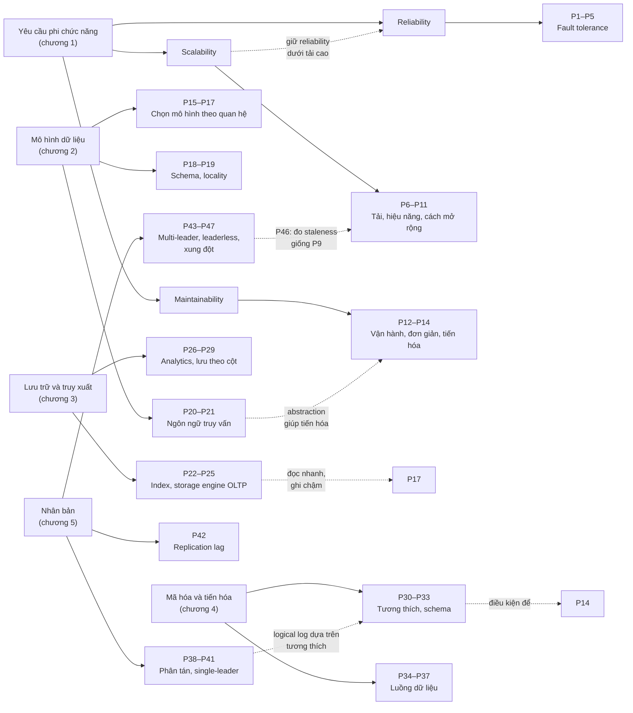
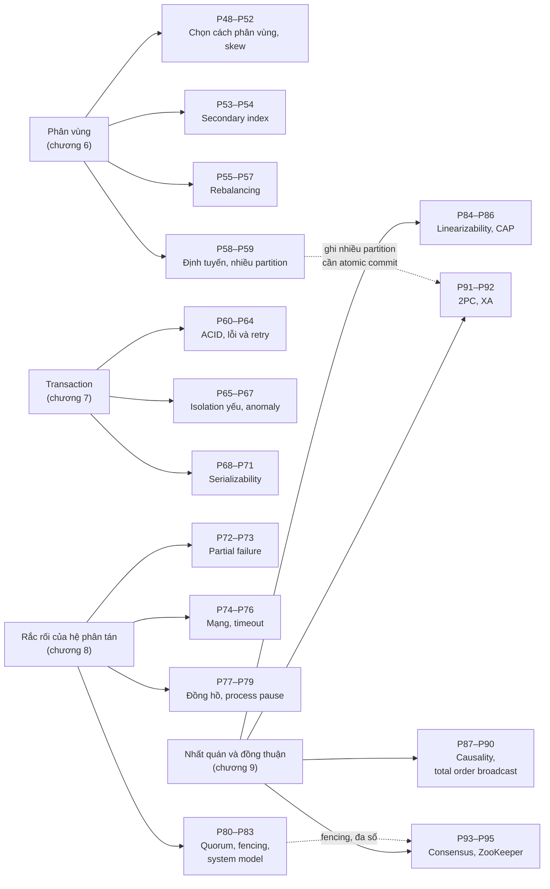
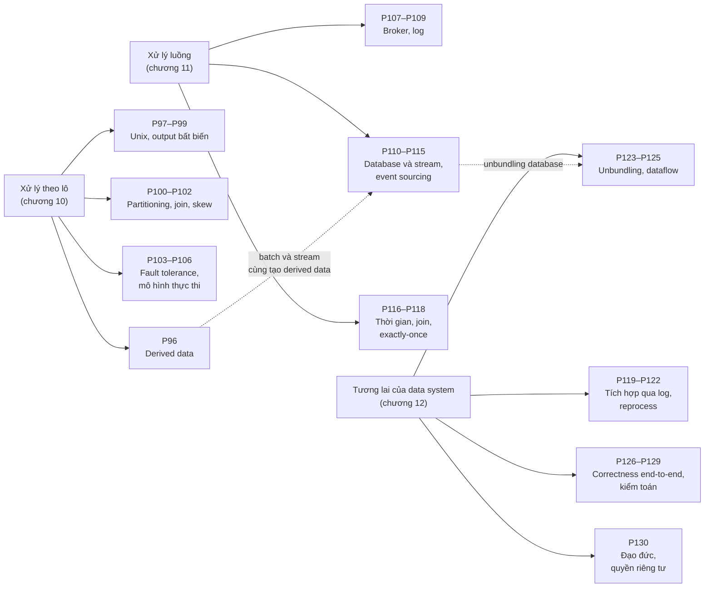

# Nguyên lý System Design trong DDIA

Tệp này gom các nguyên lý System Design rút ra từ từng chương và liên kết về phần giải thích chi tiết. Mỗi nguyên lý ghi rõ nguồn trong sách (trang in, ấn bản thứ nhất 2017). Dòng "Sẽ gặp lại" dựa trên tham chiếu chéo trong sách và trỏ tới mục tương ứng trong ghi chú của chương sau.

Đã cập nhật đến: **Chương 12** (toàn bộ sách).

## Bản đồ tổng quan

Bản đồ đầu gom các nguyên lý của chương 1–5. Hai bản đồ sau gom chương 6–9 và 10–12; mỗi nút là một nhóm nguyên lý, cạnh nét đứt là liên hệ giữa các nhóm.

### Chương 1–5

### Chương 6–9 (Part II)

### Chương 10–12 (Part III)

*(Liên hệ xuyên phần: total order broadcast (P87–P90) là nền của log có thứ tự trong P107–P109; P126–P129 đề xuất kiểm tra end-to-end thay cho transaction serializable (P68–P71). Liên hệ với chương 1–5: P57 và P40 cùng cảnh báo tự động hóa nguy hiểm; P85 nối với quorum ở P45; P88 nối với thứ tự nhân quả ở P44; P107–P118 trả lời các chỗ P36, P37, P41 hẹn gặp lại.)*

## Chương 1 — Reliable, Scalable, and Maintainable Applications

### Nền tảng

**P0. Ghép công cụ là thiết kế một data system mới.** Khi khâu database, cache, index, queue lại bằng application code, các đảm bảo của hệ thống ghép (ví dụ cache được invalidate đúng) là trách nhiệm của bạn. API che giấu sự phức tạp đó khỏi client.
- Nguồn: tr. 4–5 · [chapter-01 B2](chapter-01.md#b2)
- Sẽ gặp lại: Part III, các hệ thống nhiều thành phần như Hình 1-1 (tr. 23): [chapter-10 mục 0](chapter-10.md#part-iii)

### Reliability — Chịu lỗi

**P1. Thiết kế để fault không thành failure, và chọn rõ loại fault cần chịu đựng.** Fault không thể bị loại bỏ. Fault-tolerance cho *mọi* loại fault là bất khả thi, nên cam kết reliability phải nêu rõ phạm vi.
- Nguồn: tr. 6–7 · [chapter-01 B3.1](chapter-01.md#fault-failure)
- Sẽ gặp lại: "System Model and Reality", Chương 8 (tr. 306): [chapter-08](chapter-08.md#system-model)

**P2. Kiểm chứng cơ chế phục hồi bằng cách chủ động gây fault.** Bug nghiêm trọng thường nằm ở phần xử lý lỗi. Cơ chế phục hồi chưa từng chạy là cơ chế chưa được kiểm chứng (ví dụ Chaos Monkey).
- Nguồn: tr. 7 · [chapter-01 B3.1](chapter-01.md#fault-failure)

**P3. Ở quy mô lớn, hãy chịu được việc mất cả một máy.** Phần cứng hỏng liên tục khi có nhiều máy, và máy ảo cloud có thể biến mất không báo trước. Chịu lỗi bằng phần mềm còn cho phép rolling upgrade không downtime.
- Nguồn: tr. 7–8 · [chapter-01 B3.2](chapter-01.md#b3)
- Sẽ gặp lại: rolling upgrade ở Chương 4 (tr. 8); "Handling Node Outages", Chương 5 (tr. 156): [chapter-05 B1.3](chapter-05.md#node-outages)

**P4. Cảnh giác với lỗi tương quan.** Lỗi phần mềm có tính hệ thống xảy ra trên mọi node cùng lúc. Thêm bản sao không bảo vệ được trước chúng. Cần test, cô lập, crash-restart, giám sát, và tự kiểm tra các đảm bảo trong lúc chạy.
- Nguồn: tr. 8–9 · [chapter-01 B3.3](chapter-01.md#b3)

**P5. Thiết kế cho con người sẽ mắc lỗi.** Giảm cơ hội mắc lỗi (giao diện tốt nhưng không quá gò bó), tách nơi thử nghiệm khỏi production, test mọi cấp, **phục hồi nhanh** (rollback, triển khai từ từ, tính lại dữ liệu), giám sát chi tiết.
- Nguồn: tr. 9–10 · [chapter-01 B3.4](chapter-01.md#b3)

**P5b. Giảm reliability phải là quyết định có ý thức.** Có thể đánh đổi reliability lấy chi phí (prototype, biên lợi nhuận mỏng), nhưng phải biết rõ mình đang đi tắt ở đâu.
- Nguồn: tr. 10 · [chapter-01 B3.5](chapter-01.md#b3)

### Scalability — Tải, hiệu năng và cách mở rộng

**P6. Scalability là câu hỏi có chiều, không phải nhãn.** Luôn hỏi: "Nếu hệ thống tăng trưởng *theo chiều này* thì ta có những lựa chọn nào?"
- Nguồn: tr. 10–11 · [chapter-01 B4.0](chapter-01.md#b4)

**P7. Mô tả tải bằng load parameters, và nhìn phân phối thay vì trung bình.** Tham số đúng phụ thuộc kiến trúc. Với Twitter, phân phối số follower (có trọng số theo tần suất đăng) quyết định tải fan-out.
- Nguồn: tr. 11–13 · [chapter-01 B4.1](chapter-01.md#load-parameters)
- Sẽ gặp lại: "Skewed Workloads and Relieving Hot Spots", Chương 6 (tr. 205): [chapter-06](chapter-06.md#skewed-workloads)

**P8. Chọn nơi làm việc nặng (lúc ghi hay lúc đọc) theo tỷ lệ đọc/ghi và phân phối tải.** Twitter tính sẵn timeline khi ghi vì đọc nhiều hơn ghi gần hai bậc độ lớn. Họ dùng cách lai cho người nổi tiếng vì phân phối follower rất lệch.
- Nguồn: tr. 11–13 · [chapter-01 B4.1](chapter-01.md#load-parameters), [D3](chapter-01.md#d3)
- Sẽ gặp lại: Chương 12 quay lại ví dụ Twitter (theo tr. 13): [chapter-12](chapter-12.md#views-caching)

**P9. Đo hiệu năng bằng percentile, và đo phía client.** Response time là một phân phối. Mean che giấu trải nghiệm thật. Tail latency (p99, p999) ảnh hưởng trực tiếp tới người dùng và thường dùng trong SLO và SLA. Queueing delay và head-of-line blocking chỉ thấy được ở phía client. Load test phải gửi request độc lập với response time.
- Nguồn: tr. 13–16 · [chapter-01 B4.2](chapter-01.md#performance), [D4](chapter-01.md#d4)

**P10. Fan-out khuếch đại tail latency, và percentile phải gộp bằng histogram.** Request gọi nhiều backend thì percentile cao của backend quyết định trải nghiệm người dùng. Không lấy trung bình percentile: hãy cộng histogram.
- Nguồn: tr. 16–17 · [chapter-01 B4.2](chapter-01.md#tail-amplification)

**P11. Kiến trúc scale được xây trên giả định về tải, và không có magic scaling sauce.**
- Xem lại kiến trúc mỗi khi tải tăng một bậc độ lớn.
- Pha trộn scale up và scale out một cách thực dụng.
- Stateless dễ phân tán, stateful thêm nhiều độ phức tạp. Giữ database một node đến khi chi phí hoặc yêu cầu high availability buộc phải phân tán, nhưng kinh nghiệm này có thể đổi khi công cụ tốt lên.
- Elastic hợp với tải khó dự đoán. Scale thủ công đơn giản hơn.
- Với sản phẩm giai đoạn đầu, lặp nhanh quan trọng hơn scale cho tải giả định.
- Nguồn: tr. 17–18 · [chapter-01 B4.3](chapter-01.md#coping-with-load), [D5](chapter-01.md#d5), [D6](chapter-01.md#d6)
- Sẽ gặp lại: Part II (dữ liệu phân tán, [chapter-05 mục 0](chapter-05.md#part-ii), P38); "Rebalancing Partitions", Chương 6 (tr. 209): [chapter-06](chapter-06.md#rebalancing)

### Maintainability — Vận hành, đơn giản, tiến hóa

**P12. Operability: làm việc thường ngày trở nên dễ.** Giám sát tốt, hỗ trợ tự động hóa, không phụ thuộc từng máy, mô hình vận hành dễ hiểu, mặc định tốt nhưng cho phép ghi đè, tự phục hồi nhưng vẫn cho kiểm soát thủ công, hành vi dự đoán được.
- Nguồn: tr. 19–20 · [chapter-01 B5.1](chapter-01.md#operability)

**P13. Simplicity: loại bỏ accidental complexity bằng abstraction tốt.** Độ phức tạp làm vượt ngân sách và tăng rủi ro bug. Abstraction tốt (ngôn ngữ bậc cao, SQL) che giấu chi tiết và tái sử dụng được. Tìm abstraction tốt cho hệ phân tán là việc khó.
- Nguồn: tr. 20–21 · [chapter-01 B5.2](chapter-01.md#simplicity)

**P14. Evolvability: thiết kế để thay đổi ở cấp data system.** Yêu cầu chắc chắn sẽ thay đổi. Sự linh hoạt cần đạt ở cấp nhiều dịch vụ, không chỉ trong vài file code, và nó gắn chặt với simplicity.
- Nguồn: tr. 21–22 · [chapter-01 B5.3](chapter-01.md#evolvability)
- Sẽ gặp lại: encoding và schema evolution, Chương 4 (theo Preface, tr. xvi)

## Chương 2 — Data Models and Query Languages

### Chọn mô hình dữ liệu

**P15. Chọn mô hình dữ liệu theo loại quan hệ giữa các mục dữ liệu.** Mỗi mô hình ngầm chứa giả định về cách dùng.
- Cây one-to-many tự chứa, thường tải cả cây: document.
- Có many-to-one hoặc many-to-many: relational.
- Kết nối dày đặc, truy vấn duyệt độ dài thay đổi: graph.
- Giả lập mô hình này bằng mô hình khác được, nhưng thường gượng.
- Nguồn: tr. 27–28, 38–39, 49, 63 · [chapter-02 B2.5](chapter-02.md#rel-vs-doc-today), [D1](chapter-02.md#d1), [C2](chapter-02.md#c-so-do)

**P16. Dự trù việc dữ liệu ngày càng kết nối hơn.** Phiên bản đầu khớp document không join, nhưng tính năng mới thường biến chuỗi chữ thành thực thể và đưa vào many-to-many. Khi đó document thuần buộc phải denormalize hoặc join trong ứng dụng, dẫn tới code phức tạp hơn và chậm hơn.
- Nguồn: tr. 34–35, 39 · [chapter-02 B2.3](chapter-02.md#relationships)

**P17. Normalize thông tin có nghĩa với con người; denormalize có ý thức để đọc nhanh.** ID không có nghĩa với người nên không bao giờ cần đổi. Bản sao thì tốn chi phí ghi và có nguy cơ không nhất quán. Denormalized giống một kết quả truy vấn tính sẵn (như cache timeline Twitter ở P8).
- Nguồn: tr. 33–34; Glossary tr. 554, 556 · [chapter-02 B2.3](chapter-02.md#normalization), [D4](chapter-02.md#d4)
- Sẽ gặp lại: caching, denormalization, derived data ở Part III (tr. 34): [chapter-10 mục 0](chapter-10.md#derived-data)

### Schema và locality

**P18. Dữ liệu luôn có schema; chỉ cần quyết định kiểm tra nó ở đâu.** Schema-on-write (database áp đặt khi ghi) hợp khi mọi bản ghi cùng cấu trúc. Schema-on-read (code xử lý khi đọc) hợp với dữ liệu không đồng nhất hoặc do hệ thống ngoài quyết định, nhưng mọi code đọc phải xử lý mọi phiên bản định dạng. Với bảng lớn, điền giá trị mới lúc đọc thay vì `UPDATE` cả bảng.
- Nguồn: tr. 39–41 · [chapter-02 B2.5](chapter-02.md#schema-flexibility), [D3](chapter-02.md#d3)
- Sẽ gặp lại: schema và schema evolution, Chương 4 (tr. 41)

**P19. Locality chỉ có lợi khi thường cần phần lớn dữ liệu cùng lúc.** Gom dữ liệu hay dùng cùng nhau vào một chỗ giảm số lần tra index và seek đĩa. Nhưng document lớn phải tải và ghi lại cả khối, nên hãy giữ document nhỏ và tránh ghi làm nó to ra. Locality cũng đạt được trong relational (Spanner interleaved tables, Oracle cluster tables, column-family của Bigtable).
- Nguồn: tr. 41 · [chapter-02 B2.5](chapter-02.md#locality)
- Sẽ gặp lại: locality ở Chương 3 (tr. 41)

### Ngôn ngữ truy vấn

**P20. Ưu tiên giao diện declarative để hệ thống được tự do tối ưu và tiến hóa.** Declarative chỉ mô tả kết quả, nên database có thể đổi index, layout, thứ tự lưu trữ, chạy song song mà không phá vỡ truy vấn. Query optimizer xây một lần, mọi ứng dụng hưởng lợi. Bài học đúng cả với SQL so với CODASYL, lẫn CSS so với DOM API.
- Nguồn: tr. 37–38, 42–46 · [chapter-02 B3.0](chapter-02.md#declarative), [B2.4](chapter-02.md#relational-model), [D6](chapter-02.md#d6)

**P21. Code chạy trong framework phân tán nên là hàm thuần.** Không side effect và không truy vấn thêm, để framework chạy ở bất kỳ đâu, theo thứ tự bất kỳ, và chạy lại khi lỗi. Nhưng API cấp thấp kiểu MapReduce khó dùng và ít cơ hội tối ưu, nên hệ thống thường tiến hóa về một ngôn ngữ declarative (aggregation pipeline).
- Nguồn: tr. 46–48 · [chapter-02 B3.2](chapter-02.md#mapreduce)
- Sẽ gặp lại: MapReduce, Chương 10 (tr. 46): [chapter-10](chapter-10.md#mapreduce-execution)

## Chương 3 — Storage and Retrieval

### Index và storage engine cho OLTP

**P22. Mỗi index làm đọc nhanh hơn và ghi chậm hơn; chọn index theo truy vấn thực tế.** Index là dữ liệu dẫn xuất: thêm hay bỏ không đổi nội dung, chỉ đổi hiệu năng. Ghi nối vào file là cách ghi nhanh nhất; mọi index thêm chi phí cho mỗi lần ghi. Clustered và covering index là thêm một mức nhân bản: đọc nhanh hơn nữa, tốn dung lượng và chậm ghi hơn nữa.
- Nguồn: tr. 71, 86–87 · [chapter-03 B1.3](chapter-03.md#index-tradeoff), [B6.2](chapter-03.md#clustered-index), [D4](chapter-03.md#d4)

**P23. Biến ghi ngẫu nhiên thành ghi tuần tự, và dùng dữ liệu bất biến để đơn giản hóa phục hồi.** Log chỉ ghi nối thêm và segment bất biến cho throughput ghi cao, phục hồi crash và đồng thời đơn giản, không phân mảnh. Cái giá là phải compaction và merge ở nền.
- Nguồn: tr. 75, 103 · [chapter-03 B2.4](chapter-03.md#append-only), [B3](chapter-03.md#b3)
- Sẽ gặp lại: log trong replication ([chapter-05 B1.4](chapter-05.md#replication-logs), P41); event log ([chapter-11](chapter-11.md#log-based-brokers)), theo Glossary tr. 556

**P24. Ghi trước vào log rồi mới sửa cấu trúc chính.** Memtable của LSM-tree và page của B-tree đều có thể mất hoặc hỏng khi crash; một log chỉ ghi nối thêm (log phục hồi memtable, WAL của B-tree) cho phép dựng lại trạng thái nhất quán.
- Nguồn: tr. 78, 82 · [chapter-03 B3.2](chapter-03.md#memtable), [B4.3](chapter-03.md#wal)

**P25. Chọn LSM-tree hay B-tree theo workload, và benchmark với workload thật.** LSM-tree thường ghi nhanh hơn, nén tốt hơn, nhưng compaction có thể làm độ trễ percentile cao tăng vọt và có thể không theo kịp (cần giám sát). B-tree đọc ổn định hơn, mỗi key một chỗ nên hợp với giao dịch mạnh. Kết quả benchmark rất nhạy với chi tiết workload.
- Nguồn: tr. 83–85 · [chapter-03 B5](chapter-03.md#b5), [D2](chapter-03.md#d2)
- Liên hệ: tail latency và đo percentile ở P9, P10
- Sẽ gặp lại: khóa trên khoảng key, Chương 7 (tr. 85): [chapter-07](chapter-07.md#index-range-lock)

### Analytics và lưu trữ theo cột

**P26. Tách workload phân tích khỏi workload giao dịch.** OLTP và OLAP có mẫu truy cập, người dùng, kích thước dữ liệu và nút thắt (seek đĩa so với băng thông đĩa) khác nhau. Truy vấn phân tích nặng làm hại giao dịch, nên đưa dữ liệu sang data warehouse qua ETL. Công ty nhỏ có thể chưa cần.
- Nguồn: tr. 90–93, 103 · [chapter-03 B7](chapter-03.md#b7), [D7](chapter-03.md#d7)
- Sẽ gặp lại: batch processing, Chương 10 (tr. 90): [chapter-10](chapter-10.md#b1)

**P27. Mô hình hóa dữ liệu phân tích quanh các sự kiện: star schema.** Ghi từng sự kiện riêng lẻ vào fact table để phân tích linh hoạt nhất; dimension table mô tả ai, cái gì, ở đâu, khi nào. Star thường được ưa hơn snowflake vì đơn giản cho analyst.
- Nguồn: tr. 93–95 · [chapter-03 B7.4](chapter-03.md#star-schema)

**P28. Với quét lượng lớn dữ liệu, mã hóa thật gọn quan trọng hơn index.** Lưu theo cột chỉ đọc cột cần, nén bằng bitmap và RLE, tận dụng CPU cache bằng vectorized processing, và dùng sort order như index. Ghi được xử lý theo kiểu LSM: gom trong bộ nhớ rồi merge hàng loạt.
- Nguồn: tr. 95–101, 104 · [chapter-03 B8](chapter-03.md#b8), [D8](chapter-03.md#d8)

**P29. Tổng hợp tính sẵn để tăng tốc, nhưng giữ dữ liệu thô.** Materialized view và data cube làm một số truy vấn rất nhanh, nhưng phải cập nhật khi dữ liệu gốc đổi và không trả lời được câu hỏi ngoài các dimension đã chọn. Cùng đánh đổi với denormalization (P17) và cache timeline Twitter (P8).
- Nguồn: tr. 101–103 · [chapter-03 B8.7](chapter-03.md#materialized-views), [D9](chapter-03.md#d9)

## Chương 4 — Encoding and Evolution

### Tương thích và schema

**P30. Luôn giả định code cũ và code mới cùng chạy, nên giữ tương thích cả hai chiều.** Rolling upgrade và client chậm cập nhật khiến nhiều phiên bản cùng tồn tại. Backward compatibility (code mới đọc dữ liệu cũ) thường dễ; forward compatibility (code cũ đọc dữ liệu mới, bỏ qua phần thêm vào) phải được thiết kế từ đầu. Đây là điều kiện để có evolvability (P14).
- Nguồn: tr. 111–112, 139 · [chapter-04 A](chapter-04.md#compatibility)

**P31. Không dùng định dạng mã hóa riêng của ngôn ngữ cho dữ liệu lưu lâu hay đi qua ranh giới hệ thống.** Nó khóa ngôn ngữ, bỏ qua versioning, và decode dữ liệu không tin cậy có thể dẫn tới thực thi code từ xa.
- Nguồn: tr. 113–114, 139 · [chapter-04 B2](chapter-04.md#b2)

**P32. Dùng định dạng nhị phân có schema cho dữ liệu nội bộ, và tuân thủ quy tắc tiến hóa.** Protocol Buffers, Thrift (field tag) và Avro (writer/reader schema) gọn và có ngữ nghĩa tương thích rõ ràng. Quy tắc: trường mới phải optional hoặc có mặc định; không đổi hay dùng lại tag; cẩn thận khi đổi kiểu. JSON, XML vẫn hợp cho trao đổi giữa tổ chức, nhưng cẩn thận với số lớn và dữ liệu nhị phân.
- Nguồn: tr. 114–125, 128 · [chapter-04 B4.3](chapter-04.md#tag-evolution), [B5.3](chapter-04.md#avro-evolution), [D2](chapter-04.md#d2)

**P33. Quản lý schema như tài sản: lưu các phiên bản và kiểm tra tương thích trước khi triển khai.** Schema bắt buộc để decode nên luôn cập nhật, là tài liệu tốt; một database các phiên bản schema cho phép reader tìm writer's schema và chặn thay đổi phá tương thích. Với schema sinh tự động (export database), chọn định dạng không cần gán tag bằng tay như Avro.
- Nguồn: tr. 125–128 · [chapter-04 B5.4](chapter-04.md#which-writer-schema), [B5.5](chapter-04.md#dynamic-schema), [B6](chapter-04.md#b6)

### Luồng dữ liệu

**P34. Dữ liệu sống lâu hơn code: thiết kế để đọc được mọi phiên bản dữ liệu từng ghi.** Database chứa dữ liệu ghi 5 mili giây trước và 5 năm trước. Migration tốn kém, nên dựa vào schema evolution để cả database trông như một schema. Khi snapshot hay archive, mã hóa nhất quán bằng schema mới nhất.
- Nguồn: tr. 129–131 · [chapter-04 B7.1](chapter-04.md#data-outlives-code)

**P35. Code cũ phải giữ nguyên trường mình không hiểu khi đọc, sửa, ghi lại.** Giải mã thành model object rồi mã hóa lại có thể làm rơi trường mới (Hình 4-7). Áp dụng cho cả database lẫn consumer xuất bản lại message.
- Nguồn: tr. 129–130, 138 · [chapter-04 B7.1](chapter-04.md#unknown-fields)

**P36. Đừng giả vờ request mạng là lời gọi hàm.** Request có thể mất, timeout không rõ kết cục, thử lại gây trùng lặp (cần idempotence), độ trễ biến động. Dùng framework nói rõ điều đó (future, stream). Với service, cập nhật server trước: backward compatibility cho request, forward compatibility cho response; với API cho tổ chức khác, giữ tương thích rất lâu hoặc chạy nhiều phiên bản API song song.
- Nguồn: tr. 134–136 · [chapter-04 B7.2](chapter-04.md#rpc-problems), [D5](chapter-04.md#d-so-sanh)
- Sẽ gặp lại: timeout ([chapter-08](chapter-08.md#timeouts)), idempotence (Chương 11, tr. 478: [chapter-11](chapter-11.md#idempotence))

**P37. Dùng message broker để tách rời và tăng độ tin cậy giữa các thành phần.** Broker đệm khi bên nhận chết hay quá tải, gửi lại message, cho một message tới nhiều consumer, và người gửi không cần biết địa chỉ người nhận. Giao tiếp một chiều, bất đồng bộ; cần tương thích cả hai chiều để đổi producer và consumer theo thứ tự bất kỳ.
- Nguồn: tr. 136–139 · [chapter-04 B7.3](chapter-04.md#message-passing), [D7](chapter-04.md#d-so-sanh)
- Sẽ gặp lại: so sánh message broker và nối chuỗi topic, Chương 11: [chapter-11 D1](chapter-11.md#d1), [nối chuỗi xử lý](chapter-11.md#processing-options)

## Chương 5 — Replication

### Phân tán dữ liệu (phần giới thiệu Part II)

**P38. Chỉ phân tán khi cần, và hiểu cái giá của shared-nothing.** Phân tán ra nhiều máy vì scalability, fault tolerance hoặc latency. Scale up đắt hơn tuyến tính và chỉ ở một nơi; shared-nothing chạy trên phần cứng thường, trải được nhiều vùng, nhưng thêm độ phức tạp, có thể giới hạn mô hình dữ liệu, và database không che giấu được các trade-off. Có khi một chương trình đơn luồng nhanh hơn cả một cluster.
- Nguồn: tr. 145–147 · [chapter-05 mục 0](chapter-05.md#part-ii), [0.2](chapter-05.md#shared-nothing)
- Sẽ gặp lại: partitioning ([chapter-06](chapter-06.md)), giới hạn của hệ phân tán ([chapter-08](chapter-08.md), [chapter-09](chapter-09.md)), theo tr. 148

### Single-leader replication

**P39. Chọn chế độ đồng bộ theo yêu cầu durability.** Đồng bộ với mọi follower là không thực tế, vì một node hỏng là dừng ghi. Semi-synchronous (một follower đồng bộ) bảo đảm dữ liệu có trên ít nhất hai node. Hoàn toàn bất đồng bộ luôn ghi được nhưng phải chấp nhận mất ghi đã xác nhận khi leader hỏng.
- Nguồn: tr. 153–155 · [chapter-05 B1.1](chapter-05.md#sync-async), [D2](chapter-05.md#d2)
- Sẽ gặp lại: consensus, Chương 9 (tr. 155): [chapter-09](chapter-09.md#consensus)

**P40. Coi failover là thao tác nguy hiểm, và thiết kế để nó an toàn.** Timeout quá ngắn gây failover không cần thiết lúc quá tải; chọn replica mới nhất; dùng fencing chống split brain; cẩn thận khi hệ thống ngoài dùng key do database sinh (sự cố GitHub). Failover thủ công là lựa chọn hợp lý.
- Nguồn: tr. 156–158 · [chapter-05 B1.3](chapter-05.md#failover), [E2](chapter-05.md#e-system-design)
- Sẽ gặp lại: "The leader and the lock", Chương 8 (tr. 301): [chapter-08](chapter-08.md#leader-lock); consensus khi chọn leader: [chapter-09](chapter-09.md#leader-election)

**P41. Tách replication log khỏi storage engine.** Logical (row-based) log giữ được backward compatibility giữa các phiên bản (P30), nên cho phép nâng cấp không downtime (nâng cấp follower rồi failover), và dễ parse cho change data capture. WAL shipping gắn chặt với định dạng lưu trữ; statement-based hỏng với hàm không tất định.
- Nguồn: tr. 158–161 · [chapter-05 B1.4](chapter-05.md#replication-logs), [D3](chapter-05.md#d3)
- Sẽ gặp lại: change data capture, Chương 11 (tr. 161): [chapter-11](chapter-11.md#cdc)

### Replication lag

**P42. Thiết kế cho trường hợp lag lên vài phút, và chọn rõ đảm bảo đọc cần có.** Eventual consistency không có giới hạn thời gian. Hãy hỏi ứng dụng hành xử thế nào khi lag lớn, rồi cài có chủ đích read-after-write, monotonic reads hoặc consistent prefix reads. Đừng giả vờ replication là đồng bộ; xử lý ở tầng ứng dụng thì phức tạp, nên transaction tồn tại để database làm việc đó.
- Nguồn: tr. 161–167 · [chapter-05 B2](chapter-05.md#b2), [D4](chapter-05.md#d4), [E1](chapter-05.md#e-system-design)
- Sẽ gặp lại: transaction ([chapter-07](chapter-07.md#transaction), [chapter-09](chapter-09.md#2pc)); cơ chế thay thế ở Part III (tr. 167), ví dụ [chapter-12](chapter-12.md#end-to-end)

### Multi-leader và leaderless replication

**P43. Chỉ dùng multi-leader khi lợi ích đáng giá, và ưu tiên tránh xung đột.** Multi-leader hợp với nhiều datacenter, client offline và collaborative editing, nhưng là "vùng nguy hiểm" vì write conflict và các bẫy cấu hình. Ưu tiên conflict avoidance (mỗi bản ghi có leader nhà). Khi phải hội tụ, chọn cách không âm thầm mất dữ liệu: lưu mọi phiên bản, custom logic, CRDT hay OT. Xung đột có thể là vi phạm ràng buộc trên nhiều bản ghi.
- Nguồn: tr. 168–175 · [chapter-05 B3.1](chapter-05.md#multi-leader-use-cases), [B3.2](chapter-05.md#write-conflicts), [D5](chapter-05.md#d5)
- Sẽ gặp lại: thêm ví dụ xung đột ở Chương 7 ([chapter-07](chapter-07.md#write-skew-examples)); phát hiện và giải quyết xung đột ở quy mô lớn ở Chương 12 (tr. 175): [chapter-12](chapter-12.md#uniqueness-log)

**P44. Sắp thứ tự sự kiện theo quan hệ nhân quả, không theo đồng hồ.** Message nhân bản có thể vượt nhau; đồng hồ các máy không đủ đồng bộ. "Đồng thời" nghĩa là không thao tác nào biết thao tác kia. Dùng version number hay version vector để phân biệt ghi đè với ghi đồng thời.
- Nguồn: tr. 176–177, 186–191 · [chapter-05 B3.3](chapter-05.md#topologies), [B4.5](chapter-05.md#happens-before), [version vectors](chapter-05.md#version-vectors)
- Sẽ gặp lại: đồng hồ không tin cậy, Chương 8 (tr. 287, 291): [chapter-08](chapter-08.md#timestamps-ordering); ordering, Chương 9: [chapter-09](chapter-09.md#causality)

**P45. Quorum là núm chỉnh xác suất, không phải bảo đảm tuyệt đối.** w + r > n làm tập ghi và tập đọc giao nhau, chịu được n − w node hỏng khi ghi và n − r khi đọc. Nhưng sloppy quorum, ghi đồng thời, ghi thất bại một phần và khôi phục từ replica cũ vẫn có thể trả giá trị stale, và quorum không cho read-your-writes hay monotonic reads. Sloppy quorum đổi consistency lấy write availability.
- Nguồn: tr. 179–184 · [chapter-05 B4.2](chapter-05.md#quorums), [B4.3](chapter-05.md#quorum-limits), [B4.4](chapter-05.md#sloppy-quorum), [D7](chapter-05.md#d7)
- Sẽ gặp lại: "Linearizability and quorums", Chương 9 (tr. 334): [chapter-09](chapter-09.md#lin-quorums)

**P46. Định lượng được "eventual".** Giám sát replication lag (vị trí của leader trừ vị trí của follower) và staleness; với leaderless chỉ có read repair, giá trị ít đọc có thể cũ mãi, nên cần anti-entropy và phép đo riêng. Đây là áp dụng của P9 (đo cái người dùng thật sự gặp) cho replication.
- Nguồn: tr. 179, 182–183 · [chapter-05 B4.3](chapter-05.md#monitoring-staleness), [read repair](chapter-05.md#read-repair)

**P47. Không dùng last write wins cho dữ liệu không được mất.** LWW hội tụ bằng cách âm thầm bỏ các lần ghi đồng thời đã được báo thành công. Nếu không được mất dữ liệu, giữ siblings và gộp ở ứng dụng (cần tombstone cho thao tác xóa) hoặc dùng CRDT. Nếu dùng LWW, làm mỗi key chỉ ghi một lần rồi bất biến (ví dụ key là UUID).
- Nguồn: tr. 173, 186, 190–191 · [chapter-05 B4.5](chapter-05.md#lww), [siblings](chapter-05.md#siblings), [E6](chapter-05.md#e-system-design)
- Sẽ gặp lại: "Timestamps for ordering events", Chương 8 (tr. 291): [chapter-08](chapter-08.md#timestamps-ordering)

## Chương 6 — Partitioning

### Chọn cách phân vùng

**P48. Phân vùng để mở rộng vượt sức một máy, và tách nó khỏi quyết định nhân bản.** Replication không đủ khi dataset hay throughput quá lớn; partition đặt trên các node shared-nothing để trải dữ liệu và tải. Truy vấn một partition mở rộng tuyến tính khi thêm node, truy vấn nhiều partition thì khó hơn nhiều. Mỗi partition vẫn được nhân bản (một leader cho mỗi partition), và sơ đồ phân vùng gần như độc lập với sơ đồ nhân bản.
- Nguồn: tr. 199–201 · [chapter-06 A](chapter-06.md#partition-definition), [B1](chapter-06.md#partitioning-replication)
- Sẽ gặp lại: thực thi truy vấn song song, Chương 10 (tr. 216)

**P49. Mục tiêu là chia đều cả dữ liệu lẫn tải; cluster chỉ nhanh bằng node bận nhất.** Skew làm partitioning mất tác dụng: nếu mọi tải dồn vào một partition, 9 trên 10 node ngồi không. Gán ngẫu nhiên chia đều nhưng buộc mọi lần đọc hỏi mọi node, nên cần gán theo key để tính được vị trí bản ghi.
- Nguồn: tr. 201 · [chapter-06 B2.0](chapter-06.md#skew-hot-spot)

**P50. Chọn key range khi cần quét theo khoảng, hash khi cần chia đều, key ghép khi cần cả hai trong phạm vi một thực thể.** Key range giữ thứ tự nên range scan rẻ nhưng dễ hot spot; hash phá thứ tự để trải tải. Compound key (băm phần đầu, sắp xếp phần sau) cho range scan trong một partition, hợp với quan hệ một-nhiều như (user_id, timestamp). Hàm hash phải tất định giữa mọi tiến trình.
- Nguồn: tr. 202–205 · [chapter-06 B2.1](chapter-06.md#key-range), [B2.2](chapter-06.md#hash-partitioning), [compound key](chapter-06.md#compound-key), [D1](chapter-06.md#d1)

**P51. Đừng để giá trị tăng đơn điệu đứng đầu key của hệ phân vùng theo khoảng.** Timestamp hay ID tự tăng làm mọi lần ghi mới dồn vào partition "hiện tại". Đưa một trường phân tán tốt (ví dụ tên cảm biến) lên đầu key, và chấp nhận truy vấn nhiều thực thể phải tách thành nhiều range query.
- Nguồn: tr. 203 · [chapter-06 B2.1](chapter-06.md#timestamp-hot-spot), [E1](chapter-06.md#e-system-design)

**P52. Hash không cứu được một key cực nóng; đó là việc của ứng dụng.** Hash của cùng một ID vẫn là một. Tách key nóng bằng hậu tố ngẫu nhiên trải ghi ra nhiều partition, nhưng đọc phải gộp mọi key con và cần sổ sách theo dõi key nào đang bị tách, nên chỉ áp dụng cho số ít key đã đo được là nóng.
- Nguồn: tr. 205 · [chapter-06 B2.3](chapter-06.md#skewed-workloads), [E2](chapter-06.md#e-system-design)
- Sẽ gặp lại: "Handling skew" trong batch processing, Chương 10 (tr. 407, theo Glossary tr. 557)

### Secondary index

**P53. Chọn local hay global secondary index theo tỷ lệ đọc ghi và yêu cầu độ mới.** Local index (theo document): ghi chạm một partition, đọc phải scatter/gather mọi partition và chịu tail latency amplification. Global index (theo term): đọc chạm một partition, ghi chạm nhiều partition, và vì cập nhật đồng bộ cần distributed transaction nên thường bất đồng bộ, khiến index trễ hơn dữ liệu. Cố gắng thiết kế khóa phân vùng để truy vấn index hay dùng nằm gọn trong một partition.
- Nguồn: tr. 206–209 · [chapter-06 B3.1](chapter-06.md#document-index), [B3.2](chapter-06.md#term-index), [D2](chapter-06.md#d2), [E3](chapter-06.md#e-system-design)
- Sẽ gặp lại: distributed transaction, Chương 7 và 9; cài term-partitioned index, Chương 12 (tr. 209)

**P54. Đừng tự cài secondary index trong ứng dụng nếu không có cách ghi nhiều đối tượng một cách nguyên tử.** Ánh xạ giá trị → ID do ứng dụng tự duy trì rất dễ lệch khỏi dữ liệu do race condition và ghi thất bại một phần.
- Nguồn: tr. 206 (chú thích ii) · [chapter-06 B3.1](chapter-06.md#document-index)
- Sẽ gặp lại: "The need for multi-object transactions", Chương 7 (tr. 231)

### Rebalancing

**P55. Tách số partition khỏi số node; không bao giờ dùng hash mod N.** Với mod N, đổi số node làm phần lớn key đổi chỗ. Tạo trước nhiều partition hơn số node và chỉ chuyển nguyên partition: số key trên mỗi partition không đổi, chỉ cách gán partition cho node thay đổi, và cách gán cũ vẫn phục vụ trong lúc chuyển.
- Nguồn: tr. 209–211 · [chapter-06 B4.1](chapter-06.md#hash-mod-n), [fixed](chapter-06.md#fixed-partitions), [D3](chapter-06.md#d3)

**P56. Chọn chiến lược rebalancing theo cách dataset tăng trưởng.** Số partition cố định đơn giản nhưng là trần số node và khó chọn khi dataset biến động; dynamic partitioning (tách, gộp, cần pre-splitting lúc đầu) hợp với key range và dataset khó đoán; partitioning theo số node giữ kích thước partition ổn định khi cluster lớn theo dữ liệu, nhưng cần hash partitioning.
- Nguồn: tr. 211–213 · [chapter-06 dynamic](chapter-06.md#dynamic-partitioning), [proportional](chapter-06.md#proportional-partitioning), [E4](chapter-06.md#e-system-design)

**P57. Giữ con người trong vòng lặp rebalancing.** Rebalancing đắt (chép dữ liệu, định tuyến lại); khi đi cùng phát hiện lỗi tự động, một node chỉ quá tải tạm thời có thể bị coi là chết và kích hoạt cascading failure. Cho hệ thống đề xuất, người xác nhận. Đây là cùng bài học với failover tự động (P40).
- Nguồn: tr. 213–214 · [chapter-06 B4.2](chapter-06.md#cascading-failure), [D4](chapter-06.md#d4), [E5](chapter-06.md#e-system-design)
- Sẽ gặp lại: phát hiện lỗi bằng timeout, Chương 8

### Định tuyến và thao tác nhiều partition

**P58. Bản đồ partition → node cần một nguồn sự thật mà mọi bên đồng ý.** Dù định tuyến qua node bất kỳ, routing tier hay client biết phân vùng, câu hỏi then chốt là thành phần định tuyến biết về thay đổi bằng cách nào. Đừng tự viết consensus: dùng coordination service như ZooKeeper, hoặc gossip nếu chấp nhận đặt độ phức tạp vào node. Thông tin thay đổi chậm như địa chỉ IP thì DNS là đủ.
- Nguồn: tr. 214–216 · [chapter-06 B5](chapter-06.md#request-routing), [ZooKeeper](chapter-06.md#zookeeper), [D5](chapter-06.md#d5), [E6](chapter-06.md#e-system-design)
- Sẽ gặp lại: consensus và coordination service, Chương 9 (tr. 215)

**P59. Thiết kế để phần lớn thao tác nằm gọn trong một partition.** Partition độc lập là nguồn của khả năng mở rộng, nhưng thao tác ghi nhiều partition khó suy luận khi một phần thành công còn phần kia thất bại; truy vấn nhiều partition thì chịu scatter/gather. Đây cũng là lý do consistent prefix reads khó trong database phân vùng (P42).
- Nguồn: tr. 207, 217–218 · [chapter-06 B6](chapter-06.md#b6), [chapter-05 B2.3](chapter-05.md#consistent-prefix)
- Sẽ gặp lại: transaction và atomic commit, Chương 7 và 9 (tr. 218)

## Chương 7 — Transactions

### Transaction, ACID và xử lý lỗi

**P60. Dùng transaction để quy nhiều loại lỗi về một lần abort và retry, nhưng quyết định dựa trên đảm bảo và chi phí cụ thể.** Transaction là lớp trừu tượng cho ứng dụng bỏ qua một số lỗi phần cứng, phần mềm và vấn đề đồng thời. Nó không phải quy luật tự nhiên: mẫu truy cập một bản ghi có thể không cần; dữ liệu denormalized, foreign key, secondary index thì cần multi-object transaction. Cả "transaction đối nghịch scalability" lẫn "dữ liệu quý thì phải ACID" đều là phóng đại.
- Nguồn: tr. 221–223, 228–231, 266 · [chapter-07 A](chapter-07.md#a-tong-quan), [B1.2](chapter-07.md#need-multi-object)
- Sẽ gặp lại: transaction phân tán, Chương 9; cách thay thế multi-object transaction, Chương 12 (tr. 231)

**P61. Đừng tin nhãn "ACID" hay tên isolation level; kiểm chứng anomaly nào thật sự bị chặn.** ACID của mỗi database một khác; "serializable" của Oracle là snapshot isolation, "repeatable read" có ít nhất ba nghĩa, MySQL/InnoDB không phát hiện lost update, không bản cài snapshot isolation nào sách nêu phát hiện write skew. Nhiều database "ACID" chạy isolation yếu theo mặc định.
- Nguồn: tr. 223, 226, 233, 242, 245, 248 · [chapter-07 B1.1](chapter-07.md#acid), [B2.2](chapter-07.md#repeatable-read), [D2](chapter-07.md#d2)

**P62. Consistency là trách nhiệm của ứng dụng; đẩy invariant xuống ràng buộc của database khi có thể.** Database chỉ dựa vào atomicity và isolation để giúp giữ invariant do ứng dụng định nghĩa. Unique constraint, foreign key, exclusion constraint được database thực thi bất kể isolation level, nên giải quyết gọn một số write skew (username, ô cờ).
- Nguồn: tr. 224–225, 248, 250 · [chapter-07 B1.1](chapter-07.md#consistency), [B2.4](chapter-07.md#write-skew-examples)

**P63. Durability là tổ hợp kỹ thuật giảm rủi ro, không phải một đảm bảo tuyệt đối.** Ghi đĩa (kèm WAL), nhân bản tới máy ở xa và backup mỗi thứ che một loại rủi ro khác (máy chết, lỗi tương quan, mất ghi khi failover, SSD và firmware lỗi, hỏng âm thầm) và nên dùng cùng nhau. Đây là P1 (chọn rõ loại fault cần chịu) áp dụng cho dữ liệu đã commit.
- Nguồn: tr. 226–227 · [chapter-07 B1.1](chapter-07.md#replication-durability)
- Sẽ gặp lại: lỗi phần cứng và hệ phân tán, Chương 8

**P64. Thiết kế retry như một phần của transaction.** Abort chỉ có ích nếu được retry: chỉ retry lỗi tạm thời, giới hạn số lần và dùng exponential backoff khi có thể quá tải, khử trùng lặp cho trường hợp commit thành công mà mất xác nhận, và tách side effect ngoài database (email) khỏi transaction hoặc phối hợp bằng 2PC. ORM phổ biến không tự retry.
- Nguồn: tr. 231–232 · [chapter-07 B1.2](chapter-07.md#retry-abort), [E5](chapter-07.md#e-system-design)
- Sẽ gặp lại: 2PC, Chương 9 (tr. 354); end-to-end argument, Chương 12 (tr. 516)

### Isolation yếu và anomaly

**P65. Biết isolation level của bạn cho phép anomaly nào, và chọn snapshot cho việc đọc lâu.** Read committed chặn dirty read và dirty write nhưng cho phép read skew; backup, analytics, kiểm tra toàn vẹn cần snapshot isolation (MVCC), nơi người đọc và người ghi không chặn nhau. Đổi lại, transaction dài giữ chân garbage collection.
- Nguồn: tr. 234–242 · [chapter-07 B2.1](chapter-07.md#read-committed), [B2.2](chapter-07.md#snapshot-isolation), [D1](chapter-07.md#d1), [E1](chapter-07.md#e-system-design)

**P66. Đừng tự làm read-modify-write ở ứng dụng; dùng thao tác atomic của database.** Lost update xảy ra ở mọi mức yếu hơn serializable trừ khi database tự phát hiện. Thứ tự ưu tiên: thao tác atomic, rồi khóa tường minh, tự phát hiện kèm retry, compare-and-set đã kiểm tra an toàn. Khi nhân bản multi-leader hay leaderless, khóa và CAS không áp dụng; dùng thao tác giao hoán hoặc siblings, tránh LWW.
- Nguồn: tr. 242–246 · [chapter-07 B2.3](chapter-07.md#lost-update), [D3](chapter-07.md#d3), [E2](chapter-07.md#e-system-design)
- Sẽ gặp lại: linearizability, Chương 9 (tr. 324)

**P67. Nhận diện mẫu "kiểm tra rồi hành động" trên nhiều hàng: đó là write skew.** Một SELECT kiểm tra tiền đề, ứng dụng quyết định, rồi một lần ghi làm đổi chính tiền đề đó. Snapshot isolation không chặn; nên dùng serializable. Nếu không được: khóa các hàng tiền đề bằng `SELECT FOR UPDATE`, hoặc khi tiền đề là sự vắng mặt của hàng (phantom), materializing conflicts như phương án cuối. Ví dụ đặt phòng họp ở Chương 5 thuộc đúng loại này; trên multi-leader, cần đưa các lượt đặt của một phòng về một leader trước.
- Nguồn: tr. 246–251 · [chapter-07 B2.4](chapter-07.md#write-skew), [phantom](chapter-07.md#phantom), [liên hệ chương 5](chapter-07.md#meeting-room-ch5), [D4](chapter-07.md#d4)
- Sẽ gặp lại: phát hiện và giải quyết xung đột ở quy mô lớn, Chương 12

### Serializability

**P68. Khi cần đúng tuyệt đối, chọn serializable và chọn cách cài theo workload.** Thực thi tuần tự hợp với dữ liệu trong bộ nhớ, transaction nhỏ dạng stored procedure, ghi vừa một lõi hoặc partition được. 2PL đơn giản về ý niệm nhưng người đọc và người ghi chặn nhau, deadlock nhiều, độ trễ bất ổn ở percentile cao (vì vậy cần đo bằng percentile như P9). SSI lạc quan, không chặn, độ trễ dễ đoán, nhưng abort nhiều khi tranh chấp cao.
- Nguồn: tr. 251–267 · [chapter-07 B3](chapter-07.md#b3), [D5](chapter-07.md#d5), [E4](chapter-07.md#e-system-design)
- Sẽ gặp lại: tổng quát hóa cho transaction nhiều node, Chương 9 (tr. 252)

**P69. Giữ transaction ngắn, không bao giờ chờ con người bên trong transaction.** Transaction chờ người dùng làm 2PL xếp hàng không giới hạn, làm SSI dễ abort, và làm thực thi tuần tự bất khả. Transaction nên commit trong một HTTP request; với thực thi tuần tự còn phải gửi trọn logic dưới dạng stored procedure để không tốn vòng mạng.
- Nguồn: tr. 253–254, 258–259, 266 · [chapter-07 B3.1](chapter-07.md#stored-procedures), [2PL](chapter-07.md#2pl-performance), [SSI](chapter-07.md#ssi-performance)

**P70. Partition sao cho mỗi transaction chỉ chạm một partition.** Khi đó mỗi lõi CPU một partition và throughput tăng tuyến tính. Transaction xuyên partition phải phối hợp lock-step và chậm hơn nhiều bậc (khoảng 1.000 ghi mỗi giây ở VoltDB), không tăng khi thêm máy. Dữ liệu có nhiều secondary index khó partition gọn.
- Nguồn: tr. 255–256 · [chapter-07 B3.1](chapter-07.md#serial-partitioning)
- Sẽ gặp lại: partitioning và secondary index, Chương 6 (tr. 206); transaction phân tán, Chương 9

**P71. Chọn bi quan hay lạc quan theo mức tranh chấp, và giảm tranh chấp bằng thao tác giao hoán.** Pessimistic (khóa) chờ khi có thể sai; optimistic chạy tiếp và kiểm tra lúc commit. Optimistic tốt hơn khi còn dư năng lực và tranh chấp thấp, nhưng kém khi gần throughput tối đa vì retry thêm tải. Thao tác giao hoán (tăng counter không đọc lại) giúp nhiều transaction cùng chạm một object mà không xung đột.
- Nguồn: tr. 261–262 · [chapter-07 B3.3](chapter-07.md#optimistic)

## Chương 8 — The Trouble with Distributed Systems

### Partial failure

**P72. Coi partial failure là đặc trưng của hệ phân tán, và thiết kế cách xử lý nó từ đầu.** Một máy được thiết kế để chạy đúng hoặc hỏng hẳn; hệ nhiều máy thì luôn có phần đang hỏng, theo cách không tất định. Xử lý fault phải là một phần của thiết kế, người vận hành phải biết hệ thống hành xử thế nào khi có fault, và nên cố ý tạo fault khi test. "Xử lý" có thể chỉ là báo lỗi cho người dùng, nhưng phải phục hồi được. Nếu giữ được mọi thứ trên một máy thì nên giữ.
- Nguồn: tr. 274–277, 280, 310–311 · [chapter-08 B1.0](chapter-08.md#partial-failure), [B1.1](chapter-08.md#cloud-vs-hpc), [B5](chapter-08.md#b5)
- Liên hệ: P1, P2 (chịu lỗi, chủ động gây fault), P38 (chỉ phân tán khi cần)

**P73. Xây hệ tin cậy từ thành phần không tin cậy, nhưng biết giới hạn của lớp trừu tượng.** TCP che được mất gói, trùng gói và đảo thứ tự trên IP, mã sửa lỗi che được vài bit sai; nhưng không lớp nào xóa được độ trễ hay vượt qua giới hạn căn bản của kênh. Lớp trên vẫn có ích vì các fault còn lại dễ suy luận hơn.
- Nguồn: tr. 277 · [chapter-08 hộp "Building a Reliable System…"](chapter-08.md#reliable-from-unreliable)
- Sẽ gặp lại: "The end-to-end argument", Chương 12 (tr. 519)

### Mạng và timeout

**P74. Không có response thì không biết gì.** Request có thể mất, đang xếp hàng, node có thể chết, đang tạm dừng, đã xử lý nhưng response mất hay trễ, và không thể phân biệt các trường hợp này. Chỉ một response tích cực từ chính ứng dụng mới cho biết chắc; tín hiệu lỗi tường minh (RST, ICMP, switch) có ích nhưng không trông cậy được. Thiết kế để việc thử lại hay tiếp quản không làm hành động hai lần.
- Nguồn: tr. 278–281 · [chapter-08 B2.0](chapter-08.md#async-network), [B2.2](chapter-08.md#detecting-faults), [D2](chapter-08.md#d2)
- Liên hệ: P36 (đừng giả vờ request mạng là lời gọi hàm)
- Sẽ gặp lại: idempotence và xử lý trùng lặp, Chương 9 và 11 (theo tr. 281)

**P75. Chọn timeout bằng đo đạc, và lường trước cái giá của việc khai tử nhầm.** Độ trễ mạng không giới hạn (xếp hàng ở switch, CPU, hypervisor, TCP; noisy neighbor), nên không có timeout "đúng". Timeout dài phát hiện chậm; timeout ngắn khai tử nhầm node chỉ chậm, làm hành động hai lần và dồn tải đúng lúc hệ thống yếu, có thể gây cascading failure. Đo phân phối round-trip time dài hạn trên nhiều máy, hoặc dùng detector thích nghi như Phi Accrual.
- Nguồn: tr. 281–284, 287 · [chapter-08 B2.3](chapter-08.md#timeouts), [Phi Accrual](chapter-08.md#phi-accrual), [E1](chapter-08.md#e-system-design)
- Liên hệ: P9 (nhìn phân phối, không nhìn trung bình), P40 (timeout của failover)

**P76. Độ trễ dự đoán được là thứ mua bằng tiền, không phải quy luật tự nhiên.** Chia tài nguyên tĩnh (circuit, phần cứng riêng, real-time OS) cho độ trễ có giới hạn nhưng tận dụng thấp và đắt; chia động (packet switching, multi-tenant, chia CPU cho nhiều thread) rẻ nhưng độ trễ biến động. Phần lớn hệ không quan trọng về an toàn chọn rẻ và không tin cậy, nên phần mềm phải chịu được độ trễ biến động.
- Nguồn: tr. 284–287, 298–299, 311 · [chapter-08 B2.4](chapter-08.md#sync-async-networks), [hộp "Latency and Resource Utilization"](chapter-08.md#latency-utilization), [D3](chapter-08.md#d3)

### Đồng hồ và process pause

**P77. Dùng đúng loại đồng hồ, và giám sát đồng hồ như giám sát mạng.** Đo khoảng thời gian bằng monotonic clock; dùng time-of-day clock cho thời điểm con người đọc, nhớ rằng nó có thể nhảy lùi và bỏ qua leap second. Đồng bộ đồng hồ kém tin cậy (drift, NTP qua mạng, leap second, máy ảo, thiết bị người dùng), và đồng hồ sai gây mất dữ liệu âm thầm thay vì crash: nếu phần mềm cần đồng hồ đồng bộ, giám sát độ lệch và loại node lệch quá xa.
- Nguồn: tr. 287–291 · [chapter-08 B3.1](chapter-08.md#monotonic-vs-tod), [B3.2](chapter-08.md#clock-sync), [B3.3](chapter-08.md#relying-on-clocks), [D4](chapter-08.md#d4)

**P78. Không sắp thứ tự sự kiện giữa các node bằng timestamp vật lý.** Lệch vài mili giây đã đủ đảo thứ tự hai lần ghi có quan hệ nhân quả, và LWW sẽ âm thầm bỏ lần ghi sau. NTP không bao giờ đủ chính xác, vì độ chính xác của nó bị giới hạn bởi chính độ trễ mạng. Dùng logical clock hay version vector; nếu buộc phải dùng thời gian vật lý, coi mỗi lần đọc đồng hồ là một khoảng tin cậy và chờ cho các khoảng không chồng nhau (như Spanner với TrueTime).
- Nguồn: tr. 291–295 · [chapter-08 Timestamps for ordering events](chapter-08.md#timestamps-ordering), [logical clocks](chapter-08.md#logical-clocks), [confidence interval](chapter-08.md#confidence-interval), [global snapshots](chapter-08.md#global-snapshots), [D5](chapter-08.md#d5)
- Liên hệ: P44 (sắp thứ tự theo quan hệ nhân quả), P47 (không dùng LWW cho dữ liệu không được mất)
- Sẽ gặp lại: "Ordering Guarantees", Chương 9 (tr. 339)

**P79. Giả định tiến trình có thể bị dừng ở bất kỳ dòng code nào.** GC dừng thế giới, máy ảo bị suspend, context switch, I/O chậm, swap và SIGSTOP có thể dừng thread vài giây tới vài phút mà thread không hề biết. Kiểm tra "lease còn hiệu lực" rồi mới làm là không an toàn. Hard real-time loại bỏ được pause nhưng quá đắt cho server; thay vào đó giảm tác động (coi GC như ngừng có kế hoạch, khởi động lại định kỳ, tắt swap) và thiết kế sao cho pause không phá tính đúng.
- Nguồn: tr. 295–299 · [chapter-08 B3.4](chapter-08.md#process-pauses), [limiting GC](chapter-08.md#limiting-gc)

### Quorum, fencing và system model

**P80. Để quorum quyết định, không để một node tự phán xét.** Một node có thể bị cắt một chiều hay bị GC dừng một phút mà không biết; nó không tin được phán đoán của chính nó. Các quyết định quan trọng, kể cả tuyên bố một node đã chết, cần phiếu của một quorum (thường là đa số), và node bị khai tử phải rút lui. Chỉ có một đa số tại một thời điểm nên không có hai quyết định mâu thuẫn.
- Nguồn: tr. 300–301 · [chapter-08 B4.1](chapter-08.md#truth-majority)
- Liên hệ: P45 (quorum đọc ghi)
- Sẽ gặp lại: thuật toán consensus, Chương 9 (tr. 301)

**P81. Bảo vệ tài nguyên bằng fencing token, và để chính tài nguyên kiểm tra.** Node tin mình là leader hay đang giữ lock có thể đã bị thay sau một pause. Mỗi lần cấp lock hay lease kèm một số tăng dần; mọi lần ghi kèm token; tài nguyên từ chối token cũ hơn token đã thấy. Không dựa vào client tự kiểm tra; service nào cũng nên tự bảo vệ trước client vô tình lạm dụng.
- Nguồn: tr. 301–304 · [chapter-08 The leader and the lock](chapter-08.md#leader-lock), [fencing tokens](chapter-08.md#fencing-tokens), [D6](chapter-08.md#d6), [E2](chapter-08.md#e-system-design)
- Liên hệ: P40 (fencing chống split brain khi failover)

**P82. Chọn rõ mô hình lỗi: thường bỏ qua Byzantine fault, nhưng vẫn chống "nói dối yếu".** Trong datacenter do một tổ chức kiểm soát, giả định node không tin cậy nhưng trung thực; giao thức BFT phức tạp, cần hơn hai phần ba node đúng, và không chống được bug giống nhau hay kẻ tấn công chiếm mọi node. BFT chỉ đáng dùng ở hàng không vũ trụ hay khi nhiều tổ chức không tin nhau. Với client web, để server làm chủ và kiểm tra input; ở mọi nơi, thêm checksum tầng ứng dụng, kiểm tra giá trị, nhiều NTP server.
- Nguồn: tr. 304–306 · [chapter-08 B4.2](chapter-08.md#byzantine), [weak forms of lying](chapter-08.md#weak-lying), [E6](chapter-08.md#e-system-design)

**P83. Nêu rõ system model, giữ safety tuyệt đối và cho liveness kèm điều kiện, nhưng vẫn xử lý điều "không thể".** Partially synchronous với crash-recovery là model thực tế nhất. Định nghĩa tính đúng bằng thuộc tính: safety (điều xấu không xảy ra) phải luôn đúng kể cả khi mọi node crash; liveness (điều tốt rốt cuộc xảy ra, như eventual consistency) được phụ thuộc vào việc đa số còn sống và mạng phục hồi. Model chỉ là trừu tượng (đĩa có thể mất, node có thể quên dữ liệu và phá quorum), nên phân tích lý thuyết và kiểm thử thực nghiệm quan trọng như nhau.
- Nguồn: tr. 300, 306–310 · [chapter-08 B4.3](chapter-08.md#system-model), [safety và liveness](chapter-08.md#safety-liveness), [model và thực tế](chapter-08.md#model-vs-reality), [D7](chapter-08.md#d7), [D8](chapter-08.md#d8)
- Liên hệ: P1 (chọn rõ loại fault cần chịu đựng)
- Sẽ gặp lại: các thuật toán cung cấp đảm bảo dưới giả định cụ thể, Chương 9 (tr. 300)

## Chương 9 — Consistency and Consensus

### Linearizability và cái giá của nó

**P84. Chỉ trả giá cho linearizability ở những chỗ thật sự cần quyết định toàn cục.** Linearizability (ảo giác một bản sao, đọc luôn thấy giá trị mới nhất) cần cho lock và leader election, ràng buộc unique cứng (username, số dư không âm, tồn kho, ghế), và phụ thuộc thời gian xuyên kênh (ví dụ storage và message queue). Foreign key, ràng buộc được phép lỏng (overbooking rồi bồi thường) và phần lớn dữ liệu còn lại thì không cần.
- Nguồn: tr. 324, 330–332 · [chapter-09 B2.2](chapter-09.md#relying-linearizability), [E1](chapter-09.md#e-system-design)
- Sẽ gặp lại: "Timeliness and Integrity", Chương 12 (tr. 524)

**P85. Đừng tin nhãn "strong consistency": kiểm tra cách replication thực sự hoạt động.** Single-leader chỉ linearizable khi đọc từ leader và biết chắc ai là leader; multi-leader không linearizable; leaderless với LWW hay sloppy quorum thì không, và ngay cả strict quorum (w + r > n) cũng có race khi delay biến động. Muốn quorum linearizable phải read repair đồng bộ và đọc quorum trước khi ghi, và compare-and-set vẫn cần consensus.
- Nguồn: tr. 332–335 · [chapter-09 B2.3](chapter-09.md#implementing-linearizable), [Linearizability and quorums](chapter-09.md#lin-quorums), [D3](chapter-09.md#d3)
- Liên hệ: P45 (quorum là núm chỉnh xác suất), [chapter-05 B4.3](chapter-05.md#quorum-limits)

**P86. Hiểu đúng CAP: khi partition, chọn linearizability hoặc availability; còn lúc bình thường, linearizability vẫn chậm.** Partition là fault, không phải lựa chọn, nên "chọn 2 trong 3" là cách nói sai. Phía bị cắt khỏi leader hay khỏi đa số không thể vừa linearizable vừa available. Ngoài ra response time linearizable ít nhất tỉ lệ với độ bất định của network delay, nên hệ phân tán địa lý thường bỏ linearizability vì hiệu năng chứ không chỉ vì fault tolerance.
- Nguồn: tr. 335–338 · [chapter-09 B2.4](chapter-09.md#cost-linearizability), [CAP](chapter-09.md#cap)
- Sẽ gặp lại: tránh linearizability mà không hy sinh tính đúng, Chương 12 (tr. 338)

### Ordering và causality

**P87. Thử causal consistency trước khi đòi linearizability.** Nhiều anomaly người dùng nhìn thấy (trả lời trước câu hỏi, update trước insert) là vi phạm causality. Causal consistency là mô hình mạnh nhất không chậm vì network delay và vẫn available khi mạng hỏng; nó cần theo dõi node đã thấy gì khi ghi (version vector tổng quát hóa cho cả database).
- Nguồn: tr. 339–343 · [chapter-09 B3.1](chapter-09.md#causality), [linearizability mạnh hơn causal](chapter-09.md#lin-stronger-causal), [E5](chapter-09.md#e-system-design)
- Liên hệ: P42, P44, [chapter-05 B2.3](chapter-05.md#consistent-prefix)

**P88. Sequence number chỉ dùng để sắp thứ tự khi nó nhất quán với causality.** Counter của một leader và Lamport timestamp thì nhất quán; bộ sinh lẻ chẵn, timestamp đồng hồ vật lý (trừ kiểu Spanner chờ hết khoảng bất định) và cấp trước khối số thì không, dù nhanh và dễ mở rộng. Lamport timestamp gọn nhưng không phân biệt được đồng thời; cần phân biệt thì dùng version vector.
- Nguồn: tr. 343–347 · [chapter-09 B3.2](chapter-09.md#sequence-numbers), [Lamport](chapter-09.md#lamport-timestamps), [D4](chapter-09.md#d4)
- Liên hệ: P44, P47

**P89. Quyết định "ngay bây giờ" cần biết khi nào thứ tự được chốt, không chỉ có thứ tự.** Timestamp ordering chỉ chọn được người thắng sau khi gom đủ mọi thao tác, nên uniqueness bằng timestamp buộc phải hỏi mọi node và không chịu lỗi. Total order broadcast chốt thứ tự lúc deliver và không cho chèn ngược: claim đầu tiên trong log thắng.
- Nguồn: tr. 347–351 · [chapter-09 timestamp ordering chưa đủ](chapter-09.md#timestamp-not-sufficient), [CAS từ log](chapter-09.md#lin-from-tob), [D5](chapter-09.md#d5)

**P90. Xây trên một log có thứ tự toàn phần.** Total order broadcast chính là một log: nó cho state machine replication, serializable transaction bằng stored procedure tất định, lock với fencing token (zxid), và compare-and-set linearizable. Linearizable CAS, total order broadcast và consensus tương đương nhau, nên một log chịu lỗi là nền tảng chung cho nhiều bài toán phối hợp. Đọc từ log bất đồng bộ chỉ cho sequential consistency; đọc linearizable cần xếp qua log, `sync()` hoặc replica đồng bộ.
- Nguồn: tr. 348–352 · [chapter-09 B3.3](chapter-09.md#total-order-broadcast), [tương đương](chapter-09.md#consensus-equivalence)
- Sẽ gặp lại: state machine replication, Chương 11 (tr. 349)

### Distributed transaction

**P91. Coi transaction coordinator là một database.** Trong 2PC, coordinator lưu kết quả transaction; nó hỏng sau khi participant đã bỏ phiếu yes thì participant in doubt và giữ lock, có thể chặn phần lớn ứng dụng. Coordinator phải được nhân bản và log phải bền; nếu nó là thư viện trong application server thì server đó không còn stateless. Chuẩn bị quy trình cho orphaned in-doubt transaction và tránh heuristic decision trừ khi thảm họa.
- Nguồn: tr. 357–364 · [chapter-09 B4.1](chapter-09.md#coordinator-failure), [in doubt giữ lock](chapter-09.md#in-doubt-locks), [giới hạn](chapter-09.md#dist-tx-limits)
- Sẽ gặp lại: cách giữ nhiều hệ nhất quán mà không cần heterogeneous distributed transaction, Chương 11 và 12 (tr. 364)

**P92. Cân nhắc kỹ distributed transaction không đồng nhất: chúng khuếch đại lỗi.** 2PC cần mọi participant phản hồi, nên một phần hỏng là transaction hỏng; thêm fsync và round-trip (MySQL được báo cáo chậm hơn 10 lần). XA là mẫu số chung nhỏ nhất (không phát hiện deadlock xuyên hệ, không chạy với SSI). Exactly-once nhờ XA chỉ đúng khi mọi side effect cùng tham gia atomic commit; email hay hệ ngoài thì vẫn có thể lặp lại. Transaction nội bộ một database thường ít vấn đề hơn.
- Nguồn: tr. 360–364 · [chapter-09 B4.2](chapter-09.md#dist-tx-practice), [exactly-once](chapter-09.md#exactly-once), [D7](chapter-09.md#d7), [E4](chapter-09.md#e-system-design)
- Sẽ gặp lại: exactly-once, Chương 11 (tr. 361)

### Consensus và coordination service

**P93. Nhận diện bài toán quy về consensus, và đừng tự viết thuật toán consensus.** Linearizable CAS, atomic commit, total order broadcast, lock và lease, membership, uniqueness đều tương đương consensus. Dùng thuật toán đã kiểm chứng (Raft, Zab, Paxos, VSR) hoặc "thuê ngoài" cho ZooKeeper, etcd với các recipe có sẵn; thuật toán tự chế có lịch sử thất bại.
- Nguồn: tr. 366, 371, 373–375 · [chapter-09 B5](chapter-09.md#equivalent-problems), [B4.4](chapter-09.md#zookeeper), [E3](chapter-09.md#e-system-design)

**P94. Định cỡ và đặt cụm consensus theo số lỗi cần chịu.** Consensus cần đa số chặt: 3 node chịu 1 lỗi, 5 node chịu 2, số node chẵn không thêm khả năng chịu lỗi; khi mạng chia đôi, chỉ phía đa số tiến triển. Timeout quá nhạy so với delay thật gây bầu leader liên tục; thay đổi membership khó. Giữ cụm nhỏ (3 hoặc 5 node), chỉ lưu dữ liệu nhỏ và thay đổi chậm, phục vụ đọc không cần linearizable bằng replica không bỏ phiếu.
- Nguồn: tr. 365–366, 369, 372 · [chapter-09 B4.3](chapter-09.md#consensus-properties), [giới hạn](chapter-09.md#consensus-limits), [E6](chapter-09.md#e-system-design)

**P95. Có leader chỉ dời consensus sang lúc đổi leader: chọn rõ cách xử lý leader hỏng.** Single-leader cho linearizability mà không cần consensus cho mỗi lần ghi, nhưng khi leader hỏng phải chọn: chờ leader phục hồi (bị chặn, không thỏa termination), failover thủ công (chậm theo tốc độ con người), hoặc bầu tự động bằng consensus (epoch và quorum giao nhau ngăn split brain). Không phải hệ nào cũng cần consensus: multi-leader và leaderless chấp nhận lịch sử rẽ nhánh và hợp lại.
- Nguồn: tr. 367–368, 374–375 · [chapter-09 single-leader và consensus](chapter-09.md#single-leader-consensus), [epoch và quorum](chapter-09.md#epoch-quorum), [D8](chapter-09.md#d8)
- Liên hệ: P40 (failover là thao tác nguy hiểm), [chapter-05 B1.3](chapter-05.md#failover)

## Chương 10 — Batch Processing

### Dữ liệu dẫn xuất (phần giới thiệu Part III)

**P96. Phân định rõ system of record và derived data, và giữ mọi dữ liệu dẫn xuất dựng lại được.** System of record giữ phiên bản có thẩm quyền, mỗi sự kiện một lần; cache, index, materialized view, dữ liệu recommendation là dẫn xuất, dư thừa nhưng thiết yếu cho đọc nhanh. Nói rõ dữ liệu nào dẫn xuất từ dữ liệu nào làm dataflow sáng sủa. Vai trò do cách dùng quyết định, không do công cụ.
- Nguồn: tr. 385–386 · [chapter-10 mục 0](chapter-10.md#part-iii), [0.1](chapter-10.md#systems-of-record)
- Sẽ gặp lại: stream processing (Chương 11) và tích hợp dữ liệu (Chương 12), theo tr. 387

### Batch và triết lý Unix

**P97. Chọn thuật toán theo working set, và thử một máy trước khi dựng cluster.** Working set vừa bộ nhớ thì hash table; không vừa thì sắp từng khối và merge tuần tự trên đĩa (cùng nguyên lý ghi tuần tự của SSTable, P23). Công cụ một máy như Unix sort hay thuật toán đơn luồng thường nhanh hơn cluster cho dữ liệu vừa một máy, kể cả graph. Chỉ phân tán khi dữ liệu hay tính toán thật sự vượt một máy (P38).
- Nguồn: tr. 392–394, 426 · [chapter-10 B1.1](chapter-10.md#sort-vs-hash), [B3.2](chapter-10.md#pregel-parallel), [E1](chapter-10.md#e-system-design)

**P98. Thiết kế để ghép được: giao diện thống nhất, tách logic khỏi nối dây.** Unix ghép được nhờ mọi chương trình dùng chung một giao diện (file, chuỗi byte) và không tự quyết input từ đâu, output đi đâu. MapReduce lặp lại điều đó với distributed filesystem và thư mục input, output cấu hình riêng: nhóm này viết job làm tốt một việc, nhóm khác quyết định chạy ở đâu, khi nào. Định dạng có schema (Avro, Parquet) thay cho văn bản không kiểu.
- Nguồn: tr. 394–397, 414 · [chapter-10 B1.2](chapter-10.md#unix-philosophy), [B2.4](chapter-10.md#output-philosophy)

**P99. Batch job không có side effect: input bất biến, output dựng mới và thay nguyên khối.** Nhờ vậy retry task an toàn, job thất bại không để lại output dở dang, và deploy code lỗi thì chuyển về output cũ hay chạy lại (human fault tolerance). Đưa kết quả ra phục vụ bằng cách dựng file database trong job rồi nạp hàng loạt và chuyển nguyên tử, không ghi từng bản ghi vào database production.
- Nguồn: tr. 412–414, 430 · [chapter-10 B2.4](chapter-10.md#kv-output), [triết lý output](chapter-10.md#output-philosophy), [D6](chapter-10.md#d6), [E3](chapter-10.md#e-system-design)
- Sẽ gặp lại: xử lý tăng dần thay cho dựng lại toàn bộ, Chương 11 (tr. 412)

### Partitioning, join và skew

**P100. Đưa dữ liệu liên quan về cùng chỗ thay vì truy vấn từ xa cho từng bản ghi.** Gọi database ở xa cho mỗi bản ghi bị giới hạn bởi round-trip, làm quá tải database và khiến job không tất định. Chép dữ liệu vào cùng filesystem, rồi partition theo key để mọi bản ghi cùng key tới một chỗ; key đóng vai địa chỉ, framework lo giao tiếp mạng và thử lại khi lỗi.
- Nguồn: tr. 404–406 · [chapter-10 B2.2](chapter-10.md#activity-events), [sort-merge join](chapter-10.md#sort-merge-join), [B2.2](chapter-10.md#bring-together)
- Sẽ gặp lại: partition theo hash của key, Chương 6 (tr. 203)

**P101. Chọn thuật toán join theo những gì biết về input, và quản lý metadata về layout.** Không biết gì thì reduce-side sort-merge join; một phía nhỏ thì broadcast hash join; hai phía partition (và sắp) cùng cách thì partitioned hash join hay map-side merge join. Map-side join cần biết số partition và key sắp xếp, nên giữ metadata (HCatalog, Hive metastore). Khi có thể, để optimizer declarative chọn thay (P20).
- Nguồn: tr. 405–410, 427 · [chapter-10 B2.3](chapter-10.md#map-side-joins), [D4](chapter-10.md#d4), [C2](chapter-10.md#c-so-do)

**P102. Xử lý hot key chủ động, vì job chỉ xong khi task chậm nhất xong.** Một key có lượng dữ liệu lệch hẳn làm một reducer quá tải và chặn mọi job phía sau. Rải bản ghi hot key ngẫu nhiên cho nhiều reducer và nhân bản phía kia của join, hoặc tổng hợp hai giai đoạn.
- Nguồn: tr. 407–408 · [chapter-10 B2.2](chapter-10.md#skew), [D5](chapter-10.md#d5)
- Sẽ gặp lại: "Skewed Workloads and Relieving Hot Spots", Chương 6 (tr. 205)

### Fault tolerance và mô hình thực thi

**P103. Chọn mức materialization theo môi trường lỗi.** Retry từng task và ghi đĩa dày đặc (MapReduce) đáng chi phí khi task hay bị preempt và job rất dài; còn không thì giữ trạng thái trung gian trong bộ nhớ hay đĩa cục bộ, chạy pipeline và tính lại khi lỗi (dataflow engine). Dữ liệu trung gian nhỏ hay phép tính đắt thì vẫn nên materialize. Dataset mà nhóm khác dùng thì công bố ở vị trí cố định.
- Nguồn: tr. 417–423 · [chapter-10 B2.5](chapter-10.md#frequent-faults), [B3.1](chapter-10.md#materialization), [D8](chapter-10.md#d8), [E4](chapter-10.md#e-system-design)
- Sẽ gặp lại: Chương 11 (stream processing như cách khác để tăng tốc batch, tr. 419)

**P104. Giữ operator tất định để phục hồi bằng cách tính lại.** Nếu tính lại cho kết quả khác, operator phía sau đã nhận dữ liệu cũ phải bị dừng và chạy lại. Loại bỏ nguồn không tất định: thứ tự duyệt hash table, số ngẫu nhiên (cố định seed), đồng hồ hệ thống, dữ liệu ngoài. Cùng bài học với statement-based replication (P41).
- Nguồn: tr. 422–423, 430 · [chapter-10 B3.1](chapter-10.md#dataflow-fault-tolerance)

**P105. Gom dữ liệu thô trước, mô hình hóa sau, và cho nhiều mô hình xử lý chạy trên cùng dữ liệu.** Đổ dữ liệu thô vào kho dùng chung (data lake, schema-on-read) tăng tốc việc gom và cho mỗi nhóm một cách diễn giải; mô hình hóa vẫn làm, nhưng ở bước ETL riêng. Nhiều engine (SQL, batch code, OLTP, MPP) chạy trên cùng file giúp khỏi di chuyển dữ liệu. Cái giá: người tiêu thụ gánh việc diễn giải.
- Nguồn: tr. 415–417 · [chapter-10 B2.5](chapter-10.md#diversity-storage), [đa dạng xử lý](chapter-10.md#diversity-processing), [D7](chapter-10.md#d7), [E6](chapter-10.md#e-system-design)
- Sẽ gặp lại: tích hợp dữ liệu, Chương 12

**P106. Dùng API cấp cao declarative nhưng vẫn mở cho code tùy ý.** Join và lọc viết declarative cho phép cost-based optimizer chọn thuật toán và thứ tự join, đọc chỉ các cột cần, chạy vectorized (P20, P28). Callback chạy code tùy ý giữ được thư viện và định dạng bất kỳ (P21). Batch framework và MPP database đang hội tụ.
- Nguồn: tr. 426–429 · [chapter-10 B3.3](chapter-10.md#high-level-apis), [declarative](chapter-10.md#declarative-batch)

## Chương 11 — Stream Processing

### Truyền event stream

**P107. Trước khi chọn messaging system, trả lời rõ: consumer chậm thì sao, node hỏng thì có mất message không.** Khi producer nhanh hơn consumer chỉ có ba lựa chọn: bỏ message, đệm trong hàng đợi, hoặc backpressure. Durability cần ghi đĩa hay replication và có giá. Mất message chấp nhận được với metric gửi định kỳ, nhưng không với bộ đếm. Direct messaging (UDP, webhook) nhanh nhưng giả định hai bên luôn online; broker tách rời producer và consumer, chịu được client đến đi.
- Nguồn: tr. 441–443 · [chapter-11 B1.1](chapter-11.md#messaging-systems), [backpressure](chapter-11.md#backpressure), [D2](chapter-11.md#d2)

**P108. Chọn loại broker theo đặc tính message, không theo thói quen.** Broker kiểu AMQP/JMS giao từng message và xóa khi được xác nhận: hợp với task queue, message tốn kém, cần song song từng message, thứ tự không quan trọng (load balancing cộng redelivery sẽ đảo thứ tự). Broker dựa trên log hợp với throughput cao, message nhanh, cần thứ tự và cần đọc lại; song song theo partition, nên số consumer tối đa bằng số partition và một message chậm chặn cả partition. Đây là phần so sánh mà P37 hẹn.
- Nguồn: tr. 444–449, 479–480 · [chapter-11 B1.1](chapter-11.md#acks-redelivery), [B1.2](chapter-11.md#logs-vs-messaging), [D1](chapter-11.md#d1)

**P109. Giữ message như một log bền vững để đọc lại được, và định cỡ nó bằng phép tính đơn giản.** Log trên đĩa là ring buffer lớn: dung lượng chia băng thông ghi cho biết giữ được bao lâu (6 TB ở 150 MB/s ≈ 11 giờ). Đọc không phá hủy, nên consumer mới đọc được lịch sử, consumer chậm chỉ hại chính nó, có thể replay từ offset cũ để sửa bug, giống batch. Giám sát consumer tụt sau đầu log bao xa.
- Nguồn: tr. 446–451 · [chapter-11 B1.2](chapter-11.md#partitioned-logs), [disk space](chapter-11.md#disk-space), [replay](chapter-11.md#replay)

### Database và stream

**P110. Không dùng dual writes; chọn một system of record làm leader và cho các hệ khác theo nó qua change data capture.** Dual writes gây race condition (mỗi hệ thấy thứ tự ghi khác nhau, lệch vĩnh viễn mà không báo lỗi) và ghi thất bại một phần. CDC đọc replication log (bền vững hơn trigger), chở thay đổi qua broker dựa trên log giữ thứ tự, và mọi derived system áp dụng theo cùng thứ tự. Cái giá là bất đồng bộ, nên có replication lag.
- Nguồn: tr. 452–455 · [chapter-11 B2.1](chapter-11.md#dual-writes), [B2.2](chapter-11.md#cdc), [D4](chapter-11.md#d4)
- Sẽ gặp lại: tích hợp nhiều công cụ bằng derived data, Chương 12 (theo mục lục: "Combining Specialized Tools by Deriving Data")

**P111. Thiết kế để dựng lại được mọi derived system từ log.** Log thường bị cắt, nên cần snapshot nhất quán ứng với một offset đã biết; hoặc dùng log compaction (giữ bản mới nhất mỗi key, tombstone để xóa) để một consumer mới đọc từ offset 0 là có bản sao đầy đủ, không phải chụp snapshot database nguồn nữa. Đây là P41 (logical log, change data capture) đi trọn vòng.
- Nguồn: tr. 455–456 · [chapter-11 initial snapshot](chapter-11.md#initial-snapshot), [log compaction](chapter-11.md#log-compaction)

**P112. Coi event log bất biến là sự thật, mọi state là dẫn xuất, và tách dạng ghi khỏi dạng đọc.** State là tích phân của stream; database chỉ là cache của phần mới nhất trong log. Event bất biến cho khả năng kiểm toán, phục hồi sau bug và giữ nhiều thông tin hơn. Từ một log có thể dựng nhiều view đọc (CQRS), denormalize thoải mái, và chạy view mới song song thay vì migration phức tạp.
- Nguồn: tr. 457–462 · [chapter-11 B2.3](chapter-11.md#event-sourcing), [state và stream](chapter-11.md#state-integral), [CQRS](chapter-11.md#cqrs), [D5](chapter-11.md#d5)
- Sẽ gặp lại: "Unbundling Databases", "Designing Applications Around Dataflow", Chương 12 (theo mục lục)

**P113. Kiểm tra ràng buộc trên command trước khi nó thành event.** Event là sự thật bất biến mà consumer không được từ chối, vì có thể consumer khác đã thấy. Vì vậy phải kiểm tra đồng bộ (ví dụ serializable transaction vừa kiểm tra vừa phát event), hoặc tách thành event đặt tạm và event xác nhận để kiểm tra bất đồng bộ.
- Nguồn: tr. 459 · [chapter-11 command và event](chapter-11.md#commands-events)
- Sẽ gặp lại: "Enforcing Constraints", Chương 12 (theo mục lục)

**P114. Dùng log để đơn giản hóa concurrency, nhưng tính trước cái giá của bất đồng bộ.** Thiết kế event là mô tả tự chứa của một hành động, nên một hành động chỉ là một lần ghi nguyên tử. Partition event log và state theo cùng khóa thì một consumer đơn luồng mỗi partition không cần concurrency control. Đổi lại, view dẫn xuất cập nhật bất đồng bộ nên phải xử lý read-your-writes (P42).
- Nguồn: tr. 462–463 · [chapter-11 concurrency control](chapter-11.md#concurrency-control)
- Sẽ gặp lại: event chạm nhiều partition, Chương 12 (tr. 463)

**P115. Biết giới hạn của immutability và thiết kế trước cho việc xóa thật.** Dataset có tỷ lệ update, delete cao thì lịch sử bất biến phình to, compaction và garbage collection thành yếu tố sống còn. Luật về quyền riêng tư có thể buộc xóa dữ liệu như chưa từng ghi (excision), và xóa thật rất khó vì bản sao ở SSD, filesystem, backup.
- Nguồn: tr. 463–464 · [chapter-11 limitations](chapter-11.md#immutability-limits)
- Sẽ gặp lại: "Legislation and self-regulation", Chương 12 (tr. 542)

### Xử lý stream

**P116. Lập luận bằng event time, có chính sách cho straggler, và không tin đồng hồ thiết bị.** Chia window theo processing time tạo đỉnh giả mỗi khi job khởi động lại hay xử lý lại. Không bao giờ chắc window đã đủ: chọn bỏ straggler (kèm metric) hay công bố correction. Với thiết bị người dùng, ghi ba timestamp để ước lượng độ lệch đồng hồ. Chọn loại window (tumbling, hopping, sliding, session) theo câu hỏi cần trả lời. Cùng tinh thần với P44: thứ tự và thời gian phải được xử lý tường minh.
- Nguồn: tr. 468–472 · [chapter-11 B3.2](chapter-11.md#reasoning-about-time), [straggler](chapter-11.md#knowing-ready), [window](chapter-11.md#windows), [D7](chapter-11.md#d7)

**P117. Join trên stream bằng state cục bộ, và ý thức rằng join phụ thuộc thời gian.** Thay vì truy vấn database xa cho từng event, giữ bản sao cục bộ cập nhật bằng CDC. Mọi loại join (stream-stream, stream-table, table-table) đều giữ state từ một input và truy vấn khi có message từ input kia; thứ tự giữa các stream không xác định làm join không tất định. Cần tất định thì gắn ID phiên bản (slowly changing dimension), chấp nhận mất log compaction.
- Nguồn: tr. 472–476 · [chapter-11 B3.3](chapter-11.md#stream-joins), [time-dependence](chapter-11.md#join-time-dependence), [D8](chapter-11.md#d8)

**P118. Exactly-once thực chất là effectively-once: làm cho mọi tác động của một event cùng có hiệu lực hoặc cùng bị bỏ.** Microbatching và checkpointing chỉ đủ bên trong framework; ghi database ngoài, gửi email cần atomic commit nội bộ của framework hoặc thao tác idempotent (ghi offset kèm giá trị). Idempotence đòi replay cùng thứ tự, xử lý tất định, một người ghi và fencing khi failover. Đây là chỗ P36 (idempotence khi thử lại) được giải đáp.
- Nguồn: tr. 476–479 · [chapter-11 B3.4](chapter-11.md#fault-tolerance), [idempotence](chapter-11.md#idempotence), [D9](chapter-11.md#d9)
- Sẽ gặp lại: "The End-to-End Argument for Databases", Chương 12 (theo mục lục)

## Chương 12 — The Future of Data Systems

### Tích hợp dữ liệu

**P119. Chọn một system of record và dẫn xuất mọi biểu diễn khác qua một log có thứ tự; không dual write.** Khi cùng dữ liệu phải nằm ở database, search index, cache, warehouse, hãy xác định rõ dữ liệu được ghi đầu tiên ở đâu và cái gì dẫn xuất từ cái gì. Cho CDC hoặc event log là cách duy nhất cập nhật các hệ derived, áp dụng theo cùng thứ tự; consumer tất định và idempotent nên phục hồi chỉ cần đọc lại log. Ứng dụng tự ghi vào nhiều hệ thì hai lần ghi đồng thời có thể được áp dụng khác thứ tự, gây bất nhất vĩnh viễn. Đây là P0 (ghép công cụ là thiết kế data system) làm cho đúng, và cùng ý tưởng với replication log (P41).
- Nguồn: tr. 490–492 · [chapter-12 B1.1](chapter-12.md#reasoning-dataflows), [E1](chapter-12.md#e-system-design)

**P120. Giữa các công nghệ khác loại, ưu tiên event log bất đồng bộ với consumer idempotent hơn distributed transaction.** Hai cách cùng mục tiêu: lock và atomic commit, hay log và retry tất định. Distributed transaction cho linearizability nhưng abort khi một participant hỏng, khuếch đại lỗi, và thiếu giao thức chuẩn giữa hệ do nhiều nhóm viết. Log cho loose coupling ở hai mức: lỗi được khoanh vùng (log đệm, consumer bắt kịp sau) và các đội phát triển độc lập. Transaction vẫn tốt ở phạm vi nhỏ, bên trong một hệ.
- Nguồn: tr. 492, 495, 501–502 · [chapter-12 B1.1](chapter-12.md#derived-vs-dist-tx), [B2.1](chapter-12.md#making-unbundling-work), [D1](chapter-12.md#d1)

**P121. Chỉ đòi total order ở phạm vi thật sự cần, và thiết kế riêng cho phụ thuộc nhân quả xuyên hệ.** Total order cần một leader, nên mất đi khi throughput vượt một máy, khi có nhiều datacenter, nhiều microservice, hay client offline; scale consensus vượt một node vẫn là bài toán mở. Partition log theo key để mọi cập nhật của một object có thứ tự. Với nhân quả giữa các hệ (unfriend rồi gửi tin), ghi lại event "người dùng đã thấy gì" để event sau tham chiếu; giải quyết xung đột không cứu được side effect đã xảy ra. Mở rộng P44 từ replication ra cả tổ chức.
- Nguồn: tr. 493–494, 514 · [chapter-12 B1.1](chapter-12.md#total-order-limits), [ordering causality](chapter-12.md#causality-ordering), [reads are events](chapter-12.md#reads-are-events)

### Tiến hóa bằng reprocess

**P122. Tiến hóa dữ liệu bằng reprocess và chạy view cũ, view mới song song.** Không có reprocess, schema chỉ đổi được kiểu thêm trường optional; có reprocess thì tái cấu trúc sang mô hình khác hẳn. Dẫn xuất view mới từ cùng dữ liệu gốc, chuyển người dùng dần, mỗi bước đảo ngược được, như ray thứ ba khi đổi khổ đường sắt. Ưu tiên một engine hợp nhất batch và stream (replay log, exactly-once, window theo event time) hơn lambda architecture với hai bộ logic và hai output phải gộp. Đây là cách hiện thực P14 và P34 ở quy mô dataset lớn.
- Nguồn: tr. 496–498 · [chapter-12 B1.2](chapter-12.md#reprocessing), [lambda](chapter-12.md#lambda), [D2](chapter-12.md#d2), [E2](chapter-12.md#e-system-design)

### Unbundling và dataflow

**P123. Chỉ ghép nhiều hệ khi không sản phẩm nào đủ; khi ghép, thống nhất việc ghi bằng log.** Mỗi thành phần thêm vào là thêm thứ phải học và vận hành; một sản phẩm tích hợp thường nhanh và dễ đoán hơn với workload nó nhắm tới, và xây cho quy mô chưa cần là tối ưu quá sớm. Khi buộc phải ghép, federated database giải quyết đọc kết hợp, còn đồng bộ ghi cần "unbundle" tính năng duy trì index của database ra ngoài bằng CDC và event log. Mục tiêu của unbundling là bề rộng workload, không phải chiều sâu hiệu năng.
- Nguồn: tr. 499–504 · [chapter-12 B2.1](chapter-12.md#composing), [unbundled vs integrated](chapter-12.md#unbundled-vs-integrated), [D3](chapter-12.md#d3)

**P124. Thiết kế ứng dụng quanh dataflow: subscribe thay đổi thay vì query hay poll.** Coi code ứng dụng là hàm dẫn xuất chạy như stream operator, tách khỏi phần lưu state. Thay request đồng bộ tới service khác bằng state cục bộ dẫn xuất từ stream (ví dụ tỷ giá): nhanh hơn và không hỏng theo service kia, nhưng phải xử lý join phụ thuộc thời gian. Duy trì derived data đòi hỏi thứ tự ổn định và không mất message, khắt khe hơn chạy job bất đồng bộ. Có thể kéo dataflow tới tận thiết bị người dùng: đẩy thay đổi qua WebSocket hay SSE, thiết bị offline đọc tiếp từ offset.
- Nguồn: tr. 504–509, 511–513 · [chapter-12 B2.2](chapter-12.md#dataflow-apps), [stream vs services](chapter-12.md#stream-vs-services), [push to clients](chapter-12.md#push-to-clients), [D4](chapter-12.md#d4), [E5](chapter-12.md#e-system-design)

**P125. Index, cache và materialized view là cách dịch ranh giới giữa write path và read path.** Derived dataset là nơi việc tính sẵn lúc ghi gặp việc tính khi đọc. Không index thì đọc phải quét mọi thứ; tính sẵn mọi truy vấn thì ghi tốn vô hạn; điểm hợp lý nằm ở giữa và có thể khác nhau cho từng loại dữ liệu hay người dùng. Đây là P8 (ví dụ Twitter) nhìn ở mức tổng quát.
- Nguồn: tr. 509–511 · [chapter-12 B2.3](chapter-12.md#write-read-path), [views and caching](chapter-12.md#views-caching), [D5](chapter-12.md#d5)

### Correctness và kiểm toán

**P126. Correctness phải đảm bảo end-to-end: truyền request ID từ client tới nơi ghi.** Serializable transaction không ngăn được bug ứng dụng hay request trùng khi người dùng gửi lại form sau timeout. TCP, transaction, 2PC và exactly-once của stream processor mỗi thứ chỉ phủ một chặng. Sinh ID duy nhất ở client, giữ nguyên khi thử lại, và thực thi "chỉ một lần" bằng ràng buộc UNIQUE ở database. Cùng lập luận cho checksum và mã hóa: cơ chế mức thấp hữu ích nhưng không đủ.
- Nguồn: tr. 516–520 · [chapter-12 B3.1](chapter-12.md#end-to-end), [operation ID](chapter-12.md#operation-id), [D8](chapter-12.md#d8), [E3](chapter-12.md#e-system-design)

**P127. Thực thi ràng buộc bằng cách đưa mọi ghi có thể xung đột vào cùng một partition xử lý tuần tự.** Uniqueness cần consensus; log partition theo giá trị cần duy nhất cho một processor quyết định tất định ai đến trước, và scale bằng cách tăng partition. Với thao tác chạm nhiều partition, ghi request thành một message (ghi một object là nguyên tử), dẫn xuất các lệnh con một cách tất định kèm request ID, rồi khử trùng ở phía nhận: đạt cùng correctness mà không cần atomic commit.
- Nguồn: tr. 521–524 · [chapter-12 B3.2](chapter-12.md#uniqueness-log), [multi-partition request](chapter-12.md#multi-partition-request), [E4](chapter-12.md#e-system-design)

**P128. Tách timeliness khỏi integrity: luôn giữ integrity, chỉ trả giá phối hợp ở chỗ không đảo ngược được.** Vi phạm timeliness là tạm thời, vi phạm integrity là vĩnh viễn, nên integrity quan trọng hơn. Nhiều nghiệp vụ chấp nhận tạm vi phạm ràng buộc rồi sửa bằng compensating transaction và lời xin lỗi (overbooking, bán quá kho, thấu chi có giới hạn); đó là quyết định kinh doanh. Hệ coordination-avoiding giữ integrity mạnh, timeliness yếu, chạy được multi-leader nhiều datacenter. Phối hợp nhiều thì ít xin lỗi vì bất nhất nhưng nhiều xin lỗi vì ngừng dịch vụ; tìm điểm cân bằng. Đây là cách nhìn mới cho P42 và P43.
- Nguồn: tr. 524–528 · [chapter-12 B3.3](chapter-12.md#timeliness-integrity), [loose constraints](chapter-12.md#loose-constraints), [coordination-avoiding](chapter-12.md#coordination-avoiding), [D6](chapter-12.md#d6), [D7](chapter-12.md#d7)

**P129. Trust, but verify: kiểm toán integrity liên tục và end-to-end.** Phần cứng (bit flip, rowhammer), database đã được kiểm nghiệm và nhất là code ứng dụng đều có thể làm hỏng dữ liệu. Đọc lại dữ liệu để chắc nó còn, thử khôi phục backup định kỳ, dùng hash cho event log, chạy lại phép dẫn xuất từ log để so với derived state. Dataflow tất định và event bất biến làm provenance rõ ràng, nên kiểm toán khả thi; kiểm tra liên tục giúp tự tin thay đổi và đi nhanh hơn. Mở rộng P2 (chủ động kiểm chứng phục hồi) và P46 (định lượng được "eventual").
- Nguồn: tr. 528–533 · [chapter-12 B3.4](chapter-12.md#trust-verify), [auditability](chapter-12.md#auditability), [end-to-end again](chapter-12.md#end-to-end-again)

### Đạo đức

**P130. Dữ liệu về con người là trách nhiệm của kỹ sư: thu tối thiểu, giải trình được, cảnh giác thiên lệch và vòng phản hồi.** Công nghệ không tự tốt hay xấu; hậu quả của nó thuộc về người xây. Quyết định tự động có thể tạo "algorithmic prison", mã hóa thiên kiến qua biến thay thế, sai ở từng cá nhân, và tạo vòng phản hồi tự củng cố; cần kênh kháng nghị, sửa dữ liệu sai, giải thích được, và tư duy hệ thống. Với thu thập dữ liệu: đồng ý thường không có ý nghĩa, quyền riêng tư là quyền quyết định của người dùng, dữ liệu là "vật liệu nguy hiểm" trước rò rỉ và chính phủ tương lai. Thu cho mục đích cụ thể, xóa khi không cần, cân nhắc kiểm soát truy cập bằng mật mã.
- Nguồn: tr. 533–543 · [chapter-12 B4](chapter-12.md#b4), [predictive analytics](chapter-12.md#predictive-analytics), [privacy](chapter-12.md#privacy), [D9](chapter-12.md#d9), [D10](chapter-12.md#d10), [E6](chapter-12.md#e-system-design)
