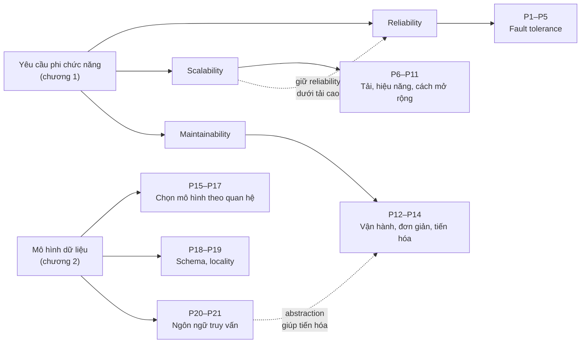

# Nguyên lý System Design trong DDIA

Tệp này gom các nguyên lý System Design rút ra từ từng chương và liên kết về phần giải thích chi tiết. Mỗi nguyên lý ghi rõ nguồn trong sách (trang in, ấn bản thứ nhất 2017). Cột "Sẽ gặp lại" chỉ dựa trên tham chiếu chéo và mục lục của sách. Nội dung các chương đó sẽ được kiểm chứng khi học tới.

Đã cập nhật đến: **Chương 2**.

## Bản đồ tổng quan

## Chương 1 — Reliable, Scalable, and Maintainable Applications

### Nền tảng

**P0. Ghép công cụ là thiết kế một data system mới.** Khi khâu database, cache, index, queue lại bằng application code, các đảm bảo của hệ thống ghép (ví dụ cache được invalidate đúng) là trách nhiệm của bạn. API che giấu sự phức tạp đó khỏi client.
- Nguồn: tr. 4–5 · [chapter-01 B2](chapter-01.md#b2)
- Sẽ gặp lại: Part III, các hệ thống nhiều thành phần như Hình 1-1 (tr. 23)

### Reliability — Chịu lỗi

**P1. Thiết kế để fault không thành failure, và chọn rõ loại fault cần chịu đựng.** Fault không thể bị loại bỏ. Fault-tolerance cho *mọi* loại fault là bất khả thi, nên cam kết reliability phải nêu rõ phạm vi.
- Nguồn: tr. 6–7 · [chapter-01 B3.1](chapter-01.md#fault-failure)
- Sẽ gặp lại: "System Model and Reality", Chương 8 (tr. 306), theo mục lục

**P2. Kiểm chứng cơ chế phục hồi bằng cách chủ động gây fault.** Bug nghiêm trọng thường nằm ở phần xử lý lỗi. Cơ chế phục hồi chưa từng chạy là cơ chế chưa được kiểm chứng (ví dụ Chaos Monkey).
- Nguồn: tr. 7 · [chapter-01 B3.1](chapter-01.md#fault-failure)

**P3. Ở quy mô lớn, hãy chịu được việc mất cả một máy.** Phần cứng hỏng liên tục khi có nhiều máy, và máy ảo cloud có thể biến mất không báo trước. Chịu lỗi bằng phần mềm còn cho phép rolling upgrade không downtime.
- Nguồn: tr. 7–8 · [chapter-01 B3.2](chapter-01.md#b3)
- Sẽ gặp lại: rolling upgrade ở Chương 4 (tr. 8); "Handling Node Outages", Chương 5 (tr. 156), theo mục lục

**P4. Cảnh giác với lỗi tương quan.** Lỗi phần mềm có tính hệ thống xảy ra trên mọi node cùng lúc. Thêm bản sao không bảo vệ được trước chúng. Cần test, cô lập, crash-restart, giám sát, và tự kiểm tra các đảm bảo trong lúc chạy.
- Nguồn: tr. 8–9 · [chapter-01 B3.3](chapter-01.md#b3)

**P5. Thiết kế cho con người sẽ mắc lỗi.** Giảm cơ hội mắc lỗi (giao diện tốt nhưng không quá gò bó), tách nơi thử nghiệm khỏi production, test mọi cấp, **phục hồi nhanh** (rollback, triển khai từ từ, tính lại dữ liệu), giám sát chi tiết.
- Nguồn: tr. 9–10 · [chapter-01 B3.4](chapter-01.md#b3)

**P5b. Giảm reliability phải là quyết định có ý thức.** Có thể đánh đổi reliability lấy chi phí (prototype, biên lợi nhuận mỏng), nhưng phải biết rõ mình đang đi tắt ở đâu.
- Nguồn: tr. 10 · [chapter-01 B3.5](chapter-01.md#b3)

### Scalability — Tải, hiệu năng và cách mở rộng

**P6. Scalability là câu hỏi có chiều, không phải nhãn.** Luôn hỏi: "Nếu hệ thống tăng trưởng *theo chiều này* thì ta có những lựa chọn nào?"
- Nguồn: tr. 10–11 · [chapter-01 B4.0](chapter-01.md#b4)

**P7. Mô tả tải bằng load parameters, và nhìn phân phối thay vì trung bình.** Tham số đúng phụ thuộc kiến trúc. Với Twitter, phân phối số follower (có trọng số theo tần suất đăng) quyết định tải fan-out.
- Nguồn: tr. 11–13 · [chapter-01 B4.1](chapter-01.md#load-parameters)
- Sẽ gặp lại: "Skewed Workloads and Relieving Hot Spots", Chương 6 (tr. 205), theo mục lục

**P8. Chọn nơi làm việc nặng (lúc ghi hay lúc đọc) theo tỷ lệ đọc/ghi và phân phối tải.** Twitter tính sẵn timeline khi ghi vì đọc nhiều hơn ghi gần hai bậc độ lớn. Họ dùng cách lai cho người nổi tiếng vì phân phối follower rất lệch.
- Nguồn: tr. 11–13 · [chapter-01 B4.1](chapter-01.md#load-parameters), [D3](chapter-01.md#d3)
- Sẽ gặp lại: Chương 12 quay lại ví dụ Twitter (theo tr. 13)

**P9. Đo hiệu năng bằng percentile, và đo phía client.** Response time là một phân phối. Mean che giấu trải nghiệm thật. Tail latency (p99, p999) ảnh hưởng trực tiếp tới người dùng và thường dùng trong SLO và SLA. Queueing delay và head-of-line blocking chỉ thấy được ở phía client. Load test phải gửi request độc lập với response time.
- Nguồn: tr. 13–16 · [chapter-01 B4.2](chapter-01.md#performance), [D4](chapter-01.md#d4)

**P10. Fan-out khuếch đại tail latency, và percentile phải gộp bằng histogram.** Request gọi nhiều backend thì percentile cao của backend quyết định trải nghiệm người dùng. Không lấy trung bình percentile: hãy cộng histogram.
- Nguồn: tr. 16–17 · [chapter-01 B4.2](chapter-01.md#tail-amplification)

**P11. Kiến trúc scale được xây trên giả định về tải, và không có magic scaling sauce.**
- Xem lại kiến trúc mỗi khi tải tăng một bậc độ lớn.
- Pha trộn scale up và scale out một cách thực dụng.
- Stateless dễ phân tán, stateful thêm nhiều độ phức tạp. Giữ database một node đến khi chi phí hoặc yêu cầu high availability buộc phải phân tán, nhưng kinh nghiệm này có thể đổi khi công cụ tốt lên.
- Elastic hợp với tải khó dự đoán. Scale thủ công đơn giản hơn.
- Với sản phẩm giai đoạn đầu, lặp nhanh quan trọng hơn scale cho tải giả định.
- Nguồn: tr. 17–18 · [chapter-01 B4.3](chapter-01.md#coping-with-load), [D5](chapter-01.md#d5), [D6](chapter-01.md#d6)
- Sẽ gặp lại: Part II (dữ liệu phân tán); "Rebalancing Partitions", Chương 6 (tr. 209)

### Maintainability — Vận hành, đơn giản, tiến hóa

**P12. Operability: làm việc thường ngày trở nên dễ.** Giám sát tốt, hỗ trợ tự động hóa, không phụ thuộc từng máy, mô hình vận hành dễ hiểu, mặc định tốt nhưng cho phép ghi đè, tự phục hồi nhưng vẫn cho kiểm soát thủ công, hành vi dự đoán được.
- Nguồn: tr. 19–20 · [chapter-01 B5.1](chapter-01.md#operability)

**P13. Simplicity: loại bỏ accidental complexity bằng abstraction tốt.** Độ phức tạp làm vượt ngân sách và tăng rủi ro bug. Abstraction tốt (ngôn ngữ bậc cao, SQL) che giấu chi tiết và tái sử dụng được. Tìm abstraction tốt cho hệ phân tán là việc khó.
- Nguồn: tr. 20–21 · [chapter-01 B5.2](chapter-01.md#simplicity)

**P14. Evolvability: thiết kế để thay đổi ở cấp data system.** Yêu cầu chắc chắn sẽ thay đổi. Sự linh hoạt cần đạt ở cấp nhiều dịch vụ, không chỉ trong vài file code, và nó gắn chặt với simplicity.
- Nguồn: tr. 21–22 · [chapter-01 B5.3](chapter-01.md#evolvability)
- Sẽ gặp lại: encoding và schema evolution, Chương 4 (theo Preface, tr. xvi)

## Chương 2 — Data Models and Query Languages

### Chọn mô hình dữ liệu

**P15. Chọn mô hình dữ liệu theo loại quan hệ giữa các mục dữ liệu.** Mỗi mô hình ngầm chứa giả định về cách dùng.
- Cây one-to-many tự chứa, thường tải cả cây: document.
- Có many-to-one hoặc many-to-many: relational.
- Kết nối dày đặc, truy vấn duyệt độ dài thay đổi: graph.
- Giả lập mô hình này bằng mô hình khác được, nhưng thường gượng.
- Nguồn: tr. 27–28, 38–39, 49, 63 · [chapter-02 B2.5](chapter-02.md#rel-vs-doc-today), [D1](chapter-02.md#d1), [C2](chapter-02.md#c-so-do)

**P16. Dự trù việc dữ liệu ngày càng kết nối hơn.** Phiên bản đầu khớp document không join, nhưng tính năng mới thường biến chuỗi chữ thành thực thể và đưa vào many-to-many. Khi đó document thuần buộc phải denormalize hoặc join trong ứng dụng, dẫn tới code phức tạp hơn và chậm hơn.
- Nguồn: tr. 34–35, 39 · [chapter-02 B2.3](chapter-02.md#relationships)

**P17. Normalize thông tin có nghĩa với con người; denormalize có ý thức để đọc nhanh.** ID không có nghĩa với người nên không bao giờ cần đổi. Bản sao thì tốn chi phí ghi và có nguy cơ không nhất quán. Denormalized giống một kết quả truy vấn tính sẵn (như cache timeline Twitter ở P8).
- Nguồn: tr. 33–34; Glossary tr. 554, 556 · [chapter-02 B2.3](chapter-02.md#normalization), [D4](chapter-02.md#d4)
- Sẽ gặp lại: caching, denormalization, derived data ở Part III (tr. 34)

### Schema và locality

**P18. Dữ liệu luôn có schema; chỉ cần quyết định kiểm tra nó ở đâu.** Schema-on-write (database áp đặt khi ghi) hợp khi mọi bản ghi cùng cấu trúc. Schema-on-read (code xử lý khi đọc) hợp với dữ liệu không đồng nhất hoặc do hệ thống ngoài quyết định, nhưng mọi code đọc phải xử lý mọi phiên bản định dạng. Với bảng lớn, điền giá trị mới lúc đọc thay vì `UPDATE` cả bảng.
- Nguồn: tr. 39–41 · [chapter-02 B2.5](chapter-02.md#schema-flexibility), [D3](chapter-02.md#d3)
- Sẽ gặp lại: schema và schema evolution, Chương 4 (tr. 41)

**P19. Locality chỉ có lợi khi thường cần phần lớn dữ liệu cùng lúc.** Gom dữ liệu hay dùng cùng nhau vào một chỗ giảm số lần tra index và seek đĩa. Nhưng document lớn phải tải và ghi lại cả khối, nên hãy giữ document nhỏ và tránh ghi làm nó to ra. Locality cũng đạt được trong relational (Spanner interleaved tables, Oracle cluster tables, column-family của Bigtable).
- Nguồn: tr. 41 · [chapter-02 B2.5](chapter-02.md#locality)
- Sẽ gặp lại: locality ở Chương 3 (tr. 41)

### Ngôn ngữ truy vấn

**P20. Ưu tiên giao diện declarative để hệ thống được tự do tối ưu và tiến hóa.** Declarative chỉ mô tả kết quả, nên database có thể đổi index, layout, thứ tự lưu trữ, chạy song song mà không phá vỡ truy vấn. Query optimizer xây một lần, mọi ứng dụng hưởng lợi. Bài học đúng cả với SQL so với CODASYL, lẫn CSS so với DOM API.
- Nguồn: tr. 37–38, 42–46 · [chapter-02 B3.0](chapter-02.md#declarative), [B2.4](chapter-02.md#relational-model), [D6](chapter-02.md#d6)

**P21. Code chạy trong framework phân tán nên là hàm thuần.** Không side effect và không truy vấn thêm, để framework chạy ở bất kỳ đâu, theo thứ tự bất kỳ, và chạy lại khi lỗi. Nhưng API cấp thấp kiểu MapReduce khó dùng và ít cơ hội tối ưu, nên hệ thống thường tiến hóa về một ngôn ngữ declarative (aggregation pipeline).
- Nguồn: tr. 46–48 · [chapter-02 B3.2](chapter-02.md#mapreduce)
- Sẽ gặp lại: MapReduce, Chương 10 (tr. 46)
