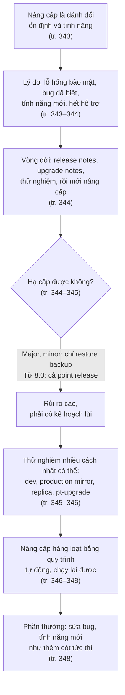
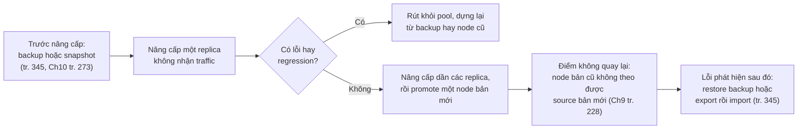
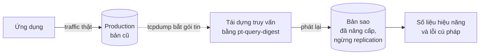
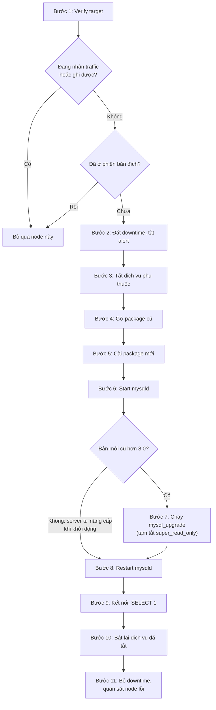
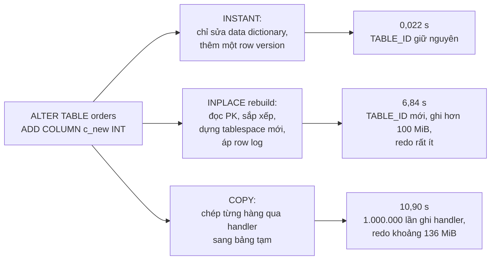
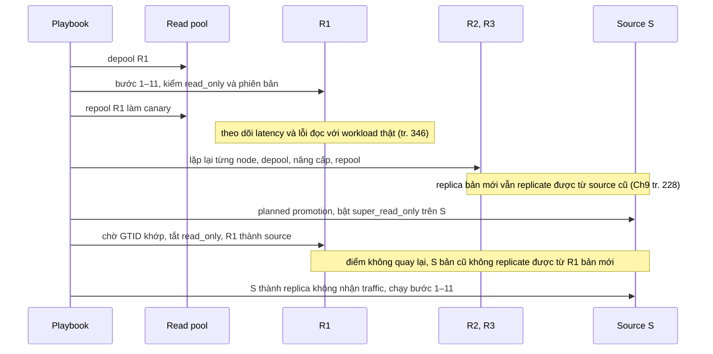
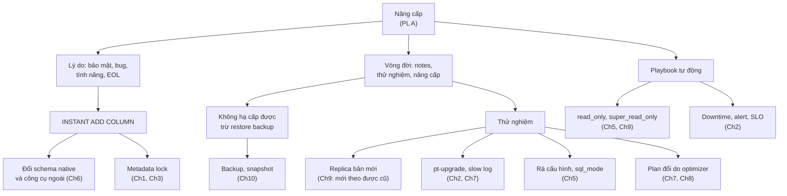

# Phụ lục A — Nâng cấp MySQL

*Upgrading MySQL*

> **Nguồn:** *High Performance MySQL: Proven Strategies for Operating at Scale*, Silvia Botros và Jeremy Tinley, O'Reilly, **Fourth Edition (11/2021)**, Phụ lục A, **tr. 343–348 (trang PDF 365–370)**. "tr. N" là số trang in, trang PDF = N + 22 (xem [README](README.md#page-convention)).
>
> **Quy ước nhãn:** nội dung không nhãn là diễn giải từ sách, luôn kèm trang. **Bổ sung ngoài sách** là kiến thức thêm hoặc suy luận của người viết ghi chú. **Ví dụ minh họa do AI xây dựng** là ví dụ, SQL hay tình huống giả định. **Dự đoán** là điều kỳ vọng chưa đo. **Kết quả đã đo** chỉ dùng cho số liệu lấy từ [bài thực hành](experiments/appendix-a.md) đã chạy thật.
>
> **Phiên bản:** sách viết ở giai đoạn MySQL 8.0; phụ lục nhắc 5.6, 5.7 và các bản 8.0.21–8.0.25. Nhiều chi tiết ở đây phụ thuộc phiên bản: `mysql_upgrade` chỉ còn cần cho bản cũ (tr. 347), thêm cột tức thì là tính năng của 8.0 (tr. 348) và có điều kiện riêng ở từng bản con. Bài thực hành chạy trên **MySQL Community 8.0.42**. Mô hình phát hành của Oracle đã đổi sau khi sách in, xem [mục 2.1](#release-model).
>
> **Liên kết:** [lộ trình học](learning-roadmap.md#app-a) · [bài thực hành](experiments/appendix-a.md) · [đáp án tự kiểm tra](answers/appendix-a.md) · [Phụ lục B](appendix-b.md)

## Mục lục ghi chú

- [1. Bức tranh lớn](#big-picture)
- [2. Giải thích sâu](#deep)
  - [2.1 Why Upgrade? (tr. 343–344)](#s2-1)
  - [2.2 Upgrade Life Cycle (tr. 344–345)](#s2-2)
  - [2.3 Testing Upgrades (tr. 345–346)](#s2-3)
  - [2.4 Upgrading at Scale (tr. 346–348)](#s2-4)
  - [2.5 Summary (tr. 348)](#s2-5)
- [3. Phân tích tình huống](#situations)
- [4. Đo lường và thực hành](#measure)
- [5. Liên kết kiến thức và điều cần nhớ](#takeaways)
- [Ghi chú kiểm tra nguồn](#kiem-tra)

---

<a id="big-picture"></a>

## 1. Bức tranh lớn

### Câu hỏi của phụ lục

Một cụm MySQL sống nhiều năm và đi qua nhiều phiên bản. Phụ lục A trả lời ba câu hỏi nối tiếp nhau:

1. **Có nên nâng cấp không, và vì lý do gì?** Tác giả đặt khung ngay câu đầu: nâng cấp là **đánh đổi giữa ổn định và tính năng** (tr. 343).
2. **Nếu nâng cấp thì làm sao để không biến nó thành sự cố?** Đọc tài liệu, thử nghiệm bằng nhiều cách, và luôn có đường lui, vì việc hạ cấp gần như chỉ làm được bằng cách khôi phục backup (tr. 344–345).
3. **Làm sao lặp lại việc đó an toàn trên hàng trăm server?** Tự động hóa bằng một quy trình có kiểm tra đầu vào, chạy lại được nhiều lần (tr. 346–348).

### Vị trí trong mục tiêu chung của sách

Preface nói các đội hiện nay phải lo thay đổi schema, compliance và sharding, và kỹ sư database được kỳ vọng tạo điều kiện cho tăng trưởng thay vì làm "gờ giảm tốc" (tr. xvi). Nâng cấp phiên bản là một phần của vòng đời vận hành đó. Sách dành cho nó một phụ lục ngắn, phần lớn là quy trình. Phần Summary nối nâng cấp với hiệu năng của cả đội: một tính năng mới như thêm cột tức thì tiết kiệm nhiều giờ chạy `ALTER TABLE` (tr. 348).

Roadmap xếp phụ lục này vào nhóm "Quản trị và vòng đời" cùng chương 13 (đây là cách nhóm của người viết ghi chú, xem [roadmap](learning-roadmap.md#app-a)).

### Kiến thức cần biết

- **Replication, replica, depool:** [Chương 9](chapter-09.md). Phụ lục dùng replica để thử nghiệm và giả định bạn rút được một replica khỏi read pool.
- **`read_only` và `super_read_only`:** [Chương 5](chapter-05.md#s2-7), mục *Safety Settings* (tr. 122). Phụ lục dùng chúng để nhận ra server không nên nâng cấp (tr. 346–347).
- **Backup và khôi phục:** [Chương 10](chapter-10.md). Đây là cách hạ cấp duy nhất mà sách thừa nhận (tr. 345).
- **Slow query log, Percona Toolkit:** pt-query-digest được nhắc ở [Chương 2](chapter-02.md#monitoring-solutions) (tr. 24); phụ lục dùng thêm pt-upgrade.
- **Thay đổi schema native (INPLACE, INSTANT):** [Chương 6](chapter-06.md#native-ddl) (tr. 149–150), để hiểu ví dụ thêm cột tức thì ở tr. 348.
- **Data dictionary của 8.0:** [Chương 1](chapter-01.md#data-dictionary-changes) (tr. 17–18). Phụ lục không nhắc, nhưng nó giúp hiểu vì sao từ 8.0 khó hạ cấp (suy luận ở [mục 2.2](#downgrade)).

### Liên hệ với chương khác

| Ý | Chương | Căn cứ |
| --- | --- | --- |
| Giá trị mặc định của `sql_mode` có thể đổi khi nâng cấp; sách hẹn bàn thêm ở phụ lục A | [Chương 5](chapter-05.md#safety-table) | tr. 122 |
| `read_only` ngăn ứng dụng ghi lên replica; dùng nó ở bước "Verify target" | [Chương 5](chapter-05.md#safety-table) | tr. 122, tr. 346 |
| Server mới làm replica của server cũ thường được, chiều ngược lại thì không; thử nâng cấp bằng replica là một công dụng của replication | [Chương 9](chapter-09.md#s2-1) | tr. 228, 229 |
| Planned promotion: dừng ghi bằng `super_read_only`; bật nó thì `read_only` cũng bật | [Chương 9](chapter-09.md#planned-promotion) | tr. 239–240 |
| Read pool lớn cần tự động hóa depool, vá, reboot, repool | [Chương 9](chapter-09.md#read-pool) | tr. 243–244 |
| Snapshot hệ thống tệp làm đường lui khi nâng cấp | [Chương 10](chapter-10.md#myth-snapshot) | tr. 273 |
| INPLACE và INSTANT là cách đổi schema native ưu tiên; dùng công cụ ngoài khi chưa chạy được bản mới | [Chương 6](chapter-06.md#running-changes) | tr. 149–150 |
| Cẩn thận khi nâng cấp: cú pháp join, độ ưu tiên toán tử từng thay đổi | [Chương 8](chapter-08.md#join-queries) | tr. 223 |
| pt-upgrade còn dùng để kiểm tra thay đổi index | [Chương 7](chapter-07.md#redundant-index) | tr. 185 |
| Metadata lock giữ tới hết transaction, DDL phải chờ; tra bằng `metadata_locks` (giải thích vì sao ALTER tức thì vẫn có thể bị chặn) | [Chương 3](chapter-03.md#metadata-locks) | tr. 63–64 |
| Muốn lên bản mới để hết nút thắt concurrency của bản trước 5.7 | [Chương 5](chapter-05.md#s2-6) | tr. 119 |
| Managed MySQL: phải xác nhận major version tương thích; nâng cấp qua maintenance window có downtime | [Chương 12](chapter-12.md#s2-1) | tr. 314, 318 |
| Chạy MySQL trên Kubernetes thì phải trả lời trước câu hỏi nâng cấp MySQL thế nào | [Phụ lục B](appendix-b.md#tam-cau-hoi) | tr. 350 |

### Mạch lập luận



---

<a id="deep"></a>

## 2. Giải thích sâu

<a id="s2-1"></a>

### 2.1 Why Upgrade? (tr. 343–344)

<a id="on-dinh-va-tinh-nang"></a>

**Mở đầu phụ lục: ổn định đối lại tính năng (tr. 343).**

- **What.** Mỗi lần nâng cấp, bạn đổi một phiên bản đã quen hành vi lấy một phiên bản có thêm tính năng và bản sửa lỗi, nhưng cũng có thể có lỗi mới. Tác giả muốn bạn cân nhắc điều này khi chọn nâng cấp (tr. 343).
- **Why có đánh đổi.** MySQL có **cơ sở cài đặt rất rộng**, nên bạn hưởng lợi từ việc rất nhiều người khác cũng đang thử và dùng nó (tr. 343). Hai rủi ro đi ngược chiều nhau (tr. 343):
  - lên bản **quá mới**: có thể vô tình đưa một bug hay một ***regression*** vào môi trường của mình. Regression là thứ từng đúng hay từng nhanh ở bản cũ nay sai hay chậm ở bản mới;
  - **tụt quá xa**: có thể đang gặp những bug không lộ rõ, hoặc không dùng được một tính năng đã được tối ưu cho hiệu năng.

<a id="dot-20-rule"></a>

> Chú thích 1 (tr. 343). Stewart Smith, thành viên lâu năm của cộng đồng MySQL, đặt ra ***dot-20 rule***: phần mềm chỉ thật sự trưởng thành từ bản "chấm 20" (ví dụ 8.0.20). Tác giả nói đây không phải quy tắc cứng, nhưng nó nêu bật đánh đổi giữa bản mới và sự ổn định.

> **Bổ sung ngoài sách — cách hiểu dot-20 rule.** Ý của quy tắc là thời gian và số người dùng giúp lộ bug. Bản càng nhiều người chạy lâu thì càng ít bất ngờ. Đây là heuristic về **tuổi của một dòng phiên bản**, không phải lời bảo đảm cho một con số cụ thể. Mục tiếp theo cho thấy vì sao: ở 8.0, point release còn mang cả tính năng mới, nên một bản ".20" vẫn có thể có mã mới chưa ai thử nhiều.

<a id="ly-do-nang-cap"></a>

**Bốn lý do nâng cấp (tr. 343–344).** Trước khi bàn chi tiết, tác giả nhắc rằng quyết định nâng cấp có rủi ro: thường phải backup toàn bộ dữ liệu, thử nghiệm thay đổi, rồi mới chạy quá trình nâng cấp (tr. 343).

| Lý do | Sách nói | Ý nghĩa khi ra quyết định |
| --- | --- | --- |
| **Security vulnerabilities** (lỗ hổng bảo mật) | Ngày càng hiếm nhưng vẫn có thể xuất hiện. Bạn hoặc đội bảo mật đánh giá và có thể quyết định phải nâng cấp (tr. 343) | Lý do thường gấp nhất về thời gian. Mức độ gấp tùy lỗ hổng có ảnh hưởng tới cách bạn triển khai hay không (**Bổ sung ngoài sách**) |
| **Known bugs** (bug đã biết) | Khi production có hành vi lạ không giải thích được, hãy xác định phiên bản đang chạy rồi đọc release notes của **các bản sau nó tới bản mới nhất**. Rất có thể hiện tượng là bug của MySQL; nếu bản sau đã sửa, bạn có lý do nâng cấp (tr. 344) | Đây là một **kỹ thuật chẩn đoán**, không chỉ là lý do nâng cấp |
| **Newer features** (tính năng mới) | MySQL không luôn theo quy ước major/minor/point. Nhiều người nghĩ point release (8.0.21 → 8.0.22) chỉ sửa lỗi và minor (8.0 → 8.1) mới có tính năng nhỏ, nhưng Oracle thường đưa tính năng mới vào point release, có thể ảnh hưởng workload. Đó là "con dao hai lưỡi", nên phải đọc **mọi** release notes trước khi nâng cấp (tr. 344) | Tính năng mới là phần thưởng, nhưng cũng là mã mới, tức rủi ro mới |
| **MySQL end-of-life support** (hết hỗ trợ) | Oracle đặt mốc ***end-of-life (EOL)***. Nên ở trong một phiên bản còn được hỗ trợ để ít nhất còn nhận bản vá bảo mật (tr. 344) | Lý do có thể lập kế hoạch trước nhiều tháng |

<a id="release-notes"></a>

**How: đọc release notes để chẩn đoán (tr. 344).** Lời khuyên ở mục "Known bugs" có một điểm tinh tế: đi **từ phiên bản đang chạy**, đọc lần lượt các bản sau. Lý do (**Bổ sung ngoài sách**): bug bạn gặp có thể đã được sửa ở bất kỳ bản trung gian nào. Đọc theo thứ tự cũng cho bạn danh sách mọi thay đổi khác mà một lần nâng cấp sẽ kéo theo, tức danh sách việc cần thử nghiệm ở [mục 2.3](#s2-3).

> **Ví dụ minh họa do AI xây dựng.** Một replica 8.0.2x thỉnh thoảng dừng replication với cùng một mã lỗi. Bạn ghi lại phiên bản (`SELECT VERSION()`), mã lỗi và loại câu lệnh liên quan, rồi tìm các từ khóa đó trong release notes của từng bản sau. Nếu một bản ghi "đã sửa" khớp với triệu chứng, bạn có ứng viên phiên bản đích và có luôn lý do để thuyết phục cả đội nâng cấp.

<a id="release-model"></a>

> **Bổ sung ngoài sách — mô hình phát hành đã đổi sau khi sách in.** Sách viết năm 2021, khi 8.0 nhận tính năng mới ở nhiều point release. Từ giữa năm 2023, Oracle tách hai nhánh: bản **Innovation** (8.1, 8.2, 8.3, rồi 9.x) có tính năng mới và vòng đời ngắn; bản **LTS** (8.4 là LTS đầu tiên, phát hành năm 2024) chủ yếu chỉ nhận sửa lỗi trong suốt vòng đời. Dòng 8.0 từ 8.0.34 trở đi được thông báo là chỉ còn sửa lỗi, và Oracle công bố 8.0 hết hỗ trợ vào khoảng tháng 4/2026. Như vậy nhận xét "point release mang tính năng mới" (tr. 344) mô tả đúng 8.0 tới khoảng 8.0.33. Với mô hình mới, đánh đổi "ổn định hay tính năng" phần nào trở thành việc **chọn nhánh**: LTS cho ổn định, Innovation cho tính năng. Người viết ghi chú tổng hợp từ thông báo của Oracle; hãy kiểm lại trang vòng đời sản phẩm trước khi lập kế hoạch thật. Lưu ý thêm: "8.1" trong ví dụ của sách (tr. 344) khi đó chưa tồn tại; về sau nó ra đời dưới dạng bản Innovation.

<a id="eol"></a>

**Trade-offs và Decision.** Bốn lý do khác nhau ở **mức gấp** và **mức rủi ro chấp nhận được**:

| Tình huống (Ví dụ minh họa do AI xây dựng) | Gấp? | Cách làm hợp lý |
| --- | --- | --- |
| Lỗ hổng có thể bị khai thác qua cách bạn triển khai | Rất gấp | Chọn bản vá gần nhất trong cùng dòng, thử nghiệm tối thiểu nhưng có, có sẵn đường lui |
| Bug đang gây sự cố production và đã được sửa ở bản sau | Gấp | Thử kỹ đúng vùng bị ảnh hưởng, nâng cấp từng phần (replica trước) |
| Muốn dùng tính năng mới | Không gấp | Đủ thời gian cho mọi phương pháp thử ở [mục 2.3](#s2-3) |
| Dòng phiên bản sắp hết hỗ trợ | Biết trước nhiều tháng | Lập dự án nâng cấp có lịch, thường là major upgrade |

**Hiểu lầm phổ biến.**

- *"Đứng yên là an toàn."* Sách chỉ ra ít nhất ba cái giá của việc đứng yên: bug không lộ rõ, mất tính năng tối ưu hiệu năng (tr. 343), và hết bản vá bảo mật khi qua EOL (tr. 344).
- *"Point release chỉ sửa lỗi, cứ nâng là xong."* Không đúng với 8.0 ở thời điểm sách viết (tr. 344), và [mục 2.2](#khong-ha-cap-point-release) cho thấy từ 8.0 còn không hạ cấp được giữa các point release.

#### Tự kiểm tra 2.1

**Câu 2.1.1.** Vì sao chính việc MySQL có cơ sở cài đặt rộng lại là lý do để **không** lên ngay bản mới nhất? Liên hệ với dot-20 rule. [đáp án](answers/appendix-a.md#q2-1-1)

**Câu 2.1.2.** Production có hành vi lạ không giải thích được. Sách gợi ý quy trình nào? Vì sao bắt đầu từ phiên bản đang chạy chứ không chỉ đọc release notes của bản mới nhất? [đáp án](answers/appendix-a.md#q2-1-2)

**Câu 2.1.3.** Vì sao việc đưa tính năng mới vào point release là "con dao hai lưỡi"? Nó buộc bạn đọc release notes theo cách nào? [đáp án](answers/appendix-a.md#q2-1-3)

---

<a id="s2-2"></a>

### 2.2 Upgrade Life Cycle (tr. 344–345)

<a id="vong-doi-nang-cap"></a>

**What: bốn bước (tr. 344).** Khi đã quyết định nâng cấp, thường làm theo thứ tự:

1. Đọc **release notes** của phiên bản đích, kể cả các thay đổi nhỏ.
2. Đọc **upgrade notes** trong tài liệu chính thức.
3. Thử nghiệm phiên bản mới.
4. Cuối cùng mới nâng cấp server.

| Tài liệu | Chứa gì (tr. 344) | Trả lời câu hỏi |
| --- | --- | --- |
| ***Release notes*** | Tính năng mới, thay đổi, tính năng bị ***deprecated*** (đánh dấu sẽ bỏ), thường kèm danh sách bug đã sửa | **Cái gì** sẽ khác sau khi nâng cấp? |
| ***Upgrade notes*** | Tổng quan chi tiết cách thực hiện nâng cấp, và những điều quan trọng cần biết trước khi tiếp tục | **Làm thế nào** để nâng cấp, và có điều kiện tiên quyết nào? |

**Why phải có kế hoạch cho sự cố (tr. 344).** Ngoài bốn bước, bạn cần biết sẽ làm gì nếu nâng cấp gây vấn đề, ví dụ một truy vấn bắt đầu chạy kém, hoặc tệ hơn là gặp **bug làm server crash** (tr. 344).

<a id="downgrade"></a>

**Hạ cấp: đường lui gần như một chiều (tr. 344–345).** Với mọi lần đổi major hay minor version (ví dụ từ 8.0 về 5.7, hay 5.7 về 5.6), **cách duy nhất để hạ cấp là khôi phục backup chụp trước khi nâng cấp**. Điều này làm nâng cấp đặc biệt rủi ro, nên phải có kế hoạch (tr. 344–345).

<a id="khong-ha-cap-point-release"></a>

> **Cảnh báo của sách** (tr. 345). Từ MySQL 8.0, cũng **không hạ cấp được giữa các point release**. Ví dụ đã chạy 8.0.25 thì không thể về 8.0.24 nếu không export toàn bộ dữ liệu rồi import lại.

**How: vì sao hạ cấp khó (Bổ sung ngoài sách, suy luận cơ chế).** Sách không giải thích nguyên nhân. Có thể hiểu như sau:

- Từ 8.0, metadata của bảng nằm trong một **data dictionary** lưu bằng bảng InnoDB, không còn ở các tệp riêng ([Chương 1](chapter-01.md#data-dictionary-changes), tr. 17–18).
- Khi binary mới khởi động trên datadir cũ, server **tự nâng cấp** data dictionary và các bảng hệ thống. Bài thực hành đã quan sát thao tác này trong error log ở dạng "Server upgrade from '80042' to '80042' started ... completed" khi ép chạy lại bằng `--upgrade=FORCE` (**Kết quả đã đo**, [TN4](experiments/appendix-a.md#tn4)).
- Các định dạng trên đĩa có thể đổi ngay trong một point release. Ví dụ từ 8.0.30, redo log chuyển sang thư mục `#innodb_redo` và tham số `innodb_redo_log_capacity` (datadir 8.0.42 trong bài thực hành có thư mục này).
- Binary cũ không biết các định dạng mới hơn nó, nên không thể đọc lại datadir đã được nâng cấp. Cách còn lại là đưa dữ liệu ra dạng logic (export) rồi nạp vào server cũ, đúng như sách nói.

<a id="rollback-plan"></a>

**Trade-offs: các phương án lùi.** Ghép ý của phụ lục với chương 9 và 10:

| Phương án | Căn cứ | Ưu | Nhược |
| --- | --- | --- | --- |
| Khôi phục backup chụp trước khi nâng cấp | tr. 345; [Chương 10](chapter-10.md) | Cách sách thừa nhận cho major/minor | Mất các thay đổi ghi sau thời điểm backup, trừ khi có cách áp lại; thời gian khôi phục tỉ lệ với kích thước dữ liệu (**Bổ sung ngoài sách**, liên hệ RPO và RTO ở chương 10) |
| Snapshot hệ thống tệp (ví dụ LVM) trước khi nâng cấp | Chương 10, tr. 273 | Lùi nhanh: quay về snapshot | Cũng mất thay đổi sau snapshot; chỉ có khi hạ tầng hỗ trợ |
| Export rồi import lại | tr. 345 | Áp dụng được cả với point release từ 8.0 | Rất chậm với dữ liệu lớn |
| Giữ lại server chạy bản cũ (replica chưa nâng cấp) | Chương 9, tr. 228 (suy luận) | Còn chỗ để quay lại khi node nâng cấp mới chỉ là replica | Server cũ **không làm replica được** cho source mới hơn (tr. 228). Khi đã đưa ghi vào node bản mới, các node bản cũ không theo kịp nữa |

<a id="point-of-no-return"></a>

**Decision: xác định "điểm không quay lại" (Bổ sung ngoài sách, suy luận từ tr. 228 và tr. 345).** Trong topology có replica, nâng cấp một replica vẫn còn đường lui rẻ: rút nó khỏi pool, dựng lại từ backup hoặc từ node cũ. Đường lui đóng lại khi **node đã nâng cấp nhận ghi**, vì từ đó dữ liệu mới chỉ còn trên phiên bản mới và các node cũ không replicate được từ nó. Do đó nên dồn thử nghiệm vào **trước** thời điểm promote.



*(Sơ đồ do người viết ghi chú tổng hợp từ tr. 345–346 của phụ lục, tr. 228 của chương 9 và tr. 273 của chương 10.)*

**Hiểu lầm phổ biến.**

- *"Có backup là lùi được, không mất gì."* Restore đưa dữ liệu về thời điểm backup. Mọi ghi sau đó phải được áp lại bằng cách khác, nếu không sẽ mất (**Bổ sung ngoài sách**).
- *"Point release thì thử rồi lùi cũng được."* Không còn đúng từ 8.0 (tr. 345).

#### Tự kiểm tra 2.2

**Câu 2.2.1.** Release notes và upgrade notes khác nhau thế nào? Tài liệu nào cho bạn danh sách "vùng cần thử nghiệm"? [đáp án](answers/appendix-a.md#q2-2-1)

**Câu 2.2.2.** Bạn nâng source từ 8.0.25 lên 8.0.26. Hai giờ sau phát hiện một truy vấn quan trọng chậm hẳn. Có những cách lùi nào, mỗi cách mất gì? [đáp án](answers/appendix-a.md#q2-2-2)

**Câu 2.2.3.** Vì sao "điểm không quay lại" thường là lúc promote node đã nâng cấp làm source, chứ không phải lúc cài binary mới lên một replica? [đáp án](answers/appendix-a.md#q2-2-3)

---

<a id="s2-3"></a>

### 2.3 Testing Upgrades (tr. 345–346)

**Mở đầu mục (tr. 345).** Sau khi đọc release notes và upgrade notes, bạn đã biết cần lo gì và cần thử nghiệm vùng nào. Bước tiếp theo là thử xem phiên bản mới cư xử thế nào với **workload của bạn**. Sách nhắc thêm: **rà lại tệp cấu hình**, vì phiên bản mới hay đổi tên hoặc bỏ hẳn một số biến (tr. 345).

Thử nghiệm khó, và mỗi phương pháp đều có hạn chế. Vì rủi ro hạ cấp đã nói ở trên, nên **dùng càng nhiều phương pháp càng tốt** trước khi nâng cấp (tr. 345).

<a id="config-review"></a>

**Rà tệp cấu hình: kiểm chứng trên 8.0.42 (Kết quả đã đo, [TN4](experiments/appendix-a.md#tn4)).**

- `mysqld --no-defaults --validate-config` (có từ 8.0.16, **Bổ sung ngoài sách**) dừng với lỗi `unknown variable 'query_cache_size=0'` và `unknown variable 'query_cache_type=0'`. Query cache đã bị bỏ trong 8.0, nên một tệp cấu hình 5.7 còn các dòng này sẽ làm 8.0 **không khởi động được**.
- Cũng lệnh đó **không báo gì** với các tùy chọn chỉ bị deprecated (`innodb_log_file_size`, `expire_logs_days`, `default-authentication-plugin`). Cảnh báo deprecated chỉ hiện trong error log lúc server khởi động thật, ví dụ dòng `'default_authentication_plugin' is deprecated and will be removed in a future release`.
- Server còn đếm việc dùng một số tính năng sắp bỏ: truy vấn `INFORMATION_SCHEMA.PROCESSLIST` sinh cảnh báo 1287 và tăng biến trạng thái `Deprecated_use_i_s_processlist_count`.

Hệ quả: rà cấu hình cần cả hai lớp. Kiểm tra tĩnh bắt được tùy chọn **đã bị bỏ**; đọc error log và cảnh báo lúc chạy bắt được tùy chọn **sắp bị bỏ**, tức thứ sẽ hỏng ở lần nâng cấp sau.

<a id="logical-vs-physical"></a>

**Khung phân tích: thử nghiệm để bắt loại thay đổi nào? (Bổ sung ngoài sách).** Một phiên bản mới có thể đổi hành vi ở ba tầng. Mỗi phương pháp của sách bắt tốt một số tầng:

| Tầng thay đổi | Ví dụ | Cần gì để phát hiện |
| --- | --- | --- |
| **Logical query processing** (parser, ngữ nghĩa) | Từ khóa mới thành reserved word; `sql_mode` mặc định chặt hơn ([Chương 5](chapter-05.md#safety-table), tr. 122); cú pháp join, độ ưu tiên toán tử đổi ([Chương 8](chapter-08.md#join-queries), tr. 223) | Chạy đúng các câu lệnh của ứng dụng; dữ liệu nhỏ là đủ |
| **Physical execution** (optimizer, access path, join order, cost) | Optimizer chọn index khác, đổi thứ tự join, dùng thuật toán join mới | Dữ liệu có kích thước, phân bố và statistics giống production, vì lựa chọn plan phụ thuộc cardinality |
| **Vận hành** (cấu hình, tài nguyên, replication) | Biến bị đổi tên, mặc định mới, định dạng log khác | Rà cấu hình, chạy trong topology thật |

<a id="dev-env-testing"></a>

#### 2.3.1 Development Environment Testing (tr. 345)

- **What.** Môi trường phát triển là nơi tốt để bắt đầu, trên database dev dùng chung hoặc một bản riêng cho bạn. Mục tiêu chính là **lộ các lỗi cú pháp hiển nhiên** (tr. 345).
- **Giới hạn.** Phần lớn môi trường dev không có dữ liệu cỡ production, nên khó thử chính xác. Ví dụ các truy vấn thường dùng có vẻ ổn vì chỉ chạm **10 hàng**; lên production với **10 triệu hàng** trong cùng bảng thì có thể lộ regression (tr. 345).
- **Why 10 hàng che regression (Bổ sung ngoài sách).** Với 10 hàng, mọi access path đều rẻ, kể cả full table scan, và mọi trang dữ liệu nằm sẵn trong buffer pool. Optimizer quyết định dựa trên statistics và ước lượng cardinality. Bảng nhỏ cho statistics khác, nên plan trên dev có thể khác plan trên production. Một thay đổi trong cost model hay heuristic của bản mới chỉ lộ khi chi phí giữa các plan chênh nhau đủ lớn, tức khi dữ liệu đủ lớn.
- **Trade-offs.** Rẻ, nhanh, an toàn, bắt tốt tầng logical. Gần như không nói gì về tầng physical.
- **Hiểu lầm.** *"Test suite trên dev qua hết là nâng cấp an toàn."* Nó chỉ chứng minh cú pháp và ngữ nghĩa, chưa chứng minh hiệu năng.

<a id="production-mirror"></a>

#### 2.3.2 Production Mirror (tr. 345)

- **What.** Tạo một bản sao dữ liệu production và gửi bản sao **traffic SQL** sang nó. Sách dẫn một bài trên blog *Code As Craft* của Etsy (tr. 345).
- **How (tr. 345).**
  1. Có một bản sao thứ hai của database production.
  2. Ngừng replication tới bản sao đó, rồi nâng cấp MySQL trên nó.
  3. Gửi traffic tới **cả** production thật **và** bản sao, bằng cách kết hợp `tcpdump` và `pt-query-digest`.
  4. Ứng dụng vẫn chỉ dùng production cho traffic thật. Bản sao chạy phiên bản mới cho bạn số liệu hiệu năng và làm lộ lỗi cú pháp.



*(Sơ đồ do người viết ghi chú dựng theo mô tả ở tr. 345.)*

- **Trade-offs (Bổ sung ngoài sách).** Đây là phương pháp gần workload thật nhất cho cả đọc lẫn ghi, nhưng có các điểm cần biết:
  - **Dữ liệu tách nhánh.** Bản sao đã ngừng replication, nên trạng thái của nó lệch dần khỏi production. Một lỗi trên bản sao (ví dụ trùng khóa khi phát lại một lệnh ghi) chưa chắc là lỗi của phiên bản mới. Cách đọc kết quả chắc hơn là so với một bản sao thứ hai **chưa nâng cấp**, chịu đúng traffic đó, giống ý tưởng hai hệ của pt-upgrade ở [mục 2.3.4](#pt-upgrade).
  - **Mã hóa.** `tcpdump` chỉ đọc được truy vấn nếu kết nối không mã hóa. MySQL 8.0 tự sinh chứng chỉ TLS khi khởi tạo (datadir của bài thực hành có `ca.pem`, `server-cert.pem` ngay sau `--initialize-insecure`), và client mặc định ưu tiên TLS. Khi đó cần nguồn truy vấn khác, ví dụ slow query log.
  - **Độ trung thực khi phát lại.** Thứ tự, độ đồng thời và nhịp thời gian của traffic phát lại có thể khác thật, ảnh hưởng tới lock và latency.
  - **Dữ liệu nhạy cảm.** Gói tin bắt được chứa dữ liệu khách hàng; lưu và xử lý chúng là vấn đề compliance ([Chương 13](chapter-13.md)).
  - **Chi phí.** Cần thêm một bản sao đầy đủ của production.

<a id="replica-testing"></a>

#### 2.3.3 Replica (tr. 346)

- **What.** Nếu topology có read replica và bạn **depool** được replica (rút nó khỏi nhóm nhận traffic), hãy nâng cấp **một replica trước**. Bạn thấy được read traffic chạy thế nào với workload production thật. Gặp lỗi hay regression thì depool replica đó và điều chỉnh (tr. 346).
- **Nhược điểm.** Không thử được hiệu năng hay traffic **ghi** (tr. 346).
- **Why làm được (liên hệ chương 9).** Server mới hơn thường làm replica của server cũ hơn được, còn chiều ngược lại thì không (tr. 228). Chương 9 cũng liệt kê "thử nâng cấp MySQL" là một công dụng phổ biến của replication: dựng một replica bản mới để chắc truy vấn chạy đúng trước khi nâng mọi instance (tr. 229).
- **Why không thử được ghi, dù replica vẫn nhận mọi thay đổi (Bổ sung ngoài sách).** Replica không chạy các câu ghi của ứng dụng. Nó nhận **sự kiện** từ binary log của source rồi áp lại bằng luồng replication. Với row-based replication, đó là ảnh của hàng, không phải câu SQL gốc. Vì vậy cách bản mới xử lý câu `UPDATE`, `INSERT ... SELECT` của ứng dụng, cùng lock và concurrency khi nhiều client cùng ghi, đều chưa được thử. Bù lại, cách này kiểm tra được **luồng replication từ source cũ sang replica mới**, điều bạn sẽ cần trong lúc nâng cấp dần.
- **Rủi ro.** Replica đã nâng cấp phục vụ người dùng thật. Nếu nó trả kết quả sai, người dùng thấy ngay. Cần theo dõi tỉ lệ lỗi và latency của riêng node này ([Chương 2](chapter-02.md)) và có cách depool nhanh ([Chương 9](chapter-09.md#read-pool), tr. 243–244). Cách làm này giống **canary release**: thả bản mới cho một phần nhỏ traffic trước (**Bổ sung ngoài sách**).

<a id="pt-upgrade"></a>

#### 2.3.4 Tooling (tr. 346)

- **What.** Percona Toolkit có ***pt-upgrade***. Công cụ nhận một tập truy vấn, chạy chúng trên **hai đích khác nhau**, rồi báo khác biệt về **số hàng**, **dữ liệu hàng** và **lỗi**. Nó nhận nhiều loại đầu vào: slow query log, general query log, binary log. Vì vậy nó tăng độ phủ thử nghiệm (tr. 346).
- **How: cách dùng tốt nhất (tr. 346).**
  1. Thu các truy vấn bạn quan tâm nhất bằng slow query log hoặc binary log.
  2. Dựng **hai hệ giống hệt nhau**, chỉ nâng cấp **một** hệ lên bản mới.
  3. Chạy pt-upgrade trên cả hai để xem khác biệt.
- **Why cần hai hệ giống nhau (Bổ sung ngoài sách).** Đây là thiết kế thí nghiệm có **nhóm đối chứng**: dữ liệu, cấu hình, phần cứng như nhau, chỉ phiên bản khác. Khác biệt quan sát được khi đó mới quy được cho phiên bản. So trực tiếp với production đang chạy thì dữ liệu thay đổi liên tục và tải nền khác nhau, nên khác biệt có thể đến từ những thứ đó.
- **Giới hạn (Bổ sung ngoài sách, cần đối chiếu tài liệu Percona Toolkit của phiên bản bạn dùng).**
  - Theo tài liệu Percona, pt-upgrade mặc định chỉ chạy câu `SELECT` và `SET`, nên mặc định nó kiểm tra đọc là chính.
  - Binary log ở định dạng ROW chứa ảnh hàng chứ không chứa câu SQL gốc. Muốn có câu truy vấn đọc thì slow query log là nguồn chính.
  - Truy vấn không tất định (`NOW()`, `RAND()`, `LIMIT` không kèm `ORDER BY`) có thể cho khác biệt giả.
- **Liên hệ.** Chương 7 dùng chính pt-upgrade để kiểm tra thay đổi index (tr. 185): cùng một kỹ thuật "chạy cùng truy vấn trên trước và sau thay đổi", áp cho mọi thay đổi rủi ro.

**So sánh bốn phương pháp.**

| Phương pháp | Bắt tốt | Bỏ sót | Chi phí, rủi ro |
| --- | --- | --- | --- |
| Môi trường dev (tr. 345) | Lỗi cú pháp, ngữ nghĩa | Regression hiệu năng do dữ liệu nhỏ | Rẻ, an toàn |
| Production mirror (tr. 345) | Lỗi cú pháp, số liệu hiệu năng trên traffic thật | (**Bổ sung ngoài sách**) Sai lệch do dữ liệu tách nhánh, độ trung thực khi phát lại | Cần thêm một bản sao production; phức tạp |
| Replica (tr. 346) | Hiệu năng đọc với workload thật; tương thích replication | Traffic ghi và hiệu năng ghi | Người dùng thật chạm vào bản mới; cần depool được |
| pt-upgrade (tr. 346) | Khác biệt số hàng, dữ liệu hàng, lỗi | (**Bổ sung ngoài sách**) Truy vấn không tất định; mặc định không chạy ghi | Cần hai hệ giống nhau |

#### Tự kiểm tra 2.3

**Câu 2.3.1.** Một truy vấn chạy tốt trên môi trường dev đã nâng cấp, nhưng chậm hẳn trên production sau khi nâng cấp. Giải thích theo tầng logical và physical, và vì sao môi trường dev không bắt được. [đáp án](answers/appendix-a.md#q2-3-1)

**Câu 2.3.2.** Vì sao nâng cấp một replica trước không thử được traffic ghi, dù replica vẫn nhận mọi thay đổi qua replication? [đáp án](answers/appendix-a.md#q2-3-2)

**Câu 2.3.3.** pt-upgrade cần hai hệ giống hệt nhau, chỉ nâng cấp một. Sao không so bản mới trực tiếp với production đang chạy? [đáp án](answers/appendix-a.md#q2-3-3)

**Câu 2.3.4.** Bạn chỉ chạy `mysqld --validate-config` trên tệp cấu hình cũ và thấy không có lỗi. Như vậy đã đủ để kết luận cấu hình sẵn sàng chưa? [đáp án](answers/appendix-a.md#q2-3-4)

---

<a id="s2-4"></a>

### 2.4 Upgrading at Scale (tr. 346–348)

<a id="in-place-upgrade"></a>

**In-place upgrade (tr. 346).** Nâng cấp MySQL tự nó khá đơn giản và được tài liệu chính thức mô tả kỹ. Tóm tắt kiểu ***in-place upgrade*** (nâng cấp tại chỗ, dùng lại datadir cũ): dừng MySQL, thay binary, khởi động MySQL, rồi chạy script `mysql_upgrade` (tr. 346).

**Vấn đề quy mô (tr. 346).** Làm việc đó trên **hàng trăm server** thì lặp đi lặp lại. Tác giả khuyên tự động hóa tối đa, ví dụ bằng **Ansible** (công cụ tự động hóa cấu hình và triển khai, **Bổ sung ngoài sách**: Ansible chạy các "playbook" mô tả từng bước trên nhiều máy). Sách đưa một khung quy trình an toàn để làm cơ sở cho một playbook (tr. 346).

> **Bổ sung ngoài sách.** Ngoài in-place, còn cách nâng cấp bằng dữ liệu logic (dump rồi nạp vào server mới), và cách dựng server bản mới làm replica rồi failover sang. Phụ lục chỉ mô tả in-place; cách dựa trên replica khớp với kỹ thuật planned promotion của [Chương 9](chapter-09.md#planned-promotion) (tr. 239–240).

<a id="playbook-nang-cap"></a>

**Khung quy trình 11 bước (tr. 346–348).**

| Bước | Sách nói | Vì sao (giải thích) |
| --- | --- | --- |
| 1. **Verify target** | Ngăn nâng cấp nhầm hệ thống production. Nếu có hệ thống tra được database có đang nhận traffic không, kiểm ở đây. Nếu không, dùng cờ `read_only` theo lời khuyên chương 5: server ghi được thì nhiều khả năng đang nhận ghi production, không nên nâng cấp. Cũng kiểm xem server đã được nâng cấp chưa, để chạy lại playbook thì nó không làm gì (tr. 346) | Chặn lỗi nghiêm trọng nhất (nâng cấp nhầm source đang nhận ghi) ngay từ bước đầu; xem phân tích bên dưới |
| 2. **Set downtime** | Đặt downtime hoặc tắt alert để không bị gọi dậy khi MySQL khởi động lại ở bản mới (tr. 347) | Cảnh báo giả làm mệt người trực và che mất cảnh báo thật ([Chương 2](chapter-02.md#actionable-alerts)) |
| 3. **Other preconditions** | Tắt các dịch vụ phụ thuộc sẽ báo lỗi khi MySQL offline, như công cụ quản lý cấu hình hay monitoring khác (tr. 347) | Một công cụ quản lý cấu hình có thể "sửa" server về trạng thái cũ giữa chừng (**Bổ sung ngoài sách**) |
| 4. **Remove old packages** | Tác giả thích gỡ hẳn mọi package MySQL đã cài, để tránh xung đột package giữa các major version (5.7 sang 8.0) (tr. 347) | Hai bộ package lẫn nhau có thể để lại binary hay thư viện cũ |
| 5. **Install new packages** | Cài package mới (tr. 347) | |
| 6. **Start mysqld** | Khởi động dịch vụ `mysqld` (tr. 347) | |
| 7. **Run `mysql_upgrade`** | Nếu bản **cũ hơn 8.0**, chạy `mysql_upgrade`. Nếu chạy với `super_read_only` như tác giả khuyên, phải tạm đặt nó `OFF` cho bước này (tr. 347) | `mysql_upgrade` phải ghi vào bảng hệ thống; `super_read_only` chặn cả tài khoản quản trị |
| 8. **Restart mysqld** | Khởi động lại sạch, để chắc server lên đúng với các tệp đã nâng cấp và **tệp cấu hình cũng chạy được** (tr. 347) | Phát hiện lỗi cấu hình ngay bây giờ, thay vì ở lần restart bất ngờ sau này |
| 9. **Verify you can connect** | Kết nối và chạy `SELECT 1` (tr. 347) | Kiểm tra tối thiểu rằng server phục vụ được |
| 10. **Restore any disabled services** | Bật lại công cụ đã tắt ở bước 3 (tr. 347) | |
| 11. **Clear downtime** | Bỏ downtime để quan sát server nào hỏng trong quá trình nâng cấp (tr. 347) | Monitoring trở lại là "lưới an toàn" sau nâng cấp |

Với quy trình này, bạn có thể chĩa runbook vào **bất kỳ** server nào: nó chỉ nâng cấp những node **chưa nâng cấp** và **không nhận traffic** (tr. 348).

> Chú thích 2 (tr. 347). MySQL 8.0 đã chuyển quá trình `mysql_upgrade` vào lúc server khởi động; không cần chạy thành bước riêng.

<a id="server-upgrade-startup"></a>

**Bổ sung ngoài sách và Kết quả đã đo: bước 7 trên 8.0.** Theo tài liệu MySQL, việc chuyển này có từ **8.0.16**; từ 8.0.0 tới 8.0.15 vẫn dùng `mysql_upgrade`. Bài thực hành trên 8.0.42 ([TN4](experiments/appendix-a.md#tn4)) cho thấy:

- chạy `mysql_upgrade` chỉ in thông báo rằng client này đã deprecated, việc nâng cấp nay do server làm, và không làm gì thêm;
- `mysqld` có tùy chọn `--upgrade` với các giá trị `AUTO` (mặc định), `NONE`, `MINIMAL`, `FORCE`. Chính thông báo của `mysql_upgrade` gợi ý dùng `--upgrade=NONE` để **tránh nâng cấp ngoài ý muốn**;
- khởi động với `--upgrade=FORCE`, error log ghi "Server upgrade from '80042' to '80042' started", rồi lần lượt nâng cấp bảng hệ thống, schema `sys`, bảng help, và "completed" sau khoảng 5,4 giây trên một datadir gần như trống.

Hệ quả cho playbook 8.0: bước 7 trở thành **đọc error log** để xác nhận dòng "Server upgrade ... completed" thay vì chạy một lệnh.

<a id="verify-target"></a>

**Phân tích sâu bước 1: vì sao dùng `read_only` (Bổ sung ngoài sách).**

- **Thiết kế an toàn khi hỏng (fail-safe).** Hai loại sai có giá rất khác nhau. Bỏ qua nhầm một replica (vì ai đó quên bật `read_only`) chỉ làm chậm tiến độ: lần chạy sau vẫn bắt được. Nâng cấp nhầm source đang nhận ghi thì gây downtime ghi cho cả ứng dụng. Quy tắc "ghi được thì bỏ qua" chấp nhận loại sai rẻ để tránh loại sai đắt.
- **`read_only` không có nghĩa là không nhận traffic.** Một replica bật `read_only` vẫn đang phục vụ **đọc** trong read pool. Vì vậy sách ưu tiên một hệ thống tra được "có đang nhận traffic không" và chỉ coi `read_only` là phương án thay thế (tr. 346). Playbook thực tế vẫn cần depool replica trước ([Chương 9](chapter-09.md#read-pool), tr. 243–244).
- **Kết quả đã đo** ([TN4](experiments/appendix-a.md#tn4)). Trên 8.0.42, đặt `super_read_only = ON` thì `read_only` cũng thành 1, và ngay cả `root` chạy `CREATE TABLE` cũng bị lỗi 1290. Đặt `read_only = OFF` thì `super_read_only` cũng về 0. Kết quả khớp với chú thích 6 của chương 9 (tr. 240).
- **Idempotent.** Kiểm phiên bản ở bước 1 làm playbook ***idempotent***: chạy lại nhiều lần cho cùng kết quả, node đã nâng cấp thì không bị đụng tới. Nhờ đó có thể chạy playbook cho cả đội máy nhiều lần, mỗi lần nâng thêm những node vừa được depool.



*(Sơ đồ do người viết ghi chú dựng từ 11 bước ở tr. 346–348. Nhánh "Không" của bước 7 theo chú thích 2, tr. 347; mốc chính xác là 8.0.16, **Bổ sung ngoài sách**.)*

**Trade-offs của tự động hóa (tr. 348 và Bổ sung ngoài sách).** Tự động hóa làm quy trình lặp lại được, nhanh hơn đăng nhập từng máy, và giảm lỗi gõ nhầm hay downtime do làm nhầm server (tr. 348). Đổi lại, một playbook sai chạy trên hàng trăm máy sẽ lan lỗi nhanh. Vì vậy các kiểm tra ở bước 1 và việc chạy theo từng đợt nhỏ quan trọng như chính các bước nâng cấp.

#### Tự kiểm tra 2.4

**Câu 2.4.1.** Bước "Verify target" dùng `read_only` khi không có hệ thống tra traffic. Nó chặn tốt loại sai nào, bỏ lọt loại nào? Vì sao thiết kế này nghiêng về "bỏ qua"? [đáp án](answers/appendix-a.md#q2-4-1)

**Câu 2.4.2.** Điều gì xảy ra khi chạy lại playbook trên một server đã nâng cấp? Tính chất đó giúp gì khi nâng cấp hàng trăm server? [đáp án](answers/appendix-a.md#q2-4-2)

**Câu 2.4.3.** Bạn bật `super_read_only` trên mọi replica. So sánh bước 7 khi nâng 5.6 lên 5.7 với khi nâng 5.7 lên 8.0.28. [đáp án](answers/appendix-a.md#q2-4-3)

---

<a id="s2-5"></a>

### 2.5 Summary (tr. 348)

**Thông điệp của sách (tr. 348).**

- Có nhiều lý do để nâng cấp. Thuyết phục nhất là **sửa một bug bạn đang gặp** hoặc **dùng được một tính năng mới**.
- Ví dụ: MySQL 8.0 đưa vào InnoDB khả năng **thêm cột tức thì**, không phải dựng lại cả bảng. Với công ty chạy rất nhiều câu `ALTER TABLE ... ADD COLUMN`, tính năng kiểu này tiết kiệm rất nhiều thời gian. Công sức bỏ ra cho một quy trình nâng cấp an toàn sẽ được trả lại bằng thời gian tiết kiệm đó và trải nghiệm tốt hơn cho developer.
- Nâng cấp major version có thể đáng ngại. Hãy đầu tư nhiều cho thử nghiệm để tìm tác động xấu, thường là **độ lệch latency của truy vấn** hoặc **lỗi mới**. Khi đã tự tin, triển khai **từ từ** và có **quy trình rollback**.
- Đội máy lớn thì đầu tư mạnh vào tự động hóa: lặp lại dễ, tiết kiệm thời gian hơn đăng nhập từng server, giảm khả năng gõ nhầm và downtime do làm nhầm server.

<a id="instant-add-column"></a>

**Đi sâu: thêm cột tức thì (INSTANT ADD COLUMN).**

- **What.** `ALTER TABLE ... ADD COLUMN ..., ALGORITHM=INSTANT` chỉ sửa **metadata** trong data dictionary. InnoDB không đọc hay ghi lại các hàng hiện có (tr. 348 nói "không cần dựng lại cả bảng"; cơ chế bên dưới là **Bổ sung ngoài sách**).
- **Why.** Trước đó, thêm cột nghĩa là **rebuild** bảng: tạo bảng mới có cột mới rồi chuyển toàn bộ hàng sang. Thời gian, I/O và dung lượng tạm đều tỉ lệ với kích thước bảng. Trên bảng hàng trăm GB, việc đó kéo dài nhiều giờ. [Chương 6](chapter-06.md#native-ddl) cũng nhắc rằng ALTER native trên bảng rất lớn có thể bị rollback, mất hàng giờ công việc (tr. 150).
- **How (Bổ sung ngoài sách, theo tài liệu MySQL 8.0).**
  - Từ **8.0.12**: thêm cột tức thì, nhưng chỉ ở **cuối** bảng.
  - Từ **8.0.29**: thêm cột ở **bất kỳ vị trí** nào và **xóa cột** tức thì. InnoDB ghi một ***row version*** cho mỗi lần thêm hay xóa cột như vậy. Mỗi hàng biết nó được ghi theo version nào; khi đọc một hàng cũ, cột mới được điền giá trị mặc định lấy từ data dictionary. Một bảng có **tối đa 64 row version**; rebuild bảng đưa con số về 0. Số hiện tại xem ở cột `TOTAL_ROW_VERSIONS` của `information_schema.INNODB_TABLES`.
  - Ở tầng **logical**, kết quả truy vấn như thể mọi hàng đã có cột mới. Ở tầng **physical**, hàng cũ vẫn nằm nguyên trên trang dữ liệu theo định dạng cũ cho tới khi được ghi lại.
  - Khi không ghi `ALGORITHM`, MySQL tự chọn thuật toán rẻ nhất mà thao tác hỗ trợ: INSTANT, rồi INPLACE, rồi COPY.
- **Evidence (Kết quả đã đo, MySQL 8.0.42, Windows 11, instance riêng cấu hình mặc định, bảng 1.000.000 hàng, tablespace 116 MiB; [TN1](experiments/appendix-a.md#tn1)).** Thêm một cột `INT NULL`, mỗi thuật toán chạy 3 lần, báo trung vị. Đây là laptop nhiều nhiễu, không phải benchmark production.

| | INSTANT | INPLACE (rebuild) | COPY |
| --- | --- | --- | --- |
| Thời gian (trung vị 3 lần) | **0,022 s** | **6,84 s** | **10,90 s** |
| Rows affected | 0 | 0 | 1.000.000 |
| `Handler_write` của phiên | 24 | 25 | 1.000.025 |
| `TABLE_ID` và `SPACE` | giữ nguyên | đổi (bảng mới) | đổi (bảng mới) |
| `TOTAL_ROW_VERSIONS` | tăng 1 | về 0 | về 0 |
| Stage `alter table (...)` trong Performance Schema | không có | read PK and internal sort, merge sort, insert, log apply table | `copy to tmp table` |
| `Innodb_data_written` tăng | 0,03–0,96 MiB | 111–139 MiB | 212–221 MiB |
| `Innodb_os_log_written` (redo) tăng | 0,02 MiB | 0,28 MiB | khoảng 136 MiB |



*(Số liệu trong sơ đồ là **Kết quả đã đo** ở TN1; mô tả cơ chế là **Bổ sung ngoài sách**.)*

<a id="instant-conditions"></a>

- **Trade-offs: điều kiện của INSTANT trên 8.0.42 (Kết quả đã đo, [TN2](experiments/appendix-a.md#tn2)).**
  - **Chạy được với `ALGORITHM=INSTANT`:** thêm cột ở cuối, thêm cột `NOT NULL DEFAULT 7` (hàng cũ đọc ra 7), thêm cột ở giữa (`AFTER`), xóa cột, đổi tên cột, đổi giá trị mặc định, thêm phần tử vào cuối `ENUM`, đổi tên bảng.
  - **Bị từ chối:** đổi kiểu `INT` sang `BIGINT` (lỗi 1846, lý do "phải rebuild để đổi kiểu cột"); mở rộng `VARCHAR(100)` lên `VARCHAR(200)`; thêm index; thêm cột kèm index trong cùng câu; bảng có `FULLTEXT` index; bảng `ROW_FORMAT=COMPRESSED`; bảng tạm.
  - **Giới hạn 64 row version:** lần thêm cột tức thì thứ 65 bị lỗi 4092 "Maximum row versions reached". Chỉ thêm và xóa cột mới tốn row version; đổi tên, đổi mặc định, thêm phần tử `ENUM` không tốn.
  - **Âm thầm rebuild:** khi đã đủ 64 row version, câu `ADD COLUMN` **không ghi `ALGORITHM`** vẫn thành công nhưng là rebuild: trên bảng 1 triệu hàng mất **13,42 s**, `TABLE_ID` đổi, row version về 0.
  - **Vẫn cần metadata lock** ([TN3](experiments/appendix-a.md#tn3)): một transaction mở đang giữ shared metadata lock trên bảng làm câu `ALTER ... ALGORITHM=INSTANT` phải chờ (`Waiting for table metadata lock`). Trong lúc nó chờ, một câu `SELECT` mới trên cùng bảng **cũng bị chặn** sau nó, mất 7,95 s, cho tới khi ALTER hết `lock_wait_timeout` (10 s) và báo lỗi 1205. Chương 3 mô tả đúng loại xung đột này và cách tra bảng `performance_schema.metadata_locks` (tr. 63–64).
- **Decision (Bổ sung ngoài sách).**
  - Trong migration, **ghi rõ `ALGORITHM=INSTANT`** để thất bại ngay khi không đủ điều kiện, thay vì âm thầm rebuild một bảng lớn.
  - Theo dõi `TOTAL_ROW_VERSIONS` của các bảng hay đổi schema; lên lịch rebuild có kiểm soát (hoặc dùng công cụ online schema change ở [Chương 6](chapter-06.md#external-tools)) trước khi chạm 64.
  - Đặt `lock_wait_timeout` nhỏ cho phiên chạy DDL và thử lại, kiểm tra transaction chạy lâu trước khi ALTER, để một thao tác "tức thì" không chặn cả bảng.
  - Thao tác INSTANT không hỗ trợ (đổi kiểu, thêm index) vẫn cần INPLACE, COPY hoặc công cụ ngoài như gh-ost, pt-online-schema-change ([Chương 6](chapter-06.md#external-tools), tr. 150).

> **Bổ sung ngoài sách — một minh họa cho dot-20 rule.** Theo trí nhớ của người viết ghi chú, bản 8.0.29, bản mở rộng INSTANT cho thêm cột ở giữa và xóa cột, từng bị Oracle rút khỏi trang tải vì một lỗi nghiêm trọng liên quan tới bảng đã đổi schema theo cách này. Hãy đối chiếu release notes 8.0.29 và 8.0.30 trước khi trích dẫn. Nếu đúng, đây là ví dụ cho cả hai ý của tr. 343–344: tính năng mới đến trong point release, và bản mới có thể mang regression.

**Hiểu lầm phổ biến.**

- *"INSTANT nghĩa là không khóa."* Nó không chép dữ liệu, nhưng vẫn cần exclusive metadata lock trong chốc lát, và có thể kẹt sau một transaction dài (TN3).
- *"Đã lên 8.0 thì `ADD COLUMN` luôn tức thì."* Điều kiện phụ thuộc bản con (8.0.12, 8.0.29), loại thao tác, định dạng bảng và số row version còn lại (TN2).

#### Tự kiểm tra 2.5

**Câu 2.5.1.** Vì sao thời gian INSTANT gần như không phụ thuộc số hàng, còn INPLACE và COPY tỉ lệ với kích thước bảng? Những số đo nào ở TN1 cho thấy INSTANT không rebuild bảng? [đáp án](answers/appendix-a.md#q2-5-1)

**Câu 2.5.2.** Một migration `ALTER TABLE big ADD COLUMN x INT` (không ghi `ALGORITHM`) trước nay chạy tức thì. Hôm nay nó chạy rất lâu. Nêu nguyên nhân có thể và cách phòng. [đáp án](answers/appendix-a.md#q2-5-2)

**Câu 2.5.3.** Một câu `ALTER ... ALGORITHM=INSTANT` trên production treo, kéo theo hàng loạt `SELECT` cũng treo. Giải thích cơ chế. [đáp án](answers/appendix-a.md#q2-5-3)

---

<a id="situations"></a>

## 3. Phân tích tình huống

<a id="tinh-huong-rolling"></a>

### 3.1 Nâng cấp một cụm gồm một source và ba replica

> **Ví dụ minh họa do AI xây dựng.** Cụm `orders` gồm source `S` và replica `R1`, `R2`, `R3` trong một read pool, tất cả chạy 8.0.x. Lý do nâng cấp: một bug đã biết được sửa ở bản sau (lý do mạnh nhất theo tr. 348).

**Chuẩn bị (tr. 344–346).**

1. Đọc release notes từ bản đang chạy tới bản đích, lập danh sách vùng rủi ro (tr. 344). Đọc upgrade notes.
2. Rà tệp cấu hình: kiểm tĩnh bằng `--validate-config`, rồi khởi động một bản thử và đọc cảnh báo deprecated trong error log (TN4).
3. Dựng hai bản sao giống nhau từ backup, nâng cấp một, chạy pt-upgrade với truy vấn lấy từ slow log (tr. 346).
4. Chụp backup hoặc snapshot làm đường lui (tr. 345; chương 10, tr. 273).

**Thực hiện.** Sơ đồ dưới ghép quy trình 11 bước (tr. 346–348) với planned promotion của chương 9 (tr. 239–240). Thứ tự "replica trước, source sau" là suy luận từ tr. 228 và tr. 346.



**Phân tích.**

- **Vì sao replica trước:** tr. 228 cho biết replica mới theo được source cũ, nên trong suốt quá trình replication không bị gãy. Mỗi replica còn là một lần thử với read traffic thật (tr. 346).
- **Vì sao bước 1 bỏ qua `S` ở lần chạy đầu:** `S` ghi được (`read_only = 0`), đúng hành vi mong muốn (tr. 346). Sau promotion, `S` có `super_read_only` nên lần chạy sau sẽ nâng cấp nó.
- **Điểm không quay lại:** sau promotion, nếu phát hiện regression ở đường ghi (thứ mà phương pháp replica không thử được, tr. 346), chỉ còn restore backup hoặc export rồi import (tr. 345). Vì vậy nên để R1 chạy làm canary đủ lâu và có pt-upgrade, production mirror cho phần ghi trước khi promote.
- **Chỉ số theo dõi:** latency và lỗi theo từng node (tr. 348), replication lag của replica bản mới ([Chương 9](chapter-09.md#replication-lag)).

<a id="tinh-huong-regression"></a>

### 3.2 Một truy vấn báo cáo chậm đi trên replica đã nâng cấp

> **Ví dụ minh họa do AI xây dựng.** Sau khi R1 được nâng cấp và repool, p99 latency của R1 tăng rõ so với R2, R3 (chưa nâng cấp). Không có lỗi mới. Performance Schema cho thấy phần lớn thời gian thuộc về một truy vấn báo cáo.

**Đi từ triệu chứng tới nguyên nhân.**

1. **Khoanh vùng.** Chỉ R1 chậm, cùng workload với R2, R3. Biến số khác biệt là phiên bản: đúng tình huống "độ lệch latency" mà sách bảo phải tìm (tr. 348).
2. **Tầng logical hay physical?** Kết quả vẫn đúng, không có lỗi, nên ngữ nghĩa không đổi. Nghi vấn chuyển sang tầng physical: plan.
3. **So plan trên hai phiên bản với cùng dữ liệu.** Chạy cùng câu lệnh trên R1 và R2:

```sql
-- Ví dụ minh họa do AI xây dựng; schema giả định.
EXPLAIN FORMAT=TREE
SELECT c.region, SUM(o.amount) AS revenue
FROM orders AS o
JOIN customers AS c ON c.id = o.customer_id
WHERE o.created_at >= '2026-01-01' AND o.created_at < '2026-02-01'
GROUP BY c.region;
```

   Những điểm cần so: thứ tự join (bảng nào dẫn), access path của `orders` (range scan trên index `created_at` hay quét theo index khác), thuật toán join, có bảng tạm và sort cho `GROUP BY` không, số hàng ước lượng ở mỗi bước. **Dự đoán:** nếu plan khác nhau, nguyên nhân thường nằm ở lựa chọn của optimizer (cost model, heuristic mới) hoặc ở statistics khác nhau giữa hai node. Không thể biết plan cụ thể khi chưa chạy trên dữ liệu thật.

4. **Loại trừ statistics.** Statistics của InnoDB được tạo bằng cách lấy mẫu trang của index, trên từng server ([Chương 7](chapter-07.md#index-statistics), tr. 188). Chạy `ANALYZE TABLE` trên cả hai rồi so lại. Nếu plan vẫn khác, nguyên nhân gần như chắc ở phiên bản.
5. **Đo bằng `EXPLAIN ANALYZE`** (8.0.18+) trên R1 để thấy số hàng thật và thời gian ở từng toán tử, đối chiếu với ước lượng.

**Quyết định.**

- Depool R1 để người dùng không chịu regression (tr. 346).
- Tìm trong release notes thay đổi optimizer liên quan (tr. 344). Cách xử lý tạm có thể là viết lại truy vấn, thêm index phù hợp, hoặc dùng optimizer hint cho riêng truy vấn đó; mỗi cách cần được thử bằng pt-upgrade hay đo lại.
- Chưa promote node bản mới khi regression chưa có hướng xử lý, vì sau promotion không còn đường lui rẻ ([mục 2.2](#point-of-no-return)).

<a id="tinh-huong-instant"></a>

### 3.3 Thêm cột vào bảng lớn hằng tuần

> **Ví dụ minh họa do AI xây dựng.** Đội sản phẩm thêm cột vào bảng `shop.orders` (khoảng 500 GB) gần như mỗi tuần. Đây đúng là kiểu công ty mà sách nói sẽ được lợi lớn từ thêm cột tức thì (tr. 348).

**Nếu đang chạy 5.7:** mỗi lần thêm cột là một lần rebuild bảng 500 GB, phải dùng gh-ost hay pt-online-schema-change ([Chương 6](chapter-06.md#external-tools), tr. 150). Thời gian tiết kiệm được sau khi lên 8.0 là lý do kinh doanh cho dự án nâng cấp (tr. 348).

**Nếu đã chạy 8.0.29 trở lên:** một quy trình chạy DDL an toàn hơn (**Bổ sung ngoài sách**):

```sql
-- Ví dụ minh họa do AI xây dựng (cần 8.0.29+ vì dùng TOTAL_ROW_VERSIONS).
-- 1. Còn bao nhiêu row version?
SELECT NAME, TOTAL_ROW_VERSIONS
FROM information_schema.INNODB_TABLES
WHERE NAME = 'shop/orders';

-- 2. Có transaction chạy lâu đang giữ bảng không?
SELECT trx_mysql_thread_id, trx_started,
       TIMESTAMPDIFF(SECOND, trx_started, NOW()) AS age_sec
FROM information_schema.INNODB_TRX
ORDER BY trx_started
LIMIT 5;

-- 3. Chạy DDL, thất bại nhanh thay vì chờ lâu hay âm thầm rebuild.
SET SESSION lock_wait_timeout = 5;
ALTER TABLE shop.orders ADD COLUMN gift_note VARCHAR(200) NULL, ALGORITHM=INSTANT;
```

**Phân tích.**

- Bước 1 chặn tình huống "âm thầm rebuild" ở TN2: đã đủ 64 row version thì câu ở bước 3 báo lỗi ngay thay vì rebuild 500 GB.
- Bước 2 và `lock_wait_timeout` giảm rủi ro chuỗi chặn metadata lock ở TN3. `performance_schema.metadata_locks` cho thấy trực tiếp ai đang giữ và ai đang chờ.
- Khi bảng gần 64 row version, chọn thời điểm rebuild có kiểm soát bằng công cụ online schema change (có throttling, [Chương 6](chapter-06.md#external-tools), tr. 150), thay vì để một migration bất kỳ kích hoạt rebuild.

---

<a id="measure"></a>

## 4. Đo lường và thực hành

**Giả thuyết cần kiểm chứng.**

1. Thêm cột tức thì không chạm dữ liệu hàng, nên chi phí gần như hằng số; rebuild tỉ lệ với kích thước bảng (tr. 348).
2. INSTANT có điều kiện: không phải mọi thay đổi schema đều tức thì, và giới hạn row version có thể làm một câu `ADD COLUMN` âm thầm rebuild.
3. INSTANT vẫn cần metadata lock.
4. Trên 8.0, server tự làm việc của `mysql_upgrade` lúc khởi động (tr. 347); cấu hình cũ có thể làm server không khởi động được (tr. 345).

**Chỉ số tất định đã dùng.** Rows affected, `Handler_write`, `TABLE_ID` và `SPACE` trong `information_schema.INNODB_TABLES`, `TOTAL_ROW_VERSIONS`, stage `stage/innodb/alter%` trong `performance_schema.events_stages_history_long`, `Innodb_data_written`, `Innodb_os_log_written`, `performance_schema.metadata_locks`, trạng thái trong processlist, error log của server. Thời gian chỉ là chỉ số phụ, lặp 3 lần và báo trung vị.

**Tiêu chí so sánh khi nâng cấp thật (Bổ sung ngoài sách, dựa trên tr. 348).** So **trước và sau** trên cùng workload và cùng khung thời gian:

- latency theo từng truy vấn chuẩn hóa (digest), từ `performance_schema.events_statements_summary_by_digest` ([Chương 3](chapter-03.md#digest), digest ở tr. 44), cả p50 và p99;
- số lỗi và cảnh báo mới theo digest;
- rows examined trên rows sent, để thấy plan đổi;
- replication lag trên replica bản mới;
- tài nguyên: CPU, I/O, bộ nhớ.

Ngưỡng chấp nhận nên gắn với SLO của dịch vụ ([Chương 2](chapter-02.md#sli-slo-sla)), không phải một con số chung.

**Các thí nghiệm** (chi tiết, lệnh và output trong [experiments/appendix-a.md](experiments/appendix-a.md)).

| Thí nghiệm | Nội dung | Trạng thái |
| --- | --- | --- |
| [TN1](experiments/appendix-a.md#tn1) | INSTANT, INPLACE, COPY khi thêm cột vào bảng 1 triệu hàng | Đã chạy (8.0.42) |
| [TN2](experiments/appendix-a.md#tn2) | Điều kiện của INSTANT, giới hạn 64 row version, âm thầm rebuild | Đã chạy (8.0.42) |
| [TN3](experiments/appendix-a.md#tn3) | INSTANT chờ metadata lock và chặn `SELECT` | Đã chạy (8.0.42) |
| [TN4](experiments/appendix-a.md#tn4) | Kiểm tra trước nâng cấp trên một phiên bản: `mysql_upgrade`, `--upgrade=FORCE`, `--validate-config`, cảnh báo deprecated, kiểm `read_only` | Đã chạy (8.0.42) |
| [TN5](experiments/appendix-a.md#tn5) | Nâng cấp thật 8.0.42 lên bản mới hơn, thử hạ cấp, pt-upgrade | **Chưa thực thi**: máy chỉ có một phiên bản MySQL và không được tải phần mềm |

---

<a id="takeaways"></a>

## 5. Liên kết kiến thức và điều cần nhớ

### Liên kết khái niệm



### Điều cần nhớ

1. Nâng cấp là đánh đổi **ổn định và tính năng**. Lên quá sớm có thể mang regression; tụt quá xa thì mang bug ẩn và thiếu tính năng (tr. 343).
2. Bốn lý do: lỗ hổng bảo mật, bug đã biết, tính năng mới, hết hỗ trợ. Lý do mạnh nhất là sửa bug đang gặp hoặc dùng tính năng mới (tr. 343–344, 348).
3. Khi gặp hành vi lạ, đọc release notes **từ phiên bản đang chạy** trở đi: đó vừa là chẩn đoán, vừa là danh sách việc cần thử (tr. 344).
4. Hạ cấp major hay minor chỉ bằng restore backup; từ 8.0, cả point release cũng không hạ cấp tại chỗ được (tr. 344–345). Luôn có kế hoạch lùi trước khi nâng.
5. Không phương pháp thử nào đủ một mình: dev bắt cú pháp, mirror cho số liệu trên traffic thật, replica thử đọc thật nhưng không thử ghi, pt-upgrade so kết quả trên hai hệ (tr. 345–346).
6. Rà tệp cấu hình: biến có thể bị đổi tên hay bỏ (tr. 345). Trên 8.0.42, tùy chọn đã bỏ làm server dừng khởi động; tùy chọn deprecated chỉ cảnh báo trong log (TN4).
7. Ở quy mô lớn, tự động hóa bằng playbook có bước "Verify target" và chạy lại được: chỉ nâng node chưa nâng cấp và không nhận traffic (tr. 346–348).
8. Từ 8.0 (chính xác là 8.0.16), server tự làm việc của `mysql_upgrade` lúc khởi động (tr. 347 và TN4).
9. Thêm cột tức thì tiết kiệm nhiều giờ ALTER (tr. 348), nhưng có điều kiện: loại thao tác, định dạng bảng, giới hạn 64 row version, và vẫn cần metadata lock (TN1–TN3).

### Dấu hiệu nhận diện trong thực tế

- Latency của một nhóm truy vấn lệch ngay sau khi một node đổi phiên bản, còn các node khác thì không: nghi regression của optimizer, so plan giữa hai phiên bản.
- Server bản mới không khởi động, error log báo `unknown variable`: tệp cấu hình còn tùy chọn đã bị bỏ.
- Error log đầy cảnh báo "deprecated and will be removed": việc phải làm trước lần nâng cấp kế tiếp.
- Một migration `ADD COLUMN` vốn tức thì bỗng chạy lâu, `TABLE_ID` của bảng đổi sau đó: đã chạm giới hạn row version và bị rebuild.
- Processlist có câu `ALTER` ở trạng thái `Waiting for table metadata lock`, phía sau là hàng loạt `SELECT` cùng trạng thái: một transaction dài đang giữ bảng.
- Playbook nâng cấp báo "skip" cho một replica: kiểm lại `read_only`, có thể replica đang cấu hình sai.

### Câu hỏi còn mở

- Chính sách hạ cấp đã thay đổi gì từ khi có mô hình LTS (8.4)? Hạ cấp trong cùng một dòng LTS có được hỗ trợ không? Người viết ghi chú chưa kiểm chứng; hãy đọc mục "Downgrading MySQL" của tài liệu đúng dòng phiên bản bạn dùng.
- Với kết nối TLS, cách bắt traffic cho production mirror bằng `tcpdump` (tr. 345) còn khả thi tới đâu? Slow query log với `long_query_time = 0` có thay thế được không, và tốn bao nhiêu overhead?
- Làm sao thử được hiệu năng ghi một cách đáng tin trước khi promote node bản mới, khi phương pháp replica không làm được (tr. 346)?
- Giới hạn 64 row version có còn giữ nguyên ở 8.4 và 9.x không?

---

<a id="kiem-tra"></a>

## Ghi chú kiểm tra nguồn

**Đối chiếu mục lục (bookmark của PDF).**

| Mục trong sách | Trang in | Mục ghi chú |
| --- | --- | --- |
| Appendix A. Upgrading MySQL (mở đầu) | 343 | [1](#big-picture), [2.1](#on-dinh-va-tinh-nang) |
| Why Upgrade? | 343–344 | [2.1](#s2-1) |
| Upgrade Life Cycle | 344–345 | [2.2](#s2-2) |
| Testing Upgrades | 345–346 | [2.3](#s2-3) |
| Development Environment Testing | 345 | [2.3.1](#dev-env-testing) |
| Production Mirror | 345 | [2.3.2](#production-mirror) |
| Replica | 346 | [2.3.3](#replica-testing) |
| Tooling | 346 | [2.3.4](#pt-upgrade) |
| Upgrading at Scale | 346–348 | [2.4](#s2-4) |
| Summary | 348 | [2.5](#s2-5) |

**Trang đã xem trên ảnh.** Đã render và xem cả 6 trang PDF 365–370 (tr. 343–348). Phụ lục **không có hình, bảng hay listing**. Các yếu tố trình bày đã đối chiếu:

- Tr. 345: một hộp có biểu tượng con bọ cạp, tức hộp **Warning** theo quy ước O'Reilly, về việc không hạ cấp point release từ 8.0. Ghi chú viết thành "Cảnh báo của sách".
- Tr. 343: chú thích 1 (dot-20 rule). Tr. 347: chú thích 2 (`mysql_upgrade` chuyển vào lúc khởi động).
- Tr. 343–344: bốn lý do nâng cấp là danh sách định nghĩa, tiêu đề in nghiêng. Tr. 346–347: 11 bước là danh sách đánh số, tiêu đề in nghiêng.
- Tr. 345: "a blog post on Etsy's Code As Craft blog" là siêu liên kết (chữ đỏ), bản in không ghi URL.
- Ngoài phụ lục, đã xem ảnh PDF 144 (tr. 122, chương 5) để xác nhận câu "We talk more about upgrading in Appendix A" sau đoạn về `sql_mode`.

**Lỗi trích xuất.** Không có lỗi làm sai nội dung. Chữ trích xuất đặt chú thích cuối trang lên **đầu** trang (chú thích 1 ở đầu PDF 365, chú thích 2 ở đầu PDF 369); đã đối chiếu vị trí thật trên ảnh. Có các chỗ ngắt từ bằng gạch nối (ví dụ "intro‐duce", "pt-" xuống dòng "query-digest"). Câu "ALTER TABLE .. ADD COLUMN" ở tr. 348 in đúng hai dấu chấm như trong ảnh.

**Điều kiện phiên bản.**

- Hạ cấp point release không làm được từ 8.0 (tr. 345).
- `mysql_upgrade` cần cho bản cũ hơn 8.0 (tr. 347); mốc chính xác là 8.0.16 (**Bổ sung ngoài sách**).
- Thêm cột tức thì: 8.0.12 (cuối bảng), 8.0.29 (mọi vị trí, xóa cột, row version, giới hạn 64) (**Bổ sung ngoài sách**). `TOTAL_ROW_VERSIONS` cần 8.0.29+.
- `--validate-config` và `--upgrade`: 8.0.16+ (**Bổ sung ngoài sách**). `EXPLAIN ANALYZE`: 8.0.18+.
- Mọi kết quả đo: MySQL Community 8.0.42 trên Windows 11.

**Nội dung Bổ sung ngoài sách** (đã gắn nhãn tại chỗ): cách hiểu dot-20 rule; mô hình phát hành Innovation và LTS, mốc hết hỗ trợ 8.0; cơ chế khiến hạ cấp khó (data dictionary, định dạng redo log); bảng phương án lùi và "điểm không quay lại"; khung logical, physical, vận hành cho thử nghiệm; giới hạn của production mirror (dữ liệu tách nhánh, TLS, độ trung thực, dữ liệu nhạy cảm); lý do replica không thử được ghi; giới hạn của pt-upgrade; phân tích fail-safe và idempotent của bước Verify target; cơ chế INSTANT, row version, các mốc 8.0.12 và 8.0.29; ghi chú về bản 8.0.29 (chưa kiểm chứng); quy trình DDL an toàn ở tình huống 3.3; tiêu chí so sánh trước và sau.

**Trạng thái thực hành.** TN1–TN4 đã chạy trên instance riêng (cổng 3324, `--no-defaults`), instance đã tắt sau khi chạy. TN5 chưa thực thi vì chỉ có một phiên bản MySQL trên máy.
