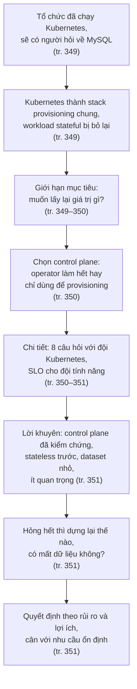
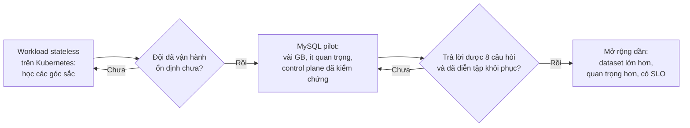
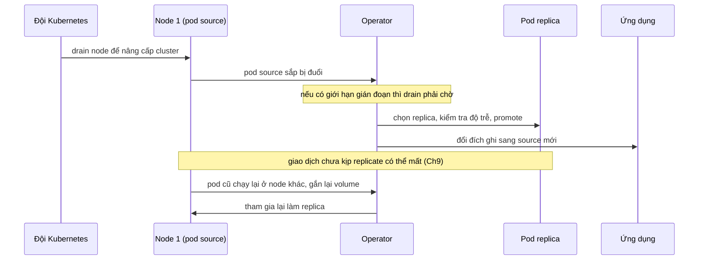
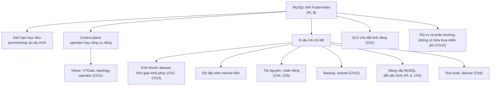

# Phụ lục B — MySQL trên Kubernetes

*MySQL on Kubernetes*

> **Nguồn:** *High Performance MySQL: Proven Strategies for Operating at Scale*, Silvia Botros và Jeremy Tinley, O'Reilly, **Fourth Edition (11/2021)**, Phụ lục B, **tr. 349–351 (trang PDF 371–373)**; tr. 352 (PDF 374) là trang trắng. "tr. N" là số trang in, trang PDF = N + 22 (xem [README](README.md#page-convention)).
>
> **Quy ước nhãn:** nội dung không nhãn là diễn giải từ sách, luôn kèm trang. **Bổ sung ngoài sách** là kiến thức thêm hoặc suy luận của người viết ghi chú. **Ví dụ minh họa do AI xây dựng** là ví dụ hay tình huống giả định. **Dự đoán** là điều kỳ vọng chưa đo.
>
> **Phiên bản:** phụ lục không gắn với phiên bản MySQL hay Kubernetes cụ thể. Đây là các quyết định kiến trúc và tổ chức. Khái niệm Kubernetes (Pod, StatefulSet, PersistentVolume, operator) không được sách giải thích; ghi chú thêm chúng dưới nhãn **Bổ sung ngoài sách**. Nhận định của sách về độ trưởng thành của workload stateful trên Kubernetes là nhận định năm 2021.
>
> **Liên kết:** [lộ trình học](learning-roadmap.md#app-b) · [đáp án tự kiểm tra](answers/appendix-b.md) · [Phụ lục A](appendix-a.md) · Phụ lục này **không có bài thực hành chạy được**, xem [mục 4](#measure).

## Mục lục ghi chú

- [1. Bức tranh lớn](#big-picture)
- [2. Giải thích sâu](#deep)
  - [2.1 Provisioning Resources with Kubernetes (tr. 349–351)](#s2-1)
  - [2.2 Summary (tr. 351)](#s2-2)
- [3. Phân tích tình huống](#situations)
- [4. Đo lường và thực hành](#measure)
- [5. Liên kết kiến thức và điều cần nhớ](#takeaways)
- [Ghi chú kiểm tra nguồn](#kiem-tra)

---

## 1. Bức tranh lớn

### Câu hỏi của phụ lục

Nếu tổ chức của bạn đã tự vận hành các cluster Kubernetes, sớm muộn sẽ có người hỏi: **có nên chạy cả MySQL trên đó không?** (tr. 349). Bề ngoài, đó có vẻ là hướng đi hợp lý. Tác giả muốn tách **lý do tốt** khỏi **lý do không tốt**, và gỡ bớt ***FUD*** (fear, uncertainty, doubt: nỗi sợ, sự mơ hồ, hoài nghi) quanh chủ đề này (tr. 349).

Phụ lục không dạy cách triển khai MySQL trên Kubernetes. Nó là một **danh sách câu hỏi phải trả lời trước khi bắt đầu**, kèm lời khuyên về cách áp dụng từ từ.

### Vị trí trong mục tiêu chung của sách

- Preface muốn giúp người đọc ra quyết định có hiểu biết về cách dùng MySQL (tr. xvi). Phụ lục B áp dụng tinh thần đó cho câu hỏi nền tảng: chạy MySQL ở đâu.
- Nó nối tiếp [Chương 12](chapter-12.md#no-free-lunch): chọn managed MySQL hay tự chạy trên VM đều có đánh đổi, "không có bữa trưa miễn phí", và nên đặt đánh đổi trong bối cảnh doanh nghiệp (tr. 324). Kubernetes là thêm một lựa chọn với cùng kiểu đánh đổi.
- Nó dựa vào [Chương 11](chapter-11.md#vitess): Vitess, control plane mà phụ lục khuyên học (tr. 351), được giới thiệu ở tr. 303–311.

### Kiến thức cần biết

- **Kubernetes cơ bản** (**Bổ sung ngoài sách**, sách giả định bạn đã biết):

| Khái niệm | Ý nghĩa ngắn |
| --- | --- |
| ***Container*** | Tiến trình chạy cô lập kèm hệ tệp riêng. Hệ tệp này mất khi container bị xóa, trừ phần được gắn từ ngoài vào |
| ***Pod*** | Đơn vị triển khai nhỏ nhất của Kubernetes, gồm một hay vài container chạy cùng nhau trên một node |
| ***Node*** | Máy (VM hoặc bare metal) chạy pod |
| ***Deployment*** | Cách chạy workload stateless: các pod thay thế được cho nhau, tạo lại ở đâu cũng được |
| ***StatefulSet*** | Cách chạy workload stateful: mỗi pod có tên và danh tính ổn định, có volume riêng đi theo nó, khởi động và cập nhật theo thứ tự |
| ***PersistentVolume (PV), PersistentVolumeClaim (PVC)*** | Lưu trữ bền, vòng đời tách khỏi pod; pod "xin" volume qua PVC |
| ***Operator*** | Phần mềm chạy trong cluster, mở rộng Kubernetes bằng tài nguyên riêng (ví dụ "MySQLCluster") và liên tục đưa trạng thái thật về trạng thái mong muốn |

- **Replication và failover:** [Chương 9](chapter-09.md). Mất một pod của source là một sự kiện failover.
- **Backup và khôi phục, RPO, RTO:** [Chương 10](chapter-10.md).
- **SLO:** [Chương 2](chapter-02.md#sli-slo-sla).
- **Vitess:** [Chương 11](chapter-11.md#vitess), tr. 303–311.

### Liên hệ với chương khác

| Ý | Chương | Căn cứ |
| --- | --- | --- |
| Vitess là control plane đã được kiểm chứng trong hệ sinh thái Kubernetes; Vitess có operator triển khai lớp vtgate và metadata store trên Kubernetes để tăng khả năng chịu lỗi | [Chương 11](chapter-11.md#vitess) | tr. 351; tr. 305 |
| Vitess ưa instance nhỏ: bán kính ảnh hưởng (blast radius) nhỏ hơn khi hỏng; phụ lục khuyên bắt đầu với dataset nhỏ | [Chương 11](chapter-11.md#vitess-philosophy) | tr. 305; tr. 351 |
| Dataset khôi phục lâu nhất quyết định thời gian khôi phục; kích thước instance là chỉ số để biết dữ liệu có quá lớn cho mục tiêu khôi phục | [Chương 2](chapter-02.md#backup-restore-time), [Chương 13](chapter-13.md#dr-planning) | tr. 35; tr. 340 |
| Thống nhất với đội Kubernetes để có SLO rõ cho các đội tính năng | [Chương 2](chapter-02.md#sli-slo-sla) | tr. 351 |
| "Backup hoạt động thế nào, quy trình restore là gì?" | [Chương 10](chapter-10.md) | tr. 350 |
| "Triển khai an toàn thay đổi cấu hình và nâng cấp MySQL thế nào?" | [Chương 5](chapter-05.md#s2-1-4), [Phụ lục A](appendix-a.md) | tr. 350 |
| Container hỏng phải được xử lý khác workload stateless: với MySQL là chuyện failover | [Chương 9](chapter-09.md#s2-3) | tr. 350 |
| Tài nguyên, node chuyên dụng, throughput tối đa | [Chương 4](chapter-04.md), [Chương 12](chapter-12.md) | tr. 350 |
| Không có bữa trưa miễn phí; đặt đánh đổi trong bối cảnh doanh nghiệp | [Chương 12](chapter-12.md#no-free-lunch) | tr. 324; tr. 351 |

### Mạch lập luận

---

## 2. Giải thích sâu

### 2.1 Provisioning Resources with Kubernetes (tr. 349–351)

**Mở đầu phụ lục (tr. 349).** Trong 5 năm qua, người làm công nghệ hầu như đều đã nghe về Kubernetes, làm cùng đội chạy Kubernetes, hoặc xem nhiều bài nói, bài blog về nó. Nếu tổ chức tự chạy cluster Kubernetes, bạn sẽ bị hỏi có nên chạy MySQL trên đó không. Lý lẽ ủng hộ nghe hợp lý: quản lý nhiều cluster Kubernetes là việc phức tạp, thường cần người chuyên trách, nên tổ chức muốn tận dụng chuyên môn đó cho nhiều thứ hơn workload stateless (tr. 349).

**Bối cảnh lịch sử (tr. 349).**

- Trước khi Kubernetes thịnh hành, nhiều công ty hoặc tự xây toàn bộ hệ thống để ***provisioning*** (cấp phát và dựng) và quản lý VM, server bare metal, hoặc ghép nhiều dự án mã nguồn mở, mỗi dự án lo một đoạn nhỏ trong vòng đời của tài nguyên.
- Kubernetes đến như một **hệ sinh thái đầy đủ hơn** để quản lý cả tài nguyên tính toán lẫn lưu trữ. Ý tưởng dùng nó làm stack provisioning "thống trị tất cả" ngày càng hấp dẫn.
- Nhưng workload ***stateful*** như MySQL bị bỏ lại, vì quan niệm phổ biến là "không chạy database trong container được".

**Why: vì sao stateful khó hơn (Bổ sung ngoài sách, nối với các chương trước).** Sách không giải thích kỹ quan niệm trên. Có thể hiểu qua sự khác biệt sau:

| | Workload stateless (web server) | MySQL |
| --- | --- | --- |
| Các bản chạy có thay thế nhau được không? | Có, mọi pod như nhau | Không: có source và replica ([Chương 9](chapter-09.md)), mỗi node giữ dữ liệu riêng |
| Pod chết thì sao? | Tạo pod mới ở node bất kỳ | Phải gắn lại đúng volume dữ liệu, chạy crash recovery của InnoDB; nếu là source thì phải failover |
| Co giãn bằng thêm pod? | Có, tải chia đều | Thêm replica chỉ giúp đọc; ghi cần sharding ([Chương 11](chapter-11.md#s2-6)) |
| Mất dữ liệu khi hỏng? | Không có dữ liệu để mất | Có thể mất giao dịch chưa kịp replicate nếu replication bất đồng bộ ([Chương 9](chapter-09.md#async-replication)) |
| Nhạy với tài nguyên dùng chung? | Ít | Rất nhạy: bộ nhớ cho buffer pool ([Chương 5](chapter-05.md#buffer-pool)), độ trễ đĩa và CPU ([Chương 4](chapter-04.md)) |

#### 2.1.1 Carefully Scope Your Goal (tr. 349–350)

- **What (tr. 349).** Câu hỏi cần giữ trong đầu: **chúng ta muốn lấy lại giá trị cụ thể nào?**
- **Why (tr. 349).** Kubernetes mạnh với workload stateless vì nó mang lại ***elasticity*** (co giãn) và **hiệu quả sử dụng tài nguyên tính toán**. Hai lợi ích đó không tự động có với database (giải thích ở bảng trên).
- **How: thu hẹp mục tiêu (tr. 349–350).** Hợp lý khi thu hẹp "chiến thắng" của một stack provisioning thống nhất thành: **chỉ dùng Kubernetes để provisioning và cấu hình các hệ thống cho tài nguyên database**. Khi đó phải nói rõ từ đầu rằng các workload database được provisioning bằng Kubernetes sẽ (tr. 350):
  - được **quản lý tách riêng** khỏi workload stateless;
  - đòi hỏi **bộ kỹ năng vận hành khác**;
  - **xử lý container hỏng theo cách khác**.
- **Trade-offs (Bổ sung ngoài sách).** Thu hẹp mục tiêu giữ được lợi ích thật (một cách khai báo, dựng và cấu hình tài nguyên thống nhất, cùng công cụ, có thể cho các đội tự phục vụ), và tránh hứa hẹn những thứ Kubernetes không làm được cho database (tự co giãn ghi, tự lành mà không mất dữ liệu).
- **Hiểu lầm phổ biến.** *"Đưa MySQL lên Kubernetes là có ngay co giãn và tự phục hồi như web server."* Sách nói ngược lại: database cần quản lý riêng và xử lý hỏng hóc khác (tr. 350).

#### 2.1.2 Choose Your Control Plane (tr. 350)

- **What.** Hiện có nhiều ***MySQL operator***. Chọn cái nào tốt nhất chủ yếu là **hệ quả của phạm vi** bạn đã quyết định cho việc quản lý MySQL bằng Kubernetes (tr. 350).
- **Hai mô hình (tr. 350).**

| | Operator "làm tất cả" | Kubernetes chỉ để provisioning |
| --- | --- | --- |
| Việc của Kubernetes và operator | Provisioning, **failover**, và quản lý kết nối tới database | Dựng và cấu hình instance |
| Quản lý database khi đã chạy | Operator lo | "Các cách khác": công cụ failover, định tuyến, backup sẵn có của đội database |
| Ưu (**Bổ sung ngoài sách**) | Ít mã kết nối phải tự viết; một chỗ điều khiển | Giữ được công cụ và quy trình đã kiểm chứng; Kubernetes làm ít việc nên ít bất ngờ |
| Nhược (**Bổ sung ngoài sách**) | Thừa hưởng cả cách failover và lỗi của operator; phải hiểu sâu nó | Phải ghép nối hai thế giới; trách nhiệm dễ bị chia không rõ |

- **Decision (tr. 350).** Quyết định **sớm** bạn kỳ vọng gì ở control plane, vì nó chi phối nhiều chi tiết vận hành về sau.
- **Lưu ý thuật ngữ (Bổ sung ngoài sách).** "Control plane" ở đây là hệ thống điều khiển các **instance database** (operator, Vitess), không phải control plane của chính Kubernetes (API server, scheduler).
- **Liên hệ chương 11.** Vitess có VTGate điều phối truy cập của ứng dụng, VTTablet chạy cạnh mỗi instance, và một topology store giữ danh mục instance (tr. 304–305). Vitess có operator triển khai lớp vtgate và metadata store trên Kubernetes, giúp control plane bớt điểm lỗi đơn (tr. 305). Đó là ví dụ của mô hình "làm tất cả": provisioning, failover, quản lý kết nối.

> **Bổ sung ngoài sách.** Ngoài Vitess, một số operator thường được nhắc là MySQL Operator for Kubernetes của Oracle (dựa trên InnoDB Cluster) và Percona Operator for MySQL. Người viết ghi chú chưa kiểm chứng tính năng hay độ trưởng thành của chúng; hãy đánh giá theo đúng các câu hỏi của sách ở mục 2.1.3.

#### 2.1.3 The Finer Details (tr. 350–351)

**Bối cảnh (tr. 350).** Khi đã quyết định provisioning MySQL bằng Kubernetes, cần **thống nhất trong tổ chức** về cỡ dữ liệu phù hợp với giải pháp này. Đây là một **mô hình vận hành mới** cho database quan hệ, trên một "con đường ít người đi"; mọi thứ càng lớn càng phức tạp. Tác giả liệt kê các câu hỏi cần làm rõ cùng đội Kubernetes (hy vọng là một đội chuyên trách).

**Tám câu hỏi (tr. 350) và vì sao chúng quan trọng.** Cột giữa là câu hỏi của sách; cột phải là giải thích của người viết ghi chú (**Bổ sung ngoài sách**).

| # | Câu hỏi (tr. 350) | Vì sao quan trọng |
| --- | --- | --- |
| 1 | Hỗ trợ dataset tối đa bao nhiêu cho một instance? | Dữ liệu càng lớn, dựng replica mới và khôi phục từ backup càng lâu. Dataset khôi phục lâu nhất quyết định thời gian khôi phục ([Chương 2](chapter-02.md#backup-restore-time), tr. 35; [Chương 13](chapter-13.md#dr-planning), tr. 340) |
| 2 | Gắn volume vào container và quản lý phục hồi container **tách** khỏi dữ liệu, hay dữ liệu **nằm trong** container? | Hệ tệp của container mất theo container. Dữ liệu trên volume bền thì pod chết vẫn còn dữ liệu để gắn lại; dữ liệu trong container thì mỗi lần pod chết là mất một bản sao, phải dựng lại từ replica hay backup |
| 3 | Hỗ trợ throughput truy vấn tối đa bao nhiêu? Quản lý tài nguyên thế nào? | Giới hạn bộ nhớ của container nhỏ hơn mức MySQL dùng (buffer pool cộng bộ nhớ mỗi kết nối, [Chương 5](chapter-05.md#s2-4)) thì tiến trình có thể bị kernel giết vì hết bộ nhớ; giới hạn CPU có thể làm latency tăng vọt |
| 4 | Làm sao bảo đảm node chạy database **dành riêng** cho database, không chia với workload stateless co giãn? | Workload co giãn làm node thêm bớt liên tục, tranh CPU, đĩa, mạng (hàng xóm ồn ào); node bị rút để co lại thì pod database bị đuổi đi |
| 5 | Dùng control plane nào để chạy các instance? Có phải Kubernetes-native không? | Xem [mục 2.1.2](#control-plane) |
| 6 | Backup chạy thế nào? Quy trình restore là gì? | [Chương 10](chapter-10.md#kiem-tra-backup): backup chỉ có giá trị khi restore đã được thử. Trên Kubernetes phải trả lời backup chạy ở đâu, lưu ở đâu, restore vào pod nào |
| 7 | Kiểm soát và triển khai an toàn thay đổi cấu hình và nâng cấp MySQL thế nào? | Đổi cấu hình của StatefulSet có thể kích hoạt khởi động lại lần lượt các pod. Với MySQL, thứ tự phải theo vai trò: replica trước, failover, rồi mới tới source ([Phụ lục A](appendix-a.md#s2-4), [Chương 9](chapter-09.md#planned-promotion)) |
| 8 | Nâng cấp chính các cluster Kubernetes thế nào mà không gây gián đoạn? | Nâng cấp cluster thường phải rút (drain) từng node, tức đuổi pod đi. Rút node đang chạy source là gây ra một lần failover |

**Đồng thuận và SLO (tr. 351).** Cùng đội Kubernetes thống nhất cách giải pháp vận hành sẽ giúp nhiều để có **SLO rõ ràng** cho các đội tính năng muốn dùng nó, và để nói rõ giải pháp **giải quyết gì** và các đội **vẫn phải tự lo gì** (tr. 351). Liên hệ [Chương 2](chapter-02.md#sli-slo-sla): SLO là hợp đồng giữa bên cung cấp nền tảng và bên dùng.

**Lời khuyên của tác giả (tr. 351).**

- **Học một control plane đã được kiểm chứng** trong hệ sinh thái Kubernetes, như Vitess.
- **Bò trước khi chạy.** MySQL không nên là "chuột bạch" đầu tiên cho việc chạy workload trên Kubernetes trong tổ chức. Hãy chứng minh tính khả thi và học các "góc sắc" bằng **workload stateless trước**.
- Khi chọn trường hợp áp dụng đầu tiên, bắt đầu với **dataset nhỏ** (database chỉ vài GB trên đĩa) và **ít quan trọng với nhiệm vụ**, để đội của bạn, đội Kubernetes và các đội tính năng làm quen với mô hình vận hành mới mà ít rủi ro cho doanh nghiệp.

> Chú thích 1 (tr. 351). Tác giả giới thiệu bài keynote "The Container Operator's Manual" của Alice Goldfuss, một bài nói "từ chiến hào" về chạy database trên Kubernetes.

**Độ trưởng thành và chế độ hỏng (tr. 351).** Chạy workload stateful trên Kubernetes đã trưởng thành dần trong vài năm và vẫn tiếp tục, nhờ đóng góp lớn của các công ty đầu tư nhiều giờ kỹ thuật. Nhưng so với chạy trực tiếp trên VM, nó **vẫn còn non trẻ**, và cách tiếp cận chậm, cẩn thận sẽ có lợi về lâu dài. Đặc biệt hãy hình dung các **chế độ hỏng** (failure modes) của MySQL trên Kubernetes và tự hỏi: **nếu mọi thứ hỏng, tôi dựng lại bằng cách nào? Tôi có mất dữ liệu không?** Hãy chắc là bạn có câu trả lời (tr. 351).

*(Sơ đồ do người viết ghi chú dựng từ lời khuyên ở tr. 351; các "cổng" G1, G2 là cách diễn đạt của người viết.)*

**Hiểu lầm phổ biến.**

- *"Sách khuyên đừng chạy MySQL trên Kubernetes."* Không. Sách nói có lý do tốt để khám phá hướng này (tr. 349), và đưa ra cách làm: giới hạn mục tiêu, chọn control plane đã kiểm chứng, bắt đầu nhỏ, có câu trả lời cho kịch bản hỏng (tr. 349–351).
- *"Có operator là không cần DBA."* Sách nói workload database cần bộ kỹ năng vận hành khác (tr. 350) và cần thống nhất trách nhiệm giữa các đội (tr. 351).

#### Tự kiểm tra 2.1

**Câu 2.1.1.** Vì sao hai lợi ích chính của Kubernetes với workload stateless (co giãn, hiệu quả tài nguyên) không chuyển nguyên sang MySQL? Tác giả đề xuất thu hẹp mục tiêu thế nào? [đáp án](answers/appendix-b.md#q2-1-1)

**Câu 2.1.2.** So sánh hai lựa chọn: operator làm tất cả, và Kubernetes chỉ để provisioning. Vì sao phải quyết định sớm? [đáp án](answers/appendix-b.md#q2-1-2)

**Câu 2.1.3.** Câu hỏi "dữ liệu nằm trong container hay trên volume gắn riêng" liên quan thế nào tới câu "nếu mọi thứ hỏng, dựng lại thế nào, có mất dữ liệu không"? [đáp án](answers/appendix-b.md#q2-1-3)

**Câu 2.1.4.** Vì sao tác giả khuyên bắt đầu với workload stateless, rồi tới database vài GB và ít quan trọng? Liên hệ với các chương trước. [đáp án](answers/appendix-b.md#q2-1-4)

---

### 2.2 Summary (tr. 351)

**Thông điệp của sách (tr. 351).**

- Kubernetes là một trong những nền tảng hạ tầng tăng trưởng nhanh nhất, và có lý do: **tốc độ làm việc của kỹ sư** mà nó mang lại, cùng hệ sinh thái phong phú được nền tảng cloud native hậu thuẫn, khiến nó thành khoản đầu tư hấp dẫn.
- Nhưng quyết định như chạy MySQL trên Kubernetes nên được nhìn qua lăng kính **rủi ro và phần thưởng** cho đội và công ty.
- Cần một **hiểu biết chung** về vị trí của các dịch vụ stateful như data store trên hành trình Kubernetes của tổ chức.
- Muốn tận dụng khoản đầu tư Kubernetes sẵn có cho mọi workload là dễ hiểu, nhưng phải **cân bằng với nhu cầu ổn định** của tầng data store.

**Decision: khung cân nhắc (Bổ sung ngoài sách, tổng hợp từ tr. 349–351).**

| Phần thưởng có thể có | Rủi ro cần trả lời |
| --- | --- |
| Một cách provisioning và cấu hình thống nhất cho mọi tài nguyên (tr. 349–350) | Chế độ hỏng mới: pod bị đuổi, volume không gắn lại được, failover bất ngờ (tr. 351) |
| Tận dụng chuyên môn và đầu tư Kubernetes sẵn có (tr. 349, 351) | Bộ kỹ năng mới cho đội database, trách nhiệm chia giữa nhiều đội (tr. 350–351) |
| Tốc độ làm việc của kỹ sư, tự phục vụ (tr. 351) | Mất dữ liệu nếu không có câu trả lời cho kịch bản hỏng (tr. 351) |
| Hệ sinh thái công cụ phong phú (tr. 351) | Độ trưởng thành thấp hơn VM, ở thời điểm sách viết (tr. 351) |

Liên hệ [Chương 12](chapter-12.md#no-free-lunch): không lựa chọn nào miễn phí; hãy đặt đánh đổi trong bối cảnh cách doanh nghiệp vận hành và giai đoạn trưởng thành của nó (tr. 324). Một tổ chức có đội Kubernetes chuyên trách và nhiều cluster nhỏ có thể có tỉ lệ rủi ro trên lợi ích khác hẳn một tổ chức chỉ có vài database lớn.

#### Tự kiểm tra 2.2

**Câu 2.2.1.** "Tận dụng khoản đầu tư Kubernetes sẵn có" là lý do tốt hay chưa đủ? Khi nào nó trở thành lý do không tốt? [đáp án](answers/appendix-b.md#q2-2-1)

**Câu 2.2.2.** Nêu một rủi ro và một phần thưởng cụ thể khi đưa MySQL lên Kubernetes, và chỉ số nào giúp đánh giá từng cái. [đáp án](answers/appendix-b.md#q2-2-2)

---

## 3. Phân tích tình huống

### 3.1 "Năm nay mọi workload lên Kubernetes"

> **Ví dụ minh họa do AI xây dựng.** Ban lãnh đạo đặt mục tiêu chuyển mọi workload lên các cluster Kubernetes của công ty. Đội database có 40 cụm MySQL: vài cụm hơn 1 TB phục vụ thanh toán, phần lớn là cụm nhỏ cho công cụ nội bộ.

**Áp dụng phụ lục.**

1. **Giới hạn mục tiêu** (tr. 349–350). Đội database đề xuất văn bản phạm vi: Kubernetes dùng để provisioning và cấu hình instance; database được quản lý riêng khỏi workload stateless, với node riêng và quy trình xử lý hỏng riêng.
2. **Chọn control plane** (tr. 350). Nếu công ty đã dùng Vitess cho sharding ([Chương 11](chapter-11.md#vitess)), dùng operator của nó là lựa chọn "đã kiểm chứng" (tr. 351). Nếu không, quyết định giữa operator làm tất cả và giữ công cụ failover hiện có.
3. **Trả lời 8 câu hỏi** cùng đội Kubernetes (tr. 350), ghi thành tài liệu chung, rồi đặt SLO cho các đội tính năng (tr. 351). Ví dụ: "instance tối đa 50 GB, dữ liệu trên volume bền, node chuyên dụng, backup mỗi ngày và thử restore mỗi tuần".
4. **Chọn pilot** (tr. 351): một cụm công cụ nội bộ vài GB. Cụm thanh toán 1 TB nằm ngoài phạm vi cho tới khi đội đã diễn tập đủ kịch bản hỏng.

**Phân tích.** Mục tiêu "mọi workload" gộp hai loại có đặc tính khác nhau (mục [2.1](#stateless-stateful)). Câu trả lời tốt không phải "có" hay "không", mà là một phạm vi có điều kiện, có lộ trình, và có tiêu chí để mở rộng. Cụm lớn và quan trọng là nơi rủi ro cao nhất và phần thưởng ít nhất ở giai đoạn đầu.

### 3.2 Diễn tập: nâng cấp cluster Kubernetes rút node đang chạy source

> **Ví dụ minh họa do AI xây dựng.** Câu hỏi 8 của sách (tr. 350) gặp câu hỏi "có mất dữ liệu không" (tr. 351). Giả định: operator có failover tự động, dữ liệu trên volume bền, replication bất đồng bộ. Cơ chế Kubernetes trong sơ đồ là **Bổ sung ngoài sách**.

**Câu hỏi phải trả lời trước buổi diễn tập.**

- **Ai được rút node chạy database, và khi nào?** Đây là thỏa thuận giữa hai đội (tr. 350–351). **Bổ sung ngoài sách:** Kubernetes có PodDisruptionBudget để giới hạn số pod bị đuổi cùng lúc, nhưng chính sách cụ thể phải do hai đội thống nhất.
- **Có mất dữ liệu không?** Với replication bất đồng bộ, failover không có kế hoạch có thể mất giao dịch chưa tới replica; semi-sync thu hẹp rủi ro đó ([Chương 9](chapter-09.md#semisync)). Nếu operator dừng ghi trên source trước khi đổi vai trò, giống planned promotion ở chương 9 (tr. 239–240), thì không mất. Phải biết operator của bạn làm theo kiểu nào.
- **Dựng lại thế nào nếu volume không gắn lại được?** Dựng replica mới từ backup hoặc từ replica khác ([Chương 10](chapter-10.md)). Thời gian dựng phụ thuộc kích thước dataset, đó là lý do câu hỏi 1 (dataset tối đa) đứng đầu danh sách.

**Phân tích.** Một thao tác thường ngày của đội Kubernetes (rút node) là một **sự kiện failover** với đội database. Đây chính là ý "xử lý container hỏng theo cách khác" (tr. 350): với web server, rút node là không đáng kể; với MySQL, nó chạm tới replication, định tuyến và có thể cả mất dữ liệu.

---

## 4. Đo lường và thực hành

**Vì sao phụ lục này không có thí nghiệm chạy được.** Môi trường thực hành chỉ có một bản MySQL 8.0.42 cài sẵn trên Windows, không có cluster Kubernetes, và quy tắc của dự án không cho tải phần mềm (image container, công cụ dựng cluster cục bộ). Mọi đo lường dưới đây là **kế hoạch, Chưa thực thi**.

**Giả thuyết cho một pilot (Dự đoán).**

1. Thời gian dựng một instance mới giảm khi provisioning được chuẩn hóa (phần thưởng ở tr. 349–350).
2. Thời gian phục hồi khi một pod MySQL chết phụ thuộc nhiều vào kích thước dữ liệu và việc dữ liệu có nằm trên volume bền hay không (câu hỏi 1 và 2, tr. 350).
3. Latency p99 trên Kubernetes có thể cao hơn trên VM nếu node không dành riêng hoặc giới hạn CPU quá chặt (câu hỏi 3 và 4, tr. 350).

**Chỉ số và cách quan sát (Bổ sung ngoài sách).**

| Chỉ số | Cách đo | Liên hệ |
| --- | --- | --- |
| Thời gian provisioning một cụm mới | Từ lúc khai báo tới lúc `SELECT 1` thành công | tr. 349–350 |
| RTO khi pod source chết | Giết pod trong diễn tập, đo thời gian tới khi ứng dụng ghi lại được | [Chương 10](chapter-10.md#rpo-rto), [Chương 9](chapter-09.md) |
| RPO trong diễn tập | So tập GTID đã thực thi trên source cũ và source mới | [Chương 9](chapter-09.md#gtid) |
| Latency p50, p99 theo digest | Performance Schema, so với cùng workload trên VM | [Chương 2](chapter-02.md#percentiles), [Chương 3](chapter-03.md#digest) |
| Số lần pod bị kernel giết vì hết bộ nhớ, thời gian bị giới hạn CPU | Chỉ số của Kubernetes và cgroup | [Chương 4](chapter-04.md#oom-killer), [Chương 5](chapter-05.md#s2-4) |
| Thời gian backup và thời gian restore thử | Script backup gửi kèm chỉ số thời gian | [Chương 13](chapter-13.md#dr-planning), tr. 340 |
| Thời gian và tác động của một lần nâng cấp MySQL, một lần nâng cấp cluster | Diễn tập có ghi lại | [Phụ lục A](appendix-a.md), tr. 350 |

**Tiêu chí so sánh trước và sau.** So pilot trên Kubernetes với cùng workload trên VM: latency không vượt SLO đã thống nhất (tr. 351); RPO bằng 0 trong failover có kế hoạch; RTO trong mục tiêu; restore thử thành công. Chỉ mở rộng phạm vi khi các tiêu chí này đạt ở pilot (lời khuyên "bò trước khi chạy", tr. 351).

---

## 5. Liên kết kiến thức và điều cần nhớ

### Liên kết khái niệm

### Điều cần nhớ

1. Câu hỏi đầu tiên là **muốn lấy lại giá trị cụ thể nào** (tr. 349); co giãn và hiệu quả tài nguyên là lợi ích của workload stateless, không tự có với MySQL.
2. Một phạm vi hợp lý: Kubernetes chỉ để **provisioning và cấu hình** tài nguyên database, quản lý tách khỏi stateless, với kỹ năng và cách xử lý hỏng riêng (tr. 349–350).
3. Chọn control plane là hệ quả của phạm vi: operator làm tất cả (provisioning, failover, kết nối) hay chỉ provisioning. Quyết định sớm (tr. 350).
4. Thống nhất với đội Kubernetes về 8 câu hỏi: dataset tối đa, volume, throughput, node riêng, control plane, backup, triển khai cấu hình và nâng cấp, nâng cấp cluster (tr. 350).
5. Từ thỏa thuận đó mới có SLO rõ cho các đội tính năng, và ranh giới "giải pháp lo gì, đội tự lo gì" (tr. 351).
6. Học control plane đã kiểm chứng như Vitess; stateless trước; dataset vài GB, ít quan trọng trước (tr. 351).
7. Luôn có câu trả lời cho: hỏng hết thì dựng lại thế nào, có mất dữ liệu không (tr. 351).
8. Quyết định theo rủi ro và phần thưởng, cân với nhu cầu ổn định của tầng dữ liệu (tr. 351).

### Dấu hiệu nhận diện trong thực tế

- Đề xuất "đưa database lên Kubernetes" chỉ dựa trên "đã có cluster sẵn", không nêu giá trị cụ thể: thiếu bước giới hạn mục tiêu.
- Không ai trả lời được "pod source chết thì ai promote replica": chưa chọn control plane.
- Pod MySQL bị khởi động lại không rõ lý do, log hệ thống có dấu hiệu hết bộ nhớ: giới hạn bộ nhớ của container nhỏ hơn nhu cầu của buffer pool và kết nối.
- Latency tăng theo nhịp co giãn của workload khác trên cùng node: node không dành riêng.
- Mỗi lần nâng cấp cluster Kubernetes là một lần sự cố database: chưa có thỏa thuận về rút node.

### Câu hỏi còn mở

- Từ năm 2021 tới nay, các operator MySQL đã trưởng thành tới đâu? Nhận định "còn non trẻ so với VM" (tr. 351) còn đúng không? Cần đánh giá lại bằng chính 8 câu hỏi của sách.
- Lưu trữ cục bộ trên node (nhanh, nhưng gắn chặt với node) hay volume qua mạng (dễ di chuyển, nhưng thêm độ trễ): lựa chọn nào hợp với từng loại workload? Sách không bàn; [Chương 12](chapter-12.md#local-vs-network-disk) có phân tích tương tự cho đĩa của VM.
- Làm sao đo "tốc độ làm việc của kỹ sư" (tr. 351) đủ cụ thể để đặt lên bàn cân với rủi ro?

---

## Ghi chú kiểm tra nguồn

**Đối chiếu mục lục (bookmark của PDF).**

| Mục trong sách | Trang in | Mục ghi chú |
| --- | --- | --- |
| Appendix B. MySQL on Kubernetes (mở đầu) | 349 | [1](#big-picture), [2.1](#mo-dau-phu-luc-b) |
| Provisioning Resources with Kubernetes | 349–351 | [2.1](#s2-1) |
| Carefully Scope Your Goal | 349–350 | [2.1.1](#scope-goal) |
| Choose Your Control Plane | 350 | [2.1.2](#control-plane) |
| The Finer Details | 350–351 | [2.1.3](#finer-details) |
| Summary | 351 | [2.2](#s2-2) |

**Trang đã xem trên ảnh.** Đã render và xem PDF 371–374 (tr. 349–352). Phụ lục **không có hình, bảng hay listing**. Tr. 350 có danh sách 8 gạch đầu dòng (đã đối chiếu đủ 8 mục). Tr. 351 có chú thích 1 (bài keynote của Alice Goldfuss, tên bài là siêu liên kết chữ đỏ, bản in không ghi URL). Tr. 352 (PDF 374) trắng hoàn toàn.

**Lỗi trích xuất.** Không có. Chữ trích xuất đặt chú thích 1 lên đầu PDF 373; vị trí thật ở cuối trang (đã đối chiếu ảnh). Mục "The Finer Details" trải từ tr. 350 sang tr. 351: ba đoạn đầu tr. 351 (SLO, lời khuyên, độ trưởng thành) thuộc mục này, theo bookmark (Summary bắt đầu ở PDF 373 nhưng sau ba đoạn đó).

**Điều kiện phiên bản.** Không có lệnh hay phiên bản MySQL cụ thể. Nhận định về độ trưởng thành là của năm 2021.

**Nội dung Bổ sung ngoài sách** (đã gắn nhãn tại chỗ): bảng khái niệm Kubernetes; bảng stateless và stateful; ưu nhược của hai mô hình control plane; lưu ý thuật ngữ "control plane"; tên một số operator (chưa kiểm chứng); cột "Vì sao quan trọng" cho 8 câu hỏi; sơ đồ lộ trình áp dụng có "cổng"; khung rủi ro và phần thưởng; hai tình huống và cơ chế rút node, PodDisruptionBudget; kế hoạch đo lường.

**Trạng thái thực hành.** Không có thí nghiệm: không có Kubernetes và không được tải phần mềm. Kế hoạch đo ở [mục 4](#measure) ở trạng thái **Chưa thực thi**.
