# Chương 1 — Kiến trúc MySQL

*MySQL Architecture*

> **Nguồn:** *High Performance MySQL: Proven Strategies for Operating at Scale*, Silvia Botros và Jeremy Tinley, O'Reilly, **Fourth Edition (11/2021)**, Chương 1, **tr. 1–18 (trang PDF 23–40)**. "tr. N" là số trang in; trang PDF = N + 22 (xem [quy ước trang](README.md#page-convention)).
>
> **Quy ước nhãn:**
> - Nội dung không nhãn là diễn giải từ sách, luôn kèm "(tr. N)".
> - **Bổ sung ngoài sách** là kiến thức thêm hoặc phép tính tự làm (kèm nguồn nếu dùng tài liệu ngoài).
> - **Ví dụ minh họa do AI xây dựng** là ví dụ, dữ liệu, SQL hay tình huống giả định, không phải của tác giả.
> - **Dự đoán** là điều kỳ vọng nhưng chưa đo. **Kết quả đã đo** chỉ dùng cho số liệu từ thí nghiệm đã chạy thật.
>
> **Phiên bản:** sách viết ở giai đoạn **MySQL 8.0**, so sánh với 5.5, 5.6, 5.7 ở vài chỗ (query cache, `FOR SHARE`, data dictionary, atomic DDL, JSON). Mọi nội dung về lock, transaction và MVCC trong chương là của **InnoDB**. Thí nghiệm đi kèm chạy trên **MySQL Community 8.0.42**, Windows 11, một instance riêng cấu hình mặc định.
>
> **Đi kèm:** [lộ trình chương 1](learning-roadmap.md#ch01) · [bài thực hành](experiments/chapter-01.md) · [đáp án câu tự kiểm tra](answers/chapter-01.md)

## Mục lục ghi chú

- [1. Bức tranh lớn](#big-picture)
- [2. Giải thích sâu](#deep)
  - [2.1 MySQL’s Logical Architecture (tr. 1–3)](#s2-1)
  - [2.2 Concurrency Control (tr. 3–6)](#s2-2)
  - [2.3 Transactions (tr. 6–13)](#s2-3)
  - [2.4 Multiversion Concurrency Control (tr. 13–15)](#s2-4)
  - [2.5 Replication (tr. 15)](#s2-5)
  - [2.6 Datafiles Structure (tr. 16)](#s2-6)
  - [2.7 The InnoDB Engine (tr. 16–18)](#s2-7)
  - [2.8 Summary (tr. 18)](#s2-8)
- [3. Phân tích tình huống](#situations)
- [4. Đo lường và thực hành](#measure)
- [5. Liên kết kiến thức và điều cần nhớ](#takeaways)
- [Ghi chú kiểm tra nguồn](#kiem-tra)

---

<a id="big-picture"></a>

## 1. Bức tranh lớn

### Chương này trả lời câu hỏi gì?

MySQL dùng được cho cả trang web cá nhân lẫn hệ thống doanh nghiệp lớn. Nó không hoàn hảo, nhưng đủ linh hoạt. Muốn khai thác tốt, bạn phải hiểu **nó được thiết kế ra sao**, để làm việc *cùng* thiết kế đó thay vì chống lại nó (tr. 1).

Chương 1 vì vậy hỏi ba câu:

1. Một câu SQL đi qua những **tầng** nào của server, và tầng nào thực sự chạm vào dữ liệu?
2. Khi nhiều client cùng đọc, cùng ghi, MySQL giữ dữ liệu đúng bằng **lock, transaction, isolation level và MVCC** như thế nào, và mỗi cơ chế tốn gì?
3. Vì sao InnoDB trở thành storage engine "chuẩn", và MySQL 8.0 đổi gì ở tầng lưu trữ (data dictionary, atomic DDL)?

Sách tự nhận chương này là phần tổng quan đã giản lược chi tiết, dành cho cả người mới lẫn người đã quen database khác (tr. 1).

### Vị trí trong mục tiêu chung của sách

Ấn bản thứ tư muốn giúp người đọc **ra quyết định có hiểu biết** về cách dùng MySQL, bắt đầu từ việc hiểu MySQL giỏi gì và không giỏi gì (Preface, tr. xvi; xem [roadmap mục 1](learning-roadmap.md#muc-tieu)). Chương 1 là nền cho cả cuốn: Summary nói rằng nếu hiểu MySQL thực thi truy vấn bằng cách **chuyền hàng qua lại qua storage engine API**, bạn đã nắm được nền tảng kiến trúc; và từ đây các chương sau gần như chỉ bàn InnoDB (tr. 18).

### Kiến thức cần biết trước

- SQL cơ bản và khái niệm transaction (`START TRANSACTION`, `COMMIT`, `ROLLBACK`). Sách nói phần Transactions phần lớn không riêng gì MySQL, ai đã quen ACID có thể nhảy thẳng tới "Transactions in MySQL" (tr. 6).
- Ý niệm về thread, CPU core, đọc ghi tuần tự và ngẫu nhiên trên đĩa (dùng ở mục transaction logging).
- **Bổ sung ngoài sách:** nếu chưa quen isolation level, MVCC và two-phase locking ở mức khái niệm chung, có thể ôn [DDIA chương 7, isolation](../../DDIA/ddia-notes/chapter-07.md#isolation) trước. Nhớ rằng ghi chú này ưu tiên hành vi **cụ thể của InnoDB**, có chỗ khác định nghĩa chung.

### Liên hệ với các chương khác

| Ý trong chương 1 | Chương | Căn cứ |
| --- | --- | --- |
| Thread cho mỗi connection, thread cache; "thread pooling ở tầng truy cập" | [Chương 5](chapter-05.md#thread-cache) (thread cache, concurrency), [Chương 11](chapter-11.md) (connection pooling của ProxySQL, Vitess) | tr. 2; xem [kết quả kiểm chứng](#thread-pooling-check) |
| Optimizer, hint, `EXPLAIN` | [Chương 8](chapter-08.md#optimization-process) | tr. 3 |
| Engine ảnh hưởng tối ưu; schema và index | [Chương 6](chapter-06.md), [Chương 7](chapter-07.md) | tr. 3 |
| Tối ưu truy vấn để tránh vấn đề do lock | [Chương 8](chapter-08.md) | tr. 4 |
| Metadata lock (chú thích 4) | [Chương 3](chapter-03.md#metadata-locks) (Examining Metadata Locks, tr. 63) | tr. 6; liên hệ do người viết ghi chú thêm, sách không trỏ |
| Index ảnh hưởng hiệu năng khi schema tiến hóa (ngữ cảnh deadlock) | [Chương 7](chapter-07.md) | tr. 10 |
| Cấu hình redo log, undo log ở concurrency cao | [Chương 5](chapter-05.md#s2-5) | tr. 14 |
| Replication chi tiết: GTID, multisource, parallel, semisync | [Chương 9](chapter-09.md) | tr. 15 |
| Clustered index (sách ghi "Chapter 8", thực tế ở chương 7) | [Chương 7](chapter-07.md#clustered-index) | tr. 16; xem [ghi chú kiểm tra nguồn](#kiem-tra) |
| Read-ahead, adaptive hash index, insert buffer (sách ghi "Chapter 4") | [Chương 4](chapter-04.md), [Chương 5](chapter-05.md#buffer-pool), [Chương 7](chapter-07.md#adaptive-hash-index) | tr. 17; xem [kết quả kiểm chứng](#internal-optimizations-check) |
| Backup nóng với InnoDB | [Chương 10](chapter-10.md#s2-5) | tr. 17 |
| Online DDL, thay đổi schema online; kiểu JSON ("JSON Data", tr. 139) | [Chương 6](chapter-06.md) | tr. 17 |
| Backup phải đọc data dictionary thay vì file metadata | [Chương 10](chapter-10.md) | tr. 18; liên hệ do người viết ghi chú thêm, sách không trỏ |

### Mạch lập luận

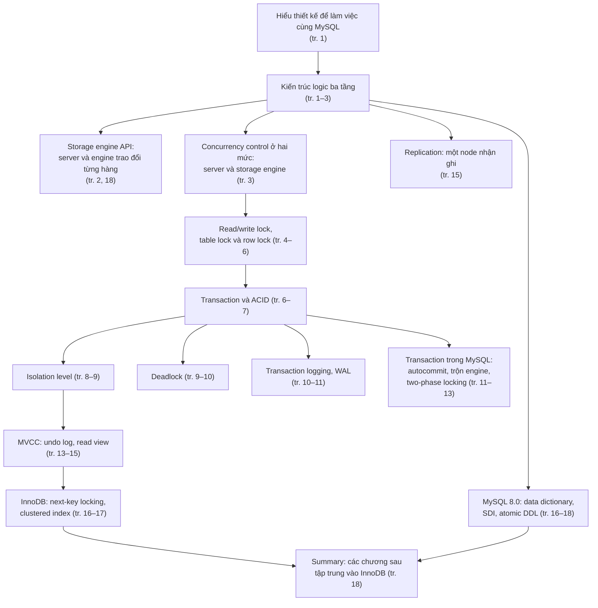

*(Sơ đồ do người viết ghi chú dựng theo thứ tự các mục của chương.)*

---

<a id="deep"></a>

## 2. Giải thích sâu

<a id="s2-1"></a>

### 2.1 MySQL’s Logical Architecture (tr. 1–3)

<a id="logical-architecture"></a>

**What.** Sách mô tả MySQL theo **ba tầng logic** (tr. 1–2, Hình 1-1):

| Tầng | Chứa gì | Ghi chú |
| --- | --- | --- |
| Tầng trên cùng (sách gọi là tầng *clients*) | Dịch vụ mà hầu hết công cụ client/server qua mạng đều cần: xử lý kết nối, xác thực, bảo mật | Không có gì riêng của MySQL (tr. 1) |
| Tầng thứ hai, "bộ não" | Parse, phân tích, tối ưu truy vấn; mọi hàm dựng sẵn (ngày giờ, toán, mã hóa); mọi tính năng dùng chung cho các engine như stored procedure, trigger, view | Phần lớn "trí khôn" của MySQL nằm ở đây (tr. 1) |
| Tầng thứ ba | Các **storage engine**, chịu trách nhiệm lưu và lấy mọi dữ liệu "trong" MySQL | Giống các filesystem khác nhau trên GNU/Linux: mỗi loại có ưu nhược riêng (tr. 1) |

<a id="storage-engine-api"></a>

**Storage engine API** (tr. 2). Server nói chuyện với engine qua ***storage engine API***. API này:

- **che khác biệt** giữa các engine, nên ở tầng truy vấn chúng gần như "trong suốt";
- gồm khoảng vài chục hàm **mức thấp**, kiểu "bắt đầu một transaction" hay "lấy hàng có primary key này".

Engine **không parse SQL** và **không nói chuyện với nhau**; chúng chỉ trả lời yêu cầu của server (tr. 2).

> Chú thích 1 (tr. 2). Ngoại lệ là InnoDB: nó có parse định nghĩa foreign key, vì bản thân MySQL server chưa tự cài đặt foreign key.

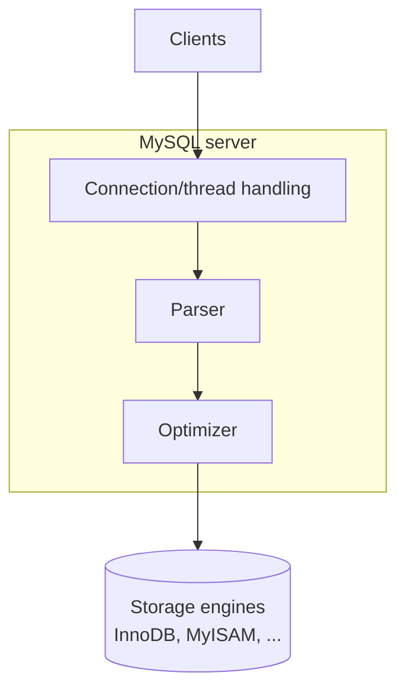

*(Vẽ lại Hình 1-1, tr. 2. Hình gốc vẽ nhiều mũi tên client đi vào khối connection/thread handling, và năm hình trụ "Storage engines" bên dưới khối server. Hình không vẽ executor hay query cache.)*

**Why tách tầng.** Vì tầng server không phụ thuộc cách lưu trữ, MySQL cho phép mỗi engine tự chọn cách khóa, cách làm transaction, cách tổ chức file (tr. 5). Đổi lại, những gì **nằm trong engine** (transaction, row lock) **không được server điều phối** giữa các engine. Hệ quả này quay lại ở [mục trộn engine trong transaction](#mixing-engines) (tr. 12).

**How: một truy vấn đi qua các tầng.** Sách nói ở Summary rằng MySQL thực thi truy vấn bằng cách **chuyền hàng qua lại qua storage engine API** (tr. 18). Sơ đồ dưới cụ thể hóa ý đó.

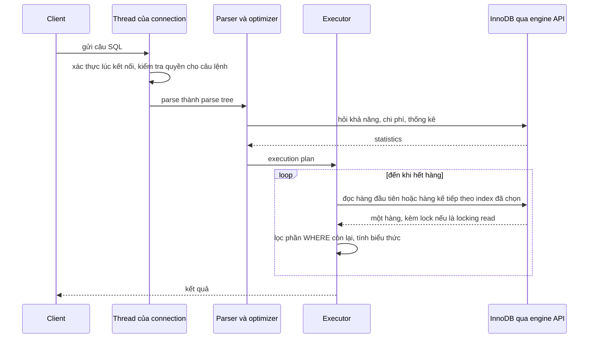

*(**Bổ sung ngoài sách**, dựng từ tr. 2–3 và tr. 18. Chi tiết executor và "handler API" thuộc [Chương 8](chapter-08.md#execution-engine). Phần trên đường parse, optimizer là **xử lý truy vấn ở mức logic và lập kế hoạch**; phần vòng lặp đọc hàng qua engine API là **physical execution**: engine đi trên B+tree, đọc page trong buffer pool, đặt lock.)*

**Hiểu lầm phổ biến.**

- "MySQL và InnoDB là một." Sai về kiến trúc: optimizer, kiểm tra quyền, stored procedure, view thuộc tầng server; InnoDB chỉ lưu và lấy dữ liệu (tr. 1–2).
- "InnoDB tự chọn index." Optimizer ở tầng server chọn; InnoDB chỉ cung cấp thống kê và chi phí (tr. 3).
- **Bổ sung ngoài sách:** vì engine trả từng hàng và server mới lọc phần điều kiện còn lại, số hàng **engine phải đọc** (và có thể phải khóa) thường lớn hơn số hàng **trả về**. Thí nghiệm khóa ở [mục 2.2](#row-locks) và [tình huống 2](#th2) cho thấy hệ quả.

<a id="connection-management"></a>

#### 2.1.1 Connection Management and Security (tr. 2)

**Thread cho mỗi connection.** Mặc định, mỗi connection của client có **một thread riêng** trong tiến trình server. Các truy vấn của connection đó chạy trong đúng thread ấy, và thread ấy tại một thời điểm nằm trên một core hay một CPU. Server giữ một **cache các thread sẵn sàng**, để không phải tạo và hủy thread cho mỗi connection mới (tr. 2).

> **Kết quả đã đo** (MySQL 8.0.42, Windows 11, instance riêng cấu hình mặc định): `@@thread_handling` = `one-thread-per-connection`, `@@thread_cache_size` = 9 (giá trị tự tính). Khớp với mô tả ở tr. 2.

**Xác thực và phân quyền** (tr. 2).

- Khi client kết nối, server **xác thực** dựa trên **username, host nguồn và password**. Có thể dùng chứng chỉ X.509 qua kết nối TLS.
- Sau khi kết nối, server **kiểm tra quyền cho từng câu lệnh**. Ví dụ của sách: client có được `SELECT` bảng `Country` trong database `world` không.

**Hệ quả hiệu năng** (**Bổ sung ngoài sách**, suy ra từ mô hình ở tr. 2):

- Một câu truy vấn nói chung chỉ dùng **một core**. Truy vấn phân tích nặng không tự chia ra nhiều core như một số hệ phân tích. (MySQL 8.0 có vài ngoại lệ hẹp, ví dụ đọc song song clustered index cho `CHECK TABLE` hay `SELECT COUNT(*)` không có `WHERE`; không phải cơ chế chung.)
- Nhiều connection cùng **chạy** truy vấn thì nhiều thread tranh CPU, tranh mutex bên trong. Thread cache chỉ bỏ chi phí **tạo và hủy** thread, không giới hạn số thread chạy đồng thời. Cách hạn chế concurrency bên trong InnoDB là `innodb_thread_concurrency` ([Chương 5](chapter-05.md#innodb-thread-concurrency), tr. 119).

<a id="thread-pooling-check"></a>

> Chú thích 2 (tr. 2). Từ MySQL 5.5 có API nhận plug-in **thread pooling**, nhưng ít dùng. Cách làm phổ biến là pooling ở **tầng truy cập** (*access layer*), "bàn ở Chapter 5".
>
> **Kết quả kiểm chứng tham chiếu "Chapter 5"** (mục 8 của [roadmap](learning-roadmap.md#can-kiem-chung)). Đã tìm toàn bộ chữ của 13 chương và hai phụ lục:
> - Cụm "thread pool" chỉ xuất hiện ở chú thích này. **Chương 5 không bàn thread pooling hay tầng truy cập.** Chương 5 có hai mục gần nhất: *The Thread Cache* (tr. 111: `thread_cache_size`, theo dõi `Threads_created`) và *Configuring MySQL Concurrency* (tr. 119–120: `innodb_thread_concurrency`, "thread scheduler" của InnoDB).
> - Pooling ở tầng truy cập thực ra nằm ở **chương 11**: Vitess liệt kê *connection pooling* trong các tính năng (tr. 303); ProxySQL được bàn như *access layer* (tr. 306) và có "connection pooling mạnh", tách connection của ứng dụng với connection tới database (tr. 307).
> - Kết luận: tham chiếu "Chapter 5" **không chính xác**. Phần "access layer" nên trỏ tới chương 11; phần thread trong server nên trỏ tới chương 5, tr. 111 và 119.
>
> **Bổ sung ngoài sách.** Ba khái niệm hay bị lẫn: *thread cache* (tái dùng thread, có trong mọi bản), *thread pool* trong server (một nhóm thread cố định phục vụ nhiều connection; ở MySQL là plug-in của bản Enterprise, Percona Server và MariaDB có sẵn), và *connection pooling* ở proxy hoặc ở thư viện ứng dụng (giảm số connection thật tới server). Câu "thread pooling ở tầng truy cập" của sách thực chất là connection pooling.

<a id="optimizer-execution"></a>

#### 2.1.2 Optimization and Execution (tr. 3)

**How.** MySQL parse truy vấn thành một cấu trúc nội bộ, ***parse tree***, rồi áp dụng nhiều phép tối ưu: **viết lại truy vấn**, chọn **thứ tự đọc bảng**, chọn **index**, v.v. (tr. 3).

- Bạn có thể đưa **hint** cho optimizer bằng từ khóa đặc biệt trong câu truy vấn.
- Bạn có thể yêu cầu server **giải thích** các quyết định tối ưu (`EXPLAIN`). Đó là điểm tựa để sửa truy vấn, schema và thiết lập. Chi tiết ở [Chương 8](chapter-08.md#optimization-process) (tr. 3).

**Optimizer và engine.** Optimizer "không quan tâm" bảng dùng engine nào, nhưng engine **có ảnh hưởng** tới cách server tối ưu: optimizer hỏi engine về **khả năng** của nó, **chi phí** của một số thao tác và **thống kê** dữ liệu của bảng. Ví dụ, có engine hỗ trợ loại index giúp ích cho một số truy vấn. Schema và index ở [Chương 6](chapter-06.md) và [Chương 7](chapter-07.md) (tr. 3).

> **Kết quả đã đo** (xem [TN2, phần B](experiments/chapter-01.md#tn2)). Bảng 4 hàng có primary key `id` và index phụ `idx_k(k)`. Câu `SELECT id FROM t2 WHERE id BETWEEN 15 AND 35 FOR UPDATE` được optimizer cho **quét toàn bộ `idx_k`** (covering index, `type=index`) thay vì range trên `PRIMARY`, vì bảng quá nhỏ. Hệ quả: lock rơi lên **mọi** bản ghi. Khi thêm cột `c` vào danh sách chọn, plan đổi sang `range` trên `PRIMARY`, và chỉ bản ghi 20, 30 cùng các khoảng trống từ 10 tới 40 bị khóa ([TN2, phần C](experiments/chapter-01.md#tn2)). Quyết định của optimizer quyết định cả **chi phí đọc** lẫn **phạm vi khóa**.

<a id="query-cache"></a>

**Query cache** (tr. 3). Bản cũ có **query cache** nội bộ để trả kết quả cũ cho câu truy vấn giống hệt. Khi concurrency tăng, nó trở thành **nút thắt khét tiếng**. Query cache bị **deprecated từ 5.7.20** và **bị gỡ hẳn trong 8.0**. Dù vậy, cache các result set hay dùng vẫn là thực hành tốt; mẫu phổ biến là cache ở memcached hoặc Redis (nằm ngoài phạm vi sách).

**Bổ sung ngoài sách (vì sao nút thắt).** Query cache là một cấu trúc dùng chung cho mọi connection, được bảo vệ bằng khóa toàn cục; mỗi lần ghi vào một bảng làm mất hiệu lực mọi kết quả cache liên quan tới bảng đó. Workload ghi nhiều thì cache vừa tốn công giữ, vừa bắt mọi truy vấn xếp hàng chờ khóa. Cache ở ngoài database thì scale độc lập, và ứng dụng tự quyết TTL, cách làm mất hiệu lực.

**Trade-offs và Decision.**

| Lựa chọn | Lợi | Giá |
| --- | --- | --- |
| Để optimizer tự quyết | Plan thích nghi khi dữ liệu và thống kê đổi | Plan có thể đổi bất ngờ khi thống kê đổi |
| Dùng hint | Ổn định, ép đúng ý | Hint "đóng băng" quyết định; dữ liệu đổi thì hint có thể thành sai (**Bổ sung ngoài sách**) |
| Cache ngoài database (Redis, memcached) | Giảm tải đọc lặp lại | Dữ liệu có thể cũ, phải tự quản lý invalidation |

#### Tự kiểm tra 2.1

- **Câu 2.1.1.** Trong ba tầng của sách, tầng nào parse SQL và chọn index, tầng nào lưu dữ liệu? Vì sao storage engine không cần hiểu SQL, và chú thích 1 nêu ngoại lệ nào? [đáp án](answers/chapter-01.md#q2-1-1)
- **Câu 2.1.2.** Một truy vấn phân tích nặng chạy trên một connection. Theo mô hình thread ở tr. 2, nó dùng được bao nhiêu core cùng lúc? Thread cache giải quyết chi phí gì và không giải quyết điều gì? [đáp án](answers/chapter-01.md#q2-1-2)
- **Câu 2.1.3.** Optimizer nằm ở tầng server và "không quan tâm" engine. Vì sao đổi engine của một bảng vẫn có thể đổi execution plan? [đáp án](answers/chapter-01.md#q2-1-3)
- **Câu 2.1.4.** Query cache bị gỡ trong 8.0, nhưng sách vẫn nói cache kết quả là thực hành tốt. Giải thích sự khác nhau giữa hai loại cache này. [đáp án](answers/chapter-01.md#q2-1-4)
- **Câu 2.1.5.** Phân biệt thread cache, thread pool trong server và connection pooling ở tầng truy cập. Tham chiếu "Chapter 5" ở chú thích 2 có đúng không? [đáp án](answers/chapter-01.md#q2-1-5)

---

<a id="s2-2"></a>

### 2.2 Concurrency Control (tr. 3–6)

<a id="concurrency-control"></a>

**What.** Bài toán ***concurrency control*** xuất hiện bất cứ khi nào **nhiều truy vấn cần đổi dữ liệu cùng lúc**. Trong phạm vi chương, MySQL phải làm việc này ở **hai mức**: mức **server** và mức **storage engine** (tr. 3).

**Ví dụ bảng tính** (tr. 3). Sách dùng hình ảnh một file bảng tính:

1. File nằm trên laptop, chỉ bạn dùng: không có xung đột.
2. File chuyển lên server dùng chung với một đồng nghiệp: nếu cả hai cùng sửa một lúc thì sao?
3. Cả một nhóm cùng sửa, thêm, xóa ô: bắt mọi người **lần lượt** thì đúng nhưng không hiệu quả. Cần một cách cho phép truy cập đồng thời vào một bảng tính "lưu lượng cao".

<a id="read-write-locks"></a>

#### 2.2.1 Read/Write Locks (tr. 4)

**Why ngay cả đọc cũng cần cẩn thận.** Nhiều người cùng đọc thì không sao vì không ai sửa. Nhưng nếu có người **xóa ô A25** trong khi người khác đang đọc, người đọc có thể nhận một **góc nhìn hỏng hoặc không nhất quán**. Bảng tính về bản chất là một bảng database đơn giản; sửa hàng trong bảng giống sửa, xóa ô (tr. 4).

**How.** Lời giải cổ điển là hệ thống khóa gồm **hai loại** (tr. 4):

| | ***Shared lock*** (read lock) đang được giữ | ***Exclusive lock*** (write lock) đang được giữ |
| --- | --- | --- |
| Xin shared lock | Được (không chặn nhau) | Phải chờ |
| Xin exclusive lock | Phải chờ | Phải chờ |

Read lock **dùng chung**, không chặn nhau. Write lock **độc quyền**: chặn cả read lock lẫn write lock khác, vì chính sách an toàn duy nhất là **một người ghi tại một thời điểm** và **không ai đọc khi đang có người ghi** (tr. 4).

Trong database, khóa diễn ra **liên tục**. Nếu server chạy ổn, việc quản lý khóa đủ nhanh để client không nhận ra. Cách chỉnh truy vấn để tránh vấn đề hiệu năng do khóa ở [Chương 8](chapter-08.md) (tr. 4).

> **Bổ sung ngoài sách, có đo.** Mô hình "người đọc phải chờ người ghi" là mô hình khóa thuần. Với `SELECT` thường, InnoDB **không** xin shared lock mà đọc bản cũ qua MVCC ([mục 2.4](#s2-4)). **Kết quả đã đo** ([TN1, phần E](experiments/chapter-01.md#tn1)): một session giữ X lock trên hàng `id=2` (đã `UPDATE`, chưa commit); `SELECT` thường ở READ COMMITTED và REPEATABLE READ trả về **ngay (0,00 s)** với giá trị cũ, còn `SELECT ... FOR SHARE` (locking read) **chờ 1,99 s** cho tới khi session kia rollback.

<a id="lock-granularity"></a>

#### 2.2.2 Lock Granularity (tr. 4–6)

**What.** ***Lock granularity*** là kích thước phần dữ liệu bị khóa. Muốn tăng concurrency, hãy khóa **chọn lọc**: không khóa cả tài nguyên, chỉ khóa phần chứa dữ liệu cần đổi, tốt hơn nữa là đúng mẩu dữ liệu sẽ đổi. Khóa ít dữ liệu nhất có thể thì các thay đổi **không xung đột** chạy song song được (tr. 4).

**Why không khóa thật nhỏ cho mọi thứ.** Khóa **không miễn phí**. Mỗi thao tác (xin khóa, kiểm tra khóa còn trống, nhả khóa) đều có overhead. Hệ thống dành quá nhiều thời gian quản lý khóa thay vì đọc ghi dữ liệu thì hiệu năng giảm (tr. 4).

**Locking strategy là một thỏa hiệp** giữa **overhead của khóa** và **an toàn dữ liệu**, và thỏa hiệp đó ảnh hưởng hiệu năng (tr. 5):

- Phần lớn database thương mại **không cho bạn chọn**: bạn có row-level locking cùng nhiều cách phức tạp để chạy tốt với rất nhiều khóa. Khóa là cách database cài đặt các **đảm bảo nhất quán**. Một người vận hành giỏi có khi phải đọc **mã nguồn** để biết cách tuning thỏa hiệp tốc độ và an toàn (tr. 5).
- MySQL thì **cho chọn**: mỗi storage engine tự cài **chính sách khóa và độ mịn khóa** riêng. Cố định độ mịn ở một mức có thể tốt cho việc này nhưng kém cho việc khác; vì MySQL có nhiều engine, nó không cần một lời giải chung cho mọi thứ (tr. 5).

<a id="table-locks"></a>

**Table locks** (tr. 5). Chiến lược cơ bản nhất và **overhead thấp nhất**. Nó giống khóa cả file bảng tính: client muốn ghi (insert, delete, update…) xin **write lock** trên **cả bảng**, chặn mọi thao tác đọc và ghi khác; khi không ai ghi, người đọc xin **read lock**, các read lock không xung đột nhau.

- Có biến thể cho tình huống riêng, ví dụ table lock `READ LOCAL` cho phép một số kiểu ghi đồng thời.
- **Hàng đợi write lock và read lock tách riêng**, hàng đợi ghi được **ưu tiên hoàn toàn** hơn hàng đợi đọc.

> Chú thích 3 (tr. 5). Tác giả khuyên đọc tài liệu về exclusive lock và shared lock, *intention locking* và *record lock*.

<a id="row-locks"></a>

**Row locks** (tr. 5–6). Kiểu khóa cho **concurrency cao nhất** và mang **overhead lớn nhất**. Giống khóa riêng một dòng trong bảng tính: nhiều người sửa các dòng khác nhau không chặn nhau, server nhận được nhiều thao tác ghi đồng thời hơn. Cái giá là phải theo dõi **ai giữ khóa hàng nào, giữ bao lâu, khóa loại gì**, và dọn khóa khi không còn cần.

Row lock được cài trong **storage engine, không phải server**. Server **gần như** không biết gì về khóa của engine; mỗi engine khóa theo cách riêng (tr. 6).

> Chú thích 4 (tr. 6). Có **metadata lock**, dùng khi đổi tên bảng hay đổi schema; và trong 8.0 có "application level locking functions". Với thay đổi dữ liệu thông thường, việc khóa nội bộ do InnoDB lo.

| | Table lock | Row lock |
| --- | --- | --- |
| Overhead mỗi thao tác | Thấp nhất | Cao nhất |
| Concurrency khi ghi | Một người ghi trên cả bảng | Nhiều người ghi trên các hàng khác nhau |
| Ai cài đặt | Server (`LOCK TABLES`) hoặc engine (ví dụ MyISAM) | Engine (InnoDB) |
| Hợp với | Ít người ghi, thao tác hàng loạt, bảo trì | OLTP nhiều transaction ngắn ghi vào các hàng khác nhau |

*(Bảng tổng hợp từ tr. 5–6; cột "Hợp với" là **Bổ sung ngoài sách**.)*

**Evidence & example. Kết quả đã đo** ([TN2](experiments/chapter-01.md#tn2), MySQL 8.0.42):

- Session 1 `UPDATE ... WHERE id = 20` trong transaction mở. `performance_schema.data_locks` cho thấy hai khóa: `TABLE IX` trên bảng và `RECORD X,REC_NOT_GAP` trên bản ghi `PRIMARY` có `LOCK_DATA = 20`.
- Session 2 sửa cùng hàng: chờ **2,01 s** (tới khi session 1 commit); `data_lock_waits` ghi rõ transaction chờ và transaction chặn; `sys.innodb_lock_waits` còn đưa sẵn câu `KILL` cho connection chặn.
- Session 3 sửa hàng `id = 30` cùng lúc: **không bị chặn** (0,00 s). Đó là ý nghĩa của row-level granularity.
- `LOCK TABLES t2 READ` (khóa bảng ở **tầng server**): `data_locks` **rỗng**; khóa chỉ hiện trong `performance_schema.metadata_locks` (`SHARED_READ_ONLY`, GRANTED). Một `UPDATE` từ session khác hiện `SHARED_WRITE` PENDING, trạng thái processlist "Waiting for table metadata lock", và chờ 2,01 s. Một `SELECT` thì vẫn chạy ngay.

**Bổ sung ngoài sách (intention lock).** `IX` và `IS` là ***intention lock*** ở mức bảng: "tôi sắp khóa vài hàng của bảng này". Nhờ nó, một yêu cầu khóa cả bảng chỉ cần nhìn khóa ở mức bảng, không phải duyệt hàng triệu row lock để biết có xung đột hay không.

**Hiểu lầm phổ biến.**

- "Row lock khóa đúng những hàng thỏa `WHERE`." Thực ra InnoDB khóa **các bản ghi index mà nó duyệt qua** khi tìm hàng. Sách ngầm nói điều này khi viết rằng transaction khóa hàng "trong primary key index và mọi unique index" chứa nó (tr. 10). **Kết quả đã đo:** `UPDATE t2 SET c = c + 1 WHERE c = 999` (không có index trên `c`, không hàng nào khớp) ở REPEATABLE READ vẫn giữ X lock trên **cả 4 hàng và supremum**, làm `UPDATE ... WHERE id = 40` của session khác chờ 2,01 s. Ở READ COMMITTED, khóa trên hàng không khớp được nhả ngay và session kia chạy trong 0,00 s.
- "Có row lock thì không cần lo khóa." Khóa ít hay nhiều phụ thuộc **access path**; xem [tình huống 2](#th2): 100.261 bản ghi bị khóa khi không có index, 4.005 khi có index phù hợp.

#### Tự kiểm tra 2.2

- **Câu 2.2.1.** Vì sao trong mô hình read/write lock của sách, người chỉ đọc cũng cần khóa? InnoDB tránh việc người đọc chờ người ghi cho `SELECT` thường bằng cơ chế nào? [đáp án](answers/chapter-01.md#q2-2-1)
- **Câu 2.2.2.** Table lock có overhead thấp nhất, row lock cho concurrency cao nhất. Nêu một workload mà table lock hợp lý và một workload mà nó gây hại, giải thích bằng lập luận overhead và an toàn của tr. 4–5. [đáp án](answers/chapter-01.md#q2-2-2)
- **Câu 2.2.3.** Dự đoán: session A chạy `LOCK TABLES t2 READ`, session B chạy `UPDATE t2 ... WHERE id = 10`. `performance_schema.data_locks` thấy gì? B chờ ở tầng nào, xem ở đâu? [đáp án](answers/chapter-01.md#q2-2-3)
- **Câu 2.2.4.** "Row lock" của InnoDB về mặt vật lý khóa cái gì? Vì sao số bản ghi bị khóa phụ thuộc access path chứ không chỉ phụ thuộc điều kiện `WHERE`? [đáp án](answers/chapter-01.md#q2-2-4)

---

<a id="s2-3"></a>

### 2.3 Transactions (tr. 6–13)

<a id="transactions"></a>

**What.** Một ***transaction*** là một nhóm câu lệnh SQL được xử lý **nguyên tử**, như một đơn vị công việc. Engine áp dụng được cả nhóm thì áp dụng; nếu một câu không làm được vì crash hay lý do khác thì **không câu nào** được áp dụng. "Tất cả hoặc không gì cả" (tr. 6).

**Why: ví dụ ngân hàng** (tr. 6–7). Chuyển $200 từ tài khoản checking sang savings của Jane cần ít nhất ba bước: kiểm tra số dư checking lớn hơn $200; trừ $200 ở checking; cộng $200 ở savings. Cả thao tác phải bọc trong transaction để bước nào hỏng thì các bước đã xong được rollback. Sách viết năm dòng SQL: `START TRANSACTION`, một `SELECT` số dư, hai `UPDATE`, `COMMIT`.

> Chú thích 5 (tr. 6). Đây là bài tập kinh điển trong trường, nhưng phần lớn ngân hàng thực tế dựa vào **đối soát hằng ngày**, không dựa vào transaction nghiêm ngặt trong ngày.

**Transaction một mình chưa đủ** (tr. 6–7):

- Server crash khi đang chạy dòng 4 (cộng vào savings): khách có thể mất $200.
- Một tiến trình khác chen vào giữa dòng 3 và 4 và rút hết số dư checking: ngân hàng đã cho khách $200 mà không biết.
- Còn nhiều kiểu hỏng khác: rớt kết nối, timeout, crash giữa chừng. Đó là lý do tồn tại các hệ ***two-phase commit*** phức tạp và chậm.

<a id="acid"></a>

**ACID** (tr. 7). Transaction chỉ đủ khi hệ thống vượt "bài kiểm tra ACID":

| Tính chất | Ý nghĩa theo sách | Trong ví dụ ngân hàng |
| --- | --- | --- |
| ***Atomicity*** | Transaction là một đơn vị không chia được: áp dụng hết hoặc không commit gì; không có transaction "làm dở" | Không có chuyện trừ checking mà chưa cộng savings |
| ***Consistency*** | Database luôn đi từ trạng thái nhất quán này sang trạng thái nhất quán khác; transaction không commit thì không thay đổi nào của nó hiện ra | Crash giữa dòng 3 và 4 không làm $200 biến mất |
| ***Isolation*** | Kết quả của transaction **thường** vô hình với transaction khác cho tới khi nó hoàn tất | Báo cáo tổng hợp chạy giữa dòng 3 và 4 vẫn thấy $200 ở checking |
| ***Durability*** | Đã commit thì thay đổi là vĩnh viễn, không mất khi crash | |

Hai chi tiết đáng chú ý:

- Sách viết "thường vô hình" vì isolation có nhiều mức ([mục 2.3.1](#isolation-levels)).
- **Durability là khái niệm "mờ"**: có nhiều mức, chiến lược này an toàn hơn chiến lược kia, và **không gì bền 100%**. Sách hỏi ngược: nếu database thực sự bền tuyệt đối thì backup tăng độ bền bằng cách nào? (tr. 7)

ACID trong InnoDB là một trong những tính năng **mạnh và trưởng thành nhất** của MySQL. Nó có đánh đổi về **throughput**, nhưng dùng đúng chỗ thì giúp tránh phải viết rất nhiều logic phức tạp ở tầng ứng dụng (tr. 7).

> **Bổ sung ngoài sách, có đo: bọc trong transaction vẫn chưa chặn được rút tiền hai lần.** Ở REPEATABLE READ, dòng 2 (`SELECT` số dư) là **consistent read**, không khóa gì. Hai transaction cùng đọc 1000, cùng tính 1000 − 200 rồi cùng ghi 800: một lần rút bị mất (***lost update***). **Kết quả đã đo** ([TN2, phần H](experiments/chapter-01.md#tn2)): số dư cuối **800** thay vì 600. Hai cách đúng đều cho **600**: `SELECT ... FOR UPDATE` (session sau chờ 0,80 s rồi đọc 800), hoặc `UPDATE ... SET balance = balance - 200 WHERE ... AND balance >= 200` rồi kiểm tra số hàng bị đổi. Xem [tình huống 4](#th4) và [DDIA, lost update](../../DDIA/ddia-notes/chapter-07.md#lost-update).
>
> **Bổ sung ngoài sách.** *Two-phase commit* (tr. 7, phối hợp commit giữa nhiều hệ thống) và *two-phase locking* (tr. 12, giao thức khóa của InnoDB) là **hai khái niệm khác nhau**, chỉ trùng chữ "two-phase".

<a id="isolation-levels"></a>

#### 2.3.1 Isolation Levels (tr. 8–9)

**What.** Chuẩn ANSI SQL định nghĩa **bốn isolation level**. Mục tiêu của chuẩn là quy định thay đổi nào **được và không được nhìn thấy** bên trong và bên ngoài transaction. Level thấp thường cho **concurrency cao hơn và overhead thấp hơn** (tr. 8). Người mới nên làm quen chuẩn ANSI trước khi đọc cách MySQL cài đặt.

> Chú thích 6 (tr. 8). Sách gợi ý đọc bản tóm tắt về ANSI SQL của Adrian Coyler (*sic*; **Bổ sung ngoài sách:** tên đúng là Adrian Colyer) và bài giải thích consistency model của Kyle Kingsbury.

> **Lưu ý của sách** (tr. 8). Mỗi storage engine cài isolation level **hơi khác nhau**, không nhất thiết giống điều bạn quen ở database khác, nên sách không đi vào chi tiết; hãy đọc manual của engine bạn dùng.

| Level | Theo sách | Ghi chú |
| --- | --- | --- |
| ***READ UNCOMMITTED*** | Thấy kết quả của transaction **chưa commit** (***dirty read***). Nhiều vấn đề, hiếm dùng; hiệu năng không tốt hơn bao nhiêu (tr. 8) | |
| ***READ COMMITTED*** | Mặc định của **phần lớn database (trừ MySQL)**. Thấy thay đổi của transaction commit **sau khi** mình bắt đầu; thay đổi của mình chỉ hiện khi commit. Vẫn có ***nonrepeatable read***: chạy cùng câu hai lần thấy dữ liệu khác (tr. 8) | |
| ***REPEATABLE READ*** | Hàng đã đọc sẽ "trông như cũ" ở các lần đọc sau trong cùng transaction. Về lý thuyết còn ***phantom read***: chọn một khoảng hàng, transaction khác chèn hàng mới vào khoảng, chọn lại thấy hàng "ma". InnoDB và XtraDB giải quyết phantom bằng MVCC (tr. 8–9) | **Mặc định của MySQL** (tr. 9) |
| ***SERIALIZABLE*** | Cao nhất: ép transaction có thứ tự để không thể xung đột; nói gọn là **khóa mọi hàng nó đọc**. Nhiều timeout và tranh chấp khóa; hiếm thấy dùng, nhưng ứng dụng có thể buộc phải đổi concurrency lấy an toàn (tr. 9) | |

**Bảng 1-1. ANSI SQL isolation levels** (tr. 9, đã đối chiếu ảnh trang PDF 31):

| Isolation level | Dirty read | Nonrepeatable read | Phantom read | Locking read |
| --- | --- | --- | --- | --- |
| READ UNCOMMITTED | Có | Có | Có | Không |
| READ COMMITTED | Không | Có | Có | Không |
| REPEATABLE READ | Không | Không | Có | Không |
| SERIALIZABLE | Không | Không | Không | Có |

> **Kết quả đã đo** ([TN1](experiments/chapter-01.md#tn1), [TN2](experiments/chapter-01.md#tn2), MySQL 8.0.42, InnoDB). Bảng 1-1 là chuẩn ANSI; InnoDB cụ thể cho kết quả sau:
>
> | Level | Đọc hàng session khác đang sửa chưa commit | Đọc lại một hàng sau khi session khác commit | Đếm lại một khoảng sau khi session khác chèn và commit | `SELECT` thường có khóa không |
> | --- | --- | --- | --- | --- |
> | READ UNCOMMITTED | Thấy **999** (dirty read) | không đo | không đo | không |
> | READ COMMITTED | Thấy 200 (bản đã commit), không chờ | 100 → **101** | 2 → **3** | không |
> | REPEATABLE READ | Thấy 200, không chờ | 100 → **100** | 2 → **2** (không phantom với consistent read) | không |
> | SERIALIZABLE (`autocommit=0`) | không đo | không đo | không đo | **có**: `S,REC_NOT_GAP` trên hàng đọc; `UPDATE` của session khác chờ 2,00 s |
>
> Với SERIALIZABLE và `autocommit=1`, một `SELECT` đơn lẻ **không** để lại khóa nào (đã đo: 0 dòng trong `data_locks`). **Bổ sung ngoài sách:** theo manual, InnoDB chỉ đổi `SELECT` thường thành `FOR SHARE` khi autocommit tắt.

<a id="phantom-read"></a>

**Phantom trong InnoDB: hai cơ chế, hai loại đọc.** Sách nói InnoDB giải quyết phantom bằng **MVCC** (tr. 9), và ở mục InnoDB lại nói bằng **next-key locking** (tr. 16). Cả hai đều đúng, nhưng cho **hai loại đọc khác nhau** (**Bổ sung ngoài sách**, có đo):

- ***Consistent read*** (`SELECT` thường): đọc từ snapshot, nên không thấy hàng mới chèn. MVCC lo việc này.
- ***Locking read*** (`FOR SHARE`, `FOR UPDATE`) và `UPDATE`, `DELETE`: đọc **bản mới nhất đã commit** và khóa nó. Next-key lock lo việc chặn chèn vào khoảng **sau khi** đã khóa.

**Kết quả đã đo** ([TN2, phần E](experiments/chapter-01.md#tn2)): trong một transaction REPEATABLE READ, `COUNT(*)` thường cho **4**; session khác chèn và commit hàng thứ năm; `COUNT(*)` thường vẫn **4**, `COUNT(*) ... FOR SHARE` cho **5**, `COUNT(*)` thường lại **4**; sau `UPDATE` cả bảng (5 hàng bị đổi), `COUNT(*)` thường thành **5**. Trong cùng một transaction, consistent read và locking read có thể thấy hai "thế giới" khác nhau.

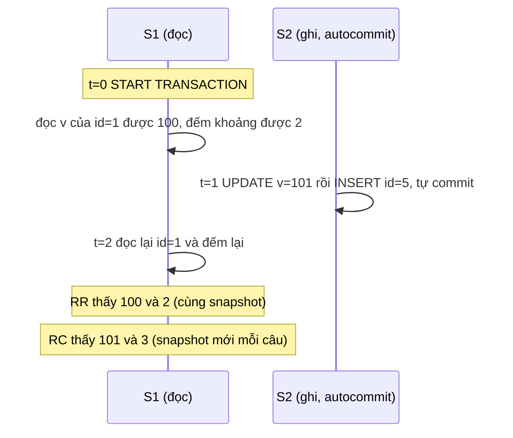

*(Sơ đồ do người viết ghi chú dựng từ **kết quả đã đo** của TN1 phần A, B.)*

**Đặt isolation level.** Xem [mục 2.3.4](#transactions-in-mysql) (tr. 11).

**Trade-offs và Decision** (**Bổ sung ngoài sách**, dựa trên số đo ở trên và ở [mục 2.7](#next-key-locking)):

- READ COMMITTED: không có gap lock cho phần lớn thao tác, nên ít chặn chèn và ít deadlock trên khoảng hơn; đổi lại có nonrepeatable read. Phù hợp khi ứng dụng không cần đọc lặp ổn định trong một transaction. Với binary log dạng `STATEMENT`, InnoDB không cho ghi ở READ COMMITTED; MySQL 8.0 mặc định `binlog_format=ROW` (đã đo) nên điều này hiếm gặp.
- REPEATABLE READ: snapshot ổn định cho cả transaction và chặn phantom cho locking read; đổi lại next-key lock khóa rộng hơn, và snapshot dài giữ undo lâu hơn ([mục 2.4](#purge-history)).
- SERIALIZABLE: an toàn nhất, nhưng mọi đọc trong transaction tường minh đều khóa; tranh chấp và timeout tăng (tr. 9).

<a id="deadlocks"></a>

#### 2.3.2 Deadlocks (tr. 9–10)

**What.** ***Deadlock*** là khi hai hay nhiều transaction **cùng giữ và cùng xin** khóa trên cùng tài nguyên, tạo **vòng phụ thuộc**. Deadlock xảy ra khi transaction khóa tài nguyên **theo thứ tự khác nhau**, và có thể xảy ra bất cứ khi nào nhiều transaction khóa cùng tài nguyên (tr. 9).

**Ví dụ StockPrice** (tr. 9–10). Bảng `StockPrice` có primary key `(stock_id, date)`. Transaction 1 cập nhật hàng `(4, 2020-05-01)` rồi hàng `(3, 2020-05-02)`; Transaction 2 cập nhật **cùng hai hàng theo thứ tự ngược lại**. Mỗi transaction chạy câu đầu, khóa hàng của mình **trong primary key index và mọi unique index chứa hàng đó**, rồi xin hàng thứ hai và thấy nó đã bị khóa. Hai bên chờ nhau mãi nếu không có gì can thiệp. Sách nhắc rằng index có thể "làm nên hay phá hỏng" hiệu năng khi schema tiến hóa ([Chương 7](chapter-07.md)).

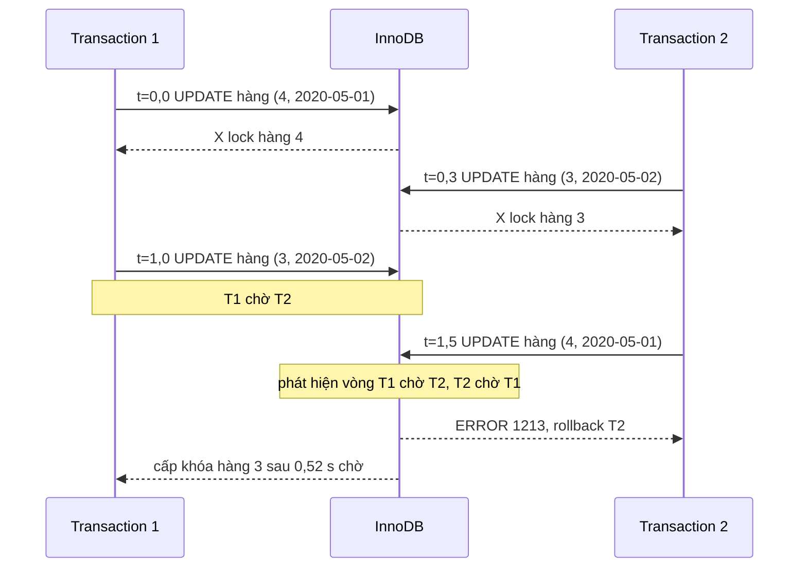

*(Vẽ theo kịch bản tr. 9–10, thời điểm là **kết quả đã đo** ở [TN3, phần A](experiments/chapter-01.md#tn3).)*

**How: phát hiện và phá vòng** (tr. 10).

- Database dùng nhiều cách: **phát hiện deadlock** và **timeout**.
- Hệ "tinh vi hơn" như InnoDB **nhận ra vòng phụ thuộc và trả lỗi ngay**. Điều này tốt, vì nếu không deadlock sẽ trông như **truy vấn rất chậm**.
- Hệ khác thì bỏ cuộc khi truy vấn vượt **lock wait timeout**, không phải lúc nào cũng tốt.
- InnoDB hiện **rollback transaction có ít exclusive row lock nhất**, một thước đo xấp xỉ cho transaction dễ rollback nhất.

<a id="deadlock-victim"></a>

> **Kết quả đã đo** ([TN3](experiments/chapter-01.md#tn3), MySQL 8.0.42):
> - **Phần A, kịch bản của sách:** session đóng vòng nhận `ERROR 1213 (40001) Deadlock found...` ngay khi xin khóa; session kia được cấp khóa sau 0,52 s chờ. `SHOW ENGINE INNODB STATUS` có mục `LATEST DETECTED DEADLOCK` liệt kê hai transaction, khóa mỗi bên đang giữ, khóa đang chờ, và dòng `WE ROLL BACK TRANSACTION (2)`. Bộ đếm `lock_deadlocks` trong `information_schema.INNODB_METRICS` tăng từ 0 lên 1.
> - **Phần B, chọn nạn nhân theo "kích thước":** transaction lớn (đã sửa 2.000 hàng, `trx_weight` 2008) **là bên đóng vòng**, transaction nhỏ (`trx_weight` 4) đang chờ. InnoDB vẫn rollback **transaction nhỏ**. Nghĩa là nạn nhân không phải "kẻ đến sau", mà là bên rẻ hơn để rollback. **Bổ sung ngoài sách:** manual MySQL mô tả kích thước theo số hàng đã insert, update, delete; thí nghiệm này không tách được hai thước đo vì transaction lớn vừa có nhiều X lock vừa sửa nhiều hàng.
> - **Phần C, tắt phát hiện deadlock** (`innodb_deadlock_detect=OFF`, `innodb_lock_wait_timeout=3`): cả hai cùng chờ khoảng 3,0–3,5 s rồi nhận `ERROR 1205 Lock wait timeout exceeded`. Đúng như sách cảnh báo: deadlock biến thành truy vấn chậm. Hơn nữa, timeout chỉ rollback **câu lệnh cuối** (`innodb_rollback_on_timeout=OFF` mặc định), nên khi script vẫn `COMMIT`, **mỗi transaction commit một nửa**: hàng 3 mang `high` của T2 nhưng `close` cũ; hàng 4 mang `close` của T1 nhưng `high` cũ.

**Bản chất kép** (tr. 10). Thứ tự và hành vi khóa là **riêng của từng engine**: cùng một chuỗi lệnh có thể deadlock ở engine này nhưng không ở engine khác. Có deadlock **không tránh được** vì xung đột dữ liệu thật; có deadlock do **cách engine hoạt động**.

> Chú thích 7 (tr. 10). Có engine khóa cả bảng, có engine cài khóa theo hàng phức tạp hơn; phần lớn logic đó nằm ở tầng storage engine.

**Decision** (tr. 10). Deadlock xảy ra rồi thì chỉ phá được bằng cách **rollback một transaction, một phần hoặc toàn bộ**. Chúng là **chuyện bình thường** trong hệ có transaction, và ứng dụng phải được thiết kế để xử lý: nhiều ứng dụng chỉ cần **chạy lại transaction từ đầu**, và nếu không gặp deadlock khác thì sẽ thành công.

**Bổ sung ngoài sách: giảm deadlock trong thực tế.**

- Khóa theo **cùng một thứ tự** ở mọi code path (ví dụ theo thứ tự primary key).
- Giữ transaction **ngắn**, không gọi mạng hay chờ người dùng khi đang giữ khóa.
- Có **index phù hợp** để engine khóa ít bản ghi (xem [tình huống 2](#th2)).
- Bật `innodb_print_all_deadlocks` để ghi **mọi** deadlock vào error log, vì `SHOW ENGINE INNODB STATUS` chỉ giữ cái gần nhất (đã đo: hai deadlock của TN3 đều có trong error log).
- Theo dõi `lock_deadlocks` và `lock_timeouts` trong `INNODB_METRICS` như một chỉ số.
- Retry phải **chạy lại cả transaction** và kiểm tra lỗi từng câu; như phần C cho thấy, bỏ qua lỗi rồi `COMMIT` có thể ghi nửa transaction.

**Hiểu lầm phổ biến.** "Tăng `innodb_lock_wait_timeout` sẽ hết deadlock": không, timeout chỉ là đường lui khi không phát hiện được vòng; với phát hiện bật, deadlock bị phá ngay. "Deadlock là lỗi của MySQL": sách coi chúng là **một phần tự nhiên** của hệ có transaction (tr. 10).

<a id="transaction-logging"></a>

#### 2.3.3 Transaction Logging (tr. 10–11)

**Why.** ***Transaction logging*** giúp transaction **hiệu quả hơn** (tr. 10). Nếu mỗi thay đổi phải cập nhật ngay bảng trên đĩa, mỗi commit sẽ kéo theo nhiều thao tác ghi ngẫu nhiên.

<a id="wal"></a>

**How** (tr. 10–11):

1. Engine đổi **bản sao dữ liệu trong bộ nhớ**: rất nhanh.
2. Engine ghi một **bản ghi mô tả thay đổi** vào **transaction log** trên đĩa, nên bền. Việc này cũng tương đối nhanh, vì **nối thêm** vào log là I/O **tuần tự** trong một vùng nhỏ, thay vì I/O **ngẫu nhiên** ở nhiều nơi.
3. **Một lúc sau**, một tiến trình cập nhật bảng trên đĩa.

Kỹ thuật này gọi là ***write-ahead logging***, và phần lớn engine dùng nó **ghi thay đổi xuống đĩa hai lần** (tr. 10). Nếu crash xảy ra **sau** khi đã ghi log nhưng **trước** khi cập nhật dữ liệu, engine vẫn **khôi phục** được thay đổi khi khởi động lại; cách khôi phục tùy engine (tr. 11).

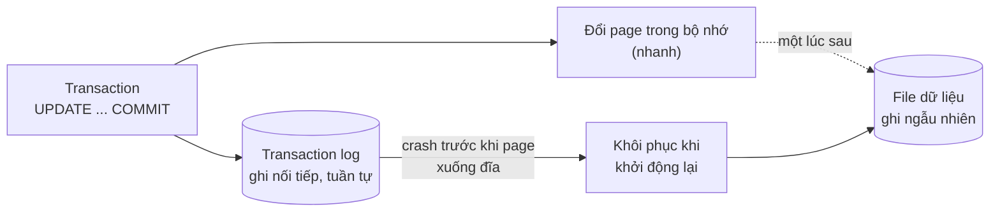

*(Sơ đồ do người viết ghi chú dựng từ tr. 10–11.)*

**Bổ sung ngoài sách: vì sao ghi hai lần mà vẫn nhanh hơn.**

- Ghi nối tiếp vào log rẻ hơn ghi ngẫu nhiên vào nhiều page, nhất là trên HDD; trên SSD khoảng cách nhỏ hơn nhưng vẫn có (đặc tính SSD ở [Chương 4](chapter-04.md#s2-4)).
- Nhiều commit có thể gộp vào một lần đẩy log xuống đĩa (*group commit*).
- Một page bị sửa nhiều lần chỉ cần ghi xuống file dữ liệu **một lần** khi được flush.

**Bổ sung ngoài sách: tên gọi trong InnoDB.** "Transaction log" của InnoDB là ***redo log***. Trong thư mục dữ liệu của instance thí nghiệm (8.0.42) có thư mục `#innodb_redo` chứa các file `#ib_redoN`, file doublewrite `#ib_16384_0.dblwr`, các file undo `undo_001`, `undo_002`, và `binlog.000001` (binary log của tầng server, khác redo log; xem [mục 2.5](#s2-5)). Mặc định `innodb_flush_log_at_trx_commit = 1` (đã đọc trên instance). Cấu hình kích thước và cách flush ở [Chương 5](chapter-05.md#s2-5-1) (tr. 113).

**Hiểu lầm phổ biến.** "`COMMIT` xong nghĩa là page dữ liệu đã nằm trên đĩa." Không: commit chỉ bảo đảm **log** đã bền (theo mức durability cấu hình); page dữ liệu được ghi sau. Đó chính là "ghi hai lần" của tr. 10.

<a id="transactions-in-mysql"></a>

#### 2.3.4 Transactions in MySQL (tr. 11–13)

Storage engine là phần mềm quyết định dữ liệu được lưu và lấy từ đĩa ra sao. MySQL từng có nhiều engine hỗ trợ transaction, nhưng **InnoDB nay là "tiêu chuẩn vàng"** và là engine được khuyên dùng; các nguyên lý transaction trong mục này dựa trên InnoDB (tr. 11).

<a id="autocommit"></a>

**Understanding AUTOCOMMIT** (tr. 11).

- Mặc định, một câu `INSERT`, `UPDATE` hay `DELETE` đơn lẻ được **ngầm bọc trong transaction và commit ngay**: chế độ ***AUTOCOMMIT***.
- Tắt chế độ này thì có thể chạy một loạt câu trong một transaction rồi `COMMIT` hoặc `ROLLBACK`.
- Bật tắt bằng `SET` cho connection hiện tại; `1` tương đương `ON`, `0` tương đương `OFF`.
- Với `AUTOCOMMIT=0`, bạn **luôn ở trong một transaction** cho tới khi `COMMIT` hay `ROLLBACK`, và MySQL bắt đầu transaction mới ngay sau đó.
- Với `AUTOCOMMIT` bật, dùng `BEGIN` hay `START TRANSACTION` để mở transaction nhiều câu.
- Đổi `AUTOCOMMIT` không ảnh hưởng gì tới bảng **không hỗ trợ transaction**.

**Lệnh tự commit** (tr. 11). Một số lệnh, khi chạy giữa transaction đang mở, khiến MySQL **commit transaction trước khi chạy**. Thường là DDL thay đổi lớn như `ALTER TABLE`, nhưng `LOCK TABLES` và vài lệnh khác cũng vậy. Danh sách đầy đủ xem tài liệu của phiên bản bạn dùng.

**Đặt isolation level** (tr. 11). Dùng `SET TRANSACTION ISOLATION LEVEL`, có hiệu lực khi **transaction kế tiếp bắt đầu**. Có thể đặt cho cả server trong file cấu hình, hoặc chỉ cho session (ví dụ `SET SESSION TRANSACTION ISOLATION LEVEL READ COMMITTED`). Nên đặt level dùng nhiều nhất ở mức server và chỉ đổi ở những chỗ cần rõ ràng. MySQL nhận cả bốn level của ANSI và InnoDB hỗ trợ cả bốn.

> **Kết quả đã đo** ([TN4](experiments/chapter-01.md#tn4), MySQL 8.0.42):
> - `START TRANSACTION; INSERT ...; CREATE TABLE ...; ROLLBACK;` thì hàng vừa chèn **vẫn còn**: `CREATE TABLE` đã commit ngầm.
> - Với `autocommit = 0`, sau một `INSERT` đã có transaction trong `information_schema.innodb_trx`; `ROLLBACK` xóa được hàng đó.
> - `SET TRANSACTION ISOLATION LEVEL READ COMMITTED` (không ghi scope) chỉ áp cho **transaction kế tiếp**: transaction đó có `trx_isolation_level = READ COMMITTED` trong khi `@@transaction_isolation` của session vẫn là `REPEATABLE-READ`; transaction sau nữa quay về REPEATABLE READ.

<a id="mixing-engines"></a>

**Mixing storage engines in transactions** (tr. 12). MySQL **không quản lý transaction ở tầng server**; engine tự cài transaction. Vì vậy không thể trộn đáng tin cậy nhiều engine trong một transaction.

- Trộn bảng có transaction và không có transaction (ví dụ InnoDB và MyISAM): mọi thứ chạy đúng **nếu suôn sẻ**. Cần rollback thì thay đổi trên bảng không transaction **không hoàn tác được**. Database rơi vào trạng thái không nhất quán, khó phục hồi, và mục đích của transaction mất ý nghĩa.
- MySQL **thường không cảnh báo hay báo lỗi**. Đôi khi rollback sinh cảnh báo "Some nontransactional changed tables couldn't be rolled back", nhưng phần lớn thời gian bạn không có dấu hiệu nào.

> **Cảnh báo của sách** (tr. 12). Thực hành tốt nhất là **không trộn storage engine** trong ứng dụng; transaction hỏng có thể để lại kết quả không nhất quán vì phần này rollback được, phần kia thì không.
>
> **Kết quả đã đo** ([TN4](experiments/chapter-01.md#tn4)): một transaction chèn vào bảng InnoDB và bảng MyISAM rồi `ROLLBACK`. `SHOW WARNINGS` cho `Warning 1196`; bảng InnoDB còn **0** hàng, bảng MyISAM còn **1** hàng.

<a id="two-phase-locking"></a>

**Implicit and explicit locking** (tr. 12–13).

- InnoDB dùng giao thức ***two-phase locking***: có thể xin khóa **bất cứ lúc nào** trong transaction, nhưng **không nhả** cho tới `COMMIT` hay `ROLLBACK`, và nhả **tất cả cùng lúc** (tr. 12).
- Các cơ chế khóa đã mô tả đều là khóa **ngầm** (*implicit*): InnoDB tự xử lý theo isolation level.
- InnoDB cũng hỗ trợ khóa **tường minh** (*explicit*), điều mà chuẩn SQL không nhắc tới: `SELECT ... FOR SHARE` và `SELECT ... FOR UPDATE`.

> Chú thích 8 (tr. 12). Các "locking hint" này **hay bị lạm dụng** và thường nên tránh.
>
> Chú thích 9 (tr. 12). `SELECT ... FOR SHARE` là tính năng của MySQL 8.0, thay cho `SELECT ... LOCK IN SHARE MODE` của bản trước. (**Bổ sung ngoài sách, đã thử trên 8.0.42:** cú pháp cũ vẫn chạy, không sinh cảnh báo.)

<a id="lock-tables"></a>

**`LOCK TABLES`** (tr. 12–13). MySQL cũng có `LOCK TABLES` và `UNLOCK TABLES`, được cài **trong server**, không trong engine. Nếu cần transaction, hãy dùng engine có transaction. `LOCK TABLES` là **không cần thiết** vì InnoDB đã có row-level locking.

> **Mẹo của sách** (tr. 13). Tương tác giữa `LOCK TABLES` và transaction phức tạp, có hành vi bất ngờ ở vài phiên bản. Vì vậy **đừng bao giờ dùng `LOCK TABLES`** trừ khi đang ở trong transaction và `AUTOCOMMIT` đã tắt, bất kể engine nào.

**Bổ sung ngoài sách.**

- "Two-phase locking" ở đây đúng hơn là *strict* two-phase locking: khóa giữ tới cuối transaction. Hệ quả hiệu năng: transaction càng dài, khóa càng bị giữ lâu; độ dài transaction quyết định thời gian người khác phải chờ.
- MySQL 8.0 có thêm `FOR UPDATE NOWAIT` (báo lỗi ngay nếu hàng đang bị khóa) và `FOR UPDATE SKIP LOCKED` (bỏ qua hàng đang bị khóa), hay dùng cho mẫu "nhiều worker lấy việc". Cả hai đã chạy được trên 8.0.42.

#### Tự kiểm tra 2.3

- **Câu 2.3.1.** Trong ví dụ chuyển $200 (tr. 6–7), chữ C của ACID bảo vệ điều gì? Vì sao chỉ bọc ba câu lệnh trong transaction ở REPEATABLE READ chưa đủ để chặn hai lần rút tiền chạy song song? [đáp án](answers/chapter-01.md#q2-3-1)
- **Câu 2.3.2.** Với InnoDB, mỗi isolation level cho kết quả gì về dirty read, nonrepeatable read và phantom (với consistent read và với locking read)? Chỗ nào khác Bảng 1-1? [đáp án](answers/chapter-01.md#q2-3-2)
- **Câu 2.3.3.** Trong ví dụ StockPrice, vì sao hai transaction deadlock? Nêu hai thay đổi phía ứng dụng để giảm deadlock, và một việc ứng dụng vẫn bắt buộc phải làm. [đáp án](answers/chapter-01.md#q2-3-3)
- **Câu 2.3.4.** Vì sao write-ahead logging ghi dữ liệu xuống đĩa hai lần mà vẫn nhanh hơn ghi thẳng vào bảng? Crash sau khi ghi log nhưng trước khi cập nhật trang dữ liệu thì sao? [đáp án](answers/chapter-01.md#q2-3-4)
- **Câu 2.3.5.** Dự đoán: `START TRANSACTION; INSERT INTO t_inno ...; CREATE TABLE x (...); ROLLBACK;` thì hàng vừa chèn còn không? Nếu thay `CREATE TABLE` bằng một `INSERT` vào bảng MyISAM rồi `ROLLBACK` thì sao? [đáp án](answers/chapter-01.md#q2-3-5)

---

<a id="s2-4"></a>

### 2.4 Multiversion Concurrency Control (tr. 13–15)

<a id="mvcc"></a>

**What.** Phần lớn engine có transaction của MySQL **không** dùng row lock đơn thuần, mà dùng row lock **kết hợp** kỹ thuật tăng concurrency gọi là ***multiversion concurrency control (MVCC)***. MVCC không riêng gì MySQL (Oracle, PostgreSQL và vài hệ khác cũng dùng), nhưng **không có chuẩn** nên cách cài khác nhau đáng kể (tr. 13).

**Why.** Có thể coi MVCC là một **biến tấu của row-level locking**: trong nhiều trường hợp nó **tránh hẳn việc khóa**, overhead thấp hơn nhiều. Tùy cách cài, nó cho phép **đọc không khóa** và chỉ khóa đúng những hàng cần khi ghi (tr. 13).

**How (khái niệm).** MVCC dùng **snapshot** của dữ liệu tại một thời điểm. Nhờ vậy transaction thấy một **góc nhìn nhất quán** dù chạy lâu bao nhiêu; và **các transaction khác nhau có thể thấy dữ liệu khác nhau trong cùng bảng cùng lúc** (tr. 13). Mỗi engine cài MVCC một kiểu, với các biến thể như ***optimistic*** và ***pessimistic concurrency control*** (tr. 13).

> Chú thích 10 (tr. 13). Tác giả khuyên đọc một bài blog của Jeremy Cole để hiểu sâu hơn cấu trúc bản ghi của InnoDB.

<a id="undo-log"></a>

**How trong InnoDB** (tr. 13–14):

1. InnoDB gán **transaction ID** cho mỗi transaction; theo sách, ID được gán **lần đầu transaction đọc dữ liệu**.
2. Khi một bản ghi bị sửa trong transaction, một ***undo record*** mô tả cách hoàn tác được ghi vào ***undo log***, và ***rollback pointer*** được trỏ tới undo record đó. Nhờ vậy transaction biết đường rollback khi cần.
3. Khi một session khác đọc một bản ghi của **clustered index**, InnoDB so **transaction ID của bản ghi** với ***read view*** của session. Nếu trạng thái hiện tại **không được phép thấy** (transaction đã sửa nó chưa commit), InnoDB **lần theo undo record và áp dụng** cho tới khi gặp một transaction ID được phép thấy.
4. Vòng lặp có thể đi tới tận undo record **xóa hẳn** hàng, nghĩa là với read view đó hàng **không tồn tại**.
5. **Xóa** một bản ghi được làm bằng cách bật bit "deleted" trong "info flags" của bản ghi; undo log ghi việc này là "remove delete mark".

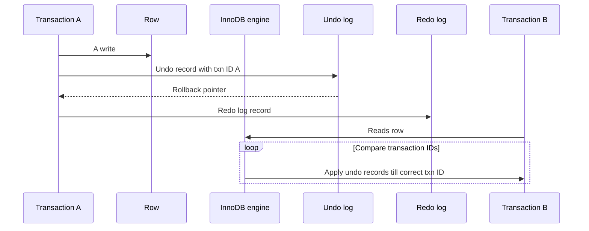

*(Vẽ lại Hình 1-2, tr. 14, đã phóng to ảnh trang để đọc chiều mũi tên: "Rollback pointer" đi từ Undo log về Transaction A; "Reads row" đi từ Transaction B tới InnoDB engine; khung "Loop" có nhãn "[Compare transaction IDs]" bao mũi tên "Apply undo records till correct txn ID" từ InnoDB engine tới Transaction B. Hình không vẽ mũi tên nào giữa InnoDB engine và Undo log, dù lời văn nói engine "lần theo" undo record.)*

**Undo cũng được ghi redo** (tr. 14). Mọi thao tác ghi undo log **cũng được redo log**, vì undo là một phần của quá trình phục hồi sau crash và bản thân nó cũng phải có tính transaction.

> Chú thích 11 (tr. 14). Muốn biết chi tiết InnoDB xử lý nhiều phiên bản bản ghi ra sao, xem một bài blog khác của Jeremy Cole.

Kích thước redo log và undo log ảnh hưởng lớn tới hiệu năng transaction ở **concurrency cao**; cấu hình ở [Chương 5](chapter-05.md#s2-5) (tr. 14).

**Trade-offs** (tr. 14). Nhờ toàn bộ việc ghi chép thêm này, **phần lớn truy vấn đọc không bao giờ xin khóa**: chúng đọc nhanh nhất có thể, chỉ cần chọn đúng các hàng thỏa điều kiện. Cái giá:

- engine phải **lưu thêm dữ liệu** cho mỗi hàng;
- phải **làm thêm việc** khi xét từng hàng;
- phải lo thêm vài thao tác **dọn dẹp** (*housekeeping*).

**MVCC chỉ dùng với REPEATABLE READ và READ COMMITTED** (tr. 15). READ UNCOMMITTED không tương thích vì truy vấn không đọc phiên bản phù hợp với transaction của mình mà luôn đọc **bản mới nhất**. SERIALIZABLE không tương thích vì đọc là **khóa mọi hàng** trả về.

> Chú thích 12 (tr. 15). Không có chuẩn chính thức nào định nghĩa MVCC, nên các engine và database cài rất khác nhau, và không ai có thể nói cách nào là sai.

<a id="read-view"></a>

**Bổ sung ngoài sách, có đo: chính xác hóa "ID được gán lần đầu đọc".**

- **Kết quả đã đo** ([TN1, phần D](experiments/chapter-01.md#tn1)): ngay sau `START TRANSACTION`, `information_schema.innodb_trx` **chưa có** transaction nào của session. Sau câu `SELECT` đầu tiên thì có, với `trx_id = 284026416991296`, một số rất lớn không lấy từ bộ đếm transaction. Sau câu `UPDATE` đầu tiên, `trx_id` thành **1455**, một ID thật từ bộ đếm. Theo manual MySQL, InnoDB **không cấp ID thật** cho transaction chỉ đọc và không khóa; ID thật được cấp khi transaction bắt đầu ghi (hoặc khóa).
- **Kết quả đã đo** ([TN1, phần C](experiments/chapter-01.md#tn1)): ở REPEATABLE READ, **read view được tạo ở câu consistent read đầu tiên**, không phải ở `START TRANSACTION`. Session mở transaction lúc t=0, session khác commit lúc t=1, session đầu đọc lúc t=2 thì **thấy giá trị mới (101)**. Dùng `START TRANSACTION WITH CONSISTENT SNAPSHOT` thì read view được tạo ngay và lần đọc lúc t=2 thấy **giá trị cũ (100)**.
- Ở READ COMMITTED, mỗi câu consistent read tạo **read view mới**, nên thấy dữ liệu đã commit gần nhất (TN1 phần B).

**Bổ sung ngoài sách, có đo: "lưu thêm dữ liệu cho mỗi hàng" là gì.** Lệnh `ibd2sdi` đọc định nghĩa bảng nằm trong file `t_inno.ibd` cho thấy bảng có primary key `id` còn có hai **cột ẩn**: `DB_TRX_ID` (transaction cuối cùng sửa hàng) và `DB_ROLL_PTR` (rollback pointer tới undo record). Trong output deadlock của TN3, bản ghi hàng 4 được in thành các trường đánh số từ `0:`; trường `2:` (sau hai cột primary key) là `len 6; hex 0000000006e2` = **1762**, đúng ID của transaction vừa sửa hàng đó; trường `3:` dài 7 byte là rollback pointer. Đây chính là "transaction ID của bản ghi" và "rollback pointer" trong Hình 1-2.

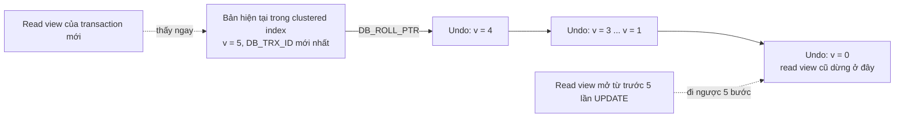

*(**Bổ sung ngoài sách**: sơ đồ chuỗi phiên bản, dựng theo cơ chế ở tr. 13–14 và số liệu TN1 phần F.)*

<a id="purge-history"></a>

**Bổ sung ngoài sách, có đo: cái giá "housekeeping" khi giữ snapshot lâu.** **Kết quả đã đo** ([TN1, phần F](experiments/chapter-01.md#tn1), bảng 50.000 hàng): một session REPEATABLE READ mở snapshot rồi ngồi chờ; session khác chạy 5 lần `UPDATE` cả bảng và 1.000 transaction sửa một hàng.

| Chỉ số | Trước khi bên kia ghi | Sau khi bên kia ghi |
| --- | --- | --- |
| `SUM(v)` qua snapshot cũ (trung vị 3 lần) | 23 ms (1 lần đo) | **390 ms** (373, 390, 408) |
| `SUM(v)` qua snapshot mới (trung vị 3 lần) | | **17 ms** (16,8; 17,3; 17,9) |
| `trx_rseg_history_len` (History list length) | 10 | **1.007** |

Snapshot cũ chậm hơn khoảng 20 lần vì mỗi hàng phải đi ngược 5–6 phiên bản trong undo. History list length nhảy lên 1.007 vì **purge** không được xóa undo mà một read view còn cần. Sau khi session cũ commit, `SHOW ENGINE INNODB STATUS` báo purge đã xử lý xong nhưng History list length **vẫn 1.007** trong khoảng 13 s quan sát; nó chỉ giảm (còn 59) sau khi có thêm hoạt động ghi. Cách giải thích (**Bổ sung ngoài sách, chưa kiểm chứng sâu**): bộ đếm giảm khi rollback segment được truncate theo lô, không phải ngay khi purge xong. Số đo thời gian là laptop Windows, nhiều nhiễu, không phải benchmark.

**Hiểu lầm phổ biến.**

- "MVCC nghĩa là InnoDB không cần khóa." Sai: MVCC đi **cùng** row lock (tr. 13); ghi vẫn khóa, locking read vẫn khóa.
- "Transaction chỉ đọc thì vô hại." Một snapshot mở lâu làm undo phình ra và làm chính nó đọc chậm dần (số đo ở trên).
- "MVCC chặn phantom cho mọi loại đọc." Chỉ cho consistent read ([mục 2.3.1](#phantom-read)).

#### Tự kiểm tra 2.4

- **Câu 2.4.1.** Theo Hình 1-2, khi transaction B đọc một hàng mà A đã sửa nhưng chưa commit, InnoDB làm những bước gì, và vòng lặp kết thúc khi nào? [đáp án](answers/chapter-01.md#q2-4-1)
- **Câu 2.4.2.** Sách nói transaction ID được gán lần đầu transaction đọc dữ liệu. Thí nghiệm cho thấy gì về `trx_id` trước và sau câu ghi đầu tiên, và read view ở REPEATABLE READ được tạo lúc nào? [đáp án](answers/chapter-01.md#q2-4-2)
- **Câu 2.4.3.** Vì sao MVCC không dùng với READ UNCOMMITTED và SERIALIZABLE? [đáp án](answers/chapter-01.md#q2-4-3)
- **Câu 2.4.4.** Một báo cáo giữ transaction REPEATABLE READ mở hai giờ trên server OLTP bận. Dự đoán ảnh hưởng tới chính báo cáo và tới server, và chỉ số nào xác nhận. [đáp án](answers/chapter-01.md#q2-4-4)
- **Câu 2.4.5.** "MVCC nghĩa là InnoDB không cần khóa": đúng hay sai? Dẫn chứng từ sách và từ thí nghiệm. [đáp án](answers/chapter-01.md#q2-4-5)

---

<a id="s2-5"></a>

### 2.5 Replication (tr. 15)

<a id="replication"></a>

**What và Why.** MySQL được thiết kế để **nhận ghi trên một node tại một thời điểm**. Điều này có lợi cho việc giữ nhất quán, nhưng tạo đánh đổi khi cần dữ liệu ghi ở nhiều server hay nhiều nơi. MySQL có cách gốc để **phân phối** các lần ghi mà một node nhận tới các node khác: ***replication*** (tr. 15).

**How.** Node ***source*** có **một thread cho mỗi replica**; thread này đăng nhập như một replication client, **thức dậy khi có ghi** và gửi dữ liệu mới đi. Hình 1-3 vẽ một ***topology tree*** đơn giản (tr. 15).

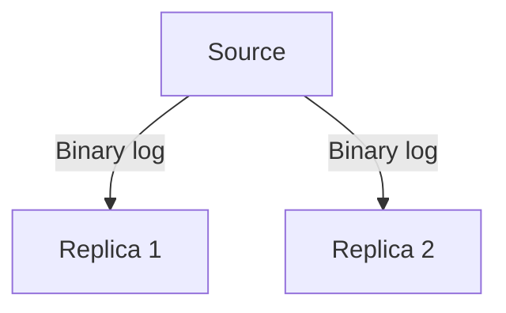

*(Vẽ lại Hình 1-3, tr. 15.)*

**Decision** (tr. 15). Với mọi dữ liệu chạy production, nên dùng replication và có **ít nhất ba replica nữa**, lý tưởng là đặt ở **các vị trí khác nhau** (trên cloud gọi là *region*) cho kế hoạch disaster recovery.

**Tiến hóa** (tr. 15). Replication của MySQL ngày càng tinh vi: global transaction identifier (GTID), multisource replication, parallel replication trên replica, semisync replication. Chi tiết ở [Chương 9](chapter-09.md).

**Bổ sung ngoài sách.**

- ***Binary log*** trong Hình 1-3 là log của **tầng server**, ghi thay đổi ở mức logic (câu lệnh hoặc hàng), độc lập engine; dùng cho replication và phục hồi tới một thời điểm. ***Redo log*** ([mục 2.3.3](#wal)) là log **vật lý của InnoDB**, dùng cho crash recovery. Instance thí nghiệm 8.0.42 có `log_bin = 1` và `binlog_format = ROW` theo mặc định (đã đọc).
- Mặc định replication là **bất đồng bộ**: replica có thể trễ (*replication lag*); xem [DDIA, đồng bộ và bất đồng bộ](../../DDIA/ddia-notes/chapter-05.md#sync-async).
- Replication **không scale ghi**: mọi lần ghi vẫn đi qua một source. Scale ghi là chuyện sharding ở [Chương 11](chapter-11.md#s2-6).

**Hiểu lầm phổ biến.** "Có replica thì khỏi backup." Chương 10 nói rõ **replica không phải backup** (tr. 286, theo [roadmap chương 10](learning-roadmap.md#ch10)): một lệnh `DELETE` nhầm cũng được nhân bản sang replica.

#### Tự kiểm tra 2.5

- **Câu 2.5.1.** Vì sao MySQL được thiết kế cho một node nhận ghi tại một thời điểm, và đánh đổi của lựa chọn đó là gì? [đáp án](answers/chapter-01.md#q2-5-1)
- **Câu 2.5.2.** Binary log trong Hình 1-3 khác redo log ở mục 2.3.3 như thế nào về tầng và mục đích? [đáp án](answers/chapter-01.md#q2-5-2)
- **Câu 2.5.3.** Sách khuyên ít nhất ba replica ở các vùng khác nhau. Mục tiêu đó là gì, và replica có thay được backup không? [đáp án](answers/chapter-01.md#q2-5-3)

---

<a id="s2-6"></a>

### 2.6 Datafiles Structure (tr. 16)

<a id="data-dictionary"></a>

**What.** Trong **8.0**, MySQL thiết kế lại metadata của bảng thành một ***data dictionary***; theo sách, nó "đi kèm file `.ibd` của bảng". Nhờ vậy thông tin cấu trúc bảng hỗ trợ **transaction** và **thay đổi định nghĩa nguyên tử** (tr. 16).

**Dictionary object cache** (tr. 16). Thay vì chỉ dựa vào `information_schema` để lấy định nghĩa bảng và metadata khi chạy, 8.0 có ***dictionary object cache***: một cache trong bộ nhớ theo **LRU**, chứa định nghĩa partition, định nghĩa bảng, định nghĩa stored program, charset và collation.

**Why có lợi cho hiệu năng** (tr. 16). Thay đổi cách server truy cập metadata này **giảm I/O** và hiệu quả, nhất là khi chỉ **một tập con** bảng hoạt động nhiều nhất và vì thế nằm trong cache thường xuyên nhất.

<a id="sdi"></a>

**File trên đĩa** (tr. 16). Sách viết rằng file `.ibd` và `.frm` được thay bằng ***serialized dictionary information (.sdi)*** cho mỗi bảng.

> **Kết quả đã đo, chính xác hóa câu trên** ([TN4](experiments/chapter-01.md#tn4), MySQL 8.0.42):
> - Thư mục `lab/` chỉ có `t_inno.ibd` cho bảng InnoDB; **không có `.frm`** và **không có file `.sdi`** riêng cho bảng InnoDB. `ibd2sdi t_inno.ibd` đọc ra định nghĩa bảng dạng JSON: **SDI nằm bên trong `.ibd`**.
> - Bảng MyISAM `t_myi` có `t_myi.MYD`, `t_myi.MYI` và `t_myi_388.sdi`. Các bảng CSV trong schema `mysql` (`general_log`, `slow_log`) cũng có file `.sdi`.
> - Bản gốc của dictionary nằm trong các bảng InnoDB của `mysql.ibd`; truy vấn thẳng `SELECT ... FROM mysql.tables` bị từ chối (`ERROR 3554 Access to data dictionary table 'mysql.tables' is rejected`). Muốn đọc thì đi qua `information_schema`.
>
> Nói gọn: `.frm` bị bỏ; `.ibd` **vẫn còn** và chứa thêm một bản SDI; file `.sdi` riêng chỉ có cho bảng không phải InnoDB.

**Bổ sung ngoài sách.** Kích thước các phần của dictionary object cache có biến riêng; trên 8.0.42 đọc được `table_definition_cache = 2000`, `schema_definition_cache = 256`, `stored_program_definition_cache = 256`, `tablespace_definition_cache = 256`.

#### Tự kiểm tra 2.6

- **Câu 2.6.1.** Trong MySQL 8.0, metadata của một bảng InnoDB nằm ở đâu? Sách viết "`.ibd` và `.frm` được thay bằng `.sdi`"; thí nghiệm cho thấy thư mục dữ liệu thực tế ra sao? [đáp án](answers/chapter-01.md#q2-6-1)
- **Câu 2.6.2.** Dictionary object cache giúp gì cho hiệu năng, và khi nào lợi ích lớn nhất? [đáp án](answers/chapter-01.md#q2-6-2)
- **Câu 2.6.3.** Vì sao chuyển metadata vào data dictionary buộc quy trình backup phải đổi? [đáp án](answers/chapter-01.md#q2-6-3)

---

<a id="s2-7"></a>

### 2.7 The InnoDB Engine (tr. 16–18)

<a id="innodb"></a>

**What.** InnoDB là storage engine có transaction **mặc định** của MySQL, quan trọng và hữu dụng nhất. Nó được thiết kế cho **nhiều transaction ngắn**, thường **hoàn tất** chứ ít khi rollback. Hiệu năng và **tự phục hồi sau crash** khiến nó được dùng cả cho nhu cầu không cần transaction. Muốn học storage engine thì nên học **thật sâu InnoDB** thay vì học đều mọi engine (tr. 16).

> **Lưu ý của sách** (tr. 16). Thực hành tốt nhất là dùng InnoDB làm engine mặc định cho mọi ứng dụng; MySQL đã làm InnoDB thành mặc định từ vài phiên bản lớn trước.

**Tablespace** (tr. 16). Mặc định InnoDB lưu dữ liệu trong một loạt datafile gọi chung là ***tablespace***, về cơ bản là một "hộp đen" do InnoDB tự quản lý.

<a id="next-key-locking"></a>

**MVCC và next-key locking** (tr. 16). InnoDB dùng MVCC để đạt concurrency cao và cài cả bốn isolation level của chuẩn, mặc định REPEATABLE READ. Nó có chiến lược ***next-key locking*** để **chặn phantom** ở level này: thay vì chỉ khóa các hàng truy vấn đã chạm tới, InnoDB **khóa cả các khoảng trống (gap) trong cấu trúc index**, ngăn chèn phantom vào đó.

> **Kết quả đã đo** ([TN2, phần C](experiments/chapter-01.md#tn2)): bảng có `id` = 10, 20, 30, 40. Session 1 chạy `SELECT id, c FROM t2 WHERE id BETWEEN 15 AND 35 FOR UPDATE` (plan `range` trên `PRIMARY`).
>
> | | REPEATABLE READ | READ COMMITTED |
> | --- | --- | --- |
> | Khóa trong `data_locks` | `X` trên 20 và 30 (next-key: hàng và khoảng trước nó), `X,GAP` trên 40 (chỉ khoảng 30–40) | `X,REC_NOT_GAP` trên 20 và 30 |
> | Session khác chèn `id = 25` | **chờ 2,00 s** (`X,GAP,INSERT_INTENTION` WAITING) | 0,00 s |
> | Chèn `id = 5` và `id = 50` | 0,00 s (ngoài các khoảng bị khóa) | 0,00 s |
>
> Ở REPEATABLE READ, chèn vào khoảng đã "đọc có khóa" bị chặn: không thể có phantom cho locking read đó. Ở READ COMMITTED, chỉ hàng bị khóa, không có gap lock.

<a id="clustered-index"></a>

**Clustered index** (tr. 16–17). Bảng InnoDB được xây trên ***clustered index***; sách hẹn bàn chi tiết "ở Chapter 8 khi nói về thiết kế schema" (thực tế: mục *Clustered Indexes* nằm ở [Chương 7](chapter-07.md#clustered-index), tr. 170; thiết kế schema là chương 6, xem [ghi chú kiểm tra nguồn](#kiem-tra)). Cấu trúc index của InnoDB khác hẳn phần lớn engine khác của MySQL:

- tra cứu theo **primary key rất nhanh**;
- ***secondary index*** (index không phải primary key) **chứa các cột primary key**, nên primary key lớn thì mọi index khác cũng lớn. Nhiều index trên một bảng thì nên cố giữ **primary key nhỏ** (tr. 16–17).

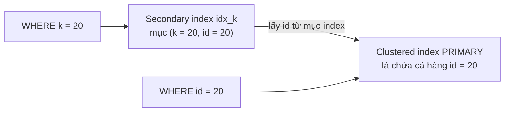

*(**Bổ sung ngoài sách**, minh họa ý tr. 16–17. Bằng chứng đã đo: trong `data_locks`, khóa trên `idx_k` có `LOCK_DATA` dạng "10, 10", "20, 20": giá trị `k` **kèm giá trị primary key**, đúng như "secondary index chứa cột primary key".)*

<a id="internal-optimizations-check"></a>

**Tối ưu nội bộ** (tr. 17). InnoDB có nhiều tối ưu nội bộ: ***predictive read-ahead*** để đọc trước dữ liệu từ đĩa, ***adaptive hash index*** tự dựng hash index trong bộ nhớ để tra cứu rất nhanh, và ***insert buffer*** để tăng tốc insert. Sách nói các thứ này "được bàn ở Chapter 4".

> **Kết quả kiểm chứng tham chiếu "Chapter 4"** (mục 8 của [roadmap](learning-roadmap.md#can-kiem-chung)). Câu này có trong bản in (đã xem ảnh trang PDF 39). Đã tìm toàn bộ chữ của sách:
> - **Chương 4 không bàn ba tối ưu này.** Nó chỉ nhắc lướt rằng InnoDB tự làm read-ahead thông minh, nên read-ahead của RAID controller (tr. 84) hay của filesystem (tr. 88) có thể thừa.
> - **Adaptive hash index**: chương 5 nói nó nằm trong buffer pool (tr. 110); chương 7 định nghĩa nó (InnoDB tự dựng hash index trên B-tree cho giá trị hay truy cập, không cấu hình được, chỉ tắt được hẳn; tr. 159) và nói nó giảm chi phí tra cứu hai bước của clustered index (tr. 173).
> - **Insert buffer**: chỉ xuất hiện lướt ở chương 10 (tablespace hệ thống dùng cho insert buffer, rollback segment…; tr. 265). Tên mới của nó, *change buffer*, được nhắc ở chương 5 như một thứ nằm trong buffer pool (tr. 110) và trong tablespace (tr. 116). **Không chương nào giải thích cơ chế.**
> - Kết luận: tham chiếu "Chapter 4" **không chính xác**; thông tin rải rác ở chương 4 (read-ahead), 5 và 7 (adaptive hash index), 5 và 10 (change/insert buffer), và không có chỗ nào bàn sâu.
>
> **Bổ sung ngoài sách.** *Insert buffer* được mở rộng thành ***change buffer*** từ InnoDB 5.5 (đệm cả delete-mark và purge cho secondary index không unique). Trên instance thí nghiệm 8.0.42 đọc được `innodb_adaptive_hash_index = ON`, `innodb_change_buffering = all`, `innodb_read_ahead_threshold = 56`, `innodb_random_read_ahead = OFF`. Theo ghi chú phát hành MySQL 8.4 (chưa kiểm trên máy này vì chỉ có 8.0.42), mặc định của adaptive hash index đổi sang OFF và change buffering sang `none`: đây là ví dụ điển hình về mặc định phụ thuộc phiên bản.

**Sự tinh tế của InnoDB** (tr. 17). Hành vi của InnoDB rất phức tạp; sách khuyên đọc mục "InnoDB Locking and Transaction Model" của manual. Vì kiến trúc MVCC, có nhiều điểm tinh tế cần biết trước khi xây ứng dụng: làm việc với một engine giữ góc nhìn nhất quán cho mọi user, kể cả khi có user đang sửa dữ liệu, có thể phức tạp. (Các thí nghiệm ở [mục 2.3.1](#phantom-read) là ví dụ cho "điểm tinh tế".)

**Backup nóng** (tr. 17). Là engine có transaction, InnoDB hỗ trợ backup **"nóng" thật sự** qua nhiều cơ chế: MySQL Enterprise Backup (độc quyền của Oracle) và Percona XtraBackup (mã nguồn mở). Chi tiết ở [Chương 10](chapter-10.md#s2-5).

<a id="online-ddl"></a>

**Online DDL** (tr. 17). Từ MySQL 5.6, InnoDB có ***online DDL***, ban đầu dùng được ít trường hợp, mở rộng ở 5.7 và 8.0. Thay đổi schema **tại chỗ** (*in-place*) cho phép một số thay đổi bảng **không cần khóa cả bảng** và không cần công cụ ngoài, cải thiện nhiều khả năng vận hành. Các lựa chọn thay đổi schema online (gốc và công cụ ngoài) ở [Chương 6](chapter-06.md#running-changes).

<a id="json"></a>

#### 2.7.1 JSON Document Support (tr. 17)

- Kiểu **JSON** vào InnoDB ở bản **5.7**, kèm **tự kiểm tra tính hợp lệ** của tài liệu JSON và cách lưu **tối ưu cho đọc nhanh**: cải thiện lớn so với đánh đổi cũ khi kỹ sư phải nhét JSON vào BLOB (tr. 17).
- Cùng kiểu dữ liệu mới, InnoDB có thêm **hàm SQL** để thao tác phong phú trên JSON (tr. 17).
- Sách viết rằng MySQL **8.0.7** thêm khả năng định nghĩa ***multivalued index*** trên mảng JSON: một cách mạnh để tăng tốc truy vấn đọc, bằng cách khớp các mẫu truy cập phổ biến với hàm ánh xạ giá trị trong tài liệu JSON (tr. 17).
- Cách dùng và hệ quả hiệu năng của JSON ở mục "JSON Data", tr. 139, [Chương 6](chapter-06.md#json-data).

> **Bổ sung ngoài sách.** Theo tài liệu MySQL, multi-valued index xuất hiện từ **8.0.17**; "8.0.7" trong sách có thể là lỗi in (người viết ghi chú chưa có bản 8.0.7 để kiểm).
>
> **Ví dụ minh họa do AI xây dựng, đã chạy trên 8.0.42.** Bảng `customers(id, profile JSON)` với index `idx_zips ((CAST(profile->'$.zipcodes' AS UNSIGNED ARRAY)))`. Chèn một chuỗi JSON thiếu dấu đóng mảng bị từ chối với `ERROR 3140 Invalid JSON text`. Truy vấn `WHERE 94507 MEMBER OF (profile->'$.zipcodes')` cho `EXPLAIN` với `type = ref`, `key = idx_zips`: index trên từng phần tử mảng được dùng.

<a id="data-dictionary-changes"></a>

#### 2.7.2 Data Dictionary Changes (tr. 17–18)

- Một thay đổi lớn khác của 8.0: **bỏ lưu metadata bảng bằng file**, chuyển sang data dictionary **lưu trong bảng InnoDB**. Mọi lợi ích phục hồi sau crash và tính transaction của InnoDB vì thế áp dụng cho cả các thao tác **thay đổi bảng** (tr. 17).
- Thay đổi này cải thiện nhiều việc quản lý định nghĩa dữ liệu, nhưng cũng đòi hỏi **thay đổi lớn trong vận hành**. Đáng kể nhất: quy trình **backup** từng dựa vào file metadata của bảng nay phải **truy vấn data dictionary** để lấy định nghĩa bảng (tr. 18).

<a id="atomic-ddl"></a>

#### 2.7.3 Atomic DDL (tr. 18)

**What.** MySQL 8.0 có ***atomic DDL***: câu lệnh định nghĩa dữ liệu hoặc **hoàn tất trọn vẹn**, hoặc **rollback trọn vẹn**.

**How.** InnoDB tạo **undo log và redo log riêng cho DDL** để theo dõi thay đổi: thêm một chỗ thiết kế đã được chứng minh của InnoDB được mở rộng sang thao tác của server (tr. 18).

> **Kết quả đã đo** ([TN4](experiments/chapter-01.md#tn4)): `DROP TABLE d1, khong_ton_tai` trả `ERROR 1051 Unknown table 'lab.khong_ton_tai'`, và `SHOW TABLES LIKE 'd1'` cho thấy **`d1` vẫn còn**: câu lệnh thất bại thì không phần nào được áp dụng. **Bổ sung ngoài sách:** manual MySQL dùng chính ví dụ này để so sánh; trước 8.0, `d1` sẽ bị xóa dù câu lệnh báo lỗi.

**Hiểu lầm phổ biến.** "Atomic DDL nghĩa là DDL nằm trong transaction và `ROLLBACK` được." Sai. Atomic DDL nói về **một câu DDL**; DDL **vẫn commit ngầm** transaction đang mở (tr. 11). Thí nghiệm ở [mục 2.3.4](#transactions-in-mysql) cho thấy `CREATE TABLE` giữa transaction làm `ROLLBACK` sau đó không còn hoàn tác được `INSERT` trước nó.

#### Tự kiểm tra 2.7

- **Câu 2.7.1.** Next-key locking chặn phantom thế nào? Trong thí nghiệm khóa khoảng `id BETWEEN 15 AND 35` ở REPEATABLE READ, vì sao chèn `id = 25` phải chờ còn `id = 5` và `id = 50` thì không? [đáp án](answers/chapter-01.md#q2-7-1)
- **Câu 2.7.2.** Vì sao primary key lớn làm mọi secondary index lớn theo? Output `data_locks` nào là bằng chứng cho cấu trúc đó? [đáp án](answers/chapter-01.md#q2-7-2)
- **Câu 2.7.3.** Tr. 17 nói read-ahead, adaptive hash index và insert buffer "được bàn ở Chapter 4". Kết quả kiểm chứng là gì, và muốn đọc về chúng thì tìm ở đâu trong sách? [đáp án](answers/chapter-01.md#q2-7-3)
- **Câu 2.7.4.** Atomic DDL có nghĩa là DDL nằm trong transaction và `ROLLBACK` được không? Giải thích bằng hai kết quả thí nghiệm. [đáp án](answers/chapter-01.md#q2-7-4)
- **Câu 2.7.5.** Kiểu JSON của 5.7 cải thiện gì so với lưu JSON trong BLOB, và multi-valued index giúp loại truy vấn nào? [đáp án](answers/chapter-01.md#q2-7-5)

---

<a id="s2-8"></a>

### 2.8 Summary (tr. 18)

<a id="summary"></a>

Phần tóm tắt của chương nói ba ý (tr. 18):

1. **Kiến trúc phân tầng.** Dịch vụ toàn server và thực thi truy vấn ở trên, storage engine ở dưới. Có nhiều plug-in API, nhưng **storage engine API quan trọng nhất**. Hiểu rằng MySQL thực thi truy vấn bằng cách **chuyền hàng qua lại qua storage engine API** là đã nắm nền tảng kiến trúc.
2. **MySQL dồn vào InnoDB.** Vài bản lớn gần đây lấy InnoDB làm trọng tâm phát triển, thậm chí chuyển việc **ghi chép nội bộ về metadata bảng, xác thực và phân quyền** (sau nhiều năm nằm ở MyISAM) sang InnoDB. Đầu tư của Oracle vào InnoDB mang lại **atomic DDL, online DDL mạnh hơn, chịu crash tốt hơn**, và vận hành tốt hơn cho triển khai chú trọng bảo mật.
3. **InnoDB phủ gần như mọi use case**, nên các chương sau tập trung vào InnoDB khi nói về tính năng, hiệu năng và giới hạn, và hiếm khi nhắc engine khác.

**Liên hệ với thí nghiệm** (**Bổ sung ngoài sách**). Câu "chuyền hàng qua lại qua API" giải thích nhiều kết quả khóa ở trên: engine khóa theo bản ghi index nó **đọc** theo access path, còn server mới lọc phần điều kiện còn lại. Ở REPEATABLE READ, khóa trên hàng đã đọc nhưng không khớp vẫn bị giữ; ở READ COMMITTED, InnoDB nhả chúng sau khi điều kiện được đánh giá (TN2 phần D).

#### Tự kiểm tra 2.8

- **Câu 2.8.1.** Diễn giải câu "MySQL thực thi truy vấn bằng cách chuyền hàng qua lại qua storage engine API". Nó giải thích hiện tượng nào trong các thí nghiệm khóa của chương? [đáp án](answers/chapter-01.md#q2-8-1)
- **Câu 2.8.2.** Vì sao các chương sau gần như chỉ nói về InnoDB? Nêu ba thay đổi cho thấy MySQL "dồn" vào InnoDB. [đáp án](answers/chapter-01.md#q2-8-2)
- **Câu 2.8.3.** Liệt kê những chỗ một câu lệnh có thể phải chờ khóa trong MySQL 8.0, chia theo tầng server và tầng engine, kèm công cụ quan sát tương ứng. [đáp án](answers/chapter-01.md#q2-8-3)

---

<a id="situations"></a>

## 3. Phân tích tình huống

Chương 1 là chương kiến trúc, nên các tình huống dưới đây là tình huống **vận hành và đúng đắn dữ liệu**. Tình huống 2 và 4 có SQL vì ở đó access path và loại đọc quyết định kết quả. Tất cả đều là **Ví dụ minh họa do AI xây dựng**; những con số trong tình huống là **kết quả đã đo** trên instance thí nghiệm (MySQL 8.0.42), trừ chỗ ghi **Dự đoán**.

<a id="th1"></a>

### Tình huống 1: một `UPDATE` một hàng bỗng mất vài giây

**Triệu chứng.** Latency p99 của API "đổi trạng thái đơn" tăng vọt, dù câu lệnh chỉ là `UPDATE ... WHERE id = ?` trên primary key.

**Suy luận theo kiến trúc.** Câu lệnh theo primary key chỉ cần vài thao tác B+tree, nên nếu chậm thì thời gian khó nằm ở việc đọc. Nhiều khả năng nó **chờ khóa** do một transaction khác giữ (row lock ở tầng engine, tr. 5–6) hoặc chờ metadata lock ở tầng server (chú thích 4, tr. 6).

**Quan sát** (theo [TN2 phần A](experiments/chapter-01.md#tn2)):

1. `sys.innodb_lock_waits`: một dòng cho thấy `waiting_query` là câu `UPDATE` đang chờ, `locked_index = PRIMARY`, `blocking_pid = 33`, **`blocking_query = DO SLEEP(3)`**, kèm gợi ý `KILL 33`.
2. `performance_schema.data_locks`: transaction chặn giữ `X,REC_NOT_GAP` trên đúng hàng; transaction chờ có cùng khóa ở trạng thái `WAITING`.
3. `Innodb_row_lock_waits` và `Innodb_row_lock_time` tăng (lần đo: +1 lần chờ, +2.010 ms).

**Nguyên nhân gốc.** Transaction chặn **không đang chạy câu nào liên quan**: nó đang "ngủ" giữa chừng. Trong thực tế, đó thường là ứng dụng mở transaction, ghi một hàng, rồi gọi dịch vụ ngoài hay chờ người dùng trước khi commit. Với two-phase locking (tr. 12), khóa bị giữ **tới tận commit**.

**Decision.** Ngắn hạn: xác định connection chặn và cân nhắc `KILL` (sẽ rollback công việc của nó). Dài hạn: không giữ transaction qua lời gọi mạng; đặt timeout phía ứng dụng; theo dõi `information_schema.innodb_trx` cho transaction có `trx_started` quá cũ. Nếu nguồn chờ là metadata lock (ví dụ một `ALTER TABLE` hay `LOCK TABLES`), `data_locks` sẽ rỗng và phải nhìn `performance_schema.metadata_locks` (đã đo ở TN2 phần G).

<a id="th2"></a>

### Tình huống 2: job hết hạn đơn chạy là các `UPDATE` khác bị timeout

**Dữ liệu.** Bảng `orders(id PK, customer_id, status, updated_at)` có 100.000 hàng; 2% ở trạng thái `pending` (cách sinh dữ liệu và quy trình đo ở [TN2 phần I](experiments/chapter-01.md#tn2)). Job chạy:

```sql
-- Ví dụ minh họa do AI xây dựng
UPDATE orders SET status = 'expired'
WHERE status = 'pending' AND updated_at < '2026-09-15';
```

**Access path, rồi tới khóa.** Phần logic của câu lệnh chỉ chạm 1.333 hàng. Nhưng engine khóa theo **bản ghi index nó duyệt**, nên phần quyết định là physical execution.

| | Không có index trên `status` | Có `INDEX idx_status_updated (status, updated_at)` |
| --- | --- | --- |
| `EXPLAIN` | `type = index`, `key = PRIMARY`, rows ≈ 100.224 (duyệt cả clustered index) | `type = range`, `key = idx_status_updated`, rows = 1.333 |
| Hàng bị đổi | 1.333 | 1.333 |
| `trx_rows_locked` | **100.261** | **4.005** |
| Khóa trong `data_locks` | 100.261 khóa `X` trên `PRIMARY` (100.000 hàng cộng 261 bản ghi supremum, khớp với `trx_lock_structs = 262`: một khóa bảng và 261 page; diễn giải của người viết ghi chú) | 1.334 `X,REC_NOT_GAP` trên `PRIMARY`, 1.338 `X` và 1.333 `X,GAP` trên `idx_status_updated` |
| Session khác sửa đơn `id = 99999` (không liên quan, `status = 'shipped'`) với `innodb_lock_wait_timeout = 1` | **`ERROR 1205`** sau khoảng 1 s | xong ngay |
| Thời gian chạy `UPDATE` (1 lần đo, chỉ để tham khảo) | 0,10 s | 0,04 s |

**Diễn giải.** Ở REPEATABLE READ, mọi bản ghi engine đọc qua đều bị khóa và giữ tới commit (next-key lock, tr. 16), kể cả hàng không khớp điều kiện. Không có index thì "đọc qua" nghĩa là cả bảng: một job tưởng chỉ chạm 2% dữ liệu đã khóa 100% bảng. Đây là hình ảnh cụ thể cho câu sách nói index có thể "làm nên hay phá hỏng" hiệu năng (tr. 10) và việc chỉnh truy vấn để tránh vấn đề do khóa ([Chương 8](chapter-08.md), tr. 4).

**Decision.**

- Thêm index khớp điều kiện lọc (cách sửa gốc).
- Chia job thành lô nhỏ theo khoảng primary key, commit sau mỗi lô để giữ khóa ngắn.
- Nếu ứng dụng chấp nhận nonrepeatable read, READ COMMITTED làm InnoDB nhả khóa hàng không khớp (đã đo ở TN2 phần D); đây là thay đổi ngữ nghĩa, cần cân nhắc cho cả ứng dụng.
- **Dự đoán**: với dữ liệu lớn hơn hoặc nhiều job chạy song song, phương án không index còn sinh deadlock với các transaction OLTP khóa theo thứ tự khác.

<a id="th3"></a>

### Tình huống 3: báo cáo chạy lâu làm cả hệ thống chậm dần

**Triệu chứng.** Một báo cáo mở transaction REPEATABLE READ, đọc hàng loạt bảng trong nhiều phút. Trong lúc đó, chỉ số `History list length` tăng dần; chính báo cáo càng về cuối càng chậm.

**Cơ chế** (tr. 13–14). Read view của báo cáo cần các phiên bản cũ, nên undo của mọi thay đổi xảy ra sau thời điểm đó **không được purge**. Mỗi hàng bị sửa nhiều lần thì báo cáo phải đi ngược nhiều undo record để dựng lại bản cũ.

**Số đo** ([TN1 phần F](experiments/chapter-01.md#tn1)). Cùng một `SUM(v)` trên 50.000 hàng: 17 ms qua snapshot mới, **390 ms** qua snapshot cũ sau 5 lần sửa toàn bảng; `trx_rseg_history_len` từ 10 lên **1.007**.

**Decision.** Chạy báo cáo trên replica (nhớ rằng replica có thể trễ, [mục 2.5](#s2-5)); chia báo cáo thành nhiều transaction ngắn hoặc dùng READ COMMITTED nếu không cần snapshot thống nhất cho cả báo cáo; cảnh báo khi `History list length` hay tuổi transaction cũ nhất vượt ngưỡng. Kích thước undo và redo là chủ đề cấu hình của [Chương 5](chapter-05.md#s2-5) (tr. 14).

<a id="th4"></a>

### Tình huống 4: chuyển khoản bị trừ thiếu tiền khi có hai yêu cầu cùng lúc

**Bối cảnh.** Ứng dụng làm đúng như ví dụ ngân hàng ở tr. 6: mở transaction, `SELECT balance`, tính số dư mới ở ứng dụng, `UPDATE` bằng giá trị tuyệt đối, `COMMIT`. Hai yêu cầu rút $200 đến gần như cùng lúc, số dư ban đầu 1.000.

| Cách viết | Session 2 đọc được | Số dư cuối | Đúng? |
| --- | --- | --- | --- |
| `SELECT` thường, rồi `SET balance = <giá trị ứng dụng tính>` | 1000 (snapshot) | **800** | Không: mất một lần rút |
| `SELECT ... FOR UPDATE`, rồi `SET balance = <giá trị tính>` | 800 (chờ 0,80 s tới khi session 1 commit) | 600 | Có |
| `SET balance = balance - 200 WHERE ... AND balance >= 200`, kiểm tra số hàng bị đổi | 1000 (snapshot, nhưng không dùng để tính) | 600 | Có |

*(Kết quả đã đo, [TN2 phần H](experiments/chapter-01.md#tn2).)*

**Diễn giải.** Isolation "REPEATABLE READ" không có nghĩa là "không thể có xung đột ghi". `SELECT` thường là consistent read từ snapshot ([mục 2.4](#read-view)); còn `UPDATE` và `FOR UPDATE` luôn đọc bản mới nhất đã commit và khóa nó. Ứng dụng phải chọn đúng loại đọc. Phương án `FOR UPDATE` giữ khóa lâu hơn (cả thời gian ứng dụng tính toán), nên khi nhiều tài khoản bị khóa theo thứ tự khác nhau sẽ có nguy cơ deadlock ([mục 2.3.2](#deadlocks)); phương án `UPDATE` có điều kiện giữ khóa ngắn nhất.

---

<a id="measure"></a>

## 4. Đo lường và thực hành

Chương 1 không đưa số liệu đo, nhưng gần như mọi khẳng định của nó quan sát được trên một instance MySQL nhỏ. Tệp [experiments/chapter-01.md](experiments/chapter-01.md) có bốn thí nghiệm **đã chạy** trên MySQL 8.0.42 (Windows 11, instance riêng ở cổng 3311, cấu hình mặc định, thêm `innodb_print_all_deadlocks=ON`).

**Công cụ quan sát dùng trong chương** (đều có sẵn trong 8.0):

| Câu hỏi | Công cụ | Ghi chú |
| --- | --- | --- |
| Transaction nào đang mở, từ bao giờ, khóa bao nhiêu hàng? | `information_schema.innodb_trx` | Dữ liệu được cache và làm mới sau khoảng 0,1 s; truy vấn hai lần quá sát nhau có thể thấy dữ liệu cũ (đã gặp khi đo) |
| Khóa nào đang được giữ hay đang chờ? | `performance_schema.data_locks`, `data_lock_waits` | Có từ 8.0; `LOCK_DATA` cho giá trị khóa của bản ghi |
| Ai chặn ai, câu lệnh gì? | `sys.innodb_lock_waits` | Có sẵn gợi ý `KILL` |
| Khóa ở tầng server | `performance_schema.metadata_locks`, `information_schema.PROCESSLIST` | `data_locks` không thấy `LOCK TABLES` |
| Deadlock gần nhất | `SHOW ENGINE INNODB STATUS` (mục `LATEST DETECTED DEADLOCK`) | Chỉ giữ cái gần nhất; bật `innodb_print_all_deadlocks` để ghi mọi deadlock vào error log |
| Bộ đếm theo thời gian | `INNODB_METRICS`: `lock_deadlocks`, `lock_timeouts`, `lock_row_lock_waits`, `trx_rseg_history_len`; status `Innodb_row_lock_%` | Lấy hiệu số trước và sau thí nghiệm |

**Tóm tắt thí nghiệm.**

| TN | Giả thuyết (Dự đoán trước khi chạy) | Kết quả đã đo | Trang sách |
| --- | --- | --- | --- |
| [TN1](experiments/chapter-01.md#tn1) Isolation và MVCC | RR đọc lặp giống nhau, RC thấy thay đổi đã commit; RU thấy dirty data; snapshot cũ đọc chậm hơn | Đúng như dự đoán. Thêm: read view tạo ở câu đọc đầu, ID thật cấp ở câu ghi đầu; snapshot cũ chậm khoảng 20 lần, history list 10 → 1.007 | tr. 8–9, 13–15 |
| [TN2](experiments/chapter-01.md#tn2) Khóa | Row lock chỉ chặn đúng hàng; RR có gap lock; `LOCK TABLES` ở tầng server | Đúng; thêm: phạm vi khóa theo access path (job không index khóa 100.261 bản ghi, có index 4.005); locking read thấy "phantom" mà consistent read không thấy; lost update khi đọc bằng snapshot | tr. 4–6, 9, 12–13, 16 |
| [TN3](experiments/chapter-01.md#tn3) Deadlock | InnoDB báo lỗi ngay và rollback transaction nhỏ hơn; tắt phát hiện thì thành chờ timeout | Đúng; thêm: timeout chỉ rollback câu cuối, dẫn tới commit nửa transaction | tr. 9–10 |
| [TN4](experiments/chapter-01.md#tn4) Transaction trong MySQL và dictionary 8.0 | DDL commit ngầm; trộn MyISAM không rollback được; DROP nhiều bảng là nguyên tử; không còn `.frm` | Đúng; thêm: SDI nằm trong `.ibd`, file `.sdi` chỉ có với bảng không phải InnoDB | tr. 11–12, 16–18 |

**Tiêu chí so sánh trước và sau.** Với khóa: số dòng trong `data_locks`, `trx_rows_locked`, thời gian chờ của câu lệnh (từ output `-vvv` của client), hiệu số `Innodb_row_lock_waits`. Với MVCC: thời gian câu đọc (trung vị 3 lần) và `trx_rseg_history_len`. Với deadlock: mã lỗi trả về, transaction bị chọn, hiệu số `lock_deadlocks`, trạng thái dữ liệu cuối.

**Không chạy được ở đây:** thread pool plug-in (cần bản Enterprise hoặc Percona Server), replication nhiều node ([Chương 9](chapter-09.md) có bài riêng), backup nóng bằng XtraBackup ([Chương 10](chapter-10.md#s2-6-3)).

---

<a id="takeaways"></a>

## 5. Liên kết kiến thức và điều cần nhớ

### Bản đồ khái niệm của chương

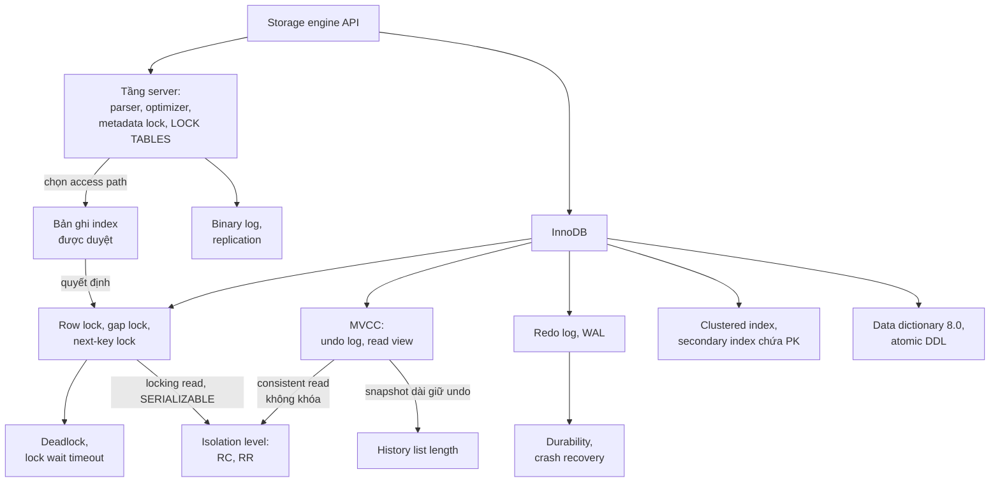

*(Sơ đồ do người viết ghi chú tổng hợp từ tr. 1–18 và các thí nghiệm.)*

### Điều cần nhớ

1. MySQL tách **tầng server** (parse, tối ưu, quyền, hàm, view) khỏi **storage engine** (lưu và lấy dữ liệu); hai bên nói chuyện bằng storage engine API, trao đổi **từng hàng** (tr. 1–2, 18).
2. Mỗi connection có một thread; một truy vấn chạy trên một thread. Thread cache bỏ chi phí tạo thread, không giới hạn concurrency (tr. 2).
3. Khóa là thỏa hiệp giữa **overhead** và **an toàn dữ liệu**; MySQL để mỗi engine chọn độ mịn khóa. Row lock cài trong engine; `LOCK TABLES` và metadata lock ở server (tr. 4–6, 12).
4. InnoDB khóa **bản ghi index được duyệt**, nên phạm vi khóa phụ thuộc **access path** (tr. 10, 16; đã đo: 100.261 so với 4.005 bản ghi).
5. Bốn isolation level của ANSI được InnoDB hỗ trợ đủ; mặc định MySQL là **REPEATABLE READ**, khác phần lớn database (tr. 8–9, 11).
6. MVCC dựa trên **undo log và read view**: phần lớn đọc không khóa, đổi lại tốn chỗ, tốn công khi đọc bản cũ và cần dọn dẹp (tr. 13–14). Chỉ dùng với RC và RR (tr. 15).
7. Phantom ở InnoDB RR được chặn bằng MVCC cho **consistent read** và bằng **next-key lock** cho locking read (tr. 9, 16); hai loại đọc có thể thấy dữ liệu khác nhau trong cùng transaction.
8. Deadlock là chuyện thường: InnoDB phát hiện ngay và rollback transaction "rẻ" hơn; ứng dụng phải **retry cả transaction** (tr. 9–10).
9. **Write-ahead logging** biến ghi ngẫu nhiên thành ghi tuần tự, chấp nhận ghi hai lần để vừa nhanh vừa bền (tr. 10–11).
10. MySQL 8.0 đưa metadata vào **data dictionary** trong InnoDB, có **atomic DDL**; nhưng DDL vẫn **commit ngầm** transaction đang mở (tr. 11, 16–18).

### Dấu hiệu nhận diện trong thực tế

- Câu lệnh theo primary key mà chậm thất thường: nghĩ tới **chờ khóa** trước; xem `sys.innodb_lock_waits`.
- `ERROR 1213` rải rác trong log ứng dụng: deadlock; xem `LATEST DETECTED DEADLOCK`, tìm thứ tự khóa ngược nhau.
- `ERROR 1205`: chờ khóa quá `innodb_lock_wait_timeout`; tìm transaction dài hoặc truy vấn không có index khóa quá nhiều.
- Processlist có trạng thái "Waiting for table metadata lock": nguồn chặn ở **tầng server** (DDL, `LOCK TABLES`), không phải row lock.
- `History list length` tăng mãi: có transaction (kể cả chỉ đọc) mở quá lâu.
- Rollback có `Warning 1196`: có bảng không transaction lẫn trong transaction.
- Tiền, tồn kho bị "trừ thiếu" khi tải cao: đọc bằng snapshot rồi ghi giá trị tuyệt đối (lost update).

### Câu hỏi còn mở

- Sách mô tả chọn nạn nhân deadlock theo "ít exclusive row lock nhất", manual mô tả theo số hàng đã sửa. Thí nghiệm nào tách được hai tiêu chí? (Gợi ý: một transaction khóa nhiều hàng bằng `FOR UPDATE` nhưng không sửa gì, so với một transaction sửa ít hàng.)
- Với workload thực, chuyển từ REPEATABLE READ sang READ COMMITTED giảm được bao nhiêu deadlock và chờ khóa, và rủi ro đúng đắn nào xuất hiện?
- History list length giảm theo nhịp nào sau khi transaction dài kết thúc trên 8.0.42, và `innodb_purge_rseg_truncate_frequency` ảnh hưởng ra sao?
- Adaptive hash index và change buffer giúp hay hại workload nào? Sách không giải thích sâu; MySQL 8.4 đã đổi mặc định của chúng.

---

<a id="kiem-tra"></a>

## Ghi chú kiểm tra nguồn

### Đối chiếu mục lục (bookmark của PDF)

| Mục trong sách | Trang in | Mục ghi chú |
| --- | --- | --- |
| MySQL’s Logical Architecture | 1 | [2.1](#s2-1) |
| Connection Management and Security | 2 | [2.1.1](#connection-management) |
| Optimization and Execution | 3 | [2.1.2](#optimizer-execution) |
| Concurrency Control | 3 | [2.2](#s2-2) |
| Read/Write Locks | 4 | [2.2.1](#read-write-locks) |
| Lock Granularity | 4 | [2.2.2](#lock-granularity) |
| Transactions | 6 | [2.3](#s2-3) |
| Isolation Levels | 8 | [2.3.1](#isolation-levels) |
| Deadlocks | 9 | [2.3.2](#deadlocks) |
| Transaction Logging | 10 | [2.3.3](#transaction-logging) |
| Transactions in MySQL | 11 | [2.3.4](#transactions-in-mysql) |
| Multiversion Concurrency Control | 13 | [2.4](#s2-4) |
| Replication | 15 | [2.5](#s2-5) |
| Datafiles Structure | 16 | [2.6](#s2-6) |
| The InnoDB Engine | 16 | [2.7](#s2-7) |
| JSON Document Support | 17 | [2.7.1](#json) |
| Data Dictionary Changes | 17 | [2.7.2](#data-dictionary-changes) |
| Atomic DDL | 18 | [2.7.3](#atomic-ddl) |
| Summary | 18 | [2.8](#s2-8) |

Các mục nhỏ không có bookmark (Table locks, Row locks ở tr. 5; Understanding AUTOCOMMIT ở tr. 11; Mixing storage engines in transactions, Implicit and explicit locking ở tr. 12) được viết thành đoạn in đậm trong mục tương ứng.

### Hình, bảng, listing đã xem trên ảnh trang

- **Hình 1-1** (PDF 24, tr. 2): kiến trúc logic. Đã vẽ lại; hình không có executor hay query cache.
- **Hình 1-2** (PDF 36, tr. 14): sequence diagram MVCC. Đã phóng to (250 dpi) để đọc chiều mũi tên và khung Loop.
- **Hình 1-3** (PDF 37, tr. 15): topology source và hai replica, nhãn "Binary log" trên hai mũi tên.
- **Bảng 1-1** (PDF 31, tr. 9): chữ trích xuất bị tách mỗi ô một dòng; đã đối chiếu ảnh, các giá trị Yes/No trong ghi chú khớp bản in.
- **Listing** ngân hàng (PDF 28, tr. 6) và StockPrice (PDF 31, tr. 9): chỉ mô tả bằng lời, không chép. Listing StockPrice trong bản in dùng **dấu nháy cong** quanh ngày tháng, không chạy được nếu chép nguyên; SQL tự viết trong bài thực hành dùng nháy thẳng.
- **Hộp** (PDF 30, 34, 35, 38): đã xác định loại bằng biểu tượng theo phần Conventions (PDF 19): con quạ là Note (tr. 8, tr. 16), con bọ cạp là Warning (tr. 12), con vượn cáo là Tip (tr. 13).
- Trang PDF 33 (tr. 11): bản in có lỗi dính chữ "MySQLlets" (không phải lỗi trích xuất).

### Tham chiếu chéo không chính xác trong sách

| Trang | Sách viết | Thực tế trong sách | Trạng thái |
| --- | --- | --- | --- |
| tr. 2, chú thích 2 | Thread pooling ở tầng truy cập "discuss in Chapter 5" | Chương 5 chỉ có thread cache (tr. 111) và concurrency (tr. 119); connection pooling ở tầng truy cập nằm ở chương 11 (tr. 303, 306–307) | Đã kiểm chứng, xem [2.1.1](#thread-pooling-check) |
| tr. 16 | Clustered index "in detail in Chapter 8 when we discuss schema design" | *Clustered Indexes* ở chương 7 (tr. 170); thiết kế schema là chương 6 | Phát hiện mới khi học chương này |
| tr. 17 | Read-ahead, adaptive hash index, insert buffer "cover these in Chapter 4" | Rải rác ở chương 4 (tr. 84, 88), 5 (tr. 110, 116), 7 (tr. 159, 173), 10 (tr. 265); không chỗ nào bàn sâu | Đã kiểm chứng, xem [2.7](#internal-optimizations-check) |
| tr. 17 | Multivalued index từ "MySQL 8.0.7" | Theo tài liệu MySQL là 8.0.17 | **Bổ sung ngoài sách**, chưa kiểm được trên bản 8.0.7 |
| tr. 8, chú thích 6 | "Adrian Coyler" | Tên đúng là Adrian Colyer | **Bổ sung ngoài sách** |

### Chỗ sách giản lược, đã chính xác hóa bằng thí nghiệm

- "Transaction ID được gán lần đầu đọc" (tr. 13): ID thật được cấp ở câu ghi đầu; read view tạo ở câu consistent read đầu ([2.4](#read-view)).
- "InnoDB giải quyết phantom bằng MVCC" (tr. 9) và "bằng next-key locking" (tr. 16): mỗi cơ chế cho một loại đọc ([2.3.1](#phantom-read)).
- "`.ibd` và `.frm` được thay bằng `.sdi` mỗi bảng" (tr. 16): `.ibd` vẫn còn và chứa SDI; `.sdi` riêng chỉ cho bảng không phải InnoDB ([2.6](#sdi)).
- Chú thích 4 (tr. 6) gọi "application level locking functions" là thứ có trong 8.0. **Bổ sung ngoài sách:** hàm `GET_LOCK()` đã có từ các bản trước 8.0; câu này nên hiểu là "8.0 có các hàm khóa ở mức ứng dụng", không phải tính năng mới của 8.0 (người viết ghi chú chưa kiểm trên bản cũ).

### Điều kiện phiên bản

| Nội dung | Phiên bản |
| --- | --- |
| API thread pooling plug-in | Từ 5.5 (tr. 2) |
| Query cache | Deprecated từ 5.7.20, bị gỡ trong 8.0 (tr. 3) |
| `SELECT ... FOR SHARE` | 8.0, thay `LOCK IN SHARE MODE` (tr. 12) |
| Online DDL | Từ 5.6, mở rộng ở 5.7 và 8.0 (tr. 17) |
| Kiểu JSON | 5.7 (tr. 17) |
| Multi-valued index | Sách: 8.0.7; tài liệu MySQL: 8.0.17 |
| Data dictionary, SDI, dictionary object cache, atomic DDL | 8.0 (tr. 16–18) |
| `performance_schema.data_locks`, `NOWAIT`, `SKIP LOCKED` | 8.0 (**Bổ sung ngoài sách**) |
| Mặc định adaptive hash index và change buffering | ON và `all` trên 8.0.42 (đã đọc); đổi ở 8.4 theo ghi chú phát hành (**Bổ sung ngoài sách**) |

### Nội dung Bổ sung ngoài sách trong ghi chú

Sequence diagram đường đi truy vấn qua engine API; hệ quả của mô hình một thread mỗi connection; phân biệt thread cache, thread pool và connection pooling; lý do query cache nghẽn; intention lock; lost update trong ví dụ ngân hàng; phân biệt two-phase commit và two-phase locking; phantom theo hai loại đọc; giảm deadlock trong thực tế; tên redo log và các file trong datadir; read view và trx_id thật; cột ẩn `DB_TRX_ID`, `DB_ROLL_PTR`; chuỗi phiên bản và history list length; binary log so với redo log; change buffer và mặc định ở 8.4; multi-valued index 8.0.17; ví dụ JSON; cảnh báo atomic DDL không phải transactional DDL; các tình huống ở mục 3.

### Trạng thái thực hành

Bốn thí nghiệm (TN1–TN4) và số đo cho tình huống 2 và 4 **đã chạy** trên MySQL 8.0.42, instance riêng ở cổng 3311; instance đã được tắt sau khi đo. Không chạy: thread pool plug-in, replication, backup nóng (ngoài phạm vi môi trường).
