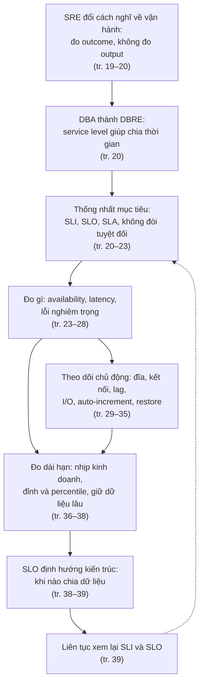
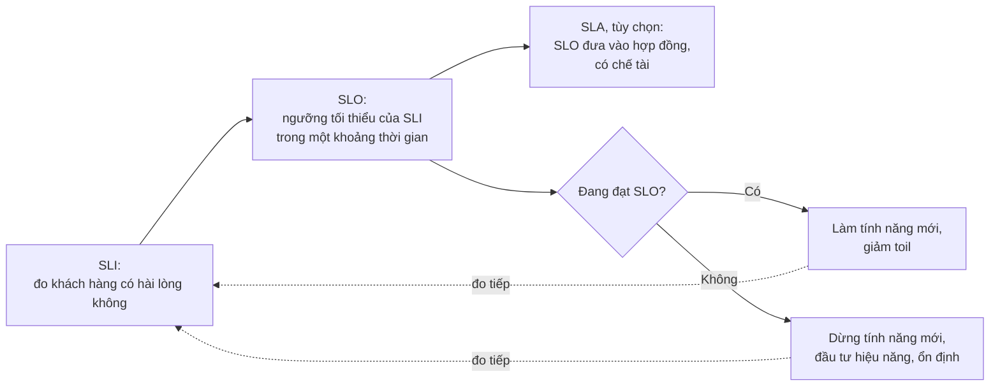
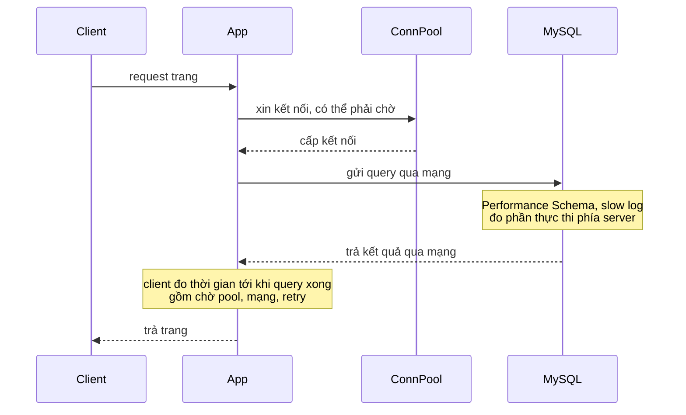
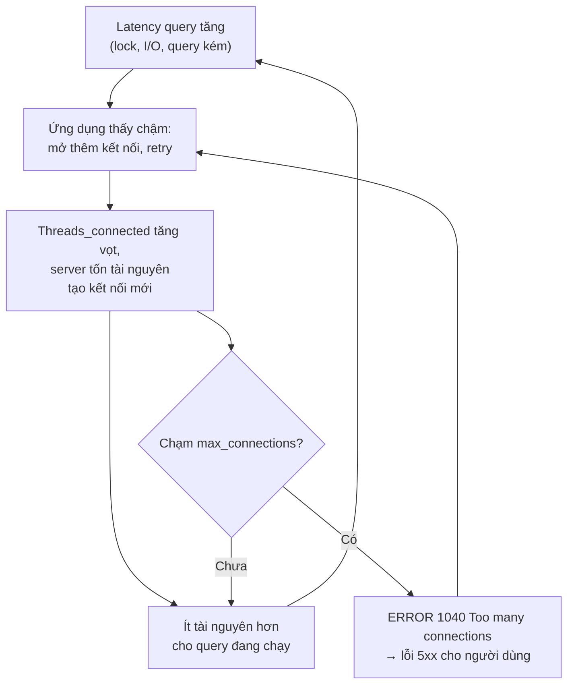
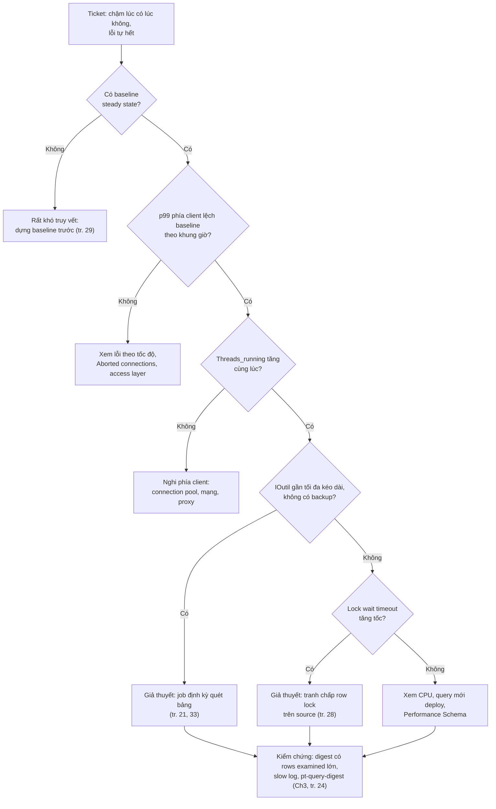
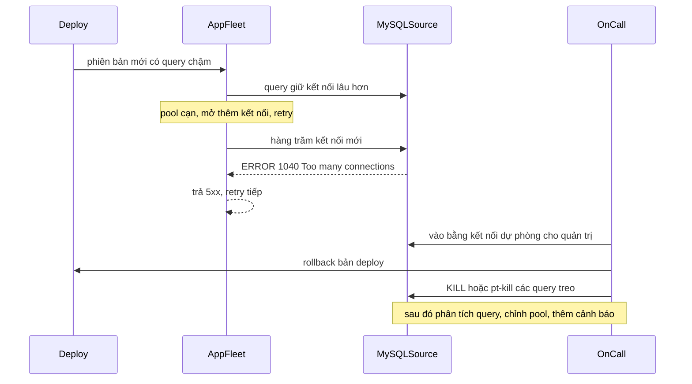
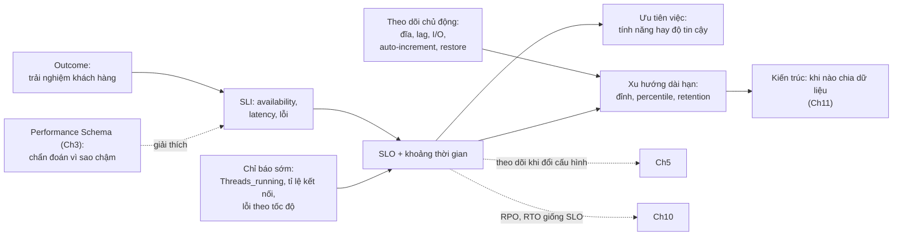

# Chương 2 — Giám sát MySQL theo tư duy reliability engineering

*Monitoring in a Reliability Engineering World*

> **Nguồn:** *High Performance MySQL: Proven Strategies for Operating at Scale*, Silvia Botros và Jeremy Tinley, O'Reilly, **Fourth Edition (11/2021)**, Chương 2, **tr. 19–39 (trang PDF 41–61)**. Tr. 40 (PDF 62) để trắng.
> "tr. N" là số trang in; trang PDF = N + 22 (xem [README](README.md#page-convention)).
>
> **Quy ước nhãn:**
> - Nội dung không nhãn là diễn giải từ sách, luôn kèm "(tr. N)".
> - **Bổ sung ngoài sách**: kiến thức thêm hoặc phép tính tự làm.
> - **Ví dụ minh họa do AI xây dựng**: ví dụ, dữ liệu, SQL hoặc tình huống giả định.
> - **Dự đoán**: điều kỳ vọng nhưng chưa đo.
> - **Kết quả đã đo**: chỉ dùng cho thí nghiệm đã thực sự chạy (MySQL 8.0.42 trên Windows 11, instance riêng).
>
> **Phiên bản.** Phần lớn chương là nguyên lý vận hành, không phụ thuộc phiên bản. Các biến và bộ đếm sách nhắc tới (`Threads_running`, `Threads_connected`, `max_connections`, `Connection_errors_xxx`, chế độ read-only, `information_schema`) có trong cả MySQL 5.7 và 8.0. Những chi tiết chỉ có ở 8.0 (histogram latency trong Performance Schema, `information_schema_stats_expiry`, quyền `CONNECTION_ADMIN`) được ghi rõ là **Bổ sung ngoài sách** ở chỗ dùng.
>
> **Liên kết:** [Lộ trình, mục chương 2](learning-roadmap.md#ch02) · [Bài thực hành](experiments/chapter-02.md) · [Đáp án tự kiểm tra](answers/chapter-02.md)

## Mục lục ghi chú

- [1. Bức tranh lớn](#big-picture)
- [2. Giải thích sâu](#deep)
  - [2.0 Mở đầu chương (tr. 19–20)](#s2-0)
  - [2.1 The Impact of Reliability Engineering on DBA Teams (tr. 20)](#s2-1)
  - [2.2 Defining Service Level Goals (tr. 20–23)](#s2-2)
  - [2.3 What to Measure (tr. 23–35)](#s2-3)
  - [2.4 Measuring Long-Term Performance (tr. 36–39)](#s2-4)
  - [2.5 Summary (tr. 39)](#s2-5)
- [3. Phân tích tình huống](#situations)
- [4. Đo lường và thực hành](#measure)
- [5. Liên kết kiến thức và điều cần nhớ](#takeaways)
- [Ghi chú kiểm tra nguồn](#kiem-tra)

---

## 1. Bức tranh lớn

### Chương này hỏi gì?

Làm sao biết một hệ thống MySQL đang phục vụ khách hàng **đủ tốt**, khi "đủ tốt" không phải là CPU thấp hay số query mỗi giây cao, mà là trang tải nhanh và thanh toán thành công? Chương trả lời bằng bộ công cụ của Site Reliability Engineering (SRE):

1. **Thống nhất mục tiêu** bằng ngôn ngữ chung: SLI, SLO, SLA. Mục tiêu đó quyết định đội nên làm tính năng mới hay đầu tư độ tin cậy (tr. 20–23).
2. **Đo gì** cho một database: availability, latency và việc không có lỗi nghiêm trọng (tr. 23–28).
3. **Theo dõi chủ động** những thứ chưa làm khách hàng đau nhưng sẽ gây sự cố: dung lượng đĩa, số kết nối, replication lag, I/O, không gian auto-increment, thời gian restore (tr. 29–35).
4. **Đo dài hạn** để lập kế hoạch dung lượng, và dùng chính SLO để biết khi nào phải chia nhỏ dữ liệu (tr. 36–39).

### Vị trí trong sách

Chương 2 cùng chương 3 tạo thành nhóm "quan sát và đo" (xem [roadmap](learning-roadmap.md#ch02)). Hai chương nhìn hệ thống từ hai phía:

| | Chương 2 | Chương 3 |
| --- | --- | --- |
| Góc nhìn | Từ ngoài vào: khách hàng có hài lòng không? | Từ trong ra: server đang tiêu thời gian vào đâu? |
| Công cụ chính | SLI, SLO, cảnh báo, chỉ số xu hướng | Performance Schema, sys schema |
| Vai trò | Phát hiện và ưu tiên | Chẩn đoán nguyên nhân |

Sách nói rõ Performance Schema rất hữu ích để tìm nút thắt, nhưng **không phải** công cụ để tự nó xác định bạn có giữ lời hứa về độ tin cậy hay không, vì nó nằm quá sâu trong nội bộ MySQL (tr. 25). Các chương sau quay lại chương 2 nhiều lần: theo dõi SLO khi đổi cấu hình (chương 5, tr. 104), RPO và RTO "nghe rất giống SLO" (chương 10, tr. 260), dùng chỉ số thời gian restore làm bằng chứng compliance (chương 13, tr. 340).

### Kiến thức cần trước

- Nguyên lý SRE. Sách **giả định** bạn đã biết và gợi ý đọc nhanh chương 1, 2, 5 của *The Site Reliability Workbook* (tr. 19). Ba chương đó thuộc cuốn Workbook, không phải sách này.
- Percentile và phân phối latency. **Bổ sung ngoài sách:** xem [DDIA chương 1, percentile](../../DDIA/ddia-notes/chapter-01.md#percentiles).
- Khái niệm replication source và replica (chương 1 giới thiệu, [chương 9](chapter-09.md) đi sâu).
- Mã trạng thái HTTP cơ bản (200, 202, 5xx), vì sách dùng chúng để định nghĩa availability (tr. 26, 28).

### Liên hệ với chương khác

| Ý trong chương 2 | Chương | Căn cứ |
| --- | --- | --- |
| Performance Schema để profile, tìm nút thắt; không dùng một mình để đánh giá SLO | [Chương 3](chapter-03.md) | tr. 25 |
| "Safety Settings" để hãm các thread chạy mất kiểm soát; `max_connections` | [Chương 5](chapter-05.md#s2-7) | tr. 27 (Ch5 tr. 120–121) |
| Cấu hình hệ điều hành và phần cứng liên quan dung lượng đĩa | [Chương 4](chapter-04.md) | tr. 30 |
| Chiến lược giảm replication lag | [Chương 9](chapter-09.md#excessive-lag) | tr. 32 |
| Chọn primary key, quản lý auto-increment | [Chương 6](chapter-06.md#identifiers) | tr. 34 |
| Disaster recovery, tự động kiểm tra backup; vai trò trong compliance | [Chương 10](chapter-10.md), [Chương 13](chapter-13.md#backup-restore) | tr. 34–35 |
| SLI, SLO cho biết khi nào đầu tư scale bằng sharding | [Chương 11](chapter-11.md) | tr. 39 |
| Lock wait timeout phản ánh tranh chấp row lock | [Chương 1](chapter-01.md#row-locks) | tr. 28 (khái niệm lock ở chương 1) |

### Mạch lập luận

---

## 2. Giải thích sâu

### 2.0 Mở đầu chương (tr. 19–20)

**Bối cảnh** (tr. 19). Giám sát hệ thống là chủ đề rộng, và vài năm gần đây bị định hình mạnh bởi hai cuốn *Site Reliability Engineering: How Google Runs Production Systems* và *The Site Reliability Workbook*. SRE trở thành trào lưu tuyển dụng; có công ty còn đổi chức danh nhân viên hiện có thành một dạng "reliability engineering".

**Vì sao SRE thay đổi công việc vận hành** (tr. 19). SRE là một bộ nguyên lý giúp trả lời dễ hơn ba câu hỏi:

- Trải nghiệm khách hàng hiện tại có chấp nhận được không?
- Có nên tập trung vào việc tăng độ tin cậy và khả năng chống chịu (*resilience*) không?
- Cân bằng giữa tính năng mới và ***toil*** thế nào?

> **Bổ sung ngoài sách.** Sách dùng từ *toil* mà không định nghĩa. Theo cuốn *Site Reliability Engineering* của Google, toil là việc vận hành thủ công, lặp lại, tự động hóa được, mang tính đối phó, không tạo giá trị lâu dài và tăng tuyến tính theo quy mô dịch vụ. Ví dụ với database: tay xóa binary log cũ mỗi khi đĩa đầy, tay tạo replica mới mỗi lần có máy hỏng.

**Outcome, không phải output** (tr. 20). Tác giả biết có người cho rằng SRE "không thuộc" chủ đề hiệu năng MySQL, và họ không đồng ý. Họ dẫn Nicole Forsgren trong *Accelerate*: thước đo nên tập trung vào ***outcomes, not outputs***.

> Chú thích 1 (tr. 20). Nguồn của câu trích: Nicole Forsgren, *Accelerate: The Science of Lean Software and DevOps* (IT Revolution Press, 2018).

- ***Output*** là thứ hệ thống hay đội làm ra: số query mỗi giây, CPU, tỉ lệ trúng buffer pool, số query đã tối ưu.
- ***Outcome*** là kết quả mà khách hàng nhận được: trang tải nhanh, đơn hàng thanh toán thành công.

Quản lý MySQL hiệu quả cần giám sát tốt sức khỏe database. Giám sát truyền thống là "đường đã trải nhựa", còn cách áp dụng nguyên lý SRE cho MySQL thì ít được hiểu hơn. Khi SRE được chấp nhận rộng, vai trò DBA sẽ đổi, kể cả cách DBA nghĩ về giám sát (tr. 20).

> **Bổ sung ngoài sách — vì sao khó.** Chỉ số của MySQL hầu hết là output. Một server có thể có CPU 30%, buffer pool hit 99% mà khách hàng vẫn thấy lỗi, vì connection pool của ứng dụng cạn hoặc access layer gửi nhầm lệnh ghi sang replica. Ngược lại CPU 90% có thể hoàn toàn ổn nếu latency vẫn trong SLO. Muốn nối output với outcome, phải chọn vài chỉ số đại diện cho trải nghiệm khách hàng, rồi mới dùng chỉ số nội bộ để giải thích chúng.

**Hiểu lầm phổ biến.** "Chương về SRE là chuyện quy trình, không liên quan hiệu năng." Theo sách, nếu không biết khách hàng có đang hài lòng không, bạn không biết công tối ưu nào đáng làm, nên giám sát theo service level chính là điểm xuất phát của tối ưu hiệu năng (tr. 20).

#### Tự kiểm tra 2.0

- **Câu 2.0.1.** Phân biệt outcome và output trong giám sát MySQL, mỗi loại cho hai ví dụ. Vì sao tác giả cho rằng SRE là một phần của high performance MySQL? [đáp án](answers/chapter-02.md#q2-0-1)
- **Câu 2.0.2.** Ba câu hỏi mà nguyên lý SRE giúp trả lời là gì? Vì sao câu "cân bằng tính năng mới với toil" cũng là câu hỏi của đội database? [đáp án](answers/chapter-02.md#q2-0-2)
- **Câu 2.0.3.** Sách nói giám sát truyền thống là "đường đã trải nhựa" còn áp dụng SRE cho MySQL thì ít được hiểu. Điều gì làm việc nối chỉ số MySQL với trải nghiệm khách hàng trở nên khó? [đáp án](answers/chapter-02.md#q2-0-3)

### 2.1 The Impact of Reliability Engineering on DBA Teams (tr. 20)

**Mô hình cũ** (tr. 20). Nhiều năm liền, giám sát hiệu năng database dựa vào việc **đào sâu một server**. Cách này vẫn có giá trị, nhưng thường mang tính **phản ứng**: khi một server chạy kém thì mới profile nó. Đây là quy trình chuẩn thời các đội DBA **gác cổng** (*gatekeeping*), khi không ai khác được biết database vận hành ra sao.

**Mô hình mới** (tr. 20). Khi Google giới thiệu reliability engineering, vai trò DBA phức tạp hơn và chuyển dần thành site reliability engineer (SRE) hay ***database reliability engineer (DBRE)***. Đội phải tối ưu cách dùng thời gian của chính mình. ***Service level*** giúp xác định **khi nào khách hàng không hài lòng**, từ đó cân bằng thời gian giữa:

- xử lý vấn đề hiệu năng và thách thức scaling;
- xây công cụ nội bộ (*internal tooling*).

| | DBA gác cổng | DBRE theo service level |
| --- | --- | --- |
| Đơn vị quan sát | Một server | Cả dịch vụ, theo trải nghiệm khách hàng |
| Kích hoạt | Khi có server chạy kém (phản ứng) | Khi SLO có nguy cơ bị vi phạm, hoặc khi chỉ báo sớm lệch baseline |
| Ai hiểu database | Chỉ đội DBA | Cả đội tính năng, nhờ chỉ số chung |
| Cách chọn việc | Theo sự cố gần nhất | Theo khoảng cách giữa SLI và SLO |

*(Bảng do người viết ghi chú tổng hợp từ tr. 20 và các mục sau của chương.)*

**Trade-offs.** Profiling sâu một server không mất giá trị: chương 3 dạy đúng việc đó. Nhưng nó trả lời câu "**vì sao** chậm", không trả lời câu "**có** đang làm khách hàng đau không". Mô hình mới đặt câu hỏi thứ hai trước, rồi mới dùng công cụ của câu hỏi thứ nhất.

> **Bổ sung ngoài sách (liên hệ Preface).** Preface (tr. xvi) mô tả cùng sự chuyển dịch: DBA từ "gờ giảm tốc" thành người tạo điều kiện cho tăng trưởng. Xem [roadmap mục 1](learning-roadmap.md#muc-tieu).

#### Tự kiểm tra 2.1

- **Câu 2.1.1.** Trong mô hình "DBA gác cổng", giám sát hoạt động thế nào và vì sao nó mang tính phản ứng? [đáp án](answers/chapter-02.md#q2-1-1)
- **Câu 2.1.2.** Service level giúp đội DBRE chia thời gian giữa những loại việc nào? Cho ví dụ quyết định khác nhau khi SLO đang đạt và khi đang trượt. [đáp án](answers/chapter-02.md#q2-1-2)
- **Câu 2.1.3.** Profiling sâu một server (ví dụ bằng Performance Schema) còn chỗ đứng trong mô hình SRE không? Nó bổ sung cho SLI ra sao? [đáp án](answers/chapter-02.md#q2-1-3)

### 2.2 Defining Service Level Goals (tr. 20–23)

**Trước khi đo, phải thống nhất mục tiêu** (tr. 20). Trước khi đo xem khách hàng có hài lòng với hiệu năng database không, cần biết mục tiêu là gì và có ngôn ngữ chung để mô tả nó. Sách gợi ý bốn câu hỏi mở đầu cuộc trao đổi trong tổ chức:

1. Chỉ số nào phù hợp để đo thành công?
2. Giá trị nào của các chỉ số đó là chấp nhận được với khách hàng và nhu cầu kinh doanh?
3. Tới mức nào thì coi là **suy giảm** (*degraded*)?
4. Khi nào là **hỏng hẳn** (*failed*) và phải khắc phục ngay?

**Ca dễ và ca khó** (tr. 21). Có ca hiển nhiên: source database chết, không nhận ghi, kinh doanh đình trệ. Có ca không hiển nhiên: một tác vụ định kỳ thỉnh thoảng chiếm hết disk I/O và mọi thứ khác đột nhiên chậm đi. Hiểu biết chung về **đo gì và vì sao** giúp định hướng các cuộc trao đổi về ưu tiên, và cho biết đội được phép dành công cho tính năng mới hay phải đầu tư thêm vào hiệu năng và ổn định (tr. 21).

**Định nghĩa SLI, SLO, SLA** (tr. 21). Các thảo luận về sự hài lòng của khách hàng giúp đội thống nhất điều gì là "khỏe" với doanh nghiệp, diễn đạt bằng ba khái niệm:

| Khái niệm | Câu hỏi nó trả lời | Ghi chú của sách |
| --- | --- | --- |
| ***Service level indicator (SLI)*** | Đo bằng cách nào để biết khách hàng có hài lòng không? | Đại diện cho hệ thống khỏe **từ góc nhìn người dùng**. Có thể là chỉ báo cấp kinh doanh ("response time của API phục vụ khách hàng") hoặc cơ bản hơn ("dịch vụ đang chạy"). Có thể cần chỉ số khác nhau tùy ngữ cảnh dữ liệu và sản phẩm. |
| ***Service level objective (SLO)*** | SLI được phép thấp tới đâu mà khách hàng vẫn hài lòng? | Khoảng mục tiêu của một SLI để coi là dịch vụ khỏe. Nếu SLI là uptime thì số lượng "số 9" muốn đạt trong một khoảng thời gian là SLO. **Phải định nghĩa trên một khoảng thời gian.** SLI cộng SLO là phương trình cơ bản để biết khách hàng có hài lòng không. |
| ***Service level agreement (SLA)*** | SLO nào tôi sẵn sàng cam kết kèm hậu quả? | SLO đưa vào thỏa thuận với **khách hàng trả tiền** (không phải bên liên quan nội bộ), có phạt tài chính hoặc phạt khác nếu vi phạm. **SLA là tùy chọn.** |

**Vì sao sách không bàn nhiều về SLA** (tr. 21). Đó chủ yếu là quyết định kinh doanh: hứa SLA trong hợp đồng giúp bán thêm bao nhiêu, và có đáng rủi ro doanh thu nếu vi phạm không. Tác giả hy vọng quyết định ấy dựa trên những gì chương bàn: chọn SLI và SLO tương ứng.

**SLO điều khiển kế hoạch** (tr. 22). SLI, SLO, SLA không chỉ định hướng sức khỏe kinh doanh mà cả kế hoạch của đội kỹ thuật. Nếu một đội không đạt SLO đã thống nhất, đội đó **không nên làm tiếp tính năng mới**. Điều này áp dụng cả cho đội database. Khi một SLO không đạt, đó là lúc hỏi vì sao; có dữ liệu giải thích vì sao trải nghiệm khách hàng chưa tốt thì các cuộc trao đổi về ưu tiên mới có ý nghĩa.

*(Sơ đồ do người viết ghi chú tổng hợp từ tr. 21–22.)*

> **Bổ sung ngoài sách — error budget.** Chương không dùng từ này, nhưng các tài liệu SRE mà sách gợi ý dùng nó để vận hành đúng ý "không đạt SLO thì không làm tính năng mới". ***Error budget*** = 1 − SLO. **Ví dụ minh họa do AI xây dựng:** SLO "99% lần checkout thành công trong tháng" và tháng có 2.000.000 lần checkout thì ngân sách là 20.000 lần thất bại. Còn ngân sách thì được phép triển khai thay đổi có rủi ro; tiêu hết thì ưu tiên độ tin cậy.

#### 2.2.1 What Does It Take to Make Customers Happy? (tr. 22–23)

**Cưỡng lại mong muốn đặt 100%** (tr. 22). Sau khi chọn SLI, dễ muốn đặt mục tiêu 100%. Mục đích của SLI và SLO là để **bất kỳ lúc nào** cũng đánh giá được, bằng chỉ số khách quan, đội có thể đổi mới hay độ ổn định sắp tụt dưới mức khách hàng chấp nhận. Vì vậy mục tiêu là xác định **mức tối thiểu tuyệt đối** cần làm để khách hàng hài lòng. Nếu khách hàng hài lòng khi trang tải trong 2 giây, đừng đặt mục tiêu 750 ms; nó tạo gánh nặng vô lý cho đội kỹ thuật (tr. 22).

**"Không bao giờ downtime" nghĩa là gì?** (tr. 22). Lấy uptime làm ví dụ. Câu "chúng ta sẽ không có downtime" nghe hay, nhưng khi triển khai và theo dõi thì nghĩa là gì? Đạt **ba số 9** đã không dễ: cả năm chỉ được hơn 8 giờ downtime, tức khoảng 10 phút mỗi tuần. Càng hứa nhiều số 9, càng khó và càng tốn giờ công kỹ sư đắt đỏ. Table 2-1 (tr. 22, sách ghi lấy từ Amazon Web Services) cho thấy con số thô.

> **Bổ sung ngoài sách — tự tính lại Table 2-1.** Công thức: downtime = (1 − availability) × độ dài kỳ, với năm 365 ngày, tháng = năm/12, tuần = năm/52 (cách chia này khớp các ô đúng của bảng, ví dụ 6,06 giây mỗi tuần cho 99,999%). Đối chiếu với ảnh trang (PDF 44) cho thấy **bảng in có vài ô sai**:

| Availability | Mỗi năm | Mỗi tháng | Mỗi tuần | Mỗi ngày | Ô sách in khác phép tính |
| --- | --- | --- | --- | --- | --- |
| 99,999% | 5 phút 15,36 giây | 26,28 giây | 6,06 giây | **0,86 giây** | Sách in 0,14 giây mỗi ngày |
| 99,995% | 26 phút 16,8 giây | 2 phút 11,4 giây | 30,3 giây | 4,32 giây | Khớp |
| 99,99% | 52 phút 33,6 giây | 4 phút 22,8 giây | 1 phút 0,65 giây | 8,64 giây | Khớp (sách làm tròn 0,66) |
| 99,95% | 4 giờ 22 phút 48 giây | **21 phút 54 giây** | 5 phút 3 giây | 43,2 giây | Sách in 31 phút 54 giây mỗi tháng |
| 99,9% | 8 giờ 45 phút 36 giây | **43 phút 48 giây** | 10 phút 6 giây | 1 phút 26,4 giây | Sách in 43 phút 53 giây mỗi tháng |
| 99,5% | **43 giờ 48 phút** | 3 giờ 39 phút | **50 phút 32 giây** | 7 phút 12 giây | Sách in 43 giờ 48 phút 36 giây mỗi năm, và "50 hrs, 32 mins, 17 secs" mỗi tuần (sai đơn vị) |
| 99,25% | 65 giờ 42 phút | **5 giờ 28 phút 30 giây** | 1 giờ 15 phút 48 giây | 10 phút 48 giây | Sách in 5 giờ 34 phút 30 giây mỗi tháng |
| 99% | **3 ngày 15 giờ 36 phút** | 7 giờ 18 phút | 1 giờ 41 phút 5 giây | 14 phút 24 giây | Sách in 3 ngày 15 giờ 54 phút mỗi năm |

*(Giá trị in đậm là ô mà sách in khác. Thông điệp của sách không đổi: mỗi số 9 thêm vào cắt ngân sách downtime đi khoảng 10 lần.)*

**Chọn SLO theo giá trị của tính năng** (tr. 22–23). Thời gian kỹ sư là hữu hạn, nên đừng theo đuổi sự hoàn hảo khi chọn SLO. Không phải tính năng nào cũng cần ngần ấy số 9. Khi sản phẩm lớn lên, bạn sẽ có các SLI và SLO **khác nhau** tùy tác động của tính năng hay doanh thu nó mang lại; đó là dấu hiệu của một quy trình có suy nghĩ.

**Nhiệm vụ then chốt của đội database** (tr. 23). Phát hiện khi một data set trở thành **nút thắt cho các query profile rất khác nhau** của các nhóm stakeholder khác nhau, đe dọa hiệu năng; rồi tìm cách **tách nhu cầu** của các nhóm đó để có thể cho mỗi nhóm SLI và SLO hợp lý. Đây là mầm của ý tưởng functional sharding mà sách định nghĩa ở tr. 34 (xem [2.3.6](#functional-horizontal-sharding)).

**Ngôn ngữ chung giữa product và engineering** (tr. 23). SLI và SLO là ngôn ngữ thống nhất để quyết định giữa "dành thời gian kỹ sư cho tính năng mới" và "dành thời gian cho resilience và sửa lỗi", và để chọn việc quan trọng nhất theo trải nghiệm khách hàng trong danh sách việc muốn làm.

> **Bổ sung ngoài sách — availability nối tiếp nhân với nhau.** Nếu một request phải đi qua ứng dụng (99,9%), MySQL source (99,9%) và một cache (99,9%), và các thành phần hỏng độc lập, thì availability tối đa của chuỗi là 0,999³ ≈ 99,7%. Hệ quả: SLO của tầng database thường phải **chặt hơn** SLO của dịch vụ mà khách hàng thấy, nếu không thì cả chuỗi không thể đạt SLO dịch vụ.

**Hiểu lầm phổ biến.**

- "SLO càng cao càng tốt." Sai theo sách: mục tiêu vượt nhu cầu khách hàng là gánh nặng vô lý (tr. 22).
- "Một SLO cho cả hệ thống." Sách kỳ vọng nhiều SLI và SLO khác nhau theo tính năng (tr. 22–23).
- "Có SLA mới cần SLO." Ngược lại: SLA là tùy chọn, SLO là công cụ nội bộ để ưu tiên công việc (tr. 21–22).

#### Tự kiểm tra 2.2

- **Câu 2.2.1.** Phân biệt SLI, SLO, SLA bằng ví dụ cho tính năng checkout. Vì sao SLA là tùy chọn còn SLO thì không nên thiếu? [đáp án](answers/chapter-02.md#q2-2-1)
- **Câu 2.2.2.** Vì sao SLO phải gắn với một khoảng thời gian? Cho ví dụ hai cách hiểu khác nhau của "99,9% uptime" khi không ghi khoảng thời gian. [đáp án](answers/chapter-02.md#q2-2-2)
- **Câu 2.2.3.** Tự tính downtime cho phép mỗi tháng của 99,95% và so với Table 2-1. Bạn thấy gì, và điều đó dạy gì về cách dùng bảng tra? [đáp án](answers/chapter-02.md#q2-2-3)
- **Câu 2.2.4.** Vì sao đặt SLO 100%, hoặc mục tiêu chặt hơn nhu cầu (750 ms thay vì 2 giây), lại có hại dù nghe có vẻ tốt cho khách hàng? [đáp án](answers/chapter-02.md#q2-2-4)
- **Câu 2.2.5.** Một data set phục vụ hai nhóm: checkout (query ngắn, cần nhanh) và báo cáo nội bộ (query quét lớn). Dự đoán chuyện gì xảy ra nếu chỉ có một SLO chung, và sách gợi ý hướng xử lý nào? [đáp án](answers/chapter-02.md#q2-2-5)

### 2.3 What to Measure (tr. 23–35)

**Kịch bản xuyên suốt** (tr. 23). Một công ty bán hàng online thấy lưu lượng tăng mạnh do người dân mua sắm online nhiều hơn. Đội hạ tầng được yêu cầu bảo đảm tầng database chịu được nhu cầu tăng. Cả mục này được viết như thể ta là đội hạ tầng đó.

#### 2.3.1 Defining SLIs and SLOs (tr. 23–24)

**Ba chủ đề cho MySQL** (tr. 23). Một SLI tốt cùng SLO tương ứng phải giải thích ngắn gọn cách mang lại trải nghiệm tuyệt vời cho khách hàng. Sách không dành nhiều chỗ cho lý thuyết trừu tượng về cách tạo SLI và SLO có ý nghĩa.

> Chú thích 2 (tr. 23). Tác giả rất khuyên đọc *Implementing Service Level Objectives* của Alex Hidalgo (O'Reilly).

Trong ngữ cảnh MySQL, SLI phải thể hiện ba chủ đề lớn:

1. **availability**;
2. **latency**;
3. **không có lỗi nghiêm trọng** (*lack of critical errors*).

**Ví dụ cửa hàng online** (tr. 23):

- Trang tải nhanh, dưới vài trăm mili giây, trong **ít nhất 99,5%** số lần, đo trên **một tháng**.
- Checkout tin cậy: lỗi chập chờn chỉ được phép **1%** thời gian trong một tháng dương lịch.
- Không đặt 100%, vì thất bại là không tránh được; có khoảng thời gian để đội cân bằng giữa tính năng mới và resilience.

**Một câu, nhiều chỉ số** (tr. 23–24). Câu "tôi kỳ vọng 99,5% request tới database được phục vụ dưới 2 ms và không lỗi" vừa là một SLI đủ dùng với SLO rõ ràng, vừa **không đơn giản**: không thể xác nhận tất cả bằng **một** chỉ số. Nó là cách diễn đạt trong một câu về hành vi mong đợi của tầng database.

> **Bổ sung ngoài sách — tách câu SLI ra.** Câu trên gồm ít nhất hai SLI dạng tỉ lệ (*good events / valid events*):
>
> | SLI | Sự kiện "tốt" | Đo ở đâu |
> | --- | --- | --- |
> | Latency | Request database hoàn tất dưới 2 ms | Phía client (đúng trải nghiệm hơn), đối chiếu phía server |
> | Lỗi | Request database không trả lỗi | Phía client; bộ đếm lỗi phía server để chẩn đoán |
>
> Availability nằm ngầm trong vế "không lỗi": request không kết nối được cũng là lỗi. Lưu ý câu này **thiếu khoảng thời gian**, trong khi chính sách yêu cầu SLO phải định nghĩa trên một khoảng thời gian (tr. 21). Khi biến nó thành SLO thật, cần thêm "đo trên 30 ngày" hoặc tương tự.

**Bắt đầu bằng synthetic test** (tr. 24). Với cửa hàng online, nên bắt đầu bằng ***synthetic test***, ví dụ đo page load trong production theo kiểu lấy mẫu. Đây là tín hiệu ổn định cho biết "mọi thứ vẫn OK", nhưng chỉ là điểm khởi đầu; các mục sau bổ sung những mặt khác của tín hiệu, bắt đầu từ response time của query (tr. 24).

#### 2.3.2 Monitoring Solutions (tr. 24–25)

**Yêu cầu** (tr. 24). Phân tích query và theo dõi query latency trong bối cảnh SLI, SLO phải **hướng về trải nghiệm khách hàng**: cần công cụ báo động **sớm nhất có thể** khi response time vượt ngưỡng đã thống nhất. Sách nêu bốn hướng:

| Hướng | Cách làm | Mạnh | Giới hạn | Vai trò |
| --- | --- | --- | --- | --- |
| **Thương mại** (tr. 24) | Trả tiền cho nhà cung cấp chuyên profile hiệu năng MySQL, ví dụ SolarWinds Database Performance Management | Tự động hóa việc profile query, giúp nhiều kỹ sư trong tổ chức tiếp cận được; có thể "hoàn vốn" | Chi phí | Phát hiện và chẩn đoán |
| **PMM** (tr. 24) | Percona Monitoring and Management: client cài trên instance gửi chỉ số về server; server có dashboard | Dashboard được tổ chức theo kinh nghiệm lâu năm của cộng đồng Percona, rất hợp cho kỹ sư mới học giám sát MySQL | Phải tự vận hành | Phát hiện và chẩn đoán |
| **Gom log** (tr. 24–25) | Chuyển slow log và output của Performance Schema về một nơi tập trung, phân tích bằng `pt-query-digest` (Percona Toolkit) | Cho biết instance đang tiêu thời gian vào đâu | Chậm, có thể ảnh hưởng khách hàng nếu dùng sai; mang tính **phản ứng**: phát hiện sau khi khách hàng đã thấy, mất thời gian lục lại dấu vết sau sự việc, làm xói mòn niềm tin | Điều tra sau sự cố |
| **Performance Schema** (tr. 25) | Profile ngay trong MySQL ([chương 3](chapter-03.md)) | Tìm nút thắt để làm được nhiều hơn với cùng cấu hình, tiết kiệm hạ tầng, trả lời "vì sao lâu vậy?" | Nằm quá sâu trong nội bộ MySQL, **không** dùng một mình để biết có giữ lời hứa về độ tin cậy không | Chẩn đoán |

Kết luận của sách: để đánh giá hiệu năng ở cấp service level, cần **một cách nghĩ mới** về hiệu năng (tr. 25), không chỉ là nhìn sâu hơn vào server.

**Hộp "A Note on Testing in Production"** (tr. 25). Câu "test trong production" làm nhiều người rùng mình, nhưng nó có giá trị: production là nơi bạn thấy thay đổi tương tác với phần còn lại của hệ thống, ở quy mô thật, với lưu lượng thật, và ảnh hưởng lên hệ thống lân cận. Dùng câu hỏi gốc "khách hàng có hài lòng không", bạn được ba lợi ích:

- Vòng phản hồi từ production **nhanh và gắn chặt với một thay đổi**, nên rollback và xem lại thay đổi đó nhanh hơn nhiều.
- Đội tính năng và kỹ sư database **hợp tác chặt hơn**: khi mọi bên thống nhất chỉ số cần xem và giá trị mong đợi, đo hiệu năng thành việc chung.
- Khi có regression, công điều tra bên ngoài production **cụ thể hơn nhiều** so với việc dựng lại một bộ benchmark mô phỏng nhiều đường code; thời gian debug đúng chỗ hơn.

> **Bổ sung ngoài sách.** Test trong production chỉ an toàn khi có hàng rào: triển khai dần (canary), feature flag để tắt nhanh, rollback tự động hoặc một lệnh, và SLI được quan sát gần thời gian thực. Thiếu các hàng rào này thì "test trong production" chỉ là đẩy rủi ro sang khách hàng.

**Chuyển ý** (tr. 25). Phần còn lại của mục bàn các chỉ số giúp hiểu trải nghiệm khách hàng. Hãy nghĩ về chỉ số lấy từ MySQL theo khung **outcome, không phải output**; sách cũng chỉ ra những thứ **không đo được chỉ bằng chỉ số của MySQL**.

#### 2.3.3 Monitoring Availability (tr. 25–27)

**What** (tr. 25–26). Cửa hàng online lúc có lúc không làm xói mòn lòng tin người mua, nên availability quan trọng cả như một chỉ số riêng lẫn như một phần bức tranh trải nghiệm. Availability là **trả lời được request của khách hàng mà không lỗi**. Theo HTTP, đó có thể là thành công rõ ràng (200) hoặc **nhận request kèm lời hứa xử lý bất đồng bộ** (202 Accepted). Thời hệ thống monolith một máy, availability là chỉ số đơn giản; nay kiến trúc phức tạp hơn, availability thành sự phản ánh tinh tế hơn về cách hệ phân tán hỏng (tr. 26).

**Why phải bàn trước khi chọn chỉ số** (tr. 26). Khi biến availability thành SLI và SLO cho kiến trúc database, nên bàn thêm (ví dụ của sách cho cửa hàng online):

| Câu hỏi | Ví dụ của sách |
| --- | --- |
| Khi có sự cố thảm họa không tránh được, tính năng nào **bắt buộc**, tính năng nào "có thì tốt"? | Khách vẫn checkout được giỏ hàng hiện có, nhưng có thể không thêm món mới |
| Loại hỏng nào là **thảm họa**? | Tìm kiếm danh sách hỏng thì chưa phải thảm họa; checkout hỏng thì phải |
| **Suy giảm chức năng** (*degraded functionality*) trông thế nào? | Hiện gợi ý chung thay cho gợi ý cá nhân hóa theo lịch sử mua |
| ***MTTR*** (*mean time to recovery*) ngắn nhất có thể hứa cho tính năng lõi, với các kịch bản hỏng có khả năng xảy ra? | Database của checkout không ghi được thì chuyển sang source mới an toàn nhanh tới đâu? |

Cũng cần nói rõ với đội chăm sóc khách hàng rằng "100% uptime" là không hợp lý; mục tiêu là trải nghiệm tốt nhất trong một thế giới chấp nhận rằng thành phần **sẽ** hỏng (tr. 26).

**How: kiểm từ phía client** (tr. 26). Cách ưu tiên là xác minh availability **từ client hoặc một điểm ở xa**:

- **Thụ động:** đọc log truy cập database của client. Ví dụ ứng dụng PHP chạy dưới Apache thì cần log Apache để xem PHP có báo lỗi kết nối database không.
- **Chủ động:** nếu môi trường bị tách biệt, không lấy được log client, đặt một đoạn code ở xa thực hiện một thao tác trên database:

| Probe | Xác nhận được | Bỏ sót |
| --- | --- | --- |
| `SELECT 1` | MySQL nhận và parse được query (tr. 26) | Không chạm tầng lưu trữ (tr. 26); **Bổ sung ngoài sách:** cũng không phát hiện server đang read-only |
| Đọc dữ liệu thật từ một bảng | Tầng lưu trữ đọc được | Không biết ghi có được không |
| Ghi rồi đọc lại | Ghi thành công và đọc được kết quả (tr. 26) | Tốn hơn, cần bảng riêng cho probe; **Bổ sung ngoài sách:** nếu đọc từ replica thì còn đo lẫn cả lag |

Một ***synthetic transaction*** như vậy chạy từ nơi khác trong mạng cho bạn góc nhìn về việc ứng dụng có available không (tr. 26).

> **Kết quả đã đo** (MySQL 8.0.42, Windows 11, instance riêng, [TN3](experiments/chapter-02.md#tn3)). Bật `super_read_only` để mô phỏng một replica vừa được promote nhưng quên tắt read-only. Probe `SELECT 1` bằng user ứng dụng vẫn trả về 1, còn probe ghi nhận `ERROR 1290 (HY000) ... running with the --read-only option`. Nếu chỉ có probe `SELECT 1`, dashboard availability vẫn "xanh" trong khi ghi đã ngừng hoàn toàn.

**Chỉ báo sớm: `Threads_running`** (tr. 27). Kiểm từ xa giúp theo dõi mục tiêu availability, nhưng **không** cho bạn thấy trước khi sự cố xảy ra. Một chỉ số MySQL dùng làm ***leading indicator*** là bộ đếm trạng thái `Threads_running`: số query đang chạy trên host.

- **Cơ chế:** khi `Threads_running` tăng nhanh mà không có dấu hiệu giảm, query **không xong đủ nhanh**, chúng chồng lên nhau và tiêu tài nguyên.
- **Hệ quả nếu để tăng:** host bị khóa cứng CPU, hoặc áp lực bộ nhớ lớn tới mức hệ điều hành tắt cả tiến trình MySQL. Trên source, đó là sự cố lớn.
- **Ngưỡng khởi đầu:** so `Threads_running` với **số CPU core**; vượt số core có thể là dấu hiệu server đang ở trạng thái nguy hiểm. Kết hợp với việc xem đã gần `max_connections` tới đâu, như một điểm dữ liệu khác về quá tải việc đang dở dang.
- Mục "Safety Settings" (chương 5, tr. 120) chỉ cách **hãm** các thread MySQL chạy mất kiểm soát (tr. 27).

> **Bổ sung ngoài sách — vì sao `Threads_running` là chỉ báo sớm.** Định luật Little: số việc đang dở dang = tốc độ đến × thời gian xử lý. **Ví dụ minh họa do AI xây dựng:** 2.000 query/giây, mỗi query 5 ms thì trung bình chỉ khoảng 10 query đang chạy. Nếu latency lên 50 ms mà tốc độ đến không đổi, con số thành khoảng 100, đúng vùng mà sách nói CPU và bộ nhớ bắt đầu căng (tr. 31). Vì vậy `Threads_running` phình ra **trước** khi khách hàng thấy lỗi; và khi các thread tranh CPU, mỗi query lại chậm thêm, tạo vòng phản hồi dương.
>
> Lưu ý: `Threads_running` đếm thread **không ở trạng thái ngủ**, gồm cả thread đang chờ lock hay chờ I/O chứ không chỉ thread đang dùng CPU. Vượt số core có thể là CPU bão hòa, cũng có thể là hàng đợi chờ lock; cần chương 3 để phân biệt.

> **Kết quả đã đo** ([TN1](experiments/chapter-02.md#tn1)). Trên instance rảnh, `Threads_running` = 2, không phải 0: một là chính phiên đang đo, một là thread daemon của event scheduler. Tắt `event_scheduler` thì còn 1. Khi đặt ngưỡng tuyệt đối thấp, cần trừ phần nền này.

**Trade-offs.** Ngưỡng theo số core đơn giản và gắn với phần cứng, nhưng workload chờ I/O hoặc lock có thể vượt số core mà CPU vẫn rảnh; ngược lại vài query nặng có thể ăn hết CPU khi `Threads_running` còn thấp. Coi ngưỡng là điểm xuất phát, rồi hiệu chỉnh theo baseline của chính hệ thống.

#### 2.3.4 Monitoring Query Latency (tr. 27)

**Server-side latency là cần nhưng chưa đủ** (tr. 27). MySQL đã thêm nhiều cải tiến được chờ đợi lâu để theo dõi thời gian chạy query (sách dẫn một liên kết rút gọn), và bạn **nên** đưa xu hướng này vào hệ thống giám sát khi code ứng dụng thay đổi. Nhưng đó vẫn chưa phải bức tranh đầy đủ về trải nghiệm khách hàng, nhất là với kiến trúc phần mềm hiện đại.

**Đo latency mà ứng dụng cảm nhận** (tr. 27). Ngoài latency đo bên trong, cần biết ứng dụng **cảm nhận** latency ra sao và chuyện gì xảy ra khi latency cảm nhận tăng. Nghĩa là nên trang bị cho client khả năng báo **thời gian tới khi query hoàn tất**, để tới gần trải nghiệm khách hàng nhất có thể.

- Gom các mẫu chỉ số từ client (nhất là khi hạ tầng lớn dần) bằng công cụ trả phí như Datadog, SolarWinds Database Performance Monitor, hoặc mã nguồn mở như PMM.
- Cần **hợp tác chặt với developer ứng dụng**: biết đội ứng dụng đo latency thế nào, và soi thêm các **outlier** bằng công cụ tracing như Honeycomb hay Lightstep.

*(Sơ đồ do người viết ghi chú dựng để minh họa ý tr. 27: latency phía server chỉ là một đoạn của latency khách hàng cảm nhận.)*

> **Bổ sung ngoài sách.** Đồng hồ phía server không thấy: thời gian chờ lấy kết nối khi pool cạn, thời gian gói tin đi qua mạng và qua proxy, thời gian client xử lý kết quả, và các lần retry. Một sự cố connection pool có thể làm p99 phía client tăng gấp mười trong khi mọi biểu đồ latency của MySQL vẫn phẳng.

> **Kết quả đã đo** ([TN4](experiments/chapter-02.md#tn4)). Trong MySQL 8.0, bảng `performance_schema.events_statements_summary_by_digest` có cột `QUANTILE_95`, `QUANTILE_99` tính từ histogram (MySQL 5.7 không có). Với 100 câu cùng digest (96 câu `SLEEP(0.01)`, thực tế khoảng 15 ms trên máy này, và 4 câu `SLEEP(0.5)`), trung vị của ba lần chạy: trung bình 35,4 ms, p95 22,9 ms, p99 524,8 ms, max 514,6 ms. Không câu nào thực sự mất khoảng 35 ms. Đây là dữ liệu phía server; nó không thay cho số đo phía client mà sách yêu cầu.

#### 2.3.5 Monitoring for Errors (tr. 27–28)

**Có cần cảnh báo mọi lỗi không? Tùy** (tr. 27–28). Việc client MySQL gặp lỗi trong một dịch vụ đang chạy **không** có nghĩa chắc chắn có gì hỏng. Trong hệ phân tán, nhiều lỗi chỉ chập chờn và thường hết khi retry. Nhưng **tốc độ** xuất hiện lỗi trên toàn bộ fleet dịch vụ truy vấn database có thể là chỉ báo quan trọng của rắc rối đang nhen nhóm (tr. 28).

**Hai loại lỗi** (tr. 28):

| Loại | Lỗi | Ý nghĩa theo sách | Hành động |
| --- | --- | --- | --- |
| **Theo dõi tốc độ** | ***Lock wait timeout*** | Tăng vọt có thể là tranh chấp row lock leo thang trên source; transaction cứ retry rồi vẫn thất bại; có thể là tiền thân của **mất khả năng ghi** | Theo dõi tỉ lệ, cảnh báo khi tăng tốc; tìm transaction giữ lock |
| **Theo dõi tốc độ** | ***Aborted connections*** | Tăng đột ngột có thể là vấn đề ở access layer giữa client và database; không truy tới cùng thì client retry nhiều, tốn tài nguyên | Kiểm tra proxy, load balancer, mạng |
| **Theo dõi tốc độ** | Bộ đếm `Connection_errors_xxx` (xxx là loại lỗi kết nối) | Tăng đột ngột ở bộ đếm nào cũng là dấu hiệu mạnh rằng có thứ gì đó mới và bất thường đang hỏng | Xem bộ đếm nào tăng |
| **Một lần là đủ** | Lỗi **read-only** | Một replica vừa được promote làm source nhưng vẫn read-only (tức **mất ghi** của cluster), hoặc access layer gửi lệnh ghi sang replica. Không phải lỗi chập chờn, retry không giải quyết | Xử lý ngay |
| **Một lần là đủ** | "too many connections", hoặc lỗi hệ điều hành "cannot create new thread" | Tầng ứng dụng mở và để ngỏ nhiều kết nối hơn mức server cho phép (`max_connections` hoặc giới hạn số thread của tiến trình MySQL); chuyển thẳng thành lỗi 5xx cho ứng dụng | Xử lý ngay |

Sách cũng nhắc: bạn chạy replica ở chế độ read-only, đúng không? (tr. 28). Câu hỏi tu từ này hàm ý replica **nên** bật read-only; cái giá là lúc failover phải nhớ tắt nó trên source mới.

**Kết luận của mục** (tr. 28). Đo hiệu năng và chọn lỗi nào để đặt SLI là vấn đề **giao tiếp và xã hội** không kém gì vấn đề kỹ thuật. Hãy chuẩn bị cho điều đó.

> **Bổ sung ngoài sách — cơ chế đằng sau các lỗi.**
> - **Lock wait timeout** (`ER_LOCK_WAIT_TIMEOUT`, mã 1205): một transaction chờ row lock của transaction khác quá `innodb_lock_wait_timeout` giây (mặc định 50). Mặc định InnoDB chỉ rollback **câu lệnh** bị timeout, không rollback cả transaction (`innodb_rollback_on_timeout` = OFF), nên ứng dụng phải tự quyết định retry hay rollback. Retry dồn dập càng làm hàng chờ lock dài thêm. Khái niệm row lock xem [chương 1](chapter-01.md#row-locks).
> - **Read-only** (`ER_OPTION_PREVENTS_STATEMENT`, mã 1290). `super_read_only` (MySQL 5.7.8 trở lên) chặn cả user có quyền quản trị.
> - **Too many connections** (`ER_CON_COUNT_ERROR`, mã 1040).
> - Trong MySQL 8.0, có thể đếm lỗi phía server theo mã bằng `performance_schema.events_errors_summary_global_by_error` (chương 3, tr. 70). Bộ đếm phía server bổ sung, không thay thế, số đo lỗi phía client.

> **Kết quả đã đo** ([TN2](experiments/chapter-02.md#tn2), [TN3](experiments/chapter-02.md#tn3)).
> - Năm lần cập nhật cùng một hàng đang bị khóa (timeout 2 giây) cho 5 lỗi 1205; `events_errors_summary_global_by_error` ghi `SUM_ERROR_RAISED` = 5 cho `ER_LOCK_WAIT_TIMEOUT`; `Innodb_row_lock_waits` tăng 5, `Innodb_row_lock_time` tăng 10.056 ms. Cập nhật một hàng khác cùng lúc vẫn thành công: đây là tranh chấp ở mức hàng, không phải cả bảng.
> - Với `max_connections` = 10 và 10 kết nối rảnh của user ứng dụng, kết nối thứ 11 của user đó nhận `ERROR 1040 (08004): Too many connections`; `Connection_errors_max_connections` tăng. Bộ đếm này **không** bị `FLUSH STATUS` đưa về 0 (2 lên 4 qua hai lần chạy), nên phải theo dõi độ tăng theo thời gian, không theo giá trị tuyệt đối.

#### 2.3.6 Proactive Monitoring (tr. 29–35)

**Khoảng trống của giám sát SLO** (tr. 29). Giám sát SLO hỏi khách hàng có hài lòng không: không hài lòng thì cải thiện trải nghiệm; hài lòng thì làm việc khác như giảm toil. Cách đó bỏ sót một vùng then chốt: ***proactive monitoring***.

**Steady state monitoring** (tr. 29). Tưởng tượng không có thành phần nào hỏng lớn, nhưng ticket hỗ trợ báo "chậm" hoặc lỗi thỉnh thoảng rồi tự hết cứ tăng dần. Truy vết hành vi như vậy rất khó nếu không biết **baseline** của nhiều tín hiệu. Dashboard và script dùng để kích hoạt cảnh báo on-call có thể gọi là ***steady state monitoring***: chúng cho biết có điều bất thường đang xảy ra với hệ thống, **dù có thay đổi nào hay không**, và cho chỉ báo sớm trước khi khách hàng gặp lỗi.

**Cân bằng: hành động được và báo sớm thật sự** (tr. 29). Cảnh báo phải luôn **actionable** và đồng thời là **leading indicator** thật. Cảnh báo đĩa database ở 100% là quá muộn vì dịch vụ đã chết; cảnh báo ở 80% có thể quá chậm, hoặc không hành động được nếu tốc độ tăng không nhanh.

Sau đây là các tín hiệu hữu ích **không gắn trực tiếp** với tác động lên khách hàng (tr. 29).

**Disk growth** (tr. 29–30). Đây là loại chỉ số người ta không nghĩ tới cho tới khi nó thành vấn đề, và khi đó sửa thì tốn thời gian và ảnh hưởng kinh doanh. Nên biết cách theo dõi, có kế hoạch giảm thiểu, và biết ngưỡng cảnh báo phù hợp. Sách xếp các chiến lược từ lý tưởng tới tối thiểu:

*(Sơ đồ do người viết ghi chú dựng từ tr. 29–30.)*

1. **Theo dõi tốc độ tăng** (tr. 29). Dung lượng trống có thể cạn khá nhanh: transaction chạy lâu với undo log lớn, hay `ALTER TABLE`. Nhiều câu chuyện sự cố kể việc log quá mức hay thay đổi kiểu insert vào một data set không ai thấy, cho tới khi "database" hết đĩa và mọi cảnh báo mới cùng nổ.
2. **Nhiều ngưỡng** (tr. 30). Nếu không theo dõi được tốc độ, đặt ngưỡng cảnh báo thấp chỉ báo trong giờ hành chính, và ngưỡng cao, nghiêm trọng hơn để gọi on-call ngoài giờ. Đội có báo trước trong giờ làm việc trước khi tình hình tệ tới mức phải đánh thức ai đó.
3. **Một ngưỡng** (tr. 30). Nếu không làm được cả hai, ít nhất phải có một ngưỡng dung lượng dùng để gọi on-call. Ngưỡng phải đủ thấp để còn kịp làm gì đó và giải phóng chỗ trong lúc đội tìm nguyên nhân và tính giải pháp dài hạn. Hãy xét **tốc độ ghi tối đa của đĩa (MB/s)** để tính bao lâu thì đầy đĩa ở lưu lượng tối đa: bạn cần **ngần ấy thời gian báo trước** để tránh sự cố.

**Về dài hạn** (tr. 30). [Chương 4](chapter-04.md) bàn cấu hình hệ điều hành và phần cứng liên quan việc MySQL dùng đĩa. Hy vọng tới lúc nào đó doanh nghiệp lớn tới mức không thể chứa mọi dữ liệu trong **một cluster**. Ngay cả trên cloud có thể tự mở rộng volume, vẫn phải lên kế hoạch, nên luôn cần một ngưỡng dung lượng trống đủ để **lên kế hoạch và mở rộng mà không hoảng loạn**. Thông điệp: phải có giám sát tăng trưởng đĩa, kể cả khi thấy còn quá sớm; đây là trục tăng trưởng làm **gần như ai cũng bất ngờ** (tr. 30).

> **Bổ sung ngoài sách — vì sao undo log và ALTER ăn đĩa nhanh.** Với MVCC, InnoDB giữ phiên bản cũ của hàng trong undo log cho tới khi không còn transaction nào cần đọc chúng; một transaction mở hàng giờ chặn việc purge, nên undo phình theo lượng ghi của **cả server** trong thời gian đó. `ALTER TABLE` phải dựng lại bảng thì cần chỗ cho bản sao mới của bảng, cộng file tạm khi sắp xếp để dựng index. Cả hai đều có thể ngốn hàng trăm GB trong vài giờ, nhanh hơn nhiều so với tăng trưởng dữ liệu "bình thường".

> **Ví dụ minh họa do AI xây dựng — tính ngưỡng theo cách của sách.** Đĩa ghi tối đa 250 MB/s; on-call cần 45 phút (2.700 giây) để phản ứng. Ở tốc độ ghi tối đa, 45 phút ghi được 250 × 2.700 = 675.000 MB, khoảng 675 GB. Vậy phải gọi on-call khi dung lượng trống còn khoảng 675 GB. Trên đĩa 2 TB, đó là lúc mới dùng khoảng 66%. Con số này rất thận trọng, vì hiếm khi đĩa bị ghi kín ở tốc độ tối đa liên tục. Đây chính là lý do sách xếp "theo dõi tốc độ tăng" ở mức lý tưởng: nó báo theo **thời gian còn lại tới khi đầy** thực tế, thay vì giả định tình huống xấu nhất.

**Connection growth** (tr. 30–31). Khi doanh nghiệp lớn lên, tầng ứng dụng thường tăng **tuyến tính**: thêm instance cho đăng nhập, giỏ hàng, xử lý request. Mỗi instance thêm vào mở thêm kết nối tới database. Có thể giảm nhịp tăng một thời gian bằng cách thêm replica (dùng replication để scale-out), hoặc dùng middleware như **ProxySQL** để tách tăng trưởng của frontend khỏi tải kết nối trực tiếp lên database (tr. 30). Nhưng server chỉ chịu được một số kết nối hữu hạn, đặt bằng `max_connections`; khi tổng số kết nối chạm mức đó, database từ chối kết nối mới. Đây là nguyên nhân góp phần phổ biến của các sự cố không mở được kết nối mới, làm tăng lỗi cho người dùng (tr. 30).

Rủi ro tới từ **hai hướng** (tr. 31):

| Trạng thái | Dấu hiệu | Ý nghĩa | Hướng xử lý (gợi ý của người viết ghi chú, trừ chỗ có trang) |
| --- | --- | --- | --- |
| 1. Ứng dụng mở nhiều kết nối **không dùng** | `Threads_connected` cao nhưng `Threads_running` vẫn thấp | Nguy cơ chạm `max_connections` mà không vì lý do chính đáng | Theo dõi tỉ lệ `Threads_connected` / `max_connections` (tr. 31); thu nhỏ pool, timeout kết nối rảnh, multiplex qua proxy |
| 2. Ứng dụng **thực sự dùng** nhiều kết nối | Cả `Threads_connected` lẫn `Threads_running` cao (hàng trăm? hàng nghìn?) và đang tăng | Nguy cơ làm quá tải database | Cảnh báo theo `Threads_running`; giảm tải tức thời bằng `KILL` hoặc `pt-kill`, rồi phân tích query (tr. 31) |

- **Dùng phần trăm, không dùng số tuyệt đối** (tr. 31). Tỉ lệ `Threads_connected` / `max_connections` cho thấy việc tăng số node ứng dụng đang đẩy bạn tới gần giới hạn pool kết nối của database tới đâu; nó bắt trạng thái thứ nhất.
- **Theo dõi riêng độ bận** qua `Threads_running` (tr. 31). Thường khi giá trị này vượt **khoảng một trăm** thread, CPU và bộ nhớ bắt đầu tăng: dấu hiệu tải cao. Đây là mối lo **tức thời** cho availability vì có thể leo thang tới mức hệ điều hành giết tiến trình MySQL. Cách nhanh phổ biến: dùng lệnh `KILL` hoặc công cụ tự động hóa nó như `pt-kill` một cách chiến thuật để giảm tải, rồi tìm hiểu vì sao database rơi vào trạng thái đó bằng phân tích query đã nói ở [2.3.2](#monitoring-solutions).

> **Nhận xét của người viết ghi chú.** Sách đưa hai ngưỡng cho `Threads_running`: vượt số core (tr. 27) và vượt khoảng 100 (tr. 31). Chúng không mâu thuẫn: ngưỡng theo core gắn với phần cứng cụ thể, còn 100 là quy tắc kinh nghiệm "thường thấy". Trên máy 16 core, ngưỡng core đến sớm hơn nhiều; trên máy 128 core, 100 lại đến trước.

> **Cảnh báo của sách** (tr. 31). ***Connection storm*** xảy ra khi tầng ứng dụng thấy query latency tăng và phản ứng bằng cách **mở thêm kết nối** tới database. Database phải gánh thêm việc xử lý dòng kết nối mới ồ ạt, lấy mất tài nguyên vốn để phục vụ query. Connection storm làm số kết nối còn trống trong `max_connections` tụt đột ngột và tăng rủi ro cho availability.

*(Sơ đồ do người viết ghi chú dựng từ hộp cảnh báo tr. 31: vòng phản hồi dương của connection storm.)*

> **Kết quả đã đo** ([TN1](experiments/chapter-02.md#tn1), [TN2](experiments/chapter-02.md#tn2)).
> - 40 kết nối rảnh: `Threads_connected` 41, `Threads_running` 2, tức 27,2% của `max_connections` = 151. Thêm 40 kết nối đang chạy `SELECT SLEEP(20)`: `Threads_connected` 81, `Threads_running` 42 (53,6%). Hai trạng thái của sách hiện ra đúng như mô tả.
> - Với `max_connections` = 10, user thường bị từ chối ở kết nối thứ 11, nhưng `root` (có `CONNECTION_ADMIN`) vẫn vào được làm kết nối thứ 11; một `root` thứ hai thì bị từ chối. `Max_used_connections` ghi 11.

> **Bổ sung ngoài sách.**
> - MySQL cho phép `max_connections` + 1 kết nối; kết nối thêm dành cho tài khoản có `CONNECTION_ADMIN` (8.0) hoặc `SUPER`. Nếu agent giám sát chạy bằng tài khoản quản trị, nó có thể chiếm mất chỗ dự phòng này đúng lúc DBA cần vào. Từ 8.0.14 có thêm giao diện kết nối quản trị riêng (`admin_address`, `admin_port`) không bị `max_connections` giới hạn (theo tài liệu MySQL; chưa thử trong thí nghiệm).
> - MySQL Community mặc định dùng một thread cho mỗi kết nối; kết nối rảnh vẫn tốn bộ nhớ cho thread và bộ đệm của phiên. Thread pool có ở bản Enterprise và một số bản phân phối khác.
> - [Chương 5](chapter-05.md#s2-7) (tr. 120–121) nhìn `max_connections` từ phía ngược lại: một **phanh khẩn cấp**, để lỗi "too many connections" giúp **thất bại nhanh và rẻ** khi ứng dụng mất kiểm soát. Chương 2 coi lỗi đó là thứ phải xử lý ngay; chương 5 coi nó là cơ chế bảo vệ. Cả hai đúng: giới hạn bảo vệ server, cảnh báo bảo vệ khách hàng.

**Replication lag** (tr. 31–32). Replication có sẵn của MySQL gửi dữ liệu từ một server (***source***) tới một hay nhiều server khác (***replica***). Độ trễ giữa lúc dữ liệu được ghi ở source và lúc nó có trên replica là ***replication lag*** (tr. 31). Nếu ứng dụng đọc từ replica, lag làm dữ liệu trông như bất nhất. Ví dụ mạng xã hội của sách: người dùng bình luận, bình luận ghi vào source rồi mới tới replica; nếu lúc xem lại, request đi tới một replica đang lag, người dùng tưởng bình luận chưa được lưu (tr. 32). Chiến lược chống lag ở [chương 9](chapter-09.md#excessive-lag).

Lag có **hai vai** (tr. 32):

- **SLI cấp tính:** có thể kích hoạt sự cố.
- **Xu hướng dài hạn:** kể cả khi lag chưa bao giờ ảnh hưởng khách hàng, nó vẫn cho biết, ít nhất thỉnh thoảng, lượng ghi từ source **vượt** khả năng ghi của replica với cấu hình hiện tại. Đó là "con chim hoàng yến trong mỏ than" cho **năng lực ghi**; lắng nghe nó thì tránh được sự cố toàn diện sau này.

> **Cảnh báo của sách** (tr. 32). Hãy dè chừng khi cảnh báo cho người về replication lag: không phải lúc nào cũng có cách khắc phục ngay. Nếu không đọc từ replica, cân nhắc mức độ gắt của cảnh báo. Cảnh báo gửi tới người, nhất là ngoài giờ, phải **luôn hành động được**.

Lag ảnh hưởng cả quyết định tức thời lẫn chiến thuật; theo dõi xu hướng dài hạn giúp tránh tác động kinh doanh lớn hơn và đi trước đường cong tăng trưởng (tr. 32).

> **Bổ sung ngoài sách.** Hiện tượng "người dùng không thấy bình luận của chính mình" trong lý thuyết hệ phân tán gọi là vi phạm đảm bảo *read-your-writes*; xem [DDIA chương 5](../../DDIA/ddia-notes/chapter-05.md#read-your-writes). Cách đo lag cụ thể trong MySQL được bàn ở [chương 9](chapter-09.md#replication-lag).

**I/O utilization** (tr. 32–33). Nỗ lực không bao giờ dứt của kỹ sư database là "làm càng nhiều việc trong bộ nhớ càng tốt vì nhanh hơn". Điều đó đúng, nhưng không thể đạt 100% thời gian, vì khi đó dữ liệu nằm gọn trong bộ nhớ và "scale" chưa phải là chuyện cần lo (tr. 32). Khi dữ liệu không còn vừa bộ nhớ, điều tốt nhất tiếp theo là **không đọc quá nhiều từ đĩa** tới mức query phải xếp hàng chờ lượt I/O. Điều này vẫn đúng trong thời gần như mọi thứ chạy trên SSD. Dữ liệu càng lớn và query càng phải quét nhiều, I/O wait càng dễ thành nút thắt cho tăng trưởng lưu lượng (tr. 32).

Cách theo dõi (tr. 32–33):

- Dùng công cụ như `iostat` để theo dõi I/O wait; cảnh báo nếu nhiều thread nằm ở trạng thái `IOwait`, tức đang xếp hàng chờ tài nguyên đĩa.
- Vẽ `IOutil` thành đồ thị liên tục trong một khoảng có ý nghĩa: một hai ngày, thậm chí một tuần. `IOutil` là phần trăm của tổng năng lực truy cập đĩa.
- `IOutil` gần 100% kéo dài trên một host **không** đang chạy backup có thể là dấu hiệu của **full table scan và query kém hiệu quả**.
- Theo dõi mức sử dụng năng lực I/O tổng thể theo phần trăm để biết trước khi truy cập đĩa sắp thành nút thắt.

> **Bổ sung ngoài sách — đọc `%util` cho đúng.** Trong `iostat`, `%util` là tỉ lệ thời gian thiết bị có **ít nhất một** request đang xử lý. Với ổ quay đơn lẻ, 100% gần như là bão hòa. Với SSD, NVMe hay RAID, thiết bị phục vụ nhiều request song song, nên 100% `%util` chưa chắc là đã hết năng lực; cần xem thêm thời gian chờ mỗi request (`r_await`, `w_await`) và độ dài hàng đợi. Phần Summary của sách cũng nhắc theo dõi "disk I/O and latency" (tr. 39), không chỉ mức sử dụng. Phía MySQL, tỉ lệ đọc phải xuống đĩa của buffer pool (`Innodb_buffer_pool_reads` so với `Innodb_buffer_pool_read_requests`) cho biết working set còn vừa bộ nhớ không; xem [chương 4](chapter-04.md#working-set) và [chương 5](chapter-05.md#buffer-pool).

**Auto-increment space** (tr. 33–34). Một "bãi mìn" ít người biết: primary key auto-increment **mặc định là số nguyên có dấu** (*signed*) và có thể **hết không gian khóa** khi số lần insert đủ lớn để giá trị auto-increment chạm giá trị tối đa của kiểu dữ liệu (tr. 33). Theo dõi phần không gian số nguyên còn lại của mọi bảng dùng auto-increment làm primary key là việc đơn giản mà gần như chắc chắn cứu bạn khỏi một sự cố lớn, vì bạn **dự đoán trước** được lúc cần không gian khóa lớn hơn (tr. 33).

Hai cách (tr. 33–34):

- Nếu đã dùng **PMM** và Prometheus exporter của nó, chỉ cần bật cờ `-collect.auto_increment.columns`.
- Nếu không dùng Prometheus, sách đưa một query trên `information_schema` (tr. 33–34) có thể dùng làm nguồn chỉ số hoặc cảnh báo. Mô tả bằng lời: nối `information_schema.TABLES` với `information_schema.COLUMNS` theo schema và tên bảng; lọc bảng có `AUTO_INCREMENT` khác NULL, cột thuộc primary key và kiểu số nguyên; dùng `CASE` theo `DATA_TYPE` và kiểm tra `unsigned` để lấy giá trị tối đa của từng kiểu (tinyint tới bigint); rồi chia giá trị `AUTO_INCREMENT` cho một phần trăm của giá trị tối đa đó.

Chọn primary key và quản lý auto-increment có nhiều sắc thái, được bàn ở [chương 6](chapter-06.md#identifiers) (tr. 34).

> **Bổ sung ngoài sách — những điều cần biết khi dùng query kiểu này trên MySQL 8.0** (đã kiểm trong [TN5](experiments/chapter-02.md#tn5), **Kết quả đã đo**):
> 1. **Cột kết quả là phần trăm đã dùng**, dù query của sách đặt bí danh là `max_value`. Bảng `TINYINT` có dấu đã cạn hiện giá trị 100.
> 2. **Giá trị có thể cũ.** Trong 8.0, cột thống kê động của `information_schema.TABLES` (kể cả `AUTO_INCREMENT`) được cache theo `information_schema_stats_expiry`, mặc định 86.400 giây. Đã đo: sau khi chèn thêm 20 hàng, query vẫn trả giá trị cũ (2000000003); đặt `SET SESSION information_schema_stats_expiry = 0` mới thấy giá trị mới (2000000023). Job giám sát nên đặt biến này về 0 trong phiên của nó.
> 3. **Không gian khóa có thể cạn nhanh hơn số hàng.** Với `innodb_autoinc_lock_mode` = 2 (mặc định của 8.0), `INSERT ... SELECT` cấp giá trị theo lô và bỏ phí phần thừa. Đã đo: 100 hàng chèn bằng `INSERT ... SELECT` đẩy bộ đếm của bảng `TINYINT UNSIGNED` lên 128, tức 27 giá trị bị bỏ qua. Vì vậy hãy theo dõi bộ đếm, không theo dõi `COUNT(*)`.
> 4. **Khóa chính nhiều cột** làm query trả trùng dòng (mỗi cột số nguyên trong primary key một dòng), có thể so sai kiểu. Lọc theo `COLUMNS.EXTRA LIKE '%auto_increment%'` chính xác hơn.
> 5. **Khi cạn**, đã đo hai kiểu lỗi: `INSERT ... SELECT` nhiều hàng nhận `ERROR 1467 Failed to read auto-increment value from storage engine`; insert từng hàng lấy nốt giá trị cuối, rồi lần sau nhận `ERROR 1062 Duplicate entry '127' for key 't_tiny.PRIMARY'`. Với ứng dụng, đó là **mọi lệnh ghi vào bảng đều lỗi**.

> **Bổ sung ngoài sách — vì sao phải biết trước.** `INT` có dấu tối đa 2.147.483.647. Ở 500 insert/giây liên tục, cạn sau khoảng 49,7 ngày; ở 50 insert/giây, khoảng 497 ngày. Đổi `INT` sang `BIGINT` là đổi kiểu cột, trên MySQL 8.0 phải dựng lại cả bảng (chỉ hỗ trợ `ALGORITHM=COPY`, không cho DML đồng thời); với bảng lớn, việc đó mất hàng giờ và cần kế hoạch thay đổi schema online (xem [chương 6](chapter-06.md#running-changes)). `BIGINT` có dấu ở một triệu insert/giây vẫn dùng được khoảng 292.000 năm.

**Backup creation/restore time** (tr. 34–35). Kế hoạch dài hạn không chỉ là tăng trưởng khi mọi thứ bình thường, mà còn là **phục hồi trong thời gian chấp nhận được**. Disaster recovery được bàn kỹ ở [chương 10](chapter-10.md), và vai trò của nó trong compliance ở [chương 13](chapter-13.md#dr-planning); ở đây sách chỉ nhấn mạnh: kế hoạch disaster recovery tốt chỉ hiệu quả khi được **xem lại và chỉnh mục tiêu** (tr. 34).

**Hộp "Functional Sharding and Horizontal Sharding"** (tr. 34–35). Sách định nghĩa hai thuật ngữ dùng xuyên suốt cuốn sách để tránh nhầm:

| Thuật ngữ | Định nghĩa của sách | Mục đích |
| --- | --- | --- |
| ***Functional sharding*** | Tách các bảng phục vụ **một chức năng kinh doanh** cụ thể sang một cluster riêng | Quản lý riêng uptime, hiệu năng, thậm chí kiểm soát truy cập của data set đó |
| ***Horizontal sharding*** | Một data set đã lớn quá mức một cluster phục vụ tin cậy được, nên chia ra nhiều cluster, phục vụ từ nhiều node, dùng một cơ chế tra cứu để tìm phần dữ liệu cần | Vượt giới hạn kích thước và tải của một cluster |

**Khi restore lâu hơn mức chấp nhận** (tr. 35). Nếu database lớn tới mức restore từ backup lâu hơn mức chấp nhận được để khôi phục **chức năng then chốt** của doanh nghiệp, thì dù mọi thứ khác vẫn ổn, cần xem xét: chỉnh **mục tiêu MTTR**; đổi **định nghĩa "chức năng then chốt"**; hoặc tìm cách **rút ngắn thời gian backup và restore**. Những điều cần nghĩ khi lập kế hoạch disaster recovery:

- **Rất cụ thể** về chức năng nào nằm trong mục tiêu phục hồi; nếu cần, xét xem dữ liệu của tập chức năng đó có nên ở cluster riêng để kỳ vọng trở nên thực tế.
- Nếu không thể chia dữ liệu theo chức năng thành nhiều instance nhỏ hơn, **toàn bộ** data set phải chịu mục tiêu đó. **Data set restore lâu nhất** quyết định thời điểm hoàn tất phục hồi.
- Có cách **kiểm tra tự động** (ví dụ ở chương 10). Đo thời gian restore một backup từ file thành một database đang chạy **và đã bắt kịp replication** mọi thay đổi kể từ lúc backup; lưu chỉ số này với thời gian giữ **ít nhất một năm** để thấy xu hướng. Đây là chỉ số có thể âm thầm dài ra đáng ngạc nhiên nếu không tự động đo.

**Sharding phải tính sớm** (tr. 35). Nhiều chỉ số dài hạn ở phần sau gần như luôn chỉ ra nhu cầu functional hay horizontal sharding. Nếu chỉ nghĩ tới sharding khi đã có sự cố mà nguyên nhân chính là năng lực, bạn **đã nghĩ quá muộn**. Việc chia dữ liệu thành phần quản lý được không bắt đầu khi dữ liệu đã quá lớn cho một cluster, mà từ rất sớm, khi bạn còn đang xác định mục tiêu cho trải nghiệm khách hàng. Biết mất bao lâu để phục hồi dữ liệu giúp đặt kỳ vọng cho thảm họa thật, và cho biết khi nào nó lâu hơn mức doanh nghiệp muốn: đó là **tiền thân của nhu cầu shard** (tr. 35).

> **Ví dụ minh họa do AI xây dựng — vì sao phải đo tới lúc "bắt kịp replication".** Backup được tạo 3 giờ trước khi cần restore; restore mất 3 giờ. Source ghi 2.000 transaction/giây; replica mới áp dụng được 3.000 transaction/giây. Khi restore xong, phần tồn đọng là 6 giờ × 2.000 = 43,2 triệu transaction, và replica chỉ "đuổi" được 3.000 − 2.000 = 1.000 transaction/giây, nên cần thêm 12 giờ. Tổng thời gian tới khi dùng được là khoảng 15 giờ, gấp năm lần con số "restore 3 giờ". Nếu tốc độ áp dụng không lớn hơn tốc độ ghi, replica **không bao giờ** bắt kịp. (Phép tính đơn giản hóa: bỏ qua thời gian chuẩn bị và giả sử tốc độ ổn định.)

**Hiểu lầm phổ biến ở mục 2.3.**

- "Probe `SELECT 1` thành công nghĩa là database available." Nó không chạm tầng lưu trữ (tr. 26), và thí nghiệm TN3 cho thấy nó cũng không thấy server đang read-only.
- "Biểu đồ latency của MySQL phẳng nghĩa là khách hàng ổn." Latency phía server chưa phải bức tranh đầy đủ; cần số đo phía client (tr. 27).
- "Lỗi nào cũng phải cảnh báo." Tùy: nhiều lỗi chỉ đáng theo dõi theo tốc độ, chỉ một số lỗi là một lần đã đủ (tr. 27–28).
- "Cảnh báo đĩa ở 80% là đủ an toàn." Có thể quá muộn hoặc không hành động được, tùy tốc độ tăng (tr. 29).
- "Có lag là phải gọi on-call." Chỉ khi có người đọc từ replica và có cách khắc phục; nếu không thì theo dõi xu hướng (tr. 32).
- "Auto-increment chỉ cạn khi số hàng chạm giá trị tối đa." **Bổ sung ngoài sách** (đã đo ở TN5): insert theo lô có thể bỏ phí giá trị, nên bộ đếm đi nhanh hơn số hàng.

#### Tự kiểm tra 2.3

- **Câu 2.3.1.** Câu "99,5% request database phục vụ dưới 2 ms và không lỗi" chứa những SLI nào? Mỗi SLI nên đo ở đâu, và câu này còn thiếu gì theo chính định nghĩa SLO của sách? [đáp án](answers/chapter-02.md#q2-3-1)
- **Câu 2.3.2.** So sánh ba probe availability: `SELECT 1`, đọc bảng thật, ghi rồi đọc. Probe nào sẽ báo "xanh" khi một replica vừa được promote nhưng còn read-only? Vì sao kiểm từ xa vẫn chưa đủ, và chỉ báo sớm nào bù cho nó? [đáp án](answers/chapter-02.md#q2-3-2)
- **Câu 2.3.3.** Máy 32 core, `max_connections` = 1000. Trường hợp A: `Threads_connected` 900, `Threads_running` 6. Trường hợp B: `Threads_connected` 400, `Threads_running` 350 và đang tăng. Chẩn đoán từng trường hợp và nêu hành động. [đáp án](answers/chapter-02.md#q2-3-3)
- **Câu 2.3.4.** Lỗi nào chỉ đáng báo động khi tốc độ tăng, lỗi nào một lần là đủ? Giải thích cơ chế khiến lock wait timeout tăng vọt báo hiệu sắp mất khả năng ghi. [đáp án](answers/chapter-02.md#q2-3-4)
- **Câu 2.3.5.** (a) Đĩa ghi tối đa 400 MB/s, đội cần 30 phút để phản ứng: theo cách tính của sách, ngưỡng dung lượng trống tối thiểu là bao nhiêu, và vì sao theo dõi tốc độ tăng tốt hơn? (b) Vì sao trên MySQL 8.0, query giám sát auto-increment có thể báo sai, và vì sao không gian khóa có thể cạn nhanh hơn số hàng? [đáp án](answers/chapter-02.md#q2-3-5)

### 2.4 Measuring Long-Term Performance (tr. 36–39)

**Đừng thấy cây mà không thấy rừng** (tr. 36). Chọn SLI và SLO cho vận hành hằng ngày chỉ là bắt đầu. Cần tránh nhầm rừng với cây: chăm chăm vào chỉ số của từng host thay vì xem hiệu năng của cả hệ thống và **outcome** về trải nghiệm khách hàng. Mục này nêu chiến lược để nghĩ về sức khỏe dài hạn.

#### 2.4.1 Learning Your Business Cadence (tr. 36–37)

**What và Why** (tr. 36). Cần biết **nhịp lưu lượng** của doanh nghiệp, vì đó là lúc mọi SLO bị **thử thách nhiều nhất** và bị khách hàng quan trọng nhất soi kỹ nhất. Đỉnh có thể lớn hơn mức "trung bình" **nhiều bậc độ lớn**. Với hạ tầng database, nghĩa là số request mỗi giây lớn hơn nhiều bậc, tải kết nối từ server ứng dụng cao hơn nhiều, hoặc tác động doanh thu lớn hơn nếu ghi lỗi chập chờn.

| Loại doanh nghiệp (tr. 36) | Mùa cao điểm |
| --- | --- |
| Thương mại điện tử | Cuối tháng 11 tới hết năm ở nhiều nước: nhiều giỏ hàng, nhiều đơn đồng thời, cùng một lỗi gây thiệt hại doanh thu lớn hơn |
| Phần mềm nhân sự (Mỹ) | Tháng 11, mùa "open enrollment" khi nhân viên chọn phúc lợi |
| Bán hoa tươi online | Ngày Valentine |

Phải biết chu kỳ của doanh nghiệp mình và hệ quả lên doanh thu, uy tín, từ đó quyết định chuẩn bị bao nhiêu để đáp ứng nhu cầu mà không làm mất ổn định hệ thống (tr. 36).

**Không đo trong bong bóng** (tr. 36–37). Hiệu năng database phải là một phần cuộc trao đổi chung về hiệu năng của cả tech stack, không phải trường hợp đặc biệt. Dùng **cùng công cụ** với phần còn lại của tổ chức kỹ thuật; dashboard database nên dễ tiếp cận như chỉ số tầng ứng dụng, thậm chí nằm **chung dashboard**. Tư duy này, bất kể công nghệ hay nhà cung cấp, giúp mọi người cùng quan tâm hiệu năng toàn stack và giảm "bức tường" giữa tính năng kỹ sư viết với database phục vụ chúng (tr. 37).

> **Bổ sung ngoài sách.** Hệ quả cho capacity planning: so năng lực với **đỉnh của mùa cao điểm**, không với trung bình năm. Một cluster đạt SLO thoải mái ở mức trung bình có thể vỡ ở đỉnh gấp mười, vì latency tăng phi tuyến khi tài nguyên gần bão hòa.

#### 2.4.2 Tracking Your Metrics Effectively (tr. 37)

Kế hoạch dài hạn của doanh nghiệp cần quan tâm, không giới hạn ở (tr. 37):

- lên kế hoạch năng lực tương lai;
- thấy trước khi nào cần cải tiến lớn, khi nào thay đổi nhỏ là đủ;
- lên kế hoạch cho chi phí hạ tầng tăng.

Không chỉ đo sức khỏe hạ tầng lưu trữ tại một thời điểm, mà còn **vẽ xu hướng** cải thiện hay suy giảm dài hạn. Nghĩa là không chỉ xác định SLI và SLO, mà còn tìm xem SLI và SLO nào vẫn là chỉ số **giàu tín hiệu** cho xu hướng dài hạn. **Không phải chỉ số nào dùng cho quyết định on-call ngắn hạn cũng hợp cho kế hoạch kinh doanh dài hạn** (tr. 37).

> **Ví dụ minh họa do AI xây dựng — chỉ số ngắn hạn và dài hạn.**
>
> | Chỉ số | Dùng cho on-call | Dùng cho kế hoạch dài hạn |
> | --- | --- | --- |
> | `Threads_running` | Có: đột biến là dấu hiệu quá tải tức thời (tr. 27, 31) | Ít: dao động mạnh, phụ thuộc giờ |
> | Tốc độ tăng dung lượng đĩa | Có, dưới dạng "thời gian còn lại tới khi đầy" | Có: dự báo khi nào phải mở rộng hay chia dữ liệu |
> | Replication lag | Chỉ khi có đọc từ replica (tr. 32) | Có: dấu hiệu năng lực ghi (tr. 32) |
> | Phần trăm auto-increment đã dùng | Không cần gọi on-call | Có: lên lịch đổi kiểu khóa |
> | Thời gian restore | Không | Có: dấu hiệu cần shard (tr. 35) |
> | p95, p99 latency theo tháng | So với SLO | Có: xu hướng trải nghiệm |

#### 2.4.3 Using Monitoring Tools to Inspect the Performance (tr. 37–38)

**Công cụ quan trọng ngang chỉ số** (tr. 37). Đo hiệu năng quan trọng cả theo nghĩa tức thời ("có đang sự cố không") lẫn theo dõi xu hướng dài hạn. Công cụ giữ chỉ số quan trọng ngang việc chọn chỉ số: chọn SLI tốt để làm gì nếu không xem được xu hướng của nó theo thời gian theo cách liên hệ được với chỉ số khác của tổ chức? Lĩnh vực này phát triển nhanh và nhiều ý kiến mạnh; mục tiêu là **minh bạch** và **theo dõi outcome thay vì output**. Theo dõi thành công là **môn thể thao đồng đội** (tr. 37). Sách không nêu công cụ cụ thể, mà nêu các đặc tính cần xét (tr. 38):

**Nói không với trung bình** (tr. 38). Dù tự vận hành hệ thống chỉ số hay dùng SaaS, hãy cẩn thận cách nó **chuẩn hóa dữ liệu để lưu dài hạn**. Nhiều giải pháp mặc định gộp dữ liệu dài hạn thành **trung bình** (Graphite là một trong những hệ đầu tiên làm vậy), và đó là vấn đề lớn. Khi xem xu hướng hơn vài tuần, trung bình **san phẳng đỉnh**: nếu bạn muốn biết disk I/O utilization có thể tăng gấp đôi trong năm tới không, đồ thị trung bình rất dễ cho bạn **cảm giác an toàn giả**. Luôn xem **đỉnh** khi xem dữ liệu nhiều tháng, để giữ được những cú tăng đột biến thỉnh thoảng.

**Percentile là bạn** (tr. 38). ***Percentile*** dựa trên việc sắp xếp các điểm dữ liệu trong một khoảng thời gian rồi bỏ đi phần giá trị cao nhất theo percentile mục tiêu (muốn p95 thì bỏ 5% cao nhất). Cách này làm dữ liệu trông giống cách ta nhìn SLI và SLO. Nếu đồ thị response time của query hiện p95, bạn dễ khớp nó với SLO về thời gian hoàn tất request của ứng dụng, và làm chỉ số database có nghĩa với đội chăm sóc khách hàng và kỹ sư khác, không chỉ đội database.

**Thời gian giữ dữ liệu dài và hiệu năng của công cụ** (tr. 38). Có vẻ hiển nhiên, nhưng hiệu năng của công cụ khi hiển thị khoảng thời gian dài là quan trọng. Khi đánh giá giải pháp cho xu hướng chỉ số kinh doanh, hãy thử trải nghiệm thay đổi ra sao khi xin khoảng thời gian ngày càng dài. Một giải pháp chỉ số chỉ tốt bằng khả năng **làm dữ liệu sẵn sàng để xem**, không phải tốc độ nạp hay thời gian lưu.

**Hai kiểu "trung bình" khác nhau.** *Nhận xét của người viết ghi chú:* hai lời khuyên trên nhắm vào hai vấn đề khác nhau, dễ bị gộp làm một.

| Vấn đề | Trung bình làm hỏng gì | Thay bằng |
| --- | --- | --- |
| Lấy trung bình một **phân phối latency** của nhiều request | Che đuôi chậm; giá trị trung bình có thể không ứng với request nào | Percentile (p95, p99) |
| Gộp **chuỗi thời gian** thành trung bình khi lưu dài hạn | San phẳng đỉnh tải ngắn | Giữ cực đại (max) theo từng khoảng, hoặc giữ histogram |

> **Kết quả đã đo** ([TN4](experiments/chapter-02.md#tn4)).
> - **Phân phối latency:** 96 câu khoảng 15 ms và 4 câu khoảng 500 ms cho trung bình 35,4 ms, trong khi p95 là 22,9 ms và p99 là 524,8 ms (trung vị ba lần chạy). Histogram cho thấy **không có câu nào** nằm giữa khoảng 26 ms và 501 ms: con số trung bình mô tả một request không tồn tại.
> - **Chuỗi thời gian** (**Ví dụ minh họa do AI xây dựng**, nhưng phép gộp chạy thật bằng SQL trên MySQL: 10.080 điểm IOutil theo phút trong 7 ngày, nền 32–38%, mỗi tối 20 phút ở 92%): trung bình theo ngày là 35,8%, p95 theo ngày 38%, p99 và max theo ngày đều 92%. Nếu chỉ giữ trung bình theo ngày, câu hỏi "I/O có tăng gấp đôi được không?" sẽ có câu trả lời sai là "được" (2 × 35,8 ≈ 72%), trong khi đỉnh thật đã 92%.
> - Điểm tinh tế: ở chuỗi thời gian này, **p95 cũng che mất đỉnh**, vì 20 phút chỉ là 1,4% của một ngày. Percentile là bạn khi đo trải nghiệm của các request; còn để trả lời câu hỏi năng lực, sách khuyên xem **đỉnh** (tr. 38).

> **Bổ sung ngoài sách.** Percentile **không cộng hay lấy trung bình được**: trung bình của p95 các host không phải p95 của cả fleet, và p95 của từng giờ không gộp thành p95 của cả ngày. Muốn gộp đúng, hệ thống chỉ số phải lưu histogram hoặc dữ liệu thô. Xem thêm [DDIA chương 1, cách tính percentile](../../DDIA/ddia-notes/chapter-01.md#percentile-calc) và [khuếch đại độ trễ đuôi](../../DDIA/ddia-notes/chapter-01.md#tail-amplification).

#### 2.4.4 Using SLOs to Guide Your Overall Architecture (tr. 38–39)

**Giữ SLO cũ đã khó** (tr. 38–39). Giữ trải nghiệm khách hàng tốt và nhất quán khi doanh nghiệp tăng trưởng không dễ. Khi quy mô lớn lên, giữ **cùng** SLO đã ngày càng khó, chưa nói đặt SLO tham vọng hơn. Ví dụ availability: ai cũng muốn càng nhiều số 9 càng tốt cho cả đọc lẫn ghi trên mọi dữ liệu; nhưng SLO càng chặt thì công việc càng đắt, khi số transaction mỗi giây ở đỉnh hay kích thước database tăng nhiều bậc độ lớn (tr. 39).

**SLO cho biết khi nào chia dữ liệu** (tr. 39). Dùng các SLI và SLO đã bàn, bạn tìm được **điểm tăng trưởng** mà ở đó nên bắt đầu chia dữ liệu thành functional shard hay data partition ([chương 11](chapter-11.md) bàn sharding). Chính các SLI và SLO cho biết hệ thống đang chạy thế nào **hôm nay** cũng cho biết **khi nào** cần đầu tư scale MySQL, để mỗi cluster còn quản lý được trong giới hạn của SLO bảo vệ trải nghiệm khách hàng.

**Công cụ cho cả hai thang thời gian** (tr. 39). Có một giải pháp chỉ số xử lý được cả chỉ số ngắn hạn lẫn dài hạn, và vẽ xu hướng hữu ích, là phần rất quan trọng để theo dõi cả chỉ số hiệu năng chiến thuật lẫn xu hướng dài hạn có tác động kinh doanh của hạ tầng database.

> **Bổ sung ngoài sách — chuỗi suy luận từ SLO tới kiến trúc** (tổng hợp các ý của chương):
> - Thời gian restore xu hướng tăng tới gần mục tiêu MTTR (tr. 35) → tách dữ liệu của chức năng then chốt ra cluster riêng (functional sharding).
> - Lag xuất hiện thường xuyên hơn ở giờ cao điểm (tr. 32) → năng lực ghi sắp không đủ → chuẩn bị chia ghi (horizontal sharding).
> - Hai nhóm stakeholder với query profile khác nhau làm nhau chậm (tr. 23) → tách theo chức năng để mỗi nhóm có SLO riêng.
> - Đĩa sắp không chứa nổi dữ liệu trong một cluster (tr. 30) → kế hoạch chia dữ liệu trước khi hoảng loạn.

**Hiểu lầm phổ biến ở mục 2.4.**

- "Percentile luôn tốt hơn mọi cách tóm tắt khác." Percentile hợp để so latency với SLO (tr. 38); còn câu hỏi năng lực như "I/O có tăng gấp đôi được không" thì sách khuyên xem **đỉnh** (tr. 38). TN4 cho thấy p95 theo ngày có thể che mất đỉnh 20 phút.
- "Database cần công cụ giám sát riêng của đội DBA." Sách khuyên dùng cùng công cụ, thậm chí cùng dashboard với tầng ứng dụng (tr. 37).
- "Chỉ số tốt cho on-call thì cũng tốt cho kế hoạch dài hạn." Không phải chỉ số nào cũng hợp cả hai (tr. 37).
- "Sharding là chuyện tính khi cluster đã quá tải." Lúc đó là quá muộn (tr. 35).

#### Tự kiểm tra 2.4

- **Câu 2.4.1.** Vì sao phải đánh giá năng lực database theo nhịp kinh doanh (đỉnh mùa cao điểm) thay vì theo trung bình? Nêu ba khía cạnh của tầng database mà sách nói sẽ tăng ở đỉnh. [đáp án](answers/chapter-02.md#q2-4-1)
- **Câu 2.4.2.** Đồ thị trung bình theo ngày của IOutil trong 6 tháng luôn quanh 36%. Sếp hỏi: "năm sau lưu lượng gấp đôi, I/O có chịu được không?" Vì sao không nên trả lời từ đồ thị này, và cần dữ liệu gì? [đáp án](answers/chapter-02.md#q2-4-2)
- **Câu 2.4.3.** Trong TN4, trung bình 35,4 ms, p95 22,9 ms, p99 524,8 ms. Con số nào nên đặt cạnh một SLO latency, vì sao trung bình gây hiểu lầm, và vì sao p99 có thể lớn hơn cả max đo được? [đáp án](answers/chapter-02.md#q2-4-3)
- **Câu 2.4.4.** Replication lag vừa là SLI cấp tính vừa là xu hướng dài hạn. Khi nào nên gọi on-call vì lag, khi nào chỉ nên ghi nhận xu hướng? Lag dài hạn nói gì về hệ thống? [đáp án](answers/chapter-02.md#q2-4-4)
- **Câu 2.4.5.** Vì sao sách nói nếu chỉ nghĩ tới sharding khi đã có sự cố năng lực thì đã quá muộn? Chỉ số nào trong chương giúp nhận ra sớm "tiền thân của nhu cầu shard"? [đáp án](answers/chapter-02.md#q2-4-5)

### 2.5 Summary (tr. 39)

Phần Summary chốt lại bốn ý (tr. 39):

1. **SLI và SLO không đặt một lần là xong.** Khi áp dụng reliability engineering cho giám sát database, phải liên tục cải tiến và xem lại chỉ số và mục tiêu. Khi doanh nghiệp lớn lên, bạn hiểu trải nghiệm khách hàng sâu hơn, và hiểu biết đó phải dẫn tới SLI, SLO tốt hơn.
2. **Chỉ số phải đại diện cho trải nghiệm khách hàng.**
3. **Đừng dồn mọi công sức vào chỉ số báo sự cố đang xảy ra**; dành thời gian cho những thứ giúp **ngăn** sự cố. Đó là hoạt động chủ động để bảo vệ trải nghiệm khách hàng.
4. **Đặt mục tiêu từ đầu cho ba vùng:** latency, availability và errors; ngoài ra giám sát chủ động **tăng trưởng kết nối, dung lượng đĩa, disk I/O và latency**.

> **Nhận xét của người viết ghi chú.** Danh sách proactive trong Summary ngắn hơn mục 2.3.6: Summary không nhắc lại replication lag, auto-increment và thời gian restore. Không nên hiểu đó là sách bỏ chúng; chúng vẫn là tín hiệu dài hạn quan trọng ở tr. 31–35.

#### Tự kiểm tra 2.5

- **Câu 2.5.1.** Liệt kê ba vùng nên đặt mục tiêu và các vùng nên giám sát chủ động theo Summary. Vì sao sách tách "mục tiêu" khỏi "giám sát chủ động"? [đáp án](answers/chapter-02.md#q2-5-1)
- **Câu 2.5.2.** Vì sao SLI và SLO phải được xem lại định kỳ? Nêu hai sự kiện cụ thể buộc bạn sửa một SLO của tầng database. [đáp án](answers/chapter-02.md#q2-5-2)
- **Câu 2.5.3.** Dùng toàn chương, xếp sáu chỉ số sau vào "SLI", "chỉ báo sớm" hay "theo dõi dài hạn" và nêu hành động khi chúng xấu đi: tỉ lệ checkout thành công, `Threads_running`, tỉ lệ lỗi lock wait timeout, phần trăm auto-increment, thời gian restore, p99 latency phía client. [đáp án](answers/chapter-02.md#q2-5-3)

---

## 3. Phân tích tình huống

Chương này là chương vận hành, nên các tình huống đi theo chuỗi **tín hiệu → giả thuyết → kiểm chứng → hành động → phòng ngừa**, không ép SQL vào chỗ không cần.

### Tình huống 1 — Chọn SLI, SLO và cảnh báo cho cửa hàng online trước mùa cao điểm

**Ví dụ minh họa do AI xây dựng**, theo kịch bản của sách (tr. 23, 26, 36).

**Đầu vào.** Cửa hàng có ba nhóm tính năng: tìm kiếm và duyệt sản phẩm, giỏ hàng, checkout. Dữ liệu năm trước: lưu lượng cuối tháng 11 gấp khoảng 10 lần trung bình (đúng nhịp thương mại điện tử của tr. 36). Một MySQL source, ba replica phục vụ đọc cho tìm kiếm.

**Bước 1 — Phân loại tính năng theo mức độ hỏng** (tr. 26).

| Tính năng | Hỏng có là thảm họa không? | Chế độ suy giảm chấp nhận được |
| --- | --- | --- |
| Checkout | Có | Không có; phải giữ ghi |
| Giỏ hàng | Một phần | Checkout giỏ hiện có, tạm không thêm món mới (ví dụ của sách) |
| Tìm kiếm, gợi ý | Không | Gợi ý chung thay gợi ý cá nhân hóa (ví dụ của sách) |

**Bước 2 — SLI và SLO theo ba chủ đề** (tr. 23, 39).

| Chủ đề | SLI | Đo ở đâu | SLO (cửa sổ 30 ngày) |
| --- | --- | --- | --- |
| Availability | Tỉ lệ request checkout trả 2xx (kể cả 202) trên tổng request hợp lệ | Load balancer hoặc log ứng dụng (phía client, tr. 26) | ≥ 99% (sách: lỗi chập chờn ≤ 1% mỗi tháng, tr. 23) |
| Latency | Tỉ lệ page load dưới 300 ms | Synthetic test và số đo người dùng thật (tr. 24) | ≥ 99,5% (sách: "vài trăm ms", 99,5%, tr. 23) |
| Latency tầng database | Tỉ lệ query của dịch vụ checkout xong dưới 20 ms, đo phía client | Thư viện truy cập database của ứng dụng (tr. 27) | ≥ 99,5% |
| Lỗi | Tỉ lệ query trả lỗi không tự hết khi retry | Phía client; bộ đếm lỗi phía server để chẩn đoán (tr. 28) | ≤ 0,1% |

**Bước 3 — Chỉ báo sớm và cảnh báo** (tr. 27–33). Nguyên tắc: cảnh báo gọi người phải hành động được (tr. 29, 32).

| Tín hiệu | Ngưỡng khởi đầu | Gửi tới |
| --- | --- | --- |
| `Threads_running` | Vượt số core trong 5 phút (tr. 27) | On-call |
| `Threads_connected` / `max_connections` | Vượt 70% | Ticket giờ hành chính; vượt 85% thì on-call |
| Lỗi read-only, "too many connections" | Một lần (tr. 28) | On-call ngay |
| Tỉ lệ lock wait timeout | Gấp 5 lần baseline tuần trước | On-call |
| Thời gian còn lại tới khi đầy đĩa | Dưới 7 ngày: ticket; dưới 12 giờ: on-call (tr. 29–30) | Theo mức |
| Replication lag | Trên replica phục vụ đọc: vượt 30 giây thì on-call; xu hướng thì xem hằng tuần (tr. 32) | Theo mức |
| Phần trăm auto-increment | Vượt 60% | Ticket, lên lịch đổi kiểu khóa (tr. 33) |

**Bước 4 — Chuẩn bị cho đỉnh.** So năng lực với **đỉnh** năm trước (tr. 36, 38), không với trung bình. Diễn tập failover và kiểm tra thời gian restore trước tháng 11 (tr. 35).

**Đánh đổi.** Càng nhiều cảnh báo on-call càng dễ mệt mỏi vì cảnh báo; càng ít thì càng dễ bỏ sót. Các con số 70%, 85%, 20 ms ở trên là điểm xuất phát giả định, phải hiệu chỉnh bằng baseline thật và xem lại sau mùa cao điểm (tr. 39).

### Tình huống 2 — Ticket "lúc chậm lúc không" mà không có sự cố lớn

**Ví dụ minh họa do AI xây dựng**, dựa trên kịch bản của sách ở tr. 29 và ví dụ "tác vụ định kỳ chiếm hết disk I/O" ở tr. 21.

**Dữ liệu quan sát (giả định).** Hai tuần nay ticket "trang chậm" và "lỗi rồi tự hết" tăng. Không có thành phần nào hỏng. Dashboard steady state cho thấy:

- p99 query latency phía client tăng từ khoảng 15 ms lên khoảng 400 ms trong khoảng 14:00–14:25 mỗi ngày làm việc;
- cùng lúc, `Threads_running` lên khoảng 60 (baseline khoảng 8) trên máy 16 core;
- `IOutil` khoảng 95% trong 20 phút, trong khi backup chạy lúc 02:00;
- tỉ lệ lock wait timeout không đổi; replica lag tăng nhẹ lúc 14:05.

*(Sơ đồ do người viết ghi chú dựng; các nhánh dựa trên tín hiệu của tr. 27–33.)*

**Lập luận.**

1. Không có baseline thì không thể nói "14:00 bất thường" (tr. 29). Ở đây có baseline, nên thấy được mẫu theo giờ.
2. `Threads_running` tăng **cùng lúc** với latency nghĩa là query ở lại trong server lâu hơn (tr. 27); vấn đề nằm ở server hoặc phía sau nó, không chỉ ở client.
3. `IOutil` gần 100% kéo dài ngoài giờ backup gợi ý full table scan hoặc query kém (tr. 33). Lock wait timeout không đổi nên ít khả năng là tranh chấp lock.
4. **Giả thuyết** (chưa phải kết luận): một job báo cáo chạy 14:00 quét bảng lớn trên source, đẩy working set ra khỏi buffer pool, làm các query OLTP phải đọc đĩa và chờ I/O.
5. **Kiểm chứng** bằng công cụ chẩn đoán, không phải công cụ SLO (tr. 25): tìm digest có số hàng đọc lớn bất thường trong khung giờ đó ([chương 3](chapter-03.md#examining-statements)), hoặc phân tích slow log bằng `pt-query-digest` (tr. 24).
6. **Hành động** (tùy kết quả kiểm chứng): chuyển job sang replica hoặc giờ thấp điểm; viết lại query hoặc thêm index ([chương 7](chapter-07.md), [chương 8](chapter-08.md)).
7. **Phòng ngừa:** thêm cảnh báo theo baseline cho `IOutil` và `Threads_running`; xem lại SLO latency có cần tách cho nhóm báo cáo không (tr. 23).

**Hiểu lầm cần tránh.** "IOutil 95% thì phải mua đĩa nhanh hơn." Theo sách, trước hết đó là dấu hiệu của query quét nhiều (tr. 33); mua phần cứng có thể chỉ đẩy nút thắt đi chỗ khác.

### Tình huống 3 — Connection storm sau một lần deploy

**Ví dụ minh họa do AI xây dựng**, minh họa hộp cảnh báo tr. 31 và lỗi "too many connections" ở tr. 28.

**Đầu vào (giả định).** 60 instance ứng dụng, mỗi instance có pool tối đa 15 kết nối, tức tới 900 kết nối; `max_connections` = 500 (chương 5 gợi ý 500 là điểm xuất phát hợp lý, tr. 121). Bình thường mỗi instance chỉ dùng 4–5 kết nối, nên tổng khoảng 300 và tỉ lệ `Threads_connected` / `max_connections` khoảng 60%. Một bản deploy thêm một query thiếu index.

**Walkthrough.**

1. **Tín hiệu đầu tiên** đáng lẽ là `Threads_running` tăng nhanh (tr. 27), rồi tỉ lệ kết nối vượt ngưỡng (tr. 31). Nếu chỉ có probe `SELECT 1` từ xa, lúc đầu nó vẫn thành công.
2. **Vòng phản hồi:** query chậm giữ kết nối lâu hơn; pool phải mở thêm kết nối; server tốn tài nguyên tạo kết nối mới; query còn chậm hơn (tr. 31).
3. **Chạm trần:** khi đủ 500, kết nối mới nhận lỗi 1040 và ứng dụng trả 5xx (tr. 28). **Kết quả đã đo** ở TN2 cho thấy tài khoản có `CONNECTION_ADMIN` vẫn có một chỗ dự phòng, nhưng chỉ **một**.
4. **Xử lý chiến thuật:** rollback thay đổi. Đây là lợi ích "phản hồi nhanh, gắn với một thay đổi" của testing in production (tr. 25). Giảm tải bằng `KILL` hoặc `pt-kill` (tr. 31).
5. **Gốc rễ:** dùng phân tích query (tr. 24–25, chương 3) tìm query mới; thêm index (chương 7).
6. **Phòng ngừa** (gợi ý của người viết ghi chú): tổng kích thước pool tối đa của mọi instance phải nhỏ hơn `max_connections` trừ phần dự phòng; retry có backoff và jitter; cân nhắc ProxySQL để tách số kết nối frontend khỏi database (tr. 30).

**Đánh đổi.** Tăng `max_connections` lên 2000 chỉ dời điểm vỡ: server nhận nhiều kết nối hơn mà không có thêm CPU, nên query chậm hơn nữa. Chương 5 coi `max_connections` là phanh khẩn cấp, thà thất bại nhanh còn hơn (tr. 120–121).

### Tình huống 4 — Thời gian restore vượt mục tiêu MTTR

**Ví dụ minh họa do AI xây dựng**, theo lập luận tr. 34–35.

**Đầu vào (giả định).** Cluster chính 6 TB chứa mọi thứ: đơn hàng, thanh toán, giỏ hàng, lịch sử xem sản phẩm, log sự kiện. Chỉ số "thời gian restore tới khi bắt kịp replication", đo tự động mỗi tuần, tăng từ 3 giờ lên 7 giờ trong một năm. Mục tiêu MTTR cho checkout là 4 giờ. Không có sự cố nào.

**Lập luận theo sách.**

1. Dù mọi thứ khác ổn, restore vượt mục tiêu đã là vấn đề (tr. 35). Ba lựa chọn: chỉnh MTTR, định nghĩa lại chức năng then chốt, hoặc rút ngắn restore (tr. 35).
2. Cụ thể hóa chức năng then chốt (tr. 35): checkout cần đơn hàng, thanh toán, tồn kho, khoảng 600 GB. Lịch sử xem và log sự kiện chiếm phần lớn 6 TB nhưng không cần cho checkout.
3. Không chia được thì **toàn bộ** 6 TB chịu mục tiêu 4 giờ, và data set lâu nhất quyết định thời gian (tr. 35).
4. **Functional sharding** (tr. 34): tách bảng của checkout sang cluster riêng. **Dự đoán:** thời gian restore của cluster checkout giảm gần theo tỉ lệ kích thước, vào khoảng dưới một giờ, cần đo lại để xác nhận. Cluster lịch sử có thể nhận MTTR dài hơn.
5. Xu hướng tăng đều suốt một năm là **tiền thân của nhu cầu shard** (tr. 35); phát hiện bằng chỉ số tự động, giữ ít nhất một năm, trước khi có sự cố năng lực.

**Đánh đổi.** Functional sharding thêm độ phức tạp: transaction và join giữa các cluster không còn làm trong một database; cần chương 11 để chọn cách chia. Đổi lại, mỗi cluster có SLO, MTTR và quyền truy cập riêng (tr. 34).

---

## 4. Đo lường và thực hành

Chương 2 là chương vận hành, nhưng nhiều nhận định của nó kiểm được bằng thí nghiệm nhỏ trên một instance MySQL riêng. Chi tiết, lệnh chạy lại và output thật nằm ở [experiments/chapter-02.md](experiments/chapter-02.md). Mọi kết quả dưới đây là **Kết quả đã đo** (MySQL 8.0.42, Windows 11, instance riêng cổng 3312, cấu hình mặc định trừ khi ghi khác, dữ liệu tổng hợp nhỏ). Đây là laptop, không phải benchmark production.

| Thí nghiệm | Giả thuyết (Dự đoán trước khi chạy) | Cách quan sát | Kết quả chính |
| --- | --- | --- | --- |
| [TN1](experiments/chapter-02.md#tn1) Hai trạng thái tăng kết nối (tr. 31) | Kết nối rảnh làm tăng `Threads_connected` nhưng không tăng `Threads_running`; kết nối đang chạy tăng cả hai | `performance_schema.global_status`, tỉ lệ so với `max_connections`, `PROCESSLIST` theo `COMMAND` | Rảnh: 41 và 2 (27,2%). Thêm 40 đang chạy: 81 và 42 (53,6%). Nền `Threads_running` = 2 do event scheduler và chính phiên đo |
| [TN2](experiments/chapter-02.md#tn2) Chạm `max_connections` (tr. 28, 30) | Kết nối vượt giới hạn nhận lỗi 1040; bộ đếm `Connection_errors_max_connections` tăng | Đặt `max_connections` = 10, mở 10 kết nối rảnh bằng user thường | User thường bị từ chối ở kết nối 11; `root` vào được làm kết nối 11, `root` thứ hai bị từ chối; `FLUSH STATUS` không đưa bộ đếm lỗi về 0 |
| [TN3](experiments/chapter-02.md#tn3) Lỗi theo tốc độ và lỗi một lần (tr. 26, 28) | Lock wait timeout đếm được phía server; probe `SELECT 1` không phát hiện read-only | `events_errors_summary_global_by_error`, `Innodb_row_lock_%`, hai probe | 5 lỗi 1205 đếm đúng 5; `SELECT 1` thành công khi `super_read_only` bật, probe ghi nhận lỗi 1290 |
| [TN4](experiments/chapter-02.md#tn4) Trung bình và percentile (tr. 38) | Trung bình nằm giữa hai cụm, không đại diện request nào; trung bình theo ngày che đỉnh | `QUANTILE_95`, `QUANTILE_99` và histogram theo digest; chuỗi thời gian tổng hợp | Trung bình 35,4 ms, p95 22,9 ms, p99 524,8 ms; trung bình ngày 35,8% so với đỉnh 92% |
| [TN5](experiments/chapter-02.md#tn5) Không gian auto-increment (tr. 33–34) | Query trên `information_schema` cho phần trăm đã dùng; cạn khóa làm insert lỗi | Query tự viết, biến `information_schema_stats_expiry`, insert tới khi cạn | Giá trị cache cũ khi expiry mặc định; 27 giá trị bị bỏ qua do cấp theo lô; lỗi 1467 và 1062 khi cạn |

**Tiêu chí so sánh trước và sau.** Mỗi thí nghiệm so một trạng thái nền với một trạng thái có tác động (thêm kết nối, giữ lock, bật read-only, chèn thêm hàng), và đọc **độ thay đổi** của bộ đếm, không đọc giá trị tuyệt đối, vì nhiều bộ đếm là tích lũy từ lúc khởi động (TN2).

**Những phần của chương không thử được trên máy này** (chưa thực thi): đo latency phía client trong một ứng dụng thật, PMM và Prometheus exporter, `pt-query-digest` và `pt-kill` (cần Percona Toolkit, không cài), `iostat` (công cụ Linux), connection storm thật với hàng nghìn kết nối, và đo thời gian restore (thuộc [chương 10](chapter-10.md)). Bài tập cho các phần này là bài trên giấy trong [mục 3](#situations) và câu tự kiểm tra.

---

## 5. Liên kết kiến thức và điều cần nhớ

### Liên kết khái niệm

*(Sơ đồ do người viết ghi chú tổng hợp; quan hệ với chương 5 và 10 theo tr. 104 và tr. 260.)*

### Điều cần nhớ

1. **Đo outcome, không đo output.** Chỉ số nội bộ của MySQL dùng để giải thích, không thay cho chỉ số trải nghiệm khách hàng (tr. 20, 25).
2. **SLI đo khách hàng có hài lòng không; SLO là mức tối thiểu trong một khoảng thời gian; SLA là tùy chọn.** Không đạt SLO thì không làm tính năng mới (tr. 21–22).
3. **Không đặt 100%, và không đặt chặt hơn nhu cầu.** Mỗi số 9 thêm vào đắt hơn nhiều; các SLO nên khác nhau theo giá trị của tính năng (tr. 22–23).
4. **Ba vùng mục tiêu cho MySQL: availability, latency, lỗi nghiêm trọng** (tr. 23, 39).
5. **Kiểm availability từ phía client**, và chọn probe đủ sâu: `SELECT 1` không chạm tầng lưu trữ (tr. 26); thí nghiệm cho thấy nó cũng không thấy read-only.
6. **`Threads_running` là chỉ báo sớm**: so với số core, và chú ý khi vượt khoảng 100 (tr. 27, 31). Phân biệt kết nối rảnh và kết nối đang chạy (tr. 31).
7. **Có lỗi đáng đếm theo tốc độ, có lỗi một lần là đủ**: lock wait timeout, aborted connections theo tốc độ; read-only và "too many connections" phải xử lý ngay (tr. 28).
8. **Cảnh báo phải hành động được và báo sớm thật sự**; giám sát đĩa theo tốc độ tăng là lý tưởng (tr. 29–30, 32).
9. **Nói không với trung bình khi lưu dài hạn, dùng percentile cho latency**, và biết hai lời khuyên đó giải hai vấn đề khác nhau (tr. 38).
10. **SLO và các chỉ số dài hạn (restore time, lag, đĩa) báo trước khi nào phải chia dữ liệu**; đợi tới sự cố năng lực là muộn (tr. 35, 39).

### Dấu hiệu nhận diện trong thực tế

- Dashboard database chỉ có CPU, QPS, buffer pool hit rate mà không có chỉ số nào khách hàng cảm nhận được: đang đo output (tr. 20).
- Không ai trả lời được "tháng này đã dùng bao nhiêu phần trăm ngân sách lỗi": có SLI nhưng chưa có SLO thật, hoặc SLO thiếu khoảng thời gian (tr. 21).
- `Threads_connected` cao, `Threads_running` thấp: pool ứng dụng quá lớn (tr. 31). Cả hai cùng cao và đang tăng: quá tải thật (tr. 31).
- Lỗi "running with the --read-only option" xuất hiện sau failover: source mới chưa tắt read-only, ghi đang chết (tr. 28).
- Cảnh báo lag gọi on-call lúc 3 giờ sáng dù không dịch vụ nào đọc từ replica: cảnh báo không hành động được (tr. 32).
- `IOutil` gần 100% vào giờ không có backup: tìm query quét bảng trước khi mua phần cứng (tr. 33).
- Đồ thị dài hạn mượt bất thường so với đồ thị một ngày: hệ thống chỉ số đang lưu trung bình (tr. 38).
- Thời gian restore chỉ được biết khi đã có thảm họa: chưa có chỉ số tự động (tr. 35).

### Câu hỏi còn mở

- Sách khuyên đo latency phía client nhưng không nói cách gộp số đo của hàng nghìn client thành percentile đúng. Hệ thống chỉ số cần lưu histogram hay dữ liệu thô, và chi phí ra sao?
- Ngưỡng `Threads_running` "vượt số core" và "khoảng 100" có còn hợp với workload chủ yếu chờ lock hay chờ I/O không? Có thể dùng thời gian chờ trong Performance Schema ([chương 3](chapter-03.md)) để thay thế không?
- Với kiến trúc nhiều replica phía sau proxy, lỗi read-only có thể do proxy định tuyến sai. Làm sao phân biệt nhanh với trường hợp source mới chưa tắt read-only? (Chương 11, tr. 295 gợi ý kiểm tra `read_only` và `super_read_only` khi health check read pool.)
- Chương nói thời gian restore là tiền thân của nhu cầu shard. Ngưỡng nào của tỉ lệ "thời gian restore / mục tiêu MTTR" nên kích hoạt kế hoạch chia dữ liệu, khi việc chia mất nhiều tháng?

---

## Ghi chú kiểm tra nguồn

### Đối chiếu mục lục

Đối chiếu với bookmark của PDF (trang PDF trừ 22 ra trang in):

| Mục trong sách | Trang in | Mục ghi chú |
| --- | --- | --- |
| Phần mở đầu chương (không có tiêu đề) | 19–20 | [2.0](#s2-0) |
| The Impact of Reliability Engineering on DBA Teams | 20 | [2.1](#s2-1) |
| Defining Service Level Goals | 20–23 | [2.2](#s2-2) |
| What Does It Take to Make Customers Happy? | 22–23 | [2.2.1](#customers-happy) |
| What to Measure | 23–35 | [2.3](#s2-3) |
| Defining SLIs and SLOs | 23–24 | [2.3.1](#defining-slis) |
| Monitoring Solutions | 24–25 | [2.3.2](#monitoring-solutions) |
| Monitoring Availability | 25–27 | [2.3.3](#availability) |
| Monitoring Query Latency | 27 | [2.3.4](#query-latency) |
| Monitoring for Errors | 27–28 | [2.3.5](#errors) |
| Proactive Monitoring | 29–35 | [2.3.6](#proactive-monitoring) |
| Measuring Long-Term Performance | 36–39 | [2.4](#s2-4) |
| Learning Your Business Cadence | 36–37 | [2.4.1](#business-cadence) |
| Tracking Your Metrics Effectively | 37 | [2.4.2](#long-term-metrics) |
| Using Monitoring Tools to Inspect the Performance | 37–38 | [2.4.3](#monitoring-tools) |
| Using SLOs to Guide Your Overall Architecture | 38–39 | [2.4.4](#slo-architecture) |
| Summary | 39 | [2.5](#s2-5) |

Mục nhỏ không có trong bookmark nhưng có tiêu đề trong trang, đã ghi thành đoạn in đậm: Commercial options, Open source options (tr. 24); Disk growth (tr. 29), Connection growth (tr. 30), Replication lag (tr. 31), I/O utilization (tr. 32), Auto-increment space (tr. 33), Backup creation/restore time (tr. 34); Say no to averages, Percentiles are your friend, Long retention period and performance (tr. 38).

### Hình, bảng, listing và hộp đã xem trên ảnh trang

Đã render và xem bằng mắt PDF 44, 46, 47, 49, 50, 52, 53, 54, 55, 56, 57, 60:

- **Table 2-1** (tr. 22, PDF 44). Chữ trích xuất của hàng 99,5% bị dồn cột; ảnh trang xác nhận giá trị. Bảng in có vài ô **khác phép tính**; xem bảng tự tính ở [2.2.1](#nines).
- **Hộp "A Note on Testing in Production"** (tr. 25, PDF 47): hộp có khung, là sidebar.
- **Hai hộp có biểu tượng con bọ cạp** (tr. 31 và tr. 32, PDF 53 và 54): kiểu hộp cảnh báo của O'Reilly; ghi là "Cảnh báo của sách".
- **Listing query auto-increment** (tr. 33–34, PDF 55–56): đã đối chiếu chữ với ảnh; ghi chú chỉ mô tả bằng lời, không chép.
- **Hộp "Functional Sharding and Horizontal Sharding"** (tr. 34–35, PDF 56–57): sidebar có khung, nằm giữa mục Backup creation/restore time.
- Chương **không có hình** (figure) nào.

### Lỗi trích xuất và điểm không chắc chắn

- Chú thích 1 (tr. 20) và 2 (tr. 23) xuất hiện ở đầu trang trong chữ trích xuất, nhưng trên trang in nằm ở chân trang.
- Các liên kết trong chương (SolarWinds, PMM, "long-needed enhancements to track how long queries take to run" ở tr. 27, `Connection_errors_xxx` ở tr. 28, "maximum key space possible" ở tr. 33) là liên kết rút gọn `oreil.ly`; không mở được để xác minh đích (không truy cập internet), nên ghi chú không đoán nội dung đích.
- Các "Chapter 1, 2, 5" ở tr. 19 là chương của *The Site Reliability Workbook*, không phải của sách này (đúng như roadmap mục 8 đã ghi).
- Sách viết "server variables named Connection_errors_xxx" (tr. 28); thực tế đây là **biến trạng thái** (status variable), xem bằng `SHOW GLOBAL STATUS` (đã thấy trong thí nghiệm). Tương tự, sách viết `threads_connected`, `threads_running` chữ thường ở tr. 31, còn ở tr. 27 viết `Threads_running`; tên trong `SHOW GLOBAL STATUS` là `Threads_connected`, `Threads_running`.
- Query auto-increment của sách đặt bí danh `max_value` cho cột thực chất là phần trăm đã dùng (đã chạy kiểm, TN5).

### Điều kiện phiên bản

- Nguyên lý SLI, SLO, cảnh báo: không phụ thuộc phiên bản.
- `Threads_running`, `Threads_connected`, `Max_used_connections`, `Connection_errors_*`, `read_only`: có trong 5.7 và 8.0. `super_read_only`: từ 5.7.8.
- Chỉ có ở MySQL 8.0 (đã kiểm trên 8.0.42): cột `QUANTILE_95/99/999` và bảng histogram trong Performance Schema; `information_schema_stats_expiry` (cache thống kê của `information_schema.TABLES`); quyền `CONNECTION_ADMIN`; mặc định `innodb_autoinc_lock_mode` = 2 (5.7 mặc định là 1). Giao diện quản trị `admin_address` / `admin_port` từ 8.0.14 (theo tài liệu, chưa thử).

### Nội dung Bổ sung ngoài sách trong ghi chú này

Định nghĩa toil; khó khăn khi nối output với outcome; error budget; tự tính lại Table 2-1; availability nối tiếp; tách câu SLI thành các SLI tỉ lệ; hàng rào cho testing in production; định luật Little và ý nghĩa `Threads_running`; latency phía client so với phía server; cơ chế các mã lỗi 1205, 1290, 1040 và `innodb_rollback_on_timeout`; undo log, ALTER TABLE và dung lượng đĩa; cách đọc `%util`; các lưu ý khi dùng query auto-increment trên 8.0; phép tính thời gian cạn khóa và thời gian bắt kịp replication; kết nối dự phòng cho quản trị và `admin_port`; thread mỗi kết nối; percentile không gộp được; liên hệ DDIA. Các tình huống ở mục 3 và mọi con số trong đó là **Ví dụ minh họa do AI xây dựng**.

### Trạng thái thực hành

Đã chạy 5 thí nghiệm trên instance riêng (cổng 3312, datadir trong scratchpad), output thật ở [experiments/chapter-02.md](experiments/chapter-02.md). Instance đã được tắt bằng `mysqladmin shutdown` sau khi chạy. Các phần cần công cụ Linux, Percona Toolkit, PMM hoặc ứng dụng thật: chưa thực thi.
