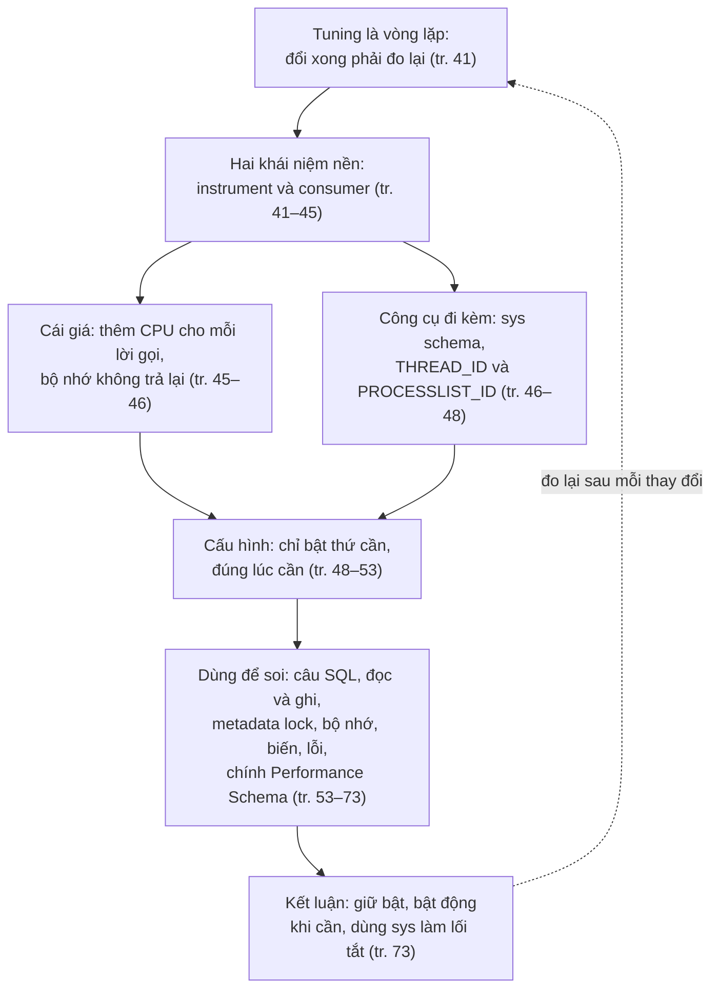
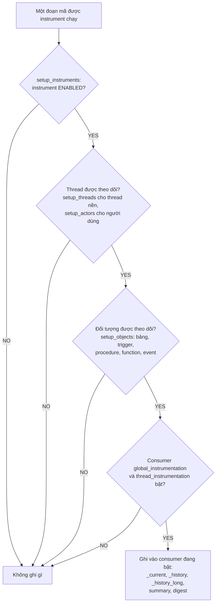
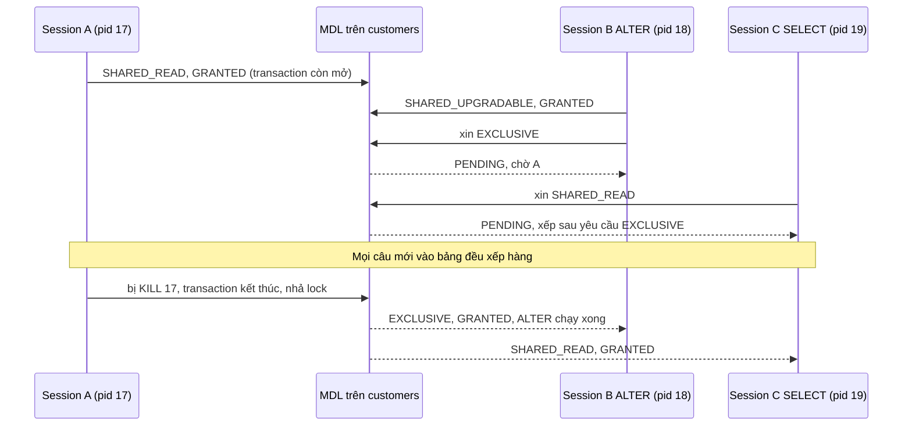
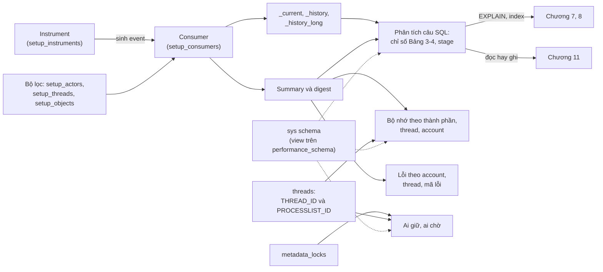

# Chương 3 — Performance Schema

*Performance Schema*

> **Nguồn:** *High Performance MySQL: Proven Strategies for Operating at Scale*, Silvia Botros và Jeremy Tinley, O'Reilly, **Fourth Edition (11/2021)**, Chương 3, **tr. 41–73** (trang PDF 63–95). Tr. 74 (PDF 96) là trang trắng. Chương này do **Sveta Smirnova** viết ("Contributed by Sveta Smirnova", tr. 41).
> "tr. N" là số trang in; trang PDF = N + 22 (xem [README](README.md#page-convention)).
>
> **Quy ước nhãn:**
> - Nội dung không nhãn là diễn giải từ sách, luôn kèm trang.
> - **Bổ sung ngoài sách** là kiến thức thêm hoặc phép tính tự làm (kèm nguồn khi dùng tài liệu ngoài).
> - **Ví dụ minh họa do AI xây dựng** là ví dụ, dữ liệu, SQL hoặc tình huống giả định.
> - **Dự đoán** là điều kỳ vọng nhưng chưa đo.
> - **Kết quả đã đo** là số liệu thật từ [bài thực hành](experiments/chapter-03.md): MySQL 8.0.42, Windows 11, instance riêng ở cổng 3313, cấu hình mặc định trừ khi ghi khác, dữ liệu tổng hợp 300.000 hàng.
>
> **Phiên bản:** sách viết cho MySQL 8.0 (có nhắc 8.0.25 ở tr. 44) và so sánh với 5.7. Một số mặc định, tên biến và tên stage đã đổi trong dòng 8.0. Ghi chú nêu rõ từng chỗ và đối chiếu với **8.0.42** đã đo. Listing của sách được mô tả bằng lời hoặc bảng, không chép nguyên văn.
>
> **Liên kết:** [Lộ trình chương 3](learning-roadmap.md#ch03) · [Bài thực hành](experiments/chapter-03.md) · [Đáp án tự kiểm tra](answers/chapter-03.md)

## Mục lục ghi chú

- [1. Bức tranh lớn](#big-picture)
- [2. Giải thích sâu](#deep)
  - [2.1 Introduction to Performance Schema (tr. 41–48)](#s2-1)
    - [2.1.1 Instrument Elements](#instrument-elements) · [2.1.2 Consumer Organization](#consumer-organization) · [2.1.3 Resource Consumption](#resource-consumption) · [2.1.4 Limitations](#limitations) · [2.1.5 sys Schema](#sys-schema) · [2.1.6 Understanding Threads](#threads)
  - [2.2 Configuration (tr. 48–53)](#s2-2)
    - [2.2.1 Bật/tắt Performance Schema](#enable-pfs) · [2.2.2 Bật/tắt instrument](#enable-instruments) · [2.2.3 Bật/tắt consumer](#enable-consumers) · [2.2.4 Đối tượng cụ thể](#setup-objects) · [2.2.5 Thread](#setup-threads-actors) · [2.2.6 Kích thước bộ nhớ](#memory-sizing) · [2.2.7 Defaults](#defaults)
  - [2.3 Using Performance Schema (tr. 53–73)](#s2-3)
    - [2.3.1 Câu SQL](#examining-statements) · [2.3.2 Đọc và ghi](#read-write) · [2.3.3 Metadata lock](#metadata-locks) · [2.3.4 Bộ nhớ](#memory-usage) · [2.3.5 Biến](#variables) · [2.3.6 Lỗi](#errors) · [2.3.7 Chính Performance Schema](#pfs-itself)
  - [2.4 Summary (tr. 73)](#s2-4)
- [3. Phân tích tình huống](#situations)
- [4. Đo lường và thực hành](#measure)
- [5. Liên kết kiến thức và điều cần nhớ](#takeaways)
- [Ghi chú kiểm tra nguồn](#kiem-tra)

---

<a id="big-picture"></a>

## 1. Bức tranh lớn

### Chương này hỏi gì?

Chương mở đầu bằng một nhận xét: tuning database dưới tải cao là một **vòng lặp** (tr. 41). Mỗi lần đổi một thứ, bạn phải biết thay đổi đó có tác dụng không. Sách nêu bốn câu hỏi điển hình:

- Truy vấn có chạy nhanh hơn trước không?
- Lock có đang làm chậm ứng dụng, hay đã hết hẳn?
- Mức dùng bộ nhớ có đổi không?
- Thời gian chờ đĩa có đổi không?

Trả lời được các câu này, bạn xử lý tình huống hằng ngày nhanh hơn và tự tin hơn. **Performance Schema** là database chứa dữ liệu để trả lời chúng. Chương giải thích nó hoạt động ra sao, giới hạn ở đâu, và cách dùng nó cùng **sys schema** để biết bên trong MySQL đang xảy ra chuyện gì (tr. 41).

Diễn giải bằng một câu: *bên trong `mysqld`, thời gian và tài nguyên đang đi đâu, và làm sao đo điều đó bằng chính SQL?*

### Vị trí trong mục tiêu chung của sách

- **Chương 2** đo từ phía khách hàng: SLI, SLO, latency, lỗi. Chương 2 nói rõ Performance Schema giúp tìm nút thắt và trả lời "vì sao việc này lâu thế", nhưng **không** phải công cụ để biết có đạt SLO hay không, vì nó nằm quá sâu trong nội bộ MySQL (tr. 25). Chương 3 là "kính hiển vi" bên trong server, bổ sung cho góc nhìn từ ngoài của chương 2.
- Các chương 4–8 đổi phần cứng, cấu hình, schema, index và truy vấn. Mỗi thay đổi đều cần đo trước và sau, nên chương 3 đặt trước chúng (xem [roadmap mục 5.1](learning-roadmap.md#lo-trinh)).
- Một số chương sau dùng lại trực tiếp công cụ của chương này (bảng liên hệ dưới).

### Kiến thức cần biết

- **Thread và kết nối:** MySQL tạo một thread cho mỗi kết nối, ngoài ra còn nhiều thread nền ([Chương 1](chapter-01.md#connection-management), tr. 2).
- **Lock và transaction:** khái niệm shared/exclusive lock, transaction kéo dài bao lâu. Chương 1 có nhắc metadata lock trong chú thích 4 (tr. 6).
- **Thuật ngữ thực thi truy vấn:** full table scan, bảng tạm (temporary table), sắp xếp (filesort), join. Ở đây chỉ cần trực giác; [Chương 8](chapter-08.md) giải thích kỹ.
- **SQL đủ để viết JOIN, GROUP BY, subquery**, vì mọi thứ trong chương đều là truy vấn trên bảng.

### Liên hệ với các chương khác

| Ý trong chương 3 | Chương | Căn cứ |
| --- | --- | --- |
| Performance Schema dùng để profile, tìm nút thắt; không phải công cụ đánh giá SLO | [Chương 2](chapter-02.md#monitoring-solutions) | tr. 25 |
| Thread, kết nối; metadata lock là loại khóa riêng ngoài khóa hàng của InnoDB | [Chương 1](chapter-01.md) | tr. 2; chú thích 4, tr. 6 |
| Các chỉ số bảng tạm, full join, sort trong statement dẫn tới việc tối ưu truy vấn và index | [Chương 8](chapter-08.md), [Chương 7](chapter-07.md) | Bảng 3-4, tr. 55–56 |
| `sort_buffer_size`, kích thước tối đa của bảng tạm trong bộ nhớ là biến cấu hình | [Chương 5](chapter-05.md) | tr. 55 |
| Tìm index không dùng bằng `sys.schema_unused_indexes` | [Chương 7](chapter-07.md#unused-index) | tr. 185 |
| Đo mức song song của replication applier bằng consumer `events_transactions_*` | [Chương 9](chapter-09.md#multithreaded-replication) | tr. 236 |
| Phân biệt workload đọc hay ghi để chọn read pool hay sharding | [Chương 11](chapter-11.md#understanding-workload) | tr. 290 nhắc lại mục ở tr. 62 |
| Bảng `users` của Performance Schema để biết một account còn được dùng | [Chương 13](chapter-13.md#retire-users) | tr. 338 |

### Mạch lập luận



---

<a id="deep"></a>

## 2. Giải thích sâu

<a id="s2-1"></a>

### 2.1 Introduction to Performance Schema (tr. 41–48)

<a id="performance-schema"></a>

**What** (tr. 41). ***Performance Schema*** (database `performance_schema`) cung cấp **số đo mức thấp** về các thao tác đang chạy bên trong MySQL server. Để hiểu nó, cần hai khái niệm.

<a id="instrument"></a>

- ***Instrument*** là **một đoạn mã của MySQL** mà ta muốn thu thông tin. Ví dụ, muốn thu thông tin về metadata lock thì phải bật instrument `wait/lock/metadata/sql/mdl` (tr. 41).

<a id="consumer"></a>

- ***Consumer*** đơn giản là **một bảng** lưu thông tin về đoạn mã đã được instrument. Nếu instrument các truy vấn, consumer sẽ ghi tổng số lần chạy, số lần không dùng index, thời gian tiêu tốn… Consumer là phần mà phần lớn mọi người gắn với Performance Schema (tr. 41–42).

**How** (Hình 3-1, tr. 42). Khi người dùng kết nối và chạy một lệnh đã được instrument, `performance_schema` **bọc mỗi lời gọi được theo dõi bằng hai macro**, rồi ghi kết quả vào bảng consumer tương ứng. Ý cần nhớ: bật instrument nghĩa là **chạy thêm mã**, nên instrument tiêu tốn CPU (tr. 42).

<a id="fig-3-1"></a>


*(Vẽ lại Hình 3-1, tr. 42: luồng truy vấn chạy trên database, Performance Schema thu, gộp dữ liệu rồi đưa cho DBA. Hình gốc vẽ nhiều mũi tên từ người dùng vào MySQL và nhiều mũi tên "Record" từ engine tới khối "Collected data".)*

> **Bổ sung ngoài sách (cách hình dung).** Instrument giống **cảm biến** gắn vào mã nguồn, consumer giống **sổ ghi**. Cảm biến bật mà sổ tắt thì dữ liệu không được lưu; sổ mở mà cảm biến tắt thì không có gì để ghi. Phần lớn chi phí CPU nằm ở cảm biến (mỗi lần mã chạy qua), phần lớn chi phí bộ nhớ nằm ở sổ.

**Hiểu lầm phổ biến.** "Performance Schema là một log truy vấn." Không đúng. Nó là tập **bảng trong bộ nhớ** có kích thước giới hạn: bảng lịch sử chỉ giữ một số event gần nhất, bảng tổng hợp chỉ giữ số cộng dồn, và mọi thứ mất khi server khởi động lại (tr. 44, 52–53, 73).

<a id="instrument-elements"></a>

#### 2.1.1 Instrument Elements (tr. 42–44)

**Danh sách và cách đặt tên** (tr. 42). Bảng `setup_instruments` chứa mọi instrument được hỗ trợ. Tên instrument gồm nhiều phần ngăn bởi dấu `/`:

- **Phần đầu tiên** cho biết **loại** instrument: `statement` là câu lệnh, `wait` là sự chờ, v.v.
- **Các phần còn lại**, từ trái sang phải, chỉ **hệ thống con từ tổng quát tới cụ thể**.

| Tên | Loại | Đọc từ trái sang phải |
| --- | --- | --- |
| `statement/sql/select` | statement | thuộc hệ con `sql`; là câu `SELECT` |
| `wait/synch/mutex/innodb/autoinc_mutex` | wait | nhóm `synch` (đồng bộ) → lớp `mutex` → của `innodb` → mutex mà InnoDB đặt trên cột auto-increment |

*(Sách viết "generic instrument sync" ở tr. 42; trong tên thật là `synch`.)*

**Cột DOCUMENTATION** (tr. 43). `setup_instruments` có cột `DOCUMENTATION` có thể giải thích thêm. Listing ở tr. 43 lấy 5 dòng có tài liệu, cho thấy các cột `NAME`, `ENABLED`, `TIMED`, `PROPERTIES`, `VOLATILITY`, `DOCUMENTATION`. Trong đó:

- `statement/sql/error`: câu SQL không hợp lệ (lỗi cú pháp).
- `statement/abstract/Query`, `statement/abstract/new_packet`, `statement/abstract/relay_log`: câu truy vấn, gói tin mới từ mạng, event mới đọc từ relay log. Ở thời điểm đó **chưa biết loại lệnh thật**; loại sẽ được "tinh chỉnh" sau khi parse. Các instrument này có thuộc tính `mutable`.
- `memory/performance_schema/mutex_instances`: bộ nhớ dùng cho chính bảng `mutex_instances`; `TIMED` là NULL vì instrument bộ nhớ không đo thời gian.

**Giới hạn** (tr. 44). Nhiều instrument có `DOCUMENTATION` là NULL, nên phải dựa vào tên, trực giác và hiểu biết mã nguồn MySQL.

> **Kết quả đã đo** (thí nghiệm 1). MySQL 8.0.42 có **1.220 instrument**, chỉ **170** có `DOCUMENTATION`. Phân theo loại: `wait` 368, `memory` 504, `statement` 213, `stage` 132, `transaction` 1, `idle` 1, `error` 1.

<a id="consumer-organization"></a>

#### 2.1.2 Consumer Organization (tr. 44–45)

Consumer là **đích** mà instrument gửi thông tin tới. Kết quả nằm ở rất nhiều bảng: MySQL Community 8.0.25 có **110 bảng** trong `performance_schema` (tr. 44). Dễ hiểu hơn nếu chia nhóm:

| Nhóm | Ý nghĩa | Ví dụ (tr. 44–45) |
| --- | --- | --- |
| **Dữ liệu hiện tại và lịch sử** | Bảng kết thúc bằng `_current` (event đang diễn ra), `_history` (10 event đã xong gần nhất của mỗi thread), `_history_long` (10.000 event đã xong gần nhất). Kích thước `_history`, `_history_long` cấu hình được | Có cho bốn loại: `events_waits` (chờ mức thấp như lấy mutex), `events_statements` (câu SQL), `events_stages` (thông tin profile như tạo bảng tạm, gửi dữ liệu), `events_transactions` |
| ***Summary table*** | Bảng giữ thông tin **đã gộp** theo đúng nghĩa tên bảng | `memory_summary_by_thread_by_event_name`: bộ nhớ gộp theo từng thread, cả kết nối người dùng lẫn thread nền |
| ***Digest*** | Gộp truy vấn bằng cách **bỏ phần khác nhau** giữa chúng | xem ví dụ dưới |
| **Instances** | Các thể hiện đối tượng có trong cài đặt MySQL | `file_instances`: tên file và số thread đang truy cập |
| **Setup** | Cấu hình `performance_schema` lúc chạy | `setup_instruments`, `setup_consumers`… |
| **Bảng khác** | Tên không theo mẫu cố định | `metadata_locks` |

<a id="history-long"></a>

> **Bổ sung ngoài sách (phạm vi của `_history_long`).** Sách viết `_history_long` là "10.000 event gần nhất mỗi thread, toàn cục" (tr. 44) và ở mục Defaults là "10.000 event mỗi thread" (tr. 53). Theo MySQL 8.0 Reference Manual (các mục về bảng `events_statements_history_long`, `events_waits_history_long`…), `_history_long` chứa N event đã kết thúc gần nhất **trên toàn server, gộp mọi thread**; chỉ `_history` mới tính theo từng thread. Đã đo trên 8.0.42: chỉ có **một** biến kích thước `performance_schema_events_statements_history_long_size = 10000`. Hệ quả: trên server bận, 10.000 câu có thể trôi qua trong vài giây, nên `_history_long` là **cửa sổ rất ngắn**, không phải lịch sử dài hạn.

<a id="digest"></a>

**Digest** (tr. 44–45). Ba câu `SELECT user, birthdate FROM users WHERE user_id = …` chỉ khác hằng số (19, 13, 27) có chung một digest, trong đó hằng số được thay bằng `?`. Nhờ vậy Performance Schema theo dõi được latency và các số đo khác **cho từng mẫu truy vấn** mà không phải lưu riêng từng biến thể.

> **Kết quả đã đo** (thí nghiệm 2). 200 câu `SELECT * FROM orders WHERE id = <số khác nhau>` gộp thành **một** dòng digest với `COUNT_STAR = 200`, `DIGEST_TEXT` là ``SELECT * FROM `orders` WHERE `id` = ?``.

> **Bổ sung ngoài sách.** Digest được tính trên câu đã chuẩn hóa và bị cắt ở `max_digest_length` / `performance_schema_max_digest_length` (mặc định 1.024 byte, tr. 53; đo được trên 8.0.42 cũng là 1.024). Hai câu rất dài chỉ khác nhau ở phần sau byte thứ 1.024 có thể bị gộp chung một digest. Bảng digest cũng có giới hạn số dòng (`performance_schema_digests_size`, đo được 10.000); khi đầy, các digest mới bị dồn vào một dòng chung. Các sự kiện còn lồng nhau theo cấp: transaction chứa statement, statement chứa stage, stage chứa wait; cột `NESTING_EVENT_ID` nối event con với event cha, như truy vấn stage ở tr. 61 sẽ dùng.

<a id="resource-consumption"></a>

#### 2.1.3 Resource Consumption (tr. 45)

**Bộ nhớ** (tr. 45). Dữ liệu thu được **nằm trong bộ nhớ**. Có thể giới hạn bằng cách đặt kích thước tối đa cho consumer. Một số bảng hỗ trợ ***autoscaling***: cấp phát tối thiểu lúc khởi động rồi tăng dần khi cần. Nhưng bộ nhớ đó **không bao giờ được trả lại** sau khi đã cấp phát, kể cả khi bạn tắt instrument và `TRUNCATE` bảng.

**CPU** (tr. 45). Mỗi lời gọi được instrument thêm **hai lời gọi macro** để ghi dữ liệu. Instrument càng nhiều thì CPU càng cao, nhưng mức tác động **phụ thuộc instrument**:

| Loại instrument | Số lần được gọi | Tác động CPU theo sách |
| --- | --- | --- |
| Statement (`statement/sql/select`) | Khoảng **một lần** mỗi truy vấn, để biết đó là câu gì | Không nhận thấy tăng CPU |
| Wait, nhất là lock | **Rất nhiều lần**: quét bảng InnoDB một triệu hàng cần đặt và nhả **một triệu row lock** | Có thể tăng CPU **đáng kể** |
| Memory, metadata lock | Ít | Không nhận thấy (tr. 45) |

**Why quan trọng.** Chi phí tỷ lệ với **tần suất** đoạn mã được gọi, không tỷ lệ với "độ quan trọng" của nó. Đây là lý do mặc định chỉ bật nhóm rẻ (statement, transaction, memory, MDL) và để tắt nhóm đắt (`wait/synch/*` như mutex, rwlock).

> **Kết quả đã đo** (thí nghiệm 4). Trên instance mặc định, **bộ nhớ của chính Performance Schema là thành phần lớn nhất được instrument**: 229,59 MB, lớn hơn cả InnoDB (193 MB, trong đó buffer pool 130,8 MB). Bật thêm mọi instrument `wait/*` và consumer `events_waits_*`, chạy vài truy vấn, rồi tắt và `TRUNCATE`: tổng vẫn đứng ở 229,59 MB. Tạo 1.500 bảng làm bộ nhớ Performance Schema tăng lên 232,36 MB; xóa hết 1.500 bảng, con số **không giảm**. Lượt hai tạo 3.000 bảng chỉ tăng thêm 0,58 MB (chủ yếu `mutex_instances`, `rwlock_instances`), tức phần đã cấp được **dùng lại**. Chi phí CPU **không được đo** trong bài thực hành.

<a id="limitations"></a>

#### 2.1.4 Limitations (tr. 46)

Sách nêu ba giới hạn cần biết trước khi dùng:

1. **Phải được thành phần MySQL hỗ trợ.** Ví dụ bạn dùng memory instrumentation để tìm thành phần ngốn bộ nhớ, và thủ phạm là một storage engine không hỗ trợ memory instrumentation: bạn sẽ không tìm ra bộ nhớ đi đâu.
2. **Chỉ thu dữ liệu sau khi instrument và consumer đã được bật.** Nếu khởi động với mọi instrument tắt rồi mới bật memory instrumentation, bạn không biết chính xác bộ nhớ của buffer pool InnoDB, vì nó đã được cấp phát **trước** khi bật.
3. **Khó giải phóng bộ nhớ.** Có thể giới hạn kích thước consumer lúc khởi động hoặc để tự điều chỉnh (autosize). Với autosize, bộ nhớ chỉ được cấp khi có dữ liệu được thu; nhưng kể cả khi tắt instrument hay consumer sau đó, bộ nhớ chỉ được trả lại khi **khởi động lại server**.

**Trade-offs.** Giới hạn 2 và 3 kéo về hai phía ngược nhau. Muốn tiết kiệm (giới hạn 3) thì có xu hướng tắt hết; nhưng tắt hết thì mất dữ liệu về những gì xảy ra lúc khởi động và trước khi bật (giới hạn 2). Lời khuyên cuối chương (tr. 73) giải quyết bằng cách **để mặc định bật**, chỉ bật thêm khi cần.

> **Kết quả đã đo** (thí nghiệm 4). Bộ đệm `events_waits_history_long` đã chiếm 1,60 MB dù consumer của nó **tắt** từ lúc khởi động. Nghĩa là trên 8.0.42, các bộ đệm lịch sử có kích thước cố định được cấp ngay khi khởi động; phần "chỉ cấp khi có dữ liệu" mà sách mô tả rõ nhất ở các container autoscale như `mutex_instances`, `rwlock_instances`.

<a id="sys-schema"></a>

#### 2.1.5 sys Schema (tr. 46)

Từ 5.7, bản phân phối MySQL chuẩn có kèm ***sys schema***, một schema "bạn đồng hành" của `performance_schema`. Nó **chỉ gồm view và stored routine** dựng trên `performance_schema`, giúp dùng thuận tiện hơn, và **tự nó không lưu dữ liệu** (tr. 46).

> **Lưu ý của sách** (tr. 46). sys rất tiện nhưng chỉ đọc dữ liệu có trong các bảng `performance_schema`. Nếu sys không có thứ bạn cần, hãy xem bảng gốc trong `performance_schema`.

> **Kết quả đã đo** (thí nghiệm 1). sys trên 8.0.42 có 100 view, 48 routine và 1 bảng thường (`sys_config`).
>
> **Bổ sung ngoài sách.** `sys_config` chỉ chứa tùy chọn cấu hình của chính sys, không chứa số đo. Nhiều view có cặp dạng `x$...` (ví dụ `x$statement_analysis`) trả số thô chưa định dạng, tiện để sắp xếp hay tính toán; bản không có `x$` đổi đơn vị sang dạng dễ đọc như "805.37 ms", "1.36 MiB".

<a id="threads"></a>

#### 2.1.6 Understanding Threads (tr. 46–48)

**What** (tr. 46–47). MySQL server là phần mềm đa luồng; mọi thành phần đều dùng thread. Có **thread nền** (do main thread hay storage engine tạo) và **thread tiền cảnh** tạo cho mỗi kết nối người dùng. Mỗi thread có ít nhất hai định danh:

<a id="thread-id"></a>

| Định danh | Ở đâu | Ghi chú |
| --- | --- | --- |
| ID thread của hệ điều hành | `THREAD_OS_ID`; thấy trong `ps -eLf` trên Linux | |
| ***THREAD_ID*** | ID nội bộ của MySQL; tên cột trong hầu hết bảng `performance_schema` | Mọi thread đều có |
| ***PROCESSLIST_ID*** | Mã kết nối; thấy trong `SHOW PROCESSLIST` và dòng "Your MySQL connection id is" của client | Chỉ thread tiền cảnh có |

> **Cảnh báo của sách** (tr. 47). `THREAD_ID` **không bằng** `PROCESSLIST_ID`!

**Bảng `threads`** (tr. 47). Listing ở tr. 47 liệt kê 44 thread: `thread/sql/main` có `THREAD_ID` 1 và `PROCESSLIST_ID` NULL; các thread I/O của InnoDB cũng NULL; `slave_io`, `slave_sql`, `event_scheduler`, `compress_gtid_table` có `PROCESSLIST_ID` nhỏ (5, 6, 7, 9); một kết nối `one_connection` có `THREAD_ID` 27823 nhưng `PROCESSLIST_ID` 27784. Ngoài số hiệu thread, bảng có cùng dữ liệu như `SHOW PROCESSLIST` và thêm vài cột như `RESOURCE_GROUP`, `PARENT_THREAD_ID`.

> **Cảnh báo của sách** (tr. 47). Performance Schema dùng `THREAD_ID` ở khắp nơi, còn `PROCESSLIST_ID` chỉ có trong bảng `threads`. Muốn `KILL` một kết nối đang giữ lock, phải tra bảng `threads` để lấy `PROCESSLIST_ID`.

Bảng `threads` có thể join với nhiều bảng khác để biết thêm về truy vấn đang chạy: câu lệnh, lock, mutex, bảng đang mở (tr. 48).

> **Kết quả đã đo** (thí nghiệm 1 và 3). Instance có 35 thread (3 tiền cảnh, 32 nền). Kết nối của người viết có `PROCESSLIST_ID` 9 nhưng `THREAD_ID` 45. Trong thí nghiệm metadata lock, session giữ lock có `THREAD_ID` 61 và `PROCESSLIST_ID` 17: lệnh `KILL 61` báo `ERROR 1094 … Unknown thread id: 61`; tra `threads` lấy 17 rồi `KILL 17` mới gỡ được lock.
>
> **Bổ sung ngoài sách.** Từ 8.0.16 có hàm `PS_CURRENT_THREAD_ID()` (THREAD_ID của session hiện tại) và `PS_THREAD_ID(connection_id)`; với 5.7 dùng `sys.ps_thread_id()`. `CONNECTION_ID()` trả `PROCESSLIST_ID`.

<a id="tu-kiem-tra-2-1"></a>

#### Tự kiểm tra 2.1

- **Câu 2.1.1.** Instrument và consumer khác nhau thế nào? Nếu instrument của một loại event đang bật nhưng consumer tương ứng tắt, dữ liệu đi đâu? [đáp án](answers/chapter-03.md#q2-1-1)
- **Câu 2.1.2.** Vì sao bật instrument cho statement gần như không làm tăng CPU, còn bật instrument cho lock (wait) có thể làm CPU tăng đáng kể? Dựa vào cơ chế hai macro để giải thích. [đáp án](answers/chapter-03.md#q2-1-2)
- **Câu 2.1.3.** Ứng dụng chạy 1 triệu lần `SELECT ... WHERE user_id = ?` với giá trị khác nhau. Có bao nhiêu dòng trong bảng digest, và vì sao điều này quan trọng với bộ nhớ của Performance Schema? Khi nào hai câu khác nhau lại bị gộp chung một digest? [đáp án](answers/chapter-03.md#q2-1-3)
- **Câu 2.1.4.** Một DBA khởi động server với mọi instrument tắt, hai ngày sau bật memory instrumentation và thấy InnoDB "chỉ dùng vài MB". Điều gì sai trong cách đọc này? [đáp án](answers/chapter-03.md#q2-1-4)
- **Câu 2.1.5.** Bạn tìm thấy `OWNER_THREAD_ID = 61` đang giữ metadata lock. Vì sao `KILL 61` có thể thất bại hoặc tệ hơn là giết nhầm kết nối, và cách đúng là gì? [đáp án](answers/chapter-03.md#q2-1-5)

---

<a id="s2-2"></a>

### 2.2 Configuration (tr. 48–53)

**Cái gì đổi được lúc nào** (tr. 48). Chỉ vài phần **phải đặt lúc khởi động**: bật hay tắt chính Performance Schema, và các biến về bộ nhớ, giới hạn dữ liệu thu. Còn **instrument và consumer bật tắt động** được, không cần restart.

> **Mẹo của sách** (tr. 48). Có thể khởi động Performance Schema với mọi consumer và instrument tắt, rồi chỉ bật những gì cần cho một vấn đề cụ thể **ngay trước khi** bạn đoán nó sẽ xảy ra. Như vậy không tốn tài nguyên ở chỗ không cần, và không có nguy cơ làm hệ thống "đói" tài nguyên vì instrument quá nhiều.

**Lọc theo nhiều tầng.** Một event chỉ được lưu khi qua được mọi "cửa" cấu hình. Sách mô tả từng cửa trong các mục con dưới; sơ đồ ghép chúng lại.

<a id="filter-chain"></a>



*(Sơ đồ do người viết ghi chú tổng hợp từ tr. 48–52 và Bảng 3-1. Thứ tự các cửa và việc `setup_objects` chỉ áp dụng cho event gắn với đối tượng là **Bổ sung ngoài sách**, theo mục "Performance Schema Event Filtering" của MySQL 8.0 Reference Manual.)*

<a id="enable-pfs"></a>

#### 2.2.1 Enabling and Disabling Performance Schema (tr. 48)

Biến `performance_schema` đặt `ON` hay `OFF`. Đây là biến **chỉ đọc**, chỉ đổi được trong file cấu hình hoặc tham số dòng lệnh khi server khởi động (tr. 48).

> **Kết quả đã đo.** Trên 8.0.42 chạy `--no-defaults`, `@@performance_schema = 1` (bật).

<a id="enable-instruments"></a>

#### 2.2.2 Enabling and Disabling Instruments (tr. 48–50)

**Xem trạng thái** (tr. 48). Truy vấn `setup_instruments` theo `NAME`. Listing của sách cho `statement/sql/select` có `ENABLED = NO`, tức đang không đo câu `SELECT`.

> **Kết quả đã đo.** Trên 8.0.42 mặc định, `statement/sql/select` là `ENABLED = YES`, `TIMED = YES`. Listing của sách nhiều khả năng lấy từ server đã tắt instrument này (đúng như mẹo ở tr. 48), không phải giá trị mặc định.

**Ba cách bật/tắt** (tr. 49–50):

| Cách | Ví dụ (mô tả) | Sống sót qua restart? |
| --- | --- | --- |
| `UPDATE performance_schema.setup_instruments SET ENABLED = 'YES' WHERE NAME = ...` | Vì là SQL chuẩn nên dùng được `LIKE` với wildcard; ví dụ của sách bật mọi `statement/sql/%` (167 dòng) | **Không** (tr. 49) |
| `CALL sys.ps_setup_enable_instrument(...)` và `sys.ps_setup_disable_instrument(...)` | Hỗ trợ wildcard; `'%'` nghĩa là mọi instrument; kết quả trả về dạng "Enabled 1 instrument" | **Không**, về bản chất giống `UPDATE` (tr. 49) |
| Tùy chọn khởi động `performance-schema-instrument` với cú pháp `tên=giá trị` | Giá trị `ON`/`TRUE`/`1` để bật, `OFF`/`FALSE`/`0` để tắt, `COUNTED` để chỉ đếm thay vì đo thời gian; lặp lại được nhiều lần; hỗ trợ wildcard | **Có** (tr. 49–50) |

**ENABLED và TIMED.** `ENABLED` quyết định có thu event hay không; `TIMED` quyết định có đo thời gian hay không. `COUNTED` nghĩa là bật nhưng không đo thời gian (tr. 50). Instrument `memory/*` có `TIMED = NULL` vì cấp phát bộ nhớ không được đo thời gian (tr. 43; đo được trên 8.0.42).

> **Cảnh báo của sách** (tr. 50). Khi có nhiều tùy chọn, **chuỗi instrument dài hơn được ưu tiên** hơn chuỗi ngắn, **bất kể thứ tự**.

> **Kết quả đã đo** (thí nghiệm 1, phần khởi động lại). Khởi động với `statement/sql/select=ON` đặt **trước** `statement/sql/%=OFF`: `statement/sql/select` vẫn `YES`, 158 instrument `statement/sql/*` còn lại `NO`, đúng như cảnh báo. `wait/synch/mutex/innodb/autoinc_mutex=COUNTED` cho `ENABLED = YES, TIMED = NO`. Các thay đổi bằng `UPDATE` từ trước (bật `stage/%`, `statement/sp/%`) **mất** sau restart. 8.0.42 có 159 instrument `statement/sql/*` (sách: 167 dòng; khác do phiên bản).

<a id="enable-consumers"></a>

#### 2.2.3 Enabling and Disabling Consumers (tr. 50–51)

Consumer bật/tắt bằng ba cách tương tự (tr. 50): `UPDATE setup_consumers`, thủ tục `sys.ps_setup_enable_consumer` / `sys.ps_setup_disable_consumer`, và tùy chọn khởi động `performance-schema-consumer`. Sách nói có **15 consumer**, và giải thích những consumer khó hiểu trong Bảng 3-1:

| Consumer (Bảng 3-1, tr. 50) | Ý nghĩa |
| --- | --- |
| `events_stages_[current\|history\|history_long]` | Chi tiết profile, như "Creating tmp table", "statistics", "buffer pool load" |
| `events_statements_[current\|history\|history_long]` | Thống kê câu lệnh |
| `events_transactions_[current\|history\|history_long]` | Transaction |
| `events_waits_[current\|history\|history_long]` | Sự chờ |
| `global_instrumentation` | Bật/tắt instrument toàn cục. Nếu tắt: không kiểm tra tham số riêng nào, không giữ dữ liệu toàn cục hay theo thread, không thu event nào |
| `thread_instrumentation` | Instrument theo thread. Chỉ được xét khi `global_instrumentation` bật. Nếu tắt: không thu dữ liệu theo thread hay event riêng lẻ |
| `statements_digest` | Digest câu lệnh |

Các ví dụ cho instrument dùng lại được cho consumer (tr. 51).

<a id="consumer-hierarchy"></a>

> **Bổ sung ngoài sách** (MySQL 8.0 Reference Manual, "Pre-Filtering by Consumer"). Consumer xếp thành cây phụ thuộc: `global_instrumentation` ở gốc; `thread_instrumentation` và `statements_digest` chỉ phụ thuộc gốc; `events_xxx_current` phụ thuộc cả hai cái trên; `events_xxx_history` và `_history_long` còn phụ thuộc thêm `events_xxx_current`. Tắt một nút cha là cắt luôn mọi nút con.

> **Kết quả đã đo** (thí nghiệm 1). 8.0.42 có **16** consumer: thêm `events_statements_cpu` (theo tài liệu MySQL, có từ 8.0.28, sau bản 8.0.25 mà sách dùng). Mặc định bật: `global_instrumentation`, `thread_instrumentation`, `statements_digest`, `events_statements_current`, `events_statements_history`, `events_transactions_current`, `events_transactions_history`. **Tắt**: mọi `_history_long`, mọi `events_stages_*`, mọi `events_waits_*`, và `events_statements_cpu`.

<a id="setup-objects"></a>

#### 2.2.4 Tuning Monitoring for Specific Objects (tr. 51)

Bảng `setup_objects` cho phép bật/tắt theo loại đối tượng, schema và tên. `OBJECT_TYPE` nhận một trong năm giá trị: `EVENT`, `FUNCTION`, `PROCEDURE`, `TABLE`, `TRIGGER`; kèm `OBJECT_SCHEMA`, `OBJECT_NAME`, có hỗ trợ wildcard (tr. 51).

Ví dụ của sách (tr. 51): thêm một dòng tắt mọi trigger trong schema `test`, rồi một dòng ngoại lệ bật riêng `test.my_trigger`. Khi quyết định một đối tượng có được theo dõi không, Performance Schema **tìm luật cụ thể nhất trước**, rồi mới lùi về luật kém cụ thể hơn. Vì vậy câu lệnh do `test.my_trigger` kích hoạt được theo dõi, còn `test.some_other_trigger` thì không.

**Không có tùy chọn file cấu hình** cho bảng này. Muốn giữ qua restart, ghi các câu `INSERT` vào một file SQL và nạp lúc khởi động bằng tùy chọn `init_file` (tr. 51).

> **Kết quả đã đo** (thí nghiệm 1). Mặc định có 20 dòng: với mỗi loại trong năm loại, ba schema `mysql`, `performance_schema`, `information_schema` là `NO`, còn `%` là `YES`.

> **Bổ sung ngoài sách và kết quả đã đo** (thí nghiệm 5). `setup_objects` lọc các event **gắn với đối tượng** (I/O và lock của bảng, thân stored program), không lọc việc ghi **câu lệnh** của một session. Khi đặt `performance_schema`, `sys` hoặc `mysql` làm database mặc định, các câu `SELECT` vẫn xuất hiện trong `events_statements_history_long` và bảng digest. Cái bị loại là số đo I/O trên **bảng** của ba schema hệ thống trong `table_io_waits_summary_by_table`.

<a id="setup-threads-actors"></a>

#### 2.2.5 Tuning Threads Monitoring (tr. 51–52)

**Thread nền: `setup_threads`** (tr. 51). Bảng liệt kê các thread nền có thể theo dõi. Cột `ENABLED` bật/tắt instrument cho thread đó; cột `HISTORY` quyết định event của thread có được lưu vào `_history` và `_history_long` không. Ví dụ của sách tắt lịch sử cho event scheduler bằng cách đặt `HISTORY = 'NO'` cho `thread/sql/event_scheduler`.

**Thread người dùng: `setup_actors`** (tr. 52). `setup_threads` không chứa thiết lập cho thread người dùng; dùng `setup_actors` với các cột trong Bảng 3-2:

| Cột (Bảng 3-2, tr. 52) | Ý nghĩa |
| --- | --- |
| `HOST` | Host, như `localhost`, `%`, `my.domain.com`, `199.27.145.65` |
| `USER` | Tên user, như `sveta` hoặc `%` |
| `ROLE` | Không dùng |
| `ENABLED` | Thread có được instrument không |
| `HISTORY` | Có lưu vào `_history` và `_history_long` không |

Ví dụ của sách (tr. 52) chèn ba luật: `sveta@localhost` bật instrument nhưng tắt lịch sử; `sveta@example.com` bật cả hai; mọi user khác từ `localhost` tắt cả hai. Giống `setup_objects`, **không có tùy chọn file cấu hình** cho thread và actor; muốn giữ qua restart thì dùng `init_file` (tr. 52).

> **Kết quả đã đo** (thí nghiệm 1). `setup_threads` có 55 dòng, tất cả `ENABLED = YES`, `HISTORY = YES`. `setup_actors` mặc định chỉ có một dòng `%`/`%`/`%` với `ENABLED = YES`, `HISTORY = YES`.

> **Bổ sung ngoài sách** (MySQL 8.0 Reference Manual, mô tả bảng `setup_actors`). Thay đổi `setup_actors` chỉ áp dụng cho **kết nối mới**; kết nối đang mở giữ nguyên. Muốn đổi cho thread đang chạy thì sửa cột `INSTRUMENTED`, `HISTORY` trong bảng `threads`.

<a id="memory-sizing"></a>

#### 2.2.6 Adjusting Memory Size for Performance Schema (tr. 52)

Các bảng Performance Schema dùng engine `PERFORMANCE_SCHEMA`, lưu dữ liệu **trong bộ nhớ**. Một số bảng tự điều chỉnh kích thước (autosized) theo mặc định, số khác có số hàng cố định. Đổi bằng **biến khởi động** theo mẫu `performance_schema_<object>_[size|instances|classes|length|handles]`, trong đó `<object>` là một consumer, một bảng setup hoặc một thể hiện được instrument của một loại event (tr. 52). Ví dụ:

- `performance_schema_events_stages_history_size`: số stage **mỗi thread** mà bảng `events_stages_history` giữ;
- `performance_schema_max_memory_classes`: số instrument bộ nhớ tối đa có thể dùng.

**Kết quả đã đo** (thí nghiệm 1, 8.0.42 mặc định):

| Biến | Giá trị |
| --- | --- |
| `performance_schema_events_{statements,stages,waits}_history_size` | 10 |
| `performance_schema_events_{statements,stages,waits,transactions}_history_long_size` | 10000 |
| `performance_schema_digests_size` | 10000 |
| `performance_schema_max_sql_text_length`, `performance_schema_max_digest_length`, `max_digest_length` | 1024 |
| `performance_schema_max_memory_classes` | 450 |
| `performance_schema_max_statement_classes` | 219 |
| 18 biến khác (`..._max_table_handles`, `..._max_mutex_instances`, `..._max_metadata_locks`, `..._accounts_size`…) | -1 |

> **Bổ sung ngoài sách.** Giá trị `-1` nghĩa là để server tự tính (autosize hoặc autoscale).

<a id="defaults"></a>

#### 2.2.7 Defaults (tr. 53)

Mặc định đổi theo phiên bản, nên tốt nhất là đọc tài liệu chính thức trước khi dựa vào các giá trị dưới đây. Nhưng với Performance Schema, mặc định ảnh hưởng hiệu năng chung của server, nên sách nêu những cái quan trọng (tr. 53):

- Từ **5.7**, Performance Schema **bật mặc định** nhưng **phần lớn instrument tắt**. Chỉ bật instrument toàn cục, thread, statement và transaction. Từ **8.0**, bật thêm **metadata lock** và **memory**.
- Ba database `mysql`, `information_schema`, `performance_schema` **không** được instrument; mọi đối tượng, thread và actor khác thì có.
- Phần lớn instance, handle và bảng setup tự điều chỉnh kích thước. `_history` giữ 10 event mỗi thread, `_history_long` giữ 10.000 event (xem [ghi chú về phạm vi](#history-long)). Độ dài SQL text tối đa 1.024 byte, độ dài digest tối đa cũng 1.024 byte; dài hơn bị **cắt bên phải**.

<a id="defaults-8042"></a>

**Kết quả đã đo: instrument và consumer bật mặc định trên MySQL 8.0.42** (thí nghiệm 1)

| Nhóm instrument | Tổng | Bật | Ghi chú |
| --- | --- | --- | --- |
| `statement/sql/*` | 159 | 159 | |
| `statement/com/*`, `statement/abstract/*`, `statement/scheduler/*` | 33 + 4 + 1 | tất cả | |
| `statement/sp/*` | 16 | **1** | chỉ `statement/sp/stmt`; `hpush_jump`, `hpop`, `hreturn`, `jump_if_not`… tắt |
| `transaction` | 1 | 1 | |
| `memory/*` | 504 | 504 | `TIMED` là NULL |
| `wait/lock/metadata/sql/mdl` | 1 | 1 | |
| `wait/lock/table/sql/handler`, `wait/io/table/sql/handler` | 2 | 2 | sách không nhắc ở mục Defaults |
| `wait/io/file/*` | 50 | 50 | sách không nhắc |
| `wait/io/socket/*` | 3 | 0 | |
| `wait/synch/*` (mutex, rwlock, cond, sxlock, prlock) | 312 | **0** | nhóm gọi dày đặc nhất (xem [2.1.3](#resource-consumption)) |
| `stage/*` | 132 | 16 | chỉ các stage báo **tiến độ**: ALTER TABLE của InnoDB, clone, buffer pool load, "copy to tmp table", "Applying batch of row changes" |
| `idle`, `error` | 1 + 1 | 2 | |

Consumer bật: `global_instrumentation`, `thread_instrumentation`, `statements_digest`, `events_statements_current`, `events_statements_history`, `events_transactions_current`, `events_transactions_history`. Mọi `_history_long`, `events_stages_*`, `events_waits_*`, `events_statements_cpu` **tắt**.

**Hệ quả thực hành.** Nhiều truy vấn mẫu ở phần sau của chương đọc `events_statements_history_long` hay `events_stages_history_long`, hoặc cần `statement/sp/%` đầy đủ. Trên 8.0.42 mặc định, phải **bật consumer hay instrument tương ứng trước**, nếu không bảng sẽ trống hoặc thiếu event.

**Decision.** Mặc định của 8.0 là điểm cân bằng: bật những nhóm gọi ít lần (statement, transaction, MDL, memory, file I/O) và tắt nhóm gọi dày đặc (`wait/synch`). Khi cần soi sâu, bật thêm có chủ đích trong một khoảng thời gian, rồi tắt lại; nhớ rằng bộ nhớ đã cấp sẽ không trả lại tới lần restart sau ([2.1.4](#limitations)).

<a id="tu-kiem-tra-2-2"></a>

#### Tự kiểm tra 2.2

- **Câu 2.2.1.** Bạn bật `statement/sp/%` bằng `UPDATE setup_instruments`, và chèn luật vào `setup_actors`. Sau một lần restart, cái nào còn, cái nào mất? Muốn giữ cả hai thì làm thế nào? [đáp án](answers/chapter-03.md#q2-2-1)
- **Câu 2.2.2.** File cấu hình có hai dòng theo thứ tự: `performance-schema-instrument='statement/sql/select=ON'` rồi `performance-schema-instrument='statement/sql/%=OFF'`. Dự đoán trạng thái của `statement/sql/select` và `statement/sql/insert` sau khi khởi động. Nếu đảo thứ tự hai dòng thì sao? [đáp án](answers/chapter-03.md#q2-2-2)
- **Câu 2.2.3.** `events_statements_history` đang `YES` nhưng ai đó tắt `global_instrumentation`. Bảng lịch sử có nhận event mới không? Còn nếu chỉ tắt `events_statements_current`? [đáp án](answers/chapter-03.md#q2-2-3)
- **Câu 2.2.4.** `setup_objects` có hai dòng: (`TRIGGER`, `test`, `%`, `NO`) và (`TRIGGER`, `test`, `my_trigger`, `YES`). Trigger `test.my_trigger` và `test.audit_trg` có được theo dõi không? Vì sao thứ tự chèn hai dòng không quan trọng? [đáp án](answers/chapter-03.md#q2-2-4)
- **Câu 2.2.5.** Trên MySQL 8.0.42 mặc định, bạn chạy truy vấn mẫu của sách để tìm stage tốn hơn một giây và nhận tập rỗng. Liệt kê những gì cần bật, và giải thích vì sao MySQL không bật sẵn chúng. [đáp án](answers/chapter-03.md#q2-2-5)

---

<a id="s2-3"></a>

### 2.3 Using Performance Schema (tr. 53–73)

Sau phần cấu hình, sách đi qua các ví dụ cho những tình huống xử lý sự cố hay gặp (tr. 53). Mỗi mục dưới đây trả lời một trong bốn câu hỏi ở đầu chương: truy vấn, lock, bộ nhớ, và (gián tiếp) thời gian chờ.

<a id="examining-statements"></a>

#### 2.3.1 Examining SQL Statements (tr. 53–62)

Performance Schema có bộ instrument phong phú để xem hiệu năng câu SQL, kể cả **prepared statement** và **stored routine**. Nó cho biết **câu nào** gây vấn đề và **vì sao** (tr. 53). Muốn đo câu lệnh, bật các instrument loại `statement` trong Bảng 3-3:

| Lớp instrument (Bảng 3-3, tr. 53–54) | Mô tả |
| --- | --- |
| `statement/sql` | Câu SQL như `SELECT`, `CREATE TABLE` |
| `statement/sp` | Điều khiển trong stored procedure |
| `statement/scheduler` | Event scheduler |
| `statement/com` | Lệnh (command) như quit, `KILL`, `DROP DATABASE`, Binlog Dump; một số không dành cho người dùng mà do chính `mysqld` gọi |
| `statement/abstract` | Nhóm bốn lệnh: `clone`, `Query`, `new_packet`, `relay_log` |

<a id="regular-statements"></a>

**Câu SQL thông thường: đọc thẳng `performance_schema`** (tr. 54–57). Số đo câu lệnh nằm trong `events_statements_current`, `events_statements_history`, `events_statements_history_long`; ba bảng có **cùng cấu trúc**. Listing ở tr. 54–55 là một dòng của `events_statements_history` cho một truy vấn trên Sakila (một *deferred join*: subquery lấy 5 `film_id` theo `ORDER BY title LIMIT 50, 5` rồi join lại bảng `film`). Các trường đáng chú ý:

| Trường | Giá trị trong listing | Ý nghĩa |
| --- | --- | --- |
| `THREAD_ID`, `EVENT_ID`, `END_EVENT_ID` | 3200, 22, 23 | Thread và số thứ tự event trong thread |
| `EVENT_NAME`, `SOURCE` | `statement/sql/select`, vị trí trong mã nguồn | Loại câu |
| `TIMER_START`, `TIMER_END`, `TIMER_WAIT` | `TIMER_WAIT` = 33.210.498.000 | Thời gian chạy |
| `LOCK_TIME` | 657.000.000 | Thời gian chờ khóa bảng |
| `SQL_TEXT`, `DIGEST`, `DIGEST_TEXT` | câu gốc; chuỗi hash 64 ký tự hex; câu chuẩn hóa với `?` | Câu cụ thể và mẫu của nó |
| `ROWS_SENT`, `ROWS_EXAMINED` | 5, 10 | Gửi 5 hàng, đọc 10 hàng |
| `CREATED_TMP_TABLES`, `SELECT_SCAN`, `NO_INDEX_USED` | 1, 2, 1 | Có một bảng tạm, hai lần quét toàn bảng ở bảng đầu của join, có lúc không dùng index |
| `NESTING_EVENT_*`, `STATEMENT_ID` | NULL, 25 | Câu không nằm trong câu cha nào |

> **Bổ sung ngoài sách (phép tính).** `TIMER_END − TIMER_START` = 33.210.498.000, đúng bằng `TIMER_WAIT`. Với đơn vị picosecond (xem [đơn vị thời gian](#timer-units)), câu chạy khoảng **33,2 ms**, trong đó chờ khóa khoảng **0,657 ms**.

<a id="statement-indicators"></a>

**Chỉ số cần tối ưu** (Bảng 3-4, tr. 55–56). Các cột được giải thích trong tài liệu chính thức, nên sách chỉ nêu những cột dùng làm **dấu hiệu cần tối ưu**. Chúng **không ngang nhau**: `CREATED_TMP_DISK_TABLES` thường là dấu hiệu truy vấn tệ, còn bốn cột về sắp xếp có thể chỉ cho biết kết quả cần được sắp xếp (tr. 55).

| Cột | Ý nghĩa và cách xử lý theo sách | Mức nghiêm trọng |
| --- | --- | --- |
| `CREATED_TMP_DISK_TABLES` | Số bảng tạm **trên đĩa** đã tạo. Hai hướng: tối ưu truy vấn, hoặc tăng kích thước tối đa của bảng tạm trong bộ nhớ | Cao |
| `CREATED_TMP_TABLES` | Số bảng tạm **trong bộ nhớ**. Bản thân không xấu, nhưng bảng gốc lớn lên thì có thể chuyển thành bảng trên đĩa; nên chuẩn bị trước | Trung bình |
| `SELECT_FULL_JOIN` | Join phải quét toàn bảng vì không có index tốt; cần xem lại index, trừ khi bảng rất nhỏ | Cao |
| `SELECT_FULL_RANGE_JOIN` | Join dùng tìm kiếm theo khoảng trên bảng được tham chiếu | Trung bình |
| `SELECT_RANGE` | Join dùng tìm theo khoảng ở bảng đầu tiên; thường không đáng lo | Thấp |
| `SELECT_RANGE_CHECK` | Join không có index, kiểm tra key sau **mỗi hàng**; rất xấu, phải xem lại index nếu lớn hơn 0 | Cao |
| `SELECT_SCAN` | Join quét toàn bộ bảng đầu tiên; có vấn đề nếu bảng lớn | Trung bình |
| `SORT_MERGE_PASSES` | Số lượt merge khi sắp xếp; nếu lớn hơn 0 và truy vấn chậm, có thể cần tăng `sort_buffer_size` | Thấp |
| `SORT_RANGE` | Sắp xếp dùng range | Thấp |
| `SORT_ROWS` | Số hàng được sắp xếp; so với số hàng trả về, nếu lớn hơn thì có thể cần tối ưu | Trung bình |
| `SORT_SCAN` | Sắp xếp bằng cách quét bảng; rất xấu trừ khi bạn chủ ý lấy mọi hàng không qua index | Cao |
| `NO_INDEX_USED` | Không dùng index nào | Cao, trừ khi bảng nhỏ |
| `NO_GOOD_INDEX_USED` | Index được dùng không phải tốt nhất; xem lại index nếu lớn hơn 0 | Cao |

**Cách dùng** (tr. 56–57). Chọn một cột và so với 0. Sách cho các truy vấn mẫu trên `events_statements_history_long`: tìm câu có `NO_INDEX_USED > 0` hoặc `NO_GOOD_INDEX_USED > 0`; tìm câu có tạo bảng tạm; lọc `ERRORS > 0` để tìm câu lỗi; lọc theo `TIMER_WAIT` để tìm câu chạy lâu. Cũng có thể ghép một điều kiện dài: `ROWS_EXAMINED > ROWS_SENT`, hoặc `ROWS_EXAMINED > ROWS_AFFECTED`, hoặc `ERRORS > 0`, hoặc bất kỳ chỉ số nào ở Bảng 3-4 lớn hơn 0.

<a id="timer-units"></a>

> **Bổ sung ngoài sách và kết quả đã đo (đơn vị thời gian).** Theo MySQL Reference Manual, các cột `TIMER_*`, `LOCK_TIME`, `SUM_TIMER_*` tính bằng **picosecond** (10⁻¹² s). Sách viết điều kiện "chạy lâu hơn năm giây" là `TIMER_WAIT > 5000000000` (tr. 56); con số đó là 5 × 10⁹ ps = **5 ms**, không phải 5 s. Đo trên 8.0.42 (thí nghiệm 2): `SELECT SLEEP(1)` có `TIMER_WAIT` = 1.009.658.600.000 (≈ 1,0097 s). Trong workload thử, điều kiện `> 5000000000` khớp **42 câu** dù không câu nào chạy tới 5 s; điều kiện đúng cho 5 s là `> 5000000000000` (5 × 10¹²), khớp **0 câu**. Muốn đọc ra giây, chia cho 10¹²; ra mili giây, chia cho 10⁹.

> **Kết quả đã đo** (thí nghiệm 2: bảng `orders` 300.000 hàng, `customers` 20.000 hàng, `regions` 50 hàng; workload 489 câu gồm câu tốt và câu tệ; trích `events_statements_summary_by_digest`, sắp theo tổng thời gian, đã rút gọn):
>
> | Digest (rút gọn) | Số lần | Tổng (s) | TB (ms) | Rows examined | Rows sent / affected | Chỉ số bật |
> | --- | --- | --- | --- | --- | --- | --- |
> | `SELECT status, COUNT(*) … WHERE created_at >= ? GROUP BY status ORDER BY c DESC` | 10 | 2,139 | 213,9 | 3.000.032 | 32 sent | `NO_INDEX_USED` 10, `CREATED_TMP_TABLES` 10, `SELECT_SCAN` 10, `SORT_SCAN` 10 |
> | `UPDATE orders SET note = CONCAT(note, ?) WHERE amount = ?` | 3 | 1,517 | 505,5 | 900.060 | 0 affected | **không cột nào** |
> | `SELECT id, amount … WHERE note LIKE ? ORDER BY amount DESC LIMIT ?` | 5 | 1,394 | 278,8 | 1.500.050 | 50 sent | `NO_INDEX_USED` 5, `SELECT_SCAN` 5, `SORT_SCAN` 5 |
> | `SELECT COUNT(*) … WHERE amount BETWEEN ? AND ?` | 10 | 1,116 | 111,6 | 3.000.000 | 10 sent | `NO_INDEX_USED` 10, `SELECT_SCAN` 10 |
> | `SELECT r.region, COUNT(*) FROM customers c JOIN regions r ON r.country = c.country …` | 10 | 0,178 | 17,8 | 200.500 | 50 sent | `SELECT_FULL_JOIN` 10, `NO_INDEX_USED` 10, `CREATED_TMP_TABLES` 10 |
> | `SELECT COUNT(*), SUM(amount) … WHERE customer_id = ?` (có index) | 200 | 0,074 | 0,37 | 3.000 | 200 sent | không |
> | `SELECT * FROM orders WHERE id = ?` (khóa chính) | 200 | 0,042 | 0,21 | 200 | 200 sent | không |
>
> Ba điều rút ra: (1) câu tốt chạy nhiều lần vẫn tốn ít tổng thời gian hơn câu tệ chạy ít lần, nên **sắp theo `SUM_TIMER_WAIT`** mới thấy đúng chỗ đáng sửa; (2) tỷ lệ rows examined trên rows sent cho câu tệ cỡ 10⁴–10⁵, cho câu tốt là 1–15; (3) câu `UPDATE` quét toàn bảng **không** bật `NO_INDEX_USED` hay `SELECT_SCAN`. Chỉ điều kiện `ROWS_EXAMINED > ROWS_AFFECTED` trong điều kiện dài của sách (tr. 56) mới bắt được nó. Join không index trên bảng nhỏ được MySQL 8.0 chạy bằng hash join nhưng vẫn tính vào `SELECT_FULL_JOIN`.

**Dùng sys schema** (tr. 57). sys có các view tìm câu có vấn đề, ví dụ `statements_with_errors_or_warnings` và `statements_with_full_table_scans`. sys dùng **digest text** thay vì câu gốc. Ví dụ của sách trên database `employees`: một câu `COUNT` lọc theo `title` có `total_latency` 805,37 ms, `no_index_used_count` 1, gửi 1 hàng nhưng đọc 397.774 hàng. Bảng 3-5 liệt kê các view khác:

| View (Bảng 3-5, tr. 57) | Mô tả |
| --- | --- |
| `statement_analysis` | Câu đã chuẩn hóa với thống kê gộp, sắp theo tổng thời gian chạy; giống `events_statements_summary_by_digest` nhưng ít chi tiết hơn |
| `statements_with_errors_or_warnings` | Câu chuẩn hóa từng gây lỗi hay cảnh báo |
| `statements_with_full_table_scans` | Câu chuẩn hóa từng quét toàn bảng |
| `statements_with_runtimes_in_95th_percentile` | Câu có thời gian trung bình nằm trong nhóm 5% chậm nhất (top 95th percentile) |
| `statements_with_sorting` | Câu có sắp xếp, mọi kiểu sắp xếp |
| `statements_with_temp_tables` | Câu dùng bảng tạm |

> **Kết quả đã đo** (thí nghiệm 2). `sys.statement_analysis` cho đúng thứ tự như bảng trên (2,14 s; 1,52 s; 1,39 s…) và đánh dấu `full_scan` bằng `*` cho bốn câu `SELECT` tệ. `sys.statements_with_full_table_scans` liệt kê đúng bốn câu `SELECT` đó với `no_index_used_pct` 100, **không có** câu `UPDATE` quét toàn bảng.

<a id="prepared-statements"></a>

**Prepared statements** (tr. 58–59). Bảng `prepared_statements_instances` chứa **mọi prepared statement đang tồn tại** trên server. Nó có cùng thống kê như `events_statements_*`, cộng thêm thread sở hữu và số lần chạy. Khác với `events_statements_*`, số liệu ở đây được **cộng dồn** qua mọi lần chạy (tr. 58).

> **Cảnh báo của sách** (tr. 58). Cột `COUNT_EXECUTE` cho phép chia ra số trung bình mỗi lần chạy, nhưng trung bình có thể **gây hiểu sai**. Ví dụ đã chạy 10 lần với `SUM_SELECT_FULL_JOIN` = 10, tức trung bình một full join mỗi lần. Thêm index rồi chạy thêm một lần: tổng vẫn 10, trung bình thành 10/11 ≈ 0,9. Con số này không cho thấy vấn đề đã được giải quyết.

Bật các instrument trong Bảng 3-6 (tr. 58):

| Instrument | Mô tả |
| --- | --- |
| `statement/sql/prepare_sql` | `PREPARE` qua giao thức văn bản (chạy từ MySQL CLI) |
| `statement/sql/execute_sql` | `EXECUTE` qua giao thức văn bản |
| `statement/com/Prepare` | `PREPARE` qua giao thức nhị phân (truy cập bằng MySQL C API) |
| `statement/com/Execute` | `EXECUTE` qua giao thức nhị phân |

Ví dụ của sách (tr. 58–59): chuẩn bị một câu đếm nhân viên có `hire_date` lớn hơn tham số, chạy ba lần với giá trị khác nhau, rồi từ session khác đọc `prepared_statements_instances`: `count_execute` 3, `count_reprepare` 0, `sum_timer_execute` 4.156.561.368.000. Sau `DROP PREPARE`, dòng đó biến mất: **thống kê chỉ tồn tại khi prepared statement còn tồn tại** (tr. 59).

> **Bổ sung ngoài sách (phép tính).** 4.156.561.368.000 ps ≈ 4,16 s cho ba lần chạy, khớp với lần chạy đầu tiên mất 1,44 s trong listing (tr. 58–59). Đây là bằng chứng thứ hai cho đơn vị picosecond.

> **Kết quả đã đo** (thí nghiệm 5). Bốn instrument ở Bảng 3-6 đã **bật sẵn** trên 8.0.42. Ba lần `EXECUTE` một câu đếm theo `created_at` cho `COUNT_EXECUTE` 3, trung bình 210,1 ms, `SUM_ROWS_EXAMINED` 900.030, `SUM_NO_INDEX_USED` 3. Sau `DROP PREPARE`, bảng còn 0 dòng.

<a id="stored-routines"></a>

**Stored routines** (tr. 59–61). Performance Schema cho biết một stored routine **đã chạy theo nhánh nào**: nhánh nào của `IF … ELSE` được chọn, error handler có được gọi không (tr. 59). Bật các instrument theo mẫu `statement/sp/%`. Instrument `statement/sp/stmt` ghi các câu lệnh **bên trong** routine; các instrument còn lại ghi các sự kiện điều khiển như vào/ra procedure, vòng lặp hay lệnh điều khiển khác.

Ví dụ của sách (tr. 59–60) là procedure `sp_test(val)` có một `CONTINUE HANDLER` cho lỗi 1364, 1048, 1366. Handler chèn một chuỗi thay thế bằng `INSERT IGNORE` và lấy `RETURNED_SQLSTATE`, `MESSAGE_TEXT` bằng `GET STACKED DIAGNOSTICS`; thân procedure chỉ chèn `val` vào bảng `t1`.

| Lời gọi | Event trong `events_statements_history` (tr. 60) | Ý nghĩa |
| --- | --- | --- |
| `CALL sp_test(1)` | 3 event: `hpush_jump`, `stmt` (chèn `val`), `hpop` | Handler được đăng ký rồi gỡ, không được gọi |
| `CALL sp_test(NULL)` | 7 event: `hpush_jump`, `stmt` (chèn `val`, lỗi), `stmt` (`INSERT IGNORE`), hai `stmt` (`GET STACKED DIAGNOSTICS`), `hreturn`, `hpop` | Handler được gọi; có câu thay thế cho câu lỗi |

Kết quả trả về của procedure không đổi, nhưng **đường thực thi khác**. Hiểu khác biệt này giúp giải thích vì sao cùng một routine lúc xong ngay, lúc lại lâu hơn nhiều (tr. 60–61).

> **Kết quả đã đo** (thí nghiệm 5). Với mặc định 8.0.42 (chỉ `statement/sp/stmt` bật), `CALL sp_test(NULL)` vẫn để lại các câu bên trong handler, kèm `MYSQL_ERRNO` 1048 ở câu chèn lỗi, nhưng **không** có dấu mốc `hpush_jump`, `hreturn`, `hpop`. Sau khi bật mọi `statement/sp/%`, hai lời gọi cho đúng 3 và 7 event như sách. `@stacked_msg` là "Column 'f1' cannot be null".
>
> **Bổ sung ngoài sách.** Listing của sách đặt tên procedure trong dấu nháy đơn (`'sp_test'`, tr. 59); MySQL không chấp nhận cú pháp này cho tên đối tượng. Dùng backtick hoặc không dùng nháy.

<a id="stages"></a>

**Statements profiling** (tr. 61–62). Các bảng `events_stages_[current|history|history_long]` chứa thông tin profile: MySQL tốn bao lâu để tạo bảng tạm, cập nhật, chờ lock… Muốn dùng, bật các consumer đó **và** các instrument theo mẫu `stage/%` (tr. 61). Khi đó trả lời được câu "giai đoạn nào của truy vấn chiếm thời gian lớn bất thường?".

Ví dụ của sách (tr. 61) join `events_stages_history_long` với `events_statements_history_long` qua `NESTING_EVENT_ID = EVENT_ID` để tìm stage dài "hơn một giây". Kết quả là stage `stage/sql/Sending data` của một câu join `employees` với `salaries`, cột `w_s` = 81,7.

> **Bổ sung ngoài sách (hai lưu ý về truy vấn mẫu).** (1) Truy vấn chia `timer_wait` cho 10¹⁰ và lọc `> 1*10000000000`. Với đơn vị picosecond, 10¹⁰ ps = 10 ms, nên điều kiện thực ra là "dài hơn 10 ms", và `w_s` = 81,7 tương ứng khoảng 0,817 s nếu tính theo picosecond. (2) `EVENT_ID` chỉ duy nhất **trong một thread**; nên join thêm điều kiện `THREAD_ID` bằng nhau, nếu không stage của thread này có thể ghép nhầm với câu lệnh của thread khác.

Cách thứ hai là chú ý các câu tốn nhiều thời gian ở **những stage hay báo hiệu vấn đề** (Bảng 3-7, tr. 61):

| Stage | Ý nghĩa theo sách |
| --- | --- |
| `stage/sql/%tmp%` | Mọi thứ liên quan bảng tạm |
| `stage/sql/%lock%` | Mọi thứ liên quan lock |
| `stage/%/Waiting for%` | Mọi sự chờ một tài nguyên |
| `stage/sql/Sending data` | So với `ROWS_SENT`. Nếu `ROWS_SENT` nhỏ mà câu tốn nhiều thời gian ở stage này, có thể nó phải tạo file hay bảng tạm cho kết quả trung gian, rồi lọc hàng trước khi gửi; thường là triệu chứng truy vấn tối ưu kém |
| `stage/sql/freeing items`, `cleaning up`, `closing tables`, `end` | Các stage dọn tài nguyên. Không đủ chi tiết, mỗi stage gồm nhiều việc. Nếu câu tốn lâu ở đây, nhiều khả năng đang **tranh chấp tài nguyên do concurrency cao**: kiểm tra CPU, I/O, bộ nhớ, và phần cứng cùng tùy chọn MySQL có chịu nổi mức concurrency ứng dụng tạo ra không |

**Giới hạn** (tr. 62). Profile chỉ có cho các **stage chung của server**; storage engine **không** hỗ trợ profile qua Performance Schema. Vì vậy một stage như `stage/sql/update` nghĩa là việc đang nằm **trong storage engine**, có thể gồm cả chờ lock riêng của engine và các tranh chấp khác.

> **Kết quả đã đo và Bổ sung ngoài sách** (thí nghiệm 2). Trên 8.0.42 **không còn** instrument `stage/sql/Sending data`; thời gian thực thi nằm trong `stage/sql/executing` (theo ghi chú phát hành MySQL, thay đổi này có từ 8.0.17; người viết chỉ kiểm chứng trên 8.0.42). Một lần chạy câu `GROUP BY status` tệ: `Creating tmp table` 0,07 ms, `executing` **279 ms**, các stage còn lại dưới 0,3 ms. Gộp toàn workload: `executing` 4.833 ms, `updating` 1.522 ms (33 lần, gồm mọi câu `UPDATE` và `DELETE`; gần như toàn bộ thời gian đến từ ba câu `UPDATE` quét toàn bảng, tức phần việc nằm trong storage engine như sách nói về `stage/sql/update`), `User sleep` 1.009 ms. Nghĩa là trên 8.0, khi thấy `executing` lớn, phải quay lại chỉ số của câu lệnh (Bảng 3-4) và `EXPLAIN` để biết chuyện gì xảy ra bên trong.

<a id="read-write"></a>

#### 2.3.2 Examining Read Versus Write Performance (tr. 62–63)

**Why.** Biết workload **thiên về đọc hay ghi** là câu hỏi nền cho cấu hình, phần cứng và cách scale. [Chương 11](chapter-11.md#understanding-workload) dùng lại chính mục này để quyết định nên scale đọc bằng read pool hay scale ghi bằng sharding (tr. 290).

**How theo sách** (tr. 62–63):

1. **Đếm loại câu lệnh** trong `events_statements_history_long`, nhóm theo `EVENT_NAME`. Ví dụ của sách: `select` 6.987, `update` 1.007, `insert` 504, `delete` 502, `commit` 500, `begin` 500, nên phần lớn là câu đọc.
2. **Latency theo loại câu**: sách cộng `LOCK_TIME/1000000` thành cột `latency_ms` trên `events_statements_history`. Ví dụ: `select` 194 câu, 7.362; `update` 33 câu, 1.276; `insert` 599; `delete` 470.
3. **Số hàng đọc và ghi** từ biến trạng thái `Handler_*` trong `global_status`: `rows_read` là tổng `Handler_read_first`, `_key`, `_next`, `_last`, `_prev`, `_rnd`, `_rnd_next`; `rows_written` là `Handler_write`. Ví dụ: khoảng 169 tỷ so với 33 tỷ.

> **Bổ sung ngoài sách và kết quả đã đo (ba điều chỉnh khi áp dụng).**
>
> - **`LOCK_TIME` không phải latency, và chia 10⁶ không ra mili giây.** `LOCK_TIME` là thời gian **chờ khóa bảng**, một phần nhỏ của câu lệnh; latency là `TIMER_WAIT`. Cả hai cùng đơn vị picosecond, nên `LOCK_TIME/1000000` ra **micro giây**. Chính listing của sách cho thấy điều này: ở tr. 54, `LOCK_TIME` 657.000.000 nằm trong `TIMER_WAIT` 33.210.498.000 của cùng một câu; còn ở tr. 62, cột `latency_ms` = 7.362 cho 194 câu `SELECT` thực ra là khoảng 7,4 ms **tổng thời gian chờ khóa** nếu tính theo picosecond (phép tính của người viết ghi chú). Trong thí nghiệm 2, 436 câu `SELECT` có tổng `TIMER_WAIT` **5.951 ms** nhưng tổng `LOCK_TIME` chỉ **0,784 ms**. Thứ hạng còn **bị đảo**: theo `LOCK_TIME`, `insert` (0,052 ms) đứng trên `update` (0,042 ms); theo `TIMER_WAIT`, `update` (1.564,7 ms) gấp gần 40 lần `insert` (39,9 ms). Muốn xếp hạng latency theo loại câu, dùng `SUM(TIMER_WAIT)`.
> - **`Handler_*` đếm lời gọi handler, không phải byte, và tính cả bảng tạm nội bộ.** Trong thí nghiệm 2, `Handler_update` tăng **1.505.204** và `Handler_read_key` tăng 1.505.887, dù workload chỉ có 23 câu `UPDATE` và chúng thay đổi 15 hàng. Phần lớn đến từ việc gộp `GROUP BY` bằng **bảng tạm** (mỗi hàng đầu vào là một lần tra và một lần cập nhật trên bảng tạm): tổng số hàng đầu vào của 10 câu `GROUP BY status` cộng 10 câu join là khoảng 1,5 triệu, khớp với mức tăng. Vì vậy "rows written" từ `Handler_*` không chỉ là dữ liệu người dùng ghi.
> - **`_history_long` là mẫu ngắn.** Nó chỉ chứa 10.000 câu gần nhất (và mặc định tắt trên 8.0.42). Muốn tỷ lệ đọc/ghi qua cả một chu kỳ kinh doanh, dùng các bảng summary như `events_statements_summary_global_by_event_name` (cộng dồn từ lúc khởi động hoặc từ lần `TRUNCATE` gần nhất), và lấy hiệu giữa hai lần chụp.

<a id="metadata-locks"></a>

#### 2.3.3 Examining Metadata Locks (tr. 63–64)

<a id="metadata-lock"></a>

**What** (tr. 63). ***Metadata lock*** (MDL) bảo vệ **định nghĩa** của đối tượng database khỏi bị sửa. Mọi câu SQL (`SELECT`, `UPDATE`…) đặt **shared** metadata lock. Shared MDL không cản câu khác cũng cần shared MDL, nhưng **chặn các câu đổi định nghĩa** như `ALTER TABLE`, `CREATE INDEX` cho tới khi lock được nhả. Phần lớn xung đột MDL xảy ra trên bảng, nhưng MDL đặt cho **mọi loại đối tượng**: `SCHEMA`, `EVENT`, `TABLESPACE`…

**Why khó xử lý** (tr. 63). MDL được giữ **tới khi transaction kết thúc**. Với transaction nhiều câu lệnh, việc truy vết khó hơn:

- **Câu đang chờ** thường dễ thấy: DDL tự commit transaction trước nó nên là câu duy nhất trong transaction mới, và hiện trong process list với trạng thái "Waiting for a metadata lock" (trên 8.0.42 là "Waiting for table metadata lock").
- **Câu đang giữ** lock có thể **biến mất khỏi process list** nếu nó là một phần của transaction nhiều câu vẫn còn mở.

**How** (tr. 63–64). Bảng `metadata_locks` giữ thông tin về các lock **đang được giữ** bởi các thread **và** các yêu cầu lock **đang chờ**. Nhờ đó dễ biết thread nào đang cản DDL, rồi quyết định kill nó hay chờ. Cần bật instrument `wait/lock/metadata/sql/mdl` (đã bật mặc định từ 8.0, tr. 53). Ví dụ của sách join `metadata_locks` với `threads` theo `OWNER_THREAD_ID = THREAD_ID`: kết nối có processlist ID 4 chờ `EXCLUSIVE` ở trạng thái `PENDING`; kết nối có ID 5 giữ `SHARED_READ` ở trạng thái `GRANTED` (tr. 64).

<a id="mdl-queue"></a>

> **Kết quả đã đo** (thí nghiệm 3: ba session trên bảng `customers`). Session A mở transaction, đọc bảng rồi ngủ; session B chạy `ALTER TABLE customers ADD COLUMN`; session C chạy một `SELECT` đơn giản theo khóa chính. Kết quả trong `metadata_locks`:
>
> | PROCESSLIST_ID | THREAD_ID | LOCK_TYPE | LOCK_STATUS | Vai trò |
> | --- | --- | --- | --- | --- |
> | 17 | 61 | `SHARED_READ` | `GRANTED` | A: transaction đang mở, trong process list chỉ thấy `SELECT SLEEP(30)` |
> | 18 | 62 | `SHARED_UPGRADABLE` | `GRANTED` | B: ALTER đã lấy bước đầu |
> | 18 | 62 | `EXCLUSIVE` | `PENDING` | B: chờ nâng lên exclusive |
> | 19 | 63 | `SHARED_READ` | `PENDING` | C: `SELECT` mới **bị chặn sau ALTER đang chờ** |
>
> `events_statements_history` của thread 61 cho thấy câu đã lấy lock (`SELECT COUNT(*) … FROM customers …`), dù câu hiện tại là `SLEEP`. `sys.schema_table_lock_waits` gợi ý sẵn `KILL 17`, nhưng cũng in thêm hai dòng "ALTER chặn chính mình" (blocking_pid 18 do lock `SHARED_UPGRADABLE` của chính nó), cần đọc kỹ. Sau `KILL 17`, ALTER chạy xong và `SELECT` của C trả kết quả.



*(Sơ đồ do người viết ghi chú dựng từ kết quả thí nghiệm 3, minh họa cơ chế tr. 63–64.)*

> **Bổ sung ngoài sách.** Hiện tượng C bị chặn là vì yêu cầu `EXCLUSIVE` đang chờ được **ưu tiên** hơn các yêu cầu shared mới, để DDL không bị "bỏ đói". Hệ quả vận hành: một transaction quên commit cộng một `ALTER TABLE` có thể làm **toàn bộ truy vấn vào bảng** treo theo. `lock_wait_timeout` (mặc định 31.536.000 s, tức một năm) quyết định DDL chờ bao lâu; đặt nhỏ cho session chạy DDL là cách phòng ngừa phổ biến.
>
> **Hiểu lầm phổ biến.** "`SELECT` trên InnoDB không khóa gì vì có MVCC." Consistent read không khóa **hàng**, nhưng vẫn giữ **metadata lock** `SHARED_READ` tới hết transaction, đủ để chặn DDL.

<a id="memory-usage"></a>

#### 2.3.4 Examining Memory Usage (tr. 64–66)

Bật các instrument lớp `memory`; khi đó biết chính xác cấu trúc nội bộ nào của MySQL đang dùng bộ nhớ (tr. 64).

**Đọc thẳng `performance_schema`** (tr. 64–65). Thống kê nằm ở các bảng tên bắt đầu bằng `memory_summary_` (sách gọi là "digest tables", thực chất là các summary table). Bảng 3-8 nêu năm cách gộp:

| Cách gộp (Bảng 3-8) | Ý nghĩa |
| --- | --- |
| global | Toàn cục theo tên event |
| thread | Theo thread, gồm cả thread nền và thread người dùng |
| account | Theo tài khoản (user@host) |
| host | Theo host |
| user | Theo tên user |

Ví dụ của sách lấy 10 instrument `memory/innodb/%` dùng nhiều nhất từ `memory_summary_global_by_event_name`, so `CURRENT_NUMBER_OF_BYTES_USED` với `HIGH_NUMBER_OF_BYTES_USED`: đứng đầu là `buf_buf_pool` (buffer pool) 130,69 MB, rồi `ut0link_buf` 24 MB, `buf0dblwr` 17,08 MB (đỉnh 24,97 MB), `ut0new` 16,08 MB… (tr. 65).

**Dùng sys** (tr. 65–66). sys có view gộp theo host, user, thread hay toàn cục, và tự đổi byte sang KiB, MiB, GiB:

- `sys.memory_global_total`: một giá trị duy nhất, tổng bộ nhớ **được instrument** (ví dụ 441,84 MiB).
- `sys.memory_by_thread_by_current_bytes`: cột `user` có thể là tài khoản thường dạng `NAME@HOST`, hoặc "user hệ thống" như `sql/main`, `innodb/*` lấy từ bảng `threads`. View sắp theo bộ nhớ hiện dùng giảm dần, nên thread ngốn nhất ở đầu. Ví dụ trên laptop: kết nối `sveta@localhost` 1,36 MiB (tổng đã cấp 10,18 MiB), rồi `sql/main` 1,02 MiB. Số liệu laptop không đại diện cho production, nhưng vẫn thấy kết nối cục bộ dùng nhiều nhất, sau đó tới tiến trình chính (tr. 66).
- Ví dụ thực tế hơn (tr. 66): một kết nối `lj@127.0.0.1` đang giữ **36 GiB** (325 lần cấp phát, trung bình 113,43 MiB, lần lớn nhất 36 GiB, tổng đã cấp 37,95 GiB), "rất lớn kể cả với máy nhiều RAM hiện đại".

> **Kết quả đã đo** (thí nghiệm 4). Một session đặt biến người dùng 50 MB rồi ngủ:
>
> | Góc nhìn | Kết quả |
> | --- | --- |
> | Theo thành phần (token thứ hai của `EVENT_NAME`) | `memory/performance_schema` 229,59 MB; `memory/innodb` 193,06 MB; `memory/sql` 64,22 MB (đỉnh 118,86); `memory/mysys` 8,90 MB; `memory/temptable` 1,00 MB |
> | Top InnoDB | `buf_buf_pool` 130,82 MB; `ut0link_buf` 24 MB; `log_buffer_memory` 16 MB; `sync0arr` 6,25 MB; `lock0lock` 4,85 MB |
> | `sys.memory_global_total` | 497,29 MiB |
> | `sys.memory_by_thread_by_current_bytes` đầu bảng | thread 68, `root@localhost`, hiện giữ 50,10 MiB, tổng đã cấp 100,31 MiB |
> | Phân rã thread 68 | `memory/sql/user_var_entry::value` 50,00 MB |
> | `user_variables_by_thread` | thread 68 có biến `big` dài 52.428.800 byte |
>
> Sau khi session đó ngắt kết nối, `memory/sql/user_var_entry::value` trở về 0: bộ nhớ của **thread người dùng** được trả lại, khác với bộ nhớ của **Performance Schema** ([2.1.3](#resource-consumption)).
>
> **Bổ sung ngoài sách.** `memory_global_total` chỉ cộng bộ nhớ **được instrument**, nên không bằng RSS của tiến trình: thiếu phần của thư viện, allocator, và thành phần không hỗ trợ (giới hạn 1, tr. 46). `CURRENT_*` là đang giữ, `HIGH_*` là đỉnh, `total_allocated` là tổng cộng dồn mọi lần cấp (kể cả đã trả).

<a id="variables"></a>

#### 2.3.5 Examining Variables (tr. 66–69)

Performance Schema đưa việc theo dõi biến lên mức mới (tr. 66–67):

- **Biến server:** toàn cục; theo session cho **mọi session đang mở**; và **nguồn gốc** giá trị hiện tại.
- **Biến trạng thái (status):** toàn cục; theo session cho mọi session đang mở; gộp theo host, user, account, thread.
- **Biến người dùng** (user-defined variables).

> **Cảnh báo của sách** (tr. 67). Trước 5.7, biến server và status được theo dõi trong `information_schema`, chỉ thấy giá trị toàn cục và của session hiện tại; không thấy session khác hay biến người dùng. MySQL 5.7 vẫn dùng `information_schema` để tương thích ngược; muốn dùng `performance_schema` phải đặt `show_compatibility_56 = 0`. Yêu cầu này, cùng các bảng biến trong `information_schema`, **không còn ở 8.0**.

**Các bảng** (tr. 67–69):

| Bảng | Nội dung | Dùng để |
| --- | --- | --- |
| `global_variables`, `session_variables` | Hai cột `VARIABLE_NAME`, `VARIABLE_VALUE` | Giá trị toàn cục; giá trị của session hiện tại |
| `variables_by_thread` | Thêm cột `THREAD_ID` | Tìm thread có giá trị session khác cấu hình mặc định. Ví dụ của sách: thread 84 đặt mức isolation `SERIALIZABLE`, có thể khiến transaction lấy nhiều lock hơn (tr. 67) |
| `global_status`, `session_status` | Hai cột | Biến trạng thái toàn cục và session hiện tại (tr. 68) |
| `status_by_thread` (và theo account, host, user) | Status theo thread | Theo tác giả, gộp theo thread **thú vị nhất**: nhanh chóng biết kết nối nào gây áp lực tài nguyên. Ví dụ: thread 83 có `Handler_write` khoảng 4,78 tỷ, áp đảo các thread khác (tr. 68) |
| `user_variables_by_thread` | Biến tạo bằng `SET @x = ...` | Tìm nguồn tốn bộ nhớ (biến cũng chiếm byte), gỡ lỗi kết nối dùng lâu (persistent connection) có biến người dùng, và là **cách duy nhất** để biết session của bạn đã định nghĩa những biến nào (tr. 68–69) |
| `variables_info` | Không có giá trị; có **nguồn**, min, max, `SET_TIME`, `SET_USER`, `SET_HOST` | Ví dụ: tìm biến đổi động từ lúc khởi động bằng `VARIABLE_SOURCE = 'DYNAMIC'`; sách thấy `foreign_key_checks` (SET_USER NULL) và `sort_buffer_size` do `sveta@localhost` đặt (tr. 69) |

Một truy vấn mẫu (tr. 67–68) self-join `variables_by_thread` theo `VARIABLE_NAME` và lọc thread của session hiện tại qua `@@pseudo_thread_id`, để liệt kê mọi biến mà thread khác có giá trị khác mình. Kết quả của sách cho thấy hai thread replication có `max_allowed_packet`, `gtid_next`, `timestamp` khác.

Giá trị `VARIABLE_SOURCE` có thể là `COMMAND_LINE` (đặt trên dòng lệnh), `COMPILED` (mặc định biên dịch sẵn), `PERSISTED` (từ file `mysqld-auto.cnf` của server), và nhiều giá trị khác cho các file tùy chọn; sách không bàn hết vì chúng tự giải thích hoặc tra được trong tài liệu, và số chi tiết tăng theo phiên bản (tr. 69).

> **Bổ sung ngoài sách và kết quả đã đo (phiên bản).** Ví dụ ở tr. 67 dùng biến `tx_isolation` (output có "3 warnings", dấu hiệu biến đã deprecated). Biến này bị bỏ từ 8.0.3, thay bằng `transaction_isolation`. Trên 8.0.42, truy vấn `variables_by_thread` với `tx_isolation` trả **0 dòng**; với `transaction_isolation` thì thấy session thử nghiệm `SERIALIZABLE` và session khác `REPEATABLE-READ`.

> **Kết quả đã đo** (thí nghiệm 5). Truy vấn self-join kiểu sách (bỏ `timestamp`, `pseudo_thread_id`) cho ra `sort_buffer_size` (262.144 so với 4.194.304), `transaction_isolation` và `statement_id`. `status_by_thread` cho thread thử nghiệm `Handler_write` 2.000 (hai lần `INSERT … SELECT` 1.000 hàng). `variables_info` có 618 biến `COMPILED`, 4 `COMMAND_LINE` (`port`, `datadir`, `bind_address`, `socket`), 6 `DYNAMIC`. Đáng chú ý: các biến chỉ đổi ở **mức session** bởi session khác (`transaction_isolation`, `sort_buffer_size`, `lock_wait_timeout`, `cte_max_recursion_depth`) cũng hiện `DYNAMIC` kèm `SET_USER = root`, và `foreign_key_checks` hiện `DYNAMIC` với `SET_USER` NULL giống hệt ví dụ của sách. Vậy `DYNAMIC` không có nghĩa "đã có người đổi giá trị toàn cục".

<a id="errors"></a>

#### 2.3.6 Examining Most Frequent Errors (tr. 70–71)

Ngoài thông tin lỗi của từng câu, Performance Schema có các bảng **gộp lỗi** theo user, host, account, thread, và toàn cục theo mã lỗi. Chúng có cấu trúc giống `events_errors_summary_global_by_error` (tr. 70):

| Cột | Ý nghĩa |
| --- | --- |
| `ERROR_NUMBER`, `ERROR_NAME`, `SQL_STATE` | Định danh lỗi |
| `SUM_ERROR_RAISED` | Số lần lỗi được **phát ra** |
| `SUM_ERROR_HANDLED` | Số lần lỗi được **xử lý** (bởi handler) |
| `FIRST_SEEN`, `LAST_SEEN` | Lần đầu và lần cuối gặp |

Các bảng gộp cụ thể có thêm cột: `events_errors_summary_by_thread_by_error` có `THREAD_ID`, `..._by_host_by_error` có `HOST`… Ví dụ của sách tìm các account gây lỗi hơn 10 lần: `sveta@localhost` gặp lỗi 3554 `ER_NO_SYSTEM_TABLE_ACCESS` 60 lần (tr. 70).

**Dùng để làm gì** (tr. 71): tìm account, host, user hay thread gửi nhiều câu lỗi nhất rồi hành động; hoặc bắt các lỗi như `ER_DEPRECATED_UTF8_ALIAS`, dấu hiệu một số truy vấn hay dùng được viết cho phiên bản MySQL cũ và cần cập nhật.

> **Kết quả đã đo** (thí nghiệm 5). Sau khi gây 3 lỗi cú pháp, 4 lỗi bảng không tồn tại, 5 lỗi trùng khóa, 2 phép chia cho 0, và gọi `sp_test(NULL)` hai lần:
>
> | Lỗi | RAISED | HANDLED |
> | --- | --- | --- |
> | 1062 `ER_DUP_ENTRY` | 5 | 0 |
> | 1146 `ER_NO_SUCH_TABLE` | 4 | 0 |
> | 1064 `ER_PARSE_ERROR` | 3 | 0 |
> | 1365 `ER_DIVISION_BY_ZERO` (cảnh báo) | 2 | 0 |
> | 1366 `ER_TRUNCATED_WRONG_VALUE_FOR_FIELD` (cảnh báo trong handler) | 2 | 0 |
> | 1051, 1305 (note của `DROP … IF EXISTS`) | 1, 1 | 0 |
> | 1048 `ER_BAD_NULL_ERROR` (bị handler bắt) | **0** | **2** |
>
> Hai điều sách không nói rõ: (1) bảng gộp đếm cả **cảnh báo và note**, không chỉ lỗi; (2) lỗi được handler bắt chỉ tăng `SUM_ERROR_HANDLED`, **không** tăng `SUM_ERROR_RAISED`. Vì vậy điều kiện `SUM_ERROR_RAISED > 10` như ví dụ của sách sẽ bỏ sót lỗi bị handler nuốt; nên xét cả hai cột. Bảng toàn cục có sẵn 5.319 dòng, mỗi mã lỗi đã biết một dòng, phần lớn bằng 0. `sys.statements_with_errors_or_warnings` gộp theo digest: câu `INSERT` trùng khóa 5/5 lỗi, câu đọc bảng không tồn tại 4/4, `SELECT ?/?` 2/2 cảnh báo.

<a id="pfs-itself"></a>

#### 2.3.7 Examining Performance Schema Itself (tr. 71–73)

Có thể soi chính Performance Schema bằng cùng instrument và consumer như với schema của bạn (tr. 71). Sách lưu ý: theo mặc định, nếu `performance_schema` là database mặc định thì truy vấn vào nó **không** được ghi; muốn ghi phải sửa `setup_actors` trước.

> **Kết quả đã đo** (thí nghiệm 5). Trên 8.0.42 với `setup_actors` mặc định, câu `SELECT` chạy khi database mặc định là `performance_schema` **vẫn được ghi** vào `events_statements_history_long` (với `CURRENT_SCHEMA = performance_schema`) và vào bảng digest. Người viết **không tái hiện được** nhận định trên; cái thực sự bị loại theo mặc định là I/O trên bảng của schema này, do `setup_objects` ([2.2.4](#setup-objects)).

**Bộ nhớ của từng consumer** (tr. 71–72). Lấy 10 dòng `memory/performance_schema/%` lớn nhất từ `memory_summary_global_by_event_name`, hoặc dùng `sys.memory_global_by_current_bytes`. Ví dụ của sách: `events_statements_summary_by_digest` 39,67 MB đứng đầu, rồi `events_statements_history_long` 13,89 MB, `events_errors_summary_by_thread_by_error` 11,82 MB, và các phần lưu `digest_text`, `sql_text` mỗi phần 9,77 MB.

**`SHOW ENGINE PERFORMANCE_SCHEMA STATUS`** (tr. 72–73). Lệnh in 248 dòng: kích thước và số lượng của từng consumer (ví dụ `events_waits_current.size` 176, `.count` 1.536), giá trị tối đa của các chỉ số; **dòng cuối** `performance_schema.memory` là số byte Performance Schema đang chiếm (218.456.400 trong ví dụ).

> **Kết quả đã đo** (thí nghiệm 4). Top consumer theo bộ nhớ trên 8.0.42 rất giống sách: `events_statements_summary_by_digest` 40,28 MB, `events_statements_history_long` 14,42 MB, `events_errors_summary_by_thread_by_error` 12,82 MB, `events_statements_summary_by_thread_by_event_name` 11,55 MB, ba phần `sql_text`/`digest_text` mỗi phần 9,77 MB. `SHOW ENGINE PERFORMANCE_SCHEMA STATUS` trả 248 dòng; dòng cuối `performance_schema.memory` = 240.747.592 byte (≈ 229,6 MiB), khớp với tổng `memory/performance_schema/%`.

<a id="tu-kiem-tra-2-3"></a>

#### Tự kiểm tra 2.3

- **Câu 2.3.1.** Một câu `UPDATE … WHERE amount = ?` trên bảng 300.000 hàng không có index ở `amount` mất 500 ms mỗi lần, nhưng không xuất hiện trong `sys.statements_with_full_table_scans`. Vì sao? Điều kiện nào trong Bảng 3-4 hay điều kiện dài của sách bắt được nó? [đáp án](answers/chapter-03.md#q2-3-1)
- **Câu 2.3.2.** Đồng nghiệp lọc `events_statements_history_long` bằng `TIMER_WAIT > 5000000000` để tìm "câu chậm hơn 5 giây" và xếp hạng latency theo tổng `LOCK_TIME`. Chỉ ra hai lỗi, sửa lại truy vấn, và dự đoán điều gì xảy ra với kết quả. [đáp án](answers/chapter-03.md#q2-3-2)
- **Câu 2.3.3.** Sau khi chạy `ALTER TABLE orders ADD COLUMN …`, mọi `SELECT` vào `orders` đều treo, dù `SHOW PROCESSLIST` không có câu nào đang chạy trên `orders` ngoài ALTER. Giải thích cơ chế và trình bày các bước tìm, xử lý bằng Performance Schema. [đáp án](answers/chapter-03.md#q2-3-3)
- **Câu 2.3.4.** `sys.memory_global_total` báo 9 GiB nhưng hệ điều hành báo `mysqld` dùng 14 GiB. Nêu các nguyên nhân có thể của chênh lệch, và cách tìm một kết nối đang giữ nhiều bộ nhớ bất thường. [đáp án](answers/chapter-03.md#q2-3-4)
- **Câu 2.3.5.** Ứng dụng có stored procedure dùng `CONTINUE HANDLER`, và có vẻ một số kết nối đặt mức isolation khác mặc định. Viết hướng tìm: (a) lỗi nào bị handler nuốt thường xuyên; (b) kết nối nào đang dùng `SERIALIZABLE`. Chú ý điều gì khác với ví dụ trong sách khi chạy trên 8.0? [đáp án](answers/chapter-03.md#q2-3-5)

---

<a id="s2-4"></a>

### 2.4 Summary (tr. 73)

Phần tóm tắt trả lời ba lời chê quen thuộc:

- **"Tốn tài nguyên."** Các bản MySQL cũ cài đặt Performance Schema chưa tối ưu, tiêu tốn nhiều tài nguyên, nên lời khuyên phổ biến là **tắt nó đi** (tr. 73).
- **"Khó hiểu."** Thực ra bật một instrument chỉ là bật thêm **một đoạn mã** trong server, ghi dữ liệu rồi chuyển cho consumer. Consumer chỉ là **bảng trong bộ nhớ**, và bạn dùng **SQL chuẩn** để hỏi đúng câu (tr. 73).
- **"Rò rỉ bộ nhớ."** Hiểu cách Performance Schema quản lý bộ nhớ, bạn sẽ thấy MySQL không rò rỉ; nó chỉ **giữ dữ liệu consumer trong bộ nhớ** và chỉ trả lại khi restart (tr. 73).

**Lời khuyên của tác giả** (tr. 73): **giữ Performance Schema bật**, bật **động** các instrument và consumer giúp giải quyết mối lo trước mắt (hiệu năng truy vấn, lock, disk I/O, lỗi…), và dùng **sys schema** làm lối tắt cho các câu hỏi phổ biến. Như vậy bạn có cách đo hiệu năng **ngay từ bên trong MySQL**.

**Trade-offs và Decision** (phân tích của người viết ghi chú, dựa trên tr. 45–53, 73 và thí nghiệm):

| Chiến lược | Lợi | Hại | Khi nào hợp |
| --- | --- | --- | --- |
| Tắt hẳn (`performance_schema = OFF`) | Không tốn bộ nhớ, CPU cho đo đạc | Mất mọi công cụ ở chương này; muốn bật lại phải **restart** | Hầu như không; sách khuyên ngược lại |
| Mặc định 8.0, bật thêm khi cần | Có sẵn digest, statement, transaction, MDL, memory; chi phí nền thấp | Bộ nhớ nền vẫn đáng kể (đo được ≈ 230 MB trên instance mặc định); phần bật thêm không trả bộ nhớ tới lần restart | Lựa chọn mặc định hợp lý |
| Bật tất cả (`wait/synch/*`, mọi `_history_long`) thường trực | Nhiều chi tiết nhất | Chi phí CPU tăng theo tần suất gọi (lock, mutex); bộ nhớ lớn | Chỉ trong thời gian ngắn khi điều tra một vấn đề cụ thể |
| Tắt hết rồi bật trước sự cố (mẹo tr. 48) | Tối thiểu chi phí | Mất dữ liệu trước lúc bật, không thấy bộ nhớ đã cấp lúc khởi động (tr. 46); phải đoán trước sự cố | Môi trường cực kỳ nhạy chi phí và sự cố tái hiện được |

<a id="tu-kiem-tra-2-4"></a>

#### Tự kiểm tra 2.4

- **Câu 2.4.1.** Một đồng nghiệp đề xuất đặt `performance_schema = OFF` trên mọi server production để "tiết kiệm tài nguyên". Phản biện bằng lập luận của sách và số liệu đã đo; có trường hợp nào đề xuất này hợp lý không? [đáp án](answers/chapter-03.md#q2-4-1)
- **Câu 2.4.2.** Sau khi bật một loạt consumer để điều tra rồi tắt đi, bộ nhớ `mysqld` không giảm. Đây có phải rò rỉ bộ nhớ? Làm sao kiểm chứng bằng chính Performance Schema? [đáp án](answers/chapter-03.md#q2-4-2)
- **Câu 2.4.3.** Thiết kế một quy trình "đo, đổi, đo lại" (tr. 41) cho việc thêm một index, chỉ dùng Performance Schema và sys. Nêu ít nhất hai cái bẫy về số liệu cộng dồn mà quy trình phải tránh. [đáp án](answers/chapter-03.md#q2-4-3)

---

<a id="situations"></a>

## 3. Phân tích tình huống

Chương 3 là chương về **quan sát**, nên các tình huống dưới đây là tình huống vận hành. SQL chỉ dùng ở vai trò công cụ đo. Mọi tình huống là **Ví dụ minh họa do AI xây dựng**; cú pháp SQL đã chạy thử trên MySQL 8.0.42 (xem [Ghi chú kiểm tra nguồn](#kiem-tra)).

<a id="th-deploy"></a>

### Tình huống 1: sau một lần deploy, latency p99 tăng gấp đôi

**Bối cảnh.** Cảnh báo SLO latency (chương 2) bật sau khi deploy. CPU của MySQL tăng từ 30% lên 70%. Chưa biết câu nào gây ra.

**Bước 1: lấy "cửa sổ" thay vì số cộng dồn.** `events_statements_summary_by_digest` cộng dồn từ lúc khởi động, nên trung bình trên đó che mất thay đổi gần đây (cảnh báo ở tr. 58 cũng nói về điều này với prepared statement). Chụp hai lần cách nhau vài phút rồi lấy hiệu:

```sql
-- Ví dụ minh họa do AI xây dựng: chụp mốc t0
CREATE DATABASE IF NOT EXISTS ops;
DROP TABLE IF EXISTS ops.digest_t0;
CREATE TABLE ops.digest_t0 AS
SELECT SCHEMA_NAME, DIGEST, COUNT_STAR, SUM_TIMER_WAIT, SUM_ROWS_EXAMINED, SUM_ROWS_SENT
FROM performance_schema.events_statements_summary_by_digest;

-- vài phút sau: top digest theo thời gian trong cửa sổ
SELECT LEFT(d.DIGEST_TEXT, 70) AS digest_text,
       d.COUNT_STAR - IFNULL(t.COUNT_STAR, 0) AS execs,
       ROUND((d.SUM_TIMER_WAIT - IFNULL(t.SUM_TIMER_WAIT, 0)) / 1e12, 2) AS total_s,
       ROUND((d.SUM_TIMER_WAIT - IFNULL(t.SUM_TIMER_WAIT, 0))
             / NULLIF(d.COUNT_STAR - IFNULL(t.COUNT_STAR, 0), 0) / 1e9, 2) AS avg_ms,
       ROUND((d.SUM_ROWS_EXAMINED - IFNULL(t.SUM_ROWS_EXAMINED, 0))
             / NULLIF(d.SUM_ROWS_SENT - IFNULL(t.SUM_ROWS_SENT, 0), 0), 1) AS examined_per_sent
FROM performance_schema.events_statements_summary_by_digest d
LEFT JOIN ops.digest_t0 t ON t.SCHEMA_NAME <=> d.SCHEMA_NAME AND t.DIGEST <=> d.DIGEST
ORDER BY total_s DESC
LIMIT 10;
```

**Bước 2: đọc chỉ số của digest đứng đầu.** Giả sử digest mới xuất hiện sau deploy có `examined_per_sent` khoảng 50.000 và `SUM_NO_INDEX_USED` bằng số lần chạy. Đây là mẫu "đọc nhiều, trả ít" giống câu `COUNT … BETWEEN` trong thí nghiệm 2 (300.000 hàng đọc cho 1 hàng trả). Các cột ở Bảng 3-4 chỉ ra **loại** vấn đề: không index, bảng tạm trên đĩa, sort merge pass…

**Bước 3: từ số đo vật lý về kế hoạch thực thi.** Digest cho biết câu nào và **physical execution** tốn ra sao (hàng đọc, scan, bảng tạm), nhưng không cho biết optimizer chọn đường nào. Lấy một câu mẫu (cột `QUERY_SAMPLE_TEXT` của bảng digest; **Bổ sung ngoài sách**: có từ 8.0.3) rồi chạy `EXPLAIN` hay `EXPLAIN ANALYZE` (chương 7, 8). Câu hỏi logic (lọc gì, nhóm gì) và câu hỏi vật lý (access path nào, có dùng index không, sort ở đâu) được tách bạch ở bước này.

**Bước 4: sửa và đo lại trong cửa sổ mới.** Sau khi thêm index hay sửa truy vấn, chụp mốc mới và so `avg_ms`, `examined_per_sent`, tổng thời gian trong cửa sổ có cùng độ dài. Không so với trung bình cộng dồn từ lúc khởi động.

**Bẫy cần nhớ.** Restart xóa sạch bảng digest. Bảng digest có giới hạn số dòng (10.000 mặc định); khi đầy, digest mới bị dồn vào một dòng chung (**Bổ sung ngoài sách**). Câu dài hơn 1.024 byte có digest bị cắt (tr. 53).

<a id="th-mdl"></a>

### Tình huống 2: một lần migration làm cả bảng "đóng băng"

**Bối cảnh.** Đội phát triển chạy `ALTER TABLE orders ADD COLUMN …` lúc 10 giờ sáng. Vài giây sau, mọi API đọc bảng `orders` timeout. `SHOW PROCESSLIST` có hàng trăm dòng "Waiting for table metadata lock", nhưng **không thấy** câu nào khác đang chạy trên `orders`.

**Chẩn đoán** (cơ chế ở [2.3.3](#metadata-locks), đã tái hiện ở thí nghiệm 3):

1. ALTER cần `EXCLUSIVE` MDL; nó đang `PENDING` vì có transaction khác còn giữ `SHARED_READ`.
2. Mọi `SELECT` mới xếp hàng **sau** yêu cầu exclusive đang chờ, nên cả bảng như bị khóa.
3. Kẻ giữ lock thường là một transaction **đang mở nhưng rảnh** (ví dụ ứng dụng quên commit, hay một phiên console để mở). Nó không chạy câu nào trên `orders` lúc này, nên process list không chỉ ra nó (tr. 63).

**Tìm kẻ giữ lock bằng Performance Schema:**

```sql
-- Ví dụ minh họa do AI xây dựng: ai giữ lock mà người khác đang chờ?
SELECT w.OBJECT_SCHEMA, w.OBJECT_NAME,
       tw.PROCESSLIST_ID AS waiting_pid, w.LOCK_TYPE AS waiting_lock,
       tb.PROCESSLIST_ID AS holding_pid, b.LOCK_TYPE AS holding_lock,
       tb.PROCESSLIST_COMMAND, tb.PROCESSLIST_TIME
FROM performance_schema.metadata_locks w
JOIN performance_schema.metadata_locks b
  ON b.OBJECT_TYPE = w.OBJECT_TYPE AND b.OBJECT_SCHEMA = w.OBJECT_SCHEMA
 AND b.OBJECT_NAME = w.OBJECT_NAME AND b.LOCK_STATUS = 'GRANTED'
 AND b.OWNER_THREAD_ID <> w.OWNER_THREAD_ID
JOIN performance_schema.threads tw ON tw.THREAD_ID = w.OWNER_THREAD_ID
JOIN performance_schema.threads tb ON tb.THREAD_ID = b.OWNER_THREAD_ID
WHERE w.LOCK_STATUS = 'PENDING';

-- transaction nào đang mở lâu nhất?
SELECT t.PROCESSLIST_ID, t.PROCESSLIST_USER, t.PROCESSLIST_HOST,
       ROUND(tr.TIMER_WAIT / 1e12) AS trx_age_s, t.PROCESSLIST_COMMAND
FROM performance_schema.events_transactions_current tr
JOIN performance_schema.threads t USING (THREAD_ID)
WHERE tr.STATE = 'ACTIVE'
ORDER BY tr.TIMER_WAIT DESC;
```

Truy vấn đầu liệt kê mọi lock **đã cấp** của thread khác trên cùng đối tượng, kể cả lock tương thích; người đọc cần lọc ra cái thật sự xung đột (thường là `SHARED_READ` hay `SHARED_WRITE` của một transaction cũ). Sau đó xem `events_statements_history` của `THREAD_ID` đó để biết transaction đã làm gì (thí nghiệm 3 thấy đúng câu `SELECT` đã lấy lock).

**Decision.**

| Lựa chọn | Hệ quả | Khi nào chọn |
| --- | --- | --- |
| `KILL <PROCESSLIST_ID>` kẻ giữ lock | Transaction của nó **rollback**; ALTER chạy tiếp, hàng đợi được giải phóng | Kẻ giữ là phiên rảnh, quên commit, không có việc quan trọng dở dang |
| `KILL` chính ALTER | Hàng đợi tan ngay; migration thất bại, chạy lại sau | Kẻ giữ là job quan trọng đang chạy dài (ví dụ báo cáo, backup logic) |
| Chờ | Mọi truy vấn vào bảng tiếp tục treo | Hầu như không nên, trừ khi biết transaction sắp xong |

**Phòng ngừa** (**Bổ sung ngoài sách**). Đặt `lock_wait_timeout` nhỏ (vài giây) trong session chạy DDL để ALTER tự bỏ cuộc thay vì làm tắc cả bảng; theo dõi transaction mở lâu bằng `events_transactions_current`; giữ transaction ngắn. [Chương 6](chapter-06.md#s2-3) bàn cách quản lý thay đổi schema.

<a id="th-memory"></a>

### Tình huống 3: bộ nhớ `mysqld` tăng dần, nghi rò rỉ

**Bối cảnh.** Sau vài tuần, RSS của `mysqld` tăng từ 20 GB lên 26 GB trên máy 32 GB. Đội hạ tầng muốn restart định kỳ "cho chắc".

**Các bước** (dựa trên [2.3.4](#memory-usage), [2.3.7](#pfs-itself)):

1. **Tổng được instrument:** `sys.memory_global_total`. So với RSS. Chênh lệch lớn gợi ý phần không được instrument (thư viện, allocator, phân mảnh, thành phần không hỗ trợ; tr. 46).
2. **Theo thành phần:** gộp `memory_summary_global_by_event_name` theo `SUBSTRING_INDEX(EVENT_NAME, '/', 2)`. Nếu `memory/innodb` chiếm phần lớn và ổn định, đó là buffer pool, không phải rò rỉ.
3. **Theo thread:** `sys.memory_by_thread_by_current_bytes`. Một kết nối giữ hàng GiB (như ví dụ 36 GiB ở tr. 66) cần phân rã tiếp bằng `memory_summary_by_thread_by_event_name`: biến người dùng lớn (thí nghiệm 4: 50 MB trong `user_var_entry::value`), bảng tạm, sort buffer…
4. **Chính Performance Schema:** tổng `memory/performance_schema/%` hoặc dòng cuối của `SHOW ENGINE PERFORMANCE_SCHEMA STATUS`. Nếu vừa bật nhiều consumer hay số bảng tăng mạnh, phần này **tăng và không giảm** cho tới restart (thí nghiệm 4), nhưng được dùng lại chứ không tăng mãi.
5. **So `CURRENT` với `HIGH`:** `HIGH` cao hơn nhiều so với `CURRENT` nghĩa là từng có đỉnh, đã trả lại cho MySQL, nhưng allocator có thể chưa trả cho hệ điều hành (**Bổ sung ngoài sách**).

**Decision.** Chỉ coi là rò rỉ khi một instrument cụ thể tăng **đều** theo thời gian mà không tương ứng với workload hay cấu hình. Nếu nguyên nhân là kết nối giữ bộ nhớ, sửa ứng dụng (đóng kết nối, bỏ biến lớn, giới hạn kích thước truy vấn). Restart định kỳ che triệu chứng và xóa luôn dữ liệu Performance Schema cần để chẩn đoán.

<a id="th-read-write"></a>

### Tình huống 4: nên scale đọc hay scale ghi?

**Bối cảnh.** Server chính gần chạm giới hạn CPU. [Chương 11](chapter-11.md#understanding-workload) yêu cầu xác định workload thiên về đọc hay ghi trước khi chọn read pool hay sharding, và trỏ về mục đọc/ghi của chương này (tr. 290).

**Cách đo bền hơn ví dụ của sách** (lý do ở [2.3.2](#read-write)): dùng bảng summary theo loại câu, lấy hiệu giữa hai lần chụp cách nhau một chu kỳ kinh doanh, tính theo `TIMER_WAIT` chứ không theo `LOCK_TIME`.

```sql
-- Ví dụ minh họa do AI xây dựng
SELECT EVENT_NAME, COUNT_STAR,
       ROUND(SUM_TIMER_WAIT / 1e12, 1) AS total_s,
       ROUND(AVG_TIMER_WAIT / 1e9, 2) AS avg_ms,
       SUM_ROWS_EXAMINED, SUM_ROWS_AFFECTED
FROM performance_schema.events_statements_summary_global_by_event_name
WHERE EVENT_NAME IN ('statement/sql/select', 'statement/sql/insert',
                     'statement/sql/update', 'statement/sql/delete',
                     'statement/sql/replace')
ORDER BY SUM_TIMER_WAIT DESC;
```

**Đọc kết quả.** Nếu `select` chiếm phần lớn **tổng thời gian** (không chỉ số lần), và chúng đã được tối ưu (bước của tình huống 1), hướng đi là read pool. Nếu `insert`, `update`, `delete` chiếm phần lớn thời gian và tăng theo tăng trưởng kinh doanh, cần nghĩ tới tách dữ liệu để ghi song song. Đừng dựa vào `Handler_write` hay `Handler_update` để đo "lượng ghi", vì chúng gồm cả thao tác trên bảng tạm nội bộ (thí nghiệm 2).

---

<a id="measure"></a>

## 4. Đo lường và thực hành

**Nguyên tắc chung** (từ tr. 41 và tr. 73). Performance Schema biến câu hỏi hiệu năng thành truy vấn SQL. Một phép đo tốt cần:

| Thành phần | Áp dụng với Performance Schema |
| --- | --- |
| **Giả thuyết** | Nói rõ chỉ số nào sẽ đổi: "thêm index thì `SUM_ROWS_EXAMINED` của digest X giảm 100 lần, `SUM_NO_INDEX_USED` về 0" |
| **Quan sát** | Chọn đúng bảng: digest cho mẫu truy vấn, `_history_long` cho từng câu gần đây, `metadata_locks` cho lock đang có, `memory_summary_*` cho bộ nhớ |
| **Chỉ số tất định** | Ưu tiên `ROWS_EXAMINED`, `ROWS_SENT`, `NO_INDEX_USED`, `CREATED_TMP_*`, `SORT_*`, `LOCK_STATUS`, byte bộ nhớ; thời gian (`TIMER_WAIT`) dao động hơn |
| **Cửa sổ so sánh** | Lấy hiệu giữa hai lần chụp, hoặc `TRUNCATE` bảng summary trước khi chạy (thí nghiệm 2 làm vậy); không so trung bình cộng dồn từ lúc khởi động |
| **Điều kiện** | Ghi rõ phiên bản, instrument và consumer đang bật, vì mặc định khác nhau giữa các bản |

**Các thí nghiệm đã chạy** (chi tiết, SQL và output thật ở [experiments/chapter-03.md](experiments/chapter-03.md)):

| # | Mục tiêu | Giả thuyết (Dự đoán trước khi chạy) | Kết quả đã đo chính |
| --- | --- | --- | --- |
| 1 | Đo instrument và consumer bật mặc định trên 8.0.42; thử tùy chọn khởi động | Giống mục Defaults của sách (tr. 53) | Đúng về hướng; thêm `wait/io/file`, table I/O và lock bật sẵn; 16 consumer; mọi `_history_long` tắt; luật "chuỗi dài thắng" đúng; thay đổi bằng `UPDATE` mất sau restart |
| 2 | Workload tốt và tệ; tìm câu tốn nhất theo digest, câu không dùng index, stage, đọc/ghi | Câu tệ đứng đầu theo tổng thời gian và có `NO_INDEX_USED` | Đúng với `SELECT`; `UPDATE` quét toàn bảng **không** bật `NO_INDEX_USED`; `TIMER_WAIT` tính bằng picosecond; không còn stage "Sending data"; `LOCK_TIME` không phản ánh latency; `Handler_*` tính cả bảng tạm |
| 3 | Metadata lock với ba session | ALTER chờ `EXCLUSIVE`; `SELECT` mới vẫn chạy | ALTER chờ đúng như dự đoán, nhưng `SELECT` mới **cũng bị chặn**; `KILL <THREAD_ID>` báo lỗi, `KILL <PROCESSLIST_ID>` gỡ được |
| 4 | Bộ nhớ theo thành phần, theo thread, và bộ nhớ của chính Performance Schema | InnoDB là thành phần lớn nhất | Performance Schema (≈ 230 MB) **lớn hơn** InnoDB (193 MB) trên instance mặc định; không giảm sau `TRUNCATE` hay `DROP` hàng nghìn bảng; bộ nhớ thread người dùng được trả khi ngắt kết nối |
| 5 | Lỗi, biến, prepared statement, stored routine, truy vấn với `performance_schema` làm database mặc định | Khớp ví dụ của sách | Lỗi bị handler bắt chỉ tăng `SUM_ERROR_HANDLED`; cảnh báo và note cũng được đếm; `tx_isolation` không còn; câu với database mặc định `performance_schema` **vẫn được ghi**; DDL trên bảng làm reset bộ đếm dùng index |

**Môi trường.** Laptop Windows 11, MySQL Community 8.0.42, instance riêng chạy `--no-defaults` ở cổng 3313, dữ liệu tổng hợp (300.000 hàng `orders`). Các số thời gian chỉ để minh họa thứ bậc, **không** phải benchmark production. CPU overhead của instrument không được đo.

---

<a id="takeaways"></a>

## 5. Liên kết kiến thức và điều cần nhớ

### Liên kết khái niệm



### Điều cần nhớ

1. **Instrument là mã đo, consumer là bảng chứa kết quả**; phải bật cả hai. Chi phí CPU tỷ lệ với tần suất instrument được gọi, nên statement rẻ còn lock, mutex đắt (tr. 41–45).
2. **Mọi thứ nằm trong bộ nhớ và có giới hạn**: `_history` 10 event mỗi thread, `_history_long` 10.000 event, digest và text cắt ở 1.024 byte; restart là mất (tr. 44, 53).
3. **Bộ nhớ đã cấp không được trả lại tới lần restart**, nhưng đó không phải rò rỉ; phần đã cấp được dùng lại (tr. 45–46, 73; thí nghiệm 4).
4. **`THREAD_ID` khác `PROCESSLIST_ID`**; muốn `KILL` phải tra bảng `threads` (tr. 47).
5. **Instrument và consumer bật động được nhưng không bền qua restart**; bền thì dùng tùy chọn khởi động, còn `setup_objects`, `setup_actors` thì dùng `init_file`; chuỗi instrument dài hơn được ưu tiên (tr. 48–52).
6. **Tìm câu đáng sửa bằng digest sắp theo tổng thời gian**, rồi đọc các chỉ số `NO_INDEX_USED`, `CREATED_TMP_DISK_TABLES`, `SELECT_FULL_JOIN`, `SORT_SCAN`… và tỷ lệ `ROWS_EXAMINED` trên `ROWS_SENT` hay `ROWS_AFFECTED` (tr. 55–57).
7. **Metadata lock giữ tới hết transaction**; DDL chờ exclusive còn làm các câu mới xếp hàng; `metadata_locks` join `threads` cho biết ai giữ (tr. 63–64; thí nghiệm 3).
8. **Đơn vị thời gian là picosecond**, và `LOCK_TIME` không phải latency (Bổ sung ngoài sách; kiểm chứng ở thí nghiệm 2; liên quan tr. 56, 61, 62).
9. **Giữ Performance Schema bật, bật thêm khi cần, dùng sys làm lối tắt**; nhưng nhớ sys chỉ đọc lại `performance_schema` (tr. 46, 73).

### Dấu hiệu nhận diện trong thực tế

| Dấu hiệu | Nghĩ tới | Nơi xem |
| --- | --- | --- |
| Một digest có `SUM_ROWS_EXAMINED` gấp hàng nghìn lần `SUM_ROWS_SENT` | Thiếu index hoặc index không chọn lọc | `events_statements_summary_by_digest`, rồi `EXPLAIN` |
| `SUM_CREATED_TMP_DISK_TABLES` tăng | `GROUP BY`, `ORDER BY`, `DISTINCT` cần bảng tạm lớn | Bảng 3-4; `sys.statements_with_temp_tables` |
| Process list đầy "Waiting for table metadata lock" | Transaction mở lâu chặn DDL | `metadata_locks` join `threads`; `events_transactions_current` |
| `UPDATE`/`DELETE` chậm nhưng không có trong `statements_with_full_table_scans` | Quét toàn bảng ở câu ghi, không được đánh dấu `NO_INDEX_USED` | So `ROWS_EXAMINED` với `ROWS_AFFECTED` |
| RSS `mysqld` tăng sau khi bật thêm consumer | Bộ nhớ Performance Schema giữ lại | `memory/performance_schema/%`, `SHOW ENGINE PERFORMANCE_SCHEMA STATUS` |
| Một kết nối giữ hàng GiB | Biến người dùng lớn, bảng tạm, truy vấn bất thường | `sys.memory_by_thread_by_current_bytes`, `user_variables_by_thread` |
| Cùng một procedure lúc nhanh lúc chậm | Nhánh khác hoặc handler được gọi | `events_statements_history` với `statement/sp/%` |

### Câu hỏi còn mở

- Chi phí CPU thật của việc bật `wait/synch/*` trên workload của bạn là bao nhiêu? Sách chỉ mô tả định tính (tr. 45); bài thực hành không đo. Cần benchmark có kiểm soát trên phần cứng giống production.
- Khi bảng digest đầy, bao nhiêu phần trăm thời gian rơi vào dòng "không tên"? Theo dõi biến trạng thái về digest bị mất thế nào cho đúng?
- `stage/sql/executing` gộp gần hết thời gian thực thi trên 8.0. Cần kết hợp thêm gì (`EXPLAIN ANALYZE`, wait event của InnoDB) để thay cho vai trò "Sending data" trong Bảng 3-7?
- Nhận định ở tr. 71 về việc không ghi truy vấn khi database mặc định là `performance_schema` có đúng với cấu hình nào khác (phiên bản cũ hơn, `setup_actors` khác) không?

---

<a id="kiem-tra"></a>

## Ghi chú kiểm tra nguồn

### Đối chiếu mục lục

Đã đối chiếu với bookmark của PDF (mục lục chi tiết).

| Mục trong sách | Trang in | Mục ghi chú |
| --- | --- | --- |
| Introduction to Performance Schema | 41 | [2.1](#s2-1) |
| Instrument Elements | 42 | [2.1.1](#instrument-elements) |
| Consumer Organization | 44 | [2.1.2](#consumer-organization) |
| Resource Consumption | 45 | [2.1.3](#resource-consumption) |
| Limitations | 46 | [2.1.4](#limitations) |
| sys Schema | 46 | [2.1.5](#sys-schema) |
| Understanding Threads | 46 | [2.1.6](#threads) |
| Configuration | 48 | [2.2](#s2-2) |
| Enabling and Disabling Performance Schema | 48 | [2.2.1](#enable-pfs) |
| Enabling and Disabling Instruments | 48 | [2.2.2](#enable-instruments) |
| Enabling and Disabling Consumers | 50 | [2.2.3](#enable-consumers) |
| Tuning Monitoring for Specific Objects | 51 | [2.2.4](#setup-objects) |
| Tuning Threads Monitoring | 51 | [2.2.5](#setup-threads-actors) |
| Adjusting Memory Size for Performance Schema | 52 | [2.2.6](#memory-sizing) |
| Defaults | 53 | [2.2.7](#defaults) |
| Using Performance Schema | 53 | [2.3](#s2-3) |
| Examining SQL Statements | 53 | [2.3.1](#examining-statements) |
| Examining Read Versus Write Performance | 62 | [2.3.2](#read-write) |
| Examining Metadata Locks | 63 | [2.3.3](#metadata-locks) |
| Examining Memory Usage | 64 | [2.3.4](#memory-usage) |
| Examining Variables | 66 | [2.3.5](#variables) |
| Examining Most Frequent Errors | 70 | [2.3.6](#errors) |
| Examining Performance Schema Itself | 71 | [2.3.7](#pfs-itself) |
| Summary | 73 | [2.4](#s2-4) |

Các mục con không có bookmark (Current and historical data, Summary tables and digests, Instances, Setup, Other tables, UPDATE statement, sys stored procedure, Startup options, Regular SQL statements, Prepared statements, Stored routines, Statements profiling, Using performance_schema directly, Using sys schema) được ghi thành đoạn in đậm hoặc bảng trong mục tương ứng.

### Hình, bảng, listing đã xem trên ảnh trang

- Đã render và xem **toàn bộ PDF 63–96** (tr. 41–74), cùng PDF 19 (tr. xvii, quy ước biểu tượng Tip/Note/Warning) để xác định loại từng hộp.
- **Hình 3-1** (tr. 42): vẽ lại bằng Mermaid ở [2.1](#fig-3-1).
- **Bảng 3-1 tới 3-8** (tr. 50, 52, 53–54, 55–56, 57, 58, 61, 64): đã chuyển thành bảng tiếng Việt; đối chiếu nội dung với ảnh trang.
- **Listing** ở tr. 43, 47, 48, 49, 51, 52, 54–55, 56–57, 57, 58–59, 59–60, 60, 61, 62, 63, 64, 65, 66, 67, 68, 69, 70, 71–72, 72: mô tả bằng lời hoặc bảng, không chép nguyên văn. Đã kiểm các phép tính từ listing: `TIMER_END − TIMER_START = TIMER_WAIT` ở tr. 54; `sum_timer_execute` ở tr. 59 phù hợp đơn vị picosecond.
- Hộp của sách: Note tr. 46 (sys); Warning tr. 47 (hai hộp về `THREAD_ID`); Tip tr. 48 (khởi động với mọi thứ tắt); Warning tr. 50 (chuỗi dài thắng); Warning tr. 58 (trung bình của prepared statement); Warning tr. 67 (biến trong `information_schema` trước 5.7). Chương **không có** chú thích cuối trang đánh số.

### Lỗi trích xuất chữ

- tr. 49: chữ trích xuất mất dấu nháy mở trong `LIKE 'statement/sql/%'`; ảnh trang có đủ.
- tr. 41, 52, 63 và nhiều chỗ khác: tên dài bị ngắt dòng có gạch nối (`wait/lock/meta data/sql/mdl`, `perform ance_ schema_ events_ stages_history_size`); đã ghép lại theo ảnh trang.
- tr. 60: chuỗi `'Some str...'` trong bảng output dùng nháy cong; chỉ là cách in.

### Điểm trong sách cần lưu ý khi áp dụng (đã đối chiếu ảnh trang)

| Trang | Nội dung trong sách | Đối chiếu |
| --- | --- | --- |
| 42 | "generic instrument sync" | Tên thật là `synch` |
| 44, 53 | `_history_long` giữ 10.000 event "mỗi thread" | Theo MySQL Reference Manual là toàn cục (Bổ sung ngoài sách) |
| 44 | 110 bảng trong `performance_schema` (8.0.25) | 8.0.42 đo được 111 |
| 48 | `statement/sql/select` có `ENABLED = NO` | Mặc định 8.0.42 là `YES` (đã đo) |
| 50 | 15 consumer | 8.0.42 có 16 (đã đo) |
| 56 | `TIMER_WAIT > 5000000000` là "hơn năm giây" | Là 5 ms vì đơn vị picosecond (đã đo) |
| 59 | Tên procedure trong nháy đơn `'sp_test'` | Cú pháp không hợp lệ trong MySQL; dùng backtick |
| 61 | Chia `timer_wait` cho 10¹⁰ rồi gọi là giây; join stage và statement chỉ bằng `EVENT_ID` | 10¹⁰ ps = 10 ms; nên join thêm `THREAD_ID` (Bổ sung ngoài sách) |
| 61 | Stage `stage/sql/Sending data` | Không còn trong 8.0.42, thay bằng `executing` (đã đo) |
| 62 | Latency theo `LOCK_TIME/1000000`, đặt tên cột `latency_ms` | `LOCK_TIME` là thời gian chờ khóa bảng, đơn vị picosecond, nên chia 10⁶ ra micro giây; latency là `TIMER_WAIT`; xếp theo `LOCK_TIME` có thể đảo thứ hạng so với `TIMER_WAIT` (đã đo: `insert` và `update` đổi chỗ). Liên quan [Chương 11](chapter-11.md#understanding-workload), nơi dẫn lại mục này (tr. 290) |
| 63 | `Handler_*` cho "bytes and rows" | Đếm lời gọi handler theo hàng, gồm cả bảng tạm nội bộ (đã đo) |
| 64 | Bảng `memory_summary_*` gọi là "digest tables" | Thực chất là summary table |
| 67 | Biến `tx_isolation` | Bị bỏ từ 8.0.3, dùng `transaction_isolation` (đã đo) |
| 71 | Truy vấn với database mặc định `performance_schema` không được ghi | Không tái hiện được trên 8.0.42 mặc định (đã đo) |

### Điều kiện phiên bản

- Sách: MySQL 8.0 (ví dụ 8.0.25), so sánh với 5.7; `show_compatibility_56` chỉ có ở 5.7.
- Ghi chú và thực hành: MySQL Community **8.0.42**. Những gì phụ thuộc phiên bản đã nêu tại chỗ: số consumer, số bảng, stage "Sending data", `tx_isolation`, `PS_CURRENT_THREAD_ID()` (8.0.16+), `events_statements_cpu` (8.0.28 theo tài liệu MySQL), `QUERY_SAMPLE_TEXT` (8.0.3+ theo tài liệu MySQL).

### Nội dung Bổ sung ngoài sách

Cách hình dung cảm biến và sổ ghi; phạm vi toàn cục của `_history_long`; digest bị cắt và bảng digest đầy; cấp lồng nhau của event; cây phụ thuộc consumer; thứ tự các tầng lọc; `setup_actors` chỉ áp dụng cho kết nối mới; ý nghĩa giá trị `-1`; `sys_config` và view `x$`; các hàm `PS_CURRENT_THREAD_ID()`, `PS_THREAD_ID()`; đơn vị picosecond và các phép tính quy đổi; điều chỉnh về `LOCK_TIME`, `Handler_*`, join theo `THREAD_ID`; ưu tiên của yêu cầu MDL exclusive và `lock_wait_timeout`; `memory_global_total` khác RSS; bảng trade-off ở [2.4](#s2-4); toàn bộ tình huống ở mục 3 và SQL minh họa.

### Trạng thái thực hành

**Đã chạy** 5 thí nghiệm trên MySQL 8.0.42 (instance riêng, cổng 3313). Các SQL minh họa ở mục 3 đã được chạy thử cú pháp trên cùng instance. Chi tiết ở [experiments/chapter-03.md](experiments/chapter-03.md). Không đo chi phí CPU của instrument.
