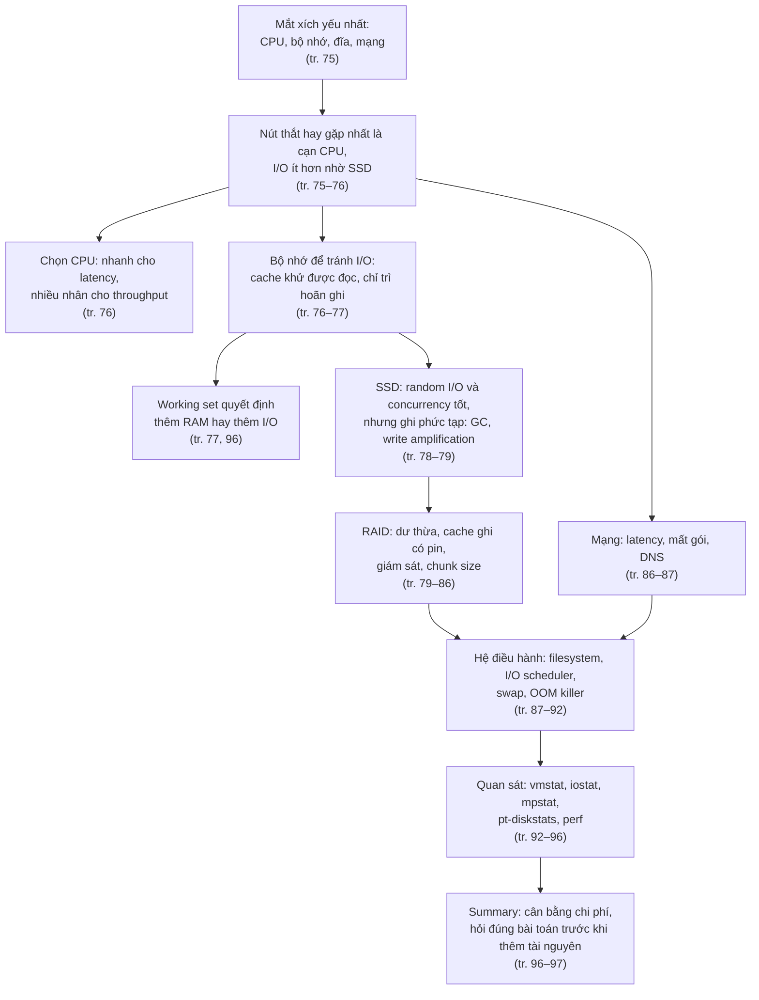
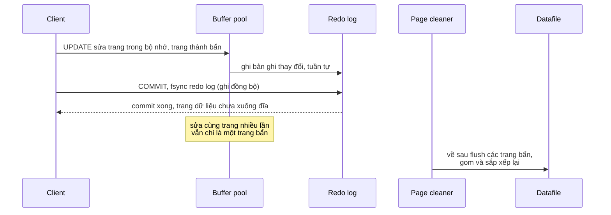
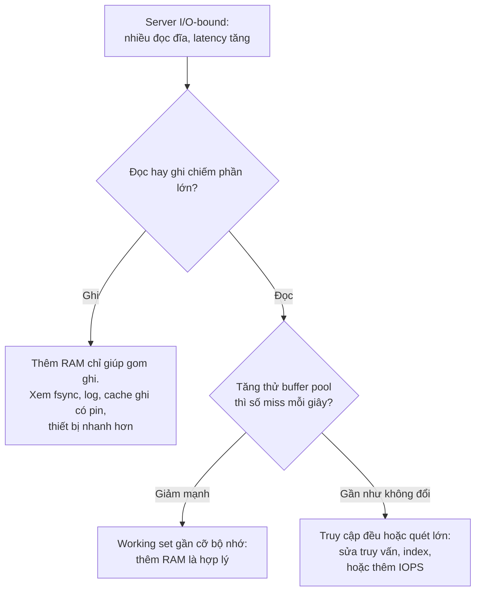
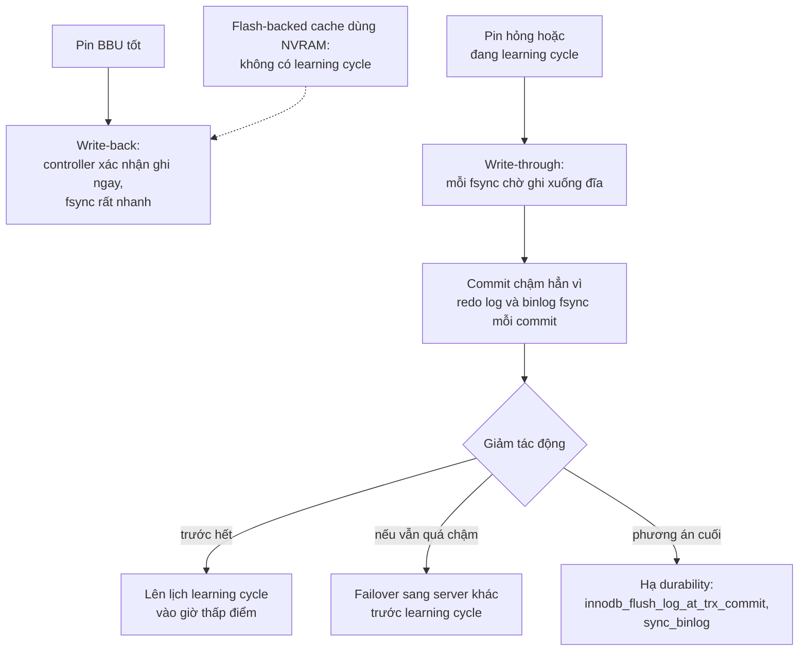
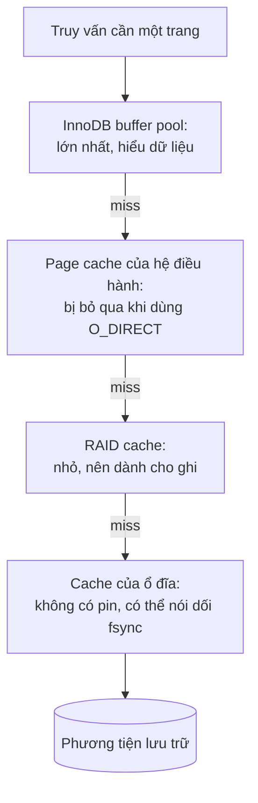
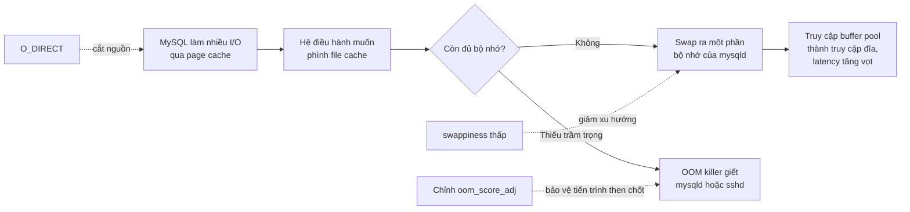
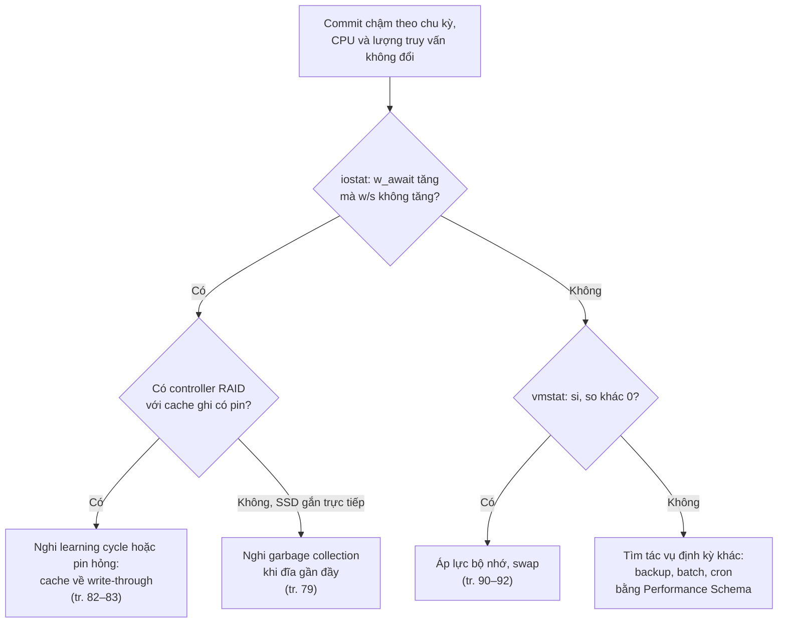
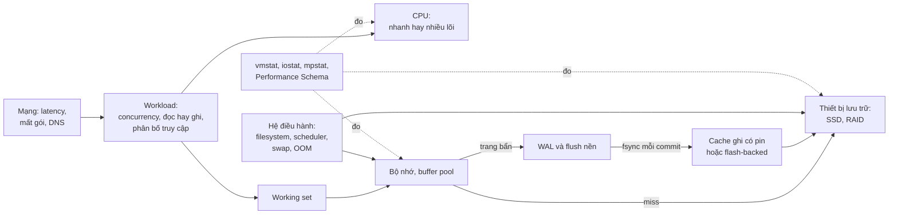

# Chương 4 — Tối ưu hệ điều hành và phần cứng

*Operating System and Hardware Optimization*

> **Nguồn:** *High Performance MySQL: Proven Strategies for Operating at Scale*, Silvia Botros và Jeremy Tinley, O'Reilly, **Fourth Edition (11/2021)**, Chương 4, **tr. 75–97 (trang PDF 97–119)**; tr. 98 (PDF 120) để trắng. "tr. N" là số trang in, trang PDF = N + 22 (xem [README](README.md#page-convention)).
>
> **Quy ước nhãn:** nội dung không nhãn là diễn giải từ sách, luôn kèm trang. **Bổ sung ngoài sách** là kiến thức thêm hoặc phép tính tự làm. **Ví dụ minh họa do AI xây dựng** là ví dụ, số liệu hay tình huống giả định. **Dự đoán** là điều kỳ vọng chưa đo. **Kết quả đã đo** chỉ dùng cho thí nghiệm đã chạy thật.
>
> **Phiên bản:** phần lớn chương bàn phần cứng và Linux, ít phụ thuộc phiên bản MySQL. Những chỗ phụ thuộc phiên bản được nêu tại chỗ: tệp `.frm` (chỉ có trước MySQL 8.0, tr. 88), `innodb_flush_method` (giá trị khác nhau giữa Linux và Windows), các bộ lập lịch I/O `cfq`, `noop`, `deadline` (kernel Linux cũ), tên cột của `iostat` (khác theo phiên bản sysstat). Thí nghiệm của chương chạy trên **MySQL 8.0.42, Windows 11**; công cụ Linux không chạy được trên máy này nên phần đó chỉ có quy trình.
>
> **Liên kết:** [Lộ trình chương 4](learning-roadmap.md#ch04) · [Thực hành](experiments/chapter-04.md) · [Đáp án tự kiểm tra](answers/chapter-04.md)

## Mục lục ghi chú

- [1. Bức tranh lớn](#big-picture)
- [2. Giải thích sâu](#deep)
  - [2.1 What Limits MySQL’s Performance? (tr. 75–76)](#s2-1)
  - [2.2 How to Select CPUs for MySQL (tr. 76)](#s2-2)
  - [2.3 Balancing Memory and Disk Resources (tr. 76–77)](#s2-3)
  - [2.4 Solid-State Storage (tr. 78–79)](#s2-4)
  - [2.5 RAID Performance Optimization (tr. 79–86)](#s2-5)
  - [2.6 Network Configuration (tr. 86–87)](#s2-6)
  - [2.7 Choosing a Filesystem (tr. 87–96)](#s2-7)
  - [2.8 Summary (tr. 96–97)](#s2-8)
- [3. Phân tích tình huống](#situations)
- [4. Đo lường và thực hành](#measure)
- [5. Liên kết kiến thức và điều cần nhớ](#takeaways)
- [Ghi chú kiểm tra nguồn](#kiem-tra)

---

## 1. Bức tranh lớn

### Chương này hỏi gì?

Server MySQL chỉ nhanh bằng **mắt xích yếu nhất** của nó. Dung lượng đĩa, bộ nhớ, CPU, mạng và các thành phần nối chúng với nhau cùng đặt trần cho năng lực của hệ thống (tr. 75). Từ đó chương đặt bốn câu hỏi:

1. Hiện nay tài nguyên nào **hay thành nút thắt nhất**? (tr. 75–76)
2. Chọn CPU, bộ nhớ, thiết bị lưu trữ thế nào cho **đúng workload**? (tr. 76–86)
3. Cấu hình hệ điều hành (mạng, filesystem, I/O scheduler, swap) ra sao để **không tự tạo nút thắt**? (tr. 86–92)
4. Đọc chỉ số của hệ điều hành thế nào để biết mình **đang gặp loại nút thắt nào**? (tr. 92–96)

Sách đưa một ví dụ ngay ở đoạn mở đầu: nếu workload bị giới hạn bởi I/O, một cách là thiết kế lại ứng dụng để giảm I/O của MySQL; nhưng **thường khôn ngoan hơn** là nâng cấp hệ thống I/O, thêm bộ nhớ hoặc cấu hình lại các đĩa hiện có (tr. 75). Chương vẫn hữu ích khi chạy trên cloud, nhất là phần giới hạn của filesystem và I/O scheduler của Linux (tr. 75).

### Vị trí trong mục tiêu chung của sách

- Chương 2 và 3 cho cách **đo**: SLO, proactive monitoring (kể cả theo dõi I/O wait bằng `iostat`, tr. 32–33) và Performance Schema. Chương 4 cho **mô hình tài nguyên** để hiểu các con số đó.
- Chương 5 dùng mô hình này để **cấu hình MySQL**: buffer pool, `innodb_flush_method`, các thiết lập durability. Chính chương 4 dẫn sang chương 5 cho phần cấu hình bộ nhớ (tr. 76).
- Thông điệp xuyên suốt của Summary, "trước khi ném tài nguyên vào vấn đề, hãy hỏi mình có đang giải sai bài toán không" (tr. 96), cũng là tinh thần của chương 8 (làm ít việc hơn, tr. 226) và chương 11 (tối ưu trước khi scale, tr. 311); liên hệ này do người viết ghi chú rút ra.

### Kiến thức cần biết

| Kiến thức | Nguồn | Dùng ở mục |
| --- | --- | --- |
| Linux cơ bản: `/proc`, `/sys`, `/etc/fstab`, tiến trình, bộ nhớ ảo | Sách giả định người đọc có kinh nghiệm quản trị hệ thống (tr. xv) | 2.6, 2.7 |
| InnoDB buffer pool, transaction log | [Chương 1](chapter-01.md) (Transaction Logging tr. 10, The InnoDB Engine tr. 16–17); chương 4 nhắc lại ở tr. 90 | 2.3, 2.7.2 |
| Latency, throughput, percentile | [Chương 2](chapter-02.md) | 2.2, 2.6 |
| Page, cache, `fsync`, write-ahead log | **Bổ sung ngoài sách:** [DDIA chương 3, WAL](../../DDIA/ddia-notes/chapter-03.md#wal) | 2.3, 2.5 |

### Liên hệ với chương khác

| Ý trong chương 4 | Chương | Căn cứ |
| --- | --- | --- |
| Tránh cạn bộ nhớ bằng cấu hình bộ nhớ đúng ("Configuring Memory Usage", tr. 109) | [Chương 5](chapter-05.md#s2-4) | tr. 76 |
| InnoDB dùng bộ nhớ làm cache | [Chương 1](chapter-01.md) | tr. 90 |
| Write-ahead logging biến ghi ngẫu nhiên thành ghi tuần tự | [Chương 1](chapter-01.md#transaction-logging) (Transaction Logging, tr. 10); [Chương 5](chapter-05.md#s2-5-2) (log buffer, tr. 113–115) | tr. 77 |
| Hạ `innodb_flush_log_at_trx_commit`, `sync_binlog` khi RAID cache về write-through | [Chương 5](chapter-05.md#s2-5) (tr. 114–118), [Chương 9](chapter-09.md#crash-safe) (tr. 232–233) | tr. 83 |
| `skip_name_resolve` | [Chương 5](chapter-05.md#s2-7) (Safety Settings, tr. 120–121) | tr. 86 |
| `innodb_flush_method=O_DIRECT` | [Chương 5](chapter-05.md#flush-method) (tr. 107, 115) | tr. 88, 91 |
| RAID không thay được backup; snapshot LVM | [Chương 10](chapter-10.md) (tr. 260, 272–277, 286) | tr. 82, 88 |
| Working set: khóa ngẫu nhiên kiểu UUID làm tản mát dữ liệu nóng; failover đổi working set; chọn máy theo working set | [Chương 6](chapter-06.md#uuid) tr. 144, [Chương 9](chapter-09.md#dual-source) tr. 244, [Chương 12](chapter-12.md#memory-working-set) tr. 320 | tr. 77, 96 |
| SSD có đặc tính hiệu năng khác, ảnh hưởng nguyên tắc index | [Chương 7](chapter-07.md) tr. 155 | tr. 78 |
| Chọn CPU, RAID, loại đĩa khi chạy trên VM | [Chương 12](chapter-12.md#s2-2) tr. 318–322 | tr. 76, 79–86 |

### Mạch lập luận

*(Sơ đồ do người viết ghi chú dựng theo thứ tự các mục của chương.)*

---

## 2. Giải thích sâu

### 2.1 What Limits MySQL’s Performance? (tr. 75–76)

**Nút thắt hay gặp nhất là CPU** (tr. 75). Nhiều thành phần phần cứng ảnh hưởng hiệu năng MySQL, nhưng nút thắt tác giả gặp nhiều nhất là ***CPU exhaustion*** (cạn CPU). CPU bão hòa theo hai cách:

| Cách | Diễn giải | Hướng điều tra gợi ý (**Bổ sung ngoài sách**) |
| --- | --- | --- |
| Quá nhiều truy vấn chạy song song | Số luồng cần CPU vượt số lõi, các truy vấn phải xếp hàng chờ CPU | Concurrency từ ứng dụng, connection pool, giới hạn concurrency ([Chương 5](chapter-05.md#s2-6)) |
| Ít truy vấn nhưng chạy quá lâu trên CPU | Mỗi truy vấn tự nó tốn nhiều CPU | Truy vấn đọc quá nhiều hàng, sắp xếp, bảng tạm ([Chương 7](chapter-07.md), [Chương 8](chapter-08.md)) |

**I/O bão hòa hiếm hơn nhờ SSD** (tr. 75). Trước đây, phải rời bộ nhớ để đọc từ ***hard disk drive*** (HDD) là cực kỳ đắt. Sách nói SSD thường nhanh hơn "SSH" 10 tới 20 lần; nay nếu truy vấn phải chạm đĩa thì hiệu năng vẫn "tạm ổn".

> **Lưu ý về lỗi in (tr. 75).** Bản in ghi "SSDs are generally 10 to 20 times faster than SSH" (đã xem ảnh trang PDF 97). Câu ngay trước vừa giới thiệu từ viết tắt HDD, và cả đoạn so SSD với ổ cứng; SSH (Secure Shell) không liên quan ở đây. Ở tr. 91, SSH xuất hiện đúng nghĩa (tiến trình SSH có thể bị OOM killer giết). Vậy "SSH" ở tr. 75 gần như chắc là lỗi in của **HDD**.
>
> **Bổ sung ngoài sách.** Sách không nói "nhanh hơn" theo chỉ số nào. Tỷ lệ phụ thuộc mạnh vào chỉ số: với throughput đọc tuần tự, khoảng cách SSD và HDD nhỏ hơn; với latency và IOPS của đọc ngẫu nhiên, khoảng cách thường lớn hơn nhiều so với 10–20 lần, vì HDD phải chờ đầu đọc di chuyển và đĩa quay. Chính sách cũng nói cải thiện lớn nhất của flash nằm ở random I/O (tr. 78). Nên đọc con số 10–20 lần như một mức ước lượng thô.

**Cạn bộ nhớ vẫn có thể xảy ra**, nhưng thường chỉ khi **cấp phát quá nhiều bộ nhớ cho MySQL** (tr. 76). Cách đặt cấu hình để tránh việc này nằm ở mục "Configuring Memory Usage" của [Chương 5](chapter-05.md#s2-4) (tr. 109).

**Why: vì sao thứ tự nút thắt đã đổi?** (**Bổ sung ngoài sách**, diễn giải lập luận ở tr. 75.) Khi HDD còn phổ biến, chênh lệch giữa đọc từ RAM và đọc từ đĩa quá lớn, nên mọi miss của cache đều đắt và I/O thường là nút thắt. SSD thu hẹp chênh lệch đó (tr. 75). Khi đĩa không còn là chỗ chờ chính, phần việc còn lại là CPU xử lý hàng, so sánh khóa, sắp xếp; vì vậy CPU nổi lên thành nút thắt chính.

**Hiểu lầm phổ biến.**

- *"Cache hit thì miễn phí."* Không đúng. Đọc từ buffer pool vẫn tốn CPU. **Kết quả đã đo** ([thí nghiệm 1](experiments/chapter-04.md#exp1)): quét toàn bộ bảng 300.000 hàng đã nằm trọn trong buffer pool vẫn mất khoảng 118 ms CPU mỗi lần, dù không có lần đọc đĩa nào. Một truy vấn quét quá nhiều hàng trong bộ nhớ chính là kiểu "ít truy vấn chạy quá lâu trên CPU".
- *"CPU cao thì cần CPU mạnh hơn."* Trước hết phải xem CPU đang làm việc có ích không. Theo tinh thần Summary (tr. 96), hỏi xem mình có đang giải sai bài toán không.

> **Bổ sung ngoài sách.** Chương khuyên đọc *Systems Performance* của Brendan Gregg (tr. 96). Trong sách đó có phương pháp **USE** (*Utilization, Saturation, Errors*): với mỗi tài nguyên, hỏi mức sử dụng, mức bão hòa (có hàng đợi chờ không) và lỗi. Ba câu hỏi này giúp đọc các con số ở [mục 2.7.3](#os-status) có hệ thống hơn.

#### Tự kiểm tra 2.1

- **Câu 2.1.1.** Sách nêu hai cách khiến CPU bị cạn. Phân biệt chúng, và cho biết mỗi cách gợi ý hướng điều tra khác nhau ra sao. [đáp án](answers/chapter-04.md#q2-1-1)
- **Câu 2.1.2.** Vì sao SSD làm bão hòa I/O hiếm hơn, mà thí nghiệm 2 của chương vẫn thấy truy cập ngẫu nhiên vượt buffer pool chậm hơn khoảng 9 lần truy cập nằm trong buffer pool? Hai điều này có mâu thuẫn không? [đáp án](answers/chapter-04.md#q2-1-2)
- **Câu 2.1.3.** Câu ở tr. 75 viết SSD nhanh hơn "SSH" 10–20 lần. Bạn sửa thế nào, dựa vào căn cứ nào, và con số 10–20 lần nên hiểu với điều kiện gì? [đáp án](answers/chapter-04.md#q2-1-3)
- **Câu 2.1.4.** Theo sách, cạn bộ nhớ thường do đâu? Điều đó gợi ý sửa ở đâu trước khi nghĩ tới mua thêm RAM? [đáp án](answers/chapter-04.md#q2-1-4)

### 2.2 How to Select CPUs for MySQL (tr. 76)

**Khi nào phải nghĩ về CPU.** Khi nâng cấp phần cứng hiện có hoặc mua phần cứng mới, hãy xét xem workload có ***CPU-bound*** không (tr. 76). Cách nhận biết: xem mức sử dụng CPU, nhưng **đừng chỉ nhìn tổng tải**. Hãy xem:

- **cân bằng giữa CPU và I/O** của những truy vấn quan trọng nhất;
- các CPU có được **tải đều** không (tr. 76).

> **Bổ sung ngoài sách.** Ý "tải đều" rất quan trọng. CPU trung bình 6% trên máy 32 lõi có thể che một lõi đang chạy 100%: ví dụ một truy vấn đơn luồng rất nặng, hay một luồng nền đơn luồng. Công cụ để thấy từng CPU là `mpstat`, sách giới thiệu ở tr. 95 ([mục 2.7.4](#other-tools)).

**Hai mục tiêu, hai kiểu CPU** (tr. 76):

| Mục tiêu | Cần gì | Vì sao |
| --- | --- | --- |
| ***Low latency*** (thời gian phản hồi nhanh) | CPU **nhanh** | Mỗi truy vấn chỉ dùng **một CPU** |
| ***High throughput*** (nhiều truy vấn mỗi giây) | **Nhiều** CPU | Nếu chạy được nhiều truy vấn cùng lúc, nhiều CPU cùng phục vụ |

**CPU dư thì sao?** Nếu workload không dùng hết CPU, MySQL vẫn dùng CPU thừa cho việc nền như purge của InnoDB và thao tác mạng; nhưng các việc này thường nhỏ so với thực thi truy vấn (tr. 76).

**How: hệ quả của "mỗi truy vấn một CPU".** Một truy vấn chậm vì CPU không nhanh lên khi thêm lõi; nó chỉ nhanh lên khi lõi nhanh hơn hoặc khi truy vấn làm ít việc hơn. Thêm lõi chỉ giúp **nhiều truy vấn** chạy cùng lúc mà không phải chờ nhau.

**Evidence.** **Kết quả đã đo** ([thí nghiệm 4](experiments/chapter-04.md#exp4), laptop 8 nhân 16 luồng, có tải nền từ tiến trình khác): độ trễ phía server của một truy vấn quét bảng nằm trong bộ nhớ có trung vị khoảng 97 ms với 1 client, khoảng 106 ms với 4 client, 123 ms với 8 client và 189 ms với 16 client. Thêm client không làm từng truy vấn nhanh hơn; khi số client vượt số lõi thật, các truy vấn bắt đầu chờ CPU và latency tăng.

> **Bổ sung ngoài sách (phiên bản).** Nhận định "một truy vấn một CPU" đúng với truy vấn thông thường của MySQL 8.0. Có vài ngoại lệ hẹp: `innodb_parallel_read_threads` (từ 8.0.14) cho phép đọc clustered index song song trong `CHECK TABLE` và `SELECT COUNT(*)` không có điều kiện lọc. Ngoài ra, một số việc nội bộ có luồng riêng (purge, page cleaner). Kiểm tra tài liệu phiên bản bạn dùng trước khi dựa vào các ngoại lệ này.

**Trade-offs và Decision** (**Bổ sung ngoài sách**, dựa trên lập luận tr. 76 và Summary tr. 96):

- Workload OLTP nhạy latency, ít truy vấn đồng thời: ưu tiên tần số và hiệu năng mỗi lõi.
- Nhiều kết nối đồng thời, truy vấn ngắn: ưu tiên số lõi. Summary nói thẳng: càng nhiều concurrency, càng nên nghiêng về nhiều CPU (tr. 96).
- Khi workload đổi từ "vài truy vấn báo cáo nặng" sang "hàng nghìn truy vấn nhỏ", lựa chọn cũng đổi theo. Đây là lý do phải đo workload thật trước khi mua máy.

#### Tự kiểm tra 2.2

- **Câu 2.2.1.** Vì sao low latency đòi CPU nhanh còn high throughput đòi nhiều CPU? Giả định nào của sách nằm sau lập luận này? [đáp án](answers/chapter-04.md#q2-2-1)
- **Câu 2.2.2.** Một server 32 lõi báo CPU trung bình 6%, nhưng truy vấn quan trọng vẫn chậm và có vẻ tốn CPU. Theo lời khuyên ở tr. 76, bạn kiểm tra gì tiếp, và khả năng nào giải thích được tình trạng này? [đáp án](answers/chapter-04.md#q2-2-2)
- **Câu 2.2.3.** Dự đoán: tăng số client đồng thời chạy một truy vấn CPU-bound từ 1 lên gấp đôi số lõi thì latency từng truy vấn và throughput đổi thế nào? Đối chiếu với thí nghiệm 4. [đáp án](answers/chapter-04.md#q2-2-3)

### 2.3 Balancing Memory and Disk Resources (tr. 76–77)

**Why: vì sao cần nhiều bộ nhớ.** Lý do chính **không phải** để giữ nhiều dữ liệu trong bộ nhớ, mà rốt cuộc là để **tránh I/O đĩa**, vốn chậm hơn truy cập bộ nhớ nhiều bậc độ lớn (tr. 76). Mẹo là cân bằng kích thước, tốc độ, chi phí của bộ nhớ và đĩa để có hiệu năng tốt **cho workload của mình** (tr. 76).

#### 2.3.1 Caching, Reads, and Writes (tr. 76–77)

**Đọc: cache có thể khử hoàn toàn** (tr. 76). Nếu đủ bộ nhớ, bạn có thể che chắn đĩa khỏi mọi yêu cầu đọc. Khi toàn bộ dữ liệu vừa bộ nhớ và cache đã "ấm" (*warmed up*), mọi lần đọc đều là ***cache hit***. Vẫn còn ***logical read*** (đọc logic, từ bộ nhớ) nhưng không còn ***physical read*** (đọc vật lý, từ đĩa).

**Ghi: cache chỉ trì hoãn được** (tr. 76). Ghi có thể diễn ra trong bộ nhớ như đọc, nhưng sớm muộn phải xuống đĩa để bền vững. Cache **trì hoãn** được ghi nhưng **không khử** được ghi như với đọc.

**Hai cách cache gom ghi** (tr. 77). Ngoài việc trì hoãn, cache còn cho phép gom ghi theo hai kiểu:

| Kiểu | Cơ chế | Ví dụ của sách |
| --- | --- | --- |
| ***Many writes, one flush*** | Một mẩu dữ liệu đổi nhiều lần trong bộ nhớ; khi flush, mọi thay đổi kể từ lần ghi vật lý trước được ghi một lần | Bộ đếm tăng 100 lần rồi mới ghi: 100 thay đổi thành 1 lần ghi |
| ***I/O merging*** | Nhiều mẩu dữ liệu **khác nhau** được sửa trong bộ nhớ, rồi gom lại để ghi bằng một thao tác đĩa | (không có ví dụ số) |

**Write-ahead logging** (tr. 77). Đây là lý do nhiều hệ transactional dùng ***write-ahead logging*** (WAL): sửa trang trong bộ nhớ mà **không** flush trang xuống đĩa ngay (việc thường là I/O ngẫu nhiên, rất chậm), mà ghi một **bản ghi thay đổi** vào log file **tuần tự**, nhanh hơn nhiều. Một luồng nền flush các trang đã sửa về sau, và lúc đó nó có thể tối ưu thứ tự ghi.

**Buffered và unbuffered** (tr. 77). Ghi hưởng lợi lớn từ bộ đệm vì nó biến I/O ngẫu nhiên thành I/O tuần tự hơn.

- ***Asynchronous (buffered) write***: hệ điều hành nhận rồi gom lại, flush xuống đĩa theo cách tối ưu hơn.
- ***Synchronous (unbuffered) write***: phải xuống đĩa xong mới được coi là hoàn tất. Vì vậy loại ghi này hưởng lợi từ ***battery-backed write-back cache*** của RAID controller ([mục 2.5.2](#raid-cache)). Ở đây sách lần đầu viết đầy đủ RAID là *Redundant Array of Inexpensive Disks*.

*(Sơ đồ do người viết ghi chú dựng. Ý "ghi log tuần tự, flush trang về sau bằng luồng nền" là của sách, tr. 77. Tên thành phần InnoDB như page cleaner là **Bổ sung ngoài sách**; chương 1 và 5 bàn transaction log của InnoDB.)*

**Evidence & example.** **Kết quả đã đo** ([thí nghiệm 1](experiments/chapter-04.md#exp1) và [thí nghiệm 3](experiments/chapter-04.md#exp3), MySQL 8.0.42):

- Bảng 71,6 MB, buffer pool 256 MB: lần quét lạnh đọc 4.568 trang từ đĩa; ba lần quét sau đọc **0** trang từ đĩa, dù mỗi lần vẫn có 6.893 logical read request. Đúng như tr. 76: đọc logic còn, đọc vật lý biến mất.
- 5.000 lần `UPDATE` **cùng một hàng**, mỗi lần một transaction: bảng `t` chỉ có **1** trang bẩn. Đó là "many writes, one flush". Nhưng redo log vẫn được ghi khoảng 5 MB và `fsync` hàng nghìn lần, vì mỗi commit phải bền; ngoài ra khoảng 650 trang của undo tablespace cũng bẩn, vì mỗi transaction để lại dấu vết riêng trong undo log và header của rollback segment (**Bổ sung ngoài sách**: chi tiết InnoDB, sách không bàn ở chương này).
- 5.000 lần `UPDATE` vào 5.000 hàng **rải rác**: hơn 4.100 trang của bảng bị bẩn và phải flush. Gom ghi chỉ giúp được khi các thay đổi rơi vào ít trang.

**Hiểu lầm phổ biến.** *"RAM thật lớn thì hết I/O."* Chỉ đúng với đọc. Ghi vẫn phải xuống đĩa (tr. 76), và mỗi commit vẫn cần một lần ghi đồng bộ vào log. Với workload ghi nhiều, thêm RAM giúp gom ghi tốt hơn nhưng không xóa được nhu cầu I/O ghi.

#### 2.3.2 What’s Your Working Set? (tr. 77)

**What.** Mỗi ứng dụng có một ***working set***: phần dữ liệu nó **thật sự cần** để làm việc (tr. 77). Nhiều database còn có rất nhiều dữ liệu nằm ngoài working set. Summary định nghĩa chặt hơn: working set là tập dữ liệu **cần thường xuyên nhất trong một khoảng thời gian** cho trước (tr. 96).

**Ẩn dụ bàn làm việc** (tr. 77). Database như một cái bàn có ngăn kéo hồ sơ. Working set là các tờ giấy bạn cần **trên mặt bàn** để làm việc. Mặt bàn là bộ nhớ chính, ngăn kéo là đĩa. Bạn không cần mọi tờ giấy trên mặt bàn, cũng như không cần toàn bộ database vừa bộ nhớ để đạt hiệu năng tối ưu: chỉ cần working set.

**Tỷ lệ bộ nhớ/đĩa: HDD và SSD** (tr. 77). Với HDD, nên tìm một tỷ lệ bộ nhớ trên đĩa hiệu quả, chủ yếu vì HDD có latency cao và ***IOPS*** (*input/output operations per second*) thấp. Với SSD, tỷ lệ này **kém quan trọng hơn nhiều**.

**Why quan trọng.** Câu hỏi then chốt của Summary: nếu đang I/O-bound, bạn cần thêm năng lực I/O hay **chỉ cần thêm bộ nhớ**? Câu trả lời xoay quanh kích thước working set (tr. 96).

**Evidence & example.** **Kết quả đã đo** ([thí nghiệm 2](experiments/chapter-04.md#exp2), buffer pool 16 MB, bảng 71,6 MB):

| Kiểu truy cập (20.000 lần tra cứu theo khóa chính) | Trang cần chạm | Đọc từ đĩa sau khi ấm | Thời gian mỗi đợt (trung vị) |
| --- | --- | --- | --- |
| **Nóng**: chỉ khóa 1..20.000 | khoảng 313 trang, khoảng 5 MB | **0** | khoảng 0,54 giây |
| **Đều**: khóa 1..300.000 | toàn bộ khoảng 4.546 trang lá | khoảng **18.400** (0,92 lần mỗi tra cứu) | khoảng 4,95 giây |

Cùng một bảng, cùng buffer pool. Khác biệt duy nhất là **working set** của mẫu truy cập. Mẫu nóng có working set nhỏ hơn buffer pool nên chạy hoàn toàn trong bộ nhớ; mẫu đều có working set bằng cả bảng, gấp khoảng 4,4 lần buffer pool, nên gần như mọi lần tra cứu là một lần đọc đĩa.

> **Bổ sung ngoài sách: ước lượng working set thế nào?**
>
> - Working set **không phải một con số cố định**. Nó phụ thuộc cửa sổ thời gian (dữ liệu nóng trong 1 phút khác trong 1 ngày) và phân bố truy cập. Khóa ngẫu nhiên kiểu UUID làm dữ liệu nóng rải khắp bảng, nên working set phình ra ([Chương 6](chapter-06.md#uuid), tr. 144).
> - Working set gồm cả **index**, không chỉ hàng dữ liệu.
> - Cách đo thực tế: theo dõi **tốc độ** `Innodb_buffer_pool_reads` (miss mỗi giây) và `r/s` của `iostat` theo thời gian; thử đổi `innodb_buffer_pool_size` (đổi động được từ MySQL 5.7) trên một replica và xem số miss giảm ra sao. Nếu thêm một ít bộ nhớ làm miss giảm mạnh, working set chỉ hơi lớn hơn buffer pool. Nếu miss gần như không đổi, workload đang quét hoặc truy cập đều trên dữ liệu lớn, nên thêm RAM ít tác dụng.
> - Không dùng **tỷ lệ hit** làm thước đo chính. Chương 5 cảnh báo "tune theo tỷ lệ" là lời khuyên sai, vì hit ratio phụ thuộc workload ([Chương 5](chapter-05.md#tuning-by-ratio), tr. 105). Hãy nhìn số miss tuyệt đối trên mỗi đơn vị công việc và tác động lên latency.
> - `information_schema.INNODB_BUFFER_PAGE_LRU` cho biết trang của bảng nào đang nằm trong buffer pool. Truy vấn bảng này phải duyệt cả buffer pool, nên chỉ dùng trên server thử nghiệm hoặc lúc thấp điểm.

*(Sơ đồ quyết định do người viết ghi chú dựng từ câu hỏi ở Summary, tr. 96, và mục 2.3.1. Các nhánh cụ thể là **Bổ sung ngoài sách**.)*

**Trade-offs.** Thêm RAM rẻ và hiệu quả khi working set chỉ hơi vượt bộ nhớ. Khi working set lớn hơn bộ nhớ nhiều lần, như mẫu "đều" trong thí nghiệm 2, mỗi GB RAM thêm chỉ hạ tỷ lệ miss một chút. Lúc đó thiết bị có IOPS cao, hoặc giảm lượng dữ liệu phải chạm (index tốt hơn, truy vấn ít hàng hơn), có lợi hơn.

#### Tự kiểm tra 2.3

- **Câu 2.3.1.** Vì sao cache có thể khử hoàn toàn đọc vật lý nhưng không khử được ghi? [đáp án](answers/chapter-04.md#q2-3-1)
- **Câu 2.3.2.** Phân biệt "many writes, one flush" và "I/O merging". Trong thí nghiệm 3, kịch bản nào minh họa cái nào, và giới hạn của mỗi kiểu là gì? [đáp án](answers/chapter-04.md#q2-3-2)
- **Câu 2.3.3.** Write-ahead logging biến I/O ngẫu nhiên thành tuần tự thế nào? Cái gì vẫn phải ghi đồng bộ, và vì sao ghi đồng bộ hưởng lợi từ write-back cache có pin? [đáp án](answers/chapter-04.md#q2-3-3)
- **Câu 2.3.4.** Working set là gì? Vì sao trong thí nghiệm 2, bảng 71,6 MB với buffer pool 16 MB vẫn có một mẫu truy cập chạy không cần đọc đĩa? [đáp án](answers/chapter-04.md#q2-3-4)
- **Câu 2.3.5.** Vì sao tỷ lệ bộ nhớ/đĩa quan trọng với HDD nhưng ít quan trọng hơn với SSD? Điều đó có nghĩa là dùng SSD thì bỏ qua được working set không? [đáp án](answers/chapter-04.md#q2-3-5)

### 2.4 Solid-State Storage (tr. 78–79)

**Vị thế của SSD** (tr. 78). Lưu trữ thể rắn (flash) đã là chuẩn cho hầu hết hệ database, nhất là ***OLTP*** (*online transaction processing*). HDD thường chỉ còn ở kho dữ liệu rất lớn hoặc hệ thống cũ. Sự chuyển dịch này đến khi giá SSD giảm mạnh, khoảng năm 2015.

**What** (tr. 78). Thiết bị thể rắn dùng chip ***flash memory*** không mất dữ liệu khi mất điện (*nonvolatile*), gồm các ô nhớ (*cell*), thay cho đĩa từ. Sách nói chúng còn được gọi là ***NVRAM*** (*nonvolatile random access memory*). Không có bộ phận chuyển động, nên hành vi rất khác ổ cứng.

> **Bổ sung ngoài sách.** Chữ "NVRAM" được dùng theo hai nghĩa trong chương: ở tr. 78 chỉ thiết bị flash nói chung; ở tr. 82 chỉ bộ nhớ không mất dữ liệu trong cache của RAID controller (flash-backed cache). Trong tài liệu khác, NVRAM thường mang nghĩa thứ hai.

**Tóm tắt hiệu năng của flash chất lượng cao** (tr. 78):

| Đặc tính | So với HDD | Ghi chú của sách |
| --- | --- | --- |
| Đọc và ghi **ngẫu nhiên** | Tốt hơn **nhiều** | Flash thường đọc hơi tốt hơn ghi |
| Đọc và ghi **tuần tự** | Tốt hơn | Không ngoạn mục bằng ngẫu nhiên, vì HDD vốn chậm ở ngẫu nhiên hơn nhiều so với tuần tự |
| **Concurrency** | Tốt hơn **nhiều** | Flash chỉ đạt throughput tối đa khi có **nhiều** thao tác đồng thời |

Điều quan trọng nhất: **random I/O và concurrency**. Flash cho random I/O rất tốt ở concurrency cao (tr. 78).

> **Bổ sung ngoài sách.** Hệ quả vận hành: một workload đơn luồng, mỗi lần chỉ gửi một yêu cầu I/O, không khai thác được SSD. Đây cũng là lý do `%util` của `iostat` dễ gây hiểu nhầm với SSD ([mục 2.7.3](#iostat)): thiết bị "bận 100% thời gian" vẫn có thể nhận thêm nhiều yêu cầu song song.

#### 2.4.1 An Overview of Flash Memory (tr. 78–79)

**Flash không đơn giản** (tr. 78). HDD có giới hạn do vật lý của đĩa quay và đầu đọc. Flash cũng vậy, và theo vài nghĩa còn **phức tạp hơn**: giới hạn của flash rất khắt khe, nên một thiết bị điển hình có kiến trúc nhiều lớp trừu tượng, cache và "phép màu" độc quyền.

**Đặc tính quan trọng nhất** (tr. 78): đọc được nhiều lần, nhanh, theo đơn vị nhỏ; nhưng **ghi khó hơn nhiều**:

- một ô không ghi đè được nếu chưa qua thao tác **xóa** (*erase*) đặc biệt;
- chỉ xóa được theo **khối lớn**, ví dụ 512 KB;
- chu kỳ xóa **chậm** và dần làm **mòn** khối; số lần xóa chịu được phụ thuộc công nghệ chế tạo.

**Firmware gánh phần khó** (tr. 79). Giới hạn về ghi là nguồn gốc của sự phức tạp, và là lý do có thiết bị cho hiệu năng ổn định, có thiết bị thì không. "Phép màu" nằm ở firmware, driver và các thành phần khác. Để ghi nhanh và không làm mòn khối sớm, thiết bị phải di dời trang, chạy ***garbage collection*** và ***wear leveling*** (san đều số lần ghi trên các khối).

**Write amplification** (tr. 79). ***Write amplification*** là lượng ghi **phát sinh thêm** do di chuyển dữ liệu từ chỗ này sang chỗ khác, ghi dữ liệu và metadata nhiều lần vì ghi không trọn khối.

> **Lưu ý nguồn.** Tr. 78 hứa nói thêm về công nghệ quyết định số chu kỳ xóa ("more about this later"), nhưng phần còn lại của chương không quay lại chủ đề này.
>
> **Bổ sung ngoài sách.** Write amplification còn xuất hiện ở tầng trên thiết bị. Trong [thí nghiệm 3](experiments/chapter-04.md#exp3), mỗi trang InnoDB được flush đều được ghi thêm một lần vào vùng doublewrite (`Innodb_dblwr_pages_written` bằng đúng số trang flush). Ghi ở tầng database rồi lại bị nhân lên ở tầng flash. Xem thêm [DDIA chương 3](../../DDIA/ddia-notes/chapter-03.md#lsm-advantages) về write amplification và SSD.

#### 2.4.2 Garbage Collection (tr. 79)

**How** (tr. 79). Để luôn có khối sạch sẵn sàng cho lần ghi mới, thiết bị thu hồi khối. Việc này cần **không gian trống**: thiết bị có vùng dự trữ bên trong mà bạn không thấy, hoặc bạn tự dự trữ bằng cách **không ghi đầy**; tùy từng thiết bị. Thiết bị càng đầy, garbage collector càng phải làm nhiều để giữ khối sạch, nên **hệ số write amplification tăng**.

**Hệ quả: thiết bị chậm dần khi đầy** (tr. 79). Chậm bao nhiêu thì tùy hãng, model và kiến trúc. Có thiết bị được thiết kế để vẫn nhanh khi gần đầy, nhưng nói chung một file 100 GB sẽ chạy khác nhau trên SSD 160 GB và SSD 320 GB. Nguyên nhân là phải **chờ xóa xong** khi không còn khối trống: ghi vào khối trống mất khoảng vài trăm micro giây, còn một lần xóa chậm hơn nhiều, thường vài mili giây.

*(Sơ đồ do người viết ghi chú dựng từ tr. 78–79. Bước "dời dữ liệu còn hợp lệ trước khi xóa" là cách hiểu chung về GC của flash, **Bổ sung ngoài sách**.)*

**Decision.** Khi chọn dung lượng SSD cho database, đừng tính sát dung lượng dữ liệu: khoảng trống giúp GC và giữ latency ghi ổn định (tr. 79). **Bổ sung ngoài sách:** cho filesystem gửi lệnh TRIM hoặc discard để thiết bị biết khối nào đã bỏ, và theo dõi mức đầy của đĩa như một chỉ số hiệu năng chứ không chỉ là chỉ số dung lượng ([Chương 2](chapter-02.md#disk-growth) đã khuyên theo dõi dung lượng đĩa trong proactive monitoring).

#### Tự kiểm tra 2.4

- **Câu 2.4.1.** Ba đặc tính hiệu năng của flash so với HDD theo sách là gì, và đặc tính nào quan trọng nhất cho OLTP? [đáp án](answers/chapter-04.md#q2-4-1)
- **Câu 2.4.2.** Vì sao ghi trên flash phức tạp hơn đọc? Nối "chỉ xóa được theo khối lớn" với "write amplification". [đáp án](answers/chapter-04.md#q2-4-2)
- **Câu 2.4.3.** Dự đoán: cùng một file 100 GB, đặt trên SSD 160 GB hay SSD 320 GB cùng dòng thì cái nào ghi ổn định hơn khi chạy lâu? Vì sao? [đáp án](answers/chapter-04.md#q2-4-3)
- **Câu 2.4.4.** Một SSD chạy tốt lúc mới, sau vài tháng đầy 90% thì latency ghi tăng vọt từng đợt. Giải thích bằng cơ chế GC và nêu hai cách giảm. [đáp án](answers/chapter-04.md#q2-4-4)

### 2.5 RAID Performance Optimization (tr. 79–86)

**Why RAID** (tr. 79). Storage engine thường giữ dữ liệu và index trong vài file lớn, nên RAID thường là cách khả thi nhất để lưu nhiều dữ liệu. RAID giúp về **dư thừa, dung lượng, cache và tốc độ**. Có nhiều biến thể; phải chọn cái hợp nhu cầu. Sách không mô tả cách từng mức RAID lưu dữ liệu, mà tập trung vào việc mỗi cấu hình đáp ứng nhu cầu database ra sao (tr. 79).

**Các mức RAID quan trọng nhất** (tr. 79–81):

- **RAID 0.** Rẻ nhất và nhanh nhất nếu đo chi phí và hiệu năng một cách đơn giản; tính cả chi phí khôi phục dữ liệu thì đắt hơn. **Không có dư thừa**, nên tác giả cho rằng RAID 0 **không bao giờ** phù hợp cho database production; có thể dùng ở môi trường phát triển nếu hỏng cả server không thành sự cố. Dù chữ R trong RAID là *redundant*, RAID 0 không dư thừa gì; xác suất cả mảng hỏng còn **cao hơn** xác suất một ổ đơn hỏng.
- **RAID 1.** Đọc tốt trong nhiều trường hợp, nhân đôi dữ liệu nên dư thừa tốt; đọc **nhỉnh hơn** RAID 0 một chút. Hợp với server ghi log và workload tương tự, vì ghi tuần tự hiếm khi cần nhiều ổ (khác với ghi ngẫu nhiên, vốn hưởng lợi từ song song hóa). Lựa chọn điển hình cho server cấp thấp cần dư thừa mà chỉ có hai ổ. RAID 0 và 1 đơn giản, làm bằng phần mềm tốt.
- **RAID 5.** Từng đáng sợ với database vì hiệu năng; với SSD thì đã khả thi. Dữ liệu trải trên nhiều ổ với **parity phân tán**; hỏng một ổ thì dựng lại được từ parity, hỏng hai ổ thì mất cả volume. Kinh tế nhất trong các cấu hình có dư thừa (chỉ mất dung lượng một ổ). "Bẫy" lớn nhất: hiệu năng khi **một ổ hỏng**, vì phải đọc tất cả ổ còn lại để dựng dữ liệu; trên HDD điều này rất tệ, càng nhiều ổ càng tệ, và nếu giữ server online trong lúc rebuild thì cả rebuild lẫn hiệu năng đều kém. Các chi phí khác: khó mở rộng quá khoảng 10 ổ vì parity, vấn đề cache, và phụ thuộc nặng vào cache của controller (có thể xung đột với nhu cầu của database). SSD cải thiện mạnh IOPS và throughput, nên vấn đề random read/write kém đã không còn. Một yếu tố giảm nhẹ: RAID 5 phổ biến nên controller thường được tối ưu cho nó; tác giả đã thấy controller tốt chạy RAID 5 gần bằng RAID 10 với một số workload (tr. 80).
- **RAID 6.** Vấn đề lớn nhất của RAID 5 là mất hai ổ thì thảm họa; mảng càng nhiều ổ, xác suất có ổ hỏng càng cao. RAID 6 thêm **parity thứ hai**, chịu được hai ổ hỏng. Đổi lại, tính parity thêm làm ghi chậm hơn RAID 5 (tr. 81).
- **RAID 10.** Lựa chọn rất tốt cho lưu dữ liệu: các **cặp mirror được strip**, nên scale cả đọc và ghi; rebuild nhanh, dễ hơn RAID 5; làm bằng phần mềm khá tốt. Khi một ổ hỏng, stripe đó có thể thành nút thắt, hiệu năng giảm **tới 50%** tùy workload. Cảnh giác controller cài RAID 10 kiểu ***concatenated mirror***: không có striping, dữ liệu hay truy cập có thể nằm trên một cặp ổ, nên hiệu năng kém (tr. 81).
- **RAID 50.** Các mảng RAID 5 được strip; là thỏa hiệp giữa sự kinh tế của RAID 5 và hiệu năng của RAID 10 khi có nhiều ổ. Hữu ích cho dữ liệu rất lớn như kho dữ liệu hay hệ OLTP cực lớn (tr. 81).

**Bảng 4-1. So sánh các mức RAID** (tr. 81; diễn lại từ ảnh trang PDF 103, phần tóm tắt được dịch):

| Mức | Tóm tắt | Dư thừa | Số ổ cần | Đọc nhanh hơn | Ghi nhanh hơn |
| --- | --- | --- | --- | --- | --- |
| RAID 0 | Rẻ, nhanh, nguy hiểm | Không | N | Có | Có |
| RAID 1 | Đọc nhanh, đơn giản, an toàn | Có | 2 (thường) | Có | Không |
| RAID 5 | Rẻ, nhanh khi dùng SSD | Có | N + 1 | Có | Tùy |
| RAID 6 | Như RAID 5 nhưng bền hơn | Có | N + 2 | Có | Tùy |
| RAID 10 | Đắt, nhanh, an toàn | Có | 2N | Có | Có |
| RAID 50 | Cho kho dữ liệu rất lớn | Có | 2(N + 1) | Có | Có |

> **Bổ sung ngoài sách.**
>
> - **Vì sao RAID 0 dễ hỏng hơn một ổ.** Nếu mỗi ổ hỏng trong năm với xác suất p, độc lập nhau, thì mảng N ổ hỏng (chỉ cần một ổ hỏng) với xác suất 1 − (1 − p)^N, luôn lớn hơn p khi N ≥ 2.
> - **Vì sao cột "Ghi nhanh hơn" của RAID 5 và 6 là "Tùy".** Một lần ghi ngẫu nhiên nhỏ trên RAID 5 thường cần đọc dữ liệu cũ và parity cũ rồi ghi dữ liệu mới và parity mới (khoảng 4 I/O); RAID 6 cần khoảng 6 I/O; RAID 10 cần 2 I/O (ghi vào hai bản mirror). Cache ghi của controller che được một phần chi phí này, nên kết quả phụ thuộc controller và workload, khớp với nhận xét của sách ở tr. 80.
> - **Vì sao RAID 1 có thể đọc nhỉnh hơn.** Hai bản mirror đều phục vụ được lần đọc, nên controller có thể chọn ổ đang rảnh hơn. Mức lợi tùy cách cài đặt.

#### 2.5.1 RAID Failure, Recovery, and Monitoring (tr. 81–83)

**RAID không phải bảo đảm an toàn dữ liệu** (tr. 81–82). Các mức RAID (trừ RAID 0) có dư thừa, nhưng rất dễ đánh giá thấp khả năng **nhiều ổ hỏng cùng lúc**. RAID **không loại bỏ, thậm chí không giảm** nhu cầu backup ([Chương 10](chapter-10.md) nhắc lại ở tr. 260 và 286). Thời gian khôi phục phụ thuộc controller, mức RAID, kích thước mảng, tốc độ ổ, và có phải giữ server online khi rebuild không.

**Các kiểu hỏng kép** (tr. 82):

- Hỏng **đúng cùng lúc**: xung điện hay quá nhiệt có thể giết hai ổ trở lên.
- Thường gặp hơn: **hai lần hỏng gần nhau**. Nhiều sự cố không được phát hiện. Nguyên nhân hay gặp là phương tiện lưu trữ hỏng ở vùng dữ liệu **ít được đọc**; nó có thể nằm im hàng tháng, cho tới khi bạn đọc dữ liệu đó, hoặc một ổ khác hỏng và controller dùng chính dữ liệu hỏng để rebuild. Ổ càng lớn, khả năng này càng cao.

**Giám sát** (tr. 82):

- Theo dõi trạng thái mảng bằng phần mềm của controller; cấu hình cảnh báo khi ổ hay volume chuyển sang ***degraded*** hoặc ***failed***. Không giám sát thì có thể chỉ phát hiện khi ổ thứ hai hỏng, lúc đã quá muộn.
- Giảm rủi ro hỏng ngầm bằng **kiểm tra nhất quán định kỳ**. Tính năng ***Background Patrol Read*** của một số controller kiểm tra và sửa phương tiện hỏng trong khi mọi ổ vẫn online. Mảng rất lớn kiểm tra chậm, nên tính trước khi tạo mảng lớn.
- ***Hot spare***: một ổ để trống, cấu hình làm dự phòng để controller tự dùng khi khôi phục. Nên có nếu bạn phụ thuộc vào từng server. Với server ít ổ thì đắt, vì một ổ nằm không chiếm phần lớn trong tổng chi phí; nhưng nếu nhiều ổ thì "gần như dại dột" nếu không có. Xác suất có ổ hỏng tăng nhanh khi số ổ tăng.

**Pin của cache và chính sách ghi** (tr. 82–83). Ngoài ổ, phải giám sát ***battery backup unit*** (BBU) của controller và **chính sách cache ghi**:

- Pin hỏng: theo mặc định, phần lớn controller tắt cache ghi bằng cách đổi từ ***write-back*** sang ***write-through***. Hiệu năng có thể **giảm mạnh**.
- Nhiều controller định kỳ cho pin qua một ***learning cycle*** (chu kỳ hiệu chuẩn), trong lúc đó cache cũng bị tắt. Hãy xem và cấu hình lịch learning cycle để nó không bất ngờ.
- Controller đời mới tránh chuyện này bằng ***flash-backed cache***, dùng NVRAM để giữ các lần ghi chưa xuống đĩa thay cho cache có pin; không còn learning cycle.

**Ứng phó với write-through** (tr. 83), theo thứ tự sách gợi ý:

1. Benchmark hệ thống với cache ở write-through để biết trước điều gì sẽ xảy ra.
2. Lên lịch learning cycle vào giờ ít tải, thường là ban đêm hoặc cuối tuần.
3. Nếu write-through quá chậm, failover sang server khác trước khi learning cycle bắt đầu.
4. **Phương án cuối cùng:** hạ durability bằng `innodb_flush_log_at_trx_commit` và `sync_binlog`. Việc này giảm tải đĩa khi ở write-through, nhưng ảnh hưởng lớn tới lượng dữ liệu có thể mất khi crash và khả năng khôi phục ([Chương 5](chapter-05.md#s2-5), [Chương 9](chapter-09.md#crash-safe)).

*(Sơ đồ do người viết ghi chú dựng từ tr. 82–83.)*

#### 2.5.2 RAID Configuration and Caching (tr. 83–86)

Controller thường được cấu hình bằng tiện ích setup lúc máy khởi động hoặc bằng lệnh. Sách tập trung vào hai tùy chọn: **chunk size** của mảng strip và **cache trên controller** (RAID cache) (tr. 83).

**The RAID stripe chunk size** (tr. 83). ***Chunk size*** tối ưu tùy workload và phần cứng.

- **Lý thuyết:** chunk lớn tốt cho random I/O, vì nhiều lần đọc được phục vụ bởi **một ổ**. Nếu chunk ít nhất bằng kích thước một thao tác I/O ngẫu nhiên điển hình và dữ liệu không vắt qua ranh giới chunk, chỉ một ổ phải tham gia; nếu chunk nhỏ hơn lượng cần đọc, chắc chắn phải dùng nhiều ổ.
- **Thực tế:** nhiều controller chạy không tốt với chunk lớn. Controller có thể dùng chunk size làm đơn vị cache (lãng phí), hoặc gắn chunk size với kích thước cache và kích thước một lần đọc; nếu đơn vị đọc quá lớn, cache kém hiệu quả và đọc nhiều hơn mức cần, kể cả với yêu cầu rất nhỏ.
- **Căn lề:** khó biết một mẩu dữ liệu có vắt qua nhiều ổ không. Kể cả chunk 16 KB, đúng bằng page InnoDB, cũng không chắc mọi lần đọc căn đúng ranh giới 16 KB: filesystem có thể phân mảnh file và căn các mảnh theo block của filesystem, thường 4 KB. Có filesystem khôn hơn, nhưng đừng trông vào đó (tr. 83).

**The RAID cache** (tr. 84). RAID cache là một lượng bộ nhớ (tương đối) nhỏ gắn trên controller phần cứng, đệm dữ liệu đi giữa ổ và máy chủ. Bốn cách dùng:

| Cách dùng | Sách đánh giá | Lý do |
| --- | --- | --- |
| **Cache đọc** | Thường là cách dùng **rất kém** | Hệ điều hành và database có cache lớn hơn nhiều. Hit ở cache trên thì cache RAID không được dùng; miss ở cache trên thì xác suất hit ở cache RAID (nhỏ hơn, đã bị thay dữ liệu) gần như bằng không |
| **Cache read-ahead** | Tác động rất khác nhau, phải kiểm tra | Controller thấy đọc tuần tự thì đọc trước. Có thể vô ích nếu database tự read-ahead thông minh (**như InnoDB**), và có thể cản việc đệm ghi đồng bộ, vốn rất quan trọng |
| **Cache ghi** | Quan trọng | Báo "thành công" cho máy chủ nhanh hơn nhiều so với ghi thật, và gom ghi để làm hiệu quả hơn |
| **Thao tác nội bộ** | Cần thiết với RAID 5 | Tính parity cần bộ nhớ; một số controller không cân bằng được giữa cache ghi và parity, nên RAID 5 chạy kém |

**Phân bổ bộ nhớ của controller** (tr. 85). Bộ nhớ controller khan hiếm: dùng cho đọc thường là lãng phí, dùng cho ghi là cách quan trọng để tăng tốc I/O. Với RAID 0, 1, 10 nên dành **100%** cho cache ghi; với RAID 5 nên chừa một phần cho thao tác nội bộ. Lời khuyên chung, không phải lúc nào cũng đúng.

**Độ trễ cho phép của cache ghi** (tr. 85). Nhiều controller cho chọn thời gian trì hoãn ghi (1 giây, 5 giây...). Trì hoãn lâu thì gom được nhiều hơn nhưng ghi thành từng **đợt** (*bursty*); nguy hiểm khi ứng dụng gửi một loạt ghi đúng lúc cache đầy sắp flush, khi đó ứng dụng phải chờ. Trì hoãn ngắn thì nhiều thao tác ghi hơn, kém hiệu quả hơn, nhưng mượt hơn và giữ nhiều chỗ trống cho đợt ghi bất ngờ.

**Cache ghi và fsync** (tr. 85). Cache ghi rất có ích cho **ghi đồng bộ**, ví dụ `fsync()` trên transaction log và binary log khi bật `sync_binlog`. Nhưng **đừng bật nếu controller không có BBU** hay bộ nhớ không mất dữ liệu: mất điện có thể làm hỏng database, thậm chí hỏng cả filesystem có journal. Có BBU thì bật cache ghi có thể tăng hiệu năng **20 lần trở lên** cho workload flush log nhiều, như flush transaction log mỗi lần commit.

**Cache của chính ổ đĩa nói dối** (tr. 85–86). Nhiều ổ có cache ghi riêng, có thể "giả" `fsync()` bằng cách báo controller rằng dữ liệu đã nằm trên phương tiện vật lý. Ổ gắn trực tiếp đôi khi để hệ điều hành quản lý cache này, nhưng không phải lúc nào cũng được; cache thường được flush khi `fsync()` và bị bỏ qua với I/O đồng bộ, nhưng ổ vẫn có thể nói dối. Hãy bảo đảm cache này được flush khi `fsync()` hoặc **tắt nó**, vì nó không có pin. Ổ không được quản lý đúng đã gây nhiều vụ mất dữ liệu. Vì vậy nên **thử crash thật** (rút phích điện) khi lắp phần cứng mới; đó thường là cách duy nhất phát hiện cấu hình sai tinh vi. Để thử BBU, rút điện trong một khoảng thời gian **thực tế**: có pin không trụ lâu như quảng cáo. "Một mắt xích tồi" làm hỏng cả chuỗi lưu trữ (tr. 86).

*(Sơ đồ do người viết ghi chú dựng từ tr. 84–86 và tr. 88, 91. Nó giải thích vì sao cache đọc ở tầng RAID gần như vô ích: khi tầng trên miss, tầng dưới nhỏ hơn nhiều nên cũng gần như chắc miss.)*

**Evidence.** **Kết quả đã đo** ([thí nghiệm 3](experiments/chapter-04.md#exp3)): trên laptop với SSD NVMe, không có controller RAID, 5.000 lần `UPDATE` mỗi lần một commit mất khoảng **10,6 giây** (trung vị 3 lần); cùng 5.000 lần `UPDATE` trong **một** transaction chỉ mất khoảng **0,33 giây**. Khác biệt chủ yếu đến từ việc ghi đồng bộ redo log và binlog ở mỗi commit (khoảng 8.100 lần `fsync` redo log theo `Innodb_os_log_fsyncs`, và 5.000 thao tác đồng bộ binlog theo Performance Schema, so với vài chục và 1 khi gom vào một transaction). Đây chính là loại chi phí mà write-back cache có pin che được. **Dự đoán** (chưa đo): trên controller có BBU ở chế độ write-back, chênh lệch này sẽ thu hẹp nhiều.

#### Tự kiểm tra 2.5

- **Câu 2.5.1.** Vì sao xác suất hỏng của một mảng RAID 0 lại cao hơn xác suất hỏng của một ổ đơn? [đáp án](answers/chapter-04.md#q2-5-1)
- **Câu 2.5.2.** RAID 5 từng "đáng sợ" với database vì những lý do nào, vì sao SSD làm nó khả thi trở lại, và rủi ro nào vẫn còn? [đáp án](answers/chapter-04.md#q2-5-2)
- **Câu 2.5.3.** Vì sao dùng RAID cache để cache đọc thường là lãng phí, còn cache ghi thì quan trọng? [đáp án](answers/chapter-04.md#q2-5-3)
- **Câu 2.5.4.** Giải thích chuỗi nhân quả "pin BBU vào learning cycle → commit chậm". Sách đưa những biện pháp nào, theo thứ tự nào? [đáp án](answers/chapter-04.md#q2-5-4)
- **Câu 2.5.5.** Vì sao chunk size 16 KB, trùng page InnoDB, vẫn không bảo đảm mỗi lần đọc một page chỉ chạm một ổ? [đáp án](answers/chapter-04.md#q2-5-5)

### 2.6 Network Configuration (tr. 86–87)

**Latency quan trọng hơn băng thông** (tr. 86). Giống latency và throughput giới hạn ổ cứng, ***latency*** và ***bandwidth*** giới hạn kết nối mạng. Vấn đề lớn nhất với đa số ứng dụng là **latency**: ứng dụng điển hình làm rất nhiều lần truyền nhỏ qua mạng, và độ trễ nhỏ của từng lần **cộng dồn** lại.

> **Ví dụ minh họa do AI xây dựng.** Một trang web gửi tuần tự 100 truy vấn ngắn. Với round-trip 0,5 ms, riêng thời gian mạng là 50 ms. Chuyển database sang vùng mạng khác với round-trip 2 ms, con số thành 200 ms dù băng thông dư thừa. Muốn giảm, phải giảm **số lần đi về** (gom truy vấn, bớt truy vấn thừa), không phải tăng băng thông. [Chương 8](chapter-08.md#client-server-protocol) bàn giao thức client/server của MySQL.

**Mạng hoạt động sai là nút thắt lớn** (tr. 86):

- **Mất gói.** Chỉ 1% mất gói đã đủ làm hiệu năng giảm đáng kể, vì nhiều tầng trong chồng giao thức cố sửa bằng cách chờ một lúc rồi gửi lại, cộng thêm thời gian. **Bổ sung ngoài sách:** xem [DDIA chương 8](../../DDIA/ddia-notes/chapter-08.md#network-congestion) về xếp hàng và cơ chế của TCP.
- **DNS hỏng hoặc chậm.** Chú thích 1 (tr. 86) đùa bằng một bài haiku quen thuộc: "It’s not DNS. There’s no way it’s DNS. It was DNS."

**`skip_name_resolve`** (tr. 86). DNS là "gót chân Achilles" đến mức bật `skip_name_resolve` là ý hay cho server production. DNS hỏng hay chậm là vấn đề với nhiều ứng dụng, nhưng **đặc biệt nặng với MySQL**: khi nhận yêu cầu kết nối, MySQL tra DNS **cả xuôi lẫn ngược**. Có nhiều lý do việc này hỏng; khi hỏng, kết nối bị từ chối, kết nối chậm, và nói chung gây hỗn loạn, thậm chí tới mức từ chối dịch vụ.

- **What:** bật `skip_name_resolve` thì MySQL không tra DNS nữa.
- **Trade-off:** tài khoản phải dùng địa chỉ IP, `localhost`, hoặc wildcard IP trong cột `host`. Tài khoản nào có **hostname** trong cột `host` sẽ **không đăng nhập được** (tr. 86).

> **Bổ sung ngoài sách (phiên bản 8.0).** `skip_name_resolve` không đổi được lúc server đang chạy; phải đặt trong file cấu hình và khởi động lại. Trước khi bật, kiểm tra `SELECT user, host FROM mysql.user` để tìm tài khoản dùng hostname. Chương 5 nhắc lại tùy chọn này trong Safety Settings và lưu ý nó làm `max_connect_errors` mất tác dụng vì host cache bị tắt ([Chương 5](chapter-05.md#s2-7), tr. 120–121).

**Tham số TCP cho nhiều kết nối và truy vấn nhỏ** (tr. 86–87). Thường quan trọng hơn là chỉnh hệ thống để xử lý hiệu quả **rất nhiều kết nối và truy vấn nhỏ**:

| Tham số Linux | Vấn đề | Sách gợi ý |
| --- | --- | --- |
| `net.ipv4.ip_local_port_range` | Nhiều kết nối đồng thời có thể **cạn cổng cục bộ**; ví dụ mặc định của sách là 32768–61000 | Mở rộng, ví dụ 1024–65535 |
| `net.ipv4.tcp_max_syn_backlog` | Hàng đợi kết nối đến đầy thì client không kết nối được | Tăng, ví dụ 4096 |
| `net.ipv4.tcp_fin_timeout` | Thời gian chờ sau khi đóng socket khi đầu kia hỏng, mặc định khoảng một phút, khá dài | Rút ngắn với server chỉ dùng cục bộ |

Phần lớn thời gian **để mặc định**; chỉ đổi khi có gì bất thường như mạng cực kém hay số kết nối cực lớn (tr. 87).

> **Bổ sung ngoài sách.**
>
> - Sách đổi giá trị bằng cách ghi trực tiếp vào `/proc/sys/...`. Cách đó mất khi khởi động lại; muốn giữ phải đặt trong cấu hình `sysctl`.
> - Cổng cục bộ tạm thời (*ephemeral port*) bị tiêu thụ chủ yếu ở phía **mở kết nối đi**: máy ứng dụng, proxy như ProxySQL ([Chương 11](chapter-11.md#proxysql)). Kết nối đóng xong còn nằm ở trạng thái TIME_WAIT một lúc và vẫn giữ cổng. Vì vậy tham số này thường cần chỉnh ở máy client hay proxy nhiều hơn ở chính server MySQL.

#### Tự kiểm tra 2.6

- **Câu 2.6.1.** Vì sao latency mạng, chứ không phải băng thông, là vấn đề lớn nhất với đa số ứng dụng? [đáp án](answers/chapter-04.md#q2-6-1)
- **Câu 2.6.2.** Vì sao chỉ 1% mất gói có thể làm hiệu năng giảm đáng kể? [đáp án](answers/chapter-04.md#q2-6-2)
- **Câu 2.6.3.** `skip_name_resolve` giải quyết vấn đề gì, và có hệ quả phụ nào với tài khoản người dùng? [đáp án](answers/chapter-04.md#q2-6-3)
- **Câu 2.6.4.** Khi nào nên đổi `ip_local_port_range`, `tcp_max_syn_backlog`, `tcp_fin_timeout`? Vì sao sách khuyên thường để mặc định? [đáp án](answers/chapter-04.md#q2-6-4)

### 2.7 Choosing a Filesystem (tr. 87–96)

> **Lưu ý cấu trúc.** Trong mục lục của sách, bốn mục *Choosing a Disk Queue Scheduler*, *Memory and Swapping*, *Operating System Status* và *Other Helpful Tools* là mục con của *Choosing a Filesystem* (dòng tiêu đề chạy ở đầu trang tr. 89–95 cũng ghi "Choosing a Filesystem"), dù nội dung rộng hơn filesystem. Ghi chú giữ đúng cấu trúc đó.

**Filesystem không phải viên đạn bạc** (tr. 87). Lựa chọn phụ thuộc hệ điều hành. Trên Windows gần như chỉ có một lựa chọn khả thi là **NTFS**; GNU/Linux hỗ trợ nhiều filesystem. Benchmark cho thấy phần lớn filesystem **rất gần nhau** về hầu hết mặt; tìm hiệu năng ở filesystem thực ra là **xao nhãng**. Hiệu năng filesystem rất phụ thuộc workload. Ngoại lệ: khi chạm **giới hạn** của filesystem, như cách nó xử lý concurrency, rất nhiều file, phân mảnh (tr. 87).

**Dùng filesystem có journal** (tr. 87): ext4, XFS hoặc ZFS. Không có journal thì kiểm tra filesystem sau crash có thể rất lâu.

**Ba chế độ journal dữ liệu của ext3/ext4** (tr. 87–88), đặt trong tùy chọn mount ở `/etc/fstab`:

| Chế độ | Journal cái gì | Tốc độ và an toàn | Với InnoDB |
| --- | --- | --- | --- |
| `data=writeback` | Chỉ metadata; ghi metadata **không đồng bộ** với ghi dữ liệu | Nhanh nhất | Thường an toàn vì InnoDB có transaction log riêng. Ngoại lệ: crash đúng lúc có thể làm hỏng file `.frm` ở **MySQL trước 8.0**. Ví dụ: chương trình nới file, metadata (kích thước mới) được log và ghi trước dữ liệu, nên phần đuôi mới chứa rác |
| `data=ordered` | Chỉ metadata, nhưng **ghi dữ liệu trước metadata** | Chỉ chậm hơn writeback một chút, an toàn hơn nhiều khi crash | Khi nới file, metadata chỉ phản ánh kích thước mới sau khi dữ liệu vùng mới đã được ghi |
| `data=journal` | Cả dữ liệu: ghi vào journal trước khi ghi vào vị trí cuối | Thường không cần, chi phí cao hơn nhiều; đôi khi lại nhanh hơn vì journal cho phép trì hoãn ghi vào vị trí cuối | |

> **Bổ sung ngoài sách (phiên bản).** MySQL 8.0 bỏ file `.frm`, chuyển metadata vào data dictionary lưu trong InnoDB ([Chương 1](chapter-01.md#data-dictionary-changes), mục Data Dictionary Changes, tr. 17–18). Vì vậy ngoại lệ về `.frm` của `data=writeback` chỉ còn liên quan khi chạy bản cũ hơn 8.0.

**Tắt ghi thời gian truy cập** (tr. 88). Tùy chọn nổi tiếng nhất nên tắt là ghi ***access time***: đọc file hay thư mục cũng sinh một lần ghi. Thêm `noatime,nodiratime` vào `/etc/fstab`; tùy workload và filesystem, có thể tăng hiệu năng 5–10% (có khi chẳng khác gì). Sách đưa một dòng `fstab` mẫu cho ext3 kết hợp `noatime`, `nodiratime` và `data=writeback`.

> **Bổ sung ngoài sách.** Trên Linux, `noatime` đã bao hàm `nodiratime`, và từ kernel 2.6.30 mặc định là `relatime` (chỉ cập nhật atime trong vài trường hợp), nên lợi ích thực tế trên hệ mới thường nhỏ hơn thời sách gốc.

**Read-ahead của filesystem** (tr. 88). Có thể chỉnh read-ahead của filesystem vì nó có thể **thừa**: InnoDB tự dự đoán read-ahead. Tắt hay giới hạn read-ahead đặc biệt có lợi trên UFS của Solaris. Dùng `innodb_flush_method=O_DIRECT` sẽ tự động tắt read-ahead (của hệ điều hành).

> **Kết quả đã đo** ([thí nghiệm 1](experiments/chapter-04.md#exp1)). Read-ahead **của InnoDB** vẫn hoạt động khi I/O đi thẳng không qua cache hệ điều hành (trên Windows, MySQL 8.0.42 mặc định `innodb_flush_method=unbuffered`): lần quét lạnh nạp 4.480 trang bằng read-ahead và chỉ 99 trang bằng miss thông thường. Vậy câu "O_DIRECT tắt read-ahead" nên hiểu là tắt read-ahead **của hệ điều hành**, không phải của InnoDB.

**Tính năng cần có** (tr. 88): hỗ trợ ***direct I/O*** nếu dùng `O_DIRECT`; xử lý tốt nhiều ổ bên dưới (XFS thường tốt hơn ext3 nhiều ở điểm này); nếu định dùng snapshot ***LVM*** (*Logical Volume Manager*) để khởi tạo replica hay backup, kiểm tra filesystem và bản LVM chạy tốt với nhau ([Chương 10](chapter-10.md#s2-6-2), tr. 272–277).

**Bảng 4-2. Đặc điểm một số filesystem phổ biến** (tr. 89; diễn lại từ ảnh trang PDF 111):

| Filesystem | Hệ điều hành | Journaling | Thư mục lớn |
| --- | --- | --- | --- |
| ext3 | GNU/Linux | Tùy chọn | Tùy chọn/một phần |
| ext4 | GNU/Linux | Có | Có |
| Journaled File System (JFS) | GNU/Linux | Có | Không |
| NTFS | Windows | Có | Có |
| ReiserFS | GNU/Linux | Có | Có |
| UFS (Solaris) | Solaris | Có | Điều chỉnh được |
| UFS (FreeBSD) | FreeBSD | Không | Tùy chọn/một phần |
| UFS2 | FreeBSD | Không | Tùy chọn/một phần |
| XFS | GNU/Linux | Có | Có |
| ZFS | GNU/Linux, Solaris, FreeBSD | Có | Có |

**Khuyến nghị: XFS** (tr. 89). ext3 có quá nhiều giới hạn nghiêm trọng, như **một mutex cho mỗi inode**, và hành vi xấu như **flush mọi block bẩn của cả filesystem** khi `fsync()` thay vì chỉ block của một file. ext4 chấp nhận được, nhưng từng có nút thắt ở một số phiên bản kernel; nên tìm hiểu trước. Khi xét filesystem cho database, hãy xét nó đã có bao lâu, trưởng thành ra sao, đã được kiểm chứng ở production chưa: filesystem là **tầng thấp nhất của toàn vẹn dữ liệu** (tr. 89).

#### 2.7.1 Choosing a Disk Queue Scheduler (tr. 89–90)

**What** (tr. 89). Trên GNU/Linux, ***queue scheduler*** quyết định **thứ tự** gửi các yêu cầu tới block device xuống thiết bị thật.

**Why `cfq` tệ cho server** (tr. 89). Mặc định (thời sách viết) là ***Completely Fair Queuing*** (`cfq`). Nó ổn cho laptop và desktop, nơi nó giúp tránh "chết đói" I/O, nhưng **tệ cho server**: với kiểu workload MySQL tạo ra, nó làm thời gian phản hồi rất kém vì **giữ một số yêu cầu trong hàng đợi không cần thiết**.

**How kiểm tra** (tr. 89–90). Đọc `/sys/block/<thiết bị>/queue/scheduler`; scheduler đang dùng nằm trong ngoặc vuông. Hai lựa chọn còn lại hợp với phần cứng server và thường **tốt ngang nhau**:

- `noop`: cho thiết bị **tự lập lịch** phía sau, như controller RAID phần cứng và SAN (*storage area network*);
- `deadline`: ổn cho cả controller RAID lẫn ổ gắn trực tiếp.

Benchmark của tác giả thấy hai cái gần như không khác; quan trọng là **dùng bất cứ thứ gì trừ `cfq`** (tr. 90).

> **Bổ sung ngoài sách (phiên bản kernel).** Từ Linux 5.0, các scheduler kiểu cũ (`cfq`, `deadline`, `noop`) đã bị gỡ cùng tầng block đơn hàng đợi. Kernel hiện đại dùng tầng đa hàng đợi (blk-mq) với các lựa chọn `none`, `mq-deadline`, `bfq`, `kyber`. Lời khuyên của sách chuyển thành: với NVMe hay controller tự lập lịch, thường dùng `none`; với ổ SATA hay SAS, `mq-deadline`. `bfq` hướng tới công bằng cho máy tương tác, gần với tinh thần của `cfq`, nên cần đo kỹ trước khi dùng cho server database. Giá trị đặt bằng `echo` vào `/sys` mất khi khởi động lại; muốn giữ phải dùng udev rule hay tham số kernel.

#### 2.7.2 Memory and Swapping (tr. 90–92)

**Bộ nhớ là cache của InnoDB** (tr. 90). MySQL chạy tốt nhất khi được cấp nhiều bộ nhớ. Như [Chương 1](chapter-01.md) đã nói, InnoDB dùng bộ nhớ làm cache để tránh truy cập đĩa, nên hiệu năng của hệ thống bộ nhớ ảnh hưởng trực tiếp tốc độ phục vụ truy vấn.

**Bộ cấp phát bộ nhớ** (tr. 90). Một trong những cách tốt nhất để truy cập bộ nhớ nhanh hơn, kể cả ngày nay, là thay bộ cấp phát có sẵn (`glibc`) bằng ***tcmalloc*** hoặc ***jemalloc***. Nhiều benchmark (chú thích 2 dẫn hai bài blog) cho thấy cả hai cải thiện hiệu năng và giảm phân mảnh bộ nhớ so với `glibc`.

**What: swapping** (tr. 90). ***Swapping*** xảy ra khi hệ điều hành ghi một phần bộ nhớ ảo xuống đĩa vì không đủ bộ nhớ vật lý. Việc này **trong suốt** với tiến trình: chỉ hệ điều hành biết một địa chỉ ảo đang ở RAM hay trên đĩa.

**Why tránh swap dù có SSD** (tr. 90–91):

- Với SSD, hình phạt không còn nặng như HDD, nhưng vẫn nên chủ động tránh, ít nhất để tránh ghi thừa làm giảm tuổi thọ đĩa.
- Có thể cân nhắc **không dùng swap**: bỏ hẳn khả năng swap, nhưng hết bộ nhớ thì tiến trình có thể bị kết thúc.
- Trường hợp cực đoan: cấp phát quá nhiều có thể làm hệ điều hành **hết swap**; thiếu bộ nhớ ảo có thể làm MySQL crash. Kể cả chưa hết swap, swap dữ dội có thể làm cả hệ điều hành **không phản hồi**, tới mức không đăng nhập được để kill MySQL; đôi khi kernel Linux treo hẳn khi hết swap.
- Tác giả **khuyên chạy database không dùng swap**: đĩa vẫn chậm hơn RAM một bậc độ lớn, và cách này tránh mọi phiền phức kể trên (tr. 91).

**Giám sát swap** (tr. 90). Trên GNU/Linux, dùng `vmstat`. Phải nhìn **hoạt động swap** ở cột `si` và `so`, không phải **dung lượng swap đang dùng** ở cột `swpd`. `swpd` có thể chứa tiến trình đã nạp mà không dùng, không thật sự là vấn đề. Tác giả muốn `si`, `so` bằng 0, và chắc chắn phải dưới 10 block mỗi giây.

**OOM killer** (tr. 91). Dưới áp lực bộ nhớ ảo cực độ, tiến trình ***out-of-memory (OOM) killer*** sẽ giết một tiến trình nào đó. Thường là MySQL, nhưng cũng có thể là tiến trình khác như **SSH**, khiến hệ thống không truy cập được qua mạng. Chặn bằng cách đặt `oom_adj` hoặc `oom_score_adj` của tiến trình SSH. Với server database chuyên dụng, tác giả khuyên xác định các tiến trình then chốt như MySQL và SSH và **chủ động chỉnh điểm OOM** để chúng không bị chọn giết đầu tiên.

**Vì sao hệ điều hành vẫn swap MySQL dù buffer đã đặt đúng** (tr. 91). Phần lớn vấn đề swap giải quyết được bằng cấu hình buffer của MySQL đúng. Nhưng đôi khi hệ thống bộ nhớ ảo vẫn quyết định swap MySQL, đôi khi liên quan cách ***NUMA*** (*nonuniform memory access*) hoạt động trên Linux (chú thích 3 dẫn một bài blog). Thường xảy ra khi hệ điều hành thấy MySQL làm **nhiều I/O**, nên cố **tăng file cache** để giữ thêm dữ liệu; nếu không đủ bộ nhớ, phải swap thứ gì đó ra, và thứ đó có thể là chính MySQL. Một số kernel cũ có ưu tiên phản tác dụng, swap khi không nên; kernel mới đã đỡ hơn.

**Ba công cụ điều khiển trên GNU/Linux** (tr. 91–92):

| Công cụ | Cơ chế | Rủi ro, giới hạn |
| --- | --- | --- |
| `/proc/sys/vm/swappiness` | Mặc định 60 (thang 0–100), sách gọi là mặc định rất tệ cho server, chỉ hợp laptop; đặt thấp như 0 hoặc 1 để kernel chỉ swap khi nhu cầu bộ nhớ ảo cực độ; server nên đặt 0 | Xem ghi chú Bổ sung bên dưới |
| `innodb_flush_method=O_DIRECT` | Direct I/O **không đi qua cache** hệ điều hành, nên hệ điều hành không coi I/O của InnoDB là lý do để phình file cache; giảm áp lực I/O. Chỉ có tác dụng với InnoDB | Phụ thuộc filesystem hỗ trợ direct I/O (tr. 88) |
| `memlock` | Khóa MySQL trong bộ nhớ, tránh bị swap | **Nguy hiểm**: hết bộ nhớ khóa được thì MySQL crash khi cấp phát thêm; khóa quá nhiều thì hệ điều hành thiếu bộ nhớ |

Nhiều mẹo phụ thuộc phiên bản kernel, nên cẩn thận khi nâng cấp. Có workload khó bắt hệ điều hành cư xử hợp lý; khi đó cách duy nhất có thể là **hạ kích thước buffer** xuống mức chưa tối ưu (tr. 92).

*(Sơ đồ do người viết ghi chú dựng từ tr. 90–92.)*

> **Bổ sung ngoài sách.**
>
> - **Hai lời khuyên về swap không mâu thuẫn mà là hai lớp.** "Không dùng swap" (tr. 91) loại bỏ swap; "swappiness thấp" (tr. 91) dành cho máy vẫn có swap. Khi không có swap, mọi thiếu bộ nhớ đều thành OOM, nên việc chỉnh điểm OOM càng quan trọng.
> - **Ngữ nghĩa của `swappiness=0` đã đổi** từ kernel 3.5: với giá trị 0, kernel tránh swap bộ nhớ ẩn danh gần như tới cùng, nên dễ gọi OOM killer sớm hơn. Nhiều hướng dẫn vận hành vì vậy chọn 1 thay vì 0. Kiểm tra hành vi trên kernel của bạn.
> - `oom_adj` đã lỗi thời từ lâu, thay bằng `oom_score_adj` (thang −1000 tới 1000). Với systemd có thể đặt `OOMScoreAdjust` trong unit file.
> - Tùy chọn `--memlock` đặt biến `locked_in_memory` ([Chương 5](chapter-05.md#s2-1), tr. 101).
> - Trên Windows, `innodb_flush_method` có giá trị riêng (`unbuffered`, `normal`); MySQL 8.0.42 trên máy thí nghiệm mặc định `unbuffered`, tức không qua cache hệ điều hành, tương tự ý đồ của `O_DIRECT`.
> - [DDIA chương 8](../../DDIA/ddia-notes/chapter-08.md#pause-causes) xếp swap và steal time vào các nguyên nhân làm tiến trình bị dừng bất ngờ.

#### 2.7.3 Operating System Status (tr. 92–95)

**Mục tiêu** (tr. 92). Hệ điều hành có công cụ cho biết nó và phần cứng đang làm gì. Sách minh họa với hai công cụ phổ biến, ***iostat*** và ***vmstat***. Mục tiêu không phải thành chuyên gia, mà là biết **nhìn vào đâu** khi chẩn đoán. Ngoài ra còn `mpstat`, `sar`; về mạng thì `ifconfig` (cho biết số lỗi mạng) hay `netstat`.

**Luôn dùng khoảng lấy mẫu** (tr. 92). Mặc định hai công cụ in một báo cáo duy nhất là **trung bình kể từ khi khởi động**, không mấy hữu ích. Cho thêm đối số khoảng thời gian thì chúng in báo cáo tăng dần cho biết server **đang** làm gì. Dòng đầu vẫn là trung bình từ lúc khởi động; bỏ qua nó.

**How to read vmstat output** (tr. 92–93). Sách chạy `vmstat` với khoảng 5 giây và đơn vị megabyte (`-SM 5`), in hai dòng mẫu (đã xem ảnh trang PDF 114). Ý nghĩa các nhóm cột:

| Nhóm | Cột | Ý nghĩa theo sách | Ghi chú (**Bổ sung ngoài sách**) |
| --- | --- | --- | --- |
| procs | `r` | Số tiến trình **chờ CPU** | Trên Linux, `r` gồm cả tiến trình **đang chạy** lẫn đang chờ chạy; phải so với số CPU logic |
| procs | `b` | Số tiến trình ngủ không ngắt được, thường là **chờ I/O** (đĩa, mạng, nhập liệu…) | |
| memory | `swpd`, `free`, `buff`, `cache` | Block đã swap ra; block trống; block dùng cho buffer; block dùng cho cache của hệ điều hành | `free` thấp chưa phải vấn đề: Linux dùng RAM rảnh làm page cache, phần này thu hồi được |
| swap | `si`, `so` | Block mỗi giây swap vào (từ đĩa) và swap ra (xuống đĩa). **Quan trọng hơn `swpd`**. Muốn thấy 0 phần lớn thời gian, không quá 10 block/giây; các đợt bùng cũng xấu | Tùy chọn `-S` chỉ đổi đơn vị của các cột bộ nhớ, không đổi `si`, `so`, `bi`, `bo` |
| io | `bi`, `bo` | Block mỗi giây đọc vào và ghi ra block device; thường phản ánh I/O đĩa | Trên Linux hiện đại một block ở đây là 1 KB |
| system | `in`, `cs` | Số ngắt và số ***context switch*** mỗi giây | Chỉ có nghĩa khi so với mức nền của chính máy đó |
| cpu | `us`, `sy`, `id`, `wa`, `st` | Phần trăm thời gian CPU chạy mã người dùng, mã kernel, rảnh, chờ I/O; `st` là thời gian bị "đánh cắp" khi chạy máy ảo | |

**Steal time** (tr. 93). `st` là thời gian máy ảo **có việc để chạy** nhưng hypervisor chọn chạy thứ khác. Nếu máy ảo không muốn chạy gì và hypervisor chạy thứ khác, đó **không** tính là bị đánh cắp. Output của `vmstat` phụ thuộc hệ thống; đọc `vmstat(8)` nếu khác mẫu.

**How to read iostat output** (tr. 93–95). Sách dùng `iostat -dxk 5` để chỉ in thống kê thiết bị mở rộng, theo kilobyte, mỗi 5 giây; mỗi thiết bị một dòng (mẫu ở ảnh trang PDF 116). Tác giả nói tài liệu chính thức khá khó hiểu và họ đã phải đọc mã nguồn. Ý nghĩa các cột theo sách:

| Cột | Ý nghĩa theo sách |
| --- | --- |
| `rrqm/s`, `wrqm/s` | Số yêu cầu đọc, ghi **được gộp** mỗi giây: hệ điều hành lấy nhiều yêu cầu logic trong hàng đợi gộp thành một yêu cầu tới thiết bị |
| `r/s`, `w/s` | Số yêu cầu đọc, ghi gửi tới thiết bị mỗi giây |
| `rkB/s`, `wkB/s` | Số KB đọc, ghi mỗi giây |
| `avgrq-sz` | Kích thước yêu cầu, tính bằng sector |
| `avgqu-sz` | Số yêu cầu đang chờ trong hàng đợi của thiết bị |
| `await` | Số mili giây trong hàng đợi đĩa |
| `r_await`, `w_await` | Thời gian trung bình (ms) để yêu cầu đọc, ghi được phục vụ, **gồm cả** thời gian trong hàng đợi và thời gian phục vụ |
| `svctm` | Số mili giây phục vụ yêu cầu, **không** tính thời gian chờ |
| `%util` | Phần trăm thời gian có **ít nhất một** yêu cầu đang hoạt động |

**`%util` không phải mức sử dụng** (tr. 95). Tên gọi rất dễ nhầm: nó **không** phải *utilization* theo nghĩa của lý thuyết hàng đợi. Thiết bị có nhiều ổ (như controller RAID) phục vụ được nhiều hơn một yêu cầu đồng thời, nhưng `%util` không bao giờ vượt 100% (trừ sai số làm tròn). Vì vậy nó **không** phải chỉ báo tốt cho bão hòa, ngược với tài liệu nói, trừ trường hợp đặc biệt khi bạn nhìn một **ổ cứng vật lý đơn lẻ**. Chú thích 4: RAID phần mềm như MD/RAID có thể không báo utilization của chính mảng.

**Little's law** (tr. 95). Từ output có thể suy ra một chỉ số quan trọng: số yêu cầu thiết bị phục vụ **đồng thời**. Vì đọc và ghi tính theo giây, còn thời gian phục vụ tính theo phần nghìn giây, theo ***Little's law*** ta có:

concurrency = (r/s + w/s) × (svctm / 1000)

Với số liệu mẫu, sách được concurrency khoảng **0,995**: trung bình thiết bị phục vụ chưa tới một yêu cầu tại một thời điểm.

> **Bổ sung ngoài sách: kiểm tra lại các con số của mẫu `iostat` (tr. 94).** Mẫu có r/s 1060,40, w/s 3915,00, rkB/s 8483,20, wkB/s 42395,20, avgrq-sz 20,45, avgqu-sz 3,68, await 0,74, r_await 0,57, w_await 0,78, svctm 0,20, %util 98,22.
>
> | Phép tính | Kết quả | Nhận xét |
> | --- | --- | --- |
> | Tổng IOPS = 1060,40 + 3915,00 | 4975,4 | 79% số yêu cầu là ghi |
> | Kích thước trung bình = (8483,2 + 42395,2) / 4975,4 | ≈ 10,23 KB ≈ 20,45 sector | Khớp `avgrq-sz` (sector 512 byte) |
> | Concurrency theo sách = 4975,4 × 0,20 / 1000 | ≈ 0,995 | Khớp sách |
> | Little's law với `await` = 4975,4 × 0,74 / 1000 | ≈ 3,68 | **Khớp đúng `avgqu-sz`** |
> | `await` trung bình có trọng số từ `r_await`, `w_await` | ≈ 0,735 ms | Khớp `await` 0,74 |
>
> Ba hệ quả:
>
> 1. `svctm` × IOPS ≈ `%util` / 100 (0,995 so với 0,982). Lý do: sysstat **tính** `svctm` bằng cách chia thời gian bận cho số I/O, nên công thức của sách thực chất cho lại `%util`, tức tỷ lệ thời gian có ít nhất một yêu cầu, không phải số yêu cầu song song.
> 2. Số yêu cầu trung bình **trong hệ thống** (chờ cộng đang phục vụ) theo Little's law là `(r/s + w/s) × await / 1000` ≈ 3,7. Như vậy định nghĩa `await` của sách ("thời gian trong hàng đợi") hẹp hơn thực tế: theo trang man của `iostat`, `await` gồm cả thời gian chờ và thời gian phục vụ, đúng như sách mô tả cho `r_await`, `w_await`.
> 3. Các bản sysstat mới đã đánh dấu `svctm` là không đáng tin rồi bỏ hẳn; `avgrq-sz` được thay bằng các cột kích thước tính theo KB (như `rareq-sz`, `wareq-sz`) và `avgqu-sz` đổi tên thành `aqu-sz`. Tên cột cụ thể tùy phiên bản, nên đọc `man iostat` của đúng bản bạn dùng.

#### 2.7.4 Other Helpful Tools (tr. 95–96)

**Giới hạn của `vmstat`, `iostat`** (tr. 95): đơn vị đo khó hiểu, khoảng lấy mẫu không khớp lúc hệ điều hành cập nhật số liệu, không xem được mọi chỉ số cùng lúc. Các công cụ khác:

| Công cụ | Dùng để | Trang |
| --- | --- | --- |
| `dstat`, `collectl` | Thay thế khi `vmstat`, `iostat` không đủ | tr. 95 |
| `mpstat` | Xem **từng CPU** riêng thay vì gộp chung; đôi khi rất quan trọng khi chẩn đoán | tr. 95 |
| `blktrace` | Xem chi tiết I/O đĩa | tr. 95 |
| `pt-diskstats` (Percona Toolkit) | Thay `iostat`: tách đọc và ghi thay vì gộp, thấy được concurrency, tương tác bằng phím (phóng to, gộp, lọc thiết bị, ẩn hiện cột); có thể thu mẫu bằng một shell script đơn giản rồi phân tích sau, kể cả khi máy chưa cài công cụ | tr. 95–96 |
| `perf` | Profiler của Linux: xem tổng quát hệ điều hành (ví dụ vì sao kernel dùng nhiều CPU) hoặc một process ID cụ thể để thấy MySQL tương tác với hệ điều hành ra sao | tr. 96 |

Phân tích hiệu năng hệ thống là một chủ đề rất sâu; sách khuyên đọc tiếp *Systems Performance*, Second Edition, của Brendan Gregg (tr. 96).

> **Bổ sung ngoài sách.** Công cụ hệ điều hành cho biết **thiết bị** nào bận; Performance Schema cho biết **file nào của MySQL** gây ra I/O đó (`file_summary_by_instance`, `sys.io_global_by_file_by_bytes`, xem [Chương 3](chapter-03.md)). Thí nghiệm 3 dùng `performance_schema.file_summary_by_event_name` để đếm số lần ghi và đồng bộ binlog. Kết hợp hai góc nhìn tránh được việc đoán.

#### Tự kiểm tra 2.7

- **Câu 2.7.1.** Vì sao `data=writeback` "thường an toàn" với InnoDB, và ngoại lệ trước MySQL 8.0 là gì? [đáp án](answers/chapter-04.md#q2-7-1)
- **Câu 2.7.2.** Vì sao `cfq` tệ cho server MySQL? Trên kernel Linux hiện đại, lời khuyên này chuyển thành gì? [đáp án](answers/chapter-04.md#q2-7-2)
- **Câu 2.7.3.** Hệ điều hành có thể swap MySQL ra đĩa dù buffer đã cấu hình đúng. Giải thích cơ chế, ba công cụ điều khiển sách nêu, và rủi ro của từng cái. [đáp án](answers/chapter-04.md#q2-7-3)
- **Câu 2.7.4.** Trong `vmstat`, vì sao nên nhìn `si`, `so` chứ không phải `swpd`? [đáp án](answers/chapter-04.md#q2-7-4)
- **Câu 2.7.5.** Với mẫu `iostat` của sách, `%util` 98% có nghĩa thiết bị bão hòa không? Tính concurrency theo Little's law bằng `svctm` và bằng `await`, rồi giải thích vì sao hai kết quả khác nhau. [đáp án](answers/chapter-04.md#q2-7-5)

### 2.8 Summary (tr. 96–97)

- Chọn và cấu hình phần cứng cho MySQL, và cấu hình MySQL cho phần cứng, **không phải nghệ thuật huyền bí**: cần cùng kỹ năng như mọi mục đích khác, cộng vài điều riêng của MySQL (tr. 96).
- **Cân bằng hiệu năng và chi phí.** Tác giả thích **server commodity**: khi một server có vấn đề và phải rút khỏi dịch vụ để chẩn đoán, hoặc muốn thử đổi nó với server khác như một cách chẩn đoán, làm với máy 5.000 USD dễ hơn nhiều so với máy từ 50.000 USD. MySQL, cả phần mềm lẫn workload điển hình, cũng hợp với phần cứng commodity hơn (tr. 96).
- **Bốn tài nguyên cơ bản:** CPU, bộ nhớ, đĩa, mạng. Mạng hiếm khi là nút thắt nghiêm trọng; CPU, bộ nhớ và đĩa thì chắc chắn có. Cân bằng giữa "nhanh" và "nhiều" tùy workload; càng nhiều concurrency càng nên nghiêng về nhiều CPU (tr. 96).
- **Quan hệ giữa CPU, bộ nhớ và đĩa rất đan xen**; vấn đề ở chỗ này hay lộ ra ở chỗ khác. Trước khi ném tài nguyên vào vấn đề, hỏi xem có nên ném vào **vấn đề khác** không. I/O-bound thì cần thêm I/O hay chỉ cần thêm bộ nhớ? Câu trả lời xoay quanh **working set** (tr. 96).
- **SSD nên là chuẩn** cho database, nhất là OLTP. Lý do duy nhất còn dùng HDD là ngân sách cực hạn, hoặc cần dung lượng khổng lồ cỡ **petabyte** trong kho dữ liệu (tr. 96–97).
- **Hệ điều hành:** chỉ vài "Big Things" cần làm đúng, chủ yếu về **lưu trữ, mạng và quản lý bộ nhớ ảo**. Trên GNU/Linux: dùng **XFS**, đặt **swappiness** và **disk queue scheduler** phù hợp server. Có thể phải đổi vài tham số mạng; những chỉnh sửa khác như tắt SELinux là chuyện sở thích (tr. 97).

#### Tự kiểm tra 2.8

- **Câu 2.8.1.** Vì sao tác giả thích server commodity? Nêu lý do vận hành cụ thể mà sách đưa ra. [đáp án](answers/chapter-04.md#q2-8-1)
- **Câu 2.8.2.** Áp dụng lời khuyên "trước khi ném tài nguyên vào vấn đề" cho một server I/O-bound: bạn cần đo gì để quyết định thêm RAM hay thêm IOPS? [đáp án](answers/chapter-04.md#q2-8-2)
- **Câu 2.8.3.** Ba "Big Things" của hệ điều hành theo Summary là gì, và với Linux sách gợi ý thiết lập cụ thể nào? [đáp án](answers/chapter-04.md#q2-8-3)

---

## 3. Phân tích tình huống

Chương này về vận hành, nên các tình huống dùng chỉ số hệ điều hành và biến trạng thái của MySQL, không gượng ép một câu SQL.

### Tình huống 1 — Đọc mẫu `vmstat` của sách: server có bị CPU-bound không?

**Dữ liệu** (tr. 92, ảnh trang PDF 114; tóm tắt hai dòng mẫu, đơn vị bộ nhớ là MB):

| Chỉ số | Dòng 1 | Dòng 2 |
| --- | --- | --- |
| `r` / `b` | 11 / 0 | 10 / 2 |
| `swpd` / `si` / `so` | 0 / 0 / 0 | 0 / 0 / 0 |
| `free` / `cache` | khoảng 2,4 GB / khoảng 57 GB | khoảng 2,4 GB / khoảng 57 GB |
| `bi` / `bo` (block/giây) | 9.902 / 35.594 | 23.998 / 35.391 |
| `in` / `cs` (mỗi giây) | 122.585 / 150.834 | 124.187 / 149.530 |
| `us` / `sy` / `id` / `wa` / `st` | 10 / 3 / 85 / 1 / 0 | 11 / 3 / 84 / 2 / 0 |

**Phân tích từng tài nguyên** (**Bổ sung ngoài sách**, áp dụng cách đọc của tr. 92–93):

1. **Swap:** `swpd`, `si`, `so` đều 0. Không có áp lực bộ nhớ ảo. `free` chỉ khoảng 2,4 GB nhưng `cache` khoảng 57 GB: RAM rảnh được dùng làm page cache, không đáng lo.
2. **CPU:** `id` 84–85%, tức chỉ khoảng 13–14% CPU bận. Nhưng `r` là 10–11. Sách không nêu số CPU của máy. Suy luận thô: nếu khoảng 11 luồng chạy được mà chỉ chiếm khoảng 14% tổng CPU, máy có lẽ có vài chục CPU logic. Vậy tổng thể **không** CPU-bound. Tuy nhiên, theo tr. 76, phải kiểm tra **từng CPU** bằng `mpstat` (tr. 95) để loại trừ một lõi bị dồn tải.
3. **I/O:** `wa` 1–2%, `b` 0–2: CPU hiếm khi rảnh vì chờ I/O. `bo` khoảng 35.000 block/giây (khoảng 35 MB/giây nếu block 1 KB), `bi` dao động 10.000–24.000. Ghi nhiều hơn đọc. Muốn biết thiết bị có quá tải không phải xem `iostat` (latency, hàng đợi), không xem được từ `vmstat`.
4. **System:** `cs` khoảng 150.000 mỗi giây. Con số này chỉ có nghĩa khi so với mức nền của chính máy; tự nó không chứng minh vấn đề.

**Kết luận** (**Dự đoán**, vì chỉ có hai dòng mẫu): ảnh chụp cho thấy một server bận vừa phải, không swap, không CPU-bound tổng thể, I/O wait thấp. Bước tiếp theo: `mpstat` theo từng CPU, `iostat` cho latency thiết bị, và Performance Schema ([Chương 3](chapter-03.md)) để biết truy vấn nào tiêu tốn tài nguyên.

**Bẫy cần tránh.** Đừng kết luận từ **dòng đầu** của `vmstat` khi chạy có khoảng lấy mẫu: đó là trung bình từ lúc khởi động (tr. 92).

### Tình huống 2 — `iostat` báo `%util` 98%: đĩa có bão hòa không?

**Dữ liệu:** mẫu `iostat` của sách (tr. 94), đã kiểm tra lại các phép tính ở [mục 2.7.3](#little-law).

**Lập luận:**

1. `%util` 98,22% chỉ nói rằng **gần như lúc nào cũng có ít nhất một yêu cầu** đang được xử lý. Với thiết bị nhiều ổ hay SSD, vốn phục vụ song song được, điều này **không** có nghĩa đã hết năng lực (tr. 95).
2. Latency rất thấp: `await` 0,74 ms, `r_await` 0,57 ms, `w_await` 0,78 ms. Thiết bị thật sự bão hòa sẽ có hàng đợi dài và latency tăng.
3. Little's law với `await` cho khoảng 3,7 yêu cầu trong hệ thống (khớp `avgqu-sz` 3,68). Với một thiết bị phục vụ được hàng chục yêu cầu song song, mức này thấp.
4. Workload chủ yếu là ghi (khoảng 79% số yêu cầu, khoảng 83% số byte), mỗi yêu cầu khoảng 10 KB.

**Quyết định** (**Bổ sung ngoài sách**): chưa có bằng chứng đĩa bão hòa. Theo dõi xu hướng của `await` (hoặc `r_await`, `w_await`) và độ dài hàng đợi theo thời gian, đối chiếu với SLO latency của [Chương 2](chapter-02.md#query-latency); dùng `pt-diskstats` (tr. 95) để thấy concurrency rõ hơn. Chỉ khi latency tăng cùng hàng đợi mới nghĩ tới nâng cấp I/O.

**Hiểu lầm phổ biến.** Cảnh báo "`%util` > 90% thì báo động" là kiểu cảnh báo sinh nhiễu trên SSD và RAID. Sách nói rõ chỉ báo này chỉ đáng tin với một ổ cứng vật lý đơn lẻ (tr. 95).

### Tình huống 3 — Server đọc đĩa nhiều: thêm RAM hay mua đĩa nhanh hơn?

> **Ví dụ minh họa do AI xây dựng.** Database OLTP 600 GB, server 64 GB RAM, buffer pool 48 GB, SSD. Giờ cao điểm: `Innodb_buffer_pool_reads` tăng khoảng 3.000 mỗi giây, `iostat` báo khoảng 3.000 r/s, `r_await` khoảng 0,3 ms, `wa` của CPU thấp, latency p99 của một số API vượt SLO.

**Các bước suy luận:**

1. **Xác định đúng bài toán** (tr. 96). Câu hỏi không phải "đĩa có nhanh không" mà "vì sao phải đọc đĩa nhiều thế". Latency thiết bị 0,3 ms là tốt; vấn đề là **số lần** đọc.
2. **Ai đang đọc?** Dùng Performance Schema ([Chương 3](chapter-03.md)): `sys.io_global_by_file_by_bytes` cho file nào bị đọc nhiều; statement digest cho truy vấn nào có rows examined lớn. Nếu thủ phạm là vài truy vấn quét rộng, sửa index hay truy vấn ([Chương 7](chapter-07.md), [Chương 8](chapter-08.md)) rẻ hơn mọi phần cứng.
3. **Ước lượng working set.** Trên một replica có cùng workload đọc, tăng `innodb_buffer_pool_size` theo bậc (đổi động được trong 8.0) và ghi lại `Innodb_buffer_pool_reads` mỗi giây ở mỗi bậc.
4. **Đọc đường cong:**
   - Miss giảm mạnh khi thêm vài GB: working set chỉ hơi lớn hơn buffer pool. Thêm RAM là quyết định đúng.
   - Miss gần như không đổi: truy cập rải đều trên dữ liệu lớn hơn bộ nhớ nhiều lần, giống mẫu "đều" của [thí nghiệm 2](experiments/chapter-04.md#exp2), nơi working set gấp khoảng 4,4 lần buffer pool cho 0,92 lần đọc đĩa mỗi tra cứu. Thêm RAM vừa phải gần như vô ích; cần giảm lượng dữ liệu phải chạm, hoặc thiết bị nhiều IOPS hơn, hoặc phân tán dữ liệu ([Chương 11](chapter-11.md)).
5. **Đừng dùng hit ratio làm tiêu chí** ([Chương 5](chapter-05.md#tuning-by-ratio), tr. 105). Tiêu chí là số miss tuyệt đối và tác động lên latency so với SLO.

**Trade-offs.** RAM thêm không giảm được ghi (tr. 76). Nếu phần lớn I/O là ghi (nhìn `w/s`, `bo`), cần xem xét fsync, cache ghi có pin, thiết bị nhanh hơn, hoặc gom transaction ([thí nghiệm 3](experiments/chapter-04.md#exp3)).

### Tình huống 4 — Commit chậm đột ngột theo chu kỳ

> **Ví dụ minh họa do AI xây dựng.** Mỗi tháng một lần, khoảng 2 giờ sáng Chủ nhật, latency p99 của các API ghi tăng gấp khoảng 10 lần trong chừng một giờ rồi tự hết. CPU và số truy vấn không đổi.

*(Sơ đồ chẩn đoán do người viết ghi chú dựng; mỗi nhánh dẫn về trang sách tương ứng.)*

**Kiểm chứng từng giả thuyết:**

- **Learning cycle hay pin hỏng** (tr. 82–83): xem nhật ký và chính sách cache của controller qua tiện ích quản lý; khớp lịch learning cycle với thời điểm sự cố. Biện pháp theo thứ tự sách: dời lịch sang lúc thấp điểm; nếu vẫn quá chậm thì failover trước chu kỳ; hạ `innodb_flush_log_at_trx_commit`, `sync_binlog` chỉ là phương án cuối; về lâu dài chọn controller flash-backed.
- **SSD gần đầy** (tr. 79): kiểm tra mức đầy; latency ghi xấu đi khi đĩa đầy dần. Biện pháp: giải phóng dung lượng, dự trữ khoảng trống, dùng thiết bị lớn hơn.
- **Swap** (tr. 90–92): `si`, `so` khác 0 đúng lúc sự cố. Biện pháp: giảm buffer hoặc bộ nhớ của tiến trình khác, swappiness thấp, `O_DIRECT`.

**Vì sao commit nhạy nhất.** Mỗi commit với `innodb_flush_log_at_trx_commit=1` và `sync_binlog=1` đòi các lần ghi đồng bộ. [Thí nghiệm 3](experiments/chapter-04.md#exp3) cho thấy riêng chi phí này đã làm 5.000 commit nhỏ chậm hơn khoảng 30 lần so với một transaction lớn trên laptop. Khi cache ghi biến mất, chính chi phí đồng bộ này phình ra.

---

## 4. Đo lường và thực hành

### Giả thuyết cần kiểm chứng

| Mã | Giả thuyết (**Dự đoán** trước khi chạy) | Trang sách |
| --- | --- | --- |
| H1 | Khi dữ liệu vừa buffer pool, lần đọc thứ hai trở đi không còn đọc vật lý; khi không vừa, quét lặp lại vẫn đọc đĩa gần như toàn bộ | tr. 76 |
| H2 | Chỉ cần working set, không cần cả database, vừa bộ nhớ | tr. 77 |
| H3 | Cache gom được nhiều lần ghi vào cùng trang, nhưng không khử được ghi; ghi đồng bộ mỗi commit tốn kém | tr. 76–77, 85 |
| H4 | Một truy vấn dùng một CPU; thêm client chỉ tăng throughput tới khi hết lõi | tr. 75–76 |
| H5 | Chỉ số hệ điều hành phân biệt được CPU-bound, I/O-bound, áp lực bộ nhớ | tr. 90–95 |

### Cách quan sát và chỉ số

| Tầng | Chỉ số | Ý nghĩa |
| --- | --- | --- |
| Hệ điều hành (Linux) | `vmstat`: `r`, `us`, `sy`, `id`, `wa`, `si`, `so`, `bi`, `bo` | CPU, chờ I/O, swap |
| Hệ điều hành (Linux) | `iostat -x`: `r/s`, `w/s`, `await`, hàng đợi, `%util` (đọc thận trọng) | Latency và tải thiết bị |
| Hệ điều hành (Linux) | `mpstat -P ALL` | Tải từng CPU |
| MySQL | `Innodb_buffer_pool_read_requests` / `Innodb_buffer_pool_reads` / `Innodb_buffer_pool_read_ahead` | Đọc logic, miss, read-ahead |
| MySQL | `Innodb_buffer_pool_pages_dirty`, `Innodb_buffer_pool_pages_flushed`, `Innodb_dblwr_pages_written` | Ghi trì hoãn và ghi thật |
| MySQL | `Innodb_os_log_written`, `Innodb_os_log_fsyncs` | Ghi redo log và số lần đồng bộ |
| MySQL | Performance Schema: statement digest (latency), file I/O | Latency từng truy vấn, I/O theo file |

**Tiêu chí so sánh trước và sau.** Với thay đổi phần cứng hay cấu hình hệ điều hành: so cùng workload, cùng cửa sổ thời gian; so **số miss mỗi đơn vị công việc** và **latency p99** thay vì hit ratio; với `iostat` so `await` và hàng đợi thay vì `%util`.

### Thí nghiệm đã chạy và chưa chạy

Chi tiết, SQL và output: [experiments/chapter-04.md](experiments/chapter-04.md). **Kết quả đã đo** (MySQL 8.0.42, Windows 11, laptop 8 nhân 16 luồng, SSD NVMe, instance riêng cấu hình mặc định trừ kích thước buffer pool, dữ liệu tổng hợp 300.000 hàng, 4.582 trang, 71,6 MB):

| Thí nghiệm | Kết quả chính | Giả thuyết |
| --- | --- | --- |
| [1. Cache đọc](experiments/chapter-04.md#exp1) | Buffer pool 256 MB: quét lạnh đọc 4.568 trang, các lần sau đọc 0 trang (trung vị 118 ms). Buffer pool 16 MB: mỗi lần quét lặp lại vẫn đọc 4.084 trang (trung vị 309 ms). Read-ahead của InnoDB nạp phần lớn trang khi quét | H1 đúng |
| [2. Working set](experiments/chapter-04.md#exp2) | Buffer pool 16 MB: tra cứu trong vùng nóng khoảng 313 trang: 0 lần đọc đĩa sau khi ấm; tra cứu rải đều toàn bảng: khoảng 0,92 lần đọc đĩa mỗi tra cứu, chậm hơn khoảng 9 lần. Vùng nóng sống sót qua pha rải đều nhờ LRU hai đoạn. Tắt adaptive hash index làm logical read mỗi tra cứu tăng từ khoảng 2,0 lên 3,0 | H2 đúng |
| [3. Ghi](experiments/chapter-04.md#exp3) | 5.000 cập nhật cùng hàng: bảng chỉ 1 trang bẩn, nhưng khoảng 650 trang bẩn khác nằm trong undo tablespace (undo log, header của 256 rollback segment); 5.000 cập nhật rải rác: khoảng 4.100 trang bảng bẩn. Một commit mỗi cập nhật: khoảng 10,6 giây; một transaction: khoảng 0,33 giây | H3 đúng, kèm sắc thái undo |
| [4. CPU](experiments/chapter-04.md#exp4) | Latency phía server trung vị khoảng 97, 103, 106, 123, 189 ms với 1, 2, 4, 8, 16 client; có nhiễu từ tiến trình khác | H4 đúng về xu hướng |
| [5. Diễn tập Linux](experiments/chapter-04.md#exp5) | **Chưa thực thi**: máy là Windows, `vmstat`, `iostat`, `mpstat` không có | H5 chưa kiểm chứng |

---

## 5. Liên kết kiến thức và điều cần nhớ

### Liên kết khái niệm

*(Sơ đồ tổng hợp do người viết ghi chú dựng.)*

### Điều cần nhớ

1. **Nút thắt hay gặp nhất là CPU**, do quá nhiều truy vấn song song hoặc truy vấn quá lâu trên CPU; I/O ít bão hòa hơn nhờ SSD (tr. 75).
2. **Mỗi truy vấn dùng một CPU**: latency cần lõi nhanh, throughput cần nhiều lõi; xem cả độ đều của tải trên các CPU (tr. 76).
3. **Cache khử được đọc nhưng chỉ trì hoãn được ghi**; nó gom ghi theo hai kiểu: nhiều lần ghi một lần flush, và gộp I/O (tr. 76–77).
4. **WAL biến ghi ngẫu nhiên thành ghi log tuần tự**; ghi đồng bộ hưởng lợi lớn từ write-back cache có pin (tr. 77, 85).
5. **Chỉ working set cần vừa bộ nhớ**; câu hỏi "thêm RAM hay thêm I/O" xoay quanh working set (tr. 77, 96).
6. **SSD là chuẩn**, mạnh nhất ở random I/O và concurrency; nhưng ghi phức tạp, chậm dần khi đầy vì garbage collection và write amplification (tr. 78–79).
7. **RAID không thay backup**; phải giám sát ổ, kiểm tra nhất quán, có hot spare, và giám sát pin cùng chính sách cache (tr. 81–83).
8. **Dùng RAID cache cho ghi, không cho đọc**; không bật cache ghi khi thiếu BBU; thử crash thật với phần cứng mới (tr. 84–86).
9. **Trên Linux:** XFS, scheduler không phải `cfq`, swappiness thấp hoặc không swap, bảo vệ MySQL và SSH khỏi OOM killer, `skip_name_resolve` (tr. 86–92, 97).
10. **Đọc chỉ số đúng cách:** bỏ dòng đầu của `vmstat`, `iostat`; nhìn `si`, `so` thay vì `swpd`; `%util` không phải mức bão hòa trừ với một ổ đơn (tr. 90–95).

### Dấu hiệu nhận diện trong thực tế

| Dấu hiệu | Gợi ý | Trang |
| --- | --- | --- |
| `vmstat` có `r` lớn hơn số CPU, `id` thấp, `wa` thấp | CPU-bound: tìm truy vấn tốn CPU hoặc giảm concurrency | tr. 75–76, 93 |
| CPU trung bình thấp nhưng một lõi luôn 100% (`mpstat`) | Một luồng hay truy vấn đơn luồng là nút thắt | tr. 76, 95 |
| `wa` cao, `b` lớn, `await` tăng cùng hàng đợi | I/O-bound thật | tr. 93–95 |
| `si`, `so` khác 0, nhất là thành đợt | Áp lực bộ nhớ, swap | tr. 90, 93 |
| `Innodb_buffer_pool_reads` tăng đều theo tải, quét lặp vẫn đọc đĩa | Working set lớn hơn buffer pool | tr. 77, 96 |
| Latency commit tăng vọt theo lịch | Learning cycle của pin hoặc pin hỏng | tr. 82–83 |
| Kết nối chậm hoặc bị từ chối thất thường | DNS; cân nhắc `skip_name_resolve` | tr. 86 |
| Độ trễ ghi xấu dần khi đĩa đầy | Garbage collection của SSD | tr. 79 |
| `st` cao trên máy ảo | Hypervisor đang cho máy khác dùng CPU | tr. 93 |

### Câu hỏi còn mở

- Sách không cho số liệu về mức tăng hiệu năng của tcmalloc hay jemalloc trên MySQL 8.0 hiện đại; chỉ dẫn hai bài blog (tr. 90). Mức lợi trên kernel và glibc mới là bao nhiêu?
- Lời khuyên về scheduler được viết cho `cfq`, `deadline`, `noop`. Trên NVMe với blk-mq, khác biệt giữa `none` và `mq-deadline` cho MySQL lớn đến đâu?
- Với cloud (chương 12), không có controller RAID và cache có pin: chi phí `fsync` mỗi commit trên đĩa mạng là bao nhiêu, và có nên đổi cách gom transaction không?
- Tr. 76 nói luồng nền dùng CPU thừa "thường nhỏ"; với workload ghi rất nặng, purge và page cleaner có còn nhỏ không?

---

## Ghi chú kiểm tra nguồn

### Đối chiếu mục lục

| Mục trong sách | Trang in | Trang PDF (bookmark) | Mục ghi chú |
| --- | --- | --- | --- |
| Đoạn mở đầu chương | 75 | 97 | [1](#big-picture), [2.1](#s2-1) |
| What Limits MySQL’s Performance? | 75–76 | 97 | [2.1](#s2-1) |
| How to Select CPUs for MySQL | 76 | 98 | [2.2](#s2-2) |
| Balancing Memory and Disk Resources | 76–77 | 98 | [2.3](#s2-3) |
| · Caching, Reads, and Writes | 76–77 | 98 | [2.3.1](#caching-writes) |
| · What’s Your Working Set? | 77 | 99 | [2.3.2](#working-set) |
| Solid-State Storage | 78–79 | 100 | [2.4](#s2-4) |
| · An Overview of Flash Memory | 78–79 | 100 | 2.4.1 |
| · Garbage Collection | 79 | 101 | [2.4.2](#garbage-collection) |
| RAID Performance Optimization | 79–86 | 101 | [2.5](#s2-5) |
| · RAID Failure, Recovery, and Monitoring | 81–83 | 103 | [2.5.1](#raid-monitoring) |
| · RAID Configuration and Caching | 83–86 | 105 | [2.5.2](#raid-cache) |
| Network Configuration | 86–87 | 108 | [2.6](#s2-6) |
| Choosing a Filesystem | 87–96 | 109 | [2.7](#s2-7) |
| · Choosing a Disk Queue Scheduler | 89–90 | 111 | [2.7.1](#io-scheduler) |
| · Memory and Swapping | 90–92 | 112 | [2.7.2](#swapping) |
| · Operating System Status | 92–95 | 114 | [2.7.3](#os-status) |
| · Other Helpful Tools | 95–96 | 117 | [2.7.4](#other-tools) |
| Summary | 96–97 | 118 | [2.8](#s2-8) |

Đủ 19 bookmark của chương, đúng thứ tự. Tr. 98 (PDF 120) là trang trắng.

### Hình, bảng, listing đã xem trên ảnh trang

| Trang PDF | Trang in | Nội dung | Kết quả đối chiếu |
| --- | --- | --- | --- |
| 97 | 75 | Mở đầu chương, câu "faster than SSH" | Lỗi in có thật trong bản in, không phải lỗi trích xuất |
| 98 | 76 | CPU, bộ nhớ | Khớp chữ |
| 103 | 81 | **Bảng 4-1** so sánh RAID | Khớp; RAID 50 cần 2(N + 1) ổ; RAID 1 "Ghi nhanh hơn: No" |
| 108 | 86 | Mạng, chú thích 1 (haiku DNS), `ip_local_port_range` | Khớp |
| 111 | 89 | **Bảng 4-2** filesystem, `cfq` | Khớp; NTFS là dòng duy nhất cho Windows |
| 112 | 90 | Bộ cấp phát bộ nhớ, swap, chú thích 2 | Khớp |
| 114 | 92 | Mẫu `vmstat -SM 5` | Khớp số liệu dùng ở [tình huống 1](#th1) |
| 116 | 94 | Mẫu `iostat -dxk 5` (dòng tiêu đề in thành hai dòng) | Khớp; các phép tính kiểm tra lại đều nhất quán |
| 117 | 95 | `%util`, chú thích 4, công thức concurrency | Khớp; 0,995 tính lại được |
| 39 | 17 | Câu "We cover these in Chapter 4" của chương 1 | Xác nhận trong bản in (phục vụ kiểm chứng roadmap mục 8) |

### Kiểm chứng các điểm trong roadmap mục 8

Liên quan [learning-roadmap.md, mục 8](learning-roadmap.md#can-kiem-chung):

1. **Tr. 75, "faster than SSH".** Lỗi in có thật (ảnh trang PDF 97); nên đọc là **HDD**. Căn cứ ở [mục 2.1](#ssd-typo).
2. **Tr. 17, "We cover these in Chapter 4".** Chương 1 hứa chương 4 bàn predictive read-ahead, adaptive hash index và insert buffer (ảnh trang PDF 39). Sau khi đọc toàn bộ chương 4:
   - **adaptive hash index**: không xuất hiện trong chương 4. Sách bàn nó ở [Chương 7](chapter-07.md#adaptive-hash-index) (tr. 159, 173) và chỉ nhắc tên ở [Chương 5](chapter-05.md#buffer-pool) (tr. 110);
   - **insert buffer**: không xuất hiện trong chương 4. Tên mới "change buffer" chỉ được nhắc ở chương 5 (tr. 110, 116), tên cũ ở [Chương 10](chapter-10.md#s2-3-2) (tr. 265); không chương nào giải thích cơ chế;
   - **read-ahead của InnoDB**: chương 4 chỉ nhắc lướt rằng InnoDB tự read-ahead, nên read-ahead của controller RAID (tr. 84) và của filesystem (tr. 88) có thể thừa; không giải thích cơ chế.

   Kết luận: tham chiếu ở tr. 17 trỏ sai chương. Ghi chú này bổ sung bằng chứng đo được cho read-ahead ([thí nghiệm 1](experiments/chapter-04.md#exp1)) và adaptive hash index ([thí nghiệm 2](experiments/chapter-04.md#exp2)), có nhãn **Bổ sung ngoài sách**.

### Lỗi trích xuất chữ

- Bảng 4-1 và 4-2 bị tách mỗi ô một dòng; vài ô bị dính ("Like RAID 5 but more resilient Yes", "Journaled File System (JFS) GNU/Linux", "GNU/Linux, Solaris, FreeBSD Yes"). Đã dựng lại theo ảnh trang.
- Tr. 88: `innodb_ flush_ method=` bị chèn khoảng trắng; đúng là `innodb_flush_method=O_DIRECT`.
- Tr. 90: "tcmal loc" bị ngắt dòng; đúng là `tcmalloc`.
- Số chú thích dính vào chữ: "resolution.1", "benchmarks2", "works3", "%util4".
- Lỗi của **bản in**, không phải trích xuất: "SSH" ở tr. 75 (nên là HDD).

### Điều kiện phiên bản

- `.frm` chỉ có trước MySQL 8.0 (tr. 88).
- `cfq`, `deadline`, `noop` là scheduler của kernel Linux trước 5.0 (**Bổ sung ngoài sách**).
- Tên cột `iostat` theo sysstat cũ; bản mới đổi tên và bỏ `svctm` (**Bổ sung ngoài sách**).
- `innodb_flush_method`: Linux dùng `fsync`, `O_DIRECT`…; Windows dùng `unbuffered`, `normal` (đã kiểm tra trên 8.0.42: mặc định `unbuffered`).
- `swappiness=0` đổi ngữ nghĩa từ kernel 3.5; `oom_adj` thay bằng `oom_score_adj` (**Bổ sung ngoài sách**).
- `innodb_parallel_read_threads` từ 8.0.14 (**Bổ sung ngoài sách**).

### Nội dung Bổ sung ngoài sách trong ghi chú

Phương pháp USE; ngoại lệ "một truy vấn một CPU"; page cleaner và doublewrite trong sơ đồ ghi; cách ước lượng working set và sơ đồ quyết định; hai nghĩa của NVRAM; GC dời dữ liệu hợp lệ, TRIM; xác suất hỏng RAID 0, chi phí ghi của RAID 5, 6, 10; ví dụ latency mạng; ephemeral port và `sysctl`; `skip_name_resolve` là biến tĩnh; `noatime` và `relatime`; blk-mq; ngữ nghĩa `swappiness=0`, `oom_score_adj`; đơn vị của `vmstat`; phân tích lại mẫu `iostat` bằng Little's law; Performance Schema cho I/O theo file; phân tích các tình huống 1–4.

### Trạng thái thực hành

Thí nghiệm 1–4 **đã chạy** trên instance riêng (cổng 3314), instance đã tắt sau khi đo. Thí nghiệm 5 (công cụ Linux) **chưa thực thi**, có quy trình đầy đủ. Xem [experiments/chapter-04.md](experiments/chapter-04.md).
