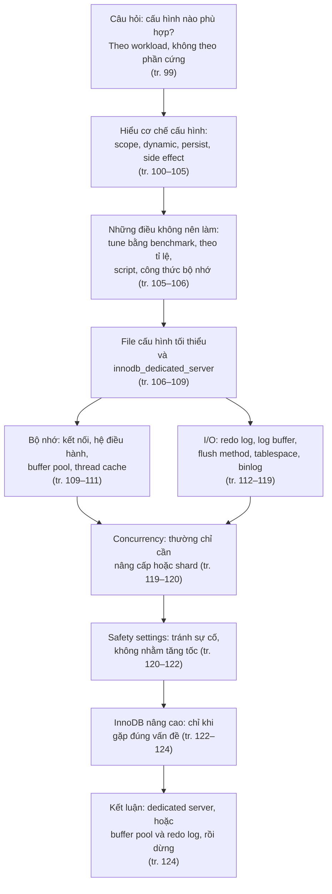
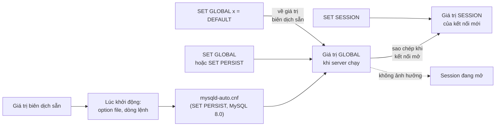
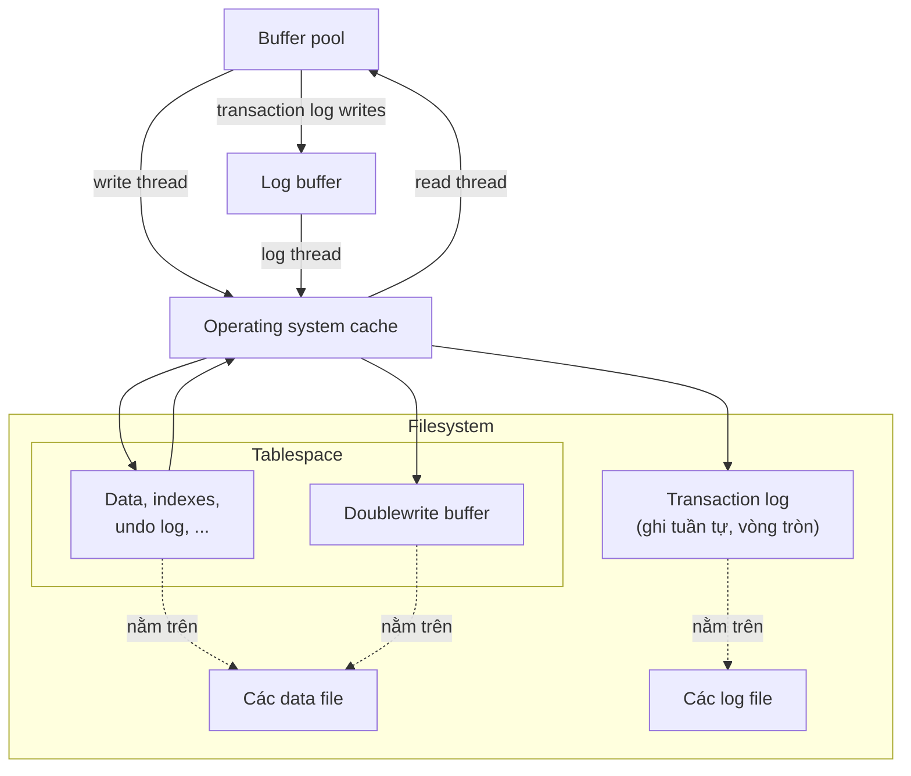
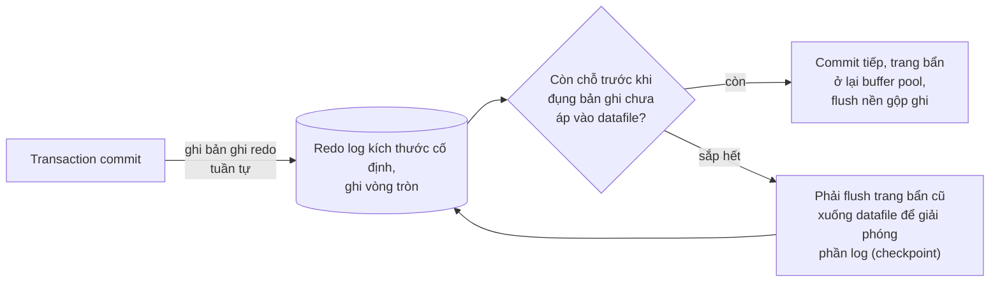
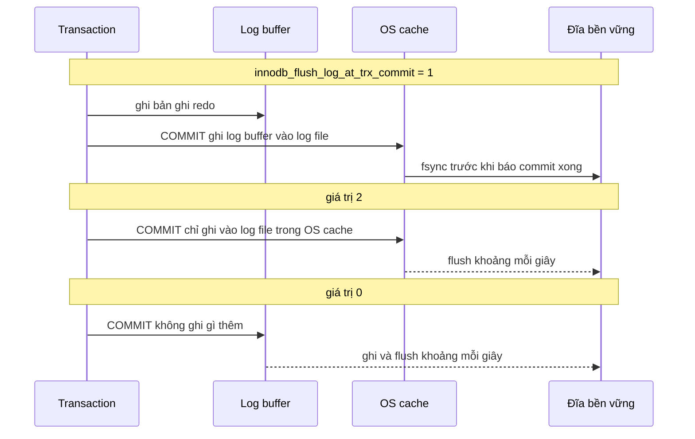
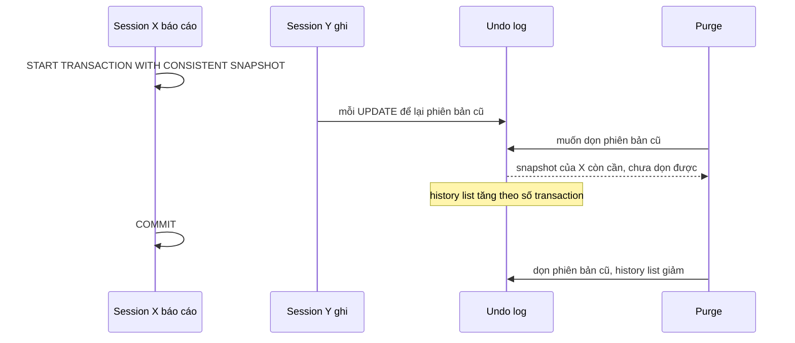
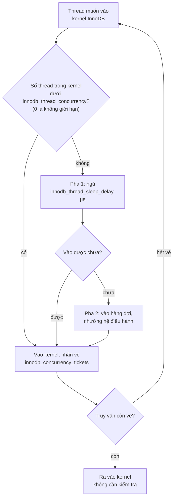
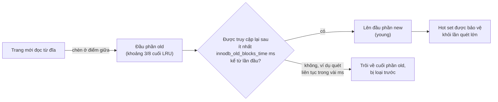
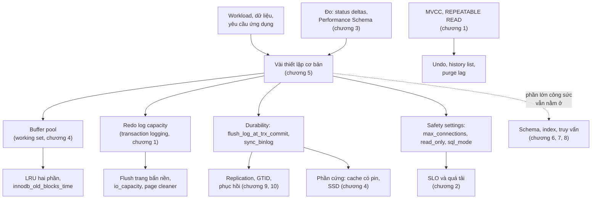

# Chương 5 — Tối ưu thiết lập của server

*Optimizing Server Settings*

> **Nguồn:** *High Performance MySQL: Proven Strategies for Operating at Scale*, Silvia Botros và Jeremy Tinley, O'Reilly, **Fourth Edition (11/2021)**, Chương 5, **tr. 99–124 (trang PDF 121–146)**. Tr. 98 (PDF 120) là trang trắng cuối chương 4.
> "tr. N" là số trang in; trang PDF = N + 22 (xem [README](README.md#page-convention)).
>
> **Quy ước nhãn:**
> - Nội dung không nhãn là diễn giải từ sách, luôn kèm số trang.
> - **Bổ sung ngoài sách** là kiến thức thêm hoặc phép tính tự làm (kèm nguồn nếu có).
> - **Ví dụ minh họa do AI xây dựng** là ví dụ, SQL, số liệu hay tình huống giả định.
> - **Dự đoán** là điều kỳ vọng nhưng chưa đo.
> - **Kết quả đã đo** là số liệu thật từ [bài thực hành](experiments/chapter-05.md) trên MySQL Community 8.0.42, Windows 11, instance thử nghiệm riêng.
>
> **Phiên bản MySQL.** Sách nói file cấu hình mẫu "xây quanh MySQL 8.0" (tr. 107), nhưng nhiều tên biến và giá trị mặc định trong chương là của bản cũ hơn. Ví dụ: `log_slow_queries` không còn tồn tại; `innodb_log_file_size` bị thay bằng `innodb_redo_log_capacity` từ 8.0.30; mặc định của `innodb_log_buffer_size`, `innodb_old_blocks_time` đã khác. Ghi chú nêu điều kiện phiên bản tại chỗ và tổng hợp ở [bảng phụ thuộc phiên bản](#phien-ban). Đường dẫn `/etc/my.cnf`, `O_DIRECT` là của Linux hay Unix; thực hành chạy trên Windows nên có vài khác biệt nền tảng, được ghi rõ.
>
> **Liên kết:** [Roadmap chương 5](learning-roadmap.md#ch05) · [Bài thực hành](experiments/chapter-05.md) · [Đáp án tự kiểm tra](answers/chapter-05.md)

## Mục lục ghi chú

- [1. Bức tranh lớn](#big-picture)
- [2. Giải thích sâu](#deep)
  - [2.1 How MySQL’s Configuration Works (tr. 100–105)](#s2-1)
    - [2.1.1 Syntax, Scope, and Dynamism (tr. 101–103)](#s2-1-1)
    - [2.1.2 Persisted System Variables (tr. 103)](#s2-1-2)
    - [2.1.3 Side Effects of Setting Variables (tr. 103–104)](#s2-1-3)
    - [2.1.4 Planning Your Variable Changes (tr. 104–105)](#s2-1-4)
  - [2.2 What Not to Do (tr. 105–106)](#s2-2)
  - [2.3 Creating a MySQL Configuration File (tr. 106–109)](#s2-3)
    - [2.3.1 Minimal Configuration (tr. 107–108)](#s2-3-1)
    - [2.3.2 Inspecting MySQL Server Status Variables (tr. 108–109)](#s2-3-2)
  - [2.4 Configuring Memory Usage (tr. 109–111)](#s2-4)
    - [2.4.1 Per-Connection Memory Needs (tr. 109)](#s2-4-1)
    - [2.4.2 Reserving Memory for the Operating System (tr. 109)](#s2-4-2)
    - [2.4.3 The InnoDB Buffer Pool (tr. 110–111)](#s2-4-3)
    - [2.4.4 The Thread Cache (tr. 111)](#s2-4-4)
  - [2.5 Configuring MySQL’s I/O Behavior (tr. 112–119)](#s2-5)
    - [2.5.1 The InnoDB Transaction Log (tr. 113)](#s2-5-1)
    - [2.5.2 Log Buffer (tr. 113–115)](#s2-5-2)
    - [2.5.3 The InnoDB Tablespace (tr. 115–118)](#s2-5-3)
    - [2.5.4 Other I/O Configuration Options (tr. 118–119)](#s2-5-4)
  - [2.6 Configuring MySQL Concurrency (tr. 119–120)](#s2-6)
  - [2.7 Safety Settings (tr. 120–122)](#s2-7)
  - [2.8 Advanced InnoDB Settings (tr. 122–124)](#s2-8)
  - [2.9 Summary (tr. 124)](#s2-9)
- [3. Phân tích tình huống](#situations)
- [4. Đo lường và thực hành](#measure)
- [5. Liên kết kiến thức và điều cần nhớ](#takeaways)
- [Ghi chú kiểm tra nguồn](#kiem-tra)
  - [Bảng phụ thuộc phiên bản](#phien-ban)
  - [Kiểm chứng các mục của roadmap](#kiem-chung-roadmap)

---

<a id="big-picture"></a>

## 1. Bức tranh lớn

### Câu hỏi của chương

Người ta hay hỏi: "File cấu hình tối ưu cho server 32 GB RAM, 12 lõi là gì?" Sách trả lời thẳng: **không có** file như vậy. Cấu hình phải theo **workload, dữ liệu và yêu cầu của ứng dụng**, không chỉ theo phần cứng (tr. 99). Vì vậy câu hỏi thật của chương là: *làm thế nào đi tới một cấu hình phù hợp, và vì sao nên dừng lại sớm?*

Lập luận mở đầu của tác giả (tr. 99–100):

- **Đi đường vòng có chủ đích.** Đừng bắt đầu bằng danh sách tùy chọn ("nên đặt cái nào?"), cũng đừng bắt đầu bằng việc soi hành vi server rồi tìm tùy chọn để "cải thiện". Hãy hiểu **nội bộ và hành vi** của MySQL trước, dùng hiểu biết đó làm kim chỉ nam, rồi so cấu hình mong muốn với cấu hình hiện tại và chỉ sửa những khác biệt **đáng kể và đáng làm** (tr. 99).
- **Chỉ vài thiết lập thật sự quan trọng.** MySQL có hàng chục tùy chọn đổi được, nhưng *không nên* đổi hết. Đặt đúng vài thiết lập cơ bản rồi dành thời gian cho **schema, index và thiết kế truy vấn**. Sau khi phần cơ bản đã đúng, lợi ích từ việc chỉnh thêm thường **nhỏ** (tr. 99).
- **Rủi ro thì lớn.** Mặc định có lý do của nó. Đổi mà không hiểu tác động có thể gây **crash, stall liên tục hoặc chậm** (tr. 99). Đừng tin mù quáng cấu hình "tối ưu" trên forum hay Stack Overflow; luôn đọc mục tương ứng trong manual và thử cẩn thận (tr. 100).

> Chú thích 1 (tr. 100). MySQL có thể chạy cực nhanh nếu tắt các thiết lập durability, nhưng khi crash thì dữ liệu dễ mất.

**Vậy nên làm gì** (tr. 100):

1. Bảo đảm phần cơ bản đúng, như **buffer pool** của InnoDB và **kích thước log file**.
2. Đặt vài **safety option** nếu muốn tránh hành vi không mong muốn. Chúng thường **không tăng hiệu năng**, chỉ tránh sự cố.
3. **Để yên phần còn lại.** Gặp vấn đề thì **chẩn đoán cẩn thận** trước. Chỉ khi nguyên nhân nằm ở một phần server mà một tùy chọn sửa được, mới đổi tùy chọn đó.

Các tùy chọn có tác động lớn trong **trường hợp đặc biệt** không thuộc file cấu hình cơ bản; chỉ đặt khi đã gặp đúng vấn đề chúng xử lý. Nếu có gì cần cải thiện, nó sẽ hiện ra ở **thời gian phản hồi của truy vấn**. Vì thế hãy bắt đầu tìm từ **truy vấn và response time**, không phải từ tùy chọn cấu hình (tr. 100).

**Dùng mặc định trừ khi biết rõ không nên** (tr. 100). "An toàn nhờ số đông": rất nhiều người chạy với mặc định, nên đó là những thiết lập **được kiểm thử kỹ nhất**. Đổi không cần thiết dễ gặp bug bất ngờ.

### Vị trí trong mục tiêu chung của sách

Preface nói MySQL hiện đại có mặc định khá hợp lý và rất ít khi cần tuning, trừ khi gặp một vấn đề scaling cụ thể (xem [roadmap](learning-roadmap.md#muc-tieu)). Chương 5 biến nhận định đó thành quy trình: hiểu cơ chế, đặt vài thứ quan trọng, thêm an toàn, rồi dừng. Chương nằm sau [Chương 4](chapter-04.md) (tài nguyên phần cứng: bộ nhớ, đĩa, RAID) và trước bộ ba schema, index, truy vấn ([Chương 6](chapter-06.md), [7](chapter-07.md), [8](chapter-08.md)), nơi sách nói phần lớn công sức nên dồn vào (tr. 99).

### Kiến thức cần biết trước

- **InnoDB, transaction, transaction logging, MVCC** ([Chương 1](chapter-01.md)): redo log, undo, isolation level REPEATABLE READ.
- **Caching và write-ahead logging** ([Chương 4](chapter-04.md#caching-writes), tr. 76–77): cache có thể trì hoãn ghi nhưng không loại bỏ được ghi; ghi tuần tự vào log rồi flush trang sau.
- **Working set, RAID với write cache dùng pin** ([Chương 4](chapter-04.md), tr. 77, 79–86).
- **SLO** ([Chương 2](chapter-02.md#sli-slo-sla)): để biết một thay đổi cấu hình có làm khách hàng khổ hơn không (tr. 104).
- **Performance Schema** ([Chương 3](chapter-03.md)): bảng `variables_info` (tr. 69) và đo bộ nhớ (tr. 64) giúp quan sát cấu hình và bộ nhớ thật.

### Liên hệ với các chương khác

| Ý trong chương 5 | Chương | Căn cứ |
| --- | --- | --- |
| Log tuần tự biến random I/O thành sequential I/O; ghi nền gộp nhiều thay đổi | [Chương 1](chapter-01.md#transaction-logging) (Transaction Logging, tr. 10), [Chương 4](chapter-04.md#caching-writes) (tr. 76–77) | tr. 113 |
| Working set quyết định cần thêm RAM hay thêm I/O | [Chương 4](chapter-04.md#working-set) (tr. 77, 96) | tr. 110 |
| RAID với write cache dùng pin cho fsync rẻ mà vẫn bền | [Chương 4](chapter-04.md#s2-5) (tr. 79–86) | tr. 115, 118–119 |
| `innodb_flush_method=O_DIRECT` giảm áp lực lên file cache của hệ điều hành | [Chương 4](chapter-04.md#swapping) (tr. 91) | tr. 115 |
| Theo dõi SLO khi đổi cấu hình | [Chương 2](chapter-02.md#sli-slo-sla) | tr. 104 |
| Mức gần `max_connections` là tín hiệu quá tải | [Chương 2](chapter-02.md) (tr. 27, 30–31) | tr. 120–121 |
| Đọc nguồn gốc biến, đo bộ nhớ thật | [Chương 3](chapter-03.md) (tr. 64, 69) | tr. 106 (Bổ sung ngoài sách) |
| REPEATABLE READ giữ phiên bản cũ, purge | [Chương 1](chapter-01.md#mvcc) (MVCC, tr. 13) | tr. 117 |
| Adaptive hash index nằm trong buffer pool | [Chương 7](chapter-07.md#adaptive-hash-index) (tr. 159) | tr. 110 |
| `sync_binlog`, GTID, khả năng phục hồi | [Chương 9](chapter-09.md#crash-safe) (tr. 232–233) | tr. 118 |
| Tạm hạ durability trên replica để đuổi kịp lag | [Chương 9](chapter-09.md#excessive-lag) (tr. 253) | Chương 9 nhắc ngược |
| `read_only`, `super_read_only`; `sql_mode` khi nâng cấp | [Chương 9](chapter-09.md#super-read-only), [Phụ lục A](appendix-a.md) (tr. 346) | tr. 122 |
| Shard dữ liệu khi concurrency là nút thắt | [Chương 11](chapter-11.md#s2-6) | tr. 119 |
| Connection pooling ở tầng truy cập (ProxySQL) | [Chương 11](chapter-11.md#connection-pooling) (tr. 306–307) | Chương 1, tr. 2 (xem [kiểm chứng](#kiem-chung-roadmap)) |
| Thiết lập durability trên VM cloud | [Chương 12](chapter-12.md#disk-snapshot) (chú thích 6, tr. 321) | tr. 114–115, 118 |

### Mạch lập luận



---

<a id="deep"></a>

## 2. Giải thích sâu

<a id="s2-1"></a>

### 2.1 How MySQL’s Configuration Works (tr. 100–105)

<a id="config-sources"></a>

**Cấu hình đến từ đâu** (tr. 100). MySQL lấy cấu hình từ **tham số dòng lệnh** và **file cấu hình**. Trên hệ Unix, file thường là `/etc/my.cnf` hoặc `/etc/mysql/my.cnf`. Nếu khởi động bằng script của hệ điều hành, file cấu hình thường là nơi duy nhất bạn đặt thiết lập; khi tự khởi động bằng tay (ví dụ bản thử nghiệm), bạn có thể truyền thêm ở dòng lệnh. Server đọc file, bỏ dòng chú thích và xuống dòng, rồi xử lý chung với tham số dòng lệnh.

> **Hộp "A Note on Terminology"** (tr. 101). Nhiều tùy chọn dòng lệnh tương ứng với biến của server, nên sách dùng *option* và *variable* thay cho nhau. Đa số trùng tên, nhưng có ngoại lệ: `--memlock` đặt biến `locked_in_memory`.

> **Cảnh báo của sách** (tr. 101). Thiết lập muốn dùng lâu dài phải nằm trong file cấu hình chung, không chỉ ở dòng lệnh; nếu không, có ngày server khởi động thiếu chúng. Nên giữ mọi file cấu hình ở một chỗ để dễ kiểm tra.

**Biết server đọc file nào** (tr. 101). Tác giả từng thấy người ta sửa một file mà server không đọc, ví dụ `/etc/my.cnf` trên Debian trong khi Debian đọc `/etc/mysql/my.cnf`. Có khi file nằm rải rác nhiều nơi. Cách chắc nhất là **hỏi chính server**: chạy `mysqld --verbose --help` và tìm dòng "Default options", server sẽ liệt kê các file nó đọc **theo thứ tự**.

> **Kết quả đã đo** (8.0.42, Windows). Bản cài trên máy thực hành liệt kê `C:\Windows\my.ini`, `C:\Windows\my.cnf`, `C:\my.ini`, `C:\my.cnf`, rồi `my.ini` và `my.cnf` trong thư mục cài đặt, và đọc các nhóm `mysql_cluster`, `mysqld`, `server`, `mysqld-8.0`. Danh sách khác hẳn Linux, đúng như lời khuyên "hãy hỏi server" của sách.

**Định dạng file** (tr. 101). File theo kiểu INI, chia thành **section** có tên trong ngoặc vuông. Một chương trình MySQL thường đọc section trùng tên nó; nhiều client đọc thêm section `client`; server thường đọc section `mysqld`. Đặt sai section thì thiết lập **không có tác dụng**.

<a id="s2-1-1"></a>

#### 2.1.1 Syntax, Scope, and Dynamism (tr. 101–103)

**Cú pháp** (tr. 101). Tên viết thường, từ nối bằng dấu gạch dưới **hoặc** gạch ngang; `--auto-increment-offset=5` và `--auto_increment_offset=5` tương đương. Sách khuyên chọn một kiểu và dùng nhất quán để dễ tìm trong file.

<a id="scope"></a>

**What — scope** (tr. 102). Một thiết lập có thể có phạm vi:

| Scope | Ý nghĩa | Ví dụ của sách |
| --- | --- | --- |
| ***Global*** | Áp dụng toàn server | `max_connections` chỉ có global |
| ***Session*** | Riêng cho từng kết nối; nhiều biến session có bản global đóng vai trò **mặc định** | `sort_buffer_size` có mặc định global, đặt riêng được cho session |
| ***Per-object*** | Gắn với từng đối tượng | Sách không cho ví dụ |

Đổi biến session chỉ ảnh hưởng kết nối đã đổi, và mất khi kết nối đóng. Riêng `join_buffer_size`: một truy vấn join nhiều bảng có thể cấp **một join buffer cho mỗi join**, nên một truy vấn có thể giữ nhiều buffer (tr. 102). Đây là lý do con số trong cấu hình không phải "trần" bộ nhớ của một truy vấn.

<a id="dynamic-variables"></a>

**What — dynamic** (tr. 102). Nhiều biến (không phải tất cả) đổi được khi server đang chạy; MySQL gọi chúng là ***dynamic configuration variables***. Sách liệt kê các cú pháp tương đương: `SET sort_buffer_size = ...`, `SET GLOBAL ...`, `SET @@sort_buffer_size := ...`, `SET @@session....`, `SET @@global....`. Giá trị đặt động **mất khi tắt server**; muốn giữ phải sửa cả file cấu hình (tr. 102).

> **Mẹo của sách** (tr. 102). Đặt giá trị global khi server đang chạy **không** đổi giá trị của session hiện tại hay bất kỳ session nào đang mở, vì giá trị session được khởi tạo từ global **lúc kết nối được tạo**. Điều này quan trọng nếu client dùng kết nối lâu dài. Sau mỗi thay đổi hãy xem `SHOW GLOBAL VARIABLES` để chắc nó có tác dụng như ý.

<a id="set-default"></a>

**Từ khóa `DEFAULT`** (tr. 102–103). Gán `DEFAULT` cho biến session sẽ đặt nó bằng **giá trị global** tương ứng: tiện để trả session về trạng thái lúc mới kết nối. Sách khuyên **không** dùng `DEFAULT` cho biến global, vì nó không trả về giá trị lúc khởi động hay giá trị trong file cấu hình, mà về **giá trị biên dịch sẵn** (*compiled-in default*).

> **Kết quả đã đo** ([TN1](experiments/chapter-05.md#tn1)). Server khởi động với `--sort_buffer_size=1048576`. Kết nối A đặt `SET GLOBAL sort_buffer_size = 4194304`: chính A và kết nối B đang mở **vẫn giữ 1 MiB**; kết nối C mở sau đó nhận 4 MiB. `SET SESSION ... = DEFAULT` ở C cho 4 MiB (giá trị global). `SET GLOBAL ... = DEFAULT` cho **262144**, không phải 1 MiB từ dòng lệnh. Thử `SET SESSION max_connections` báo lỗi 1229 (biến chỉ có global); `SET GLOBAL innodb_buffer_pool_instances` báo lỗi 1238 (read-only).

**How — giá trị của một kết nối đến từ đâu.** Sơ đồ dưới tóm tắt các nguồn.



*(Sơ đồ do người viết ghi chú tổng hợp từ tr. 102–103. Thứ tự "mysqld-auto.cnf được đọc sau các option file" là **Bổ sung ngoài sách** theo tài liệu MySQL 8.0; thí nghiệm không kiểm được thứ tự này, xem [2.1.2](#s2-1-2).)*

> **Bổ sung ngoài sách.** Từ 8.0, bảng `performance_schema.variables_info` cho biết **nguồn** của từng biến (`COMPILED`, `COMMAND_LINE`, `DYNAMIC`, `PERSISTED`, hay file nào), ai đổi và lúc nào (`SET_USER`, `SET_TIME`). Chương 3 giới thiệu bảng này (tr. 69). Trong TN1, sau `SET GLOBAL ... = DEFAULT`, nguồn của `sort_buffer_size` chuyển từ `COMMAND_LINE` sang `DYNAMIC`.

**Hiểu lầm phổ biến.** "Tôi đã `SET GLOBAL` nên ứng dụng sẽ dùng giá trị mới ngay." Sai với biến có session: connection pool giữ kết nối hàng giờ sẽ dùng giá trị cũ tới khi kết nối được mở lại (tr. 102).

<a id="s2-1-2"></a>

#### 2.1.2 Persisted System Variables (tr. 103)

<a id="persisted-variables"></a>

**Why** (tr. 103). Trước 8.0, khởi động lại server là quay về giá trị trong file cấu hình, kể cả khi bạn đã `SET GLOBAL`. Bạn phải quản lý **hai thứ** (file cấu hình và cấu hình lúc chạy) và giữ chúng đồng bộ. Muốn tăng `max_connections` cho cả đội server, bạn phải `SET GLOBAL` trên từng instance rồi sửa file cấu hình.

**What** (tr. 103). MySQL 8.0 thêm ***persisted system variables***. Cú pháp `SET PERSIST` đặt giá trị lúc chạy **một lần**, và MySQL ghi thiết lập đó xuống đĩa để dùng ở lần khởi động sau.

**How** (**Bổ sung ngoài sách**, đã quan sát ở [TN1](experiments/chapter-05.md#tn1)):

- Giá trị được ghi vào tệp JSON `mysqld-auto.cnf` trong **datadir**, có metadata người đặt và timestamp. Bảng `performance_schema.persisted_variables` cho xem nội dung.
- Biến read-only (ví dụ `innodb_read_io_threads`) không `SET PERSIST` được (lỗi 1238); phải dùng `SET PERSIST_ONLY`, chỉ ghi tệp, có hiệu lực ở lần khởi động sau.
- `RESET PERSIST` xóa các giá trị đã persist (tệp còn `{"Version": 2}`).
- **Kết quả đã đo:** khởi động lại **với `--no-defaults`** thì server **bỏ qua** `mysqld-auto.cnf`: `max_connections` về 151 dù đã persist 300. Khởi động bình thường (đọc option file, `persisted_globals_load` = ON) không kiểm được vì quy tắc môi trường thực hành; theo tài liệu MySQL thì giá trị persist được áp dụng.

**Trade-offs** (**Bổ sung ngoài sách**). `SET PERSIST` giải quyết việc "nhớ sửa file", nhưng tạo ra **nguồn sự thật thứ hai** nằm trong datadir. Nếu đội quản lý `my.cnf` bằng version control như sách khuyên (tr. 104), thay đổi bằng `SET PERSIST` sẽ không hiện trong repo, và một người đọc `my.cnf` sẽ hiểu sai cấu hình thật. **Decision:** chọn một kênh chính. Nếu dùng `SET PERSIST`, hãy đưa việc đọc `persisted_variables` vào quy trình kiểm tra cấu hình.

<a id="s2-1-3"></a>

#### 2.1.3 Side Effects of Setting Variables (tr. 103–104)

<a id="side-effects"></a>

Đặt biến động có thể có **tác dụng phụ** bất ngờ, ví dụ flush các block bẩn khỏi buffer; một thay đổi online có thể bắt server làm rất nhiều việc (tr. 103). Tên biến đôi khi nói đúng chức năng (`max_heap_table_size` là kích thước tối đa mà bảng tạm trong bộ nhớ được phép đạt), nhưng quy ước đặt tên không nhất quán nên không thể luôn đoán từ tên (tr. 103).

Sách cho bốn ví dụ về **thời điểm có hiệu lực** và **cách cấp phát** (tr. 103–104):

| Biến | Khi nào có hiệu lực, cấp phát ra sao (theo sách) |
| --- | --- |
| `table_open_cache` | Không có hiệu lực ngay; chờ tới lần một thread mở bảng. Nếu giá trị lớn hơn số bảng trong cache, bảng vừa mở được thêm vào; nếu nhỏ hơn, MySQL xóa các bảng không dùng khỏi cache. |
| `thread_cache_size` | Không có hiệu lực ngay; chờ tới lần một kết nối đóng. Còn chỗ thì thread được cache, hết chỗ thì thread bị hủy. Sách nói thu nhỏ biến này **không** làm số thread trong cache giảm ngay; nó chỉ giảm khi kết nối mới lấy thread ra. |
| `read_buffer_size` | Không cấp phát cho tới khi truy vấn cần, nhưng khi cần thì cấp **nguyên khối** bằng giá trị này. |
| `read_rnd_buffer_size` | Không cấp phát cho tới khi cần, và chỉ cấp **đúng lượng cần**. Tên `max_read_rnd_buffer_size` mới mô tả đúng hơn. |

> **Kết quả đã đo** ([TN3](experiments/chapter-05.md#tn3)). Ở 8.0.42, trong cùng một session: `Threads_cached` = 5, chạy `SET GLOBAL thread_cache_size = 0`, đọc lại thì `Threads_cached` = **0 ngay lập tức**. Mô tả "không giảm ngay" của sách không khớp bản này; có thể đúng với bản cũ hơn, chưa kiểm chứng.

**Lời khuyên** (tr. 104). Đừng tăng **global** một thiết lập theo kết nối trừ khi chắc chắn đó là điều đúng. Một số buffer được cấp nguyên khối dù không cần, nên giá trị global lớn có thể **lãng phí khổng lồ** (nhân với số kết nối). Thay vào đó, tăng giá trị **ở session** khi một truy vấn cần.

**Ví dụ minh họa do AI xây dựng** (cú pháp MySQL 8.0):

```sql
-- Chỉ phiên chạy báo cáo đêm được sort buffer lớn; các kết nối OLTP giữ mặc định.
SET SESSION sort_buffer_size = 8 * 1024 * 1024;
SELECT customer_id, SUM(amount) AS total
FROM orders
WHERE created_at >= '2026-10-01'
GROUP BY customer_id
ORDER BY total DESC;
SET SESSION sort_buffer_size = DEFAULT;   -- trả về giá trị global
```

<a id="s2-1-4"></a>

#### 2.1.4 Planning Your Variable Changes (tr. 104–105)

- **Nhiều hơn không phải lúc nào cũng tốt.** Đặt quá cao dễ gây hết bộ nhớ hoặc swap (tr. 104).
- **Theo dõi SLO** ([Chương 2](chapter-02.md#sli-slo-sla)) để chắc thay đổi không làm hại trải nghiệm khách hàng. Benchmark **không đủ** vì không phải workload thật. Tác giả từng thấy người ta đổi cấu hình, tưởng nhanh hơn, nhưng thực ra tệ hơn tổng thể, vì workload khác nhau theo giờ trong ngày hay ngày trong tuần (tr. 104).
- **Version control cho file cấu hình**, để nối một thay đổi hiệu năng hay một lần vi phạm SLO với đúng thay đổi cấu hình. Nhưng nhớ: sửa file **không tự làm gì**; phải đổi cả giá trị lúc chạy (tr. 104).
- **Tối ưu truy vấn và schema trước**, ít nhất là những việc hiển nhiên như thêm index. Nếu tinh chỉnh cấu hình sâu rồi mới đổi truy vấn hay schema, có thể phải đánh giá lại cấu hình (tr. 105).
- **Cấu hình không tĩnh.** Trừ khi phần cứng, workload và dữ liệu hoàn toàn không đổi, bạn sẽ phải xem lại. Workload cũng không đều trong ngày, nên cấu hình "hoàn hảo" cho giữa buổi sáng có thể không đúng cho giữa buổi chiều. Theo đuổi cấu hình hoàn hảo là phi thực tế; hãy **tối ưu cho giờ cao điểm** rồi dừng ở mức **"đủ tốt"**, trừ khi có lý do tin rằng đang bỏ lỡ một cải thiện đáng kể (tr. 105).

**Decision** (**Bổ sung ngoài sách**, tổng hợp từ tr. 104–105). Một thay đổi đáng làm khi: có triệu chứng ở response time hay SLO; chẩn đoán chỉ ra đúng thành phần mà biến điều khiển; có cách đo trước và sau trên workload thật ở giờ cao điểm; và có đường lui (giá trị cũ, cách đặt lại).

#### Tự kiểm tra 2.1

- **Câu 2.1.1.** Lúc 10:00 một DBA chạy `SET GLOBAL sort_buffer_size = 8M` để chữa một báo cáo chậm. Ứng dụng dùng connection pool giữ kết nối hàng giờ. Dự đoán báo cáo có nhanh lên ngay không, vì sao, và cách làm đúng hơn là gì? [đáp án](answers/chapter-05.md#q2-1-1)
- **Câu 2.1.2.** Server được khởi động với `--sort_buffer_size=1M`. Sau một loạt thử nghiệm, DBA chạy `SET GLOBAL sort_buffer_size = DEFAULT` để "trả về như lúc khởi động". Giá trị nhận được là gì? Vì sao sách khuyên không dùng `DEFAULT` cho biến global? [đáp án](answers/chapter-05.md#q2-1-2)
- **Câu 2.1.3.** So sánh ba cách tăng `max_connections`: (a) `SET GLOBAL` rồi sửa `my.cnf`; (b) `SET PERSIST`; (c) chỉ sửa `my.cnf`. Điều gì xảy ra ngay lúc đó và sau khi khởi động lại với mỗi cách? Rủi ro vận hành của (b) là gì? [đáp án](answers/chapter-05.md#q2-1-3)
- **Câu 2.1.4.** Vì sao sách khuyên không tăng giá trị global của biến theo kết nối như `read_buffer_size`? `read_rnd_buffer_size` khác `read_buffer_size` ở điểm nào về cách cấp phát, và điều đó đổi mức rủi ro ra sao? [đáp án](answers/chapter-05.md#q2-1-4)
- **Câu 2.1.5.** Một thay đổi cấu hình được kết luận là "tốt hơn" nhờ benchmark chạy sáng thứ Hai. Theo sách, vì sao kết luận đó có thể sai, và nên quan sát gì để đánh giá? [đáp án](answers/chapter-05.md#q2-1-5)

---

<a id="s2-2"></a>

### 2.2 What Not to Do (tr. 105–106)

Mục này là phần "rant" có chủ ý của tác giả (tr. 105): những thói quen rủi ro hay không đáng công.

**1. Đừng "tune" bằng vòng lặp benchmark** (tr. 105). Bạn có thể được kỳ vọng dựng bộ benchmark rồi đổi cấu hình lặp đi lặp lại để tìm giá trị tối ưu. Sách không khuyên đa số người làm vậy: tốn rất nhiều công sức và nghiên cứu, còn lợi ích thường rất nhỏ. Thời gian đó nên dùng để **kiểm tra backup**, **theo dõi thay đổi của query plan**, v.v.

<a id="tuning-by-ratio"></a>

**2. Đừng tune theo tỉ lệ** (tr. 105–106).

- **What.** "Tỉ lệ tuning" kinh điển: hit ratio của InnoDB buffer pool phải cao hơn một phần trăm nào đó, thấp thì tăng cache. Sách gọi đây là lời khuyên **rất sai** (tr. 105).
- **Why sai** (tr. 105). Hit ratio **không liên quan** tới việc cache quá lớn hay quá nhỏ. Thứ nhất, nó phụ thuộc **workload**: có workload không thể cache được dù cache lớn cỡ nào. Thứ hai, bản thân cache hit "vô nghĩa". Có lúc cache quá nhỏ thì hit rate thấp, tăng cache thì hit rate tăng, nhưng đó là **tương quan ngẫu nhiên**, không nói gì về hiệu năng hay kích thước đúng của cache. Vấn đề của những tương quan "đôi khi đúng" là người ta bắt đầu tin chúng luôn đúng. DBA Oracle đã bỏ cách tune theo tỉ lệ từ nhiều năm (tr. 105–106).
- Sách hứa giải thích "vì sao cache hit vô nghĩa" ở phần sau (tr. 105), nhưng trong chương không tìm thấy phần giải thích đó (xem [Ghi chú kiểm tra nguồn](#kiem-tra)).

> Chú thích 2 (tr. 106). Ai chưa tin thì đọc *Optimizing Oracle Performance* (Cary Millsap, Jeff Holt). Sách đó có cả một phụ lục, kèm công cụ tạo ra **bất kỳ hit ratio nào** bạn muốn, dù hệ thống chạy tệ tới đâu, để minh họa tỉ lệ này vô dụng.

**How — vì sao hit ratio đánh lừa** (**Bổ sung ngoài sách**). Hit ratio thường tính là `1 − Innodb_buffer_pool_reads / Innodb_buffer_pool_read_requests`. Mẫu số là số lần **lấy trang** trong bộ nhớ, rất rẻ; tử số là số lần phải đọc đĩa, rất đắt. Thêm thật nhiều lần đọc rẻ vào mẫu số thì tỉ lệ đẹp lên, trong khi số lần đọc đĩa (thứ thật sự tốn thời gian) không đổi. Chỉ số phản ánh chi phí tốt hơn là **số trang đọc từ đĩa mỗi giây** (`Innodb_pages_read`, `Innodb_buffer_pool_reads` theo thời gian), độ trễ I/O và response time của truy vấn.

> **Kết quả đã đo** ([TN3](experiments/chapter-05.md#tn3), buffer pool 128 MiB, bảng 1 triệu hàng khoảng 300 MB):
>
> | Lần đo | Trang đọc từ đĩa | Hit ratio |
> | --- | --- | --- |
> | Quét toàn bảng | 12.468 | 65,0% |
> | Cùng lần quét đó cộng 200.000 lookup "nóng" | 11.443 | **97,4%** |
> | 20.000 lookup trên 1000 id "nóng" | 11 | 99,97% |
> | 20.000 lookup ngẫu nhiên trên 1 triệu id | 11.394 | 84,2% |
>
> Hàng thứ hai đọc đĩa ngang hàng thứ nhất nhưng tỉ lệ nhảy từ 65% lên 97%: đúng ý chú thích 2. Hàng thứ tư có tỉ lệ "tốt hơn" quét toàn bảng nhưng đọc đĩa gần bằng, cho chỉ **20.000 hàng** thay vì 1 triệu.

**3. Đừng dùng tuning script** (tr. 106). Script "tuning" phổ biến trên internet mã hóa những thói quen nguy hiểm trên và dạy chúng cho hàng nghìn người. Tốt nhất là bỏ qua.

**4. Tránh chữ "tuning"** (tr. 106). Sách thích dùng *configuration* hay *optimization* (khi đúng là bạn đang làm việc đó). "Tuning" gợi hình ảnh người mới vặn thử rồi xem chuyện gì xảy ra; việc đó nên để cho người nghiên cứu nội bộ server. "Tuning" server có thể là sự phí thời gian đáng kinh ngạc.

**5. Cẩn thận với lời khuyên trên internet** (tr. 106). Blog, forum có nhiều lời khuyên tồi, và khó biết ai thật sự giỏi. Các nhà cung cấp dịch vụ MySQL uy tín nhìn chung an toàn hơn kết quả tìm kiếm, vì có khách hàng hài lòng nghĩa là họ làm đúng điều gì đó. Nhưng ngay cả lời khuyên của họ cũng nguy hiểm nếu áp dụng mà không thử và không hiểu, vì nó có thể dành cho tình huống khác của bạn theo cách bạn không nhận ra.

<a id="memory-formula"></a>

**6. Đừng tin công thức tính bộ nhớ** (tr. 106). Công thức phổ biến, chính là công thức MySQL in ra khi crash (sách không nhắc lại), có từ thời xa xưa. Nó không phải cách đáng tin, thậm chí không hữu ích, để biết MySQL dùng tối đa bao nhiêu bộ nhớ trong trường hợp xấu nhất; các biến thể trên internet cũng sai tương tự. Sự thật là **không thể đặt cận trên** cho bộ nhớ MySQL tiêu thụ: MySQL không phải database server kiểm soát chặt việc cấp phát bộ nhớ.

> **Bổ sung ngoài sách.** Muốn biết bộ nhớ thật, đo thay vì tính: Performance Schema có instrument bộ nhớ theo thread và theo thành phần ([Chương 3](chapter-03.md#memory-usage), "Examining Memory Usage", tr. 64). Từ 8.0.28, MySQL có thêm `connection_memory_limit` và `global_connection_memory_limit` (bản 8.0.42 trên máy thực hành có các tùy chọn này trong `--help`), giới hạn một phần bộ nhớ do kết nối người dùng cấp phát; chúng không biến nhận định của sách thành sai, vì không bao phủ mọi loại bộ nhớ của server. Chi tiết xem manual của đúng phiên bản.

**Hiểu lầm phổ biến.** "Hit ratio 99% nghĩa là buffer pool đủ lớn." Workload chủ yếu là lookup nóng có thể đạt 99,97% trong khi một job quét lớn vẫn đọc hàng nghìn trang từ đĩa mỗi lần chạy (TN3).

#### Tự kiểm tra 2.2

- **Câu 2.2.1.** Dùng một ví dụ cụ thể, giải thích vì sao hit ratio của buffer pool có thể tăng từ 65% lên 97% mà hệ thống không đọc ít trang từ đĩa hơn. Chỉ số nào phản ánh chi phí tốt hơn? [đáp án](answers/chapter-05.md#q2-2-1)
- **Câu 2.2.2.** Khi tăng buffer pool, hit ratio thường tăng theo. Vì sao sách gọi đó là tương quan ngẫu nhiên, không phải căn cứ để định cỡ cache? Vậy định cỡ dựa vào gì? [đáp án](answers/chapter-05.md#q2-2-2)
- **Câu 2.2.3.** Công thức "bộ nhớ tối đa" mà MySQL in ra khi crash sai ở đâu? Bạn quan sát bộ nhớ thật bằng cách nào? [đáp án](answers/chapter-05.md#q2-2-3)

---

<a id="s2-3"></a>

### 2.3 Creating a MySQL Configuration File (tr. 106–109)

Sách không có file "tốt nhất cho mọi người", kiểu cho server 4 CPU, 16 GB RAM, 12 ổ cứng. Bạn phải tự phát triển cấu hình, vì ngay cả một điểm khởi đầu tốt cũng thay đổi nhiều theo cách bạn dùng server (tr. 106).

<a id="s2-3-1"></a>

#### 2.3.1 Minimal Configuration (tr. 107–108)

<a id="sample-config"></a>

Tác giả dựng một file mẫu **tối thiểu**, "xây quanh MySQL 8.0", làm điểm khởi đầu; vài giá trị để `<value>` cho bạn tự chọn (tr. 107).

> Chú thích 3 (tr. 107). Các phiên bản MySQL có thể bỏ, deprecate hay đổi một số tùy chọn; hãy xem tài liệu.

File có ba nhóm trong section `[mysqld]` (GENERAL, INNODB, LOGGING, OTHER) và một section `[client]`. Bảng dưới mô tả từng dòng thay vì chép file. Cột cuối là **Kết quả đã đo** trên 8.0.42 ([TN2](experiments/chapter-05.md#tn2)) và **Bổ sung ngoài sách** về phiên bản.

| Biến (giá trị trong sách) | Ý nghĩa | Lý do theo sách | Lưu ý phiên bản, đo trên 8.0.42 |
| --- | --- | --- | --- |
| `datadir` (`/var/lib/mysql`) | Thư mục dữ liệu | Vị trí phổ biến trên nhiều Unix; chọn nơi khác cũng được (tr. 107) | Windows dùng đường dẫn khác |
| `socket` (trong datadir) | Đường dẫn Unix socket | Đặt tường minh; một số bản MySQL có bug khi để vị trí mặc định biên dịch sẵn, và nâng cấp có thể đổi vị trí (tr. 107–108) | Trên Windows, kết nối cục bộ đi qua TCP hay named pipe |
| `pid_file` (trong datadir) | Tệp chứa process id | Như trên; nhiều hệ điều hành muốn đặt ở `/var/run`, cũng được (tr. 107) | |
| `user` (`mysql`) | Tài khoản hệ điều hành chạy `mysqld` | Tài khoản phải tồn tại và sở hữu datadir cùng mọi tệp trong đó (tr. 108) | `--validate-config` chấp nhận trên Windows |
| `port` (`3306`) | Cổng TCP | Mặc định; đôi khi cần đổi (tr. 108) | |
| `innodb_buffer_pool_size` (`<value>`) | Bộ nhớ đệm chính của InnoDB | Một trong hai thiết lập quan trọng nhất ([2.4.3](#s2-4-3), tr. 124) | Mặc định 128 MiB; resize online được (từ 5.7.5) |
| `innodb_log_file_size` (`<value>`) | Kích thước mỗi tệp redo log | Rất quan trọng cho hiệu năng ghi (tr. 113, 124) | **Deprecated từ 8.0.30**; chỉ dùng để tính `innodb_redo_log_capacity`, kèm cảnh báo trong error log (đo được) |
| `innodb_file_per_table` (`1`) | Mỗi bảng một tệp `.ibd` | Dễ thu hồi dung lượng khi xóa bảng, dễ quan sát ([2.5.3](#s2-5-3), tr. 116–117) | Đã là ON mặc định |
| `innodb_flush_method` (`O_DIRECT`) | Cách InnoDB đọc, ghi, flush tệp | Khuyên dùng trên Unix có RAID với write cache dùng pin (tr. 115) | **Bị từ chối trên Windows** (`unbuffered` là mặc định, đo được); trên Linux, mặc định của 8.0 là `fsync` |
| `log_error` | Đường dẫn error log | Sách không giải thích riêng | |
| `log_slow_queries` | Slow query log (tên cũ) | Sách không giải thích riêng | **Không còn tồn tại**: `unknown variable`, server từ chối khởi động (đo được). Dùng `slow_query_log` và `slow_query_log_file` |
| `tmp_table_size` (`32M`), `max_heap_table_size` (`32M`) | Giới hạn bảng tạm trong bộ nhớ | Sách chỉ giải thích nghĩa của `max_heap_table_size` (tr. 103), không giải thích con số 32M | Mặc định 16 MiB mỗi biến. Từ 8.0, bảng tạm nội bộ dùng engine TempTable (`internal_tmp_mem_storage_engine`, đo được), có giới hạn chung `temptable_max_ram` (1 GiB, đo được); vai trò của hai biến này với bảng tạm nội bộ đổi theo phiên bản, xem manual |
| `max_connections` (`<value>`) | Số kết nối tối đa | "Phanh khẩn cấp" ([2.7](#s2-7), tr. 120–121) | Mặc định 151 |
| `thread_cache_size` (`<value>`) | Số thread giữ sẵn | Theo dao động của `Threads_connected` ([2.4.4](#s2-4-4), tr. 111) | Mặc định tự tính; hiện 9 |
| `table_open_cache` (`<value>`) | Số bảng giữ mở | Chỉ giải thích hành vi khi đổi động (tr. 103) | Mặc định 4000 |
| `open_files_limit` (`65535`) | Giới hạn số file handle | Lớn nhất có thể trên Linux thông thường; file handle rất rẻ; thiếu sẽ gặp lỗi 24 "too many open files" (tr. 108) | Windows mặc định 10209 |
| `[client]` `socket`, `port` | Cho `mysql`, `mysqladmin` biết cách kết nối | Phải khớp giá trị của server (tr. 108) | |

> **Kết quả đã đo** ([TN2](experiments/chapter-05.md#tn2)). Chạy `mysqld --no-defaults ... --validate-config` với toàn bộ tùy chọn của file mẫu (đã điền giá trị) trên Windows: exit code 1, do `O_DIRECT` làm InnoDB không nạp được tùy chọn. Riêng `log_slow_queries` cũng làm server từ chối (`unknown variable`). Bộ thay thế cho 8.0.30+ (`slow_query_log`, `slow_query_log_file`, `innodb_redo_log_capacity`) qua kiểm tra.

**"Quá tối thiểu"?** (tr. 107). Có thể trông quá ngắn so với những gì bạn quen thấy, nhưng thực ra đã **nhiều hơn mức nhiều người cần**. Một số loại tùy chọn khác bạn sẽ cần, ví dụ binary logging, được bàn sau. Các safety setting cũng không có trong file mẫu (tr. 108).

> **Bổ sung ngoài sách (đã đo).** Ở 8.0, binary log **bật mặc định** (`log_bin` = ON). Sau các thí nghiệm, hai tệp binlog chiếm khoảng 394 MB, lớn hơn cả dữ liệu. File "tối thiểu" của sách không nhắc binlog, nhưng nó vẫn chạy và chiếm đĩa.

<a id="innodb-dedicated-server"></a>

**`innodb_dedicated_server`** (tr. 108).

- **What.** Tùy chọn mới của MySQL 8.0. Nó xem server có bao nhiêu bộ nhớ và tự đặt **bốn biến** phù hợp cho một server database chuyên dụng: `innodb_buffer_pool_size`, `innodb_log_file_size`, `innodb_log_files_in_group`, `innodb_flush_method` (tr. 108).
- **Why.** Đơn giản hóa việc tính và đổi các giá trị này. Đặc biệt có ích trên cloud: VM 128 GB khởi động lại thành 256 GB thì MySQL **tự cấu hình lại**, không cần sửa file. Sách nói đây **thường là cách tốt nhất** để quản lý bốn thiết lập đó (tr. 108). Nó thường dùng **50–75%** RAM cho buffer pool (tr. 109).
- **Phiên bản (Bổ sung ngoài sách, đã đối chiếu `--help` của 8.0.42).** Tùy chọn có từ 8.0.3. Ở 8.0.42, mô tả trong `mysqld --verbose --help` là: tự co giãn `innodb_buffer_pool_size` và **`innodb_redo_log_capacity`** theo bộ nhớ, và đặt `innodb_flush_method=O_DIRECT_NO_FSYNC` nếu nền tảng hỗ trợ. Tức là từ 8.0.30, hai biến log trong danh sách của sách được thay bằng `innodb_redo_log_capacity`. Theo tài liệu MySQL, nếu bạn đặt tường minh một biến mà tùy chọn này quản lý, giá trị tường minh được dùng.
- **Trade-offs (Bổ sung ngoài sách).** Giả định cốt lõi là **"chuyên dụng"**: cả máy dành cho MySQL. Nếu cùng host còn agent, sidecar hay ứng dụng khác dùng nhiều RAM, 75% có thể quá tay và dẫn tới swap, đúng điều tr. 109 cảnh báo. Thí nghiệm **không** bật tùy chọn này, vì trên máy 32 GB nó sẽ cấp buffer pool rất lớn cho một instance thử nghiệm.

**Các dòng khác** (tr. 108). Phần lớn tự giải thích hoặc là vấn đề phán đoán; nhiều dòng được bàn ở phần sau. Riêng `open_files_limit` được đặt lớn nhất có thể trên Linux thông thường, vì file handle trên hệ điều hành hiện đại rất rẻ; thiếu thì gặp lỗi 24 "too many open files".

<a id="s2-3-2"></a>

#### 2.3.2 Inspecting MySQL Server Status Variables (tr. 108–109)

<a id="status-variables"></a>

- Đôi khi có thể dùng output của `SHOW GLOBAL STATUS` làm **đầu vào** để chỉnh cấu hình theo workload (tr. 108).
- Xem cả **giá trị tuyệt đối** lẫn **thay đổi theo thời gian**, tốt nhất là nhiều snapshot ở giờ cao điểm và thấp điểm (tr. 108).
- `mysqladmin extended-status -ri60` in **phần thay đổi** của các status variable mỗi 60 giây (tr. 108). Phần còn lại của chương thường giả định bạn đang nhìn output kiểu này. Percona Toolkit có `pt-mext` và `pt-mysql-summary` hiển thị gọn hơn (tr. 109).
- Sau phần chuẩn bị này, sách đưa người đọc đi "tham quan" nội bộ server, xen kẽ lời khuyên cấu hình (tr. 109).

> **Bổ sung ngoài sách.** Có hai loại status variable. **Bộ đếm tích lũy** chỉ tăng từ lúc khởi động (`Threads_created`, `Innodb_buffer_pool_reads`, `Innodb_os_log_fsyncs`); chỉ có nghĩa khi lấy **hiệu số chia cho thời gian**, và cờ `-r` của `mysqladmin` làm đúng việc đó. **Giá trị tức thời** (gauge) phản ánh hiện tại (`Threads_connected`, `Innodb_buffer_pool_pages_dirty`). `Max_used_connections` là một "mốc nước cao". Từ 8.0 có thể đọc bằng SQL qua `performance_schema.global_status`; các thí nghiệm của ghi chú này đều lấy hiệu số giữa hai lần chụp.

#### Tự kiểm tra 2.3

- **Câu 2.3.1.** Dự đoán điều gì xảy ra nếu chép nguyên file mẫu của sách (đã điền `<value>`) cho MySQL 8.0.42 trên Linux, và trên Windows. Bài học rút ra từ chú thích 3 là gì? [đáp án](answers/chapter-05.md#q2-3-1)
- **Câu 2.3.2.** `innodb_dedicated_server` làm gì? Nêu một tình huống sách cho là rất có ích và một tình huống bạn không nên dùng nó. Ở 8.0.30 trở lên, danh sách biến nó quản lý khác sách thế nào? [đáp án](answers/chapter-05.md#q2-3-2)
- **Câu 2.3.3.** Vì sao sách khuyên ghi rõ đường dẫn socket và pid file thay vì để mặc định biên dịch sẵn, dù không khuyên chọn vị trí khác? [đáp án](answers/chapter-05.md#q2-3-3)
- **Câu 2.3.4.** Bạn có hai snapshot `SHOW GLOBAL STATUS` cách nhau 60 giây. Phân biệt bộ đếm tích lũy và giá trị tức thời, cho mỗi loại một ví dụ trong chương. Vì sao sách khuyên chụp cả ở giờ cao điểm lẫn thấp điểm? [đáp án](answers/chapter-05.md#q2-3-4)

---

<a id="s2-4"></a>

### 2.4 Configuring Memory Usage (tr. 109–111)

Dùng `innodb_dedicated_server` thường lấy **50–75%** RAM. Phần còn lại, ít nhất 25%, dành cho bộ nhớ theo kết nối, overhead của hệ điều hành và các thiết lập bộ nhớ khác (tr. 109).

**Ví dụ minh họa do AI xây dựng (phép tính).** Một máy 64 GB chỉ chạy MySQL: buffer pool khoảng 48 GB (75%), còn khoảng 16 GB cho kết nối, hệ điều hành, agent giám sát, page cache cho binlog và các tệp không đi qua buffer pool. Con số chỉ để hình dung; phần dưới giải thích vì sao không thể tính chính xác.

<a id="s2-4-1"></a>

#### 2.4.1 Per-Connection Memory Needs (tr. 109)

<a id="per-connection-memory"></a>

- MySQL cần một ít bộ nhớ chỉ để giữ một kết nối (thường kèm một thread riêng), và một lượng cơ bản để chạy mỗi truy vấn. Phải chừa đủ cho giờ cao điểm; nếu không, truy vấn "đói" bộ nhớ, chạy kém hoặc lỗi (tr. 109).
- Khó dự đoán vì vài kiểu dùng có thể ngốn bất ngờ: **prepared statement** (có thể mở rất nhiều cùng lúc) và **data dictionary của InnoDB** (tr. 109). Sách nói "sẽ bàn sau" về data dictionary, nhưng chương không quay lại chủ đề này.
- **Không cần giả định kịch bản xấu nhất.** Cho phép 100 kết nối thì về lý thuyết cả 100 có thể chạy truy vấn lớn cùng lúc, nhưng thực tế khó xảy ra. Nguyên nhân hay gặp nhất của bộ nhớ theo kết nối cao là truy vấn dùng **nhiều bảng tạm lớn** hoặc **stored procedure phức tạp** (tr. 109).

<a id="s2-4-2"></a>

#### 2.4.2 Reserving Memory for the Operating System (tr. 109)

Hệ điều hành cũng cần bộ nhớ: phần mềm giám sát, công cụ quản lý cấu hình, job định kỳ. Dấu hiệu tốt nhất cho thấy hệ điều hành đủ bộ nhớ là nó **không đang swap** (paging) bộ nhớ ảo ra đĩa (tr. 109). Liên hệ: swappiness và `O_DIRECT` ở [Chương 4](chapter-04.md#swapping) (tr. 91).

<a id="s2-4-3"></a>

#### 2.4.3 The InnoDB Buffer Pool (tr. 110–111)

<a id="buffer-pool"></a>

**What** (tr. 110). Buffer pool cần nhiều bộ nhớ hơn mọi thứ khác và thường là biến **quan trọng nhất** cho hiệu năng. Nó không chỉ cache index mà còn giữ **dữ liệu hàng**, ***adaptive hash index***, ***change buffer***, **lock** và các cấu trúc nội bộ khác. InnoDB còn dùng buffer pool để **trì hoãn ghi**, gộp nhiều lần ghi rồi thực hiện tuần tự. Theo dõi bằng biến từ các lệnh `SHOW` hay công cụ như `innotop`.

**Why — không cần quá lớn** (tr. 110). Dữ liệu ít và tăng chậm thì không cần cấp dư. Buffer pool lớn hơn nhiều so với tổng kích thước bảng và index mà nó sẽ chứa thì **không có lợi**. Chuẩn bị cho tăng trưởng nhanh thì được, nhưng buffer pool khổng lồ cho chút dữ liệu là không cần thiết.

> **Bổ sung ngoài sách.** Đơn vị trong buffer pool là **trang** 16 KiB (`innodb_page_size`, đo được 16384). Câu hỏi định cỡ đúng là: **working set** (các trang hay được dùng) có nằm vừa không, chứ không phải toàn bộ dữ liệu ([Chương 4](chapter-04.md#working-set), tr. 77). Ở TN3, với 128 MiB (8192 trang) và bảng khoảng 300 MB, mỗi lần quét đọc khoảng 12 nghìn trang từ đĩa; tăng lên 512 MiB (resize online) thì lần quét thứ hai chỉ đọc 3 trang.

<a id="dirty-pages"></a>

**Trade-offs — buffer pool lớn: shutdown và warm-up lâu** (tr. 110).

- Nhiều **trang bẩn** (đã sửa trong bộ nhớ, chưa ghi xuống đĩa) thì shutdown lâu, vì InnoDB ghi trang bẩn vào datafile khi tắt.
- Có thể ép tắt nhanh, nhưng lần khởi động sau phải **recovery** nhiều hơn; nên **không thật sự rút ngắn** được chu kỳ tắt rồi bật. Biến `innodb_fast_shutdown` điều khiển cách tắt.
- Nếu biết trước lúc cần tắt: hạ `innodb_max_dirty_pages_pct` lúc chạy, chờ luồng flush dọn bớt, rồi tắt khi số trang bẩn đã nhỏ. Theo dõi bằng status `Innodb_buffer_pool_pages_dirty` hoặc qua `innotop`.

**How — "lười" có chủ đích** (tr. 110). Hạ `innodb_max_dirty_pages_pct` **không bảo đảm** InnoDB giữ ít trang bẩn hơn. Nó chỉ là **ngưỡng** để InnoDB thôi "lười". Mặc định, InnoDB flush trang bẩn bằng luồng nền, gộp nhiều lần ghi và ghi tuần tự cho hiệu quả; gọi là "lười" vì nó trì hoãn flush trừ khi cần chỗ cho dữ liệu khác. Khi tỉ lệ trang bẩn vượt ngưỡng, InnoDB flush nhanh hết mức để kéo số trang bẩn xuống. Các thao tác **page cleaner** đã được tối ưu nhiều, có thể cấu hình nhiều luồng flush (tr. 110).

> **Kết quả đã đo** ([TN3](experiments/chapter-05.md#tn3)). Ngay sau khi nạp 1 triệu hàng có 3815 trang bẩn; khi server rảnh, số trang bẩn giảm 1142, 342 rồi 0 trong khoảng 10 giây. Mặc định đo được: `innodb_max_dirty_pages_pct` = 90, `innodb_max_dirty_pages_pct_lwm` = 10, `innodb_page_cleaners` = 1 (bằng số buffer pool instance).

<a id="buffer-pool-warmup"></a>

**Cold cache và warm-up** (tr. 110–111). Khởi động lại thì buffer pool rỗng: ***cold cache***, mọi lợi ích của việc có hàng và trang trong bộ nhớ đã mất. May là mặc định `innodb_buffer_pool_dump_at_shutdown` và `innodb_buffer_pool_load_at_startup` phối hợp để **làm ấm** server lúc khởi động. Việc nạp tốn thời gian, nhưng giúp server nhanh lại sớm hơn nhiều so với chờ nó tự đầy.

> **Kết quả đã đo.** Khi tắt server, tệp `ib_buffer_pool` trong datadir có 1894 dòng; mỗi dòng là một cặp (space id, số trang), không phải nội dung trang (**Bổ sung ngoài sách:** `innodb_buffer_pool_dump_pct` = 25, tức chỉ ghi danh sách khoảng 25% trang dùng gần nhất). Lần khởi động sau, trạng thái nạp báo xong trong khoảng 1 giây; ở quy mô lớn thì lâu hơn nhiều.

**Decision** (**Bổ sung ngoài sách**). Định cỡ buffer pool theo working set và lượng RAM còn lại sau khi chừa cho kết nối và hệ điều hành. Kiểm chứng bằng tốc độ đọc đĩa và response time, không bằng hit ratio ([2.2](#tuning-by-ratio)). Khi workload đổi (dữ liệu tăng, thêm báo cáo quét lớn), working set đổi và cần xem lại.

<a id="s2-4-4"></a>

#### 2.4.4 The Thread Cache (tr. 111)

<a id="thread-cache"></a>

**What** (tr. 111). ***Thread cache*** giữ các thread **chưa gắn với kết nối nào** nhưng sẵn sàng phục vụ kết nối mới. Có kết nối mới và cache còn thread: MySQL lấy thread ra giao cho kết nối. Kết nối đóng: thread quay lại cache nếu còn chỗ, hết chỗ thì bị hủy. Còn thread rảnh trong cache thì MySQL đáp ứng kết nối mới nhanh, không phải tạo thread mới.

**How — định cỡ** (tr. 111).

- `thread_cache_size` là số thread tối đa trong cache. Thường không cần đổi khỏi mặc định -1 (tự tính), trừ khi server nhận **rất nhiều yêu cầu kết nối**.
- Kiểm tra bằng status `Threads_created`. Tác giả thường cố giữ **dưới 10 thread mới mỗi giây**, và thường dễ xuống **dưới 1 mỗi giây**.
- Nhìn `Threads_connected` và đặt cache đủ cho **dao động điển hình**: dao động 100–120 thì cache 20; dao động 500–700 thì cache 200. Ở 700 kết nối gần như không còn thread trong cache; ở 500 kết nối có 200 thread sẵn sàng khi tải quay lại 700.

**Trade-offs** (tr. 111). Cache rất lớn thường không cần, nhưng cache nhỏ cũng chẳng tiết kiệm bao nhiêu: mỗi thread trong cache hay đang ngủ thường dùng khoảng **256 KB**, rất ít so với bộ nhớ một kết nối dùng khi đang chạy truy vấn. Nếu con số rất lớn (hàng nghìn thread), có thể nên giảm, vì vài hệ điều hành xử lý kém khi có quá nhiều thread, kể cả khi phần lớn đang ngủ.

> **Kết quả đã đo** ([TN3](experiments/chapter-05.md#tn3)). Mặc định hiện là 9 (**Bổ sung ngoài sách:** theo tài liệu MySQL, giá trị tự tính là 8 + `max_connections`/100). 31 kết nối tuần tự với cache mặc định: `Threads_created` **không tăng**. Đặt `thread_cache_size = 0`: 31 kết nối làm `Threads_created` tăng **31**.

<a id="thread-pool-vs-cache"></a>

**Hiểu lầm phổ biến: thread cache không phải thread pool** (**Bổ sung ngoài sách**).

| Cơ chế | Ở đâu | Giới hạn số truy vấn chạy đồng thời? | Trong chương 5? |
| --- | --- | --- | --- |
| **Thread cache** | Trong `mysqld`, mô hình một thread mỗi kết nối | **Không**; chỉ tránh chi phí tạo, hủy thread | Có (tr. 111) |
| **Thread pool** | Plugin của server: một nhóm thread cố định phục vụ nhiều kết nối | **Có**, ở tầng server | **Không**; chương 1 (tr. 2) nói bàn ở chương 5 nhưng không có |
| **Giới hạn trong InnoDB** | `innodb_thread_concurrency` | Có, nhưng chỉ số thread **trong kernel InnoDB** | Có ([2.6](#s2-6), tr. 119) |
| **Connection pooling ở tầng truy cập** | Proxy như ProxySQL, giữa ứng dụng và database | Có, bằng cách tách kết nối của ứng dụng khỏi kết nối tới database | [Chương 11](chapter-11.md#connection-pooling) (tr. 306–307) |

Bản Community 8.0.42 trên máy thực hành chỉ có `thread_handling` = `one-thread-per-connection` (các giá trị khác trong `--help`: `no-threads`, `loaded-dynamically`) và thư mục plugin không có plugin thread pool. Theo hiểu biết chung, thread pool có trong MySQL Enterprise Edition và có sẵn trong Percona Server, MariaDB. Xem [kiểm chứng roadmap](#kiem-chung-roadmap).

#### Tự kiểm tra 2.4

- **Câu 2.4.1.** Một server 64 GB chỉ chạy MySQL dùng `innodb_dedicated_server`. Ước lượng phần bộ nhớ còn lại và kể ba nhóm tiêu thụ cần tính tới. Vì sao không nên tính theo kịch bản `max_connections` nhân với tổng mọi buffer? [đáp án](answers/chapter-05.md#q2-4-1)
- **Câu 2.4.2.** Bạn phải khởi động lại một server có buffer pool 200 GB, nhiều trang bẩn, trong cửa sổ bảo trì ngắn. Lập kế hoạch theo sách. Vì sao ép `innodb_fast_shutdown` không thật sự rút ngắn chu kỳ? [đáp án](answers/chapter-05.md#q2-4-2)
- **Câu 2.4.3.** Hạ `innodb_max_dirty_pages_pct` có bảo đảm luôn ít trang bẩn hơn không? Giải thích cơ chế "lười" và lý do InnoDB chọn nó. [đáp án](answers/chapter-05.md#q2-4-3)
- **Câu 2.4.4.** `Threads_connected` dao động 500–700, `Threads_created` tăng khoảng 30 mỗi giây. Đặt `thread_cache_size` bao nhiêu theo sách, và kiểm chứng bằng chỉ số nào? Bao giờ thì cache quá lớn trở thành vấn đề? [đáp án](answers/chapter-05.md#q2-4-4)
- **Câu 2.4.5.** Phân biệt thread cache, thread pool và connection pooling ở tầng truy cập. Cơ chế nào giới hạn được số truy vấn chạy đồng thời trong server? [đáp án](answers/chapter-05.md#q2-4-5)

---

<a id="s2-5"></a>

### 2.5 Configuring MySQL’s I/O Behavior (tr. 112–119)

**Bối cảnh** (tr. 112). Vài tùy chọn quyết định cách MySQL đồng bộ dữ liệu xuống đĩa và cách phục hồi. Chúng ảnh hưởng hiệu năng **rất lớn** vì liên quan I/O, và là **đánh đổi giữa hiệu năng và an toàn dữ liệu**. Bảo đảm dữ liệu được ghi xuống đĩa ngay và nhất quán thì tốn kém. Chấp nhận rủi ro một lần ghi chưa thật sự tới bộ nhớ bền vững thì tăng được concurrency hay giảm thời gian chờ I/O, nhưng bạn phải tự quyết định chịu được bao nhiêu rủi ro.

InnoDB cho cấu hình cả cách **phục hồi** lẫn cách **mở và flush** dữ liệu. Recovery tự động và luôn chạy khi InnoDB khởi động. Ngay cả khi không có gì hỏng, InnoDB vẫn có một **chuỗi buffer và tệp** phức tạp, thiết kế để tăng hiệu năng và bảo đảm ACID, và từng mắt xích cấu hình được (Hình 5-1). Ba thứ quan trọng nhất cần đổi khi dùng bình thường: **kích thước log file**, **cách flush log buffer**, và **cách InnoDB thực hiện I/O** (tr. 112).

<a id="figure-5-1"></a>



*(Vẽ lại Hình 5-1, tr. 112, theo ảnh trang PDF 134. Trong hình gốc, ba đường "Write thread", "Read thread", "Log thread" cùng đi qua lớp "InnoDB I/O threads" rồi lớp "Operating system cache"; đường ghi rẽ nhánh vào cả doublewrite buffer lẫn vùng data. Dòng "Data file … Data file" và "Log file … Log file" ở đáy hình biểu thị các tệp vật lý.)*

> **Bổ sung ngoài sách (đã đo).** Ở 8.0.42, vị trí vật lý đã khác hình: doublewrite buffer nằm trong tệp riêng `#ib_16384_0.dblwr`, `#ib_16384_1.dblwr` (từ 8.0.20); undo log nằm trong `undo_001`, `undo_002`; redo log nằm trong thư mục `#innodb_redo` gồm 32 tệp (từ 8.0.30). Trên Windows, `innodb_flush_method` = `unbuffered`.

<a id="s2-5-1"></a>

#### 2.5.1 The InnoDB Transaction Log (tr. 113)

<a id="redo-log"></a>

**Why** (tr. 113). InnoDB dùng log để **giảm chi phí commit**. Thay vì flush buffer pool xuống đĩa mỗi lần commit, nó **ghi log** transaction. Thay đổi của transaction lên dữ liệu và index thường rơi vào **vị trí ngẫu nhiên** trong tablespace, nên flush trực tiếp sẽ cần **random I/O**. InnoDB giả định ổ đĩa truyền thống, nơi random I/O đắt hơn nhiều sequential I/O vì phải chờ đầu đọc tìm vị trí và chờ đĩa quay tới.

**How** (tr. 113).

1. InnoDB dùng log để biến random I/O thành **sequential I/O**. Khi log đã an toàn trên đĩa, transaction đã **bền vững**, dù thay đổi chưa vào datafile. Có sự cố (ví dụ mất điện), InnoDB **phát lại log** để phục hồi transaction đã commit.
2. Cuối cùng InnoDB vẫn phải ghi thay đổi vào datafile, vì log có **kích thước cố định** và được ghi **vòng tròn**: tới cuối thì quay về đầu. Nó **không được ghi đè** một bản ghi log mà thay đổi trong đó chưa được áp vào datafile, vì như thế sẽ xóa bản ghi bền vững duy nhất của transaction đã commit.
3. Một **luồng nền** flush thay đổi vào datafile một cách thông minh, gộp nhiều lần ghi và làm cho việc ghi dữ liệu tuần tự hơn. Kết quả: random I/O vào datafile được đổi thành I/O phần lớn tuần tự vào log và datafile. Đưa flush ra nền giúp truy vấn xong nhanh hơn và **giảm sốc** cho hệ I/O khi tải tăng đột ngột.

**What — kích thước** (tr. 113). Tổng kích thước log do `innodb_log_file_size` và `innodb_log_files_in_group` quyết định, và **rất quan trọng cho hiệu năng ghi**. Nếu dùng `innodb_dedicated_server`, chúng được quản lý theo lượng bộ nhớ.



*(Sơ đồ do người viết ghi chú dựng từ tr. 113. Thuật ngữ "checkpoint" là **Bổ sung ngoài sách**.)*

> **Bổ sung ngoài sách.** Hệ quả của kích thước: log **quá nhỏ** so với lượng ghi thì phần "còn chỗ" hết nhanh, InnoDB phải flush trang bẩn gấp, ghi mất tính tuần tự và có thể làm truy vấn ghi khựng lại; log **lớn** cho phép trì hoãn và gộp ghi lâu hơn, đổi lại recovery sau crash có nhiều log phải phát lại hơn. Sách không nêu con số; hãy quan sát trên workload thật.

<a id="redo-log-capacity"></a>

> **Phiên bản (Bổ sung ngoài sách, đã đo trên 8.0.42).** Từ **8.0.30**, `innodb_log_file_size` và `innodb_log_files_in_group` bị **deprecated**; dung lượng redo do `innodb_redo_log_capacity` quyết định (mặc định 100 MiB), và biến này **đổi được online**. Kết quả đã đo ([TN2](experiments/chapter-05.md#tn2)):
> - Khởi động với `--innodb_log_file_size=256M`: error log cảnh báo đã dùng tham số deprecated để tính `innodb_redo_log_capacity=536870912`. Bẫy: biến `innodb_redo_log_capacity` vẫn hiện 104857600, chỉ status `Innodb_redo_log_capacity_resized` mới cho đúng 536870912.
> - `SET GLOBAL innodb_redo_log_capacity = 209715200` thành công ngay khi server chạy; `SET GLOBAL innodb_log_file_size` báo read-only.
>
> Nghĩa là lời khuyên "hai biến quan trọng nhất là buffer pool và log file size" (tr. 124) vẫn đúng về **ý**, nhưng trên 8.0.30+ biến cần đặt là `innodb_redo_log_capacity`.

<a id="s2-5-2"></a>

#### 2.5.2 Log Buffer (tr. 113–115)

<a id="log-buffer"></a>

**What** (tr. 113–114). Khi đổi dữ liệu, InnoDB ghi bản ghi thay đổi vào ***log buffer*** trong bộ nhớ. Nó flush buffer này ra log file trên đĩa khi **buffer đầy**, khi **transaction commit**, hoặc **mỗi giây một lần**, tùy cái nào tới trước. Tăng kích thước (biến `innodb_log_buffer_size`; sách nói mặc định 1 MB) giúp giảm I/O khi có transaction lớn. Thường không cần lớn: khoảng khuyến nghị 1–8 MB là đủ, trừ khi ghi nhiều bản ghi BLOB khổng lồ. Bản ghi log rất gọn so với dữ liệu thường: **không theo trang**, nên không tốn chỗ chứa nguyên trang; có khi chỉ là vài số nguyên chỉ loại thao tác và tham số.

> **Phiên bản (Kết quả đã đo).** Ở 8.0.42, `innodb_log_buffer_size` mặc định là **16 MiB**, lớn hơn cả khoảng 1–8 MB sách khuyến nghị. Con số "1 MB" là của các bản cũ.

<a id="group-commit"></a>

**How InnoDB flushes the log buffer** (tr. 114). Khi flush log buffer ra log file, InnoDB khóa buffer bằng một mutex, flush tới điểm cần, rồi dồn phần còn lại lên đầu buffer. Khi mutex được nhả, có thể nhiều transaction cùng sẵn sàng flush; InnoDB có tính năng ***group commit*** để commit tất cả chúng vào log trong **một thao tác I/O**.

<a id="flush-log-at-trx-commit"></a>

**`innodb_flush_log_at_trx_commit`** (tr. 114). Log buffer phải được flush xuống bộ nhớ bền vững thì transaction đã commit mới thật sự bền. Nếu quan tâm hiệu năng hơn durability, đổi biến này để chọn flush ở đâu và bao lâu một lần:

| Giá trị | Ở mỗi commit | Mỗi giây | Mất gì khi `mysqld` crash | Mất gì khi cả máy mất điện |
| --- | --- | --- | --- | --- |
| **1** (mặc định, an toàn nhất) | Ghi log buffer ra log file **và flush** xuống bộ nhớ bền vững | — | Không mất transaction đã commit | Không mất, trừ khi đĩa hay hệ điều hành "giả" flush |
| **2** | Ghi ra log file (vào **cache của hệ điều hành**), **không** flush | Lên lịch flush | Không mất (dữ liệu đã nằm trong cache của hệ điều hành) | Có thể mất, thường tối đa khoảng 1 giây |
| **0** | Không làm gì | Ghi log buffer ra log file và flush | Có thể mất khoảng 1 giây | Có thể mất khoảng 1 giây |

*(Tổng hợp từ tr. 114. Khác biệt quan trọng nhất giữa 0 và 2: với 2, crash riêng tiến trình MySQL không làm mất transaction.)*

**Ghi khác flush** (tr. 114). Trên đa số hệ điều hành, "ghi log buffer ra log file" chỉ là chuyển dữ liệu từ bộ nhớ của InnoDB sang **cache của hệ điều hành**, vẫn nằm trong RAM. Vì vậy 0 và 2 **thường** mất tối đa một giây khi crash hay mất điện. Chữ "thường" là vì InnoDB *cố* flush mỗi giây, nhưng có trường hợp mất hơn một giây, ví dụ khi một lần flush bị nghẽn.



*(Sơ đồ do người viết ghi chú dựng từ tr. 114.)*

**"Giả" flush còn tệ hơn** (tr. 115). Đôi khi controller ổ cứng hay hệ điều hành "giả" flush bằng cách đặt dữ liệu vào **một cache khác nữa**, ví dụ cache của chính ổ đĩa. Nhanh hơn nhưng rất nguy hiểm: mất điện ổ đĩa vẫn mất dữ liệu. Còn **tệ hơn** đặt biến khác 1, vì có thể gây **hỏng dữ liệu** chứ không chỉ mất transaction.

**Khi nào chấp nhận khác 1** (tr. 115). Đặt khác 1 có thể mất transaction. Nhưng nếu bạn không cần chữ D trong ACID, mà chỉ muốn các tính năng khác của InnoDB như clustered index, khả năng chống hỏng dữ liệu, khóa mức hàng, thì giá trị khác có thể hữu ích.

**Decision của sách** (tr. 115). Cấu hình tốt nhất cho nhu cầu transaction hiệu năng cao: **giữ 1**, đặt log file trên RAID có **write cache dùng pin** và **SSD**. Vừa an toàn vừa rất nhanh; tác giả nói mọi server production phải gánh workload nghiêm túc đều cần loại phần cứng này.

> **Kết quả đã đo** ([TN4](experiments/chapter-05.md#tn4), 3000 commit một hàng mỗi lần, 5 lần mỗi cấu hình, binary log bật, laptop Windows có nhiều nhiễu):
>
> | `innodb_flush_log_at_trx_commit` | `sync_binlog` | Trung vị commit/giây | fsync redo mỗi commit | fsync binlog mỗi commit |
> | --- | --- | --- | --- | --- |
> | 1 | 1 | 645 | 1,34 | 1,0 |
> | 2 | 1 | 1.234 | ≈ 0 | 1,0 |
> | 1 | 0 | 954 | 1,47 | 0 |
> | 2 | 0 | 8.214 | ≈ 0 | 0 |
> | 0 | 0 | 23.208 | 0 | 0 |
>
> Với 8 client đồng thời ở cấu hình (1, 1), thông lượng lên khoảng 3.048 commit/giây (so với 619 của 1 client), và mỗi fsync binlog phục vụ trung bình khoảng 3,4 commit: đó là **group commit**. Thí nghiệm đo **chi phí**, không đo được **rủi ro mất dữ liệu**.

**Hiểu lầm phổ biến** (**Bổ sung ngoài sách**, dựa trên TN4). "Đặt `innodb_flush_log_at_trx_commit = 2` là đủ nhanh." Khi binary log bật và `sync_binlog = 1`, fsync của binlog vẫn nằm trên đường commit; trong phép đo chỉ tăng khoảng 1,9 lần, trong khi nới cả hai tăng khoảng 13 lần. Ngược lại, chỉ nới `sync_binlog` cũng chỉ tăng khoảng 1,5 lần. Muốn biết nút thắt thật, đếm fsync trên mỗi commit.

<a id="flush-method"></a>

**How InnoDB opens and flushes logfiles and datafiles** (tr. 115). `innodb_flush_method` cấu hình cách InnoDB **tương tác với filesystem**. Dù tên vậy, nó ảnh hưởng cả cách InnoDB **đọc** chứ không chỉ cách ghi.

> **Cảnh báo của sách** (tr. 115). Đổi cách InnoDB làm I/O có thể ảnh hưởng hiệu năng rất lớn; hãy chắc bạn hiểu mình làm gì trước khi đổi.

Tùy chọn này hơi rối vì ảnh hưởng **cả log file lẫn datafile**, và đôi khi làm việc khác nhau với từng loại; giá mà có hai tùy chọn riêng (tr. 115). Lời khuyên: trên hệ **Unix-like** có RAID controller với **write cache dùng pin**, dùng `O_DIRECT`. Nếu không có, mặc định hoặc `O_DIRECT` có lẽ là tốt nhất, tùy ứng dụng. Dùng `innodb_dedicated_server` thì tùy chọn này được đặt tự động (tr. 115).

> **Bổ sung ngoài sách.** `O_DIRECT` mở datafile để đọc ghi **bỏ qua page cache** của hệ điều hành: dữ liệu đã có trong buffer pool thì không cần giữ bản thứ hai trong page cache (tránh *double buffering*), và hệ điều hành bớt lý do phình file cache ([Chương 4](chapter-04.md#swapping), tr. 91). InnoDB vẫn gọi fsync. `O_DIRECT_NO_FSYNC` bỏ bớt fsync trong vài trường hợp. Trên Linux, mặc định của 8.0 là `fsync`; theo release notes, MySQL 8.4 đổi mặc định sang `O_DIRECT` khi hỗ trợ (chưa kiểm vì máy chỉ có 8.0.42). **Kết quả đã đo:** trên Windows, mặc định là `unbuffered` và `O_DIRECT` bị từ chối.

<a id="s2-5-3"></a>

#### 2.5.3 The InnoDB Tablespace (tr. 115–118)

<a id="tablespace"></a>

**What** (tr. 115–116). InnoDB giữ dữ liệu trong ***tablespace***, về bản chất là một **filesystem ảo** trải trên một hay nhiều tệp. Tablespace không chỉ chứa bảng và index mà còn chứa **undo log** (thông tin để dựng lại phiên bản cũ của hàng), **change buffer**, **doublewrite buffer** và các cấu trúc nội bộ khác.

**Configuring the tablespace** (tr. 116).

- `innodb_data_file_path` khai báo các tệp; tất cả nằm trong `innodb_data_home_dir`. Ví dụ của sách tạo tablespace 3 GB bằng ba tệp 1 GB.
- **Nhiều tệp trên nhiều đĩa không phân tải.** Có người nghĩ đặt các tệp ở các đĩa khác nhau sẽ chia tải. Nhưng InnoDB **nối các tệp nối đuôi nhau**: đầy tệp đầu mới sang tệp thứ hai. Tải không được trải theo cách cần cho hiệu năng; RAID controller là cách thông minh hơn để chia tải.
- **Tự giãn.** Có thể cho tệp cuối `autoextend`. Sách nói mặc định là một tệp **10 MB** tự giãn. Nếu cho tự giãn, nên đặt **giới hạn trên** (cú pháp `autoextend:max:...`), vì tablespace **lớn lên rồi không co lại**.
- **Thu hồi dung lượng rất khó.** Cách duy nhất: dump dữ liệu, tắt MySQL, xóa mọi tệp, đổi cấu hình, khởi động lại để InnoDB tạo tệp rỗng mới, rồi nạp lại dữ liệu. Vì vậy sách khuyên tắt autoextend hoặc ít nhất đặt trần hợp lý. InnoDB **hoàn toàn không khoan nhượng** với tablespace: không thể tự xóa tệp hay đổi kích thước; làm hỏng tablespace thì nó từ chối khởi động. Nó cũng rất khắt khe với log file. Ai quen di chuyển tệp tùy ý như với MyISAM thì phải cẩn thận.

> **Phiên bản (Kết quả đã đo).** Ở 8.0.42, `innodb_data_file_path` mặc định là `ibdata1:12M:autoextend` (12 MB, không phải 10 MB).

<a id="file-per-table"></a>

**`innodb_file_per_table`** (tr. 116–117).

- **What.** Mỗi bảng một tệp `tablename.ibd` trong thư mục database.
- **Được.** Dễ thu hồi dung lượng khi xóa bảng. Dễ quản lý và quan sát: xem kích thước một tệp nhanh hơn nhiều so với `SHOW TABLE STATUS`, lệnh phải làm việc phức tạp hơn để biết bảng chiếm bao nhiêu trang (tr. 117).
- **Mất.** Có thể **lãng phí nhiều chỗ hơn** tổng thể: đổi phân mảnh bên trong một tablespace chung lấy chỗ trống thừa trong từng tệp `.ibd` (tr. 116–117).
- Bật rồi vẫn cần tablespace chính cho undo log và dữ liệu hệ thống, chỉ là nó nhỏ hơn (tr. 117).

> **Cảnh báo của sách** (tr. 117). `innodb_file_per_table` từng có "mặt tối": **`DROP TABLE` chậm**, đôi khi đủ để cả server khựng lại, vì hai lý do. (1) Xóa bảng là unlink tệp ở mức filesystem, có thể rất chậm trên vài filesystem (sách nêu ext3); mẹo là tạo hard link tới tệp `.ibd` rồi tự xóa sau. (2) Mỗi bảng là một tablespace riêng, và gỡ tablespace bắt InnoDB **khóa và quét buffer pool** tìm trang của nó, rất chậm khi buffer pool lớn; chia buffer pool thành nhiều phần (`innodb_buffer_pool_instances`) giúp đỡ hơn. Nhiều bản vá đã được áp dụng; **từ 8.0.23** vấn đề này lẽ ra không còn.

**Khuyến nghị** (tr. 117). Dùng `innodb_file_per_table` và **giới hạn kích thước** tablespace dùng chung. Gặp tình huống khó chịu như trên thì dùng các cách đã nêu.

> **Kết quả đã đo** ([TN2](experiments/chapter-05.md#tn2)). Sau khi nạp khoảng 360 MB dữ liệu và 20.000 transaction cập nhật, `ibdata1` vẫn 12 MiB; dữ liệu nằm trong `big.ibd`, `hot.ibd`. **Bổ sung ngoài sách:** ở 8.0, undo log mặc định nằm trong hai **undo tablespace** riêng (`undo_001`, `undo_002`, đo được lớn từ 16 lên 32 MiB mỗi tệp), và `innodb_undo_log_truncate` = ON (đo được) cho phép thu nhỏ chúng. Nhận định "vẫn cần tablespace chính cho undo log" (tr. 117) và "tablespace không co lại" (tr. 116) vì vậy không còn đúng nguyên văn với undo ở 8.0.

<a id="old-row-versions"></a>

**Old row versions and the tablespace** (tr. 117–118).

- **Why phình** (tr. 117). Môi trường ghi nhiều có thể làm tablespace rất lớn. Nếu transaction **mở lâu** (dù không làm gì) và dùng isolation mặc định **REPEATABLE READ**, InnoDB **không thể xóa** phiên bản cũ của hàng vì transaction chưa commit vẫn cần nhìn thấy chúng. Phiên bản cũ nằm trong tablespace, nên nó cứ lớn lên khi dữ liệu được cập nhật thêm.
- **Purge** (tr. 117). Quá trình purge chạy nhiều luồng nhưng có thể cần chỉnh nếu gặp **purge lag**: `innodb_purge_threads`, `innodb_purge_batch_size`.

<a id="history-list"></a>

- **Quan sát** (tr. 118). Output của `SHOW INNODB STATUS` (cú pháp sách in) có dòng ***history list length*** ở phần TRANSACTIONS, cho biết kích thước undo log. Ví dụ in trong sách có history list gần 700 nghìn.
- **Hãm ghi** (tr. 118). Undo lớn và tablespace phình vì nó thì có thể **ép MySQL chậm lại** đủ để luồng purge theo kịp. Nghe không hấp dẫn, nhưng sách nói không có lựa chọn khác; nếu không, InnoDB cứ ghi tới khi đầy đĩa hoặc chạm giới hạn tablespace. Đặt `innodb_max_purge_lag` khác 0: đó là số **transaction** tối đa chờ purge trước khi InnoDB bắt đầu **trì hoãn** các truy vấn cập nhật. Ví dụ của sách: transaction trung bình đụng 1 KB hàng và chịu được 100 MB hàng chưa purge thì đặt 100000.
- **Trade-off** (tr. 118). Phiên bản chưa purge ảnh hưởng **mọi truy vấn**, vì về thực chất làm bảng và index lớn hơn. Purge không theo kịp thì hiệu năng giảm. Đặt `innodb_max_purge_lag` cũng làm chậm, nhưng là **cái ác nhỏ hơn**.

> **Phiên bản (Kết quả đã đo).** `SHOW INNODB STATUS` báo lỗi cú pháp 1064 ở 8.0.42; cú pháp đúng là `SHOW ENGINE INNODB STATUS`. **Bổ sung ngoài sách:** cũng đọc được history list bằng SQL qua `information_schema.INNODB_METRICS`, metric `trx_rseg_history_len`.



*(Sơ đồ do người viết ghi chú dựng từ tr. 117–118.)*

> **Kết quả đã đo** ([TN5](experiments/chapter-05.md#tn5)). Session X mở snapshot ở REPEATABLE READ; session Y chạy 20.000 UPDATE một hàng (20.000 transaction): history list lên **20.000** và đứng yên khi X còn mở. X commit: 2 giây sau history list về **0**. Ở lần khác, ba UPDATE mỗi lệnh 80.000 hàng chỉ làm history list tăng **3**: nó đếm **transaction** chờ purge, không đếm hàng. Đó là lý do `innodb_max_purge_lag` tính theo số transaction (tr. 118).

<a id="s2-5-4"></a>

#### 2.5.4 Other I/O Configuration Options (tr. 118–119)

<a id="sync-binlog"></a>

**`sync_binlog`** (tr. 118). Điều khiển cách MySQL flush **binary log** xuống đĩa. Mặc định là **1**: MySQL flush để binlog bền và an toàn. Đây là thiết lập khuyến nghị; sách cảnh báo không nên đặt giá trị khác.

- **Why.** Không giữ 1 thì crash rất có thể làm binlog **lệch** với dữ liệu transaction. Điều đó dễ **làm hỏng replication** và khiến **phục hồi không thể làm được**, nhất là khi dùng **GTID** ([Chương 9](chapter-09.md#gtid)). Sự an toàn của giá trị 1 vượt xa chi phí I/O phải trả (tr. 118).
- **Kết quả đã đo** (TN4): với 1, mỗi commit có đúng một fsync binlog; với 0, không có.

**RAID và SSD** (tr. 118–119). Nhắc lại [Chương 4](chapter-04.md#bbu): RAID controller tốt với **write cache dùng pin** đặt chính sách **write-back** có thể xử lý **hàng nghìn lần ghi mỗi giây** mà vẫn bền. Dữ liệu vào một cache nhanh có pin nên sống sót khi mất điện; có điện lại, controller ghi cache xuống đĩa trước khi cho dùng đĩa. RAID controller tốt với cache đủ lớn cải thiện hiệu năng rất mạnh và là khoản đầu tư rất đáng. Lưu trữ solid-state cũng là giải pháp được khuyến nghị hiện nay, cải thiện I/O mạnh.

> **Bổ sung ngoài sách.** Lý do phần cứng này "giải" được bài toán durability: fsync chỉ cần chờ tới khi dữ liệu nằm trong cache có pin (hay tụ bảo vệ trên SSD doanh nghiệp), thay vì chờ phương tiện lưu trữ chậm. Ở TN4, laptop không có loại cache này nên mỗi fsync đắt, và khoảng cách giữa các cấu hình rất lớn; trên phần cứng như sách mô tả, khoảng cách sẽ nhỏ hơn (**Dự đoán**).

#### Tự kiểm tra 2.5

- **Câu 2.5.1.** Giải thích vì sao redo log biến random I/O thành sequential I/O, và vì sao kích thước cố định của log buộc InnoDB phải flush trang bẩn. Dự đoán điều gì xảy ra nếu log quá nhỏ với một workload ghi nặng. [đáp án](answers/chapter-05.md#q2-5-1)
- **Câu 2.5.2.** So sánh `innodb_flush_log_at_trx_commit` = 0, 1, 2 về mất dữ liệu khi (a) chỉ `mysqld` crash, (b) cả máy mất điện. Vì sao ổ đĩa "giả" flush còn nguy hiểm hơn đặt giá trị 2? [đáp án](answers/chapter-05.md#q2-5-2)
- **Câu 2.5.3.** Trong TN4, chỉ đặt `innodb_flush_log_at_trx_commit = 2` (giữ `sync_binlog = 1`) tăng thông lượng khoảng 1,9 lần, còn nới cả hai thì khoảng 13 lần. Giải thích nguyên nhân gốc. Vì sao sách vẫn khuyên giữ `sync_binlog = 1`? [đáp án](answers/chapter-05.md#q2-5-3)
- **Câu 2.5.4.** Vì sao chia system tablespace thành nhiều tệp trên nhiều đĩa không phân tải như mong muốn? `innodb_file_per_table` được và mất gì? [đáp án](answers/chapter-05.md#q2-5-4)
- **Câu 2.5.5.** Đĩa đầy dần trong khi lượng dữ liệu nghiệp vụ không tăng; history list length lên hàng triệu. Nêu nguyên nhân gốc theo sách và hai hướng xử lý. Vì sao `innodb_max_purge_lag` là "cái ác nhỏ hơn"? [đáp án](answers/chapter-05.md#q2-5-5)

---

<a id="s2-6"></a>

### 2.6 Configuring MySQL Concurrency (tr. 119–120)

**Bối cảnh** (tr. 119). Workload concurrency cao có thể gặp nút thắt không thấy ở tải thấp. Mục này nói cách phát hiện và cách đạt hiệu năng tốt nhất.

**Bước đầu tiên: nâng cấp** (tr. 119). Gặp vấn đề concurrency của InnoDB mà đang chạy bản **cũ hơn 5.7**, giải pháp thường là **nâng cấp**. Bản cũ còn nhiều thách thức khi mở rộng concurrency: mọi thứ xếp hàng trên các **mutex toàn cục** như mutex của buffer pool, và server gần như đứng. Ở bản mới, đa số trường hợp **không cần** giới hạn concurrency.

**Lựa chọn tốt nhất khi vẫn nghẽn: shard** (tr. 119). Nếu vẫn chạm nút thắt này, lựa chọn tốt nhất là **shard dữ liệu** ([Chương 11](chapter-11.md#s2-6)). Nếu shard không khả thi, mới tính chuyện **giới hạn concurrency**.

<a id="innodb-thread-concurrency"></a>

**What — bộ "lập lịch thread" của InnoDB** (tr. 119). InnoDB có "thread scheduler" riêng, kiểm soát cách thread **vào kernel** của nó để truy cập dữ liệu và được làm gì khi đã vào. Cách cơ bản nhất là `innodb_thread_concurrency`: giới hạn số thread trong kernel cùng lúc; **0 là không giới hạn**. Với vấn đề concurrency trên bản cũ, đây là biến quan trọng nhất. Manual là hướng dẫn tốt nhất; phải thử nghiệm để tìm giá trị, nhưng sách gợi ý bắt đầu bằng **số lõi CPU** rồi chỉnh lên xuống.

**How — vào kernel hai pha** (tr. 119–120).

1. Kernel đã đủ thread thì thread mới không vào được. InnoDB dùng quy trình **hai pha** để giảm chi phí context switch do bộ lập lịch của hệ điều hành gây ra.
2. Pha 1: thread **ngủ** `innodb_thread_sleep_delay` micro giây (mặc định **10.000**), rồi thử lại.
3. Pha 2: vẫn không vào được thì thread vào **hàng đợi** và nhường hệ điều hành.
4. Đổi thời gian ngủ có ích khi concurrency cao mà CPU **chưa dùng hết**, với nhiều thread ở trạng thái "sleeping before entering queue". Mặc định cũng có thể **quá lớn** khi có nhiều truy vấn nhỏ, vì nó cộng thẳng vào latency.
5. Vào được kernel, thread có một số **"vé"** (*tickets*) để quay lại kernel "miễn phí", không qua kiểm tra concurrency. Số vé giới hạn lượng việc nó làm trước khi phải xếp hàng lại. `innodb_concurrency_tickets` điều khiển số vé; hiếm khi cần đổi trừ khi có nhiều truy vấn chạy cực lâu. Vé cấp **theo truy vấn**, không theo transaction; truy vấn xong thì vé thừa bị bỏ.



*(Sơ đồ do người viết ghi chú dựng từ tr. 119–120.)*

**Nút thắt ở commit** (tr. 120). Ngoài buffer pool và các cấu trúc khác, còn một nút thắt concurrency ở **giai đoạn commit**, phần lớn **bị chặn bởi I/O** vì các thao tác flush. `innodb_commit_concurrency` quy định bao nhiêu thread được commit cùng lúc. Có ích nếu vẫn thấy thread "giành giật" (*thrashing*) dù `innodb_thread_concurrency` đã thấp.

> **Kết quả đã đo** (mặc định 8.0.42): `innodb_thread_concurrency` = 0, `innodb_thread_sleep_delay` = 10000, `innodb_concurrency_tickets` = 5000, `innodb_commit_concurrency` = 0. **Bổ sung ngoài sách** theo tài liệu MySQL: `innodb_commit_concurrency` không đổi được lúc chạy từ 0 sang khác 0 hay ngược lại. Các thí nghiệm không thử giới hạn concurrency, vì cần workload đồng thời lớn mới thấy hiệu ứng.

**Hiểu lầm phổ biến** (**Bổ sung ngoài sách**). "Giới hạn `innodb_thread_concurrency` thay được thread pool." Nó chỉ giới hạn số thread **bên trong InnoDB**; mỗi kết nối vẫn có thread riêng của server, và các thread chờ vẫn tốn bộ nhớ, context switch. Xem [bảng phân biệt ở 2.4.4](#thread-pool-vs-cache).

#### Tự kiểm tra 2.6

- **Câu 2.6.1.** Theo sách, bước đầu tiên khi gặp vấn đề concurrency của InnoDB trên bản cũ hơn 5.7 là gì? Trên bản mới mà vẫn nghẽn thì lựa chọn tốt nhất là gì, và giới hạn concurrency đứng ở đâu trong thứ tự ưu tiên? [đáp án](answers/chapter-05.md#q2-6-1)
- **Câu 2.6.2.** Mô tả cơ chế hai pha khi thread vào kernel InnoDB và vai trò của vé. Khi nào `innodb_thread_sleep_delay` mặc định gây hại? [đáp án](answers/chapter-05.md#q2-6-2)
- **Câu 2.6.3.** `innodb_thread_concurrency` và `innodb_commit_concurrency` giới hạn hai chỗ khác nhau nào? Vì sao commit là một nút thắt riêng, và nó liên hệ thế nào với group commit ở [2.5.2](#group-commit)? [đáp án](answers/chapter-05.md#q2-6-3)

---

<a id="s2-7"></a>

### 2.7 Safety Settings (tr. 120–122)

**Ba loại** (tr. 120). Sau phần cơ bản, có thể bật vài thiết lập giúp server an toàn và đáng tin hơn. Có cái **ảnh hưởng hiệu năng**, vì an toàn và độ tin cậy thường tốn kém hơn để bảo đảm. Có cái chỉ là **hợp lý**: chặn lỗi ngớ ngẩn như chèn dữ liệu vô nghĩa. Có cái không đổi gì trong vận hành hằng ngày nhưng **chặn chuyện xấu ở trường hợp biên**.

<a id="safety-table"></a>

| Thiết lập | Chặn vấn đề gì | Lời khuyên của sách | Mặc định 8.0.42 (đo được) |
| --- | --- | --- | --- |
| `max_connect_errors` | Lỗi mạng thoáng qua, lỗi cấu hình ứng dụng làm kết nối thất bại liên tục; client bị **chặn** tới khi flush host cache | Mặc định 100 quá nhỏ, dễ dính; tăng lên, thậm chí rất lớn nếu server đã được bảo vệ khỏi brute-force. Vô tác dụng khi bật `skip_name_resolve`, vì nó dựa vào host cache mà `skip_name_resolve` tắt (tr. 120) | 100 |
| `max_connections` | Ứng dụng mở ồ ạt kết nối khi có sự cố hay stall | "**Phanh khẩn cấp**": mở kết nối mà không chạy được truy vấn thì vô ích, nên bị từ chối bằng lỗi "too many connections" là cách **thất bại nhanh và rẻ**. Đặt đủ cho tải thường cộng biên an toàn để đăng nhập quản trị: khoảng 300 kết nối thường ngày thì đặt khoảng 500; không biết thì 500 là điểm bắt đầu không vô lý. Mặc định 151 là không đủ với nhiều ứng dụng (tr. 120–121) | 151 |
| `skip_name_resolve` | **DNS** là điểm yếu của quá trình kết nối | Mặc định server xác định hostname của client và dùng nó trong xác thực (user, host, password), cần **forward-confirmed reverse DNS** (tra ngược rồi tra xuôi). DNS sớm muộn cũng trục trặc, khi đó mọi thứ dồn ứ và kết nối timeout. Sách **khuyên mạnh** bật; nhưng phải đổi mọi grant theo hostname sang IP, wildcard hoặc `localhost`, vì tài khoản theo hostname sẽ bị vô hiệu (tr. 121) | OFF |
| `sql_mode` | Hành vi lỏng lẻo, dữ liệu vô nghĩa | Không đổi cho vui; để MySQL là MySQL, đừng ép nó giống database khác (nhiều client, GUI kỳ vọng phương ngữ SQL của MySQL). Một số mode rất hữu ích. Đổi trên ứng dụng đang chạy có thể làm vỡ kỳ vọng của ứng dụng; ví dụ `ONLY_FULL_GROUP_BY` nên bật ở môi trường dev hay staging trước. Khi nâng cấp, kiểm tra thay đổi của `sql_mode` mặc định ([Phụ lục A](appendix-a.md)) (tr. 121–122) | `ONLY_FULL_GROUP_BY, STRICT_TRANS_TABLES, NO_ZERO_IN_DATE, NO_ZERO_DATE, ERROR_FOR_DIVISION_BY_ZERO, NO_ENGINE_SUBSTITUTION` |
| `sysdate_is_now` | `SYSDATE()` không tất định, có thể làm hỏng replication và khiến point-in-time recovery từ backup không đáng tin | Có thể không tương thích ngược; nhưng nếu không cố ý cần `SYSDATE()` không tất định thì nên bật (tr. 122) | Là **tùy chọn dòng lệnh**, không phải system variable: `SET GLOBAL sysdate_is_now` báo lỗi 1193 |
| `read_only`, `super_read_only` | Ghi nhầm vào replica làm nó lệch | `read_only` chặn user không có đặc quyền ghi trên replica (replica chỉ nên nhận thay đổi qua replication). `super_read_only` chặt hơn: chặn cả user có `SUPER`, chỉ replication được ghi. Sách **khuyên mạnh** bật cả hai trên replica (tr. 122) | OFF, OFF |

<a id="max-connections"></a>

**Chi tiết về `max_connections`** (tr. 121). Cẩn thận với những bất ngờ làm chạm giới hạn: khởi động lại application server có thể không đóng kết nối sạch, MySQL không biết chúng đã chết; ứng dụng lên lại mở kết nối mới thì bị từ chối vì các kết nối chết chưa timeout. Cũng xảy ra khi không dùng kết nối lâu dài mà ứng dụng không ngắt kết nối đàng hoàng: server giữ kết nối tới khi **TCP timeout**, tệ nhất tới hết `wait_timeout` giây. Theo dõi status `Max_used_connections` theo thời gian: đó là **mốc nước cao**; nếu nó chạm `max_connections`, rất có thể đã có client bị từ chối ít nhất một lần.

> **Bổ sung ngoài sách.** MySQL cho thêm **một** kết nối ngoài `max_connections`, dành cho tài khoản có quyền `CONNECTION_ADMIN` (hay `SUPER` cũ), nên quản trị viên vẫn vào được khi đầy; đừng để ứng dụng chạy bằng tài khoản có quyền này. Từ 8.0.23, `FLUSH HOSTS` bị deprecated, thay bằng `TRUNCATE TABLE performance_schema.host_cache` (theo tài liệu MySQL; chưa kiểm trên máy).

**Hiểu lầm phổ biến.** "Tăng `max_connections` thật cao là tăng năng lực." Theo sách, nó là phanh: khi server stall, thêm kết nối chỉ thêm việc chờ. Liên hệ [Chương 2](chapter-02.md#connection-growth): mức sử dụng so với `max_connections` là một chỉ số theo dõi quá tải.

#### Tự kiểm tra 2.7

- **Câu 2.7.1.** Vì sao sách gọi `max_connections` là "phanh khẩn cấp"? Dự đoán điều gì xảy ra nếu đặt 10.000 trên server 16 lõi khi có một stall kéo dài vài giây. [đáp án](answers/chapter-05.md#q2-7-1)
- **Câu 2.7.2.** Bật `skip_name_resolve` giải quyết vấn đề gì, và đòi hỏi thay đổi gì với tài khoản? Vì sao sau đó `max_connect_errors` hết tác dụng? [đáp án](answers/chapter-05.md#q2-7-2)
- **Câu 2.7.3.** Vì sao bật `ONLY_FULL_GROUP_BY` hay đổi `sql_mode` trên một ứng dụng đang chạy là rủi ro? Quy trình an toàn theo sách là gì, và nó liên quan gì tới nâng cấp phiên bản? [đáp án](answers/chapter-05.md#q2-7-3)
- **Câu 2.7.4.** `read_only` khác `super_read_only` thế nào? `sysdate_is_now` bảo vệ replication và point-in-time recovery ra sao? [đáp án](answers/chapter-05.md#q2-7-4)

---

<a id="s2-8"></a>

### 2.8 Advanced InnoDB Settings (tr. 122–124)

Một số tùy chọn InnoDB khá quan trọng cho hiệu năng, cùng vài tùy chọn an toàn (tr. 122). Sách không khuyên đổi chúng mặc định; chúng dành cho khi gặp đúng vấn đề.

| Thiết lập | Làm gì và khi nào cần (theo sách) | 8.0.42 đo được, phiên bản (Bổ sung ngoài sách) |
| --- | --- | --- |
| `innodb_autoinc_lock_mode` | Cách InnoDB sinh giá trị auto-increment cho khóa chính; có thể thành nút thắt khi insert đồng thời cao. Thấy nhiều transaction chờ **auto-increment lock** trong `SHOW ENGINE INNODB STATUS` thì xem xét; sách không nhắc lại giải thích của manual (tr. 123) | 2 (8.0 đổi mặc định từ 1 sang 2, đi cùng binlog dạng ROW mặc định) |
| `innodb_buffer_pool_instances` | Chia buffer pool thành nhiều phần (từ 5.5); có lẽ là một trong những cách quan trọng nhất để tăng khả năng mở rộng trên máy nhiều lõi với workload đồng thời cao, vì chia tải để vài mutex toàn cục không còn là điểm tranh chấp nóng (tr. 123) | 1 (theo tài liệu, mặc định 8 khi buffer pool từ 1 GiB, ngược lại 1) |
| `innodb_io_capacity` | Trước đây InnoDB mã cứng giả định chạy trên **một ổ cứng 100 IOPS**, một mặc định tồi. Nay khai báo được năng lực I/O; trên lưu trữ cực nhanh như flash PCIe đôi khi phải đặt rất cao (hàng chục nghìn) để flush trang bẩn đều đặn, vì những lý do "khá phức tạp để giải thích" (tr. 123) | 200; `innodb_io_capacity_max` = 2000. Theo release notes, 8.4 đổi mặc định lên 10000 (chưa kiểm) |
| `innodb_read_io_threads`, `innodb_write_io_threads` | Số luồng nền cho I/O. Mặc định gần đây là 4 đọc và 4 ghi, đủ cho nhiều server, nhất là với asynchronous I/O gốc có từ 5.5. Nhiều ổ, concurrency cao mà luồng không theo kịp thì tăng, hoặc đặt bằng số trục đĩa vật lý, kể cả sau RAID controller (tr. 123) | 4 và 4; `innodb_use_native_aio` = ON |
| `innodb_strict_mode` | Biến cảnh báo thành **lỗi** trong vài trường hợp, nhất là tùy chọn `CREATE TABLE` sai hay nguy hiểm. Bật thì kiểm mọi tùy chọn `CREATE TABLE`, vì bảng từng tạo được có thể bị từ chối; đôi khi bi quan và quá chặt. Đừng phát hiện điều đó lúc đang **restore backup** (tr. 123) | ON (mặc định ON từ 5.7.7) |
| `innodb_old_blocks_time` | Xem dưới đây (tr. 124) | **1000**, không phải 0 |

> Chú thích 4 (tr. 123). Đọc thêm các bài blog Percona: "Give Love to Your SSDs—Reduce innodb_io_capacity_max", "InnoDB Flushing in Action for Percona Server for MySQL", "Tuning MySQL/InnoDB Flushing for a Write-Intensive Workload". Tiêu đề bài đầu gợi ý rằng đặt quá cao cũng có hại.

<a id="old-blocks-time"></a>

**`innodb_old_blocks_time`** (tr. 124).

- **Why (sách).** Danh sách LRU của buffer pool có **hai phần**, thiết kế để truy vấn đột xuất không đẩy ra những trang được dùng nhiều lần về lâu dài. Truy vấn một lần, như của `mysqldump`, thường đưa một trang vào LRU, đọc các hàng trong đó rồi sang trang sau. Về lý thuyết, LRU hai phần ngăn trang này chiếm chỗ của trang cần lâu dài. Nhưng mặc định InnoDB không được cấu hình để ngăn việc đó, vì trang có nhiều hàng, nên **nhiều lần truy cập liên tiếp** để đọc các hàng sẽ đẩy trang lên ngay, gây áp lực lên các trang cần sống lâu. Biến này là số mili giây phải trôi qua trước khi trang được chuyển phần. Sách nói mặc định là **0**, và đặt một giá trị nhỏ như **1000** (một giây) đã rất hiệu quả trong benchmark của tác giả.
- **Đính chính (Bổ sung ngoài sách, đã đo).** Sách viết trang mới vào phần **"young"** rồi mới chuyển sang **"old"**. Theo tài liệu MySQL và mô tả trong `mysqld --verbose --help` của 8.0.42 thì **ngược lại**: trang mới đọc được chèn ở **điểm giữa**, tức đầu phần **old**; nó chỉ được chuyển lên đầu phần **new** (young) khi được truy cập lại sau ít nhất `innodb_old_blocks_time` mili giây kể từ lần truy cập đầu. Mặc định đã là **1000** từ 5.6.6, và 8.0.42 đo được 1000. Phần old chiếm khoảng 3/8 LRU (`innodb_old_blocks_pct` = 37, đo được). Lời **khuyên** của sách (dùng khoảng 1000) vẫn đúng và đã là mặc định.



*(Sơ đồ theo tài liệu MySQL và kết quả TN3; **Bổ sung ngoài sách**.)*

> **Kết quả đã đo** ([TN3](experiments/chapter-05.md#tn3), buffer pool 128 MiB, bảng `hot` khoảng 1250 trang đã "nóng", rồi quét bảng `big` khoảng 300 MB):
>
> | `innodb_old_blocks_time` | Trang được đưa lên young trong lần quét | Trang của `hot` phải đọc lại từ đĩa sau lần quét |
> | --- | --- | --- |
> | 1000 (hai vòng) | 1.384 và 0 | **3 và 0** |
> | 0 (hai vòng) | 16.858 và 16.863 | **1.645 và 1.263** |
>
> Với 0, lần quét đẩy gần như toàn bộ hot set ra ngoài; với 1000, hot set sống sót.

#### Tự kiểm tra 2.8

- **Câu 2.8.1.** Sách và tài liệu MySQL mô tả LRU hai phần khác nhau ở đâu? Giải thích cơ chế đúng, và dùng kết quả TN3 để chỉ ra `innodb_old_blocks_time` bảo vệ hot set thế nào. [đáp án](answers/chapter-05.md#q2-8-1)
- **Câu 2.8.2.** `innodb_buffer_pool_instances` giải quyết loại nút thắt nào? Vì sao instance thực hành 128 MiB chỉ có 1 instance, và điều đó gợi ý gì về khi nào biến này đáng quan tâm? [đáp án](answers/chapter-05.md#q2-8-2)
- **Câu 2.8.3.** Vì sao giả định "một ổ 100 IOPS" là mặc định tồi với flash? Đặt `innodb_io_capacity` quá cao có thể gây hại gì? [đáp án](answers/chapter-05.md#q2-8-3)
- **Câu 2.8.4.** `innodb_strict_mode` mang lại lợi ích gì và vì sao sách cảnh báo về lúc restore backup? [đáp án](answers/chapter-05.md#q2-8-4)

---

<a id="s2-9"></a>

### 2.9 Summary (tr. 124)

- Làm xong chương này, server của bạn nên có cấu hình **tốt hơn nhiều so với mặc định**, nhanh và ổn định, và không cần chỉnh thêm trừ khi gặp tình huống bất thường (tr. 124).
- Tóm lại: bắt đầu từ **file mẫu**, đặt các tùy chọn cơ bản cho server và workload, thêm **safety option** nếu muốn. Chỉ vậy thôi (tr. 124).
- Server database **chuyên dụng**: tùy chọn tốt nhất là `innodb_dedicated_server`, lo khoảng **90%** cấu hình hiệu năng. Không dùng được thì hai tùy chọn quan trọng nhất là `innodb_buffer_pool_size` và `innodb_log_file_size`; như vậy là đã giải quyết phần lớn vấn đề cấu hình thực tế mà tác giả từng gặp (tr. 124).
- Điều quan trọng nhất trong các điều "không nên": **đừng "tune"** server, và **đừng dùng tỉ lệ, công thức hay tuning script** làm cơ sở đặt biến (tr. 124).

> **Bổ sung ngoài sách (cập nhật phiên bản).** Trên MySQL 8.0.30 trở lên, "hai tùy chọn quan trọng nhất" nên đọc là `innodb_buffer_pool_size` và **`innodb_redo_log_capacity`**; `innodb_dedicated_server` cũng quản lý `innodb_redo_log_capacity` thay cho hai biến log cũ (đã đối chiếu `--help` của 8.0.42).

#### Tự kiểm tra 2.9

- **Câu 2.9.1.** Tóm tắt cấu hình "đủ tốt" theo sách bằng ba bước. Trên MySQL 8.0.30 trở lên, biến quan trọng thứ hai trong Summary đổi thành gì, và vì sao? [đáp án](answers/chapter-05.md#q2-9-1)
- **Câu 2.9.2.** Vì sao chương coi cấu hình chỉ là một phần nhỏ của hiệu năng? Cho một ví dụ vấn đề hiệu năng mà không thiết lập nào trong chương sửa được. [đáp án](answers/chapter-05.md#q2-9-2)
- **Câu 2.9.3.** Lập một danh sách kiểm tra năm bước trước khi đổi một biến trên production, mỗi bước dựa vào một ý của chương (kèm trang). [đáp án](answers/chapter-05.md#q2-9-3)

---

<a id="situations"></a>

## 3. Phân tích tình huống

Chương này là về vận hành, nên các tình huống dưới đây là tình huống vận hành, không gượng ép một câu SQL. Mọi bối cảnh và con số là **Ví dụ minh họa do AI xây dựng**; lập luận dẫn về trang của sách.

<a id="sit-1"></a>

### 3.1 Cấu hình ban đầu cho một server chuyên dụng 64 GB

**Bối cảnh.** VM 64 GB RAM, 16 vCPU, ổ SSD gắn qua mạng, chỉ chạy MySQL 8.0.36 cho một ứng dụng OLTP. Đội muốn "file cấu hình tối ưu".

1. **Đặt lại câu hỏi** (tr. 99–100). Không có file tối ưu theo phần cứng. Mục tiêu là phần cơ bản đúng, an toàn, rồi dừng; đo bằng SLO ([Chương 2](chapter-02.md#sli-slo-sla)).
2. **Bộ nhớ và redo** (tr. 108–109, 124). Máy chuyên dụng nên `innodb_dedicated_server = ON` là lựa chọn sách khuyên. **Bổ sung ngoài sách:** theo tài liệu MySQL 8.0, với RAM trên 4 GB, buffer pool được đặt khoảng 75% RAM, tức khoảng 48 GB; trên 8.0.30+ nó cũng đặt `innodb_redo_log_capacity`. Còn khoảng 16 GB cho kết nối, hệ điều hành, agent giám sát (tr. 109). Nếu host còn chạy sidecar dùng nhiều RAM, bỏ dedicated server và đặt tường minh `innodb_buffer_pool_size` cùng `innodb_redo_log_capacity`.
3. **Kiểm tên biến theo phiên bản** (chú thích 3, tr. 107). Không chép `log_slow_queries`; dùng `slow_query_log` và `slow_query_log_file`. Không đặt `innodb_log_file_size` trên 8.0.30+. Chạy `mysqld --validate-config` với file mới trước khi khởi động lại (**Bổ sung ngoài sách**; xem TN2 về lỗi mà file mẫu gây ra).
4. **Durability giữ mặc định** (tr. 115, 118): `innodb_flush_log_at_trx_commit = 1`, `sync_binlog = 1`.
5. **Safety** (tr. 120–122): `max_connections` theo tải thật cộng biên (ví dụ tải 300 thì khoảng 500); `skip_name_resolve` sau khi chuyển grant sang IP hay wildcard; replica bật `read_only` và `super_read_only`; giữ `sql_mode` mặc định.
6. **Quan sát rồi dừng** (tr. 104–105, 108): version control file cấu hình; snapshot status ở cao điểm và thấp điểm (`Innodb_pages_read` mỗi giây, `Threads_created` mỗi giây, `Max_used_connections`, `Innodb_buffer_pool_pages_dirty`); chỉ đổi tiếp khi SLO bị ảnh hưởng.

**Điều gì đổi khi workload đổi.** Dữ liệu tăng vượt buffer pool hay xuất hiện báo cáo quét lớn thì working set đổi: theo dõi tốc độ đọc đĩa và latency, không theo hit ratio ([2.2](#tuning-by-ratio)). Chuyển sang VM lớn hơn thì dedicated server tự điều chỉnh (tr. 108), còn cấu hình tường minh thì phải sửa tay.

<a id="sit-2"></a>

### 3.2 Commit chậm sau khi chuyển sang ổ mạng

**Bối cảnh.** Sau khi chuyển từ SSD gắn trong sang ổ mạng của cloud, p99 của các API ghi tăng từ 3 ms lên 15 ms; CPU thấp, buffer pool không đổi.

1. **Giả thuyết** (tr. 114, 118). Mỗi commit ở cấu hình mặc định chờ ít nhất một fsync redo và một fsync binlog. Ổ mạng có độ trễ fsync cao hơn, nên latency commit tăng theo.
2. **Kiểm chứng bằng bộ đếm** (**Bổ sung ngoài sách**, cách làm như TN4). Lấy hiệu số `Innodb_os_log_fsyncs` và `COUNT_MISC`, `SUM_TIMER_MISC` của `wait/io/file/innodb/innodb_log_file` và `wait/io/file/sql/binlog` trong `performance_schema.file_summary_by_event_name`, chia cho số commit trong cùng khoảng. Nếu thời gian fsync trung bình xấp xỉ phần latency tăng thêm, giả thuyết đứng vững.
3. **Lựa chọn và đánh đổi.**
   - **Lưu trữ có cache bền** (tr. 115, 118–119): giữ durability, giảm chi phí mỗi fsync. Thường là hướng đúng cho primary.
   - **Tận dụng group commit** (tr. 114): nhiều commit đồng thời chia nhau một fsync. TN4 đo được khoảng 0,29 fsync binlog mỗi commit với 8 client so với 1,0 với 1 client. **Bổ sung ngoài sách:** gộp nhiều thay đổi nhỏ vào một transaction cũng giảm số fsync, nếu nghiệp vụ cho phép.
   - **Nới durability** (tr. 114–115, 118): chỉ khi chấp nhận mất tới khoảng một giây transaction và rủi ro binlog lệch dữ liệu. [Chương 9](chapter-09.md#excessive-lag) (tr. 253) chỉ cân nhắc tạm thời trên **replica** để đuổi lag, không phải trên primary.
4. **Decision.** Phụ thuộc yêu cầu phục hồi (RPO, [Chương 10](chapter-10.md#rpo-rto)). Với dữ liệu đơn hàng thì giữ (1, 1) và giải bằng lưu trữ hay group commit; với một bảng log có thể dựng lại thì có thể cân nhắc khác, nhưng `innodb_flush_log_at_trx_commit` là biến **toàn server**, không chọn được theo bảng.

<a id="sit-3"></a>

### 3.3 Đĩa đầy dần vì history list

**Bối cảnh.** Dung lượng dùng tăng 5 GB mỗi ngày dù dữ liệu nghiệp vụ gần như không tăng; truy vấn OLTP chậm dần; `SHOW ENGINE INNODB STATUS` cho history list length 3 triệu và tăng.

1. **Nguyên nhân gốc** (tr. 117). Một transaction mở lâu ở REPEATABLE READ (ví dụ một job xuất báo cáo mở transaction lúc 02:00 rồi treo) giữ snapshot cũ; purge không xóa được phiên bản cũ; undo lớn dần.
2. **Hệ quả** (tr. 118). Phiên bản chưa purge làm bảng và index "to ra", nên mọi truy vấn chịu ảnh hưởng, không chỉ dung lượng.
3. **Tìm thủ phạm** (**Bổ sung ngoài sách**). `information_schema.INNODB_TRX` sắp theo `trx_started` để thấy transaction già nhất, đối chiếu thread với `performance_schema.threads` hay process list.
4. **Xử lý.** Kết thúc transaction đó (commit hoặc kill). TN5 cho thấy khi snapshot đóng, purge dọn 20.000 transaction trong khoảng 2 giây ở quy mô nhỏ; ở quy mô hàng triệu sẽ lâu hơn. Nếu purge vẫn không theo kịp vì tải ghi, xem `innodb_purge_threads`, `innodb_purge_batch_size` (tr. 117), và cuối cùng là `innodb_max_purge_lag` để hãm ghi (tr. 118), chấp nhận ghi chậm hơn.
5. **Phòng ngừa** (**Bổ sung ngoài sách**). Job báo cáo chạy trên replica, dùng transaction ngắn, hoặc READ COMMITTED khi không cần snapshot cả phiên; cảnh báo khi history list vượt ngưỡng. Ở 8.0, undo nằm trong undo tablespace có thể truncate, nên dung lượng thu hồi được sau khi purge xong; đây là khác biệt so với tablespace chung "không co lại" mà sách mô tả (tr. 116).

<a id="sit-4"></a>

### 3.4 "Too many connections" sau khi deploy lại ứng dụng

**Bối cảnh.** Sau khi khởi động lại hàng loạt application server, ứng dụng báo lỗi "Too many connections" trong vài phút; DBA không đăng nhập được bằng tài khoản thường.

1. **Đọc triệu chứng** (tr. 121). `Max_used_connections` bằng `max_connections`: đã có client bị từ chối. Process list cho thấy nhiều kết nối `Sleep` từ các IP của app server cũ: kết nối không được đóng sạch, server giữ tới TCP timeout hoặc `wait_timeout`.
2. **Hành động ngay.** Đăng nhập bằng tài khoản quản trị (**Bổ sung ngoài sách:** kết nối dự phòng cho `CONNECTION_ADMIN`), kill các kết nối chết.
3. **Sửa gốc.** Ứng dụng phải đóng kết nối khi tắt. `max_connections` có biên cho quản trị (tr. 121). Cân nhắc `wait_timeout` ngắn hơn (**Bổ sung ngoài sách:** quá ngắn thì pool ở ứng dụng hay gặp kết nối bị server cắt). Dùng tầng connection pooling như ProxySQL để tách số kết nối ứng dụng khỏi số kết nối vào database ([Chương 11](chapter-11.md#connection-pooling), tr. 306–307; [Chương 2](chapter-02.md#connection-growth), tr. 30).
4. **Phân biệt với vấn đề khác.** Nếu kết nối mới treo lâu ở bước xác thực khi DNS trục trặc, nguyên nhân là reverse DNS: `skip_name_resolve` (tr. 121). Nếu `Threads_created` tăng vọt mỗi khi tải dao động, thread cache quá nhỏ (tr. 111); thread cache không giải được lỗi "too many connections".

---

<a id="measure"></a>

## 4. Đo lường và thực hành

**Nguyên tắc đo của chương** (tr. 104, 108). Đo trên workload thật bằng SLO; nhìn status variable theo **thay đổi theo thời gian** ở cao điểm và thấp điểm; mỗi lần đổi chỉ đổi một thứ và ghi lại trong version control. Thí nghiệm của ghi chú theo đúng tinh thần đó nhưng ở quy mô nhỏ, trên instance riêng.

| Thí nghiệm | Giả thuyết (Dự đoán) | Chỉ số | Kết quả chính (Kết quả đã đo) |
| --- | --- | --- | --- |
| [TN1](experiments/chapter-05.md#tn1) Scope, `DEFAULT`, `SET PERSIST` | `SET GLOBAL` không đổi session đang mở; `DEFAULT` global về giá trị biên dịch sẵn; persist ghi `mysqld-auto.cnf` | `@@session`, `@@global`, `variables_info`, `persisted_variables`, nội dung tệp | Khớp sách; thêm: `--no-defaults` bỏ qua `mysqld-auto.cnf` |
| [TN2](experiments/chapter-05.md#tn2) File mẫu so với 8.0.42 | Vài tùy chọn đã bị bỏ hay đổi | exit code của `--validate-config`, error log, mặc định | `log_slow_queries` không còn; `O_DIRECT` bị từ chối trên Windows; `innodb_log_file_size` chỉ dùng để tính redo capacity |
| [TN3](experiments/chapter-05.md#tn3) Buffer pool, LRU, thread cache | Hit ratio đánh lừa; `innodb_old_blocks_time` bảo vệ hot set; cache 0 tạo thread mỗi kết nối | `Innodb_pages_read`, `Innodb_buffer_pool_reads`, `read_requests`, made young, `Threads_created` | Hit ratio 65% lên 97% mà số trang đọc đĩa không đổi; hot set sống sót với 1000 (0–3 trang) và bị đẩy ra với 0 (1263–1645 trang); thread cache hoạt động như sách, nhưng thu nhỏ có hiệu lực ngay |
| [TN4](experiments/chapter-05.md#tn4) Durability và group commit | Mỗi fsync trên đường commit giới hạn thông lượng | commit/giây (trung vị 5 lần), fsync mỗi commit | 645 (1,1) · 1.234 (2,1) · 954 (1,0) · 8.214 (2,0) · 23.208 (0,0); 8 client: 3.048 commit/giây, 0,29 fsync binlog mỗi commit |
| [TN5](experiments/chapter-05.md#tn5) Transaction dài và purge | Snapshot mở chặn purge; đóng thì purge bắt kịp | `trx_rseg_history_len`, kích thước undo | History list lên 20.000 và đứng yên; về 0 trong khoảng 2 giây sau commit; đếm theo transaction |

**Tiêu chí so sánh trước và sau.** Ưu tiên bộ đếm tất định (số fsync, số trang đọc từ đĩa, số thread được tạo) hơn thời gian. Khi buộc phải đo thời gian, lặp ít nhất 3 lần (ở đây 5), báo trung vị và khoảng min–max, chạy xen kẽ các cấu hình. Không suy từ laptop ra production: phần cứng có cache bền làm khoảng cách giữa các cấu hình durability thu hẹp (**Dự đoán**).

**Điều không đo được ở đây.** Mất dữ liệu thật khi crash hay mất điện; tác dụng của `innodb_dedicated_server` (sẽ cấp buffer pool rất lớn trên máy 32 GB); giới hạn `innodb_thread_concurrency` dưới tải đồng thời lớn; `innodb_max_purge_lag` hãm ghi; `DROP TABLE` chậm với `innodb_file_per_table` trên ext3. Các mục này là **Chưa thực thi**.

---

<a id="takeaways"></a>

## 5. Liên kết kiến thức và điều cần nhớ



### Điều cần nhớ

1. **Cấu hình theo workload, không theo phần cứng**; chỉ vài thiết lập quan trọng, phần lớn công sức nên dồn vào schema, index, truy vấn (tr. 99, 124).
2. **Bắt đầu từ truy vấn và response time**, không từ danh sách tùy chọn; dùng mặc định trừ khi biết rõ lý do đổi (tr. 100).
3. **`SET GLOBAL` không đổi session đang mở**; `SET GLOBAL x = DEFAULT` về giá trị biên dịch sẵn; `SET PERSIST` (8.0) ghi xuống đĩa (tr. 102–103).
4. **Không tune theo tỉ lệ, công thức hay script** (tr. 105–106, 124). Hit ratio có thể từ 65% lên 97% mà số trang đọc từ đĩa không đổi (TN3).
5. **Buffer pool là biến quan trọng nhất**, nhưng lớn hơn working set thì vô ích, và lớn thì shutdown, warm-up lâu (tr. 110–111).
6. **Redo log đổi random I/O thành sequential I/O**; kích thước của nó quan trọng cho ghi (tr. 113). Trên 8.0.30+ biến cần đặt là `innodb_redo_log_capacity`.
7. **Durability đầy đủ cần cả `innodb_flush_log_at_trx_commit = 1` và `sync_binlog = 1`** (tr. 114–115, 118); cách "rẻ" để giữ durability là phần cứng có cache bền và group commit, không phải nới cấu hình.
8. **Transaction mở lâu chặn purge**, làm undo phình và mọi truy vấn chậm hơn; `innodb_max_purge_lag` là cái ác nhỏ hơn (tr. 117–118).
9. **Safety settings không nhằm tăng tốc** mà để thất bại nhanh và rẻ, tránh ghi nhầm, tránh bẫy DNS (tr. 100, 120–122).
10. **Sách có chi tiết lỗi thời** (`log_slow_queries`, `SHOW INNODB STATUS`, mặc định của log buffer, `innodb_old_blocks_time`): luôn kiểm với manual và `--help` của đúng phiên bản (chú thích 3, tr. 107).

### Dấu hiệu nhận diện trong thực tế

| Dấu hiệu | Có thể là | Kiểm tra gì |
| --- | --- | --- |
| `Threads_created` tăng đều trên 10 mỗi giây | Thread cache quá nhỏ so với dao động kết nối (tr. 111) | `Threads_connected` dao động bao nhiêu |
| `Max_used_connections` bằng `max_connections` | Đã có client bị từ chối (tr. 121) | Kết nối `Sleep` cũ, ứng dụng đóng kết nối có sạch không |
| Kết nối mới treo ở bước xác thực khi DNS trục trặc | Reverse DNS (tr. 121) | `skip_name_resolve`, grant theo hostname |
| Client bị chặn sau một đợt lỗi mạng | `max_connect_errors` quá nhỏ (tr. 120) | Host cache; giá trị biến |
| History list length tăng mãi, undo phình | Transaction mở lâu (tr. 117–118) | Transaction già nhất |
| Shutdown rất lâu | Nhiều trang bẩn (tr. 110) | `Innodb_buffer_pool_pages_dirty` trước khi tắt |
| Sau restart, server chậm vài phút rồi mới ổn | Cold cache (tr. 110–111) | Trạng thái buffer pool load |
| Commit chậm dù CPU rảnh | Fsync đắt trên đường commit (tr. 114–115, 118) | fsync mỗi commit, độ trễ fsync |
| Server swap | Cấp bộ nhớ quá tay (tr. 104, 109) | Bộ nhớ thật qua Performance Schema |
| Lỗi 24 "too many open files" | `open_files_limit` thấp (tr. 108) | Giới hạn của hệ điều hành và của `mysqld` |
| Truy vấn GROUP BY lỗi sau nâng cấp | `sql_mode` mặc định đổi (tr. 122) | So `sql_mode` cũ và mới |
| Server không khởi động sau khi "dọn" file cấu hình | Tùy chọn đã bị bỏ, giá trị không hợp lệ trên nền tảng (tr. 107, chú thích 3) | Error log; `--validate-config` |

### Câu hỏi còn mở

- Sách nói cache hit "vô nghĩa, vì lý do sẽ giải thích sau" (tr. 105) nhưng không giải thích trong chương. Lập luận đầy đủ của tác giả là gì? (Ghi chú dùng lập luận chi phí ở [2.2](#tuning-by-ratio), là **Bổ sung ngoài sách**.)
- Bao nhiêu redo capacity là "đủ" cho một workload? Sách không cho tiêu chí đo; status `Innodb_redo_log_capacity_resized` và các metric checkpoint của 8.0.30+ có đủ để quyết định không?
- `innodb_dedicated_server` xử lý ra sao trong container có giới hạn bộ nhớ thấp hơn RAM của host? Sách không bàn.
- Vì sao các lần quét bảng `big` trong TN3 không kích hoạt read-ahead (0 trang), trong khi lần đọc lại bảng `hot` có 1152 trang read-ahead? Chưa điều tra.
- Hành vi thu nhỏ `thread_cache_size` (sách: không giảm ngay; 8.0.42: giảm ngay) thay đổi từ bản nào?

---

<a id="kiem-tra"></a>

## Ghi chú kiểm tra nguồn

**Đối chiếu mục lục** (bookmark trong PDF so với mục ghi chú; trang PDF = trang in + 22):

| Mục trong sách | Trang in | Trang PDF | Mục ghi chú |
| --- | --- | --- | --- |
| (Mở đầu chương) | 99–100 | 121–122 | [1. Bức tranh lớn](#big-picture) |
| How MySQL’s Configuration Works | 100–105 | 122–127 | [2.1](#s2-1) |
| Syntax, Scope, and Dynamism | 101–103 | 123–125 | [2.1.1](#s2-1-1) |
| Persisted System Variables | 103 | 125 | [2.1.2](#s2-1-2) |
| Side Effects of Setting Variables | 103–104 | 125–126 | [2.1.3](#s2-1-3) |
| Planning Your Variable Changes | 104–105 | 126–127 | [2.1.4](#s2-1-4) |
| What Not to Do | 105–106 | 127–128 | [2.2](#s2-2) |
| Creating a MySQL Configuration File | 106–109 | 128–131 | [2.3](#s2-3) |
| Minimal Configuration | 107–108 | 129–130 | [2.3.1](#s2-3-1) |
| Inspecting MySQL Server Status Variables | 108–109 | 130–131 | [2.3.2](#s2-3-2) |
| Configuring Memory Usage | 109–111 | 131–133 | [2.4](#s2-4) |
| Per-Connection Memory Needs | 109 | 131 | [2.4.1](#s2-4-1) |
| Reserving Memory for the Operating System | 109 | 131 | [2.4.2](#s2-4-2) |
| The InnoDB Buffer Pool | 110–111 | 132–133 | [2.4.3](#s2-4-3) |
| The Thread Cache | 111 | 133 | [2.4.4](#s2-4-4) |
| Configuring MySQL’s I/O Behavior | 112–119 | 134–141 | [2.5](#s2-5) |
| The InnoDB Transaction Log | 113 | 135 | [2.5.1](#s2-5-1) |
| Log Buffer (How InnoDB flushes the log buffer; How InnoDB opens and flushes logfiles and datafiles) | 113–115 | 135–137 | [2.5.2](#s2-5-2) |
| The InnoDB Tablespace (Configuring the tablespace; Old row versions and the tablespace) | 115–118 | 137–140 | [2.5.3](#s2-5-3) |
| Other I/O Configuration Options | 118–119 | 140–141 | [2.5.4](#s2-5-4) |
| Configuring MySQL Concurrency | 119–120 | 141–142 | [2.6](#s2-6) |
| Safety Settings | 120–122 | 142–144 | [2.7](#s2-7) |
| Advanced InnoDB Settings | 122–124 | 144–146 | [2.8](#s2-8) |
| Summary | 124 | 146 | [2.9](#s2-9) |

**Hình, hộp, listing và chú thích đã xem trên ảnh trang** (render PDF 123, 124, 129, 134, 137, 138, 139, 140, 142, 145, 146; thêm PDF 19 để đối chiếu biểu tượng hộp):

- **Hình 5-1** (tr. 112, PDF 134): đã phóng to và vẽ lại ở [2.5](#figure-5-1). Khớp từng nhãn: Buffer pool, Log buffer, "Transaction log writes", InnoDB I/O threads (Write, Read, Log thread), Operating system cache, Filesystem, Tablespace (Doublewrite buffer; Data, indexes, undo log, etc.), "Circular sequential writes", Transaction log, các Data file và Log file.
- **Hộp có biểu tượng** (theo tr. xvii, PDF 19: lemur là Mẹo, quạ là Lưu ý, bọ cạp là Cảnh báo): **Cảnh báo** ở tr. 101 (đặt thiết lập lâu dài trong file), tr. 115 (đổi cách I/O), tr. 117 (`DROP TABLE` chậm với `innodb_file_per_table`); **Mẹo** ở tr. 102 (`SET GLOBAL` không đổi session đang mở). Không có hộp Lưu ý. Hộp có tiêu đề "A Note on Terminology" ở tr. 101.
- **Listing và output** (mô tả bằng lời, không chép): lệnh tìm file cấu hình (tr. 101); hai dạng tên tùy chọn (tr. 101); năm cú pháp `SET` (tr. 102); file cấu hình mẫu (tr. 107, mô tả bằng bảng ở [2.3.1](#sample-config)); lệnh `mysqladmin extended-status -ri60` (tr. 108); ví dụ `innodb_data_file_path` (tr. 116); đoạn TRANSACTIONS của `SHOW INNODB STATUS` với history list 697.068 (tr. 118). Chương không có bảng.
- **Chú thích 1–4** (tr. 100, 106, 107, 123): đã đưa vào đúng chỗ.

**Lỗi trích xuất.** Chữ trích xuất khớp ảnh trang. Vài tên biến bị chèn dấu cách do ngắt dòng ("innodb_ log_files_in_group" tr. 108 và 113, "max_ read_ rnd_buffer_size" tr. 104, "innodb_ purge_threads" tr. 117, "innodb_ flush_ method" tr. 88 của chương 4); đoạn `max_connect_errors` (tr. 120) bị tách mỗi từ một dòng do căn đều; chú thích bị đẩy lên đầu trang trong tệp chữ. Đã đối chiếu ảnh trang.

**Điểm sai hay lỗi thời trong sách** (đã kiểm trên 8.0.42 hoặc ghi rõ nguồn):

- Tr. 105 hứa giải thích vì sao cache hit vô nghĩa "ở phần sau", nhưng chương không có phần đó.
- Tr. 109 nói sẽ bàn thêm về data dictionary của InnoDB; chương không quay lại.
- Tr. 107: file mẫu "xây quanh 8.0" nhưng có `log_slow_queries`, tùy chọn đã bị loại bỏ (theo tài liệu MySQL, từ 5.6); 8.0.42 từ chối khởi động.
- Tr. 110, 118: `SHOW INNODB STATUS` là cú pháp cũ; 8.0.42 báo lỗi 1064.
- Tr. 113: log buffer mặc định "1 MB", khuyên 1–8 MB; 8.0.42 mặc định 16 MiB.
- Tr. 116: tablespace mặc định "10 MB"; 8.0.42 là 12 MB.
- Tr. 117: undo log nằm trong tablespace chính; 8.0 có undo tablespace riêng (đo được).
- Tr. 124: `innodb_old_blocks_time` mặc định "0" và mô tả "young" và "old" ngược với tài liệu MySQL; 8.0.42 mặc định 1000.
- Tr. 103–104: thu nhỏ `thread_cache_size` "không giảm ngay"; 8.0.42 giảm ngay (đo được).
- Tr. 118: "history list length cho thấy kích thước undo log"; chính xác hơn là số transaction chờ purge (đo được), khớp cách sách giải thích `innodb_max_purge_lag`.
- Tr. 122 gọi `sysdate_is_now` là "setting"; ở 8.0.42 đó là tùy chọn dòng lệnh, không phải system variable.
- Tham chiếu chéo sai ở chương 1 (tr. 2 và tr. 17) liên quan tới chương này: xem [kiểm chứng](#kiem-chung-roadmap).

<a id="phien-ban"></a>

### Bảng phụ thuộc phiên bản

Cột "Sách nói" là nội dung sách; cột "8.0.42" là **Kết quả đã đo** trên máy thực hành; cột cuối là **Bổ sung ngoài sách** (theo tài liệu hay release notes của MySQL; chỗ "chưa kiểm" là chưa thử trên máy).

| Biến hay tính năng | Sách nói | 8.0.42 (đo được) | Ghi chú phiên bản |
| --- | --- | --- | --- |
| `innodb_dedicated_server` | Mới ở 8.0; đặt buffer pool, `innodb_log_file_size`, `innodb_log_files_in_group`, `innodb_flush_method` (tr. 108) | OFF; `--help`: co giãn buffer pool và `innodb_redo_log_capacity`, đặt `O_DIRECT_NO_FSYNC` nếu hỗ trợ | Có từ 8.0.3; danh sách biến đổi từ 8.0.30 |
| `innodb_log_file_size`, `innodb_log_files_in_group` | Biến quan trọng thứ hai (tr. 113, 124) | Deprecated; chỉ để tính capacity, cảnh báo MY-013907; read-only | Từ 8.0.30 thay bằng `innodb_redo_log_capacity` |
| `innodb_redo_log_capacity` | Không có | 100 MiB; đổi online được; thư mục `#innodb_redo` 32 tệp | Từ 8.0.30 |
| `innodb_log_buffer_size` | Mặc định 1 MB, khuyên 1–8 MB (tr. 113) | 16 MiB | |
| `innodb_flush_method` | Khuyên `O_DIRECT` trên Unix có BBU (tr. 115) | Windows: `unbuffered`; `O_DIRECT` bị từ chối | Linux 8.0: mặc định `fsync`; 8.4 đổi sang `O_DIRECT` (release notes, chưa kiểm) |
| `log_slow_queries` | Trong file mẫu (tr. 107) | `unknown variable` | Thay bằng `slow_query_log`, `slow_query_log_file` |
| `SHOW INNODB STATUS` | Dùng ở tr. 110, 118 | ERROR 1064 | Dùng `SHOW ENGINE INNODB STATUS` |
| `innodb_data_file_path` | Một tệp 10 MB tự giãn (tr. 116) | `ibdata1:12M:autoextend` | |
| Vị trí undo log | Trong tablespace chính (tr. 115, 117) | `undo_001`, `undo_002` riêng; `innodb_undo_log_truncate` = ON | Undo tablespace mặc định ở 8.0 |
| Vị trí doublewrite buffer | Trong tablespace (tr. 116, Hình 5-1) | Tệp `#ib_16384_0.dblwr`, `#ib_16384_1.dblwr` | Từ 8.0.20 |
| `innodb_old_blocks_time` | Mặc định 0; trang vào "young" trước (tr. 124) | 1000; `--help`: lên phần new nếu lần truy cập đầu đã qua N ms | Mặc định 1000 từ 5.6.6 |
| `thread_cache_size` | -1 tự tính; thu nhỏ không có hiệu lực ngay (tr. 103–104, 111) | Hiện 9; thu nhỏ có hiệu lực ngay | Công thức tự tính 8 + `max_connections`/100 |
| Thread pool | Chương 1 nói bàn ở chương 5 (tr. 2) | `thread_handling` chỉ có `one-thread-per-connection`, `no-threads`, `loaded-dynamically`; không có plugin thread pool | MySQL Enterprise; Percona Server, MariaDB có sẵn |
| `innodb_buffer_pool_size` | Không nói về resize | Resize online 128 → 512 → 128 MiB thành công | Dynamic từ 5.7.5 |
| `innodb_buffer_pool_instances` | Có từ 5.5 (tr. 123) | 1 (pool 128 MiB) | Mặc định 8 khi pool từ 1 GiB |
| `innodb_io_capacity` | Mặc định cũ "100 IOPS" (tr. 123) | 200; max 2000 | 8.4: 10000 (release notes, chưa kiểm) |
| `innodb_strict_mode` | Không nói mặc định (tr. 123) | ON | ON từ 5.7.7 |
| `innodb_autoinc_lock_mode` | Không nói mặc định (tr. 123) | 2 | 8.0 đổi từ 1 sang 2 |
| `log_bin` | Binary logging "bàn sau" (tr. 107) | ON | Bật mặc định ở 8.0 |
| `sync_binlog` | Mặc định 1 (tr. 118) | 1 | Mặc định 1 từ 5.7.7 |
| `innodb_adaptive_hash_index` | Nằm trong buffer pool (tr. 110) | ON | 8.4: OFF mặc định (release notes, chưa kiểm) |
| `innodb_change_buffering` | Change buffer trong buffer pool và tablespace (tr. 110, 116) | `all` | 8.4: `none` mặc định (release notes, chưa kiểm) |
| Giới hạn bộ nhớ kết nối | "Không thể đặt cận trên" (tr. 106) | Có `connection_memory_limit`, `global_connection_memory_limit` trong `--help` | Từ 8.0.28; không bao phủ mọi bộ nhớ của server |
| `DROP TABLE` chậm với file-per-table | Không còn là vấn đề từ 8.0.23 (tr. 117) | Không thử | |
| `--validate-config` | Không có | Dùng được | Từ 8.0.16 |
| `sysdate_is_now` | "Setting" (tr. 122) | Tùy chọn dòng lệnh, không phải biến (lỗi 1193) | |

<a id="kiem-chung-roadmap"></a>

### Kiểm chứng các mục của roadmap

Liên quan [mục 8 của roadmap](learning-roadmap.md#can-kiem-chung):

1. **Thread pooling "bàn ở Chapter 5"** (chú thích 2 của chương 1, tr. 2). **Kết quả: không có trong chương 5.** Đã đọc toàn bộ tr. 99–124: không có cụm "thread pool", "thread-pooling", "access layer" hay tên proxy nào. Hai mục gần nhất là *The Thread Cache* (tr. 111), chỉ tái dùng thread, và `innodb_thread_concurrency` (tr. 119), chỉ giới hạn thread trong kernel InnoDB; cả hai không phải thread pool. Nội dung "pooling ở tầng truy cập" thực tế nằm ở chương 11: Vitess liệt kê connection pooling (tr. 303), ProxySQL có connection pooling tách kết nối ứng dụng khỏi kết nối database (tr. 306–307); chương 2 cũng nhắc ProxySQL để tách tăng trưởng frontend khỏi tải kết nối (tr. 30). Tham chiếu "Chapter 5" nhiều khả năng nên là chương 11 (suy luận của người viết ghi chú). **Bổ sung, đã đo:** bản Community 8.0.42 không có plugin thread pool; `thread_handling` chỉ có các giá trị đã nêu.
2. **Read-ahead, adaptive hash index, insert buffer "bàn ở Chapter 4"** (tr. 17). Từ góc chương 5: **adaptive hash index** chỉ được nhắc **một lần** ở tr. 110, như một thứ nằm trong buffer pool, không giải thích; **change buffer** (tên mới của insert buffer) được nhắc ở tr. 110 (trong buffer pool) và tr. 116 (trong tablespace), cũng không giải thích; **read-ahead** của InnoDB không xuất hiện trong chương 5. Tìm trong toàn sách: chương 4 chỉ nhắc read-ahead ở mức RAID controller và filesystem, kèm câu InnoDB tự làm read-ahead (tr. 84, 88); adaptive hash index được định nghĩa ở chương 7 (tr. 159, nhắc lại tr. 173); insert buffer còn được nhắc ở chương 10 (tr. 265). Không chương nào giải thích ba cơ chế này đầy đủ; tham chiếu "Chapter 4" ở tr. 17 không khớp. **Bổ sung, đã đo trên 8.0.42:** `innodb_adaptive_hash_index` = ON, `innodb_change_buffering` = `all`, `innodb_read_ahead_threshold` = 56, `innodb_random_read_ahead` = OFF; TN3 thấy 1152 trang read-ahead khi đọc lại bảng `hot`.

**Nội dung Bổ sung ngoài sách trong ghi chú** (tóm tắt): danh sách file cấu hình trên Windows; `performance_schema.variables_info`, `persisted_variables`, `PERSIST_ONLY`, `RESET PERSIST`, hành vi của `--no-defaults` với `mysqld-auto.cnf`; rủi ro "hai nguồn sự thật"; ví dụ `SET SESSION sort_buffer_size`; lập luận chi phí cho hit ratio; giới hạn bộ nhớ kết nối của 8.0.28; bảng file mẫu cột phiên bản; chi tiết `innodb_dedicated_server` theo phiên bản; phân loại status variable; phép tính bộ nhớ 64 GB; trang 16 KiB và working set; `innodb_buffer_pool_dump_pct`; bảng phân biệt thread cache, thread pool, connection pooling; sơ đồ checkpoint và hệ quả kích thước redo; `innodb_redo_log_capacity`; cơ chế `O_DIRECT`; undo và doublewrite ở 8.0; `INNODB_METRICS`; mặc định và phiên bản trong các bảng 2.7, 2.8; đính chính LRU; kết nối dự phòng `CONNECTION_ADMIN`, `FLUSH HOSTS` deprecated; toàn bộ mục 3 (tình huống) và các sơ đồ do người viết dựng.

**Trạng thái thực hành.** Đã chạy 5 thí nghiệm trên MySQL Community 8.0.42, instance riêng cổng 3315, `--no-defaults`, dữ liệu tổng hợp 1.000.000 + 80.000 hàng ([chi tiết](experiments/chapter-05.md)). Instance đã tắt sau khi chạy. Chưa thực thi: khởi động bình thường để thấy `SET PERSIST` có hiệu lực, `innodb_dedicated_server`, giới hạn concurrency, `innodb_max_purge_lag`, `DROP TABLE` trên ext3, và mọi phép đo mất dữ liệu khi crash.
