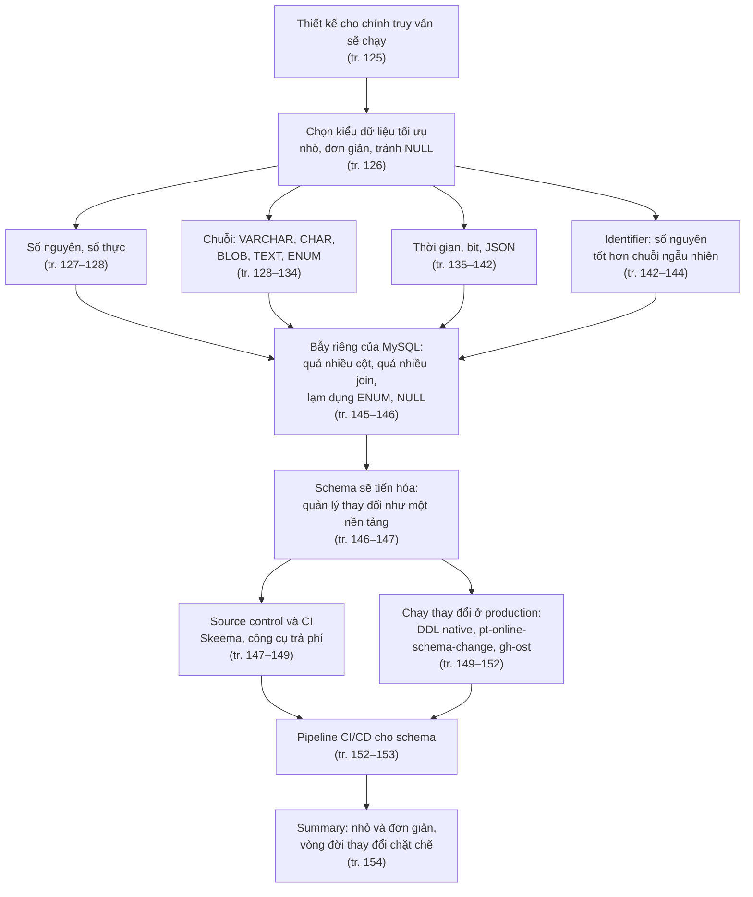
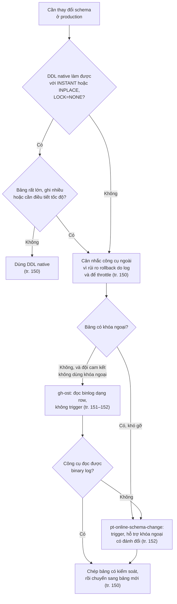
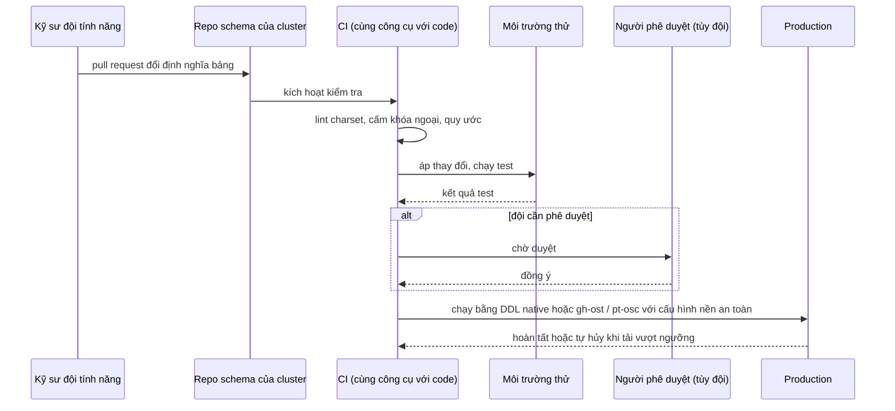
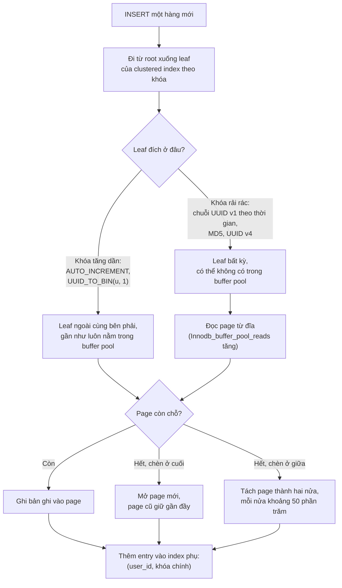
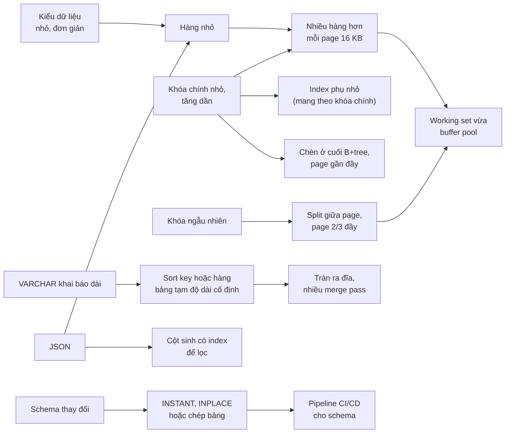

# Chương 6 — Thiết kế và quản lý schema

*Schema Design and Management*

> **Nguồn:** *High Performance MySQL: Proven Strategies for Operating at Scale*, Silvia Botros và Jeremy Tinley, O'Reilly, **Fourth Edition (11/2021)**, Chương 6, **tr. 125–154 (trang PDF 147–176)**.
> "tr. N" là số trang in; trang PDF = N + 22 (xem [README](README.md#page-convention)).
>
> **Quy ước nhãn:**
> - Nội dung không có nhãn là diễn giải từ sách, luôn kèm "(tr. N)".
> - **Bổ sung ngoài sách** là kiến thức thêm (tài liệu MySQL 8.0, cơ chế InnoDB) và phép tính tự làm.
> - **Ví dụ minh họa do AI xây dựng** là SQL, dữ liệu hay tình huống giả định.
> - **Dự đoán** là điều kỳ vọng nhưng chưa đo. **Kết quả đã đo** chỉ dùng cho số liệu từ [bài thực hành](experiments/chapter-06.md) đã chạy thật.
>
> **Phiên bản.** Sách viết cho MySQL 8.0 và InnoDB (thí nghiệm JSON của sách chạy trên 8.0.22, tr. 139). Một số mô tả kiểu dữ liệu trong chương **không còn đúng hẳn với 8.0** (dung lượng `DATETIME`, hành vi mặc định của `TIMESTAMP`, độ rộng hiển thị của số nguyên); các chỗ đó được đánh dấu và đã kiểm chứng trên **MySQL 8.0.42**.
>
> Liên kết: [lộ trình học, chương 6](learning-roadmap.md#ch06) · [bài thực hành](experiments/chapter-06.md) · [đáp án tự kiểm tra](answers/chapter-06.md)

## Mục lục ghi chú

- [1. Bức tranh lớn](#big-picture)
- [2. Giải thích sâu](#deep)
  - [2.1 Choosing Optimal Data Types (tr. 126–145)](#s2-1)
    - [2.1.1 Whole Numbers](#whole-numbers) · [2.1.2 Real Numbers](#real-numbers) · [2.1.3 String Types](#string-types) · [2.1.4 Date and Time Types](#date-time) · [2.1.5 Bit-Packed Data Types](#bit-packed) · [2.1.6 JSON Data](#json-data) · [2.1.7 Choosing Identifiers](#identifiers) · [2.1.8 Special Types of Data](#special-types)
  - [2.2 Schema Design Gotchas in MySQL (tr. 145–146)](#s2-2)
  - [2.3 Schema Management (tr. 146–153)](#s2-3)
  - [2.4 Summary (tr. 154)](#s2-4)
- [3. Phân tích tình huống](#situations)
- [4. Đo lường và thực hành](#measure)
- [5. Liên kết kiến thức và điều cần nhớ](#takeaways)
- [Ghi chú kiểm tra nguồn](#kiem-tra)

---

<a id="big-picture"></a>

## 1. Bức tranh lớn

### Câu hỏi của chương

Chương mở đầu bằng một khẳng định: thiết kế logic và vật lý tốt là **nền móng** của hiệu năng, và schema phải được thiết kế cho **chính những truy vấn sẽ chạy** (tr. 125). Điều đó luôn kéo theo đánh đổi. Schema denormalized làm nhanh một số truy vấn nhưng làm chậm truy vấn khác. Bảng đếm (*counter table*) và bảng tổng hợp (*summary table*) tăng tốc truy vấn đọc nhưng tốn công duy trì. Những đặc điểm cài đặt riêng của MySQL ảnh hưởng nhiều tới các lựa chọn này (tr. 125).

Có thể diễn đạt câu hỏi của chương thành hai phần:

1. **Khi đặt dữ liệu vào MySQL và InnoDB, chọn kiểu dữ liệu và cấu trúc bảng thế nào để server làm ít việc nhất?** Ít byte trên đĩa và trong bộ nhớ, ít chu kỳ CPU khi so sánh, ít bẫy riêng của MySQL.
2. **Schema chắc chắn sẽ thay đổi, vậy làm sao để thay đổi schema thường xuyên mà không biến đội database thành nút thắt và không làm gián đoạn dịch vụ?** Schema tiến hóa theo những gì đội ngũ học được về dữ liệu và theo yêu cầu kinh doanh, nên phải coi thay đổi schema là **sự kiện thường xuyên** (tr. 125).

### Vị trí trong mục tiêu chung của sách

- Đây là chương đầu của bộ ba **schema, index, truy vấn** (chương 6, 7, 8). Sách nói chương này chuẩn bị cho hai chương sau; cả ba cùng khám phá tương tác giữa **thiết kế logic, thiết kế vật lý và thực thi truy vấn**, và gợi ý đọc lại chương 6 sau khi đọc chương 7 và 8 (tr. 125).
- Chương **không** dạy thiết kế database nhập môn. Nó chỉ bàn phần **khác biệt khi thiết kế cho MySQL** so với các RDBMS khác. Người cần học nền tảng được gợi ý đọc *Beginning Database Design* của Clare Churcher (tr. 125) và *Database Design for Mere Mortals* của Michael J. Hernandez (chú thích 8, tr. 154).
- Phần cuối chương nối sang vận hành: quản lý thay đổi schema như một phần của **nền tảng dữ liệu** (*data store platform*), gắn với CI/CD và với yêu cầu compliance của [chương 13](chapter-13.md#schema-version-control) (tr. 147).

### Kiến thức cần biết trước

| Kiến thức | Vì sao cần | Ôn ở đâu |
| --- | --- | --- |
| Chuẩn hóa, khóa chính, khóa ngoại | Chương giả định bạn đã biết thiết kế database (tr. 125) | **Bổ sung ngoài sách:** [DDIA chương 2, normalization](../../DDIA/ddia-notes/chapter-02.md#normalization) |
| Kiến trúc phân tầng, storage engine API | Mục "Too Many Columns" dựa trên việc server và engine chép hàng qua lại (tr. 145) | [Chương 1](chapter-01.md#s2-1) |
| InnoDB lưu bảng thành B+tree theo khóa chính, page 16 KB | Để hiểu vì sao identifier ngẫu nhiên gây page split, vì sao khóa chính lớn làm phình index phụ (tr. 134, 143) | [Chương 7](chapter-07.md#clustered-index) (clustered index); **Bổ sung ngoài sách:** [DDIA chương 3, clustered index](../../DDIA/ddia-notes/chapter-03.md#clustered-index) |
| Buffer pool, working set | Giá trị ngẫu nhiên phá tính cục bộ của cache (tr. 143–144) | [Chương 4](chapter-04.md#working-set), [chương 5](chapter-05.md#buffer-pool) |
| Replication theo hàng (row-based) | gh-ost đọc binary log dạng row (tr. 151) | [Chương 9](chapter-09.md#binlog-format) |

### Liên hệ với chương khác

| Ý trong chương 6 | Chương | Căn cứ |
| --- | --- | --- |
| Đọc lại chương 6 sau khi học index và tối ưu truy vấn | [Chương 7](chapter-07.md), [chương 8](chapter-08.md) | tr. 125 |
| Server và storage engine chép hàng qua "row buffer"; bảng quá rộng tốn CPU giải mã | [Chương 1](chapter-01.md#storage-engine-api) (storage engine API) | tr. 145 |
| Khóa chính nhỏ làm mọi index khác nhỏ theo (InnoDB) | [Chương 7](chapter-07.md#clustered-index) (clustered index, tr. 170) | tr. 134 |
| Giá trị ngẫu nhiên gây page split, phân mảnh clustered index, cache kém | [Chương 7](chapter-07.md) (clustered index tr. 170, phân mảnh tr. 188) | tr. 143–144 |
| `max_sort_length`, sắp xếp, bảng tạm | [Chương 8](chapter-08.md) (sort, temporary table) | tr. 131, 154 |
| Bảng tổng hợp, bảng đếm | [Chương 8](chapter-08.md#examined-too-much) nhắc lại summary table (tr. 198) | tr. 125 |
| Source control cho schema là yêu cầu compliance | [Chương 13](chapter-13.md#tracking-changes) (tr. 333, 336) | tr. 147 |
| Vitess cũng quản lý thay đổi schema | [Chương 11](chapter-11.md#vitess) (Vitess) | tr. 149 |
| gh-ost đọc binary log dạng row như một replica | [Chương 9](chapter-09.md#binlog-format) (định dạng replication) | tr. 151 |
| Thay đổi schema online, thêm cột tức thì trong 8.0 | [Phụ lục A](appendix-a.md#instant-add-column) (tr. 348), [chương 12](chapter-12.md#aurora) (tr. 315) | tr. 149–150 |
| Chọn primary key và quản lý auto-increment | [Chương 2](chapter-02.md#auto-increment-space) nhắc tới (tr. 34) | tr. 143 |

### Mạch lập luận



---

<a id="deep"></a>

## 2. Giải thích sâu

<a id="s2-1"></a>

### 2.1 Choosing Optimal Data Types (tr. 126–145)

<a id="guidelines"></a>

**Ba nguyên tắc chung** (tr. 126). MySQL có rất nhiều kiểu dữ liệu, và chọn đúng kiểu là điều kiện để có hiệu năng tốt. Dù lưu loại dữ liệu nào, sách đưa ra ba nguyên tắc.

<a id="smaller-is-better"></a>

**1. Nhỏ hơn thường tốt hơn** (*smaller is usually better*).

- **What.** Dùng kiểu nhỏ nhất vẫn lưu và biểu diễn **đúng** dữ liệu (tr. 126).
- **Why.** Kiểu nhỏ chiếm ít chỗ hơn trên đĩa, trong bộ nhớ và trong **CPU cache**, và thường cần ít chu kỳ CPU hơn để xử lý (tr. 126).
- **Trade-offs.** Đừng đánh giá thấp miền giá trị cần lưu. Nới rộng kiểu ở nhiều chỗ trong schema là việc đau đớn và tốn thời gian. Nếu phân vân, chọn kiểu nhỏ nhất mà bạn **nghĩ sẽ không vượt quá**. Nếu hệ thống chưa bận, dữ liệu chưa nhiều, hoặc mới ở đầu giai đoạn thiết kế, đổi sau vẫn dễ (tr. 126).
- **Bổ sung ngoài sách (cơ chế).** Trong InnoDB, mỗi byte của hàng được nhân lên nhiều lần: hàng nằm trong leaf page của clustered index, và **khóa chính được chép vào mọi index phụ** (xem [chương 7](chapter-07.md#secondary-index)). Ít byte hơn nghĩa là nhiều hàng hơn trên mỗi page 16 KB, cây B+tree thấp hoặc hẹp hơn, ít page phải đọc vào buffer pool hơn, và working set vừa bộ nhớ dễ hơn.

<a id="simple-is-good"></a>

**2. Đơn giản là tốt** (*simple is good*). Kiểu đơn giản cần ít chu kỳ CPU hơn. Ví dụ so sánh số nguyên rẻ hơn so sánh ký tự, vì ***character set*** (bộ ký tự) và ***collation*** (quy tắc so sánh và sắp xếp) làm phép so sánh ký tự phức tạp. Hai hệ quả cụ thể: lưu ngày giờ bằng kiểu thời gian có sẵn của MySQL thay vì chuỗi, và lưu địa chỉ IP bằng số nguyên (tr. 126).

<a id="avoid-null"></a>

**3. Tránh NULL nếu có thể** (*avoid NULL if possible*).

- **What.** Nhiều bảng có cột nullable chỉ vì đó là **mặc định**, dù ứng dụng không cần lưu NULL. Thường nên khai báo `NOT NULL`, trừ khi bạn thực sự định lưu NULL (tr. 126).
- **Why.** Cột nullable làm index, index statistics và phép so sánh giá trị phức tạp hơn, nên MySQL khó tối ưu truy vấn hơn. Cột nullable cũng tốn thêm chỗ và cần xử lý đặc biệt bên trong MySQL (tr. 126).
- **Decision.** Lợi ích khi đổi cột NULL thành `NOT NULL` thường **nhỏ**. Đừng ưu tiên đi tìm và sửa chúng trong một schema đang chạy, trừ khi bạn biết chúng đang gây vấn đề (tr. 126). Mục [2.2.5](#null-not-invented) sẽ cân bằng lại lời khuyên này: đừng tránh NULL tới mức cực đoan.
- **Bổ sung ngoài sách (InnoDB).** Với row format `COMPACT` và `DYNAMIC` (mặc định của 8.0 là `DYNAMIC`), mỗi hàng có một **bitmap NULL** dài ⌈số cột nullable / 8⌉ byte; một giá trị NULL không chiếm chỗ trong phần dữ liệu, chỉ chiếm một bit (tài liệu MySQL 8.0, "InnoDB Row Formats"). Vậy "tốn thêm chỗ" chủ yếu là bitmap và xử lý thêm, không phải mỗi NULL tốn nhiều byte.

**Hai bước chọn kiểu** (tr. 126–127). Bước một: chọn **lớp kiểu** (số, chuỗi, thời gian…); việc này thường hiển nhiên, trừ vài trường hợp đặc biệt mà chương sẽ nêu. Bước hai: chọn **kiểu cụ thể**. Nhiều kiểu lưu được cùng loại dữ liệu nhưng khác nhau ở miền giá trị, độ chính xác, dung lượng vật lý (trên đĩa và trong bộ nhớ), hoặc có hành vi đặc biệt. Ví dụ `DATETIME` và `TIMESTAMP` đều lưu ngày giờ tới giây; `TIMESTAMP` tốn nửa dung lượng, biết múi giờ (*time zone aware*) và có khả năng tự cập nhật, nhưng miền giá trị hẹp hơn nhiều, và những khả năng đặc biệt đó đôi khi lại là trở ngại (tr. 127).

**Alias kiểu dữ liệu** (tr. 127). MySQL có nhiều alias để tương thích, như `INTEGER` (thành `INT`), `BOOL` (thành `TINYINT`), `NUMERIC` (thành `DECIMAL`). Chúng chỉ là tên khác, không ảnh hưởng hiệu năng; `SHOW CREATE TABLE` luôn hiện **kiểu gốc**.

> **Kết quả đã đo** (MySQL 8.0.42, [E1](experiments/chapter-06.md#e1)). Bảng khai báo `INTEGER, BOOL, NUMERIC(10,2), REAL, DEC(5,1)` được `SHOW CREATE TABLE` hiện thành `int, tinyint(1), decimal(10,2), double, decimal(5,1)`.

<a id="whole-numbers"></a>

#### 2.1.1 Whole Numbers (tr. 127)

**What.** Số nguyên dùng một trong năm kiểu `TINYINT`, `SMALLINT`, `MEDIUMINT`, `INT`, `BIGINT`, tốn lần lượt 8, 16, 24, 32 và 64 bit. Miền giá trị là từ −2^(N−1) tới 2^(N−1) − 1, với N là số bit (tr. 127).

| Kiểu | Byte | Có dấu | `UNSIGNED` |
| --- | --- | --- | --- |
| `TINYINT` | 1 | −128 … 127 | 0 … 255 |
| `SMALLINT` | 2 | −32.768 … 32.767 | 0 … 65.535 |
| `MEDIUMINT` | 3 | khoảng ±8,4 triệu | 0 … khoảng 16,8 triệu |
| `INT` | 4 | khoảng ±2,1 tỷ | 0 … khoảng 4,29 tỷ |
| `BIGINT` | 8 | khoảng ±9,2 × 10^18 | 0 … khoảng 1,8 × 10^19 |

*(Byte và ví dụ `TINYINT` theo tr. 127; các con số còn lại là **Bổ sung ngoài sách**, tính từ công thức 2^(N−1).)*

**`UNSIGNED`** cấm giá trị âm và gần như nhân đôi giới hạn trên. Có dấu và không dấu tốn cùng dung lượng và **có cùng hiệu năng**, nên chọn theo miền dữ liệu (tr. 127).

**Lưu trữ khác tính toán.** Lựa chọn kiểu quyết định cách MySQL **lưu** dữ liệu trong bộ nhớ và trên đĩa. Còn khi tính toán, MySQL thường dùng số nguyên 64 bit (`BIGINT`); ngoại lệ là vài hàm tổng hợp tính bằng `DECIMAL` hoặc `DOUBLE` (tr. 127).

<a id="display-width"></a>

**Hiểu lầm phổ biến: `INT(11)` nghĩa là "11 chữ số".** Sai. "Độ rộng" của số nguyên không giới hạn miền giá trị; nó chỉ là số ký tự các công cụ tương tác như mysql client dành để hiển thị. Về lưu trữ và tính toán, `INT(1)` giống hệt `INT(20)` (tr. 127).

> **Bổ sung ngoài sách (phiên bản).** Từ MySQL 8.0.17, độ rộng hiển thị của số nguyên (và `ZEROFILL`) bị **deprecated**. **Kết quả đã đo** (8.0.42, [E1](experiments/chapter-06.md#e1)): `CREATE TABLE` với `INT(11)` sinh cảnh báo 1681 "Integer display width is deprecated", và `SHOW CREATE TABLE` hiện `int` không kèm độ rộng; chỉ cột có `ZEROFILL` còn giữ `int(1) unsigned zerofill`.

**Evidence & example (Ví dụ minh họa do AI xây dựng, có số liệu đo).** Hai bảng 1 triệu hàng, mỗi bảng có khóa chính và một cột giá trị cùng kiểu, cùng một index phụ trên cột giá trị:

| Bảng | Leaf page của PRIMARY | Leaf page của index phụ |
| --- | --- | --- |
| `INT UNSIGNED` | 1.743 | 832 |
| `BIGINT UNSIGNED` | 2.269 (+30%) | 1.325 (+59%) |

*(**Kết quả đã đo**, MySQL 8.0.42, Windows 11, instance riêng cấu hình mặc định, 1.000.000 hàng, [E2](experiments/chapter-06.md#e2).)* Index phụ tăng mạnh hơn vì mỗi entry chứa **cả cột được index lẫn khóa chính**, nên đổi cả hai từ 4 lên 8 byte làm entry tăng từ khoảng 13 lên 21 byte (**Bổ sung ngoài sách:** 5 byte header bản ghi + giá trị + khóa chính).

**Decision.** Chọn kiểu nguyên đủ cho tăng trưởng dự kiến (xem [2.1.7](#identifiers) về hết số nguyên tự tăng), nhưng đừng dùng `BIGINT` cho mọi thứ "cho chắc": cái giá nhân lên ở mọi index chứa cột đó.

<a id="real-numbers"></a>

#### 2.1.2 Real Numbers (tr. 127–128)

**What.** Số thực là số có phần thập phân. `DECIMAL` còn dùng được để lưu số nguyên quá lớn so với `BIGINT`. MySQL hỗ trợ cả kiểu **chính xác** và **xấp xỉ** (tr. 127).

- **`FLOAT` và `DOUBLE`** tính toán xấp xỉ theo dấu phẩy động chuẩn; muốn biết chính xác kết quả được tính thế nào thì phải tìm hiểu cài đặt dấu phẩy động của nền tảng (tr. 128). `FLOAT` tốn 4 byte; `DOUBLE` tốn 8 byte, chính xác hơn và miền rộng hơn. Như với số nguyên, đây chỉ là kiểu **lưu trữ**; MySQL tính toán nội bộ bằng `DOUBLE` (tr. 128).
- **Chỉ định độ chính xác** cho cột dấu phẩy động có vài cách viết **không chuẩn**; chúng có thể khiến MySQL **âm thầm chọn kiểu khác** hoặc **làm tròn** khi lưu. Sách khuyên chỉ ghi kiểu, không ghi độ chính xác (tr. 128).
- **Dấu phẩy động thường tốn ít chỗ hơn `DECIMAL`** cho cùng miền giá trị (tr. 128).

> **Kết quả đã đo** (8.0.42, [E1](experiments/chapter-06.md#e1)). `FLOAT(7,4)` lưu 123.45678 thành 123.4568 (làm tròn); `DOUBLE(10,2)` lưu 1.005 thành 1.00; `FLOAT(30)` âm thầm trở thành `double` trong `SHOW CREATE TABLE`. Mỗi cú pháp `(M,D)` sinh cảnh báo 1681 "Specifying number of digits for floating point data types is deprecated" (**Bổ sung ngoài sách:** deprecated từ 8.0.17).

**Khi nào dùng `DECIMAL`.** Vì tốn thêm chỗ và chi phí tính toán, chỉ dùng `DECIMAL` khi cần kết quả **chính xác** cho số có phần thập phân, ví dụ dữ liệu tài chính (tr. 128).

<a id="money-bigint"></a>

**Mẹo dùng `BIGINT` cho tiền** (tr. 128). Với khối lượng rất lớn, có thể lưu tiền dưới dạng **bội số của đơn vị nhỏ nhất** cần xử lý. Ví dụ phải lưu tới một phần vạn của cent (10⁻⁶ đô-la): nhân mọi số tiền với một triệu và lưu vào `BIGINT`. Cách này tránh cả sai số của dấu phẩy động lẫn chi phí tính `DECIMAL` chính xác.

> **Bổ sung ngoài sách.** `DECIMAL` lưu dạng nhị phân, đóng gói mỗi 9 chữ số thập phân vào 4 byte (tài liệu MySQL 8.0, "Precision Math"). Đánh đổi của mẹo `BIGINT` là **ý nghĩa đơn vị nằm trong ứng dụng**: mọi truy vấn, báo cáo và mọi đội dùng dữ liệu đều phải biết chia cho 10⁶; viết sai một chỗ là sai tiền.

<a id="string-types"></a>

#### 2.1.3 String Types (tr. 128–134)

Mỗi cột chuỗi có thể có character set và collation riêng (tr. 128).

<a id="varchar-char"></a>

**VARCHAR và CHAR** (tr. 128–130). Đây là hai kiểu chuỗi chính. Cách lưu cụ thể **phụ thuộc storage engine**; sách giả định InnoDB. Engine có thể lưu giá trị trong bộ nhớ khác với trên đĩa, và server có thể chuyển sang một định dạng khác nữa khi nhận giá trị từ engine (tr. 128).

| | `VARCHAR` | `CHAR` |
| --- | --- | --- |
| Độ dài | Thay đổi; chỉ dùng chỗ cần thiết (tr. 129) | Cố định; luôn cấp đủ chỗ cho số ký tự khai báo (tr. 129) |
| Chi phí thêm | 1 byte độ dài nếu độ dài tối đa ≤ 255 byte, 2 byte nếu lớn hơn. Với latin1, `VARCHAR(10)` tốn tối đa 11 byte, `VARCHAR(1000)` tối đa 1.002 byte (tr. 129) | Không có byte độ dài (với bộ ký tự một byte) |
| Khoảng trắng cuối | Giữ nguyên | Bị bỏ khi lưu; khi so sánh thì đệm bằng khoảng trắng (tr. 129) |
| Khi cập nhật | Hàng có thể **dài ra**. Nếu không còn vừa chỗ cũ, hành vi tùy engine; InnoDB có thể phải **tách page** (tr. 129) | Hàng độ dài cố định, không dễ bị phân mảnh (tr. 129) |
| Nên dùng khi | Độ dài tối đa lớn hơn nhiều so với độ dài trung bình; ít cập nhật nên phân mảnh không thành vấn đề; bộ ký tự phức tạp như UTF-8, mỗi ký tự tốn số byte khác nhau (tr. 129) | Chuỗi rất ngắn, hoặc các giá trị gần cùng độ dài (ví dụ giá trị MD5); dữ liệu thay đổi thường xuyên (tr. 129) |

- `CHAR(1)` chứa Y hoặc N chỉ tốn 1 byte với bộ ký tự một byte, còn `VARCHAR(1)` tốn 2 byte vì byte độ dài (tr. 129). Chú thích 1 (tr. 129): độ dài khai báo tính bằng **ký tự**, không phải byte; bộ ký tự nhiều byte có thể cần hơn 1 byte cho mỗi ký tự.
- InnoDB có thể lưu `VARCHAR` dài như BLOB; sách nói sẽ bàn sau (tr. 129).

**Ví dụ của sách** (tr. 130). Bảng một cột `CHAR(10)` nhận ba giá trị `'string1'`, `' string2'` (khoảng trắng đầu) và `'string3 '` (khoảng trắng cuối). Khi đọc lại, khoảng trắng cuối của `string3` đã mất. Với cột `VARCHAR(10)`, khoảng trắng cuối vẫn còn. Khoảng trắng đầu được giữ ở cả hai.

> **Kết quả đã đo** (8.0.42, [E1](experiments/chapter-06.md#e1)): kết quả giống sách; `LENGTH()` của `string3` là 7 với `CHAR(10)` và 8 với `VARCHAR(10)`.

<a id="char-multibyte"></a>

> **Bổ sung ngoài sách (InnoDB, quan trọng với 8.0).** Bộ ký tự mặc định của 8.0 là `utf8mb4` (tối đa 4 byte mỗi ký tự). Với row format `COMPACT`/`DYNAMIC`, InnoDB lưu `CHAR(N)` thuộc bộ ký tự nhiều byte như một cột **độ dài thay đổi**, dành tối thiểu N byte (tài liệu MySQL 8.0, "InnoDB Row Formats"). Hệ quả:
> - Ưu điểm "CHAR không có byte độ dài" của sách chỉ đúng hoàn toàn với bộ ký tự một byte như latin1 hay ascii.
> - Số byte tối đa của `VARCHAR(N)` là N × (số byte tối đa mỗi ký tự). `VARCHAR(64)` utf8mb4 có thể dài 256 byte nên đã cần **2 byte độ dài**, dù chỉ khai báo 64 ký tự.
>
> **Kết quả đã đo** ([E2](experiments/chapter-06.md#e2), 1 triệu hàng chứa chuỗi MD5 32 ký tự): `CHAR(32)` utf8mb4 và `VARCHAR(32)` utf8mb4 có **đúng cùng** số page (3.651 leaf page ở PRIMARY, 2.618 ở index phụ); `CHAR(32) CHARACTER SET ascii` nhỏ hơn một chút (3.585 và 2.558), đúng bằng khoảng 1 byte mỗi hàng; còn `BINARY(16)` chứa cùng giá trị ở dạng nhị phân chỉ cần 2.533 và 1.570 page.

**BINARY và VARBINARY** (tr. 130). Đây là "anh em" của `CHAR` và `VARCHAR`, lưu **byte** thay vì ký tự. MySQL đệm `BINARY` bằng byte `\0` thay vì khoảng trắng và **không bỏ** phần đệm khi đọc ra. Chúng hữu ích khi cần so sánh theo byte. Lợi ích không chỉ là phân biệt hoa thường: MySQL so sánh từng byte theo giá trị số, đơn giản hơn so sánh ký tự nhiều, nên **nhanh hơn** (tr. 130). Chú thích 2 (tr. 130): cẩn thận với `BINARY` nếu giá trị phải giữ nguyên sau khi đọc, vì MySQL đệm nó tới đủ độ dài bằng `\0`.

> **Kết quả đã đo** ([E1](experiments/chapter-06.md#e1)): `BINARY(5)` nhận `'ab'` lưu thành `6162000000`; so sánh `= 'ab'` trả 0, còn `= 'ab\0\0\0'` trả 1. Đây chính là cái bẫy của chú thích 2.

<a id="generosity"></a>

**Hộp "Generosity Can Be Unwise"** (tr. 131).

- **What.** Lưu `'hello'` tốn cùng dung lượng trong `VARCHAR(5)` và `VARCHAR(200)`. Vậy cột ngắn hơn có lợi gì?
- **Why.** Cột dài hơn có thể dùng **nhiều bộ nhớ hơn hẳn**, vì MySQL thường cấp phát các khối bộ nhớ **kích thước cố định** để giữ giá trị bên trong. Điều này đặc biệt tệ với **sắp xếp** và các thao tác dùng **bảng tạm trong bộ nhớ**; filesort dùng bảng tạm trên đĩa cũng bị tương tự (tr. 131).
- **Decision.** Chỉ cấp phát đúng lượng chỗ thực sự cần (tr. 131). Summary nhắc lại ý này: chuỗi độ dài thay đổi có thể bị cấp phát bộ nhớ "bi quan" theo **độ dài tối đa** cho bảng tạm và sắp xếp (tr. 154).

<a id="generosity-measured"></a>

> **Kết quả đã đo: MySQL 8.0 đã giảm nhưng chưa xóa hẳn vấn đề này** ([E5](experiments/chapter-06.md#e5); bảng 200.000 hàng, giá trị thật dài đúng 10 ký tự, cột khai báo `VARCHAR(10)` hoặc `VARCHAR(1000)`; trên đĩa hai bảng có cùng `Data_length` 7.880.704 byte, đúng như sách nói):
>
> | Thao tác | `VARCHAR(10)` | `VARCHAR(1000)` |
> | --- | --- | --- |
> | `GROUP BY` 20.000 nhóm, bảng tạm **TempTable** (mặc định của 8.0) | trong bộ nhớ, 29,1 ms | trong bộ nhớ, 30,1 ms |
> | `GROUP BY` 20.000 nhóm, bảng tạm **MEMORY** | trong bộ nhớ (đỉnh khoảng 1,9 MB), 23,4 ms | **tràn ra đĩa** (`Created_tmp_disk_tables` = 1, chạm trần 16 MB), 131,4 ms |
> | `ORDER BY` 200.000 hàng, collation `utf8mb4_0900_ai_ci` (NO PAD) | 43 chunk ra đĩa, 7 merge pass, 229 ms | 43 chunk, 7 merge pass, 229 ms |
> | `ORDER BY` 200.000 hàng, collation `utf8mb4_general_ci` (PAD SPACE) | 40 chunk, 7 merge pass, 202 ms | **807 chunk, 134 merge pass, 1.081 ms** |
>
> *(Thời gian là trung vị 5 lần trên laptop Windows; `sort_buffer_size` 256 KB và `tmp_table_size` 16 MB mặc định.)*
>
> **Bổ sung ngoài sách (giải thích).** Engine bảng tạm **TempTable**, mặc định từ 8.0, lưu `VARCHAR` theo độ dài thật; engine **MEMORY**, dùng cho bảng tạm trong bộ nhớ trước 8.0, có hàng độ dài cố định nên cấp chỗ theo độ dài tối đa. Với sort, collation NO PAD cho phép **sort key độ dài thay đổi** (optimizer trace ghi `<varlen_sort_key, packed_additional_fields>`), còn collation PAD SPACE dùng **sort key cố định** theo độ dài khai báo (`<fixed_sort_key, …>`): với `VARCHAR(1000)` utf8mb4, trace ước tính mỗi buffer chỉ chứa 52 hàng thay vì 3.799. (Với NO PAD, ước tính trong trace cũng giảm, từ 1.208 xuống 13 hàng, nhưng số chunk thực tế không đổi vì key được đóng gói theo độ dài thật.) Vậy lời khuyên của sách vẫn đúng với schema dùng collation PAD SPACE (như `utf8mb4_general_ci`, `latin1_swedish_ci`, thường gặp ở database nâng cấp từ 5.7) và với cấu hình đặt `internal_tmp_mem_storage_engine=MEMORY`.

<a id="blob-text"></a>

**BLOB và TEXT** (tr. 131).

- **What.** Hai họ kiểu chuỗi để lưu lượng dữ liệu lớn, dạng nhị phân (`BLOB`) hoặc ký tự (`TEXT`). Họ ký tự gồm `TINYTEXT`, `TEXT`, `MEDIUMTEXT`, `LONGTEXT`; họ nhị phân gồm `TINYBLOB`, `BLOB`, `MEDIUMBLOB`, `LONGBLOB`. Khác biệt duy nhất giữa hai họ: `BLOB` không có character set và collation, `TEXT` thì có (tr. 131).
- **Cách lưu.** Khác mọi kiểu khác, MySQL xử lý mỗi giá trị `BLOB`/`TEXT` như một **đối tượng có danh tính riêng**. Engine thường lưu chúng đặc biệt; InnoDB có thể dùng vùng lưu "bên ngoài" (*external*) khi giá trị lớn. Mỗi giá trị tốn 1 tới 4 byte trong hàng, cộng đủ chỗ ở vùng ngoài để chứa giá trị thật (tr. 131).
- **Sắp xếp.** MySQL chỉ sắp xếp theo `max_sort_length` byte đầu của các cột này, không theo toàn bộ chuỗi. Nếu chỉ cần sắp theo vài ký tự đầu, có thể giảm `max_sort_length` (tr. 131).
- **Index.** MySQL không index được toàn bộ độ dài của các kiểu này, và không dùng index để sắp xếp chúng (tr. 131).

> **Lỗi của sách đã kiểm chứng.** Tr. 131 viết `BLOB` là từ đồng nghĩa của `SMALLBLOB` và `TEXT` của `SMALLTEXT`, và liệt kê `SMALLTEXT`, `SMALLBLOB` trong hai họ. **Kết quả đã đo** (8.0.42, [E1](experiments/chapter-06.md#e1)): `CREATE TABLE ... (a SMALLBLOB)` và `(a SMALLTEXT)` đều báo lỗi cú pháp 1064; MySQL không có hai kiểu này. **Bổ sung ngoài sách:** `BLOB` và `TEXT` là kiểu riêng với độ dài tối đa 65.535 byte (2 byte độ dài), nằm giữa `TINY…` (255 byte) và `MEDIUM…` (16 MB).

> **Kết quả đã đo về `max_sort_length`** ([E1](experiments/chapter-06.md#e1)). Ba giá trị `'aaaaZ'`, `'aaaaY'`, `'aaaaA'` chỉ khác nhau ở byte thứ năm; đặt `max_sort_length = 4` (mức tối thiểu). Với collation PAD SPACE (`utf8mb4_general_ci`), `ORDER BY` trên cột `TEXT` **và cả cột `VARCHAR`** không còn sắp đúng (trả theo thứ tự chèn 1, 2, 3); với collation NO PAD mặc định `utf8mb4_0900_ai_ci`, kết quả vẫn đúng (3, 2, 1). `GROUP BY` vẫn tách đủ 3 nhóm. **Bổ sung ngoài sách:** trong 8.0.42, giới hạn này đi theo **sort key cố định của collation PAD SPACE** (không chỉ BLOB/TEXT) và bị bỏ qua với collation NO PAD. Giảm `max_sort_length` để "sắp nhanh hơn" chỉ có tác dụng trong trường hợp đó, và cái giá là thứ tự có thể sai.

> **Bổ sung ngoài sách (InnoDB `DYNAMIC`).** Khi hàng quá lớn so với page, InnoDB đẩy các cột độ dài thay đổi dài (`VARCHAR`, `VARBINARY`, `BLOB`, `TEXT`) ra **overflow page**, trong hàng chỉ giữ con trỏ 20 byte (tài liệu MySQL 8.0, "InnoDB Row Formats"). Đây là ý "InnoDB có thể lưu `VARCHAR` dài như BLOB" ở tr. 129. Đọc cột đó đồng nghĩa với đọc thêm page.

**Hộp "Images in a Database?"** (tr. 132). Trước đây nhiều ứng dụng nhận ảnh tải lên và lưu thành `BLOB` trong MySQL. Cách này tiện vì gom dữ liệu ứng dụng một chỗ, nhưng khi dữ liệu lớn dần, các thao tác như **thay đổi schema** chậm dần vì kích thước BLOB. Nếu tránh được, đừng lưu ảnh trong database; hãy ghi chúng vào một **object store** riêng và chỉ lưu vị trí hoặc tên tệp trong bảng (tr. 132).

> **Bổ sung ngoài sách (lý do theo cơ chế).** Mọi công cụ thay đổi schema cần chép bảng (xem [2.3](#external-tools)) đều phải chép cả BLOB; backup, replication và khôi phục cũng phải di chuyển chúng, trong khi truy vấn hiếm khi cần đọc nội dung ảnh.

<a id="enum"></a>

**Dùng ENUM thay cho chuỗi** (tr. 132–134).

- **What.** Cột ***ENUM*** lưu một giá trị trong một tập chuỗi định sẵn. MySQL lưu rất gọn, **1 hoặc 2 byte** tùy số phần tử, và bên trong mỗi giá trị là **số nguyên chỉ vị trí** của nó trong danh sách định nghĩa (tr. 132).
- **Tính hai mặt.** Ví dụ của sách: `ENUM('fish','apple','dog')` nhận `fish`, `dog`, `apple`; biểu thức `e + 0` trả 1, 3, 2. Tính hai mặt này gây rối nếu hằng ENUM là số, như `ENUM('1','2','3')`; sách khuyên đừng làm vậy (tr. 132).
- **Sắp xếp theo số, không theo chữ.** `ORDER BY e` trả `fish, apple, dog`. Cách khắc phục: khai báo phần tử theo thứ tự muốn sắp, hoặc dùng `FIELD()` để chỉ định thứ tự trong truy vấn, nhưng `FIELD()` **ngăn MySQL dùng index để sắp xếp** (tr. 132–133).

> **Kết quả đã đo** ([E1](experiments/chapter-06.md#e1)): `e + 0` và thứ tự `ORDER BY e` giống hệt sách; `ORDER BY FIELD(e,'apple','dog','fish')` và `ORDER BY CAST(e AS CHAR)` đều cho thứ tự chữ cái.

**Chi phí ẩn của ENUM: join với cột chuỗi** (tr. 133–134). Vì phải tra để đổi số thành chuỗi, ENUM có chi phí; chi phí này thường được bù bởi kích thước nhỏ, nhưng không phải lúc nào cũng vậy. Đặc biệt, join một cột `CHAR`/`VARCHAR` với cột ENUM có thể **chậm hơn** join với cột `CHAR`/`VARCHAR` khác (tr. 133).

Benchmark của sách (tr. 133–134): bảng `webservicecalls` của một ứng dụng thật, khoảng 110.000 hàng, khoảng 10 MB, nằm gọn trong bộ nhớ; khóa chính rộng gồm `(day, account, service, method)`. Cột `service` có 5 giá trị khác nhau dài trung bình 4 ký tự; cột `method` có 71 giá trị dài trung bình 20 ký tự. Một bản sao đổi hai cột này sang ENUM. Truy vấn đếm số hàng khi join theo bốn cột khóa chính, thay đổi tổ hợp hai phía.

| Bảng 6-1 (tr. 134): phép join | Truy vấn mỗi giây |
| --- | --- |
| VARCHAR join VARCHAR | 2,6 |
| VARCHAR join ENUM | 1,7 |
| ENUM join VARCHAR | 1,8 |
| ENUM join ENUM | 3,5 |

*(Số liệu của sách, đã đối chiếu trên ảnh trang PDF 156. Chú thích 3: thời gian chỉ để so sánh tương đối, vì tốc độ phần cứng thay đổi theo thời gian.)*

Đọc bảng (tr. 134):

- Sau khi đổi sang ENUM, join ENUM với ENUM **nhanh hơn** (3,5 so với 2,6), nhưng join ENUM với VARCHAR **chậm hơn** (1,7–1,8). Nên đổi, **miễn là** không phải join chúng với cột VARCHAR. Dùng **lookup table** với khóa chính số nguyên để tránh join trên giá trị ký tự là cách thiết kế phổ biến.
- Lợi ích thứ hai: theo cột `Data_length` của `SHOW TABLE STATUS`, đổi hai cột sang ENUM làm bảng **nhỏ đi khoảng một phần ba**, và **khóa chính chỉ còn khoảng một nửa**. Với InnoDB, khóa chính nhỏ hơn làm mọi index khác nhỏ hơn nhiều. Đôi khi lợi ích kích thước này đáng giá ngay cả khi phải join với VARCHAR.

> **Bổ sung ngoài sách (vì sao join lệch kiểu chậm).** Khi so sánh ENUM với chuỗi, MySQL phải chuyển giá trị ENUM thành chuỗi rồi so sánh theo collation, cho mỗi cặp hàng; join ENUM với ENUM so sánh số nguyên nhỏ. Mục [2.1.7](#identifiers) tổng quát hóa thành nguyên tắc: cột dùng để join phải **cùng kiểu chính xác**.

> **Cảnh báo của sách** (tr. 134). ENUM lưu giá trị rất hiệu quả, nhưng **mọi thay đổi** tập giá trị hợp lệ đều cần **thay đổi schema**. Nếu chưa có hệ thống tự động hóa thay đổi schema như phần cuối chương mô tả, việc này rất bất tiện khi ENUM đổi thường xuyên. Sách còn nhắc tới phản mẫu "quá nhiều ENUM" ở [2.2.3](#all-powerful-enum).

> **Bổ sung ngoài sách (8.0).** Không phải mọi thay đổi ENUM đều tốn như nhau. **Kết quả đã đo** ([E6](experiments/chapter-06.md#e6)): thêm phần tử **vào cuối** danh sách chạy được với `ALGORITHM=INSTANT`; chèn phần tử **vào đầu** danh sách bị từ chối với `INPLACE` và phải chép bảng (`COPY`), vì vị trí số của các phần tử cũ thay đổi (theo tài liệu MySQL 8.0, mọi vị trí không phải cuối đều vậy).

<a id="date-time"></a>

#### 2.1.4 Date and Time Types (tr. 135–136)

MySQL có nhiều kiểu thời gian như `YEAR` và `DATE`; độ mịn nhỏ nhất là **micro giây**. Phần lớn kiểu thời gian không có lựa chọn thay thế, nên câu hỏi chỉ thật sự xuất hiện khi cần lưu **cả ngày lẫn giờ**: `DATETIME` hay `TIMESTAMP` (tr. 135).

<a id="datetime-timestamp"></a>

| | `DATETIME` (theo sách) | `TIMESTAMP` (theo sách) |
| --- | --- | --- |
| Miền giá trị | Năm 1000 tới 9999, độ chính xác tới micro giây (tr. 135) | Từ 1970 tới 19/01/2038 (tr. 135) |
| Cách lưu | Đóng gói thành số nguyên dạng YYYYMMDDHHMMSS, **không phụ thuộc múi giờ**, 8 byte (tr. 135) | Số giây từ nửa đêm 01/01/1970 GMT, giống Unix timestamp, 4 byte (tr. 135) |
| Hiển thị | Dạng chuẩn ANSI, sắp xếp được, không mơ hồ, ví dụ `2008-01-16 22:37:08` (tr. 135) | Phụ thuộc múi giờ của server, hệ điều hành và kết nối client. Giá trị 0 hiện thành `1969-12-31 19:00:00` ở múi giờ EST (lệch 5 giờ so với GMT) (tr. 135) |
| Giữ cái gì | Giữ **biểu diễn văn bản** của ngày giờ (tr. 135) | Giữ giá trị **tương đối với múi giờ** đang dùng (tr. 135) |
| Hành vi đặc biệt | Không có | Mặc định cột `TIMESTAMP` đầu tiên được đặt thời điểm hiện tại khi insert không chỉ định giá trị, và được cập nhật khi update hàng trừ khi gán tường minh; cấu hình được cho từng cột; cột `TIMESTAMP` mặc định `NOT NULL`, khác mọi kiểu khác (tr. 135–136) |

Hàm `FROM_UNIXTIME()` và `UNIX_TIMESTAMP()` chuyển giữa Unix timestamp và ngày giờ (tr. 135). Sách nhấn mạnh: nếu lưu hoặc truy cập dữ liệu từ **nhiều múi giờ**, hành vi của hai kiểu khác nhau rất nhiều (tr. 135). Chú thích 4 (tr. 136): quy tắc của `TIMESTAMP` phức tạp và **đã thay đổi qua các phiên bản**; nên kiểm tra `SHOW CREATE TABLE` sau khi thay đổi cột `TIMESTAMP`.

<a id="datetime-8-0"></a>

> **Bổ sung ngoài sách và Kết quả đã đo: hai mô tả của sách đã cũ với MySQL 8.0.**
>
> 1. **Dung lượng `DATETIME`.** Từ MySQL 5.6.4, `DATETIME` dùng **5 byte** cộng 0–3 byte cho phần lẻ của giây; `TIMESTAMP` dùng 4 byte cộng 0–3 byte (tài liệu MySQL 8.0, "Data Type Storage Requirements"). Con số 8 byte và định dạng YYYYMMDDHHMMSS là định dạng cũ. Đo trên 1 triệu hàng ([E2](experiments/chapter-06.md#e2)): index phụ trên `TIMESTAMP` có 832 leaf page, trên `DATETIME` 893 page (chênh khoảng **1 byte** mỗi entry), trên `DATETIME(6)` 1.078 page (thêm khoảng 3 byte nữa); `INT UNSIGNED` lưu epoch có đúng 832 page như `TIMESTAMP`.
> 2. **Tự khởi tạo và tự cập nhật `TIMESTAMP`.** Từ 8.0.2, `explicit_defaults_for_timestamp` mặc định **ON**: cột `TIMESTAMP` không còn tự nhận thời điểm hiện tại, không còn tự cập nhật, và mặc định **cho phép NULL**. Đo trên 8.0.42 ([E1](experiments/chapter-06.md#e1)): hai cột `TIMESTAMP` khai báo trần được `SHOW CREATE TABLE` ghi thành `timestamp NULL DEFAULT NULL`, và insert không chỉ định giá trị cho ra NULL. Muốn hành vi tự động thì khai báo tường minh `DEFAULT CURRENT_TIMESTAMP ON UPDATE CURRENT_TIMESTAMP`. Chú thích 4 của sách đã cảnh báo đúng tinh thần này.
>
> Cũng trong E1: một giá trị `TIMESTAMP` ghi lúc 12:00 UTC hiện thành 07:00 khi session đặt `time_zone='-05:00'` và 19:00 khi đặt `'+07:00'`, còn `DATETIME` giữ nguyên 12:00. Với `time_zone='+00:00'`, `'2038-01-19 03:14:07'` ghi được còn `'2038-01-19 03:14:08'` bị lỗi 1292.

<a id="date-as-integer"></a>

**Hộp "Storing Date and Time as an Integer?"** (tr. 136).

- Cả `DATETIME` và `TIMESTAMP` buộc bạn xử lý múi giờ ở cả server lẫn client. `TIMESTAMP` gọn hơn (4 so với 8 byte, chưa tính phần lẻ của giây) nhưng dính **vấn đề năm 2038**.
- Bốn câu hỏi quyết định: cần hỗ trợ ngày giờ xa tới đâu về tương lai và quá khứ; dung lượng quan trọng đến mức nào; có cần phần lẻ của giây không; muốn giao xử lý ngày, giờ, múi giờ cho MySQL hay tự làm trong code.
- Ngày càng phổ biến cách lưu **Unix epoch** (số giây từ 01/01/1970, theo UTC) để tránh sự phức tạp của MySQL. `INT` có dấu 32 bit dùng được tới 2038, không dấu tới 2106, 64 bit thì xa hơn.
- Sách thừa nhận đây giống tranh cãi "tab hay space": nhiều phần là quan điểm hơn là best practice; hãy xét xem cách này có hợp với trường hợp của bạn không.

> **Bổ sung ngoài sách (đánh đổi).** Lưu epoch trong `INT` thì mất khả năng dùng trực tiếp các hàm ngày giờ, mất tính dễ đọc khi truy vấn tay, và mọi ứng dụng phải thống nhất đơn vị (giây hay mili giây) và múi giờ. Với kết quả đo ở trên, lợi thế dung lượng so với `DATETIME` trong 8.0 chỉ là 1 byte mỗi hàng.

<a id="bit-packed"></a>

#### 2.1.5 Bit-Packed Data Types (tr. 136–138)

MySQL có vài kiểu dùng **từng bit** trong một giá trị để lưu gọn. Về kỹ thuật, tất cả đều là **kiểu chuỗi**, bất kể định dạng lưu bên dưới (tr. 136).

<a id="bit-type"></a>

**BIT** (tr. 137).

- **What.** Lưu một hay nhiều giá trị đúng/sai trong một cột: `BIT(1)` là 1 bit, `BIT(2)` là 2 bit…, tối đa 64 bit. InnoDB lưu mỗi cột thành **kiểu nguyên nhỏ nhất** đủ chứa số bit, nên **không tiết kiệm được chỗ** (tr. 137).
- **Bẫy.** MySQL coi `BIT` là kiểu chuỗi. Đọc `BIT(1)` ra một chuỗi chứa giá trị nhị phân 0 hay 1, không phải ký tự ASCII "0" hay "1". Trong ngữ cảnh số thì nhận được số. Ví dụ: lưu `b'00111001'` (bằng 57) vào `BIT(8)` rồi đọc ra thì được chuỗi có mã ký tự 57, tức ký tự **"9"**; trong ngữ cảnh số thì được **57** (tr. 137).
- **Decision.** Rất dễ nhầm, nên dùng `BIT` thận trọng; với phần lớn ứng dụng, **tránh** kiểu này là tốt hơn (tr. 137). Một cách khác để lưu đúng/sai trong một bit là cột `CHAR(0)` cho phép NULL (NULL hoặc chuỗi rỗng); cách này chạy được nhưng khó hiểu với người khác và khó viết truy vấn. Trừ khi cực kỳ cần tiết kiệm chỗ, sách vẫn khuyên dùng **`TINYINT`** (tr. 137).

> **Kết quả đã đo** ([E1](experiments/chapter-06.md#e1)): `SELECT a, a + 0` trên `BIT(8)` chứa `b'00111001'` trả `9` và `57`, `HEX(a)` là `39`, đúng như sách.

<a id="set-type"></a>

**SET** (tr. 137). Khi cần lưu nhiều giá trị đúng/sai, có thể gộp nhiều cột thành một cột `SET`, được MySQL biểu diễn bên trong như một **tập bit đóng gói**. Nó dùng chỗ hiệu quả, và có các hàm như `FIND_IN_SET()`, `FIELD()` giúp truy vấn dễ (tr. 137).

**Phép toán bit trên cột số nguyên** (tr. 137–138). Thay cho `SET`, dùng một số nguyên làm tập bit, ví dụ 8 bit trong một `TINYINT`, thao tác bằng toán tử bit, và đặt tên hằng cho từng bit trong code. Ưu điểm chính so với `SET`: đổi "danh sách" mà cột biểu diễn **không cần `ALTER TABLE`**. Nhược điểm: truy vấn khó viết và khó hiểu ("bit 5 bật nghĩa là gì?"). Chọn cách nào phần lớn là sở thích (tr. 138).

**Ví dụ ACL của sách** (tr. 138). Danh sách quyền (*access control list*) có các quyền `CAN_READ`, `CAN_WRITE`, `CAN_DELETE`. Với `SET`, ánh xạ bit sang tên nằm **trong định nghĩa cột**; truy vấn lọc bằng `FIND_IN_SET('CAN_READ', perms)`. Với số nguyên, ánh xạ nằm **trong code ứng dụng**: định nghĩa ba hằng bằng phép dịch bit (1, 2, 4), lưu tổng `CAN_READ + CAN_DELETE` = 5, và lọc bằng `perms & CAN_READ`. Sách dùng biến session cho các hằng, nhưng nói có thể dùng hằng trong code.

> **Bổ sung ngoài sách (truy cập dữ liệu).** Cả `FIND_IN_SET(..., perms)` lẫn `perms & 1` đều là hàm của cột, nên index thường trên `perms` không giúp tìm "mọi hàng có quyền đọc": MySQL phải duyệt và tính trên từng hàng. Tập bit gọn về lưu trữ nhưng kém về khả năng lọc bằng index; nếu cần lọc theo từng quyền trên bảng lớn, một bảng quan hệ (người dùng, quyền) có index thường hợp hơn.

<a id="json-data"></a>

#### 2.1.6 JSON Data (tr. 139–142)

**Bối cảnh** (tr. 139). JSON ngày càng phổ biến làm định dạng trao đổi dữ liệu giữa các hệ thống. MySQL có kiểu ***JSON*** native, cho phép thao tác trực tiếp trên từng phần của cấu trúc JSON trong bảng. Hai phía tranh luận: người "thuần túy" cho rằng lưu JSON thô trong database là phản mẫu, vì lý tưởng là schema phải biểu diễn các trường của JSON; người mới thấy kiểu JSON là đường tắt để khỏi tạo và quản lý từng cột. Tác giả không phán xử chủ quan mà đưa ra một ví dụ và so sánh **tốc độ truy vấn** với **kích thước dữ liệu** (tr. 139).

**Thí nghiệm của sách** (tr. 139–141).

- **Dữ liệu:** danh sách **202** tiểu hành tinh và sao chổi gần Trái Đất do NASA công bố; chạy trên **MySQL 8.0.22**, máy ảo 4 lõi, 16 GB RAM (tr. 139). Mỗi phần tử có 10 trường: `designation`, `discovery_date`, `h_mag`, `moid_au`, `q_au_1`, `q_au_2`, `period_yr`, `i_deg`, `pha`, `orbit_class`. Trong dữ liệu mẫu, kể cả các trường số cũng được ghi thành **chuỗi** (ví dụ `"h_mag":"19.7"`), đã kiểm trên ảnh trang PDF 161.
- **Hai bảng:** `asteroids_json` chỉ có một cột `json_data` kiểu JSON, mỗi phần tử một hàng (tr. 139); `asteroids_sql` tách thành 10 cột với kiểu phù hợp: `designation` và `orbit_class` là `VARCHAR(30)`, `discovery_date` là `DATE`, sáu trường số là `FLOAT`, `pha` là `CHAR(3)` (tr. 140). Cả hai đều không khai báo khóa chính.

| Phép so sánh (tr. 140–141) | `asteroids_sql` | `asteroids_json` |
| --- | --- | --- |
| `Data_length` (`SHOW TABLE STATUS`) | 49.152 byte = **3 page** 16 KB | 81.920 byte = **5 page** |
| `Avg_row_length` | 243 | 405 |
| Đọc toàn bộ một trường, lần đầu (chưa có trong buffer pool) | 1,14 ms | 1,13 ms |
| Đọc toàn bộ một trường, các lần sau | 0,44 ms | khoảng 0,80 ms |
| Tra một hàng: SQL có index trên `designation`, JSON chưa có | 0,33 ms | 0,58 ms |
| Tra một hàng: JSON thêm cột sinh ảo có index | 0,33 ms | 0,4 ms |

*(Số liệu của sách, đã đối chiếu trên ảnh trang PDF 162–163.)*

Lập luận của tác giả:

- **Kích thước** (tr. 140). Kết quả không bất ngờ: kiểu JSON tốn thêm chỗ để lưu các ký tự định nghĩa JSON (ngoặc, dấu hai chấm…) cùng khoảng trắng. Với ví dụ nhỏ này, chuyển JSON sang các kiểu cụ thể cải thiện được dung lượng.
- **Đọc toàn bộ một cột** (tr. 141). Với cột thường, chỉ cần `SELECT designation`; với JSON, truy cập trường bên trong bằng toán tử đường dẫn `->`. Ở tốc độ này, chênh lệch chỉ vài trăm micro giây trong môi trường máy ảo, nên có dao động là bình thường. Cả hai đủ nhanh, nhưng truy vấn JSON vẫn **khoảng gấp đôi** thời gian.
- **Tra một hàng** (tr. 141). Thêm index trên `designation` của bảng SQL: SQL 0,33 ms, JSON 0,58 ms, vì index cho InnoDB trả 1 hàng thay vì quét 202 hàng. Nhưng so truy vấn có index với full scan là **không công bằng**. Để công bằng, dùng tính năng ***generated column***: thêm một cột sinh **ảo** (*virtual generated column*) trích `designation` từ JSON rồi đánh index trên nó. `DESC` khi đó hiện cột `designation` loại `VIRTUAL GENERATED` với khóa `MUL`. Vì trường trong JSON là **chuỗi có dấu nháy kép**, truy vấn phải tìm giá trị **kèm dấu nháy**: `WHERE designation='"(2010 GW62)"'`. Kết quả 0,4 ms, khá gần 0,33 ms của SQL.
- **Kết luận** (tr. 142). Trong ví dụ đơn giản này, **dung lượng tablespace** có vẻ là lý do chính để chọn cột SQL thay vì JSON thô; tốc độ cũng vẫn tốt hơn với cột SQL. Quyết định cuối cùng: sự tiện lợi khi lưu JSON có đáng hơn hiệu năng không. Nếu dữ liệu được truy cập **hàng triệu hay hàng tỷ lần mỗi ngày**, chênh lệch tốc độ sẽ cộng dồn.

<a id="json-binary"></a>

> **Bổ sung ngoài sách và Kết quả đã đo: vì sao JSON lớn hơn, chính xác hơn.**
>
> - MySQL lưu cột JSON ở **định dạng nhị phân đã chuẩn hóa**, không lưu văn bản gốc (tài liệu MySQL 8.0, "The JSON Data Type"). Khoảng trắng **không** được lưu: đo trong [E1](experiments/chapter-06.md#e1), `JSON_STORAGE_SIZE()` của cùng một object viết gọn và viết nhiều khoảng trắng đều là 23 byte, dù văn bản có khoảng trắng dài 38 ký tự. Vậy câu "JSON tốn chỗ cho khoảng trắng" ở tr. 140 không đúng với kiểu JSON native.
> - Phần tốn thêm thật sự đến từ: **tên khóa lặp lại trong mọi tài liệu** (10 tên trường, tổng cộng 77 byte mỗi hàng), bảng offset và nhãn kiểu cho từng giá trị, và trong dữ liệu này, **số bị lưu thành chuỗi**. Cột `FLOAT` chỉ cần 4 byte cho một số mà chuỗi `"0.035"` cần nhiều hơn.
> - Đo trên dữ liệu tổng hợp cùng cấu trúc ([E4](experiments/chapter-06.md#e4)): với **202 hàng**, bảng JSON có `Data_length` 98.304 byte (6 page) và bảng SQL 49.152 byte (3 page), rất gần số của sách. Với **100.000 hàng**: 1.786 leaf page so với 579 (gấp khoảng **3,1 lần**); mỗi tài liệu trung bình 240 byte nhị phân, xấp xỉ độ dài văn bản của nó.

<a id="generated-column"></a>

> **Bổ sung ngoài sách và Kết quả đã đo: toán tử `->` và `->>`, và cột sinh.**
>
> - `col->'$.path'` là viết tắt của `JSON_EXTRACT()`, trả về **giá trị JSON**, nên chuỗi giữ dấu nháy kép. `col->>'$.path'` là `JSON_UNQUOTE(JSON_EXTRACT())`, trả về chuỗi trần. Cột sinh định nghĩa bằng `->` như sách thì chứa `"000001 (1991 BA1)"` kèm dấu nháy, và tìm không có dấu nháy trả **0 hàng** (đo trong E4). Định nghĩa bằng `->>` thì tìm bằng chuỗi bình thường.
> - Cột sinh `VIRTUAL` không được lưu trong clustered index; giá trị chỉ được **vật chất hóa trong index phụ** trên nó. Đo trong E4: thêm hai cột sinh ảo có index không làm đổi `Data_length` của bảng JSON (29,9 MB), chỉ thêm `Index_length`.
> - Optimizer của 8.0 nhận ra biểu thức trong `WHERE` khớp với định nghĩa của một cột sinh có index và **tự thay** bằng cột đó: `EXPLAIN` cho `WHERE json_data->>'$.designation' = '...'` chọn `type=ref` trên index của cột sinh, và phần viết lại truy vấn (Note 1003) cho thấy điều kiện đã chuyển thành `designation_u = '...'`.
>
> **Số đo thời gian** (100.000 hàng, đã ở trong buffer pool, trung vị 7 lần, laptop Windows nhiều nhiễu): đọc độ dài của `designation` trên mọi hàng mất 83 ms với cột thường và 146 ms với JSON (**khoảng 1,75 lần**, cùng xu hướng "gần gấp đôi" của sách); tra một hàng qua index mất 0,24 ms với cột thường và 0,32 ms với cột sinh trên JSON; tra cùng hàng đó trên JSON **không** có index phải quét 100.000 hàng (`Handler_read_rnd_next` = 100.001) và mất khoảng 141 ms.

**Trade-offs và Decision.**

| Tiêu chí | Cột thường | JSON |
| --- | --- | --- |
| Dung lượng | Nhỏ: kiểu đúng cho từng trường (tr. 140) | Lớn hơn: tên khóa và metadata trong mỗi tài liệu (**Bổ sung ngoài sách**) |
| Đọc một trường | Nhanh hơn (tr. 141) | Phải phân tích cấu trúc nhị phân mỗi hàng (**Bổ sung ngoài sách**) |
| Tra cứu bằng index | Index thẳng trên cột | Cần cột sinh hoặc index hàm; dễ sai vì dấu nháy (tr. 141) |
| Thay đổi cấu trúc | Cần thay đổi schema (xem [2.3](#s2-3)) | Thêm trường không cần `ALTER TABLE` |
| Ràng buộc kiểu, `NOT NULL` | Database kiểm tra | Ứng dụng tự chịu trách nhiệm (**Bổ sung ngoài sách**) |

Theo sách, chọn JSON khi tiện lợi thật sự quan trọng hơn hiệu năng; với dữ liệu truy cập rất thường xuyên, chênh lệch sẽ cộng dồn (tr. 142). **Bổ sung ngoài sách:** cách lai phổ biến là tách các trường hay lọc hoặc join ra thành cột thật (hoặc cột sinh có index), còn phần ít dùng, cấu trúc hay đổi để trong JSON.

<a id="identifiers"></a>

#### 2.1.7 Choosing Identifiers (tr. 142–144)

**What.** ***Identifier*** là cách bạn tham chiếu tới một hàng, và thường là thứ làm nó duy nhất, ví dụ một ID số hay một username duy nhất; nó có thể là một phần hay toàn bộ `PRIMARY KEY` (tr. 142).

**Why quan trọng.** Cột identifier hay được **so sánh** với giá trị khác (trong join) và dùng để **tra cứu** hơn các cột khác. Nó cũng thường xuất hiện ở bảng khác dưới dạng **khóa ngoại**, nên chọn kiểu cho identifier là đang chọn kiểu cho cả các bảng liên quan (tr. 142).

**Ba quy tắc chung** (tr. 142).

1. **Xét cả cách lưu lẫn cách tính toán, so sánh.** Ví dụ MySQL lưu `ENUM` và `SET` bằng số nguyên bên trong, nhưng chuyển sang chuỗi khi so sánh trong ngữ cảnh chuỗi.
2. **Cùng một kiểu ở mọi bảng liên quan, khớp chính xác**, kể cả thuộc tính như `UNSIGNED`. Trộn kiểu có thể gây vấn đề hiệu năng; dù không gây, chuyển kiểu ngầm khi so sánh có thể sinh lỗi khó tìm, lộ ra rất lâu sau khi bạn đã quên mình đang so sánh hai kiểu khác nhau. Chú thích 5: với InnoDB, có thể **không tạo được khóa ngoại** nếu kiểu không khớp chính xác, và thông báo "ERROR 1005 (HY000): Can't create table" rất khó hiểu; lạ là khóa ngoại giữa các cột `VARCHAR` khác độ dài thì lại được.
3. **Kiểu nhỏ nhất đủ chứa miền giá trị, chừa chỗ tăng trưởng.** Ví dụ `state_id` lưu các bang của Mỹ không cần hàng nghìn hay hàng triệu giá trị: `TINYINT` là đủ và nhỏ hơn `INT` 3 byte; nếu cột là khóa ngoại ở các bảng khác thì 3 byte này tạo khác biệt lớn.

> **Kết quả đã đo** ([E1](experiments/chapter-06.md#e1), 8.0.42): khóa ngoại từ cột `INT` tới cột `INT UNSIGNED` bị từ chối với **ERROR 3780** "Referencing column 'pid' and referenced column 'id' in foreign key constraint … are incompatible" (thông báo rõ ràng hơn lỗi 1005 mà sách nhắc); khóa ngoại từ `VARCHAR(50)` tới `VARCHAR(20)` thì tạo được, đúng như chú thích 5.

<a id="integer-identifiers"></a>

**Số nguyên** (tr. 143). Thường là lựa chọn **tốt nhất** cho identifier: nhanh và dùng được ***AUTO_INCREMENT***, thuộc tính cột sinh một số nguyên mới cho mỗi hàng mới (hóa đơn đầu tiên là 1, thứ hai là 2…). Hãy chắc chắn kích thước số nguyên đủ cho tăng trưởng dự kiến: đã có không ít câu chuyện downtime vì **hết số nguyên** bất ngờ (tr. 143).

**ENUM và SET** (tr. 143). Thường là lựa chọn kém cho identifier, dù chấp nhận được với các "bảng định nghĩa" tĩnh chứa trạng thái hay "loại", như trạng thái đơn hàng hay loại sản phẩm. Ví dụ: cột ENUM định nghĩa loại sản phẩm, kèm một lookup table có khóa chính là cột ENUM y hệt (có thể thêm mô tả, nhãn cho menu trên web). Trường hợp này dùng ENUM làm identifier được, nhưng phần lớn trường hợp nên tránh (tr. 143).

<a id="string-identifiers"></a>

**Chuỗi** (tr. 143–144). Tránh dùng chuỗi làm identifier nếu có thể: tốn chỗ và thường chậm hơn số nguyên. Đặc biệt cẩn thận với chuỗi **"ngẫu nhiên"** sinh bởi `MD5()`, `SHA1()` hay `UUID()`: mỗi giá trị mới rơi vào vị trí tùy ý trong một không gian lớn, làm chậm `INSERT` và một số loại `SELECT`:

- **INSERT chậm** vì giá trị mới phải chèn vào **vị trí ngẫu nhiên** trong index, gây **page split**, **truy cập đĩa ngẫu nhiên**, và **phân mảnh clustered index** với các engine lưu theo clustered index (tr. 143).
- **SELECT chậm** vì các hàng liền kề về mặt logic bị **rải rác** trên đĩa và trong bộ nhớ (tr. 143).
- **Cache hoạt động kém** với mọi loại truy vấn, vì giá trị ngẫu nhiên phá **tính cục bộ của tham chiếu** (*locality of reference*), chính là thứ làm cache hiệu quả. Nếu toàn bộ dữ liệu "nóng" như nhau thì cache một phần không có lợi gì; nếu working set không vừa bộ nhớ, cache sẽ liên tục bị flush và miss (tr. 143–144).

Chú thích 6 (tr. 143) cân bằng lại: với vài bảng **rất lớn có nhiều luồng ghi**, giá trị giả ngẫu nhiên có thể giúp **loại bỏ điểm nóng** (*hot spot*).

<a id="uuid"></a>

**UUID** (tr. 144). Nếu lưu ***UUID***, nên bỏ dấu gạch ngang, hoặc tốt hơn, chuyển thành số 16 byte bằng `UNHEX()` và lưu vào cột `BINARY(16)`; đọc lại dạng hex bằng `HEX()`.

<a id="uuid-mechanism"></a>

> **Bổ sung ngoài sách và Kết quả đã đo: `UUID()` của MySQL không hẳn "ngẫu nhiên".**
>
> - `UUID()` của MySQL sinh **UUID phiên bản 1** (dựa trên thời gian): `time_low-time_mid-time_hi_and_version-clock_seq-node`. Đoạn đầu `time_low` là 32 bit thấp của đồng hồ 100 ns, tăng nhanh nhất và **quay vòng** sau 2³² × 100 ns ≈ **429,5 giây (khoảng 7,2 phút)** (**Bổ sung ngoài sách**, theo RFC 4122 và tài liệu hàm `UUID()`).
> - Hệ quả, đo trong [E3](experiments/chapter-06.md#e3): 200.000 giá trị `UUID()` sinh liên tiếp trong một câu lệnh **tăng dần tuyệt đối** theo thứ tự chuỗi (0 lần giảm). Nhưng khi các hàng đến rải rác theo thời gian (mô phỏng 1 triệu hàng trong 30 ngày, mỗi hàng cách nhau 2,592 giây), thứ tự chuỗi "quay vòng" **6.035 lần**: mỗi vòng quét lại toàn bộ không gian khóa, nên điểm chèn rải khắp index. Vậy mức "ngẫu nhiên" của UUID v1 dạng chuỗi phụ thuộc **tốc độ insert so với chu kỳ 7,2 phút**.
> - MySQL 8.0 có `UUID_TO_BIN(u)` (tương đương `UNHEX` bỏ gạch ngang, như sách khuyên) và `UUID_TO_BIN(u, 1)`: cờ `1` **đổi chỗ** `time_low` với `time_high` để byte quan trọng nhất là phần thời gian chậm thay đổi, nên giá trị **tăng theo thời gian**; `BIN_TO_UUID(b, 1)` đổi ngược lại. Trong E3, chuỗi đã đổi chỗ có 0 lần giảm theo thứ tự đến.

<a id="uuid-measured"></a>

**Evidence (Kết quả đã đo,** MySQL 8.0.42, Windows 11, instance riêng, buffer pool 128 MB mặc định, `innodb_change_buffering=all` mặc định, 1.000.000 hàng chèn theo thứ tự đến, một luồng; mỗi bảng có thêm 4 cột dữ liệu và index phụ `k_user(user_id)`; [E3](experiments/chapter-06.md#e3)**):**

| Khóa chính | Thời gian insert (trung vị 4 lần) | Page đọc từ đĩa khi insert | Leaf page PRIMARY sau khi nạp | Độ đầy trung bình | PRIMARY sau rebuild | `k_user` sau rebuild |
| --- | --- | --- | --- | --- | --- | --- |
| `BIGINT AUTO_INCREMENT` | 13,7 s | 110–522 | 4.055 | 91,9% | 4.054 | 1.082 |
| `CHAR(36)` utf8mb4, chuỗi UUID v1 | 64,0 s | khoảng 111.600–114.300 | 8.229 | 67,0% | 5.975 | 2.877 |
| `BINARY(16)` = `UUID_TO_BIN(u)` | 31,0 s | khoảng 17.000–19.700 | 6.162 | 68,5% | 4.583 | 1.575 |
| `BINARY(16)` = `UUID_TO_BIN(u, 1)` | 17,2 s | 124–540 | 4.589 | 91,9% | 4.588 | 1.575 |

Đọc bảng (diễn giải của người viết ghi chú, đối chiếu với tr. 143–144):

1. **Page split và phân mảnh.** Chèn ngẫu nhiên để leaf page của PRIMARY chỉ đầy khoảng **67–69%**; chèn tăng dần giữ khoảng **92%**. Cùng dữ liệu, bản `CHAR(36)` dùng 8.229 page trước khi rebuild và 5.975 page sau rebuild (+38%); `BINARY(16)` không đổi chỗ dùng 6.162 so với 4.583 (+34%). Đây là "phân mảnh clustered index" của tr. 143, đo bằng số.
2. **Truy cập đĩa ngẫu nhiên và cache kém.** Với bản `CHAR(36)`, PRIMARY (8.229 page, khoảng 129 MiB) cộng `k_user` (khoảng 64 MiB) vượt xa buffer pool 128 MiB, nên mỗi lần chèn vào chỗ ngẫu nhiên dễ chạm page không có trong bộ nhớ: hơn **111.000** lần đọc page từ đĩa. Bản `BINARY(16)` không đổi chỗ (khoảng 96 + 32 MiB) vừa chạm giới hạn: khoảng 17.000–20.000 lần. Khi chèn tăng dần, working set chỉ là mép phải của index nên chỉ vài trăm lần. Đây là "working set không vừa bộ nhớ" của tr. 144 (**Bổ sung ngoài sách**, phép tính dung lượng).
3. **Kích thước khóa nhân lên ở index phụ.** Sau rebuild (đã loại phân mảnh), `k_user` chứa `(user_id, khóa chính)` nên lớn theo khóa chính: 1.082 page với `BIGINT`, 1.575 (+46%) với `BINARY(16)`, 2.877 (+166%) với `CHAR(36)` utf8mb4.
4. **`UUID_TO_BIN(u, 1)` lấy lại gần hết tính tuần tự**, nhưng vẫn là khóa 16 byte: PRIMARY lớn hơn bản `BIGINT` khoảng 13% và index phụ lớn hơn 46%.

> **Lưu ý khi đọc số đo.** Bộ đếm `index_page_splits` của `INNODB_METRICS` tăng **mỗi khi tạo page mới**, kể cả khi chỉ nối vào cuối index: tổng split của bốn bảng (6.102; 12.367; 8.210; 6.637) xấp xỉ đúng tổng số page của PRIMARY cộng `k_user`. Vì vậy chỉ số split một mình không phân biệt được chèn tuần tự với chèn ngẫu nhiên; **độ đầy page** mới là dấu hiệu. Thời gian đo trên laptop có nhiễu (dao động tới khoảng 70 phần trăm giữa các lần), chỉ nên đọc theo tỷ lệ. Thí nghiệm một luồng nên **không** kiểm chứng được chú thích 6 về điểm nóng khi nhiều luồng cùng ghi vào cuối index.

**Decision.** Ưu tiên số nguyên tự tăng làm khóa chính (tr. 143). Nếu bắt buộc dùng UUID (ví dụ ứng dụng phân tán tự sinh ID), lưu `BINARY(16)` (tr. 144), và với UUID v1 của MySQL thì dùng `UUID_TO_BIN(u, 1)` để chèn gần tuần tự (**Bổ sung ngoài sách**). Với UUID v4 hoàn toàn ngẫu nhiên do ứng dụng sinh, cờ đổi chỗ **không** giúp gì vì không có phần thời gian (**Bổ sung ngoài sách**); khi đó cân nhắc giữ khóa chính số nguyên và để UUID là một cột `UNIQUE` phụ.

<a id="autogenerated-schemas"></a>

**Hộp "Beware of Autogenerated Schemas"** (tr. 144).

- Chương trình migration viết kém và chương trình tự sinh schema có thể gây vấn đề hiệu năng nghiêm trọng: dùng `VARCHAR` lớn cho mọi thứ, hoặc dùng kiểu khác nhau cho các cột sẽ được so sánh trong join. Hãy kiểm tra lại schema nếu nó được tạo tự động.
- Hệ thống ORM (và các framework dùng chúng) thường là "ác mộng hiệu năng". Một số cho lưu mọi loại dữ liệu vào mọi loại backend, nghĩa là chúng không được thiết kế để dùng thế mạnh của backend nào. Có hệ thống lưu **mỗi thuộc tính của mỗi đối tượng thành một hàng riêng**, thậm chí có phiên bản theo timestamp, nên mỗi thuộc tính có nhiều phiên bản.
- Thiết kế này hấp dẫn developer vì cho phép làm việc hướng đối tượng mà không nghĩ tới cách lưu. Nhưng ứng dụng "che giấu độ phức tạp khỏi developer" thường **không scale tốt**. Hãy cân nhắc kỹ trước khi đổi hiệu năng lấy năng suất, và luôn thử trên tập dữ liệu **lớn như thật** để không phát hiện vấn đề quá muộn.

<a id="special-types"></a>

#### 2.1.8 Special Types of Data (tr. 144–145)

Có loại dữ liệu không khớp trực tiếp với kiểu có sẵn nào. Ví dụ điển hình là **địa chỉ IPv4** (tr. 144).

- **Hiểu lầm phổ biến.** Người ta hay dùng `VARCHAR(15)` để lưu IP. Nhưng IPv4 thực chất là **số nguyên không dấu 32 bit**; dạng bốn số chấm (*dotted-quad*) chỉ là cách viết cho người đọc (tr. 144).
- **How.** Lưu IP thành số nguyên không dấu; MySQL có `INET_ATON()` và `INET_NTOA()` để chuyển qua lại. Dung lượng giảm từ khoảng 16 byte (`VARCHAR(15)`) xuống **4 byte** (tr. 144).
- **Trade-off về dễ đọc.** Nếu không muốn lúc nào cũng gọi hàm để xem dữ liệu, hãy dùng **view** (tr. 145).

> **Kết quả đã đo** ([E1](experiments/chapter-06.md#e1)): `INET_ATON('192.168.10.25')` = 3232238105 và `INET_NTOA(3232238105)` trả lại `192.168.10.25`.
>
> **Bổ sung ngoài sách.** Với IPv6 (128 bit), MySQL có `INET6_ATON()` và `INET6_NTOA()`; giá trị nhị phân dài 16 byte (4 byte với IPv4), nên lưu trong `VARBINARY(16)`. Đo trong E1: `INET6_ATON('2001:db8::1')` dài 16 byte. Một lợi ích nữa của dạng số: so sánh khoảng (`BETWEEN`) trên dải mạng trở thành so sánh số, dùng được index range scan; chuỗi dotted-quad thì không sắp theo thứ tự số (ví dụ `'10.0.0.9'` lớn hơn `'10.0.0.10'` theo thứ tự chuỗi).

#### Tự kiểm tra 2.1

**Câu 2.1.1.** Một đồng nghiệp nói: "`VARCHAR(255)` và `VARCHAR(50)` tốn cùng chỗ trên đĩa với chuỗi 20 ký tự, nên cứ khai báo 255 cho thoải mái." Phân tích lập luận này theo sách và theo kết quả đo trên MySQL 8.0.42: điều gì đúng, điều gì thiếu, và còn rủi ro nào khác ngoài bộ nhớ? [đáp án](answers/chapter-06.md#q2-1-1)

**Câu 2.1.2.** Bảng `webservicecalls` của sách đổi hai cột `VARCHAR` trong khóa chính sang `ENUM`. Giải thích vì sao join ENUM với ENUM nhanh hơn, join ENUM với VARCHAR lại chậm hơn cả VARCHAR với VARCHAR, và vì sao việc khóa chính nhỏ đi một nửa còn có lợi cho cả các index khác. [đáp án](answers/chapter-06.md#q2-1-2)

**Câu 2.1.3.** Một bảng có khóa chính `CHAR(36)` chứa giá trị `UUID()` và đang chậm dần khi insert. Dự đoán điều gì xảy ra trong InnoDB (page, buffer pool, index phụ) và đề xuất hai thay đổi theo thứ tự ưu tiên, nêu điều kiện để mỗi thay đổi có tác dụng. [đáp án](answers/chapter-06.md#q2-1-3)

**Câu 2.1.4.** Trong thí nghiệm JSON của sách, bảng JSON lớn hơn và đọc chậm hơn bảng cột thường. Nguyên nhân gốc của chênh lệch kích thước là gì với kiểu `JSON` native của MySQL (sách có một chỗ diễn đạt chưa chính xác), và vì sao truy vấn `WHERE designation='"(2010 GW62)"'` của sách phải có cặp dấu nháy kép bên trong? [đáp án](answers/chapter-06.md#q2-1-4)

**Câu 2.1.5.** Một ứng dụng chạy ở nhiều múi giờ lưu thời điểm đặt hàng. So sánh `DATETIME`, `TIMESTAMP` và `INT UNSIGNED` (epoch UTC) theo: dung lượng thật trong MySQL 8.0, miền giá trị, hành vi khi session đổi `time_zone`, và hành vi mặc định khi insert không có giá trị. Bạn chọn gì cho cột `created_at` của bảng 500 triệu hàng có index trên cột đó? [đáp án](answers/chapter-06.md#q2-1-5)

---

<a id="s2-2"></a>

### 2.2 Schema Design Gotchas in MySQL (tr. 145–146)

Có những nguyên tắc thiết kế tốt hay xấu ở mọi nơi, nhưng cũng có vấn đề nảy sinh từ **cách MySQL được cài đặt**, nên có những lỗi riêng của MySQL. Mục này liệt kê các vấn đề tác giả đã gặp trong schema dùng MySQL (tr. 145).

<a id="too-many-columns"></a>

#### 2.2.1 Too Many Columns (tr. 145)

- **How (cơ chế).** Storage engine API hoạt động bằng cách **chép hàng** giữa server và storage engine ở dạng ***row buffer***; server sau đó giải mã buffer thành các cột. Biến row buffer thành cấu trúc hàng với các cột đã giải mã có thể tốn kém. Row format của InnoDB **luôn** cần bước chuyển đổi này, và chi phí của nó **phụ thuộc số cột** (tr. 145).
- **Evidence.** Tác giả phát hiện điều này khi điều tra một khách hàng bị tiêu thụ CPU cao với các bảng **cực rộng (hàng trăm cột)**, dù truy vấn chỉ dùng vài cột (tr. 145).
- **Decision.** Nếu định thiết kế hàng trăm cột, hãy biết rằng đặc tính hiệu năng của server sẽ khác (tr. 145).

> **Bổ sung ngoài sách (vì sao "chỉ dùng vài cột" vẫn tốn).** InnoDB lưu hàng theo **dòng** (row-oriented): đọc một hàng từ clustered index là đọc cả bản ghi trên page, rồi chuyển sang định dạng của server. Đây là vị trí của bài toán trong kiến trúc phân tầng ở [chương 1](chapter-01.md#s2-1): ranh giới giữa server và engine là nơi chi phí này phát sinh. Covering index ở [chương 7](chapter-07.md#covering-index) là một cách tránh đọc cả hàng rộng khi truy vấn chỉ cần vài cột.

<a id="too-many-joins"></a>

#### 2.2.2 Too Many Joins (tr. 145)

- **What.** Mẫu thiết kế ***entity-attribute-value* (EAV)** là ví dụ kinh điển của một mẫu **xấu ở mọi nơi**, và đặc biệt không hợp với MySQL (tr. 145).
- **Why.** MySQL giới hạn **61 bảng mỗi join**, mà database EAV cần rất nhiều self-join. Tác giả đã thấy không ít database EAV cuối cùng vượt giới hạn này. Ngay cả với số join ít hơn nhiều, chi phí **lập kế hoạch và tối ưu** truy vấn đã có thể thành vấn đề (tr. 145).
- **Decision (quy tắc ngón tay cái).** Nếu cần truy vấn chạy rất nhanh với concurrency cao, tốt nhất mỗi truy vấn có **khoảng một tá bảng trở xuống** (tr. 145).

> **Kết quả đã đo** ([E1](experiments/chapter-06.md#e1)): một câu join 62 lần cùng một bảng nhỏ bị từ chối với lỗi 1116 "Too many tables; MySQL can only use 61 tables in a join"; với 61 bảng thì chạy.
>
> **Bổ sung ngoài sách (vì sao planning tốn).** Số thứ tự join khả dĩ tăng theo giai thừa của số bảng; optimizer của MySQL dùng tìm kiếm có cắt tỉa, điều khiển bởi `optimizer_search_depth` và `optimizer_prune_level`, để không phải xét hết. Chi tiết quá trình tối ưu nằm ở [chương 8](chapter-08.md#join-optimizer).

> **Ví dụ minh họa do AI xây dựng (EAV).** Bảng `attrs(entity_id, attr_name, value)` lưu mỗi thuộc tính của một sản phẩm thành một hàng. Muốn lấy 20 thuộc tính của sản phẩm thành 20 cột, truy vấn phải self-join `attrs` 20 lần (hoặc pivot bằng `GROUP BY` với `MAX(CASE ...)`); mọi giá trị đều là chuỗi nên mất luôn lợi ích kiểu dữ liệu của [2.1](#s2-1). Hộp "Beware of Autogenerated Schemas" ở tr. 144 mô tả đúng kiểu thiết kế này ở một số ORM.

<a id="all-powerful-enum"></a>

#### 2.2.3 The All-Powerful ENUM (tr. 145)

Cẩn thận với việc **lạm dụng ENUM**. Ví dụ tác giả gặp: cột `country` khai báo ENUM gồm các chuỗi `'0'`, `'1'`, `'2'` … `'31'`, và schema rải mẫu này khắp nơi (tr. 145). Thiết kế này đáng ngờ ở **bất kỳ** database nào có kiểu liệt kê, vì lẽ ra nó phải là **số nguyên** làm khóa ngoại tới một bảng "từ điển" hay "lookup" (tr. 145).

> **Bổ sung ngoài sách (vì sao tệ gấp đôi).** Ở đây kết hợp hai cái bẫy của [2.1.3](#enum): hằng ENUM là chữ số nên giá trị lưu (vị trí) lệch với chữ hiển thị, và mỗi lần thêm quốc gia là một thay đổi schema. Lookup table biến việc thêm quốc gia thành một `INSERT`.
>
> **Ghi chú trích xuất.** Listing in là `enum(','0','1','2',...,'31')`, thiếu một dấu nháy ở phần tử đầu (có lẽ là chuỗi rỗng `''`). Đã xem trên ảnh trang PDF 167; lỗi nằm trong bản in.

<a id="enum-in-disguise"></a>

#### 2.2.4 The ENUM in Disguise (tr. 146)

ENUM cho phép cột giữ **một** giá trị trong tập định sẵn; `SET` cho phép giữ **một hoặc nhiều** giá trị. Hai kiểu này dễ bị nhầm. Ví dụ: cột `is_default` khai báo `SET('Y','N') NOT NULL DEFAULT 'N'` gần như chắc chắn phải là ENUM, vì một thứ không thể vừa đúng vừa sai cùng lúc (tr. 146).

> **Bổ sung ngoài sách.** Với `SET`, giá trị `'Y,N'` là hợp lệ về kỹ thuật, nên ràng buộc "chỉ một trong hai" không được database bảo đảm. Chọn sai kiểu ở đây là lỗi **tính đúng đắn**, không chỉ lỗi hiệu năng.

<a id="null-not-invented"></a>

#### 2.2.5 NULL Not Invented Here (tr. 146)

Mục này cân bằng lại lời khuyên "tránh NULL" ở [2.1](#avoid-null).

- Khi cần lưu sự kiện "không có giá trị", đôi khi không cần NULL: có thể dùng số 0, một giá trị đặc biệt, hoặc chuỗi rỗng (tr. 146).
- Nhưng **đừng đẩy tới cực đoan**. Đừng ngại NULL khi cần biểu diễn **giá trị chưa biết**. Chọn một giá trị trong miền của kiểu làm "hằng ma thuật", như −1 cho số nguyên chưa biết, có thể làm code phức tạp, sinh bug, và làm mọi thứ rối tung. Xử lý NULL không phải lúc nào cũng dễ, nhưng thường **tốt hơn** phương án kia (tr. 146).
- **Ví dụ tác giả hay gặp:** cột `DATETIME NOT NULL DEFAULT '0000-00-00 00:00:00'`. Giá trị toàn số 0 giả tạo này gây nhiều rắc rối. Có thể cấu hình `SQL_MODE` để cấm ngày vô nghĩa, đặc biệt nên làm với ứng dụng mới chưa có database đầy dữ liệu xấu (tr. 146).
- MySQL **có đưa NULL vào index**, khác Oracle không đưa các "phi giá trị" vào index (tr. 146).

> **Kết quả đã đo** ([E1](experiments/chapter-06.md#e1)). Với `sql_mode` mặc định của 8.0.42 (có `STRICT_TRANS_TABLES`, `NO_ZERO_DATE`, `NO_ZERO_IN_DATE`), chính khai báo `DEFAULT '0000-00-00 00:00:00'` bị từ chối với lỗi 1067 "Invalid default value". Truy vấn `WHERE v IS NULL` trên cột nullable có index được `EXPLAIN` cho `type=ref` trên index đó, xác nhận NULL nằm trong index.
>
> **Bổ sung ngoài sách.** Tức là trong 8.0 mặc định, lời khuyên "cấu hình SQL_MODE" của sách đã được bật sẵn; vấn đề còn lại chủ yếu ở database cũ nâng cấp lên, nơi dữ liệu xấu đã tồn tại hoặc `sql_mode` bị nới lỏng để chạy ứng dụng cũ.

#### Tự kiểm tra 2.2

**Câu 2.2.1.** Một bảng `users` có 300 cột, nhưng truy vấn nóng nhất chỉ đọc `id`, `email`, `status`. CPU của server cao bất thường. Theo cơ chế sách mô tả, chi phí nằm ở đâu, và hai hướng giảm chi phí là gì? [đáp án](answers/chapter-06.md#q2-2-1)

**Câu 2.2.2.** Vì sao một thiết kế EAV vừa chạm giới hạn cứng của MySQL, vừa làm hỏng lợi ích đã học ở mục chọn kiểu dữ liệu? Giới hạn nào là cứng, giới hạn nào là "mềm" theo sách? [đáp án](answers/chapter-06.md#q2-2-2)

**Câu 2.2.3.** Đội của bạn có cột `discount_pct INT NOT NULL DEFAULT -1`, trong đó −1 nghĩa là "chưa áp dụng chính sách". Một báo cáo tính `AVG(discount_pct)` ra số âm. Phân tích theo mục "NULL Not Invented Here" và đề xuất cách sửa, kèm đánh đổi. [đáp án](answers/chapter-06.md#q2-2-3)

---

<a id="s2-3"></a>

### 2.3 Schema Management (tr. 146–153)

**Bối cảnh** (tr. 146–147). Chạy thay đổi schema là một trong những việc phổ biến nhất của kỹ sư database. Khi đã vận hành hàng chục hay hàng trăm instance với bối cảnh kinh doanh khác nhau và tính năng liên tục tiến hóa, phải bảo đảm việc áp dụng thay đổi schema **không thành nút thắt của cả tổ chức**, mà vẫn **an toàn** và không làm gián đoạn vận hành. Mục này bàn: nghĩ về quản lý thay đổi schema như một phần của ***data store platform***, những giá trị cốt lõi dẫn dắt chiến lược đó, công cụ hỗ trợ, và cách tất cả khớp vào vòng đời phát hành phần mềm (tr. 147).

<a id="s2-3-1"></a>

#### 2.3.1 Schema Management as Part of the Data Store Platform (tr. 147–153)

**Mục tiêu** (tr. 147). Lãnh đạo kỹ thuật của tổ chức tăng trưởng nhanh luôn muốn tối ưu **tốc độ của kỹ sư** và thời gian từ thiết kế tính năng tới chạy ở production. Nhiệm vụ của bạn là không để quản lý schema thành một **quy trình thủ công** làm cả tổ chức phải chờ một hay vài người.

<a id="partner-teams"></a>

**Giúp các đội đối tác thành công** (tr. 147). Khi ngày càng nhiều đội dựa vào MySQL, đội database phải là **người tạo điều kiện**, không phải **cổng kiểm soát** mà các đội phải đi qua. Với thay đổi schema, nghĩa là tạo một con đường triển khai **không phụ thuộc** vào "chỉ đội database mới làm được".

**Tích hợp với CI** (tr. 147). Nếu xuất phát từ tiền đề rằng thay đổi schema do **các đội tính năng** quản lý, thì quy trình phải gần nhất có thể với cách họ đang triển khai code. Sách viện dẫn nghiên cứu cho thấy các đội coi quản lý schema giống triển khai code có trải nghiệm phát hành tính năng tích cực hơn và tốc độ tốt hơn (tr. 147).

<a id="source-control"></a>

**Source control cho thay đổi schema** (tr. 147–149). Ta đều dùng source control cho code, vậy sao không dùng cho **hình dạng mong muốn của schema**? Một trong những bước đầu tiên để quản lý schema ở quy mô lớn là có source control làm nền và theo dõi các thay đổi. Đây không chỉ là việc nên làm; nhiều khi đội compliance **bắt buộc** điều này, như [chương 13](chapter-13.md#schema-version-control) sẽ cho thấy (tr. 147).

> **Lưu ý của sách** (tr. 148). Để có giá trị lớn nhất cho tổ chức, hãy dùng **cùng công cụ CI** mà bộ phận kỹ thuật dùng để triển khai code.

*Công cụ trả phí* (tr. 148). Thị trường công cụ quản lý schema doanh nghiệp đã lớn mạnh, hỗ trợ MySQL nhiều hơn. Ba điều cần xét:

| Tiêu chí | Nội dung (tr. 148) |
| --- | --- |
| Chi phí | Mô hình giá khác nhau; cẩn thận nếu tính tiền **theo từng target** (mỗi schema được quản lý), vì cộng dồn rất nhanh |
| Thay đổi schema online | Lúc viết sách, công cụ như **Flyway** chưa có con đường rõ ràng để chạy thay đổi schema không chặn; đối thủ **Liquibase** có plug-in hỗ trợ tốt cho công cụ online schema change của Percona. Phải hiểu đánh đổi mà nhà cung cấp chọn thay bạn và ý nghĩa của chúng với availability, nhất là với database nhiều terabyte |
| Tích hợp sẵn | Công cụ thường giả định ngôn ngữ của phần mềm nội bộ để cung cấp hook tích hợp. Tổ chức dùng nhiều ngôn ngữ (*polyglot*) hoặc đang đổi ngôn ngữ chính có thể bị loại khỏi vài nhà cung cấp |

<a id="skeema"></a>

*Dùng mã nguồn mở* (tr. 148–149). Nếu không mua được công cụ, hoặc có lý do chính đáng để không chọn công cụ nào hiện có, vẫn đạt được cùng kết quả bằng công cụ mã nguồn mở và pipeline CI sẵn có (tr. 148).

- **Skeema** là giải pháp nổi bật để quản lý thay đổi schema trong version control qua nhiều môi trường. Skeema **không tự chạy** thay đổi ở production, nhưng rất tốt để theo dõi thay đổi trong một repository **theo từng cluster database** và qua nhiều môi trường; CLI của nó linh hoạt khi tích hợp với CI. Sách dẫn một bài blog của đội Twilio SendGrid về việc tích hợp Skeema với Buildkite để các đội tính năng tự quản lý thay đổi database (tr. 148–149).
- Dù tích hợp thế nào, giải pháp cũng cần **quyền chạy thay đổi schema ở mọi môi trường, kể cả production**. Nghĩa là phải làm việc với đội bảo mật để thiết lập kiểm soát truy cập đúng (tr. 149).

> **Lưu ý của sách** (tr. 149). Nếu đang scale hạ tầng database bằng **Vitess** ([chương 11](chapter-11.md#vitess)), Vitess cũng quản lý thay đổi schema; hãy xem phần tài liệu tương ứng.

*Ba điều rút ra khi chọn công cụ* (tr. 149):

1. Bám sát công cụ và quy trình triển khai phần mềm hiện có, để quen thuộc với toàn bộ bộ phận kỹ thuật.
2. Dùng công cụ tích hợp được **kiểm tra lint** cơ bản cho thay đổi schema: tự động làm fail pull request nếu bảng mới không dùng đúng charset, hoặc có khóa ngoại khi bạn đã quyết định không cho phép.
3. Ở tổ chức polyglot tăng trưởng nhanh, đừng vô tình tạo nút thắt nhân tạo như **một repository cho mọi database và mọi thay đổi schema**. Mục tiêu là tốc độ của các đội.

<a id="running-changes"></a>

**Chạy thay đổi schema ở production** (tr. 149–152). Phần này bàn **cách** chạy thay đổi mà không ảnh hưởng uptime của database và các dịch vụ phụ thuộc.

<a id="native-ddl"></a>

*DDL native* (tr. 149–150).

- MySQL có thay đổi schema không chặn (*nonblocking*) từ **5.6**, nhưng ở bản đó có nhiều điều kiện khiến chỉ dùng được cho vài loại thay đổi rất cụ thể (tr. 149).
- Tới khi **8.0** GA, hỗ trợ DDL native mở rộng nhiều nhưng vẫn **chưa phổ quát**. Sách liệt kê các thay đổi vẫn không làm native được với `INPLACE`: đổi **khóa chính**, đổi **charset**, bật **mã hóa theo bảng**, **thêm hoặc bỏ khóa ngoại** (tr. 149–150; chú thích 7 dẫn tới tài liệu MySQL). Sách khuyên nắm rõ trong tài liệu thay đổi nào được phép với thuật toán `INPLACE` hoặc `INSTANT`, vì đó là cách native ưu tiên để đổi schema không downtime (tr. 150).
- Ngay cả khi 8.0 hỗ trợ native, với **bảng rất lớn** vẫn có thể bị **rollback** nếu log thay đổi mà InnoDB giữ nội bộ trong lúc chạy quá lớn, làm mất công nhiều giờ hay nhiều ngày. Lý do khác để dùng công cụ ngoài: muốn **điều tiết tốc độ** (*throttling*) của thay đổi (tr. 150).

<a id="ddl-check"></a>

> **Kết quả đã đo: đối chiếu danh sách của sách với MySQL 8.0.42** ([E6](experiments/chapter-06.md#e6); bảng 200.000 hàng; mỗi câu `ALTER` chỉ định rõ `ALGORITHM` và `LOCK`; lỗi 1846 nghĩa là MySQL từ chối thuật toán đó):
>
> | Thay đổi | Kết quả | So với sách |
> | --- | --- | --- |
> | Thêm cột ở cuối; thêm cột ở giữa; bỏ cột | `INSTANT` chạy được | Ngoài danh sách của sách (**Bổ sung ngoài sách:** thêm cột ở cuối từ 8.0.12; ở vị trí bất kỳ và bỏ cột từ 8.0.29) |
> | Nới `VARCHAR(20)` thành `VARCHAR(60)` utf8mb4 (80 → 240 byte, vẫn 1 byte độ dài) | `INPLACE, LOCK=NONE` chạy được | — |
> | Nới `VARCHAR(60)` thành `VARCHAR(100)` utf8mb4 (240 → 400 byte, cần 2 byte độ dài) | Bị từ chối, phải `COPY` | — |
> | Thêm phần tử ENUM ở cuối | `INSTANT` chạy được | Làm nhẹ Cảnh báo tr. 134 |
> | Chèn phần tử ENUM vào đầu danh sách; đổi `INT` thành `BIGINT` | Bị từ chối, phải `COPY` | — |
> | `CONVERT TO CHARACTER SET` | Bị từ chối, phải `COPY` | **Khớp** với sách ("đổi charset") |
> | Chỉ đổi charset mặc định của bảng | `INPLACE` chạy được (chỉ đổi metadata) | Sách không phân biệt hai trường hợp |
> | Bật `ENCRYPTION='Y'` | Bị từ chối với `INPLACE` | **Khớp** với sách |
> | `DROP PRIMARY KEY, ADD PRIMARY KEY (...)` trong cùng một câu | `INPLACE, LOCK=NONE` chạy được (có rebuild) | **Khác** sách ("đổi khóa chính") |
> | Chỉ `DROP PRIMARY KEY` | Bị từ chối, phải `COPY` | Khớp một phần |
> | Thêm khóa ngoại khi `foreign_key_checks=1` | Bị từ chối ("Adding foreign keys needs foreign_key_checks=OFF") | Khớp một phần |
> | Thêm khóa ngoại khi `foreign_key_checks=0`; bỏ khóa ngoại | `INPLACE, LOCK=NONE` chạy được | **Khác** sách ("thêm hoặc bỏ khóa ngoại") |
> | Thêm index; rebuild bằng `FORCE` | `INPLACE, LOCK=NONE` chạy được | — |
> | Bất kỳ thay đổi nào với `ALGORITHM=COPY, LOCK=NONE` | Bị từ chối: COPY cần khóa (`LOCK=SHARED` trở lên) | Giải thích vì sao cần công cụ ngoài |
>
> **Rollback vì log quá lớn** (E6). Đặt `innodb_online_alter_log_max_size` xuống 64 KB, chạy `ALTER TABLE big FORCE, ALGORITHM=INPLACE, LOCK=NONE` trên bảng 1 triệu hàng trong khi một phiên khác cập nhật 50.000 hàng: ALTER thất bại với **lỗi 1799** "Creating index 'PRIMARY' required more than 'innodb_online_alter_log_max_size' bytes of modification log". Với mặc định 128 MB, cùng kịch bản hoàn tất sau 4,0 giây. Đây là cơ chế đứng sau cảnh báo "rollback" ở tr. 150 (**Bổ sung ngoài sách:** sách không nêu tên biến).
>
> **Bổ sung ngoài sách.** Mỗi thao tác `INSTANT` tạo thêm một "row version" (cột `TOTAL_ROW_VERSIONS` của `INFORMATION_SCHEMA.INNODB_TABLES` là 3 sau ba thao tác trong E6); số version có giới hạn (64 ở 8.0), vượt thì phải rebuild bảng. Bài học thực hành: luôn **viết `ALGORITHM` và `LOCK` tường minh** và thử trước trên môi trường thử; MySQL báo lỗi ngay thay vì âm thầm chọn thuật toán chép bảng có khóa.

<a id="external-tools"></a>

*Dùng công cụ ngoài* (tr. 150–152). Nếu chưa chạy được bản MySQL mới nhất với mọi khả năng đổi schema tại chỗ, vẫn có thể kết hợp CI với công cụ mã nguồn mở để tự động chạy thay đổi ở production mà không ảnh hưởng dịch vụ. Hai lựa chọn nổi bật: **pt-online-schema-change** của Percona và **gh-ost** của GitHub. Sách không hướng dẫn cài đặt mà tập trung vào cách chọn, đánh đổi chính, và cách tăng an toàn khi đưa vào pipeline tự động (tr. 150).

> **Cảnh báo của sách** (tr. 150). Công cụ ngoài nào cũng phải tạo **bản sao toàn bộ bảng** đang đổi. Công cụ chỉ làm quá trình ít ảnh hưởng hơn và không cần write lock gây gián đoạn; **chỉ DDL native** mới đổi được schema mà không chép cả bảng.

<a id="pt-osc"></a>

**pt-online-schema-change** (tr. 150–151). Điểm mạnh là **ổn định** và đã được cộng đồng MySQL dùng rất lâu. Nó chủ yếu dựa vào **trigger** để đổi schema của bảng mọi kích thước, với rất ít ảnh hưởng tới availability khi chuyển sang phiên bản bảng mới. Nhưng thiết kế lõi có đánh đổi:

| Đánh đổi | Nội dung (tr. 150–151) |
| --- | --- |
| Trigger có giới hạn | Theo sách, trước 8.0 không được có hơn một trigger cùng hành động trên cùng bảng. Nếu bảng `sales` đã có trigger insert, công cụ báo lỗi khi cố thêm trigger của nó. Sách không khuyến khích dùng trigger cho logic nghiệp vụ, nhưng lựa chọn cũ có thể thành ràng buộc |
| Trigger ảnh hưởng hiệu năng | Có benchmark của Percona cho thấy chỉ riêng việc **có** trigger trên bảng đã tốn hiệu năng. Phần lớn hệ thống không nhận ra, nhưng ở số transaction mỗi giây rất cao thì phải theo dõi kỹ và cấu hình để công cụ **hủy sớm** một cách thận trọng hơn |
| Migration đồng thời | Vì trigger và giới hạn trigger trước 8.0, không chạy được **nhiều thay đổi schema trên cùng bảng**; ban đầu chỉ hơi bất tiện, nhưng trong pipeline tự động thì có thể thành nút thắt |
| Khóa ngoại | Công cụ có hỗ trợ ở mức nào đó; phải đọc kỹ tài liệu và chọn đánh đổi ít ảnh hưởng nhất tới dữ liệu và throughput |

> **Bổ sung ngoài sách (phiên bản).** Theo tài liệu MySQL 5.7, từ **5.7.2** đã được định nghĩa nhiều trigger có cùng thời điểm và sự kiện trên một bảng; giới hạn mà sách gắn với "trước 8.0" thực ra áp dụng cho 5.6 trở về trước. Khi đọc tài liệu của pt-online-schema-change, cần đối chiếu với đúng phiên bản MySQL và phiên bản công cụ.

<a id="gh-ost"></a>

**gh-ost** (tr. 151–152). Do đội data engineering của GitHub viết, để quản lý thay đổi schema không ảnh hưởng dịch vụ mà **không dùng trigger**. Thay vào đó, trong pha chép bảng, nó **kết nối như một replica** tới một replica của cluster và đọc **binary log dạng row** làm changelog (tr. 151).

<a id="foreign-keys-osc"></a>

**Khóa ngoại là điểm quyết định** (tr. 151–152). pt-online-schema-change cố gắng hỗ trợ bảng cha hoặc con trong quan hệ khóa ngoại, nhưng đó là lựa chọn phức tạp đầy đánh đổi: hy sinh uptime để giữ nhất quán, hay chấp nhận một cửa sổ có thể không nhất quán? gh-ost thì chọn sẵn: nó **dừng hẳn** nếu bảng cần đổi có khóa ngoại. Shlomi Noach, người đóng góp chính của gh-ost, giải thích trong một bài blog rằng khóa ngoại cộng với công cụ online schema change nằm **ngoài** database engine tạo ra môi trường mà đánh đổi rất khó lập luận, và đề xuất **không dùng khóa ngoại** nếu bạn cũng cần thay đổi schema online (tr. 151–152).

**Khuyến nghị của tác giả** (tr. 152).

- Đội mới làm việc này và đang mở đường cho CI thay đổi schema: chọn **gh-ost**, miễn là có kỷ luật **không đưa khóa ngoại** vào. Lý do: dùng binary log thay vì trigger nên không lo cái giá hiệu năng của trigger; ít phụ thuộc phiên bản MySQL hơn nhiều (thậm chí chạy được với statement-based replication, kèm vài điều kiện); và đã được chứng minh ở quy mô lớn.
- **pt-online-schema-change** là lựa chọn khi có nhiều database cũ **đã có khóa ngoại** và gỡ chúng rất khó; nó hỗ trợ khóa ngoại rộng hơn, nhưng bạn phải gánh gánh nặng chọn phương án an toàn nhất cho toàn vẹn dữ liệu và uptime. Nó cũng là lựa chọn khi công cụ **không truy cập được binary log** vì lý do nào đó.
- Tác giả mong một ngày mọi thay đổi schema online làm được native trong MySQL, nhưng ngày đó chưa tới; hệ sinh thái mã nguồn mở đã tiến xa trong việc tự động hóa (tr. 152).



*(Sơ đồ do người viết ghi chú tổng hợp từ tr. 149–152. Nhánh "rủi ro rollback, throttle" là hai lý do sách nêu ở tr. 150.)*

<a id="cicd-pipeline"></a>

**Pipeline CI/CD cho thay đổi schema** (tr. 152–153). Ghép các công cụ quản lý phiên bản định nghĩa schema với công cụ chạy thay đổi ở production có ít downtime, ta có đủ mảnh cho CI/CD đầy đủ, gỡ một nút thắt lớn về năng suất (tr. 152).

1. **Tổ chức source control** (tr. 152–153). Tách định nghĩa schema của **mỗi cluster database** thành một repository riêng; gộp tất cả vào một repo đi ngược mục tiêu cho các đội tự chạy thay đổi theo nhịp riêng. Tách repo còn cho mỗi đội định nghĩa kiểm tra lint riêng (ví dụ một đội cần charset và collation cụ thể, đội khác dùng mặc định). Ghi tài liệu quy trình từ thay đổi trên laptop của kỹ sư tới chạy ở mọi môi trường, có chạy test trước production. Mô hình **pull request** giúp mỗi đội định nghĩa test tự động trước khi đưa thay đổi lên môi trường tiếp theo.
2. **Cấu hình nền cho an toàn** (tr. 153). Định nghĩa cấu hình nền cho công cụ online schema change đã chọn. Bạn là đội cung cấp công cụ, nên có thể phải đưa ra quan điểm về thiết kế schema cần được kiểm tra trong pull request. Ví dụ chọn gh-ost vì an toàn và không trigger thì nền tảng phải **không có khóa ngoại**; nếu quyết định như vậy, hãy mã hóa quyết định vào test của precommit hook hay repo Skeema để thay đổi không mong muốn không đi quá xa trong chuỗi môi trường. Cấu hình nền cho công cụ cũng nên có lưới an toàn khi chạy ở production, ví dụ **số thread MySQL đang chạy tối đa** hoặc **tải hệ thống tối đa**. **Repository template** giúp "làm đúng thành làm dễ" khi một đội tạo database mới.
3. **Pipeline linh hoạt theo đội** (tr. 153). Repo theo database cho phép mỗi đội tự quyết pipeline tự động đến đâu: đội đang lặp sản phẩm mới chấp nhận pull request schema tự động được đẩy lên khi test qua; đội sở hữu database quan trọng muốn một người vận hành **phê duyệt** trước khi CI đẩy sang môi trường tiếp theo.

Mục tiêu cuối cùng: **tốc độ đi cùng an toàn** cho tổ chức kỹ thuật đang lớn, mà đội database không thành nút thắt trên đường từ ý tưởng tới tính năng ở production (tr. 153).



*(Sơ đồ do người viết ghi chú tổng hợp từ tr. 147–153.)*

#### Tự kiểm tra 2.3

**Câu 2.3.1.** Vì sao sách coi quản lý thay đổi schema là vấn đề **tổ chức** (tốc độ của các đội) chứ không chỉ là vấn đề kỹ thuật DDL? Nêu ba quyết định cụ thể trong pipeline của sách xuất phát từ mục tiêu đó. [đáp án](answers/chapter-06.md#q2-3-1)

**Câu 2.3.2.** Bảng `orders` 2 TB, 5.000 ghi mỗi giây, có khóa ngoại tới `customers`. Cần thêm một index và đổi một cột `INT` sang `BIGINT`. Với từng thay đổi, chọn cách chạy (DDL native, gh-ost, pt-online-schema-change) và giải thích theo các đánh đổi sách nêu. [đáp án](answers/chapter-06.md#q2-3-2)

**Câu 2.3.3.** Một `ALTER TABLE ... ALGORITHM=INPLACE, LOCK=NONE` trên bảng rất lớn chạy 6 giờ rồi thất bại và rollback. Theo sách, nguyên nhân có thể là gì? Bạn sẽ kiểm tra biến nào, và có những cách nào để tránh lặp lại? [đáp án](answers/chapter-06.md#q2-3-3)

**Câu 2.3.4.** gh-ost và pt-online-schema-change khác nhau thế nào ở cách **theo dõi thay đổi** trong lúc chép bảng? Hệ quả của khác biệt đó với hiệu năng, với khóa ngoại và với yêu cầu về binary log là gì? [đáp án](answers/chapter-06.md#q2-3-4)

---

<a id="s2-4"></a>

### 2.4 Summary (tr. 154)

Thiết kế schema tốt khá phổ quát, nhưng MySQL có chi tiết cài đặt riêng cần tính tới. Tóm gọn: giữ mọi thứ **nhỏ và đơn giản** nhất có thể; MySQL thích sự đơn giản, và người phải làm việc với database của bạn cũng vậy (tr. 154). Các nguyên tắc:

| Nguyên tắc (tr. 154) | Nối về mục |
| --- | --- |
| Tránh thiết kế cực đoan: schema buộc truy vấn cực phức tạp, hoặc bảng có "vô số" cột | [2.2.1](#too-many-columns), [2.2.2](#too-many-joins) |
| Dùng kiểu nhỏ, đơn giản, phù hợp; tránh NULL trừ khi đó đúng là cách mô hình hóa thực tế dữ liệu | [2.1](#guidelines), [2.2.5](#null-not-invented) |
| Dùng cùng kiểu cho các giá trị giống nhau hoặc liên quan, nhất là khi dùng trong điều kiện join | [2.1.3](#enum), [2.1.7](#identifiers) |
| Cẩn thận chuỗi độ dài thay đổi: có thể bị cấp phát bộ nhớ "bi quan" theo độ dài tối đa cho bảng tạm và sắp xếp | [2.1.3](#generosity) |
| Cố gắng dùng số nguyên cho identifier | [2.1.7](#identifiers) |
| Tránh các thói quen cũ của MySQL, như chỉ định precision cho số dấu phẩy động hay độ rộng hiển thị cho số nguyên | [2.1.1](#display-width), [2.1.2](#real-numbers) |
| Cẩn thận với ENUM và SET: tiện nhưng dễ bị lạm dụng và đôi khi khó lường; nên tránh BIT | [2.1.3](#enum), [2.1.5](#bit-packed), [2.2.3](#all-powerful-enum) |

Sách đùa về chữ "oodles" (rất nhiều): "một oodle nằm đâu đó giữa một scad và một gazillion" (tr. 154). Thiết kế database là một môn khoa học; ai quan tâm sâu nên đọc tài liệu chuyên về nó (chú thích 8 gợi ý *Database Design for Mere Mortals*). Cuối cùng, schema sẽ tiến hóa theo nhu cầu kinh doanh và những gì học được từ người dùng, nên **một vòng đời phần mềm vững chắc cho thay đổi schema** là phần thiết yếu để sự tiến hóa đó an toàn và mở rộng được cùng tổ chức (tr. 154).

#### Tự kiểm tra 2.4

**Câu 2.4.1.** Summary nói "dùng cùng kiểu cho giá trị liên quan, nhất là trong điều kiện join". Nêu hai cơ chế khác nhau khiến kiểu lệch nhau gây hại, một về hiệu năng và một về tính đúng đắn, dựa trên các mục trước của chương. [đáp án](answers/chapter-06.md#q2-4-1)

**Câu 2.4.2.** Hai lời khuyên "tránh NULL" và "đừng dùng hằng ma thuật thay NULL" có mâu thuẫn không? Phát biểu một quy tắc quyết định gộp được cả hai. [đáp án](answers/chapter-06.md#q2-4-2)

**Câu 2.4.3.** Trong bảy nguyên tắc của Summary, nguyên tắc nào đã bị MySQL 8.0 làm "nhẹ đi" hoặc thay đổi một phần, và nguyên tắc nào vẫn nguyên giá trị? Dùng kết quả thực hành để trả lời. [đáp án](answers/chapter-06.md#q2-4-3)

---

<a id="situations"></a>

## 3. Phân tích tình huống

Ba tình huống đầu đi từ dữ liệu đầu vào tới access path, toán tử thực thi và chi phí; tình huống thứ tư là tình huống vận hành của phần quản lý schema. Mọi tình huống là **Ví dụ minh họa do AI xây dựng**; số liệu "đã đo" lấy từ [bài thực hành](experiments/chapter-06.md).

<a id="sit-1"></a>

### 3.1 Chọn khóa chính cho bảng `orders` khi ứng dụng muốn tự sinh UUID

**Bối cảnh.** Bảng đơn hàng nhận khoảng 1 triệu hàng mỗi tháng, đọc nhiều nhất là "đơn mới nhất" và tra theo mã đơn. Đội ứng dụng muốn ID sinh ở client để không phải hỏi database.

```sql
-- Ví dụ minh họa do AI xây dựng: ba phương án khóa chính
CREATE TABLE orders_a (id BIGINT UNSIGNED NOT NULL AUTO_INCREMENT PRIMARY KEY,
                       user_id INT UNSIGNED NOT NULL, created_at DATETIME NOT NULL,
                       amount DECIMAL(10,2) NOT NULL, KEY k_user (user_id));
CREATE TABLE orders_b (id CHAR(36) NOT NULL PRIMARY KEY,          -- chuỗi UUID
                       user_id INT UNSIGNED NOT NULL, created_at DATETIME NOT NULL,
                       amount DECIMAL(10,2) NOT NULL, KEY k_user (user_id));
CREATE TABLE orders_c (id BINARY(16) NOT NULL PRIMARY KEY,        -- UUID_TO_BIN(UUID(), 1)
                       user_id INT UNSIGNED NOT NULL, created_at DATETIME NOT NULL,
                       amount DECIMAL(10,2) NOT NULL, KEY k_user (user_id));
```

**Từ dữ liệu tới access path của INSERT.** Một `INSERT` không có lựa chọn plan nào cho optimizer; toàn bộ chi phí nằm ở **physical execution** trong InnoDB:



*(Sơ đồ do người viết ghi chú dựng từ lập luận tr. 143–144; chi tiết split là **Bổ sung ngoài sách**.)*

**Chi phí đo được** ([E3](experiments/chapter-06.md#e3), 1 triệu hàng, buffer pool 128 MB): phương án B mất khoảng 64 giây và hơn 111.000 lần đọc page từ đĩa, phương án A khoảng 14 giây và vài trăm lần đọc, phương án C khoảng 17 giây. Sau khi nạp, PRIMARY của B đầy 67%, của A và C đầy 92%. Index phụ `k_user` (sau rebuild) của B gấp 2,7 lần của A vì mỗi entry mang theo khóa chính 36 ký tự.

**Truy vấn đọc "1000 đơn mới nhất".**

- Với A và C, khóa chính tăng theo thời gian, nên `ORDER BY id DESC LIMIT 1000` là **reverse index scan** trên PRIMARY: `EXPLAIN FORMAT=TREE` cho "Index scan on … using PRIMARY (reverse)", và E3 đo `Handler_read_prev` = 999 với bảng A. Khoảng 247 hàng mỗi leaf page nên chỉ chạm khoảng 4–5 page liền nhau (**Bổ sung ngoài sách**, phép tính).
- Với B, thứ tự khóa chính không phải thứ tự thời gian. Cần thêm index trên `created_at`; khi đó plan là quét ngược index phụ rồi **tra 1000 lần vào clustered index**, mỗi lần một lần đi từ root xuống leaf, và các hàng nằm rải ở các page khác nhau (**Dự đoán**, chưa đo). Đây là ý "các hàng liền kề về logic bị rải rác" của tr. 143.

**Decision.** Nếu ID buộc phải sinh ở client, phương án C giữ gần hết lợi ích của A (tr. 144 và **Bổ sung ngoài sách** về cờ đổi chỗ). Nếu không bắt buộc, A vẫn nhỏ và đơn giản nhất. Khi nhiều luồng cùng ghi rất mạnh vào cuối index, chú thích 6 (tr. 143) nhắc rằng điểm nóng có thể xuất hiện; tình huống đó cần đo riêng.

<a id="sit-2"></a>

### 3.2 Tìm sự kiện theo một trường trong cột JSON

**Bối cảnh.** Bảng `events(id, payload JSON)` 100.000 hàng; màn hình hỗ trợ khách hàng tìm theo mã tham chiếu nằm trong `payload`. Truy vấn ban đầu (**Ví dụ minh họa do AI xây dựng**, cấu trúc giống E4):

```sql
SELECT * FROM events WHERE payload->>'$.ref' = 'R-050000';
```

**Walkthrough.**

1. **Logical query processing:** `FROM events` → `WHERE` lọc theo biểu thức trên JSON → `SELECT *`.
2. **Access path:** không có index nào trên biểu thức, nên optimizer chỉ có **full table scan** (`type=ALL`). Mỗi hàng: đọc bản ghi từ page, phân tích cấu trúc JSON nhị phân, trích đường dẫn, bỏ dấu nháy, so sánh theo collation.
3. **Chi phí đo được** ([E4](experiments/chapter-06.md#e4), cấu trúc tương đương): `Handler_read_rnd_next` = 100.001 và khoảng 141 ms cho một hàng kết quả.
4. **Sửa:** thêm cột sinh ảo dùng `->>` và index:

```sql
ALTER TABLE events
  ADD COLUMN ref VARCHAR(30) GENERATED ALWAYS AS (payload->>'$.ref') VIRTUAL,
  ADD INDEX (ref);
```

5. **Access path mới:** `type=ref` trên index của cột sinh, `rows=1`. E4 đo được rằng optimizer 8.0 **tự dùng** index này ngay cả khi truy vấn vẫn viết `payload->>'$.ref' = ...`, vì biểu thức khớp định nghĩa cột sinh. Thời gian khoảng 0,32 ms.

**Bẫy cần tránh.** Nếu định nghĩa cột sinh bằng `->` như ví dụ của sách (tr. 141), giá trị trong index giữ dấu nháy kép; truy vấn không kèm dấu nháy trả **0 hàng** mà không báo lỗi (E4). **Trade-off:** mỗi `INSERT`/`UPDATE` phải tính biểu thức và cập nhật index phụ; nếu nhiều trường cần lọc như vậy, đó là dấu hiệu nên tách chúng thành cột thật (tr. 142).

<a id="sit-3"></a>

### 3.3 Báo cáo sắp xếp chậm trên schema do ORM sinh

**Bối cảnh.** Database nâng cấp từ 5.7 lên 8.0, giữ collation `utf8mb4_general_ci`. ORM sinh mọi cột chuỗi là `VARCHAR(1000)`. Báo cáo `SELECT id, name FROM customers ORDER BY name` trên 200.000 hàng chậm, trong khi tên thật chỉ dài khoảng 10 ký tự (đúng hộp "Beware of Autogenerated Schemas", tr. 144).

**Walkthrough.**

1. **Access path:** không có index trên `name` nên không đọc được theo thứ tự; optimizer chọn quét bảng rồi **filesort** (chi tiết sort ở [chương 8](chapter-08.md#filesort)).
2. **Physical execution của filesort:** đọc hàng, tạo **sort key** cho mỗi hàng vào sort buffer (`sort_buffer_size` mặc định 256 KB); đầy buffer thì sắp và ghi một **chunk** ra tệp tạm; cuối cùng **merge** các chunk.
3. **Chỗ "generosity" gây hại:** collation PAD SPACE dùng sort key **độ dài cố định** theo độ dài khai báo, nên `VARCHAR(1000)` biến mỗi key thành vài KB dù dữ liệu chỉ 10 ký tự. Đo trong [E5](experiments/chapter-06.md#e5): optimizer trace ghi `<fixed_sort_key, packed_additional_fields>`, mỗi buffer chứa 52 hàng thay vì 3.799, **807 chunk** tràn đĩa thay vì 40, `Sort_merge_passes` 134 thay vì 7, thời gian khoảng 1.081 ms thay vì 202 ms.
4. **Chẩn đoán trong thực tế:** `Sort_merge_passes` tăng nhanh; `SET optimizer_trace='enabled=on'` rồi đọc `filesort_summary` trong `INFORMATION_SCHEMA.OPTIMIZER_TRACE`.

**Các hướng sửa và đánh đổi** (**Bổ sung ngoài sách**, dựa trên lời khuyên tr. 131, 154):

| Hướng | Hiệu quả | Đánh đổi |
| --- | --- | --- |
| Khai báo độ dài thực tế, ví dụ `VARCHAR(64)` | Sort key nhỏ lại | Là thay đổi kiểu cột, cần `COPY` (E6) nên phải qua công cụ online trên bảng lớn |
| Đổi sang collation NO PAD `utf8mb4_0900_ai_ci` | E5: không còn khác biệt giữa `VARCHAR(10)` và `VARCHAR(1000)` | Đổi quy tắc so sánh (khoảng trắng cuối trở nên có nghĩa, quy tắc dấu và hoa thường khác), có thể đổi kết quả `UNIQUE` và `GROUP BY`; `CONVERT TO CHARACTER SET` cần `COPY` |
| Thêm index trên `name` | Bỏ hẳn filesort nếu optimizer đọc theo index ([chương 7](chapter-07.md#index-sort)) | Thêm chi phí ghi và dung lượng |

<a id="sit-4"></a>

### 3.4 Tình huống vận hành: một thay đổi schema đi qua pipeline

**Bối cảnh.** Đội thanh toán cần thêm cột `refund_reason` vào bảng `payments` 800 GB và thêm giá trị `'disputed'` vào cột `status ENUM('pending','paid','failed')`. Tổ chức đã có pipeline như [mục 2.3](#cicd-pipeline).

1. **Pull request** vào repo schema của cluster thanh toán (một repo cho mỗi cluster, tr. 152). Lint kiểm tra charset và quy tắc "không khóa ngoại" của nền tảng (tr. 149, 153).
2. **Chọn cách chạy** theo sơ đồ ở [2.3](#external-tools). Thử tường minh trên môi trường thử (**Bổ sung ngoài sách**, theo E6):
   - thêm cột: `ALTER TABLE payments ADD COLUMN refund_reason VARCHAR(64) NULL, ALGORITHM=INSTANT;`
   - thêm phần tử ENUM **ở cuối**: `ALTER TABLE payments MODIFY status ENUM('pending','paid','failed','disputed') NOT NULL, ALGORITHM=INSTANT;`

   Cả hai chạy được bằng `INSTANT` trong 8.0.42, không chép bảng. Nếu đội muốn chèn `'disputed'` vào **giữa** danh sách cho "đẹp", MySQL sẽ từ chối `INSTANT` lẫn `INPLACE` và đòi chép bảng 800 GB (E6 đo với vị trí đầu danh sách): đó là lý do Cảnh báo ở tr. 134.
3. **Lưới an toàn** (tr. 153): nếu phải dùng gh-ost, cấu hình nền giới hạn số thread đang chạy và tải hệ thống, tự dừng khi vượt.
4. **Theo dõi** (**Bổ sung ngoài sách**): replication lag ([chương 9](chapter-09.md#replication-lag)) vì replica cũng phải chạy thay đổi; metadata lock trong Performance Schema ([chương 3](chapter-03.md#metadata-locks)), vì ngay cả `INSTANT` cũng cần một metadata lock độc quyền ngắn và có thể bị một transaction dài chặn.
5. **Ghi lại** thay đổi trong source control, đáp ứng yêu cầu compliance ([chương 13](chapter-13.md#schema-version-control), tr. 147).

---

<a id="measure"></a>

## 4. Đo lường và thực hành

**Nguyên tắc chung.** Chương 6 hợp với thực nghiệm vì phần lớn nhận định của sách là về **byte, page và bộ nhớ**, đo được bằng chỉ số tất định. Thời gian chỉ dùng để xem xu hướng (laptop Windows, nhiều nhiễu, trung vị của nhiều lần chạy).

| Giả thuyết (từ sách) | Cách quan sát | Chỉ số | Tiêu chí so sánh |
| --- | --- | --- | --- |
| Kiểu nhỏ hơn cho ít page hơn (tr. 126) | Cùng dữ liệu, đổi kiểu; index phụ dựng sau khi nạp | `n_leaf_pages` trong `mysql.innodb_index_stats` sau `ANALYZE TABLE` | Số page mỗi index, quy ra byte mỗi entry |
| Identifier ngẫu nhiên gây page split, phân mảnh, cache kém (tr. 143–144) | Nạp cùng dữ liệu theo thứ tự đến với bốn kiểu khóa | `Innodb_buffer_pool_reads`; `INNODB_METRICS` (`index_page_splits`, đọc `COUNT_RESET`); số page và `DATA_SIZE` trong `INFORMATION_SCHEMA.INNODB_BUFFER_PAGE` | Độ đầy page trước và sau `ALTER TABLE … FORCE` |
| JSON lớn và chậm hơn cột thường (tr. 140–142) | Cùng dữ liệu ở hai dạng | `JSON_STORAGE_SIZE()`, số page, `Handler_read_rnd_next`, `EXPLAIN`, thời gian từ `events_statements_history` | Tỷ lệ page, tỷ lệ thời gian |
| VARCHAR khai báo dài tốn bộ nhớ khi sort và bảng tạm (tr. 131, 154) | Cùng dữ liệu, khai báo 10 và 1000, hai collation, hai engine bảng tạm | `Created_tmp_disk_tables`, bộ nhớ đỉnh trong `memory_summary_global_by_event_name`, `filesort_summary` của optimizer trace, `Sort_merge_passes` | Có tràn đĩa không, số chunk, số merge pass |
| DDL native chưa phổ quát; ALTER lớn có thể rollback (tr. 149–150) | `ALTER` với `ALGORITHM`, `LOCK` tường minh; ALTER song song với UPDATE | Lỗi 1846, lỗi 1799 | Chạy được hay bị từ chối |

**Các thí nghiệm đã chạy** (chi tiết, SQL và output trong [experiments/chapter-06.md](experiments/chapter-06.md)):

| Thí nghiệm | Nội dung | Trạng thái |
| --- | --- | --- |
| [E1](experiments/chapter-06.md#e1) | Kiểm chứng nhanh các hành vi kiểu dữ liệu phụ thuộc phiên bản (alias, độ rộng hiển thị, CHAR/BINARY, ENUM, BIT, TIMESTAMP, SMALLBLOB, khóa ngoại lệch kiểu, 61 bảng, JSON và khoảng trắng, UUID, IP, NULL trong index, `max_sort_length`) | Đã chạy |
| [E2](experiments/chapter-06.md#e2) | Kích thước bảng và index theo kiểu: INT/BIGINT, CHAR/VARCHAR/BINARY, DATETIME/TIMESTAMP, 1 triệu hàng | Đã chạy |
| [E3](experiments/chapter-06.md#e3) | Identifier: AUTO_INCREMENT, UUID chuỗi, UUID nhị phân có và không đổi chỗ, 1 triệu hàng | Đã chạy |
| [E4](experiments/chapter-06.md#e4) | JSON so với cột thường, 202 và 100.000 hàng | Đã chạy |
| [E5](experiments/chapter-06.md#e5) | VARCHAR dài trong bảng tạm và sort | Đã chạy |
| [E6](experiments/chapter-06.md#e6) | Thuật toán DDL native và rollback do online alter log | Đã chạy |
| — | pt-online-schema-change, gh-ost, Skeema | **Chưa thực thi**: cần tải công cụ từ internet, ngoài phạm vi môi trường được phép |

> **Cảnh báo đo lường rút ra khi làm E3.** Ở bảng vừa nhận nhiều insert ngẫu nhiên, các con số `n_leaf_pages` trông "tròn" (2.048, 4.096, 8.192) khiến người viết nghi ngờ. Đối chiếu bằng cách đọc toàn bộ index vào buffer pool rồi đếm trong `INNODB_BUFFER_PAGE` cho kết quả khớp (2.050, 4.098, 8.229 page kể cả page không phải leaf), nên số liệu đúng. Bài học: với số đo quan trọng, đối chiếu bằng hai nguồn độc lập. Chú ý `INNODB_BUFFER_PAGE` tốn tài nguyên, chỉ dùng trên môi trường thử.

---

<a id="takeaways"></a>

## 5. Liên kết kiến thức và điều cần nhớ

### Liên kết khái niệm



*(Sơ đồ do người viết ghi chú tổng hợp từ tr. 126–154 và kết quả E2–E6.)*

### Điều cần nhớ

1. **Thiết kế schema cho chính truy vấn sẽ chạy**, và chấp nhận rằng mọi lựa chọn là đánh đổi; schema sẽ đổi, nên thay đổi schema phải là việc thường ngày (tr. 125).
2. **Nhỏ, đơn giản, tránh NULL khi không cần**; nhưng đừng đánh giá thấp miền giá trị, vì nới kiểu sau rất tốn (tr. 126). Trong InnoDB, mỗi byte của khóa chính lặp lại ở mọi index phụ (E2, E3).
3. **Độ dài khai báo của `VARCHAR` không miễn phí**: trên đĩa thì như nhau, nhưng có thể bị cấp phát theo độ dài tối đa khi sort và trong bảng tạm (tr. 131, 154). Trong 8.0, TempTable và collation NO PAD đã giảm mạnh vấn đề; collation PAD SPACE và engine MEMORY thì chưa (E5).
4. **ENUM gọn nhưng có bẫy**: sắp xếp theo vị trí, hằng số gây nhầm, join với chuỗi chậm, mọi thay đổi là thay đổi schema (tr. 132–134). Lookup table với khóa số nguyên là lựa chọn phổ biến (tr. 134).
5. **Số nguyên tự tăng là identifier tốt nhất trong đa số trường hợp**; chuỗi ngẫu nhiên gây page split, phân mảnh và phá cache (tr. 143–144). Nếu cần UUID, lưu `BINARY(16)` (tr. 144), và với UUID v1 của MySQL dùng `UUID_TO_BIN(u, 1)` (Bổ sung ngoài sách, E3).
6. **Dùng đúng cùng kiểu cho các cột liên quan**, nhất là cột join, kể cả `UNSIGNED` (tr. 142, 154).
7. **JSON đổi hiệu năng và dung lượng lấy sự tiện lợi** (tr. 142). Nếu lọc theo trường JSON, dùng cột sinh có index, và cẩn thận `->` so với `->>` (tr. 141; E4).
8. **Bẫy riêng của MySQL**: hàng trăm cột làm tốn CPU giải mã row buffer; tối đa 61 bảng mỗi join và nên giữ khoảng một tá; đừng dùng hằng ma thuật thay NULL (tr. 145–146).
9. **Quản lý schema là bài toán nền tảng**: source control, CI, một repo mỗi cluster, lint, cấu hình an toàn nền, pipeline linh hoạt theo đội (tr. 147–153).
10. **DDL native trước, công cụ ngoài khi cần**: kiểm tra `INSTANT`/`INPLACE` trong tài liệu và bằng `ALGORITHM` tường minh; gh-ost cho nền tảng không khóa ngoại, pt-online-schema-change khi đã có khóa ngoại hoặc không đọc được binlog (tr. 149–152).

### Dấu hiệu nhận diện trong thực tế

| Dấu hiệu | Gợi ý nguyên nhân trong chương |
| --- | --- |
| Insert chậm dần khi bảng lớn lên, `Innodb_buffer_pool_reads` tăng theo insert | Khóa chính ngẫu nhiên (UUID chuỗi, MD5) ([2.1.7](#identifiers)) |
| Bảng "phình" khoảng 30–50% so với ước tính, rebuild thì nhỏ lại | Page split do chèn ngẫu nhiên ([E3](experiments/chapter-06.md#e3)) |
| Index phụ to bất thường so với cột được index | Khóa chính rộng (chuỗi, khóa chính nhiều cột) ([2.1.3](#enum), [2.1.7](#identifiers)) |
| `Sort_merge_passes` hoặc `Created_tmp_disk_tables` cao trên truy vấn đơn giản | `VARCHAR` khai báo quá dài, collation PAD SPACE, bảng tạm MEMORY ([2.1.3](#generosity)) |
| CPU cao dù truy vấn chỉ đọc vài cột | Bảng hàng trăm cột ([2.2.1](#too-many-columns)) |
| Lỗi 1116 hoặc truy vấn mất nhiều thời gian ở pha tối ưu | EAV, quá nhiều join ([2.2.2](#too-many-joins)) |
| Báo cáo có giá trị âm, ngày `0000-00-00` | Hằng ma thuật thay NULL ([2.2.5](#null-not-invented)) |
| Truy vấn tìm theo cột sinh từ JSON trả 0 hàng | Cột sinh dùng `->`, giá trị còn dấu nháy ([2.1.6](#generated-column)) |
| Đội tính năng chờ đội database để chạy `ALTER` | Thiếu pipeline schema tự phục vụ ([2.3.1](#s2-3-1)) |
| ALTER chạy nhiều giờ rồi lỗi 1799 | Online alter log vượt ngưỡng ([2.3.1](#ddl-check)) |

### Câu hỏi còn mở

- Ở mức concurrency ghi cao (nhiều luồng), điểm nóng ở cuối index với `AUTO_INCREMENT` có làm thay đổi kết luận của E3 không, như chú thích 6 gợi ý (tr. 143)? Thí nghiệm một luồng chưa trả lời được.
- Với UUID v7 (có thời gian ở đầu, theo đặc tả mới hơn) do ứng dụng sinh, hành vi có giống `UUID_TO_BIN(u, 1)` không? MySQL 8.0.42 chưa có hàm sinh UUID v7 (**Bổ sung ngoài sách**; chưa kiểm chứng).
- Chi phí giải mã row buffer của bảng rộng (tr. 145) lớn đến đâu trên phần cứng hiện đại, và bắt đầu đáng kể từ bao nhiêu cột? Sách chỉ kể một trường hợp.
- Khi bảng có `TOTAL_ROW_VERSIONS` gần giới hạn do nhiều thay đổi `INSTANT`, rebuild có gây rủi ro tương tự cảnh báo ở tr. 150 không?

---

<a id="kiem-tra"></a>

## Ghi chú kiểm tra nguồn

### Đối chiếu mục lục

Đối chiếu với bookmark của PDF (`toc.txt`) và trang in:

| Mục trong sách | Trang in (PDF) | Mục ghi chú |
| --- | --- | --- |
| Chapter 6 (mở đầu) | 125 (147) | [1](#big-picture) |
| Choosing Optimal Data Types | 126 (148) | [2.1](#s2-1) |
| Whole Numbers | 127 (149) | [2.1.1](#whole-numbers) |
| Real Numbers | 127 (149) | [2.1.2](#real-numbers) |
| String Types | 128 (150) | [2.1.3](#string-types) |
| Date and Time Types | 135 (157) | [2.1.4](#date-time) |
| Bit-Packed Data Types | 136 (158) | [2.1.5](#bit-packed) |
| JSON Data | 139 (161) | [2.1.6](#json-data) |
| Choosing Identifiers | 142 (164) | [2.1.7](#identifiers) |
| Special Types of Data | 144 (166) | [2.1.8](#special-types) |
| Schema Design Gotchas in MySQL | 145 (167) | [2.2](#s2-2) |
| Too Many Columns | 145 (167) | [2.2.1](#too-many-columns) |
| Too Many Joins | 145 (167) | [2.2.2](#too-many-joins) |
| The All-Powerful ENUM | 145 (167) | [2.2.3](#all-powerful-enum) |
| The ENUM in Disguise | 146 (168) | [2.2.4](#enum-in-disguise) |
| NULL Not Invented Here | 146 (168) | [2.2.5](#null-not-invented) |
| Schema Management | 146 (168) | [2.3](#s2-3) |
| Schema Management as Part of the Data Store Platform | 147 (169) | [2.3.1](#s2-3-1) |
| Summary | 154 (176) | [2.4](#s2-4) |

Các tiểu mục cấp thấp hơn (không có bookmark) đều được ghi chú: VARCHAR and CHAR, BLOB and TEXT types, Using ENUM instead of a string type (trong 2.1.3); Integer types, ENUM and SET, String types (trong 2.1.7); Set up your partner teams for success, Integrate schema management with continuous integration, Source control for schema changes (Paid options, Using open source), Running schema changes in production (Native DDL statements, Using external tools…), A CI/CD pipeline for schema changes (trong 2.3.1).

### Hình, bảng, listing đã xem trên ảnh trang

- Đã render và xem PDF 149, 152–156, 158–168, 170–172 và 176 (tr. 127, 130–134, 136–146, 148–150 và 154), cùng PDF 19 (quy ước biểu tượng Tip/Note/Warning của Preface).
- **Bảng 6-1** (tr. 134, PDF 156): 2,6 / 1,7 / 1,8 / 3,5 truy vấn mỗi giây, khớp chữ trích xuất.
- **Listing JSON** (tr. 139–141, PDF 161–163): `Data_length` 81.920 và 49.152, `Avg_row_length` 405 và 243, các thời gian 1,14 / 0,44 / 1,13 / 0,80 / 0,33 / 0,58 / 0,4 ms; khớp chữ. Dữ liệu mẫu lưu cả số dưới dạng chuỗi.
- **Hộp chú thích:** biểu tượng bọ cạp là **Warning** (tr. 134, 150), chim là **Note** (tr. 148, 149), theo quy ước ở Preface (tr. xvii). Chương không có Tip (biểu tượng vượn cáo).
- Chương **không có hình vẽ**; sơ đồ Mermaid trong ghi chú đều do người viết ghi chú dựng.

### Lỗi trích xuất và lỗi của bản in

| Vị trí | Vấn đề | Xử lý |
| --- | --- | --- |
| tr. 127 | Chữ trích xuất "−2(N – 1) to 2(N – 1) − 1" mất chỉ số trên | Ảnh trang cho thấy −2^(N−1) tới 2^(N−1) − 1 |
| tr. 131 | Sách viết `BLOB` đồng nghĩa `SMALLBLOB`, `TEXT` đồng nghĩa `SMALLTEXT` | MySQL không có hai kiểu này; E1 báo lỗi cú pháp 1064. Ghi là lỗi của sách |
| tr. 134 | Truy vấn benchmark join `webservicecalls` với chính nó mà không có alias | Trong bản in đúng như vậy; câu này sẽ lỗi "Not unique table/alias" nếu chạy nguyên văn. Sách nói đã thay đổi truy vấn để join các tổ hợp bảng, nên coi đây là listing rút gọn |
| tr. 145 | `enum(','0','1',...)` thiếu một dấu nháy | Đúng như bản in (PDF 167) |
| tr. 140 | "JSON tốn chỗ cho khoảng trắng" | Không đúng với kiểu JSON native (E1); xem [2.1.6](#json-binary) |
| Chú thích | Chữ trích xuất đặt chú thích cuối trang lên đầu trang | Đã gắn lại đúng vị trí theo số chú thích |

### Điều kiện phiên bản

- Sách dùng MySQL 8.0 (thí nghiệm JSON trên 8.0.22). Mọi kiểm chứng trong ghi chú chạy trên **MySQL Community 8.0.42**, InnoDB, row format `DYNAMIC`, page 16 KB, `utf8mb4_0900_ai_ci`, `sql_mode` mặc định.
- Nội dung đã cũ hoặc phụ thuộc phiên bản: dung lượng `DATETIME` (5 byte từ 5.6.4); hành vi `TIMESTAMP` (`explicit_defaults_for_timestamp` ON từ 8.0.2); độ rộng số nguyên và precision của số thực (deprecated từ 8.0.17); `INSTANT ADD COLUMN` (8.0.12) và thêm hoặc bỏ cột ở vị trí bất kỳ (8.0.29); `UUID_TO_BIN()` (8.0); `SQL_NO_CACHE` trong truy vấn benchmark (query cache đã bị gỡ khỏi 8.0, **Bổ sung ngoài sách**); giới hạn trigger mà sách gắn với "trước 8.0" (thực ra được nới từ 5.7.2).

### Nội dung Bổ sung ngoài sách

Bitmap NULL của row format; bảng miền giá trị số nguyên; cách lưu `DECIMAL`; `CHAR` trong bộ ký tự nhiều byte; byte độ dài của `VARCHAR` utf8mb4; overflow page của `DYNAMIC`; dung lượng `DATETIME`, `TIMESTAMP` của 8.0 và `explicit_defaults_for_timestamp`; khả năng lọc kém của tập bit; định dạng JSON nhị phân, `->` và `->>`, thay thế biểu thức bằng cột sinh; cấu trúc UUID v1 và chu kỳ `time_low`, `UUID_TO_BIN(u, 1)`; `INET6_ATON`; `optimizer_search_depth`; `innodb_online_alter_log_max_size` và lỗi 1799; giới hạn trigger từ 5.7.2; TempTable so với MEMORY; sort key cố định và thay đổi theo PAD SPACE và NO PAD; `max_sort_length` với collation NO PAD; row version của `INSTANT`. Mọi phép tính tỷ lệ và byte mỗi entry đều do người viết ghi chú tính.

### Trạng thái thực hành

Sáu thí nghiệm E1–E6 **đã chạy** trên instance riêng (cổng 3316) với dữ liệu tổng hợp tới 1 triệu hàng; xem [experiments/chapter-06.md](experiments/chapter-06.md). Phần công cụ ngoài (pt-online-schema-change, gh-ost, Skeema, Flyway, Liquibase) **chưa thực thi** vì cần tải phần mềm từ internet.
