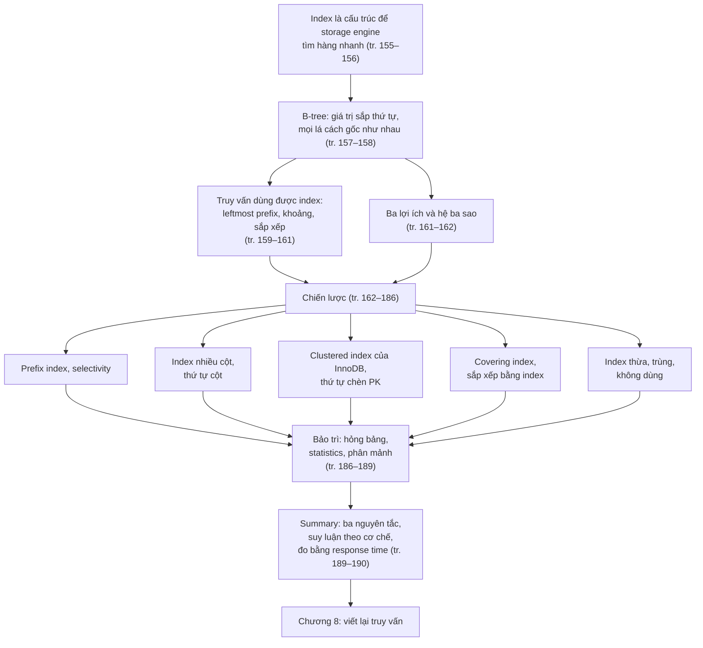
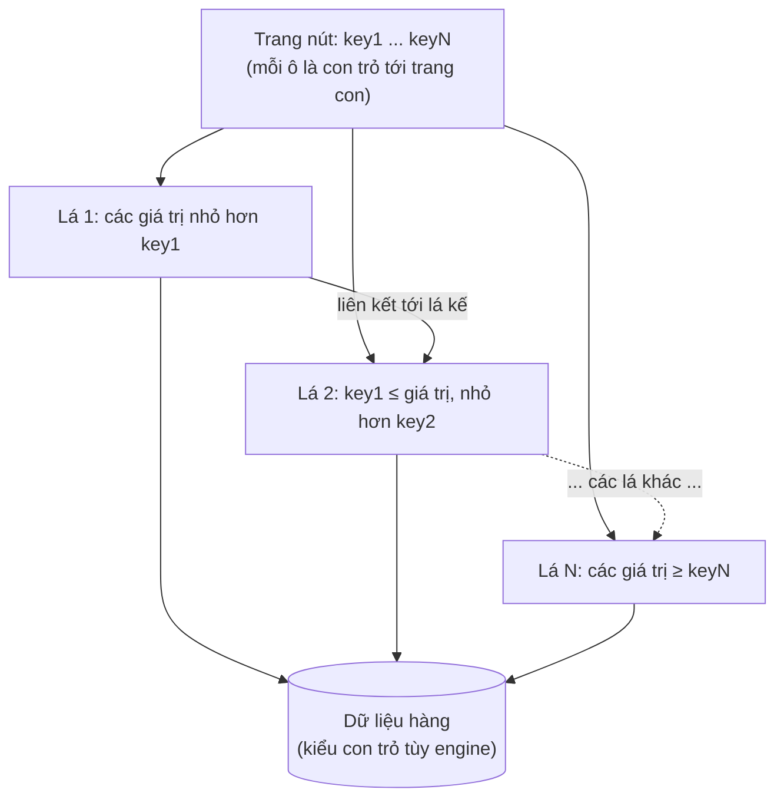
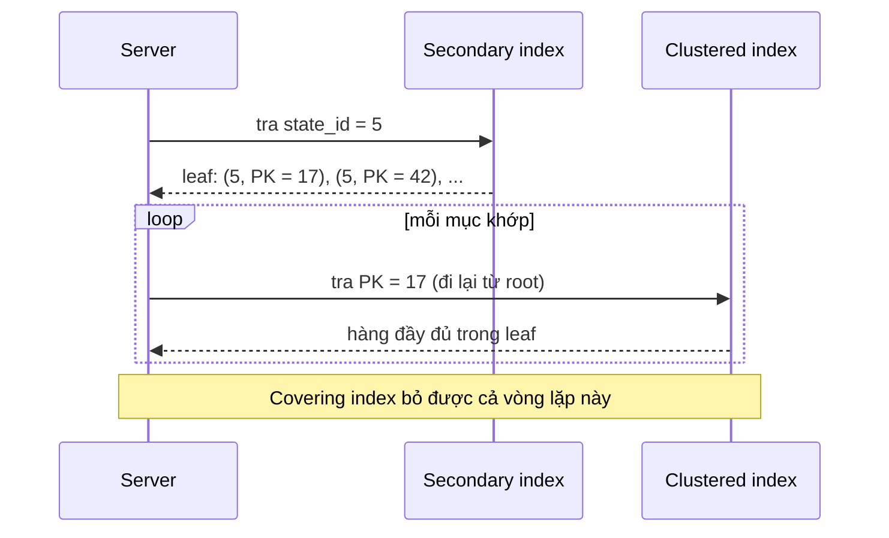
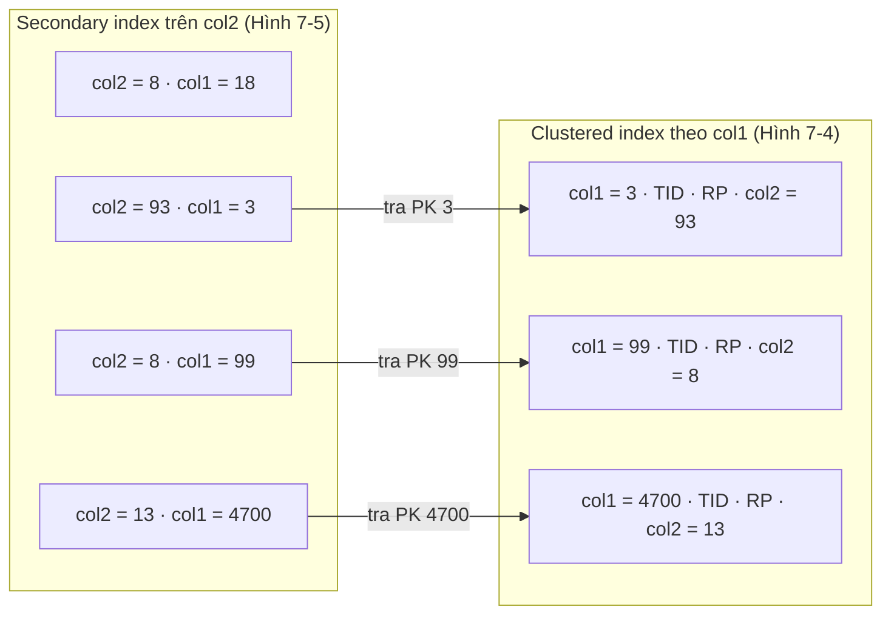
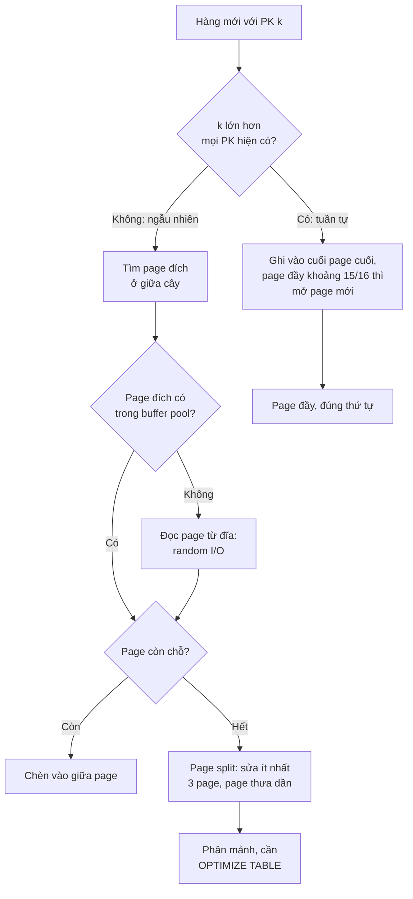
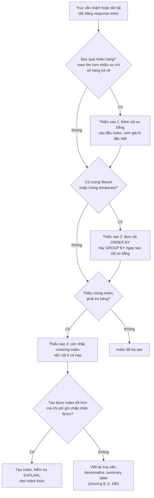
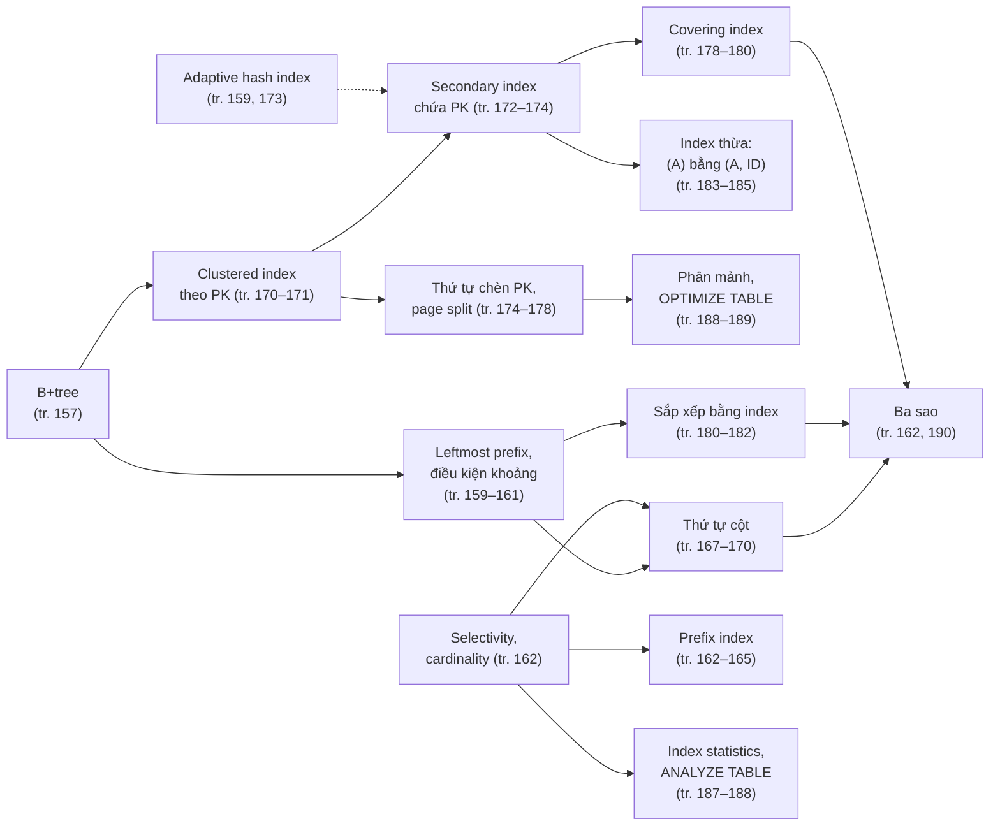

# Chương 7 — Index cho hiệu năng cao

*Indexing for High Performance*

> **Nguồn:** *High Performance MySQL: Proven Strategies for Operating at Scale*, Silvia Botros và Jeremy Tinley, O'Reilly, **Fourth Edition (11/2021)**, Chương 7, **tr. 155–190 (trang PDF 177–212)**. "tr. N" là số trang in; trang PDF = N + 22 (xem [README](README.md#page-convention)).
>
> **Quy ước nhãn:**
> - Nội dung không nhãn là diễn giải từ sách, luôn kèm trang.
> - **Bổ sung ngoài sách** là kiến thức thêm hoặc phép tính tự làm (kèm nguồn nếu dùng tài liệu ngoài).
> - **Ví dụ minh họa do AI xây dựng** là ví dụ, dữ liệu, SQL hay tình huống tự nghĩ, không phải của tác giả.
> - **Dự đoán** là điều kỳ vọng nhưng chưa đo.
> - **Kết quả đã đo** là số liệu từ thí nghiệm thật trong [experiments/chapter-07.md](experiments/chapter-07.md): MySQL 8.0.42, Windows 11, instance riêng cấu hình mặc định (trừ khi ghi khác), dữ liệu tổng hợp 300 nghìn tới 500 nghìn hàng mỗi bảng. Đây là laptop nhiều nhiễu, không phải benchmark production.
>
> **Phiên bản:** sách viết cho MySQL 8.0 và giả định mọi bảng dùng InnoDB (tr. 156). Sách nhắc 8.0.25 ở chú thích 12 (tr. 181) và invisible index của 8.0 (tr. 185). Vài nhận định của sách đã khác ở các bản 8.0 mới hơn: skip scan (8.0.13), descending index (8.0), tên biến lấy mẫu thống kê. Các chỗ đó được ghi rõ ngay tại mục liên quan.
>
> **Liên kết:** [lộ trình chương 7](learning-roadmap.md#ch07) · [bài thực hành](experiments/chapter-07.md) · [đáp án tự kiểm tra](answers/chapter-07.md)
>
> Các hình của sách được vẽ lại bằng Mermaid hoặc bảng theo nội dung đã xem trên ảnh trang. Sách dùng cơ sở dữ liệu mẫu Sakila; thí nghiệm của ghi chú này **không** dùng Sakila mà tự sinh dữ liệu có cấu trúc tương tự.

## Mục lục ghi chú

- [1. Bức tranh lớn](#big-picture)
- [2. Giải thích sâu](#deep)
  - [2.1 Indexing Basics (tr. 156–162)](#s2-1)
    - [2.1.1 Types of Indexes](#types-of-indexes) · [2.1.2 Benefits of Indexes](#benefits)
  - [2.2 Indexing Strategies for High Performance (tr. 162–186)](#s2-2)
    - [2.2.1 Prefix index và selectivity](#selectivity) · [2.2.2 Index nhiều cột](#index-merge) · [2.2.3 Thứ tự cột](#column-order) · [2.2.4 Clustered index](#clustered-index) · [2.2.5 Covering index](#covering-index) · [2.2.6 Sắp xếp bằng index](#index-sort) · [2.2.7 Index thừa và trùng](#redundant-index) · [2.2.8 Index không dùng](#unused-index)
  - [2.3 Index and Table Maintenance (tr. 186–189)](#s2-3)
    - [2.3.1 Hỏng bảng](#corruption) · [2.3.2 Index statistics](#index-statistics) · [2.3.3 Phân mảnh](#fragmentation)
  - [2.4 Summary (tr. 189–190)](#s2-4)
- [3. Phân tích tình huống](#situations)
- [4. Đo lường và thực hành](#measure)
- [5. Liên kết kiến thức và điều cần nhớ](#takeaways)
- [Ghi chú kiểm tra nguồn](#kiem-tra)

---

<a id="big-picture"></a>

## 1. Bức tranh lớn

### Chương này trả lời câu hỏi gì?

Diễn giải câu hỏi của chương: **làm sao thiết kế index, và viết truy vấn đi kèm, để MySQL đọc ít dữ liệu nhất, đọc theo đúng thứ tự cần, và không phải quay về bảng lấy thêm cột?** Và làm sao biết một schema đã được đánh index "đủ tốt"?

Lập luận mở đầu của tác giả (tr. 155):

- ***Index*** (MySQL còn gọi là ***key***) là cấu trúc dữ liệu mà **storage engine** dùng để tìm hàng nhanh. Index còn có những lợi ích khác mà chương sẽ khai thác.
- Database nhỏ, tải nhẹ thường vẫn chạy ổn khi thiếu index. Khi dữ liệu lớn lên, hiệu năng có thể sụt rất nhanh.
- Index hay bị quên hoặc hiểu sai, nên **index kém là nguyên nhân hàng đầu** của sự cố hiệu năng thực tế. Vì vậy tác giả đặt chương này **trước** chương tối ưu truy vấn.
- Tối ưu index có lẽ là cách mạnh nhất để cải thiện hiệu năng truy vấn. Index có thể cải thiện **nhiều bậc độ lớn**. Index *tối ưu* đôi khi còn nhanh hơn index chỉ "tốt" **khoảng hai bậc độ lớn** nữa.
- Index thật sự tối ưu thường đòi hỏi **viết lại truy vấn**, nên chương 7 và [chương 8](chapter-08.md) gắn chặt với nhau.

> Chú thích 1 (tr. 155). SSD có đặc tính hiệu năng khác, đã bàn ở [chương 4](chapter-04.md#s2-4). Các nguyên tắc về index vẫn đúng, nhưng các "hình phạt" mà ta cố tránh không lớn bằng trên ổ đĩa quay truyền thống.

### Vị trí trong mục tiêu chung của sách

Chương 6, 7, 8 là một khối: schema, index, truy vấn. Chương 6 khuyên đọc lại nó sau khi đọc chương 7 và 8 (tr. 125). Summary của chương 7 kết thúc bằng câu: nếu không tạo được index tốt hơn, có thể viết lại truy vấn để dùng index đã có, "đó là nội dung của chương tiếp theo" (tr. 190). Cách đánh giá cuối chương cũng đặt trong khung **response time**, cùng khung với chương 2 và chương 8.

### Kiến thức cần biết trước

| Kiến thức | Vì sao cần | Ôn ở đâu |
| --- | --- | --- |
| InnoDB lưu dữ liệu theo **page**; buffer pool cache page trong RAM | Mọi chi phí trong chương quy về số page phải đọc, đọc tuần tự hay ngẫu nhiên | [Chương 1](chapter-01.md), [chương 5](chapter-05.md#buffer-pool) (buffer pool, tr. 110) |
| Đọc ngẫu nhiên đắt hơn đọc tuần tự; SSD thu hẹp khoảng cách | Ba nguyên tắc ở Summary dựa trên điều này (tr. 189) | [Chương 4](chapter-04.md) |
| Đọc kết quả `EXPLAIN` | Sách dùng `EXPLAIN` làm bằng chứng nhưng không giải thích từng cột | Bảng dưới đây; [chương 8](chapter-08.md) |
| MVCC, next-key lock | Leaf của clustered index chứa transaction ID và rollback pointer (tr. 173); chèn theo thứ tự PK có thể tranh chấp next-key lock (tr. 178) | [Chương 1](chapter-01.md) |

> **Bổ sung ngoài sách — các cột `EXPLAIN` dùng trong chương này** (theo tài liệu MySQL 8.0; đã đối chiếu với output thật ở thí nghiệm).
>
> | Cột | Ý nghĩa ngắn |
> | --- | --- |
> | `type` | Kiểu truy cập (sách gọi là access type; tài liệu MySQL gọi là *join type*, chú thích 9, tr. 179): `const`, `eq_ref`, `ref` (tra theo giá trị bằng), `range` (quét một hoặc nhiều khoảng), `index` (quét **toàn bộ** index theo thứ tự), `ALL` (quét toàn bảng), `index_merge` |
> | `key`, `key_len` | Index được chọn; số byte của phần đầu index được dùng làm khóa tra cứu |
> | `rows`, `filtered` | Ước lượng số hàng đọc ở bước này; phần trăm ước lượng còn lại sau điều kiện khác |
> | `Extra` | `Using index` (covering, không đọc hàng), `Using where` (server lọc thêm), `Using index condition` (index condition pushdown), `Using filesort` (phải sắp xếp), `Using temporary` (bảng tạm), `Backward index scan` (đọc index ngược), `Using index for skip scan` |
>
> **Logical và physical.** Index không đổi *kết quả* của câu SQL. Về mặt logic, `WHERE`, `ORDER BY`, `LIMIT` vẫn có cùng ngữ nghĩa. Index chỉ đổi phần **physical execution**: access path nào (tra index, quét khoảng, quét toàn bảng), có phải sắp xếp không, có phải quay về clustered index không.

### Liên hệ với các chương khác

| Ý trong chương 7 | Chương | Căn cứ |
| --- | --- | --- |
| SSD giảm hình phạt của random I/O nhưng nguyên tắc index giữ nguyên | [Chương 4](chapter-04.md#s2-4) | tr. 155 (chú thích 1), tr. 189 |
| InnoDB dựng trên clustered index; secondary index chứa cột PK nên PK lớn làm mọi index lớn | [Chương 1](chapter-01.md#clustered-index) | Chương 1, tr. 16–17; chương 7, tr. 170–174 |
| Transaction ID và rollback pointer trong leaf của clustered index phục vụ MVCC | [Chương 1](chapter-01.md#mvcc) | tr. 173 |
| Chèn ở đầu cao của PK gây tranh chấp next-key lock và khóa `AUTO_INCREMENT`; `innodb_autoinc_lock_mode` | [Chương 1](chapter-01.md#next-key-locking), [chương 5](chapter-05.md#s2-8) | tr. 178; chương 5, tr. 123 |
| Buffer pool chứa adaptive hash index | [Chương 5](chapter-05.md#buffer-pool) | Chương 5, tr. 110; chương 7, tr. 159 |
| Identifier: số nguyên, UUID, cách lưu chuỗi hex hiệu quả | [Chương 6](chapter-06.md#identifiers) | Chương 7, tr. 165, 174–177; chương 6, tr. 142–144 |
| Tìm index không dùng bằng `performance_schema` và `sys` | [Chương 3](chapter-03.md) | tr. 185 |
| Viết lại truy vấn để dùng index; covering index được nhắc lại | [Chương 8](chapter-08.md) | tr. 155, 190; chương 8, tr. 198 |
| Backup bằng `rsync` làm hỏng InnoDB; khôi phục bảng từ backup | [Chương 10](chapter-10.md) | tr. 186 |
| **Bổ sung ngoài sách:** B-tree, clustered và secondary index ở mức nguyên lý | DDIA chương 3 | [B-tree](../../DDIA/ddia-notes/chapter-03.md#b4), [secondary index](../../DDIA/ddia-notes/chapter-03.md#secondary-index), [clustered index](../../DDIA/ddia-notes/chapter-03.md#clustered-index), [index nhiều cột](../../DDIA/ddia-notes/chapter-03.md#multi-column) |

### Mạch lập luận của chương



*(Sơ đồ do người viết ghi chú tổng hợp theo thứ tự mục của chương.)*

---

<a id="deep"></a>

## 2. Giải thích sâu

<a id="s2-1"></a>

### 2.1 Indexing Basics (tr. 156–162)

**Ẩn dụ mục lục sách** (tr. 156). Muốn biết một chủ đề nằm ở đâu trong sách, bạn tra phần index cuối sách, nó chỉ ra số trang. Storage engine dùng index tương tự: tìm giá trị trong cấu trúc dữ liệu của index, thấy khớp thì tìm tới hàng chứa giá trị đó. Ví dụ sách: `SELECT first_name FROM sakila.actor WHERE actor_id = 5` dùng index trên `actor_id` để tra các hàng có `actor_id` bằng 5.

**Index nhiều cột** (tr. 156). Index chứa giá trị của một hoặc nhiều cột. Với nhiều cột, **thứ tự cột rất quan trọng**, vì MySQL chỉ tìm hiệu quả trên ***leftmost prefix*** (phần đầu tính từ trái) của index. Index trên hai cột **không** giống hai index một cột riêng.

**Hộp "If I Use an ORM, Do I Need to Care?"** (tr. 156). Có. ORM sinh truy vấn đúng logic và cú pháp (phần lớn thời gian), nhưng hiếm khi sinh truy vấn "thân thiện với index", trừ các truy vấn cơ bản như tra theo primary key. Ngay cả chuyên gia cũng khó cân nhắc hết các khả năng, huống chi ORM.

<a id="types-of-indexes"></a>

#### 2.1.1 Types of Indexes (tr. 156–161)

**Index nằm ở tầng storage engine** (tr. 156). Index được cài ở tầng storage engine, không phải tầng server. Hệ quả:

- index **không được chuẩn hóa**: mỗi engine làm hơi khác;
- không phải engine nào cũng hỗ trợ mọi loại index;
- cùng một loại index, các engine có thể cài khác nhau bên dưới.

Sách giả định mọi bảng dùng InnoDB nên chỉ bàn cách InnoDB cài index. Chương xét **hai loại phổ biến nhất**: B-tree và full-text, cùng adaptive hash index như một tính năng nội bộ của InnoDB.

<a id="b-tree"></a>

**B-tree indexes** (tr. 157–158)

**What.** Khi người ta nói "index" mà không nêu loại, thường là ***B-tree index***. MySQL dùng chữ `BTREE` trong `CREATE TABLE`, nhưng cấu trúc thật bên dưới tùy engine: NDB Cluster dùng T-tree dù vẫn gắn nhãn `BTREE`, còn InnoDB dùng ***B+tree*** (tr. 157). Các biến thể cấu trúc và thuật toán nằm ngoài phạm vi sách.

> Chú thích 2 (tr. 157). Nhiều storage engine thực ra dùng B+tree, trong đó mỗi leaf node có liên kết tới leaf kế tiếp để duyệt khoảng nhanh; chi tiết về B-tree xem tài liệu khoa học máy tính.

**How** (Hình 7-1, tr. 157–158). Ý tưởng chung: mọi giá trị được lưu **theo thứ tự**, và mọi leaf page **cách root một khoảng như nhau**.

1. Storage engine bắt đầu từ **root node**. Các ô trong root chứa con trỏ tới node con.
2. Engine chọn con trỏ đúng bằng cách so với giá trị trong node page; các giá trị này xác định cận trên và cận dưới của giá trị trong node con.
3. Lặp lại qua các tầng node page cho tới khi biết giá trị không tồn tại, hoặc tới một **leaf page**.
4. Leaf page đặc biệt ở chỗ nó chứa **con trỏ tới dữ liệu** thay vì con trỏ tới page khác. "Con trỏ" này khác nhau giữa các engine.

Giữa root và leaf có thể có nhiều tầng node page; **độ sâu của cây tùy kích thước bảng** (tr. 158). Hình 7-1 ghi chú: một page logic có kích thước tùy engine, **16K với InnoDB**.



*(Vẽ lại Hình 7-1, tr. 157: một trang nút và các trang lá; root không được vẽ. Mỗi trang lá là một page logic 16K với InnoDB.)*

**Why B-tree hợp với truy vấn khoảng** (tr. 158). Vì cột được index lưu theo thứ tự, duyệt cây của một index trên cột chữ sẽ đi qua giá trị theo thứ tự chữ cái. Tìm "mọi người có tên bắt đầu từ I tới K" vì thế hiệu quả.

**Ví dụ bảng `People`** (tr. 158–159). Bảng có ba cột `last_name`, `first_name`, `dob` và một index `key(last_name, first_name, dob)`. Index chứa giá trị của cả ba cột cho mọi hàng, **sắp theo đúng thứ tự cột khai báo**. Hình 7-2 cho một phần nội dung:

| Vị trí | Mục trong index (last_name, first_name, dob) |
| --- | --- |
| Trang nút | Allen Cuba 1960-01-01 · Astaire Angelina 1980-03-04 · … · Barrymore Julia 2000-05-16 |
| Lá 1 | Akroyd Christian 1958-12-07 · Akroyd Debbie 1990-03-18 · Akroyd Kirsten 1978-11-02 |
| Lá 2 | Allen Cuba 1960-01-01 · Allen Kim 1930-07-12 · Allen Meryl 1980-12-12 |
| Lá N | Barrymore Julia 2000-05-16 · Basinger Vivien 1976-12-08 · Basinger Vivien 1979-01-24 |

*(Chép lại nội dung Hình 7-2, tr. 159, đã đối chiếu ảnh trang PDF 181.)* Hai mục cuối là hai người trùng tên, nên được xếp tiếp theo `dob` (tr. 158).

> **Bổ sung ngoài sách — B+tree của InnoDB cao bao nhiêu?** Phép tính thô: một bản ghi ở trang nút chứa khóa và số hiệu trang con (tr. 174 xác nhận trang nút chứa cột được index cộng con trỏ xuống tầng sâu hơn). Với khóa `INT` 4 byte, số trang 4 byte và khoảng 5–6 byte header, mỗi bản ghi nút chừng 14 byte, nên một page 16 KB chứa được khoảng 1.000 con trỏ. Nếu một trang lá chứa khoảng 100 hàng, cây ba tầng chứa được cỡ 1.000 × 1.000 × 100 = 100 triệu hàng. Vì vậy một lần tra bằng khóa thường chỉ chạm **3–4 page**; các tầng trên gần như luôn nằm trong buffer pool, nên I/O thật chủ yếu xảy ra ở tầng lá và ở bảng.
>
> **Kết quả đã đo** (thí nghiệm 1). Index `(last_name, first_name, dob)` trên bảng 500.000 hàng có 1.040 trang lá (`mysql.innodb_index_stats`, `n_leaf_pages`), tức khoảng 480 mục mỗi trang lá. Clustered index của cùng bảng (hàng rộng hơn, có cột `CHAR(100)`) có 4.546 trang lá.

<a id="adaptive-hash-index"></a>

**Adaptive hash index** (tr. 159)

**What.** InnoDB có tính năng ***adaptive hash index*** (AHI). Khi InnoDB thấy một số giá trị index được truy cập **rất thường xuyên**, nó tự dựng một hash index **trong bộ nhớ**, đặt chồng lên B-tree. B-tree khi đó có thêm vài tính chất của hash index, như tra băm rất nhanh. Quá trình hoàn toàn tự động; theo sách, bạn không điều khiển hay cấu hình được, chỉ có thể **tắt hẳn** AHI (tr. 159). Ở tr. 173, sách nói thêm AHI có thể giảm hình phạt "hai lần tra" của secondary index.

**Why.** Một lần tra B-tree phải đi từ root xuống lá, so sánh khóa ở mỗi tầng. Với khóa "nóng" được tra lặp lại, hash trên giá trị khóa cho phép nhảy thẳng tới bản ghi trong page đã có trong buffer pool.

> **Bổ sung ngoài sách và Kết quả đã đo — AHI trên MySQL 8.0.42.**
> - Nhận định "không cấu hình được" chỉ đúng một phần. MySQL 8.0 có `innodb_adaptive_hash_index` (bật hoặc tắt động, mặc định `ON`) và `innodb_adaptive_hash_index_parts` (số phân vùng của AHI, mặc định 8). Cả hai giá trị mặc định đã được kiểm tra trên instance thực hành. Việc *chọn khóa nào* để băm thì vẫn tự động, đúng như sách.
> - AHI nằm trong buffer pool ([chương 5](chapter-05.md#buffer-pool), tr. 110).
> - Thí nghiệm 5: 20.000 vòng lặp, mỗi vòng một lần tra PK và một lần tra theo secondary index trên 200 khóa nóng. Khi AHI bật, 40.000 trên 100.000 lượt tìm trong B-tree được phục vụ qua hash (bộ đếm `adaptive_hash_searches` trong `INNODB_METRICS`); khi tắt, con số là 0. Nhưng thời gian trung vị gần như không đổi: 2,05 s khi bật, 2,06 s khi tắt (3 lần chạy mỗi chế độ). Ở workload này, chi phí nằm chủ yếu ở tầng SQL (thủ tục lưu trữ, phân tích câu lệnh), không phải ở việc đi xuống cây.
> - MySQL 8.4 đổi mặc định của `innodb_adaptive_hash_index` thành `OFF` (theo ghi chú phát hành MySQL 8.4; chưa kiểm chứng trên máy này). Lý do thường được nêu là AHI có thể gây tranh chấp latch ở tải cao và chỉ có lợi với kiểu truy cập tra bằng lặp lại.

> **Kiểm chứng roadmap mục 8, điểm 1.** Tr. 17 (chương 1) nói read-ahead, adaptive hash index và insert buffer "được bàn ở Chapter 4". Khi đọc chương này: mô tả duy nhất về AHI trong sách là đoạn ở tr. 159, cộng một câu ở tr. 173. Chi tiết ở [Ghi chú kiểm tra nguồn](#kiem-tra).

<a id="leftmost-prefix"></a>

**Types of queries that can use a B-tree index** (tr. 159–161)

B-tree hợp với tra theo **toàn bộ giá trị khóa**, theo **khoảng khóa**, hoặc theo **tiền tố khóa**. Nó chỉ hữu ích khi việc tra dùng **leftmost prefix** của index (tr. 159). Với index `(last_name, first_name, dob)`, sách liệt kê các kiểu truy vấn dùng được index (tr. 159–160). Cột cuối là **Kết quả đã đo** trên bảng `people` 500.000 hàng có cùng index (thí nghiệm 1; `key_len` 202 tương ứng một cột `VARCHAR(50)` utf8mb4, 404 là hai cột, 407 là cả ba).

| Kiểu | Ví dụ của sách | Phần index dùng | Đo trên MySQL 8.0.42 |
| --- | --- | --- | --- |
| ***Match the full value*** | Cuba Allen sinh 1960-01-01 | cả ba cột | `ref`, `key_len` 407, đọc 1 mục |
| ***Match a leftmost prefix*** | mọi người họ Allen | cột đầu | `ref`, `key_len` 202, đọc 245 mục |
| ***Match a column prefix*** | họ bắt đầu bằng J | cột đầu | `range` với `LIKE 'Al%'`, đọc 12.636 mục |
| ***Match a range of values*** | họ từ Allen tới Barrymore | cột đầu | `range` với `BETWEEN 'Allen' AND 'Baker'`, `key_len` 202, đọc 12.645 mục |
| ***Match one part exactly and a range on another*** | họ Allen, tên bắt đầu bằng K | cột 1 bằng, cột 2 khoảng | `range`, `key_len` 404, đọc 15 mục |
| ***Index-only queries*** | truy vấn chỉ cần cột trong index (xem [covering index](#covering-index), tr. 178) | không đọc hàng | `Using index` |

**Sắp xếp** (tr. 160). Vì các node đã có thứ tự, index dùng được cho cả tra cứu lẫn `ORDER BY`. Nói chung, nếu B-tree giúp tìm hàng theo một cách, nó giúp sắp xếp theo cùng tiêu chí đó. *Kết quả đã đo:* `WHERE last_name='Allen' ORDER BY first_name, dob` không cần sắp xếp; `ORDER BY dob` thì `EXPLAIN` báo `Using filesort`.

**Giới hạn** (tr. 160–161):

1. **Không bắt đầu từ cột trái nhất thì không dùng được.** Không tìm được mọi người tên Bill, hay mọi người sinh ngày nào đó, hay họ *kết thúc* bằng một chữ cái.
2. **Không bỏ qua cột ở giữa được.** Tìm họ Smith sinh ngày X mà không cho `first_name` thì MySQL chỉ dùng cột đầu.
3. **Engine không tối ưu được các cột bên phải điều kiện khoảng đầu tiên.** Với `WHERE last_name="Smith" AND first_name LIKE 'J%' AND dob='1976-12-23'`, việc truy cập index chỉ dùng hai cột đầu vì `LIKE` là điều kiện khoảng. Server vẫn có thể dùng các cột còn lại "cho mục đích khác". Với cột có ít giá trị, có thể **thay khoảng bằng danh sách điều kiện bằng**.

Sau đó tác giả kết luận (tr. 161): các giới hạn này đều liên quan tới thứ tự cột, nên có khi phải tạo nhiều index với **cùng cột nhưng thứ tự khác** để phục vụ các truy vấn. Một số giới hạn không phải bản chất của B-tree mà do cách optimizer và storage engine của MySQL dùng index, và có thể được gỡ trong tương lai.

> Chú thích 3 (tr. 159). Giới hạn leftmost prefix là đặc thù của MySQL, thậm chí của từng phiên bản. Một số database khác dùng được phần không đứng đầu của index, dù dùng trọn tiền tố thường hiệu quả hơn. MySQL có thể sẽ hỗ trợ trong tương lai; sách nêu cách lách ở phần sau.

**Evidence: ba chi tiết đo được làm rõ giới hạn 2 và 3** (thí nghiệm 1, **Kết quả đã đo**):

- **"Mục đích khác" chính là *index condition pushdown*.** Với `last_name='Smith' AND dob='1965-11-27'`, `EXPLAIN` báo `ref`, `key_len` 202 và `Using index condition`. Bộ đếm `Handler_read_next` chỉ là 1. Khi tắt `index_condition_pushdown`, con số thành 255: engine vẫn phải duyệt **cả 255 mục** của họ Smith, chỉ là kiểm tra `dob` ngay trên mục index nên tránh được 254 lần đọc hàng. *(Bổ sung ngoài sách: ICP có từ MySQL 5.6; `Handler_read_next` chỉ đếm hàng engine trả lên server, không đếm mục bị ICP loại.)*
- **`key_len` có thể "nói quá".** Với điều kiện `LIKE 'J%'` ở giữa, `EXPLAIN` báo `key_len` 407 (đủ ba cột), nhưng optimizer trace ghi khoảng quét chỉ là `last_name = 'Smith' AND 'J' <= first_name <= 'J…'`, và khi tắt ICP engine đọc 23 mục (mọi tên J của họ Smith). Tức `dob` **không** thu hẹp khoảng quét, đúng như sách nói.
- **Cách lách bằng danh sách `IN`** hoạt động: thay `LIKE 'J%'` bằng `first_name IN (...)` gồm 20 tên J, engine làm 20 lần tra (`Handler_read_key` = 20) và chỉ đọc 1 mục, vì giờ cả ba cột đều là điều kiện bằng.

<a id="skip-scan"></a>

> **Bổ sung ngoài sách — chú thích 3 đã thành hiện thực một phần: *skip scan* (MySQL 8.0.13).** Với `WHERE first_name='Bill'` và chỉ chọn các cột nằm trong index, MySQL 8.0.42 chọn `range` với `Using index for skip scan`: nó lần lượt nhảy qua từng giá trị của `last_name` (2.000 giá trị) và tra `first_name='Bill'` trong mỗi nhóm. **Kết quả đã đo:** 4.001 lần tra, 1.680 mục đọc, khoảng 30 ms; còn truy vấn cần cột ngoài index thì quét toàn bảng 500.000 hàng, khoảng 275 ms (mỗi số đo một lần bằng `EXPLAIN ANALYZE`). Theo tài liệu MySQL, skip scan chỉ áp dụng khi truy vấn chỉ đụng một bảng, chỉ dùng cột của index, không có `GROUP BY` hay `DISTINCT`, và nó chỉ đáng giá khi cột đầu có **ít giá trị phân biệt**. Vì vậy lời khuyên "đặt cột cho đúng thứ tự" của sách vẫn giữ nguyên giá trị.

**Hiểu lầm phổ biến.**

- "Index `(a, b, c)` giúp mọi truy vấn có `a`, `b`, `c` trong `WHERE`." Sai: chỉ phần leftmost prefix liên tục, dừng ở điều kiện khoảng đầu tiên, được dùng để thu hẹp phạm vi quét.
- "Tạo index `(a, b)` thì không cần index `(b)`." Sai nếu có truy vấn chỉ lọc theo `b`; skip scan chỉ cứu được vài trường hợp hẹp.

<a id="full-text"></a>

**Full-text indexes** (tr. 161)

`FULLTEXT` là loại index đặc biệt: tìm **từ khóa** trong văn bản thay vì so giá trị trực tiếp. Tìm kiếm full-text có nhiều chi tiết như stop word, stemming, số nhiều, tìm Boolean; nó giống việc của một search engine hơn là so khớp trong `WHERE`. Có full-text index trên một cột **không** làm mất giá trị của B-tree trên cùng cột: full-text dành cho `MATCH AGAINST`, không dành cho điều kiện `WHERE` thông thường.

<a id="benefits"></a>

#### 2.1.2 Benefits of Indexes (tr. 161–162)

Index giúp server nhảy nhanh tới vị trí cần trong bảng, nhưng không chỉ có vậy (tr. 161). Ba tính chất của B-tree sinh ra ba lợi ích:

| Tính chất của B-tree | Lợi ích (tr. 161) |
| --- | --- |
| Dữ liệu lưu **đã sắp xếp**, nên khai thác được cho `ORDER BY` và `GROUP BY` | Giúp server **tránh sắp xếp và bảng tạm** |
| Các giá trị liên quan nằm **gần nhau** | Biến **random I/O thành sequential I/O** |
| Index lưu **bản sao giá trị**, nên vài truy vấn trả lời được chỉ từ index | **Giảm lượng dữ liệu** server phải xem xét |

Tác giả giới thiệu cuốn *Relational Database Index Design and the Optimizers* của Tapio Lahdenmaki và Mike Leach (Wiley). Sách đó giải thích cách tính chi phí và lợi ích của index, ước lượng tốc độ truy vấn, và xác định khi nào chi phí bảo trì index lớn hơn lợi ích (tr. 161–162).

<a id="three-star"></a>

**Hệ "ba sao"** (tr. 162). Lahdenmaki và Leach chấm độ phù hợp của một index với một truy vấn:

- **Sao thứ nhất:** index đặt các hàng liên quan **cạnh nhau**.
- **Sao thứ hai:** các hàng trong index **đã sắp theo thứ tự** truy vấn cần.
- **Sao thứ ba:** index **chứa mọi cột** truy vấn cần.

> Chú thích 4 (tr. 162). Optimizer của MySQL là một "thiết bị" bí ẩn và mạnh; vì cách nó tính kế hoạch tối ưu, bạn nên dựa vào `EXPLAIN` trên chính truy vấn và workload của mình để quyết định chiến lược.

> **Bổ sung ngoài sách — cách dựng index ba sao (theo phương pháp của Lahdenmaki và Leach; chương 7 không trình bày chi tiết).**
> 1. Đặt trước các cột có **điều kiện bằng** trong `WHERE`. Các hàng khớp khi đó là một "lát cắt" liền nhau trong index (sao 1).
> 2. Tiếp theo là các cột của `ORDER BY` theo đúng thứ tự (sao 2).
> 3. Thêm các cột còn lại mà truy vấn cần (sao 3).
>
> Xung đột hay gặp: một cột có **điều kiện khoảng** và một cột `ORDER BY` khác nhau. Đưa cột khoảng lên trước thì lát cắt hẹp hơn nhưng mất sao 2 (phải sắp xếp). Đưa cột sắp xếp lên trước thì giữ sao 2 nhưng lát cắt rộng hơn. Không có đáp án chung; phải xem số hàng và `LIMIT`.

**Ví dụ minh họa do AI xây dựng.** Truy vấn `SELECT payment_id, amount, payment_date FROM payment WHERE customer_id = ? ORDER BY payment_date DESC LIMIT 20`:

| Index | Sao | Lý do |
| --- | --- | --- |
| `(customer_id)` | 1 | Hàng của một khách nằm liền nhau, nhưng phải sắp xếp và phải đọc hàng |
| `(customer_id, payment_date)` | 2 | Thêm thứ tự đúng; vẫn phải đọc hàng để lấy `amount` |
| `(customer_id, payment_date, amount)` | 3 | Có đủ cột; `payment_id` là PK nên đã nằm sẵn trong mọi secondary index của InnoDB |

[Tình huống A](#situation-a) đo cả ba phương án.

#### Tự kiểm tra 2.1

- **Câu 2.1.1.** Với index `(last_name, first_name, dob)`, truy vấn `WHERE first_name = 'Bill'` được thực thi thế nào trên MySQL 5.7 và trên 8.0.42? Cần những điều kiện gì để MySQL 8.0 dùng được index? [đáp án](answers/chapter-07.md#q2-1-1)
- **Câu 2.1.2.** Truy vấn `WHERE last_name='Smith' AND first_name LIKE 'J%' AND dob='1976-12-23'` có `EXPLAIN` báo `key_len` đủ ba cột. Điều đó có chứng tỏ `dob` thu hẹp phạm vi quét không? Kiểm tra bằng cách nào? [đáp án](answers/chapter-07.md#q2-1-2)
- **Câu 2.1.3.** Vì sao một B-tree giúp được cả `WHERE` lẫn `ORDER BY`, còn full-text index không thay thế được B-tree trên cùng cột? [đáp án](answers/chapter-07.md#q2-1-3)
- **Câu 2.1.4.** Ba lợi ích của index (tr. 161) tương ứng với ba sao của Lahdenmaki và Leach thế nào? Với truy vấn `WHERE status = ? AND created_at > ? ORDER BY created_at LIMIT 50`, hãy đề xuất một index và chấm sao. [đáp án](answers/chapter-07.md#q2-1-4)
- **Câu 2.1.5.** Adaptive hash index khác một hash index do người dùng tạo ở điểm nào? Vì sao thí nghiệm thấy 40% lượt tìm đi qua AHI mà thời gian gần như không đổi? [đáp án](answers/chapter-07.md#q2-1-5)

---

<a id="s2-2"></a>

### 2.2 Indexing Strategies for High Performance (tr. 162–186)

Tạo đúng index và dùng đúng cách là điều kiện cốt yếu cho hiệu năng truy vấn (tr. 162). Có nhiều cách chọn và dùng index, vì có nhiều tối ưu cho trường hợp đặc biệt; biết dùng gì khi nào và đánh giá hệ quả là kỹ năng học dần theo thời gian (tr. 162). Chú thích 4 (đã nêu ở [2.1.2](#three-star)) nhắc dùng `EXPLAIN` trên workload thật.

<a id="selectivity"></a>

#### 2.2.1 Prefix Indexes and Index Selectivity (tr. 162–165)

**What.** Có thể chỉ index **vài ký tự đầu** của giá trị thay vì toàn bộ: index nhỏ hơn, nhưng **kém chọn lọc** hơn (tr. 162).

- ***Index selectivity*** là tỉ số giữa số giá trị phân biệt được index (***cardinality***) và tổng số hàng của bảng (#T). Nó nằm trong khoảng 1/#T tới 1.
- Selectivity cao là tốt, vì MySQL loại được nhiều hàng hơn khi tìm. Unique index có selectivity bằng 1, tốt nhất có thể (tr. 162).

**Why cần prefix index.** Thường một tiền tố đã đủ chọn lọc để cho hiệu năng tốt. Với `BLOB`, `TEXT` hay `VARCHAR` rất dài, **bắt buộc** dùng prefix index vì MySQL không cho index toàn bộ độ dài (tr. 162).

**How chọn độ dài** (tr. 162–165). Tiền tố phải đủ dài để index gần hữu ích như khi index cả cột, tức cardinality của tiền tố gần bằng cardinality của cả cột; đồng thời đủ ngắn để tiết kiệm chỗ. Sách dựng bảng `sakila.city_demo` từ bảng `city`: chèn tất cả thành phố, nhân đôi năm lần, rồi gán ngẫu nhiên lại giá trị (dữ liệu không thực tế và mỗi lần chạy sẽ khác). Hai cách đánh giá:

1. **So các giá trị phổ biến nhất với các tiền tố phổ biến nhất.** Mỗi tên đầy đủ xuất hiện khoảng 45–65 lần (London 65). Tiền tố 3 ký tự thì "San" xuất hiện 483 lần, "Cha" 195 lần. Tăng dần độ dài tới khi tiền tố chọn lọc gần như cả cột; thử vài lần thấy **7** là hợp lý: tiền tố phổ biến nhất "Santiag" 70 lần, "San Fel" 68 lần (tr. 163–164).
2. **So selectivity trung bình.** Selectivity của cả cột là 0,0312. Một truy vấn tính nhiều độ dài cùng lúc cho: sel3 = 0,0239; sel4 = 0,0293; sel5 = 0,0305; sel6 = 0,0309; sel7 = 0,0310. Mức cải thiện nhỏ dần khi gần tới 7 ký tự (tr. 164).

> **Bổ sung ngoài sách (phép tính).** Bảng `city` của Sakila có 600 thành phố; nhân đôi năm lần cho 600 × 2⁵ = 19.200 hàng; 600 / 19.200 = 0,03125, khớp với 0,0312 của sách. Tức bước gán ngẫu nhiên vẫn giữ gần như đủ 600 giá trị.

**Cảnh báo: trường hợp xấu nhất cũng quan trọng** (tr. 165). Selectivity trung bình có thể làm bạn nghĩ 4–5 ký tự là đủ, nhưng nếu dữ liệu lệch thì đó là bẫy. Với 4 ký tự, các tiền tố phổ biến nhất ("San " 205 lần, "Sant" 200 lần, "Sout" 135 lần) xuất hiện nhiều hơn hẳn tên đầy đủ phổ biến nhất. Dữ liệu thật còn tệ hơn: tên thành phố thật có rất nhiều "San…" và "New…".

**Tạo index:** `ALTER TABLE sakila.city_demo ADD KEY (city(7));` (tr. 165).

**Trade-offs** (tr. 165). Prefix index làm index nhỏ và nhanh hơn, nhưng:

- MySQL **không dùng** prefix index cho `ORDER BY` hay `GROUP BY`;
- prefix index **không thể là covering index**.

**Trường hợp hay có lợi** (tr. 165): identifier dạng chuỗi hex dài. Chương trước đã bàn cách lưu hiệu quả hơn ([chương 6](chapter-06.md#identifiers)), nhưng với phần mềm đóng gói không sửa được (ví dụ vBulletin lưu session theo chuỗi hex dài), thêm index trên khoảng **8 ký tự đầu** thường tăng hiệu năng đáng kể và hoàn toàn trong suốt với ứng dụng.

> **Lỗi in** (tr. 163, đã xem ảnh trang PDF 185). Truy vấn thứ hai viết `ORDER BY cc DESC` trong khi bí danh là `c`; câu đúng phải là `ORDER BY c DESC`.

**Kết quả đã đo** (thí nghiệm 2; bảng `city_demo` 300.000 hàng, 600 tên thành phố tổng hợp, trong đó 200 tên có 10 tiền tố chung như "San ", "Santa ", "New ", "South "):

| Độ dài tiền tố | 3 | 4 | 5 | 6 | 7 | 8 | 9 | Cả cột |
| --- | --- | --- | --- | --- | --- | --- | --- | --- |
| Số giá trị phân biệt | 345 | 408 | 432 | 475 | 551 | 585 | 600 | 600 |
| Selectivity | 0,0012 | 0,0014 | 0,0014 | 0,0016 | 0,0018 | 0,0020 | 0,0020 | 0,0020 |

- Trung bình, mỗi tên đầy đủ có khoảng 500 hàng. Với tiền tố 4, nhóm "San " có **10.076** hàng (gấp 20 lần), dù selectivity trung bình của tiền tố 4 vẫn bằng 70% của cả cột. Với tiền tố 8, selectivity trung bình đã bằng cả cột, nhưng nhóm xấu nhất ("South Fe") vẫn có 1.047 hàng, gấp đôi một tên đầy đủ. Chỉ từ 9 ký tự trở lên mới thật sự tương đương.
- **Tiết kiệm chỗ chỉ khi giá trị dài.** Tên thành phố ngắn (khoảng 10 ký tự), nên `city(9)` có cùng 417 page như index cả cột. Với cột `sid CHAR(64)` chứa chuỗi SHA-256 hex (300.000 hàng), index cả cột tốn 1.640 page còn `sid(8)` chỉ 417 page, mà selectivity của 8 ký tự đầu vẫn là 1,0000.
- **Giới hạn của sách được xác nhận.** Tra bằng prefix index luôn kèm `Using where` vì server phải so giá trị đầy đủ trong hàng. Truy vấn chỉ lấy cột `city` dùng index cả cột thì có `Using index`, dùng `city(9)` thì không. `ORDER BY city LIMIT 10` với index cả cột là quét index 10 mục; ép dùng `city(9)` thì optimizer bỏ index, quét toàn bảng và `Using filesort`. `GROUP BY city` với `city(9)` thì `Using temporary`.

**Decision.** Chọn độ dài bằng cả hai thước đo: selectivity trung bình **và** số hàng của tiền tố phổ biến nhất. Dùng prefix index khi cột dài và truy vấn chủ yếu là tra bằng; tránh khi cần sắp xếp, nhóm hoặc covering theo cột đó.

**Hiểu lầm phổ biến.** "Selectivity trung bình gần bằng cả cột là đủ" (tr. 165 phản bác: phải xem trường hợp xấu nhất). "Prefix index lúc nào cũng nhỏ hơn" (chỉ đúng khi giá trị thật dài hơn tiền tố).

<a id="index-merge"></a>

#### 2.2.2 Multicolumn Indexes (tr. 165–167)

**Hai lỗi phổ biến** (tr. 165): index **riêng từng cột** (nhiều hoặc mọi cột), và index các cột **sai thứ tự** (xem [2.2.3](#column-order)). Lỗi thứ nhất có "chữ ký" dễ nhận trong `SHOW CREATE TABLE`: một loạt `KEY(c1)`, `KEY(c2)`, `KEY(c3)` (tr. 166).

**Why lời khuyên "index các cột trong WHERE" sai** (tr. 166). Lời khuyên nghe có vẻ uy tín nhưng **rất sai**. Kết quả tốt nhất cũng chỉ là index **một sao**, và có thể chậm hơn index tối ưu **nhiều bậc độ lớn**. Khi không dựng được index ba sao, nhiều khi nên **bỏ qua `WHERE`** và tập trung vào thứ tự hàng tối ưu hoặc tạo covering index.

**Index merge** (tr. 166). Với bảng bị đánh index kiểu đó, MySQL "xoay xở" được phần nào nhờ chiến lược ***index merge***: dùng hạn chế nhiều index của một bảng, quét đồng thời và trộn kết quả. Ba biến thể:

| Biến thể | Dùng cho | Dấu hiệu trong `Extra` |
| --- | --- | --- |
| Union | `OR` | `Using union(...)` |
| Intersection | `AND` | `Using intersect(...)` |
| Union của các intersection | kết hợp hai loại | lồng nhau |

Ví dụ sách: `EXPLAIN SELECT film_id, actor_id FROM sakila.film_actor WHERE actor_id = 1 OR film_id = 1` cho `type: index_merge`, `key: PRIMARY,idx_fk_film_id`, `key_len: 2,2`, `rows: 29`, `Extra: Using union(PRIMARY,idx_fk_film_id); Using where`. Với truy vấn phức tạp có thể thấy phép lồng nhau trong `Extra` (tr. 166).

> **Bổ sung ngoài sách.** `key_len: 2,2` vì cả `actor_id` và `film_id` của Sakila là `SMALLINT` (2 byte).

**Index merge thường là dấu hiệu bảng bị đánh index kém** (tr. 166–167):

- Khi server **giao** các index (thường do `AND`), thường nghĩa là bạn cần **một index chứa mọi cột liên quan**, không phải nhiều index phải ghép.
- Khi server **hợp** các index (thường do `OR`), phần đệm, sắp xếp và trộn có thể tốn nhiều CPU và bộ nhớ, nhất là khi vài index kém chọn lọc và trả nhiều hàng cho bước trộn.
- Optimizer **không tính** chi phí này; nó chỉ tối ưu số lần đọc page ngẫu nhiên. Nó có thể "định giá thấp" truy vấn, trong khi thực tế chạy chậm hơn cả quét bảng. CPU và bộ nhớ bị chiếm còn ảnh hưởng truy vấn đồng thời, điều không thấy được khi chạy riêng lẻ. Đôi khi viết lại bằng `UNION` tốt hơn.

Thấy index merge trong `EXPLAIN` thì nên xem lại truy vấn và cấu trúc bảng. Có thể tắt index merge bằng `optimizer_switch` hoặc dùng `IGNORE INDEX` (tr. 167).

> **Bổ sung ngoài sách và Kết quả đã đo** (thí nghiệm 2, bảng `payment` 400.000 hàng có hai index một cột `idx_c(customer_id)`, `idx_s(staff_id)`). Trên 8.0.42, `optimizer_switch` có các cờ `index_merge`, `index_merge_union`, `index_merge_sort_union`, `index_merge_intersection`, đều bật mặc định.
> - `customer_id = 584 OR staff_id = 3`: `index_merge`, `Using union(idx_c,idx_s)`.
> - `customer_id = 584 OR customer_id = 777`: chỉ là `range` trên `idx_c`, không cần merge.
> - `customer_id = 584 AND staff_id = 2`: optimizer **không** giao index; nó dùng `ref` trên `idx_c` (40 hàng) rồi lọc `staff_id` (`filtered` 50%). Khi một cột đã đủ chọn lọc, intersection không đáng.

<a id="column-order"></a>

#### 2.2.3 Choosing a Good Column Order (tr. 167–170)

**What.** Index B-tree nhiều cột được sắp **trước hết theo cột trái nhất**, rồi tới cột kế, và cứ thế. Vì vậy index có thể được quét **xuôi hoặc ngược** để phục vụ `ORDER BY`, `GROUP BY`, `DISTINCT` **khớp đúng thứ tự cột** (tr. 167). Thứ tự cột quyết định index có được "sao" hay không (tr. 167).

**Quy tắc cũ "cột chọn lọc nhất đặt đầu"** (tr. 167–168). Đôi khi hữu ích, nhưng thường **kém quan trọng hơn** việc tránh random I/O và tránh sắp xếp. Nó có lý khi không có sắp xếp hay nhóm, tức index chỉ để tối ưu tra cứu `WHERE`. Khi đó nên thiết kế để loại hàng nhanh nhất, nhất là cho truy vấn chỉ cho một tiền tố của index. Nhưng điều này phụ thuộc cả **phân bố** của giá trị thực tế dùng để tra, không chỉ cardinality tổng thể, giống cân nhắc khi chọn độ dài tiền tố.

**Ví dụ `payment`** (tr. 168–169). Truy vấn `SELECT * FROM payment WHERE staff_id = 2 AND customer_id = 584`. Nên tạo `(staff_id, customer_id)` hay ngược lại?

| Phép đo trên Sakila | Kết quả (tr. 168) |
| --- | --- |
| `SUM(staff_id = 2)` | 7.992 |
| `SUM(customer_id = 584)` | 30 |
| `SUM(staff_id = 2)` trong các hàng của `customer_id = 584` | 17 |
| Selectivity của `staff_id` / `customer_id` trên 16.049 hàng | 0,0001 / 0,0373 |

Theo quy tắc, `customer_id` đặt trước: `ALTER TABLE payment ADD KEY(customer_id, staff_id)` (tr. 169). Cảnh báo của sách: kết quả phụ thuộc **hằng số cụ thể** trong truy vấn mẫu. Tối ưu cho một truy vấn có thể làm các truy vấn khác chậm đi hoặc chạy thất thường. Nếu có truy vấn "tệ nhất" từ báo cáo của công cụ như *pt-query-digest*, kỹ thuật này hiệu quả; nếu không có mẫu cụ thể, nên xem cardinality **tổng thể** (tr. 168).

> **Bổ sung ngoài sách (phép tính).** 2 / 16.049 ≈ 0,0001 (hai nhân viên); 0,0373 × 16.049 ≈ 599, tức Sakila có khoảng 599 khách hàng.

**Giá trị đặc biệt** (tr. 169). Giống prefix index, rắc rối thường đến từ **giá trị đặc biệt** có nhiều hàng hơn bình thường:

- người dùng chưa đăng nhập được gán một user ID "guest" chung trong bảng session;
- tài khoản hệ thống, ví dụ một tài khoản quản trị "làm bạn" với mọi người dùng để gửi thông báo, gây sự cố hiệu năng nghiêm trọng;
- người dùng thật có rất nhiều bạn, ảnh, trạng thái cũng gây rắc rối không kém.

**Ví dụ diễn đàn sản phẩm** (tr. 169–170). Truy vấn `COUNT(DISTINCT threadId)` trên bảng `Message` lọc `groupId`, `userId`, `anonymous` và sắp theo `priority DESC, modifiedDate DESC` chạy rất chậm. `EXPLAIN` cho `type: ref`, `key: ix_groupId_userId`, `key_len: 18`, `ref: const,const`, `rows: 1251162`. Index `(groupId, userId)` nghe có vẻ hợp lý, nhưng đếm thực tế: bảng 4.142.217 hàng, `groupId = 10137` khớp 4.092.654 hàng, `userId = 1288826` khớp 1.288.496 hàng, `anonymous = 0` khớp 4.141.934 hàng. Nhóm này sở hữu gần như cả bảng, người dùng có 1,3 triệu hàng: **không index nào giúp được**. Nguyên nhân: dữ liệu được di trú từ ứng dụng khác và mọi tin nhắn được gán cho user và group quản trị. Giải pháp là **sửa code ứng dụng** để nhận ra user ID và group ID đặc biệt đó và không gửi truy vấn này.

**Bài học** (tr. 170). Quy tắc kinh nghiệm hữu ích, nhưng đừng giả định hiệu năng trường hợp trung bình đại diện cho trường hợp đặc biệt; trường hợp đặc biệt có thể phá hiệu năng cả ứng dụng. Cuối cùng, các yếu tố như **sắp xếp, nhóm, và điều kiện khoảng** trong `WHERE` tạo khác biệt lớn hơn nhiều so với quy tắc selectivity.

**Kết quả đã đo** (thí nghiệm 2; bảng `payment` 400.000 hàng, 10.000 khách, 2 nhân viên, khách số 1 là "guest" chiếm 10% hàng). So hai index `idx_sc(staff_id, customer_id)` và `idx_cs(customer_id, staff_id)`:

| Truy vấn | `idx_sc` (staff trước) | `idx_cs` (customer trước) |
| --- | --- | --- |
| `staff_id = 2 AND customer_id = 584` | `ref` 2 cột, đọc 15 mục | `ref` 2 cột, đọc 15 mục |
| Chỉ `customer_id = 584` | không dùng được (quét bảng 400.000 hàng) | `ref`, khoảng 40 mục |
| `staff_id = 2 AND customer_id BETWEEN 500 AND 600` | đọc 1.664 mục (đúng số hàng khớp) | đọc 3.634 mục, lọc `staff_id` trong engine |
| `staff_id = 2 AND customer_id = 1` (guest) | optimizer chọn index này: đọc 38.958 mục, khoảng 182 ms (khách 584: 0,11 ms) | không đo riêng; **Dự đoán** tương tự vì cũng là `ref` trên hai cột |

Ba bài học rút ra (**Bổ sung ngoài sách**, dựa trên số đo):

1. Khi **mọi** điều kiện là phép bằng, hai thứ tự cho **cùng một lát cắt** của B-tree. Thứ tự chỉ quan trọng khi có truy vấn dùng **một phần** index, có **điều kiện khoảng**, hoặc có sắp xếp hay nhóm.
2. Với điều kiện khoảng, đặt **cột so bằng trước, cột khoảng sau**, kể cả khi cột so bằng kém chọn lọc hơn. Ở đây `staff_id` có selectivity gần 0 nhưng đặt trước lại đọc ít hơn một nửa. Đây chính là ý "điều kiện khoảng quan trọng hơn" ở tr. 170.
3. Giá trị đặc biệt (guest) buộc engine đọc gần 39.000 hàng, và không thứ tự cột nào thu nhỏ được lát cắt đó; chỉ thay đổi ở tầng ứng dụng hoặc thiết kế dữ liệu mới giải quyết được, đúng như ví dụ `Message`.

**Hiểu lầm phổ biến.** "Cột chọn lọc nhất luôn đứng đầu." Tr. 167 và tr. 189–190 đều bác bỏ việc áp quy tắc này máy móc.

<a id="clustered-index"></a>

#### 2.2.4 Clustered Indexes (tr. 170–178)

**What** (tr. 170). ***Clustered index*** không phải một loại index riêng, mà là **một cách lưu dữ liệu**. Chi tiết khác nhau giữa các cài đặt, nhưng clustered index của InnoDB lưu **B-tree và các hàng trong cùng một cấu trúc**:

- hàng nằm ngay trong **leaf page** của index;
- "clustered" nghĩa là các hàng có khóa kề nhau được lưu **gần nhau**;
- mỗi bảng chỉ có **một** clustered index, vì không thể lưu hàng ở hai nơi cùng lúc. Tuy vậy, covering index cho phép "giả lập" nhiều clustered index.

> Chú thích 5 (tr. 170). Người dùng Oracle quen thuật ngữ *index-organized table*, cùng nghĩa.
>
> Chú thích 6 (tr. 170). Hàng có khóa kề nhau không phải lúc nào cũng nằm gần nhau, như sẽ thấy ở phần page split.

Vì storage engine chịu trách nhiệm cài index, không phải engine nào cũng hỗ trợ clustered index. Phần này tập trung vào InnoDB, nhưng nguyên lý có lẽ đúng một phần cho mọi engine có clustered index (tr. 170).

**Hình 7-3** (tr. 171): leaf page chứa **hàng đầy đủ**, còn node page chỉ chứa **cột được index** (ở đây là số nguyên). Trang nút có các khóa 11, 21, …, 91; lá đầu chứa hàng 1, 2, …, 10 (Akroyd Christian 1958-12-07, Akroyd Debbie 1990-03-18, …, Akroyd Kirsten 1978-11-02); lá giữa chứa hàng 11, 12, …, 20 (Allen Cuba, Allen Kim, Allen Meryl); lá cuối chứa hàng 91, 92, …, 100 (Barrymore Julia, Basinger Vivien 1976-12-08, Basinger Vivien 1979-01-24). So với Hình 7-2, cùng dữ liệu nhưng giờ được xếp theo khóa số.

**InnoDB chọn khóa clustered thế nào** (tr. 171). Một số database server cho chọn index nào là clustered; các engine có sẵn của MySQL thì không. InnoDB **cluster theo primary key**:

1. có primary key thì dùng nó;
2. không có thì dùng một **unique index mà mọi cột đều `NOT NULL`**;
3. không có nữa thì InnoDB tự định nghĩa một ***hidden primary key***.

<a id="hidden-primary-key"></a>

Nhược điểm của hidden primary key: giá trị tự tăng của nó được **dùng chung cho mọi bảng** có hidden primary key, nên tranh chấp mutex trên khóa chung tăng (tr. 171).

> **Bổ sung ngoài sách** (theo tài liệu MySQL 8.0). Hidden primary key là cột 6 byte `DB_ROW_ID`, không truy vấn được. Từ 8.0.30, biến `sql_generate_invisible_primary_key` cho phép server tự thêm một primary key `AUTO_INCREMENT` vô hình (GIPK) khi tạo bảng thiếu PK, giúp tránh bộ đếm dùng chung và có PK cho replication dựa trên hàng.

**Ưu điểm** (tr. 171–172):

- **Giữ dữ liệu liên quan gần nhau.** Ví dụ hộp thư cluster theo `user_id`: lấy mọi thư của một người chỉ cần đọc vài page; không cluster thì mỗi thư có thể tốn một lần I/O.
- **Truy cập nhanh.** Index và dữ liệu nằm chung một B-tree, nên lấy hàng qua clustered index thường nhanh hơn tra tương đương qua index không clustered.
- Truy vấn dùng covering index có thể dùng **giá trị PK nằm trong leaf**.

**Nhược điểm** (tr. 172):

- Lợi ích lớn nhất là với workload **I/O-bound**. Nếu dữ liệu nằm hết trong bộ nhớ, thứ tự truy cập không quan trọng mấy.
- Tốc độ chèn **phụ thuộc mạnh vào thứ tự chèn**. Chèn theo thứ tự PK là cách nạp nhanh nhất; nếu không, nên chạy `OPTIMIZE TABLE` sau khi nạp nhiều.
- **Cập nhật cột của clustered index đắt**, vì InnoDB phải chuyển hàng tới vị trí mới.
- Dễ bị ***page split*** khi chèn hàng mới hay khi cập nhật PK làm hàng phải chuyển chỗ. Page split xảy ra khi khóa của hàng buộc nó vào một page đã đầy: engine tách page thành hai. Page split làm bảng tốn chỗ hơn.
- Quét toàn bảng có thể chậm hơn, nhất là khi hàng xếp thưa hay không tuần tự do page split.
- **Secondary index lớn hơn dự kiến**, vì leaf của nó chứa cột PK của hàng.
- Truy cập qua secondary index cần **hai lần tra index** thay vì một.

<a id="secondary-index"></a>

**Vì sao secondary index cần hai lần tra** (tr. 172–173). Leaf của ***secondary index*** **không** lưu con trỏ tới vị trí vật lý của hàng mà lưu **giá trị PK**. Muốn tìm hàng, engine tìm leaf trong secondary index, lấy giá trị PK ở đó, rồi đi xuống clustered index để tìm hàng: hai lần duyệt B-tree. Trong InnoDB, adaptive hash index có thể giảm hình phạt này (tr. 173).

> Chú thích 7 (tr. 173). Thiết kế không clustered cũng không phải lúc nào tra được trong một thao tác: khi hàng thay đổi và không còn vừa chỗ cũ, có thể sinh hàng bị phân mảnh hay "địa chỉ chuyển tiếp", cả hai đều làm việc tìm hàng tốn hơn.



*(Sơ đồ do người viết ghi chú dựng theo tr. 172–173; số PK là ví dụ minh họa.)*

<a id="innodb-layout"></a>

**InnoDB's data layout** (tr. 173–174)

Bảng ví dụ `layout_test` có `col1` làm PK và một index trên `col2`. Giả sử nạp PK từ 1 tới 10.000 theo thứ tự ngẫu nhiên rồi `OPTIMIZE TABLE`: dữ liệu được sắp tối ưu trên đĩa, nhưng hàng có thể ở thứ tự ngẫu nhiên. `col2` nhận giá trị ngẫu nhiên từ 1 tới 100, nên trùng nhiều (tr. 173).

- **Leaf của clustered index** (Hình 7-4) chứa: giá trị PK, **transaction ID** và **rollback pointer** mà InnoDB dùng cho transaction và MVCC, rồi tới các cột còn lại (ở đây là `col2`). Nếu PK đặt trên tiền tố của một cột, InnoDB lưu **cả giá trị đầy đủ** của cột đó cùng các cột còn lại (tr. 173).
- **Leaf của secondary index** (Hình 7-5) chứa cột được index (`col2`) rồi **giá trị PK** (`col1`), đóng vai "con trỏ" tới hàng. Cách này giảm công bảo trì secondary index khi hàng di chuyển hay page bị tách: index lớn hơn, nhưng InnoDB **di chuyển được hàng mà không phải cập nhật con trỏ** (tr. 174).
- **Node không phải lá** của mọi B-tree, clustered hay secondary, chứa cột được index cộng con trỏ tới node sâu hơn (tr. 174).



*(Vẽ lại Hình 7-4 và 7-5, tr. 173–174. TID là transaction ID, RP là rollback pointer. Giá trị lấy từ hình; hai hình khớp nhau: hàng 99 có col2 = 8, hàng 4700 có col2 = 13, hàng 3 có col2 = 93.)*

> **Kết quả đã đo — PK thật sự nằm trong secondary index** (thí nghiệm 1 và 3).
> - Thống kê của index `(last_name, first_name, dob)` trong `mysql.innodb_index_stats` có thêm dòng `n_diff_pfx04` với mô tả `last_name,first_name,dob,id`: InnoDB coi PK `id` là cột thứ tư của index.
> - `SELECT id FROM userinfo WHERE state_id = 5` dùng index một cột `state_id` mà vẫn có `Using index`.

<a id="pk-order"></a>

**Inserting rows in primary key order with InnoDB** (tr. 174–178)

**Decision của sách** (tr. 174). Nếu không cần cách cluster đặc biệt nào, nên dùng ***surrogate key***, tức PK không suy ra từ dữ liệu ứng dụng, thường là cột `AUTO_INCREMENT`. Hàng được chèn tuần tự, và join qua PK cũng tốt hơn. Tránh khóa clustered **ngẫu nhiên** (không tuần tự, phân tán trên tập giá trị lớn), nhất là với workload I/O-bound. UUID là lựa chọn tồi về hiệu năng: chèn vào clustered index trở nên ngẫu nhiên, trường hợp xấu nhất, và không cho lợi ích cluster nào.

**Evidence: benchmark của sách** (tr. 174–176). Bảng `userinfo` (PK `int unsigned AUTO_INCREMENT`, nhiều cột, một unique index và ba secondary index) so với `userinfo_uuid` giống hệt nhưng PK là `uuid varchar(36)`. Nạp 1 triệu hàng trên server đủ RAM chứa index, rồi 3 triệu hàng khiến index lớn hơn RAM.

> Chú thích 8 (tr. 175). Đây là bảng thật, có secondary index và nhiều cột; nếu bỏ chúng và chỉ đo hiệu năng của primary key, chênh lệch còn lớn hơn.

| Bảng (Bảng 7-1, tr. 175) | Số hàng | Thời gian (s) | Kích thước index (MB) |
| --- | --- | --- | --- |
| `userinfo` | 1.000.000 | 137 | 342 |
| `userinfo_uuid` | 1.000.000 | 180 | 544 |
| `userinfo` | 3.000.000 | 1.233 | 1.036 |
| `userinfo_uuid` | 3.000.000 | 4.525 | 1.707 |

> **Bổ sung ngoài sách (phép tính).** Khi vừa RAM, UUID chậm hơn 1,3 lần và index lớn hơn 1,6 lần. Khi vượt RAM, UUID chậm hơn **3,7 lần**. Kích thước gần như cùng tỉ lệ, nhưng thời gian thì khác hẳn: hình phạt chính đến từ **I/O ngẫu nhiên** khi page đích không còn trong bộ nhớ.

> **Lỗi in** (tr. 175, đã xem ảnh trang PDF 197). Dòng `gender ('M','F')NOT NULL DEFAULT 'M'` thiếu từ khóa `ENUM`; câu đúng là `gender ENUM('M','F') NOT NULL DEFAULT 'M'`.

Index UUID lớn hơn một phần vì PK lớn hơn, một phần chắc chắn do page split và phân mảnh (tr. 176).

**How: chèn tuần tự** (Hình 7-6, tr. 176). Mỗi bản ghi được đặt ngay sau bản ghi trước vì PK tăng dần. Khi page đạt **fill factor** tối đa (fill factor ban đầu của InnoDB chỉ là **15/16**, để chừa chỗ cho sửa đổi sau), bản ghi tiếp theo sang page mới. Kết quả: page PK gần đầy và đúng thứ tự. Page của secondary index thì có lẽ không khác biệt.

**How: chèn ngẫu nhiên** (Hình 7-7, tr. 177). Hàng mới không nhất thiết có PK lớn hơn hàng trước, nên InnoDB phải tìm chỗ phù hợp, trung bình ở đâu đó giữa dữ liệu hiện có, và dọn chỗ cho nó. Hình 7-7 minh họa UUID (chỉ hiện 13 ký tự đầu): các bản ghi mới chen vào giữa (`000e2f…` chen giữa `000944…` và `0016c9…`), và page đã ghi xuống đĩa có thể phải đọc lại. Ba hệ quả:

1. Page đích có thể đã bị flush và đẩy khỏi cache, hoặc chưa từng vào cache: InnoDB phải đọc nó từ đĩa trước khi chèn, gây nhiều **random I/O**.
2. Chèn lộn xộn buộc **tách page thường xuyên**: di chuyển nhiều dữ liệu và sửa **ít nhất ba page** thay vì một.
3. Page trở nên **thưa và không đều**, dữ liệu cuối cùng bị phân mảnh.

Sau khi nạp giá trị ngẫu nhiên vào clustered index, nên `OPTIMIZE TABLE` để dựng lại bảng và lấp đầy page (tr. 177). **Bài học:** cố gắng chèn theo thứ tự PK, và chọn khóa clustered cho giá trị **tăng đơn điệu** với mỗi hàng mới (tr. 178).



*(Sơ đồ do người viết ghi chú tổng hợp từ Hình 7-6, 7-7 và tr. 176–177.)*

**Hộp "When Primary Key Order Is Worse"** (tr. 178). Với workload **đồng thời cao**, chèn theo thứ tự PK lại tạo điểm tranh chấp:

- đầu cao của PK là một **hot spot**: mọi lần chèn dồn vào đó nên có thể tranh nhau **next-key lock**;
- cơ chế khóa `AUTO_INCREMENT` là hot spot thứ hai. Có thể thiết kế lại bảng hay ứng dụng, hoặc cấu hình `innodb_autoinc_lock_mode`; nếu phiên bản không hỗ trợ biến này thì nâng cấp InnoDB.

> **Bổ sung ngoài sách.** Trên MySQL 8.0, `innodb_autoinc_lock_mode` mặc định là 2 (*interleaved*), giá trị đã kiểm tra trên instance thực hành; chế độ này không giữ khóa mức bảng cho `AUTO_INCREMENT` và an toàn khi binary log ở định dạng row. [Chương 6](chapter-06.md#string-identifiers) (chú thích 6, tr. 143) cũng nhận xét giá trị giả ngẫu nhiên đôi khi giúp **loại bỏ hot spot** ở bảng rất lớn có nhiều luồng ghi: đó là mặt kia của cùng đánh đổi.

> **Bổ sung ngoài sách** (theo tài liệu MySQL 8.0). Con số 15/16 của sách ứng với hành vi chèn tuần tự. Biến `innodb_fill_factor` (mặc định 100) là một cơ chế khác: nó áp dụng khi InnoDB **dựng index theo lô đã sắp xếp** (tạo index, dựng lại bảng), và giá trị 100 vẫn chừa khoảng 1/16 page của clustered index.

**Kết quả đã đo** (thí nghiệm 5; chèn 300.000 hàng `CHAR(100)` vào bảng rỗng chỉ có PK):

| Khóa | Buffer pool 128 MB (một lần chạy) | Trang lá sau khi nạp | Trang lá sau `OPTIMIZE` | Buffer pool 16 MB (trung vị 3 lần) | Đọc đĩa (page) |
| --- | --- | --- | --- | --- | --- |
| `INT AUTO_INCREMENT` | 4,6 s | 2.440 | không cần | **4,4 s** | khoảng 1.200–1.600 |
| `INT`, thứ tự ngẫu nhiên | 6,0 s | 4.095 | 2.440 | **63,7 s** | khoảng 193.000 |
| `CHAR(36)` từ `UUID()` của MySQL | 6,6 s | 3.094 | 3.093 | không đo | |
| `CHAR(36)` dạng UUID thật sự ngẫu nhiên (từ MD5) | 11,0 s | 4.413 | 3.093 | **63,0 s** | khoảng 169.000 |
| `BINARY(16)` từ `UUID_TO_BIN(UUID(), 1)` | 4,8 s | 2.680 | không đo | không đo | |

Diễn giải:

- Khi vừa bộ nhớ, khóa ngẫu nhiên chậm hơn khoảng 1,3–2,4 lần và để lại page chỉ đầy khoảng 60% (4.095 so với 2.440 trang lá cho cùng dữ liệu). `OPTIMIZE TABLE` đưa số trang về đúng như chèn tuần tự.
- Khi buffer pool nhỏ hơn bảng, khóa ngẫu nhiên chậm hơn **khoảng 14 lần**, với gần 200.000 lần đọc page từ đĩa so với khoảng 1.200. Đây là bản thu nhỏ của hàng 3 triệu ở Bảng 7-1.
- **Bổ sung ngoài sách:** `UUID()` của MySQL sinh UUID phiên bản 1, dựa trên thời gian. Phần đầu chuỗi là 32 bit thấp của bộ đếm thời gian, nên các UUID sinh liên tiếp trong vài giây **gần như tăng dần** (ví dụ `a02b3fb0-…`, `a02b5e31-…`). Bảng `t_uuid` vì thế không bị phân mảnh (3.094 trang trước và 3.093 sau `OPTIMIZE`); nó chỉ to hơn do khóa 36 ký tự. UUID do ứng dụng sinh ngẫu nhiên (phiên bản 4) thì giống dòng MD5. `UUID_TO_BIN(UUID(), 1)` của MySQL 8.0 đảo phần thời gian lên đầu và lưu 16 byte, cho thứ tự gần tuần tự.

**Hiểu lầm phổ biến.** "UUID lúc nào cũng gây page split." Phụ thuộc phiên bản UUID và cách sinh; điều quan trọng là khóa có **tăng đơn điệu** hay không. "Dữ liệu vừa RAM thì thứ tự chèn không quan trọng." Vẫn quan trọng cho kích thước (page thưa hơn khoảng 40%), dù hình phạt thời gian nhỏ hơn nhiều.

<a id="covering-index"></a>

#### 2.2.5 Covering Indexes (tr. 178–180)

**What** (tr. 178). Lời khuyên phổ biến là tạo index cho `WHERE`, nhưng đó chỉ là một phần. Index cần được **thiết kế cho cả truy vấn**. Index tìm hàng hiệu quả, nhưng MySQL còn dùng index để **lấy giá trị cột** mà không phải đọc hàng: leaf đã chứa giá trị được index, đọc index là đủ thì cần gì đọc hàng? Index chứa (*covers*) mọi dữ liệu truy vấn cần gọi là ***covering index***. Chỉ **B-tree** mới làm covering index được.

**Why** (tr. 178–179). Lợi ích của việc chỉ đọc index:

- **Mục index thường nhỏ hơn nhiều so với hàng.** MySQL đọc ít dữ liệu hơn hẳn. Điều này rất quan trọng với workload nằm trong cache, nơi phần lớn response time là **sao chép dữ liệu**; cũng có ích cho workload I/O-bound vì index nhỏ hơn và dễ nằm vừa bộ nhớ hơn.
- **Index được sắp theo giá trị** (ít nhất trong một page), nên truy cập khoảng ở workload I/O-bound cần ít I/O hơn so với lấy từng hàng ở vị trí ngẫu nhiên. `OPTIMIZE` bảng còn cho index sắp hoàn toàn, để truy vấn khoảng đơn giản đọc index hoàn toàn tuần tự.
- **Đặc biệt có ích với InnoDB** vì clustered index: secondary index giữ PK ở leaf, nên một secondary index covering **tránh được lần tra thứ hai** vào clustered index.

Trong mọi trường hợp trên, trả lời truy vấn từ index thường rẻ hơn nhiều so với tra hàng (tr. 179).

**How nhận ra** (tr. 179). Truy vấn được index cover (*index-covered query*) có `Using index` trong cột `Extra` của `EXPLAIN`.

> Chú thích 9 (tr. 179). Dễ nhầm `Using index` trong `Extra` với `index` trong cột `type`. Chúng hoàn toàn khác nhau: cột `type` không liên quan tới covering; nó cho biết **access type**, tức cách truy vấn tìm hàng. Tài liệu MySQL gọi đó là *join type*.

**Evidence: hai ví dụ của sách** (tr. 179–180):

- `sakila.inventory` có index nhiều cột `(store_id, film_id)`. `EXPLAIN SELECT store_id, film_id FROM sakila.inventory` cho `type: index`, `key: idx_store_id_film_id`, `key_len: 3`, `rows: 4581`, `Extra: Using index`: quét toàn bộ index, không đọc hàng nào.
- **InnoDB đi xa hơn một bước.** Secondary index chứa PK ở leaf, nên có thêm "cột phụ" dùng để cover. `sakila.actor` có index trên `last_name`; truy vấn `SELECT actor_id, last_name ... WHERE last_name = 'HOPPER'` cho `type: ref`, `key: idx_actor_last_name`, `key_len: 182`, `rows: 2`, `Extra: Using index`, dù `actor_id` không nằm trong định nghĩa index.

> **Bổ sung ngoài sách (phép tính `key_len`).** `store_id TINYINT` (1 byte) + `film_id SMALLINT` (2 byte) = 3. `last_name VARCHAR(45)` với utf8mb4 tối đa 4 byte mỗi ký tự: 45 × 4 + 2 byte độ dài = 182.

**Kết quả đã đo** (thí nghiệm 3; bảng `userinfo` 500.000 hàng, 50 bang, `state_id = 5` khớp 9.835 hàng; Q1 = `SELECT COUNT(*) ... WHERE state_id = 5`, Q2 lấy `state_id, city, address`; bật hoặc ẩn index bằng invisible index; thời gian là trung vị 5 lần chạy trong hai phiên đo):

| Cấu hình index | Q1: plan, thời gian | Q2: plan, thời gian | Page buffer pool đọc cho Q2 |
| --- | --- | --- | --- |
| Chỉ `state_id` | `Using index`, 2,9–3,9 ms | **không** covering, 61–82 ms | khoảng 32.000–43.000 |
| Chỉ `state_id_2 (state_id, city, address)` | `Using index`, 3,5–3,6 ms | `Using index`, **5,8–6,1 ms** | khoảng 207 |
| Cả hai | chọn `state_id`, 3,1–4,0 ms | chọn **`state_id`** (không covering), 35–42 ms | khoảng 30.000–32.000 |

Diễn giải:

- Covering index nhanh hơn **khoảng 10–14 lần** cho Q2 và đọc ít hơn khoảng 150–200 lần số page. Lý do đúng như sách: mỗi trong 9.835 mục secondary index cần một lần đi xuống clustered index.
- Với Q1, index rộng hơn đọc nhiều page hơn một chút (khoảng 210 so với 180 page) nhưng chênh lệch thời gian nằm trong nhiễu; sách đo được chênh khoảng 8% (Bảng 7-2, xem [2.2.7](#redundant-index)).
- **Optimizer không phải lúc nào cũng chọn covering index.** Khi có cả hai index, trong hai phiên đo optimizer chọn `state_id` không covering cho Q2. Optimizer trace cho thấy hai chi phí ước lượng sát nhau và dao động giữa các phiên: một lần 4.090 (`state_id`) so với 4.697 (`state_id_2`), lần khác 4.733 so với 4.697. Phương án covering bị bất lợi vì ước lượng số hàng qua `state_id_2` bị thổi lên 19.338 (thực tế 9.835) và ước lượng tỉ lệ page của index này nằm trong bộ nhớ là 0. Trong một phiên khác, optimizer lại chọn `state_id_2`. Sách thì thấy cấu hình "cả hai" nhanh như covering (Bảng 7-2). Bài học khớp với chú thích 4 và 12 của sách: **luôn kiểm tra `EXPLAIN`**; khi cần, dùng index hint hoặc bỏ index thừa.

**Hiểu lầm phổ biến.** "`type: index` nghĩa là dùng covering index" (sai, chú thích 9). "Đã có index cho `WHERE` là đủ" (tr. 178: thiết kế cho cả truy vấn).

<a id="index-sort"></a>

#### 2.2.6 Using Index Scans for Sorts (tr. 180–182)

**What** (tr. 180). MySQL có hai cách tạo kết quả có thứ tự: dùng **thao tác sắp xếp**, hoặc **quét index theo thứ tự**. Dấu hiệu quét index theo thứ tự là `index` trong cột `type` (đừng nhầm với `Using index`).

> Chú thích 11 (tr. 181). MySQL gọi thao tác sắp xếp là "filesort" nhưng nó không nhất thiết dùng file; nó chỉ xuống đĩa khi không sắp xếp được trong bộ nhớ.

**Trade-off cốt lõi** (tr. 180). Quét index nhanh vì chỉ việc đi từ mục này sang mục kế. Nhưng nếu index **không cover** truy vấn, MySQL phải tra từng hàng nó gặp trong index. Đó về cơ bản là random I/O, nên **đọc dữ liệu theo thứ tự index thường chậm hơn quét tuần tự cả bảng**, nhất là với workload I/O-bound. Lý tưởng là thiết kế index phục vụ **đồng thời** tìm hàng và sắp xếp.

**Khi nào index dùng được cho `ORDER BY`** (tr. 180):

- thứ tự index **đúng hệt** `ORDER BY`, và mọi cột sắp **cùng một chiều** (cùng tăng hoặc cùng giảm);
- nếu truy vấn join nhiều bảng: mọi cột trong `ORDER BY` phải thuộc **bảng đầu tiên**;
- `ORDER BY` phải tạo thành **leftmost prefix** của index, giống giới hạn của tra cứu;
- **ngoại lệ:** nếu `WHERE` hoặc `JOIN` cho **hằng số** cho các cột đứng trước, chúng "lấp chỗ trống" trong index.

> Chú thích 10 (tr. 180). Nếu cần sắp theo các chiều khác nhau, một mẹo đôi khi có ích là lưu giá trị đảo ngược hoặc đổi dấu.

**Evidence: bảng `rental`** (tr. 180–182). Bảng có `UNIQUE KEY rental_date (rental_date, inventory_id, customer_id)` cùng các index một cột. Truy vấn `SELECT rental_id, staff_id ... WHERE rental_date = '2005-05-25' ORDER BY inventory_id, customer_id` cho `type: ref`, `key: rental_date`, `rows: 1`, `Extra: Using where`, không có filesort: hằng số ở cột đầu lấp chỗ trống. Danh sách của sách, kèm **Kết quả đã đo** trên MySQL 8.0.42 (thí nghiệm 4; bảng tổng hợp 399.907 hàng, `rental_date` kiểu `DATE`, 996 hàng ngày 2005-05-25):

| Điều kiện và `ORDER BY` | Sách (tr. 181–182) | Đo trên 8.0.42 |
| --- | --- | --- |
| `= '2005-05-25' ORDER BY inventory_id, customer_id` | dùng index | không filesort |
| `= '2005-05-25' ORDER BY inventory_id DESC` | dùng index | `Backward index scan`, không filesort |
| `> '2005-05-25' ORDER BY rental_date, inventory_id` | dùng được (chú thích 12) | khoảng chứa gần toàn bảng: optimizer chọn quét bảng + filesort; khoảng hẹp (6% hàng) hoặc có `LIMIT 10`: dùng index, không filesort |
| `= '2005-05-25' ORDER BY inventory_id DESC, customer_id ASC` | không (hai chiều) | `Using filesort` |
| `= '2005-05-25' ORDER BY inventory_id, staff_id` | không (cột ngoài index) | `Using filesort` |
| `= '2005-05-25' ORDER BY customer_id` | không (không thành leftmost prefix) | `Using filesort` |
| `> '2006-05-01' ORDER BY inventory_id, customer_id` | không (khoảng ở cột đầu) | `Using index condition; Using filesort` |
| `= '2005-05-25' AND inventory_id IN (1,2) ORDER BY customer_id` | không (nhiều giá trị bằng giống khoảng) | `Using index condition; Using filesort` |

> Chú thích 12 (tr. 181). Dù truy vấn khoảng ở trên dùng được index để sắp xếp, trong thử nghiệm của tác giả optimizer 8.0.25 không dùng index cho tới khi thêm `FORCE INDEX FOR ORDER BY`; thêm một lời nhắc rằng optimizer có thể không làm điều bạn chờ đợi, hãy luôn kiểm tra bằng `EXPLAIN`.

**Join** (tr. 182). `SELECT actor_id, title FROM sakila.film_actor INNER JOIN sakila.film USING(film_id) ORDER BY actor_id`: về lý thuyết dùng được index để sắp, nhưng optimizer đặt `film_actor` ở vị trí thứ hai, nên bảng `film` có `Using index; Using temporary; Using filesort`. **Kết quả đã đo:** trên 8.0.42 với dữ liệu tổng hợp, plan y hệt sách. Thêm `STRAIGHT_JOIN` (ép `film_actor` đứng đầu) thì hết filesort; thêm `LIMIT 10` thì optimizer tự đặt `film_actor` lên đầu.

**`ORDER BY` + `LIMIT`** (tr. 182). Một trong những công dụng quan trọng nhất của sắp xếp bằng index là truy vấn có cả `ORDER BY` và `LIMIT`. *Kết quả đã đo:* `WHERE rental_date > '2005-05-25' ORDER BY rental_date, inventory_id LIMIT 10` chỉ đọc 10 mục index, không sắp xếp hàng nào.

**Evidence cho trade-off ở tr. 180** (**Kết quả đã đo**, thí nghiệm 4). Sắp gần toàn bộ bảng `rental` theo `customer_id`, lấy cột `note` không có trong index:

| Cách | Plan | Page buffer pool đọc | Thời gian trung vị (3 lần) |
| --- | --- | --- | --- |
| Optimizer tự chọn | quét bảng + filesort (`Sort_merge_passes` = 30, tức có tràn ra đĩa) | khoảng 4.000 | **420 ms** |
| `FORCE INDEX (idx_fk_customer_id)` | đọc theo thứ tự index, tra từng hàng | khoảng 1,23 triệu | **929 ms** |

Dù toàn bộ bảng đã nằm trong buffer pool, đi theo index chậm hơn **hơn hai lần**, vì mỗi hàng là một lần đi xuống clustered index (khoảng 3 page). Optimizer của 8.0.42 đã chọn đúng.

> **Bổ sung ngoài sách — descending index của MySQL 8.0.** Từ 8.0, `INDEX (a, b DESC)` lưu cột `b` theo chiều giảm thật sự, và `EXPLAIN` có `Backward index scan` khi đọc index ngược. Nhờ đó trường hợp "hai chiều sắp xếp khác nhau" mà sách (tr. 181, tr. 190) coi là không dùng được index thì nay **có thể** có index phù hợp. **Kết quả đã đo:** sau khi thêm `(rental_date, inventory_id DESC, customer_id)`, ép dùng index này thì truy vấn `ORDER BY inventory_id DESC, customer_id ASC` hết filesort; nhưng khi để optimizer tự chọn (kể cả có `LIMIT 10`), nó vẫn chọn index `rental_date` cũ cộng filesort, vì ước lượng hàng của index mới cao hơn chút (1.084 so với 996). Lại một lần "phải kiểm tra `EXPLAIN`".

<a id="redundant-index"></a>

#### 2.2.7 Redundant and Duplicate Indexes (tr. 182–185)

**Duplicate index** (tr. 182–183). MySQL **cho phép** tạo index trùng trên cùng cột, chỉ báo warning. MySQL phải bảo trì từng index trùng riêng, optimizer xét từng cái khi tối ưu: ảnh hưởng hiệu năng và tốn đĩa. ***Duplicate index*** là index **cùng loại, cùng tập cột, cùng thứ tự**. Nên tránh tạo và xóa nếu gặp.

Ví dụ dễ mắc: bảng `test` khai báo `ID INT NOT NULL PRIMARY KEY`, rồi thêm `UNIQUE(ID)` và `INDEX(ID)`. Người thiếu kinh nghiệm nghĩ mình đang nêu vai trò PK, thêm ràng buộc unique, và thêm index cho truy vấn. Thực tế MySQL cài ràng buộc `UNIQUE` và `PRIMARY KEY` **bằng index**, nên bảng có **ba index** trên cùng cột. Thường không có lý do làm vậy, trừ khi muốn index khác loại trên cùng cột (tr. 183).

> Chú thích 13 (tr. 183). Index khác loại không nhất thiết là trùng; thường có lý do chính đáng để có cả `KEY(col)` và `FULLTEXT KEY(col)`.

**Redundant index** (tr. 183). Khác duplicate. Có index `(A, B)` thì index `(A)` là ***redundant*** vì nó là tiền tố của index kia: `(A, B)` dùng được như `(A)`. Kiểu thừa này chỉ áp dụng cho B-tree. Index `(B, A)` hay `(B)` **không** thừa vì `B` không phải leftmost prefix của `(A, B)`. Index khác loại (như full-text) không thừa so với B-tree, dù phủ cột nào.

**Vì sao xuất hiện** (tr. 183). Người ta thêm `(A, B)` thay vì mở rộng `(A)` sẵn có; hoặc đổi index thành `(A, ID)` trong khi `ID` là PK, vốn đã có sẵn trong secondary index.

**Khi nào nên giữ index thừa** (tr. 183–184). Thường nên **mở rộng index có sẵn** thay vì thêm mới. Nhưng đôi khi cần index thừa vì hiệu năng: mở rộng làm index **to ra** và chậm hơn cho vài truy vấn, ví dụ index trên cột số nguyên được mở rộng thêm một cột `VARCHAR` dài, nhất là khi truy vấn dùng index đó như covering index.

**Evidence: benchmark `userinfo`** (tr. 183–185). Bảng 1 triệu hàng, khoảng 20.000 hàng mỗi `state_id`. Q1 = `SELECT count(*) FROM userinfo WHERE state_id=5`, Q2 = `SELECT state_id, city, address FROM userinfo WHERE state_id=5`. Mở rộng index thành `state_id_2 (state_id, city, address)` làm Q2 nhanh hơn nhưng Q1 chậm đi; muốn cả hai nhanh thì giữ cả hai index.

| QPS (Bảng 7-2, tr. 184) | Chỉ `state_id` | Chỉ `state_id_2` | Cả hai |
| --- | --- | --- | --- |
| Q1 | 108,55 | 100,33 | 107,97 |
| Q2 | 12,12 | 28,04 | 28,06 |

| Chèn 1 triệu hàng (Bảng 7-3, tr. 184) | Chỉ `state_id` | Cả hai |
| --- | --- | --- |
| InnoDB, đủ bộ nhớ cho cả hai index | 80 giây | 136 giây |

> Chú thích 14 (tr. 184). Ví dụ chạy trong bộ nhớ. Khi bảng lớn hơn và workload I/O-bound, chênh lệch sẽ lớn hơn nhiều; truy vấn `COUNT()` nhanh hơn trăm lần nhờ covering index không phải chuyện hiếm.

> **Nhận xét về số liệu** (tr. 184). Phần chữ nói Q1 đạt "gần 115 QPS" và Q2 "dưới 10 QPS", nhưng Bảng 7-2 ghi 108,55 và 12,12. Có thể là hai lần chạy khác nhau; xu hướng thì nhất quán.

Thêm index làm `INSERT`, `UPDATE`, `DELETE` chậm hơn, nhất là khi index mới khiến chạm giới hạn bộ nhớ (tr. 185).

**Tìm và xóa** (tr. 185). Giải pháp là xóa, nhưng trước hết phải tìm ra. Có thể viết truy vấn phức tạp trên `INFORMATION_SCHEMA`, nhưng dễ hơn là dùng *pt-duplicate-key-checker* của Percona Toolkit.

**Cẩn thận trước khi xóa hay mở rộng** (tr. 185). Trong InnoDB, index `(A)` thực chất là `(A, ID)` vì PK được nối vào leaf. Truy vấn `WHERE A = 5 ORDER BY ID` được index này giúp rất nhiều. Mở rộng thành `(A, B)` thì nó thành `(A, B, ID)`, và truy vấn đó bắt đầu phải filesort. Nên kiểm tra thay đổi dự định bằng công cụ như *pt-upgrade*.

<a id="invisible-index"></a>

**Invisible index** (tr. 185). Trước khi xóa, cân nhắc tính năng ***invisible index*** của MySQL 8.0: `ALTER TABLE` đánh dấu index là vô hình, optimizer sẽ bỏ qua nó khi lập plan. Nếu hóa ra index đó quan trọng, chỉ cần cho hiện lại, không phải dựng lại index.

**Kết quả đã đo** (thí nghiệm 3):

- **Bẫy `(A)` thành `(A, B)` đúng như sách.** `WHERE state_id = 5 ORDER BY id LIMIT 10` với index `state_id` đọc 10 mục, không sắp xếp. Chỉ còn `state_id_2` thì: optimizer chuyển sang quét PK theo thứ tự và lọc (đọc 420 hàng để có 10 hàng khớp); ép dùng `state_id_2` thì phải đọc đủ 9.835 mục rồi `Using filesort`.
- **Warning chỉ có khi trùng cùng loại.** Bảng `test` của sách tạo ba index (`PRIMARY`, `ID` unique, `ID_2` thường) mà **không** có warning nào, vì ba index khác loại về ràng buộc. Hai `KEY` thường giống hệt thì có warning 1831 "Duplicate index … This is deprecated and will be disallowed in a future release."
- **Công cụ có sẵn trong 8.0** (**Bổ sung ngoài sách**): view `sys.schema_redundant_indexes` liệt kê đúng `state_id` (thừa so với `state_id_2`), hai prefix index thừa so với index cả cột, và các index trùng của bảng `test`.
- **Invisible index:** ẩn cả hai index thì Q1 thành quét toàn bảng (`ALL`, khoảng 495.000 hàng ước lượng); bật `optimizer_switch='use_invisible_indexes=on'` trong phiên thì optimizer lại dùng index. Cách này cho phép thử tác động của việc xóa index trên một phiên trước khi áp dụng cho mọi người.
- **Chi phí ghi:** chép 200.000 hàng vào bảng có thêm `state_id_2` mất 5,43 s so với 4,16 s khi chỉ có `state_id` (trung vị 3 lần; tăng khoảng 30%). Sách đo được tăng 70% (80 s lên 136 s).

> **Bổ sung ngoài sách** (theo tài liệu MySQL 8.0). Index vô hình **vẫn được bảo trì** khi ghi, nên ẩn index không tiết kiệm chi phí ghi; unique index vô hình vẫn thực thi ràng buộc unique; không thể ẩn primary key.

<a id="unused-index"></a>

#### 2.2.8 Unused Indexes (tr. 185–186)

Ngoài index trùng và thừa, có thể có index server **không bao giờ dùng**. Chúng chỉ là "tải chết", nên cân nhắc xóa (tr. 185).

> Chú thích 15 (tr. 185). Vài index đóng vai ràng buộc unique: dù không được truy vấn dùng, nó vẫn có thể đang chặn giá trị trùng.

**How** (tr. 185–186). Cách tốt nhất là dùng `performance_schema` và `sys` ([chương 3](chapter-03.md)). Schema `sys` có view dựa trên bảng `table_io_waits_summary_by_index_usage`; `SELECT * FROM sys.schema_unused_indexes` liệt kê index không được dùng. Output của sách gồm các index Sakila như `actor.idx_actor_last_name`, `address.idx_fk_city_id`, `address.idx_location`, `payment.fk_payment_rental` (đã rút gọn).

> **Kết quả đã đo và Bổ sung ngoài sách — view này đếm từ lúc nào?** Bộ đếm của Performance Schema bị đặt lại khi **khởi động lại server**, và cả khi **bảng bị `ALTER TABLE`**. Thí nghiệm 3: truy vấn dùng index `state_id` làm bộ đếm lên 10.080; sau một lệnh `ALTER TABLE ... ADD KEY` trên cùng bảng, bộ đếm của mọi index về 0 và `state_id` xuất hiện trong `sys.schema_unused_indexes`. Hệ quả thực tế:
> - quan sát qua một **chu kỳ nghiệp vụ đủ dài** (báo cáo cuối tháng, job theo quý) và không có DDL xen giữa;
> - xem trên **mọi server**, vì replica dùng cho báo cáo có thể dùng index mà source không dùng;
> - giữ index đóng vai ràng buộc unique (chú thích 15), và chuyển index sang **invisible** trước khi xóa hẳn.

#### Tự kiểm tra 2.2

- **Câu 2.2.1.** Trong thí nghiệm `city_demo`, selectivity trung bình của tiền tố 4 ký tự bằng 70% của cả cột, nhưng nhóm "San " có số hàng gấp 20 lần một tên đầy đủ. Vì sao trường hợp xấu nhất quan trọng với prefix index, và bạn phát hiện nó bằng truy vấn nào? [đáp án](answers/chapter-07.md#q2-2-1)
- **Câu 2.2.2.** Với truy vấn chỉ gồm `WHERE staff_id = 2 AND customer_id = 584`, thứ tự `(staff_id, customer_id)` hay `(customer_id, staff_id)` có khác nhau không? Khi nào thứ tự bắt đầu quan trọng, và khi đó nguyên tắc nào thắng quy tắc "chọn lọc nhất đặt đầu"? [đáp án](answers/chapter-07.md#q2-2-2)
- **Câu 2.2.3.** Vì sao secondary index của InnoDB lưu giá trị PK thay vì vị trí vật lý của hàng? Nêu một hệ quả tốt và hai hệ quả xấu về hiệu năng. [đáp án](answers/chapter-07.md#q2-2-3)
- **Câu 2.2.4.** Dự đoán và giải thích: chèn 300.000 hàng với PK `INT` theo thứ tự ngẫu nhiên so với `AUTO_INCREMENT`, khi buffer pool lớn hơn bảng và khi nhỏ hơn bảng. Vì sao `UUID()` của MySQL trong thí nghiệm lại không gây phân mảnh? [đáp án](answers/chapter-07.md#q2-2-4)
- **Câu 2.2.5.** Bảng có index `(A)`; một đồng nghiệp đề xuất thay bằng `(A, B)` để cover thêm truy vấn. Truy vấn nào có thể chậm đi, vì sao, và bạn triển khai thay đổi này an toàn thế nào trên MySQL 8.0? [đáp án](answers/chapter-07.md#q2-2-5)

---

<a id="s2-3"></a>

### 2.3 Index and Table Maintenance (tr. 186–189)

Tạo bảng với kiểu dữ liệu đúng và thêm index xong chưa phải là hết việc: còn phải bảo trì bảng và index để chúng chạy tốt. Ba mục tiêu chính của bảo trì bảng: **tìm và sửa lỗi hỏng**, **giữ index statistics chính xác**, và **giảm phân mảnh** (tr. 186).

<a id="corruption"></a>

#### 2.3.1 Finding and Repairing Table Corruption (tr. 186–187)

**What** (tr. 186). Điều tệ nhất có thể xảy ra với một bảng là bị hỏng (*corruption*). Mọi storage engine đều có thể gặp hỏng index do lỗi phần cứng hoặc bug của MySQL hay hệ điều hành, dù với InnoDB thì rất hiếm.

**Triệu chứng** (tr. 186): truy vấn trả kết quả sai; lỗi duplicate-key dù không có giá trị trùng; thậm chí treo hoặc crash. Gặp hành vi lạ, như một lỗi lẽ ra không thể xảy ra, hãy chạy `CHECK TABLE`. Vài engine không hỗ trợ lệnh này, vài engine có tùy chọn để chỉ định mức độ kiểm tra kỹ; `CHECK TABLE` thường bắt được phần lớn lỗi của bảng và index.

**Sửa** (tr. 186):

| Cách | Khi nào |
| --- | --- |
| `REPAIR TABLE` | Engine hỗ trợ (không phải engine nào cũng có) |
| `ALTER` "không làm gì": đổi bảng sang chính engine nó đang dùng, ví dụ `ALTER TABLE <table> ENGINE=INNODB` | Engine không có `REPAIR TABLE`; lệnh dựng lại bảng |
| Dump rồi nạp lại dữ liệu | Thay thế cho hai cách trên |
| Khôi phục từ backup, hoặc cứu dữ liệu từ file hỏng | Khi hỏng nằm ở vùng hệ thống hay vùng dữ liệu hàng, không chỉ ở index |

**InnoDB bị hỏng là dấu hiệu có chuyện nghiêm trọng** (tr. 186–187). InnoDB "đơn giản là không nên hỏng"; thiết kế của nó rất bền trước hỏng hóc. Hỏng là bằng chứng của: lỗi phần cứng như RAM hay đĩa hỏng (**hay gặp**), lỗi của quản trị viên như thao tác file database từ bên ngoài MySQL (**hay gặp**), hoặc bug của InnoDB (**hiếm**). Nguyên nhân thường gặp là những sai lầm như backup bằng `rsync`. **Không có** câu truy vấn nào bạn phải tránh vì sợ làm hỏng InnoDB; nếu truy vấn làm hỏng dữ liệu, đó là bug của InnoDB, không bao giờ là lỗi của bạn.

**Decision** (tr. 187). Gặp hỏng dữ liệu, việc quan trọng nhất là **tìm nguyên nhân**; đừng chỉ sửa dữ liệu, kẻo nó lại hỏng. Có thể sửa dữ liệu bằng cách đưa InnoDB vào chế độ forced recovery với tham số `innodb_force_recovery` (xem tài liệu MySQL).

> **Kết quả đã đo** (thí nghiệm 5). Trên MySQL 8.0.42, `CHECK TABLE` của bảng 500.000 hàng trả `status OK`. `OPTIMIZE TABLE` trên bảng InnoDB trả note "Table does not support optimize, doing recreate + analyze instead": với InnoDB, lệnh này thực chất **dựng lại bảng** rồi chạy `ANALYZE`.
>
> **Bổ sung ngoài sách** (theo tài liệu MySQL 8.0). `innodb_force_recovery` có các mức 1 tới 6; mức càng cao càng bỏ qua nhiều bước phục hồi, và từ mức 4 trở lên có thể làm hỏng dữ liệu vĩnh viễn. Thông thường chỉ dùng nó để **dump được dữ liệu ra**, rồi dựng lại instance. Backup đúng cách được bàn ở [chương 10](chapter-10.md).

<a id="index-statistics"></a>

#### 2.3.2 Updating Index Statistics (tr. 187–188)

**Why** (tr. 187). Khi storage engine cho optimizer thông tin không chính xác về số hàng một truy vấn có thể đọc, hoặc khi plan quá phức tạp để biết chính xác số hàng khớp ở từng bước, optimizer dùng ***index statistics*** để ước lượng. Optimizer của MySQL là **cost-based**, và thước đo chi phí chính là **lượng dữ liệu truy vấn sẽ truy cập**. Statistics chưa từng được tạo hoặc đã cũ thì optimizer có thể quyết định sai. Giải pháp: `ANALYZE TABLE` để tạo lại statistics.

**Xem cardinality** (tr. 187–188). `SHOW INDEX FROM sakila.actor` cho mỗi index một dòng với các cột như `Key_name`, `Seq_in_index`, `Column_name`, `Collation`, `Cardinality`, `Sub_part`, `Index_type`. Với `actor`, cả `PRIMARY` và `idx_actor_last_name` đều có `Cardinality: 200`. Cột **Cardinality** cho biết storage engine **ước lượng** có bao nhiêu giá trị phân biệt trong index. Dữ liệu này cũng có trong `INFORMATION_SCHEMA.STATISTICS`; có thể viết truy vấn trên `INFORMATION_SCHEMA` để tìm index có selectivity rất thấp. Cảnh báo: trên server có nhiều dữ liệu, các bảng metadata này có thể gây tải lớn (tr. 188).

> **Bổ sung ngoài sách (quan sát).** Ví dụ covering ở tr. 179–180 cho thấy họ 'HOPPER' có 2 hàng, tức họ diễn viên có trùng. Vậy số họ phân biệt thực tế nhỏ hơn 200, và `Cardinality: 200` của `idx_actor_last_name` là một **ước lượng** chứ không phải số đếm chính xác, đúng như chữ "estimates" của sách.

**InnoDB tính statistics thế nào** (tr. 188). InnoDB **lấy mẫu vài page ngẫu nhiên** trong index và giả định phần còn lại giống vậy. Số page lấy mẫu do biến `innodb_stats_sample_pages` điều khiển; đặt lớn hơn mặc định 8 về lý thuyết cho statistics đại diện hơn, nhất là với bảng rất lớn, nhưng hiệu quả thực tế tùy trường hợp.

**Khi nào tính lại** (tr. 188). Khi bảng được mở lần đầu, khi chạy `ANALYZE TABLE`, khi kích thước bảng đổi đáng kể. InnoDB còn tính statistics khi có truy vấn tới vài bảng `INFORMATION_SCHEMA`, `SHOW TABLE STATUS`, `SHOW INDEX`, và khi client dòng lệnh MySQL bật tự hoàn thành. Trên server lớn hoặc I/O chậm, điều này thành vấn đề nghiêm trọng: chương trình client hay công cụ giám sát gây lấy mẫu có thể tạo nhiều locking và tải nặng, và làm client khởi động chậm. Bạn cũng **không quan sát được statistics mà không thay đổi chúng**, vì `SHOW INDEX` cập nhật statistics. Có thể tắt `innodb_stats_on_metadata` để tránh mọi vấn đề trên.

> **Bổ sung ngoài sách và Kết quả đã đo — đoạn này mô tả hành vi cũ; MySQL 8.0 khác ở nhiều điểm** (biến và giá trị đã kiểm tra trên 8.0.42; cơ chế theo tài liệu MySQL 8.0):
> - `innodb_stats_sample_pages` **không còn tồn tại** trong 8.0.42 (`SHOW VARIABLES` trả về rỗng). Thay vào đó là `innodb_stats_persistent_sample_pages` (mặc định 20) và `innodb_stats_transient_sample_pages` (mặc định 8). Có thể đặt riêng cho từng bảng bằng `STATS_SAMPLE_PAGES`.
> - `innodb_stats_persistent = ON` là mặc định: statistics được **lưu** trong `mysql.innodb_index_stats` và `mysql.innodb_table_stats`, không mất khi khởi động lại, và không tính lại chỉ vì bảng được mở.
> - `innodb_stats_auto_recalc = ON`: InnoDB tự tính lại ở nền khi hơn khoảng 10% số hàng thay đổi.
> - `innodb_stats_on_metadata` mặc định là **`OFF`**, nên `SHOW INDEX` không còn kích hoạt lấy mẫu lại.
> - `INFORMATION_SCHEMA.STATISTICS` trong 8.0 đọc từ **bản cache** trong data dictionary, làm mới theo `information_schema_stats_expiry` (mặc định 86.400 giây). `ANALYZE TABLE` làm mới bản cache này.

**Kết quả đã đo** (thí nghiệm 5; bản sao bảng `people` 500.000 hàng, thực tế có 2.000 họ, 153.954 cặp họ và tên, 499.876 bộ ba):

| Thống kê `n_diff_pfx` | Thực tế | Lấy mẫu 20 page | Lấy mẫu 200 page |
| --- | --- | --- | --- |
| `last_name` | 2.000 | 1.974 | 2.046 |
| `last_name, first_name` | 153.954 | 154.388 | 154.798 |
| `last_name, first_name, dob` | 499.876 | 512.460 (vượt cả số hàng) | 503.328 |

- Lấy mẫu nhiều page hơn cho ước lượng sát hơn, nhưng mặc định 20 page đã sai số chỉ vài phần trăm với dữ liệu phân bố đều.
- Sau khi `UPDATE` 150.000 hàng (30%) thành cùng một họ 'Zzguest', trong 20 giây chờ InnoDB đã tự tính lại ở nền (`last_update` trong `mysql.innodb_index_stats` thay đổi; giá trị mới 2.097). Nhưng `INFORMATION_SCHEMA.STATISTICS` vẫn trả giá trị cache cũ (1.922) cho tới khi đặt `information_schema_stats_expiry = 0` trong phiên, hoặc chạy `ANALYZE TABLE`.
- **Cardinality không thấy được độ lệch.** Sau `UPDATE`, số họ phân biệt gần như không đổi (khoảng 2.000), nên "trung bình" vẫn khoảng 250 hàng mỗi họ, trong khi 'Zzguest' có 150.000 hàng. Với hằng số cụ thể, optimizer dùng **index dive** (đi xuống cây để đếm khoảng; tối đa `eq_range_index_dive_limit` = 200 khoảng) nên vẫn thấy lệch: ước lượng 247.757 hàng cho 'Zzguest' và 186 cho 'Allen' (thực tế 186). Nhưng khi giá trị chỉ biết lúc chạy, như cột join, optimizer dùng trung bình từ cardinality. Đây là lý do giá trị đặc biệt ở [2.2.3](#column-order) nguy hiểm. *(Bổ sung ngoài sách: MySQL 8.0 có histogram, tạo bằng `ANALYZE TABLE ... UPDATE HISTOGRAM`, để mô tả phân bố của cột không có index.)*
- `SHOW INDEX` hiển thị cardinality của cột `dob` là 495.514 dù `n_diff_pfx03` là 512.460: giá trị hiển thị có vẻ bị chặn bởi ước lượng số hàng của bảng.

<a id="fragmentation"></a>

#### 2.3.3 Reducing Index and Data Fragmentation (tr. 188–189)

**Index fragmentation** (tr. 188). B-tree có thể bị phân mảnh: page **đầy kém** và/hoặc **không tuần tự** trên đĩa. Theo thiết kế, "lặn" xuống leaf page của B-tree vốn cần truy cập ngẫu nhiên, nên ngẫu nhiên là quy luật chứ không phải ngoại lệ. Nhưng leaf page vẫn chạy tốt hơn nếu chúng **tuần tự về vật lý và xếp chặt**. Nếu không, ta nói chúng bị phân mảnh, và quét khoảng hay quét toàn index có thể chậm **nhiều lần**, nhất là với truy vấn được index cover.

**Data fragmentation** (tr. 188–189). Phần lưu dữ liệu của bảng cũng có thể phân mảnh, phức tạp hơn index. Ba loại:

| Loại (tên trong sách) | Nghĩa | Ảnh hưởng |
| --- | --- | --- |
| *Row fragmentation* | Một hàng bị lưu thành nhiều mảnh ở nhiều nơi | Giảm hiệu năng ngay cả khi truy vấn chỉ cần một hàng từ index |
| *Intra-row fragmentation* | Các page hay hàng liền nhau về logic không nằm liền nhau trên đĩa | Ảnh hưởng quét toàn bảng và quét khoảng trên clustered index, vốn hưởng lợi từ bố cục tuần tự |
| *Free space fragmentation* | Page dữ liệu có nhiều chỗ trống | Server đọc nhiều dữ liệu không cần, lãng phí |

> **Nhận xét của người viết ghi chú.** Theo mô tả, loại thứ hai nói về thứ tự **giữa** các page hay hàng, nên tên *intra-row* ("bên trong hàng") dễ gây hiểu nhầm; nên hiểu theo mô tả của sách.

**Chống phân mảnh** (tr. 189). Chạy `OPTIMIZE TABLE`, hoặc dump rồi nạp lại. Hai cách này dùng được cho phần lớn engine. Với engine không hỗ trợ `OPTIMIZE TABLE`, dựng lại bảng bằng `ALTER TABLE` "không làm gì": đổi sang chính engine đang dùng, `ALTER TABLE <table> ENGINE=<engine>`.

> **Kết quả đã đo** (thí nghiệm 5). Bảng PK `INT` được chèn theo thứ tự ngẫu nhiên có 4.095 trang lá; sau `OPTIMIZE TABLE` còn 2.440, đúng bằng bảng chèn tuần tự. Đây là *free space fragmentation* do page split.
>
> **Bổ sung ngoài sách** (theo tài liệu MySQL 8.0). Với InnoDB, `OPTIMIZE TABLE` tương đương `ALTER TABLE ... FORCE`: chép toàn bộ bảng, cần thêm dung lượng đĩa tạm thời cỡ bảng, và mặc định được ghi vào binary log nên sẽ chạy cả trên replica (trừ khi dùng `NO_WRITE_TO_BINLOG` hay `LOCAL`). Mức trống có thể xem qua `DATA_FREE` trong `INFORMATION_SCHEMA.TABLES` hoặc so `n_leaf_pages` với kích thước dữ liệu.

#### Tự kiểm tra 2.3

- **Câu 2.3.1.** Vì sao sách nói InnoDB bị hỏng là "bằng chứng" của một vấn đề khác, và việc đầu tiên cần làm là gì? Vì sao không nên chỉ chạy lệnh sửa rồi thôi? [đáp án](answers/chapter-07.md#q2-3-1)
- **Câu 2.3.2.** InnoDB tính `Cardinality` thế nào? Vì sao `SHOW INDEX` của sách cho 200 với `last_name` dù họ có trùng? Trên MySQL 8.0, những gì đã khác so với mô tả ở tr. 188? [đáp án](answers/chapter-07.md#q2-3-2)
- **Câu 2.3.3.** 30% số hàng bị đổi thành cùng một giá trị nhưng cardinality gần như không đổi. Vì sao? Truy vấn nào vẫn được ước lượng đúng, truy vấn nào có thể bị ước lượng sai? [đáp án](answers/chapter-07.md#q2-3-3)
- **Câu 2.3.4.** Nêu ba loại phân mảnh dữ liệu và thao tác mà mỗi loại làm chậm. Vì sao `OPTIMIZE TABLE` gần như không đổi số trang của bảng `t_uuid` (khóa từ `UUID()` của MySQL)? [đáp án](answers/chapter-07.md#q2-3-4)

---

<a id="s2-4"></a>

### 2.4 Summary (tr. 189–190)

<a id="summary-principles"></a>

Indexing là chủ đề phức tạp. Cách MySQL và storage engine truy cập dữ liệu, cộng với tính chất của index, làm index thành công cụ mạnh và linh hoạt để tác động lên việc truy cập dữ liệu, cả trên đĩa lẫn trong bộ nhớ (tr. 189). Phần lớn thời gian bạn dùng **B-tree**; các loại khác dành cho mục đích đặc biệt và thường thấy rõ khi nào cần.

**Ba nguyên tắc khi chọn index và viết truy vấn** (tr. 189–190):

| Nguyên tắc | Lý do của sách | Sao tương ứng |
| --- | --- | --- |
| **Truy cập từng hàng lẻ là chậm**, nhất là trên ổ quay (SSD nhanh hơn với random I/O nhưng điều này vẫn đúng) | Đọc một khối từ storage rồi chỉ dùng một hàng là phí nhiều công; tốt hơn là đọc khối chứa nhiều hàng cần | Sao 1 (hàng liên quan nằm cạnh nhau) |
| **Truy cập một khoảng hàng theo thứ tự là nhanh** | Sequential I/O không cần seek; và nếu đọc đúng thứ tự cần thì không phải sắp xếp, `GROUP BY` không phải sắp và nhóm lại | Sao 2 (đúng thứ tự) |
| **Chỉ đọc index là nhanh** | Index chứa mọi cột cần thì engine không phải tra hàng, tránh được nhiều truy cập hàng lẻ | Sao 3 (đủ cột) |

Tóm lại: chọn index và viết truy vấn sao cho **tránh tra từng hàng**, **tận dụng thứ tự sẵn có** để khỏi sắp xếp, và **khai thác truy cập chỉ bằng index**. Đó chính là hệ ba sao của Lahdenmaki và Leach (tr. 190).

**Không phải lúc nào cũng có index hoàn hảo** (tr. 190). Có khi cần số index nhiều đến phi thực tế; có khi không thể có index ba sao, ví dụ truy vấn sắp theo hai cột, một tăng một giảm. Khi đó chấp nhận mức tốt nhất có thể, hoặc theo chiến lược khác như **denormalization** hay **summary table**.

> **Bổ sung ngoài sách.** Ví dụ "một tăng một giảm" của sách đã có lời giải trên MySQL 8.0 nhờ descending index ([2.2.6](#index-sort)), dù như thí nghiệm cho thấy, optimizer có thể vẫn không tự chọn nó.

**Suy luận theo cơ chế, không theo mẹo** (tr. 190). Điều rất quan trọng là hiểu index hoạt động thế nào và chọn index dựa trên hiểu biết đó, không dựa trên quy tắc như "đặt cột chọn lọc nhất đầu tiên trong index nhiều cột" hay "nên index mọi cột xuất hiện trong `WHERE`".

**Đánh giá theo response time** (tr. 190). Làm sao biết schema đã được index đủ tốt? Đặt câu hỏi theo **response time**: tìm truy vấn chạy quá lâu hoặc góp quá nhiều tải. Xem schema, SQL và cấu trúc index của chúng. Xác định truy vấn có:

1. phải đọc **quá nhiều hàng**;
2. phải **sắp xếp sau khi lấy hàng** hoặc dùng **bảng tạm**;
3. truy cập dữ liệu bằng **random I/O**;
4. phải **tra hàng đầy đủ** để lấy cột không có trong index.

Nếu truy vấn chưa hưởng đủ lợi ích của index, xem có tạo được index tốt hơn không. Nếu không, có thể **viết lại truy vấn** để dùng index đã có hoặc có thể tạo: đó là nội dung [chương 8](chapter-08.md) (tr. 190).



*(Sơ đồ do người viết ghi chú dựng từ checklist ở tr. 190 và hệ ba sao ở tr. 162; cách nối với dấu hiệu `EXPLAIN` là **Bổ sung ngoài sách**.)*

#### Tự kiểm tra 2.4

- **Câu 2.4.1.** Ánh xạ ba nguyên tắc ở Summary sang ba sao và sang các dấu hiệu bạn đọc được từ `EXPLAIN` hoặc `EXPLAIN ANALYZE`. [đáp án](answers/chapter-07.md#q2-4-1)
- **Câu 2.4.2.** Sách nêu ví dụ không thể có index ba sao. Ví dụ đó còn đúng trên MySQL 8.0 không? Nếu có index phù hợp, vẫn còn rủi ro gì? [đáp án](answers/chapter-07.md#q2-4-2)
- **Câu 2.4.3.** Truy vấn `WHERE a = ? AND b > ? ORDER BY c LIMIT 10` có thể có index ba sao không? Phân tích hai lựa chọn `(a, b, c)` và `(a, c, b)`. [đáp án](answers/chapter-07.md#q2-4-3)

---

<a id="situations"></a>

## 3. Phân tích tình huống

Ba tình huống dưới đây là **Ví dụ minh họa do AI xây dựng**, chạy trên dữ liệu tổng hợp của thí nghiệm. Mỗi tình huống đi theo đường: dữ liệu đầu vào → các access path có thể → optimizer chọn gì → toán tử thực thi → chi phí đo được.

<a id="situation-a"></a>

### 3.1 Tình huống A — "20 giao dịch gần nhất của một khách hàng"

**Dữ liệu đầu vào.** Bảng `payment` 400.000 hàng (PK `payment_id`), 10.000 khách. Khách 584 có 40 giao dịch. Khách 1 là tài khoản "guest" dùng chung, có 39.948 giao dịch (10% bảng), đúng kiểu giá trị đặc biệt ở tr. 169.

```sql
-- Ví dụ minh họa do AI xây dựng
SELECT payment_id, amount, payment_date
FROM payment
WHERE customer_id = ?
ORDER BY payment_date DESC
LIMIT 20;
```

**Logical query processing.** Lọc theo `customer_id`, chọn ba cột, sắp giảm theo `payment_date`, lấy 20 hàng đầu. Kết quả không phụ thuộc index.

**Physical: ba thiết kế index** (dùng invisible index để chỉ một index được thấy mỗi lần):

| Index | Sao | Access path và toán tử (`EXPLAIN ANALYZE`) |
| --- | --- | --- |
| `idx_cs (customer_id, staff_id)` | 1 | `Index lookup` lấy **mọi** hàng của khách, tra clustered index từng hàng, rồi `Sort ... limit input to 20 row(s) per chunk` (sắp top-N) |
| `idx_cd (customer_id, payment_date)` | 2 | `Index lookup ... (reverse)`, dừng sau 20 mục; vẫn tra clustered index để lấy `amount` |
| `idx_cda (customer_id, payment_date, amount)` | 3 | `Covering index lookup ... (reverse)`, 20 mục, không đọc hàng |

**Optimizer.** Với hằng số cụ thể, optimizer làm index dive và thấy khách 584 có khoảng 40 hàng, khách 1 có khoảng 81.000 hàng (ước lượng, thực tế 39.948). Với `idx_cd` và `idx_cda`, optimizer nhận ra thứ tự index đáp ứng `ORDER BY` (`Backward index scan`) nên bỏ bước sắp xếp.

**Chi phí** (**Kết quả đã đo**, thí nghiệm 4 mục 4.6; trung vị 5 lần, thời gian lấy từ Performance Schema, kèm `ROWS_EXAMINED` và `SORT_ROWS`):

| Index | Khách 584 | Khách 1 (guest) |
| --- | --- | --- |
| `idx_cs` (1 sao) | 0,23 ms; đọc 60, sắp 20 | **78 ms**; đọc 39.968, sắp 20; khoảng 151.000 page buffer pool |
| `idx_cd` (2 sao) | 0,32 ms; đọc 20, không sắp | 17 ms; đọc 20, không sắp |
| `idx_cda` (3 sao) | 0,17 ms; đọc 20 | **1,8 ms**; đọc 20 |

**Diễn giải.**

- Với khách bình thường, cả ba thiết kế đều dưới 1 ms: ở quy mô 40 hàng, sao 2 và sao 3 gần như vô hình. Đây là lý do index "tốt" thường bị coi là đủ.
- Với giá trị đặc biệt, index một sao phải đọc và sắp gần 40.000 hàng; index ba sao đọc đúng 20 mục. Chênh lệch khoảng **40 lần**. Đây chính là nhận xét "trường hợp đặc biệt có thể phá hiệu năng cả ứng dụng" (tr. 170).
- Một quan sát chưa giải thích hết: với `idx_cd`, khách 1 tốn 17 ms dù chỉ có 20 hàng được đếm là đã đọc. Khi tắt index dive (`eq_range_index_dive_limit = 1`, ước lượng còn 39 hàng) hoặc dùng `FORCE INDEX`, cùng plan chỉ còn khoảng 0,2 ms. **Dự đoán** (chưa kiểm chứng): khi ước lượng số hàng lớn, phía thực thi chuẩn bị hoặc đọc trước nhiều hơn mức `LIMIT` cần. Dù nguyên nhân là gì, đây lại là một ví dụ về việc **ước lượng của optimizer ảnh hưởng tới chi phí thật**, đúng tinh thần tr. 187.

**Decision.** Ít nhất nên có `(customer_id, payment_date)` để có sao 2; thêm `amount` nếu danh sách cột ổn định và hẹp, vì sao 3 còn giảm chi phí với khách lớn thêm khoảng 10 lần. Với tài khoản guest, cân nhắc thêm giải pháp ở tầng ứng dụng như sách khuyên (tr. 170): không hiển thị lịch sử của tài khoản dùng chung, hoặc tách bảng. Nếu workload đổi sang lọc theo khoảng ngày cho mọi khách, thứ tự cột phải xét lại theo [2.2.3](#column-order).

<a id="situation-b"></a>

### 3.2 Tình huống B — Chọn primary key cho bảng sự kiện ghi nhiều

**Bối cảnh.** Một bảng log sự kiện nhận hàng nghìn lần chèn mỗi giây; đội ứng dụng muốn dùng UUID làm khóa để các dịch vụ tự sinh ID mà không cần hỏi database.

**Đường đi vật lý của một lần chèn** (theo tr. 172, 176–177):

1. InnoDB đi xuống clustered index để tìm leaf page đích của khóa mới.
2. Nếu page đích không có trong buffer pool, phải đọc nó từ đĩa (random I/O).
3. Nếu page đầy, tách page: di chuyển khoảng một nửa bản ghi và sửa ít nhất ba page.
4. Cập nhật mọi secondary index, mỗi mục chứa thêm giá trị PK.

**Các phương án và chi phí** (**Kết quả đã đo**, thí nghiệm 5, 300.000 hàng):

| Phương án | Bước 2 xảy ra khi bảng lớn hơn bộ nhớ? | Trang lá | Buffer pool 16 MB |
| --- | --- | --- | --- |
| `BIGINT`/`INT AUTO_INCREMENT` | Hiếm: luôn ghi vào page cuối | 2.440 | 4,4 s |
| UUID ngẫu nhiên (phiên bản 4) trong `CHAR(36)` | Gần như mỗi lần chèn | 4.413 | 63 s |
| `UUID_TO_BIN(UUID(), 1)` trong `BINARY(16)` | Hiếm, vì gần tuần tự | 2.680 | không đo; **Dự đoán** gần như `AUTO_INCREMENT` |

**Chi phí ẩn ở secondary index** (**Bổ sung ngoài sách**, phép tính). Mỗi mục secondary index chứa PK. Với `CHAR(36)` utf8mb4, mỗi mục chứa thêm 36 byte dữ liệu khóa (ký tự hex chỉ tốn 1 byte mỗi ký tự trong utf8mb4) so với 4–8 byte của số nguyên. Bảng có năm secondary index sẽ mang năm bản sao của khóa dài đó; Bảng 7-1 của sách cho thấy index UUID lớn hơn khoảng 60%.

**Trade-offs.**

- Khóa tăng dần tạo **hot spot** ở cuối cây và khóa `AUTO_INCREMENT` khi đồng thời rất cao (tr. 178). Với tải ghi rất cao từ nhiều luồng, giá trị phân tán đôi khi lại giúp ([chương 6](chapter-06.md#string-identifiers), tr. 143).
- ID sinh phía ứng dụng có lợi khi cần ID trước khi ghi hoặc khi shard ([chương 11](chapter-11.md)).

**Decision.** Nếu cần ID toàn cục, chọn dạng **có thứ tự thời gian** và lưu nhị phân (ví dụ `UUID_TO_BIN(..., 1)` hoặc một UUID có thứ tự thời gian sinh ở ứng dụng), không dùng UUID ngẫu nhiên làm clustered key. Nếu không cần, dùng `AUTO_INCREMENT` và theo dõi tranh chấp khóa bằng `SHOW ENGINE INNODB STATUS` ([chương 5](chapter-05.md#s2-8), tr. 123). Nếu bảng đã lỡ dùng khóa ngẫu nhiên và vừa nạp lớn, `OPTIMIZE TABLE` lấy lại page (tr. 177); thí nghiệm 5 thấy số trang lá giảm 30–40%.

<a id="situation-c"></a>

### 3.3 Tình huống C — Bảng báo cáo "index mọi cột trong WHERE"

**Bối cảnh.** Bảng `payment` có hai index một cột `idx_c(customer_id)` và `idx_s(staff_id)`, tạo theo lời khuyên "index các cột xuất hiện trong `WHERE`" mà sách phản bác (tr. 166). Ba truy vấn báo cáo:

```sql
-- Ví dụ minh họa do AI xây dựng
-- R1
SELECT payment_id FROM payment WHERE customer_id = 584 AND staff_id = 2;
-- R2
SELECT payment_id FROM payment WHERE customer_id = 584 OR staff_id = 3;
-- R3
SELECT * FROM payment WHERE staff_id = 2 AND customer_id BETWEEN 500 AND 600;
```

**Optimizer chọn gì** (**Kết quả đã đo**, thí nghiệm 2, mục C7):

- **R1:** không giao index. `ref` trên `idx_c` (40 hàng), rồi `Using where` lọc `staff_id` (`filtered` 50%). Chấp nhận được vì `customer_id` đã chọn lọc.
- **R2:** `index_merge` với `Using union(idx_c,idx_s)`. Với `staff_id = 3` không tồn tại, nhánh thứ hai rỗng nên rẻ. **Dự đoán:** nếu là `staff_id = 2` (200.000 hàng), bước hợp phải đệm và trộn nửa bảng, đúng loại chi phí mà sách nói optimizer định giá thấp (tr. 167); quét bảng hoặc viết lại bằng `UNION` có thể tốt hơn.
- **R3:** **Dự đoán** (không đo với index một cột): optimizer quét khoảng trên `idx_c`, tra khoảng 3.600 hàng của 101 khách rồi lọc `staff_id`, tức khoảng một nửa số lần tra là thừa. Với index nhiều cột, đo được: `(staff_id, customer_id)` đọc 1.664 mục, `(customer_id, staff_id)` đọc 3.634 mục (mục C5).

**Cách sửa theo chương.** Xác định truy vấn quan trọng, dựng index nhiều cột theo thứ tự: cột so bằng, cột sắp xếp, cột khoảng, rồi cột cần cover. Sau đó index một cột nào là tiền tố của index nhiều cột sẽ thành thừa; tìm bằng `sys.schema_redundant_indexes`, chuyển sang invisible, theo dõi, rồi mới xóa (tr. 185).

---

<a id="measure"></a>

## 4. Đo lường và thực hành

### 4.1 Giả thuyết cần kiểm chứng

1. Index chỉ thu hẹp phạm vi quét trên leftmost prefix liên tục và dừng ở điều kiện khoảng đầu tiên (tr. 160).
2. Selectivity trung bình của prefix index che giấu trường hợp xấu nhất (tr. 165).
3. Với điều kiện bằng trên mọi cột, thứ tự cột không đổi số mục phải đọc; với điều kiện khoảng thì có (suy ra từ tr. 160 và 170).
4. Secondary index chứa PK, nên cover được truy vấn lấy PK và bị ảnh hưởng thứ tự PK khi sắp xếp (tr. 179, 185).
5. Covering index giảm mạnh số page phải đọc (tr. 178–179).
6. Đọc theo thứ tự index không covering có thể chậm hơn quét bảng cộng sắp xếp (tr. 180).
7. Khóa clustered ngẫu nhiên làm page thưa và, khi vượt bộ nhớ, gây random I/O lớn (tr. 175–177).
8. Statistics là ước lượng từ mẫu và có thể cũ (tr. 187–188).

### 4.2 Công cụ và chỉ số

Bảng dưới là **Bổ sung ngoài sách**, đúc kết từ tài liệu MySQL 8.0 và từ chính các thí nghiệm của chương.

| Chỉ số | Đo gì | Lưu ý khi đọc |
| --- | --- | --- |
| `EXPLAIN` (`type`, `key`, `key_len`, `rows`, `Extra`) | Plan dự kiến | `key_len` của `range` có thể bao cả cột không thu hẹp khoảng; với `FORCE INDEX` trên một bảng, MySQL 8.0 bỏ index dive nên `rows` có thể là 1 |
| `EXPLAIN FORMAT=TREE`, `EXPLAIN ANALYZE` (8.0.18+) | Toán tử, số hàng thật, thời gian thật | `EXPLAIN ANALYZE` thực sự chạy truy vấn |
| `FLUSH STATUS` + `Handler_read_key`, `_next`, `_prev`, `_rnd_next` | Số lần engine tra, đọc tiếp, quét bảng | Với index condition pushdown, `Handler_read_next` không đếm mục bị loại trong engine; tắt ICP để thấy số mục thật |
| `Sort_rows`, `Sort_merge_passes` | Có sắp xếp không, có tràn đĩa không | |
| `Innodb_buffer_pool_read_requests`, `Innodb_buffer_pool_reads` | Page logic và page đọc từ đĩa | Bộ đếm toàn server; chỉ dùng trên instance riêng, không có tải khác |
| `performance_schema.events_statements_history` | `TIMER_WAIT`, `ROWS_EXAMINED`, `SORT_ROWS` từng câu | Tiện để lấy trung vị nhiều lần chạy |
| `mysql.innodb_index_stats` | `n_leaf_pages`, `size`, `n_diff_pfx..` | Cần `ANALYZE TABLE` để mới |
| `information_schema.INNODB_METRICS` | `adaptive_hash_searches`, `index_page_splits` | Phải bật module; nhiều bộ đếm không reset được, lấy hiệu trước và sau |
| Optimizer trace | Khoảng quét, chi phí từng phương án | `SET optimizer_trace='enabled=on'` |

### 4.3 Tiêu chí so sánh trước và sau

Các tiêu chí là **Bổ sung ngoài sách**, theo tinh thần đo bằng response time của tr. 190.

- Ưu tiên chỉ số tất định: số mục index đọc, số hàng tra, có `Using filesort` hay `Using temporary`, số page.
- Thời gian chỉ dùng để xác nhận hướng thay đổi; mỗi phép đo lặp ít nhất 3 lần và lấy trung vị.
- Đo cả **giá trị phổ biến** và **giá trị đặc biệt** của tham số.
- Ghi lại `EXPLAIN` **trước và sau** mỗi thay đổi index; một index mới có thể đổi plan của truy vấn khác.

### 4.4 Các thí nghiệm

Chi tiết, SQL chạy lại được và output thật ở [experiments/chapter-07.md](experiments/chapter-07.md). Tóm tắt:

| Thí nghiệm | Nội dung | Kết quả chính (**Kết quả đã đo**) |
| --- | --- | --- |
| 1. B-tree và leftmost prefix | Bảng `people` 500.000 hàng, index `(last_name, first_name, dob)`, 11 dạng truy vấn | Xác nhận mọi kiểu dùng được và ba giới hạn; ICP che số mục thật; skip scan của 8.0.13 cứu truy vấn không leftmost (30 ms so với 275 ms) |
| 2. Selectivity, prefix index, thứ tự cột | `city_demo` 300.000 hàng; `sessions` 300.000 khóa hex; `payment` 400.000 hàng | Trường hợp xấu nhất của prefix 4 gấp 20 lần trung bình; prefix 8 của khóa hex nhỏ hơn 4 lần; với điều kiện khoảng, cột "kém chọn lọc" đặt trước lại tốt hơn |
| 3. Clustered, covering, index thừa | `userinfo` 500.000 hàng; Q1, Q2 với ba cấu hình index | Covering nhanh 10–14 lần cho Q2; optimizer không phải lúc nào cũng chọn covering; bẫy `(A)` thành `(A, B)`; bộ đếm index không dùng bị reset bởi `ALTER TABLE` |
| 4. Sắp xếp bằng index | `rental` 400.000 hàng, các truy vấn ở tr. 181–182, join, descending index, tình huống A | Plan khớp sách; chú thích 12 là quyết định chi phí; đọc theo index không covering chậm hơn quét bảng cộng sắp xếp 2,2 lần |
| 5. Thứ tự chèn PK, bảo trì, statistics, AHI | Bốn kiểu khóa; buffer pool 128 MB và 16 MB; `people_s`; AHI bật và tắt | Khóa ngẫu nhiên chậm 14 lần khi vượt bộ nhớ; `OPTIMIZE` lấy lại page; statistics và cache của `INFORMATION_SCHEMA`; AHI phục vụ 40% lượt tìm nhưng không đổi thời gian |

---

<a id="takeaways"></a>

## 5. Liên kết kiến thức và điều cần nhớ

### 5.1 Bản đồ khái niệm của chương



*(Sơ đồ do người viết ghi chú tổng hợp.)*

### 5.2 Điều cần nhớ

1. Index là cấu trúc của **storage engine**; với InnoDB là B+tree với page 16 KB, và mọi lợi ích đến từ việc **giá trị đã sắp thứ tự** (tr. 156–158).
2. Index nhiều cột chỉ thu hẹp phạm vi quét trên **leftmost prefix** liên tục, và dừng ở **điều kiện khoảng đầu tiên** (tr. 159–161). Trên 8.0, skip scan và ICP gỡ được một phần, nhưng không thay được thứ tự cột đúng.
3. Ba lợi ích của index ứng với **ba sao**: hàng liên quan nằm cạnh nhau, đúng thứ tự, đủ cột (tr. 161–162, 189–190).
4. Selectivity = cardinality / số hàng; với prefix index và với thứ tự cột, **trường hợp xấu nhất và giá trị đặc biệt** quan trọng không kém trung bình (tr. 162–165, 169–170).
5. "Index mọi cột trong `WHERE`" cho index một sao; index merge thường là dấu hiệu bảng đánh index kém (tr. 166–167).
6. InnoDB **cluster theo PK**; secondary index chứa PK, nên PK nên nhỏ và **tăng đơn điệu**; khóa ngẫu nhiên gây page split, page thưa và random I/O khi vượt bộ nhớ (tr. 170–178).
7. **Covering index** bỏ được lần tra thứ hai vào clustered index; `Using index` khác `type: index` (tr. 178–179).
8. Đọc theo thứ tự index chỉ rẻ khi index cover truy vấn hoặc có `LIMIT`; nếu không, quét bảng cộng sắp xếp có thể nhanh hơn (tr. 180, 182).
9. Index thừa và không dùng tốn chi phí ghi; nhưng `(A)` thật ra là `(A, ID)`, nên kiểm tra trước khi gộp, và dùng **invisible index** trước khi xóa (tr. 182–186).
10. Statistics là **ước lượng từ mẫu**; giữ chúng mới bằng `ANALYZE TABLE`, và đánh giá index bằng **response time** của truy vấn thật (tr. 187–190).

### 5.3 Dấu hiệu nhận diện trong thực tế

- `SHOW CREATE TABLE` có một loạt `KEY(c1)`, `KEY(c2)`, `KEY(c3)`: dấu hiệu "index từng cột" (tr. 166).
- `EXPLAIN` có `index_merge`, nhất là `Using intersect`, hoặc `Using union` với index kém chọn lọc (tr. 167).
- `rows` hay `ROWS_EXAMINED` lớn hơn nhiều so với số hàng trả về; `Using filesort` hay `Using temporary` ở truy vấn chạy thường xuyên (tr. 190).
- Truy vấn nhanh với hầu hết tham số nhưng rất chậm với một vài ID: giá trị đặc biệt (tr. 169).
- Bảng có PK là `CHAR(36)` hay `VARCHAR` dài, tốc độ chèn giảm mạnh khi dữ liệu vượt buffer pool (tr. 175).
- `sys.schema_redundant_indexes` hoặc `sys.schema_unused_indexes` liệt kê index (tr. 185, nhớ điều kiện reset bộ đếm).
- Plan đổi đột ngột sau khi nạp hoặc xóa lượng lớn dữ liệu: nghi statistics (tr. 187).

### 5.4 Câu hỏi còn mở

- Sách nói optimizer index merge chỉ tính số lần đọc page ngẫu nhiên (tr. 167). Cost model của MySQL 8.0 (bảng `mysql.server_cost`, `mysql.engine_cost`) đã tính phần CPU của bước trộn tới đâu?
- Vì sao ở thí nghiệm tình huống A, plan `idx_cd` với khách lớn tốn 17 ms dù chỉ 20 hàng được đếm, và hết khi tắt index dive? Cần đọc mã nguồn hoặc thêm thí nghiệm để xác định.
- Trên SSD NVMe và buffer pool lớn, ranh giới "quét bảng cộng sắp xếp" so với "đọc theo index" dịch đi bao nhiêu (tr. 155, chú thích 1)?
- AHI có lợi rõ ở workload nào trên 8.0, khi 8.4 đã tắt nó mặc định?
- Histogram của 8.0 có thay được phần nào việc ứng dụng phải tự xử lý giá trị đặc biệt (tr. 170) không?

---

<a id="kiem-tra"></a>

## Ghi chú kiểm tra nguồn

### Đối chiếu mục lục

Đã đối chiếu với bookmark của PDF. Mọi mục cấp 1 và cấp 2 của chương đều có mục ghi chú tương ứng, đúng thứ tự.

| Mục trong sách | Trang in | Trang PDF | Mục ghi chú |
| --- | --- | --- | --- |
| (Mở đầu chương) | 155 | 177 | [1](#big-picture) |
| Indexing Basics | 156–162 | 178–184 | [2.1](#s2-1) |
| · Types of Indexes (B-tree, Adaptive hash index, Types of queries…, Full-text) | 156–161 | 178–183 | [2.1.1](#types-of-indexes) |
| · Benefits of Indexes | 161–162 | 183–184 | [2.1.2](#benefits) |
| Indexing Strategies for High Performance | 162–186 | 184–208 | [2.2](#s2-2) |
| · Prefix Indexes and Index Selectivity | 162–165 | 184–187 | [2.2.1](#selectivity) |
| · Multicolumn Indexes | 165–167 | 187–189 | [2.2.2](#index-merge) |
| · Choosing a Good Column Order | 167–170 | 189–192 | [2.2.3](#column-order) |
| · Clustered Indexes (InnoDB's data layout; Inserting rows in primary key order; hộp When Primary Key Order Is Worse) | 170–178 | 192–200 | [2.2.4](#clustered-index) |
| · Covering Indexes | 178–180 | 200–202 | [2.2.5](#covering-index) |
| · Using Index Scans for Sorts | 180–182 | 202–204 | [2.2.6](#index-sort) |
| · Redundant and Duplicate Indexes | 182–185 | 204–207 | [2.2.7](#redundant-index) |
| · Unused Indexes | 185–186 | 207–208 | [2.2.8](#unused-index) |
| Index and Table Maintenance | 186–189 | 208–211 | [2.3](#s2-3) |
| · Finding and Repairing Table Corruption | 186–187 | 208–209 | [2.3.1](#corruption) |
| · Updating Index Statistics | 187–188 | 209–210 | [2.3.2](#index-statistics) |
| · Reducing Index and Data Fragmentation | 188–189 | 210–211 | [2.3.3](#fragmentation) |
| Summary | 189–190 | 211–212 | [2.4](#s2-4) |

### Hình, bảng và listing đã xem trên ảnh trang

Đã render và xem trực tiếp các trang PDF 177, 179, 181, 185–188, 190–193, 195–204, 206–209.

| Nội dung | Trang in (PDF) | Ghi chú |
| --- | --- | --- |
| Hình 7-1: B+tree trừu tượng | 157 (179) | Page logic 16K với InnoDB; vẽ lại ở [2.1.1](#b-tree) |
| Hình 7-2: mục index của `People` | 159 (181) | Chép lại thành bảng |
| Hình 7-3: bố cục clustered index | 171 (193) | Mô tả bằng lời |
| Hình 7-4, 7-5: clustered và secondary index của `layout_test` | 173–174 (195–196) | Vẽ lại; hai hình khớp nhau |
| Bảng 7-1: benchmark chèn `userinfo` và `userinfo_uuid` | 175 (197) | Số liệu chép từ ảnh vì chữ trích xuất tách mỗi ô thành một dòng |
| Hình 7-6, 7-7: chèn tuần tự và chèn UUID | 176–177 (198–199) | Vẽ lại thành sơ đồ quyết định |
| Bảng 7-2, 7-3: QPS và thời gian chèn theo cấu hình index | 184 (206) | Chép lại; ghi chú chênh lệch với phần chữ |
| Listing `city_demo`, `payment`, `Message`, `EXPLAIN` của `film_actor`, `inventory`, `actor`, `rental`, `SHOW INDEX`, `sys.schema_unused_indexes` | 163–170, 179–182, 185–187 | Mô tả bằng lời và bảng; không chép nguyên listing |

**Không có hình MyISAM** trong chương này của ấn bản thứ tư: hai hình bố cục dữ liệu (7-4, 7-5) đều là của InnoDB. Chương **không có** hộp Tip, Note hay Warning; có hai sidebar: "If I Use an ORM, Do I Need to Care?" (tr. 156) và "When Primary Key Order Is Worse" (tr. 178), cùng 15 chú thích cuối trang, tất cả đã được đưa vào ghi chú.

### Lỗi trích xuất, lỗi in và chỗ không nhất quán

- **Chú thích cuối trang** nằm ở **đầu** đoạn chữ trích xuất của mỗi trang (ví dụ chú thích 1 ở đầu PDF 177). Đã đặt lại đúng vị trí theo ảnh trang.
- **Tr. 163:** `ORDER BY cc DESC` phải là `ORDER BY c DESC` (lỗi in, đã xác nhận trên ảnh PDF 185).
- **Tr. 175:** `gender ('M','F')` thiếu từ khóa `ENUM` (lỗi in, ảnh PDF 197).
- **Tr. 184:** phần chữ nói Q1 "gần 115 QPS", Q2 "dưới 10 QPS"; Bảng 7-2 ghi 108,55 và 12,12.
- **Tr. 187:** `Cardinality: 200` cho `idx_actor_last_name` trong khi tr. 179–180 cho thấy họ có trùng; con số là ước lượng.
- **Tr. 188:** biến `innodb_stats_sample_pages` không còn trong MySQL 8.0 (đã kiểm tra trên 8.0.42).
- **Tr. 188–189:** tên *intra-row fragmentation* không khớp với mô tả (thứ tự giữa các page hay hàng).
- **Tham chiếu chéo từ chương 1:** tr. 16 nói clustered index sẽ được bàn chi tiết "ở Chapter 8 khi bàn thiết kế schema"; thực tế nó ở chương 7 (tr. 170–178), còn thiết kế schema là chương 6.

<a id="kiem-chung-ahi"></a>

### Kiểm chứng roadmap mục 8, điểm 1 (adaptive hash index)

[Roadmap mục 8](learning-roadmap.md#can-kiem-chung) ghi: tr. 17 nói read-ahead, adaptive hash index và insert buffer được bàn ở "Chapter 4". Kết quả tra toàn bộ chữ của sách và đọc chương này:

| Chủ đề | Nơi xuất hiện | Mức độ |
| --- | --- | --- |
| Adaptive hash index | Chương 7, tr. 159 (một đoạn định nghĩa) và tr. 173 (một câu: giảm hình phạt hai lần tra) | Mô tả duy nhất trong sách |
| | Chương 5, tr. 110 | Chỉ liệt kê: buffer pool chứa AHI |
| Read-ahead của InnoDB | Chương 4, tr. 84 (RAID cache) và tr. 88 (read-ahead của filesystem có thể thừa vì InnoDB tự read-ahead) | Chỉ nhắc, không giải thích cơ chế của InnoDB |
| Insert buffer / change buffer | Chương 5, tr. 110 và tr. 116; chương 10, tr. 265 | Chỉ nhắc |

Kết luận: **không chương nào "bàn" ba tối ưu này như tr. 17 hứa**, và chương 4 không có AHI hay insert buffer. Nơi nên trỏ tới cho AHI là chương 7 (tr. 159, 173), cho nội dung buffer pool là chương 5 (tr. 110). Ngoài ra, nhận định "không cấu hình được" ở tr. 159 chỉ đúng một phần trên 8.0: có `innodb_adaptive_hash_index` (bật mặc định trên 8.0.42) và `innodb_adaptive_hash_index_parts` (mặc định 8). Thí nghiệm 5 xác nhận AHI tự hoạt động (40% lượt tìm qua hash) và tắt được khi đang chạy.

### Điều kiện phiên bản

| Nội dung | Điều kiện |
| --- | --- |
| Skip scan (`Using index for skip scan`) | MySQL 8.0.13 trở lên |
| `EXPLAIN ANALYZE` | 8.0.18 trở lên |
| Descending index, `Backward index scan` | MySQL 8.0 |
| Invisible index | MySQL 8.0 (tr. 185) |
| `UUID_TO_BIN(..., 1)` | MySQL 8.0 |
| `sql_generate_invisible_primary_key` | 8.0.30 trở lên |
| `innodb_stats_persistent_sample_pages` thay `innodb_stats_sample_pages`; `innodb_stats_on_metadata` mặc định `OFF` | Từ 5.6 (theo tài liệu MySQL); đã kiểm tra trên 8.0.42 |
| Cache statistics của `INFORMATION_SCHEMA` (`information_schema_stats_expiry`) | MySQL 8.0 |
| `innodb_adaptive_hash_index` mặc định `ON` | 8.0 (đã kiểm tra trên 8.0.42); 8.4 đổi thành `OFF` theo ghi chú phát hành |
| `innodb_autoinc_lock_mode` mặc định 2 | MySQL 8.0 (đã kiểm tra) |
| Hành vi chú thích 12 (cần `FORCE INDEX FOR ORDER BY`) | Sách thấy trên 8.0.25; trên 8.0.42 phụ thuộc độ rộng khoảng và `LIMIT` |

### Nội dung Bổ sung ngoài sách

Các cột `EXPLAIN`; phân biệt logical và physical; phép tính độ cao B+tree; AHI trên 8.0 và 8.4; index condition pushdown; skip scan; cách dựng index ba sao; phép tính selectivity của `city_demo` và `payment`; phép tính `key_len`; GIPK và `DB_ROW_ID`; `innodb_autoinc_lock_mode`; `innodb_fill_factor`; hành vi `UUID()` phiên bản 1 và `UUID_TO_BIN`; descending index; `sys.schema_redundant_indexes`; tính chất của invisible index; điều kiện reset bộ đếm của Performance Schema; statistics bền vững, tự tính lại, cache của `INFORMATION_SCHEMA`, histogram; `innodb_force_recovery`; `OPTIMIZE TABLE` trên InnoDB; liên kết DDIA. Các tình huống ở mục 3 là **Ví dụ minh họa do AI xây dựng**.

### Trạng thái thực hành

Đã chạy đủ 5 thí nghiệm trên instance MySQL 8.0.42 riêng (cổng 3317, `--no-defaults`, chỉ lắng nghe 127.0.0.1), dữ liệu tổng hợp bằng SQL, không dùng Sakila và không tải gì từ internet. Thí nghiệm I/O-bound chạy với `--innodb-buffer-pool-size=16M`; các thí nghiệm khác dùng cấu hình mặc định (buffer pool 128 MB). Instance đã được tắt sau khi đo. Xem [experiments/chapter-07.md](experiments/chapter-07.md).
