# Chương 8 — Tối ưu hiệu năng truy vấn

*Query Performance Optimization*

> **Nguồn:** *High Performance MySQL: Proven Strategies for Operating at Scale*, Silvia Botros và Jeremy Tinley, O'Reilly, **Fourth Edition (11/2021)**, Chương 8, **tr. 191–226 (trang PDF 213–248)**. Chương 9 bắt đầu ngay ở tr. 227.
> "tr. N" là số trang in; trang PDF = N + 22 (xem [README](README.md#page-convention)).
>
> **Quy ước nhãn:**
> - Nội dung không nhãn là diễn giải từ sách, luôn kèm trang.
> - **Bổ sung ngoài sách** là kiến thức thêm (kèm nguồn nếu dùng tài liệu ngoài), kể cả phép tính tự làm.
> - **Ví dụ minh họa do AI xây dựng** là SQL, dữ liệu hay tình huống tự nghĩ, không phải của tác giả.
> - **Dự đoán** là điều kỳ vọng nhưng chưa đo.
> - **Kết quả đã đo** chỉ dùng cho số liệu lấy từ [bài thực hành](experiments/chapter-08.md) đã chạy thật trên MySQL 8.0.42.
>
> **Phiên bản:** sách viết cho **MySQL 8.0** với InnoDB (có nhắc 8.0.20 khi nói về hash join, tr. 212). Chính tác giả cảnh báo phần lớn lời khuyên ở mục "Optimizing Specific Types of Queries" phụ thuộc phiên bản (tr. 221). Ghi chú này đối chiếu với **MySQL 8.0.42**, bản dùng để thực hành, và ghi rõ chỗ hành vi đã khác lời sách.
>
> **Liên kết:** [Lộ trình chương 8](learning-roadmap.md#ch08) · [Bài thực hành](experiments/chapter-08.md) · [Đáp án tự kiểm tra](answers/chapter-08.md) · [Bản đồ khái niệm](concept-map.md#khai-niem)

## Mục lục ghi chú

- [1. Bức tranh lớn](#big-picture)
  - [Khung tư duy: logical query processing và physical execution](#logical-physical)
- [2. Giải thích sâu](#deep)
  - [2.1 Why Are Queries Slow? (tr. 191–192)](#s2-1)
  - [2.2 Slow Query Basics: Optimize Data Access (tr. 192–198)](#s2-2)
  - [2.3 Ways to Restructure Queries (tr. 198–200)](#s2-3)
  - [2.4 Query Execution Basics (tr. 201–218)](#s2-4)
  - [2.5 Limitations of the MySQL Query Optimizer (tr. 219–221)](#s2-5)
  - [2.6 Optimizing Specific Types of Queries (tr. 221–226)](#s2-6)
  - [2.7 Summary (tr. 226)](#s2-7)
- [3. Phân tích tình huống](#situations)
- [4. Đo lường và thực hành](#measure)
- [5. Liên kết kiến thức và điều cần nhớ](#takeaways)
- [Ghi chú kiểm tra nguồn](#kiem-tra)

---

<a id="big-picture"></a>

## 1. Bức tranh lớn

### Câu hỏi của chương

Chương 6 và 7 đã bàn schema và index. Chương 8 nói rằng như vậy **chưa đủ**: truy vấn viết tệ thì schema và index tốt nhất cũng không cứu được (tr. 191). Câu hỏi của chương, diễn đạt lại:

- Khi một truy vấn chậm, **thời gian thực sự bị tiêu vào đâu**?
- MySQL **thực thi** một truy vấn qua những bước nào, và làm sao biết (rồi thay đổi) **execution plan** của nó?
- Ở đâu **optimizer** của MySQL làm chưa tốt, và có những **mẫu viết truy vấn** nào giúp nó?

Mục tiêu tác giả nêu rõ: hiểu sâu cách MySQL **thật sự** thực thi truy vấn để **tự suy luận** điều gì hiệu quả, khai thác điểm mạnh và tránh điểm yếu của nó (tr. 191). Chương đi theo ba tầng: cân nhắc chung khi truy vấn chậm (tr. 191–200), nội bộ của tối ưu và thực thi (tr. 201–218), rồi giới hạn của optimizer và các mẫu tối ưu cụ thể (tr. 219–226).

### Vị trí trong mục tiêu chung của sách

- **Bộ ba schema, index, truy vấn.** Ba loại tối ưu "đi cùng nhau": viết truy vấn nhiều sẽ học được cách thiết kế bảng và index, và ngược lại; tác giả khuyên đọc đi đọc lại ba chương 6, 7, 8 (tr. 191). Summary gọi tối ưu truy vấn là **mảnh cuối** của bộ ghép hình này (tr. 226).
- **Từ chương 7 sang chương 8.** Chương 7 dạy MySQL truy cập **một** bảng hay index thế nào. Chương 8 thêm quá trình parse và tối ưu, và một chiều mới: MySQL truy cập một bảng **dựa trên dữ liệu tìm được ở bảng khác** (tr. 226).
- **Trước khi scale.** Theo [lộ trình](learning-roadmap.md#ch08), chương 11 khuyên tối ưu truy vấn, index và cấu hình trước khi tính chuyện scale. Chương này là công cụ chính cho bước "tối ưu trước".

### Kiến thức cần biết

| Cần biết | Học ở đâu | Dùng ở mục |
| --- | --- | --- |
| Kiến trúc ba tầng: tầng server (parser, optimizer) và storage engine API | [Chương 1](chapter-01.md#s2-1) (Figure 1-1, tr. 1–3) | 2.4 |
| Lock ở tầng server và lock của storage engine; transaction, MVCC | [Chương 1](chapter-01.md) | 2.3, 2.4.2, 2.4.4 |
| B-tree, clustered index, covering index, đọc `EXPLAIN` cơ bản | [Chương 7](chapter-07.md) | 2.2, 2.4, 2.6 |
| Đo bằng Performance Schema (rows examined, bảng tạm, sort) | [Chương 3](chapter-03.md#statement-indicators) (tr. 54–55) | 2.2, 4 |
| SQL: JOIN, GROUP BY, UNION, subquery, NULL | Kiến thức nền (sách giả định) | toàn chương |

<a id="logical-physical"></a>

### Khung tư duy: logical query processing và physical execution

> **Bổ sung ngoài sách.** Sách không dùng hai thuật ngữ này, nhưng toàn bộ chương xoay quanh khoảng cách giữa chúng. Chính sách nói một truy vấn thường thực thi được bằng nhiều cách cho cùng kết quả, và việc của optimizer là tìm cách tốt nhất (tr. 205).

- ***Logical query processing*** (xử lý truy vấn logic) là **ngữ nghĩa** của câu SQL: kết quả *phải là gì*. Theo chuẩn SQL, có thể hình dung các mệnh đề được "áp" theo thứ tự FROM/JOIN → WHERE → GROUP BY và hàm gộp → HAVING → danh sách SELECT → DISTINCT/UNION → ORDER BY → LIMIT. Thứ tự này chỉ để định nghĩa kết quả, **không** phải thứ tự máy làm.
- ***Physical execution*** (thực thi vật lý) là *cách* MySQL tạo ra kết quả đó: đọc bảng nào trước, bằng ***access path*** nào (quét toàn bảng, quét index, range, tra index), join bằng thuật toán gì, lọc ở đâu, sắp xếp bằng index hay bằng filesort, có dùng bảng tạm không, dừng sớm được không.
- Optimizer được tự do đổi thứ tự và cách làm, **miễn kết quả không đổi**. Ví dụ ngay trong sách: đổi thứ tự join (tr. 207, 213–216), đổi OUTER JOIN thành INNER JOIN khi tương đương (tr. 207), biến cả một bảng thành hằng số (tr. 208), dừng truy vấn trước khi đọc dòng nào (tr. 209–210).

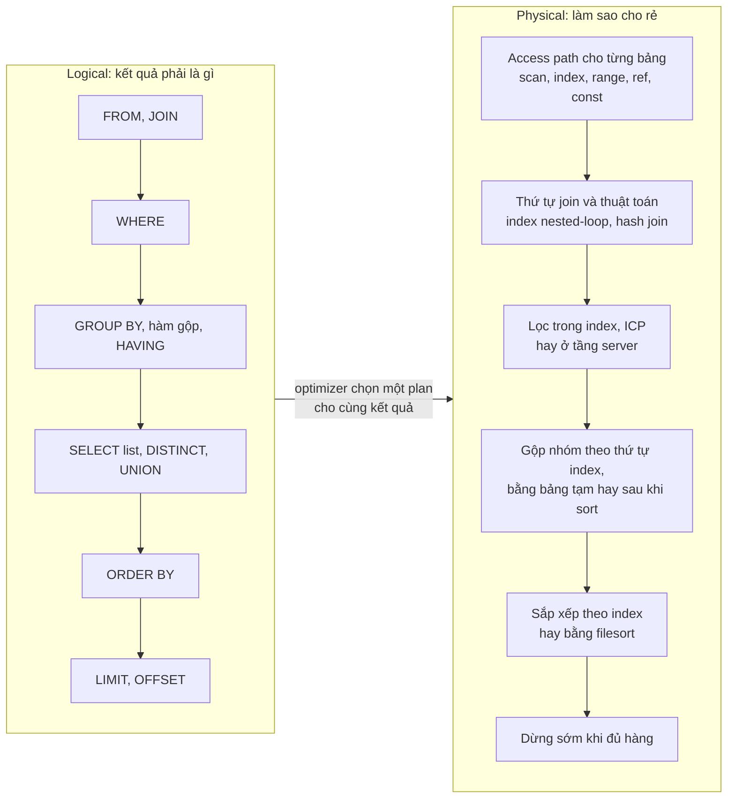

*(Sơ đồ do người viết ghi chú dựng; **Bổ sung ngoài sách**.)*

Bảng dưới nối từng bước logic với lựa chọn vật lý và dấu hiệu nhận biết. Tên toán tử ở cột thứ ba là tên **iterator** mà `EXPLAIN FORMAT=TREE` in ra trên MySQL 8.0.42 trong [bài thực hành](experiments/chapter-08.md) (**Kết quả đã đo**).

| Bước logic | MySQL có thể làm gì ở tầng vật lý | Dấu hiệu trong `EXPLAIN` / `FORMAT=TREE` | Sách |
| --- | --- | --- | --- |
| FROM, JOIN | Chọn thứ tự join, access path cho từng bảng, thuật toán join | Thứ tự dòng trong `EXPLAIN`; `Table scan`, `Index lookup`, `Single-row index lookup`, `Nested loop inner join`, `Inner hash join` | tr. 207, 212–216 |
| WHERE | Đẩy điều kiện vào index (range, ref), lọc trên index, lọc ở server; hằng số hóa; lan truyền điều kiện bằng nhau; dừng sớm | `range`, `Using index condition`, `Using where`, `Filter:`, `Impossible WHERE` | tr. 196–197, 207–210 |
| GROUP BY, hàm gộp | Đọc theo thứ tự index, dùng bảng tạm, hoặc sort rồi gộp; MIN/MAX thành hằng | `Using temporary`, `Using filesort`, `Group aggregate`, `Select tables optimized away` | tr. 197, 207–208, 223 |
| SELECT list | Không phải đọc hàng nếu index chứa đủ cột (covering index) | `Using index`, `Covering index lookup` | tr. 193, 209 |
| DISTINCT, UNION | Bảng tạm có loại trùng; UNION ALL có thể trả thẳng | `Union materialize with deduplication`, `Append`, `Stream results` | tr. 212, 225–226 |
| ORDER BY | Đọc index đúng thứ tự (khỏi sort), hoặc filesort, có thể qua bảng tạm | `Using filesort`, `Using temporary; Using filesort`, `Sort:` | tr. 216–217 |
| LIMIT, OFFSET | Dừng khi đủ hàng nếu không phải sort toàn bộ; OFFSET vẫn phải sinh rồi bỏ hàng | `Limit:`, `Limit/Offset:`, `limit input to N row(s) per chunk` | tr. 209, 217, 223–225 |

**Hiểu lầm phổ biến.** "Viết JOIN theo thứ tự nào thì MySQL join theo thứ tự đó" hay "WHERE chạy sau FROM nên luôn phải đọc hết bảng rồi mới lọc". Cả hai nhầm thứ tự logic với thứ tự vật lý. Muốn biết MySQL làm gì, phải nhìn plan, không nhìn cú pháp (tr. 213–216).

### Liên hệ với các chương khác

| Ý trong chương 8 | Chương | Căn cứ |
| --- | --- | --- |
| Tầng server (optimizer) không lưu statistics; storage engine cung cấp | [Chương 1](chapter-01.md#logical-architecture), Figure 1-1 | tr. 211 |
| Server tự quản lý table lock; InnoDB có row lock riêng; những gì mọi engine dùng chung nằm ở server | [Chương 1](chapter-01.md#lock-granularity) | tr. 204, 218 |
| Covering index để giảm số hàng phải đọc | [Chương 7](chapter-07.md#covering-index) | tr. 193, 198, 209 |
| Đọc `EXPLAIN`, access type, index giúp tìm hàng với ít dữ liệu hơn | [Chương 7](chapter-07.md) | tr. 195, 197 |
| Bảng tổng hợp (summary table) như một cách đổi schema | [Chương 6](chapter-06.md) (chỉ nhắc ở phần mở đầu, tr. 125) | tr. 198 |
| Cột rộng tốn bộ nhớ khi sort và khi dùng bảng tạm | [Chương 6](chapter-06.md#generosity) ("Generosity Can Be Unwise", tr. 131) | tr. 217 (**liên hệ do người viết ghi chú nhận ra**, sách không tham chiếu chéo) |
| Rows examined, bảng tạm, sort đo được bằng Performance Schema | [Chương 3](chapter-03.md#statement-indicators) (tr. 54–55) | tr. 194 (**liên hệ do người viết ghi chú nhận ra**) |
| `sort_buffer_size`, `join_buffer_size` là biến theo session | [Chương 5](chapter-05.md#scope) (tr. 102) | tr. 216 |
| Chia nhỏ DELETE giảm replication lag | [Chương 9](chapter-09.md) | tr. 199 |
| Join trong ứng dụng giúp đặt bảng trên các server khác nhau | [Chương 11](chapter-11.md) (functional sharding, sharding) | tr. 200 |

### Mạch lập luận

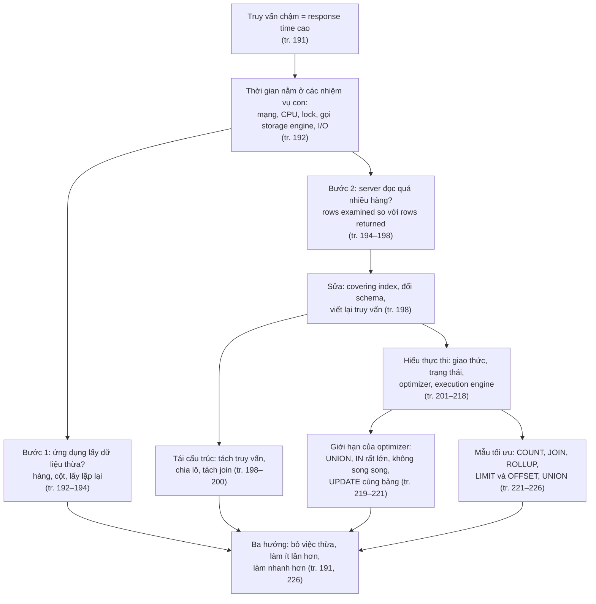

---

<a id="deep"></a>

## 2. Giải thích sâu

<a id="s2-1"></a>

### 2.1 Why Are Queries Slow? (tr. 191–192)

<a id="response-time"></a>

**What** (tr. 191). Trước khi viết truy vấn nhanh, hãy nhớ: mọi thứ quy về ***response time*** (thời gian phản hồi). Một truy vấn là một nhiệm vụ gồm nhiều **nhiệm vụ con** (*subtask*), và mỗi nhiệm vụ con tốn thời gian. Muốn tối ưu truy vấn thì tối ưu các nhiệm vụ con theo ba cách:

1. **loại bỏ** chúng;
2. cho chúng **xảy ra ít lần hơn**;
3. cho chúng **chạy nhanh hơn**.

**How: vòng đời của một truy vấn** (tr. 192). Hãy hình dung đi theo truy vấn trên một sequence diagram: từ client tới server, được **parse**, **lập plan**, **thực thi**, rồi quay về client. Thực thi là một trong những giai đoạn quan trọng nhất: nó gồm **rất nhiều lời gọi tới storage engine** để lấy hàng, cộng các thao tác **sau khi lấy hàng** như gộp nhóm và sắp xếp.

Trên đường đi, thời gian bị tiêu vào (tr. 192):

- **mạng** (xem chú thích 1 bên dưới);
- **CPU**;
- statistics, lập plan, **chờ khóa** (*mutex wait*);
- và nhất là **lời gọi storage engine để lấy hàng**, tốn thời gian bộ nhớ, CPU, và đặc biệt là **I/O nếu dữ liệu không nằm trong bộ nhớ**. Tùy storage engine, có thể có nhiều context switch hay system call.

> Chú thích 1 (tr. 192). Chi phí mạng tệ nhất khi ứng dụng chạy trên máy khác với server, nhưng chuyển dữ liệu giữa MySQL và ứng dụng trên cùng một máy cũng không miễn phí.

**Why chậm** (tr. 192). Trong mọi trường hợp, thời gian thừa đến từ ba nguồn tương ứng với ba cách tối ưu: thao tác **không cần thiết**, thao tác **lặp quá nhiều lần**, hoặc thao tác **quá chậm**.

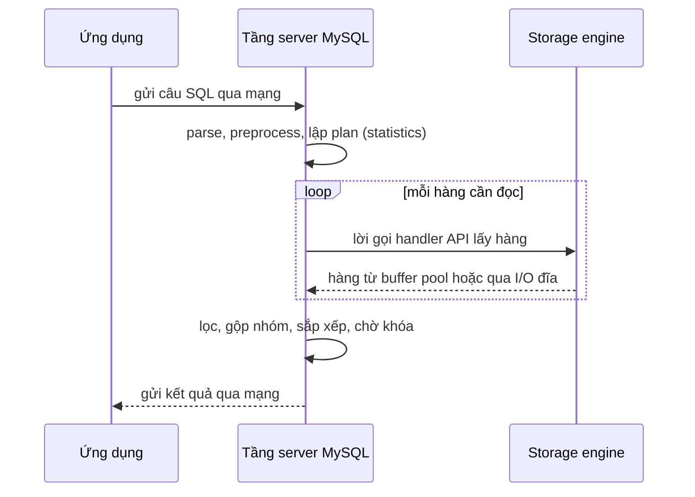

*(Sơ đồ do người viết ghi chú dựng từ mô tả ở tr. 192. Tác giả nói rõ đây **không** phải bức tranh đầy đủ hay chính xác; mục đích là tập thói quen nghĩ "thời gian bị tiêu ở đâu".)*

> **Bổ sung ngoài sách.** Mỗi nhiệm vụ con có công cụ đo riêng trong MySQL 8.0: `EXPLAIN ANALYZE` (từ 8.0.18) in thời gian thật và số vòng lặp của từng toán tử; Performance Schema có stage events và các cột như `ROWS_EXAMINED`, `CREATED_TMP_TABLES`, `SORT_ROWS` cho từng câu lệnh ([Chương 3](chapter-03.md)); chờ khóa hàng của InnoDB xem ở `sys.innodb_lock_waits`. Bài thực hành dùng cả ba.

**Hiểu lầm phổ biến.** "Truy vấn chậm nghĩa là thiếu index." Thiếu index chỉ là một nguyên nhân trong nhóm "thao tác quá chậm" hoặc "đọc quá nhiều". Truy vấn cũng có thể chậm vì **chờ khóa**, vì **trả quá nhiều dữ liệu qua mạng**, hay vì ứng dụng gọi nó **quá nhiều lần**. Cách tiếp cận của sách là tìm nhiệm vụ con tốn thời gian trước, rồi mới chọn cách sửa.

#### Tự kiểm tra 2.1

- **Câu 2.1.1.** Ba cách tác động lên một nhiệm vụ con là gì? Với mỗi cách, cho một kỹ thuật cụ thể trong MySQL. [đáp án](answers/chapter-08.md#q2-1-1)
- **Câu 2.1.2.** Một truy vấn trả 50.000 hàng cho ứng dụng chạy trên máy khác. Ngoài việc đọc dữ liệu trong storage engine, thời gian còn có thể bị tiêu ở đâu? Dự đoán điều gì thay đổi nếu ứng dụng chạy cùng máy với MySQL. [đáp án](answers/chapter-08.md#q2-1-2)
- **Câu 2.1.3.** Vì sao sách nhấn mạnh lời gọi storage engine để lấy hàng là nơi tiêu nhiều thời gian nhất? Khi nào phần đó chủ yếu tốn CPU, khi nào chủ yếu tốn I/O? [đáp án](answers/chapter-08.md#q2-1-3)

<a id="s2-2"></a>

### 2.2 Slow Query Basics: Optimize Data Access (tr. 192–198)

**Lập luận chính** (tr. 192). Lý do cơ bản nhất khiến truy vấn chậm là nó **làm việc với quá nhiều dữ liệu**. Có truy vấn bắt buộc phải sàng nhiều dữ liệu, nhưng đó là trường hợp hiếm; phần lớn truy vấn tệ có thể sửa để truy cập ít dữ liệu hơn. Tác giả đề xuất phân tích theo **hai bước**:

1. Ứng dụng có **lấy nhiều dữ liệu hơn cần** không? Thường là quá nhiều hàng, đôi khi là quá nhiều cột.
2. **MySQL server** có **phân tích nhiều hàng hơn cần** không?

Bước 1 nhìn từ phía ứng dụng (cái được *trả về*). Bước 2 nhìn vào bên trong server (cái được *đọc*).

<a id="unneeded-data"></a>

#### 2.2.1 Are You Asking the Database for Data You Don't Need? (tr. 192–194)

Truy vấn xin nhiều dữ liệu rồi vứt bớt sẽ bắt server làm thêm việc, tốn thêm mạng, và tốn bộ nhớ, CPU **ở máy chủ ứng dụng** (tr. 192). Các lỗi điển hình (tr. 193–194):

| Lỗi | Cơ chế gây tốn | Cách sửa theo sách |
| --- | --- | --- |
| **Lấy nhiều hàng hơn cần** | Nhiều người, nhất là ai quen DBMS khác, tưởng MySQL trả kết quả "theo yêu cầu": chạy SELECT trả nhiều hàng, lấy N hàng đầu rồi đóng result set. Thực tế MySQL **tạo trọn kết quả**, client library **nhận hết** rồi bỏ phần lớn. Ví dụ: lấy 100 bài mới nhất trong khi trang chủ chỉ hiện 10. | Thêm `LIMIT` |
| **Lấy mọi cột từ join nhiều bảng** | `SELECT *` trên join ba bảng actor, film_actor, film trả mọi cột của cả ba bảng | Chỉ chọn cột của bảng cần, ví dụ `actor.*` |
| **Lấy mọi cột** | `SELECT *` đáng nghi. Nó có thể **ngăn covering index**, thêm I/O, bộ nhớ, CPU cho server. Một số DBA cấm `SELECT *` vì lý do này và để giảm rủi ro khi ai đó đổi danh sách cột của bảng | Chỉ chọn cột cần |
| **Lấy lặp cùng dữ liệu** | Ví dụ hỏi URL ảnh đại diện của người dùng **cho mỗi bình luận** trong danh sách | Lấy một lần, **cache** rồi dùng lại |

**Trade-offs** (tr. 193). Lấy thừa dữ liệu **không phải lúc nào cũng xấu**. Nhiều người nói cách "phí phạm" này giúp phát triển đơn giản hơn, vì cùng một đoạn code dùng được ở nhiều nơi. Đó là cân nhắc hợp lý, **miễn là bạn biết cái giá về hiệu năng**. Lấy thừa cũng có thể có ích khi ứng dụng **cache** đối tượng: lấy và cache cả đối tượng có khi tốt hơn chạy nhiều truy vấn nhỏ, mỗi cái lấy một phần.

<a id="select-star"></a>

**Evidence & example: `SELECT *` làm mất covering index** (**Kết quả đã đo**, [TN1](experiments/chapter-08.md#tn1); MySQL 8.0.42, Windows 11, instance riêng, dữ liệu tổng hợp 1.000.000 hàng trong bảng `rental`). Bảng có index phụ `idx_customer(customer_id)`. Hai truy vấn cùng điều kiện `customer_id BETWEEN 1 AND 30`, cùng trả **50.086 hàng**:

| | `SELECT *` | `SELECT rental_id, customer_id` |
| --- | --- | --- |
| `type` / `Extra` | `range` / `Using index condition` | `range` / `Using where; Using index` |
| Lượt đọc page trong buffer pool (`Innodb_buffer_pool_read_requests`) | **200.447** | **106** |
| Byte gửi cho client (xấp xỉ, `Bytes_sent`) | 6.884.597 | 680.770 |

Vì sao chênh tới gần 2.000 lần ở lượt đọc page (**Bổ sung ngoài sách**, giải thích cơ chế)? Trong InnoDB, index phụ chỉ chứa cột được index **và primary key**. Truy vấn thứ hai chỉ cần `rental_id` (primary key) và `customer_id`, nên chỉ đọc lá của `idx_customer` theo thứ tự: khoảng một trăm page. Truy vấn `SELECT *` cần thêm `note`, `rental_date`..., nên **với mỗi hàng** phải đi từ gốc xuống lá của clustered index để lấy hàng đầy đủ. 200.447 / 50.086 ≈ 4 lượt đọc page mỗi hàng, đúng bằng độ sâu của một lần tra B+tree cộng phần đọc index phụ. Dữ liệu đã nằm trong buffer pool nên đây là đọc bộ nhớ; nếu phải đọc đĩa thì mỗi lần tra có thể là một random I/O.

**Hiểu lầm phổ biến.** "`SELECT *` chỉ tốn thêm băng thông mạng." Băng thông chỉ là một phần (ở đây gấp 10 lần). Chi phí lớn hơn nằm **bên trong** server: mất covering index nên mỗi hàng thành một lần tra clustered index.

<a id="examined-too-much"></a>

#### 2.2.2 Is MySQL Examining Too Much Data? (tr. 194–198)

Khi đã chắc truy vấn chỉ lấy dữ liệu cần, tìm truy vấn **đọc quá nhiều dữ liệu** để tạo ra kết quả. Ba chỉ số chi phí đơn giản nhất của MySQL là (tr. 194):

- response time;
- số hàng được đọc (***rows examined***);
- số hàng trả về (***rows returned***, trong Performance Schema gọi là `ROWS_SENT`).

Không chỉ số nào hoàn hảo, nhưng chúng phản ánh **đại khái** lượng dữ liệu MySQL phải truy cập bên trong và tốc độ truy vấn. Cả ba đều được ghi trong ***slow query log***, nên đọc slow query log là một trong những cách tốt nhất để tìm truy vấn đọc quá nhiều dữ liệu (tr. 194).

> **Bổ sung ngoài sách.** Slow query log của MySQL 8.0 ghi các trường `Query_time`, `Lock_time`, `Rows_sent`, `Rows_examined` cho mỗi câu lệnh vượt `long_query_time`. Performance Schema có cùng thông tin theo từng câu lệnh (`events_statements_history`, `events_statements_summary_by_digest`) mà không cần bật log; xem [Chương 3](chapter-03.md#examining-statements).

**Response time** (tr. 194–195).

- Tác giả tự đặt câu hỏi: vừa nói response time là thứ quan trọng, giờ lại bảo "đừng tin response time ngay"? Không mâu thuẫn: response time vẫn là thứ quan trọng, nhưng **khó diễn giải**.
- Response time = ***service time*** (thời gian server thực sự xử lý) + ***queue time*** (thời gian server không thực thi mà **chờ**: chờ I/O xong, chờ row lock...). Không thể tách hai phần nếu không đo riêng từng phần, mà điều đó thường khó.
- Chờ phổ biến và quan trọng nhất là **I/O** và **lock**, vì chúng hại hiệu năng nhất; nhưng đừng giả định chỉ có hai loại đó.
- Vì vậy response time **không ổn định** khi tải thay đổi. Storage engine lock (như row lock), concurrency cao, phần cứng... đều ảnh hưởng. Response time vừa có thể là **triệu chứng** vừa là **nguyên nhân** của vấn đề, và không phải lúc nào cũng rõ là cái nào.
- Câu hỏi nên đặt: response time này có **hợp lý** cho truy vấn này không? Có thể tính một ước lượng cận trên nhanh, ***QUBE*** (*quick upper-bound estimate*), theo sách *Relational Database Index Design and the Optimizers* của Tapio Lahdenmaki và Mike Leach: xem plan và các index liên quan, ước lượng số thao tác I/O **tuần tự** và **ngẫu nhiên**, nhân với thời gian phần cứng cần cho mỗi loại, cộng lại. Đó là thước đo để biết truy vấn có chậm hơn mức nó có thể hay nên đạt không (tr. 195).

> **Bổ sung ngoài sách — ví dụ QUBE (Ví dụ minh họa do AI xây dựng).** Truy vấn tra index phụ lấy 1.000 hàng rải rác rồi quay về clustered index cho từng hàng: khoảng 1 lần chạm ngẫu nhiên để vào khoảng index + 1.000 lần chạm tuần tự trên lá index + 1.000 lần chạm ngẫu nhiên vào bảng. Nếu giả định 0,1 ms cho mỗi lần đọc ngẫu nhiên từ SSD và bỏ qua phần tuần tự, cận trên khoảng 0,1 giây khi không có gì trong cache. Nếu đo thấy 2 giây, thời gian thừa nằm ở chỗ khác (chờ khóa, CPU, mạng). Hằng số thời gian phụ thuộc phần cứng; con số 0,1 ms ở đây chỉ là giả định để minh họa.

<a id="rows-examined"></a>

**Rows examined và rows returned** (tr. 195).

- Đếm số hàng được đọc cho biết truy vấn tìm dữ liệu **hiệu quả** tới đâu. Nhưng nó **không hoàn hảo**: không phải mọi lần truy cập hàng đều bằng nhau. Hàng ngắn truy cập nhanh hơn; lấy hàng từ bộ nhớ nhanh hơn nhiều so với đọc từ đĩa.
- Lý tưởng là số hàng đọc bằng số hàng trả về, nhưng hiếm khi được. Ví dụ khi join, server phải truy cập nhiều hàng để tạo **một** hàng kết quả.
- Tỉ lệ đọc so với trả thường nhỏ, **khoảng 1:1 tới 10:1**, nhưng có khi lớn hơn **nhiều bậc độ lớn**.

<a id="access-type"></a>

**Rows examined và access type** (tr. 195–197).

- Khi nghĩ về chi phí truy vấn, hãy nghĩ về chi phí **tìm một hàng** trong bảng. MySQL có nhiều ***access method*** để tìm hàng: có cách phải đọc nhiều hàng, có cách tạo được kết quả mà không đọc hàng nào (tr. 195).
- Access method hiện ở cột `type` của `EXPLAIN`. Từ chậm tới nhanh: **full table scan**, **index scan**, **range scan**, **tra index unique**, **hằng số**. Mỗi loại nhanh hơn loại trước vì đọc ít dữ liệu hơn. Không cần thuộc lòng, nhưng phải hiểu khái niệm quét bảng, quét index, truy cập khoảng, truy cập một giá trị (tr. 195).
- Không có access type tốt thì cách sửa tốt nhất thường là **thêm index phù hợp**. Index cho MySQL access type hiệu quả hơn, đọc ít dữ liệu hơn (tr. 195).

> **Bổ sung ngoài sách — các giá trị `type` trong MySQL 8.0** (theo tài liệu MySQL 8.0, mục "EXPLAIN Output Format"), xếp gần đúng từ tốt tới tệ: `system`, `const` (tối đa một hàng khớp, đọc một lần lúc tối ưu), `eq_ref` (mỗi tổ hợp hàng từ bảng trước khớp đúng một hàng qua unique index), `ref` (tra index không unique), `fulltext`, `ref_or_null`, `index_merge`, `unique_subquery`, `index_subquery`, `range`, `index` (quét **toàn bộ** index), `ALL` (quét toàn bảng). Thứ tự này chỉ là quy tắc ngón tay cái: quét toàn bộ một covering index nhỏ (`index`) có thể rẻ hơn một `range` phải quay về bảng cho mỗi hàng.

Ví dụ của sách trên bảng `sakila.film_actor` (tr. 195–196): truy vấn lấy mọi cột với `film_id = 1` trả **10 hàng**. `EXPLAIN` cho access type `ref` trên `idx_fk_film_id`, ước lượng đọc 10 hàng: optimizer biết access type này thỏa truy vấn hiệu quả. Sau khi xóa foreign key và index đó, `EXPLAIN` chuyển sang `ALL` (full table scan), ước lượng **5.462 hàng**, `filtered` 10,00, và `Extra` có `Using where`, nghĩa là server dùng WHERE để **bỏ hàng sau khi storage engine đã đọc chúng** (tr. 196).

<a id="where-apply"></a>

**Ba cách MySQL áp dụng WHERE, từ tốt tới tệ** (tr. 196–197):

| Cách | Xảy ra ở tầng | Dấu hiệu `EXPLAIN` |
| --- | --- | --- |
| 1. Áp điều kiện ngay trong **thao tác tra index** để loại hàng không khớp | Storage engine | Access type `ref`, `range`... (sách không nêu dấu hiệu riêng) |
| 2. Dùng **covering index** để khỏi đọc hàng, lọc hàng không khớp sau khi lấy từng mục từ index | Server, nhưng **không** đọc hàng từ bảng | `Using index` |
| 3. **Đọc hàng từ bảng** rồi mới lọc | Server, phải đọc hàng trước | `Using where` |

> **Bổ sung ngoài sách.** Từ MySQL 5.6 có thêm ***Index Condition Pushdown*** (ICP, dấu hiệu `Using index condition`): server đẩy phần điều kiện chỉ dùng cột của index xuống storage engine, để engine loại mục index không khớp **trước** khi quay về bảng lấy cả hàng. Nó nằm giữa cách 1 và cách 3. Trong TN1, `SELECT *` với `BETWEEN` hiện `Using index condition`.

**Index không phải lúc nào cũng làm số hàng đọc bằng số hàng trả** (tr. 197–198). Truy vấn `SELECT actor_id, COUNT(*) FROM sakila.film_actor GROUP BY actor_id` trả **200 hàng**, nhưng `EXPLAIN` cho `type: index` trên `PRIMARY`, ước lượng **5.462 hàng**, `Using index`. Đọc hàng nghìn hàng để trả 200 nghĩa là làm nhiều việc hơn cần. Index **không thể** giảm số hàng đọc ở đây vì **không có WHERE** để loại hàng. Nghĩa là: số hàng đọc lớn có thể do bản chất truy vấn (gộp nhóm trên cả bảng), không phải do thiếu index.

> Chú thích 2 (tr. 197). Xem thêm mục "Optimizing COUNT() Queries" ở tr. 221 (ghi chú ở [2.6.1](#count)).

**MySQL không cho biết hàng nào thực sự dùng** (tr. 198). Nó chỉ báo tổng số hàng đã truy cập. Nhiều hàng có thể bị WHERE loại và không góp vào kết quả. Ở ví dụ bỏ index, truy vấn đọc mọi hàng và WHERE bỏ tất cả trừ 10. Muốn biết server truy cập bao nhiêu và dùng bao nhiêu, phải **suy luận về truy vấn**.

**Evidence & example** (**Kết quả đã đo**, [TN1](experiments/chapter-08.md#tn1); dữ liệu tổng hợp mô phỏng kích thước Sakila: `film_actor` 5.400 hàng, `film_id = 1` có 7 hàng):

| Truy vấn | `type` | Rows examined (Performance Schema) | Rows sent | Handler counter |
| --- | --- | --- | --- | --- |
| `SELECT * ... WHERE film_id = 1` | `ref` | 7 | 7 | `Handler_read_key` 1, `Handler_read_next` 7 |
| Như trên với `IGNORE INDEX (idx_fk_film_id)` | `ALL` | 5.400 | 7 | `Handler_read_rnd_next` 5.401 |
| `SELECT actor_id, COUNT(*) ... GROUP BY actor_id` | `index` | 5.400 | 200 | `Handler_read_next` 5.400 |

Một chi tiết nhỏ khác sách: với `IGNORE INDEX`, `filtered` là 0,14 chứ không phải 10,00 như khi sách xóa hẳn index. Có vẻ optimizer vẫn dùng thống kê của index bị bỏ qua để ước lượng độ chọn lọc, còn khi index không tồn tại nó phải dùng hệ số mặc định (**Bổ sung ngoài sách**, diễn giải của người viết ghi chú).

**Khi đọc quá nhiều hàng để trả về ít, có thể thử** (tr. 198):

- **covering index**: lưu dữ liệu sao cho storage engine không phải lấy hàng đầy đủ ([Chương 7](chapter-07.md#covering-index));
- **đổi schema**, ví dụ dùng **summary table** ([Chương 6](chapter-06.md));
- **viết lại** truy vấn phức tạp để optimizer thực thi tối ưu (phần sau của chương này).

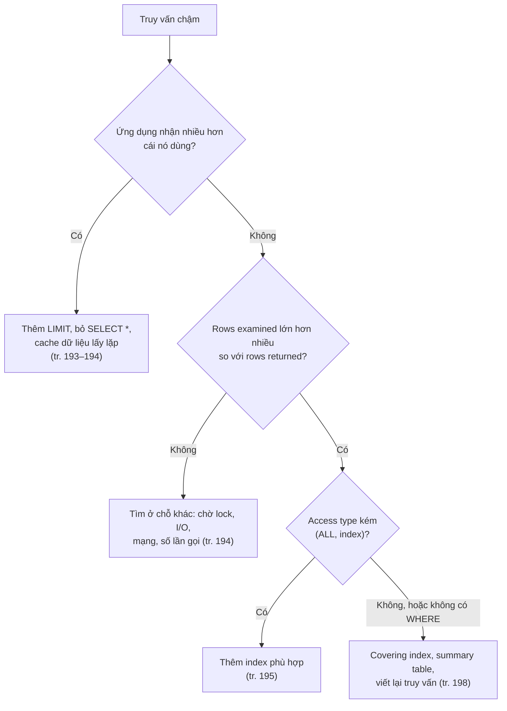

*(Sơ đồ do người viết ghi chú tổng hợp từ tr. 192–198.)*

**Hiểu lầm phổ biến.**

- "Cột `rows` của `EXPLAIN` là số hàng đã đọc." Đó là **ước lượng** trước khi chạy, dựa trên statistics. Số thật lấy từ `EXPLAIN ANALYZE` (8.0.18+), Performance Schema, slow query log hay `Handler_*` (**Bổ sung ngoài sách**). Trong TN2, optimizer ước lượng 7,41 hàng mỗi lần tra `film_actor` theo `film_id`, thực tế trung bình 5,4.
- "`type: index` và `Extra: Using index` là một." `type: index` là **quét toàn bộ index**; `Using index` là **covering index**. Chương 7 cũng cảnh báo sự nhầm lẫn này.

#### Tự kiểm tra 2.2

- **Câu 2.2.1.** Ứng dụng chạy SELECT lấy 100 bài mới nhất, đọc 10 hàng đầu rồi đóng result set. Developer tin MySQL chỉ làm việc cho 10 hàng. Lập luận này sai ở đâu? [đáp án](answers/chapter-08.md#q2-2-1)
- **Câu 2.2.2.** Vì sao `SELECT *` có thể làm truy vấn chậm hơn nhiều ngay cả khi mạng không phải nút thắt? Dùng số liệu TN1 (200.447 so với 106 lượt đọc page) để giải thích. [đáp án](answers/chapter-08.md#q2-2-2)
- **Câu 2.2.3.** Hai truy vấn cùng trả 200 hàng: A đọc 200 hàng, B đọc 5.400 hàng. Có chắc B "tệ" và sửa được bằng index không? [đáp án](answers/chapter-08.md#q2-2-3)
- **Câu 2.2.4.** Phân biệt ba cách MySQL áp WHERE và dấu hiệu `EXPLAIN` của chúng. Vì sao thứ tự "tốt tới tệ" lại như vậy? ICP nằm ở đâu? [đáp án](answers/chapter-08.md#q2-2-4)
- **Câu 2.2.5.** Một truy vấn chạy 5 ms lúc 3 giờ sáng và 800 ms lúc cao điểm, plan không đổi. Dùng khái niệm service time và queue time để giải thích, và nêu cách tìm nguyên nhân gốc. [đáp án](answers/chapter-08.md#q2-2-5)

<a id="s2-3"></a>

### 2.3 Ways to Restructure Queries (tr. 198–200)

**Mục tiêu** (tr. 198). Khi tối ưu truy vấn có vấn đề, mục tiêu là tìm **cách khác để có kết quả mình muốn**, chứ không nhất thiết lấy **cùng result set** từ MySQL. Có thể biến truy vấn thành dạng tương đương cho cùng kết quả và nhanh hơn. Nhưng cũng nên nghĩ tới việc viết lại để lấy **kết quả khác**, nếu điều đó hiệu quả hơn, và đổi cả code ứng dụng để cuối cùng vẫn làm được cùng việc.

<a id="complex-vs-many"></a>

#### 2.3.1 Complex Queries Versus Many Queries (tr. 198–199)

**Câu hỏi thiết kế.** Có nên tách một truy vấn phức tạp thành nhiều truy vấn đơn giản không?

- **Cách truyền thống:** làm nhiều việc nhất với ít truy vấn nhất. Trước đây cách này tốt hơn vì **chi phí liên lạc mạng** và chi phí **parse, tối ưu** mỗi truy vấn (tr. 198).
- **Với MySQL, lời khuyên đó ít đúng hơn** (tr. 198–199): MySQL được thiết kế để kết nối, ngắt kết nối rất hiệu quả và trả lời truy vấn nhỏ, đơn giản rất nhanh. Mạng hiện đại nhanh hơn nhiều. Tùy phiên bản, MySQL chạy được **hơn 100.000 truy vấn đơn giản mỗi giây** trên phần cứng phổ thông, và **hơn 2.000 QPS từ một client duy nhất** trên mạng gigabit.
- **Nhưng** phản hồi qua kết nối vẫn chậm so với tốc độ MySQL duyệt hàng bên trong, tính bằng **hàng triệu hàng mỗi giây** với dữ liệu trong bộ nhớ (tr. 199).
- **Kết luận của tác giả:** khi mọi thứ khác như nhau, vẫn nên dùng ít truy vấn nhất có thể. Nhưng đôi khi tách thành vài truy vấn đơn giản lại hiệu quả hơn một truy vấn phức tạp. Đừng ngại làm vậy: **cân chi phí** và chọn cách gây **ít việc hơn** (tr. 199).
- **Sai lầm ngược lại** cũng phổ biến: dùng **quá nhiều** truy vấn, ví dụ 10 truy vấn một hàng thay vì một truy vấn 10 hàng, thậm chí lấy **từng cột** một, truy vấn mỗi hàng nhiều lần (tr. 199).

> **Bổ sung ngoài sách (phép tính).** 2.000 QPS từ một client nghĩa là mỗi vòng hỏi đáp tốn khoảng 0,5 ms. Một trang web chạy 1.000 truy vấn một hàng (mẫu "N+1 query" hay gặp khi dùng ORM) tốn khoảng 0,5 giây chỉ cho các vòng hỏi đáp, trong khi một truy vấn trả 1.000 hàng có thể xong trong vài mili giây vì MySQL duyệt hàng triệu hàng mỗi giây trong bộ nhớ. Ngược lại, nếu một truy vấn phức tạp buộc optimizer chọn plan tệ (đọc cả triệu hàng), tách nó thành hai truy vấn dùng index tốt sẽ rẻ hơn dù tốn thêm một vòng.

<a id="chopping"></a>

#### 2.3.2 Chopping Up a Query (tr. 199–200)

**What** (tr. 199). Chia để trị: giữ nguyên truy vấn nhưng chạy theo **từng phần nhỏ** (*chunk*), mỗi lần ảnh hưởng ít hàng hơn.

**Why** (tr. 199). Ví dụ điển hình là **purge** (xóa dữ liệu cũ) định kỳ. Làm trong **một** truy vấn lớn có thể:

- **khóa rất nhiều hàng** trong thời gian dài;
- làm đầy transaction log;
- chiếm tài nguyên;
- **chặn những truy vấn nhỏ** lẽ ra không được bị gián đoạn.

Chia DELETE thành các truy vấn cỡ vừa có thể **cải thiện hiệu năng** đáng kể và **giảm replication lag** khi truy vấn được nhân bản.

**How** (tr. 199–200). Thay vì một câu DELETE mọi tin nhắn cũ hơn ba tháng, chạy lặp câu DELETE có thêm `LIMIT 10000` cho tới khi số hàng bị ảnh hưởng bằng 0. Xóa 10.000 hàng mỗi lần thường **đủ lớn** để mỗi truy vấn hiệu quả và **đủ ngắn** để giảm tác động lên server; storage engine có transaction có thể được lợi từ transaction nhỏ. Có thể thêm **thời gian nghỉ** giữa các lần DELETE để rải tải theo thời gian và giảm thời gian giữ khóa.

> Chú thích 3 (tr. 199). Công cụ *pt-archiver* của Percona Toolkit giúp làm loại việc này dễ và an toàn.

```sql
-- Ví dụ minh họa do AI xây dựng (MySQL 8.0): vòng lặp xóa theo lô trong stored procedure
DELIMITER //
CREATE PROCEDURE purge_old_messages(IN p_batch INT, IN p_pause DECIMAL(5,2))
BEGIN
  DECLARE v_rows INT DEFAULT 1;
  WHILE v_rows > 0 DO
    DELETE FROM messages
     WHERE created < NOW() - INTERVAL 3 MONTH
     LIMIT p_batch;              -- mỗi câu là một transaction riêng khi autocommit=1
    SET v_rows = ROW_COUNT();
    IF v_rows > 0 AND p_pause > 0 THEN DO SLEEP(p_pause); END IF;
  END WHILE;
END//
DELIMITER ;
```

**Evidence & example** (**Kết quả đã đo**, [TN5](experiments/chapter-08.md#tn5); bảng `messages` 300.000 hàng, có index `idx_created`, xóa 131.039 hàng cũ hơn mốc, tức khoảng 44%; mức cô lập mặc định REPEATABLE READ):

| | Một câu DELETE | 14 lô `LIMIT 10000` |
| --- | --- | --- |
| Plan của câu DELETE | `type: ALL` (quét toàn bảng) | `type: range` trên `idx_created` |
| Hàng bị khóa trong một transaction (`trx_rows_locked`) | **303.660** (cả hàng không bị xóa) | tối đa **20.009** |
| Một `UPDATE` vào hàng **không** bị xóa (id 250.000), chờ tối đa 3 giây | **Lỗi 1205** (lock wait timeout) khi transaction lớn chưa commit | Xong sau **2,9 ms** |
| Thời gian câu dài nhất (trung vị 3 lần) | 998 ms | 152 ms mỗi lô |
| Tổng thời gian làm việc (trung vị 3 lần) | 998 ms | 1.653 ms |

**Diễn giải** (**Bổ sung ngoài sách**, cơ chế InnoDB theo tài liệu MySQL 8.0, mục "Locks Set by Different SQL Statements in InnoDB"):

- Optimizer thấy 44% số hàng khớp nên chọn **quét toàn bảng** thay vì đi qua `idx_created`. Đây là quyết định về chi phí hợp lý cho việc *đọc*.
- Nhưng DELETE là **locking read**: ở REPEATABLE READ, InnoDB khóa **mọi hàng nó quét qua** và giữ tới khi commit, kể cả hàng không thỏa WHERE. Nên một câu DELETE lớn khóa gần như cả bảng: một UPDATE vào hàng mới hoàn toàn không liên quan cũng bị chặn. Đây đúng là điều sách cảnh báo: "chặn những truy vấn nhỏ".
- Câu có `LIMIT 10000` làm optimizer chọn `range` trên index (vì chỉ cần 10.000 hàng đầu), nên mỗi lô chỉ khóa khoảng 10.000 mục index phụ cộng 10.000 hàng clustered (≈ 20.009), và giữ khóa khoảng 0,1 giây.

**Trade-offs.**

- **Tổng thời gian không giảm, có khi tăng.** Đo được tổng thời gian chia lô **dài hơn** (1,65 so với 1,0 giây). Lời sách "cải thiện hiệu năng đáng kể" nên hiểu là hiệu năng **của cả server và các truy vấn khác** (khóa ngắn, transaction nhỏ, ít lag), không phải job purge chạy nhanh hơn. Một giả thuyết cho phần tăng thêm (**Dự đoán**, chưa kiểm chứng): mỗi lô quét `idx_created` lại từ đầu khoảng và phải đi qua các mục đã bị đánh dấu xóa nhưng purge thread chưa dọn.
- **Mất tính nguyên tử.** Một câu DELETE thì hoặc xóa hết hoặc không. Chia lô thì người khác có thể thấy trạng thái "đã xóa một nửa"; job phải chạy lại được an toàn khi bị ngắt giữa chừng (**Bổ sung ngoài sách**).
- **DELETE ... LIMIT không có ORDER BY** chọn hàng không xác định. Với `binlog_format=STATEMENT` câu này không an toàn cho replication; MySQL 8.0 mặc định `ROW` (đo được trong TN5) nên không gặp vấn đề này (**Bổ sung ngoài sách**).
- **Decision.** Chia lô khi lượng xóa lớn, bảng đang phục vụ truy vấn khác, hoặc có replica. Lô nên đi theo index (cột thời gian hay primary key) để mỗi lô không quét lại cả bảng. Chỉ khi bảng không ai dùng (cửa sổ bảo trì) và cần tính nguyên tử thì một câu lớn mới đáng cân nhắc.

<a id="join-decomposition"></a>

#### 2.3.3 Join Decomposition (tr. 200)

**What.** Nhiều ứng dụng hiệu năng cao dùng ***join decomposition*** (tách join): chạy **nhiều truy vấn một bảng** thay vì một join nhiều bảng, rồi **join trong ứng dụng**. Ví dụ của sách: thay vì một truy vấn join ba bảng `tag`, `tag_post`, `post` để lấy các bài có tag "mysql", chạy ba truy vấn: tìm tag theo tên, tìm các cặp tag–post theo `tag_id` vừa có, rồi lấy các bài theo danh sách `post.id IN (...)` (tr. 200).

**Why** (tr. 200). Thoạt nhìn có vẻ phí: nhiều truy vấn hơn mà không được gì. Nhưng tái cấu trúc như vậy có thể có lợi lớn:

1. **Cache hiệu quả hơn.** Nhiều ứng dụng cache "đối tượng" ánh xạ thẳng tới bảng. Nếu đối tượng tag "mysql" đã có trong cache thì bỏ được truy vấn đầu; bài nào đã có trong cache thì bỏ khỏi danh sách `IN()`.
2. Chạy từng truy vấn riêng đôi khi **giảm tranh chấp khóa**.
3. Join trong ứng dụng giúp **scale database** dễ hơn bằng cách đặt các bảng trên **các server khác nhau**.
4. Bản thân các truy vấn có thể **hiệu quả hơn**: danh sách `IN()` thay cho join cho phép MySQL **sắp xếp các ID** rồi lấy hàng theo cách tối ưu hơn so với join.
5. **Giảm truy cập hàng trùng lặp.** Join trong ứng dụng lấy mỗi hàng **một lần**, còn join trong truy vấn về bản chất là một phép **phi chuẩn hóa** có thể đọc lặp cùng dữ liệu. Vì thế cũng có thể giảm tổng lưu lượng mạng và bộ nhớ.

**Khi nào nên dùng** (tr. 200): khi cache và dùng lại nhiều dữ liệu từ truy vấn trước; khi dữ liệu phân tán trên nhiều server; khi thay join bằng danh sách `IN()` trên bảng lớn; khi một join tham chiếu **cùng một bảng nhiều lần**.

**Trade-offs** (**Bổ sung ngoài sách**):

- **Nhất quán.** Một câu join đọc từ một snapshot. Ba câu riêng (autocommit) có thể thấy ba trạng thái khác nhau của dữ liệu. Nếu cần nhất quán, đặt chúng trong một transaction REPEATABLE READ (consistent read của InnoDB dùng chung snapshot cho cả transaction).
- **Số vòng hỏi đáp** tăng (xem 2.3.1); nếu không có cache nào trúng, lợi ích có thể biến mất.
- Danh sách `IN()` **rất lớn** có chi phí riêng (xem [2.5.2](#equality-propagation)).
- Logic join chuyển sang ứng dụng: thêm code, thêm chỗ sai.

**Hiểu lầm phổ biến.** "JOIN luôn nhanh hơn nhiều truy vấn" hay ngược lại "join trong ứng dụng luôn scale tốt hơn". Cả hai đều phụ thuộc: cache trúng bao nhiêu, dữ liệu có phân tán không, độ lớn danh sách ID, và optimizer có chọn plan tốt cho câu join không.

#### Tự kiểm tra 2.3

- **Câu 2.3.1.** Khi nào tách một truy vấn phức tạp thành nhiều truy vấn đơn giản là có lợi, và khi nào dùng nhiều truy vấn lại là sai lầm? Lập luận bằng chi phí vòng hỏi đáp so với chi phí xử lý bên trong server. [đáp án](answers/chapter-08.md#q2-3-1)
- **Câu 2.3.2.** Trong TN5, một câu DELETE xóa 131.039 hàng nhưng khóa 303.660 hàng và chặn UPDATE vào một hàng không liên quan. Giải thích cơ chế. Chia lô thay đổi điều gì? [đáp án](answers/chapter-08.md#q2-3-2)
- **Câu 2.3.3.** Chia lô làm tổng thời gian purge dài hơn trong phép đo. Vậy sách nói "cải thiện hiệu năng" theo nghĩa nào? Nêu hai cái giá phải trả khi chia lô. [đáp án](answers/chapter-08.md#q2-3-3)
- **Câu 2.3.4.** Nêu ba lý do join decomposition có thể nhanh hơn một câu join, và một tình huống nó phản tác dụng. [đáp án](answers/chapter-08.md#q2-3-4)

<a id="s2-4"></a>

### 2.4 Query Execution Basics (tr. 201–218)

**Why học phần này** (tr. 201). Muốn MySQL chạy nhanh, một trong những khoản đầu tư thời gian tốt nhất là học cách nó **tối ưu và thực thi** truy vấn. Hiểu rồi thì phần lớn việc tối ưu trở thành **suy luận từ nguyên lý**, một quá trình rất logic.

**Bốn bước khi gửi một truy vấn** (tr. 201, Hình 8-1):

1. Client gửi câu SQL tới server.
2. Server **parse**, **preprocess** và **tối ưu** nó thành một ***query execution plan***.
3. ***Query execution engine*** thực thi plan bằng cách **gọi storage engine API**.
4. Server gửi kết quả về client.

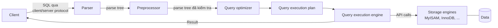

*(Vẽ lại Hình 8-1, tr. 201, theo ảnh trang PDF 223. Hình gốc có thêm một mũi tên "Result" ngay cạnh mũi tên "SQL" ở cổng client/server protocol; toàn bộ phần từ parser tới storage engine nằm trong một khung nét đứt là server.)*

Mỗi bước có độ phức tạp riêng; quá trình tối ưu là phần phức tạp và quan trọng nhất (tr. 202). Sách nói có ngoại lệ, như đường thực thi khác khi dùng **prepared statement**, và hẹn bàn "ở chương sau". Thực tế chương 9 là Replication và không bàn prepared statement; trong sách, prepared statement chỉ xuất hiện ở chương 3 (instrumentation) và chương 5. Đây có vẻ là tham chiếu còn sót từ ấn bản trước (xem [Ghi chú kiểm tra nguồn](#kiem-tra)).

<a id="client-server-protocol"></a>

#### 2.4.1 The MySQL Client/Server Protocol (tr. 202–204)

**What** (tr. 202). Không cần biết chi tiết, nhưng phải hiểu ở mức cao: giao thức là ***half-duplex***. Tại một thời điểm, server **hoặc** gửi **hoặc** nhận, không làm cả hai. Cũng **không có cách cắt ngắn** một message.

**Hệ quả** (tr. 202):

- Giao thức đơn giản và nhanh, nhưng **không có flow control**: một bên đã gửi message thì bên kia phải nhận **hết** rồi mới trả lời. Tác giả ví như trò ném bóng: chỉ một bên cầm bóng, không cầm bóng thì không ném được.
- Client gửi truy vấn trong **một packet**. Vì thế biến `max_allowed_packet` quan trọng khi truy vấn lớn (xem chú thích 4). Gửi xong, client hết bóng, chỉ chờ kết quả.
- Trả lời của server thường gồm **nhiều packet**, và client phải nhận **toàn bộ** result set. Nó không thể lấy vài hàng rồi bảo server đừng gửi nữa. Nếu chỉ cần vài hàng đầu, client phải chờ hết packet rồi bỏ phần thừa, hoặc **ngắt kết nối thô bạo**. Cả hai đều tệ, nên `LIMIT` phù hợp mới quan trọng.
- Client tưởng mình **kéo** (*pull*) hàng, nhưng thật ra server **đẩy** (*push*) hàng khi tạo ra chúng; client "uống từ vòi cứu hỏa" (tr. 202).

> Chú thích 4 (tr. 202). Nếu truy vấn quá lớn, server từ chối nhận thêm dữ liệu và báo lỗi.

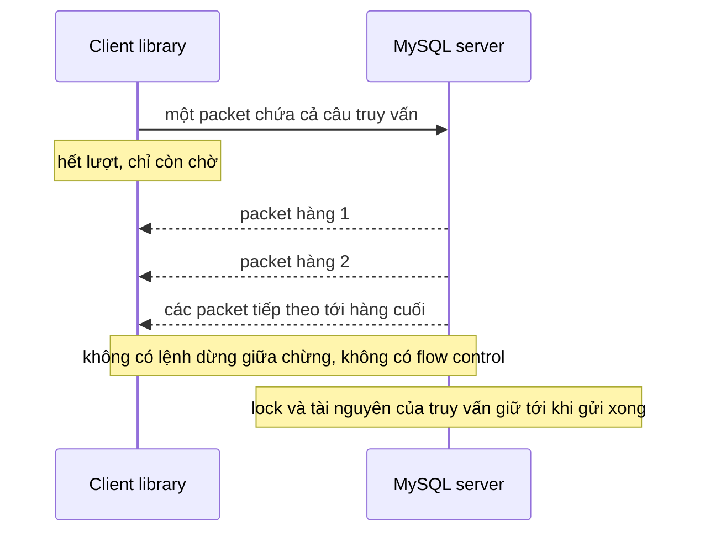

*(Sơ đồ do người viết ghi chú dựng từ tr. 202–203.)*

<a id="buffered-result"></a>

**Buffered và unbuffered result** (tr. 202–204). Đa số thư viện cho chọn: lấy cả result set rồi **đệm trong bộ nhớ**, hoặc lấy từng hàng khi cần. Mặc định thường là **đệm hết**. Điều này quan trọng vì **tới khi mọi hàng được lấy xong, server chưa giải phóng lock và tài nguyên** của truy vấn; truy vấn ở trạng thái "Sending data".

| | Buffered (mặc định) | Unbuffered |
| --- | --- | --- |
| Server | Xong và dọn dẹp **sớm nhất** có thể | Giữ lock và tài nguyên **trong lúc ứng dụng xử lý** từng hàng |
| Bộ nhớ phía client | Cả result set | Ít |
| Bắt đầu xử lý | Sau khi nhận hết | Ngay khi có hàng đầu |
| Hợp với | Đa số trường hợp | Result set **rất lớn**, mất lâu để lấy và tốn bộ nhớ |

Ví dụ của sách (tr. 203–204): hàm `mysql_query()` của PHP thật ra kéo cả kết quả vào buffer, vòng `while` chỉ duyệt buffer; `mysql_unbuffered_query()` thì không đệm. Driver Perl `DBD::mysql` cần thuộc tính `mysql_use_result` (mặc định là `mysql_buffer_result`), đặt được cho từng câu lệnh hay cho cả kết nối.

> Chú thích 5 (tr. 203). Có thể lách việc server giữ lock khi client không đệm bằng `SQL_BUFFER_RESULT`, sách nhắc lại ở phần sau (chú thích 13, tr. 218).

> **Bổ sung ngoài sách.** Extension `mysql_*` của PHP đã bị gỡ từ PHP 7.0; ngày nay dùng `mysqli_query($link, $sql, MYSQLI_USE_RESULT)` hoặc tắt thuộc tính `PDO::MYSQL_ATTR_USE_BUFFERED_QUERY` để không đệm. Client dòng lệnh `mysql` có tùy chọn `--quick` cho cùng mục đích. Mặc định `max_allowed_packet` của MySQL 8.0 là 64 MB. `SQL_BUFFER_RESULT` buộc server đưa kết quả vào bảng tạm trước khi gửi, nhờ đó nhả lock bảng sớm khi client nhận chậm, đổi lại tốn thêm bảng tạm.

**Hiểu lầm phổ biến.** "Dùng cursor kiểu unbuffered thì server nhẹ hơn." Ngược lại: unbuffered nhẹ cho **client**, nhưng giữ tài nguyên **server** lâu hơn. Ứng dụng xử lý chậm từng hàng có thể giữ khóa rất lâu.

<a id="query-states"></a>

#### 2.4.2 Query States (tr. 204)

Mỗi kết nối (thread) có một **trạng thái** cho biết nó đang làm gì. Cách xem dễ nhất là `SHOW FULL PROCESSLIST`. Trong vòng đời truy vấn, trạng thái đổi nhiều lần; có hàng chục trạng thái, tài liệu MySQL là nguồn đầy đủ (tr. 204). Một số trạng thái sách liệt kê:

| Trạng thái | Ý nghĩa (tr. 204) |
| --- | --- |
| `Sleep` | Chờ truy vấn mới từ client |
| `Query` | Đang thực thi truy vấn **hoặc** đang gửi kết quả về client |
| `Locked` | Chờ **table lock ở tầng server**. Lock do storage engine cài, như **row lock của InnoDB**, **không** làm thread vào trạng thái này |
| `Analyzing and statistics` | Đang kiểm tra statistics của storage engine và tối ưu truy vấn |
| `Copying to tmp table [on disk]` | Đang xử lý và chép kết quả vào bảng tạm, có lẽ cho GROUP BY, filesort hay UNION. Có đuôi "on disk" nghĩa là đang chuyển bảng tạm trong bộ nhớ thành bảng trên đĩa |
| `Sorting result` | Đang sắp xếp result set |

**Why** (tr. 204). Biết các trạng thái cơ bản giúp hiểu "**ai đang cầm bóng**". Trên server rất bận, nếu một trạng thái vốn ngắn như `statistics` bắt đầu tốn nhiều thời gian, thường là có chuyện.

> **Bổ sung ngoài sách.**
> - `Sleep` và `Query` thật ra là giá trị cột **`Command`** của processlist; các trạng thái chi tiết như `statistics`, `executing` nằm ở cột **`State`**. Sách gộp cả hai dưới chữ "Command column".
> - Theo tài liệu MySQL 8.0 (mục "General Thread States"), từ 8.0.17 trạng thái "Sending data" không còn hiện riêng mà gộp vào `executing`.
> - **Kết quả đã đo** ([TN2](experiments/chapter-08.md#tn2), lấy mẫu `performance_schema.processlist` mỗi 50 ms trên 8.0.42): truy vấn filesort chỉ hiện `executing`; truy vấn GROUP BY trên 1 triệu giá trị khác nhau hiện `executing`, rồi `converting HEAP to ondisk`, rồi **chuỗi rỗng** trong khoảng 6 giây còn lại. Không thấy "Sending data" hay "Sorting result". Nghĩa là: trạng thái hữu ích để định hướng, nhưng không thay được số đo như `EXPLAIN ANALYZE` hay stage events.
> - Chờ row lock của InnoDB không hiện `Locked`; xem ở `sys.innodb_lock_waits` hay `performance_schema.data_lock_waits`. Chờ metadata lock hiện `Waiting for table metadata lock` ([Chương 3](chapter-03.md#metadata-locks) bàn metadata lock).

<a id="optimization-process"></a>

#### 2.4.3 The Query Optimization Process (tr. 205–217)

Bước tiếp theo biến câu SQL thành execution plan, gồm các bước con **parsing**, **preprocessing** và **optimization**; lỗi (ví dụ lỗi cú pháp) có thể phát sinh ở bất kỳ bước nào. Tác giả nói rõ họ **đơn giản hóa**: mô tả các bước tách rời dù thật ra chúng thường được gộp toàn phần hay một phần cho hiệu quả (tr. 205).

<a id="parser"></a>

**The parser and the preprocessor** (tr. 205).

- ***Parser*** tách truy vấn thành **token** và dựng ***parse tree***. Nó dùng ngữ pháp SQL của MySQL để diễn giải và kiểm tra: token hợp lệ, đúng thứ tự, không có lỗi như chuỗi trong nháy chưa đóng.
- ***Preprocessor*** kiểm tra những ngữ nghĩa mà parser không giải được: bảng và cột **có tồn tại** không, phân giải tên và alias để tham chiếu cột **không mơ hồ**.
- Sau đó preprocessor kiểm tra **quyền**. Bước này thường rất nhanh, trừ khi server có **rất nhiều** quyền.

<a id="cost-based-optimizer"></a>

**The query optimizer: tối ưu dựa trên chi phí** (tr. 205–206).

- **What.** Parse tree giờ hợp lệ. Một truy vấn thường thực thi được bằng nhiều cách cho cùng kết quả; việc của optimizer là tìm cách tốt nhất. MySQL dùng ***cost-based optimizer***: dự đoán **chi phí** của các plan rồi chọn plan **rẻ nhất** (tr. 205).
- **Đơn vị chi phí** ban đầu là **một lần đọc ngẫu nhiên một page dữ liệu 4 KB**; nay tinh vi hơn, có tính cả chi phí ước lượng của việc so sánh trong WHERE (tr. 205).

<a id="last-query-cost"></a>

**Xem chi phí bằng `Last_query_cost`** (tr. 205–206). Chạy truy vấn rồi xem biến `Last_query_cost`. Ví dụ của sách: `COUNT(*)` trên `sakila.film_actor` cho `Last_query_cost` khoảng **1.040,6**, nghĩa là optimizer ước lượng cần khoảng 1.040 lần đọc page ngẫu nhiên.

- **Dựa trên statistics:** số page của mỗi bảng hay index, ***cardinality*** (số giá trị khác nhau) của index, độ dài hàng và khóa, phân bố khóa (tr. 206).
- Theo sách, optimizer **không tính tác động của cache** nào: nó giả định mọi lần đọc đều là một I/O đĩa (tr. 206).

> **Bổ sung ngoài sách — cost model của MySQL 8.0 (Kết quả đã đo, [TN2](experiments/chapter-08.md#tn2)).**
> - Các hằng số chi phí nằm trong bảng `mysql.server_cost` và `mysql.engine_cost`, chỉnh được. Giá trị mặc định đọc được trên 8.0.42: `row_evaluate_cost` 0,1; `key_compare_cost` 0,05; `memory_temptable_create_cost` 1; `memory_temptable_row_cost` 0,1; `disk_temptable_create_cost` 20; `disk_temptable_row_cost` 0,5; `io_block_read_cost` 1; `memory_block_read_cost` 0,25.
> - **Trên 8.0.42, lời sách "không tính cache" không còn đúng hoàn toàn.** Sau khi khởi động với buffer pool lạnh, `EXPLAIN FORMAT=TREE` cho chi phí quét toàn bảng `rental` là **107.138**; sau khi đọc bảng một lần cho nóng, cùng câu `EXPLAIN` cho **101.203**. Phép tính: 992.250 hàng ước lượng × 0,1 = 99.225; cộng 7.913 page × 1,0 khi lạnh = 107.138, hoặc 7.913 page × 0,25 khi nóng = 101.203. Tức là optimizer đã dùng ước lượng "bao nhiêu page đang nằm trong buffer pool" để chọn giữa hai hằng số `io_block_read_cost` và `memory_block_read_cost`.
> - `SQL_NO_CACHE` trong ví dụ của sách giờ sinh cảnh báo 1681 "deprecated" vì query cache đã bị gỡ khỏi MySQL 8.0. `Last_query_cost` là biến **status** (đọc bằng `SHOW STATUS`), không phải biến hệ thống. Trên bảng `film_actor` tổng hợp 5.400 hàng, `COUNT(*)` cho 543,749 (khớp với khoảng 5.400 × 0,1 cộng vài page × 0,25; đây là phép tính kiểm tra của người viết ghi chú). Tài liệu MySQL ghi `Last_query_cost` chỉ được tính cho truy vấn "phẳng" đơn giản; truy vấn có subquery hay UNION cho giá trị 0. `EXPLAIN FORMAT=TREE` và `FORMAT=JSON` in chi phí cho **từng toán tử**, hữu ích hơn một con số tổng.

<a id="optimizer-mistakes"></a>

**Vì sao optimizer có thể chọn plan không tốt nhất** (tr. 206):

| Lý do (tr. 206) | Giải thích | Ví dụ hoặc bằng chứng |
| --- | --- | --- |
| **Statistics không chính xác** | Server dựa vào storage engine cung cấp statistics, có thể từ đúng tuyệt đối tới sai rất xa. InnoDB không giữ số hàng chính xác của bảng vì kiến trúc MVCC | **Kết quả đã đo:** `rental` có 1.000.000 hàng nhưng statistics ghi 992.250; ước lượng 7,41 hàng mỗi lần tra `film_actor` theo `film_id`, thực tế 5,4 |
| **Chỉ số chi phí không bằng chi phí thật** | Plan đọc nhiều page hơn có khi rẻ hơn: đọc tuần tự nhanh hơn, hoặc page đã nằm trong bộ nhớ. Theo sách, MySQL không biết page nào trong bộ nhớ nên không biết thật sự sẽ có bao nhiêu I/O | 8.0.42 đã phân biệt page nóng và lạnh ở mức tổng (xem hộp trên), nhưng vẫn là ước lượng |
| **"Tối ưu" của MySQL khác của bạn** | Bạn muốn **thời gian** ngắn nhất; MySQL tối thiểu hóa **chi phí** ước lượng, mà chi phí không phải khoa học chính xác | |
| **Không xét truy vấn chạy đồng thời** | Tải khác trên server ảnh hưởng tốc độ thực | Một plan quét bảng có thể đẩy dữ liệu nóng của truy vấn khác ra khỏi buffer pool (**Bổ sung ngoài sách**) |
| **Không phải lúc nào cũng dựa trên chi phí** | Có lúc theo **luật**: có `MATCH()` full-text thì dùng FULLTEXT index nếu có, kể cả khi index khác và WHERE thường nhanh hơn | |
| **Không tính chi phí ngoài tầm kiểm soát** | Như chạy stored function hay user-defined function | |
| **Không ước lượng hết mọi plan** | Có thể bỏ lỡ plan tối ưu (xem search space bên dưới) | |

<a id="static-dynamic"></a>

**Tối ưu tĩnh và động** (tr. 206–207).

- ***Static optimization*** làm được chỉ bằng cách xem **parse tree**, ví dụ biến đổi WHERE thành dạng tương đương theo luật đại số. Nó **không phụ thuộc giá trị** (như hằng trong WHERE), làm một lần là luôn đúng, kể cả khi chạy lại với giá trị khác: giống tối ưu lúc **biên dịch**.
- ***Dynamic optimization*** dựa trên **ngữ cảnh**: giá trị trong WHERE, số hàng trong index... Phải **đánh giá lại mỗi lần** thực thi: giống tối ưu lúc **chạy**.
- Khác biệt quan trọng với **prepared statement** và **stored procedure**: MySQL làm tối ưu tĩnh một lần nhưng phải làm lại tối ưu động mỗi lần chạy. Đôi khi MySQL còn **tối ưu lại trong lúc thực thi** (tr. 207).

> Chú thích 6 (tr. 207). Ví dụ là plan "range check": đánh giá lại index **cho từng hàng** trong JOIN; thấy được qua `Range checked for each record` ở cột `Extra`, và theo sách nó làm tăng biến `Select_full_range_join`.

> **Kết quả đã đo** ([TN2](experiments/chapter-08.md#tn2)). Trên 8.0.42, một join với điều kiện `r.customer_id BETWEEN c.customer_id AND c.customer_id + 1` cho `Range checked for each record (index map: 0x2)`; `FORMAT=TREE` gọi nó là `Index range scan on r (re-planned for each iteration)`. Sau khi chạy, biến tăng là **`Select_range_check` = 1**, còn `Select_full_range_join` = 0. Tài liệu MySQL cũng định nghĩa `Select_range_check` là "số join không có khóa, kiểm tra việc dùng khóa sau mỗi hàng". Chú thích 6 của sách có vẻ ghi nhầm tên biến.

<a id="optimization-types"></a>

**Các loại tối ưu MySQL biết làm** (tr. 207–211). Tác giả nói danh sách "thiếu thảm hại" vì MySQL làm nhiều hơn những gì cả chương chứa được, nhưng đủ để thấy độ phức tạp và độ thông minh của optimizer (tr. 211).

| Tối ưu | Sách nói gì | Dấu hiệu, ví dụ | Đã quan sát trên 8.0.42? |
| --- | --- | --- | --- |
| **Đổi thứ tự join** | Bảng không nhất thiết join theo thứ tự viết; chọn thứ tự tốt là tối ưu quan trọng (tr. 207) | Thứ tự dòng trong `EXPLAIN` | Có ([TN2](experiments/chapter-08.md#tn2)): viết `film` trước, MySQL đọc `actor` trước |
| **Đổi OUTER JOIN thành INNER JOIN** | WHERE và schema có thể làm OUTER JOIN tương đương INNER JOIN; MySQL nhận ra và viết lại, nhờ đó join được phép đổi thứ tự (tr. 207) | Ví dụ minh họa do AI xây dựng: `a LEFT JOIN b ON ... WHERE b.x = 5` loại mọi hàng có `b.x` NULL nên tương đương INNER JOIN | Chưa đo |
| **Luật tương đương đại số** | Rút gọn, chuẩn hóa biểu thức; gấp hằng; bỏ ràng buộc bất khả và điều kiện hằng. `(5=5 AND a>5)` thành `a>5`; `(a<b AND b=c) AND a=5` thành `b>5 AND b=c AND a=5` (tr. 207) | `SHOW WARNINGS` sau `EXPLAIN` in câu đã viết lại | Có: Note 1003 in câu viết lại |
| **Tối ưu COUNT(), MIN(), MAX()** | Index và tính nullable giúp bỏ hẳn biểu thức. MIN của cột trái nhất trong B-tree: đọc hàng đầu của index, thậm chí ngay lúc tối ưu, rồi dùng như hằng; MAX đọc hàng cuối (tr. 207–208) | `Select tables optimized away` | Có: `MIN(actor_id), MAX(actor_id)` |
| **Đánh giá và rút gọn biểu thức hằng** | Biến người dùng không đổi trong truy vấn, biểu thức số học thành hằng. Tra primary key hay unique index với điều kiện hằng cũng thành hằng, dùng cho phần còn lại của truy vấn (tr. 208–209) | `type: const`, `ref: const` | Có: `film` là `const`; `film_actor` dùng `ref` với `ref: const` |
| **Covering index** | Dùng index để khỏi đọc dữ liệu hàng khi index chứa mọi cột cần (tr. 209) | `Using index` | Có ([TN1](experiments/chapter-08.md#tn1)) |
| **Tối ưu subquery** | Biến vài loại subquery thành dạng hiệu quả hơn, thành tra index thay vì truy vấn riêng (tr. 209) | **Bổ sung ngoài sách:** semijoin (`FirstMatch`, `LooseScan`, `Materialization`, `DuplicateWeedout`), antijoin | Có: `FirstMatch(tbl)` trong TN4 |
| **Kết thúc sớm** | Dừng khi đã thỏa truy vấn hay một bước: `LIMIT`; điều kiện bất khả thì bỏ cả truy vấn ngay lúc tối ưu; dừng khi biết giá trị không tồn tại (tr. 209–210) | `Impossible WHERE`; `Not exists` | Có: `film_id = -1` trên cột UNSIGNED cho `Impossible WHERE`; `film_id = 5000` (không có) cho `no matching row in const table` |
| **Lan truyền điều kiện bằng nhau** | Hai cột bị buộc bằng nhau (JOIN, USING) thì WHERE trên cột này áp được cho cột kia. Không cần "giúp optimizer" bằng cách viết điều kiện cho cả hai bảng (tr. 210) | Range trên bảng kia | Có: viết `film.film_id > 990`, MySQL dùng range `990 < film_id` trên `film_actor` |
| **So sánh danh sách IN()** | Ở nhiều DBMS, `IN()` chỉ là nhiều OR. MySQL **sắp xếp** danh sách và **tìm nhị phân**: O(log n) so với O(n) của chuỗi OR (tr. 211) | | Chưa đo |

<a id="anti-join"></a>

**Ví dụ kết thúc sớm "not-exists"** (tr. 210). Truy vấn tìm phim **không có diễn viên** bằng `LEFT OUTER JOIN film_actor ... WHERE film_actor.film_id IS NULL`. Mỗi phim có thể có nhiều diễn viên, nhưng **ngay khi gặp một diễn viên**, MySQL dừng xử lý phim đó và sang phim kế, vì WHERE cấm xuất phim đó. Tối ưu "Distinct/not-exists" tương tự áp cho một số truy vấn DISTINCT, `NOT EXISTS()` và LEFT JOIN.

> Chú thích 7 (tr. 210). Tác giả đùa rằng phim không có diễn viên thì lạ, nhưng Sakila không ghi diễn viên nào cho phim *Slacker Liaisons*.

**Kết quả đã đo:** 8.0.42 hiện `Not exists` trong `Extra`, và `FORMAT=TREE` gọi rõ là `Nested loop antijoin`; dữ liệu tổng hợp có 271 phim không có diễn viên.

**Đừng cố khôn hơn optimizer** (tr. 211). Bài học chính: đừng "phòng trước" bằng cách lách optimizer; dễ làm nó mất tác dụng, hay làm truy vấn phức tạp, khó bảo trì mà **không được gì**. Nói chung hãy để optimizer làm việc. Nhưng có lúc nó không cho kết quả tốt nhất:

- bạn biết điều mà optimizer không biết, ví dụ một sự thật được logic ứng dụng bảo đảm;
- optimizer thiếu chức năng cần thiết, ví dụ hash index;
- ước lượng chi phí của nó ưa một plan hóa ra đắt hơn.

Khi biết optimizer sai và **biết vì sao**, có thể giúp nó: thêm **hint** (chú thích 8), viết lại truy vấn, thiết kế lại schema, hoặc thêm index (tr. 211).

> Chú thích 8 (tr. 211). Xem cả "Index Hints" và "Optimizer Hints" trong tài liệu MySQL để biết hint nào có ở phiên bản nào và cách dùng.

> **Bổ sung ngoài sách.** Optimizer hint của MySQL 8.0 viết trong chú thích `/*+ ... */` ngay sau SELECT, có phạm vi theo bảng hay theo query block: ví dụ `JOIN_ORDER`, `JOIN_PREFIX`, `JOIN_FIXED_ORDER` (tinh tế hơn `STRAIGHT_JOIN`), `NO_BNL` hay `BNL` (từ 8.0.20 điều khiển hash join), `MERGE` hay `NO_MERGE` cho derived table, `INDEX` hay `NO_INDEX`. TN2 dùng `NO_BNL` để tắt hash join; TN4 dùng `MERGE` để ép gộp derived table.

<a id="statistics"></a>

**Table and index statistics** (tr. 211). Nhớ lại các tầng ở Hình 1-1: tầng server, nơi có optimizer, **không lưu** statistics về dữ liệu và index. Đó là việc của **storage engine**, vì mỗi engine có thể giữ loại statistics khác nhau hay giữ theo cách khác. Vì vậy optimizer phải **hỏi engine** về statistics của các bảng trong truy vấn: số page của bảng và index, cardinality của bảng và index, độ dài hàng và khóa, thông tin phân bố khóa.

> **Bổ sung ngoài sách.** InnoDB mặc định lưu statistics bền vững (`innodb_stats_persistent=ON`) trong `mysql.innodb_table_stats` và `mysql.innodb_index_stats`, tính bằng cách **lấy mẫu** một số page (`innodb_stats_persistent_sample_pages`, mặc định 20), cập nhật khi bảng đổi đủ nhiều hoặc khi chạy `ANALYZE TABLE`. Lấy mẫu là lý do số hàng 992.250 khác 1.000.000. MySQL 8.0 có thêm **histogram** (`ANALYZE TABLE ... UPDATE HISTOGRAM ON col`) để ước lượng độ chọn lọc trên cột không có index. Cập nhật statistics thuộc phần bảo trì của [Chương 7](chapter-07.md#index-statistics).

<a id="join-execution"></a>

**MySQL's join execution strategy** (tr. 212).

- MySQL dùng chữ ***join*** rộng hơn thường lệ: nó coi **mọi** truy vấn là một join, kể cả subquery và SELECT trên một bảng. Vì vậy hiểu cách MySQL thực thi join là rất quan trọng.
- Ví dụ UNION: MySQL thực thi UNION như một chuỗi truy vấn đơn, kết quả được **đổ vào bảng tạm** rồi đọc ra lại. Mỗi truy vấn đơn là một join, việc đọc bảng tạm cũng là một join (tr. 212). (Trên 8.0.42, UNION ALL không còn luôn dùng bảng tạm: xem [2.6.6](#union).)

<a id="nested-loop"></a>

**Nested-loop join** (tr. 212). Chiến lược join **trước đây** đơn giản: mọi join là ***nested-loop join***. MySQL chạy một vòng lặp tìm một hàng ở bảng đầu, rồi vòng lặp lồng tìm hàng khớp ở bảng kế, cứ thế tới khi có hàng khớp ở mọi bảng. Khi đó nó dựng và trả một hàng từ các cột trong danh sách SELECT. Rồi nó tìm thêm hàng khớp ở **bảng cuối**; hết thì **quay lui** một bảng và tìm thêm ở đó; cứ quay lui tới khi có hàng mới ở bảng nào đó, rồi lại tìm hàng khớp ở bảng kế (tr. 212).

> Chú thích 9 (tr. 212). Như sách cho thấy sau đó, thực thi thật không đơn giản như vậy; nhiều tối ưu làm nó phức tạp hơn.

<a id="hash-join"></a>

**Hash join** (tr. 212). **Từ 8.0.20**, block nested-loop join **không còn được dùng**; ***hash join*** thay thế nó. Join nhờ vậy nhanh bằng hoặc hơn trước, nhất là khi một trong hai tập dữ liệu nằm vừa bộ nhớ (tr. 212).

```text
-- Ví dụ minh họa do AI xây dựng: mã giả nested-loop join cho A JOIN B JOIN C
for each row a in A (theo access path của A):
    for each row b in B where b khớp a (thường tra index trên B):
        for each row c in C where c khớp b (thường tra index trên C):
            xuất hàng (cột cần của a, b, c)
        -- hết hàng khớp ở C: quay lui về vòng B
    -- hết hàng khớp ở B: quay lui về vòng A
```

> **Bổ sung ngoài sách — các thuật toán join của MySQL 8.0** (theo tài liệu MySQL 8.0, mục "Hash Join Optimization" và "Nested-Loop Join Algorithms").
> - **Index nested-loop join**: vòng trong tra index của bảng kế (`ref`, `eq_ref`). Đây vẫn là cách chính khi có index phù hợp; chi phí xấp xỉ "số hàng vòng ngoài × chi phí một lần tra index".
> - **Block nested-loop (BNL)**: trước 8.0.20, khi bảng trong không có index dùng được, MySQL gom một lô hàng của vòng ngoài vào *join buffer* rồi quét bảng trong một lần cho cả lô.
> - **Hash join**: có từ **8.0.18** cho inner equi-join không có index dùng được; từ **8.0.20** thay hẳn BNL và áp cả cho outer join, semijoin, antijoin và join không bằng. Hai pha: **build** (đọc một đầu vào, dựng bảng băm theo khóa join trong `join_buffer_size`) và **probe** (đọc đầu vào kia, tra bảng băm). Đầu vào build quá lớn thì tràn ra đĩa theo từng phần. Trong `FORMAT=TREE`, nhánh nằm dưới `Hash` là đầu vào build.
> - **Batched Key Access** dùng Multi-Range Read để gom các lần tra index; mặc định tắt (`batched_key_access=off`, đọc được trên 8.0.42).
> - Trong `optimizer_switch` của 8.0.42 vẫn có cờ `block_nested_loop=on`, nhưng từ 8.0.20 cờ này (và hint `BNL`, `NO_BNL`) điều khiển việc dùng **hash join**.

**Evidence & example: hash join so với nested-loop không index** (**Kết quả đã đo**, [TN2](experiments/chapter-08.md#tn2)). Join `actor` (200 hàng) với `customer` (599 hàng) theo một biểu thức không có index, kết quả 200 hàng:

| Plan | `FORMAT=TREE` | `Handler_read_rnd_next` | Thời gian thật (`EXPLAIN ANALYZE`, một lần chạy) |
| --- | --- | --- | --- |
| Mặc định | `Inner hash join` (build trên `actor`, probe bằng quét `customer`) | 600 | 0,78 ms |
| Hint `NO_BNL(a, c)` | `Nested loop inner join`, quét lại `customer` 200 lần | 120.000 | 102 ms |

Join không bằng (`<`) cho `Inner hash join (no condition)` cộng một `Filter` phía trên: thực chất là tích Đề-các trong bộ nhớ rồi lọc. LEFT JOIN không index cho `Left hash join`. Cả hai xác nhận phạm vi mở rộng từ 8.0.20.

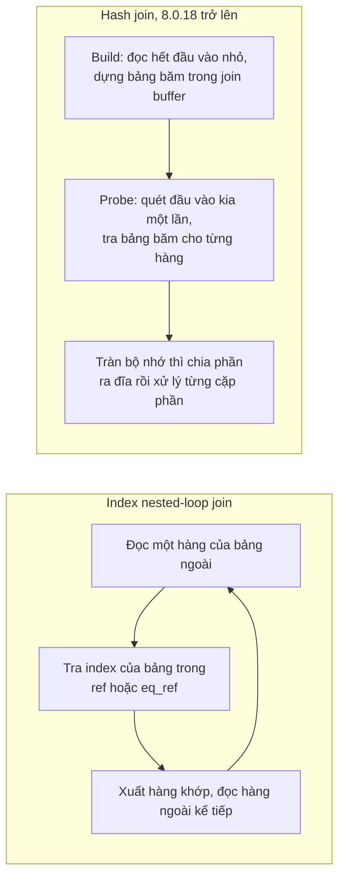

*(Sơ đồ do người viết ghi chú dựng; **Bổ sung ngoài sách**.)*

<a id="execution-plan"></a>

**The execution plan** (tr. 212–213).

- MySQL **không sinh bytecode** để thực thi truy vấn như nhiều DBMS khác. Execution plan thật ra là một **cây chỉ thị** mà execution engine đi theo để tạo kết quả (chú thích 10).
- Plan cuối cùng chứa đủ thông tin để **dựng lại** truy vấn gốc. Chạy `EXPLAIN EXTENDED` rồi `SHOW WARNINGS` sẽ thấy câu dựng lại (chú thích 11).
- Mọi truy vấn nhiều bảng về khái niệm đều biểu diễn được bằng cây. Một join bốn bảng **có thể** thực thi như Hình 8-2: một ***balanced tree***. Nhưng MySQL **không** làm vậy: nó luôn bắt đầu từ một bảng rồi tìm hàng khớp ở bảng kế, nên plan của MySQL **luôn** có dạng ***left-deep tree*** như Hình 8-3 (tr. 213).

> Chú thích 10 (tr. 212). Có thể thấy cây này bằng cách đặt `EXPLAIN FORMAT=TREE` trước câu lệnh.
>
> Chú thích 11 (tr. 212). Server tạo câu này từ execution plan, nên nó cùng ngữ nghĩa với truy vấn gốc nhưng không nhất thiết cùng chữ.

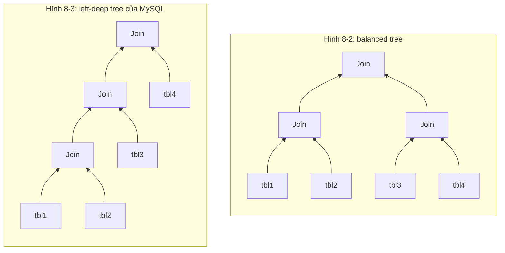

*(Vẽ lại Hình 8-2 và 8-3, tr. 213, theo ảnh trang PDF 235.)*

> **Bổ sung ngoài sách — Kết quả đã đo trên 8.0.42.**
> - `EXPLAIN EXTENDED` báo **lỗi cú pháp 1064**: từ khóa EXTENDED đã bị bỏ trong MySQL 8.0. `EXPLAIN` thường đã gồm thông tin mở rộng; ngay sau đó `SHOW WARNINGS` in Note 1003 với câu đã viết lại (ví dụ các `USING` thành điều kiện bằng nhau trong WHERE).
> - `EXPLAIN FORMAT=TREE` có từ 8.0.16; `EXPLAIN ANALYZE` (chạy thật và in `actual time`, `rows`, `loops`) có từ 8.0.18. Sách nhắc `FORMAT=TREE` ở chú thích 10 nhưng không nhắc `EXPLAIN ANALYZE`.
> - Bật `hypergraph_optimizer` (optimizer mới, về nguyên tắc xét được cây không left-deep) trên bản release 8.0.42 bị từ chối với lỗi 3999: tính năng chỉ có ở bản debug.

<a id="join-optimizer"></a>

**The join optimizer** (tr. 213–216).

- **What.** Phần quan trọng nhất của optimizer là ***join optimizer***: nó quyết định **thứ tự thực thi** tốt nhất cho truy vấn nhiều bảng. Thường có nhiều thứ tự cho cùng kết quả; join optimizer ước lượng chi phí các plan và chọn plan rẻ nhất (tr. 213).
- **Ví dụ của sách** (tr. 213–215): truy vấn lấy `film_id`, tiêu đề, năm phát hành của phim cùng `actor_id`, tên diễn viên, join `film` → `film_actor` → `actor`. Cách nghĩ trực giác: bắt đầu từ `film`, dùng index `film_id` của `film_actor` tìm `actor_id`, rồi tra primary key của `actor`. Người dùng Oracle sẽ nói `film` là ***driver table*** của `film_actor`. Nhưng `EXPLAIN` cho thấy MySQL bắt đầu từ **`actor`** (`ALL`, 200 hàng), rồi `film_actor` (`ref` trên PRIMARY, khoảng 27 hàng mỗi diễn viên, `Using index`), rồi `film` (`eq_ref`), tức đi **ngược lại**.
- ***STRAIGHT_JOIN*** ép join theo thứ tự viết. Khi đó plan bắt đầu từ `film` (`ALL`, 1.000 hàng), rồi `film_actor` (`ref` trên `idx_fk_film_id`, khoảng 5 hàng mỗi phim), rồi `actor` (`eq_ref`) (tr. 215).
- **Vì sao đảo thứ tự** (tr. 215–216): để đọc **ít hàng hơn ở bảng đầu**. Hai cách đều tra index nhanh ở bảng thứ hai và thứ ba; khác ở **số lần tra**. Đặt `film` trước cần khoảng 1.000 lần dò vào `film_actor` và `actor`, mỗi hàng của bảng đầu một lần. Đặt `actor` trước chỉ cần khoảng 200. Thứ tự đảo **ít quay lui và đọc lại** hơn (xem chú thích 12).
- **Kết luận** (tr. 216): đổi thứ tự join thường rất hiệu quả. Có lúc nó không cho plan tối ưu; khi đó dùng `STRAIGHT_JOIN` và tự viết theo thứ tự bạn nghĩ là tốt nhất, nhưng **hiếm**. Trong đa số trường hợp, join optimizer giỏi hơn con người.

> Chú thích 12 (tr. 215). Nói chặt chẽ, MySQL không cố giảm **số hàng** phải đọc mà tối ưu cho **ít lần đọc page** hơn; số hàng chỉ cho ý niệm thô về chi phí.

**Evidence & example** (**Kết quả đã đo**, [TN2](experiments/chapter-08.md#tn2); dữ liệu tổng hợp cùng kích thước: actor 200, film 1.000, film_actor 5.400; mỗi đo một lần):

| | Optimizer tự chọn (`actor` trước) | `STRAIGHT_JOIN` (`film` trước) |
| --- | --- | --- |
| Chi phí ước lượng (`Last_query_cost`) | **2.501,5** | 3.688,3 |
| Số lần dò vào bảng thứ hai (`loops`) | 200 | 1.000 |
| Số lần tra bảng thứ ba (`loops`) | 5.400 | 5.400 |
| `Handler_read_key` / `Handler_read_rnd_next` | 5.601 / 201 | 6.401 / 1.001 |
| Thời gian thật (`EXPLAIN ANALYZE`) | 13,4 ms | 17,2 ms |

> **Bổ sung ngoài sách (phân tích).** Số lần tra bảng thứ ba **bằng nhau** (5.400) vì đó là số hàng kết quả của join hai bảng đầu, không phụ thuộc thứ tự. Phần tiết kiệm nằm ở bảng đầu và bảng thứ hai: quét 1 page của `actor` thay vì 15 page của `film` (theo `mysql.innodb_table_stats`, `film` có cột `description` dài), và 200 thay vì 1.000 lần dò. Ước lượng cho plan `film` trước còn sai (7.407 hàng ước lượng so với 5.400 thật) vì cardinality của `idx_fk_film_id` được lấy mẫu. Đó là minh họa nhỏ cho câu "statistics có thể không chính xác".

<a id="search-space"></a>

**Search space** (tr. 216).

- Join optimizer cố tạo cây plan có chi phí thấp nhất. Khi được, nó xét **mọi tổ hợp cây con**, bắt đầu từ mọi plan một bảng.
- Join *n* bảng có **n giai thừa** thứ tự để xét: đó là ***search space***. Nó tăng rất nhanh: join 10 bảng có tới **3.628.800** cách thực thi.
- Search space quá lớn thì tối ưu mất quá lâu, nên server dừng phân tích đầy đủ và dùng lối tắt như tìm kiếm **"tham lam"** (*greedy*) khi số bảng vượt `optimizer_search_depth` (chỉnh được).
- MySQL có nhiều **heuristic** tích lũy qua nhiều năm để tăng tốc giai đoạn tối ưu. Có lợi, nhưng cũng có nghĩa đôi khi (hiếm) nó bỏ lỡ plan tối ưu vì không xét hết.
- Có truy vấn **không đổi thứ tự được**, và join optimizer dùng điều đó để thu nhỏ search space: **LEFT JOIN** và **correlated subquery** là ví dụ, vì kết quả của bảng này phụ thuộc dữ liệu lấy từ bảng khác (tr. 216).

> **Bổ sung ngoài sách.** Giá trị đọc được trên 8.0.42: `optimizer_search_depth` = 62 (mặc định), `optimizer_prune_level` = 1 (bật cắt tỉa theo heuristic). Với mặc định này, truy vấn bình thường được tìm kiếm gần như đầy đủ nhưng có cắt nhánh; truy vấn join rất nhiều bảng mà tối ưu lâu (thấy trạng thái `statistics` kéo dài) có thể giảm `optimizer_search_depth` cho session đó.

<a id="filesort"></a>

**Sort optimizations** (tr. 216–217).

- Sắp xếp có thể tốn, nên thường cải thiện được bằng cách **tránh sort** hoặc **sort ít hàng hơn** (tr. 216).
- Khi không dùng được index để có kết quả đã sắp, MySQL tự sắp xếp, trong bộ nhớ hoặc trên đĩa, nhưng **luôn gọi là *filesort***, kể cả khi không dùng file nào (tr. 216).
- Giá trị cần sắp vừa ***sort buffer*** thì sắp hết trong bộ nhớ bằng quicksort. Không vừa thì sắp trên đĩa theo **từng phần** (*chunk*): sắp từng phần bằng quicksort rồi **trộn** (*merge*) các phần đã sắp (tr. 216).

| Thuật toán filesort (tr. 217) | Cách làm | Ưu | Nhược |
| --- | --- | --- | --- |
| ***Two passes*** (cũ) | Đọc con trỏ hàng và cột ORDER BY, sắp chúng, rồi duyệt danh sách đã sắp và **đọc lại hàng** để xuất | Ít dữ liệu trong sort buffer | Đọc hàng **hai lần**, lần thứ hai gây nhiều **random I/O** |
| ***Single pass*** (mới) | Đọc **mọi cột** truy vấn cần, sắp theo cột ORDER BY, rồi duyệt danh sách đã sắp và xuất cột cần | Không đọc hàng hai lần; đổi random I/O lấy sequential I/O; tốt cho tập dữ liệu lớn, bị giới hạn bởi I/O | Tốn **nhiều chỗ** hơn vì giữ mọi cột; ít bộ trong sort buffer hơn, nên **nhiều lượt merge** hơn |

- **Tốn chỗ hơn tưởng** (tr. 217): filesort có thể dùng nhiều chỗ tạm hơn mong đợi vì nó cấp **bản ghi kích thước cố định** cho mỗi bộ cần sắp, đủ lớn cho bộ **lớn nhất có thể**, kể cả **độ dài đầy đủ** của mỗi cột VARCHAR. Với **utf8mb4**, MySQL cấp **4 byte cho mỗi ký tự**. Tác giả từng thấy schema kém tối ưu làm chỗ tạm cho sort **lớn gấp nhiều lần** cả bảng trên đĩa.
- **Sort khi join** (tr. 217). Nếu ORDER BY chỉ dùng cột của **bảng đầu tiên** trong thứ tự join, MySQL filesort bảng đó rồi mới join: `Extra` hiện `Using filesort`. Mọi trường hợp khác (sort theo bảng không đứng đầu, hay ORDER BY chứa cột của nhiều bảng), MySQL phải **đổ kết quả join vào bảng tạm** rồi filesort bảng tạm sau khi join xong: `Using temporary; Using filesort`. Có `LIMIT` thì nó được áp **sau** filesort, nên bảng tạm và filesort có thể **rất lớn**.

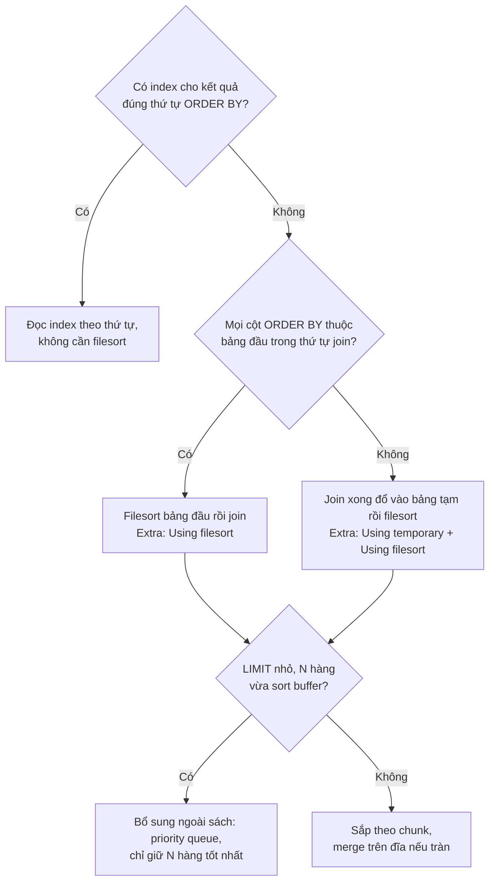

*(Sơ đồ do người viết ghi chú tổng hợp từ tr. 216–217; nhánh priority queue là **Bổ sung ngoài sách**.)*

> **Bổ sung ngoài sách — Kết quả đã đo trên 8.0.42** ([TN2](experiments/chapter-08.md#tn2), [TN3](experiments/chapter-08.md#tn3); `sort_buffer_size` mặc định 256 KB).
> - `ORDER BY a.first_name` khi `actor` đứng đầu cho `Using filesort`; `ORDER BY f.length, a.first_name` trên join ba bảng cho `Using temporary; Using filesort`, đúng như sách.
> - Optimizer trace của filesort cho `sort_mode: <fixed_sort_key, packed_additional_fields>`: đây là kiểu **single pass**, nhưng các cột phụ được **đóng gói theo độ dài thật** (có từ 5.7). Dù vậy, `row_size` = 428 byte (gần bằng kích thước tối đa, vì `note VARCHAR(100)` utf8mb4 chiếm tới 400 byte) và `max_rows_per_buffer` = 612 ≈ 262.144 / 428: số hàng mỗi buffer vẫn được tính theo **kích thước lớn nhất có thể**, khớp ý sách.
> - **LIMIT không phải lúc nào cũng "áp sau filesort" theo nghĩa phải sắp hết.** Với `ORDER BY inventory_id LIMIT 20` trên 1 triệu hàng, trace ghi `filesort_priority_queue_optimization: chosen: true`, bộ nhớ đỉnh 8.925 byte, không tràn đĩa: MySQL chỉ giữ 20 hàng tốt nhất trong một hàng đợi ưu tiên. Nhưng nó **vẫn đọc cả 1 triệu hàng**. Với `LIMIT 300000, 1`, N quá lớn nên không dùng priority queue: 445 chunk tràn ra đĩa, `Sort_merge_passes` = 83.
> - Tài liệu MySQL ghi `max_length_for_sort_data` đã bị deprecated từ 8.0.20 vì không còn tác dụng; trace cũng cho thấy thuật toán sắp là `std::sort` hay `std::stable_sort`, không còn đúng chữ "quicksort" của sách.

**Hiểu lầm phổ biến.** "Filesort nghĩa là sắp trên đĩa." Tên gọi có từ lâu; filesort có thể hoàn toàn trong bộ nhớ (tr. 216). Dấu hiệu tràn đĩa thật là `Sort_merge_passes` tăng hay `num_initial_chunks_spilled_to_disk` trong optimizer trace.

<a id="execution-engine"></a>

#### 2.4.4 The Query Execution Engine (tr. 217–218)

- Giai đoạn parse và tối ưu cho ra execution plan; execution engine dùng plan đó để xử lý truy vấn. Plan là một **cấu trúc dữ liệu**, không phải bytecode (tr. 217).
- Khác giai đoạn tối ưu, giai đoạn thực thi thường **không phức tạp**: MySQL chỉ làm theo chỉ thị trong plan. Nhiều thao tác gọi phương thức của **storage engine interface**, còn gọi là ***handler API*** (tr. 218).
- Mỗi bảng trong truy vấn được đại diện bởi một **handler instance**. Một bảng xuất hiện **ba lần** trong truy vấn thì có **ba** handler instance. MySQL thật ra tạo chúng **sớm**, ngay trong giai đoạn tối ưu; optimizer dùng chúng để lấy thông tin về bảng như tên cột và statistics của index (tr. 218).
- Interface có nhiều chức năng, nhưng chỉ cần **khoảng một tá thao tác "viên gạch"** để chạy đa số truy vấn. Ví dụ: một thao tác đọc **hàng đầu tiên** của index, một thao tác đọc **hàng kế tiếp** của index; đủ cho một truy vấn quét index. Cách thực thi đơn giản này làm **kiến trúc storage engine** khả thi, nhưng cũng là nguồn gốc của một số **giới hạn** của optimizer (tr. 218).
- Server lặp lại các chỉ thị cho tới khi hết hàng cần xét (tr. 218).

> **Lưu ý của sách** (tr. 218). Không phải mọi thứ đều là thao tác handler. Ví dụ server quản lý **table lock**. Handler có thể cài lock mức thấp hơn của riêng nó, như row lock của InnoDB, nhưng điều đó **không thay** cơ chế khóa của server. Như chương 1 giải thích, những gì mọi storage engine dùng chung được cài ở server, như hàm ngày giờ, view và trigger.

> **Bổ sung ngoài sách — nhìn "viên gạch" qua biến `Handler_read_*`.** Các biến trạng thái này đếm đúng những lời gọi handler mà sách mô tả, nên là chỉ số **tất định** tốt để so sánh plan (dùng `FLUSH STATUS` trước, `SHOW SESSION STATUS LIKE 'Handler_read%'` sau):
>
> | Biến | Lời gọi handler | Ví dụ đã đo |
> | --- | --- | --- |
> | `Handler_read_first` | Đọc mục đầu tiên của index | 1 khi quét toàn index trong TN1 |
> | `Handler_read_key` | Tra index theo giá trị khóa | 5.601 trong join ba bảng TN2 |
> | `Handler_read_next` | Đọc mục kế tiếp theo thứ tự index | 300.019 khi deferred join quét index trong TN3 |
> | `Handler_read_prev` | Đọc mục trước đó (quét ngược) | Dùng cho `ORDER BY ... DESC` |
> | `Handler_read_rnd_next` | Đọc hàng kế tiếp khi quét bảng | 5.401 khi quét toàn bảng `film_actor` |
>
> MySQL 8.0 tổ chức execution engine thành các **iterator**: mỗi nút trong `EXPLAIN FORMAT=TREE` là một iterator, kéo hàng từ iterator con. Cột `loops` trong `EXPLAIN ANALYZE` cho biết một iterator được khởi động lại bao nhiêu lần, chính là số lần "quay lui" của nested-loop.

<a id="returning-results"></a>

#### 2.4.5 Returning Results to the Client (tr. 218)

- Bước cuối là trả lời client. Ngay cả truy vấn không có result set cũng trả về thông tin như **số hàng bị ảnh hưởng** (tr. 218).
- Server tạo và gửi kết quả **dần dần**. Ngay khi xử lý xong bảng cuối và tạo thành công **một** hàng, nó có thể và nên gửi hàng đó. Hai lợi ích: server khỏi giữ hàng trong bộ nhớ, và client nhận kết quả **sớm nhất** có thể (xem chú thích 13).
- Mỗi hàng của result set được gửi trong **một packet riêng** của giao thức, dù các packet có thể được đệm và gửi chung ở tầng TCP (tr. 218).

> Chú thích 13 (tr. 218). Có thể đổi hành vi này khi cần, ví dụ bằng hint `SQL_BUFFER_RESULT`; xem "Optimizer Hints" trong tài liệu MySQL.

> **Bổ sung ngoài sách.** "Gửi dần" chỉ xảy ra khi plan cho phép **stream**. Nếu plan có toán tử phải đọc hết đầu vào trước khi ra hàng đầu tiên, như `Sort`, `Materialize`, hay bảng tạm của GROUP BY và UNION DISTINCT, thì thời gian tới hàng đầu tiên gần bằng tổng thời gian. Đây là một khác biệt thực tế giữa logical và physical: cùng một kết quả, nhưng plan có index đúng thứ tự cho hàng đầu tiên gần như ngay lập tức, còn plan filesort thì không.

#### Tự kiểm tra 2.4

- **Câu 2.4.1.** Vì sao client MySQL không thể bảo server ngừng gửi giữa chừng? Hệ quả với lock và tài nguyên server khi ứng dụng dùng unbuffered result rồi xử lý chậm từng hàng? [đáp án](answers/chapter-08.md#q2-4-1)
- **Câu 2.4.2.** Nêu bốn lý do optimizer có thể chọn plan không tốt nhất. Với hai lý do, mô tả dữ liệu hoặc workload cụ thể khiến nó xảy ra. [đáp án](answers/chapter-08.md#q2-4-2)
- **Câu 2.4.3.** Trong ví dụ join `actor`, `film_actor`, `film`, vì sao optimizer bắt đầu từ `actor`? Số lần tra bảng thứ ba có giảm theo không? Dựa vào số liệu đo được để trả lời. [đáp án](answers/chapter-08.md#q2-4-3)
- **Câu 2.4.4.** Từ 8.0.20, khi nào MySQL dùng hash join và được lợi gì so với nested-loop không index? Trường hợp nào index nested-loop vẫn là lựa chọn tốt hơn? [đáp án](answers/chapter-08.md#q2-4-4)
- **Câu 2.4.5.** ORDER BY trên cột của bảng thứ hai trong join cho `Using temporary; Using filesort`. Giải thích vì sao, và vì sao theo sách LIMIT không cứu được bao nhiêu. MySQL 8.0 có cơ chế gì làm nhẹ bớt khi LIMIT nhỏ? [đáp án](answers/chapter-08.md#q2-4-5)

<a id="s2-5"></a>

### 2.5 Limitations of the MySQL Query Optimizer (tr. 219–221)

Cách thực thi của MySQL không lý tưởng cho mọi loại truy vấn. May là chỉ có **một số ít** trường hợp optimizer làm kém, và thường **viết lại** được cho hiệu quả hơn (tr. 219).

<a id="union-limitations"></a>

#### 2.5.1 UNION Limitations (tr. 219)

**What.** MySQL đôi khi **không "đẩy xuống"** (*push down*) được điều kiện từ bên ngoài UNION vào bên trong, nơi chúng có thể giới hạn kết quả hay mở ra tối ưu khác.

**How sửa.** Nếu một nhánh của UNION sẽ được lợi từ `LIMIT`, hoặc bạn biết kết quả gộp sẽ bị `ORDER BY`, hãy **đặt các mệnh đề đó vào từng nhánh**. Ví dụ của sách (tr. 219): UNION ALL họ tên từ `actor` (mỗi nhánh có ORDER BY `last_name`) với họ tên từ `customer`, rồi `LIMIT 20`. Theo sách, MySQL lưu **200 hàng** của `actor` và **599 hàng** của `customer` vào bảng tạm rồi chỉ lấy 20 hàng đầu. Thêm `LIMIT 20` thừa vào mỗi nhánh thì bảng tạm chỉ còn **40 hàng**. Ngoài hiệu năng, câu truy vấn cũng cần **sửa cho đúng**: thứ tự lấy hàng ra từ bảng tạm là **không xác định**, nên phải có một `ORDER BY` chung ngay trước `LIMIT` cuối.

**Evidence & example** (**Kết quả đã đo**, [TN4](experiments/chapter-08.md#tn4); dữ liệu tổng hợp cùng kích thước 200 và 599 hàng):

| Biến thể | Plan trên 8.0.42 | `Created_tmp_tables` | `Handler_write` | `Handler_read_rnd_next` |
| --- | --- | --- | --- | --- |
| Câu đầu của sách: ORDER BY trong nhánh, `LIMIT 20` bên ngoài, không ORDER BY ngoài | `Limit` → `Append` → `Stream results`; không có Sort | 0 | 0 | **20** |
| Sửa ngữ nghĩa: ORDER BY và LIMIT chung bên ngoài, nhánh không LIMIT | `Sort` (giới hạn 20) trên `Union all materialize` | 1 | **799** | 1.601 |
| Bản sửa của sách: LIMIT 20 trong từng nhánh và ORDER BY chung | `Union all materialize` 40 hàng rồi `Sort` | 1 | **40** | 842 |

**Diễn giải.**

- Trên 8.0.42, câu đầu của sách **không** tạo bảng tạm và chỉ đọc 20 hàng: UNION ALL được trả thẳng và `LIMIT` dừng sớm. Nhưng 20 hàng đó là 20 hàng **bất kỳ** của `actor`, vì ORDER BY trong nhánh không có LIMIT bị bỏ qua (theo tài liệu MySQL 8.0, mục UNION: ORDER BY của từng SELECT không kèm LIMIT không có tác dụng lên thứ tự cuối nên bị tối ưu bỏ đi; trong `FORMAT=TREE` không có toán tử Sort nào ở các nhánh). Đây là **Bổ sung ngoài sách**.
- Với câu **đúng ngữ nghĩa** (có ORDER BY chung), lời khuyên của sách vẫn nguyên giá trị: đẩy `LIMIT` vào từng nhánh giảm bảng tạm từ 799 xuống 40 hàng, khớp đúng con số "40 rows" của sách.

> **Bổ sung ngoài sách.** Các bản 8.0 gần đây có ***derived condition pushdown***: điều kiện WHERE bên ngoài một derived table được đẩy vào trong, kể cả derived table chứa UNION (tài liệu MySQL ghi hỗ trợ UNION từ 8.0.29). **Kết quả đã đo:** `SELECT * FROM (SELECT ... FROM actor UNION ALL SELECT ... FROM customer) t WHERE t.last_name = '...'` cho plan tra `idx_actor_last_name` và `idx_last_name` trong từng nhánh. LIMIT và ORDER BY thì vẫn không được đẩy xuống tự động.

<a id="equality-propagation"></a>

#### 2.5.2 Equality Propagation (tr. 220)

- Lan truyền điều kiện bằng nhau ([2.4.3](#optimization-types)) đôi khi có **chi phí bất ngờ**. Xét một danh sách `IN()` **khổng lồ** trên một cột mà optimizer biết là bằng các cột ở bảng khác, qua WHERE, ON hay USING.
- Optimizer "chia sẻ" danh sách bằng cách **chép** nó sang các cột tương ứng ở mọi bảng liên quan. Thường có lợi, vì cho optimizer và execution engine **thêm lựa chọn** về chỗ kiểm tra `IN()`. Nhưng danh sách rất lớn thì tối ưu và thực thi **chậm hơn**.
- Lúc viết sách **chưa có cách lách sẵn**; phải sửa mã nguồn nếu đó là vấn đề. Tác giả nói với đa số người thì không phải vấn đề (tr. 220).

> **Bổ sung ngoài sách** (theo tài liệu MySQL 8.0, mục "Range Optimization").
> - `eq_range_index_dive_limit` (mặc định 200, đọc được trên 8.0.42): khi danh sách `IN()` có từ 200 giá trị trở lên, optimizer thôi "lặn" vào index để đếm hàng cho từng giá trị mà dùng statistics. Tối ưu nhanh hơn nhưng ước lượng kém chính xác hơn.
> - `range_optimizer_max_mem_size` giới hạn bộ nhớ của range optimizer; danh sách quá lớn có thể làm nó bỏ range plan và rơi về quét toàn bảng (có warning).
> - **Decision:** với danh sách ID rất lớn (hàng chục nghìn), cân nhắc nạp ID vào một bảng tạm có index rồi join, thay vì nhét vào `IN()`. Điều này cũng liên quan tới join decomposition ở [2.3.3](#join-decomposition).

<a id="parallel-execution"></a>

#### 2.5.3 Parallel Execution (tr. 220)

MySQL **không thực thi một truy vấn song song** trên nhiều CPU. Một số DBMS khác có tính năng này, MySQL thì không. Tác giả nhắc để bạn **khỏi mất thời gian** tìm cách bật nó (tr. 220).

**Hệ quả.** Một truy vấn báo cáo quét 100 triệu hàng chỉ dùng **một lõi** cho phần lớn công việc của nó. Tối ưu phải đến từ việc **đọc ít hơn** (index, summary table, viết lại), không phải từ thêm lõi (**Bổ sung ngoài sách**, suy ra từ tr. 220).

> **Bổ sung ngoài sách.** Có một ngoại lệ hẹp: từ **8.0.14**, InnoDB đọc **clustered index song song** cho một số thao tác như `SELECT COUNT(*)` không có WHERE và `CHECK TABLE`, số thread theo `innodb_parallel_read_threads` (mặc định 4 trên 8.0.42). `EXPLAIN FORMAT=TREE` cho `COUNT(*)` hiện một toán tử riêng `Count rows in rental` ([TN4](experiments/chapter-08.md#tn4)). Đây không phải parallel query tổng quát. Muốn song song hóa báo cáo, ứng dụng có thể tự chia theo khoảng khóa và chạy trên nhiều kết nối hay nhiều replica.

<a id="select-update-same-table"></a>

#### 2.5.4 SELECT and UPDATE on the Same Table (tr. 220–221)

**What** (tr. 220). MySQL **không cho** SELECT từ một bảng trong khi đang UPDATE chính bảng đó trong cùng câu lệnh. Đây không hẳn là giới hạn của optimizer, nhưng hiểu cách MySQL thực thi giúp lách được. Ví dụ của sách: câu UPDATE gán cho mỗi hàng số hàng cùng `type` bằng một subquery tương quan đọc lại chính bảng đó. Câu này là **SQL chuẩn** nhưng MySQL báo `ERROR 1093 (HY000): You can't specify target table ... for update in FROM clause`.

**How lách** (tr. 220–221). Dùng **derived table**, vì MySQL **materialize** nó thành bảng tạm. Thực chất chạy hai truy vấn: một SELECT trong subquery (GROUP BY `type`, đếm), và một **UPDATE nhiều bảng** join bảng gốc với kết quả subquery. Subquery **mở và đóng bảng xong** trước khi UPDATE bên ngoài mở bảng, nên câu lệnh thành công.

**Evidence & example** (**Kết quả đã đo**, [TN4](experiments/chapter-08.md#tn4), bảng 6 hàng):

- Câu của sách cho đúng lỗi 1093; bản derived table có GROUP BY chạy được và cho số đếm đúng.
- Derived table **không** có GROUP BY (có thể gộp vào truy vấn ngoài) vẫn chạy được: `EXPLAIN` cho thấy 8.0.42 tự **materialize** nó (dòng `DERIVED`). Khi ép gộp bằng hint `MERGE`, lỗi 1093 **quay lại**. Vậy điều kiện thật sự để lách được là derived table **được materialize**, không phải bản thân cú pháp derived table.

> **Bổ sung ngoài sách.** Lý do có giới hạn này: nếu vừa đọc vừa sửa cùng một bảng trong một câu lệnh, phần đọc có thể thấy những hàng **vừa bị chính câu đó sửa**, kết quả phụ thuộc thứ tự duyệt (bài toán thường gọi là "Halloween problem"). Materialize trước là chụp một bản kết quả đọc rồi mới sửa. Hệ quả hiệu năng: bản lách tạo một bảng tạm; với bảng lớn nên kiểm tra kích thước của nó.

#### Tự kiểm tra 2.5

- **Câu 2.5.1.** Trên 8.0.42, câu UNION ALL + `LIMIT 20` đầu tiên của sách không tạo bảng tạm và chỉ đọc 20 hàng. Vậy lời khuyên đẩy `LIMIT` vào từng nhánh còn cần không? Khi nào? [đáp án](answers/chapter-08.md#q2-5-1)
- **Câu 2.5.2.** Vì sao equality propagation thường có lợi, nhưng có thể làm chậm khi đi cùng một danh sách `IN()` rất lớn? Bạn sẽ thiết kế lại truy vấn thế nào? [đáp án](answers/chapter-08.md#q2-5-2)
- **Câu 2.5.3.** "MySQL không chạy song song một truy vấn" ảnh hưởng thế nào tới cách tối ưu một truy vấn báo cáo lớn? Ngoại lệ hẹp nào có trong 8.0? [đáp án](answers/chapter-08.md#q2-5-3)
- **Câu 2.5.4.** Vì sao derived table có GROUP BY lách được lỗi 1093, còn ép `MERGE` thì lỗi quay lại? [đáp án](answers/chapter-08.md#q2-5-4)

<a id="s2-6"></a>

### 2.6 Optimizing Specific Types of Queries (tr. 221–226)

Phần này là danh sách lời khuyên cho những bài toán tối ưu hay gặp, phần lớn đã bàn ở chỗ khác trong sách, gom lại để tra cứu nhanh. Tác giả cảnh báo: **phần lớn lời khuyên phụ thuộc phiên bản** và có thể không còn đúng ở bản MySQL sau; không có lý do gì server không tự làm được một phần hay toàn bộ những tối ưu này trong tương lai (tr. 221). Các phép đo dưới đây cho thấy cảnh báo đó có cơ sở.

<a id="count"></a>

#### 2.6.1 Optimizing COUNT() Queries (tr. 221–223)

`COUNT()` có lẽ thuộc **top 10 chủ đề bị hiểu sai** nhất trong MySQL, và trên mạng có rất nhiều thông tin sai về nó (tr. 221).

**What COUNT() does** (tr. 221). `COUNT()` là hàm đặc biệt, làm **hai việc rất khác nhau**:

- **Đếm giá trị.** Một *value* là biểu thức khác NULL (NULL là sự **vắng mặt** của giá trị). Đặt tên cột hay biểu thức trong ngoặc thì `COUNT()` đếm **số lần biểu thức có giá trị**.
- **Đếm hàng.** MySQL làm vậy khi biết biểu thức trong ngoặc **không bao giờ NULL**. Ví dụ rõ nhất là ***COUNT(\*)***: dạng đặc biệt **không** bung `*` thành danh sách cột như nhiều người nghĩ, mà bỏ qua cột và **đếm hàng**.
- **Lỗi hay gặp nhất:** đặt tên cột vào ngoặc khi muốn đếm hàng. Muốn biết số hàng thì **luôn dùng `COUNT(*)`**: nói rõ ý định và tránh hiệu năng kém.

**Simple optimizations** (tr. 222). Câu hỏi hay gặp: đếm nhiều giá trị khác nhau của **cùng một cột** trong **một** truy vấn. Không dùng được OR, vì nó không tách riêng từng màu. Không đặt màu vào WHERE với AND được, vì các màu loại trừ nhau. Hai cách đúng: cộng `SUM(IF(color = 'blue', 1, 0))` cho từng màu, hoặc `COUNT(color = 'blue' OR NULL)` để biểu thức **không có giá trị** khi điều kiện sai.

> Chú thích 14 (tr. 222). Biểu thức `SUM()` cũng viết được gọn hơn: `SUM(color = 'blue')`, `SUM(color = 'red')`.

**Using an approximation** (tr. 222). Đôi khi không cần số chính xác. Số hàng ước lượng trong `EXPLAIN` thường đủ dùng: chạy `EXPLAIN` thay vì truy vấn thật. Câu chuyện của sách: một khách hàng đếm **người dùng đang hoạt động**, số này được cache và hiển thị 30 phút rồi mới tính lại, nên vốn đã không chính xác. Bỏ vài điều kiện WHERE (loại người dùng không hoạt động và một user "mặc định") làm con số đổi rất ít nhưng truy vấn nhanh hơn nhiều; bỏ thêm một `DISTINCT` không cần thiết thì hết filesort. Kết quả gần như y hệt mà nhanh hơn nhiều.

**More complex optimizations** (tr. 222–223). `COUNT()` khó tối ưu vì thường phải đếm nhiều hàng. Lựa chọn duy nhất **bên trong MySQL** là **covering index**. Chưa đủ thì phải đổi **kiến trúc ứng dụng**, ví dụ cache ngoài như memcached. Khi đó sẽ gặp thế khó quen thuộc: "**nhanh, chính xác, đơn giản: chọn hai**".

**Evidence & example** (**Kết quả đã đo**, [TN4](experiments/chapter-08.md#tn4); bảng `rental` 1.000.000 hàng, `return_date` NULL ở 10% số hàng và không có index; thời gian là trung vị 3 lần, dữ liệu đã nằm trong buffer pool):

| Truy vấn | Kết quả | Plan (`FORMAT=TREE`) | Rows examined (P_S) | Trung vị |
| --- | --- | --- | --- | --- |
| `COUNT(*)` | 1.000.000 | `Count rows in rental` | 0 (không được ghi nhận) | 259,8 ms |
| `COUNT(rental_id)` (primary key) | 1.000.000 | `Count rows in rental` | 0 | 292,2 ms |
| `COUNT(customer_id)` (NOT NULL, có index) | 1.000.000 | `Count rows in rental` | 0 | 276,8 ms |
| `COUNT(return_date)` (nullable, không index) | **900.000** | `Aggregate` trên `Table scan` | 1.000.000 | 286,8 ms |
| `COUNT(*) WHERE customer_id BETWEEN 100 AND 200` | 168.612 | range trên covering index | 168.612 | 54,4 ms |

- MySQL nhận ra `COUNT(cột NOT NULL)` tương đương `COUNT(*)` và dùng cùng plan. Với cột **nullable**, kết quả **khác** (900.000) và plan phải quét bảng để xem từng giá trị.
- Trên dữ liệu đã nằm trong bộ nhớ, thời gian bốn câu đầu xấp xỉ nhau. Khác biệt hiệu năng mà sách cảnh báo sẽ rõ hơn khi cột không thuộc index nhỏ nào và dữ liệu phải đọc từ đĩa (**Dự đoán**, chưa đo với buffer pool lạnh). Khác biệt **ngữ nghĩa** thì luôn có.
- `EXPLAIN` ước lượng 992.250 hàng, lệch 0,8% so với 1.000.000: đủ cho một con số "khoảng một triệu".
- Hai cách đếm nhiều giá trị cho cùng kết quả (1.669 hàng mỗi `customer_id`). Còn `COUNT(customer_id = 1 OR customer_id = 2)` cho **1.000.000**: biểu thức so sánh trả 0 chứ không phải NULL khi sai, nên mọi hàng đều được đếm. Đó là lý do phải có `OR NULL`.
- Performance Schema ghi `ROWS_EXAMINED = 0` cho đường `Count rows`, vì việc đếm nằm trong InnoDB. Đây là bẫy đo lường: con số 0 **không** có nghĩa không đọc gì (**Bổ sung ngoài sách**).

<a id="join-queries"></a>

#### 2.6.2 Optimizing JOIN Queries (tr. 223)

Chủ đề này rải khắp sách; tác giả nêu vài điểm chính:

- **Index trên cột của ON hay USING**, nhưng tính đến **thứ tự join**. Join A và B theo cột c, nếu optimizer join theo thứ tự B rồi A thì **không cần** index cột c của B. Index không dùng là chi phí thừa. Nói chung chỉ cần index ở **bảng thứ hai** trong thứ tự join, trừ khi cần cho việc khác.
- Cố để mọi biểu thức GROUP BY hay ORDER BY chỉ dùng cột của **một bảng**, để MySQL có thể dùng index cho thao tác đó (liên hệ "Sort optimizations" ở [2.4.3](#filesort)).
- **Cẩn thận khi nâng cấp MySQL**: cú pháp join, độ ưu tiên toán tử và các hành vi khác đã đổi nhiều lần. Một join bình thường có thể thành **tích Đề-các**, một kiểu join khác cho kết quả khác, hoặc thậm chí cú pháp sai.

> **Bổ sung ngoài sách.**
> - "Index ở bảng thứ hai" có nghĩa là bảng được **tra** trong vòng lặp trong của index nested-loop. Nếu bảng đó không có index dùng được, 8.0.20+ dùng hash join ([2.4.3](#hash-join)); hash join tốt khi phải đọc phần lớn cả hai bảng, còn index nested-loop thắng khi bảng ngoài chỉ có ít hàng sau khi lọc.
> - Ví dụ thay đổi độ ưu tiên kinh điển (tài liệu MySQL, mục "JOIN Clause"): từ 5.0.12, toán tử dấu phẩy có độ ưu tiên **thấp hơn** JOIN, nên `FROM t1, t2 JOIN t3 ON t1.a = t3.a` báo lỗi cột không biết, vì ON chỉ thấy `t2` và `t3`.

<a id="rollup"></a>

#### 2.6.3 Optimizing GROUP BY with ROLLUP (tr. 223)

- Một biến thể của truy vấn gộp nhóm là yêu cầu MySQL làm ***super aggregation*** (tổng của các tổng) bằng `WITH ROLLUP`. Nó có thể **không được tối ưu** tốt như bạn cần.
- Kiểm tra cách thực thi bằng `EXPLAIN`, chú ý việc gộp nhóm dùng **filesort** hay **bảng tạm**; thử bỏ `WITH ROLLUP` xem có cùng cách gộp không. Có thể ép cách gộp bằng hint "đã nhắc ở trên trong mục này" (thực ra hint chỉ được nhắc ở chú thích 8, tr. 211).
- Đôi khi làm super aggregation **trong ứng dụng** hiệu quả hơn, dù phải lấy nhiều hàng hơn từ server. Cũng có thể lồng subquery trong FROM, hoặc dùng bảng tạm giữ kết quả trung gian rồi truy vấn nó với UNION.
- Cách tốt nhất **có thể** là chuyển chức năng `WITH ROLLUP` vào code ứng dụng (tr. 223).

**Evidence & example** (**Kết quả đã đo**, [TN4](experiments/chapter-08.md#tn4)): trên bảng `film` không có index cho `rating`, `GROUP BY rating` cho `Extra: Using temporary`; thêm `WITH ROLLUP` thì đổi sang `Using filesort`, `FORMAT=TREE` là `Group aggregate with rollup` trên `Sort: rating`. Đúng kiểu khác biệt mà sách bảo kiểm tra.

> **Bổ sung ngoài sách.** MySQL 8.0 có hàm `GROUPING()` (từ 8.0.1) để phân biệt hàng tổng do ROLLUP sinh ra với NULL thật trong dữ liệu (đã chạy được trên 8.0.42), và cho phép `ORDER BY` cùng `WITH ROLLUP` từ 8.0.12. Từ 8.0, `GROUP BY` cũng không còn ngầm sắp xếp kết quả; muốn có thứ tự phải viết `ORDER BY`.

<a id="limit-offset"></a>

#### 2.6.4 Optimizing LIMIT and OFFSET (tr. 223–225)

**Vấn đề** (tr. 223–224). Truy vấn có `LIMIT` và `OFFSET` hay gặp trong hệ thống **phân trang**, gần như luôn đi với `ORDER BY`. Nên có **index hỗ trợ thứ tự** đó, nếu không server phải filesort rất nhiều. Vấn đề hay gặp là **OFFSET lớn**: `LIMIT 10000, 20` **sinh 10.020 hàng rồi bỏ 10.000**, rất tốn. Nếu mọi trang được truy cập đều nhau, các truy vấn như vậy trung bình **quét nửa bảng**. Hai hướng: **giới hạn số trang** cho phép xem, hoặc làm OFFSET lớn hiệu quả hơn.

Các kỹ thuật của sách:

<a id="deferred-join"></a>

**Kỹ thuật 1: deferred join** (tr. 224). Làm phần OFFSET trên **covering index** thay vì trên cả hàng, rồi join kết quả với bảng để lấy các cột còn lại. Ví dụ: thay vì lấy `film_id, description` của bảng `film` sắp theo `title` với `LIMIT 50, 5`, chạy một subquery chỉ lấy `film_id` theo `title` với `LIMIT 50, 5` rồi join ngược về `film`. Hiệu quả vì server xét **ít dữ liệu nhất có thể trong index**, không đụng tới hàng, và chỉ khi đã tìm được hàng mong muốn mới join với bảng đầy đủ. Kỹ thuật tương tự áp cho join có LIMIT.

**Kỹ thuật 2: truy vấn theo vị trí** (tr. 224). Tính trước và index một cột `position`, rồi viết `WHERE position BETWEEN 50 AND 54 ORDER BY position`: server chạy được bằng **index range scan**. Dữ liệu có **xếp hạng** cũng là bài toán tương tự nhưng thường lẫn GROUP BY; gần như chắc chắn phải tính trước và lưu thứ hạng.

<a id="keyset"></a>

**Kỹ thuật 3: nhớ vị trí hàng cuối** (tr. 224–225). Vấn đề thật nằm ở **OFFSET**: những hàng server sinh ra rồi vứt. Dùng một kiểu **con trỏ** nhớ vị trí hàng cuối đã lấy, rồi bắt đầu trang sau từ vị trí đó. Ví dụ: phân trang `rental` từ mới tới cũ dựa vào primary key luôn tăng. Trang đầu lấy 20 hàng có `rental_id` lớn nhất (sách nói được các rental 16049 tới 16030); trang sau thêm điều kiện `rental_id < 16030` với cùng ORDER BY và LIMIT. Ưu điểm: **hiệu quả bất kể đi xa tới đâu** trong bảng. Kỹ thuật này ngày nay thường gọi là ***keyset pagination*** hay *seek method* (**Bổ sung ngoài sách** về tên gọi).

**Kỹ thuật khác** (tr. 225): summary tính trước, hoặc join với bảng dư thừa chỉ chứa primary key và các cột cần cho ORDER BY.

**Evidence & example** (**Kết quả đã đo**, [TN3](experiments/chapter-08.md#tn3); bảng `rental` 1.000.000 hàng, index `idx_customer(customer_id)`; trung vị 3 lần):

| Cách lấy 20 hàng | Plan chính | Rows examined | Trung vị |
| --- | --- | --- | --- |
| `ORDER BY rental_id DESC LIMIT 500000, 20` | Quét ngược PRIMARY, `Limit/Offset` | 500.020 | 323,8 ms |
| Keyset: `WHERE rental_id < 500001 ORDER BY rental_id DESC LIMIT 20` | Range ngược trên PRIMARY | 20 | 0,7 ms |
| `SELECT * ... ORDER BY customer_id, rental_id LIMIT 300000, 20` | **Quét toàn bảng + filesort** (300.020 hàng được sắp, 83 lượt merge) | 1.300.020 | 1.631 ms |
| Deferred join cùng thứ tự | Quét covering `idx_customer` 300.020 mục + 20 lần tra PRIMARY | 40 (P_S đếm thiếu; `Handler_read_next` = 300.019) | 83,3 ms |
| Keyset dạng row constructor `(customer_id, rental_id) > (180, 300000)` | Quét `idx_customer` **từ đầu** rồi lọc | 299.360 | 1.076 ms |
| Keyset dạng OR: `customer_id > 180 OR (customer_id = 180 AND rental_id > 300000)` | Range trên `idx_customer` | 20 | 1,8 ms |

**Diễn giải.**

- OFFSET lớn tốn tuyến tính theo OFFSET, đúng như sách. Khi thứ tự không trùng primary key và truy vấn lấy mọi cột, optimizer còn đổi sang quét bảng + filesort, vì 300.020 lần quay về clustered index đắt hơn.
- Deferred join vẫn phải đi qua 300.020 mục index (nên không phải "miễn phí"), nhưng mục index nhỏ và đọc tuần tự, chỉ 20 hàng đầy đủ được đọc: nhanh hơn khoảng 20 lần.
- Keyset nhanh và **không phụ thuộc độ sâu**. Nhưng trên 8.0.42, viết điều kiện bằng **row constructor** thì optimizer **không** dựng được range và quét index từ đầu; phải viết dạng OR mở rộng (**Bổ sung ngoài sách**, phát hiện từ phép đo).
- `EXPLAIN ANALYZE` cũng cho thấy với `LIMIT` nhỏ không OFFSET, filesort dùng priority queue (xem [2.4.3](#filesort)).

**Trade-offs của keyset** (**Bổ sung ngoài sách**): cần một thứ tự **duy nhất và ổn định** (thêm primary key làm khóa phụ khi cột sắp có giá trị trùng); không nhảy thẳng tới "trang 500" được, chỉ "trang sau, trang trước"; điều kiện phức tạp hơn khi sắp theo nhiều cột.

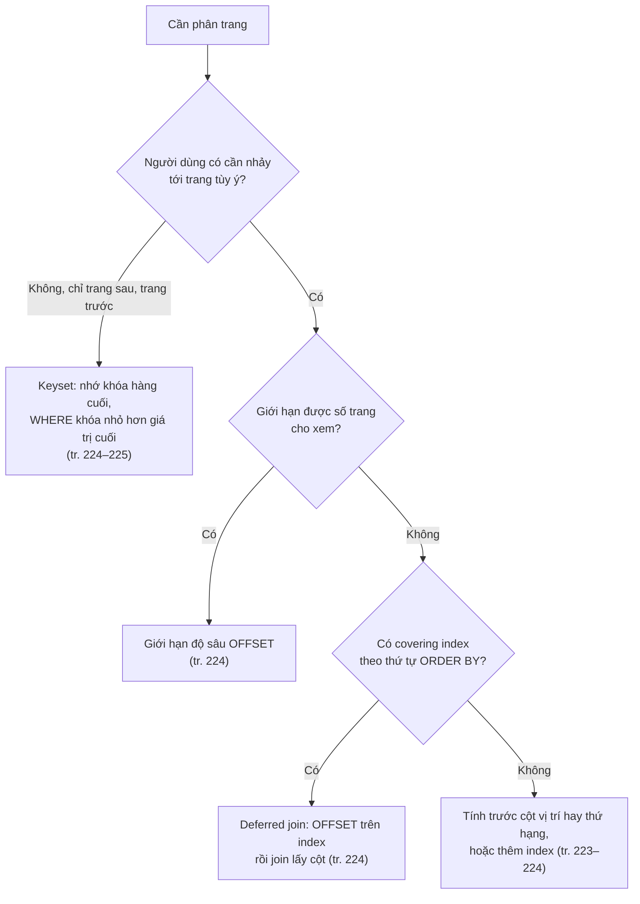

*(Sơ đồ do người viết ghi chú tổng hợp từ tr. 223–225.)*

<a id="sql-calc-found-rows"></a>

#### 2.6.5 Optimizing SQL_CALC_FOUND_ROWS (tr. 225)

- Một kỹ thuật phân trang khác là thêm hint `SQL_CALC_FOUND_ROWS` vào truy vấn có `LIMIT` để biết **nếu không có LIMIT** thì sẽ có bao nhiêu hàng. Trông như có "phép màu" giúp server đoán số hàng, nhưng **không**: server không đếm được hàng nó không thực sự tìm. Tùy chọn này chỉ bảo server **sinh nốt và vứt phần còn lại** của result set thay vì dừng khi đủ số hàng. **Rất tốn** (tr. 225).
- **Thay thế** (tr. 225):
  - Đổi bộ phân trang thành link **"next"**: mỗi trang 20 hàng thì truy vấn `LIMIT 21` và chỉ hiển thị 20; có hàng thứ 21 thì hiện link "next".
  - Lấy và **cache** nhiều hàng hơn cần, ví dụ 1.000, rồi phục vụ các trang sau từ cache. Ứng dụng biết kích thước kết quả: dưới 1.000 thì biết cần bao nhiêu link trang, trên 1.000 thì hiện "hơn 1.000 kết quả".
  - **Ước lượng** bằng cột `rows` của `EXPLAIN` ("ngay cả Google cũng không hiện số kết quả chính xác").
  - Nếu không dùng được các cách trên, một truy vấn `COUNT(*)` **riêng** có thể nhanh hơn nhiều so với `SQL_CALC_FOUND_ROWS`, **nếu** nó dùng được covering index.

**Evidence & example** (**Kết quả đã đo**, [TN3](experiments/chapter-08.md#tn3); điều kiện `customer_id BETWEEN 100 AND 200` khớp 168.612 hàng):

| Cách | Rows examined | Trung vị |
| --- | --- | --- |
| `SQL_CALC_FOUND_ROWS ... ORDER BY customer_id, rental_id LIMIT 20` | 1.168.612 (plan đổi sang **quét toàn bảng + sort 168.612 hàng**) | 801,9 ms |
| Cùng truy vấn với `LIMIT 21`, không hint | 21 | 1,5 ms |
| `COUNT(*)` riêng, covering range | 168.612 | 57,5 ms |

Trên 8.0.42, câu có `SQL_CALC_FOUND_ROWS` sinh cảnh báo 1287: hint này và `FOUND_ROWS()` **bị deprecated từ 8.0.17**, MySQL khuyên dùng hai truy vấn riêng (**Bổ sung ngoài sách**, phiên bản theo tài liệu MySQL). Phép đo cho thấy hint không chỉ "đếm thêm": nó làm optimizer **bỏ** plan dừng sớm theo index.

<a id="union"></a>

#### 2.6.6 Optimizing UNION (tr. 225–226)

- Theo sách, MySQL **luôn** thực thi UNION bằng cách tạo **bảng tạm** và đổ kết quả UNION vào đó. MySQL không áp được nhiều tối ưu cho UNION như bạn quen. Có thể phải "giúp" optimizer bằng cách **tự đẩy xuống** WHERE, LIMIT, ORDER BY và điều kiện khác, tức chép chúng từ truy vấn ngoài vào từng SELECT trong UNION (tr. 225–226).
- **Luôn dùng `UNION ALL`**, trừ khi cần server **loại hàng trùng**. Bỏ chữ ALL thì MySQL thêm tùy chọn distinct vào bảng tạm, dùng **cả hàng** để xét trùng: rất tốn. Nhưng ALL **không** bỏ được bảng tạm: MySQL luôn đặt kết quả vào bảng tạm rồi đọc ra, kể cả khi không cần, ví dụ khi có thể trả thẳng cho client (tr. 226).

**Evidence & example** (**Kết quả đã đo**, [TN4](experiments/chapter-08.md#tn4)):

| Truy vấn | Plan 8.0.42 | Bảng tạm | Rows examined | Trung vị |
| --- | --- | --- | --- | --- |
| actor UNION customer (799 hàng) | `Union materialize with deduplication` | 1 (799 lần ghi) | không đo | không đo |
| actor UNION ALL customer | `Append`, `Stream results` | **0** | không đo | không đo |
| 200.000 hàng: `rental_id <= 100000` UNION `rental_id > 900000` | Bảng tạm có loại trùng, **chuyển ra đĩa** | 1 (`Created_tmp_disk_tables` = 1) | 400.000 | 1.059 ms |
| Như trên với UNION ALL | Stream | 0 | 200.000 | 298,4 ms |

- Lời khuyên "dùng UNION ALL khi không cần loại trùng" được xác nhận mạnh: với cùng kết quả (hai nhánh không bao giờ trùng), UNION chậm hơn khoảng 3,5 lần vì phải ghi 200.000 hàng vào bảng tạm có khóa duy nhất trên cả hàng, bảng tạm vượt `tmp_table_size` (16 MB) nên ra đĩa.
- Câu "ALL không bỏ được bảng tạm" **không còn đúng** trên 8.0.42: UNION ALL không có ORDER BY chung được trả thẳng. Khi có ORDER BY chung, UNION ALL vẫn materialize (xem [2.5.1](#union-limitations)). Tài liệu MySQL ghi việc bỏ bảng tạm cho UNION ALL có từ 5.7 (**Bổ sung ngoài sách**).

#### Tự kiểm tra 2.6

- **Câu 2.6.1.** `COUNT(*)` và `COUNT(col)` khác nhau thế nào về ngữ nghĩa và về plan? Khi nào hai câu cho kết quả khác nhau? Vì sao `ROWS_EXAMINED = 0` của `COUNT(*)` trong Performance Schema không có nghĩa là rẻ? [đáp án](answers/chapter-08.md#q2-6-1)
- **Câu 2.6.2.** Vì sao `COUNT(color = 'blue' OR color = 'red')` không đếm riêng từng màu, và trong TN4 biểu thức tương tự còn trả 1.000.000? Viết lại cho đúng theo hai cách. [đáp án](answers/chapter-08.md#q2-6-2)
- **Câu 2.6.3.** So sánh OFFSET lớn, deferred join và keyset theo số hàng phải đọc. Vì sao keyset viết bằng row constructor lại chậm trên 8.0.42? [đáp án](answers/chapter-08.md#q2-6-3)
- **Câu 2.6.4.** `SQL_CALC_FOUND_ROWS` tốn ở đâu? Trong TN3, nó còn làm plan thay đổi thế nào? Nêu ba cách thay thế của sách. [đáp án](answers/chapter-08.md#q2-6-4)
- **Câu 2.6.5.** Chi phí ẩn của UNION (không ALL) nằm ở đâu? Nếu hai nhánh chắc chắn không trùng, chọn gì và vì sao? Lời sách "ALL không bỏ được bảng tạm" còn đúng trên 8.0.42 không? [đáp án](answers/chapter-08.md#q2-6-5)

<a id="s2-7"></a>

### 2.7 Summary (tr. 226)

- Tối ưu truy vấn là **mảnh cuối** của bộ ghép hình schema, index và truy vấn để có ứng dụng hiệu năng cao. Muốn viết truy vấn tốt phải hiểu schema và index, **và ngược lại** (tr. 226).
- Rốt cuộc vẫn là **response time** và hiểu truy vấn thực thi ra sao để suy luận **thời gian tiêu ở đâu**. Thêm vài thứ như quá trình parse và tối ưu, đây chỉ là bước tiếp theo của việc hiểu MySQL truy cập bảng và index ở chương 7. **Chiều mới** xuất hiện khi học tương tác giữa truy vấn và index: MySQL truy cập **một bảng hay index dựa trên dữ liệu tìm được ở bảng khác** (tr. 226).
- Tối ưu luôn cần cách tiếp cận **ba hướng**: **thôi làm**, **làm ít lần hơn**, **làm nhanh hơn** (tr. 226).

| Hướng (tr. 226) | Kỹ thuật trong chương | Trang |
| --- | --- | --- |
| **Thôi làm** việc không cần | LIMIT, bỏ `SELECT *`, cache dữ liệu lấy lặp; UNION ALL thay UNION; bỏ `SQL_CALC_FOUND_ROWS`, bỏ DISTINCT thừa; kết thúc sớm, bảng thành hằng | tr. 193–194, 209–210, 222, 225–226 |
| **Làm ít lần hơn** | Một truy vấn 10 hàng thay vì 10 truy vấn; thứ tự join ít lần dò hơn; keyset thay OFFSET; đẩy LIMIT vào nhánh UNION | tr. 199, 215–216, 219, 224–225 |
| **Làm nhanh hơn** | Access type tốt hơn nhờ index; covering index; deferred join; hash join thay vòng lặp không index; chia lô cho khóa ngắn | tr. 195–198, 199–200, 212, 224 |

*(Bảng do người viết ghi chú tổng hợp.)*

#### Tự kiểm tra 2.7

- **Câu 2.7.1.** Với mỗi hướng "thôi làm, làm ít lần hơn, làm nhanh hơn", chọn một kỹ thuật trong chương và giải thích nó tác động vào nhiệm vụ con nào. [đáp án](answers/chapter-08.md#q2-7-1)
- **Câu 2.7.2.** Summary nói chiều mới của chương 8 là truy cập một bảng dựa trên dữ liệu tìm được ở bảng khác. Liên hệ ý này với join optimizer và lời khuyên "chỉ cần index ở bảng thứ hai". [đáp án](answers/chapter-08.md#q2-7-2)
- **Câu 2.7.3.** Vì sao lời khuyên ở chương này "phụ thuộc phiên bản"? Nêu ba chỗ MySQL 8.0.42 đã khác lời sách, và rút ra nguyên tắc làm việc. [đáp án](answers/chapter-08.md#q2-7-3)

---

<a id="situations"></a>

## 3. Phân tích tình huống

Bốn tình huống dưới đây là **Ví dụ minh họa do AI xây dựng**, nhưng số liệu trong đó là **Kết quả đã đo** trên dữ liệu tổng hợp của [bài thực hành](experiments/chapter-08.md) (MySQL 8.0.42, Windows 11, instance riêng). Mỗi tình huống đi theo trình tự: dữ liệu đầu vào → access path → optimizer → toán tử thực thi → chi phí → cách sửa.

<a id="sit-1"></a>

### Tình huống 1: trang quản trị càng xem sâu càng chậm

**Bối cảnh.** Trang quản trị liệt kê đơn thuê sắp theo khách hàng, mỗi trang 20 dòng. Trang 15.001 chạy hơn 1,5 giây.

```sql
-- Ví dụ minh họa do AI xây dựng
SELECT * FROM rental ORDER BY customer_id, rental_id LIMIT 300000, 20;
```

| Bước | Phân tích |
| --- | --- |
| **Dữ liệu đầu vào** | `rental` 1.000.000 hàng, clustered index khoảng 7.913 page 16 KB (theo `mysql.innodb_table_stats`). Index phụ `idx_customer(customer_id)`, mỗi mục ngầm chứa `rental_id` nên đã đúng thứ tự `(customer_id, rental_id)` |
| **Access path có thể** | (a) Quét `idx_customer` theo thứ tự, dừng sau 300.020 mục, nhưng mỗi mục phải tra clustered index để lấy `SELECT *`: 300.020 lần tra B+tree. (b) Quét toàn bảng tuần tự rồi filesort |
| **Optimizer** | Ước lượng (a) đắt hơn vì 300.020 lần tra ngẫu nhiên, nên chọn (b): `Sort: ... limit input to 300020 row(s) per chunk` trên `Table scan` (tr. 205–206, 216–217) |
| **Toán tử thực thi** | Table scan 1.000.000 hàng → filesort giữ 300.020 hàng tốt nhất, tràn đĩa 445 chunk, 83 lượt merge → `Limit/Offset 20/300000` |
| **Chi phí** | Rows examined 1.300.020; `Sort_rows` 300.020; trung vị 1.631 ms. 99,99% công việc là cho các hàng **bị vứt** |

**Sửa** (tr. 224–225):

```sql
-- Ví dụ minh họa do AI xây dựng: deferred join, OFFSET chạy trên covering index
SELECT r.* FROM rental r
JOIN (SELECT rental_id FROM rental ORDER BY customer_id, rental_id LIMIT 300000, 20) AS lim
  USING (rental_id);

-- Keyset: trang sau bắt đầu từ khóa của dòng cuối trang trước (180, 300000)
SELECT * FROM rental
WHERE customer_id > 180 OR (customer_id = 180 AND rental_id > 300000)
ORDER BY customer_id, rental_id LIMIT 20;
```

| Cách | Toán tử chính | Đọc | Trung vị |
| --- | --- | --- | --- |
| Deferred join | Covering index scan 300.020 mục (`Handler_read_next` 300.019) → materialize 20 id → 20 lần tra PRIMARY | 300.020 mục index nhỏ, 20 hàng đầy đủ | 83,3 ms |
| Keyset (dạng OR) | Range scan trên `idx_customer`, dừng sau 20 hàng | 20 | 1,8 ms |

**Decision.** Nếu giao diện cần số trang: deferred join, cộng giới hạn độ sâu (tr. 224). Nếu là "xem tiếp" hay cuộn vô hạn: keyset. Cẩn thận viết điều kiện keyset bằng row constructor: trên 8.0.42 nó quét index từ đầu (299.360 hàng, 1.076 ms).

<a id="sit-2"></a>

### Tình huống 2: join ba bảng, thứ tự join và index biến mất

**Bối cảnh.** Truy vấn liệt kê phim kèm diễn viên (ví dụ của sách, tr. 213), trên dữ liệu tổng hợp cùng kích thước Sakila.

```sql
-- Câu của sách (tr. 213), chạy trên dữ liệu tổng hợp
SELECT film.film_id, film.title, film.release_year, actor.actor_id, actor.first_name, actor.last_name
FROM film INNER JOIN film_actor USING(film_id) INNER JOIN actor USING(actor_id);
```

| Bước | Phân tích |
| --- | --- |
| **Dữ liệu** | `actor` 200 hàng (1 page), `film` 1.000 hàng (15 page, có cột mô tả dài), `film_actor` 5.400 hàng với PRIMARY `(actor_id, film_id)` và `idx_fk_film_id(film_id)` |
| **Access path** | Bảng đầu: quét `actor` hay quét `film`. Bảng giữa: tra `film_actor` theo tiền tố PRIMARY (nếu `actor` trước) hay theo `idx_fk_film_id` (nếu `film` trước), cả hai đều covering. Bảng cuối: `eq_ref` theo primary key |
| **Optimizer** | 3 bảng có 3! = 6 thứ tự. Thứ tự đặt `film` và `actor` cạnh nhau ở đầu không có điều kiện join giữa hai bảng đó, tức là tích Đề-các; thứ tự bắt đầu bằng `film_actor` phải quét cả 5.400 hàng ngay từ đầu (**Bổ sung ngoài sách**, suy luận). Hai ứng viên mà sách so sánh: `actor` trước (chi phí 2.501,5) và `film` trước (3.688,3) → optimizer chọn `actor` trước (tr. 214–216) |
| **Toán tử** | `Nested loop inner join` lồng hai tầng: `Table scan on actor` (200) → `Covering index lookup on film_actor using PRIMARY` (loops 200) → `Single-row index lookup on film` (loops 5.400) |
| **Chi phí thật** | `Handler_read_key` 5.601, `Handler_read_rnd_next` 201; 13,4 ms. Với `STRAIGHT_JOIN`: 6.401 và 1.001; 17,2 ms |

**Biến thể "index biến mất".** Nếu điều kiện join không có index dùng được (đo bằng join `actor` với `customer` theo một biểu thức), 8.0.42 dùng `Inner hash join`: quét mỗi bảng **một lần** (600 hàng), 0,78 ms. Ép nested-loop bằng `NO_BNL` thì quét `customer` 200 lần (120.000 hàng), 102 ms. Trước 8.0.18 (không có hash join), MySQL sẽ dùng block nested-loop với join buffer (**Bổ sung ngoài sách**).

**Decision.** Đặt index ở cột join của bảng được **tra** (bảng thứ hai trong thứ tự join, tr. 223); để optimizer chọn thứ tự; chỉ dùng `STRAIGHT_JOIN` hay hint `JOIN_ORDER` khi đã đo thấy plan tự chọn tệ hơn **và** hiểu vì sao (tr. 211, 216). Hash join là lưới an toàn tốt cho join lớn không index, nhưng không thay được index cho truy vấn OLTP chỉ cần vài hàng.

<a id="sit-3"></a>

### Tình huống 3: trang tìm kiếm có "tổng số kết quả" và gộp hai nguồn

**Bối cảnh.** Trang tìm kiếm hiển thị 20 kết quả đầu, dòng "tìm thấy N kết quả", và gộp kết quả từ hai bảng.

```sql
-- Ví dụ minh họa do AI xây dựng: cách làm ban đầu
SELECT SQL_CALC_FOUND_ROWS * FROM rental
WHERE customer_id BETWEEN 100 AND 200
ORDER BY customer_id, rental_id LIMIT 20;
SELECT FOUND_ROWS();
```

| Bước | Phân tích |
| --- | --- |
| **Dữ liệu** | 168.612 hàng thỏa điều kiện |
| **Access path** | Không có hint: range trên `idx_customer`, đúng thứ tự ORDER BY, dừng sau 20 hàng. Có hint: phải sinh **mọi** hàng thỏa điều kiện |
| **Optimizer** | Vì phải sinh hết 168.612 hàng kèm mọi cột, nó đổi sang quét toàn bảng rồi sort (tr. 225) |
| **Toán tử** | Table scan 1.000.000 hàng → Filter → Sort 168.612 hàng → Limit 20 (phần còn lại vẫn được đếm) |
| **Chi phí** | 1.168.612 rows examined, trung vị 801,9 ms, cộng cảnh báo deprecated 1287 |

**Sửa.** `LIMIT 21` để biết có trang sau (21 hàng, 1,5 ms); nếu thật sự cần tổng số thì `COUNT(*)` riêng trên covering index (168.612 mục index, 57,5 ms), có thể cache hay thay bằng ước lượng từ `EXPLAIN` (tr. 225).

**Phần gộp hai nguồn.** Nếu hai nguồn không bao giờ trùng nhau, dùng `UNION ALL`: với 200.000 hàng, UNION mất 1.059 ms và tạo bảng tạm trên đĩa, UNION ALL mất 298 ms và không có bảng tạm (tr. 226). Nếu cần sắp chung và lấy 20 dòng, đặt `ORDER BY ... LIMIT 20` vào **từng nhánh** và cả bên ngoài: bảng tạm còn 40 thay vì 799 hàng (tr. 219).

<a id="sit-4"></a>

### Tình huống 4 (vận hành): job purge ban đêm làm ứng dụng timeout

**Bối cảnh.** Job purge xóa tin nhắn cũ bằng một câu DELETE. Trong lúc job chạy, ứng dụng báo lỗi `Lock wait timeout exceeded` ở những UPDATE vào tin nhắn **mới**, không liên quan gì tới dữ liệu cũ.

| Bước | Phân tích |
| --- | --- |
| **Dữ liệu** | `messages` 300.000 hàng, 131.039 hàng (khoảng 44%) cũ hơn mốc, index `idx_created` |
| **Access path và optimizer** | Với 44% số hàng khớp, optimizer cho rằng quét toàn bảng rẻ hơn đi qua index phụ: `EXPLAIN DELETE` cho `type: ALL` |
| **Thực thi** | DELETE là locking read; ở REPEATABLE READ, InnoDB khóa **mọi hàng quét qua** và giữ tới commit: `trx_rows_locked` = 303.660, `trx_lock_structs` = 3.661, khoảng 408 KB bộ nhớ lock (**Bổ sung ngoài sách** về cơ chế) |
| **Tác động** | Một UPDATE vào hàng id 250.000 (không bị xóa) chờ 3 giây rồi lỗi 1205; `sys.innodb_lock_waits` chỉ đúng transaction purge đang khóa 303.660 hàng |
| **Sửa** | Chia lô `LIMIT 10000` (tr. 199–200): optimizer chuyển sang `range` trên `idx_created`; mỗi lô khóa tối đa 20.009 hàng trong khoảng 0,1–0,15 giây; UPDATE của ứng dụng xong sau 2,9 ms |

**Decision.** Chia lô theo index, nghỉ giữa các lô, theo dõi `sys.innodb_lock_waits` và replication lag (tr. 199–200; [Chương 9](chapter-09.md#replication-lag)). Chấp nhận tổng thời gian purge dài hơn (đo được 1,65 so với 1,0 giây) để đổi lấy khóa ngắn. Công cụ có sẵn: *pt-archiver* (chú thích 3, tr. 199).

---

<a id="measure"></a>

## 4. Đo lường và thực hành

### Nguyên tắc

- **Giả thuyết trước, đo sau.** Viết ra dự đoán (plan nào, đọc bao nhiêu hàng), đo **trước** khi đổi, đổi **một** thứ, đo lại.
- **Ưu tiên chỉ số tất định** (số hàng, số lời gọi handler, số bảng tạm, chi phí ước lượng) hơn thời gian. Thời gian trên laptop Windows nhiều nhiễu; nếu dùng, lặp ít nhất 3 lần và báo trung vị.
- **Phân biệt ước lượng và thật.** `EXPLAIN` là ước lượng; `EXPLAIN ANALYZE`, Performance Schema, `Handler_*` là số thật.

### Chỉ số và cách đọc

| Chỉ số | Lấy ở đâu | Cho biết | Bẫy đã gặp khi đo |
| --- | --- | --- | --- |
| Rows examined, rows sent (tr. 194–195) | `performance_schema.events_statements_history`, slow query log | Tỉ lệ đọc so với trả | Đếm **thiếu** cho đường `Count rows` (0) và cho subquery có OFFSET trong deferred join (40) |
| `Handler_read_*` | `FLUSH STATUS` rồi `SHOW SESSION STATUS LIKE 'Handler_read%'` | Số lời gọi handler từng loại (tr. 218) | Theo session; chạy nhiều câu giữa hai lần đọc sẽ cộng dồn |
| `Innodb_buffer_pool_read_requests` | Global status | Lượt đọc page logic | Chỉ số **toàn server**: chỉ tin trên instance riêng, nhàn rỗi |
| `Created_tmp_tables`, `Created_tmp_disk_tables` | Session status, Performance Schema | Bảng tạm, tràn đĩa (tr. 204, 217, 226) | |
| `Sort_rows`, `Sort_merge_passes` | Session status | Kích thước sort, tràn đĩa (tr. 216–217) | |
| `Select_scan`, `Select_range`, `Select_range_check` | Session status | Kiểu truy cập và join | Tên biến khác chú thích 6 của sách |
| `EXPLAIN` (`type`, `rows`, `filtered`, `Extra`) | | Plan và ước lượng (tr. 195–197) | `rows` là ước lượng |
| `EXPLAIN FORMAT=TREE` | 8.0.16+ | Cây iterator, chi phí từng toán tử | Chi phí đổi theo trạng thái buffer pool |
| `EXPLAIN ANALYZE` | 8.0.18+ | `actual time`, `rows`, `loops` | Chạy thật câu lệnh |
| Optimizer trace | `SET optimizer_trace='enabled=on'`, `information_schema.OPTIMIZER_TRACE` | Vì sao chọn plan; chế độ sort, priority queue | Tốn; chỉ bật trong session thử nghiệm |
| `Last_query_cost` (tr. 205) | `SHOW STATUS` | Chi phí ước lượng của câu vừa chạy | 0 với truy vấn phức tạp; `LIMIT 0` cũng cho 0 |
| Thời gian | `TIMER_WAIT` trong Performance Schema | Response time của server | Nhiễu; lặp và lấy trung vị |

### Các thí nghiệm đã chạy

Môi trường: MySQL 8.0.42 Community trên Windows 11 (laptop), instance riêng cổng 3318, `--no-defaults`, buffer pool 512 MB, dữ liệu tổng hợp (không phải Sakila thật). Chi tiết, SQL chạy lại được và output: [experiments/chapter-08.md](experiments/chapter-08.md).

| Thí nghiệm | Giả thuyết (dựa trên sách) | Kết quả chính (**Kết quả đã đo**) |
| --- | --- | --- |
| [TN1](experiments/chapter-08.md#tn1) Rows examined, access type, `SELECT *` | Bỏ index thì rows examined tăng từ số hàng trả về lên cả bảng; `SELECT *` mất covering index | 7 → 5.400 hàng đọc cho 7 hàng trả; GROUP BY đọc 5.400 trả 200; `SELECT *` 200.447 lượt đọc page so với 106 |
| [TN2](experiments/chapter-08.md#tn2) Optimizer, join, cost model | Optimizer đảo thứ tự join; hash join thay nested-loop khi không index; cost không tính cache | Đảo thứ tự đúng như sách (2.501 so với 3.688); hash join 600 so với 120.000 hàng đọc; **cost model có tính cache** (107.138 lạnh, 101.203 nóng); `Select_range_check` chứ không phải `Select_full_range_join` |
| [TN3](experiments/chapter-08.md#tn3) Phân trang, `SQL_CALC_FOUND_ROWS` | OFFSET tốn tuyến tính; deferred join và keyset rẻ hơn | 323,8 ms so với 0,7 ms (PK); 1.631 so với 83 so với 1,8 ms (thứ tự theo index phụ); row constructor là bẫy; `SQL_CALC_FOUND_ROWS` 1,17 triệu hàng |
| [TN4](experiments/chapter-08.md#tn4) COUNT, UNION, ROLLUP, lỗi 1093 | UNION luôn tạo bảng tạm; UNION ALL rẻ hơn | UNION ALL **không** tạo bảng tạm trên 8.0.42; UNION chậm hơn 3,5 lần; COUNT(col nullable) khác kết quả; 1093 tái hiện và lách được |
| [TN5](experiments/chapter-08.md#tn5) Chia nhỏ DELETE | Một DELETE lớn khóa nhiều, chặn truy vấn khác; chia lô giảm khóa | 303.660 so với 20.009 hàng khóa mỗi transaction; UPDATE bị chặn so với xong trong 2,9 ms; tổng thời gian chia lô dài hơn |

**Tiêu chí so sánh trước và sau.** Một thay đổi được coi là cải thiện khi số hàng đọc (hoặc số lời gọi handler) giảm rõ **và** kết quả không đổi; thời gian chỉ dùng để xác nhận chiều hướng. Với thay đổi ảnh hưởng concurrency (chia lô), tiêu chí là thời gian giữ khóa và số truy vấn khác bị chặn, không phải thời gian của riêng job.

---

<a id="takeaways"></a>

## 5. Liên kết kiến thức và điều cần nhớ

### Liên kết khái niệm

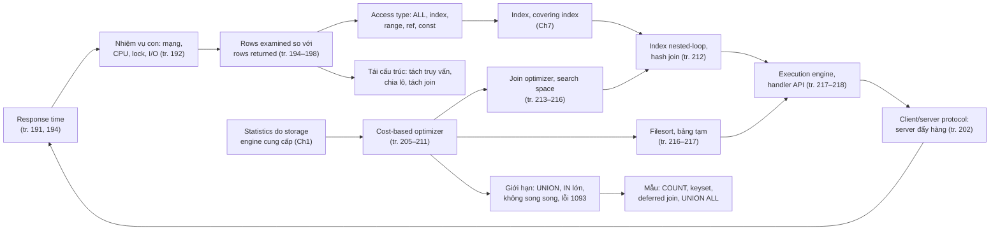

*(Sơ đồ do người viết ghi chú tổng hợp.)*

### Điều cần nhớ

1. **Mọi thứ quy về response time**, là tổng thời gian của các nhiệm vụ con; tối ưu bằng cách thôi làm, làm ít lần hơn, làm nhanh hơn (tr. 191, 226).
2. **Phân tích hai bước:** ứng dụng có lấy thừa (hàng, cột, lặp lại) không, rồi server có đọc thừa không. Tỉ lệ đọc so với trả từ 1:1 tới 10:1 là bình thường; lớn hơn nhiều bậc là dấu hiệu (tr. 192–195).
3. **Access type và nơi áp WHERE** (trong index, trên covering index, hay sau khi đọc hàng) quyết định lượng việc. Index sửa access type, nhưng không giảm được số hàng đọc khi truy vấn không có điều kiện lọc (tr. 195–198).
4. **MySQL tính trọn kết quả và đẩy hết cho client.** Đóng result set sớm không dừng server; `LIMIT` mới dừng. Unbuffered result giữ lock và tài nguyên server lâu hơn (tr. 193, 202–203).
5. **Optimizer dựa trên chi phí và statistics của storage engine**, và có thể sai vì ít nhất bảy lý do. Đừng cố khôn hơn nó; chỉ can thiệp (hint, viết lại, schema, index) khi biết nó sai và vì sao (tr. 205–211).
6. **Plan là cây left-deep của các nested-loop**; join optimizer chọn thứ tự để giảm số lần dò; từ 8.0.20 hash join thay block nested-loop. Index cần nằm ở bảng được tra (tr. 212–216, 223).
7. **Sort khi join:** ORDER BY chỉ trên bảng đầu thì `Using filesort`; còn lại là bảng tạm cộng filesort, và LIMIT áp sau sort. Cột rộng làm sort tốn bộ nhớ theo kích thước tối đa (tr. 216–217).
8. **OFFSET sâu tốn tuyến tính** theo OFFSET; dùng deferred join hay keyset. `SQL_CALC_FOUND_ROWS` buộc server sinh hết kết quả (tr. 223–225).
9. **Dùng UNION ALL** trừ khi cần loại trùng, và tự đẩy LIMIT, ORDER BY, WHERE vào từng nhánh (tr. 219, 225–226).
10. **Lời khuyên phụ thuộc phiên bản** (tr. 221): trên 8.0.42, UNION ALL không còn luôn dùng bảng tạm, cost model có tính cache, `EXPLAIN EXTENDED` và `SQL_CALC_FOUND_ROWS` đã bị bỏ hay deprecated. Luôn kiểm chứng bằng `EXPLAIN ANALYZE` và bộ đếm trên đúng phiên bản bạn chạy.

### Dấu hiệu nhận diện trong thực tế

| Dấu hiệu | Nguyên nhân hay gặp | Kiểm tra gì |
| --- | --- | --- |
| `Rows_examined` lớn hơn `Rows_sent` hàng trăm lần trong slow log | Access type kém, hoặc truy vấn gộp trên cả bảng | `EXPLAIN` cột `type`, `key`; cân nhắc index, covering index, summary table (tr. 195–198) |
| Truy vấn có `LIMIT 20` mà vẫn chậm, `Extra` có `Using temporary; Using filesort` | ORDER BY trên cột không thuộc bảng đầu trong thứ tự join | Viết lại ORDER BY, thêm index cho thứ tự (tr. 217, 223) |
| Trang càng sâu càng chậm | OFFSET lớn | Keyset hay deferred join (tr. 224–225) |
| `Created_tmp_disk_tables` tăng đều | UNION không ALL, GROUP BY lớn, sort trên cột rộng | UNION ALL, index cho GROUP BY, thu hẹp cột (tr. 217, 226) |
| Lỗi 1205 hàng loạt khi job dọn dữ liệu chạy | DELETE hay UPDATE lớn quét và khóa nhiều hàng | `sys.innodb_lock_waits`; chia lô theo index (tr. 199–200) |
| Trạng thái `statistics` kéo dài trên server bận | Join rất nhiều bảng, search space lớn, hoặc server quá tải | Số bảng trong join, `optimizer_search_depth` (tr. 204, 216) |
| Ứng dụng tốn RAM khi đọc kết quả lớn, hoặc server giữ lock lâu khi client chậm | Buffered hay unbuffered result | Cấu hình driver; `LIMIT`; `SQL_BUFFER_RESULT` (tr. 202–203) |
| `Range checked for each record` trong `Extra` | Join với điều kiện khoảng, plan đánh giá lại index mỗi hàng | `Select_range_check` (tr. 207) |
| Cùng truy vấn đổi plan sau khi khởi động lại hay sau `ANALYZE TABLE` | Statistics lấy mẫu thay đổi; chi phí phụ thuộc page nóng hay lạnh | So `EXPLAIN FORMAT=TREE` trước và sau (tr. 206, 211) |

### Câu hỏi còn mở

- MySQL 8.0 ước lượng "phần trăm bảng đang nằm trong buffer pool" thế nào và cập nhật khi nào? TN2 cho thấy **tác động** lên chi phí, nhưng không cho thấy cơ chế hay tần suất cập nhật.
- Vì sao tổng thời gian của DELETE chia lô dài hơn? Giả thuyết về mục index bị đánh dấu xóa chưa được purge cần kiểm chứng; chia lô theo khoảng primary key có tránh được không?
- Với buffer pool lạnh, `COUNT(*)` so với `COUNT(cột nullable không index)` chênh bao nhiêu? Chưa đo.
- Hash join khi đầu vào build vượt `join_buffer_size` (tràn đĩa) tốn thêm bao nhiêu? Chưa đo.
- Sách hứa bàn đường thực thi của prepared statement "ở chương sau" nhưng không có. Tối ưu tĩnh làm một lần, tối ưu động làm lại mỗi lần (tr. 207) ảnh hưởng thế nào tới prepared statement trên 8.0? Cần nguồn ngoài.
- Nếu hypergraph optimizer được đưa vào bản release, nhận định "plan của MySQL luôn là left-deep" (tr. 213) sẽ còn đúng không?

---

<a id="kiem-tra"></a>

## Ghi chú kiểm tra nguồn

### Đối chiếu mục lục (bookmark PDF)

| Mục trong sách | Trang in (PDF) | Mục ghi chú |
| --- | --- | --- |
| Why Are Queries Slow? | 191 (213) | [2.1](#s2-1) |
| Slow Query Basics: Optimize Data Access | 192 (214) | [2.2](#s2-2) |
| · Are You Asking the Database for Data You Don't Need? | 192 (214) | [2.2.1](#unneeded-data) |
| · Is MySQL Examining Too Much Data? | 194 (216) | [2.2.2](#examined-too-much) |
| Ways to Restructure Queries | 198 (220) | [2.3](#s2-3) |
| · Complex Queries Versus Many Queries | 198 (220) | [2.3.1](#complex-vs-many) |
| · Chopping Up a Query | 199 (221) | [2.3.2](#chopping) |
| · Join Decomposition | 200 (222) | [2.3.3](#join-decomposition) |
| Query Execution Basics | 201 (223) | [2.4](#s2-4) |
| · The MySQL Client/Server Protocol | 202 (224) | [2.4.1](#client-server-protocol) |
| · Query States | 204 (226) | [2.4.2](#query-states) |
| · The Query Optimization Process | 205 (227) | [2.4.3](#optimization-process) |
| · The Query Execution Engine | 217 (239) | [2.4.4](#execution-engine) |
| · Returning Results to the Client | 218 (240) | [2.4.5](#returning-results) |
| Limitations of the MySQL Query Optimizer | 219 (241) | [2.5](#s2-5) |
| · UNION Limitations | 219 (241) | [2.5.1](#union-limitations) |
| · Equality Propagation | 220 (242) | [2.5.2](#equality-propagation) |
| · Parallel Execution | 220 (242) | [2.5.3](#parallel-execution) |
| · SELECT and UPDATE on the Same Table | 220 (242) | [2.5.4](#select-update-same-table) |
| Optimizing Specific Types of Queries | 221 (243) | [2.6](#s2-6) |
| · Optimizing COUNT() Queries | 221 (243) | [2.6.1](#count) |
| · Optimizing JOIN Queries | 223 (245) | [2.6.2](#join-queries) |
| · Optimizing GROUP BY with ROLLUP | 223 (245) | [2.6.3](#rollup) |
| · Optimizing LIMIT and OFFSET | 223 (245) | [2.6.4](#limit-offset) |
| · Optimizing SQL_CALC_FOUND_ROWS | 225 (247) | [2.6.5](#sql-calc-found-rows) |
| · Optimizing UNION | 225 (247) | [2.6.6](#union) |
| Summary | 226 (248) | [2.7](#s2-7) |

Các tiêu đề cấp nhỏ hơn (không có trong bookmark) được viết thành đoạn in đậm: *Response time; Rows examined and rows returned; Rows examined and access types* (tr. 194–197); *The parser and the preprocessor; The query optimizer; Table and index statistics; MySQL's join execution strategy; The execution plan; The join optimizer; Sort optimizations* (tr. 205–217); *What COUNT() does; Simple optimizations; Using an approximation; More complex optimizations* (tr. 221–223).

### Hình, listing đã xem trên ảnh trang

- **Hình 8-1** (PDF 223), **Hình 8-2** và **8-3** (PDF 235): đã vẽ lại bằng Mermaid.
- Listing và output đã xem để đối chiếu với chữ: PDF 218–219 (`EXPLAIN` của `film_actor`, kết quả GROUP BY), 221–222 (DELETE và mã giả chia lô; join decomposition), 224–226 (giao thức, PHP, Perl, trạng thái), 227–228 (`Last_query_cost`, các lý do plan sai), 230–232 (`EXPLAIN` với `const`, `Impossible WHERE`, not-exists, equality propagation), 234–237 (chiến lược join, hai `EXPLAIN` của join optimizer), 239–240 (filesort, execution engine, hộp Lưu ý), 241–247 (UNION, UPDATE cùng bảng, COUNT, LIMIT, `SQL_CALC_FOUND_ROWS`).
- Hộp duy nhất của chương là hộp **Lưu ý** (biểu tượng chim) ở tr. 218 (PDF 240).

### Lỗi trích xuất chữ

- Tr. 209: chữ trích xuất ghi `film_id = −1` với dấu trừ Unicode; ảnh trang là dấu trừ ASCII bình thường.
- Một số từ bị ngắt dòng làm vỡ tên: `EXPLAIN EXTEN DED` (tr. 212), `SQL_ CALC_ FOUND_ROWS` (tr. 225), `mysql_unbuf fered_query` và `mysql_ use_result` (tr. 203), `opti mizer_search_depth` (tr. 216). Đã đọc lại trên ảnh trang.
- Ngoài ra chữ trích xuất khớp ảnh trang.

### Chỗ chưa nhất quán trong sách

1. **Tr. 202:** hẹn bàn prepared statement "ở chương sau", nhưng chương 9 là Replication và không bàn chủ đề này.
2. **Tr. 207:** "conditional queries, which we discuss later in this chapter": chương không bàn lại. **Tr. 216:** "more about subqueries later": chương không có mục subquery riêng. **Tr. 223:** "hints we mentioned earlier in this section": hint chỉ được nhắc ở chú thích 8, tr. 211. Có vẻ là các tham chiếu còn sót từ ấn bản trước (**suy đoán** của người viết ghi chú).
3. **Tr. 207, chú thích 6:** nói plan "range checked for each record" làm tăng `Select_full_range_join`; đo trên 8.0.42 thì biến tăng là `Select_range_check`.
4. **Tr. 209:** chữ nói kiểu truy cập của `film_actor` là `const`, nhưng output in ở tr. 208 cho `type: index` (vì index `idx_fk_film_id` đã bị xóa ở ví dụ tr. 196). Đo lại khi có index: `film_actor` là `ref` với `ref: const`, đúng ý "dùng như hằng" của sách.
5. **Tr. 205:** gọi `Last_query_cost` là "session variable"; thật ra là biến status.
6. **Tr. 204:** gộp giá trị cột `Command` (`Sleep`, `Query`) với giá trị cột `State` dưới chữ "Command column".

### Điều kiện phiên bản

| Nội dung | Sách | MySQL 8.0.42 (đo hoặc theo tài liệu) |
| --- | --- | --- |
| Hash join | Thay BNL từ 8.0.20 (tr. 212) | Có từ 8.0.18 cho inner equi-join; từ 8.0.20 cả outer, semi, anti, non-equi (đo được `Left hash join`, hash join không điều kiện) |
| `EXPLAIN EXTENDED` | Dùng với `SHOW WARNINGS` (tr. 212) | Lỗi 1064; dùng `EXPLAIN` thường rồi `SHOW WARNINGS` |
| `EXPLAIN FORMAT=TREE`, `EXPLAIN ANALYZE` | Chỉ nhắc `FORMAT=TREE` (chú thích 10) | 8.0.16+ và 8.0.18+ |
| `SQL_NO_CACHE` | Dùng trong ví dụ (tr. 205) | Cảnh báo 1681 deprecated; query cache bị gỡ trong 8.0 |
| Cost model và cache | Không tính cache (tr. 206) | Chi phí đọc page khác nhau khi lạnh (1,0) và nóng (0,25) |
| Trạng thái "Sending data" | Có (tr. 203) | Gộp vào `executing` từ 8.0.17 (tài liệu MySQL); không quan sát thấy |
| UNION ALL | Luôn dùng bảng tạm (tr. 226) | Trả thẳng khi không có ORDER BY chung |
| Đẩy điều kiện vào UNION | Không (tr. 219) | WHERE được đẩy vào derived table có UNION (8.0.29+ theo tài liệu); LIMIT và ORDER BY thì không |
| Song song | Không (tr. 220) | Không cho truy vấn tổng quát; đọc clustered index song song cho `COUNT(*)`, `CHECK TABLE` từ 8.0.14 |
| `SQL_CALC_FOUND_ROWS` | Có (tr. 225) | Deprecated từ 8.0.17 (cảnh báo 1287) |
| Filesort | Quicksort; bản ghi cố định (tr. 216–217) | Cột phụ được đóng gói; kích thước buffer vẫn tính theo tối đa; priority queue cho LIMIT nhỏ; `max_length_for_sort_data` deprecated từ 8.0.20 |
| Hypergraph optimizer | Không nhắc | Lỗi 3999 trên bản release |

### Danh sách nội dung Bổ sung ngoài sách

Logical query processing và physical execution; slow log và Performance Schema cho rows examined; ví dụ QUBE; danh sách đầy đủ giá trị `type`; ICP; phép tính N+1 query; cơ chế khóa của DELETE ở REPEATABLE READ; nhất quán khi tách join; PHP `mysqli`, PDO, `mysql --quick`, `max_allowed_packet` mặc định, `SQL_BUFFER_RESULT`; cột `Command` và `State`, "Sending data" trong 8.0.17; cost model 8.0 và các hằng số; `Last_query_cost` với truy vấn phức tạp; semijoin, antijoin; optimizer hint 8.0; statistics bền vững, lấy mẫu, histogram; thuật toán join của 8.0 (index nested-loop, BNL, hash join, BKA); `optimizer_search_depth`, `optimizer_prune_level`; priority queue, packed additional fields, `max_length_for_sort_data`; iterator executor và bảng `Handler_read_*`; plan không stream được; derived condition pushdown; `eq_range_index_dive_limit`, `range_optimizer_max_mem_size`; đọc song song của InnoDB; "Halloween problem"; độ ưu tiên toán tử dấu phẩy; `GROUPING()`, ORDER BY với ROLLUP; tên gọi keyset pagination và các đánh đổi; UNION ALL không bảng tạm từ 5.7; hypergraph optimizer.

### Trạng thái thực hành

- Đã chạy **5 thí nghiệm** ([experiments/chapter-08.md](experiments/chapter-08.md)) trên instance riêng MySQL 8.0.42, cổng 3318. Instance đã được tắt sau khi đo.
- Dữ liệu là tổng hợp, mô phỏng **kích thước** của vài bảng Sakila, không phải Sakila thật (không tải dữ liệu từ internet), nên số hàng ước lượng khác sách (ví dụ 5.400 thay vì 5.462 hàng `film_actor`).
- Chưa đo: chuyển OUTER JOIN thành INNER JOIN, so sánh `IN()` với chuỗi OR, `COUNT` với buffer pool lạnh, hash join tràn đĩa, đường thực thi của prepared statement.
