# Chương 9 — Replication

*Replication*

> **Nguồn:** *High Performance MySQL: Proven Strategies for Operating at Scale*, Silvia Botros và Jeremy Tinley, O'Reilly, **Fourth Edition (11/2021)**, Chương 9, **tr. 227–255 (trang PDF 249–277)**. Tr. 256 (PDF 278) là trang trắng cuối chương.
> "tr. N" là số trang in; trang PDF = N + 22 (xem [README](README.md#page-convention)).
>
> **Quy ước nhãn:**
> - Nội dung không nhãn là diễn giải từ sách, luôn kèm số trang.
> - **Bổ sung ngoài sách** là kiến thức thêm hoặc phép tính tự làm.
> - **Ví dụ minh họa do AI xây dựng** là ví dụ, số liệu hay tình huống giả định.
> - **Dự đoán** là điều kỳ vọng nhưng chưa đo.
> - **Kết quả đã đo** chỉ dùng cho số liệu từ thí nghiệm đã chạy thật (MySQL 8.0.42, Windows 11, ba instance riêng trên một laptop; chi tiết ở [bài thực hành](experiments/chapter-09.md)).
>
> **Phiên bản MySQL.** Sách dùng thuật ngữ mới **source / replica** và cú pháp của MySQL 8.0 bản muộn: `SHOW REPLICA STATUS`, `START REPLICA`, `CHANGE REPLICATION SOURCE TO`, biến `replica_*`. Sách so sánh với MySQL 5.0, 5.5, 5.6, 5.7 ở vài chỗ (tr. 228, 231, 234–235). **Bổ sung ngoài sách** (theo tài liệu MySQL 8.0): `START REPLICA` và `SHOW REPLICA STATUS` có từ 8.0.22, `CHANGE REPLICATION SOURCE TO` từ 8.0.23, các biến và plugin đổi tên `replica_*`, `source_*` từ 8.0.26. Bản cũ hơn dùng `SLAVE`, `MASTER`. Mọi thí nghiệm chạy trên **MySQL 8.0.42**.
>
> **Liên kết:** [Roadmap chương 9](learning-roadmap.md#ch09) · [Bài thực hành](experiments/chapter-09.md) · [Đáp án tự kiểm tra](answers/chapter-09.md)

## Mục lục ghi chú

- [1. Bức tranh lớn](#big-picture)
- [2. Giải thích sâu](#deep)
  - [2.1 Replication Overview (tr. 227–230)](#s2-1)
    - [2.1.1 How Replication Works (tr. 229–230)](#s2-1-1)
  - [2.2 Replication Under the Hood (tr. 230–239)](#s2-2)
    - [2.2.1 Choosing Replication Format (tr. 230–231)](#s2-2-1)
    - [2.2.2 Global Transaction Identifiers (tr. 231–232)](#s2-2-2)
    - [2.2.3 Making Replication Crash Safe (tr. 232–233)](#s2-2-3)
    - [2.2.4 Delayed Replication (tr. 233–234)](#s2-2-4)
    - [2.2.5 Multithreaded Replication (tr. 234–236)](#s2-2-5)
    - [2.2.6 Semisynchronous Replication (tr. 237)](#s2-2-6)
    - [2.2.7 Replication Filters (tr. 237–239)](#s2-2-7)
  - [2.3 Replication Failover (tr. 239–241)](#s2-3)
    - [2.3.1 Planned Promotions (tr. 239–240)](#s2-3-1)
    - [2.3.2 Unplanned Promotions (tr. 240)](#s2-3-2)
    - [2.3.3 Trade-Offs of Promotion (tr. 240–241)](#s2-3-3)
  - [2.4 Replication Topologies (tr. 241–247)](#s2-4)
    - [2.4.1 Active/Passive (tr. 241–242)](#s2-4-1)
    - [2.4.2 Active/Read Pool (tr. 242–244)](#s2-4-2)
    - [2.4.3 Discouraged Topologies (tr. 244–247)](#s2-4-3)
  - [2.5 Replication Administration and Maintenance (tr. 247–250)](#s2-5)
    - [2.5.1 Monitoring Replication (tr. 247–248)](#s2-5-1)
    - [2.5.2 Measuring Replication Lag (tr. 248–249)](#s2-5-2)
    - [2.5.3 Determining Whether Replicas Are Consistent with the Source (tr. 249–250)](#s2-5-3)
  - [2.6 Replication Problems and Solutions (tr. 251–254)](#s2-6)
    - [2.6.1 Binary Logs Corrupted on the Source (tr. 251)](#s2-6-1)
    - [2.6.2 Nonunique Server IDs (tr. 251)](#s2-6-2)
    - [2.6.3 Undefined Server IDs (tr. 252)](#s2-6-3)
    - [2.6.4 Missing Temporary Tables (tr. 252)](#s2-6-4)
    - [2.6.5 Not Replicating All Updates (tr. 252)](#s2-6-5)
    - [2.6.6 Excessive Replication Lag (tr. 252–253)](#s2-6-6)
    - [2.6.7 Oversized Packets from the Source (tr. 254)](#s2-6-7)
    - [2.6.8 No Disk Space (tr. 254)](#s2-6-8)
    - [2.6.9 Replication Limitations (tr. 254)](#s2-6-9)
  - [2.7 Summary (tr. 255)](#s2-7)
- [3. Phân tích tình huống](#situations)
- [4. Đo lường và thực hành](#measure)
- [5. Liên kết kiến thức và điều cần nhớ](#takeaways)
- [Ghi chú kiểm tra nguồn](#kiem-tra)

---

## 1. Bức tranh lớn

### Câu hỏi của chương

Replication có sẵn của MySQL là nền móng để xây ứng dụng lớn theo kiến trúc ***scale-out***: một hay nhiều server làm bản sao của một server khác và được giữ đồng bộ với bản gốc. Nó không chỉ phục vụ hiệu năng mà còn là nền của high availability, scalability, disaster recovery, backup, phân tích và data warehouse (tr. 227).

Câu hỏi của chương vì thế **không phải** "tính năng X là gì". Tài liệu chính thức của MySQL đã mô tả rất kỹ từng tính năng (semisynchronous, multisource…). Chương hỏi: **khi nào nên dùng tính năng nào, và dùng thì phải trả giá gì** (tr. 227). Cách đọc phù hợp nhất là coi mỗi mục như một quyết định vận hành: chọn định dạng log nào, bật GTID không, cấu hình gì để replica sống sót sau crash, nâng replica lên làm source thế nào, chọn topology nào, đo lag ra sao, và xử lý các kiểu hỏng thường gặp.

> **Lưu ý của sách — A Note on Terminology** (tr. 227). Người dùng lâu năm quen với cặp từ *master* và *slave*. Hai từ này đã được thay bằng ***source*** và ***replica***, và sách cố giữ cách gọi mới. Một số bản MySQL cũ vẫn dùng từ cũ, nên khi cần hãy tra manual của đúng phiên bản.

### Vị trí trong mục tiêu chung của sách

Sách muốn người đọc ra **quyết định có hiểu biết** về cách dùng MySQL, bắt đầu từ việc hiểu MySQL giỏi gì và không giỏi gì (Preface, tr. xvi). Chương 9 áp dụng tinh thần đó cho dữ liệu nhiều bản sao: replication **giỏi** scale đọc, phân tán dữ liệu, làm nền cho failover; nó **không giỏi** scale ghi và **không** thay được backup (tr. 228). Chương nối ba khối của sách:

- **Phía trước:** kiến trúc và transaction log (chương 1), cấu hình durability (chương 5), SLO và monitoring (chương 2).
- **Phía sau:** backup dùng GTID và delayed replica (chương 10), read pool và sharding (chương 11), failover trên cloud (chương 12).

### Kiến thức cần biết trước

| Kiến thức | Vì sao cần | Ôn ở đâu |
| --- | --- | --- |
| Transaction, commit, redo log của InnoDB | Hiểu vì sao `innodb_flush_log_at_trx_commit` và `sync_binlog` quyết định replica có sống sót sau crash không (tr. 232–233) | [Chương 1](chapter-01.md), [Chương 5](chapter-05.md#s2-5) |
| Access path, optimizer chọn index | Hiểu vì sao câu lệnh không tất định có thể đụng tới **hàng khác nhau** trên source và replica (tr. 230, 250) | [Chương 7](chapter-07.md), [Chương 8](chapter-08.md) |
| SLI, SLO, giám sát | Lag và trạng thái replication là chỉ số cần cảnh báo (tr. 247–249) | [Chương 2](chapter-02.md) |
| Performance Schema | Sách dùng nó để đo mức bận của từng applier thread (tr. 235–236) | [Chương 3](chapter-03.md) |
| Khái niệm replication chung: đồng bộ, bất đồng bộ, failover, lag | Khung lý thuyết cho mọi mục của chương | **Bổ sung ngoài sách:** [DDIA chương 5](../../DDIA/ddia-notes/chapter-05.md#b1) |

### Liên hệ với các chương khác

| Ý trong chương 9 | Chương | Căn cứ |
| --- | --- | --- |
| Cấu hình ACID đầy đủ giúp source crash rồi quay lại mà không mất dữ liệu | [Chương 5](chapter-05.md#s2-5) | tr. 241 ("Chapter 5") |
| Chạy ở chế độ kém durable làm replica lệch khi MySQL crash | [Chương 5](chapter-05.md#s2-5) | tr. 249 ("see Chapter 5") |
| Replica phải phục hồi được trong giới hạn mất dữ liệu đã đặt ("Defining Recovery Requirements") | [Chương 10](chapter-10.md#s2-2) | tr. 242 |
| Replica không phải backup; replica thường là nơi chạy backup (snapshot LVM, đĩa cloud) | [Chương 10](chapter-10.md) | tr. 228, 242, 253 (chú thích 7) |
| Đo mức bận của applier thread bằng Performance Schema | [Chương 3](chapter-03.md) | tr. 235–236 |
| Hết khả năng scale đọc thì chuyển sang read pool hoặc sharding; "scale đọc bằng replica, scale ghi bằng sharding" | [Chương 11](chapter-11.md) | tr. 242, 253 |
| CPU là chỉ số tải chính của read pool; CPU cao thì context switching và latency tăng | [Chương 4](chapter-04.md) | tr. 243 |
| Failover sang node có working set khác làm buffer pool bị "churn" | [Chương 5](chapter-05.md#buffer-pool) | tr. 244 |
| Dựng replica bản mới để thử nâng cấp | [Phụ lục A](appendix-a.md#replica-testing) | tr. 229 |
| Câu lệnh không tất định phụ thuộc thứ tự hàng mà optimizer gặp | [Chương 8](chapter-08.md) | tr. 230, 250 |

### Mạch lập luận

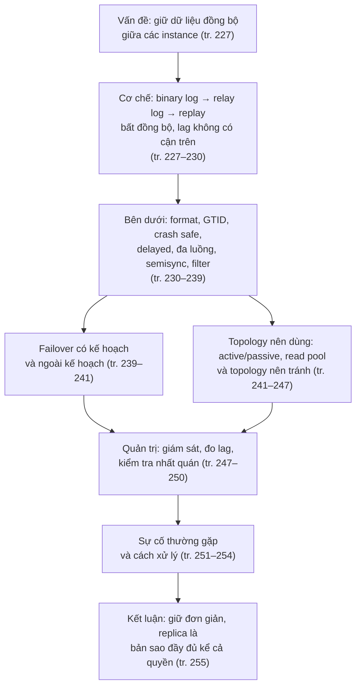

---

## 2. Giải thích sâu

### 2.1 Replication Overview (tr. 227–230)

**What** (tr. 227–228). Bài toán cơ bản mà replication giải là **giữ dữ liệu đồng bộ** giữa các instance trong cùng topology. Source ghi các **event** làm thay đổi dữ liệu hay cấu trúc dữ liệu vào một log. Replica đọc event từ log đó rồi **phát lại** (*replay*). Vì replica tự đọc và tự phát lại theo nhịp của nó, quá trình này **bất đồng bộ** (*asynchronous*): bản sao trên replica **không được đảm bảo** cập nhật ở bất kỳ thời điểm nào.

**Hệ quả quan trọng nhất** (tr. 228). ***Replica lag*** là độ trễ giữa thời gian thực và trạng thái mà replica đang thể hiện. Lag **không có cận trên**. Một truy vấn lớn có thể khiến replica tụt sau source vài giây, vài phút, thậm chí vài giờ.

> **Kết quả đã đo** ([TN3](experiments/chapter-09.md#tn3)). Một câu `UPDATE` 200.000 hàng chạy 2,3 giây trên source. Replica chỉ bắt đầu áp dụng nó **sau khi source commit**, và áp dụng mất khoảng 3,5 giây; trong lúc đó lag đo bằng heartbeat tăng lên khoảng 4,7 giây. Lag là tổng của thời gian chạy trên source và thời gian phát lại trên replica, chứ không chỉ là thời gian mạng.

**Tương thích phiên bản** (tr. 228). Replication gần như **tương thích ngược**: server mới thường làm replica được cho server cũ. Chiều ngược lại thì không: server cũ có thể không hiểu tính năng, cú pháp SQL hay định dạng file mới. Ví dụ không thể replicate từ source 5.6 sang replica 5.5. Nên thử replication trước khi nâng cấp giữa các bản lớn hay nhỏ (5.6 → 5.7, 5.7 → 8.0). Nâng cấp trong cùng một bản nhỏ (5.7.34 → 5.7.35) được kỳ vọng tương thích, nhưng vẫn nên đọc release notes.

**Scale đọc, không scale ghi** (tr. 228). Replication khá tốt để scale **đọc**: hướng truy vấn đọc sang replica. Nó **không** là cách tốt để scale **ghi**, trừ khi thiết kế đúng. Gắn nhiều replica vào một source chỉ khiến mỗi lần ghi được làm **nhiều lần**, một lần trên mỗi replica. Cả hệ thống bị giới hạn bởi số lần ghi mà **phần yếu nhất** làm được.

> **Hiểu lầm phổ biến.** "Ghi nhiều quá thì thêm replica." Sai: mọi replica phải phát lại **toàn bộ** ghi của source, nên thêm replica không giảm việc ghi của ai cả. Replica yếu hơn source còn trở thành nơi lag đầu tiên (tr. 228).

**Các mục đích dùng phổ biến** (tr. 228–229):

| Mục đích | Ý chính của sách |
| --- | --- |
| **Phân tán dữ liệu** (*data distribution*) | Replication thường không tốn băng thông, dù row-based tốn hơn statement-based nhiều. Có thể dừng và chạy lại tùy ý, nên hợp để giữ bản sao ở datacenter hay cloud region xa, kể cả với kết nối chập chờn. Muốn lag thấp thì cần đường truyền ổn định và latency thấp. |
| **Scale lưu lượng đọc** | Phân tán truy vấn đọc ra nhiều server, rất hợp với ứng dụng đọc nhiều. Ở quy mô nhỏ có thể hardcode hostname hay dùng round-robin DNS; lớn hơn thì dùng giải pháp cân bằng tải mạng. |
| **Backup** | Replication giúp ích cho backup, nhưng **replica không phải backup và không thay được backup**. |
| **Analytics và reporting** | Dành riêng một replica cho truy vấn OLAP để cô lập tải đó khỏi tải phục vụ khách hàng. |
| **High availability và failover** | Tránh để MySQL thành *single point of failure*; một hệ failover tốt giảm downtime đáng kể. |
| **Thử nâng cấp MySQL** | Dựng một replica chạy bản mới để kiểm tra truy vấn trước khi nâng cấp mọi instance. |

> **Hiểu lầm phổ biến.** "Có replica rồi thì không cần backup." Replica phát lại **mọi** thay đổi, kể cả `DROP TABLE` nhầm hay `UPDATE` thiếu `WHERE`, gần như ngay lập tức. Nó bảo vệ khỏi hỏng phần cứng, không bảo vệ khỏi lỗi logic (tr. 228). [Delayed replica](#delayed-replication) và backup thật ([Chương 10](chapter-10.md)) mới giải quyết loại lỗi này.

#### 2.1.1 How Replication Works (tr. 229–230)

Sách mô tả topology đơn giản nhất: một source, một replica. Ở mức cao, replication gồm **ba bước** (tr. 229):

1. Source ghi thay đổi dữ liệu vào ***binary log*** dưới dạng các ***binary log event***.
2. Replica chép các event đó từ binary log của source vào ***relay log*** cục bộ của nó.
3. Replica phát lại các event trong relay log, áp dụng thay đổi lên dữ liệu của chính nó.

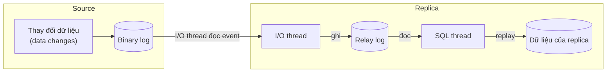

*(Vẽ lại Hình 9-1, tr. 230, đã xem trên ảnh trang PDF 252.)*

**Why tách hai thread** (tr. 229). Kiến trúc này **tách việc lấy event khỏi việc phát lại event** trên replica. Nhờ vậy hai việc chạy bất đồng bộ với nhau: ***I/O thread*** làm việc độc lập với ***SQL thread***. Nếu SQL thread chậm (một câu lệnh lớn) thì I/O thread vẫn tiếp tục kéo event về relay log; nếu mạng chập chờn thì SQL thread vẫn xử lý phần đã có.

> **Bổ sung ngoài sách.** Tài liệu MySQL 8.0 gọi I/O thread là *receiver thread* và SQL thread là *applier thread*. Phía source có một *dump thread* cho mỗi replica đang kết nối. Trong [TN5](experiments/chapter-09.md#tn5), danh sách tiến trình trên source hiện các thread `Binlog Dump GTID`, mỗi replica một thread.

> **Kết quả đã đo** ([TN3](experiments/chapter-09.md#tn3)). Khi dừng riêng SQL thread (`STOP REPLICA SQL_THREAD`), I/O thread vẫn chạy: tập GTID đã nhận (*received*) tiếp tục tăng, tập đã thực thi (*executed*) đứng yên. Đó chính là hai bước 2 và 3 bị tách ra.

#### Tự kiểm tra 2.1

**Câu 2.1.1.** Vì sao replication mặc định của MySQL được gọi là bất đồng bộ, và vì sao điều đó dẫn tới "lag không có cận trên"? Nêu hai tình huống làm lag tăng mạnh. [đáp án](answers/chapter-09.md#q2-1-1)

**Câu 2.1.2.** Một hệ có 1 source và 5 replica bị nghẽn vì lượng ghi tăng gấp đôi. Đồng nghiệp đề xuất thêm replica thứ 6. Đề xuất này giúp được gì và không giúp được gì? [đáp án](answers/chapter-09.md#q2-1-2)

**Câu 2.1.3.** Khi chuẩn bị nâng cấp từ 5.7 lên 8.0, bạn nên đưa bản 8.0 vào vai replica hay vai source trước? Vì sao? [đáp án](answers/chapter-09.md#q2-1-3)

**Câu 2.1.4.** SQL thread của replica dừng vì lỗi nhưng I/O thread vẫn chạy. Các event mới của source đang nằm ở đâu, và dữ liệu đọc từ replica lúc này phản ánh thời điểm nào? [đáp án](answers/chapter-09.md#q2-1-4)

---

### 2.2 Replication Under the Hood (tr. 230–239)

Mục này đi sâu vào cách replication thực sự chạy, điểm mạnh và yếu sinh ra từ đó, và các tùy chọn cấu hình nâng cao (tr. 230).

#### 2.2.1 Choosing Replication Format (tr. 230–231)

**What** (tr. 230). MySQL có **ba định dạng binary log** cho replication: *statement-based*, *row-based* và *mixed*, chọn bằng tham số `binlog_format`.

| Định dạng | Ghi gì vào binlog | Ưu điểm | Nhược điểm |
| --- | --- | --- | --- |
| ***Statement-based*** | Chính **câu SQL** đã thay đổi dữ liệu trên source; replica **thực thi lại** câu đó | Đơn giản, gọn: một câu cập nhật nhiều dữ liệu chỉ tốn vài chục byte | Gặp vấn đề với **truy vấn không tất định** (*nondeterministic*) |
| ***Row-based*** | Event cho biết **từng hàng đã đổi thế nào** | **Tất định**: nhìn binlog là thấy chính xác hàng nào đổi và giá trị mới là gì | Ghi event cho **mọi hàng bị ảnh hưởng** nên binlog có thể **phình rất lớn** |
| ***Mixed*** | Mặc định statement, chuyển sang row khi cần | Cố lấy cái tốt của cả hai | Điều kiện chuyển rất nhiều, nên nội dung binlog **khó dự đoán** |

*(Tóm tắt tr. 230–231.)*

**Why statement-based nguy hiểm** (tr. 230). Ví dụ của sách: xóa 100 hàng trong bảng 1.000 hàng **không có `ORDER BY`**. Nếu thứ tự hàng trên source và replica khác nhau, mỗi bên có thể xóa **100 hàng khác nhau**, và dữ liệu lệch nhau.

**How: logical hay physical?** Đây là chỗ nối với chương 7–8. Với statement-based, replica nhận lại **câu SQL logic** và phải **tự lập kế hoạch thực thi**: optimizer của replica chọn access path theo index và thống kê **của replica**. Kết quả logic của câu lệnh tất định (có `ORDER BY` trên khóa duy nhất) không phụ thuộc access path. Nhưng với `LIMIT` không `ORDER BY`, tập hàng "đầu tiên" chính là **thứ tự mà physical execution gặp hàng**, nên hai server có access path khác nhau sẽ cho kết quả khác nhau. Với row-based, replica nhận **ảnh của hàng** (khóa và giá trị), không cần tái lập quyết định của optimizer. (Diễn giải của người viết ghi chú, dựa trên tr. 230, 250.)

> **Kết quả đã đo** ([TN2](experiments/chapter-09.md#tn2)). Bảng 10.000 hàng, có index trên cột `k`; trên một replica index này bị bỏ có chủ đích (mô phỏng lệch schema). Câu `DELETE ... WHERE k BETWEEN 1 AND 500 LIMIT 10` ở định dạng STATEMENT:
> - source dùng range scan trên index `k` và xóa id 9991–10000;
> - replica không có index phải quét theo khóa chính và xóa id 9501–9510;
> - source chỉ phát cảnh báo *Note 1592 "Unsafe statement"*; replica **không báo lỗi gì**; số hàng hai bên vẫn bằng nhau (9.990), chỉ checksum mới lộ ra khác biệt.
>
> Chạy lại đúng câu đó ở định dạng ROW thì cả ba server xóa **cùng** id 9981–9990.

**Kích thước binlog** (tr. 231). Row-based ghi một event cho mỗi hàng nên tốn nhiều chỗ hơn.

> **Kết quả đã đo** ([TN2](experiments/chapter-09.md#tn2)). Cùng một câu `UPDATE` 10.000 hàng: STATEMENT tốn **318 byte** binlog; ROW với `binlog_row_image=FULL` (mặc định) tốn **299.369 byte**, gấp khoảng 940 lần. Với `binlog_row_image=MINIMAL` còn **119.683 byte**. `mysqlbinlog -v` giải mã được 10.000 khối "UPDATE … WHERE … SET …" cho thấy ảnh trước và ảnh sau của từng hàng.

> **Bổ sung ngoài sách.** `binlog_row_image` không được sách nhắc. `FULL` ghi mọi cột ở cả ảnh trước và ảnh sau; `MINIMAL` chỉ ghi cột cần để định vị hàng (khóa chính) và cột thay đổi. MINIMAL giảm dung lượng nhưng làm binlog kém hữu ích cho việc đối soát hay khôi phục thủ công.

> Chú thích 1 (tr. 231). Muốn biết MIXED đối xử với từng loại câu lệnh ra sao thì đọc manual bản mới nhất.

**Decision** (tr. 231). Tác giả cho rằng binlog nên **hoặc** statement **hoặc** row, không trộn. Khuyến nghị: **dùng row-based**, trừ khi tạm thời có nhu cầu rõ ràng cho statement-based. Row-based là cách replicate an toàn nhất.

> **Bổ sung ngoài sách.** MySQL 8.0 mặc định `binlog_format=ROW` (đã kiểm trên 8.0.42). Biến `binlog_format` bị đánh dấu deprecated: đặt nó trên 8.0.42 phát cảnh báo 1287 ([TN2](experiments/chapter-09.md#tn2)). DDL như `CREATE TABLE` luôn được ghi dưới dạng câu lệnh, kể cả khi `binlog_format=ROW`; điều này quan trọng khi bàn về [filter](#replication-filters).

> **Bổ sung ngoài sách** — so sánh khái niệm với [DDIA chương 5: statement-based replication](../../DDIA/ddia-notes/chapter-05.md#statement-based) và [logical (row-based) log](../../DDIA/ddia-notes/chapter-05.md#logical-log).

#### 2.2.2 Global Transaction Identifiers (tr. 231–232)

**Why: vấn đề của file và position** (tr. 231). Tới MySQL 5.6, replica phải tự nhớ đang đọc **file binlog nào, ở vị trí nào** của source (ví dụ `binlog.000002`, vị trí 2749) và tăng vị trí khi đọc. Khi source crash và phải dựng lại từ backup, binlog bắt đầu lại từ đầu. Gắn replica vào đâu? Phải đọc event để dò điểm gắn: sớm quá thì **lặp event**, muộn quá thì **bỏ sót event**. Rất dễ gắn sai.

**What** (tr. 231). ***Global transaction identifier (GTID)*** là cách khác để theo dõi vị trí replication. Mỗi transaction mà source commit được gán một định danh **duy nhất**, ghép từ `server_uuid` và **một số thứ tự tăng dần**. GTID được ghi vào binlog cùng transaction. Khi SQL thread của replica commit một transaction, nó **ghi nhận GTID đó là đã hoàn tất**.

> Chú thích 2 (tr. 231). `server_uuid` khác với `server_id`. `server_id` do người quản trị đặt; `server_uuid` được sinh ra ở lần khởi động đầu tiên nếu MySQL không thấy file `auto.cnf`.

**How: ví dụ của sách** (tr. 232). Source vừa dựng, chưa có database nào. Tạo một database trên source sinh ra một event mang GTID dạng `<server_uuid>:1`. Replica áp dụng event đó và nhớ rằng đã xong transaction số 1. Giả sử tắt replica lúc này, source tiếp tục nhận ghi 2, 3, 4, 5… Khi replica chạy lại, nó biết đã có transaction 1 và **bắt đầu từ transaction 2**.

> Chú thích 3 (tr. 232). Điều này giả định bạn dùng `SOURCE_AUTO_POSITION = 1` khi chạy `CHANGE REPLICATION SOURCE TO`, và nên gần như luôn dùng.

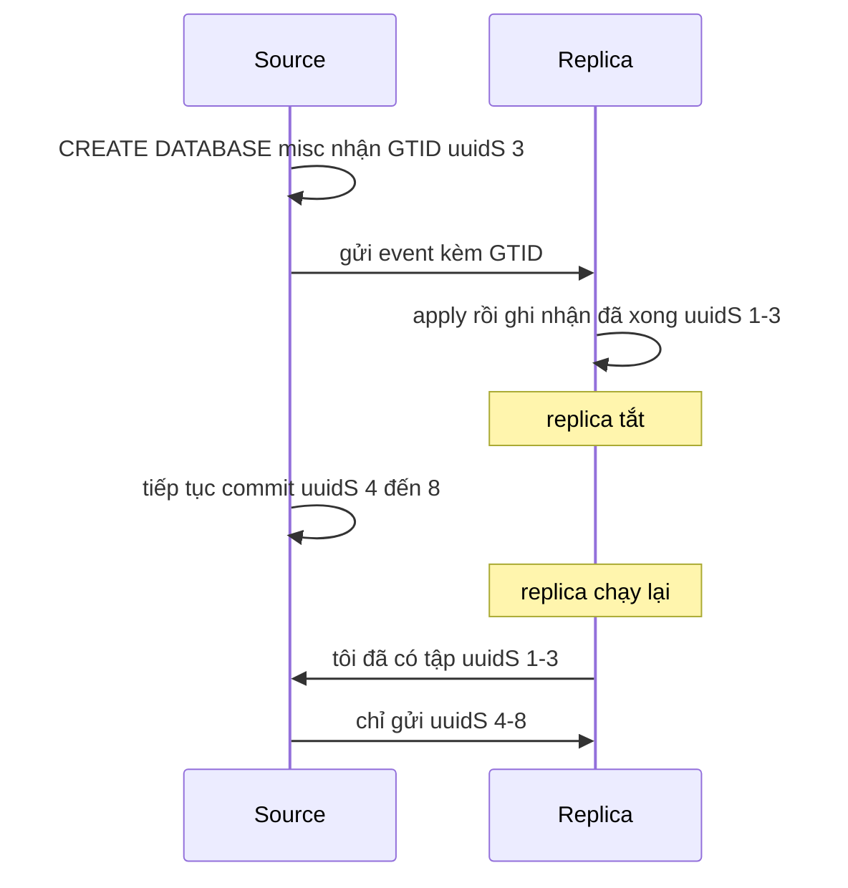

*(Sơ đồ do người viết ghi chú dựng theo ví dụ tr. 232, với số GTID lấy từ [TN1](experiments/chapter-09.md#tn1). Trong sách, `CREATE DATABASE misc` là GTID số 1 vì source hoàn toàn trống; trong thí nghiệm nó là số 3 vì đã tạo user replication trước.)*

> **Kết quả đã đo** ([TN1](experiments/chapter-09.md#tn1)). Tắt replica sau khi nó có GTID 1–3, ghi thêm GTID 4–8 trên source, rồi bật lại replica. Log lỗi của replica ghi "Starting GTID-based replication" và replica tự bắt kịp 1–8 mà không cần chỉ file hay vị trí nào.

**Decision** (tr. 232). GTID giải quyết một trong những phần đau đầu nhất của vận hành replication: **file và position**. Sách khuyên mạnh mẽ **luôn bật GTID**, theo hướng dẫn trong tài liệu chính thức.

> **Bổ sung ngoài sách.** Bật GTID cần cả `gtid_mode=ON` và `enforce_gtid_consistency=ON`; thí nghiệm của ghi chú đặt hai tùy chọn này lúc khởi động. `gtid_executed` của một server là **tập** các GTID đã thực thi. Phép trừ tập `GTID_SUBTRACT(a, b)` và phép kiểm tập con `GTID_SUBSET(a, b)` là công cụ chính để so sánh hai server trước khi failover (xem [2.3](#s2-3) và [errant transaction](#errant-transaction)).

#### 2.2.3 Making Replication Crash Safe (tr. 232–233)

GTID giải quyết chuyện vị trí, nhưng còn nhiều vấn đề khác. Sách khuyên bốn thiết lập để giảm khả năng replication hỏng (tr. 232–233):

| Thiết lập | Ý nghĩa theo sách | Cái giá |
| --- | --- | --- |
| `innodb_flush_log_at_trx_commit = 1` | Không hẳn là thiết lập replication, nhưng bảo đảm log được ghi và đồng bộ xuống đĩa **ở mỗi transaction**. Đây là thiết lập ACID đầy đủ, bảo vệ dữ liệu tốt nhất kể cả khi có replication, vì event binlog được commit trước rồi transaction mới được commit và flush | Tăng số lần ghi đĩa |
| `sync_binlog = 1` | Đồng bộ binlog xuống đĩa **trước mỗi transaction**, chống mất transaction khi server crash | Tăng số lần ghi đĩa |
| `relay_log_info_repository = TABLE` | Trước đây vị trí replication nằm trong **file**; transaction đã apply và file vị trí phải đồng bộ ở hai bước, crash giữa hai bước làm file chứa vị trí sai. Nay thông tin nằm trong **bảng InnoDB**, cập nhật **cùng transaction** với dữ liệu, thành một thao tác nguyên tử | — |
| `relay_log_recovery = ON` | Khi phát hiện crash, **vứt bỏ mọi relay log cục bộ** và lấy lại phần thiếu từ source. Relay log hỏng hay dở dang sau crash vì thế luôn phục hồi được. Cũng nhờ đó không cần `sync_relay_log`, vì relay log sẽ bị xóa khi crash | — |

*(Tóm tắt tr. 232–233.)*

**Why hai thiết lập đầu quan trọng với replication.** Một transaction tồn tại ở **hai nơi**: redo log của InnoDB (dữ liệu) và binlog (thứ replica sẽ đọc). Nếu crash làm hai nơi lệch nhau, source sau khi khởi động lại có thể **có** một transaction mà replica **không bao giờ nhận**, hoặc ngược lại. Replica khi đó lệch với source mà không ai báo lỗi.

> **Bổ sung ngoài sách.** MySQL phối hợp hai log bằng một dạng two-phase commit nội bộ: InnoDB *prepare*, rồi ghi binlog, rồi InnoDB *commit*. Khi khởi động lại sau crash, transaction đã *prepare* sẽ được commit nếu nó có trong binlog và rollback nếu không có. Cơ chế này chỉ đáng tin khi cả binlog và redo log thực sự đã xuống đĩa, tức là cần `sync_binlog=1` và `innodb_flush_log_at_trx_commit=1`. Xem thêm transaction logging ở [Chương 1](chapter-01.md#transaction-logging) và cấu hình ở [Chương 5](chapter-05.md#s2-5).

> **Kết quả đã đo** ([TN1](experiments/chapter-09.md#tn1)). Trên MySQL 8.0.42 mặc định: `sync_binlog=1`, `innodb_flush_log_at_trx_commit=1`, `relay_log_info_repository=TABLE` (đọc biến này phát cảnh báo deprecated 1287), nhưng **`relay_log_recovery=OFF`**. Vậy trong bốn khuyến nghị, ba cái đã là mặc định, còn `relay_log_recovery` phải tự bật trên replica.

> **Hiểu lầm phổ biến.** "Replica có thể chạy cấu hình lỏng vì đã có source." Replica chính là ứng viên failover và thường là nơi chạy backup. Nếu replica crash khi đang chạy lỏng, có thể phải dựng lại nó từ source (tr. 253). Ngoại lệ tạm thời có kiểm soát được bàn ở [2.6](#excessive-lag).

#### 2.2.4 Delayed Replication (tr. 233–234)

**What** (tr. 233). Một ***delayed replica*** được giữ **chậm có chủ đích** so với thời gian thực, nhiều giờ hoặc nhiều ngày, nhưng vẫn online. Cấu hình bằng `CHANGE REPLICATION SOURCE TO` với tùy chọn `SOURCE_DELAY`.

**Why** (tr. 233). Với dữ liệu lớn, khôi phục một bảng bị `DROP` nhầm từ backup có thể mất vài giờ. Với delayed replica, bạn tìm GTID của câu `DROP TABLE` rồi **cho replica chạy tới ngay trước** câu đó. Thời gian khắc phục thường nhanh hơn nhiều.

**How** (diễn giải của người viết, các lệnh là **Bổ sung ngoài sách** theo tài liệu MySQL 8.0): dừng SQL thread của delayed replica; xác định GTID của câu lệnh hỏng (từ binlog của source); đặt `SOURCE_DELAY=0`; chạy `START REPLICA SQL_THREAD UNTIL SQL_BEFORE_GTIDS = '<gtid>'`; lấy dữ liệu ra (ví dụ `mysqldump` bảng đó) và nạp lại vào source.

> **Kết quả đã đo** ([TN4](experiments/chapter-09.md#tn4)). Replica đặt `SOURCE_DELAY=45`. `SHOW REPLICA STATUS` hiện `SQL_Delay: 45`, `SQL_Remaining_Delay` đếm ngược và trạng thái "Waiting until SOURCE_DELAY seconds after source executed event". Sau khi source `DROP TABLE misc.important`, bảng vẫn còn trên delayed replica. Chạy tới `SQL_BEFORE_GTIDS` của GTID câu `DROP`, replica dừng ngay trước đó với đủ hai hàng (cả hàng ghi sau khi bật delay). Dump bảng từ replica và nạp lại vào source mất vài giây.

**Trade-offs** (tr. 233–234). Không gì miễn phí. Delayed replica giảm thiểu một số kịch bản mất dữ liệu nhưng làm phức tạp nhiều khía cạnh vận hành khác:

- phải **loại nó khỏi danh sách ứng viên làm source** (càng quan trọng nếu failover ghi tự động);
- phải tính **cách giám sát replication** và cách hệ giám sát đối xử với replica đặc biệt này (lag lớn là bình thường với nó, xem [2.5.1](#s2-5-1));
- đó mới chỉ là vài phức tạp cần xử lý khi đưa delayed replica vào.

**Decision.** Delayed replica hợp khi rủi ro chính là **lỗi logic của con người** (xóa nhầm, migration hỏng) và thời gian khôi phục từ backup quá dài so với RTO. Nó không thay backup: lỗi chỉ được phát hiện **sau** thời gian delay thì delayed replica cũng đã áp dụng lỗi. (Phần "Decision" là diễn giải của người viết; việc chương 10 dùng delayed replication được nêu ở [Chương 10](chapter-10.md#delayed-replica).)

#### 2.2.5 Multithreaded Replication (tr. 234–236)

**Why** (tr. 234). Thách thức lịch sử: source nhận ghi **song song** từ nhiều session, nhưng replica phát lại bằng **một thread**. Replica vì thế dễ tụt lại khi source bận ghi.

**What** (tr. 234). MySQL hiện đại có ***multithreaded replication***: chạy **nhiều SQL applier thread** để áp dụng thay đổi từ relay log. Có hai chế độ:

| Chế độ | Song song hóa theo | Hợp khi |
| --- | --- | --- |
| `DATABASE` | Mỗi thread cập nhật một database khác nhau; **không bao giờ** hai thread cùng cập nhật một database cùng lúc | Dữ liệu chia ra nhiều database và được cập nhật đều, đồng thời |
| `LOGICAL_CLOCK` | Cho phép cập nhật song song **trong cùng một database**, miễn là các transaction thuộc **cùng một binary log group commit** | Một database, nhiều session ghi đồng thời |

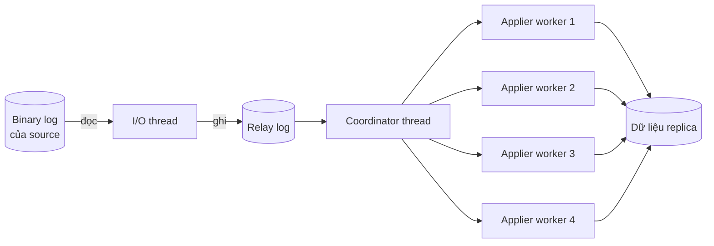

*(Sơ đồ do người viết ghi chú dựng theo chữ tr. 234–235. **Lưu ý về Hình 9-2** (tr. 234, đã xem trên ảnh PDF 256): hình vẽ nhiều đường nối giữa I/O thread và binary log, còn SQL thread vẫn một khối. Chữ của sách lại nói song song nằm ở **SQL applier thread** và có một coordinator thread (tr. 235). Sơ đồ trên theo chữ.)*

**Hộp của sách — What Is a Binary Log Group Commit?** (tr. 234–235). Sách mượn ví dụ chiếc phà của Morgan Tocker. Hành khách là **transaction**, chiếc phà là thao tác `fsync()` tốn kém, và **chỉ có một chiếc phà** (một chuỗi binlog có thứ tự).

| Phiên bản | Chiếc phà làm gì |
| --- | --- |
| MySQL 5.0 | Mỗi chuyến chỉ chở **người kế tiếp** trong hàng, dù trong lúc phà đi (khứ hồi khoảng 10 phút) đã có thêm nhiều người tới |
| MySQL 5.6 | Mỗi chuyến chở **tất cả** người đang chờ. Nhanh hơn rõ trong thực tế khi khách tới liên tục; không thấy rõ trong benchmark đơn luồng |
| MySQL 5.7 trở lên | Như 5.6, và **có thể cấu hình chờ thêm một chút** trước khi xuất phát (ví dụ chờ thêm 30 giây với chuyến 10 phút) để chở được nhiều khách hơn mỗi chuyến |

Hai biến cho độ trễ nhân tạo: `binlog_group_commit_sync_delay` (micro giây) và `binlog_group_commit_sync_no_delay_count` (số transaction đủ thì thôi chờ) (tr. 235).

**How nối group commit với replica.** Transaction cùng một "chuyến phà" đã commit cùng lúc trên source, nên chúng không chờ nhau và replica có thể áp dụng chúng song song. Đó là ý của `LOGICAL_CLOCK` (tr. 234).

> **Kết quả đã đo** ([TN3](experiments/chapter-09.md#tn3)). `mysqlbinlog` in hai số `last_committed` và `sequence_number` trong mỗi event GTID (**Bổ sung ngoài sách:** các transaction có cùng `last_committed` là nhóm có thể áp dụng song song). Một session ghi tuần tự 20 transaction: mỗi transaction có `last_committed` bằng `sequence_number` của transaction trước, tức **không có gì để song song**. Bốn session ghi đồng thời 1.200 transaction: trung bình 1,8 transaction mỗi nhóm, tối đa 3.

**Bật và chỉnh** (tr. 235):

- Trong đa số trường hợp, chỉ cần đặt `replica_parallel_workers` khác 0 là thấy lợi ích ngay. Nếu chỉ dùng một database, phải đổi thêm `replica_parallel_type` sang `LOGICAL_CLOCK`.
- Có một ***coordinator thread*** quản lý trạng thái các worker, nên có overhead.
- Bật `replica_preserve_commit_order` để việc commit không theo thứ tự không gây rắc rối; xem phần "Gaps" trong tài liệu chính thức.

> **Bổ sung ngoài sách.** Trên MySQL 8.0.42 ([TN1](experiments/chapter-09.md#tn1)), mặc định đã là `replica_parallel_workers=4`, `replica_parallel_type=LOGICAL_CLOCK`, `replica_preserve_commit_order=ON`; đọc `replica_parallel_type` phát cảnh báo deprecated. Theo tài liệu MySQL, các mặc định này có từ 8.0.27; bản cũ hơn mặc định một thread. "Gaps" là tình trạng worker commit transaction sau trước transaction trước: nếu replica dừng đúng lúc đó, tập transaction đã áp dụng có "lỗ hổng" và dữ liệu có thể ở trạng thái mà source chưa bao giờ có.

**Chọn số worker** (tr. 235–236). Sách nêu hai cách:

- **Cách không chính xác:** dừng replication, đo thời gian bắt kịp với số thread khác nhau. Sai vì giả định lượng DML gửi qua replication là đều và các câu tốn công như nhau; thực tế hiếm khi vậy.
- **Cách chính xác:** xem **mỗi applier thread bận đến đâu**. Bật consumer `events_transactions%` và instrument `transaction` trong Performance Schema, để chạy một thời gian (tốt nhất lúc ghi nặng nhất hoặc lúc lag tăng), rồi đếm số transaction mỗi worker xử lý bằng cách nối `events_transactions_summary_by_thread_by_event_name` với `replication_applier_status_by_worker`. Ví dụ của sách có sáu worker với số transaction giảm dần mạnh (từ hơn 23 nghìn xuống 9), và kết luận mức tối ưu là **khoảng ba tới bốn thread**.

> Chú thích 4 (tr. 236). Consumer và instrument của Performance Schema khiến MySQL thu thêm dữ liệu nội bộ và có thể tốn thêm CPU. Luôn thử tác động lên workload production trong môi trường an toàn trước.

> **Lưu ý về listing tr. 236.** Câu truy vấn trong sách **thiếu từ khóa `SELECT`** trước danh sách cột (đã kiểm trên ảnh trang PDF 258). Thí nghiệm của ghi chú dùng bản đã sửa ([TN3](experiments/chapter-09.md#tn3)).

> **Kết quả đã đo** ([TN3](experiments/chapter-09.md#tn3)). Với 4 worker: 1.200 transaction từ **bốn session đồng thời** chia ra 356 / 325 / 270 / 255; 1.200 transaction từ **một session tuần tự** đều rơi vào **worker 1** (1.200 / 0 / 0 / 0). Trên 8.0.42, instrument `transaction` và consumer `events_transactions_current`, `events_transactions_history` đã bật sẵn.

> **Hiểu lầm phổ biến.** "Lag thì tăng `replica_parallel_workers`." Số worker chỉ giúp khi **workload của source có song song** để khai thác. Một job ghi tuần tự hay một transaction khổng lồ vẫn chạy trên một worker. Đó là lý do sách khuyên đo mức bận từng worker thay vì đoán.

> **Bổ sung ngoài sách.** MySQL 8.0 còn có `binlog_transaction_dependency_tracking=WRITESET`, cho phép coi hai transaction là độc lập nếu chúng không đụng cùng hàng, kể cả khi đến từ một session tuần tự. Biến này bị deprecated trên 8.0.42 (cảnh báo 1287 đã quan sát). Ghi chú chưa đo tác động của WRITESET.

#### 2.2.6 Semisynchronous Replication (tr. 237)

**What** (tr. 237). Khi bật ***semisynchronous replication***, mỗi transaction source commit phải được **ít nhất một replica xác nhận đã nhận**. Xác nhận nghĩa là replica đã nhận và ghi thành công vào **relay log**, **chưa chắc đã áp dụng** vào dữ liệu.

> Chú thích 5 (tr. 237). Số replica cần xác nhận cấu hình được (`rpl_semi_sync_source_wait_for_replica_count`). Với topology rộng có thể yêu cầu hai hay ba xác nhận.

**Cái giá** (tr. 237). Mỗi transaction phải chờ phản hồi từ node khác, nên **mọi transaction đều thêm latency**. Phải cân nhắc đánh đổi này.

**Điểm quan trọng nhất** (tr. 237). Nếu **không replica nào xác nhận** trong khoảng thời gian chờ, MySQL **quay về replication bất đồng bộ** thông thường. Nó **không làm transaction thất bại**. Vì vậy semisync **không phải công cụ chống mất dữ liệu**, mà là **viên gạch** cho một bộ công cụ lớn hơn giúp failover bền bỉ hơn.

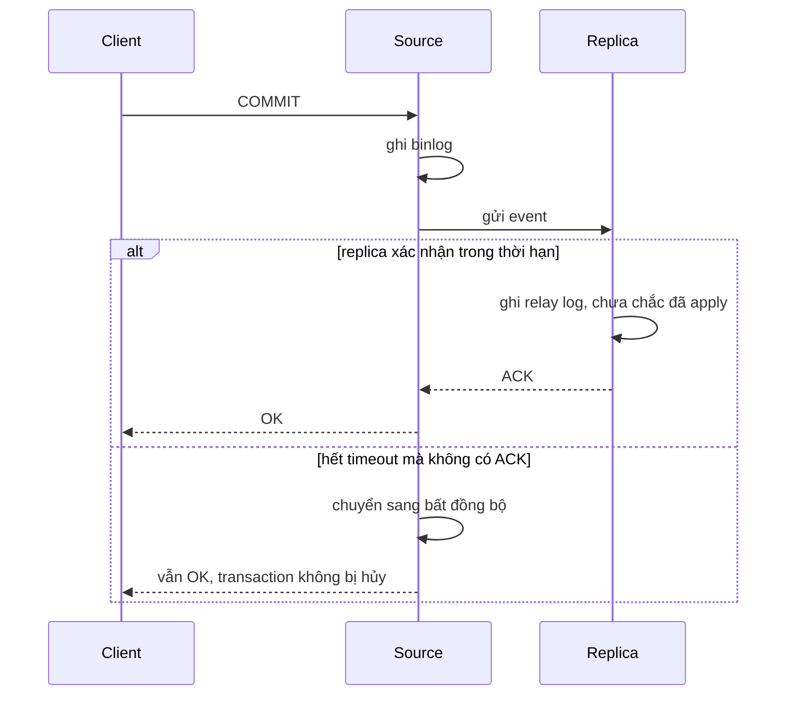

*(Sơ đồ do người viết ghi chú dựng theo tr. 237.)*

**Vì sao tác giả không tìm được use case tốt** (tr. 237). Use case logic nhất là bảo đảm khi có **network partition**, một source bị cô lập **không tiếp tục ghi** trong khi mất liên lạc với replica. Nhưng source đó sẽ quay về bất đồng bộ và **tiếp tục nhận ghi**. Do đó sách khuyên **không dựa vào semisync cho tính toàn vẹn dữ liệu**.

> **Kết quả đã đo** ([TN5](experiments/chapter-09.md#tn5)), plugin `semisync_source.dll` và `semisync_replica.dll`, localhost:
> - semisync bật: trung vị **2.395 µs (khoảng 2,4 ms) mỗi commit**; tắt: trung vị **2.027 µs (khoảng 2,0 ms)** (500 commit tuần tự, 3 lần mỗi chế độ; laptop, nhiều nhiễu). `Rpl_semi_sync_source_tx_avg_wait_time` khoảng 264 µs.
> - Dừng I/O thread của cả hai replica rồi commit: lệnh `INSERT` chờ **3,015 giây** (đúng `rpl_semi_sync_source_timeout=3000` ms) rồi **thành công**; `Rpl_semi_sync_source_status` chuyển `OFF`; hai commit tiếp theo mất 5 ms tổng cộng, tức đã bất đồng bộ hoàn toàn.
> - Ba transaction đó chỉ tồn tại trên source. Khi source "chết" và failover, chúng **mất khỏi topology** (xem [2.3.3](#promotion-tradeoffs)).

> **Bổ sung ngoài sách.** Mặc định 8.0 là `rpl_semi_sync_source_wait_point=AFTER_SYNC` (đã thấy trên 8.0.42): source chờ ACK sau khi ghi binlog nhưng **trước** khi commit trong engine, nên client khác chưa thấy transaction cho tới khi có ACK hay hết timeout. Khi cài plugin trên replica đang `super_read_only`, `INSTALL PLUGIN` bị từ chối (lỗi 1290) vì nó ghi vào bảng `mysql.plugin`; thí nghiệm phải tạm tắt `super_read_only`.

> **Bổ sung ngoài sách** — khái niệm *semi-synchronous* chung ở [DDIA chương 5](../../DDIA/ddia-notes/chapter-05.md#semi-sync) và đánh đổi đồng bộ/bất đồng bộ ở [sync-async](../../DDIA/ddia-notes/chapter-05.md#sync-async). Khác biệt then chốt của MySQL theo sách: khi hết timeout, nó **lặng lẽ rơi về bất đồng bộ**.

#### 2.2.7 Replication Filters (tr. 237–239)

**What** (tr. 237). Tùy chọn lọc cho phép replicate **một phần** dữ liệu, điều mà sách nói "kém hay hơn bạn tưởng nhiều". Có hai loại:

- **Lọc trên source**, khi ghi binlog: `binlog_do_db`, `binlog_ignore_db`.
- **Lọc trên replica**, khi SQL thread đọc relay log: các tùy chọn `replicate_*`. Có thể replicate hoặc bỏ qua database, đổi tên database này thành database khác, replicate hoặc bỏ qua bảng theo mẫu `LIKE`.

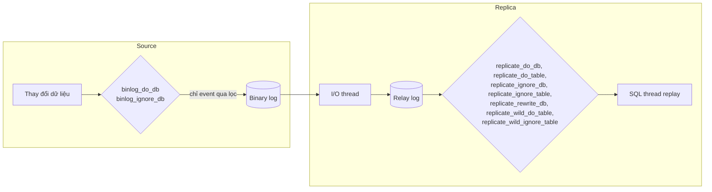

*(Vẽ lại Hình 9-3, tr. 238, đã xem trên ảnh trang PDF 260.)*

**Bẫy lớn nhất** (tr. 238). Các tùy chọn `*_do_db` và `*_ignore_db`, cả trên source lẫn replica, **không lọc theo database của đối tượng** mà lọc theo **database mặc định hiện tại** (cái được chọn bằng `USE`). Ví dụ của sách: `USE test;` rồi `DELETE FROM sakila.film;` thì bộ lọc xét câu `DELETE` theo `test`, không theo `sakila`. Kết quả là câu lệnh sai bị replicate hoặc bị bỏ qua; replication dễ lệch hoặc hỏng.

> **Kết quả đã đo** ([TN2](experiments/chapter-09.md#tn2), phần D). Replica đặt `REPLICATE_DO_DB = (misc)`:
>
> | Câu trên source | Database mặc định | Định dạng | Có tới replica? |
> | --- | --- | --- | --- |
> | `INSERT INTO misc.t ...` | `other` | STATEMENT | **Không** (bị lọc) |
> | `INSERT INTO misc.t ...` | `other` | ROW | **Có** |
> | `INSERT INTO misc.t ...` | `misc` | STATEMENT | Có |
> | `CREATE TABLE misc.ddl_from_other ...` | `other` | DDL | **Không** |
> | `CREATE TABLE other.ddl_from_misc ...` | `misc` | DDL | **Có, rồi lỗi 1049** "Unknown database 'other'" và SQL thread dừng |
>
> Vậy trên 8.0.42, lời cảnh báo của sách đúng cho câu lệnh ở định dạng STATEMENT và cho **mọi DDL**; với DML ở định dạng ROW, bộ lọc xét database của bảng. Hai quy tắc khác nhau trong cùng một server chính là lý do filter khó lường.

**Lọc trên source còn tệ hơn** (tr. 238). `binlog_do_db` và `binlog_ignore_db` không chỉ có thể làm hỏng replication; chúng còn khiến **không thể làm point-in-time recovery** từ backup, vì phần bị lọc không bao giờ có trong binlog. Sách nói đùa: đừng bật chúng, trừ khi bạn thích giải thích với sếp vì sao dữ liệu mất vĩnh viễn (tr. 237). Trong đa số tình huống, **không bao giờ** nên dùng.

**Hậu quả ngoài ý muốn** (tr. 238). Ví dụ: muốn chặn thay đổi quyền lan sang replica, nên lọc các bảng hệ thống. Cách này chặn được `GRANT`, nhưng cũng **chặn luôn event và routine**. Sách nhận xét: muốn làm vậy là dấu hiệu bạn đang làm sai điều gì đó. Có thể chặn từng câu lệnh bằng `SET SQL_LOG_BIN=0`, nhưng cách này cũng có rủi ro riêng. Filter dễ làm hỏng replication theo cách chỉ lộ ra **lúc bất tiện nhất**, ví dụ khi đang disaster recovery (tr. 238–239).

**Khi filter có ích** (tr. 239). Ví dụ của sách: có các database `users_1` đến `users_4` trên một server quá tải, muốn chuyển `users_3` và `users_4` sang server mới. Khôi phục backup lên server mới, **drop** `users_1` và `users_2`, đặt quy tắc **bỏ qua** hai database này, rồi gắn replication. Server mới chỉ xử lý event của `users_3` và `users_4`; khi bắt kịp thì nhận traffic production. Đây là filter **tạm thời** phục vụ một lần di chuyển dữ liệu, không phải cấu hình lâu dài.

#### Tự kiểm tra 2.2

**Câu 2.2.1.** Trên một replica, đồng nghiệp lỡ tạo thêm một index mà source không có. Ở định dạng STATEMENT, câu `DELETE ... LIMIT 10` không có `ORDER BY` có thể gây gì? Ở định dạng ROW thì sao, và vì sao? [đáp án](answers/chapter-09.md#q2-2-1)

**Câu 2.2.2.** Source crash và được dựng lại từ backup. Với replication theo file và position, việc gắn lại replica khó ở đâu? GTID cùng auto-position giải quyết điều đó thế nào? [đáp án](answers/chapter-09.md#q2-2-2)

**Câu 2.2.3.** Vì sao lưu vị trí của applier trong bảng InnoDB an toàn hơn lưu trong file? Vì sao bật `relay_log_recovery` thì không cần `sync_relay_log`? [đáp án](answers/chapter-09.md#q2-2-3)

**Câu 2.2.4.** Bạn tăng `replica_parallel_workers` từ 4 lên 16 nhưng lag không giảm. Nêu hai nguyên nhân gốc khả dĩ và cách kiểm chứng bằng dữ liệu. [đáp án](answers/chapter-09.md#q2-2-4)

**Câu 2.2.5.** Một đồng nghiệp nói: "Ta bật semisync rồi, nên failover không bao giờ mất transaction đã commit." Câu này sai ở đâu? [đáp án](answers/chapter-09.md#q2-2-5)

---

### 2.3 Replication Failover (tr. 239–241)

**Why** (tr. 239). Replication là nền của high availability: có một bản sao được cập nhật liên tục ở nơi khác thì phục hồi sau thảm họa dễ hơn nhiều so với dùng backup. Hơn nữa, có những lúc bạn **chỉ đơn giản cần bảo trì** mà phải khởi động lại MySQL.

**What** (tr. 239). Sách bàn cách đúng để nâng một replica lên làm source. Làm sai dễ dẫn tới **lỗi dữ liệu và downtime kéo dài**. Sách coi ***promoting a replica*** và ***failing over*** là **đồng nghĩa**: hạ source khỏi vai nhận ghi và nâng một replica lên vai source. Hướng dẫn chi tiết hơn nằm ở mục "Switching Sources During Failover" của tài liệu chính thức.

#### 2.3.1 Planned Promotions (tr. 239–240)

Lý do phổ biến nhất để promote là **bảo trì**: vá bảo mật, cập nhật kernel, hay chỉ khởi động lại MySQL vì vài tùy chọn cấu hình cần restart. Đây là ***controlled promotion*** hay ***planned promotion*** (tr. 239). Bảy bước (tr. 240):

1. Chọn replica sẽ promote, thường là replica bạn **chắc chắn có đủ dữ liệu**. Đó là **đích** (*target*).
2. Kiểm tra lag, bảo đảm trong khoảng **vài giây**.
3. **Ngừng nhận ghi** trên source bằng `super_read_only`.
4. Chờ replication của đích **đồng bộ** với source. **So sánh GTID** để chắc chắn.
5. Tắt `read_only` trên đích.
6. Chuyển traffic ứng dụng sang đích.
7. Trỏ **mọi** replica về source mới, kể cả source cũ vừa bị hạ. Với GTID và `AUTO_POSITION=1` thì việc này rất đơn giản.

> Chú thích 6 (tr. 240). Đặt `super_read_only` thì `read_only` tự bật theo. Ngược lại, tắt `read_only` thì `super_read_only` tự tắt theo. Không cần bật hay tắt cả hai biến cùng lúc trong quy trình này.

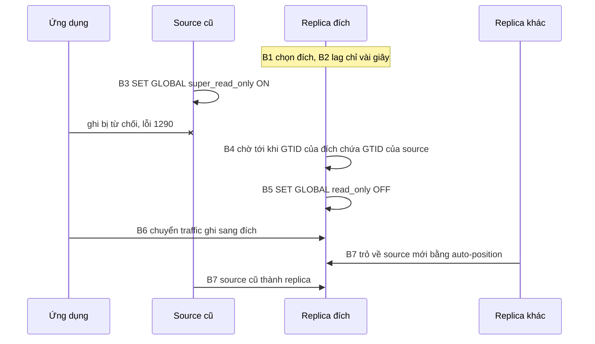

*(Sơ đồ do người viết ghi chú dựng theo các bước tr. 240.)*

**Why thứ tự này.** Bước 3 phải đi trước bước 4–5. Nếu source cũ còn nhận ghi trong lúc đích đã mở ghi, hai server cùng nhận ghi: ghi trên source cũ có thể không bao giờ tới đích, và hai bên có thể cấp trùng giá trị `AUTO_INCREMENT`. Bước 4 so GTID chứ không so lag, vì "lag 0 giây" chỉ là ước lượng còn tập GTID là bằng chứng. (Diễn giải của người viết dựa trên tr. 240.)

> **Kết quả đã đo** ([TN5](experiments/chapter-09.md#tn5), phần A). Ba server 3319 (source), 3333, 3334. Trước bước 1, kiểm `GTID_SUBTRACT(gtid_executed của ứng viên, gtid_executed của source)`: server 3333 có **một GTID lạ** mang `server_uuid` của chính nó (từ lần ghi nhầm ở [TN1](experiments/chapter-09.md#tn1)), server 3334 sạch, nên chọn 3334. Từ lúc bật `super_read_only` trên source tới lúc tắt `read_only` trên đích mất khoảng **0,55 giây** (chạy bằng script). Lần ghi của ứng dụng trong khoảng đó bị từ chối với lỗi 1290. Hai server còn lại trỏ về 3334 bằng auto-position và chạy ngay.

> **Bổ sung ngoài sách — errant transaction.** Một transaction được thực thi **trực tiếp trên replica** (không đến từ source) sẽ mang GTID với `server_uuid` của replica. Nếu replica đó được promote, các replica khác sẽ nhận và áp dụng transaction này, nên một thay đổi chưa từng có trên source cũ lan ra cả topology. Nếu binlog chứa nó đã bị xóa, các replica không lấy được nó và replication báo lỗi. Vì vậy công cụ failover thường kiểm tra GTID lạ trước khi chọn đích. Sách không bàn khái niệm này; nó là hệ quả trực tiếp của việc ghi nhầm vào replica (tr. 249) và của việc trỏ lại bằng GTID (tr. 240).

#### 2.3.2 Unplanned Promotions (tr. 240)

**Why** (tr. 240). Với thời gian đủ dài, hệ thống nào cũng hỏng, do phần mềm hoặc phần cứng. Khi source đang nhận ghi bị hỏng, trải nghiệm người dùng bị ảnh hưởng nặng: đa số ứng dụng chỉ trả lỗi và để người dùng tự thử lại. Đây là lúc cần ***unplanned promotion***.

**How** (tr. 240). Vì **không còn source sống để kiểm tra**, đây là bản rút gọn của planned promotion; chọn replica dựa trên dữ liệu **đã được replicate**:

1. Chọn replica sẽ promote (thường là replica chắc chắn có đủ dữ liệu nhất).
2. Tắt `read_only` trên đích.
3. Chuyển traffic ứng dụng sang đích.
4. Trỏ mọi replica về source mới, kể cả source cũ **khi nó quay lại**. Với GTID thì việc này đơn giản.

Thêm một yêu cầu: khi source cũ online trở lại, nó phải **mặc định bật `super_read_only`**, để tránh mọi lần ghi nhầm (tr. 240).

**Những bước bị mất so với planned promotion:** không thể chặn ghi trên source (bước 3) và không thể so GTID với source (bước 4). Vì thế bạn **không biết chắc** đích đang thiếu bao nhiêu dữ liệu.

> **Bổ sung ngoài sách.** "Mặc định bật `super_read_only`" nghĩa là đặt nó trong cấu hình khởi động (file cấu hình, hoặc tùy chọn dòng lệnh như thí nghiệm đã làm), không phải `SET GLOBAL`, vì `SET GLOBAL` mất khi restart. Trong [TN5](experiments/chapter-09.md#tn5), source cũ khởi động với `--super-read-only=ON` và từ chối mọi lần ghi của root.

#### 2.3.3 Trade-Offs of Promotion (tr. 240–241)

**Lập luận của tác giả** (tr. 240–241). Phản xạ đầu tiên khi có downtime thường là failover. Nhưng vì **khó biết đích thiếu bao nhiêu dữ liệu**, đôi khi **không failover** lại là chiến lược tốt hơn:

- Unplanned promotion là việc **ít khi được luyện tập**. Khi phải làm, bạn có thể phải tra tài liệu để không sót bước, và phải xem xét các replica để biết ứng viên nào hợp. Tất cả tốn thời gian.
- Trong một số trường hợp, **chờ** server hay tiến trình MySQL quay lại có thể **nhanh hơn**.
- Lợi thế của việc chờ: nếu đã làm theo các bước ACID của [Chương 5](chapter-05.md#s2-5), bạn **không mất dữ liệu** nào, và replica sẽ tiếp tục từ chỗ đã dừng.

> **Kết quả đã đo** ([TN5](experiments/chapter-09.md#tn5), phần B). Sau khi semisync rơi về bất đồng bộ, source có GTID tới 3008 nhưng hai replica chỉ có tới 3005. Promote một replica, ứng dụng ghi tiếp; `AUTO_INCREMENT` của source mới cấp lại id 7, 8, 9, vốn đã được source cũ dùng cho ba hàng bị "lạc". Khi source cũ quay lại (với `super_read_only`), `GTID_SUBTRACT` cho thấy đúng ba transaction chỉ có trên nó. Trỏ nó về source mới thì SQL thread dừng với **lỗi 1062 "Duplicate entry '7'"**. Dữ liệu của ba transaction kia vẫn còn nằm trên source cũ nhưng **không còn trong topology**; muốn giữ phải đối soát thủ công.

> **Bổ sung ngoài sách.** Hiện tượng trùng khóa sau failover giống sự cố GitHub mà DDIA kể: một follower lạc hậu được promote và dùng lại primary key đã cấp ([DDIA chương 5: các vấn đề của failover](../../DDIA/ddia-notes/chapter-05.md#failover-problems)).

**Decision.** Câu hỏi đúng không phải "có replica không" mà là "**cái giá nào lớn hơn**: phút downtime thêm khi chờ, hay rủi ro mất một số transaction cuối và công đối soát". Câu trả lời phụ thuộc mức chịu downtime (SLO, [Chương 2](chapter-02.md#sli-slo-sla)) và mức chịu mất dữ liệu (RPO, [Chương 10](chapter-10.md#rpo-rto)), cùng cấu hình durability của source. Một quy trình đã được luyện tập và tự động hóa làm cán cân nghiêng về failover. Xem tình huống ở [mục 3](#th2).

#### Tự kiểm tra 2.3

**Câu 2.3.1.** Trong planned promotion, vì sao phải bật `super_read_only` trên source (bước 3) **trước** khi tắt `read_only` trên đích (bước 5)? Nếu đảo thứ tự thì có thể xảy ra gì? [đáp án](answers/chapter-09.md#q2-3-1)

**Câu 2.3.2.** Unplanned promotion bỏ những bước nào của planned promotion? Hệ quả của việc bỏ các bước đó với dữ liệu là gì? [đáp án](answers/chapter-09.md#q2-3-2)

**Câu 2.3.3.** Khi nào sách cho rằng **không failover** là lựa chọn tốt hơn? Cần điều kiện cấu hình nào để việc "chờ" không mất dữ liệu? [đáp án](answers/chapter-09.md#q2-3-3)

**Câu 2.3.4.** Vì sao source cũ phải khởi động lại với `super_read_only` bật sẵn? Mô tả một chuỗi sự kiện cụ thể dẫn tới hỏng dữ liệu nếu không làm vậy. [đáp án](answers/chapter-09.md#q2-3-4)

**Câu 2.3.5.** Topology có một delayed replica 6 giờ và hệ failover tự động chọn "replica có lag nhỏ nhất". Có rủi ro gì không? Nếu hệ chọn theo "replica có nhiều GTID nhất" thì còn rủi ro nào? [đáp án](answers/chapter-09.md#q2-3-5)

---

### 2.4 Replication Topologies (tr. 241–247)

**Lập luận mở đầu** (tr. 241). MySQL cho phép dựng replication cho gần như mọi cấu hình source và replica. Có rất nhiều topology phức tạp, và chính sự linh hoạt đó khiến bạn **dễ thiết kế ra một topology không bảo trì nổi**. Sách khuyên giữ topology **đơn giản nhất có thể** mà vẫn đáp ứng nhu cầu, và đề xuất **hai** chiến lược phủ gần như mọi use case. Có thể có lý do chính đáng để làm khác, nhưng khi đi theo hướng phức tạp hơn, hãy tự hỏi mình có còn đang giải đúng bài toán không.

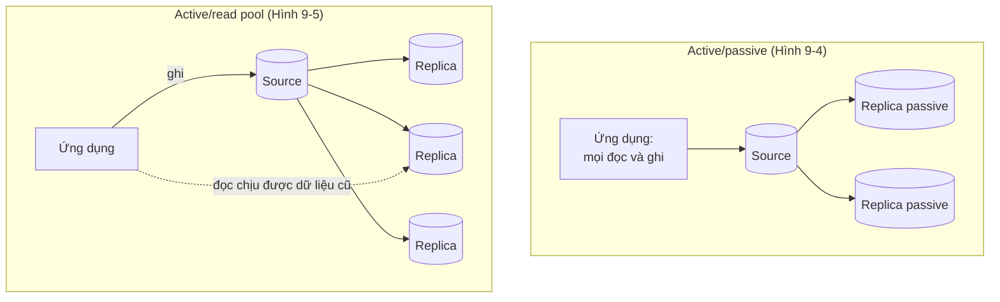

*(Vẽ lại Hình 9-4, tr. 241 và Hình 9-5, tr. 243, đã xem trên ảnh trang PDF 263 và 265; phần "Ứng dụng" do người viết thêm để thể hiện hướng traffic mô tả trong chữ.)*

#### 2.4.1 Active/Passive (tr. 241–242)

**What** (tr. 241). Mọi đọc và ghi đi tới **một source**. Thêm một số ít **replica passive** không phục vụ traffic ứng dụng nào.

**Why** (tr. 241). Lý do chính để chọn mô hình này là khi bạn **không muốn lo về replication lag**. Vì mọi đọc đi tới source, bạn tránh được các vấn đề **read-after-write** mà ứng dụng có thể không chịu được.

**Configuration** (tr. 242). Source và replica nên **giống hệt nhau** về CPU, bộ nhớ… Sớm muộn bạn sẽ phải failover (bảo trì, nâng cấp, vá, hỏng phần cứng); phần cứng và phần mềm giống nhau bảo đảm vẫn giữ được năng lực xử lý như trước khi failover.

**Redundancy** (tr. 242):

| Môi trường | Khuyến nghị | Lý do |
| --- | --- | --- |
| Phần cứng vật lý | **n+2**, tức ít nhất **ba** server | Khi một máy hỏng phần cứng, vẫn còn một server dự phòng để failover. Có thể dùng một replica làm nơi backup nếu không muốn hay không thể backup trên source |
| Cloud | **n+1** (hai server) là đủ **nếu** dữ liệu đủ nhỏ hoặc chép dễ; nếu không thì vẫn cần n+2 | Có thể tạo replica theo nhu cầu: khi vá, dựng replica thứ ba, vá nó, thay replica kia, rồi failover và lặp lại với source cũ. Mục tiêu là **luôn có một replica sẵn sàng làm đích failover** |

Có thể đặt một replica ở **vị trí địa lý xa**, nhưng phải theo dõi lag để bảo đảm nó dùng được. Replica phải **phục hồi được** và mức mất dữ liệu nằm trong giới hạn bạn đã đặt; sách trỏ tới "Defining Recovery Requirements" ở [Chương 10](chapter-10.md#s2-2) (tr. 242).

**Caveats** (tr. 242). Chọn mô hình này là **gắn khả năng scale đọc vào năng lực của một server**. Chạm giới hạn đọc thì phải tiến hóa sang active/read pool, hoặc dùng sharding để giảm đọc trên source ([Chương 11](chapter-11.md)).

#### 2.4.2 Active/Read Pool (tr. 242–244)

**What** (tr. 242). Mọi **ghi** đi tới source. **Đọc** đi tới source **hoặc** ***read pool***, tùy nhu cầu ứng dụng. Read pool cho phép scale đọc theo chiều ngang với ứng dụng đọc nhiều. Tới một lúc, việc scale ngang sẽ chững lại vì **gánh nặng replication lên source**.

**Configuration** (tr. 243). Lý tưởng là source **giống hệt** ít nhất một, tốt hơn là hai replica trong pool, vì sẽ có lúc phải failover sang một trong số đó và nó phải đủ sức gánh traffic. Khi pool lớn dần, có thể tối ưu chi phí bằng cấu hình khác cho một số thành viên, rồi dùng ***traffic weighting*** để cân bằng. Ví dụ của sách: đích failover 32 core, các replica khác 8 core, thì gửi tới node 32 core **gấp bốn lần** traffic để tận dụng nó.

**Redundancy** (tr. 243). Số server trong pool phải đáp ứng yêu cầu ở trên, nghĩa là **ít nhất một** server làm được đích failover. Ngoài ra cần đủ node cho lưu lượng đọc, cộng **một khoảng đệm** cho node hỏng. Với đọc, chỉ số sử dụng đáng tin nhất thường là **CPU**: nhắm khoảng **50–60%** mỗi node. CPU càng cao thì càng tốn thời gian context switching và latency tăng ([Chương 4](chapter-04.md)). Hãy tìm điểm cân bằng giữa latency và mức sử dụng hợp với kỳ vọng của ứng dụng.

**Caveats** (tr. 243–244):

- Ứng dụng phải **chịu được đọc dữ liệu cũ** (*stale read*). Bạn **không bao giờ** bảo đảm được rằng một lần ghi vừa hoàn tất trên source đã tới replica.
- Có thể cần cách **rút node khỏi pool** (*depool*) khi nó tụt quá xa.
- Kích thước pool quyết định khối lượng quản trị và lúc nên tự động hóa: pool 16 node nghĩa là vá kernel hay vá bảo mật **16 lần**. Tự động hóa việc depool, vá, reboot, repool một cách êm sẽ giảm nhiều việc tay về sau.

> **Bổ sung ngoài sách** — các mức đảm bảo khi đọc từ replica (read-your-writes, monotonic reads) ở [DDIA chương 5: replication lag](../../DDIA/ddia-notes/chapter-05.md#b2) và [cách xử lý](../../DDIA/ddia-notes/chapter-05.md#lag-solutions). Sách HPM chỉ nói ứng dụng phải chịu được dữ liệu cũ; thiết kế read pool chi tiết nằm ở [Chương 11](chapter-11.md#s2-4).

#### 2.4.3 Discouraged Topologies (tr. 244–247)

Hai khuyến nghị ở trên giữ topology đơn giản, dễ hiểu. Các topology dưới đây xuất hiện trong ấn bản trước của chính cuốn sách hoặc trong lời kể về công ty khác; tác giả xếp chúng vào loại **không khuyến khích** vì rủi ro và độ phức tạp cao hơn mức họ muốn thấy (tr. 244).

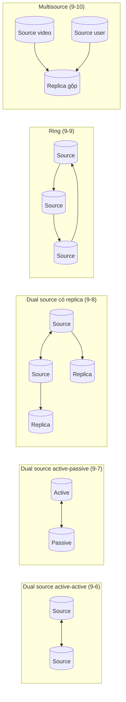

*(Vẽ lại Hình 9-6 đến 9-10, tr. 244–247, đã xem trên ảnh trang PDF 266–269. Nhãn "video", "user" lấy từ ví dụ trong chữ tr. 246.)*

**Dual source in active-active mode** (tr. 244–245). ***Dual source replication*** (còn gọi ***bidirectional replication***) gồm hai server, mỗi server vừa là source vừa là replica của server kia, tức một cặp ***cosource***. Thoạt nhìn không khác active/passive hai server, chỉ có thêm replication chiều ngược lại. Nguy hiểm thật sự xuất hiện khi **gửi ghi tới cả hai bên**:

- **Nhất quán.** Có chiến lược chọn bên theo hash chẵn/lẻ. Cách này giữ read-after-write nhất quán **cho cùng một hàng**, nhưng truy vấn chạm hàng "thuộc" bên kia thì không. Đọc id 1, 3, 5 từ một bên luôn nhất quán; còn truy vấn đọc id 1–6 thì gửi đi đâu? Nếu bên kia có cập nhật chưa tới bên này vì lag thì sao?
- **Năng lực.** Mỗi server là replica và là đích failover khả dĩ nhất của server kia. Phải lập kế hoạch để khi dồn traffic từ bên này sang bên kia, bạn **không hết CPU**. Failover còn đưa vào một **working set hoàn toàn khác**: buffer pool của InnoDB bị **churn**, đẩy dữ liệu cũ ra để chứa tập dữ liệu nóng mới.
- **Kết luận của sách.** Tránh xa. Cảm giác "tận dụng" được server passive là ảo giác: bạn đưa sự không nhất quán vào ứng dụng và luôn lo không đủ năng lực để failover. **Mất chiến lược failover là mất khả năng chống chịu** (tr. 245).

**Dual source in active-passive mode** (tr. 245). Biến thể tránh được các bẫy trên: một server là "passive" chỉ đọc. Bề ngoài không có gì sai. Khác biệt duy nhất với active/passive được khuyến nghị là replication **đã cấu hình sẵn** chiều ngược lại. Cách này chỉ hợp với **hai server**; có nhiều hơn thì phải chọn node nào là đích failover tốt nhất, và cấu hình sẵn chỉ trói bạn vào một node, mất linh hoạt khi sự cố. Sách cho rằng dựng replication là bước **dễ tự động hóa** trong quy trình failover, nên cấu hình này là **thừa** và chỉ gây nhầm lẫn.

**Dual sources with replicas** (tr. 245–246). Thêm replica cho mỗi cosource. Vẫn giữ phần lớn vấn đề của active-active, quan trọng nhất là **định tuyến traffic**. Nó giải được chuyện năng lực và buffer pool churn khi failover, nhưng failover có thêm bước: trỏ một source sang replica vừa được promote. Tác giả **phản đối**, chủ yếu vì vấn đề truy cập dữ liệu: "cosource chỉ dẫn tới rắc rối".

**Ring replication** (tr. 246). Ba source trở lên, mỗi server là replica của server **trước** nó và là source của server **sau** nó (***circular replication***). Bất kỳ server nào offline thì **vòng bị đứt** và cập nhật ngừng chạy quanh vòng. Có biến thể gắn replica cho mỗi source để thay vào, nhưng vòng vẫn đứt cho tới khi promote replica vào vị trí cũ. Sách kết luận: topology này **ngược với đơn giản** và **không có ưu điểm nào**.

**Multisource replication** (tr. 246–247). Đôi khi cần tính năng nâng cao cho việc **một lần**. Ví dụ: một trang upload và xem video tách dữ liệu video và dữ liệu user thành hai cluster; khi lớn lên lại muốn gộp chúng trong truy vấn. ***Multisource replication*** đưa cả hai tập dữ liệu về một replica. Tính năng này dựa trên ***replication channel***: cluster thứ ba có hai channel, một cho video, một cho user. Khi dữ liệu đã nạp và bắt kịp, chỉ cần một downtime rất ngắn để đóng băng ghi trên hai source và đẩy code chuyển đọc, ghi sang database gộp.

- **Giới hạn quan trọng** (tr. 247): không thể cấu hình một replica dùng multisource **nhiều lần với cùng một source**.
- **Khi nào chấp nhận được** (tr. 247): sách chỉ xếp nó vào loại không khuyến khích khi bạn xây **topology lâu dài** quanh nó. Dùng **tạm thời** để gộp dữ liệu, với mục tiêu quay về một trong hai topology khuyến nghị, vẫn chấp nhận được.

> **Bổ sung ngoài sách** — multi-leader và xung đột ghi ở [DDIA chương 5](../../DDIA/ddia-notes/chapter-05.md#multi-leader), topology vòng và sao ở [topologies](../../DDIA/ddia-notes/chapter-05.md#topologies). DDIA giải thích **vì sao** ghi ở nhiều nơi sinh xung đột; HPM đưa ra **quyết định vận hành**: đừng làm vậy với MySQL replication thông thường.

#### Tự kiểm tra 2.4

**Câu 2.4.1.** Một ứng dụng không chịu được việc người dùng không thấy dữ liệu mình vừa ghi. Sách gợi ý topology nào, và cái giá phải trả là gì? [đáp án](answers/chapter-09.md#q2-4-1)

**Câu 2.4.2.** Read pool gồm một replica 32 core (đích failover) và ba replica 8 core. Bạn phân tải đọc thế nào? Vì sao sách nhắm CPU khoảng 50–60% thay vì 90%? [đáp án](answers/chapter-09.md#q2-4-2)

**Câu 2.4.3.** Vì sao chia ghi theo id chẵn/lẻ giữa hai cosource vẫn không làm active-active nhất quán? Ngoài nhất quán, active-active còn làm hỏng điều gì của chiến lược failover? [đáp án](answers/chapter-09.md#q2-4-3)

**Câu 2.4.4.** Trong ring ba source, một server hỏng phần cứng. Điều gì xảy ra với các cập nhật mới, và vì sao gắn thêm replica cho mỗi source không giải quyết được gốc rễ? [đáp án](answers/chapter-09.md#q2-4-4)

**Câu 2.4.5.** Khi nào multisource replication là lựa chọn hợp lý theo sách, và khi nào nó trở thành topology không khuyến khích? [đáp án](answers/chapter-09.md#q2-4-5)

---

### 2.5 Replication Administration and Maintenance (tr. 247–250)

Với ít dữ liệu và tải ghi đều, bạn hiếm khi phải nhìn lag hay xử lý replication hỏng. Nhưng database thường **lớn dần**, và cùng với nó là việc bảo trì (tr. 247).

#### 2.5.1 Monitoring Replication (tr. 247–248)

Replication làm monitoring phức tạp hơn. Nó diễn ra ở cả source và replica, nhưng **phần lớn công việc ở replica** và đó cũng là nơi hay xảy ra sự cố nhất. Các câu hỏi cần trả lời: mọi replica có đang chạy không? Replica nào có lỗi? Replica chậm nhất tụt bao xa? MySQL cung cấp gần đủ thông tin, nhưng **tự động hóa** giám sát và làm replication bền vững là việc của bạn (tr. 247).

Ba thứ sách coi là quan trọng nhất (tr. 248):

| Cần giám sát | Vì sao |
| --- | --- |
| **Dung lượng đĩa trên cả source và replica** | Replication dùng binlog trên source và relay log trên replica. Source hết đĩa thì transaction **không hoàn tất được và bắt đầu timeout**. Replica hết đĩa thì MySQL xử lý nhẹ nhàng hơn: **tạm dừng replication** và chờ có chỗ trống |
| **Trạng thái và lỗi** | Replication rất bền, nhưng mạng, dữ liệu không nhất quán, dữ liệu hỏng có thể làm nó dừng. Giám sát xem các replication thread có chạy không; nếu không, xem lỗi gần nhất để quyết định bước tiếp theo |
| **Delayed replica có trễ đúng như mong muốn** | Trễ quá nhiều thì dùng nó tốn thời gian hơn nhiều; trễ quá ít, hay tệ hơn là **không trễ**, thì bản sao trễ có thể vô dụng đúng lúc cần |

> **Bổ sung ngoài sách.** Trong MySQL 8.0, ngoài `SHOW REPLICA STATUS` còn có các bảng Performance Schema `replication_connection_status` (phía nhận: tập GTID đã nhận, lỗi I/O) và `replication_applier_status_by_worker` (phía áp dụng: lỗi của từng worker, transaction đang áp dụng). Khi applier đa luồng gặp lỗi, `Last_SQL_Error` chỉ nói "Coordinator stopped… see … replication_applier_status_by_worker"; lỗi thật nằm trong bảng worker ([TN2](experiments/chapter-09.md#tn2)).

#### 2.5.2 Measuring Replication Lag (tr. 248–249)

Một trong những việc giám sát phổ biến nhất là replica tụt sau source bao xa. Cột `Seconds_Behind_Source` của `SHOW REPLICA STATUS` **về lý thuyết** cho biết lag, nhưng **không phải lúc nào cũng chính xác** (tr. 248–249):

| Vấn đề của `Seconds_Behind_Source` theo sách | Kiểm chứng trên 8.0.42 ([TN3](experiments/chapter-09.md#tn3)) |
| --- | --- |
| Replica tính bằng cách lấy thời gian hiện tại trừ **timestamp ghi trong event binlog**, nên nó chỉ báo được lag khi **đang xử lý một câu lệnh** | Phù hợp với quan sát: khi không có gì để áp dụng, giá trị là 0; trong lúc áp dụng một transaction lớn, giá trị tăng dần (3 → 6 giây) |
| Thường báo `NULL` khi các replication thread không chạy | **Đúng:** dừng SQL thread hay I/O thread đều cho `NULL` |
| Một số lỗi (ví dụ `max_allowed_packet` lệch, mạng không ổn) làm replication dừng nhưng giá trị lại là **0** | Chưa tái hiện |
| Có khi không tính được dù thread vẫn chạy, và báo 0 hoặc `NULL` | Thấy hiện tượng gần giống: ngay sau khi bắt kịp, giá trị còn **cũ** (13 giây, hay 3–4 giây) trong khi heartbeat đã dưới 1 giây |
| Transaction **rất dài** làm số liệu nhảy: transaction mở một giờ rồi commit thì khi replica xử lý, nó báo trễ một giờ rồi về 0 | **Đúng với applier một luồng** (`replica_parallel_workers=0`): transaction mở 17,8 giây làm giá trị nhảy lên 18–21 giây trong khi heartbeat chỉ 1–4,6 giây. **Không thấy** với applier 4 luồng (mặc định 8.0.42): giá trị chỉ lên tối đa 5 |

**Giải pháp của sách** (tr. 249). Bỏ qua `Seconds_Behind_Source` và đo lag bằng thứ **quan sát trực tiếp được**. Tốt nhất là một ***heartbeat record***: một timestamp được cập nhật **mỗi giây** trên source. Lag bằng thời gian hiện tại trên replica trừ heartbeat. Cách này **miễn nhiễm** với mọi vấn đề trên, và còn cho biết dữ liệu của replica đang "hiện hành" tới thời điểm nào. Script `pt-heartbeat` của Percona Toolkit là cách cài phổ biến nhất. Bản ghi heartbeat trong binlog còn có ích cho disaster recovery trong những tình huống khó.

**Giới hạn** (tr. 249). Không chỉ số lag nào ở trên cho biết replica **mất bao lâu để bắt kịp**. Điều đó phụ thuộc sức mạnh của replica và lượng ghi mà source tiếp tục xử lý (xem [2.6](#excessive-lag)).

> **Kết quả đã đo** ([TN3](experiments/chapter-09.md#tn3)). Bốn cách đo trên cùng replica, lấy mẫu mỗi 0,3–2 giây:
>
> | Cách đo | Dừng SQL thread 10 giây | Dừng I/O thread 4 giây | `UPDATE` 200.000 hàng |
> | --- | --- | --- | --- |
> | `Seconds_Behind_Source` | `NULL` suốt thời gian dừng | `NULL` | 3 → 6 giây, rồi còn báo 3–4 sau khi đã bắt kịp |
> | Heartbeat tự làm (event cập nhật mỗi giây) | 0,5 → 10,5 giây | 0,9 → 4,9 giây | 1,3 → 4,7 giây |
> | Performance Schema: giờ hiện tại trừ `APPLYING_TRANSACTION_ORIGINAL_COMMIT_TIMESTAMP` | không có (không có gì đang áp dụng) | không có | 0,4 → 3,8 giây |
> | GTID đã nhận nhưng chưa thực thi | 1 → 11 transaction | **không thấy gì** (replica không biết thứ nó chưa nhận) | 2 → 5 transaction |
>
> Heartbeat có độ phân giải khoảng 1 giây vì được cập nhật mỗi giây. Chỉ heartbeat cho con số đúng **trong mọi tình huống** thử.

> **Bổ sung ngoài sách** — giải thích khả dĩ cho khác biệt giữa applier một luồng và đa luồng. Applier một luồng cập nhật mốc thời gian theo **từng event**, mà event `UPDATE` mang timestamp lúc câu lệnh bắt đầu trên source. Applier đa luồng cập nhật mốc theo **nhóm transaction** ở các checkpoint, nên mốc gần với thời điểm commit hơn và có thể cũ đi một chút sau khi bắt kịp. Đây là **giả thuyết** khớp với số liệu đo, chưa đối chiếu với mã nguồn.

#### 2.5.3 Determining Whether Replicas Are Consistent with the Source (tr. 249–250)

Lý tưởng thì replica luôn là bản sao chính xác của source, trừ độ trễ. Thực tế có thể lệch. Các nguyên nhân sách nêu (tr. 249):

- ghi nhầm vào replica;
- dùng dual source với cả hai bên nhận ghi;
- truy vấn không tất định cùng statement-based replication;
- MySQL crash khi đang chạy chế độ **kém durable** (xem [Chương 5](chapter-05.md#s2-5));
- bug của MySQL.

Ba quy tắc của sách (tr. 250):

1. **Luôn chạy replica với `super_read_only`.** `read_only` chặn user **không có** quyền `SUPER` ghi, nhưng không chặn DBA lỡ chạy `DELETE` hay `ALTER` mà không biết mình đang ở replica. `super_read_only` chỉ cho **replication** ghi, là cách an toàn nhất.
2. **Dùng row-based hoặc câu lệnh tất định.** Dù tốn đĩa hơn trong một số trường hợp, row-based nhất quán nhất vì chứa dữ liệu chính xác của từng hàng thay đổi. Ví dụ của sách: `DELETE` user có ngày đăng nhập cũ với `LIMIT 10` mà không `ORDER BY`; nếu có một nghìn hàng khớp, MySQL xóa 10 hàng đầu theo **thứ tự tự nhiên** của bảng, và thứ tự này có thể khác trên replica. Viết lại với `ORDER BY user_id` thì, miễn dữ liệu hai bên nhất quán, **cùng 10 hàng** bị xóa.
3. **Đừng ghi vào nhiều server trong topology cùng lúc**, kể cả cosource ghi hai phía hay ring. Topology thực tế nhất: **một source nhận mọi ghi**, một hay nhiều replica, có thể nhận đọc.

Cuối cùng, nếu gặp lỗi replication, sách khuyên mạnh mẽ dùng chiến lược **dựng lại replica** (*rebuild*) trong tài liệu chính thức (tr. 250).

> **Kết quả đã đo** ([TN1](experiments/chapter-09.md#tn1)). Trên replica với `read_only=ON`, root vẫn `INSERT` được và sinh ra một GTID mang `server_uuid` của replica (một errant transaction). Với `super_read_only=ON`, cùng lệnh bị từ chối với lỗi 1290, còn replication vẫn áp dụng bình thường.

> **Kết quả đã đo** ([TN2](experiments/chapter-09.md#tn2)). Sau lần `DELETE ... LIMIT` không tất định, số hàng hai bên **bằng nhau**, `SHOW REPLICA STATUS` **không lỗi**; chỉ `CHECKSUM TABLE` và một tổng kiểm tự viết (`BIT_XOR(CRC32(...))`) lộ ra khác biệt. Khi một `UPDATE` ở định dạng ROW chạm đúng hàng đã lệch, replica dừng với **lỗi 1032** (không tìm thấy hàng). Sửa tay phải xử lý **cả hai phía**: thêm 10 hàng replica thiếu **và** xóa 10 hàng replica thừa.

> **Bổ sung ngoài sách.** Sách không nêu công cụ kiểm tra nhất quán cụ thể trong mục này. Ngoài thực tế thường dùng `pt-table-checksum` và `pt-table-sync` (Percona Toolkit). `CHECKSUM TABLE` có sẵn trong MySQL nhưng phải chạy lúc hai bên ở cùng một điểm dữ liệu (ví dụ dừng ghi hoặc dừng replica tại cùng GTID) thì so sánh mới có nghĩa.

#### Tự kiểm tra 2.5

**Câu 2.5.1.** Nêu ít nhất bốn lý do khiến `Seconds_Behind_Source` không đáng tin. Heartbeat khắc phục chúng thế nào, và nó vẫn **không** trả lời được câu hỏi gì? [đáp án](answers/chapter-09.md#q2-5-1)

**Câu 2.5.2.** I/O thread của replica bị đứt vì mạng. `Seconds_Behind_Source` báo gì? Số GTID "đã nhận chưa thực thi" báo gì? Chỉ số nào còn phản ánh đúng độ trễ? [đáp án](answers/chapter-09.md#q2-5-2)

**Câu 2.5.3.** Ghép mỗi nguyên nhân gây lệch dữ liệu ở tr. 249 với quy tắc (hoặc cấu hình) phòng ngừa tương ứng. Nguyên nhân nào không có quy tắc nào chặn được hoàn toàn? [đáp án](answers/chapter-09.md#q2-5-3)

**Câu 2.5.4.** Vì sao `read_only` không đủ để bảo vệ replica? Hậu quả lâu dài của một lần ghi nhầm vào replica trong topology dùng GTID là gì? [đáp án](answers/chapter-09.md#q2-5-4)

---

### 2.6 Replication Problems and Solutions (tr. 251–254)

Cài đặt đơn giản giúp MySQL replication dễ dựng, nhưng cũng có nghĩa là có nhiều cách làm nó dừng, rối hay hỏng. Phần trước đã bàn replication crash safe và các quy tắc giữ source và replica đồng bộ; mục này bàn các sự cố thường gặp, cách chúng biểu hiện và cách xử lý hay phòng tránh (tr. 251).

#### 2.6.1 Binary Logs Corrupted on the Source (tr. 251)

Nếu binlog trên source bị hỏng, **không có lựa chọn nào khác ngoài dựng lại các replica**. Bỏ qua entry hỏng nghĩa là bỏ qua một số transaction, và replica sẽ không bao giờ xử lý chúng (tr. 251).

#### 2.6.2 Nonunique Server IDs (tr. 251)

Đây là một trong những vấn đề khó nắm bắt nhất. Hai replica lỡ cùng server ID có thể **trông như chạy ổn** nếu không để ý kỹ. Nhưng nhìn log lỗi, hay nhìn source bằng công cụ như innotop, sẽ thấy điều lạ:

- trên source chỉ thấy **một trong hai** replica kết nối tại mỗi thời điểm (bình thường mọi replica đều kết nối và replicate liên tục);
- trên replica có thông báo **ngắt và nối lại** thường xuyên trong log lỗi, mà **không nhắc gì tới server ID**.

Tùy phiên bản, replica có thể replicate đúng nhưng chậm, hoặc **không đúng**: bỏ sót event, lặp event gây lỗi trùng khóa hay hỏng dữ liệu thầm lặng. Các replica "đánh nhau" còn làm tăng tải source, và log lỗi có thể phình rất nhanh (tr. 251).

**Cách phòng** (tr. 251): cẩn thận khi dựng replica; giữ một danh sách chuẩn ánh xạ replica với server ID; nếu mọi replica nằm trong một subnet, có thể lấy **octet cuối của địa chỉ IP** làm ID.

#### 2.6.3 Undefined Server IDs (tr. 252)

Nếu không đặt server ID, `CHANGE REPLICATION SOURCE TO` có vẻ chạy, `SHOW REPLICA STATUS` trông ổn, nhưng `START REPLICA` báo **lỗi 1200** "server is not configured as replica". Điều này đặc biệt khó hiểu vì bạn vừa cấu hình xong. `SELECT @@server_id` có thể trả về một giá trị, nhưng đó chỉ là mặc định; phải đặt giá trị **tường minh** (tr. 252).

> **Kết quả đã đo** ([TN5](experiments/chapter-09.md#tn5), phần C), cho cả 2.6.2 và 2.6.3:
> - `server_id=0` rồi `START REPLICA`: **lỗi 1200** đúng như sách.
> - Trên 8.0.42, mặc định của `server_id` là **1**, không phải 0. Một replica "quên" đặt `server_id` vì thế trùng với một source cũng dùng mặc định 1, và I/O thread dừng với **lỗi 13117** "source and replica have equal MySQL server ids". Đây là biểu hiện thường gặp của "server ID không được đặt" trên 8.0.
> - Hai replica cùng `server_id=3` nối vào một source: `SHOW REPLICAS` trên source **chỉ liệt kê một** (đúng như sách), nhưng danh sách tiến trình có **hai** dump thread và cả hai replica đều nhận dữ liệu; trong khoảng 2,5 phút không thấy vòng ngắt và nối lại nào. Hành vi "đánh nhau" phụ thuộc phiên bản, đúng như sách đã lưu ý.

#### 2.6.4 Missing Temporary Tables (tr. 252)

Temporary table tiện cho vài việc, nhưng **không tương thích với statement-based replication**. Nếu replica crash hay bị tắt, mọi temporary table mà replication thread đang dùng **biến mất**. Khi chạy lại, mọi câu lệnh sau tham chiếu tới chúng sẽ lỗi (tr. 252).

Cách tốt nhất là dùng **row-based replication**. Cách tốt thứ hai: đặt tên temporary table nhất quán (ví dụ tiền tố `temporary_`) và dùng quy tắc replication để **bỏ qua hoàn toàn** chúng (tr. 252).

#### 2.6.5 Not Replicating All Updates (tr. 252)

Dùng sai `SET SQL_LOG_BIN=0`, hoặc không hiểu quy tắc lọc, có thể khiến replica **không thực thi** một số cập nhật đã xảy ra trên source. Đôi khi đó là chủ ý (lưu trữ), nhưng thường là vô tình và để lại hậu quả xấu (tr. 252).

Ví dụ của sách: replica có quy tắc `replicate_do_db` chỉ cho database `sakila`. Trên source chạy `USE test;` rồi `UPDATE sakila.actor ...` thì dữ liệu replica sẽ khác source (bộ lọc xét database mặc định, xem [2.2.7](#replication-filters)). Có loại câu lệnh còn làm replication **dừng với lỗi** vì phụ thuộc không được replicate (tr. 252).

> **Kết quả đã đo** ([TN2](experiments/chapter-09.md#tn2), phần D). `CREATE DATABASE other` bị lọc, rồi `CREATE TABLE other.ddl_from_misc` (chạy khi `USE misc`) lọt qua bộ lọc và làm SQL thread dừng với **lỗi 1049** "Unknown database 'other'": đúng loại lỗi "phụ thuộc không được replicate".

#### 2.6.6 Excessive Replication Lag (tr. 252–253)

Lag là vấn đề thường gặp. Dù thế nào cũng nên thiết kế ứng dụng **chịu được một ít lag** trên replica. Ba cách giảm lag phổ biến (tr. 252–253):

1. **Multithreaded replication.** Bảo đảm đang dùng applier đa luồng và đã xem xét chỉnh các tùy chọn theo manual ([2.2.5](#multithreaded-replication)).
2. **Sharding.** Nghe như câu trả lời né tránh, nhưng dàn ghi ra nhiều source là chiến lược rất hiệu quả. Quy tắc kinh nghiệm lâu đời của MySQL: **scale đọc bằng replica, scale ghi bằng sharding** ([Chương 11](chapter-11.md#s2-6)).
3. **Tạm giảm durability.** Người theo chủ nghĩa thuần túy sẽ phản đối, nhưng khi đã hết cách tuning và sharding không khả thi vì công sức hay thiết kế, nếu lag chủ yếu do giới hạn ghi, có thể **tạm** đặt `sync_binlog=0` và `innodb_flush_log_at_trx_commit=0` để tăng tốc replication.

> **Cảnh báo của sách** (tr. 253). Hãy **rất, rất cẩn thận** với cách thứ ba:
> - chỉ làm trên **replica**;
> - nếu replica đó cũng là nơi backup, đổi thiết lập có thể khiến **không phục hồi được từ backup**;
> - replica crash khi đang giảm durability thì nhiều khả năng phải **dựng lại từ source**;
> - làm tay thì **rất dễ quên** bật lại durability; cần giám sát tốt hoặc script hóa.

> Chú thích 7 (tr. 253). Điều này thường đúng khi backup bằng snapshot LVM hay snapshot đĩa trên cloud.

Quy trình sách gợi ý (tr. 253): theo dõi `Seconds_Behind_Source`; khi vượt ngưỡng thì (1) xác nhận server là replica không ghi được, ví dụ `super_read_only` đang bật; (2) đổi `sync_binlog` và `innodb_flush_log_at_trx_commit` để giảm ghi; (3) kiểm tra định kỳ lag; (4) dưới ngưỡng chấp nhận được thì đặt lại thiết lập durable.

> **Kết quả đã đo** ([TN3](experiments/chapter-09.md#tn3)). Tồn đọng 2.000 transaction một hàng, sinh tuần tự: replica bắt kịp trong **4,20 giây** (trung vị 3 lần: 4,20 / 4,30 / 4,11) với `sync_binlog=1`, `innodb_flush_log_at_trx_commit=1`, và **0,66 giây** (0,66 / 0,60 / 0,79) với cả hai bằng 0, nhanh khoảng **6 lần**. Laptop Windows, SSD, nhiều nhiễu; không phải benchmark production. Vì workload tuần tự, 4 worker không giúp được gì; chi phí `fsync` mỗi commit là nút thắt.

> **Bổ sung ngoài sách.** Nếu tự động hóa quy trình trên, ngưỡng nên dựa vào **heartbeat** thay vì `Seconds_Behind_Source`, vì chính sách đã chỉ ra cột này không đáng tin (tr. 248–249) và thí nghiệm cho thấy nó có thể báo `NULL` hay giá trị cũ.

#### 2.6.7 Oversized Packets from the Source (tr. 254)

Một vấn đề khó lần ra khác: `max_allowed_packet` của source **không khớp** với replica. Source có thể ghi vào binlog một gói mà replica coi là quá lớn; khi replica lấy event đó về, có thể gặp nhiều vấn đề, từ **vòng lặp lỗi và thử lại vô tận** tới **hỏng relay log** (tr. 254). Cách phòng: giữ cấu hình hai bên khớp nhau (diễn giải của người viết; sách chỉ mô tả vấn đề). Đây cũng là một trường hợp mà `Seconds_Behind_Source` có thể báo 0 dù replication đã hỏng (tr. 248).

> **Bổ sung ngoài sách.** Trên 8.0.42, `max_allowed_packet` mặc định 64 MB, còn biến riêng cho replica `replica_max_allowed_packet` mặc định 1 GB (đã đọc giá trị trên instance thí nghiệm). Ghi chú chưa tái hiện lỗi này.

#### 2.6.8 No Disk Space (tr. 254)

Replication có thể làm **đầy đĩa** bằng binlog, relay log hay file tạm, nhất là khi source chạy nhiều `LOAD DATA INFILE` và replica bật `log_replica_updates`. Replica càng tụt, relay log đã nhận nhưng chưa thực thi càng chiếm nhiều chỗ. Có thể phòng bằng cách **giám sát dung lượng đĩa** và đặt biến giới hạn dung lượng relay log (tr. 254). Nhắc lại hậu quả khác nhau ở [2.5.1](#s2-5-1): source hết đĩa thì transaction timeout; replica hết đĩa thì tạm dừng replication (tr. 248).

> **Lưu ý về tên biến (tr. 254).** Sách viết "relay_log_space configuration variable". Trên 8.0.42, biến cấu hình là **`relay_log_space_limit`** (mặc định 0, tức không giới hạn); `Relay_Log_Space` là một cột trạng thái trong `SHOW REPLICA STATUS`. Nhiều khả năng sách muốn nói `relay_log_space_limit`.

#### 2.6.9 Replication Limitations (tr. 254)

Replication có thể hỏng hay lệch, có hoặc không có lỗi, chỉ vì **giới hạn vốn có** của nó (tr. 254):

- Có cả một danh sách hàm SQL và thói quen lập trình **không replicate tin cậy được** (chương đã nêu nhiều cái). Khó bảo đảm không cái nào lọt vào code production, nhất là khi ứng dụng hay đội lớn.
- Server có **bug**. Nhiều bản lớn từng có bug replication, nhất là ở các bản phát hành đầu của bản lớn; tính năng mới như stored procedure thường gây nhiều vấn đề hơn.

Với đa số người dùng, đó **không** phải lý do để né tính năng mới, mà là lý do để **thử nghiệm kỹ**, nhất là khi nâng cấp ứng dụng hay MySQL, và **giám sát** để biết khi có gì gây vấn đề. Replication phức tạp, ứng dụng càng phức tạp càng phải cẩn thận; nhưng học cách làm việc với nó thì nó chạy khá tốt (tr. 254).

#### Tự kiểm tra 2.6

**Câu 2.6.1.** Hai replica bị cấu hình cùng server ID. Sách mô tả những triệu chứng nào trên source và trên replica? Vì sao lỗi này "khó nắm bắt"? [đáp án](answers/chapter-09.md#q2-6-1)

**Câu 2.6.2.** Replica đặt `replicate_do_db=sakila`. Trên source, ứng dụng chạy `USE test;` rồi `UPDATE sakila.actor ...`. Dự đoán kết quả trên replica với định dạng STATEMENT, với định dạng ROW, và với một câu DDL tương tự. [đáp án](answers/chapter-09.md#q2-6-2)

**Câu 2.6.3.** Nêu ba cách giảm lag của sách. Với cách "tạm giảm durability", liệt kê các rủi ro và các chốt an toàn cần có trong script tự động. [đáp án](answers/chapter-09.md#q2-6-3)

**Câu 2.6.4.** Replica tụt 6 giờ trong lúc source chạy nhiều `LOAD DATA INFILE`. Vì sao đĩa của replica có thể đầy dù dữ liệu của nó chưa lớn thêm? Cần giám sát và cấu hình gì? [đáp án](answers/chapter-09.md#q2-6-4)

**Câu 2.6.5.** Vì sao temporary table và statement-based replication không hợp nhau? Cách xử lý ưu tiên của sách là gì? [đáp án](answers/chapter-09.md#q2-6-5)

---

### 2.7 Summary (tr. 255)

- Replication là "con dao đa năng Thụy Sĩ" trong các khả năng có sẵn của MySQL, mở rộng đáng kể những gì MySQL làm được. Nó có lẽ là một lý do chính khiến MySQL phổ biến nhanh như vậy (tr. 255).
- Replication có nhiều giới hạn và điểm cần lưu ý, nhưng phần lớn **không quan trọng hoặc dễ tránh** với đa số người dùng. Nhiều nhược điểm chỉ là hành vi đặc biệt của tính năng nâng cao mà ít người dùng, nhưng rất có ích cho số ít cần chúng (tr. 255).
- Phương châm: **giữ đơn giản**. Đừng làm gì cầu kỳ như vòng replication hay filter, trừ khi thật cần. Dùng replication để **phản chiếu toàn bộ** dữ liệu, **kể cả quyền**. Giữ replica giống hệt source **về mọi mặt** giúp tránh nhiều vấn đề (tr. 255).

**Diễn giải của người viết.** "Giữ giống hệt" có nghĩa cụ thể: cùng dữ liệu (không filter), cùng quyền (để failover không làm ứng dụng mất quyền), cùng cấu hình phần cứng cho ứng viên failover (tr. 242–243), cùng schema và index (thí nghiệm [TN2](experiments/chapter-09.md#tn2) cho thấy chỉ lệch một index là statement-based đã đủ gây lệch dữ liệu).

#### Tự kiểm tra 2.7

**Câu 2.7.1.** Nêu ba quyết định cụ thể trong chương thể hiện phương châm "giữ đơn giản", mỗi quyết định kèm rủi ro mà nó tránh được. [đáp án](answers/chapter-09.md#q2-7-1)

**Câu 2.7.2.** Vì sao sách nhấn mạnh replica phải là bản sao đầy đủ **kể cả quyền**? Điều gì có thể xảy ra trong failover nếu quyền bị lọc khỏi replication? [đáp án](answers/chapter-09.md#q2-7-2)

**Câu 2.7.3.** Tổng hợp: liệt kê cấu hình replication tối thiểu cho một hệ OLTP mới theo khuyến nghị của chương (định dạng, định danh vị trí, crash safety, bảo vệ replica, đo lag, topology), mỗi mục kèm trang. [đáp án](answers/chapter-09.md#q2-7-3)

---

## 3. Phân tích tình huống

Chương này là chương vận hành, nên các tình huống đi theo **quyết định vận hành**: dữ kiện → chỉ số cần nhìn → các lựa chọn → đánh đổi → quyết định. Không gượng ép một câu SQL vào mọi tình huống. Các tình huống là **Ví dụ minh họa do AI xây dựng**; mỗi bước dẫn trang sách hoặc thí nghiệm.

### Tình huống 1 — Vá kernel cho source vào giờ thấp điểm (failover có kế hoạch)

**Dữ kiện (giả định).** Topology active/passive: source `db1`, hai replica `db2`, `db3` cùng cấu hình phần cứng, đều bật GTID và auto-position. Cần reboot `db1` để vá kernel. SLO cho phép vài giây lỗi ghi trong cửa sổ bảo trì.

**Bước 1 — chọn đích (tr. 240).** Không chỉ nhìn lag. So tập GTID:

- `GTID_SUBTRACT(gtid_executed của db1, gtid_executed của ứng viên)` cho biết ứng viên **thiếu** gì;
- `GTID_SUBTRACT(gtid_executed của ứng viên, gtid_executed của db1)` cho biết ứng viên có **GTID lạ** nào (Bổ sung ngoài sách, xem [errant transaction](#errant-transaction)).

Trong [TN5](experiments/chapter-09.md#tn5), phép kiểm thứ hai loại một ứng viên có GTID lạ từ lần ghi nhầm trước đó. Nếu chọn nó, thay đổi lạ sẽ lan sang mọi server.

**Bước 2–4 — chặn ghi rồi chờ đồng bộ (tr. 240).** Bật `super_read_only` trên `db1`, rồi trên `db2` chạy `WAIT_FOR_EXECUTED_GTID_SET('<gtid_executed của db1>', timeout)` (**Bổ sung ngoài sách**, hàm của MySQL 8.0). Kết quả 0 nghĩa là đã đủ. Đây là "so GTID để chắc chắn" của bước 4.

**Bước 5–7 — mở ghi, chuyển traffic, trỏ lại (tr. 240).** Tắt `read_only` trên `db2`; chuyển ứng dụng (DNS, proxy hay cấu hình); trên `db3` và `db1` chạy `CHANGE REPLICATION SOURCE TO ... SOURCE_AUTO_POSITION=1` trỏ về `db2`. `db1` giữ `super_read_only` và giờ có thể reboot an toàn.

**Chi phí.** Cửa sổ lỗi ghi kéo dài từ bước 3 tới bước 6. Trong thí nghiệm có script, phần database chỉ mất khoảng 0,55 giây (**Kết quả đã đo**, [TN5](experiments/chapter-09.md#tn5)); thực tế, thời gian chuyển traffic của ứng dụng (TTL của DNS, cấu hình proxy) thường chiếm phần lớn (**Bổ sung ngoài sách**). **Bổ sung ngoài sách:** sau failover, buffer pool của `db2` đã chứa phần dữ liệu mà nó phát lại khi ghi, nhưng phần dữ liệu chỉ được **đọc** trên source cũ có thể chưa nằm trong buffer pool của `db2`, nên vài phút đầu có thể chậm hơn (liên hệ ý "buffer pool churn" của sách, tr. 244).

**Điều có thể sai.** Quên bước 3 → hai server cùng nhận ghi. Quên trỏ `db1` về → `db1` reboot xong nằm ngoài topology và lệch dần. Delayed replica nằm trong danh sách ứng viên → promote một server trễ hàng giờ (tr. 233).

### Tình huống 2 — Source mất điện lúc 3 giờ sáng: failover hay chờ?

**Dữ kiện (giả định).** Source không phản hồi ping. Hai replica báo `Replica_IO_Running: Connecting`. Không rõ máy có khởi động lại được không. Replication bất đồng bộ, có semisync với timeout 10 giây.

**Câu hỏi đầu tiên không phải "replica nào" mà là "có nên failover không"** (tr. 240–241). Sơ đồ quyết định dưới đây ghép lập luận của sách với kết quả thí nghiệm:

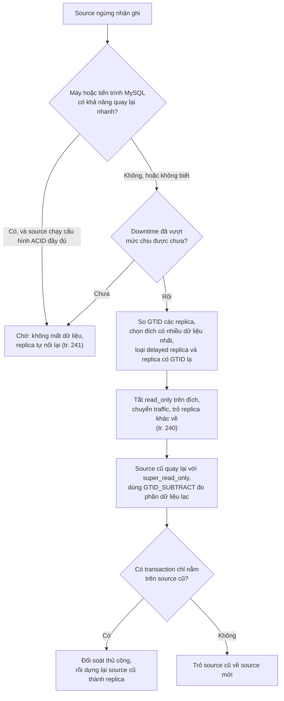

*(Sơ đồ do người viết ghi chú dựng; nhánh "chờ" theo tr. 240–241, các bước failover theo tr. 240, phần GTID_SUBTRACT là Bổ sung ngoài sách đã thử trong [TN5](experiments/chapter-09.md#tn5).)*

**Vì sao semisync không cứu được ở đây** (tr. 237). Nếu sự cố bắt đầu bằng **mạng** chập chờn trước khi máy chết, source có thể đã chờ hết timeout rồi rơi về bất đồng bộ và commit thêm transaction mà không replica nào có. Thí nghiệm tái hiện đúng chuỗi này: 3 transaction "lạc" trên source cũ, và khi trỏ nó về source mới thì gặp lỗi 1062 vì `AUTO_INCREMENT` cấp lại cùng id (**Kết quả đã đo**, [TN5](experiments/chapter-09.md#tn5)).

**Đánh đổi.** Chờ: downtime ghi kéo dài, không mất dữ liệu nếu durable (tr. 241). Failover: khôi phục ghi nhanh, nhưng có thể mất vài transaction cuối và tốn công đối soát; quy trình ít luyện tập nên dễ sai (tr. 240–241). **Quyết định** dựa trên RTO và RPO đã thống nhất từ trước ([Chương 10](chapter-10.md#rpo-rto)), không phải quyết định lúc 3 giờ sáng. Luyện tập và tự động hóa quy trình làm giảm chi phí của nhánh failover.

### Tình huống 3 — Read pool trả dữ liệu cũ sau một đợt ghi lớn

**Dữ kiện (giả định).** Topology active/read pool, ba replica. Mỗi đêm một job cập nhật hàng loạt chạy trên source. Người dùng báo "vừa đổi cài đặt mà trang vẫn hiện cũ" vào buổi sáng. Dashboard `Seconds_Behind_Source` của cả ba replica gần như luôn 0.

**Chẩn đoán từng bước:**

1. **Đừng tin dashboard ngay** (tr. 248–249). Thí nghiệm cho thấy `Seconds_Behind_Source` có thể báo `NULL`, 0 hay giá trị cũ, và với applier đa luồng thì không phản ánh transaction mở lâu (**Kết quả đã đo**, [TN3](experiments/chapter-09.md#tn3)). Thêm heartbeat (tr. 249), hoặc ít nhất đối chiếu với Performance Schema.
2. **Xem job ghi có song song không** (tr. 234–236). Nếu job chạy tuần tự trong một session, mọi transaction có `last_committed` nối đuôi nhau và chỉ một worker làm việc (**Kết quả đã đo**: 1.200 / 0 / 0 / 0). Thêm worker không giúp.
3. **Xem transaction có quá lớn không.** Một transaction cập nhật 200.000 hàng chỉ được replica áp dụng sau khi source commit, và áp dụng tuần tự (**Kết quả đã đo**: lag heartbeat khoảng 4,7 giây cho 2,3 giây chạy trên source). Chia nhỏ batch giúp replica bắt đầu sớm và các transaction khác (như heartbeat) không phải xếp hàng sau một khối lớn (**Bổ sung ngoài sách**).
4. **Ứng dụng phải chịu được dữ liệu cũ** (tr. 243). Với luồng "đọc ngay sau khi ghi", đọc từ source; rút replica tụt quá xa khỏi pool (depool) dựa trên heartbeat.

**Các đòn bẩy và cái giá:**

| Đòn bẩy | Trang | Lợi | Cái giá |
| --- | --- | --- | --- |
| Applier đa luồng, chỉnh theo mức bận của worker | tr. 234–236 | Giảm lag khi workload có song song | Không giúp workload tuần tự; overhead coordinator |
| Chia nhỏ job ghi, chạy song song có kiểm soát | **Bổ sung ngoài sách** | Replica có song song để khai thác | Thay đổi ứng dụng |
| Tạm giảm durability trên replica | tr. 253 | Bắt kịp nhanh khoảng 6 lần trong thí nghiệm | Rủi ro crash phải dựng lại, backup không dùng được, dễ quên bật lại |
| Sharding | tr. 253 | Giải quyết tận gốc khi ghi vượt sức một source | Độ phức tạp kiến trúc ([Chương 11](chapter-11.md#s2-6)) |

### Tình huống 4 — Chọn topology cho một dịch vụ mới

**Dữ kiện (giả định).** Dịch vụ đặt hàng: ghi vừa phải, đọc gấp 8 lần ghi. Màn hình "đơn hàng của tôi" phải thấy ngay đơn vừa đặt. Chạy trên cloud, dữ liệu 300 GB.

**Lập luận:**

1. **Bắt đầu với active/passive** (tr. 241–242). Mọi đọc ở source, nên không có vấn đề read-after-write. Câu hỏi là một source có đủ sức đọc không; nếu đủ, đây là lựa chọn đơn giản nhất.
2. **Redundancy** (tr. 242). Trên cloud, n+1 chỉ đủ nếu dữ liệu nhỏ hoặc chép dễ. 300 GB dựng lại mất thời gian, nên chọn **n+2**: source và hai replica giống hệt nhau. Một replica có thể đặt ở region khác nếu lag chấp nhận được.
3. **Khi nào chuyển sang read pool** (tr. 242–243). Khi CPU của source vì đọc vượt vùng 50–60% thường xuyên. Chuyển các màn hình chịu được dữ liệu cũ (báo cáo, danh mục sản phẩm) sang pool; giữ "đơn hàng của tôi" ở source.
4. **Phép tính năng lực (Ví dụ minh họa do AI xây dựng, phép tính là Bổ sung ngoài sách).** Giả sử đo được một node 16 core phục vụ khoảng 3.000 truy vấn đọc mỗi giây ở 55% CPU. Tải đọc chuyển sang pool là 7.500 truy vấn mỗi giây → cần 7.500 / 3.000 = 2,5, làm tròn **3 node** ở mức CPU mục tiêu, cộng **1 node đệm** cho hỏng hóc (tr. 243). Ít nhất một node phải giống hệt source để làm đích failover (tr. 243).
5. **Không chọn** dual source active-active để "tận dụng" máy passive (tr. 244–245), không dùng ring (tr. 246), không dùng filter (tr. 255).

**Điều sẽ đổi khi workload đổi.** Ghi tăng tới mức replica không theo kịp dù đã đa luồng → không phải bài toán topology nữa mà là **sharding** (tr. 253, [Chương 11](chapter-11.md#s2-6)). Cần gộp dữ liệu từ một cluster khác → multisource **tạm thời** rồi quay về topology chuẩn (tr. 247).

---

## 4. Đo lường và thực hành

### Giả thuyết cần kiểm và cách quan sát

| Giả thuyết (từ sách) | Trang | Quan sát bằng | Tiêu chí đúng/sai |
| --- | --- | --- | --- |
| GTID + auto-position cho replica tự bắt kịp sau khi khởi động lại | tr. 231–232 | `Retrieved_Gtid_Set`, `Executed_Gtid_Set`, log lỗi | Replica có đủ GTID mà không chỉ file hay vị trí |
| Statement-based với câu không tất định có thể làm lệch dữ liệu | tr. 230, 250 | Tập id bị xóa trên từng server, checksum | Tập id khác nhau trên source và replica |
| Row-based tốn binlog hơn nhiều | tr. 231 | Hiệu số vị trí binlog (`SHOW MASTER STATUS`) trước và sau | Tỉ lệ byte ROW/STATEMENT |
| `*_do_db` lọc theo database mặc định | tr. 238 | Hàng, bảng có hay không trên replica | Câu chạy với `USE` khác bị lọc |
| `Seconds_Behind_Source` không đáng tin; heartbeat thì đáng tin | tr. 248–249 | Bốn cách đo song song | Số liệu khác nhau trong cùng thời điểm |
| Delayed replica cứu được `DROP TABLE` nhầm | tr. 233 | Bảng còn trên replica sau khi chạy tới trước GTID của `DROP` | Dữ liệu khôi phục đủ |
| Semisync thêm latency và rơi về bất đồng bộ khi hết timeout | tr. 237 | Thời gian commit, `Rpl_semi_sync_source_status` | Commit thành công sau timeout |
| Failover ngoài kế hoạch khó biết thiếu bao nhiêu dữ liệu | tr. 240–241 | `GTID_SUBTRACT` giữa source cũ và mới | Có transaction chỉ trên source cũ |
| Giảm durability làm replica bắt kịp nhanh hơn | tr. 253 | Thời gian bắt kịp một tồn đọng cố định | Tỉ lệ thời gian, trung vị 3 lần |
| Mức bận của worker cho biết số worker hợp lý | tr. 235–236 | Performance Schema theo worker | Phân bố transaction giữa các worker |

### Các thí nghiệm đã chạy

Môi trường: MySQL 8.0.42, Windows 11, **ba instance riêng** (cổng 3319, 3333, 3334, mỗi instance một datadir, `server_id` khác nhau, GTID bật bằng tùy chọn dòng lệnh, còn lại cấu hình mặc định), dữ liệu tổng hợp từ 10.000 tới 200.000 hàng. Mọi instance đã tắt sau thí nghiệm. Chi tiết, lệnh và output ở [experiments/chapter-09.md](experiments/chapter-09.md).

| Thí nghiệm | Mục sách | Kết quả chính (đã đo) |
| --- | --- | --- |
| [TN1](experiments/chapter-09.md#tn1) Dựng replication GTID, đọc trạng thái, tự nối lại, `super_read_only` | 2.1, 2.2.2, 2.2.3, 2.5.3 | Replica tự bắt kịp GTID 4–8 sau restart; `read_only` để root ghi nhầm (sinh GTID lạ), `super_read_only` chặn (lỗi 1290); `relay_log_recovery` mặc định OFF |
| [TN2](experiments/chapter-09.md#tn2) ROW và STATEMENT: kích thước, `mysqlbinlog`, lệch thầm lặng, filter | 2.2.1, 2.2.7, 2.5.3, 2.6 | 318 byte so với 299.369 byte; `DELETE ... LIMIT` xóa id khác nhau mà không lỗi; ROW biến lệch thành lỗi 1032; `replicate_do_db` lọc theo database mặc định cho STATEMENT và DDL |
| [TN3](experiments/chapter-09.md#tn3) Tạo lag, đo bốn cách, transaction dài, song song và durability | 2.2.5, 2.5.2, 2.6 | `Seconds_Behind_Source` = `NULL` khi thread dừng; nhảy 18–21 giây với transaction dài **chỉ khi** applier một luồng; bắt kịp 4,20 s so với 0,66 s khi giảm durability |
| [TN4](experiments/chapter-09.md#tn4) Delayed replica cứu `DROP TABLE` | 2.2.4, 2.5.1 | Chạy tới `SQL_BEFORE_GTIDS` rồi dump và nạp lại bảng |
| [TN5](experiments/chapter-09.md#tn5) Failover có kế hoạch, semisync, failover ngoài kế hoạch, server ID | 2.2.6, 2.3, 2.6 | Cửa sổ chặn ghi khoảng 0,55 s; semisync thêm khoảng 18% latency ở localhost, rơi về async sau 3,015 s; 3 transaction lạc và lỗi 1062 khi trỏ source cũ về |

**Chưa thực thi:** `pt-heartbeat`, `pt-table-checksum` (Percona Toolkit, không được tải về theo quy tắc môi trường); hành vi khi `max_allowed_packet` lệch và khi hết đĩa; multisource với hai channel; topology vòng. Những phần này chỉ có quy trình hoặc diễn giải.

---

## 5. Liên kết kiến thức và điều cần nhớ

### Liên kết khái niệm

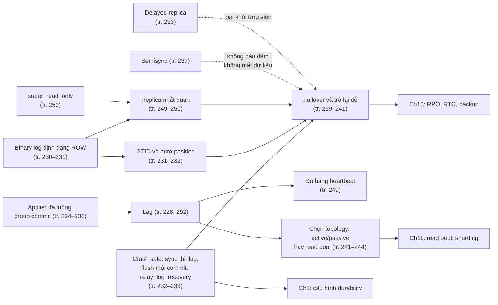

### Điều cần nhớ

1. Replication MySQL mặc định **bất đồng bộ**; lag **không có cận trên** (tr. 228). Mọi thiết kế đọc từ replica phải chịu được dữ liệu cũ (tr. 243, 252).
2. Replication scale **đọc**, không scale **ghi**: mỗi replica làm lại mọi lần ghi (tr. 228). Ghi vượt sức thì sharding (tr. 253).
3. Dùng **ROW** (tr. 231). Statement-based với câu không tất định có thể lệch **mà không báo lỗi** (tr. 230, 250; đã đo).
4. **Luôn bật GTID** và dùng `SOURCE_AUTO_POSITION=1` (tr. 232); nó làm việc trỏ lại sau failover trở nên đơn giản (tr. 240).
5. Crash safety: `innodb_flush_log_at_trx_commit=1`, `sync_binlog=1`, vị trí replication trong bảng, `relay_log_recovery=ON` (tr. 232–233). Trên 8.0.42 chỉ cái cuối là phải tự bật (đã đo).
6. Replica luôn chạy `super_read_only`, kể cả source cũ khi quay lại sau failover (tr. 240, 250).
7. Semisync thêm latency cho mọi commit và **rơi về bất đồng bộ** khi hết timeout; đừng dựa vào nó cho toàn vẹn dữ liệu (tr. 237; đã đo).
8. Đừng tin `Seconds_Behind_Source`; đo lag bằng **heartbeat** (tr. 248–249).
9. Failover ngoài kế hoạch không biết chắc thiếu bao nhiêu dữ liệu; đôi khi **chờ** tốt hơn (tr. 240–241).
10. Giữ topology **đơn giản**: active/passive hoặc active/read pool; tránh active-active, ring, filter lâu dài (tr. 241, 244–247, 255).

### Dấu hiệu nhận diện trong thực tế

| Dấu hiệu | Nghĩ tới | Trang |
| --- | --- | --- |
| `Seconds_Behind_Source` là `NULL` | Một replication thread không chạy; xem `Replica_IO_Running`, `Replica_SQL_Running`, lỗi gần nhất | tr. 248 |
| `Seconds_Behind_Source` nhảy vọt rồi về 0 ngay | Transaction dài trên source (nhất là với applier một luồng) | tr. 249 |
| Người dùng không thấy dữ liệu vừa ghi | Đọc từ replica có lag; chuyển luồng đó về source hoặc depool replica | tr. 241, 243 |
| Trên source chỉ thấy một trong hai replica kết nối | Hai replica cùng server ID | tr. 251 |
| `START REPLICA` báo lỗi 1200 | `server_id` chưa đặt (bằng 0) | tr. 252 |
| SQL thread dừng với lỗi 1032 hay 1062 | Replica đã lệch trước đó (ghi nhầm, statement không tất định, failover mất transaction) | tr. 249–250 |
| Đĩa replica đầy dần trong lúc lag | Relay log tồn đọng | tr. 254 |
| `Rpl_semi_sync_source_status = OFF` | Semisync đã rơi về bất đồng bộ; không còn bảo đảm có bản sao thứ hai | tr. 237 |
| Thêm worker mà lag không giảm | Workload ghi tuần tự hay transaction khổng lồ; xem mức bận từng worker | tr. 235–236 |

### Câu hỏi còn mở

- Sách không nói cách đo **thời gian bắt kịp** dự kiến (tr. 249 chỉ nói nó phụ thuộc sức replica và lượng ghi). Có thể ước lượng từ tốc độ áp dụng GTID mỗi giây so với tốc độ sinh GTID trên source không? (Ghi chú chưa thử.)
- `binlog_transaction_dependency_tracking=WRITESET` giúp được bao nhiêu cho workload tuần tự như job đêm ở [tình huống 3](#th3)? Ghi chú chưa đo.
- Với hai replica cùng server ID trên 8.0.42, thí nghiệm không thấy "đánh nhau". Điều kiện nào (non-GTID, `SOURCE_HEARTBEAT_PERIOD`, kết nối lại) thì hành vi sách mô tả xuất hiện?
- Khi `max_allowed_packet` lệch, `Seconds_Behind_Source` có thực sự báo 0 như sách nói (tr. 248) trên 8.0.42 không? Chưa tái hiện.
- Sách không bàn cách tự động hóa phát hiện errant transaction hay cách xử lý chúng; quy trình chuẩn của một đội nên như thế nào?

---

## Ghi chú kiểm tra nguồn

### Đối chiếu mục lục (bookmark của PDF)

| Mục trong sách | Trang in | Mục ghi chú |
| --- | --- | --- |
| Replication Overview | 227 | [2.1](#s2-1) |
| How Replication Works | 229 | [2.1.1](#s2-1-1) |
| Replication Under the Hood | 230 | [2.2](#s2-2) |
| Choosing Replication Format | 230 | [2.2.1](#s2-2-1) |
| Global Transaction Identifiers | 231 | [2.2.2](#s2-2-2) |
| Making Replication Crash Safe | 232 | [2.2.3](#s2-2-3) |
| Delayed Replication | 233 | [2.2.4](#s2-2-4) |
| Multithreaded Replication | 234 | [2.2.5](#s2-2-5) |
| Semisynchronous Replication | 237 | [2.2.6](#s2-2-6) |
| Replication Filters | 237 | [2.2.7](#s2-2-7) |
| Replication Failover | 239 | [2.3](#s2-3) |
| Planned Promotions | 239 | [2.3.1](#s2-3-1) |
| Unplanned Promotions | 240 | [2.3.2](#s2-3-2) |
| Trade-Offs of Promotion | 240 | [2.3.3](#s2-3-3) |
| Replication Topologies | 241 | [2.4](#s2-4) |
| Active/Passive | 241 | [2.4.1](#s2-4-1) |
| Active/Read Pool | 242 | [2.4.2](#s2-4-2) |
| Discouraged Topologies | 244 | [2.4.3](#s2-4-3) |
| Replication Administration and Maintenance | 247 | [2.5](#s2-5) |
| Monitoring Replication | 247 | [2.5.1](#s2-5-1) |
| Measuring Replication Lag | 248 | [2.5.2](#s2-5-2) |
| Determining Whether Replicas Are Consistent with the Source | 249 | [2.5.3](#s2-5-3) |
| Replication Problems and Solutions | 251 | [2.6](#s2-6) |
| Binary Logs Corrupted on the Source | 251 | [2.6.1](#s2-6-1) |
| Nonunique Server IDs | 251 | [2.6.2](#s2-6-2) |
| Undefined Server IDs | 252 | [2.6.3](#s2-6-3) |
| Missing Temporary Tables | 252 | [2.6.4](#s2-6-4) |
| Not Replicating All Updates | 252 | [2.6.5](#s2-6-5) |
| Excessive Replication Lag | 252 | [2.6.6](#s2-6-6) |
| Oversized Packets from the Source | 254 | [2.6.7](#s2-6-7) |
| No Disk Space | 254 | [2.6.8](#s2-6-8) |
| Replication Limitations | 254 | [2.6.9](#s2-6-9) |
| Summary | 255 | [2.7](#s2-7) |

Các mục con của Discouraged Topologies (dual source active-active, active-passive, dual sources with replicas, ring, multisource; không có bookmark riêng) và các mục Configuration, Redundancy, Caveats trong Active/Passive và Active/Read Pool được viết thành đoạn in đậm.

### Hình, bảng, listing đã xem trên ảnh trang

- PDF 249 (tr. 227): trang mở đầu và hộp "A Note on Terminology".
- PDF 252 (tr. 230): **Hình 9-1** → vẽ lại ở [2.1.1](#s2-1-1).
- PDF 254 (tr. 232): ví dụ GTID và chú thích 3.
- PDF 256–257 (tr. 234–235): **Hình 9-2** và hộp "What Is a Binary Log Group Commit?".
- PDF 258 (tr. 236): listing Performance Schema và output sáu worker; chú thích 4.
- PDF 260 (tr. 238): **Hình 9-3** → vẽ lại ở [2.2.7](#s2-2-7).
- PDF 262 (tr. 240): các bước promotion, chú thích 6.
- PDF 263, 265 (tr. 241, 243): **Hình 9-4, 9-5** → vẽ lại ở [2.4](#s2-4).
- PDF 266–269 (tr. 244–247): **Hình 9-6 đến 9-10** → vẽ lại ở [2.4.3](#s2-4-3). Hình 9-9 có chiều mũi tên: source trên trái → source dưới → source trên phải → source trên trái.
- PDF 274 (tr. 252): listing lỗi 1200 và ví dụ `USE test` / `UPDATE sakila.actor`.

### Lỗi trích xuất và điểm cần lưu ý trong bản in

- **Listing tr. 236 thiếu `SELECT`** trước danh sách cột (đã xác nhận trên ảnh PDF 258, không phải lỗi trích xuất).
- **Hình 9-2 (tr. 234)** vẽ nhiều đường giữa I/O thread và binary log, trong khi chữ nói song song ở SQL applier thread. Ghi chú theo chữ.
- **Tr. 254** gọi biến cấu hình là `relay_log_space`; biến thực trên 8.0.42 là `relay_log_space_limit`.
- **Tr. 240** bước 7 viết `AUTO_POSITION=1`, còn chú thích 3 (tr. 232) viết đầy đủ `SOURCE_AUTO_POSITION = 1`; tên tùy chọn trong `CHANGE REPLICATION SOURCE TO` là `SOURCE_AUTO_POSITION`.
- Chữ trích xuất ngắt dòng trong tên lệnh (`CHANGE REPLICA TION SOURCE TO` ở tr. 233, `Seconds_ behind_ source` ở tr. 253) và viết thường `Seconds_behind_source` ở tr. 248–249; tên cột thực là `Seconds_Behind_Source`.
- Chữ trích xuất của các hình chỉ có chú thích hình; nội dung hình được đọc từ ảnh trang.

### Điều kiện phiên bản

- Cú pháp `REPLICA`, `SOURCE` và biến `replica_*`: MySQL 8.0.22–8.0.26 trở lên (**Bổ sung ngoài sách**). Bản cũ dùng `SLAVE`, `MASTER`.
- GTID có từ 5.6 (tr. 231). Group commit thay đổi qua 5.0, 5.6, 5.7 (tr. 234–235).
- Mặc định đo trên 8.0.42: `binlog_format=ROW`, `sync_binlog=1`, `innodb_flush_log_at_trx_commit=1`, `relay_log_info_repository=TABLE` (deprecated), `relay_log_recovery=OFF`, `replica_parallel_workers=4`, `replica_parallel_type=LOGICAL_CLOCK` (deprecated), `replica_preserve_commit_order=ON`, `log_replica_updates=ON`, `server_id=1`, `rpl_semi_sync_source_wait_point=AFTER_SYNC`.
- Hành vi `Seconds_Behind_Source` với transaction dài khác nhau giữa applier một luồng và đa luồng (đã đo trên 8.0.42).

### Nội dung Bổ sung ngoài sách trong ghi chú

Tên lệnh theo phiên bản; receiver/applier/dump thread; two-phase commit nội bộ giữa binlog và InnoDB; `binlog_row_image`; DDL luôn ghi dạng câu lệnh; `GTID_SUBTRACT`, `GTID_SUBSET`, `WAIT_FOR_EXECUTED_GTID_SET`, `START REPLICA UNTIL SQL_BEFORE_GTIDS`; errant transaction; `last_committed` và `sequence_number`; WRITESET; "Gaps"; mặc định của 8.0.27; `AFTER_SYNC`; bảng Performance Schema cho replication; giả thuyết về cách tính `Seconds_Behind_Source`; `pt-table-checksum`, `CHECKSUM TABLE`; liên kết DDIA chương 5; phép tính năng lực ở tình huống 4.

### Trạng thái thực hành

Năm thí nghiệm đã chạy trên MySQL 8.0.42 với ba instance riêng (cổng 3319, 3333, 3334); xem [experiments/chapter-09.md](experiments/chapter-09.md). Các phần cần Percona Toolkit, hành vi `max_allowed_packet` lệch, hết đĩa, multisource và ring **chưa thực thi**.
