# Chương 10 — Sao lưu và phục hồi

*Backup and Recovery*

> **Nguồn:** *High Performance MySQL: Proven Strategies for Operating at Scale*, Silvia Botros và Jeremy Tinley, O'Reilly, **Fourth Edition (11/2021)**, Chương 10, **tr. 257–286 (trang PDF 279–308)**. Chương 11 bắt đầu ở tr. 287.
> "tr. N" là số trang in; trang PDF = N + 22 (xem [README](README.md#page-convention)).
>
> **Quy ước nhãn:**
> - Nội dung không nhãn là diễn giải từ sách, luôn kèm số trang.
> - **Bổ sung ngoài sách** là kiến thức thêm hoặc phép tính tự làm.
> - **Ví dụ minh họa do AI xây dựng** là ví dụ, dữ liệu, SQL hay tình huống giả định.
> - **Dự đoán** là điều kỳ vọng nhưng chưa đo.
> - **Kết quả đã đo** chỉ dùng cho số liệu từ [bài thực hành](experiments/chapter-10.md) đã chạy thật trên MySQL 8.0.42, Windows 11, hai instance riêng (cổng 3320 và 3335).
>
> **Phiên bản.** Sách viết cho giai đoạn MySQL 8.0. Ví dụ XtraBackup trong sách là bản 8.0.25-17 chạy trên server "8.0.25-15" (tr. 278). Những chỗ phụ thuộc phiên bản được nêu tại chỗ, nổi bật là: `expire_logs_days` (tr. 261) đã deprecated trong 8.0, thay bằng `binlog_expire_logs_seconds` (chính sách dùng biến này ở tr. 269); `mysqldump --master-data` đổi tên thành `--source-data` từ 8.0.26; `mysqlpump` deprecated từ 8.0.34; clone plugin có từ 8.0.17. Các mốc phiên bản này là **Bổ sung ngoài sách**, không có trong chương.
>
> **Liên kết:** [Roadmap chương 10](learning-roadmap.md#ch10) · [Thực hành](experiments/chapter-10.md) · [Đáp án tự kiểm tra](answers/chapter-10.md)

## Mục lục ghi chú

- [1. Bức tranh lớn](#big-picture)
- [2. Giải thích sâu](#deep)
  - [2.0 Mở đầu chương: phạm vi và thuật ngữ (tr. 257–258)](#s2-0)
  - [2.1 Why Backups? (tr. 258–259)](#s2-1)
  - [2.2 Defining Recovery Requirements (tr. 259–260)](#s2-2)
  - [2.3 Designing a MySQL Backup Solution (tr. 260–268)](#s2-3)
    - [2.3.1 Online or Offline Backups? (tr. 261–262)](#s2-3-1)
    - [2.3.2 Logical or Raw Backups? (tr. 263–265)](#s2-3-2)
    - [2.3.3 What to Back Up (tr. 265–266)](#s2-3-3)
    - [2.3.4 Incremental and Differential Backups (tr. 266–268)](#s2-3-4)
    - [2.3.5 Replication (tr. 268)](#s2-3-5)
  - [2.4 Managing and Backing Up Binary Logs (tr. 269)](#s2-4)
  - [2.5 Backup and Recovery Tools (tr. 269–270)](#s2-5)
    - [2.5.1 MySQL Enterprise Backup (tr. 269)](#s2-5-1)
    - [2.5.2 Percona XtraBackup (tr. 270)](#s2-5-2)
    - [2.5.3 mydumper (tr. 270)](#s2-5-3)
    - [2.5.4 mysqldump (tr. 270)](#s2-5-4)
  - [2.6 Backing Up Data (tr. 270–281)](#s2-6)
    - [2.6.1 Logical SQL Backups (tr. 270–272)](#s2-6-1)
    - [2.6.2 Filesystem Snapshots (tr. 272–277)](#s2-6-2)
    - [2.6.3 Percona XtraBackup (tr. 278–281)](#s2-6-3)
  - [2.7 Recovering from a Backup (tr. 281–286)](#s2-7)
    - [2.7.1 Restoring Logical Backups (tr. 282–283)](#s2-7-1)
    - [2.7.2 Restoring Raw Files from Snapshot (tr. 283–284)](#s2-7-2)
    - [2.7.3 Restoring with Percona XtraBackup (tr. 284–285)](#s2-7-3)
    - [2.7.4 Starting MySQL After Restoring Raw Files (tr. 285–286)](#s2-7-4)
  - [2.8 Summary (tr. 286)](#s2-8)
- [3. Phân tích tình huống](#situations)
- [4. Đo lường và thực hành](#measure)
- [5. Liên kết kiến thức và điều cần nhớ](#takeaways)
- [Ghi chú kiểm tra nguồn](#kiem-tra)

---

## 1. Bức tranh lớn

### Câu hỏi của chương

Khi có chuyện xấu xảy ra, bạn có lấy lại được dữ liệu **trong mức mất mát và thời gian mà doanh nghiệp chấp nhận** không? "Chuyện xấu" ở đây trải dài từ đĩa hỏng, một bug làm hỏng dữ liệu, một lệnh `DROP TABLE` gõ nhầm server, tới kẻ tấn công hay cả tòa nhà cháy (tr. 258).

Chương mở bằng hai cảnh báo (tr. 257):

- **Backup phải được lên kế hoạch từ đầu.** Nếu dựng server rồi mới muốn chụp snapshot filesystem bằng LVM thì đã muộn (**Bổ sung ngoài sách:** volume chứa dữ liệu phải được tạo bằng LVM, và volume group phải chừa chỗ trống, ngay từ lúc dựng; xem điều kiện ở tr. 274). Cấu hình hệ thống cho backup cũng có thể có tác động hiệu năng mà bạn không để ý.
- **Phục hồi phải được luyện tập.** Không luyện thì đến lúc cần, quá trình phục hồi sẽ không trơn tru.

Câu hỏi thật sự của chương vì vậy không phải "chạy lệnh backup nào", mà là: **thiết kế một hệ thống backup sao cho phục hồi được, đúng yêu cầu, và đã được chứng minh bằng diễn tập.** Summary nói gọn: ai cũng biết cần backup, nhưng không phải ai cũng nhận ra mình cần backup **phục hồi được** (tr. 286).

### Vị trí trong mục tiêu chung của sách

Sách muốn người đọc ra quyết định có hiểu biết về cách vận hành MySQL ở quy mô lớn (Preface, tr. xvi). Chương 10 là mảnh "an toàn dữ liệu" đi cặp với chương 9 (replication). Hai chương hay bị nhầm vào nhau: replication giữ **bản sao đang sống** để chịu lỗi phần cứng và scale đọc; backup giữ **bản sao ở các thời điểm trong quá khứ** để chịu cả lỗi logic như xóa nhầm. Sách nhấn mạnh nhiều lần rằng replica **không phải** backup (tr. 260, 268, 286).

Chương cũng nối với mạch "đo và đặt mục tiêu" của chương 2: RPO và RTO được sách so sánh trực tiếp với SLO (tr. 260), và chương 2 đã khuyên theo dõi thời gian restore như một chỉ số dài hạn (tr. 34–35).

### Kiến thức cần biết trước

| Kiến thức | Vì sao cần | Ở đâu |
| --- | --- | --- |
| Redo log và crash recovery của InnoDB | XtraBackup và snapshot không khóa đều dựa vào crash recovery để biến bản copy "lệch thời điểm" thành bản nhất quán (tr. 258, 276, 278) | [Chương 1](chapter-01.md) (transaction logging, tr. 10; undo cũng được redo log, tr. 14), [Chương 5](chapter-05.md#s2-5) |
| Binary log, GTID, delayed replication | Point-in-time recovery là "restore backup rồi phát lại binlog" (tr. 261, 269); backup từ replica nên dùng GTID (tr. 268) | [Chương 9](chapter-09.md) |
| MVCC và consistent read | **Bổ sung ngoài sách:** cần để hiểu vì sao `mysqldump --single-transaction` cho bản dump nhất quán mà không khóa | [Chương 1](chapter-01.md#mvcc) |
| `sync_binlog`, `innodb_flush_log_at_trx_commit`, `super_read_only` | Snapshot không khóa đòi hỏi chế độ "full ACID" (tr. 276); replica dùng để backup phải bật `super_read_only` (tr. 268, 286) | [Chương 5](chapter-05.md#safety-table) (tr. 122), [Chương 9](chapter-09.md) |
| Linux cơ bản: LVM, mount, `vmstat`, `iostat` | Phần filesystem snapshot dùng LVM làm ví dụ (tr. 273–277) | [Chương 4](chapter-04.md#s2-7) (tr. 88) |

### Liên hệ với các chương khác

| Ý trong chương 10 | Chương | Căn cứ |
| --- | --- | --- |
| RPO, RTO giống SLO: mất bao nhiêu dữ liệu và chờ bao lâu thì chấp nhận được | [Chương 2](chapter-02.md) | tr. 260; chương 2 tr. 34–35 khuyên theo dõi thời gian tạo và restore backup |
| InnoDB hỗ trợ backup "nóng" thật sự; MEB và XtraBackup | [Chương 1](chapter-01.md#s2-7) | chương 1 tr. 17 hẹn bàn chi tiết ở chương 10 |
| Backup từ replica nên dùng GTID; delayed replica để cứu `DROP TABLE` | [Chương 9](chapter-09.md) | tr. 268 (nhắc "Delayed Replication", tr. 233) |
| Replica có thể lệch dữ liệu; `pt-table-checksum`; `super_read_only` | [Chương 9](chapter-09.md#replica-consistency), [Chương 5](chapter-05.md#safety-table) | tr. 268, 286; chương 5 tr. 122 |
| Hạ durability trên replica dùng để backup có thể làm backup không phục hồi được | [Chương 9](chapter-09.md#excessive-lag) | chương 9 tr. 253 (chú thích 7 nhắc LVM và snapshot đĩa cloud) |
| Replication filter làm point-in-time recovery không còn khả thi | [Chương 9](chapter-09.md#replication-filters) | chương 9 tr. 238 |
| RAID không thay được backup | [Chương 4](chapter-04.md#raid-monitoring) | tr. 260; chương 4 tr. 82 |
| Doublewrite buffer và log file ảnh hưởng dung lượng snapshot; `innodb_file_per_table` | [Chương 5](chapter-05.md#s2-5-3) | tr. 277, 284; chương 5 tr. 116 |
| `SYSDATE()` không tất định có thể làm PITR không đáng tin | [Chương 5](chapter-05.md#safety-table) | chương 5 tr. 122 (`sysdate_is_now`) |
| Snapshot đĩa cloud, tự backup trên VM | [Chương 12](chapter-12.md#disk-snapshot) | chương 12 tr. 321 |
| Backup và kiểm thử backup là một kiểm soát compliance | [Chương 13](chapter-13.md#backup-restore) | chương 13 tr. 338–339 |
| Hạ cấp phiên bản chỉ bằng cách restore backup trước khi nâng cấp; snapshot làm đường lui khi nâng cấp | [Phụ lục A](appendix-a.md#downgrade) | phụ lục A tr. 345; tr. 273 |

### Mạch lập luận

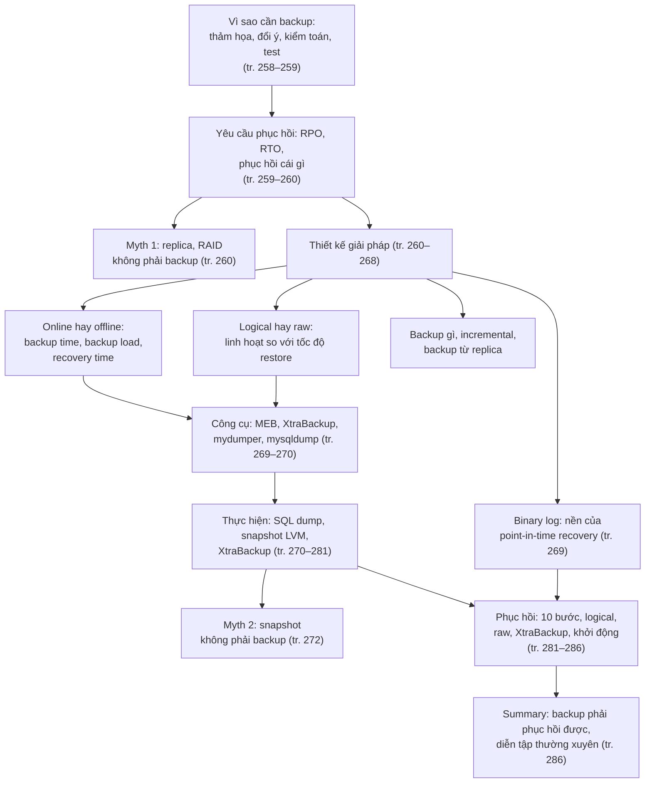

---

## 2. Giải thích sâu

### 2.0 Mở đầu chương: phạm vi và thuật ngữ (tr. 257–258)

Phần mở đầu không có tên mục trong mục lục, nhưng định nghĩa những thuật ngữ cả chương dùng, nên được ghi chú riêng ở đây.

**Phạm vi** (tr. 257). Chương chỉ bàn những phần **riêng của MySQL**. Sách liệt kê các phần vẫn phải có trong chiến lược tổng thể nhưng không bàn:

- bảo mật: ai được truy cập backup, ai có quyền restore, có cần mã hóa file không;
- nơi lưu backup: cách nguồn bao xa (đĩa khác, server khác, offsite) và cách chuyển dữ liệu tới đó;
- chính sách lưu giữ (*retention*), kiểm toán, yêu cầu pháp lý;
- giải pháp và phương tiện lưu trữ, nén, incremental backup;
- định dạng lưu trữ;
- giám sát và báo cáo về backup;
- khả năng backup có sẵn ở tầng lưu trữ hay thiết bị (ví dụ file server dựng sẵn).

> **Bổ sung ngoài sách (quan sát).** Danh sách loại trừ có "incremental backups", nhưng chương vẫn bàn incremental ở mức thiết kế (tr. 266–268). Có thể hiểu là sách không bàn chi tiết cơ chế lưu trữ incremental, còn quyết định có dùng incremental hay không thì vẫn bàn.

**Hot, warm, cold** (tr. 257–258). Người ta hay gọi backup là *hot*, *warm*, *cold* để chỉ **mức tác động**: "hot" lẽ ra không cần downtime. Nhưng mỗi người hiểu một kiểu, và có công cụ mang chữ "hot" trong tên mà không làm điều tác giả coi là hot backup. Vì vậy sách **tránh** các từ này và mô tả trực tiếp **mỗi kỹ thuật làm gián đoạn server tới mức nào**. Ghi chú này theo cách đó.

**Restore và recover** (tr. 258).

- ***Restore*** (khôi phục dữ liệu): lấy dữ liệu từ backup rồi **nạp vào MySQL**, hoặc **đặt file vào chỗ MySQL cần**.
- ***Recovery*** (phục hồi): **toàn bộ quá trình** cứu hệ thống hay một phần hệ thống sau sự cố. Gồm restore, cộng mọi bước để server hoạt động đầy đủ trở lại: khởi động lại MySQL, đổi cấu hình, làm ấm cache của server, v.v.

**Crash recovery không phải là recovery** (tr. 258). Nhiều người nghĩ recovery chỉ là sửa bảng hỏng sau crash. ***Crash recovery*** của storage engine đối chiếu datafile với logfile: bảo đảm datafile chỉ chứa thay đổi của transaction **đã commit**, và phát lại từ logfile những transaction chưa được áp vào datafile. Crash recovery có thể là **một phần** của recovery, thậm chí là một phần của **quá trình backup** (đây là gợi ý trước cho XtraBackup ở tr. 270, 278 và snapshot không khóa ở tr. 276). Nhưng nó không phải loại recovery bạn cần sau một lệnh `DROP TABLE` vô tình. Tùy sự cố, các bước phục hồi có thể khác nhau rất xa.

> **Bổ sung ngoài sách.** Với InnoDB, crash recovery có hai pha: (1) *roll forward*: đọc redo log từ checkpoint gần nhất và áp lại các thay đổi chưa kịp ghi xuống data page; (2) *roll back*: dùng undo log để hủy những transaction chưa commit tại lúc crash. Một `DROP TABLE` đã commit là một thay đổi **hợp lệ** đối với crash recovery, nên crash recovery sẽ trung thành giữ nó. Muốn lấy lại bảng, bạn cần một bản sao **ở thời điểm trước** lệnh đó, tức là backup.

**Raw và logical** (tr. 258). Hai loại backup chính:

- ***Raw backup***: bản sao **file** từ filesystem. Còn gọi là *physical backup*; chú thích 1 (tr. 258) nói tác giả thấy chữ "physical" phản trực giác, vì bản thân file chẳng có gì "vật lý".
- ***Logical backup***: các **câu SQL** cần để dựng lại dữ liệu.

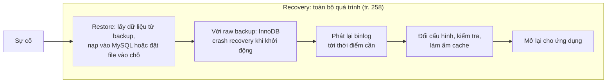

*(Sơ đồ do người viết ghi chú dựng từ định nghĩa ở tr. 258 và danh sách bước ở tr. 281. Không phải sự cố nào cũng cần đủ các bước.)*

**Hiểu lầm phổ biến.**

- "Công cụ ghi là hot backup thì không ảnh hưởng gì tới server." Sách cố tình bỏ cách gọi này vì nó không có nghĩa thống nhất (tr. 257–258). Hãy hỏi cụ thể: công cụ giữ lock gì, bao lâu, tốn bao nhiêu I/O và CPU.
- "Restore xong là phục hồi xong." Restore chỉ là một bước; thời gian làm ấm cache, kiểm tra và mở lại cho ứng dụng cũng nằm trong thời gian phục hồi (tr. 258).

#### Tự kiểm tra 2.0

- **Câu 2.0.1.** Phân biệt *restore* và *recovery* theo định nghĩa của sách. Cho hai ví dụ bước thuộc recovery nhưng không thuộc restore. [đáp án](answers/chapter-10.md#q2-0-1)
- **Câu 2.0.2.** Vì sao InnoDB crash recovery không cứu được một `DROP TABLE` vô tình, dù nó "phục hồi" được dữ liệu sau khi server sập? [đáp án](answers/chapter-10.md#q2-0-2)
- **Câu 2.0.3.** Sách tránh các từ hot, warm, cold. Nếu đồng nghiệp nói "công cụ X làm hot backup", bạn sẽ hỏi lại những câu gì để biết mức gián đoạn thật? [đáp án](answers/chapter-10.md#q2-0-3)
- **Câu 2.0.4.** Sách lấy LVM làm ví dụ cho một lựa chọn phải có từ lúc dựng server. Vì sao đến lúc cần snapshot mới thêm LVM là "quá muộn"? [đáp án](answers/chapter-10.md#q2-0-4)

### 2.1 Why Backups? (tr. 258–259)

Sách nêu bốn lý do (tr. 258–259):

| Lý do | Sách mô tả | Yêu cầu phục hồi điển hình (**Bổ sung ngoài sách**) |
| --- | --- | --- |
| ***Disaster recovery*** | Phần cứng hỏng, bug nghiêm trọng làm hỏng dữ liệu, server hay dữ liệu không dùng được. Từ người kết nối nhầm server rồi chạy `ALTER TABLE`, tới cháy tòa nhà, kẻ tấn công, bug của MySQL. Xác suất từng loại thấp, nhưng **cộng lại** thì đáng kể | Toàn bộ server, thường ở nơi khác |
| Người ta đổi ý | Xóa dữ liệu **cố ý** rồi lại muốn lấy lại; sách nói điều này xảy ra thường hơn bạn nghĩ | Một bảng, vài hàng, ở một thời điểm cụ thể |
| Kiểm toán (*auditing*) | Cần biết dữ liệu hay schema **trông thế nào ở một thời điểm trong quá khứ**: vụ kiện, hay một bug ứng dụng mà chỉ có code trong version control là chưa đủ | Trạng thái quá khứ, có thể rất cũ, dựng ở môi trường riêng |
| Kiểm thử | Cách dễ nhất để test trên dữ liệu thật là định kỳ làm mới test server bằng dữ liệu production; có backup thì chỉ cần restore vào đó | Toàn bộ dữ liệu, đều đặn |

**Kiểm tra giả định của bạn** (tr. 259). Bạn có nghĩ nhà cung cấp shared hosting đang backup MySQL của mình không? Nhiều nhà cung cấp không backup MySQL; số khác chỉ **copy file khi server đang chạy**, và bản copy đó nhiều khả năng **hỏng, vô dụng**.

> **Bổ sung ngoài sách: vì sao copy file khi MySQL đang chạy lại hỏng.** InnoDB giữ các page đã sửa (*dirty page*) trong buffer pool và ghi xuống datafile dần dần; redo log mới là nơi có đủ thay đổi. Một lệnh copy thông thường đọc từng file ở **thời điểm khác nhau**, có thể đọc một page đang được ghi dở, và lấy redo log ở thời điểm không khớp với datafile. Khi khởi động từ bản copy đó, crash recovery có thể thất bại hoặc cho ra dữ liệu sai mà không báo. Khác biệt với XtraBackup (tr. 270) là XtraBackup **chép redo log song song** suốt quá trình copy và dùng LSN để biết phải phát lại từ đâu; khác biệt với snapshot (tr. 272) là snapshot đóng băng **mọi file tại cùng một khoảnh khắc**.

**Hiểu lầm phổ biến.** "Lý do chính để backup là phần cứng hỏng." Bảng trên cho thấy ba trong bốn lý do là **lỗi của con người hoặc nhu cầu nghiệp vụ**, và chính những lý do này đòi khôi phục **một phần** dữ liệu ở **một thời điểm**, điều mà RAID hay replica không làm được (tr. 260).

#### Tự kiểm tra 2.1

- **Câu 2.1.1.** Một nhà cung cấp hosting nói họ "copy thư mục dữ liệu MySQL mỗi đêm, khi server vẫn chạy". Vì sao sách cho rằng backup này đáng ngờ? Trong điều kiện nào một bản copy file khi server chạy lại dùng được? [đáp án](answers/chapter-10.md#q2-1-1)
- **Câu 2.1.2.** Với mỗi lý do trong bốn lý do của sách, hãy nêu phạm vi cần khôi phục (toàn server, một database, một bảng, vài hàng) và mốc thời gian cần khôi phục. [đáp án](answers/chapter-10.md#q2-1-2)
- **Câu 2.1.3.** Vì sao "xác suất từng loại thảm họa rất thấp" không phải là lý do để bỏ qua backup? [đáp án](answers/chapter-10.md#q2-1-3)

### 2.2 Defining Recovery Requirements (tr. 259–260)

**Why: phục hồi khó hơn backup** (tr. 259–260). Nếu mọi việc ổn, bạn sẽ không bao giờ phải nghĩ tới phục hồi. Nhưng khi cần, hệ thống backup tốt nhất thế giới cũng vô ích nếu chưa từng thử phục hồi từ nó. Làm backup chạy trơn tru dễ hơn xây quy trình và công cụ phục hồi tốt, vì:

| Lý do của sách | Hệ quả | Cách bù (**Bổ sung ngoài sách**) |
| --- | --- | --- |
| Backup đến trước: không backup thì không có gì để phục hồi, nên sự chú ý tự nhiên dồn vào backup | Phục hồi bị xem là việc "sau này" | Đặt RTO ngay khi thiết kế backup, coi diễn tập phục hồi là một phần định nghĩa "xong" |
| Backup được tự động hóa bằng script và job; người ta tinh chỉnh từng chút | Mỗi chỉnh sửa 5 phút cho backup có được đối xứng cho phục hồi không? | Tự động hóa cả phục hồi, chạy định kỳ |
| Backup là thường nhật, phục hồi thường là **khủng hoảng** | Người làm phục hồi chịu áp lực, dễ sai | Runbook viết sẵn, đã chạy thử |
| Bảo mật cản đường: backup offsite được mã hóa | Không ai mở được volume mã hóa, hoặc phải lấy **một file** từ một file mã hóa khổng lồ | Kiểm tra quy trình lấy khóa và giải mã trong diễn tập |
| Một người thiết kế và triển khai backup | Người đó có thể **vắng mặt** đúng lúc sự cố | Đào tạo nhiều người, phân công dự phòng |

**What: RPO và RTO** (tr. 260). Hai "yêu cầu lớn" khi lập chiến lược backup và phục hồi:

- ***Recovery point objective (RPO)***: bạn chấp nhận **mất bao nhiêu dữ liệu**.
- ***Recovery time objective (RTO)***: bạn chấp nhận **chờ bao lâu** để lấy lại dữ liệu.

Sách nhận xét chúng nghe rất giống SLO ở chương 2. Câu hỏi nên trả lời khi đặt RPO và RTO (tr. 260):

1. Mất bao nhiêu dữ liệu thì chưa gây hậu quả nghiêm trọng? Có cần ***point-in-time recovery*** (PITR, phục hồi về một thời điểm bất kỳ) không, hay mất phần việc từ lần backup gần nhất là chấp nhận được? Có yêu cầu pháp lý không?
2. Phục hồi phải nhanh đến đâu? Downtime nào chấp nhận được? Ứng dụng và người dùng chịu được tác động nào (ví dụ chỉ mất một phần chức năng), và bạn sẽ xây khả năng tiếp tục chạy trong các kịch bản đó ra sao?
3. Cần phục hồi **cái gì**? Thường là cả server, một database, một bảng, hay chỉ vài transaction hoặc câu lệnh cụ thể.

Nên **ghi lại** câu trả lời, cùng toàn bộ chính sách backup và quy trình backup (tr. 260).

**How: RPO và RTO trong MySQL thực sự gồm những gì** (**Bổ sung ngoài sách**).

- RPO thực tế phụ thuộc **loại sự cố**. Mất trọn server: RPO bằng khoảng dữ liệu kể từ bản backup và đoạn binlog **cuối cùng đã được chép ra khỏi máy** (sách nói: không chịu mất quá 30 phút thì sao lưu binlog ít nhất 30 phút một lần, tr. 269). Lỗi logic như `DROP TABLE` khi server vẫn sống: binlog trên máy còn nguyên, nên RPO có thể gần bằng 0 nếu bạn phát lại binlog tới ngay trước lệnh hỏng.
- RTO là **tổng** nhiều đoạn, không chỉ thời gian chạy lệnh restore:

*(Sơ đồ do người viết ghi chú dựng; các bước T3–T7 tương ứng danh sách 10 bước ở tr. 281. Phát hiện và quyết định thường bị quên khi ước lượng RTO.)*

> **Kết quả đã đo** (MySQL 8.0.42, Windows 11, laptop nhiều nhiễu, không phải benchmark production; [thí nghiệm 2](experiments/chapter-10.md#exp2)). Riêng đoạn T4 với một bảng 1 triệu hàng có 2 secondary index: dump mất khoảng 2,1 giây, nhưng nạp lại mất khoảng 22,5 giây (trung vị 3 lần). Tỷ lệ restore/dump khoảng 11 lần, đúng chiều với cảnh báo "backup vài giờ có thể restore nhiều tuần" của Summary (tr. 286), dù độ lớn ở đây nhỏ hơn nhiều.

**Backup Myth #1: "Replica của tôi là backup"** (hộp, tr. 260). Đây là lỗi sách gặp khá thường xuyên. Replica **không phải** backup; mảng RAID cũng không. Phép thử: nếu bạn vô tình chạy `DROP DATABASE` trên production, chúng có giúp lấy lại **toàn bộ** dữ liệu không? RAID và replication **không qua nổi** phép thử đơn giản này. Chúng không phải backup, và cũng **không thay thế** được backup. Chỉ có backup mới đáp ứng nhu cầu backup.

> **Bổ sung ngoài sách.** Lý do cơ chế: RAID nhân bản **từng block** và replica phát lại **từng thay đổi** của source, nên cả hai sao chép trung thành mọi lệnh hợp lệ, kể cả lệnh phá hoại. Chúng bảo vệ trước **mất thiết bị**, không bảo vệ trước **thay đổi sai**. [Thí nghiệm 3](experiments/chapter-10.md#exp3) cho thấy lệnh `DROP TABLE` nằm trong binlog như mọi transaction khác, với GTID riêng; một replica đọc binlog đó sẽ áp dụng nó. Delayed replica (tr. 268) chỉ cho bạn **một khoảng thời gian** để chặn lại, không thay đổi bản chất này.

**Decision.** Khi đặt RPO và RTO, hãy viết chúng **theo từng loại sự cố** (mất server, mất data center, xóa nhầm, bị tấn công), vì mỗi loại cần cơ chế khác nhau (**Bổ sung ngoài sách**, mở rộng từ câu hỏi "cần phục hồi cái gì" ở tr. 260).

**Hiểu lầm phổ biến.**

- "RPO bằng chu kỳ backup." Chỉ đúng khi không có binlog. Có binlog được sao lưu thường xuyên thì RPO nhỏ hơn chu kỳ backup nhiều (tr. 261, 269).
- "RTO bằng thời gian chạy lệnh restore." Thiếu phát hiện, chuẩn bị, phát lại binlog, kiểm tra, làm ấm cache (tr. 258, 281).

#### Tự kiểm tra 2.2

- **Câu 2.2.1.** Phân biệt RPO và RTO. Đại lượng nào bị chi phối chủ yếu bởi tần suất sao lưu binlog, đại lượng nào bởi tốc độ restore? [đáp án](answers/chapter-10.md#q2-2-1)
- **Câu 2.2.2.** Sách nêu năm lý do khiến làm backup dễ hơn xây quy trình phục hồi. Chọn ba lý do và đề xuất một biện pháp cụ thể cho mỗi lý do. [đáp án](answers/chapter-10.md#q2-2-2)
- **Câu 2.2.3.** Áp dụng phép thử `DROP DATABASE` cho: RAID 10, một replica bất đồng bộ, một replica trễ 1 giờ. Cái nào qua được, trong điều kiện nào? [đáp án](answers/chapter-10.md#q2-2-3)
- **Câu 2.2.4.** Yêu cầu "khôi phục đúng các đơn hàng bị xóa nhầm lúc 14:05" khác yêu cầu "khôi phục toàn server" ở điểm nào khi thiết kế backup? [đáp án](answers/chapter-10.md#q2-2-4)

### 2.3 Designing a MySQL Backup Solution (tr. 260–268)

**Why khó** (tr. 260). Ở mức cơ bản, backup chỉ là bản sao dữ liệu. Nhưng nhu cầu của ứng dụng, kiến trúc storage engine của MySQL và cấu hình hệ thống làm việc tạo bản sao trở nên khó.

**Bảy khuyến nghị trước khi đi vào chi tiết** (tr. 260–261):

| Khuyến nghị | Lý do và chi tiết |
| --- | --- |
| **Raw backup gần như bắt buộc với database lớn** | Logical backup quá chậm, quá tốn tài nguyên, và phục hồi từ nó **quá lâu**. Tốt nhất là backup dựa trên snapshot, Percona XtraBackup và MySQL Enterprise Backup. Database nhỏ thì logical backup vẫn ổn |
| Giữ **nhiều thế hệ** backup | Để vẫn phục hồi được khi bản mới nhất không dùng được (Summary nói rõ lý do này, tr. 286) |
| Định kỳ **trích logical backup**, có thể từ chính raw backup | Có logical backup cho lưu giữ dài hạn mà không làm nặng production lúc dump (tr. 265) |
| **Giữ binlog** cho point-in-time recovery | Đặt `expire_logs_days` đủ dài để phục hồi từ **ít nhất hai thế hệ raw backup**, nhờ đó có thể dựng replica từ backup rồi cho nó chạy theo source đang sống mà không phải tự áp binlog. Sao lưu binlog **độc lập** với thiết lập hết hạn, và giữ trong kho backup đủ lâu để phục hồi được từ ít nhất bản logical backup gần nhất |
| **Giám sát** backup và tiến trình backup **độc lập** với chính công cụ backup | Cần xác minh từ bên ngoài |
| **Thử** backup và quy trình phục hồi bằng cách **đi hết** quy trình phục hồi | Đo tài nguyên phục hồi cần: CPU, dung lượng đĩa, thời gian thực, băng thông mạng |
| Nghĩ kỹ về **bảo mật** | Kẻ chiếm được server có vào được backup server không, và ngược lại? |

> **Phiên bản (Bổ sung ngoài sách).** `expire_logs_days` đã deprecated trong MySQL 8.0; biến thay thế là `binlog_expire_logs_seconds`, chính là biến sách dùng ở tr. 269. **Kết quả đã đo:** trên instance 8.0.42 mới khởi tạo, `binlog_expire_logs_seconds = 2592000` (30 ngày). [Thí nghiệm 5](experiments/chapter-10.md#exp5) ghi lại cảnh báo khi đặt biến cũ.

**RPO và RTO dẫn đường** (tr. 261). Cần point-in-time recovery, hay phục hồi về bản backup tối qua và mất phần việc từ đó tới nay là đủ? Nếu cần PITR, cách thường dùng là: backup định kỳ, **bật binary log**, rồi khi cần thì restore backup và **phát lại binlog** tới thời điểm mong muốn. Nói chung, càng chấp nhận mất nhiều thì backup càng dễ; yêu cầu càng chặt thì càng khó bảo đảm phục hồi được mọi thứ.

**PITR "mềm" và "cứng"** (tr. 261).

- **Mềm:** muốn dựng lại dữ liệu "đủ gần" với trạng thái lúc xảy ra sự cố.
- **Cứng:** **không bao giờ** chấp nhận mất một transaction đã commit, kể cả khi điều khủng khiếp xảy ra (như server bốc cháy). Cần kỹ thuật đặc biệt, ví dụ đặt binlog trên một **SAN volume riêng**, hoặc sao chép đĩa bằng ***DRBD*** (*Distributed Replicated Block Device*).

> **Bổ sung ngoài sách.** Yêu cầu "cứng" có hai nửa. Nửa thứ nhất: transaction đã commit phải thực sự nằm trên đĩa của **máy nguồn**, tức cần `sync_binlog = 1` và `innodb_flush_log_at_trx_commit = 1` ([Chương 5](chapter-05.md#s2-5)). Nửa thứ hai: bản ghi đó phải **rời khỏi máy** trước khi máy cháy; SAN riêng và DRBD làm việc này ở tầng đĩa, còn semisynchronous replication ([Chương 9](chapter-09.md#semisync)) làm ở tầng MySQL. Cả ba chỉ chống **mất thiết bị**; với lỗi logic như `DROP TABLE`, bạn vẫn cần backup và binlog.

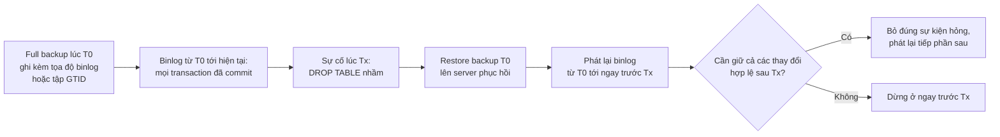

*(Sơ đồ do người viết ghi chú dựng từ tr. 261 và 269. Cách "bỏ đúng sự kiện hỏng" bằng `mysqlbinlog --stop-position` hay `--exclude-gtids` là **Bổ sung ngoài sách**, đã chạy ở [thí nghiệm 3](experiments/chapter-10.md#exp3).)*

#### 2.3.1 Online or Offline Backups? (tr. 261–262)

**Offline là dễ và an toàn nhất** (tr. 261–262). Nếu được phép, **tắt MySQL** để backup là cách dễ nhất, an toàn nhất, và nói chung tốt nhất để có bản sao nhất quán, ít rủi ro hỏng hay lệch. Tắt MySQL thì:

- không phải lo dirty buffer trong InnoDB buffer pool hay các cache khác;
- dữ liệu không bị sửa trong lúc bạn đang chép;
- server không chịu tải ứng dụng, nên backup **nhanh hơn**.

**Nhưng offline đắt hơn bạn tưởng** (tr. 262). Vì vậy gần như chắc chắn bạn phải thiết kế backup **không đòi tắt server production**. Và tùy yêu cầu nhất quán, backup online **vẫn có thể gián đoạn dịch vụ đáng kể**.

**Ba yếu tố hiệu năng khi lập kế hoạch** (tr. 262):

| Yếu tố | Câu hỏi |
| --- | --- |
| ***Backup time*** | Mất bao lâu để tạo backup và **chép tới đích**? |
| ***Backup load*** | Việc chép backup tới đích ảnh hưởng hiệu năng server bao nhiêu? |
| ***Recovery time*** | Mất bao lâu để chép backup từ nơi lưu về server MySQL, phát lại binlog, v.v.? |

**Trade-off lớn nhất: backup time so với backup load** (tr. 262). Thường cải thiện được cái này bằng cách hy sinh cái kia, ví dụ ưu tiên backup thì server chậm đi nhiều hơn.

**Tận dụng nhịp tải** (tr. 262). Nếu ban đêm server chỉ tải 50% trong tám giờ, hãy thiết kế backup sao cho nó tải server **dưới 50%** mà vẫn **xong trong tám giờ**. Các cách sách nêu:

- dùng `ionice` và `nice` để hạ độ ưu tiên của việc chép hay nén;
- đổi mức nén, hoặc **nén trên backup server** thay vì trên MySQL server;
- dùng `lzo` hay `pigz` để nén nhanh hơn;
- dùng `O_DIRECT` hay `fadvise()` để việc chép **bỏ qua cache của hệ điều hành**, khỏi làm bẩn cache của server;
- dùng tùy chọn **throttling** của XtraBackup hay MySQL Enterprise Backup; với script tự viết, dùng `pv --rate-limit`.

> **Ví dụ minh họa do AI xây dựng (phép tính).** Database 1,5 TB, cửa sổ đêm 8 giờ. Muốn xong trong cửa sổ, backup phải chép trung bình ít nhất 1,5 × 10¹² B / 28 800 s ≈ 52 MB/s. Nếu đĩa server chịu được 400 MB/s và tải ban đêm dùng một nửa, phần còn lại là 200 MB/s; giới hạn backup ở khoảng 80–100 MB/s vừa xong kịp vừa để dư cho ứng dụng. Nếu dữ liệu tăng gấp đôi, cùng giới hạn tốc độ đó sẽ không còn xong trong cửa sổ, và bạn phải đổi chiến lược (backup từ replica, incremental, hay nới giới hạn).

> **Kết quả đã đo: online vẫn có thể gián đoạn** ([thí nghiệm 1](experiments/chapter-10.md#exp1), MySQL 8.0.42, Windows 11, 2 bảng × 200 000 hàng, một luồng ghi chuyển tiền liên tục). Với tùy chọn mặc định của `mysqldump` (khóa bảng bằng `LOCK TABLES ... READ`), tốc độ cập nhật hàng của luồng ghi rơi từ khoảng 780–955 hàng/giây xuống 109–163 hàng/giây trong lúc dump. Với `--single-transaction`, tốc độ trong lúc dump vẫn ở 849–897 hàng/giây. Cả hai đều là backup "online", nhưng mức gián đoạn khác hẳn nhau.

#### 2.3.2 Logical or Raw Backups? (tr. 263–265)

**What** (tr. 263). ***Logical backup*** (còn gọi ***dump***) chứa dữ liệu ở dạng MySQL hiểu được, dưới dạng **SQL** hoặc **văn bản phân tách** (*delimited text*). ***Raw file*** là các file đúng như chúng nằm trên đĩa.

> Chú thích 2 (tr. 263). Logical backup của `mysqldump` **không phải lúc nào cũng là file văn bản**: có thể chứa nhiều bộ ký tự, thậm chí dữ liệu nhị phân không phải ký tự hợp lệ; dòng có thể dài quá sức nhiều trình soạn thảo. Dù vậy, phần lớn mở được bằng trình soạn thảo, nhất là khi chạy với `--hex-blob`.

**Ưu điểm của logical backup** (tr. 263):

1. Là file bình thường, xem và xử lý được bằng trình soạn thảo, `grep`, `sed`. Rất có ích khi restore, hay khi chỉ muốn xem dữ liệu mà không restore.
2. Restore đơn giản: đưa vào `mysql` qua pipe, hoặc dùng `mysqlimport`.
3. Backup và restore được **qua mạng**, tức trên máy khác máy chạy MySQL.
4. Dùng được với MySQL trên cloud, nơi bạn không truy cập được filesystem bên dưới.
5. Rất linh hoạt: `mysqldump` nhận nhiều tùy chọn, ví dụ mệnh đề `WHERE` để giới hạn hàng được backup.
6. **Độc lập storage engine**: dữ liệu được trích qua server nên che đi khác biệt lưu trữ bên dưới. Chú thích 3: dữ liệu thì độc lập, nhưng **tính năng** của engine thì không nhất thiết; ví dụ dump một database InnoDB có foreign key sang engine không hỗ trợ foreign key thì khóa ngoại không còn tác dụng.
7. Có thể giúp **tránh dữ liệu hỏng**: nếu ổ đĩa đang hỏng dần, chép raw file sẽ gặp lỗi hoặc cho ra bản sao một phần hay hỏng, và nếu không kiểm tra thì bạn không biết cho tới khi cần dùng. Nếu dữ liệu MySQL đang giữ trong bộ nhớ chưa hỏng, đôi khi vẫn lấy được logical backup đáng tin khi không lấy được bản raw tốt.

**Nhược điểm của logical backup** (tr. 264):

1. Server phải làm việc để sinh ra nó, nên tốn **CPU** hơn.
2. Có thể **lớn hơn** file gốc. Biểu diễn ASCII không phải lúc nào cũng hiệu quả bằng cách storage engine lưu: một số nguyên lưu 4 byte nhưng viết bằng ASCII có thể tới 12 ký tự. Nén thì nhỏ lại, nhưng tốn CPU hơn và **phục hồi lâu hơn**. Ngược lại, khi bảng có **nhiều index** thì logical backup thường nhỏ hơn raw. Chú thích 4: theo kinh nghiệm tác giả, logical thường nhỏ hơn raw, nhưng không phải luôn luôn.
3. Dump rồi restore **không chắc** cho ra đúng dữ liệu cũ: vấn đề biểu diễn số thực dấu phẩy động, bug, v.v., tuy hiếm.
4. Restore từ logical backup buộc MySQL phải nạp và **thông dịch câu lệnh**, chuyển sang định dạng lưu trữ, và **dựng lại index**: tất cả **rất chậm**.

Nhược điểm lớn nhất là chi phí dump dữ liệu ra khỏi MySQL và chi phí nạp lại qua câu SQL. Dùng logical backup thì **bắt buộc** phải thử xem restore mất bao lâu (tr. 264).

**Ưu điểm của raw backup** (tr. 264):

1. Chỉ cần chép file cần thiết đi nơi khác; không tốn công sinh thêm.
2. Rất **di động** giữa nền tảng, hệ điều hành và phiên bản MySQL (sách nói logical dump cũng vậy, chỉ nêu ra để bạn yên tâm).
3. Restore có thể **nhanh hơn** vì server không phải chạy SQL hay dựng index. Với bảng InnoDB **không vừa bộ nhớ**, restore raw có thể nhanh hơn **một bậc độ lớn hoặc hơn**. Một trong những điều đáng sợ nhất của logical backup là **thời gian restore không đoán trước được**.

**Nhược điểm của raw backup** (tr. 264–265):

1. File raw của InnoDB thường **lớn hơn nhiều** logical backup tương ứng: tablespace có nhiều chỗ trống, và khá nhiều chỗ dùng cho việc khác ngoài dữ liệu bảng (insert buffer, rollback segment, v.v.).
2. **Không phải lúc nào cũng** di động: phân biệt hoa thường trong tên file, định dạng số thực là chỗ có thể gặp rắc rối. Có thể không chuyển được file sang hệ thống có định dạng số thực khác (dù tuyệt đại đa số CPU dùng chuẩn IEEE).

> **Bổ sung ngoài sách (quan sát).** Tr. 264 nói raw backup "rất di động", tr. 265 lại nói "không phải lúc nào cũng di động". Hai câu không mâu thuẫn: nói chung là di động, nhưng có các trường hợp biên. Thêm một trường hợp biên quan trọng với MySQL 8.0: raw file **không chạy ngược phiên bản**; datadir đã nâng lên 8.0 (data dictionary mới) thì không mở được bằng 5.7. Đó là lý do [Phụ lục A](appendix-a.md#downgrade) nói muốn hạ cấp chỉ còn cách restore backup từ trước khi nâng cấp (phụ lục A tr. 345).

> Chú thích 5 (tr. 265). Raw backup có thể **dễ sai** hơn; khó có gì đơn giản hơn `mysqldump`.

**Lời khuyên của sách** (tr. 265). Raw backup nói chung dễ hơn và hiệu quả hơn nhiều. Nhưng **không nên** dựa vào raw backup cho lưu giữ dài hạn hay yêu cầu pháp lý; ít nhất phải định kỳ làm logical backup.

**Backup chưa thử thì chưa phải backup tốt** (tr. 265). Đừng coi backup, nhất là raw backup, là tốt cho tới khi đã thử. Với InnoDB nghĩa là: **khởi động một instance MySQL** trên file đó, để InnoDB recovery chạy, rồi chạy `CHECK TABLES`. Có thể bỏ bước này hay chỉ chạy `innochecksum` trên file, nhưng sách **không khuyên**.

**Cách phối hợp sách đề xuất** (tr. 265): tạo raw copy → khởi động instance MySQL trên dữ liệu đó và chạy `mysqlcheck` → ít nhất định kỳ, dump dữ liệu bằng `mysqldump` từ chính instance đó để có logical backup. Cách này có ưu điểm của cả hai mà không làm nặng production lúc dump. Đặc biệt tiện nếu có filesystem snapshot: chụp snapshot, chép snapshot sang server khác rồi giải phóng nó, sau đó kiểm tra raw file và làm logical backup ở server kia.

| Tiêu chí | Logical | Raw |
| --- | --- | --- |
| Ai làm việc khi backup | Server MySQL (đọc qua engine, gửi qua giao thức client/server) | Hệ điều hành chép file |
| Kích thước | Thường nhỏ hơn khi có nhiều index; có thể lớn hơn với nhiều cột số (tr. 264) | Gồm cả chỗ trống, undo, insert buffer (tr. 264) |
| Restore | Thông dịch SQL, dựng lại index; **khó đoán thời gian** | Chép file, crash recovery; nhanh hơn tới một bậc độ lớn khi dữ liệu lớn hơn bộ nhớ (tr. 264) |
| Phạm vi khôi phục | Dễ lấy một bảng, vài hàng (nhất là khi tách file theo bảng) | Thường cả instance; một bảng thì phải "import" (tr. 284) |
| Cloud managed | Dùng được | Thường không truy cập được file |
| Lưu giữ dài hạn, pháp lý | Nên có định kỳ (tr. 265) | Không nên dựa vào |

> **Kết quả đã đo** ([thí nghiệm 2](experiments/chapter-10.md#exp2), MySQL 8.0.42, Windows 11, dữ liệu tổng hợp, mỗi bảng có PK và 2 secondary index trừ bảng "không index"). File dump nhỏ hơn file `.ibd`: 1 triệu hàng có `.ibd` 140 MB nhưng dump 61,5 MB; bảng cùng dữ liệu không có secondary index có `.ibd` 80 MB, dump vẫn 61,5 MB. Như vậy chênh lệch lớn nhất đến từ **index** và chỗ trống trong page, đúng như ghi chú của sách về "nhiều index" (tr. 264). Thời gian restore logic bằng khoảng 11–16 lần thời gian dump ở mọi kích thước đã thử (trung vị 3 lần, xem bảng ở [mục 4](#measure)).

**Hiểu lầm phổ biến.**

- "Logical backup luôn nhỏ hơn." Sách nói thường nhỏ hơn nhưng không luôn luôn (chú thích 4, tr. 264); với bảng toàn cột số và ít index, ASCII có thể phình ra.
- "Raw luôn restore nhanh hơn." Lợi thế lớn nhất xuất hiện khi dữ liệu **không vừa bộ nhớ** (tr. 264); với database nhỏ, logical có thể vừa đủ nhanh, nên sách vẫn nói database nhỏ dùng logical ổn (tr. 261).

#### 2.3.3 What to Back Up (tr. 265–266)

Yêu cầu phục hồi quyết định cần backup gì. Chỉ backup dữ liệu và định nghĩa bảng là **mức tối thiểu**; để phục hồi một server dùng cho production thường cần nhiều hơn (tr. 265):

| Hạng mục | Nội dung |
| --- | --- |
| Dữ liệu dễ bị quên | **Binary log** và **InnoDB transaction log**. Lý tưởng nhất là backup **cả data directory cùng lúc** (tr. 265) |
| Code | MySQL hiện đại chứa nhiều code: trigger, stored procedure. Backup database `mysql` thì lấy được phần lớn code này, nhưng khi đó lại **khó restore trọn một database**, vì một phần "dữ liệu" của nó (stored procedure) nằm trong database `mysql` (tr. 265–266) |
| Cấu hình server | Khi phải dựng server từ đầu ở data center mới sau động đất, bạn sẽ mừng vì có file cấu hình trong backup (tr. 266) |
| File hệ điều hành chọn lọc | Cấu hình bên ngoài thiết yếu cho server production: trên Unix có thể là cron job, cấu hình user và group, script quản trị, quy tắc `sudo` (tr. 266) |

Các khuyến nghị này nhanh chóng thành "backup mọi thứ". Nhiều dữ liệu thì việc đó đắt, nên có thể phải backup **thông minh** hơn: tách các loại dữ liệu vào **các backup khác nhau**, ví dụ dữ liệu, binlog, và file hệ điều hành cùng cấu hình được backup riêng (tr. 266).

> **Bổ sung ngoài sách (phiên bản).** Từ MySQL 8.0, stored routine, trigger và event nằm trong **data dictionary** (bảng InnoDB ẩn), không còn bảng `mysql.proc` như 5.7. Muốn một bản dump tự đủ cho một database, hãy để `mysqldump` lấy chúng cùng database đó: `--triggers` bật sẵn, còn `--routines` và `--events` phải bật thêm (thí nghiệm 3 dùng cả ba). Ngoài ra còn những thứ hay quên: tài khoản và quyền (`SHOW GRANTS`, hay dump schema `mysql`), file chứng chỉ TLS trong datadir (ảnh `ls` ở tr. 276 cho thấy `ca.pem`, `client-cert.pem`... nằm ngay trong datadir), và `auto.cnf` chứa `server_uuid` (cần **xóa** khi dùng bản sao datadir để dựng một server khác, nếu không hai server trùng UUID).

#### 2.3.4 Incremental and Differential Backups (tr. 266–268)

**What** (tr. 266). Chiến lược phổ biến khi dữ liệu quá nhiều là backup ***incremental*** hoặc ***differential*** định kỳ:

- ***Differential backup***: mọi thứ đã đổi **kể từ lần full backup gần nhất**.
- ***Incremental backup***: mọi thứ đã đổi **kể từ lần backup gần nhất, bất kể loại nào**.

Ví dụ của sách: full backup Chủ nhật; thứ Hai backup differential phần đổi từ Chủ nhật. Thứ Ba có hai lựa chọn: backup mọi thứ đổi từ Chủ nhật (differential), hoặc chỉ phần đổi từ bản thứ Hai (incremental).

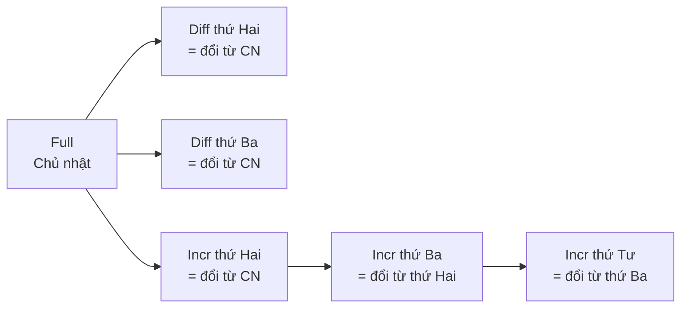

*(Sơ đồ do người viết ghi chú dựng theo ví dụ tr. 266. Restore thứ Tư bằng differential cần Full + Diff gần nhất; bằng incremental cần Full + mọi Incr theo đúng thứ tự.)*

**Lợi ích và giới hạn** (tr. 266–267). Cả hai đều là ***partial backup***: không chứa toàn bộ dữ liệu, vì chắc chắn có phần không đổi. Chúng thường tiết kiệm tải server, thời gian và dung lượng. Nhưng **không phải partial backup nào cũng giảm tải server**: Percona XtraBackup và MySQL Enterprise Backup vẫn **quét mọi block** dữ liệu, nên tiết kiệm không nhiều về tải, dù có tiết kiệm chút thời gian thực, rất nhiều CPU cho việc nén, và dĩ nhiên dung lượng đĩa. Chú thích 6 (tr. 267): một tính năng incremental "thật" cho XtraBackup đang được phát triển, backup các block đã đổi mà không cần quét mọi block.

**Rủi ro của sự phức tạp** (tr. 267). Kỹ thuật backup càng cầu kỳ thì càng rủi ro. Cẩn thận với nhiều thế hệ backup **gắn chặt** vào nhau: một thế hệ hỏng có thể làm **mọi thế hệ khác vô hiệu**.

**Một số ý tưởng nâng cao** (tr. 267):

- dùng tính năng incremental của XtraBackup hay MySQL Enterprise Backup;
- backup **binary log**; có thể chạy `FLUSH LOGS` để bắt đầu binlog mới sau mỗi lần backup, rồi chỉ backup các binlog mới;
- bảng "tra cứu" (tên tháng theo nhiều ngôn ngữ, mã viết tắt bang hay vùng) đặt ở **database riêng** để khỏi backup hoài; tốt hơn nữa là chuyển hẳn vào code;
- **không backup hàng không đổi**: bảng chỉ INSERT (như log lượt xem trang) có thể thêm cột `TIMESTAMP` và chỉ backup hàng mới từ lần trước; cách này hiệu quả nhất khi dùng cùng `mysqldump`;
- **không backup một số dữ liệu**: data warehouse dựng từ dữ liệu khác thì chỉ cần backup dữ liệu nguồn, dù "phục hồi" bằng cách dựng lại rất chậm; tiết kiệm tích lũy theo thời gian có thể lớn hơn lợi ích phục hồi nhanh. Cũng có thể bỏ dữ liệu tạm như bảng session của website;
- backup mọi thứ nhưng gửi tới đích có **khử trùng lặp** (*deduplication*), như ZFS filer.

**Trade-offs và Decision** (tr. 267–268). Nhược điểm của incremental: phục hồi **phức tạp hơn**, **rủi ro hơn**, và **lâu hơn**. Làm được full backup thì nên làm full cho đơn giản. Dù sao cũng phải full backup định kỳ, sách gợi ý **ít nhất hằng tuần**. Đừng mong phục hồi từ một tháng incremental; một tuần đã là nhiều việc và nhiều rủi ro.

> **Bổ sung ngoài sách.** Binlog chính là một chuỗi "incremental" ở mức transaction mà MySQL ghi sẵn. Vì vậy một thiết kế thường gặp là: full backup (raw) hằng ngày hay hằng tuần, cộng sao lưu binlog liên tục. Phục hồi = full gần nhất + binlog. Nó cũng có rủi ro chuỗi giống incremental: thiếu **một** file binlog ở giữa là không phát lại được qua chỗ đó. Lý do sách khuyên giữ binlog đủ cho **hai thế hệ** backup (tr. 261) chính là để có đường lui khi bản full mới nhất hỏng.

#### 2.3.5 Replication (tr. 268)

**Why backup từ replica** (tr. 268). Ưu điểm lớn nhất: **không gián đoạn source** và **không thêm tải** lên source. Đây là lý do tốt để dựng replica ngay cả khi không cần nó cho cân bằng tải hay high availability. Nếu lo chi phí, replica backup có thể kiêm việc khác như làm báo cáo, **miễn là không ghi vào nó** (ghi vào là đổi chính dữ liệu bạn đang muốn backup). Replica không cần dành riêng cho backup; nó chỉ cần **đuổi kịp** source trước lần backup tiếp theo, kể cả khi vai trò khác thỉnh thoảng làm nó tụt lại.

**How: dùng GTID** (tr. 268). Khi backup từ replica, rất nên dùng GTID ([Chương 9](chapter-09.md#gtid)). Nhờ đó không phải lưu toàn bộ thông tin replication, như vị trí của replica so với source. Điều này có ích khi nhân bản replica mới, khi **áp lại binlog lên source để làm PITR**, khi thăng replica lên làm source, v.v. Cũng phải bảo đảm **không có temporary table nào đang mở** khi dừng replica, vì chúng có thể làm bạn không khởi động lại replication được.

> **Bổ sung ngoài sách.** Vấn đề temporary table chủ yếu xuất hiện khi temporary table được **replicate** (binlog dạng statement hay mixed). Có thể kiểm tra biến trạng thái `Replica_open_temp_tables` (tên cũ `Slave_open_temp_tables`) trước khi dừng replica để chụp backup.

**Delayed replication** (tr. 268, nhắc lại tr. 233 ở chương 9). Cố ý cho một replica **chạy trễ**, ví dụ một giờ. Nếu có câu lệnh không mong muốn chạy trên source, bạn có một giờ để phát hiện và **dừng replica trước khi nó lặp lại sự kiện đó** từ relay log. Sau đó thăng replica lên source và phát lại một số ít sự kiện, **bỏ qua câu lệnh xấu**. Cách này có thể nhanh hơn nhiều so với kỹ thuật point-in-time recovery bàn sau.

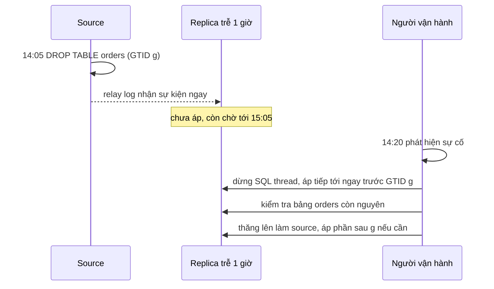

*(Sơ đồ do người viết ghi chú dựng từ tr. 268 và chương 9 tr. 233. Lệnh cụ thể như `START REPLICA SQL_THREAD UNTIL SQL_BEFORE_GTIDS = '...'` là **Bổ sung ngoài sách**, chưa chạy trong bài thực hành vì cần topology replication của chương 9.)*

> **Lưu ý của sách** (tr. 268). Replica có thể **không có cùng dữ liệu** với source. Nhiều người nghĩ replica là bản sao chính xác, nhưng theo kinh nghiệm tác giả, **lệch dữ liệu trên replica là chuyện thường**, và MySQL **không có cách tự phát hiện**. Cách duy nhất là dùng công cụ như `pt-table-checksum` của Percona Toolkit. Cách phòng tốt nhất là bật `super_read_only` để chỉ replication mới ghi được vào replica. Có bản sao qua replication có thể giúp khi đĩa của source hỏng, nhưng **không có gì bảo đảm**. Replication **không phải** backup.

**Decision.** Backup từ replica là lựa chọn mặc định hợp lý khi có replica, với ba điều kiện: replica **nhất quán** với source (dựng lại từ source và bật `super_read_only`, tr. 286), replica dùng **GTID** (tr. 268), và replica **không bị hạ durability** để đuổi lag, vì chương 9 cảnh báo việc đó có thể khiến bạn không phục hồi được từ backup (chương 9 tr. 253).

**Hiểu lầm phổ biến.** "Có delayed replica thì không cần backup." Delayed replica chỉ cứu được sự cố **phát hiện kịp** trong khoảng trễ, và vẫn là một bản sao đang sống, chịu mọi lỗi lệch dữ liệu của replica (tr. 268).

#### Tự kiểm tra 2.3

- **Câu 2.3.1.** Database 1,5 TB, ban đêm server chỉ tải 50% trong 8 giờ. Tính tốc độ chép tối thiểu để backup xong trong cửa sổ, và nêu ba cách sách gợi ý để giữ backup load dưới 50%. [đáp án](answers/chapter-10.md#q2-3-1)
- **Câu 2.3.2.** Khi nào logical backup lớn hơn raw backup, khi nào nhỏ hơn? Dựa vào cơ chế nào? [đáp án](answers/chapter-10.md#q2-3-2)
- **Câu 2.3.3.** Vì sao sách gọi thời gian restore logical là "khó đoán trước"? Giải thích bằng những việc server phải làm khi nạp dump, và vai trò của kích thước dữ liệu so với bộ nhớ. [đáp án](answers/chapter-10.md#q2-3-3)
- **Câu 2.3.4.** Full backup Chủ nhật, backup hằng ngày tới thứ Bảy. Bản thứ Tư bị hỏng, thứ Sáu cần restore. Với differential và với incremental, bạn phục hồi được tới đâu? Binlog thay đổi kết luận thế nào? [đáp án](answers/chapter-10.md#q2-3-4)
- **Câu 2.3.5.** Liệt kê điều kiện để một backup chụp từ replica là đáng tin, và lý do của từng điều kiện. [đáp án](answers/chapter-10.md#q2-3-5)

### 2.4 Managing and Backing Up Binary Logs (tr. 269)

**Why** (tr. 269). Binary log là một trong những thứ **quan trọng nhất** cần backup. Chúng cần cho point-in-time recovery, và vì thường **nhỏ hơn** dữ liệu nên dễ backup thường xuyên. Có backup dữ liệu ở một thời điểm cùng **mọi binlog từ đó**, bạn phát lại binlog và "***roll forward***" các thay đổi kể từ lần full backup gần nhất.

**Binlog phục vụ cả replication** (tr. 269). Vì vậy chính sách backup và phục hồi thường **tương tác** với cấu hình replication. Nên backup binlog thường xuyên: **không chịu mất quá 30 phút dữ liệu thì backup binlog ít nhất 30 phút một lần**.

**Chính sách hết hạn** (tr. 269). Phải quyết định khi nào xóa binlog để MySQL không làm đầy đĩa. Kích thước binlog phụ thuộc workload và định dạng log (row-based cho bản ghi lớn hơn). Sách khuyên giữ binlog **lâu nhất có thể**, vì chúng có ích cho: dựng replica, phân tích workload, kiểm toán, và PITR từ lần full backup gần nhất. Hãy cân nhắc mọi nhu cầu đó khi chọn thời gian giữ.

**How MySQL xóa binlog** (tr. 269):

- Cách phổ biến là dùng `binlog_expire_logs_seconds` để MySQL tự xóa log sau một thời gian. **Không nên xóa file bằng tay.**
- Thiết lập này **chỉ có hiệu lực khi server khởi động hoặc khi MySQL xoay vòng (rotate) binlog**. Nếu binlog không bao giờ đầy và xoay vòng, server **không xóa** các bản cũ.
- Server chọn file để xóa theo **thời gian sửa đổi (modification time)** của file, **không** theo nội dung.

> **Kết quả đã đo** ([thí nghiệm 5](experiments/chapter-10.md#exp5), MySQL 8.0.42). Đặt `binlog_expire_logs_seconds` thật nhỏ lúc runtime **không** xóa ngay các binlog cũ; chúng chỉ biến mất ở lần `FLUSH BINARY LOGS` kế tiếp. Khớp với mô tả ở tr. 269.

> **Bổ sung ngoài sách: cơ chế và cách sao lưu binlog.**
> - MySQL xoay vòng binlog khi file đạt `max_binlog_size` (mặc định 1 GB), khi chạy `FLUSH BINARY LOGS` hay `FLUSH LOGS`, và khi khởi động lại. Danh sách file nằm trong `binlog.index`. Xóa file bằng tay làm index lệch với thực tế; cách an toàn là `PURGE BINARY LOGS TO '...'` hoặc `PURGE BINARY LOGS BEFORE '...'`, vốn cũng tôn trọng replica đang đọc file.
> - Từ 8.0.29 có thêm `binlog_expire_logs_auto_purge` để bật hay tắt việc tự xóa.
> - Sao lưu binlog: (1) chép các file **đã đóng** (mọi file trừ file đang ghi) theo lịch; hoặc (2) chạy `mysqlbinlog --read-from-remote-server --raw` từ một máy khác để kéo binlog qua giao thức replication, thêm `--stop-never` để chạy liên tục. Cách (2) làm RPO khi mất server xuống còn vài giây. [Thí nghiệm 3](experiments/chapter-10.md#exp3) dùng cách (2) với `--to-last-log` và phục hồi hoàn toàn từ các bản binlog đã kéo về.
> - Vì việc xóa dựa trên mtime, mọi thao tác làm đổi mtime của file binlog (chép lại không giữ thời gian, khôi phục file từ backup) có thể làm lịch xóa khác với bạn tưởng.

> **Kết quả đã đo** ([thí nghiệm 2](experiments/chapter-10.md#exp2)). Nạp một dump 1 triệu hàng (61,5 MB) vào instance có binlog bật (ROW, mặc định) sinh ra khoảng 40 MB binlog. Đây vừa là chi phí I/O của restore, vừa là lý do sách gợi ý cân nhắc tắt binlog khi restore (tr. 282).

**Decision: giữ binlog bao lâu?** Theo khuyến nghị ở tr. 261: ít nhất đủ để phục hồi từ **hai thế hệ** raw backup. **Ví dụ minh họa do AI xây dựng:** full backup mỗi tuần thì binlog phải giữ trên server ít nhất khoảng 14 ngày cộng biên an toàn; mặc định 30 ngày của 8.0 đủ cho trường hợp này, nhưng không đủ nếu full backup mỗi tháng. Bản sao binlog trong kho backup thì giữ theo bản logical backup gần nhất (tr. 261) và theo yêu cầu kiểm toán.

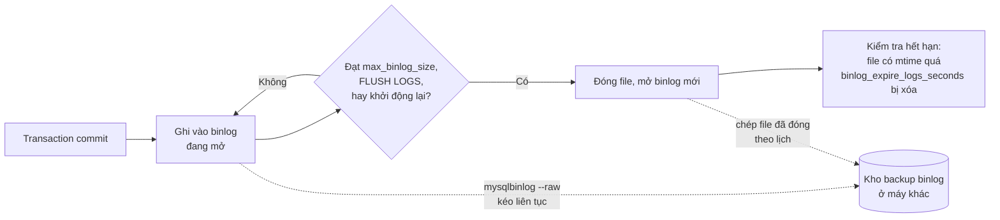

*(Sơ đồ do người viết ghi chú dựng: điều kiện xóa theo tr. 269; các đường sao lưu là **Bổ sung ngoài sách**.)*

**Hiểu lầm phổ biến.**

- "Đặt thời gian hết hạn là binlog cũ biến mất ngay." Chỉ xảy ra khi khởi động hoặc xoay vòng (tr. 269).
- "Binlog là thứ của replication, không liên quan backup." Không có binlog thì chỉ phục hồi được về thời điểm backup (tr. 261, 269).

#### Tự kiểm tra 2.4

- **Câu 2.4.1.** Server ít ghi, `binlog_expire_logs_seconds` đặt 3 ngày, file binlog hiện tại sau hai tuần vẫn chưa đầy 1 GB. Binlog cũ có bị xóa không? Vì sao, và bạn xử lý thế nào? [đáp án](answers/chapter-10.md#q2-4-1)
- **Câu 2.4.2.** RPO là 30 phút cho kịch bản mất trọn server. Bạn sao lưu binlog thế nào? Với kịch bản `DROP TABLE` nhầm khi server vẫn sống, RPO thực tế là bao nhiêu? [đáp án](answers/chapter-10.md#q2-4-2)
- **Câu 2.4.3.** Vì sao sách dặn không xóa binlog bằng tay? Nêu ít nhất hai hậu quả có thể xảy ra. [đáp án](answers/chapter-10.md#q2-4-3)
- **Câu 2.4.4.** Liên hệ giữa thời gian giữ binlog và số thế hệ backup theo khuyến nghị ở tr. 261. Full backup mỗi tuần thì nên giữ binlog bao lâu? [đáp án](answers/chapter-10.md#q2-4-4)

### 2.5 Backup and Recovery Tools (tr. 269–270)

**Khuyến nghị chung** (tr. 269). Có nhiều công cụ tốt và không tốt lắm. Với raw backup, sách khuyên **Percona XtraBackup**: mã nguồn mở, dùng rộng rãi, tài liệu tốt. Với logical backup, tác giả thích **mydumper**. `mysqldump` đi kèm MySQL nhưng **đơn luồng**, nên nếu dùng nguyên mặc định, thời gian backup và restore có thể rất dài; mydumper có sẵn **song song hóa**, lấy logical backup nhanh hơn nhiều.

#### 2.5.1 MySQL Enterprise Backup (tr. 269)

Thuộc gói thuê bao MySQL Enterprise của Oracle. Không cần dừng MySQL, không cần đặt lock, không gián đoạn hoạt động bình thường của database, dù có **thêm tải** lên server. Hỗ trợ backup nén, incremental, và **streaming** sang server khác. Đây là công cụ backup "chính thức" của MySQL.

#### 2.5.2 Percona XtraBackup (tr. 270)

**What.** Giống MySQL Enterprise Backup ở nhiều mặt nhưng **mã nguồn mở và miễn phí**. Hỗ trợ streaming, incremental, nén, và chạy **đa luồng**; có nhiều tính năng giảm tác động của backup lên hệ thống tải nặng (tr. 270).

**How** (tr. 270):

1. Một luồng nền "***tail***" (đọc đuổi theo) các **InnoDB log file**, trong khi công cụ **chép các InnoDB datafile**.
2. Quá trình có các kiểm tra đặc biệt để bảo đảm dữ liệu được chép nhất quán.
3. Khi mọi datafile đã chép xong, luồng chép log cũng dừng.
4. Kết quả là bản sao của mọi dữ liệu nhưng **ở các thời điểm khác nhau**.
5. Áp log lên datafile bằng chính **crash recovery** của InnoDB để đưa mọi datafile về trạng thái nhất quán. Bước này gọi là ***prepare***.
6. Sau prepare, backup **hoàn toàn nhất quán** và chứa mọi transaction đã commit **tính tới điểm kết thúc của quá trình chép file**.

Sách viết toàn bộ việc này diễn ra **bên ngoài MySQL**, không cần kết nối hay truy cập MySQL theo cách nào (tr. 270).

> **Bổ sung ngoài sách (quan sát và giải thích).** Câu "không cần kết nối MySQL" ở tr. 270 nên hiểu là phần **chép page InnoDB** diễn ra ngoài server. Chính output mẫu ở tr. 278–279 cho thấy XtraBackup có kết nối để: chạy `LOCK TABLES FOR BACKUP`, `FLUSH NO_WRITE_TO_BINLOG BINARY LOGS`, đọc LSN và vị trí binlog từ `performance_schema.log_status`, rồi `UNLOCK TABLES`. Phần chép dữ liệu là bên ngoài; phần **phối hợp** lấy tọa độ binlog và khóa ngắn là qua kết nối.
>
> Vì sao bản sao "lệch thời điểm" lại nhất quán được: mỗi page InnoDB mang **LSN** của lần sửa cuối. Redo log chứa mọi thay đổi theo thứ tự LSN. Nếu có đủ redo từ trước lúc bắt đầu chép tới lúc chép xong, thì với mỗi page, crash recovery biết page đó "đang ở LSN nào" và áp tiếp mọi thay đổi sau đó. Mọi page cùng được đưa tới **một** LSN cuối, giống hệt việc phục hồi sau mất điện.

#### 2.5.3 mydumper (tr. 270)

Do một số kỹ sư MySQL hiện tại và cũ viết, thay cho `mysqldump`, dựa trên nhiều năm kinh nghiệm. Là bộ công cụ backup và restore **đa luồng** cho MySQL với nhiều tính năng tốt. Với nhiều người, tốc độ của backup và restore đa luồng là điểm hấp dẫn nhất (tr. 270).

#### 2.5.4 mysqldump (tr. 270)

Phần lớn người dùng dùng các chương trình đi kèm MySQL, nên dù có nhược điểm, `mysqldump` vẫn là lựa chọn phổ biến nhất để logical backup dữ liệu và schema. Sách bảo đọc manual chính thức để biết cách dùng (tr. 270).

> **Bổ sung ngoài sách: các công cụ khác có trong MySQL 8.0.** `mysqlpump` (từ 5.7) dump song song theo bảng, nhưng đã **deprecated từ 8.0.34**. MySQL Shell có `util.dumpInstance()` và `util.loadDump()`, dump và nạp song song theo từng khúc. **Clone plugin** (8.0.17+) tạo bản sao vật lý của instance InnoDB, có thể sang thư mục cục bộ (`CLONE LOCAL DATA DIRECTORY`). Sách không bàn các công cụ này; thí nghiệm của ghi chú dùng `mysqlpump` và clone plugin vì XtraBackup và mydumper không có sẵn trên máy thực hành.

| Công cụ | Loại | Song song | Gián đoạn khi backup | Ghi chú |
| --- | --- | --- | --- | --- |
| MySQL Enterprise Backup | Raw | Có | Không dừng, không lock, có thêm tải (tr. 269) | Trả phí; nén, incremental, streaming |
| Percona XtraBackup | Raw | Có (tr. 270) | Khóa ngắn để lấy tọa độ (tr. 278–279) | Cần prepare trước khi dùng (tr. 285) |
| mydumper | Logical | Có, cả backup và restore (tr. 270) | Phụ thuộc chế độ nhất quán | Tác giả ưa dùng cho logical |
| `mysqldump` | Logical | **Không** (tr. 269) | Mặc định khóa bảng; `--single-transaction` thì không (**Bổ sung**, [thí nghiệm 1](experiments/chapter-10.md#exp1)) | Đi kèm MySQL, phổ biến nhất |
| `mysqlpump` (**Bổ sung**) | Logical | Có, theo bảng | Có `--single-transaction`; cách các luồng dùng chung một snapshot chưa được kiểm trong bài thực hành | Deprecated từ 8.0.34 |
| Clone plugin (**Bổ sung**) | Raw | Nội bộ | Không chặn DML; trên 8.0.42 `clone_block_ddl = OFF` nên DDL đồng thời cũng được phép | 8.0.17+, chỉ dữ liệu InnoDB |

#### Tự kiểm tra 2.5

- **Câu 2.5.1.** XtraBackup chép datafile ở các thời điểm khác nhau. Giải thích vì sao sau bước prepare, backup vẫn nhất quán, và bản backup phản ánh thời điểm nào. [đáp án](answers/chapter-10.md#q2-5-1)
- **Câu 2.5.2.** Tr. 270 nói XtraBackup không cần kết nối MySQL, nhưng output ở tr. 278 cho thấy nó chạy lệnh SQL. Giải thích hai phát biểu này cùng đúng ở mức nào. [đáp án](answers/chapter-10.md#q2-5-2)
- **Câu 2.5.3.** Vì sao mydumper (hay một công cụ song song bất kỳ) nhanh hơn `mysqldump`, và song song hóa bị giới hạn bởi điều gì? [đáp án](answers/chapter-10.md#q2-5-3)

### 2.6 Backing Up Data (tr. 270–281)

Cũng như mọi thứ, có cách backup tốt hơn và tệ hơn, và cách hiển nhiên đôi khi không tốt. Mẹo là **tận dụng tối đa** năng lực mạng, đĩa và CPU để backup nhanh nhất có thể. Đây là bài toán cân bằng; bạn phải thử nghiệm để tìm "điểm ngọt" (tr. 270).

#### 2.6.1 Logical SQL Backups (tr. 270–272)

**What: một bản SQL dump trông thế nào** (tr. 270–271). Đây là dạng `mysqldump` tạo ra theo mặc định. Sách in output (đã rút gọn) của việc dump một bảng nhỏ `test.t1` có một cột `a INT` làm khóa chính. Theo thứ tự, file gồm:

1. Chú thích phiên bản và host, rồi các câu `SET` nằm trong *versioned comment* dạng `/*!40101 ... */` để **lưu lại** rồi **đặt** các tùy chọn của phiên (bộ ký tự client, time zone, `SQL_MODE`...). Chúng có mặt để restore hiệu quả hơn, hoặc để tương thích và đúng đắn.
2. Với mỗi bảng: `DROP TABLE IF EXISTS`, rồi `CREATE TABLE` đầy đủ (engine InnoDB, charset `utf8mb4`, collation `utf8mb4_0900_ai_ci`).
3. Phần dữ liệu: `LOCK TABLES ... WRITE`, `ALTER TABLE ... DISABLE KEYS` (trong versioned comment), các câu `INSERT`, `ENABLE KEYS`, `UNLOCK TABLES`.
4. Cuối file: **trả lại** các tùy chọn đã đổi ở đầu.

File dump **chạy được ngay** để restore. Tiện, nhưng các tùy chọn mặc định của `mysqldump` **không tốt** cho một backup khổng lồ (tr. 271).

> **Bổ sung ngoài sách.** `/*!NNNNN ... */` là câu lệnh chỉ được chạy bởi server có phiên bản từ NNNNN trở lên; server khác coi là chú thích. `ALTER TABLE ... DISABLE KEYS` chỉ có tác dụng với **nonunique index của MyISAM**; InnoDB bỏ qua nó, nên khi nạp dump vào InnoDB, mọi secondary index vẫn được cập nhật **từng hàng**. Mặc định `--extended-insert` gộp nhiều hàng vào một `INSERT`. **Kết quả đã đo:** dump 1 triệu hàng ở [thí nghiệm 2](experiments/chapter-10.md#exp2) gồm 63 câu `INSERT`, trung bình khoảng 1 MB mỗi câu.

**Why: vấn đề của SQL dump nguyên khối** (tr. 271–272). Không chỉ `mysqldump`; mydumper hay phpMyAdmin cũng tạo SQL logical backup. Điều sách muốn chỉ ra là nhược điểm của việc dump **nguyên khối** (*monolithic*) nói chung:

| Vấn đề | Giải thích |
| --- | --- |
| Schema và dữ liệu nằm chung | Tiện khi restore cả file, nhưng khó khi chỉ cần **một bảng** hay **chỉ dữ liệu**. Dump hai lần (một cho schema, một cho dữ liệu) đỡ phần này, nhưng vẫn còn vấn đề sau |
| Câu SQL khổng lồ | Server phải parse và thực thi tất cả: cách nạp dữ liệu **rất chậm** |
| Một file khổng lồ | Phần lớn trình soạn thảo không mở được file lớn hay dòng rất dài; `sed`, `grep` đôi khi lấy được phần cần, nhưng tốt hơn là giữ file nhỏ |
| Logical backup đắt | Có những cách lấy dữ liệu ra khỏi MySQL hiệu quả hơn việc đọc qua storage engine rồi gửi qua **giao thức client/server** dưới dạng result set |

**Decision của sách** (tr. 272). Nếu phải dùng logical backup, sách **rất khuyên** xem mydumper để tránh bản chất đơn luồng, và dành thời gian **đo tác động** lên database trong lúc backup.

**Bổ sung ngoài sách: `mysqldump` lấy bản nhất quán thế nào.** Sách không bàn tùy chọn nhất quán của `mysqldump`, nhưng đây chính là chỗ quyết định "backup online gián đoạn dịch vụ bao nhiêu" (tr. 262). Ghi lại bằng general log ở [thí nghiệm 1 và 3](experiments/chapter-10.md#exp1), MySQL 8.0.42 làm như sau:

| Chế độ | Câu lệnh `mysqldump` gửi (đã rút gọn) | Hệ quả |
| --- | --- | --- |
| Mặc định (`--lock-tables`, nằm trong `--opt`) | `LOCK TABLES checking READ LOCAL, savings READ LOCAL` cho **mỗi database**, rồi `SELECT * FROM` từng bảng | Nhất quán trong một database; **chặn ghi** suốt lúc dump database đó; không nhất quán giữa các database |
| `--single-transaction` | `SET SESSION TRANSACTION ISOLATION LEVEL REPEATABLE READ`, `START TRANSACTION WITH CONSISTENT SNAPSHOT`, rồi `SAVEPOINT sp`, dump từng bảng, `ROLLBACK TO SAVEPOINT sp` sau mỗi bảng | Mọi bảng InnoDB thấy **cùng một snapshot** MVCC; không chặn ghi |
| `--single-transaction --source-data=2 --flush-logs` | `FLUSH LOCAL TABLES`, `FLUSH TABLES WITH READ LOCK`, xoay vòng log, `START TRANSACTION WITH CONSISTENT SNAPSHOT`, `SELECT @@GLOBAL.GTID_EXECUTED`, `SHOW MASTER STATUS`, `UNLOCK TABLES` | Khóa toàn cục **rất ngắn** để lấy tọa độ binlog khớp với snapshot; binlog mới bắt đầu đúng tại điểm backup |
| `--skip-lock-tables` và không có `--single-transaction` | Chỉ `SELECT * FROM` từng bảng, mỗi câu một snapshot riêng | **Không nhất quán** giữa các bảng |

`ROLLBACK TO SAVEPOINT` sau mỗi bảng giải phóng metadata lock của bảng vừa dump, nhờ đó DDL lên bảng đã dump xong không bị chặn tới cuối. Đổi lại, `--single-transaction` **không** bảo vệ trước DDL chạy đồng thời (`ALTER`, `RENAME`, `TRUNCATE` lên bảng chưa dump có thể làm dump sai hoặc lỗi), và chỉ nhất quán với engine có MVCC như InnoDB.

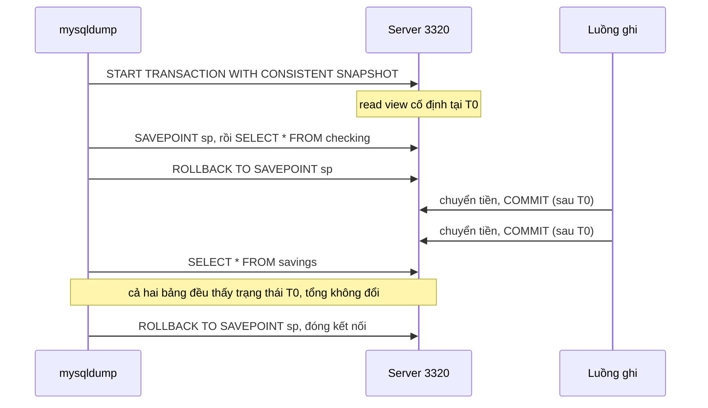

> **Kết quả đã đo** ([thí nghiệm 1](experiments/chapter-10.md#exp1), MySQL 8.0.42, Windows 11, 2 bảng × 200 000 hàng, bất biến tổng số dư = 400 000 000, một luồng ghi chuyển tiền giữa hai bảng; mỗi chế độ chạy 3 lần):
>
> | Chế độ | Tổng sau khi restore bản dump | Lệch | Tốc độ ghi (hàng/giây) trước → trong lúc dump |
> | --- | --- | --- | --- |
> | `--skip-lock-tables` | 400 000 132; 400 000 204; 400 000 257 | +132; +204; +257 | 893–953 → 729–1004 |
> | `--single-transaction` | 400 000 000 (cả 3 lần) | 0 | 929–1015 → 849–897 |
> | Mặc định (`LOCK TABLES`) | 400 000 000 (cả 3 lần) | 0 | 782–955 → 109–163 |
>
> Bản dump không khóa bị "lệch" đúng bằng số lần chuyển tiền đã commit giữa lúc đọc bảng `checking` và lúc đọc bảng `savings`. Bản dump khóa bảng thì đúng nhưng làm luồng ghi gần như dừng. Chỉ `--single-transaction` vừa đúng vừa không chặn ghi, nhờ MVCC của InnoDB.

**Hiểu lầm phổ biến.** "File dump chạy được là backup đúng." Bản dump ở chế độ `--skip-lock-tables` restore không lỗi, checksum từng bảng vẫn hợp lệ, nhưng **dữ liệu sai về nghiệp vụ**: tiền "tự sinh ra". Chỉ một bất biến xuyên bảng mới phát hiện được lỗi này (**Bổ sung ngoài sách**, theo kết quả thí nghiệm 1).

#### 2.6.2 Filesystem Snapshots (tr. 272–277)

**What** (tr. 272). Filesystem snapshot là cách rất tốt để backup online. Filesystem có khả năng snapshot tạo được **ảnh nhất quán** của toàn bộ nội dung **tại một khoảnh khắc**, rồi bạn dùng ảnh đó để backup. Ví dụ: filesystem của FreeBSD, ZFS, LVM của GNU/Linux, nhiều hệ SAN và giải pháp lưu trữ file như thiết bị NetApp. Một số loại đĩa gắn từ xa của nhà cung cấp cloud cũng có snapshot.

**Snapshot không phải backup** (tr. 272). Chụp snapshot chỉ là cách **rút ngắn thời gian phải giữ lock**; nhả lock xong, bạn vẫn phải **chép file ra** backup. Với InnoDB, có thể chụp snapshot mà **không cần lock** nào. Sách nói sẽ chỉ hai cách dùng LVM để backup một hệ thống toàn InnoDB, khóa tối thiểu hoặc không khóa.

> **Bổ sung ngoài sách (quan sát).** Trong phần còn lại của mục, sách chỉ trình bày **một** cách (không khóa, tr. 276). Không thấy cách "khóa tối thiểu" được trình bày trong ấn bản này; có thể là phần còn sót lại từ ấn bản trước.

**Backup Myth #2: "Snapshot của tôi là backup"** (hộp, tr. 272). Snapshot LVM, ZFS hay SAN đều **không phải** backup thật, vì nó **không chứa bản sao đầy đủ** dữ liệu. Snapshot dùng **copy-on-write**, nên chỉ chứa **phần khác biệt** giữa dữ liệu đang sống và dữ liệu tại lúc chụp. Nếu một block **chưa từng bị sửa** bị hỏng trên bản sống, không có bản tốt nào của block đó để phục hồi, và **mọi snapshot đều thấy cùng block hỏng** đó. Hãy dùng snapshot để "đóng băng" dữ liệu trong lúc backup, nhưng đừng coi chính snapshot là backup.

**Snapshot cho mục đích riêng** (tr. 273). Snapshot có thể là "backup" tốt cho một số việc cụ thể: đường lui khi **nâng cấp** (chụp, nâng cấp, có vấn đề thì quay lại snapshot), hay trước một thao tác rủi ro, không biết mất bao lâu, như `ALTER` một bảng khổng lồ.

**How: snapshot LVM hoạt động thế nào** (tr. 273–274).

1. LVM dùng **copy-on-write** để tạo snapshot: một **bản sao logic** của cả volume tại một khoảnh khắc. Giống MVCC trong database, chỉ khác là **chỉ giữ một phiên bản cũ**.
2. Là bản sao **logic**, không phải vật lý: ban đầu snapshot **không chứa dữ liệu** nào. LVM chỉ ghi nhận thời điểm tạo, và khi bạn đọc từ snapshot thì đọc từ volume gốc. Vì vậy tạo snapshot gần như **tức thời**, bất kể volume lớn cỡ nào.
3. Khi có gì đó sửa một block trên volume gốc, LVM **chép block bị ảnh hưởng** sang vùng dành riêng cho snapshot **trước khi** ghi thay đổi. Chỉ **lần ghi đầu tiên** vào mỗi block gây copy-on-write; ghi tiếp vào block đó không tốn thêm gì cho snapshot.
4. Khi đọc các block đó từ snapshot, LVM đọc từ bản đã chép, nên snapshot tiếp tục thấy dữ liệu cũ mà **không chặn** gì trên volume gốc.
5. Snapshot tạo một thiết bị logic mới trong `/dev`, mount được như mọi thiết bị khác.
6. Về lý thuyết có thể chụp một volume khổng lồ mà tốn rất ít chỗ. Nhưng phải dành **đủ chỗ** cho mọi block dự kiến bị sửa trên volume gốc **trong lúc snapshot còn mở**. Thiếu chỗ copy-on-write thì snapshot **hết chỗ** và thiết bị **không dùng được nữa**, như rút một ổ cắm ngoài: job backup đang đọc từ đó sẽ lỗi I/O.

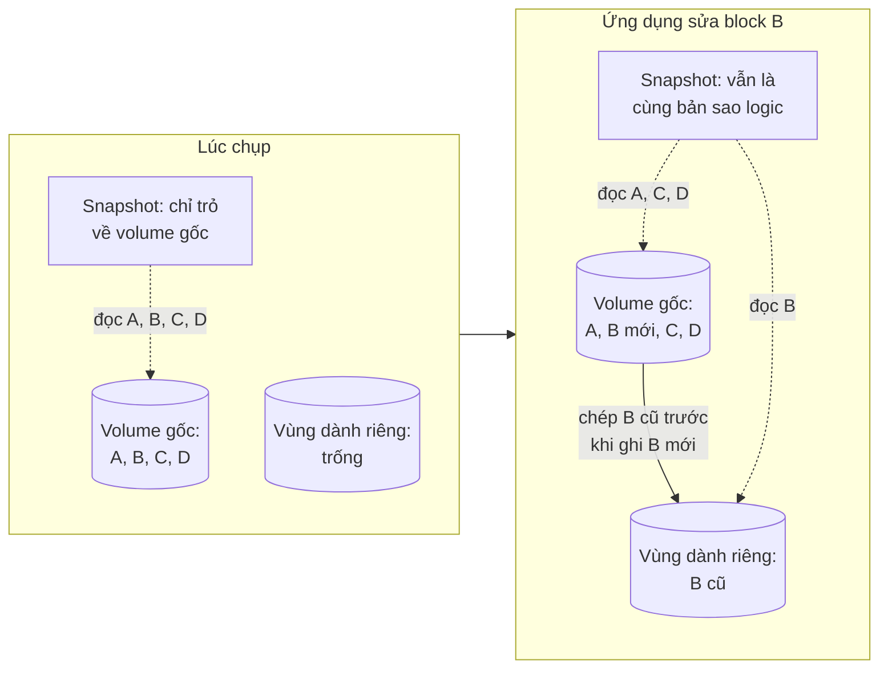

*(Vẽ lại Hình 10-1, tr. 274, theo ảnh trang: bên trái là volume gốc bốn block A–D, vùng dành riêng trống và snapshot; bên phải ứng dụng đổi block B, bản cũ của B nằm trong vùng dành riêng, và hai snapshot hai bên được nối bằng nhãn "cùng một bản sao logic của volume gốc".)*

**Điều kiện tiên quyết** (tr. 274). Tạo snapshot gần như không có gì khó; cái khó là bảo đảm hệ thống được cấu hình để lấy được bản sao nhất quán của **mọi** file cần backup tại **một** khoảnh khắc:

- **Mọi file InnoDB** (tablespace và transaction log) phải nằm trên **một logical volume**. Cần nhất quán tuyệt đối theo thời điểm, mà LVM **không** chụp nhất quán nhiều volume cùng lúc (giới hạn của LVM; hệ khác có thể không bị).
- Nếu cần backup cả định nghĩa bảng, **data directory** cũng phải nằm trên volume đó. Nếu backup định nghĩa bảng cách khác, như backup chỉ schema vào hệ thống version control, có thể không cần lo điều này.
- Volume group phải có **đủ chỗ trống** để tạo snapshot. Cần bao nhiêu tùy workload; khi dựng hệ thống, hãy **chừa lại** một phần chưa cấp phát.

**Các listing LVM** (tr. 274–276, mô tả bằng lời theo ảnh trang). `vgs` cho thấy volume group `vg` có 1 physical volume, 4 logical volume, 0 snapshot, dung lượng 534,18 GB, còn trống 249,18 GB. `lvs` liệt kê bốn logical volume `home` (40 GB), `mysql` (225 GB), `tmp` và `var` (mỗi cái 10 GB). Tên thiết bị `/dev/vg/mysql` thực ra là symlink tới `/dev/mapper/vg-mysql`, được mount ở `/var/lib/mysql`. Sách nhấn mạnh `/dev/vg/mysql` "chỉ là một cái tên", dù trông như đường dẫn file.

**Tạo, mount, xóa snapshot** (tr. 275–276).

- Tạo bằng một lệnh `lvcreate` với `--snapshot`, đặt tên `backup_mysql` và dành 16 GB cho copy-on-write. Đừng ngại dành nhiều hơn mức nghĩ là cần: LVM **chỉ giữ chỗ**, chưa dùng ngay, nên giữ nhiều cũng không hại, trừ khi cần chỗ cho snapshot khác cùng lúc.

> **Mẹo của sách** (tr. 275). Cố ý đặt tên `backup_mysql` thay vì `mysql_backup` để **tab completion** không nhập nhằng, tránh trường hợp tab completion khiến bạn **xóa nhầm** volume `mysql`.

- `lvs` sau đó cho thấy snapshot có thuộc tính khác volume gốc (`swi-a-` so với `owi-ao` của gốc), có thêm cột **Origin** (`mysql`) và **Snap%** (0,01%) cho biết bao nhiêu phần của 16 GB đã dùng cho copy-on-write. Nên **theo dõi** con số này trong lúc backup để biết thiết bị sắp đầy và sắp hỏng, bằng `watch` hay hệ thống giám sát như Nagios.
- Snapshot chứa filesystem, nên mount được như mọi filesystem; liệt kê bên trong thấy đúng các file của datadir: `auto.cnf`, `binlog.000001`, `binlog.000002`, `binlog.index`, các file khóa và chứng chỉ (`ca-key.pem`, `ca.pem`, `client-cert.pem`, `client-key.pem`...).
- Xong thì `umount`, xóa thư mục mount, và `lvremove --force` snapshot.

**Backup InnoDB không khóa bằng snapshot LVM** (tr. 276). Khi chạy **MySQL 8+** chỉ với bảng **InnoDB**, dùng **GTID** và chế độ **ACID đầy đủ**, backup "dễ không tưởng": trong lúc MySQL đang chạy, chụp snapshot, mount nó, rồi chép file ra nơi lưu backup. Không cần lock file nào, không cần ghi lại output nào, không cần làm gì đặc biệt. Khi restore từ backup này, InnoDB sẽ chạy **crash recovery**, và thiết lập GTID đã biết transaction nào đã được xử lý.

> **Bổ sung ngoài sách: vì sao ba điều kiện đó đủ.** Snapshot là ảnh **crash-consistent**: giống hệt trạng thái đĩa nếu máy mất điện đúng lúc đó. (1) Với `innodb_flush_log_at_trx_commit = 1` và `sync_binlog = 1` ("full ACID", [Chương 5](chapter-05.md#s2-5)), mọi transaction đã commit đều có trong redo log và binlog trên đĩa, nên crash recovery dựng lại đúng. (2) Chỉ InnoDB, và từ 8.0 data dictionary cũng nằm trong InnoDB với DDL nguyên tử ([Chương 1](chapter-01.md#data-dictionary-changes), tr. 17–18), nên không còn file định nghĩa bảng `.frm` hay bảng MyISAM cần khóa riêng như ở 5.7. (3) Với GTID, tập transaction đã thực thi được lưu trong bảng InnoDB `mysql.gtid_executed`, nên nó nhất quán với dữ liệu; server phục hồi tự biết mình đang ở đâu so với các server khác.

**Lên kế hoạch dung lượng snapshot** (tr. 277). Điều quan trọng nhất là cấp **đủ chỗ** cho snapshot. Cách tác giả làm:

1. Nhớ rằng LVM chỉ chép mỗi block bị sửa **một lần**. Khi một block trên volume gốc bị ghi, LVM chép block đó sang snapshot rồi ghi chú vào **exception table**; các lần ghi sau vào block đó không gây thêm bản chép.
2. Nếu chỉ dùng InnoDB, xét cách InnoDB ghi: vì nó **ghi mọi dữ liệu hai lần**, ít nhất **một nửa** I/O ghi đi vào **doublewrite buffer**, log file và các vùng nhỏ khác trên đĩa. Những vùng này **dùng lại cùng block** liên tục, nên chỉ ảnh hưởng snapshot lúc đầu, sau đó thôi.
3. Ước lượng phần I/O ghi vào các block **chưa** được chép sang snapshot, so với phần ghi đi ghi lại cùng dữ liệu. Ước lượng **rộng tay**.
4. Dùng `vmstat` hay `iostat` để biết server ghi bao nhiêu block mỗi giây.
5. Đo hay ước lượng thời gian **chép backup** sang nơi khác, tức là thời gian phải **giữ snapshot mở**.

Ví dụ của sách: một nửa lượng ghi gây copy-on-write, server ghi 10 MB/giây, chép snapshot sang server khác mất một giờ (3 600 giây): cần ½ × 10 MB × 3 600 = **18 GB** cho snapshot, cộng thêm biên an toàn. Đôi khi tính được dễ dàng lượng dữ liệu sẽ đổi trong lúc snapshot mở.

> **Bổ sung ngoài sách (phép tính).** Công thức tổng quát: dung lượng cần ≈ (tỷ lệ ghi rơi vào block chưa chép) × (tốc độ ghi) × (thời gian giữ snapshot) + biên. Tỷ lệ thực tế **giảm dần** theo thời gian vì càng nhiều block đã được chép thì càng ít lần ghi gây copy-on-write mới, nên công thức tuyến tính của sách là ước lượng an toàn (thiên về dư). Tốc độ chép càng chậm (ví dụ vì bạn throttle để giảm backup load, tr. 262) thì snapshot càng phải giữ lâu và càng cần nhiều chỗ: đây là một đánh đổi ẩn giữa backup load và rủi ro snapshot hết chỗ.

**Công dụng khác và phương án thay thế** (tr. 277). Snapshot không chỉ để backup: có thể chụp một "checkpoint" ngay trước thao tác nguy hiểm; một số hệ cho phép **thăng snapshot** thành filesystem gốc, nên quay lui về lúc chụp rất dễ. Snapshot filesystem cũng không phải cách duy nhất để có bản sao tức thời. Một cách khác là ***RAID split***: với mirror RAID phần mềm ba đĩa, tháo một đĩa khỏi mirror và mount riêng. Không có chi phí copy-on-write, và dễ thăng "snapshot" này thành bản của source khi cần. Nhưng khi gắn đĩa lại, nó phải **resync**. "Không có bữa trưa miễn phí" (tr. 277).

> **Bổ sung ngoài sách: thay thế chạy được trên Windows trong bài thực hành.** Không có LVM trên máy thực hành, nên [thí nghiệm 4](experiments/chapter-10.md#exp4) dùng clone plugin của MySQL 8.0 (`CLONE LOCAL DATA DIRECTORY`) làm một dạng raw backup trực tuyến. **Kết quả đã đo:** trong lúc luồng ghi chuyển tiền chạy liên tục, clone chép khoảng 746 MB trong khoảng 1,1 giây; instance khởi động từ bản clone sau khoảng 3,3 giây, bất biến tổng số dư đúng 400 000 000, và `mysqlcheck` báo mọi bảng OK. Clone **không** chép binlog, `auto.cnf` hay file chứng chỉ (server mới tự sinh UUID và chứng chỉ khi khởi động), đúng loại "dữ liệu dễ quên" mà mục [2.3.3](#what-to-back-up) nhắc.

#### 2.6.3 Percona XtraBackup (tr. 278–281)

**What** (tr. 278). XtraBackup là một trong những giải pháp backup MySQL phổ biến nhất, và có lý do: rất **cấu hình được**, kể cả backup nén và mã hóa.

**How: XtraBackup hoạt động thế nào** (tr. 278). InnoDB là engine **crash-safe**: khi MySQL crash, nó dùng chế độ crash recovery dựa trên **redo log** để đưa dữ liệu trở lại đúng. XtraBackup dựa trên thiết kế này: khi backup, nó **ghi lại log sequence number (LSN)** và dùng LSN đó để chạy crash recovery trên các file đã backup. Nó cũng **khóa ở một số điểm** để bảo đảm thông tin replication **khớp** với dữ liệu.

**Đọc output mẫu** (tr. 278–279, mô tả bằng lời theo ảnh trang). Sách chạy XtraBackup 8.0.25-17 với một thư mục đích, và chú thích từng đoạn output:

1. XtraBackup xác định phiên bản server đang chạy ("8.0.25-15") để biết server có khả năng gì và nên chép file ra sao. Ở đây lệnh `LOCK TABLES FOR BACKUP` có sẵn, và đó là cách nó lấy lock trên các bảng.
2. Chép file: `ibdata1`, `sys/sys_config.ibd`, `test/t1.ibd`, `foo/t1.ibd`, `sakila/actor.ibd`...
3. Xong các bảng và file không phải InnoDB; chạy `FLUSH NO_WRITE_TO_BINLOG BINARY LOGS`; đọc LSN và vị trí binlog từ `p_s.log_status`; chép binlog hiện tại tới vị trí 156; ghi `binlog.index` và `xtrabackup_binlog_info`.
4. Thu thông tin replication: `FLUSH NO_WRITE_TO_BINLOG ENGINE LOGS`; ghi "latest check point (for incremental)" là 35005805; dừng luồng chép log ở LSN 35005815; log đã quét tới 35005825; bắt đầu parse redo log từ LSN 35005460; rồi `UNLOCK TABLES`. Sách giải thích: XtraBackup đã xác định checkpoint mới nhất của InnoDB, điều này giúp nó áp các lần ghi xảy ra **trong lúc** backup; sau đó nhả lock `LOCK TABLES FOR BACKUP`.
5. Bước cuối: chép bản dump buffer pool (`ib_buffer_pool`), báo vị trí binlog của backup là `binlog.000004`, vị trí 156; ghi `backup-my.cnf` (bản sao cấu hình) và `xtrabackup_info` (metadata như UUID của MySQL, phiên bản server và XtraBackup); báo đã chép transaction log từ LSN 35005795 tới 35005835; "completed OK!".

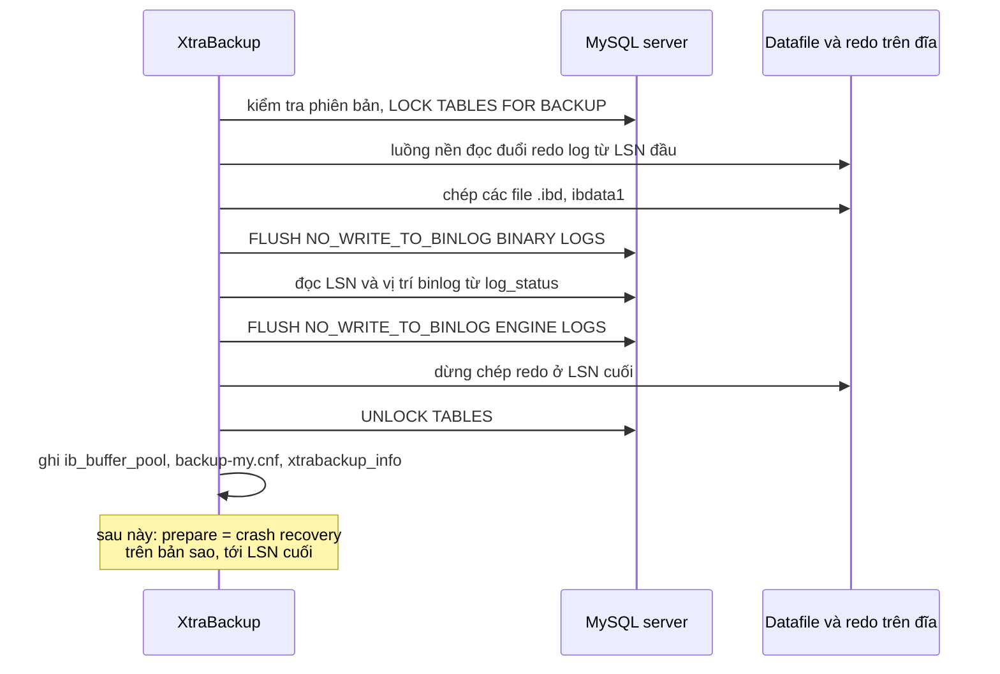

*(Sơ đồ do người viết ghi chú dựng từ output mẫu ở tr. 278–279; thứ tự rút gọn.)*

> **Bổ sung ngoài sách (quan sát và phiên bản).**
> - Chuỗi phiên bản "8.0.25-15" là của **Percona Server**; `LOCK TABLES FOR BACKUP` là backup lock của Percona Server. MySQL 8.0 của Oracle có lệnh tương đương `LOCK INSTANCE FOR BACKUP`. **Kết quả đã đo** ([thí nghiệm 5](experiments/chapter-10.md#exp5), 8.0.42): trong lúc một phiên giữ `LOCK INSTANCE FOR BACKUP`, một `INSERT` xong trong khoảng 0,08 giây, còn `CREATE TABLE` chờ tới hết `lock_wait_timeout` (2 giây) rồi lỗi 1205. Tức là khóa này chặn DDL, không chặn DML.
> - `performance_schema.log_status` trả về **trong một lần đọc** cả `gtid_executed`, file và vị trí binlog, và LSN của InnoDB. Đã đọc được trên 8.0.42 ở thí nghiệm 5. Theo tài liệu MySQL, bảng này được thiết kế để công cụ backup có các tọa độ nhất quán với nhau mà không phải khóa ghi suốt quá trình chép.
> - Dòng output "Copying /var/lib/mysql/binlog.40 to /backups/binlog.04" có vẻ bị cắt trong bản in (ảnh trang PDF 300 in đúng như vậy), trong khi cuối output ghi `binlog.000004`. Nên hiểu là file `binlog.000004`.

**Cách dùng** (tr. 279–281). Lưu ý trước khi dùng: MySQL nên có mật khẩu, dùng `--user` và `--password` với tài khoản đủ quyền; output XtraBackup rất dài (sách đã cắt bớt); luôn đọc manual chính thức trước khi chạy vì cú pháp có thể đổi; dù tác giả không biết vụ mất dữ liệu nào do công cụ này, hãy thử trên backup không phải production trước.

| Kiểu | Lệnh (mô tả) | Ghi chú của sách |
| --- | --- | --- |
| Backup ra thư mục | `xtrabackup --backup --target-dir=<thư mục>` | Thư mục đích có thể là đĩa khác, cùng đĩa, hay share mount từ backup server; cần đủ chỗ cho bản sao đầy đủ (tr. 280) |
| Streaming | `--backup --stream=xbstream`, chuyển STDOUT vào một file | Ghi backup thành **một file**, tiện giữ nhiều backup trong một thư mục; có thể dùng `date` để gắn ngày vào tên file (tr. 280) |
| Nén | thêm `--compress` | Output đổi thành "Compressing and streaming"; với Sakila, file xbstream 94 MB còn 6,5 MB (tr. 280) |
| Mã hóa | `--encrypt=AES256` với `--encrypt-key-file` | Tốn CPU hơn, lâu hơn, nhưng đáng vì backup là **mục tiêu dễ** để lấy nhiều dữ liệu trong một file. **Không** dùng `--encrypt-key` trên dòng lệnh: khóa lộ trong process list hay `/proc` (tr. 281) |
| Tăng tốc | `--parallel`, `--compress-threads`; mã hóa cũng có tùy chọn song song | Tốn CPU hơn, giảm tổng thời gian (tr. 281) |
| Nhiều database và bảng | `--rsync` | Tối ưu việc chép file (tr. 281) |

> **Bổ sung ngoài sách (phép tính).** 94 MB xuống 6,5 MB là tỷ lệ nén khoảng 14 lần với dữ liệu mẫu Sakila. Tỷ lệ phụ thuộc dữ liệu (chỗ trống trong page, mức lặp của giá trị), nên với dữ liệu thật của bạn có thể khác rất xa; phải đo.

> **Lỗi in.** Ảnh trang PDF 303 in "--parallel and -" rồi xuống dòng "compress-threads": dấu gạch nối ở cuối dòng làm mất một dấu "-". Tên tùy chọn là `--compress-threads`.

#### Tự kiểm tra 2.6

- **Câu 2.6.1.** Ở thí nghiệm 1, bản dump `--skip-lock-tables` lệch +132 tới +257, còn hai chế độ kia lệch 0. Giải thích cơ chế của từng chế độ và vì sao chỉ một chế độ vừa đúng vừa không chặn ghi. [đáp án](answers/chapter-10.md#q2-6-1)
- **Câu 2.6.2.** Vì sao snapshot copy-on-write "không phải backup"? Dựng một kịch bản cụ thể mà mọi snapshot đều vô dụng. [đáp án](answers/chapter-10.md#q2-6-2)
- **Câu 2.6.3.** Server ghi 20 MB/giây, ước lượng 40% lượng ghi rơi vào block chưa chép, việc chép snapshot sang server khác mất 90 phút. Cần dành bao nhiêu chỗ cho snapshot theo cách của sách? Nếu bạn throttle việc chép xuống còn một nửa tốc độ thì sao? [đáp án](answers/chapter-10.md#q2-6-3)
- **Câu 2.6.4.** Sách nói backup bằng snapshot LVM không khóa chỉ "dễ" khi có ba điều kiện. Nêu ba điều kiện và hậu quả nếu thiếu từng điều kiện. [đáp án](answers/chapter-10.md#q2-6-4)
- **Câu 2.6.5.** Trong output XtraBackup, vì sao phải lấy vị trí binlog **cùng lúc** với LSN, và điều gì xảy ra nếu hai tọa độ này lệch nhau? [đáp án](answers/chapter-10.md#q2-6-5)

### 2.7 Recovering from a Backup (tr. 281–286)

**Mười bước có thể cần** (tr. 281). Cách phục hồi phụ thuộc cách đã backup. Có thể cần một phần hay tất cả các bước:

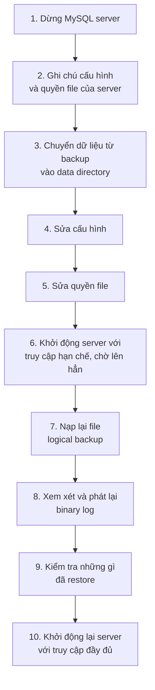

*(Vẽ lại danh sách đánh số ở tr. 281.)*

> **Lưu ý của sách** (tr. 282). Nếu có khả năng bạn còn cần **phiên bản hiện tại** của file, **đừng thay** chúng bằng file từ backup. Ví dụ backup có kèm binlog và bạn cần phát lại binlog để làm PITR: **đừng ghi đè** binlog hiện tại bằng bản cũ hơn trong backup. Đổi tên hay chuyển chúng đi nơi khác nếu cần.

**Cô lập server trong lúc phục hồi** (tr. 282). Thường cần làm MySQL **không truy cập được** với mọi thứ trừ tiến trình phục hồi. Tác giả hay khởi động MySQL với `--skip-networking` và `--socket=/tmp/mysql_recover.sock` để ứng dụng đang có không kết nối được cho tới khi kiểm tra xong và đưa server trở lại. Điều này đặc biệt quan trọng với logical backup, vốn được **nạp từng phần**: ứng dụng kết nối giữa chừng sẽ thấy dữ liệu dở dang.

> **Bổ sung ngoài sách.** `--skip-networking` chặn mọi kết nối TCP/IP; chỉ còn kết nối cục bộ qua socket (Unix) hay named pipe, shared memory (Windows). Ngoài ra có thể bật biến `offline_mode` (có từ 5.7); khi đó chỉ tài khoản có quyền `CONNECTION_ADMIN` (8.0) hay `SUPER` kết nối được. Thí nghiệm của ghi chú thì cô lập bằng cách khác: restore lên một instance riêng ở cổng 3335 chỉ nghe trên 127.0.0.1.

#### 2.7.1 Restoring Logical Backups (tr. 282–283)

**Chuẩn bị** (tr. 282). Restore logical thì phải dùng **chính MySQL server** để nạp dữ liệu vào bảng, không phải để hệ điều hành chép file. Trước khi nạp, dành chút thời gian xét:

- file dump lớn cỡ nào, nạp mất bao lâu; có cần báo người dùng hay tắt một phần ứng dụng không;
- **tắt binary logging** có thể là ý hay, trừ khi bạn cần replicate quá trình restore sang replica: nạp một dump khổng lồ đã đủ nặng, ghi nó vào binlog còn thêm chi phí (có thể không cần);
- nạp file khổng lồ còn có hệ quả với storage engine: **không nên** nạp 100 GB vào InnoDB trong **một transaction** vì rollback segment sẽ phình khổng lồ. Hãy nạp theo khúc vừa phải và commit sau mỗi khúc.

**Hai kiểu restore** (tr. 282). Sách nói có hai kiểu, tương ứng hai kiểu logical backup (SQL và văn bản phân tách), nhưng chỉ trình bày kiểu SQL dump.

**Restore SQL dump** (tr. 282–283).

- File chứa SQL chạy được, nên chỉ cần chạy nó: đưa file vào `mysql` qua chuyển hướng đầu vào.
- Hoặc dùng lệnh `SOURCE` trong client `mysql`. Về cơ bản là cùng việc, nhưng có vài điều dễ hơn: nếu là quản trị viên, bạn tắt được binary logging cho **phiên của mình** bằng `SET SQL_LOG_BIN = 0`, `SOURCE` file, rồi bật lại, **không cần** khởi động lại server.
- Cẩn thận: với `SOURCE`, một lỗi **không** làm dừng cả loạt câu lệnh, khác với mặc định khi chuyển hướng file vào `mysql`.
- File đã nén: **đừng** giải nén ra rồi mới nạp; hãy giải nén và nạp trong **một** pipeline (`gunzip -c` vào `mysql`). Nhanh hơn nhiều.

**Restore một bảng** (tr. 283). Nếu dữ liệu không có ký tự xuống dòng và schema đã có sẵn, dùng `grep` lấy các dòng `INSERT INTO` của bảng `actor` rồi đưa vào `mysql` (với file nén thì `gunzip -c` trước). Nếu cần tạo cả bảng mà toàn database nằm trong một file, bạn phải trích đoạn `CREATE TABLE`; sách đưa một script `sed` khá khó hiểu để lấy "đoạn văn" chứa `CREATE TABLE` của bảng đó, rồi tự nhận: nếu phải làm kiểu này để restore thì **backup của bạn thiết kế kém**. Có chút kế hoạch là tránh được cảnh hoảng loạn tìm hiểu `sed`: **dump mỗi bảng ra một file**, hoặc tốt hơn, **tách dữ liệu và schema**.

> **Kết quả đã đo** ([thí nghiệm 2](experiments/chapter-10.md#exp2), MySQL 8.0.42, Windows 11, bảng 1 triệu hàng, dump 61,5 MB, trung vị 3 lần):
>
> | Cách nạp | Thời gian | Binlog sinh ra trên instance đích |
> | --- | --- | --- |
> | Binlog bật (mặc định) | 22,5 s (17,7–26,3) | khoảng 40 MB |
> | `SET SESSION sql_log_bin = 0` qua `--init-command` | 13,6 s (13,4–14,1) | 0 |
>
> Tắt binlog cho phiên nạp làm nhanh khoảng 40% trong thí nghiệm này. Đánh đổi đúng như sách nói: dữ liệu được nạp sẽ **không** đi tới replica của instance đích.

> **Bổ sung ngoài sách (quan sát ở thí nghiệm 2 và 3).** Hai công cụ đi kèm MySQL **tự** chèn `SET @@SESSION.SQL_LOG_BIN = 0` vào file dump trong một số trường hợp: `mysqldump` làm vậy khi dump kèm GTID (`--set-gtid-purged=ON`, hay mặc định AUTO trên server bật GTID), vì nó đặt `GTID_PURGED` thay cho việc ghi lại transaction; `mysqlpump` làm vậy trong output đã quan sát. Nếu bạn nạp dump vào một server đang có replica và **muốn** dữ liệu tới replica, phải biết điều này trước.

**Bổ sung ngoài sách: bước 8 "xem xét và phát lại binlog" làm cụ thể ra sao.** Sách chỉ nêu bước này trong danh sách (tr. 281). [Thí nghiệm 3](experiments/chapter-10.md#exp3) chạy trọn quy trình PITR sau một `DROP TABLE` nhầm, với ứng dụng **vẫn ghi tiếp** vào bảng khác sau sự cố:

1. Lúc backup: `mysqldump --single-transaction --source-data=2 --flush-logs` ghi vào file dump tọa độ `binlog.000003`, vị trí 197, và tập `GTID_PURGED`. (Trên 8.0.42, dòng tọa độ vẫn được viết dạng `CHANGE MASTER TO MASTER_LOG_FILE=...`.)
2. Sao lưu binlog qua mạng bằng `mysqlbinlog --read-from-remote-server --raw --to-last-log`.
3. Tìm sự kiện hỏng bằng `SHOW BINLOG EVENTS`: sự kiện GTID ở vị trí 159525 (GTID `...:43466`), câu `DROP TABLE` kết thúc ở 159736.
4. Cách theo vị trí: restore dump, rồi `mysqlbinlog --start-position=197 --stop-position=159525`, rồi `mysqlbinlog --start-position=159736` cho phần sau sự cố.
5. Cách theo GTID: restore dump, rồi `mysqlbinlog --exclude-gtids='<uuid>:43466'` cho cả file; transaction nằm trong `GTID_PURGED` được server **tự bỏ qua**.

**Kết quả đã đo:** cả hai cách cho checksum của `orders` (5 300 hàng) và `customers` (1 150 hàng) **khớp** với trạng thái mong đợi; `gtid_executed` của server phục hồi có một **lỗ** đúng ở `:43466`. Phát lại lần hai cùng binlog không đổi gì (GTID chống áp lặp). Đối chứng: phát lại **toàn bộ** binlog thì bảng `orders` lại biến mất, đúng điều một replica sẽ làm.

#### 2.7.2 Restoring Raw Files from Snapshot (tr. 283–284)

**Đơn giản vì ít lựa chọn** (tr. 283). Restore raw file thường khá thẳng: tức là không có nhiều tùy chọn. Tùy yêu cầu phục hồi, điều này có thể tốt hoặc xấu. Quy trình thường chỉ là **chép file vào chỗ**.

**Kiểu InnoDB truyền thống, mọi bảng trong một tablespace** (tr. 283–284). Phải tắt MySQL, chép hay chuyển file vào chỗ, rồi khởi động lại. Cũng phải bảo đảm **transaction log khớp tablespace**. Nếu không khớp, ví dụ thay tablespace mà không thay transaction log, InnoDB sẽ **từ chối khởi động**. Đây là một lý do **bắt buộc** phải backup transaction log cùng datafile.

**Với `innodb_file_per_table`** (tr. 284). InnoDB lưu dữ liệu và index của mỗi bảng trong một file `.ibd`. Có thể backup và restore từng bảng bằng cách chép file này, kể cả khi server đang chạy, nhưng **không đơn giản**: file `.ibd` không độc lập với InnoDB nói chung; mỗi file có thông tin nội bộ cho InnoDB biết nó liên quan thế nào với tablespace chính (dùng chung). Khi restore phải bảo InnoDB "**import**" file. Có nhiều ràng buộc (xem phần manual về per-table tablespace); ràng buộc lớn nhất, theo sách, là **chỉ restore được bảng vào đúng server đã backup nó**. Không phải không làm được, nhưng khó hơn bạn tưởng.

> **Bổ sung ngoài sách và Kết quả đã đo.** Ràng buộc "chỉ cùng server" là của các bản MySQL cũ. Từ MySQL 5.6 có ***transportable tablespace***: `FLUSH TABLES ... FOR EXPORT` tạo thêm file `.cfg` mô tả metadata; ở server đích, tạo bảng cùng định nghĩa, `ALTER TABLE ... DISCARD TABLESPACE`, chép `.ibd` và `.cfg` vào, rồi `ALTER TABLE ... IMPORT TABLESPACE`. [Thí nghiệm 4](experiments/chapter-10.md#exp4) chuyển bảng 1 triệu hàng (`.ibd` 140 MB, 2 secondary index) từ instance 3320 sang một instance **khác** (3335, `server_uuid` khác, vừa khởi tạo) trên 8.0.42: checksum khớp, `CHECK TABLE` OK. Phần chép vào đích và import mất khoảng 2,5 giây, so với khoảng 22,5 giây để nạp logical cùng bảng đó ở thí nghiệm 2. Điều kiện vẫn còn: cùng page size, định nghĩa bảng tương thích, và bên nguồn phải giữ khóa export trong lúc chép (bảng chỉ đọc trong khoảng đó).

**Decision của sách** (tr. 284). Mọi phức tạp này khiến restore raw file có thể **rất tẻ nhạt** và **dễ sai**. Quy tắc: quy trình phục hồi càng khó và phức tạp, bạn càng cần **thêm logical backup** để tự bảo vệ. Luôn nên có logical backup, phòng khi có gì đó sai và bạn không thuyết phục được MySQL dùng raw backup.

#### 2.7.3 Restoring with Percona XtraBackup (tr. 284–285)

Vì XtraBackup dựa vào crash recovery của InnoDB để backup an toàn (tr. 278), muốn dùng file của nó phải qua vài bước thêm (tr. 284–285):

1. **Giải nén luồng** nếu backup dạng streaming: `xbstream -x` đọc file xbstream và giải ra thư mục hiện tại (hoặc `-C` để chọn thư mục). Backup nén thì thêm `--decompress`; mã hóa thì `--decrypt` kèm `--encrypt-key-file`.
2. **Prepare**: `xtrabackup --prepare --target-dir=<thư mục>`. Đây là bước **thực sự chạy crash recovery** và bảo đảm bạn phục hồi đủ dữ liệu.
3. **Đưa file vào chỗ**: `xtrabackup --move-back` (hoặc `--copy-back`) với `--target-dir`. XtraBackup tự đọc biến datadir từ cài đặt MySQL và đặt file đúng chỗ.

> **Mẹo của sách** (tr. 285). Nếu không dùng streaming, có thể chạy prepare **ngay sau khi backup**. Khi đó bạn lưu một backup **đã prepare**, bớt việc phải làm lúc restore.

> **Mẹo của sách** (tr. 285). Dùng `--copy-back` hoặc `--move-back` của `xtrabackup` để chép hay chuyển file vào đúng chỗ.

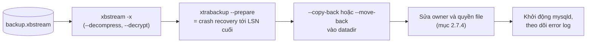

*(Sơ đồ do người viết ghi chú dựng từ tr. 284–286.)*

**Trade-off ẩn của prepare** (**Bổ sung ngoài sách**). Prepare ngay sau backup chuyển chi phí crash recovery từ lúc **khẩn cấp** (đang tính RTO) sang lúc **thường nhật** (không ai chờ). Với streaming thì không làm vậy được, nên RTO phải tính thêm thời gian giải nén, giải mã và prepare.

#### 2.7.4 Starting MySQL After Restoring Raw Files (tr. 285–286)

**Trước khi khởi động** (tr. 285). Việc đầu tiên, quan trọng nhất và **dễ quên nhất**: kiểm tra cấu hình server, và bảo đảm file đã restore có **owner và quyền đúng**. Các thuộc tính này phải đúng tuyệt đối, nếu không MySQL có thể không khởi động. Chúng khác nhau giữa các hệ thống, nên xem lại ghi chú (bước 2 ở tr. 281). Thường là user và group `mysql` sở hữu file và thư mục, chỉ user và group đó được đọc và ghi.

**Trong và sau khi khởi động** (tr. 285–286). Theo dõi **error log** khi server khởi động (trên Unix có thể `tail -f` file log; vị trí file tùy hệ thống). Mọi việc ổn thì bạn có một server đã phục hồi khi MySQL lên. Với các bản MySQL mới, việc theo dõi error log còn quan trọng hơn: dù server có vẻ lên bình thường, hãy chạy `SHOW TABLE STATUS` trong **từng database**, rồi xem lại error log lần nữa.

> **Bổ sung ngoài sách: vì sao `SHOW TABLE STATUS` có ích.** Lệnh này buộc server mở từng bảng; một tablespace hỏng hay thiếu sẽ lộ ra dưới dạng lỗi hay cảnh báo trong error log, thay vì nằm im tới khi ứng dụng chạm vào. Trong bài thực hành, error log của instance khởi động từ bản clone (mức `log_error_verbosity` mặc định) không có lỗi; nó chỉ báo không tìm thấy UUID cũ nên sinh UUID mới, và chứng chỉ CA tự ký (vì clone không chép file chứng chỉ). Các thông điệp mức Note như tiến trình crash recovery không hiện ở mức log mặc định, nên đừng kết luận "không có recovery" chỉ vì không thấy dòng đó.

**Hiểu lầm phổ biến.** "Server lên được là xong." Sách nhắc kiểm tra thêm (tr. 286), và mục [2.3.2](#kiem-tra-backup) yêu cầu `CHECK TABLES` hay `mysqlcheck` cho backup raw (tr. 265). Ở thí nghiệm 4, `mysqlcheck` trên năm database (khoảng 3,65 triệu hàng) mất khoảng 15 giây: một phần thời gian phục hồi cần được tính vào RTO.

#### Tự kiểm tra 2.7

- **Câu 2.7.1.** Vì sao phải khởi động MySQL ở chế độ hạn chế truy cập khi restore, nhất là với logical backup? Nêu hai cách làm. [đáp án](answers/chapter-10.md#q2-7-1)
- **Câu 2.7.2.** Bạn restore một dump 200 GB bằng một transaction duy nhất, binlog bật. Những vấn đề nào có thể xảy ra, và sửa quy trình thế nào? [đáp án](answers/chapter-10.md#q2-7-2)
- **Câu 2.7.3.** Sau một `DROP TABLE` nhầm lúc 14:05, ứng dụng vẫn ghi vào các bảng khác tới 14:30. Mô tả cách phát lại binlog để lấy lại bảng mà không mất các thay đổi hợp lệ sau 14:05, theo vị trí và theo GTID. [đáp án](answers/chapter-10.md#q2-7-3)
- **Câu 2.7.4.** Vì sao InnoDB từ chối khởi động khi tablespace và transaction log không khớp? Điều này nói gì về cách backup raw file? [đáp án](answers/chapter-10.md#q2-7-4)
- **Câu 2.7.5.** So sánh prepare ngay sau backup với prepare lúc restore của XtraBackup về RTO và về rủi ro. [đáp án](answers/chapter-10.md#q2-7-5)

### 2.8 Summary (tr. 286)

Thông điệp cuối chương (tr. 286):

1. Ai cũng biết cần backup, nhưng không phải ai cũng nhận ra cần backup **phục hồi được**. Có nhiều cách thiết kế backup **mâu thuẫn** với yêu cầu phục hồi. Để tránh, hãy **định nghĩa và ghi lại RPO, RTO**, và dùng chúng khi chọn hệ thống backup.
2. **Thử phục hồi đều đặn**. Dễ cài `mysqldump` chạy mỗi đêm mà không nhận ra dữ liệu đã lớn tới mức nạp lại mất **nhiều ngày hay nhiều tuần**. Lúc tệ nhất để biết phục hồi mất bao lâu là lúc thực sự cần phục hồi. Một backup xong trong vài giờ có thể mất **hàng tuần** để restore, tùy phần cứng, schema, index và dữ liệu.
3. Đừng nghĩ **replica là backup**. Nó là nguồn ít xâm phạm hơn để **lấy** backup, nhưng không phải backup. Tương tự với **RAID, SAN và filesystem snapshot**. Backup phải qua được **phép thử `DROP TABLE`** (hay phép thử "bị hack"), và phép thử **mất cả data center**.
4. Nếu backup từ replica, bảo đảm replica **nhất quán**: dựng lại chúng từ source và bật `super_read_only` từ đó trở đi.
5. Cách tác giả ưa nhất: **Percona XtraBackup** cho raw backup và **mydumper** cho logical backup. Có thể kiểm chứng backup bằng cách khởi động một `mysqld` trên đó và kiểm tra bảng. Đôi khi "một mũi tên trúng hai đích": **thử phục hồi mỗi ngày** bằng cách restore vào server development hay staging, rồi dump từ instance đó để có logical backup.
6. Backup cả **binary log**, giữ **đủ thế hệ** backup và binlog để phục hồi hay dựng replica mới ngay cả khi backup mới nhất không dùng được.

> **Bổ sung ngoài sách (quan sát).** Câu ở tr. 286 nói cả hai kỹ thuật (XtraBackup và mydumper) "cho phép backup nhị phân (raw) không xâm phạm". Nhưng mydumper là công cụ **logical** theo chính tr. 269–270. Nên hiểu ý chính là: lấy raw backup không xâm phạm bằng XtraBackup, kiểm chứng nó, rồi tạo logical backup (bằng mydumper) từ instance đã restore.

> **Kết quả đã đo, đối chiếu với điểm 2** ([thí nghiệm 2](experiments/chapter-10.md#exp2)). Trong phạm vi tới 2 triệu hàng, restore logic chậm hơn dump khoảng 11–16 lần ở mọi kích thước đã thử, nhưng thời gian restore **chưa** tăng nhanh hơn tuyến tính theo kích thước (37 000 → 57 000 hàng/giây khi đi từ 250 000 tới 2 triệu hàng). Hiện tượng "không đoán trước được" mà sách cảnh báo thường xuất hiện khi dữ liệu và index lớn hơn nhiều so với buffer pool (tr. 264); thí nghiệm nhỏ trên laptop chưa tái hiện được vùng đó, nên đây vẫn là **câu hỏi mở** với dữ liệu của bạn.

#### Tự kiểm tra 2.8

- **Câu 2.8.1.** Phép thử `DROP TABLE` và phép thử "mất data center" đòi hỏi những thuộc tính khác nhau nào của hệ thống backup? [đáp án](answers/chapter-10.md#q2-8-1)
- **Câu 2.8.2.** Thiết kế một quy trình "thử phục hồi mỗi ngày" theo gợi ý của Summary: gồm bước nào, đo chỉ số gì, cảnh báo khi nào? [đáp án](answers/chapter-10.md#q2-8-2)
- **Câu 2.8.3.** Vì sao "backup xong trong vài giờ có thể mất hàng tuần để restore"? Liệt kê các yếu tố sách nêu và cơ chế của mỗi yếu tố. [đáp án](answers/chapter-10.md#q2-8-3)

---

## 3. Phân tích tình huống

Chương này là chương vận hành, nên các tình huống dưới đây đi từ **sự cố hoặc yêu cầu** → **RPO, RTO** → **cơ chế MySQL liên quan** → **các bước** → **chi phí và rủi ro**. Mọi tình huống là **Ví dụ minh họa do AI xây dựng**; số liệu giả định được ghi rõ, số đo thật thì dẫn về bài thực hành.

### 3.1 `DROP TABLE orders` lúc 14:05 và phép thử `DROP TABLE`

**Bối cảnh (giả định).** Database bán hàng khoảng 400 GB, một source và hai replica bất đồng bộ. Raw backup hằng đêm lúc 02:00 chụp từ một replica, kèm tọa độ binlog và GTID. Binlog được kéo liên tục sang một máy backup. Lúc 14:05, một kỹ sư tưởng mình đang ở môi trường staging và chạy `DROP TABLE orders` trên production (đúng kiểu "kết nối nhầm server" sách nêu ở tr. 258). Ứng dụng báo lỗi đặt hàng từ 14:05; đội trực phát hiện lúc 14:20. Các bảng khác vẫn nhận ghi.

**Bước 1: replica có cứu được không?** Không. `DROP TABLE` là một transaction hợp lệ trong binlog với GTID riêng; với replica không trễ, cả hai đã áp nó gần như ngay lập tức (giả định của tình huống). Đó là lý do sách nói replica không phải backup (tr. 260, 268). [Thí nghiệm 3, bước 7C](experiments/chapter-10.md#exp3) tái hiện đúng điều này: phát lại toàn bộ binlog thì bảng biến mất. RAID của từng máy cũng vậy.

**Bước 2: xác định RPO và RTO cho sự cố này.** Binlog trên source còn nguyên, nên RPO mục tiêu cho `orders` là **0**: mọi đơn hàng đã commit trước 14:05 phải về. RTO bị chi phối bởi việc dựng lại bảng; trong lúc đó chức năng đặt hàng tê liệt, các chức năng khác vẫn chạy (sách gọi đây là "mất một phần chức năng", tr. 260).

**Bước 3: chọn đường phục hồi.**

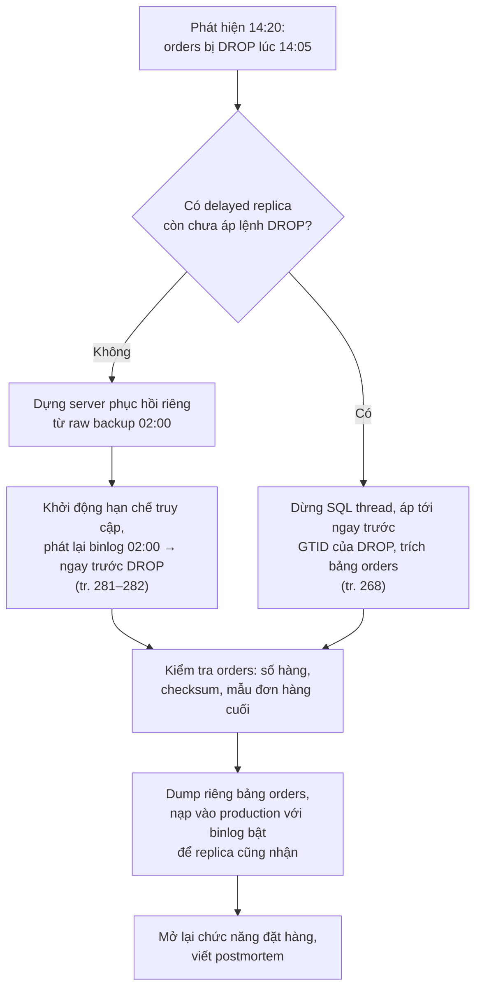

Không restore đè **cả** production: làm vậy sẽ mất mọi ghi hợp lệ vào các bảng khác từ 14:05, hoặc buộc phải phát lại tiếp phần binlog sau sự cố cho cả server (đây là kỹ thuật "bỏ đúng sự kiện hỏng" đã chạy ở thí nghiệm 3). Lấy một bảng từ server phục hồi rồi nạp vào production giới hạn vùng ảnh hưởng.

**Bước 4: chi phí thời gian (phép tính giả định, Bổ sung ngoài sách).**

| Đoạn | Giả định | Ước lượng |
| --- | --- | --- |
| Chép raw backup 400 GB về server phục hồi | 300 MB/s | ≈ 400 000 / 300 ≈ 1 330 s ≈ 22 phút |
| Prepare hay crash recovery | Đã prepare sẵn sau khi backup (tr. 285) | vài phút |
| Phát lại binlog 02:00 → 14:05 | 12 giờ binlog; tốc độ áp phụ thuộc workload, đơn luồng khi pipe vào `mysql` | phải **đo** trong diễn tập; có thể từ vài phút tới vài giờ |
| Dump và nạp riêng `orders` (giả sử 30 GB) | Tốc độ restore logic của chính hệ thống | phải **đo**; logical restore là phần khó đoán nhất (tr. 264) |

Bảng cho thấy hai đoạn quyết định RTO lại là hai đoạn **không thể ước lượng trên giấy**: tốc độ phát lại binlog và tốc độ nạp logical. Đó chính là lý do sách đòi diễn tập trọn quy trình và đo tài nguyên (tr. 261, 286).

**Bài học.** Hệ thống này qua được phép thử `DROP TABLE` nhờ **backup + binlog**, không nhờ replica hay RAID. Nếu có thêm một delayed replica trễ 1 giờ, sự cố phát hiện sau 15 phút sẽ được xử lý nhanh hơn nhiều (tr. 268), nhưng sự cố phát hiện sau 2 giờ thì vẫn phải quay về backup.

### 3.2 `mysqldump` mỗi đêm vẫn "xanh", nhưng RTO đã vỡ từ lâu

**Bối cảnh (giả định).** Ba năm trước database 20 GB, đội cài cron chạy `mysqldump` mỗi đêm, job luôn báo thành công. Nay database 600 GB, dump mất khoảng 3 giờ, file nén khoảng 120 GB. RTO cam kết với kinh doanh là 4 giờ. Chưa ai từng restore thử. Đây chính là cái bẫy Summary mô tả (tr. 286).

**Phân tích cơ chế.**

- Dump đọc tuần tự qua storage engine và ghi văn bản ra; restore thì phải parse SQL, chuyển sang định dạng InnoDB, **cập nhật mọi secondary index từng hàng**, ghi redo, undo, và binlog nếu bật (tr. 264, 282). Restore làm nhiều việc hơn dump trên mỗi hàng.
- `mysqldump` và việc nạp lại qua `mysql` đều **đơn luồng** (tr. 269).
- Khi tổng index lớn hơn buffer pool, mỗi lần chèn vào secondary index có thể cần đọc page từ đĩa, nên tốc độ nạp có thể rơi mạnh theo kích thước. Sách gọi thời gian restore logic là "khó đoán trước" (tr. 264).

**Thử đặt số (Bổ sung ngoài sách, phép tính và Dự đoán).** [Thí nghiệm 2](experiments/chapter-10.md#exp2) đo trên laptop: nạp khoảng 44 000 hàng/giây cho bảng có 2 secondary index (bảng 1 triệu hàng, trung vị 3 lần), với dữ liệu còn gần vừa buffer pool. Giả sử production 600 GB tương đương khoảng 4 tỷ hàng và **may mắn** giữ được tốc độ đó: 4 × 10⁹ / 44 000 ≈ 91 000 giây ≈ **25 giờ**, gấp hơn 6 lần RTO, chưa tính chép file, phát lại binlog và kiểm tra. Nếu tốc độ rơi khi index vượt bộ nhớ thì còn tệ hơn. Đây là **dự đoán** bằng ngoại suy thô, chỉ để thấy độ lớn; con số thật phải đo bằng diễn tập.

**Quyết định.**

1. Chuyển backup chính sang **raw** (XtraBackup hay snapshot), chụp từ replica (tr. 260–261, 268). Raw restore không parse SQL và không dựng index; ở thí nghiệm 4, import một bảng 1 triệu hàng bằng tablespace mất khoảng 2,5 giây so với khoảng 22,5 giây nạp logical.
2. Giữ logical backup **định kỳ**, trích từ instance đã restore từ raw backup (tr. 265), dùng công cụ song song như mydumper (tr. 269–272).
3. Diễn tập phục hồi **tự động hằng ngày** vào staging (tr. 286); ghi lại thời gian restore như một chỉ số dài hạn, giữ ít nhất một năm (chương 2, tr. 35).
4. Nếu ngay cả raw restore cũng vượt RTO, chương 2 gợi ý: xem lại RTO, thu hẹp định nghĩa "chức năng cốt lõi", hoặc **tách dữ liệu** để phần cốt lõi phục hồi được trong hạn (chương 2, tr. 35).

### 3.3 "Chúng ta có hai replica, RAID 10 và snapshot hằng ngày, cần gì backup?"

**Bối cảnh (giả định).** Một đội đề xuất bỏ hệ thống backup để tiết kiệm chi phí, với lý lẽ ở tiêu đề. Snapshot là snapshot LVM trên cùng mảng đĩa, giữ 7 bản.

**Đánh giá bằng các phép thử của sách** (tr. 260, 272, 286):

| Cơ chế | Phép thử `DROP TABLE` | Phép thử "bị hack" | Phép thử mất data center | Hỏng block âm thầm |
| --- | --- | --- | --- | --- |
| Replica bất đồng bộ | **Trượt**: áp lệnh trong vòng giây (tr. 260) | **Trượt**: kẻ tấn công xóa trên source thì replica xóa theo | Qua được nếu replica ở data center khác | Có thể có bản tốt, nhưng replica hay lệch mà MySQL không tự biết (tr. 268) |
| RAID 10 | **Trượt** (tr. 260) | **Trượt** | **Trượt** | Nhân bản luôn block hỏng do phần mềm ghi |
| Snapshot LVM cùng mảng đĩa | Qua được nếu lấy snapshot trước lúc xóa và snapshot còn | **Trượt** nếu kẻ tấn công có quyền root trên máy | **Trượt**: cùng mảng đĩa | **Trượt**: block chưa sửa bị hỏng thì mọi snapshot cùng thấy hỏng (tr. 272) |
| Backup raw + binlog lưu nơi khác, quyền truy cập tách biệt | Qua được | Qua được nếu kẻ chiếm server không vào được kho backup (tr. 261) | Qua được nếu offsite | Qua được nếu backup đã được kiểm tra bằng cách khởi động và `CHECK TABLES` (tr. 265) |

**Kết luận.** Replica và RAID là công cụ **availability**, snapshot là công cụ **đóng băng** dữ liệu để chép ra (tr. 272). Không cái nào thay được backup (tr. 260). Đề xuất hợp lý hơn: **giữ** replica và dùng một replica làm **nguồn** backup (không gánh tải source, tr. 268), bật `super_read_only` và kiểm tra nhất quán bằng `pt-table-checksum` định kỳ (tr. 268), dùng GTID (tr. 268); đưa backup và binlog sang kho tách biệt về quyền truy cập; cân nhắc thêm một delayed replica làm "đường tắt" cho lỗi logic (tr. 268).

> **Bổ sung ngoài sách.** Snapshot đĩa của cloud ([Chương 12](chapter-12.md#disk-snapshot), tr. 321) thường được lưu tách khỏi volume gốc, nên khác snapshot LVM nằm cùng volume về khả năng chịu hỏng đĩa. Nhưng nếu chúng nằm trong **cùng tài khoản** với quyền xóa như production, chúng vẫn có thể trượt phép thử "bị hack". Hãy kiểm chứng đặc tính cụ thể với nhà cung cấp của bạn.

### 3.4 Thiết kế từ yêu cầu: RPO 15 phút, RTO 2 giờ, giữ dữ liệu 1 năm

**Yêu cầu (giả định).** Mất trọn server: mất tối đa 15 phút dữ liệu. Xóa nhầm: lấy lại được trong 2 giờ. Kiểm toán: xem lại trạng thái dữ liệu bất kỳ cuối tháng trong 12 tháng qua. Database 300 GB, tăng 10 GB mỗi tháng.

**Suy luận từng yêu cầu ra cơ chế.**

| Yêu cầu | Cơ chế | Căn cứ |
| --- | --- | --- |
| RPO 15 phút khi mất server | Sao lưu binlog ra máy khác **ít nhất 15 phút một lần**; tốt hơn là kéo liên tục (`mysqlbinlog --read-from-remote-server --raw --stop-never`, **Bổ sung**) | tr. 269 (quy tắc 30 phút) |
| RTO 2 giờ | Raw backup (XtraBackup hay snapshot) hằng ngày, **prepare sẵn**; đo thời gian chép + khởi động + phát lại tối đa 24 giờ binlog trong diễn tập | tr. 260–261, 285 |
| Đường lui khi bản mới nhất hỏng | Giữ ít nhất 2 thế hệ raw backup; binlog trên server đủ cho 2 thế hệ (ví dụ 3–4 ngày với backup hằng ngày; mặc định 30 ngày của 8.0 là dư) | tr. 261, 286 |
| Kiểm toán 12 tháng | Logical backup **cuối tháng**, trích từ instance đã restore, lưu 12 bản | tr. 259, 265 |
| Tin được backup | Giám sát backup **độc lập** với công cụ backup; diễn tập phục hồi tự động; cảnh báo khi diễn tập lỗi | tr. 261, 286; chương 13 tr. 339 |
| Lỗi logic phát hiện nhanh | Tùy chọn: delayed replica 1 giờ | tr. 268 |

**Phép tính dung lượng (Bổ sung ngoài sách, giả định).** Raw backup không nén khoảng 300 GB mỗi bản (cộng chỗ trống trong tablespace, tr. 264), 2–3 bản là 600–900 GB; 12 logical backup cuối tháng, giả sử nén còn 1/5 kích thước dữ liệu, khoảng 60–80 GB mỗi bản, tổng gần 1 TB và tăng dần. Đây là chi phí cần đưa vào ngân sách; sách gợi ý giảm bằng cách không backup dữ liệu dẫn xuất hay dữ liệu tạm, tách bảng tra cứu, hay dùng đích có deduplication (tr. 267).

**Điểm dễ hỏng của thiết kế.** Chuỗi binlog phải **liên tục**: thiếu một file ở giữa là không phát lại qua được (**Bổ sung ngoài sách**). Vì vậy diễn tập nên kiểm cả việc phát lại binlog, không chỉ restore bản full.

---

## 4. Đo lường và thực hành

### Giả thuyết, cách quan sát và tiêu chí

| # | Giả thuyết (Dự đoán trước khi chạy) | Cách quan sát | Chỉ số | Tiêu chí so sánh | Thí nghiệm |
| --- | --- | --- | --- | --- | --- |
| H1 | Dump không khóa và không transaction cho bản dump **không nhất quán** giữa các bảng khi có ghi đồng thời; `--single-transaction` nhất quán mà không chặn ghi; mặc định nhất quán nhưng chặn ghi | Bất biến tổng số dư sau khi restore bản dump; general log | Độ lệch tổng; `Innodb_rows_updated` mỗi giây trước và trong lúc dump | Lệch ≠ 0 hay = 0; tốc độ ghi giảm bao nhiêu | [Thí nghiệm 1](experiments/chapter-10.md#exp1) |
| H2 | Restore logic chậm hơn dump nhiều lần; tắt binlog và bỏ secondary index làm restore nhanh hơn; dump song song nhanh hơn dump đơn luồng | Đo thời gian thực, 3 lần, trung vị | Giây; MB; hàng/giây; MB binlog sinh ra | Tỷ lệ restore/dump; chênh lệch giữa các biến thể | [Thí nghiệm 2](experiments/chapter-10.md#exp2) |
| H3 | Restore backup rồi phát lại binlog tới ngay trước `DROP` lấy lại được bảng mà không mất ghi hợp lệ sau đó, theo vị trí hay theo GTID; phát lại toàn bộ thì tái hiện sự cố | `CHECKSUM TABLE`, số hàng, `gtid_executed` | Khớp hay lệch với trạng thái mong đợi | Khớp tuyệt đối | [Thí nghiệm 3](experiments/chapter-10.md#exp3) |
| H4 | Một bảng InnoDB raw restore được sang **server khác** bằng transportable tablespace; raw backup trực tuyến (clone) nhất quán dù có ghi | Checksum, `CHECK TABLE`, bất biến tổng | Thời gian chép, import, khởi động | So với thời gian restore logic của cùng bảng | [Thí nghiệm 4](experiments/chapter-10.md#exp4) |
| H5 | `binlog_expire_logs_seconds` chỉ có hiệu lực khi xoay vòng binlog; `LOCK INSTANCE FOR BACKUP` chặn DDL không chặn DML | `SHOW BINARY LOGS` trước và sau `FLUSH BINARY LOGS`; thời gian một `INSERT` và một `CREATE TABLE` khi khóa | Danh sách file; giây; mã lỗi | Có hay không xóa; chặn hay không | [Thí nghiệm 5](experiments/chapter-10.md#exp5) |

### Tóm tắt kết quả

> **Kết quả đã đo** (MySQL 8.0.42, Windows 11, laptop nhiều nhiễu, không phải benchmark production; hai instance riêng cấu hình mặc định, `innodb_buffer_pool_size` 128 MB, GTID bật ở instance nguồn; dữ liệu tổng hợp tất định). Chi tiết, lệnh và output nằm trong [bài thực hành](experiments/chapter-10.md).
>
> | Thí nghiệm | Kết quả chính |
> | --- | --- |
> | 1. Dump khi có ghi đồng thời | `--skip-lock-tables`: tổng lệch +132, +204, +257. `--single-transaction`: lệch 0, tốc độ ghi trong lúc dump 849–897 hàng/giây. Mặc định `LOCK TABLES`: lệch 0, tốc độ ghi rơi xuống 109–163 hàng/giây |
> | 2. Thời gian theo kích thước (trung vị 3 lần) | 250 000 hàng: dump 0,44 s, restore 6,7 s. 1 triệu: 2,07 s và 22,5 s. 2 triệu: 2,72 s và 35,0 s. 1 triệu không secondary index: 0,99 s và 16,1 s. 1 triệu tắt binlog khi nạp: 13,6 s. File `.ibd` 140 MB so với dump 61,5 MB (1 triệu hàng). 3 bảng (2,25 triệu hàng): `mysqldump` 3,84 s, `mysqlpump` 4 luồng 1,98 s |
> | 3. PITR sau `DROP TABLE` | Cả cách theo vị trí và theo GTID cho checksum khớp tuyệt đối; phát lại toàn bộ binlog thì bảng lại mất |
> | 4. Raw trên Windows | Transportable tablespace sang instance khác: khớp checksum, khoảng 2,5 s cho chép và import (1 triệu hàng). Clone trong lúc có ghi: 746 MB trong khoảng 1,1 s, khởi động 3,3 s, bất biến đúng |
> | 5. Binlog và khóa backup | Binlog cũ chỉ bị xóa ở lần `FLUSH BINARY LOGS` sau khi đặt thời hạn; `expire_logs_days` báo deprecated và không đặt được cùng `binlog_expire_logs_seconds`; khóa backup chặn DDL (lỗi 1205 sau 2 s), `INSERT` xong trong 0,08 s |

**Điều thí nghiệm chưa chứng minh.** Ở quy mô tới 2 triệu hàng, tốc độ nạp (hàng/giây) **không** giảm khi dữ liệu lớn lên, nên chưa tái hiện được vùng "restore không đoán trước được" khi index vượt xa buffer pool (tr. 264). Muốn kiểm, cần dữ liệu lớn hơn nhiều lần buffer pool hoặc thu nhỏ buffer pool; đây là **câu hỏi mở**, không phải bằng chứng ngược lại với sách.

**Chưa thực thi** (không có công cụ trên máy thực hành): Percona XtraBackup, mydumper, MySQL Enterprise Backup, snapshot LVM, ZFS, SAN. Quy trình tương ứng được viết trong [bài thực hành](experiments/chapter-10.md#chua-thuc-thi) với nhãn **Chưa thực thi**.

### Chỉ số nên theo dõi trong vận hành (Bổ sung ngoài sách)

| Chỉ số | Vì sao | Liên hệ sách |
| --- | --- | --- |
| Tuổi của backup thành công gần nhất | Phát hiện job âm thầm dừng | Giám sát độc lập với công cụ (tr. 261) |
| Thời gian backup, kích thước backup | Xu hướng tăng báo trước lúc vượt cửa sổ | Backup time, backup load (tr. 262) |
| **Thời gian restore trong diễn tập** | Đây mới là RTO thật | tr. 261, 286; chương 2 tr. 35 |
| Độ trễ sao lưu binlog (bây giờ trừ thời điểm của sự kiện cuối đã chép ra ngoài) | Chính là RPO hiện tại khi mất server | tr. 269 |
| Kết quả kiểm tra backup (khởi động, `CHECK TABLES`, checksum) | Backup chưa thử thì chưa phải backup tốt | tr. 265 |
| `Snap%` của snapshot LVM trong lúc chép | Snapshot đầy là backup hỏng giữa chừng | tr. 276 |
| Chênh lệch dữ liệu replica (`pt-table-checksum`) | Backup từ replica lệch là backup sai | tr. 268 |

---

## 5. Liên kết kiến thức và điều cần nhớ

### Liên kết khái niệm

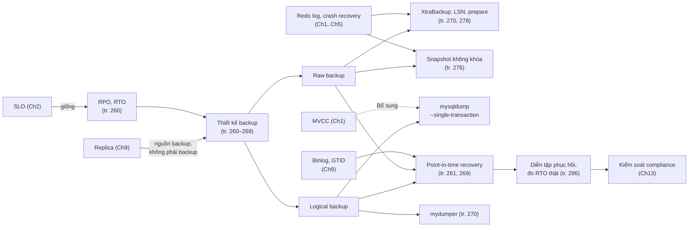

### Điều cần nhớ

1. Mục tiêu là **backup phục hồi được**, không phải backup chạy được. Định nghĩa và ghi lại RPO, RTO theo từng loại sự cố rồi mới chọn công cụ (tr. 260, 286).
2. Phục hồi khó hơn backup vì nó hiếm, khẩn cấp, bị bảo mật cản, và có thể phụ thuộc một người; chỉ diễn tập trọn quy trình mới lộ ra các vấn đề này (tr. 259–261).
3. **Replica, RAID, SAN, snapshot không phải backup**. Phép thử: `DROP TABLE`, "bị hack", mất data center (tr. 260, 272, 286).
4. Database lớn gần như bắt buộc dùng **raw backup**; logical backup vẫn cần định kỳ cho lưu giữ dài hạn và làm đường lui (tr. 260–261, 265, 284).
5. Restore logical phải parse SQL và dựng lại index nên chậm và khó đoán; **phải đo** thời gian restore (tr. 264, 286).
6. **Binlog** là nền của point-in-time recovery; sao lưu chúng thường xuyên theo RPO, giữ đủ cho ít nhất hai thế hệ backup, đừng xóa bằng tay; thời hạn chỉ có hiệu lực khi khởi động hay xoay vòng (tr. 261, 269).
7. XtraBackup và snapshot không khóa đều dựa vào **crash recovery của InnoDB**: chép "lệch thời điểm" hay "như mất điện", rồi redo log đưa về trạng thái nhất quán (tr. 270, 276, 278).
8. Backup từ replica giảm tải source, nhưng replica phải nhất quán (`super_read_only`, kiểm tra checksum) và nên dùng GTID; delayed replica là đường tắt cho lỗi logic phát hiện kịp (tr. 268, 286).
9. Incremental và differential tiết kiệm nhưng làm phục hồi phức tạp, rủi ro và lâu hơn; vẫn cần full backup ít nhất hằng tuần (tr. 266–268).
10. Khi restore: cô lập server, đừng ghi đè binlog hiện tại, kiểm owner và quyền file, theo dõi error log, chạy `SHOW TABLE STATUS` (tr. 281–286).

### Dấu hiệu nhận diện trong thực tế

- Job backup "luôn xanh" nhưng không ai nhớ lần cuối restore thử là khi nào; không có chỉ số thời gian restore.
- Câu "chúng ta có replica rồi" xuất hiện khi bàn về backup.
- Kích thước dump tăng đều mỗi tháng, thời gian dump tiến dần tới cửa sổ đêm; độ trễ của luồng ghi tăng vọt mỗi khi dump chạy (dấu hiệu `mysqldump` đang khóa bảng, thí nghiệm 1).
- Binlog chiếm đĩa ngày càng nhiều trên server ít ghi (chưa từng xoay vòng nên chưa từng bị xóa), hoặc ngược lại có người đã `rm` binlog bằng tay.
- `pt-table-checksum` báo replica lệch, trong khi backup được chụp từ đúng replica đó.
- Kho backup dùng chung tài khoản và quyền với production.
- Snapshot LVM chụp xong nhưng `Snap%` tiến gần 100% trong lúc chép.

### Câu hỏi còn mở

- Ở quy mô nào (so với buffer pool) thì tốc độ restore logic bắt đầu rơi mạnh với schema của bạn? Thí nghiệm nhỏ ở đây chưa chạm tới vùng đó.
- Tốc độ phát lại binlog bằng `mysqlbinlog | mysql` (đơn luồng) có đáp ứng RTO khi phải phát lại cả ngày binlog không? Có nên dùng cách khác như dựng server phục hồi làm replica của một "binlog server" để tận dụng multithreaded replication? (Sách không bàn; cần thử.)
- Sách nói XtraBackup đang phát triển incremental "thật" không cần quét mọi block (chú thích 6, tr. 267). Trạng thái hiện nay ra sao với phiên bản bạn dùng?
- Với MySQL trên cloud managed (chương 12), phần nào của chương này còn áp dụng khi bạn không chạm được vào file và binlog?

---

## Ghi chú kiểm tra nguồn

### Đối chiếu mục lục

Bookmark lấy từ PDF (trang PDF trừ 22 ra trang in):

| Mục trong sách | Trang in | Mục ghi chú |
| --- | --- | --- |
| (Mở đầu chương, không có bookmark) | 257–258 | [2.0](#s2-0) |
| Why Backups? | 258 | [2.1](#s2-1) |
| Defining Recovery Requirements | 259 | [2.2](#s2-2) |
| Designing a MySQL Backup Solution | 260 | [2.3](#s2-3) |
| · Online or Offline Backups? | 261 | [2.3.1](#s2-3-1) |
| · Logical or Raw Backups? | 263 | [2.3.2](#s2-3-2) |
| · What to Back Up | 265 | [2.3.3](#s2-3-3) |
| · Incremental and Differential Backups | 266 | [2.3.4](#s2-3-4) |
| · Replication | 268 | [2.3.5](#s2-3-5) |
| Managing and Backing Up Binary Logs | 269 | [2.4](#s2-4) |
| Backup and Recovery Tools | 269 | [2.5](#s2-5) |
| · MySQL Enterprise Backup | 269 | [2.5.1](#s2-5-1) |
| · Percona XtraBackup | 270 | [2.5.2](#s2-5-2) |
| · mydumper | 270 | [2.5.3](#s2-5-3) |
| · mysqldump | 270 | [2.5.4](#s2-5-4) |
| Backing Up Data | 270 | [2.6](#s2-6) |
| · Logical SQL Backups | 270 | [2.6.1](#s2-6-1) |
| · Filesystem Snapshots | 272 | [2.6.2](#s2-6-2) |
| · Percona XtraBackup | 278 | [2.6.3](#s2-6-3) |
| Recovering from a Backup | 281 | [2.7](#s2-7) |
| · Restoring Logical Backups | 282 | [2.7.1](#s2-7-1) |
| · Restoring Raw Files from Snapshot | 283 | [2.7.2](#s2-7-2) |
| · Restoring with Percona XtraBackup | 284 | [2.7.3](#s2-7-3) |
| · Starting MySQL After Restoring Raw Files | 285 | [2.7.4](#s2-7-4) |
| Summary | 286 | [2.8](#s2-8) |

Các mục nhỏ hơn không có bookmark nhưng có tiêu đề trong sách (được ghi thành đoạn in đậm hay đoạn có anchor): "Logical backups" và "Raw backups" (tr. 263–265); "Backup Myth #1" (tr. 260) và "Backup Myth #2" (tr. 272); "How LVM snapshots work", "Prerequisites and configuration", "Creating, mounting, and removing an LVM snapshot", "Lock-free InnoDB backups with LVM snapshots", "Planning for LVM backups", "Other uses and alternatives" (tr. 273–277); "How XtraBackup works", "Example usage" với các mục con Basic backup, Streaming, Compression, Encryption, Other important flags (tr. 278–281).

### Hình, bảng, listing đã xem trên ảnh trang

Đã render toàn bộ PDF 279–308 và xem trực tiếp các trang có hình, listing, hộp và output dài: PDF 282 (hộp Myth #1), 290 (hộp Lưu ý về replica), 293 (listing `mysqldump`), 294 (hộp Myth #2), 296 (**Hình 10-1** và `vgs`), 297 (`lvs`, `lvcreate`, Mẹo về tên volume), 298 (`lvs` sau khi tạo snapshot, mount, `ls`), 299 (phép tính 18 GB), 300–301 (output XtraBackup), 303 (lệnh mã hóa, danh sách 10 bước), 304 (Lưu ý về binlog hiện tại), 305 (lệnh restore, `sed`), 306 (file-per-table, `xbstream`), 307 (prepare, hai hộp Mẹo). Chương không có bảng dạng lưới nào; Hình 10-1 là hình duy nhất. Biểu tượng hộp được đối chiếu với quy ước ở Preface: hình con chim là Note (Lưu ý), hình con vật đuôi khoanh là Tip (Mẹo).

### Lỗi trích xuất và điểm bất thường của bản in

- Chữ trích xuất của chương khớp ảnh trang; không có trang scan.
- Tr. 281 (PDF 303): "--parallel and -" xuống dòng "compress-threads"; tên đúng là `--compress-threads` (lỗi ngắt dòng làm mất một dấu gạch).
- Tr. 278 (PDF 300): output in "binlog.40" và "binlog.04" trong khi cuối output là `binlog.000004`; ảnh trang in đúng như vậy, nhiều khả năng output bị cắt khi biên tập.
- Tr. 272 hứa "hai cách" dùng LVM (khóa tối thiểu hoặc không khóa) nhưng chỉ trình bày cách không khóa (tr. 276).
- Tr. 282 nói có hai kiểu restore logic tương ứng hai kiểu logical backup, nhưng chỉ trình bày kiểu SQL dump; kiểu văn bản phân tách (`mysqlimport`, chỉ nhắc ở tr. 263) không được trình bày.
- Tr. 261 dùng `expire_logs_days`, tr. 269 dùng `binlog_expire_logs_seconds`: không nhất quán trong cùng chương; biến đầu đã deprecated ở 8.0.
- Tr. 270 nói XtraBackup không cần kết nối MySQL, nhưng output tr. 278–279 cho thấy nó chạy lệnh SQL (xem [2.5.2](#xtrabackup-tool)).
- Tr. 286 gọi cả XtraBackup và mydumper là cách lấy backup "nhị phân (raw)", trong khi mydumper là logical (tr. 269–270).
- Tr. 284: ràng buộc "chỉ restore `.ibd` vào đúng server đã backup" đã lỗi thời từ MySQL 5.6 (transportable tablespace); thí nghiệm 4 import thành công sang instance khác trên 8.0.42.

### Điều kiện phiên bản

- Nội dung sách: MySQL 8.0, ví dụ XtraBackup 8.0.25 trên Percona Server 8.0.25 (tr. 278). "Lock-free" snapshot đòi MySQL 8+, chỉ InnoDB, GTID, full ACID (tr. 276).
- **Bổ sung ngoài sách:** `expire_logs_days` deprecated trong 8.0 (đã thấy cảnh báo 1287 và lỗi 3683 trên 8.0.42); `binlog_expire_logs_auto_purge` từ 8.0.29; `mysqldump --source-data` từ 8.0.26 (8.0.42 vẫn ghi dòng tọa độ dạng `CHANGE MASTER TO`); `mysqlpump` deprecated từ 8.0.34 (8.0.42 in cảnh báo); clone plugin từ 8.0.17, `clone_block_ddl` mặc định OFF trên 8.0.42; `LOCK INSTANCE FOR BACKUP` của MySQL 8.0 so với `LOCK TABLES FOR BACKUP` của Percona Server; transportable tablespace từ 5.6; từ 8.0 routine và trigger nằm trong data dictionary.

### Nội dung Bổ sung ngoài sách trong ghi chú

Hai pha của InnoDB crash recovery; lý do copy file khi server chạy bị hỏng; phân tích RPO, RTO theo loại sự cố và sơ đồ các đoạn của RTO; hai nửa của PITR "cứng" (durability cục bộ và đưa bản ghi rời máy); phép tính cửa sổ backup; trường hợp biên về phiên bản của raw file; những thứ hay quên khi backup ở 8.0 (routine trong data dictionary, tài khoản, chứng chỉ, `auto.cnf`); binlog như chuỗi incremental; `Replica_open_temp_tables`; cơ chế xoay vòng, `PURGE BINARY LOGS`, cách sao lưu binlog bằng `mysqlbinlog --raw`; mtime và lịch xóa; cách hiểu "không cần kết nối" của XtraBackup và vai trò LSN; các công cụ `mysqlpump`, MySQL Shell, clone plugin; versioned comment và `DISABLE KEYS` với InnoDB; các chế độ nhất quán của `mysqldump`; lý do snapshot không khóa hoạt động; công thức tổng quát dung lượng snapshot; `LOCK INSTANCE FOR BACKUP` và `log_status`; `offline_mode`; transportable tablespace; PITR theo vị trí và theo GTID; trade-off của prepare sớm; ý nghĩa `SHOW TABLE STATUS`; snapshot đĩa cloud; mọi phép tính và tình huống ở mục 3; bảng chỉ số vận hành ở mục 4.

### Trạng thái thực hành

Đã chạy 5 thí nghiệm trên MySQL 8.0.42 (instance riêng cổng 3320 và 3335, `--no-defaults`, chỉ nghe 127.0.0.1); cả hai instance đã tắt sau khi chạy. Chưa thực thi: XtraBackup, mydumper, MySQL Enterprise Backup, LVM, ZFS, SAN (không có công cụ trên máy Windows thực hành). Xem [bài thực hành](experiments/chapter-10.md).
