# Chương 11 — Mở rộng quy mô MySQL

*Scaling MySQL*

> **Nguồn:** *High Performance MySQL: Proven Strategies for Operating at Scale*, Silvia Botros và Jeremy Tinley, O'Reilly, **Fourth Edition (11/2021)**, Chương 11, **tr. 287–311 (trang PDF 309–333)**. Tr. 312 (PDF 334) là trang trắng cuối chương.
> "tr. N" là số trang in; trang PDF = N + 22 (xem [README](README.md#page-convention)).
>
> **Quy ước nhãn:**
> - Nội dung không nhãn là diễn giải từ sách, luôn kèm số trang.
> - **Bổ sung ngoài sách** là kiến thức thêm hoặc phép tính tự làm (kèm nguồn nếu dùng tài liệu ngoài).
> - **Ví dụ minh họa do AI xây dựng** là ví dụ, dữ liệu, SQL hay tình huống giả định.
> - **Dự đoán** là điều kỳ vọng chưa đo. **Kết quả đã đo** chỉ dùng cho thí nghiệm đã chạy thật ở [experiments/chapter-11.md](experiments/chapter-11.md).
>
> **Phiên bản.** Sách viết ở giai đoạn MySQL 8.0. Chương này chủ yếu bàn kiến trúc nên ít phụ thuộc phiên bản; những chỗ phụ thuộc (query cache, `super_read_only`, `SHOW REPLICA STATUS`, tên plugin semisync) được ghi ngay tại chỗ và tổng hợp ở [Ghi chú kiểm tra nguồn](#kiem-tra). Thí nghiệm chạy trên MySQL Community 8.0.42.
>
> **Thời điểm của công cụ.** Mọi phát biểu về **Vitess, ProxySQL, HAProxy, Consul** trong chương phản ánh **thời điểm sách viết (2021)**. Các dự án này thay đổi nhanh; hãy kiểm lại tài liệu hiện hành trước khi áp dụng cú pháp hay kiến trúc cụ thể.
>
> **Liên kết:** [Roadmap chương 11](learning-roadmap.md#ch11) · [Thực hành](experiments/chapter-11.md) · [Đáp án tự kiểm tra](answers/chapter-11.md)

## Mục lục ghi chú

- [1. Bức tranh lớn](#big-picture)
- [2. Giải thích sâu](#deep)
  - [2.1 What Is Scaling? (tr. 287–289)](#s2-1)
  - [2.2 Read- Versus Write-Bound Workloads (tr. 289–291)](#s2-2)
  - [2.3 Functional Sharding (tr. 291–292)](#s2-3)
  - [2.4 Scaling Reads with Read Pools (tr. 292–298)](#s2-4)
  - [2.5 Queuing (tr. 298–299)](#s2-5)
  - [2.6 Scaling Writes with Sharding (tr. 299–311)](#s2-6)
  - [2.7 Summary (tr. 311)](#s2-7)
- [3. Phân tích tình huống](#situations)
- [4. Đo lường và thực hành](#measure)
- [5. Liên kết kiến thức và điều cần nhớ](#takeaways)
- [Ghi chú kiểm tra nguồn](#kiem-tra)

---

<a id="big-picture"></a>

## 1. Bức tranh lớn

### Chương này hỏi gì?

Chạy MySQL cho một dự án cá nhân hay một công ty non trẻ rất khác với chạy nó cho một doanh nghiệp đang tăng trưởng kiểu "hockey stick". Ở đó lưu lượng có thể tăng nhiều bậc mỗi năm, môi trường phức tạp dần và nhu cầu dữ liệu tăng tốc (tr. 287).

Vì sao scale MySQL khó hơn scale web server? Vì **dữ liệu có trạng thái** (*stateful*). Web server thì gần như chỉ cần thêm máy đằng sau load balancer. Với database, mỗi hàng phải nằm ở một nơi xác định, và mọi bản sao phải theo kịp nhau (tr. 287).

Chương trả lời lần lượt (tr. 287):

1. Scaling **là gì**, đo bằng gì?
2. Hệ thống đang nghẽn theo **trục** nào: đọc hay ghi?
3. Scale **đọc** an toàn thế nào (read pool)?
4. Dùng **hàng đợi** để tăng trưởng ghi dễ dự đoán hơn ra sao?
5. Khi nào và bằng cách nào **shard** dữ liệu để scale **ghi**, với ProxySQL và Vitess?

Đọc xong, bạn cần nhận ra **nhịp tăng trưởng theo mùa** của hệ thống mình, biết cách scale đọc và cách scale ghi (tr. 287).

### Vị trí trong mục tiêu chung của sách

- Chương này **đứng sau** bộ ba schema, index, truy vấn (chương 6–8) và cấu hình (chương 5) có chủ đích. Lời khuyên cuối chương là **tối ưu truy vấn, index và cấu hình trước** rồi mới lo nút thắt scaling (tr. 311).
- Read pool **dựa trên replication** của [Chương 9](chapter-09.md#read-pool): replica vừa là ứng viên failover, vừa phục vụ đọc (tr. 292).
- Câu hỏi "khi nào cần shard" được [Chương 2](chapter-02.md#slo-architecture) trả lời bằng SLI và SLO (tr. 39). Chương 2 cũng định nghĩa *functional sharding* và *horizontal sharding* (tr. 34–35).
- Chương 11 mở đường cho [Chương 12](chapter-12.md) (cloud) và [Phụ lục B](appendix-b.md#crawl-before-run) (Kubernetes, nơi sách lại khuyên học một control plane như Vitess, tr. 351).

### Kiến thức cần biết trước

| Kiến thức | Dùng ở mục | Ôn ở đâu |
| --- | --- | --- |
| Replication: source, replica, lag, semisync, failover, `read_only` | 2.4, 2.6.4 | [Chương 9](chapter-09.md) |
| Performance Schema: bảng tổng hợp statement | 2.2.1 | [Chương 3](chapter-03.md#read-write), nhất là "Examining Read Versus Write Performance" (tr. 62) |
| Lock, deadlock, transaction | 2.5 | [Chương 1](chapter-01.md) |
| Index, tối ưu truy vấn | 2.2.2, 2.7 | [Chương 7](chapter-07.md), [Chương 8](chapter-08.md) |
| SLI, SLO | 2.4.1, 2.4.2, 2.6.4 | [Chương 2](chapter-02.md#sli-slo-sla) |
| Load balancer, TCP proxy, service discovery | 2.4 | **Bổ sung ngoài sách:** [DDIA chương 6, request routing](../../DDIA/ddia-notes/chapter-06.md#request-routing) |

### Liên hệ với các chương khác

| Ý trong chương 11 | Chương | Căn cứ |
| --- | --- | --- |
| Dùng ví dụ "Examining Read Versus Write Performance" để đo latency đọc so với ghi | [Chương 3](chapter-03.md#read-write) | tr. 290 trỏ tới tr. 62 |
| SLI, SLO cho biết khi nào nên đầu tư scale; quyết định read pool phải gắn với SLO | [Chương 2](chapter-02.md#slo-architecture) | tr. 39 (ch. 2); tr. 295 |
| Định nghĩa functional sharding và horizontal sharding | [Chương 2](chapter-02.md#functional-horizontal-sharding) | tr. 34–35 (ch. 2) |
| Read pool, mục tiêu 50–60% CPU mỗi node, trọng số theo số core | [Chương 9](chapter-09.md#read-pool) | tr. 242–243 (ch. 9) |
| "Scale đọc bằng replica, scale ghi bằng sharding" | [Chương 9](chapter-09.md) | tr. 228, 253 (ch. 9) |
| Đo lag bằng heartbeat thay cho `Seconds_Behind_Source` | [Chương 9](chapter-09.md#replication-lag) | tr. 248–249 (ch. 9) |
| Gặp nút thắt concurrency của InnoDB thì cách tốt nhất là shard | [Chương 5](chapter-05.md#s2-6) | tr. 119 (ch. 5) |
| Vitess cũng quản lý thay đổi schema | [Chương 6](chapter-06.md#skeema) | tr. 149 (ch. 6); tr. 303 |
| Tách database user cho từng ứng dụng, phục vụ compliance | [Chương 13](chapter-13.md#separate-users) | tr. 309; tr. 332 (ch. 13) |
| Tách cluster riêng vì yêu cầu compliance khác nhau | [Chương 13](chapter-13.md#sharding-compliance) | tr. 332 (ch. 13) |
| Thread pooling thường làm ở "tầng truy cập" (access layer) | [Chương 1](chapter-01.md#thread-pooling-check) | tr. 2, chú thích 2 (ch. 1); tầng truy cập thực sự được bàn ở tr. 303–311 |
| Vitess và Kubernetes | [Phụ lục B](appendix-b.md#crawl-before-run) | tr. 305; tr. 351 |

### Mạch lập luận

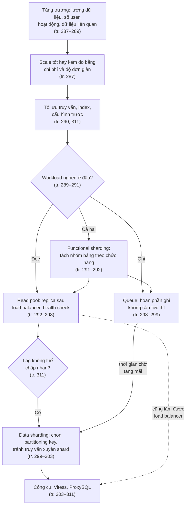

*(Sơ đồ do người viết ghi chú dựng theo thứ tự lập luận của chương.)*

---

<a id="deep"></a>

## 2. Giải thích sâu

<a id="s2-1"></a>

### 2.1 What Is Scaling? — Scaling là gì? (tr. 287–289)

<a id="scaling-definition"></a>

**What** (tr. 287). ***Scaling*** là khả năng của hệ thống hỗ trợ lưu lượng tăng dần. Hệ thống scale tốt hay kém được đánh giá bằng hai tiêu chí: **chi phí** và **độ đơn giản**. Nếu muốn tăng khả năng mở rộng mà quá đắt hay quá phức tạp, bạn sẽ tốn nhiều công sức hơn hẳn để khắc phục mỗi khi chạm giới hạn.

<a id="capacity"></a>

**Capacity khác maximum throughput** (tr. 288).

- ***Capacity*** là lượng công việc hệ thống làm được trong một khoảng thời gian.
- *Chú thích 1 (tr. 288).* Trong vật lý, công trên đơn vị thời gian gọi là *power*. Trong tin học từ "power" quá nhiều nghĩa nên tác giả tránh dùng; nói chính xác thì capacity là "công suất đầu ra tối đa" của hệ thống.
- Capacity phải được **định tính kèm điều kiện**. ***Maximum throughput*** không phải capacity. Phần lớn benchmark đo maximum throughput, nhưng hệ thống thật không thể bị đẩy tới mức đó. Nếu đẩy, hiệu năng giảm, thời gian phản hồi trở nên quá lớn và dao động mạnh.
- Sách định nghĩa ***actual capacity*** là throughput hệ thống đạt được **trong khi vẫn giữ hiệu năng chấp nhận được**.

**Phép so sánh xa lộ** (tr. 288). Capacity và scalability **độc lập với performance**:

| Khái niệm | Trên xa lộ | Diễn giải cho MySQL (**Bổ sung ngoài sách**, diễn giải của người viết ghi chú) |
| --- | --- | --- |
| Hệ thống | Xa lộ, mọi làn và mọi xe trên đó | Ứng dụng, lớp truy cập, các server MySQL |
| Performance | Xe chạy nhanh cỡ nào | Latency của từng truy vấn |
| Capacity | Số làn × tốc độ an toàn tối đa | Số server × throughput mỗi server còn đạt SLO |
| Scalability | Thêm được bao nhiêu xe và làn mà không làm giao thông chậm lại | Thêm replica hay shard mà latency không tăng |

Scalability phụ thuộc vào **nút giao** được thiết kế tốt ra sao, bao nhiêu xe gặp tai nạn hay chết máy, xe có chạy tốc độ khác nhau hay đổi làn nhiều không. Nó **không** phụ thuộc mấy vào động cơ xe mạnh tới đâu (tr. 288). Sách nhấn mạnh performance vẫn quan trọng, nhưng **hệ thống có thể scalable dù không high performance**. Nhìn từ trên cao, scalability là khả năng **tăng capacity bằng cách thêm tài nguyên** (tr. 288).

> **Bổ sung ngoài sách (diễn giải).** Với MySQL, "nút giao" là những điểm mọi request phải đi qua chung: một source duy nhất nhận ghi, một hàng bị nhiều transaction cùng sửa, một luồng replication. "Tai nạn" là node hỏng và failover. "Xe chạy tốc độ khác nhau" là truy vấn nặng nhẹ trộn lẫn: một truy vấn quét lớn giữ connection và I/O lâu, làm các truy vấn nhẹ phải chờ. "Đổi làn" giống truy vấn xuyên shard hay dữ liệu phải di chuyển giữa các node.

**Ứng dụng cũng phải scalable** (tr. 288). Kiến trúc MySQL có thể scalable trong khi ứng dụng thì không. Nếu tăng capacity khó vì **bất kỳ** lý do gì, cả hệ thống không scalable.

<a id="load-dimensions"></a>

**Bốn góc nhìn về tải** (tr. 288–289). Nhìn từ trên cao, capacity đơn giản là khả năng chịu tải. Tải nên được xét theo nhiều góc:

| Góc nhìn | Ý của sách | Ví dụ trong sách |
| --- | --- | --- |
| **Lượng dữ liệu** (*quantity of data*) | Một trong những thách thức scaling phổ biến nhất, nhất là với ứng dụng web không bao giờ xóa dữ liệu (tr. 288) | Mạng xã hội thường không xóa tin nhắn, bình luận cũ |
| **Số người dùng** (*number of users*) | Mỗi user ít dữ liệu nhưng cộng lại thành nhiều; dữ liệu có thể tăng **nhanh hơn tỷ lệ** so với số user. Nhiều user nghĩa là nhiều transaction hơn, cũng không tỷ lệ thuận. Nhiều user còn làm truy vấn phức tạp hơn khi truy vấn phụ thuộc số quan hệ giữa user; số quan hệ bị chặn trên bởi N × (N − 1) / 2 (tr. 289) | |
| **Hoạt động của user** (*user activity*) | Hoạt động không đều và không cố định. Một tính năng mới được ưa chuộng có thể làm tải tăng mạnh. Cùng số page view có thể gây nhiều việc hơn nếu phần trang "đắt" trở nên phổ biến. Có user hoạt động hơn hẳn mức trung bình (tr. 289) | User có nhiều bạn, tin nhắn, ảnh hơn bình thường |
| **Kích thước tập dữ liệu liên quan** (*size of related data sets*) | Nếu user có quan hệ với nhau, ứng dụng có thể phải truy vấn và tính toán trên cả **nhóm** user liên quan, phức tạp hơn làm việc với từng user (tr. 289) | Nhóm phổ biến, user có rất nhiều bạn |

> **Bổ sung ngoài sách (phép tính).** Chặn trên N × (N − 1) / 2 tăng theo bình phương. N = 1.000 user cho tối đa 499.500 cặp quan hệ; N = 2.000 cho 1.999.000 cặp, tức gấp khoảng 4 lần khi số user chỉ gấp đôi. Đây là lý do "số user tăng gấp đôi" không có nghĩa "tải tăng gấp đôi" với các truy vấn kiểu bạn bè của bạn bè. Xem thêm khái niệm *load parameters* ở [DDIA chương 1](../../DDIA/ddia-notes/chapter-01.md#load-parameters).

**Trade-offs và Decision.** Định nghĩa actual capacity buộc bạn trả lời "chấp nhận được" là gì. **Bổ sung ngoài sách:** câu trả lời tự nhiên là SLO của [Chương 2](chapter-02.md#sli-slo-sla), ví dụ "p99 latency của truy vấn đọc dưới 100 ms". Khi đó actual capacity là throughput lớn nhất mà p99 vẫn đạt SLO, không phải con số đỉnh của benchmark.

**Hiểu lầm phổ biến.**

- *"Hệ thống nhanh thì scale tốt."* Sai: performance và scalability độc lập (tr. 288). Một server rất nhanh nhưng chỉ có một source nhận ghi vẫn chạm trần khi lượng ghi vượt sức một máy.
- *"Benchmark cho throughput tối đa 50.000 QPS, vậy capacity là 50.000 QPS."* Sai: ở mức đó latency đã vượt mức chấp nhận được (tr. 288).
- *"Scaling chỉ là thêm máy."* Sách đo scaling bằng **chi phí và độ đơn giản** (tr. 287). Thêm máy mà kéo theo độ phức tạp vận hành lớn là scale kém.

#### Tự kiểm tra 2.1

- **Câu 2.1.1.** Vì sao sách tách *maximum throughput* khỏi *actual capacity*? Nếu một benchmark báo 50.000 QPS thì bạn còn thiếu thông tin gì để nói capacity của hệ thống? [đáp án](answers/chapter-11.md#q2-1-1)
- **Câu 2.1.2.** Theo phép so sánh xa lộ, một server MySQL có latency truy vấn rất thấp có chắc scalable không? Nêu hai yếu tố trong MySQL tương ứng với "nút giao" hay "xe đổi làn" làm giảm scalability. [đáp án](answers/chapter-11.md#q2-1-2)
- **Câu 2.1.3.** Số user của một mạng xã hội tăng gấp đôi. Vì sao lượng dữ liệu, số transaction và độ phức tạp truy vấn có thể tăng nhiều hơn gấp đôi? [đáp án](answers/chapter-11.md#q2-1-3)
- **Câu 2.1.4.** Cho một ví dụ trong đó kiến trúc MySQL scalable nhưng ứng dụng thì không. Sách đánh giá cả hệ thống thế nào trong trường hợp đó? [đáp án](answers/chapter-11.md#q2-1-4)

<a id="s2-2"></a>

### 2.2 Read- Versus Write-Bound Workloads — Workload bị giới hạn bởi đọc hay ghi (tr. 289–291)

<a id="read-write-bound"></a>

**What** (tr. 289). Một trong những việc đầu tiên khi nghĩ tới scale kiến trúc database là xác định bạn đang scale workload nào:

- ***Read-bound workload***: lượng truy vấn đọc (`SELECT`) vượt quá capacity của server.
- ***Write-bound workload***: lượng DML (`INSERT`, `UPDATE`, `DELETE`) vượt quá capacity của server.

Muốn biết mình đang ở trường hợp nào thì phải hiểu workload.

<a id="understanding-workload"></a>

#### 2.2.1 Understanding Your Workload — Hiểu workload của bạn (tr. 289–290)

**Workload là gì** (tr. 289–290).

- Trước hết, workload là capacity, tức khối lượng công việc theo thời gian. Với database, nó thường quy về **queries per second (QPS)** (tr. 289).
- Nhưng đừng ảo tưởng: 1.000 QPS ở 20% CPU **không** có nghĩa thêm được 4.000 QPS nữa. **Không phải truy vấn nào cũng như nhau** (tr. 289).
- Truy vấn có đủ dạng: đọc, ghi, tra cứu theo primary key, subquery, join, bulk insert... Mỗi loại có **chi phí** riêng, đo bằng **thời gian CPU** hay **latency**. Thời gian chờ đĩa trả dữ liệu cũng cộng vào chi phí (tr. 290). *Chú thích 2:* để đơn giản, sách bỏ qua chuyện nhiều CPU và context switch.
- Phải biết capacity của tài nguyên: có bao nhiêu CPU, giới hạn IOPS và throughput đọc, ghi của đĩa, throughput mạng. Mỗi thứ ảnh hưởng tới latency, và latency gắn trực tiếp với workload (tr. 290).
- **Workload là hỗn hợp mọi loại truy vấn cùng latency của chúng.** Nói đúng hơn: ở 1.000 QPS và 20% CPU, ta thêm được 4.000 QPS **nếu latency của chúng giữ nguyên** (tr. 290). *Chú thích 3:* ngay cả vậy cũng chưa hoàn toàn đúng, vì CPU tiến gần 100% thì latency tăng. Nếu thêm 4.000 truy vấn mà chạm trần IOPS đĩa, latency của **mọi** truy vấn đọc tăng theo (tr. 290).

> **Bổ sung ngoài sách (lý thuyết hàng đợi, xấp xỉ M/M/1).** Với một tài nguyên có thời gian phục vụ S và mức sử dụng ρ, thời gian phản hồi trung bình xấp xỉ S / (1 − ρ). Ở ρ = 20%, R ≈ 1,25 S; ở 80%, R ≈ 5 S; ở 95%, R ≈ 20 S. Đây là lý do chú thích 3 nói không thể tuyến tính hóa từ 20% CPU lên 100% CPU. Mô hình này rất đơn giản (một hàng đợi, phân bố mũ), chỉ dùng để thấy dạng đường cong.

**Đo đọc so với ghi** (tr. 290). Nếu chỉ có các chỉ số hệ thống cơ bản (CPU, bộ nhớ, đĩa), gần như **không thể** biết mình đang chạm giới hạn nào. Bạn cần xác định hiệu năng đọc so với ghi. Sách trỏ về ví dụ "Examining Read Versus Write Performance" ở tr. 62 của [Chương 3](chapter-03.md#read-write): dùng nó để tính latency của đọc so với ghi, rồi **theo dõi xu hướng theo thời gian** để thấy latency đọc hay ghi đang tăng, tức mình bị giới hạn ở đâu.

**Evidence & example — Kết quả đã đo** (MySQL 8.0.42, Windows 11, instance riêng cấu hình mặc định, bảng 200.000 hàng; chi tiết ở [thí nghiệm 1](experiments/chapter-11.md)). Hai workload có **cùng tỷ lệ số câu**: 5.000 `SELECT` theo primary key và 50 `UPDATE`. Khác nhau ở chỗ `UPDATE` của workload A sửa 2.000 hàng mỗi câu, còn của workload B sửa 1 hàng.

| Workload | Số câu SELECT : UPDATE | Thời gian SELECT (trung vị 3 lần) | Thời gian UPDATE (trung vị 3 lần) | Tỷ trọng thời gian của UPDATE | Hàng bị sửa |
| --- | --- | --- | --- | --- | --- |
| A | 5.003 : 50 | 871 ms | 1.451 ms | ≈ 62% | 100.000 |
| B | 5.003 : 50 | 1.020 ms | 113 ms | ≈ 10% | 50 |

*(Số SELECT là 5.003 vì client `mysql` tự gửi thêm vài câu; thời gian đo trên laptop Windows nhiều nhiễu, không phải benchmark production.)* Nếu chỉ đếm số câu, cả hai workload đều trông "99% đọc". Theo **thời gian** và **số hàng bị ghi**, workload A nghiêng hẳn về ghi. Đây chính là ý "không phải truy vấn nào cũng như nhau" (tr. 289).

> **Bổ sung ngoài sách (Kết quả đã đo, cảnh báo về chương 3).** Truy vấn ở tr. 62 cộng cột `LOCK_TIME` rồi chia 1.000.000 và đặt tên cột là "latency_ms". Trong Performance Schema, `LOCK_TIME` tính bằng **picosecond** và chỉ là thời gian chờ lock, **không phải** tổng latency. Khi chạy lại truy vấn kiểu đó trên workload A, cột "lock" xếp `SELECT` lên đầu (7.470, thực ra là micro giây), trong khi `TIMER_WAIT` (tổng thời gian) xếp `UPDATE` lên đầu (1.495 ms so với 854 ms). Muốn so latency đọc và ghi, hãy dùng `SUM_TIMER_WAIT`, như truy vấn minh họa dưới đây.

```sql
-- Ví dụ minh họa do AI xây dựng (đã chạy được trên MySQL 8.0.42)
SELECT EVENT_NAME, COUNT_STAR,
       ROUND(SUM_TIMER_WAIT / 1e12, 2) AS total_s,     -- picosecond -> giây
       SUM_ROWS_EXAMINED, SUM_ROWS_AFFECTED
FROM performance_schema.events_statements_summary_global_by_event_name
WHERE EVENT_NAME IN ('statement/sql/select', 'statement/sql/insert',
                     'statement/sql/update', 'statement/sql/delete')
ORDER BY SUM_TIMER_WAIT DESC;
```

Bảng tổng hợp này cộng dồn từ lúc server khởi động hoặc từ lần `TRUNCATE` gần nhất. Muốn thấy **xu hướng** như sách khuyên (tr. 290), hãy chụp định kỳ và lấy hiệu giữa hai lần chụp.

<a id="read-bound"></a>

#### 2.2.2 Read-Bound Workloads — Workload giới hạn bởi đọc (tr. 290)

**Tình huống điển hình** (tr. 290). Khi mới thiết kế sản phẩm, bạn đi đường tắt: **một source** cho mọi lưu lượng database. Thêm node ứng dụng thì scale được số client phục vụ request, nhưng cuối cùng bị chặn bởi khả năng trả lời đọc của một host source duy nhất.

**Dấu hiệu** (tr. 290):

- **Chỉ báo chính là CPU.** CPU cao nghĩa là server dành toàn bộ thời gian xử lý truy vấn. CPU càng cao, latency truy vấn càng tăng.
- Không chỉ CPU: **IOPS hay throughput đọc đĩa cao** cho thấy server phải xuống đĩa rất thường xuyên, hoặc đọc rất nhiều hàng từ đĩa.

**Thứ tự xử lý** (tr. 290): trước hết **thêm index, tối ưu truy vấn, cache** những dữ liệu cache được. Khi hết cách cải thiện, phần còn lại là read-bound thật, và đó là lúc **scale đọc bằng replica**.

> **Bổ sung ngoài sách (cơ chế vật lý).** "Xuống đĩa nhiều" thường nghĩa là *working set* không còn vừa buffer pool ([Chương 4](chapter-04.md#working-set), [Chương 5](chapter-05.md#buffer-pool)). Hai bộ đếm hữu ích: `Innodb_buffer_pool_read_requests` (đọc logic) và `Innodb_buffer_pool_reads` (đọc phải lấy từ đĩa). "Đọc rất nhiều hàng" thì xem tỷ lệ rows examined trên rows sent của từng digest ([Chương 8](chapter-08.md#rows-examined)). Hai trường hợp có cách sửa khác nhau: thiếu index là lỗi truy vấn, sửa tại chỗ; working set quá RAM là vấn đề capacity, có thể cần replica hoặc máy nhiều RAM hơn.

<a id="write-bound"></a>

#### 2.2.3 Write-Bound Workloads — Workload giới hạn bởi ghi (tr. 291)

**Ví dụ** (tr. 291): lượt đăng ký tăng theo cấp số nhân; mùa cao điểm thương mại điện tử với số đơn hàng tăng vọt; mùa bầu cử với lượng thông tin vận động gửi đi rất lớn. Mỗi trường hợp là một nhu cầu kinh doanh dẫn tới lượng ghi tăng theo cấp số nhân.

**Why replica không cứu được** (tr. 291). Database một source, dù **scale theo chiều dọc** được một thời gian, cũng chỉ đi được tới một mức. Khi nút thắt là **khối lượng ghi**, phải nghĩ cách **chia dữ liệu** để nhận ghi **song song** trên các tập con riêng. [Chương 9](chapter-09.md#s2-1) nói thêm: gắn nhiều replica vào một source chỉ khiến mỗi lần ghi được làm lại nhiều lần, mỗi replica một lần (tr. 228).

> **Bổ sung ngoài sách (vì sao ghi đắt, theo đường ghi của InnoDB).** Mỗi commit với cấu hình mặc định của 8.0 (`innodb_flush_log_at_trx_commit=1`, `sync_binlog=1`) phải ghi redo log và binary log xuống đĩa bền vững; trang bị sửa (dirty page) sau đó còn phải được flush; hàng đang sửa bị khóa nên các transaction cùng đụng một hàng phải xếp hàng; replica phải áp lại toàn bộ thay đổi. **Kết quả đã đo** ở [thí nghiệm 1](experiments/chapter-11.md): 50 `UPDATE` sửa tổng 100.000 hàng sinh khoảng 9,6 MB redo (`Innodb_os_log_written`, lần chạy 2 và 3), trong khi 50 `UPDATE` một hàng chỉ sinh khoảng 0,13 MB.

<a id="both-growth"></a>

**Nếu cả đọc và ghi cùng tăng** (tr. 291). Hãy soi kỹ schema xem có **một nhóm bảng** tăng nhanh về đọc và **một nhóm khác** tăng về ghi không. Cố scale một cluster cho **cả hai cùng lúc** là tự chuốc lấy đau đớn và sự cố. Sách khuyên tách các bảng vào những **cluster chức năng** khác nhau để scale đọc và ghi độc lập; đây là **điều kiện tiên quyết** để scale đọc bằng read pool hiệu quả hơn nhiều.

> **Bổ sung ngoài sách (diễn giải vì sao).** Read pool chỉ tốt khi replica theo kịp source. Nếu cùng cluster có một nhóm bảng ghi rất nặng, replica liên tục phải áp lượng ghi đó và dễ lag, làm hỏng luôn phần đọc của các bảng khác vốn không cần ghi nhiều. Tách ra thì cluster nặng đọc có replica ít lag, còn cluster nặng ghi được xử lý bằng queue hoặc shard.

**Hiểu lầm phổ biến.**

- *"Đa số câu là SELECT nên hệ thống read-bound."* Tỷ lệ số câu không nói lên tỷ lệ chi phí. Kết quả đo ở trên cho thấy 1% số câu có thể chiếm 62% thời gian.
- *"CPU còn 80% trống nên còn gấp 5 lần capacity."* Chú thích 3 (tr. 290) và giới hạn IOPS cho thấy điều này sai.
- *"Thêm replica sẽ giảm tải ghi."* Replica không chia tải ghi; mỗi replica cũng phải ghi toàn bộ (tr. 228 ở Chương 9; tr. 291).

#### Tự kiểm tra 2.2

- **Câu 2.2.1.** Hệ thống đang chạy 1.000 QPS ở 20% CPU. Khi nào thì thêm được 4.000 QPS nữa, và hai lý do nào khiến điều đó thường không xảy ra? [đáp án](answers/chapter-11.md#q2-2-1)
- **Câu 2.2.2.** Nếu chỉ có chỉ số CPU, bộ nhớ, đĩa, vì sao gần như không thể biết hệ thống read-bound hay write-bound? Bạn sẽ thu thêm số liệu gì từ MySQL? [đáp án](answers/chapter-11.md#q2-2-2)
- **Câu 2.2.3.** Hai dấu hiệu của read-bound là gì? Trước khi thêm replica, sách bảo làm những việc gì, và vì sao thứ tự đó hợp lý? [đáp án](answers/chapter-11.md#q2-2-3)
- **Câu 2.2.4.** Dự đoán: một workload có 99% số câu là SELECT nhưng 50 câu UPDATE mỗi câu sửa 2.000 hàng. Nếu xếp hạng theo số câu và theo tổng thời gian, kết quả khác nhau thế nào? Đối chiếu với kết quả đo. [đáp án](answers/chapter-11.md#q2-2-4)
- **Câu 2.2.5.** Khi cả đọc lẫn ghi cùng tăng, sách khuyên làm gì trước, và vì sao đó là điều kiện tiên quyết cho read pool? [đáp án](answers/chapter-11.md#q2-2-5)

<a id="s2-3"></a>

### 2.3 Functional Sharding — Tách dữ liệu theo chức năng (tr. 291–292)

<a id="functional-sharding"></a>

**What** (tr. 291; tr. 34 ở [Chương 2](chapter-02.md#functional-horizontal-sharding)). ***Functional sharding*** là tách các bảng phục vụ **một chức năng kinh doanh** sang một cluster riêng, để quản lý riêng uptime, hiệu năng, thậm chí quyền truy cập của tập dữ liệu đó. Chương 2 phân biệt nó với *horizontal sharding*: tập dữ liệu lớn quá sức một cluster nên được chia ra nhiều cluster, kèm cơ chế tra cứu để biết phần cần tìm nằm đâu (tr. 34–35).

**Why khó** (tr. 291). Chia theo "chức năng" là việc **nặng ngữ cảnh**, cần hiểu sâu dữ liệu là gì. Nó đi cùng các kiến trúc phần mềm phổ biến như **SOA** và **microservices**. Không phải cách chia nào cũng tốt như nhau. Ví dụ cường điệu: đặt **mỗi bảng vào một database "chức năng" riêng** chắc chắn làm mọi thứ tệ hơn vì phân mảnh quá mức.

**How: ba nguyên tắc** (tr. 291–292):

| Nguyên tắc | Lý do và ví dụ của sách |
| --- | --- |
| **Không** chia theo cấu trúc đội kỹ thuật | Cấu trúc đội **luôn** thay đổi vào lúc nào đó (tr. 291) |
| **Hãy** chia theo chức năng kinh doanh | Bảng phục vụ đăng ký tài khoản có thể tách khỏi bảng chứa thiết lập của khách hàng hiện có; bảng của một tính năng mới nên bắt đầu ở database riêng (tr. 292) |
| **Đừng né** những chỗ các mối quan tâm kinh doanh bị trộn lẫn | Phải vận động không chỉ tách dữ liệu mà cả **refactor ứng dụng** và đưa vào **truy cập qua API** giữa các ranh giới. Ví dụ hay gặp: trộn **danh tính khách hàng** với **thanh toán** (tr. 292) |

Lúc đầu sẽ có những bảng rõ ràng có chức năng và kiểu truy cập riêng, dễ tách sang cluster khác. Càng về sau, việc tách càng tinh tế hơn (tr. 292).

**Trade-offs** (**Bổ sung ngoài sách**, trừ chỗ ghi trang):

- *Lợi:* mỗi cluster scale độc lập (sách nêu ví dụ user và billing ở tr. 299); dữ liệu nhỏ hơn nên backup và phục hồi nhanh hơn, giúp đạt mục tiêu phục hồi (tr. 35 ở Chương 2); tách quyền truy cập theo rủi ro dữ liệu (tr. 332 ở Chương 13).
- *Mất:* không còn `JOIN`, foreign key hay transaction giữa hai nhóm bảng ở hai cluster. Truy cập chéo phải đi qua API, nên ứng dụng phải chịu thêm độ trễ mạng và tự xử lý tính nhất quán.

**Evidence & example.** **Bổ sung ngoài sách:** để tìm "nhóm bảng tăng nhanh về đọc và nhóm khác tăng về ghi" (tr. 291), Performance Schema có bộ đếm đọc, ghi theo từng bảng. Truy vấn dưới đã chạy trên MySQL 8.0.42; kết quả ở thí nghiệm cho thấy bảng `orders` có số lần ghi gần bằng số lần đọc, còn các bảng `posts` chủ yếu được đọc.

```sql
-- Ví dụ minh họa do AI xây dựng
SELECT OBJECT_SCHEMA, OBJECT_NAME, COUNT_READ, COUNT_WRITE,
       ROUND(SUM_TIMER_READ  / 1e12, 2) AS read_s,
       ROUND(SUM_TIMER_WRITE / 1e12, 2) AS write_s
FROM performance_schema.table_io_waits_summary_by_table
WHERE OBJECT_SCHEMA NOT IN ('mysql', 'performance_schema', 'sys')
ORDER BY SUM_TIMER_WAIT DESC
LIMIT 10;
```

Muốn biết **ứng dụng nào** dùng bảng nào thì mỗi ứng dụng nên có database user riêng, đúng như [Chương 13](chapter-13.md#separate-users) và tr. 309 khuyên; khi đó có thể lọc theo user trong các bảng tổng hợp của Performance Schema.

**Hiểu lầm phổ biến.**

- *"Microservices nên mỗi service, thậm chí mỗi bảng, một database."* Sách cảnh báo phân mảnh quá mức làm mọi thứ tệ hơn (tr. 291).
- *"Tách dữ liệu là việc của DBA."* Sách nói phải kèm refactor ứng dụng và API giữa các ranh giới (tr. 292).

#### Tự kiểm tra 2.3

- **Câu 2.3.1.** Vì sao sách khuyên không chia database theo cấu trúc đội kỹ thuật? Điều gì xảy ra hai năm sau nếu bạn làm vậy? [đáp án](answers/chapter-11.md#q2-3-1)
- **Câu 2.3.2.** "Mỗi bảng một database" sai ở đâu? Nêu ít nhất hai chi phí cụ thể với MySQL. [đáp án](answers/chapter-11.md#q2-3-2)
- **Câu 2.3.3.** Bảng danh tính khách hàng và bảng thanh toán đang được `JOIN` trong nhiều truy vấn. Muốn tách chúng sang hai cluster, ngoài việc di chuyển dữ liệu bạn còn phải làm gì? [đáp án](answers/chapter-11.md#q2-3-3)
- **Câu 2.3.4.** Ngoài hiệu năng, functional sharding giúp gì cho phục hồi sau thảm họa và compliance? Dẫn trang ở chương 2 và 13. [đáp án](answers/chapter-11.md#q2-3-4)

<a id="s2-4"></a>

### 2.4 Scaling Reads with Read Pools — Scale đọc bằng read pool (tr. 292–298)

<a id="read-pool"></a>

**Why replica phục vụ đọc được** (tr. 292). Replica trong cluster có nhiều vai trò. **Trước hết**, chúng là **ứng viên failover** cho việc ghi, có kế hoạch hay không, khi source phải rời khỏi dịch vụ. Nhưng vì chúng **liên tục áp thay đổi** để khớp dữ liệu với source, ta có thể dùng chúng để phục vụ đọc.

**Hình 11-1** (tr. 292): node ứng dụng dùng một **virtual IP** để truy cập các read replica.

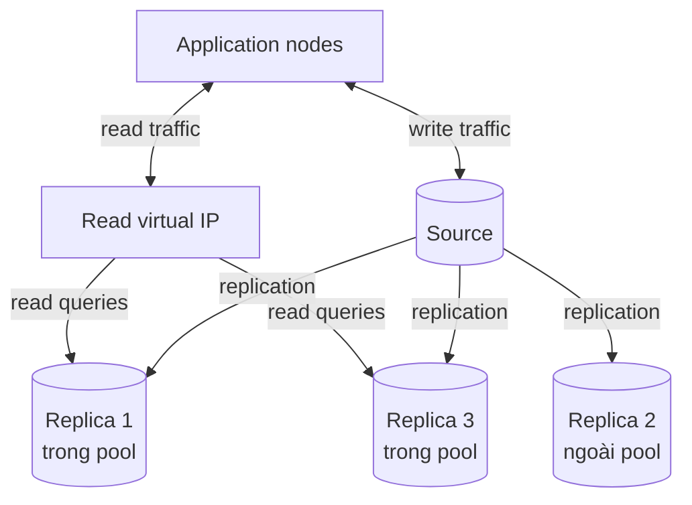

*(Vẽ lại Hình 11-1, tr. 292, theo ảnh trang. Trong hình gốc, mũi tên "Read queries" chỉ đi tới replica trái và phải; replica giữa nhận replication nhưng không nằm trong pool. Nhãn "trong pool, ngoài pool" do người viết ghi chú thêm.)*

**How** (tr. 293).

- Để đơn giản, node ứng dụng vẫn **ghi thẳng vào source**; sách hẹn sẽ bàn cách kết nối source scale tốt hơn (về sau là ProxySQL, Vitess).
- Cùng các node đó kết nối tới một **virtual IP**, đóng vai lớp trung gian giữa ứng dụng và read replica. Đó là ***replica read pool***, cách trải lượng đọc tăng dần ra nhiều host.
- **Không phải replica nào cũng nằm trong pool.** Đây là cách phổ biến để các loại workload đọc không ảnh hưởng nhau. Nếu tiến trình báo cáo hay backup ngốn hết I/O đĩa và gây replication lag, hãy để riêng một hay vài replica cho các việc đó, loại khỏi pool phục vụ khách hàng.
- Cách khác: thêm **kiểm tra replication** vào health check của load balancer, để node backup bị tụt lại **tự động bị loại** khỏi pool rồi **được đưa lại** khi đã theo kịp.
- Khi ứng dụng chỉ nói chuyện với **một điểm duy nhất** để đọc, các replica trở thành tài nguyên **thay thế được cho nhau**, quản lý mà khách hàng không bị ảnh hưởng.

**Tám câu hỏi để vận hành êm** (tr. 293), nhóm lại theo chủ đề:

| Nhóm | Câu hỏi |
| --- | --- |
| Định tuyến và phân tải | Định tuyến lưu lượng tới các replica thế nào? Phân tải đều ra sao? |
| Sức khỏe | Chạy health check và loại replica không khỏe hay bị lag thế nào để không trả dữ liệu cũ? Làm sao tránh vô tình loại **hết** node, gây hại còn lớn hơn? |
| Thành viên | Chủ động gỡ một server để bảo trì thế nào? Thêm server mới vào load balancer thế nào? Có kiểm tra tự động nào ngăn đưa node mới vào khi **chưa sẵn sàng**? Định nghĩa "sẵn sàng" có đủ cụ thể chưa? |

**Load balancer và virtual IP** (tr. 293). Cách rất phổ biến là dùng load balancer chạy một virtual IP làm trung gian cho mọi lưu lượng tới read replica: **HAProxy**, load balancer phần cứng nếu tự host, hay network load balancer nếu ở public cloud. Với HAProxy, mọi host ứng dụng kết nối tới một "frontend", và HAProxy chuyển request tới một replica trong "backend".

<a id="haproxy-config"></a>

**Cấu hình HAProxy mẫu** (tr. 294). Sách in một tệp cấu hình ngắn. Nội dung của nó, mô tả bằng bảng:

| Khối | Chỉ thị (theo listing tr. 294) | Ý nghĩa |
| --- | --- | --- |
| `global` | ghi log tới syslog cục bộ mức `notice`; chạy dưới user và group `haproxy` | Thiết lập tiến trình |
| `defaults` | `retries 2`; `timeout connect` 3000; `timeout server` 5000; `timeout client` 5000 | Số lần thử kết nối lại và các ngưỡng timeout |
| `listen mysql-readpool` | `bind 127.0.0.1:3306`, `mode tcp` | Nghe cổng MySQL chuẩn, chuyển tiếp TCP thuần |
| | `option mysql-check user haproxy_check` | Health check bằng giao thức MySQL với user `haproxy_check` |
| | `balance leastconn` | Kết nối mới đi tới server có ít kết nối nhất |
| | hai dòng `server` tới `10.0.0.1:3306` và `10.0.0.2:3306`, có `check` | Hai replica trong backend, đều được kiểm tra |

Những điểm sách nhấn mạnh (tr. 294):

- Thường dùng **configuration management** để tự sinh tệp này.
- **`leastconn` là cách được khuyên dùng với MySQL.** Cân bằng kiểu ngẫu nhiên như `roundrobin` không giúp dồn tải sang host chưa quá tải khi tải tăng cao.
- Phải tạo **đúng database user** cho health check trên mọi instance, nếu không **mọi node bị đánh dấu không khỏe**.
- Vitess và ProxySQL cũng làm được load balancer (bàn ở cuối chương).

> **Bổ sung ngoài sách (đọc kỹ listing; theo hiểu biết về HAProxy, nên kiểm lại với phiên bản bạn dùng).**
> - Timeout của HAProxy mặc định tính bằng **mili giây**. `timeout client` và `timeout server` là thời gian **không hoạt động** tối đa. Với 5000 ms, một kết nối nằm im trong connection pool của ứng dụng quá 5 giây sẽ bị cắt, và ứng dụng sẽ gặp lỗi "server has gone away" khi dùng lại nó. Hãy chỉnh cho khớp với thiết lập idle của pool.
> - `bind 127.0.0.1:3306` nghĩa là HAProxy nghe trên **loopback**, tức chỉ tiến trình trên cùng máy kết nối được. Điều đó hợp với mô hình **mỗi host ứng dụng chạy một HAProxy cục bộ**, khác với hình ảnh "một virtual IP chung" trong phần chữ. Nếu chạy cục bộ, mỗi HAProxy tự health check mọi replica, nên số lượt kiểm tra nhân theo số host ứng dụng.
> - `mode tcp` nghĩa là HAProxy **không hiểu SQL**. Nó không tách được đọc và ghi theo câu lệnh; ứng dụng phải tự chọn endpoint đọc hay ghi. ProxySQL ở [2.6.5](#proxysql) thì hiểu giao thức MySQL.
> - `mysql-check` chỉ kiểm tra MySQL trả lời bắt tay đăng nhập, tương đương một **port check** mạnh hơn chút; nó **không** phát hiện lag. User kiểm tra thường được tạo không mật khẩu và không có quyền gì.

<a id="read-pool-config"></a>

#### 2.4.1 Managing Configuration for Read Pools — Quản lý cấu hình read pool (tr. 294–295)

**Why không quản lý bằng tay** (tr. 294). Khi đã có "cổng" giữa ứng dụng và replica, bạn cần cách dễ dàng quản lý node nào nằm trong pool. Đừng để cấu hình này **quản lý thủ công**: bạn đang trên đà có rất nhiều instance; sửa tệp bằng tay sẽ dẫn tới sai sót, phản ứng chậm và host hỏng, và đơn giản là không scale.

<a id="service-discovery"></a>

**How: service discovery** (tr. 294–295).

- ***Service discovery*** là lựa chọn tốt để tự động phát hiện host nào được vào danh sách: tự triển khai trong hạ tầng, hoặc dùng dịch vụ có sẵn của nhà cung cấp cloud (tr. 294). *Chú thích 4 (tr. 295):* công cụ phổ biến nhất và được tác giả khuyên là **Consul** của HashiCorp (thời điểm 2021).
- Phải **rất cụ thể** về tiêu chí để một replica được vào pool. Lý tưởng là loại source và có thể loại một hay vài replica dành cho báo cáo. Có khi cần phức tạp hơn: replica được chia nhóm để phục vụ các loại đọc khác nhau của ứng dụng (tr. 294).
- Sách khuyên **tối thiểu ba node cho mỗi pool phục vụ một mục đích**, cộng thêm server backup hay báo cáo và source (tr. 294–295).

> **Bổ sung ngoài sách (phép tính).** Một cluster có hai pool (web và API) theo khuyến nghị trên cần ít nhất 3 + 3 replica trong pool, 1 replica backup hay báo cáo và 1 source, tức 8 server. Sách không giải thích con số ba; một cách hiểu là khi một node đang bảo trì và một node khác hỏng, pool vẫn còn một node phục vụ.

**Năm câu hỏi về đảm bảo của service discovery** (tr. 295):

1. Phát hiện host hỏng nhanh tới đâu?
2. Thông tin lan truyền nhanh tới đâu?
3. Khi một instance hỏng, cấu hình trên load balancer được làm mới thế nào?
4. Thay đổi thành viên diễn ra ở nền, hay phải cắt các kết nối đang có?
5. Nếu chính service discovery sập thì sao? Nó chặn mọi kết nối mới, hay chỉ chặn việc đổi thành viên của load balancer? Lúc đó có sửa tay được không?

**Trade-offs và Decision** (tr. 295). Linh hoạt luôn đi kèm phức tạp; phải cân bằng hai thứ để có kết quả tốt khi sự cố xảy ra. Mọi quyết định nên **neo vào SLI và SLO** đang theo đuổi, **không** nhắm tới một mục tiêu 100% uptime huyền thoại.

> **Bổ sung ngoài sách.** Bài toán "client biết gửi request tới node nào" là *request routing*, và service discovery là một lời giải; xem [DDIA chương 6, service discovery](../../DDIA/ddia-notes/chapter-06.md#service-discovery). Về thời điểm: HashiCorp đổi giấy phép các sản phẩm của mình, trong đó có Consul, sang Business Source License vào năm 2023, sau khi sách ra; điều này có thể ảnh hưởng tới lựa chọn công cụ hiện nay.

<a id="health-check"></a>

#### 2.4.2 Health Checks for Read Pools — Health check cho read pool (tr. 295–296)

**What** (tr. 295). Phải xác định tiêu chí để coi một replica là **khỏe** và **sẵn sàng** nhận đọc. Tiêu chí có thể đơn giản ("process chạy, cổng trả lời") hoặc phức tạp ("database chạy, replication lag không quá 30 giây, truy vấn đọc chạy với latency không quá 100 ms").

> **Mẹo của sách** (tr. 295). Kiểm tra trạng thái của `read_only` và `super_read_only` để chắc rằng mọi thành viên trong read pool của load balancer **thực sự là replica**.

> **Bổ sung ngoài sách + Kết quả đã đo** ([thí nghiệm 2](experiments/chapter-11.md)). Vì sao phải xem cả hai biến: với `read_only=ON`, user thường bị chặn ghi (lỗi 1290) nhưng **root vẫn ghi được**, vì user có quyền `CONNECTION_ADMIN` hay `SUPER` được miễn. Chỉ khi bật `super_read_only=ON` thì root mới bị chặn. Bật `super_read_only` tự bật `read_only`; tắt `read_only` tự tắt `super_read_only`. `super_read_only` có từ MySQL **5.7.8**.

**Thống nhất với đội phát triển** (tr. 296). Health check sâu tới đâu nên là cuộc trao đổi với các đội ứng dụng, để mọi người hiểu và đồng ý về hành vi mong đợi khi đọc. Năm câu hỏi gợi ý:

1. Dữ liệu cũ tới mức nào thì chấp nhận được? Nếu dữ liệu trả về cũ vài phút thì ảnh hưởng gì?
2. Latency truy vấn tối đa chấp nhận được là bao nhiêu?
3. Truy vấn đọc có logic thử lại không? Nếu có, có **exponential backoff** không?
4. Ứng dụng đã có SLO chưa? SLO đó có bao gồm latency truy vấn hay chỉ uptime?
5. Hệ thống cư xử ra sao khi **thiếu** dữ liệu này? Mức suy giảm đó có chấp nhận được không, và trong bao lâu?

**Hai mức health check** (tr. 296):

| Mức | Cách làm | Khi nào dùng |
| --- | --- | --- |
| **Port check** | Xác nhận process MySQL sống và nhận kết nối; database còn chạy là còn trong pool | **Nhiều trường hợp** chỉ cần vậy |
| **HTTP check** | Load balancer gọi một đường dẫn HTTP, ví dụ `option httpchk GET /check-lag` trong HAProxy; đường dẫn đó chạy script chứa logic lag chấp nhận được, so lag hiện tại với ngưỡng, rồi trả mã HTTP; load balancer dựa vào mã để coi replica khỏe hay không | Dữ liệu đủ quan trọng để **không** muốn phục vụ khi lag quá vài giây hoặc replication không chạy |

> **Cảnh báo của sách** (tr. 296). Health check mạnh nhưng hãy cẩn thận với logic phức tạp như kiểm tra lag. Phải có kế hoạch cho trường hợp **mọi** replica trong pool cùng trượt health check. Có thể dùng một pool **"fallback" tĩnh** đưa mọi node trở lại khi gặp lỗi toàn cục (ví dụ cả cluster cùng lag), để không vô tình làm hỏng toàn bộ truy vấn đọc. Sách dẫn một bài trên blog của GitHub về cách một công ty đã làm điều này.

Luồng quyết định dưới đây ghép mẹo và cảnh báo của sách thành một health check có tầng:

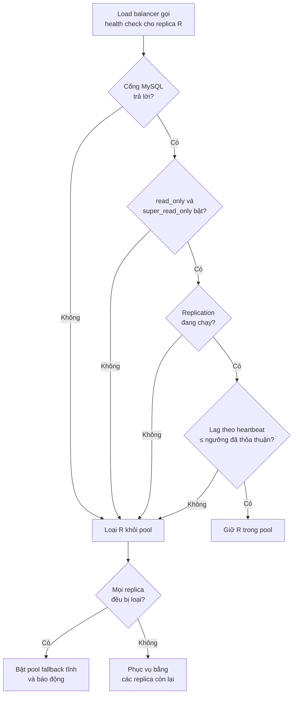

*(Ví dụ minh họa do AI xây dựng, dựa trên tr. 295–296. Bước "heartbeat" lấy từ Chương 9, tr. 248–249.)*

> **Bổ sung ngoài sách.**
> - **Đo lag thế nào.** [Chương 9](chapter-09.md#replication-lag) giải thích `Seconds_Behind_Source` không đáng tin (báo 0 khi replication hỏng, NULL khi thread dừng, dao động với transaction dài) và khuyên dùng **heartbeat**, ví dụ pt-heartbeat (tr. 248–249). Script `/check-lag` nên đọc heartbeat. Tên `SHOW REPLICA STATUS` và cột `Seconds_Behind_Source` có từ **8.0.22**; bản cũ hơn dùng `SHOW SLAVE STATUS` và `Seconds_Behind_Master`.
> - **Kết quả đã đo** ([thí nghiệm 2](experiments/chapter-11.md), giả lập trên một instance). Một check "ngây thơ" chỉ so heartbeat với ngưỡng 30 giây trả "khỏe" cả khi chạy trên **source** (heartbeat luôn mới) và trên một node có `super_read_only=ON` nhưng **replication không chạy**. Check "chặt" theo sơ đồ trên loại cả hai trường hợp. Trên máy không phải replica, `SHOW REPLICA STATUS` trả **tập rỗng**; script phải coi đó là "không phải replica", không phải "lag bằng 0".
> - **Fallback trong HAProxy.** HAProxy có khái niệm server `backup`, chỉ nhận lưu lượng khi mọi server chính đều bị đánh dấu hỏng; đó là một cách hiện thực ý "pool fallback tĩnh". Đây là gợi ý cơ chế, cần kiểm lại tài liệu HAProxy.

**Hiểu lầm phổ biến.**

- *"Health check càng thông minh càng an toàn."* Check phức tạp có thể loại **toàn bộ** pool cùng lúc khi cả cluster lag (tr. 296), biến một sự cố "dữ liệu hơi cũ" thành sự cố "không đọc được gì".
- *"Port check là đủ cho mọi thứ."* Sách nói đủ cho **nhiều** trường hợp, không phải mọi trường hợp; dữ liệu quan trọng cần check lag (tr. 296).

<a id="lb-algorithm"></a>

#### 2.4.3 Choosing a Load-Balancing Algorithm — Chọn thuật toán cân bằng tải (tr. 297–298)

**Các thuật toán** (tr. 297). Mỗi hãng gọi một kiểu, nhưng đại thể có:

| Thuật toán | Cách chọn server cho kết nối kế tiếp (tr. 297) | Lưu ý với MySQL |
| --- | --- | --- |
| **Random** | Ngẫu nhiên trong các server khả dụng | Không xét tải hiện tại |
| **Round-robin** | Lần lượt A, B, C, A, B, C... | Sách: không giúp dồn tải sang host chưa quá tải khi tải tăng cao (tr. 294) |
| **Fewest connections** (`leastconn`) | Server có ít kết nối đang hoạt động nhất | Được khuyên dùng (tr. 294); nhưng có thể **dội tải vào server mới** khi cache của nó còn lạnh (tr. 297) |
| **Fastest response** | Server đang xử lý nhanh nhất | Hợp khi pool trộn máy nhanh và chậm, nhưng **rất khó** với SQL vì độ phức tạp truy vấn chênh lệch lớn; cùng một truy vấn có thể nhanh chậm khác nhau tùy có được phục vụ từ query cache hay cache đã có dữ liệu chưa |
| **Hashed** | Băm IP nguồn của kết nối; cùng IP luôn tới cùng server | Ánh xạ chỉ đổi khi số máy trong pool đổi |
| **Weighted** | Kết hợp và đặt trọng số cho các thuật toán khác | Máy hai CPU mạnh gấp đôi máy một CPU thì nhận trung bình gấp đôi request |

> **Lưu ý phiên bản.** Query cache mà sách nhắc ở dòng "Fastest response" đã bị **deprecated từ 5.7.20 và gỡ bỏ ở MySQL 8.0**. Với 8.0, ý "cùng truy vấn nhanh chậm khác nhau" chủ yếu đến từ buffer pool đã ấm hay chưa.

**Không có thuật toán tốt nhất chung** (tr. 297). Tốt nhất cho MySQL tùy workload. Phải **thử nghiệm**, và xét cả lúc **bất thường** chứ không chỉ ngày thường: tải truy vấn cao, đang đổi schema, hay một số lượng bất thường server cùng offline. Đó là lúc bạn ít chịu nổi sai sót nhất.

<a id="queuing-algorithm"></a>

**Thuật toán có xếp hàng** (tr. 298). Các thuật toán trên là loại ***instant-provisioning***: không xếp hàng yêu cầu kết nối. Đôi khi thuật toán **có hàng đợi** hiệu quả hơn, ví dụ giữ một mức concurrency nhất định trên server, như không quá N transaction hoạt động cùng lúc. Nếu quá nhiều, yêu cầu mới vào hàng đợi và được phục vụ bởi server đầu tiên "rảnh" theo tiêu chí. Một số connection pool hỗ trợ kiểu này.

**Mâu thuẫn cần hòa giải.** Sách khuyên `leastconn` (tr. 294) nhưng cũng cảnh báo nó dội tải vào server mới có cache lạnh (tr. 297). **Bổ sung ngoài sách:** ba cách giảm rủi ro:

1. **Tăng trọng số dần.** HAProxy có tham số `slowstart` cho server, tăng dần trọng số trong một khoảng thời gian sau khi server lên lại.
2. **Làm ấm buffer pool trước.** InnoDB có `innodb_buffer_pool_dump_at_shutdown` và `innodb_buffer_pool_load_at_startup` (mặc định bật từ 5.7.7; đã kiểm trên 8.0.42 là `1`). Trạng thái xem ở `Innodb_buffer_pool_load_status`. Đưa "đã nạp xong buffer pool" vào định nghĩa **"sẵn sàng"** mà sách yêu cầu phải cụ thể (tr. 293).
3. **Cẩn thận với connection pool dài hạn.** `leastconn` cân bằng **số kết nối**, không phải số truy vấn. Nếu ứng dụng giữ kết nối lâu, cân bằng chỉ xảy ra lúc mở kết nối; một replica vừa quay lại có thể nhận rất ít tải cho tới khi pool của ứng dụng tái tạo kết nối. Đặt tuổi thọ tối đa cho kết nối giúp phân phối lại.

> **Bổ sung ngoài sách.** Với **hashed**, nếu chỉ có vài host ứng dụng, hoặc lưu lượng đi qua NAT nên nhiều client chung một IP, tải sẽ lệch nặng. Khi số máy trong pool đổi, nhiều client bị ánh xạ lại cùng lúc, giống vấn đề "hash mod N" ở [DDIA chương 6](../../DDIA/ddia-notes/chapter-06.md#hash-mod-n). Còn **weighted** khớp với ví dụ của [Chương 9](chapter-09.md#read-pool): node 32 core nhận gấp bốn lần lưu lượng so với node 8 core (tr. 243). Thuật toán có xếp hàng liên hệ với `innodb_thread_concurrency` ở [Chương 5](chapter-05.md#innodb-thread-concurrency) (tr. 119): cả hai đều giới hạn số việc chạy đồng thời để tránh tranh chấp.

#### Tự kiểm tra 2.4

- **Câu 2.4.1.** Vì sao hình 11-1 để một replica ngoài read pool? Sách đưa ra cách nào khác để đạt cùng mục đích mà vẫn giữ node đó trong pool? [đáp án](answers/chapter-11.md#q2-4-1)
- **Câu 2.4.2.** Sách khuyên `leastconn` thay vì `roundrobin`, nhưng cũng nói `leastconn` có thể gây hại. Giải thích cả hai mặt và nêu hai cách giảm rủi ro. [đáp án](answers/chapter-11.md#q2-4-2)
- **Câu 2.4.3.** Một migration lớn làm mọi replica lag 3 phút. Health check lag với ngưỡng 30 giây sẽ gây ra điều gì? Sách đề xuất chuẩn bị gì, và quyết định cuối cùng nên dựa vào đâu? [đáp án](answers/chapter-11.md#q2-4-3)
- **Câu 2.4.4.** Vì sao sách khuyên kiểm tra cả `read_only` lẫn `super_read_only`? Dự đoán chuyện gì xảy ra nếu sau một failover, source mới bị service discovery đưa nhầm vào read pool. [đáp án](answers/chapter-11.md#q2-4-4)
- **Câu 2.4.5.** Service discovery bị sập 10 phút. Những câu hỏi nào ở tr. 295 quyết định mức thiệt hại? Vì sao sách nói đừng nhắm tới 100% uptime? [đáp án](answers/chapter-11.md#q2-4-5)

<a id="s2-5"></a>

### 2.5 Queuing — Dùng hàng đợi cho tải ghi (tr. 298–299)

<a id="queuing"></a>

**Why** (tr. 298). Scale tầng ứng dụng phức tạp hơn nhiều khi transaction ghi đi vào một kho dữ liệu **ưu tiên nhất quán hơn sẵn sàng** theo thiết kế. Càng nhiều node ứng dụng ghi vào **một source**, database càng dễ gặp **lock timeout, deadlock** và ghi thất bại phải thử lại. Rốt cuộc khách hàng thấy lỗi hoặc latency không chấp nhận được.

**How** (tr. 298). Trước khi shard, hãy xem **điểm nóng ghi** (*write hotspot*) trong dữ liệu và tự hỏi: mọi lần ghi có **thật sự** cần được lưu vào database ngay không? Có phần nào đưa vào hàng đợi và ghi trong một khung thời gian chấp nhận được không?

**Ví dụ của sách** (tr. 298). Một database lưu tập dữ liệu lịch sử lớn của khách hàng. Khách thỉnh thoảng gọi API để lấy dữ liệu, và cũng cần API để **xóa** dữ liệu đó.

- Đọc thì phục vụ được từ số replica ngày càng tăng. Còn xóa?
- HTTP cho phép mã **"202 Accepted"**. Trả mã đó, đặt yêu cầu vào hàng đợi (ví dụ Apache Kafka hay Amazon SQS), rồi xử lý **theo nhịp** không làm database quá tải vì các lệnh xóa.

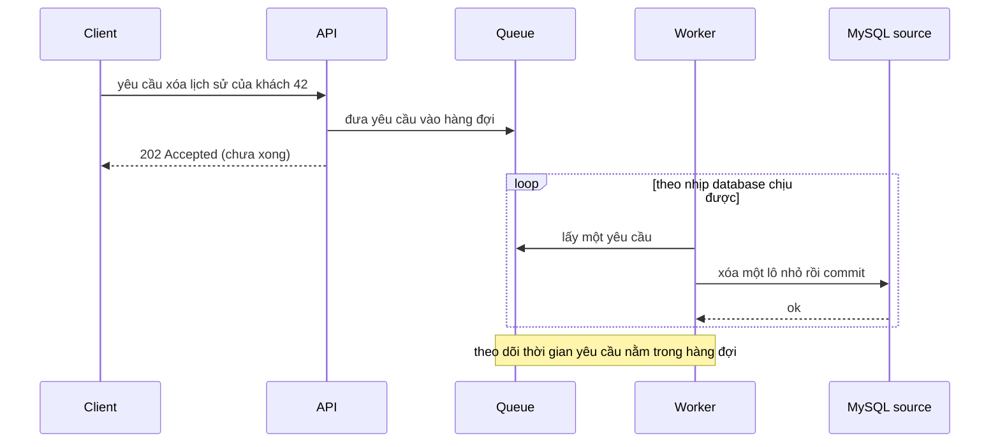

*(Sơ đồ do người viết ghi chú dựng theo ví dụ tr. 298; vòng lặp "lô nhỏ" là Bổ sung ngoài sách.)*

**Trade-offs** (tr. 298). 202 rõ ràng **không giống** 200, mã ngụ ý yêu cầu đã hoàn tất ngay. Đây là chỗ phải **thương lượng với đội sản phẩm** để cam kết của API khả thi. Sách nói gọn: khác biệt giữa 200 và 202 chính là **toàn bộ công sức kỹ thuật để shard** dữ liệu này cho nhiều lần ghi song song hơn.

**Decision** (tr. 298–299). Nếu dùng hàng đợi cho tải ghi, phải quyết định **trước** khung thời gian mà yêu cầu được hoàn tất sau khi vào hàng đợi. **Theo dõi sự tăng của thời gian một yêu cầu nằm trong hàng đợi** là chỉ số cho biết chiến lược này đã hết tác dụng, và đã tới lúc chia dữ liệu để chịu nhiều ghi song song hơn bằng sharding.

> **Bổ sung ngoài sách (cơ chế).** Hàng đợi **không tăng** capacity ghi. Nó đổi tốc độ đến dồn dập thành tốc độ phục vụ được kiểm soát, và giới hạn concurrency trên source bằng số worker, nên ít xung đột lock hơn. Nếu tốc độ đến **trung bình** lớn hơn tốc độ worker xử lý, hàng đợi dài ra mãi; đó chính là tín hiệu "thời gian chờ tăng" mà sách bảo theo dõi. Đây cũng là bài toán *backpressure* ở [DDIA chương 11](../../DDIA/ddia-notes/chapter-11.md#backpressure).

> **Bổ sung ngoài sách (thực hành với MySQL, Ví dụ minh họa do AI xây dựng).** Worker nên xóa từng **lô nhỏ**, mỗi lô một transaction, để lock ngắn, undo log nhỏ và replica không bị một transaction khổng lồ làm lag:
>
> `DELETE FROM customer_history WHERE customer_id = 42 ORDER BY id LIMIT 1000;`
>
> Lặp tới khi `ROW_COUNT()` trả 0, và giữa các lô có thể kiểm tra lag của replica để tự giảm tốc. Worker phải **idempotent** (xử lý lại cùng yêu cầu không gây hại), vì hàng đợi thường giao *ít nhất một lần*. Mã 202 nay được định nghĩa trong RFC 9110 (trước đó là RFC 7231).

**Hiểu lầm phổ biến.**

- *"Đưa vào queue là xong, khỏi shard."* Queue chỉ mua thời gian; thời gian chờ tăng mãi là dấu hiệu phải shard (tr. 298–299).
- *"Đổi 200 thành 202 là quyết định kỹ thuật."* Đó là thay đổi **hợp đồng API**, cần đội sản phẩm đồng ý (tr. 298).

#### Tự kiểm tra 2.5

- **Câu 2.5.1.** Vì sao thêm node ứng dụng cùng ghi vào một source lại làm tăng lock timeout và deadlock, dù CPU source chưa cạn? [đáp án](answers/chapter-11.md#q2-5-1)
- **Câu 2.5.2.** Khác biệt giữa 200 và 202 về mặt cam kết với client là gì? Vì sao sách nói khác biệt đó bằng "toàn bộ công sức shard"? [đáp án](answers/chapter-11.md#q2-5-2)
- **Câu 2.5.3.** Chỉ số nào cho biết chiến lược hàng đợi đã hết tác dụng? Vì sao không dùng độ dài hàng đợi đơn thuần? [đáp án](answers/chapter-11.md#q2-5-3)
- **Câu 2.5.4.** Nêu một loại ghi **không nên** đưa vào hàng đợi và giải thích bằng tiêu chí của sách ở tr. 298. [đáp án](answers/chapter-11.md#q2-5-4)

<a id="s2-6"></a>

### 2.6 Scaling Writes with Sharding — Scale ghi bằng sharding (tr. 299–311)

<a id="sharding"></a>

**Khi nào** (tr. 299). Nếu không quản lý được tăng trưởng ghi bằng **tối ưu truy vấn** và **hàng đợi**, sharding là lựa chọn tiếp theo.

**What** (tr. 299). ***Sharding*** là chia dữ liệu vào các cluster database khác nhau, nhỏ hơn, để thực hiện **nhiều lần ghi hơn trên nhiều source cùng lúc**. Có hai loại:

<a id="functional-vs-data-sharding"></a>

| Loại | Định nghĩa | Ví dụ của sách |
| --- | --- | --- |
| ***Functional partitioning*** (*division of duties*) | Dành các node khác nhau cho các nhiệm vụ khác nhau | Bản ghi user ở một cluster, thanh toán ở cluster khác. Đăng ký tăng vọt chỉ làm căng cluster user, cluster billing vẫn nhẹ để tính tiền; ngược lại, chu kỳ tính tiền vào ngày đầu tháng không ảnh hưởng đăng ký (tr. 299) |
| ***Data sharding*** | Chia dữ liệu thành các mảnh nhỏ (***shard***) lưu trên các node khác nhau | Cách **phổ biến và thành công nhất** để scale các ứng dụng MySQL rất lớn hiện nay (tr. 299) |

> **Bổ sung ngoài sách (hiểu lầm hay gặp).** *Partitioning* trong ngữ cảnh này **không phải** tính năng `PARTITION BY RANGE/HASH` của MySQL. Tính năng đó chia **một bảng trên một server** thành nhiều phần vật lý; mọi phần vẫn chung một source, chung redo log và binary log, nên không cộng thêm năng lực ghi của nhiều máy. Sharding của chương này chia dữ liệu ra **nhiều server**.

**Chỉ shard phần cần shard** (tr. 299). Phần lớn ứng dụng chỉ shard dữ liệu cần thiết, thường là phần sẽ rất lớn. Ví dụ dịch vụ blog:

- Dự kiến **10 triệu user**: có thể chưa cần shard thông tin đăng ký, vì có thể giữ toàn bộ user (hoặc phần user hoạt động) trong bộ nhớ.
- Dự kiến **500 triệu user**: có lẽ nên shard dữ liệu này.
- **Nội dung do user tạo** như bài viết, bình luận thì gần như chắc chắn phải shard trong **cả hai** trường hợp, vì các bản ghi này lớn hơn nhiều và nhiều hơn nhiều.

> **Bổ sung ngoài sách (phép tính minh họa).** Giả sử mỗi user tốn khoảng 1 KB kể cả index. 10 triệu user cần khoảng 10 GB, vừa buffer pool của một server phổ thông. 500 triệu user cần khoảng 500 GB, vượt RAM của phần lớn server; working set không còn nằm trong bộ nhớ.

Ứng dụng lớn có thể có nhiều tập dữ liệu logic **shard theo cách khác nhau**, lưu trên cùng hay khác nhóm server; thậm chí **cùng một dữ liệu shard nhiều cách** tùy cách truy cập (tr. 299).

**Cảnh giác với "chỉ shard phần cần"** (tr. 299). Khái niệm này phải gồm cả dữ liệu tăng nhanh **và dữ liệu thuộc về nó về mặt logic**, thường được truy vấn cùng lúc. Nếu shard theo `user_id` mà một nhóm bảng nhỏ khác cũng `JOIN` theo `user_id` trong đa số truy vấn, hãy shard chúng **cùng nhau**, để đa số truy vấn chỉ chạm một shard và tránh `JOIN` giữa các database.

<a id="partitioning-key"></a>

#### 2.6.1 Choosing a Partitioning Scheme — Chọn cách phân vùng (tr. 300–301)

**Thách thức lớn nhất** (tr. 300): **tìm và lấy** dữ liệu. Cách tìm dữ liệu phụ thuộc cách shard nó.

**Mục tiêu** (tr. 300): các truy vấn **quan trọng và thường xuyên nhất** chạm **càng ít shard càng tốt**. Một nguyên tắc scalability là tránh ***crosstalk*** (nói chuyện chéo) giữa các node.

**What** (tr. 300). ***Partitioning key*** quyết định hàng nào nằm ở shard nào. Biết partitioning key của một đối tượng, bạn trả lời được hai câu: **lưu dữ liệu này ở đâu?** và **tìm dữ liệu cần lấy ở đâu?**

**Ví dụ phản diện: băm primary key** (tr. 300). Giả sử làm như MySQL NDB Cluster: băm primary key của mỗi bảng để chia dữ liệu ra mọi shard. Rất đơn giản, nhưng **không scale tốt** vì thường phải kiểm tra **mọi** shard. Muốn lấy bài viết của user 3? Chúng rải đều khắp các shard, vì được chia theo primary key chứ không theo user. Băm primary key dễ biết **lưu** ở đâu, nhưng có thể khó **lấy**, tùy bạn cần dữ liệu nào và có biết primary key hay không.

**Nguyên tắc** (tr. 300):

- Luôn muốn truy vấn **khu trú trong một shard**. `JOIN` xuyên shard thêm độ phức tạp cho tầng ứng dụng và ăn mòn lợi ích của sharding.
- Trường hợp **tệ nhất**: không biết dữ liệu nằm đâu, phải **quét mọi shard**.
- Partitioning key tốt thường là **primary key của một thực thể rất quan trọng**. Nó quyết định ***unit of sharding***: chia theo user ID hay client ID thì đơn vị shard là user hay client.

**How: dùng sơ đồ ER** (tr. 300). Vẽ mô hình dữ liệu bằng sơ đồ thực thể – quan hệ, đặt các thực thể liên quan gần nhau. Nhìn sơ đồ thường thấy được ứng viên partitioning key mà nếu không thì bỏ sót. Nhưng đừng chỉ nhìn sơ đồ: xét cả **truy vấn của ứng dụng**. Hai thực thể có quan hệ nhưng **hiếm khi hay không bao giờ** `JOIN` theo quan hệ đó thì có thể **cắt** quan hệ để shard.

**Hình 11-2** (tr. 301): hai mô hình dữ liệu, một dễ shard, một khó.

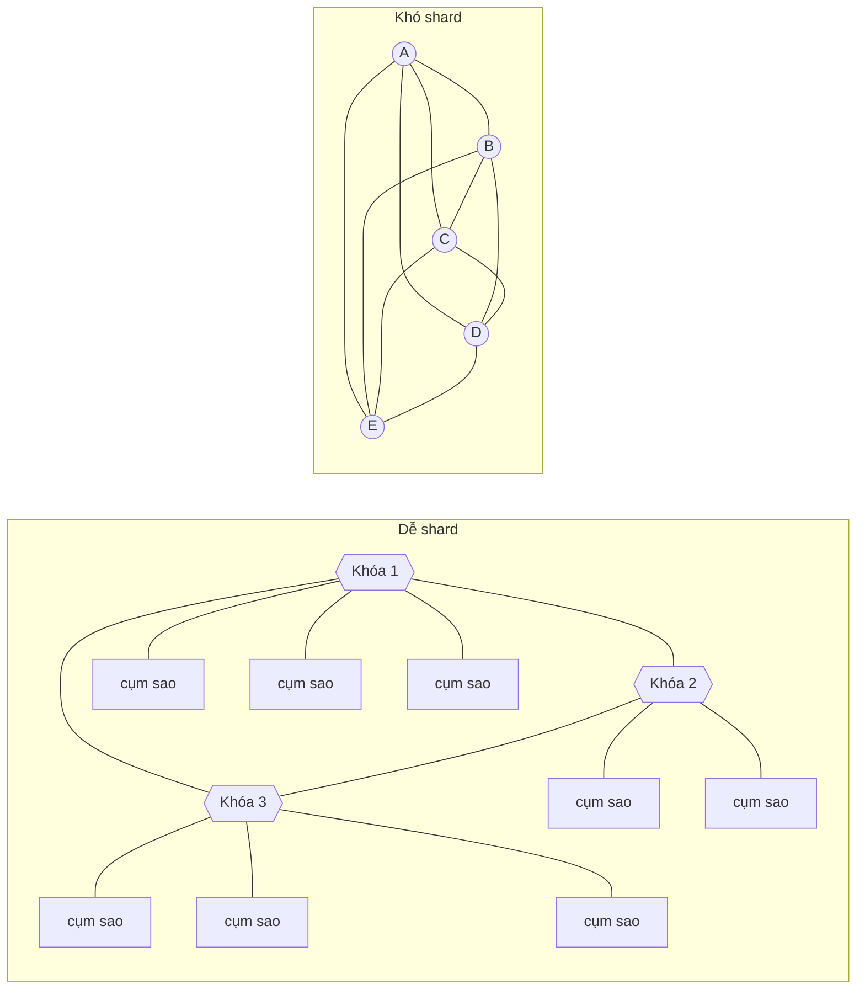

*(Vẽ lại rút gọn Hình 11-2, tr. 301, theo ảnh trang phóng to. Bên trái, hình gốc có ba nút bát giác là partitioning key nối với nhau thành tam giác; mỗi "cụm sao" là một nút trung tâm với tám nút lá. Bên phải, hình gốc có tám nút, nút nào cũng nối với mọi nút khác; ở đây rút gọn còn năm nút. Chú thích 5: hình do dự án HiveDB và Britt Crawford đóng góp.)*

Mô hình trái dễ shard vì có nhiều **đồ thị con liên thông** mà phần lớn nút chỉ có một kết nối, và ta "cắt" được các cạnh giữa các đồ thị con khá dễ. Mô hình phải khó vì **không có** đồ thị con như vậy. May là phần lớn mô hình dữ liệu giống hình trái hơn (tr. 301).

**Cân bằng kích thước shard** (tr. 301). Chọn partitioning key sao cho **tránh truy vấn xuyên shard** càng nhiều càng tốt, **và** shard đủ nhỏ để không có những mảng dữ liệu lớn bất thường. Lý tưởng là các shard **đều nhỏ**; nếu không được thì ít nhất đủ nhỏ để dễ cân bằng bằng cách **gộp số shard khác nhau** lại với nhau. Ví dụ: ứng dụng chỉ ở Mỹ, muốn 20 shard. Đừng shard theo **bang**, vì California quá đông dân. Có thể shard theo **quận** hay **mã vùng điện thoại**: tuy không đều, nhưng có đủ nhiều để chọn ra 20 nhóm có tổng dân số gần bằng nhau, và chọn nhóm theo **tính gần gũi** (*affinity*) để tránh truy vấn xuyên shard.

**Evidence & example — Kết quả đã đo** ([thí nghiệm 3](experiments/chapter-11.md), mô phỏng 4 shard bằng 4 schema trên **một** instance, 100.000 bài viết của 2.000 user, phân bố lệch: user 1 có 7.948 bài). Hai cách chia: **P** theo `post_id MOD 4` (giống băm primary key), **U** theo `user_id MOD 4`.

| Truy vấn | Layout P | Layout U |
| --- | --- | --- |
| Bài của user 3 (1.397 bài) | **4** truy vấn, mỗi shard xét 340–365 hàng, tổng 1.397 | **1** truy vấn, xét 1.397 hàng |
| Bài có `post_id = 12345` | **1** truy vấn, xét 1 hàng | **4** truy vấn (1 trúng, 3 rỗng), nếu không có bảng tra cứu |
| Số hàng mỗi shard | 25.000 đều nhau | 22.449 / **30.325** / 23.904 / 23.322: shard chứa user 1 lớn hơn trung bình khoảng 21% |

Tổng số hàng phải xét không đổi; cái đổi là **số shard phải hỏi** (fan-out). Mỗi cách chia làm một loại truy vấn khu trú và loại kia phải hỏi mọi shard, đúng như lập luận ở tr. 300. Bảng cuối cho thấy cái giá của chia theo thực thể: một user rất hoạt động (tr. 289) làm shard của nó phình ra.

> **Bổ sung ngoài sách.** Ấn bản này không đi sâu vào cách **ánh xạ** key sang shard. Các cách phổ biến: băm rồi lấy dư (đơn giản nhưng đổi số shard thì phải di chuyển gần hết dữ liệu), số lượng shard logic cố định lớn hơn số server rồi gán nhiều shard logic cho một server (chính là "gộp số shard khác nhau" ở tr. 301), hoặc bảng tra cứu (*directory*) lưu ở node toàn cục. Xem [DDIA chương 6: hash partitioning](../../DDIA/ddia-notes/chapter-06.md#hash-partitioning), [hash mod N](../../DDIA/ddia-notes/chapter-06.md#hash-mod-n), [số partition cố định](../../DDIA/ddia-notes/chapter-06.md#fixed-partitions), [điểm nóng và lệch tải](../../DDIA/ddia-notes/chapter-06.md#skew-hot-spot).

<a id="multiple-partitioning-keys"></a>

#### 2.6.2 Multiple Partitioning Keys — Nhiều khóa phân vùng (tr. 302)

**Why** (tr. 302). Mô hình dữ liệu phức tạp làm sharding khó hơn. Nhiều ứng dụng có **hơn một** partitioning key, nhất là khi dữ liệu có hai hay nhiều **"chiều"** quan trọng: ứng dụng cần một cái nhìn hiệu quả, nhất quán về dữ liệu **từ nhiều góc**. Nghĩa là có thể phải **lưu một phần dữ liệu hai lần**.

**Ví dụ blog** (tr. 302). Ứng dụng blog có thể cần shard theo cả **user ID** lẫn **post ID**, vì đó là hai cách nhìn dữ liệu thường gặp: xem mọi bài của một user, và mọi bình luận của một bài. Shard theo user không giúp tìm bình luận của một bài; shard theo bài không giúp tìm bài của một user. Muốn **cả hai** truy vấn chỉ chạm một shard thì phải shard theo **cả hai** cách.

**Không nhất thiết hai kho trùng hoàn toàn** (tr. 302). Ví dụ trang mạng xã hội câu lạc bộ sách, user bình luận về sách; trang hiển thị mọi bình luận của một cuốn sách, và mọi cuốn sách một user đã đọc và bình luận.

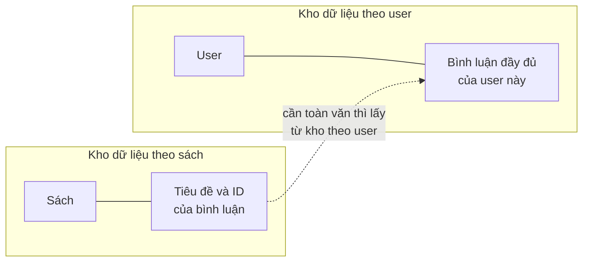

*(Sơ đồ do người viết ghi chú dựng theo ví dụ tr. 302.)*

- Dựng một kho shard cho dữ liệu user và một kho cho dữ liệu sách.
- Bình luận có cả user ID và ID của sách nên vắt qua ranh giới hai kho. *(Sách ghi "a user ID and a post ID" ở chỗ này; trong ví dụ câu lạc bộ sách, "post ID" có vẻ là sót lại từ ví dụ blog. Xem [Ghi chú kiểm tra nguồn](#kiem-tra).)*
- Thay vì nhân đôi toàn bộ bình luận, lưu bình luận **cùng dữ liệu user**, còn kho sách chỉ giữ **tiêu đề và ID** của bình luận. Vậy là đủ để hiển thị phần lớn màn hình bình luận của một cuốn sách mà không chạm hai kho; cần toàn văn thì lấy từ kho user (tr. 302).

> **Bổ sung ngoài sách.** Phần "tiêu đề và ID" trong kho sách thực chất là một **index phụ toàn cục do ứng dụng tự duy trì**, như *global secondary index* ở [DDIA chương 6](../../DDIA/ddia-notes/chapter-06.md#global-index). Cái giá: hai bản ghi ở hai kho không được cập nhật trong cùng một transaction, nên có lúc lệch nhau. Sách xử lý chuyện này bằng job dọn dẹp và script kiểm tra định kỳ (tr. 303, xem [2.6.3](#cross-shard-consistency)).

<a id="cross-shard-queries"></a>

#### 2.6.3 Querying Across Shards — Truy vấn xuyên shard (tr. 302–303)

**What và Why khó** (tr. 302). Phần lớn ứng dụng đã shard có **ít nhất vài** truy vấn phải gộp hay `JOIN` dữ liệu từ nhiều shard. Ví dụ trang câu lạc bộ sách hiển thị user phổ biến hay hoạt động nhất thì **theo định nghĩa** phải chạm mọi shard. Làm những truy vấn này chạy tốt là **phần khó nhất** của data sharding, vì thứ ứng dụng coi là **một** truy vấn phải tách ra thành **nhiều truy vấn chạy song song, mỗi shard một truy vấn**. Một lớp trừu tượng database tốt giúp giảm đau, nhưng ngay cả vậy những truy vấn này vẫn chậm và đắt hơn nhiều so với truy vấn trong một shard, nên thường phải **cache mạnh tay**.

**Logical và physical** (**Bổ sung ngoài sách**, cách nhìn của người viết ghi chú). Về **logic**, câu hỏi vẫn là một: "top 10 user nhiều bài nhất trong 7 ngày". Về **thực thi vật lý**, nó thành *scatter-gather*: gửi cùng truy vấn tới N shard, mỗi shard tự chọn access path (ví dụ index trên `user_id` hay `created_at`), rồi tầng ứng dụng **gộp, cộng dồn, sắp xếp, cắt top**. Latency của cả câu bằng latency của **shard chậm nhất** cộng thời gian gộp.

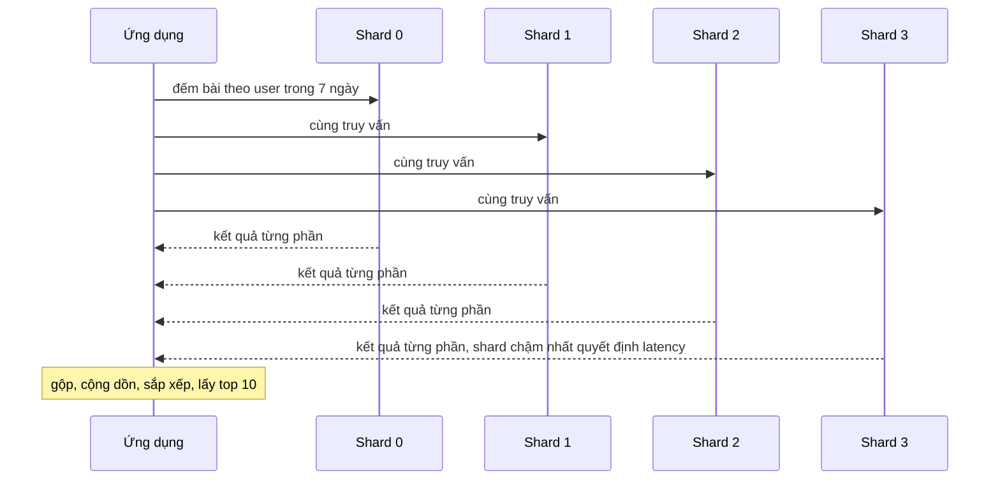

*(Ví dụ minh họa do AI xây dựng. Xem thêm [DDIA chương 6, scatter-gather](../../DDIA/ddia-notes/chapter-06.md#scatter-gather) và [tail latency amplification ở DDIA chương 1](../../DDIA/ddia-notes/chapter-01.md#tail-amplification).)*

**Decision** (tr. 302). Cách shard đã chọn là **tốt** nếu truy vấn xuyên shard là **ngoại lệ**, không phải chuẩn mực. Cố giữ truy vấn đơn giản và nằm trong một shard. Khi cần gộp xuyên shard, sách khuyên đặt phần đó **trong logic ứng dụng**.

**Các kỹ thuật hỗ trợ** (tr. 303):

| Kỹ thuật | Cách làm |
| --- | --- |
| ***Summary table*** | Duyệt mọi shard, lưu kết quả **dư thừa trên mỗi shard** khi đã xong. Nếu nhân bản trên mỗi shard quá tốn, gom về **một kho khác** để chỉ lưu một lần |
| ***Global node*** | Dữ liệu không shard thường nằm ở node toàn cục, được cache mạnh để chắn tải |
| **Random sharding** | Một số ứng dụng chia gần như ngẫu nhiên khi cần phân bố đều hoặc không có partitioning key tốt; ví dụ ứng dụng tìm kiếm phân tán. Khi đó truy vấn xuyên shard là **chuẩn mực**, không phải ngoại lệ |

**Kết quả đã đo** ([thí nghiệm 3](experiments/chapter-11.md)). Truy vấn "top 10 user nhiều bài nhất trong 7 ngày" (2.317 bài, 1.039 user). Cách gộp "ngây thơ" là lấy top 10 của **mỗi** shard rồi cộng dồn:

| Layout | Gộp ngây thơ (40 hàng gửi về) | Gộp đúng |
| --- | --- | --- |
| U (shard theo `user_id`) | **Đúng cả 10 hạng**, vì mỗi user nằm trọn một shard | Chính là gộp ngây thơ |
| P (shard theo `post_id`) | **Sai 6/10 hạng**: một user rải trên 4 shard nên có thể lọt top của shard này mà không lọt top của shard khác | Phải lấy **mọi** nhóm từ mọi shard (386 + 407 + 389 + 398 = 1.580 hàng) rồi cộng; khi làm vậy cả 1.039 user khớp |

Bài học: partitioning key quyết định một phép gộp có **tách được theo shard** hay không. Khi khóa gộp trùng partitioning key, kết quả từng shard đã là kết quả cuối cho các nhóm trong shard đó.

<a id="cross-shard-consistency"></a>

**Tính nhất quán xuyên shard** (tr. 303). Truy vấn không phải thứ duy nhất khó hơn khi shard:

- **Foreign key không hoạt động xuyên shard.** Cách thường làm: kiểm tra toàn vẹn tham chiếu **trong ứng dụng** khi cần, hoặc dùng foreign key **bên trong một shard**, vì nhất quán nội bộ shard có thể là điều quan trọng nhất.
- **XA transaction** dùng được nhưng hiếm trong thực tế vì chi phí.
- Thiết kế **tiến trình dọn dẹp** chạy định kỳ. Ví dụ tài khoản câu lạc bộ sách hết hạn: không cần xóa ngay; một job định kỳ xóa bình luận của user đó khỏi các shard theo sách, và một **script kiểm tra** định kỳ bảo đảm dữ liệu nhất quán giữa các shard.

> **Bổ sung ngoài sách.** XA trong MySQL là giao thức commit hai pha (`XA START`, `XA END`, `XA PREPARE`, `XA COMMIT`). Chi phí đến từ thêm vòng mạng và ghi bền ở pha prepare, và nhất là khi coordinator hỏng thì transaction ở trạng thái "in doubt" **giữ lock** cho tới khi được giải quyết. Xem [DDIA chương 9, XA](../../DDIA/ddia-notes/chapter-09.md#xa).

<a id="vitess"></a>

#### 2.6.4 Vitess (tr. 303–306)

> **Thời điểm.** Mọi mô tả dưới đây là theo sách, viết năm 2021.

**What** (tr. 303). ***Vitess*** là hệ thống **clustering database cho MySQL**. Nó ra đời trong YouTube, rồi trở thành PlanetScale, một sản phẩm và công ty riêng do Jiten Vaidya và Sugu Sougoumarane đồng sáng lập. Tính năng (tr. 303): hỗ trợ sharding ngang, kể cả việc chia dữ liệu; quản lý topology; quản lý failover của source; quản lý thay đổi schema; connection pooling; viết lại truy vấn (*query rewriting*).

> **Bổ sung ngoài sách.** Cách nói "trở thành PlanetScale" là rút gọn: Vitess vẫn là dự án mã nguồn mở (tốt nghiệp CNCF năm 2019), còn PlanetScale là công ty xây dịch vụ trên Vitess. Tài liệu Vitess dùng thêm các thuật ngữ sách không nhắc như *keyspace* (một database logic, có thể gồm nhiều shard), *VSchema* và *vindex* (cách ánh xạ cột sang shard).

**Kiến trúc** (tr. 304–305). Hình 11-3, lấy từ website Vitess:

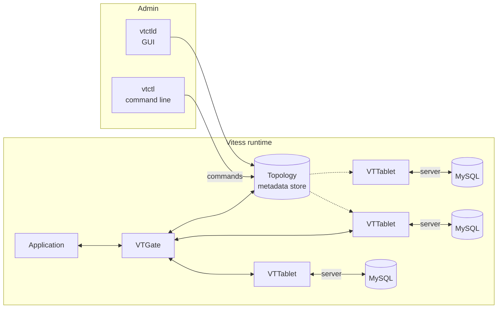

*(Vẽ lại Hình 11-3, tr. 304, theo ảnh trang phóng to. Hình gốc nối VTGate với tablet thứ nhất và thứ ba bằng nét liền, nối topology với tablet thứ hai và thứ ba bằng nét đứt. Đây là sơ đồ minh họa; không nên suy ra tablet thứ hai không bao giờ nhận truy vấn.)*

| Thành phần | Vai trò theo sách (tr. 304–305) |
| --- | --- |
| **Vitess pod** | Gói chung một nhóm database và các mảnh của Vitess hỗ trợ sharding, quản lý topology, thay đổi schema và truy cập của ứng dụng |
| **VTGate** | Dịch vụ kiểm soát truy cập vào các instance cho ứng dụng và cho người vận hành muốn quản lý topology, thêm node hay shard dữ liệu. **Tương tự load balancer** ở kiến trúc read pool |
| **VTTablet** | Agent chạy trên **mỗi** instance do Vitess quản lý; nhận lệnh quản trị từ người vận hành và thực thi thay họ |
| **Topology (metadata store)** | Kho kiểm kê các instance trong một pod cùng thông tin đi kèm |
| **vtctl** | Công cụ dòng lệnh để thay đổi vận hành trên pod |
| **vtctld** | Giao diện đồ họa cho cùng các thao tác quản trị |

**Luồng thay đổi topology** (tr. 305). Kiến trúc Vitess bắt đầu từ một **topology store nhất quán** chứa định nghĩa mọi cluster, instance MySQL và instance vtgate. Khi người vận hành muốn đổi topology, họ gửi lệnh qua vtctl tới kho này, kho này chuyển các thao tác thành phần tới vtgate. Vitess có **operator** để triển khai lớp vtgate và metadata store trên **Kubernetes**; đặt control plane trên nền như vậy tăng khả năng chống điểm hỏng đơn (tr. 305).

<a id="vitess-philosophy"></a>

**Triết lý scale MySQL của Vitess** (tr. 305), sách khuyên áp dụng **dù có dùng Vitess hay không**:

| Nguyên tắc | Ý nghĩa |
| --- | --- |
| **Ưa instance nhỏ** | Chia dữ liệu theo chức năng, theo chiều ngang, hoặc cả hai. Instance nhỏ thì ***blast radius*** (phạm vi ảnh hưởng khi hỏng) nhỏ |
| **Replication và failover ghi tự động** | Vitess **không** hứa "100% ghi online" bằng mẹo nhiều node nhận ghi. Nó tự động hóa failover ghi, và trong lúc failover quản lý cả thay đổi topology lẫn truy cập của ứng dụng để thời gian không ghi được ngắn nhất |
| **Durability bằng semisync** | Vitess khuyên mạnh **semisync replication** thay cho async mặc định, để mỗi lần ghi luôn được **nhiều hơn một node** lưu trước khi báo ứng dụng. Đây là đánh đổi **latency lấy durability**, có lợi khi phải failover source ngoài kế hoạch |

> **Bổ sung ngoài sách (semisync trong MySQL).** Với semisync, source chờ ít nhất một replica xác nhận đã **nhận và ghi vào relay log** (chưa chắc đã áp dụng) rồi mới trả commit. Từ 5.7, điểm chờ mặc định là `AFTER_SYNC`. Nếu không replica nào trả lời trong thời gian timeout (mặc định 10 giây), source **lùi về async**. Tên plugin và biến đổi ở **8.0.26** (`rpl_semi_sync_source...` thay cho `rpl_semi_sync_master...`). Xem [Chương 9](chapter-09.md#semisync) và [DDIA chương 5, semi-synchronous](../../DDIA/ddia-notes/chapter-05.md#semi-sync). Các bản Vitess sau 2021 cấu hình yêu cầu này qua "durability policy"; hãy kiểm lại tài liệu hiện hành.

<a id="vitess-migration"></a>

**Chuyển sang Vitess** (tr. 306). Vitess là nền tảng **có chính kiến** (*opinionated*) cho tầng database, **không** phải giải pháp cắm vào là chạy. Ba bước nên cân nhắc:

1. **Thử và ghi lại latency được thêm vào.** Đưa một stack phức tạp như Vitess vào chắc chắn thêm latency, nhất là khi bắt buộc semisync. Ghi rõ đánh đổi và thông báo để các bên phụ thuộc đặt SLO dựa trên kiến trúc này một cách có hiểu biết.
2. **Triển khai kiểu canary.** Trong giai đoạn chuyển, cấu hình vttablet ở chế độ **"externally managed"**: cho phép cả kết nối qua vttablet lẫn kết nối thẳng tới database, trong khi bạn chuyển dần kết nối qua từng phần đội node ứng dụng. *Chú thích 6:* chiến lược này được Morgan Tocker trình bày ở KubeCon 2019.
3. **Bắt đầu shard.** Khi **mọi** truy cập của ứng dụng đã đi qua vtgate/vttablet, mới dùng đủ tính năng: tách bảng sang cluster mới, shard ngang để tăng throughput ghi, hay đơn giản thêm replica cho tải đọc.

**Trade-offs** (tr. 306). Vitess mạnh, đã chứng minh giúp tăng trưởng lớn và hạ tầng database bền bỉ. Nhưng sức mạnh và sự linh hoạt đi kèm **độ phức tạp**. Vitess không đơn giản như load balancer chuyển tiếp lưu lượng; hãy cân nhu cầu kinh doanh với chi phí đưa vào và duy trì một công cụ quản lý database phức tạp như vậy.

<a id="proxysql"></a>

#### 2.6.5 ProxySQL (tr. 306–311)

> **Thời điểm.** Mô tả theo sách, viết năm 2021.

**What** (tr. 306). ***ProxySQL*** được viết riêng cho **giao thức MySQL**, phát hành theo giấy phép GPL. Tác giả chính là René Cannaò, một DBA từng tư vấn cho nhiều công ty và đóng góp lâu năm cho MySQL. ProxySQL nay là một công ty đầy đủ, bán hỗ trợ và hợp đồng phát triển.

**Kiến trúc** (tr. 307).

- ProxySQL là một lớp giữa mã ứng dụng và các instance MySQL. Nó cung cấp giao diện **dựa trên giao thức MySQL và nhận biết session** (*session-aware*).
- Ứng dụng **không** mở kết nối thẳng tới database; ProxySQL mở **thay** chúng. Proxy vì vậy gần như **vô hình** với ứng dụng.
- Nhờ nhận biết session, nó có thể **chuyển kết nối giữa các instance mà không downtime**. Điều này đặc biệt hữu ích với các ứng dụng không còn được đầu tư: dùng tính năng của ProxySQL mà không phải sửa mã mình không tự tin sửa.

<a id="connection-pooling"></a>

**Connection pooling** (tr. 307). Kết nối ứng dụng mở tới ProxySQL **tách biệt** với kết nối ProxySQL mở tới database. Sự tách biệt này bảo vệ database khỏi các đợt tăng đột ngột ở tầng ứng dụng. Bạn có thể scale số node ứng dụng mà không sợ tải kết nối lên database vượt mức mong muốn.

**Cấu hình** (tr. 307).

- ProxySQL dùng tệp cấu hình **lúc khởi động**, nhưng giữ cấu hình **runtime** trong bộ nhớ và trong một tệp **SQLite nhúng**, truy vấn trực tiếp được qua **admin interface**.
- Admin interface cho phép đổi cấu hình đang chạy bằng lệnh kiểu MySQL rồi ghi cấu hình mới ra đĩa. Nhờ vậy thay đổi **không downtime**, và có thể để configuration management hay script failover tự động thay đổi.

**Hình 11-4** (tr. 308): tương tác giữa node ứng dụng, ProxySQL và service discovery.

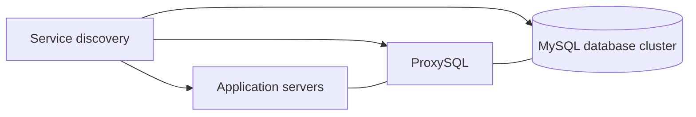

*(Vẽ lại Hình 11-4, tr. 308, chuyển thể từ sơ đồ của Bill Sickles. Hình gốc có ba mũi tên từ service discovery tới ba khối, và ba khối xếp chồng nối với nhau bằng đoạn thẳng không mũi tên.)*

> **Cảnh báo của sách** (tr. 308). Hình vẽ ProxySQL như một khối, nhưng trên production sách **khuyên mạnh** dùng cơ chế **clustering** của nó và chạy **nhiều** instance trong mỗi stack. Đừng bao giờ chạy một điểm hỏng đơn (*SPoF*).

**Health check có tầng** (tr. 308). ProxySQL có health check **độc lập và phân cấp** cho các database nó kết nối. Dựa vào kết quả, nó thêm, bớt host hoặc chỉnh trọng số lưu lượng. Có thể đặt ngưỡng replication lag, thời gian kết nối thành công, số lần thử lại khi lỗi... Nhờ đó ProxySQL phản ứng chính xác với host không trả lời: hoặc **tạm** gỡ backend rồi kiểm tra lại sau, hoặc gỡ **hẳn** backend đang chật vật cho tới khi người vận hành can thiệp.

<a id="proxysql-sharding"></a>

**Dùng ProxySQL cho sharding** (tr. 308–309). ProxySQL **không** tự động hóa việc chia dữ liệu như Vitess, nhưng là một lớp trung gian **nhẹ, biết về shard**, định tuyến kết nối của ứng dụng cho phù hợp.

- **Shard theo user** (tr. 308–309). Nếu dữ liệu đã chia theo chức năng vào các cluster khác nhau, với các đội ứng dụng khác nhau truy cập, thì mỗi ứng dụng nên dùng **thông tin đăng nhập database riêng**. ProxySQL dùng chính tham số user này để định tuyến tới các nhóm backend tách biệt, cho ghi hoặc đọc. Listing ở tr. 309 chèn ba hàng vào bảng `mysql_users` của admin interface rồi nạp lên runtime và lưu xuống đĩa:

  | username | default_hostgroup | Ghi chú trong listing |
  | --- | --- | --- |
  | `accounts` | 0 | định tuyến tới shard accounts |
  | `transactions` | 1 | định tuyến tới shard transactions |
  | `logging` | 2 | định tuyến tới shard logging |

  Cách này còn tiện **ghi log mọi thao tác của từng user** cho compliance mà không đặt tải lên database; [Chương 13](chapter-13.md#separate-users) cũng khuyên tách database user vì lý do compliance (tr. 309).

  > **Mẹo của sách** (tr. 309). Luôn giữ cấu hình **runtime** và cấu hình **trên đĩa** của ProxySQL đồng bộ, để tránh bất ngờ khi tiến trình ProxySQL khởi động lại.

- **Shard theo schema** (tr. 309). Dùng **tên schema** làm luật định tuyến. Listing chèn ba luật vào `mysql_query_rules`: schema `shard_0`, `shard_1`, `shard_2` đi tới hostgroup 0, 1, 2 (luật đang bật, `apply` = 1), rồi nạp lên runtime và lưu xuống đĩa. Cấu hình này dùng được cho cả sharding ngang lẫn sharding chức năng, miễn là đặt tên schema hợp lý.
- **Khuyến nghị cuối** (tr. 309): dùng tính năng **clustering gốc** của ProxySQL để các bảng cấu hình quan trọng được đồng bộ tới mọi node ProxySQL, tạo dư thừa cho tầng middleware.

> **Bổ sung ngoài sách (kiểm cú pháp listing; chưa chạy được vì máy không có ProxySQL và không được tải phần mềm).** Theo tài liệu ProxySQL mà người viết ghi chú biết, lệnh nạp và lưu bảng user là `LOAD MYSQL USERS TO RUNTIME` và `SAVE MYSQL USERS TO DISK`, **không có** chữ `RULES` như listing ở tr. 309. Bảng luật là `mysql_query_rules`; tên `mysql_rules` ở đoạn khuyến nghị cuối có lẽ là cách gọi tắt. Các hostgroup 0, 1, 2 phải được khai báo trong bảng `mysql_servers` (listing của sách bỏ qua bước này). Admin interface mặc định nghe cổng 6032, cổng cho ứng dụng là 6033. Hãy kiểm lại với phiên bản ProxySQL bạn dùng.

<a id="thundering-herd"></a>

**Lợi ích khác: chống "mở thêm kết nối"** (tr. 310).

- Khi latency truy vấn tăng, nhiều ứng dụng phản ứng bằng **mở thêm kết nối** tới database. Thực tế điều này có thể gây **sự cố** (*chú thích 7:* vấn đề ***thundering herd***) và để lại nhiều kết nối **nhàn rỗi**, tốn tài nguyên mà không làm việc gì.
- Ứng dụng mở thêm kết nối thẳng tới database thì server tốn thêm tài nguyên quản lý kết nối. Hiệu ứng **lăn cầu tuyết** thành hàng nghìn kết nối đè lên các instance vốn đã quá tải, dẫn tới downtime kéo dài, **lỗi dây chuyền** qua nhiều microservice và ảnh hưởng khách hàng lâu hơn.
- ProxySQL chắn tầng database khỏi các đỉnh bất ngờ của ứng dụng bằng cách **chỉ mở tới database số kết nối có thể làm việc**, và **tái sử dụng** chúng cho các request khác nhau phía client. Mỗi kết nối tới database làm được nhiều việc nhất, giảm tài nguyên quản lý kết nối và dùng bộ nhớ server hiệu quả hơn.

> **Kết quả đã đo** ([thí nghiệm 4](experiments/chapter-11.md), MySQL 8.0.42 cấu hình mặc định, `max_connections` = 151). 100 client cùng chạy `SELECT SLEEP(4)` làm bộ nhớ mà Performance Schema theo dõi tăng khoảng 12,4 MiB (450,2 → 462,6 MiB), tức khoảng 125 KiB mỗi kết nối (chia cho 101 kết nối mới, gồm một kết nối riêng của công cụ tạo tải), chưa kể stack thread (`thread_stack` = 1 MiB) và phần hệ điều hành không đo được ở đây. Với 200 client, 50 client bị từ chối với lỗi 1040 "Too many connections"; bộ đếm `Connection_errors_max_connections` tăng lên 500, nghĩa là mỗi client bị từ chối đã thử lại nhiều lần. Đây là phiên bản thu nhỏ của "cơn lũ thử lại" mà sách mô tả. Session `root` vẫn vào được để quan sát (`Max_used_connections` = 152) vì MySQL dành thêm một kết nối cho user có quyền `CONNECTION_ADMIN` hay `SUPER`.

> **Bổ sung ngoài sách (multiplexing).** Việc ProxySQL dùng lại một kết nối backend cho nhiều client gọi là *multiplexing*. Nó bị **tắt** cho một session khi session đó làm điều gắn chặt nó vào một kết nối backend, ví dụ đang mở transaction, tạo bảng tạm, dùng biến user hay `GET_LOCK()`. Ứng dụng dùng nhiều trạng thái session sẽ nhận ít lợi ích hơn. Danh sách điều kiện cụ thể nằm trong tài liệu ProxySQL.

**Tính năng nổi bật khác** (tr. 310): định tuyến truy vấn theo cổng, user hay regex; TLS cả phía ứng dụng lẫn phía database; hỗ trợ nhiều "biến thể" MySQL như AWS Aurora, Galera Cluster và ClickHouse; connection mirroring; cache result set; viết lại truy vấn; audit log.

**Định vị ProxySQL** (tr. 310–311). ProxySQL mạnh để scale out ứng dụng với bảo vệ hiệu năng phù hợp cho tầng database, kèm tính năng phục vụ nhu cầu kinh doanh như compliance, luật bảo mật. Nếu công ty đang tăng trưởng nhanh với **hỗn hợp dịch vụ mới và cũ** dùng chung tài nguyên database, nó giúp tăng trưởng an toàn. Nó là lớp trừu tượng **dễ triển khai**, tinh vi hơn HAProxy nhưng ít đầu tư hạ tầng và ít phức tạp hơn. Nhưng nó **không** có một số tính năng nâng cao của Vitess: tự động shard tập dữ liệu, quản lý thay đổi schema, và **VReplication**, công cụ mạnh cho pipeline ETL và luồng thay đổi dữ liệu.

<a id="lb-proxy-comparison"></a>

**So sánh ba lựa chọn cho tầng truy cập**:

| Tiêu chí | HAProxy | ProxySQL | Vitess |
| --- | --- | --- | --- |
| Hiểu giao thức MySQL | Không, chế độ TCP; chỉ có health check kiểu MySQL (tr. 294) | Có, session-aware (tr. 307) | Có, qua VTGate (tr. 304) |
| Connection pooling, chắn đỉnh kết nối | **Bổ sung ngoài sách:** không gộp kết nối ở chế độ TCP | Có (tr. 307, 310) | Có (tr. 303) |
| Định tuyến theo user, schema, regex | Không | Có (tr. 308–310) | Có, theo shard |
| Health check theo lag | Qua HTTP check và script (tr. 296) | Có sẵn, phân cấp (tr. 308) | Quản lý topology và failover (tr. 303, 305) |
| Tự động chia dữ liệu, đổi schema, VReplication | Không | Không (tr. 308, 311) | Có (tr. 303, 311) |
| Độ phức tạp và đầu tư | Thấp | Trung bình (tr. 311) | Cao, không cắm vào là chạy (tr. 306) |

*(Bảng do người viết ghi chú tổng hợp; mọi ô có trang là của sách, trạng thái năm 2021.)*

**Hiểu lầm phổ biến.**

- *"Shard theo primary key hash là tốt nhất vì phân bố đều."* Đều về kích thước nhưng có thể buộc mọi truy vấn theo thực thể khác phải hỏi mọi shard (tr. 300).
- *"Có Vitess hay ProxySQL thì không phải nghĩ về partitioning key."* Công cụ chỉ định tuyến và tự động hóa; chọn khóa vẫn là bài toán mô hình dữ liệu và truy vấn (tr. 300–302).
- *"Truy vấn chậm thì tăng kích thước connection pool."* Sách chỉ ra điều này có thể gây sự cố dây chuyền (tr. 310).
- *"Vitess là drop-in."* Sách nói rõ là không (tr. 306).

#### Tự kiểm tra 2.6

- **Câu 2.6.1.** Hệ thống blog shard bảng `posts` bằng cách băm primary key như NDB Cluster. Dự đoán chi phí của truy vấn "mọi bài của user 3" và truy vấn "bài có ID 12345". Đối chiếu với kết quả đo ở thí nghiệm 3. [đáp án](answers/chapter-11.md#q2-6-1)
- **Câu 2.6.2.** Vì sao sách khuyên không shard theo bang mà theo quận hay mã vùng khi cần 20 shard? Nguyên tắc chung là gì, và nó liên quan gì tới việc "gộp số shard khác nhau"? [đáp án](answers/chapter-11.md#q2-6-2)
- **Câu 2.6.3.** Trong ví dụ câu lạc bộ sách, vì sao lưu bình luận đầy đủ ở kho user và chỉ lưu tiêu đề, ID ở kho sách? Cái giá về tính nhất quán là gì, và sách xử lý nó thế nào? [đáp án](answers/chapter-11.md#q2-6-3)
- **Câu 2.6.4.** Cần "top 10 user hoạt động nhất". Giải thích vì sao lấy top 10 của mỗi shard rồi gộp lại cho kết quả đúng khi shard theo `user_id` nhưng có thể sai khi shard theo `post_id`. Nêu hai cách sách gợi ý để giảm chi phí loại truy vấn này. [đáp án](answers/chapter-11.md#q2-6-4)
- **Câu 2.6.5.** Một công ty có nhiều dịch vụ cũ không dám sửa mã, đang gặp sự cố mỗi khi latency tăng vì ứng dụng mở thêm kết nối. Nên chọn ProxySQL hay Vitess trước, và vì sao? Khi nào Vitess mới đáng giá? [đáp án](answers/chapter-11.md#q2-6-5)

<a id="s2-7"></a>

### 2.7 Summary — Tóm tắt (tr. 311)

<a id="summary-decision"></a>

**Thông điệp** (tr. 311).

- Scale MySQL là một **hành trình**. Sau chương này bạn cần đánh giá được nhu cầu scale, biết scale đọc, scale ghi, và làm tăng trưởng lưu lượng **dễ dự đoán hơn** bằng hàng đợi; hiểu sharding để scale ghi cùng mọi quyết định phức tạp đi kèm.
- **Trước khi** lao vào nút thắt scalability: tối ưu truy vấn, kiểm tra index, có cấu hình MySQL vững. Việc này có thể **mua đủ thời gian** để lên chiến lược dài hạn tốt hơn.
- Sau khi tối ưu, xác định workload **read-bound hay write-bound**, rồi chọn chiến lược giải quyết vấn đề trước mắt, đồng thời tính tới scalability dài hạn.
- **Read-bound:** chuyển sang read pool, **trừ khi** replication lag là vấn đề không thể vượt qua.
- **Lag là vấn đề, hoặc write-bound:** cân nhắc **sharding**.

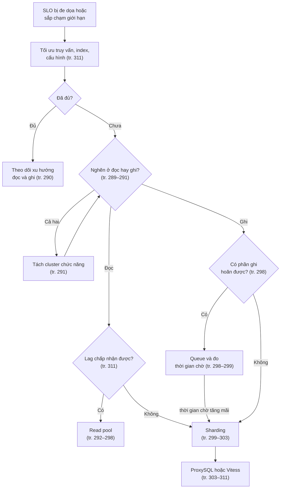

*(Sơ đồ do người viết ghi chú ghép phần Summary với các bước trong thân chương. Phần Summary không nhắc queuing trong cây quyết định; bước "queue trước sharding" lấy từ tr. 298–299.)*

#### Tự kiểm tra 2.7

- **Câu 2.7.1.** Sắp xếp theo đúng thứ tự sách khuyên: sharding, tối ưu truy vấn và index, xác định read-bound hay write-bound, read pool, hàng đợi. Giải thích vì sao bước đầu tiên được đặt ở đầu. [đáp án](answers/chapter-11.md#q2-7-1)
- **Câu 2.7.2.** Workload rõ ràng là read-bound, nhưng sách vẫn có thể khuyên sharding. Khi nào, và vì sao read pool không giải quyết được? [đáp án](answers/chapter-11.md#q2-7-2)
- **Câu 2.7.3.** "Mua thời gian" ở tr. 311 nghĩa là gì trong vận hành? Cho ví dụ một quyết định dài hạn cần thời gian đó. [đáp án](answers/chapter-11.md#q2-7-3)

---

<a id="situations"></a>

## 3. Phân tích tình huống

> Bốn tình huống dưới đây là **Ví dụ minh họa do AI xây dựng**. Mỗi bước dẫn về trang sách và, khi có, về kết quả đo của [phần thực hành](experiments/chapter-11.md).

<a id="th-phan-loai"></a>

### Tình huống 1 — "Đọc nhiều hay ghi nhiều?": phân loại workload trước khi mua replica

**Bối cảnh.** Một SaaS bán hàng chạy một source MySQL 8.0. Giờ cao điểm CPU source lên 75%, p99 latency của API đặt hàng vượt SLO. Dashboard QPS cho thấy 92% số câu là `SELECT`. Đội ứng dụng đề xuất thêm hai replica và chuyển đọc sang đó.

**Bước 1: đặt đúng câu hỏi** (tr. 289–290). "92% số câu là SELECT" là thống kê **số lượng**, không phải **chi phí**. Câu cần trả lời: thời gian của server đang tiêu vào đọc hay ghi, và xu hướng của mỗi loại ra sao.

**Bước 2: thu số liệu bên trong MySQL** (Bổ sung ngoài sách về công cụ, theo hướng của tr. 290 và [Chương 3](chapter-03.md#read-write)):

| Câu hỏi | Nguồn | Đọc thế nào |
| --- | --- | --- |
| Loại câu nào chiếm thời gian? | `events_statements_summary_global_by_event_name`: `COUNT_STAR`, `SUM_TIMER_WAIT` | So tỷ trọng **thời gian**, không chỉ tỷ trọng số câu |
| Câu cụ thể nào đắt nhất? | `events_statements_summary_by_digest` | Xếp theo `SUM_TIMER_WAIT`; xem `SUM_ROWS_EXAMINED` so với `SUM_ROWS_SENT` |
| Bảng nào bị đọc, bị ghi nhiều? | `table_io_waits_summary_by_table` | Tìm nhóm bảng nặng đọc và nhóm nặng ghi (tr. 291) |
| Đường ghi có căng không? | `Innodb_os_log_written`, `Innodb_data_fsyncs`, `Innodb_row_lock_waits` | Lượng redo, số fsync, chờ khóa hàng |
| Đọc có xuống đĩa không? | `Innodb_buffer_pool_reads` so với `Innodb_buffer_pool_read_requests` | Working set có vừa buffer pool không |

Chụp các số này định kỳ (ví dụ mỗi 5 phút) và lấy hiệu, để thấy **xu hướng** như sách khuyên (tr. 290).

**Bước 3: diễn giải theo bốn mẫu.**

| Mẫu quan sát | Kết luận | Hướng xử lý |
| --- | --- | --- |
| SELECT chiếm phần lớn thời gian; vài digest có rows examined gấp hàng trăm lần rows sent | Chưa "read-bound thật", đang thiếu index hay truy vấn kém | Index, viết lại truy vấn, cache (tr. 290) |
| SELECT chiếm phần lớn thời gian; truy vấn đã hiệu quả; CPU hay IOPS đọc cao | Read-bound | Read pool (tr. 292) |
| UPDATE, INSERT chiếm phần lớn thời gian dù ít câu; redo và fsync cao; chờ khóa hàng tăng | Write-bound, như workload A ở thí nghiệm 1 (62% thời gian là UPDATE dù chỉ 1% số câu) | Xem lô ghi, điểm nóng ghi; queue (tr. 298); rồi sharding (tr. 299) |
| Nhóm bảng `orders` nặng ghi, nhóm `catalog` nặng đọc | Cả hai cùng tăng | Tách cluster chức năng trước (tr. 291) |

**Bước 4: quyết định và điều sẽ đổi.** Giả sử số liệu cho thấy API đặt hàng chậm vì một job cập nhật tồn kho chạy `UPDATE` hàng nghìn hàng mỗi lần, giữ khóa và sinh nhiều redo. Thêm replica **không** giúp: replica cũng phải áp đúng các `UPDATE` đó, còn API đặt hàng vẫn ghi vào source. Việc đúng là chia nhỏ lô cập nhật hoặc đưa vào hàng đợi, và nếu bảng tồn kho tiếp tục là điểm nóng ghi thì tính tới tách nó sang cluster riêng. Nếu sau đó tỷ trọng thời gian chuyển sang SELECT và CPU vẫn cao, khi ấy read pool mới là bước hợp lý.

<a id="th-read-pool"></a>

### Tình huống 2 — Thiết kế read pool và health check cho catalog và lịch sử đơn hàng

**Bối cảnh.** Cluster gồm 1 source và 5 replica. Đêm nào cũng chạy backup trên một replica; đội báo cáo chạy truy vấn nặng vào giờ hành chính trên một replica khác. Hai loại đọc chính: **catalog** (dữ liệu cũ vài phút không sao) và **lịch sử đơn hàng** (cũ vài giây chấp nhận được, nhưng khách vừa đặt xong phải thấy ngay đơn của mình).

**Thiết kế pool** (tr. 293–295):

| Thành phần | Quyết định | Căn cứ |
| --- | --- | --- |
| Source | **Ngoài** mọi read pool | Tiêu chí cụ thể: loại source (tr. 294) |
| 2 replica: một cho backup, một cho báo cáo | **Ngoài** pool phục vụ khách | Backup và báo cáo ngốn I/O, gây lag (tr. 293) |
| 3 replica còn lại | **Một** pool chung cho catalog và lịch sử đơn hàng | Tối thiểu ba node mỗi pool một mục đích (tr. 294–295); 3 node không đủ cho hai pool riêng |
| Ngưỡng lag của pool | Theo loại dữ liệu khắt khe hơn trong pool, tức vài giây của lịch sử đơn hàng | Mức cũ chấp nhận được do đội ứng dụng trả lời (tr. 296) |
| Đọc lịch sử **ngay sau khi** đặt hàng | Đi về source trong vài giây đầu | Read pool không bảo đảm đọc được dữ liệu vừa ghi (Chương 9, tr. 243) |
| Danh sách thành viên | Service discovery, không sửa tay | tr. 294 |
| Thuật toán | `leastconn`, kèm tăng trọng số dần và làm ấm buffer pool cho node mới | tr. 294, 297; Bổ sung ngoài sách |

> **Bổ sung ngoài sách (read-your-writes).** "Khách vừa đặt phải thấy đơn" là đảm bảo *read-your-writes* ([DDIA chương 5](../../DDIA/ddia-notes/chapter-05.md#read-your-writes)). Read pool **không** tự cho đảm bảo này; [Chương 9](chapter-09.md#read-pool) nói ứng dụng phải chịu được đọc cũ (tr. 243). Cách đơn giản: trong vài giây sau khi ghi, đọc dữ liệu của chính user đó từ source. Cách chặt hơn với GTID: lấy GTID của transaction vừa commit rồi để replica chờ tới khi đã áp nó (`WAIT_FOR_EXECUTED_GTID_SET()`, có từ 5.7.5). ProxySQL 2.x có tính năng đọc nhất quán theo GTID; cần kiểm tài liệu.

**Health check theo tầng** (tr. 295–296): port check; `read_only` và `super_read_only`; replication đang chạy; lag theo heartbeat dưới ngưỡng vài giây đã thỏa thuận. Có pool fallback tĩnh khi **mọi** replica trượt check.

**Diễn tập ba sự cố.**

1. **Replica backup lag 10 phút lúc 2 giờ sáng.** Nó vốn ở ngoài pool nên khách không bị ảnh hưởng. Nếu thiết kế để nó trong pool với check lag, nó tự bị loại rồi được đưa lại khi theo kịp (tr. 293).
2. **Một migration lớn làm cả ba replica lag 3 phút.** Check lag loại cả ba. Không có fallback thì **mọi** đọc catalog và lịch sử đơn hàng lỗi; có fallback thì khách thấy dữ liệu cũ 3 phút. Lựa chọn nào đúng phụ thuộc câu trả lời của đội sản phẩm cho câu hỏi "thiếu dữ liệu này thì hệ thống cư xử ra sao, chấp nhận trong bao lâu" (tr. 296), và SLO đã thỏa thuận (tr. 295).
3. **Thêm một replica mới dựng từ backup.** Buffer pool lạnh; với `leastconn`, nó có ít kết nối nhất nên bị dồn tải và latency vọt lên (tr. 297). Giảm rủi ro: định nghĩa "sẵn sàng" gồm cả "đã nạp buffer pool" (tr. 293) và tăng trọng số dần.

<a id="th-khoa-shard"></a>

### Tình huống 3 — Ghi tăng mạnh: hàng đợi trước, rồi chọn khóa shard

**Bối cảnh.** Một nền tảng blog có các bảng `users`, `posts`, `comments`, `likes`. Lượng ghi tăng gấp ba mỗi năm. Có thêm yêu cầu pháp lý: user được quyền xóa toàn bộ lịch sử hoạt động.

**Bước 1: hàng đợi cho phần ghi hoãn được** (tr. 298–299). API xóa lịch sử trả 202, đẩy yêu cầu vào hàng đợi, worker xóa từng lô. Đội sản phẩm đồng ý cam kết "hoàn tất trong 24 giờ". SLI mới: tuổi của yêu cầu lâu nhất trong hàng đợi. Khi chỉ số này tăng đều qua nhiều tuần dù đã thêm worker, đó là tín hiệu phải shard.

**Bước 2: liệt kê truy vấn chính** (tr. 300). Giả sử đo được tỷ trọng:

| Truy vấn | Tỷ trọng | Thực thể trung tâm |
| --- | --- | --- |
| Q1: bài và bình luận trên trang của một user | 55% | user |
| Q2: bình luận của một bài | 30% | bài |
| Q3: bài thịnh hành toàn trang | 10% | toàn cục |
| Q4: tìm kiếm quản trị | 5% | toàn cục |

**Bước 3: chọn unit of sharding** (tr. 300–301). Ứng viên tốt là primary key của thực thể quan trọng nhất: `user_id`. Shard `posts`, `comments`, `likes` **cùng nhau** theo user để Q1 chỉ chạm một shard và tránh `JOIN` xuyên database (tr. 299).

**Bước 4: chiều thứ hai** (tr. 302). Q2 tìm bình luận theo bài. Nếu bình luận được lưu ở shard của **người viết bài** thì chỉ cần biết bài thuộc shard nào. **Bổ sung ngoài sách:** một kỹ thuật phổ biến là mã hóa số shard vào chính `post_id`, hoặc giữ bảng tra cứu `post_id` → shard ở node toàn cục. Còn màn hình "bình luận tôi đã viết" của người bình luận thì giữ bản tóm tắt (tiêu đề, ID) ở shard của người bình luận, giống ví dụ câu lạc bộ sách (tr. 302).

**Bước 5: truy vấn toàn cục** (tr. 302–303). Q3 dùng **summary table** do job nền tổng hợp từ mọi shard, đặt ở node toàn cục và cache mạnh. Q4 là kiểu truy vấn mà xuyên shard là chuẩn mực; nên đưa vào hệ thống tìm kiếm riêng (**Bổ sung ngoài sách**).

**Bước 6: cân bằng kích thước** (tr. 301). User rất nổi tiếng làm shard của họ phình to. Thí nghiệm 3 cho thấy một user chiếm 8% bài viết làm shard của nó lớn hơn trung bình khoảng 21%. Dùng nhiều shard logic hơn số server rồi gộp linh hoạt để cân bằng, như ý "gộp số shard khác nhau" ở tr. 301.

**Bước 7: công cụ.** Nếu đội nhỏ và chủ yếu cần định tuyến theo schema, ProxySQL đủ (tr. 309, 311). Nếu cần tự động chia lại shard, đổi schema trên nhiều shard và luồng thay đổi dữ liệu, Vitess đáng cân nhắc, kèm kế hoạch chuyển đổi ba bước (tr. 306).

<a id="th-xuyen-shard"></a>

### Tình huống 4 — Truy vấn xuyên shard và nhất quán khi xóa tài khoản

**Bối cảnh.** Hệ thống đã shard theo `user_id` (layout U ở thí nghiệm 3). Đội sản phẩm muốn thêm bảng xếp hạng "top 10 user nhiều bài nhất trong 7 ngày" và tính năng xóa tài khoản.

**Bảng xếp hạng.**

- *Thực thi vật lý:* mỗi shard chạy truy vấn đếm bài theo `user_id` trong khoảng ngày, sắp giảm dần, lấy 10 hàng; ứng dụng gộp 4 × 10 hàng. Vì partitioning key trùng khóa gộp, kết quả **đúng** (đã đo).

  ```sql
  -- Ví dụ minh họa do AI xây dựng: chạy trên MỖI shard
  SELECT user_id, COUNT(*) AS c
  FROM posts
  WHERE created_at >= '2026-03-01' AND created_at < '2026-03-08'
  GROUP BY user_id
  ORDER BY c DESC, user_id
  LIMIT 10;
  ```

- *Nếu đã lỡ shard theo `post_id`* (layout P): cùng cách gộp sai 6/10 hạng (đã đo). Muốn đúng phải bỏ `LIMIT` ở từng shard và gộp 1.580 hàng thay vì 40. Với hàng triệu user, cách này đắt; nên dùng summary table cập nhật định kỳ (tr. 303).
- *Access path trong từng shard:* với truy vấn theo khoảng ngày, mỗi shard cần index phù hợp, ví dụ `(created_at, user_id)`, nếu không mỗi shard tự quét toàn bảng. Truy vấn xuyên shard nhân chi phí đó lên số shard (**Bổ sung ngoài sách**).
- *Latency:* bằng shard chậm nhất cộng thời gian gộp. Sách khuyên cache mạnh cho loại truy vấn này (tr. 302).

**Xóa tài khoản.** Bài và bình luận **của** user nằm cùng shard, xóa được trong một transaction cục bộ. Nhưng bình luận của user đó dưới bài của người khác nằm ở shard khác, và bản tóm tắt ở shard người bình luận có thể còn sót. Theo sách (tr. 303):

- Không dựa vào foreign key xuyên shard; foreign key chỉ dùng **trong** shard.
- Không dùng XA cho thao tác này: hiếm khi đáng chi phí.
- Đánh dấu tài khoản đã xóa, để **job dọn dẹp định kỳ** xóa phần ở các shard khác, và một **script kiểm tra** định kỳ tìm bản ghi mồ côi.

---

<a id="measure"></a>

## 4. Đo lường và thực hành

Chương này bàn kiến trúc nhiều node: read pool, load balancer, service discovery, ProxySQL, Vitess. Môi trường thực hành chỉ cho phép **một instance MySQL** (cổng 3321), không tải phần mềm, nên **không** dựng được read pool thật, HAProxy, ProxySQL hay Vitess. Bốn thí nghiệm dưới đây chọn những phần **đo được trên một instance** mà vẫn kiểm chứng trực tiếp lập luận của sách. Chi tiết, lệnh chạy lại và output thật ở [experiments/chapter-11.md](experiments/chapter-11.md).

| Thí nghiệm | Giả thuyết (Dự đoán trước khi chạy) | Chỉ số | Kết quả | Trang sách |
| --- | --- | --- | --- | --- |
| 1. Phân loại workload bằng Performance Schema | Cùng tỷ lệ số câu, tỷ trọng **thời gian** của ghi có thể khác hẳn tùy số hàng mỗi câu ghi chạm tới | `COUNT_STAR`, `SUM_TIMER_WAIT`, rows examined, rows affected, `Innodb_os_log_written` | **Đã đo:** UPDATE chiếm ≈ 62% thời gian ở workload A và ≈ 10% ở workload B, dù cùng 1% số câu. Truy vấn kiểu `LOCK_TIME` của chương 3 xếp hạng ngược | tr. 289–290 |
| 2. `read_only`, `super_read_only` và health check | `read_only` một mình không chặn root; check chỉ nhìn lag sẽ nhận nhầm source | Mã lỗi 1290; kết quả hai câu check | **Đã đo:** đúng như dự đoán; check "chặt" loại source và node không chạy replication | tr. 295–296 |
| 3. Mô phỏng hai cách chọn partitioning key | Mỗi cách chia làm một loại truy vấn phải hỏi mọi shard; gộp top-k từng shard chỉ đúng khi khóa gộp trùng khóa shard | Số shard phải hỏi, `ROWS_EXAMINED`, số hạng đúng | **Đã đo:** P hỏi 4 shard cho "bài của user", U hỏi 4 shard cho "bài theo ID"; gộp ngây thơ sai 6/10 ở P, đúng 10/10 ở U | tr. 300–303 |
| 4. Chi phí kết nối và `max_connections` | Mỗi kết nối tốn bộ nhớ; quá `max_connections` thì client bị từ chối và thử lại dồn dập | Bộ nhớ Performance Schema, `Threads_connected`, `Connection_errors_max_connections` | **Đã đo:** khoảng 125 KiB mỗi kết nối (phần được theo dõi); 50/200 client bị từ chối, 500 lần kết nối hỏng | tr. 307, 310 |

**Chưa thực thi** (lý do: cần nhiều instance, phần mềm ngoài hoặc hạ tầng không có): read pool với HAProxy và lag thật; ProxySQL (cú pháp `mysql_users`, `mysql_query_rules`); Vitess; Consul. Tệp thực hành có thêm **bài tập thiết kế trên giấy** cho read pool và cho chọn partitioning key.

**Tiêu chí so sánh trước và sau khi áp dụng một chiến lược scale** (**Bổ sung ngoài sách**):

| Chiến lược | Chỉ số trước và sau | Dấu hiệu thành công |
| --- | --- | --- |
| Tối ưu truy vấn, index | Tổng `SUM_TIMER_WAIT` theo digest; rows examined trên rows sent | Thời gian và số hàng xét giảm ở digest đắt nhất |
| Read pool | CPU và p99 đọc của source; lag từng replica; số lần node bị loại khỏi pool | CPU source giảm, p99 đọc đạt SLO, lag dưới ngưỡng |
| Queue | Tuổi yêu cầu lâu nhất trong hàng đợi; lock wait, deadlock trên source | Lock wait giảm; tuổi hàng đợi ổn định, không tăng đều |
| Sharding | Tỷ lệ truy vấn xuyên shard; độ lệch kích thước shard; throughput ghi mỗi source | Truy vấn xuyên shard là ngoại lệ (tr. 302); shard đều hoặc gộp được |
| Proxy có connection pooling | `Threads_connected`, `Max_used_connections` trên database khi ứng dụng scale out | Số kết nối database gần như không đổi khi số node ứng dụng tăng |

---

<a id="takeaways"></a>

## 5. Liên kết kiến thức và điều cần nhớ

### Liên kết khái niệm

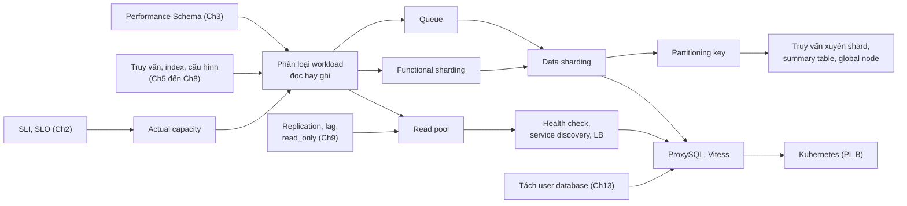

*(Sơ đồ do người viết ghi chú tổng hợp.)*

### Điều cần nhớ

1. **Scaling đo bằng chi phí và độ đơn giản**, không bằng tốc độ. Performance và scalability độc lập (tr. 287–288).
2. **Actual capacity** là throughput còn giữ được hiệu năng chấp nhận được, không phải maximum throughput của benchmark (tr. 288).
3. **Không phải truy vấn nào cũng như nhau:** phân loại workload theo latency và tài nguyên, không theo số câu (tr. 289–290). Đã đo: 1% số câu có thể chiếm 62% thời gian.
4. **Tối ưu trước, scale sau:** index, truy vấn, cache, cấu hình (tr. 290, 311).
5. **Replica scale đọc, không scale ghi**; khi cả đọc và ghi cùng tăng, tách cluster chức năng trước (tr. 291).
6. **Read pool cần một điểm truy cập duy nhất**, thành viên do service discovery quản lý, tối thiểu ba node mỗi pool, và health check có kế hoạch cho trường hợp **mọi** node trượt (tr. 293–296).
7. **Queue biến ghi tức thì thành ghi trong khung thời gian cam kết**; đó là thay đổi hợp đồng API, và tuổi hàng đợi là chỉ số báo lúc phải shard (tr. 298–299).
8. **Partitioning key quyết định truy vấn nào khu trú, truy vấn nào phải hỏi mọi shard**; chọn primary key của thực thể quan trọng nhất, shard cùng các bảng hay `JOIN` với nó, giữ shard nhỏ và cân bằng được (tr. 299–301).
9. **Truy vấn xuyên shard phải là ngoại lệ**; khi cần thì gộp trong ứng dụng, dùng summary table, global node và cache; foreign key không hoạt động xuyên shard (tr. 302–303).
10. **ProxySQL nhẹ, chắn đỉnh kết nối và định tuyến; Vitess tự động hóa sharding nhưng phức tạp và không drop-in.** Cả hai phản ánh trạng thái năm 2021 (tr. 303–311).

### Dấu hiệu nhận diện trong thực tế

| Dấu hiệu | Có thể nghĩa là | Xem |
| --- | --- | --- |
| CPU source cao, phần lớn thời gian là SELECT, truy vấn đã tối ưu | Read-bound | [2.2.2](#read-bound) |
| Ít câu UPDATE nhưng chiếm phần lớn thời gian; redo, fsync, chờ khóa hàng tăng | Write-bound hoặc lô ghi quá lớn | [2.2.3](#write-bound), [2.5](#queuing) |
| Replica lag mỗi đêm khi backup | Replica backup đang nằm trong read pool | [2.4](#read-pool) |
| Toàn bộ đọc lỗi khi cả cluster lag | Health check lag không có fallback | [2.4.2](#health-check) |
| Latency vọt lên mỗi khi thêm replica mới | `leastconn` dồn tải vào node cache lạnh | [2.4.3](#lb-algorithm) |
| Lock timeout, deadlock tăng khi thêm node ứng dụng | Quá nhiều writer đồng thời vào một source | [2.5](#queuing) |
| Tuổi yêu cầu trong hàng đợi tăng đều qua nhiều tuần | Queue đã hết tác dụng, cần shard | [2.5](#queuing) |
| Truy vấn phổ biến nhất phải hỏi mọi shard | Partitioning key chọn sai | [2.6.1](#partitioning-key) |
| Một shard lớn hơn hẳn các shard khác | Thực thể nóng, hoặc chia theo khóa phân bố lệch (kiểu "theo bang") | [2.6.1](#partitioning-key) |
| Lỗi "Too many connections" kèm số lần kết nối hỏng tăng vọt | Ứng dụng mở thêm kết nối và thử lại dồn dập | [2.6.5](#thundering-herd) |

### Câu hỏi còn mở

- Sách khuyên ít nhất ba node mỗi pool nhưng không giải thích con số. Với SLO và tỷ lệ hỏng cụ thể, nên tính số node thế nào?
- Health check lag "chặt" và pool fallback mâu thuẫn nhau: thời điểm chuyển sang fallback nên tự động hay cần người quyết định?
- Khi nào tách cluster chức năng là đủ và khi nào bắt buộc phải data sharding? Sách nêu dấu hiệu (tuổi hàng đợi, lag) nhưng không nêu ngưỡng.
- Ấn bản này không bàn **resharding** (chia lại shard khi đã chạy). Với ProxySQL, việc di chuyển dữ liệu do ai làm và với thời gian ngừng ghi bao lâu?
- Trạng thái Vitess, ProxySQL, Consul sau 2021 (giấy phép, tính năng durability policy, đọc nhất quán theo GTID) khác sách thế nào? Cần kiểm tài liệu hiện hành.

---

<a id="kiem-tra"></a>

## Ghi chú kiểm tra nguồn

### Đối chiếu mục lục

Bookmark lấy từ `toc.txt` (trang PDF), quy đổi trang in = PDF − 22.

| Mục trong sách | Trang in (PDF) | Mục ghi chú |
| --- | --- | --- |
| Chapter 11. Scaling MySQL (mở đầu) | 287 (309) | [1](#big-picture) |
| What Is Scaling? | 287 (309) | [2.1](#s2-1) |
| Read- Versus Write-Bound Workloads | 289 (311) | [2.2](#s2-2) |
| · Understanding Your Workload | 289 (311) | [2.2.1](#understanding-workload) |
| · Read-Bound Workloads | 290 (312) | [2.2.2](#read-bound) |
| · Write-Bound Workloads | 291 (313) | [2.2.3](#write-bound) |
| Functional Sharding | 291 (313) | [2.3](#s2-3) |
| Scaling Reads with Read Pools | 292 (314) | [2.4](#s2-4) |
| · Managing Configuration for Read Pools | 294 (316) | [2.4.1](#read-pool-config) |
| · Health Checks for Read Pools | 295 (317) | [2.4.2](#health-check) |
| · Choosing a Load-Balancing Algorithm | 297 (319) | [2.4.3](#lb-algorithm) |
| Queuing | 298 (320) | [2.5](#s2-5) |
| Scaling Writes with Sharding | 299 (321) | [2.6](#s2-6) |
| · Choosing a Partitioning Scheme | 300 (322) | [2.6.1](#partitioning-key) |
| · Multiple Partitioning Keys | 302 (324) | [2.6.2](#multiple-partitioning-keys) |
| · Querying Across Shards | 302 (324) | [2.6.3](#cross-shard-queries) |
| · Vitess | 303 (325) | [2.6.4](#vitess) |
| · ProxySQL | 306 (328) | [2.6.5](#proxysql) |
| Summary | 311 (333) | [2.7](#s2-7) |

Các tiêu đề nhỏ không có bookmark được viết thành đoạn in đậm: *Vitess architecture overview*, *Migrating your stack to Vitess* (tr. 304, 306); *ProxySQL architecture overview*, *Configuring ProxySQL*, *Using ProxySQL for sharding* (gồm *Sharding by user*, *Sharding by schema*), *Other benefits of using ProxySQL*, *Other notable features in ProxySQL* (tr. 307–310).

### Hình, listing, hộp đã xem trên ảnh trang

| Trang in (PDF) | Nội dung | Ghi chú |
| --- | --- | --- |
| 288 (310) | Chú thích 1 về "power" và capacity | Khớp chữ trích xuất |
| 292 (314) | **Hình 11-1** read pool | Xem thêm bản phóng to; replica giữa không nhận "Read queries" |
| 293 (315) | Tám câu hỏi vận hành | Khớp |
| 294 (316) | **Listing cấu hình HAProxy** | Mô tả bằng bảng ở [2.4](#haproxy-config), không chép |
| 295 (317) | Chú thích 4 (Consul); **hộp Mẹo** (biểu tượng con vượn cáo) về `read_only`, `super_read_only` | |
| 296 (318) | Dòng `option httpchk GET /check-lag`; **hộp Cảnh báo** (biểu tượng bọ cạp) về pool fallback | |
| 298 (320) | Đoạn thuật toán có xếp hàng và mục Queuing | "N" in nghiêng, chữ trích xuất mất định dạng |
| 301 (323) | **Hình 11-2** và chú thích 5 | Đếm trên bản phóng to: trái 3 nút khóa, 8 cụm sao mỗi cụm 8 lá; phải 8 nút nối đầy đủ |
| 304–305 (326–327) | **Hình 11-3** Vitess và bảng thuật ngữ | Xem bản phóng to để xác định nét liền, nét đứt |
| 306 (328) | Ba bước chuyển sang Vitess, chú thích 6 | |
| 308 (330) | **Hộp Cảnh báo** về SPoF; **Hình 11-4** | |
| 309 (331) | **Hai listing ProxySQL**; **hộp Mẹo** về đồng bộ runtime và đĩa | Mô tả bằng bảng, không chép |
| 310 (332) | Chú thích 7 (thundering herd); danh sách tính năng | |

Ảnh trang lưu ở thư mục làm việc tạm của người viết (`SP\hpm\figs\ch11\`), gồm cả bản phóng to Hình 11-1 đến 11-4.

### Lỗi trích xuất và điểm nghi vấn trong sách

- **Gạch nối xuống dòng:** câu "on page 62 in Chap‐ter 3" (tr. 290) bị ngắt giữa chữ "Chapter". Đây có thể là lý do bản concept map đầu tiên không bắt được tham chiếu Ch11 → Ch3.
- **Chữ trong hình** không có trong văn bản trích xuất; đã đọc từ ảnh trang.
- **Listing ProxySQL** (tr. 309): `LOAD MYSQL USERS RULES TO RUNTIME` và `SAVE MYSQL USERS RULES TO DISK` có thật trong bản in (đã xem ảnh trang). Theo hiểu biết của người viết ghi chú về ProxySQL, cú pháp đúng không có chữ `RULES`. Tên bảng `mysql_rules` (tr. 309) có lẽ chỉ `mysql_query_rules`. **Chưa kiểm chứng bằng chạy thật** vì không có ProxySQL.
- **Ví dụ câu lạc bộ sách** (tr. 302): câu "Comments have both a user ID and a post ID" có vẻ phải là "book ID".
- **Liên quan chương 3** (tr. 62, được chương 11 trỏ tới): truy vấn cộng `LOCK_TIME/1000000` và gọi là `latency_ms`. Thí nghiệm 1 cho thấy đó là thời gian chờ lock tính bằng micro giây, và xếp hạng theo nó ngược với xếp hạng theo tổng thời gian (**Kết quả đã đo**).

### Điều kiện phiên bản

| Nội dung | Điều kiện |
| --- | --- |
| Query cache (tr. 297) | Deprecated từ 5.7.20, **gỡ bỏ ở 8.0** |
| `super_read_only` (tr. 295) | Có từ 5.7.8 |
| `SHOW REPLICA STATUS`, `Seconds_Behind_Source` | Từ 8.0.22; bản cũ dùng `SHOW SLAVE STATUS`, `Seconds_Behind_Master` |
| Tên plugin và biến semisync | `rpl_semi_sync_source...` từ 8.0.26 |
| `innodb_buffer_pool_load_at_startup` mặc định bật | Từ 5.7.7 |
| `WAIT_FOR_EXECUTED_GTID_SET()` | Từ 5.7.5 |
| `PS_CURRENT_THREAD_ID()` (dùng trong thí nghiệm) | Từ 8.0.16 |
| Vitess, ProxySQL, HAProxy, Consul | Trạng thái năm 2021 theo sách |

### Nội dung Bổ sung ngoài sách

Diễn giải phép so sánh xa lộ cho MySQL; phép tính N × (N − 1) / 2; xấp xỉ hàng đợi M/M/1; cơ chế đường ghi InnoDB; lý do tách cluster khi cả đọc và ghi tăng; truy vấn Performance Schema theo bảng và theo loại câu; phép tính số server tối thiểu cho hai pool; nhận xét về timeout, `bind`, `mode tcp`, `mysql-check` trong listing HAProxy; giấy phép Consul năm 2023; HAProxy `slowstart`, server `backup`; làm ấm buffer pool; `leastconn` với connection pool dài hạn; hashed với NAT; xóa theo lô, idempotent, RFC 9110; phân biệt sharding với `PARTITION BY`; phép tính 10 triệu và 500 triệu user; cách ánh xạ key sang shard; index phụ toàn cục do ứng dụng duy trì; logical và physical của truy vấn xuyên shard; XA và hai pha; Vitess và CNCF, keyspace, vindex; semisync `AFTER_SYNC`, timeout; cú pháp ProxySQL; multiplexing; read-your-writes với GTID; bảng so sánh HAProxy, ProxySQL, Vitess (phần không có trang); các liên kết DDIA.

### Trạng thái thực hành

Bốn thí nghiệm **đã chạy** trên instance riêng MySQL 8.0.42, cổng 3321, dữ liệu tổng hợp; instance đã tắt sau khi chạy. Các phần cần HAProxy, ProxySQL, Vitess, Consul hay nhiều instance **chưa thực thi**, có quy trình và bài tập trên giấy trong [experiments/chapter-11.md](experiments/chapter-11.md).
