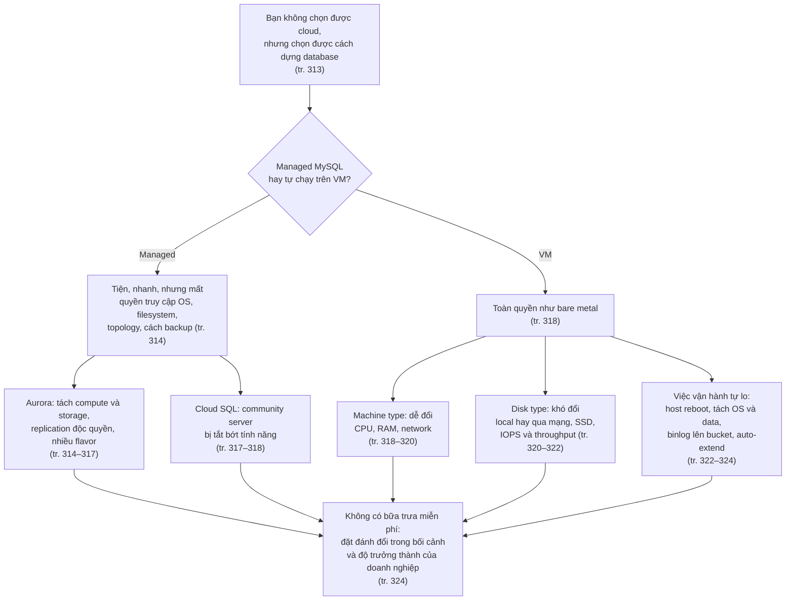
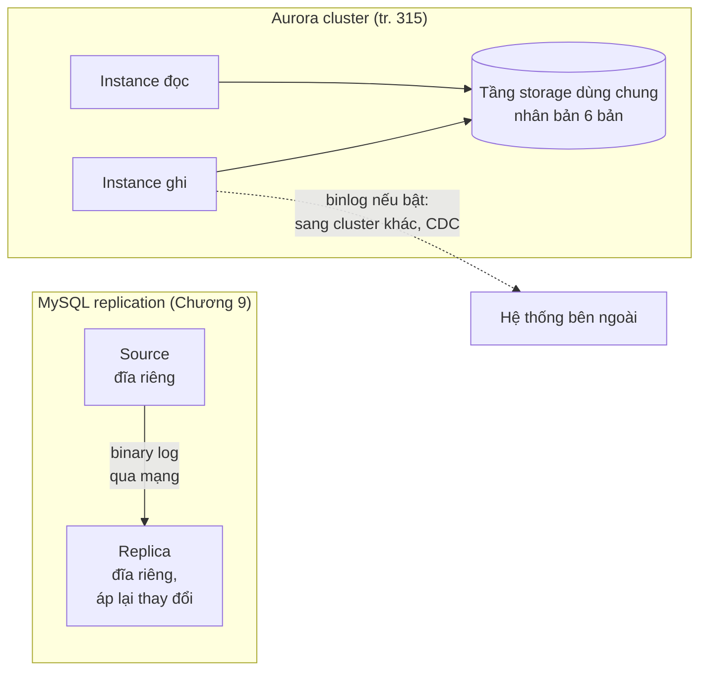
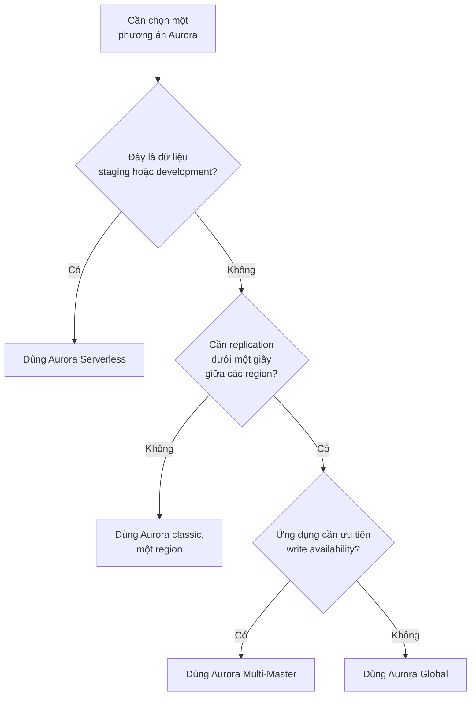
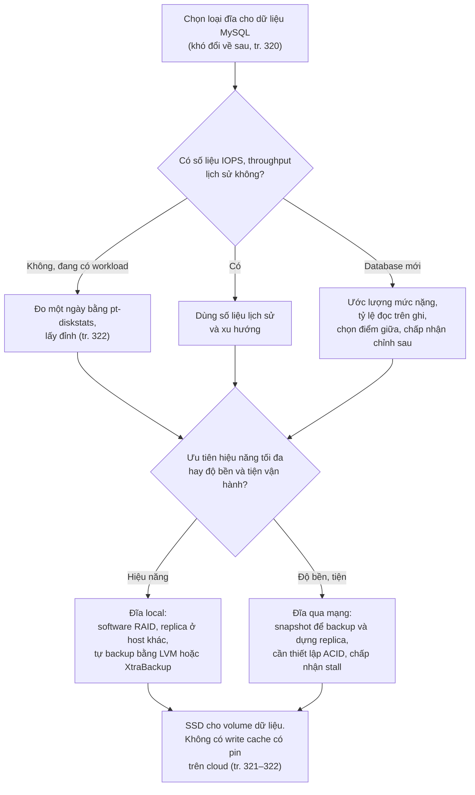
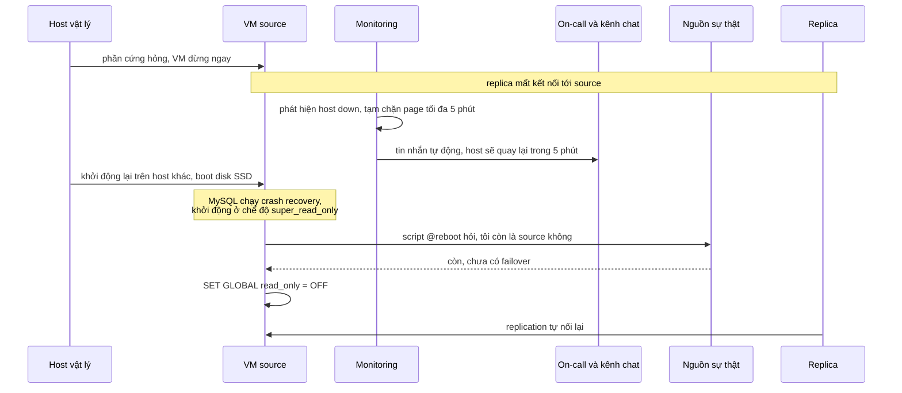
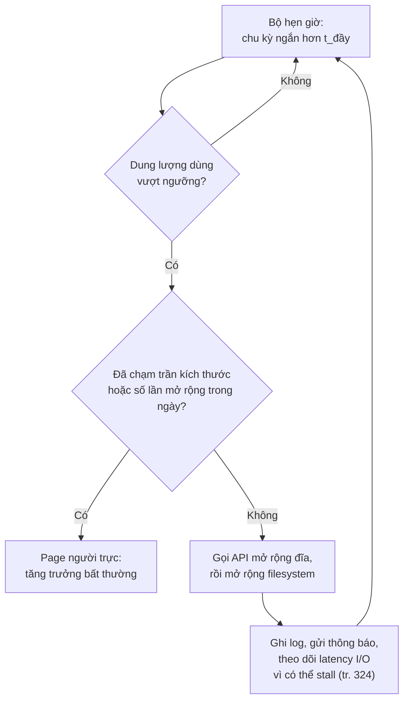
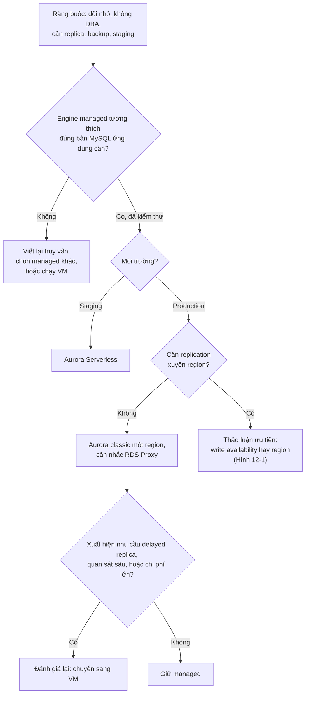
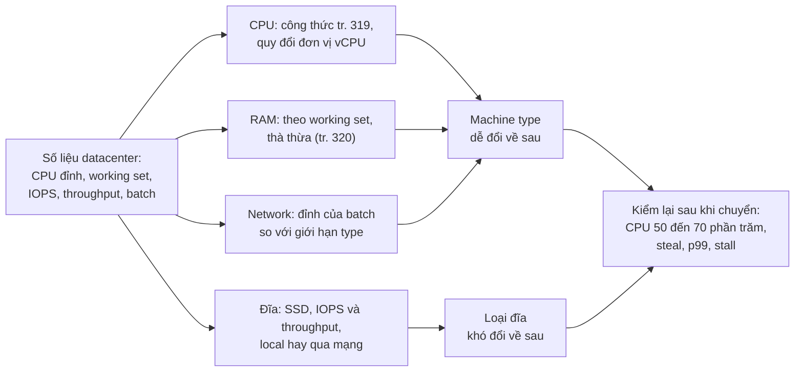
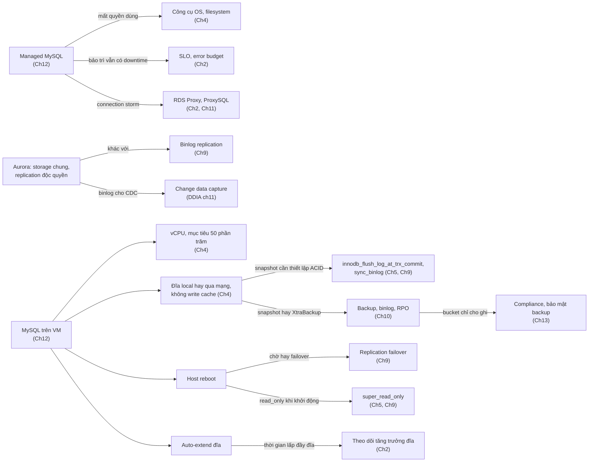

# Chương 12 — MySQL trên cloud

*MySQL in the Cloud*

> **Nguồn:** *High Performance MySQL: Proven Strategies for Operating at Scale*, Silvia Botros và Jeremy Tinley, O'Reilly, **Fourth Edition (11/2021)**, Chương 12, **tr. 313–324 (trang PDF 335–346)**. Tr. 312 (PDF 334) là trang trắng trước chương.
> "tr. N" là số trang in; trang PDF = N + 22 (xem [README](README.md#page-convention)).
>
> **Quy ước nhãn:**
> - Nội dung không nhãn là diễn giải từ sách, luôn kèm số trang.
> - **Bổ sung ngoài sách** là kiến thức thêm hoặc phép tính tự làm.
> - **Ví dụ minh họa do AI xây dựng** là ví dụ, số liệu hay tình huống giả định.
> - **Dự đoán** là điều kỳ vọng nhưng chưa đo. Chương này **không có Kết quả đã đo**.
>
> **Thời điểm của thông tin cloud.** Mọi phát biểu về Aurora, Cloud SQL, RDS Proxy và tính năng hay giới hạn của nhà cung cấp là **theo sách, thời điểm 2021**. Chính cuốn sách nói không bàn lỗi của các dịch vụ cloud vì chúng thay đổi liên tục (tr. 313). Ghi chú không đưa giá hay tính năng hiện tại của nhà cung cấp; chỗ hiếm hoi nhắc tới tình trạng sau 2021 đều ghi **Bổ sung ngoài sách** và cần kiểm chứng với tài liệu hiện hành.
>
> **Phiên bản MySQL.** Phần lớn chương không phụ thuộc phiên bản. Chỗ có phụ thuộc: khả năng tương thích 5.6, 5.7, 8.0 của Aurora (tr. 314, 316); `innodb_flush_log_at_trx_commit`, `sync_binlog`, `read_only`, `super_read_only` (dùng được ở MySQL 5.7 và 8.0); phần **Bổ sung ngoài sách** về dynamic privilege và `innodb_dedicated_server` chỉ áp dụng MySQL 8.0.
>
> **Liên kết:** [Roadmap chương 12](learning-roadmap.md#ch12) · [Bài tập quyết định trên giấy](experiments/chapter-12.md) · [Đáp án tự kiểm tra](answers/chapter-12.md)

## Mục lục ghi chú

- [1. Bức tranh lớn](#big-picture)
- [2. Giải thích sâu](#deep)
  - [2.1 Managed MySQL (tr. 313–318)](#s2-1)
    - [2.1.1 Amazon Aurora for MySQL (tr. 314–317)](#s2-1-1)
    - [2.1.2 GCP Cloud SQL (tr. 317–318)](#s2-1-2)
  - [2.2 MySQL on Virtual Machines (tr. 318–324)](#s2-2)
    - [2.2.1 Machine Types in Cloud (tr. 318–319)](#s2-2-1)
    - [2.2.2 Choosing the Right Machine Type (tr. 319–320)](#s2-2-2)
    - [2.2.3 Choosing the Right Disk Type (tr. 320–322)](#s2-2-3)
    - [2.2.4 Additional Tips (tr. 322–324)](#s2-2-4)
  - [2.3 Summary (tr. 324)](#s2-3)
- [3. Phân tích tình huống](#situations)
- [4. Đo lường và thực hành](#measure)
- [5. Liên kết kiến thức và điều cần nhớ](#takeaways)
- [Ghi chú kiểm tra nguồn](#kiem-tra)

---

## 1. Bức tranh lớn

### Câu hỏi của chương

Sách mở đầu bằng một nhận xét thực tế: bạn **thường không quyết định** việc công ty có lên cloud hay không, càng không quyết định lên nhà cung cấp nào. Điều bạn **quyết định được** là cách dựng môi trường database trên cloud đó (tr. 313). Có hai hướng:

| | ***Managed MySQL*** | **MySQL tự chạy trên VM** |
| --- | --- | --- |
| Công sức vận hành | Ít phải tự tay làm (*hands-off*) | Tốn thêm thời gian và overhead vận hành |
| Chi phí | Thường **đắt hơn** | Sách không so sánh trực tiếp |
| Kiểm soát và quan sát | **Ít** kiểm soát | Linh hoạt hơn nhiều về cách dựng và cách quan sát nền tảng |

*(Tóm tắt tr. 313.)*

Chương làm ba việc (tr. 313): điểm qua các lựa chọn managed MySQL chính và chúng có ích ra sao; hướng dẫn bắt đầu với VM, gồm chọn cấu hình máy và loại đĩa; và nêu những phức tạp vận hành cần chuẩn bị khi chạy MySQL trên VM, ví dụ **host reboot**.

> **Cảnh báo của sách** (tr. 313). Sách **không bàn bug** trong dịch vụ của các nhà cung cấp cloud. Đây là những sản phẩm luôn thay đổi. Tác giả khuyên theo dõi các nguồn cập nhật liên tục như newsletter hay bug board, thay vì dựa vào một tài liệu chụp tại một thời điểm như cuốn sách.

Vì vậy, hãy đọc chương này như một **khung ra quyết định** chứ không phải danh mục tính năng. Các chi tiết như "Aurora chưa tương thích 8.0" là ảnh chụp năm 2021; các câu hỏi đằng sau chúng ("tương thích với bản nào?", "mất quyền kiểm soát gì?", "đĩa nào khó đổi?") thì vẫn dùng được.

### Vị trí trong mục tiêu chung của sách

Preface nói ấn bản thứ tư muốn giúp người đọc **ra quyết định có hiểu biết** về cách dùng MySQL, thay vì vắt thêm vài phần trăm hiệu năng (tr. xv–xvi). Chương 12 là chương "quyết định" thuần nhất: gần như không có SQL, không có biến cấu hình để tuning, chỉ có các đánh đổi.

*Diễn giải của người viết ghi chú.* Chương 12 không đưa nguyên lý mới. Nó hỏi: các nguyên lý của chương 4 (phần cứng), 5 (cấu hình an toàn), 9 (replication, failover), 10 (backup) **đổi hình dạng thế nào khi phần cứng thuộc về người khác**? Ví dụ:

- CPU vật lý trở thành **vCPU dùng chung** với tenant khác (tr. 319).
- RAID card có write cache trở thành **đĩa mạng không có write cache** (tr. 321).
- Máy hỏng trở thành **VM bị khởi động lại trên host khác** (tr. 322).
- Dung lượng đĩa trở thành **tiền trả theo dung lượng provisioned** (tr. 324).

### Kiến thức cần biết trước

| Kiến thức | Dùng ở mục | Học ở |
| --- | --- | --- |
| CPU là nút thắt hay gặp nhất; chọn CPU theo latency hay throughput; working set; write-ahead logging; RAID và write cache có pin | 2.2.1–2.2.3 | [Chương 4](chapter-04.md) (tr. 75–86) |
| Thiết lập ACID (`innodb_flush_log_at_trx_commit=1`, `sync_binlog=1`); `read_only`, `super_read_only`; không "tune theo tỷ lệ" | 2.2.2–2.2.4 | [Chương 5](chapter-05.md) (tr. 105, 122) |
| Failover có kế hoạch và bất ngờ; delayed replica; crash-safe replication, GTID | 2.2, 2.2.4 | [Chương 9](chapter-09.md) (tr. 233, 239–241) |
| Snapshot, XtraBackup, LVM, backup binary log, RPO | 2.2.3, 2.2.4 | [Chương 10](chapter-10.md) (tr. 259, 269–272) |
| SLO, theo dõi tăng trưởng dung lượng đĩa, connection storm | 2.1, 2.2.4 | [Chương 2](chapter-02.md) (tr. 30–31) |
| Công cụ online schema change | 2.1.1 | [Chương 6](chapter-06.md#external-tools) (tr. 150) |

### Liên hệ với các chương khác

Cột "Loại": **sách dẫn** là chỗ chương 12 nhắc trực tiếp chương khác; **nối thêm** là liên hệ người viết ghi chú tìm thấy khi đọc chéo, kèm trang ở cả hai đầu.

| Ý | Chương | Căn cứ | Loại |
| --- | --- | --- | --- |
| Fast DDL của Aurora còn ở "lab mode" thì dùng công cụ online schema change bên ngoài | [Chương 6](chapter-06.md#external-tools) | tr. 315; ch. 6 tr. 150 | sách dẫn |
| RDS Proxy chống connection storm | [Chương 2](chapter-02.md#connection-storm) (định nghĩa connection storm), [Chương 11](chapter-11.md#proxysql) (ProxySQL) | tr. 315; ch. 2 tr. 31; ch. 11 tr. 306 | nối thêm |
| Cửa sổ bảo trì của Cloud SQL phải cân với SLO | [Chương 2](chapter-02.md#sli-slo-sla) | tr. 318 | nối thêm |
| Audit logging cho compliance; Cloud SQL cấm nạp plugin nên không dùng được audit log plugin mà chương 13 giới thiệu | [Chương 13](chapter-13.md#percona-audit) | tr. 314, 317 (chú thích 3); ch. 13 tr. 334 | nối thêm |
| VM cho phép replica ở region khác và delayed replica | [Chương 9](chapter-09.md#delayed-replication) | tr. 318; ch. 9 tr. 233 | nối thêm |
| Số core, RAM ảnh hưởng trực tiếp hiệu năng; cách chọn CPU | [Chương 4](chapter-04.md) | tr. 318, 319 | sách dẫn |
| RAM và working set | [Chương 1](chapter-01.md), [Chương 4](chapter-04.md#working-set) | tr. 320 | sách dẫn |
| Resize VM rồi để MySQL tự tính lại buffer pool | [Chương 5](chapter-05.md#innodb-dedicated-server) (`innodb_dedicated_server`) | tr. 319; ch. 5 tr. 108 | nối thêm |
| Software RAID cho đĩa local | [Chương 4](chapter-04.md) | tr. 321 | sách dẫn |
| Snapshot chỉ phục hồi tốt khi có thiết lập ACID | [Chương 5](chapter-05.md#s2-5), [Chương 9](chapter-09.md#excessive-lag) | tr. 321 (chú thích 6); ch. 9 tr. 253 | nối thêm |
| Tự backup bằng LVM hay XtraBackup khi dùng đĩa local | [Chương 10](chapter-10.md#s2-6) | tr. 321 | sách dẫn |
| Thiếu write cache có pin | [Chương 4](chapter-04.md#raid-cache) | tr. 321; ch. 4 tr. 85 | nối thêm |
| Đo IOPS bằng `pt-diskstats` | [Chương 4](chapter-04.md#other-tools) | tr. 322; ch. 4 tr. 95 | nối thêm |
| Host reboot: failover hay chờ | [Chương 9](chapter-09.md#s2-3) ("Replication Failover", tr. 239) | tr. 322 | sách dẫn |
| Source khởi động lại ở chế độ chỉ đọc | [Chương 5](chapter-05.md#safety-table), [Chương 9](chapter-09.md#planned-promotion) | tr. 323; ch. 5 tr. 122; ch. 9 tr. 240 | nối thêm |
| Backup binary log, bảo vệ bucket | [Chương 10](chapter-10.md#s2-4), [Chương 13](chapter-13.md#backup-access) | tr. 323; ch. 10 tr. 269; ch. 13 tr. 340 | nối thêm |
| Thời gian lấp đầy đĩa tính theo throughput | [Chương 2](chapter-02.md#disk-growth) | tr. 324; ch. 2 tr. 30 | nối thêm |
| Change data capture từ binlog của Aurora | **Bổ sung ngoài sách:** [DDIA chương 11, CDC](../../DDIA/ddia-notes/chapter-11.md#cdc) | tr. 315 (chú thích 2) | sách dẫn tới sách khác |

### Mạch lập luận

---

## 2. Giải thích sâu

### 2.1 Managed MySQL (tr. 313–318)

**What** (tr. 313–314). ***Managed MySQL*** là dịch vụ database do nhà cung cấp cloud vận hành thay bạn. Mỗi public cloud có cách hiểu riêng về một managed SQL database nên trông thế nào và chạy ra sao. AWS có vài flavor của Aurora MySQL, GCP có Cloud SQL, và gần như mọi public cloud đều có thứ tương tự.

**Why người ta chọn nó** (tr. 313–314).

- Giảm **gánh nặng nhận thức** (*cognitive load*) của việc vận hành MySQL khi sản phẩm lớn dần và tính năng nhiều thêm.
- Có database dùng được mà **không cần hiểu sâu MySQL**. Vài cú click hoặc một lệnh `terraform apply` là có database online, kèm replica và backup định kỳ.
- Rất hấp dẫn với công ty hay đội muốn **bắt đầu nhanh**.

**Cái giá: mất khả năng nhìn và kiểm soát** (tr. 314).

| Hạn chế sách nêu | Diễn giải: mất gì so với các chương trước |
| --- | --- |
| Không truy cập hệ điều hành hay filesystem | Không chạy được `vmstat`, `iostat`, `pt-diskstats` trên host ([Chương 4](chapter-04.md#os-status), tr. 92–95); không chọn filesystem hay I/O scheduler |
| Bị giới hạn những gì làm được **bên trong process** | Có thể không đặt được mọi biến cấu hình hay quyền quản trị ([Chương 5](chapter-05.md)); xem ví dụ của Cloud SQL ở [2.1.2](#s2-1-2) |
| Chỉ quan sát được những gì nhà cung cấp đưa ra | Chẩn đoán dừng ở ranh giới dịch vụ |
| Gặp sự cố thì thường chỉ mở **support ticket** và chờ | Thời gian khắc phục phụ thuộc bên thứ ba |
| Không dựng được **topology nâng cao** | Nhiều topology của [Chương 9](chapter-09.md#s2-4) không dùng được |
| Backup và restore giới hạn ở phương án của nhà cung cấp | Không tự chọn XtraBackup, LVM snapshot... như [Chương 10](chapter-10.md#s2-6) |

*(Cột trái từ tr. 314; cột phải là diễn giải của người viết ghi chú.)*

**"MySQL-compatible" không có nghĩa là MySQL** (tr. 314). Nhiều dịch vụ cho bạn một data store ***MySQL-compatible***: có giao diện SQL, nhưng cơ chế bên trong **có thể hoàn toàn khác** Oracle MySQL mà sách tập trung. Sách vì vậy chỉ bàn đánh đổi chung và điểm khác nhau của từng giải pháp, để người đọc chọn cái hợp với đội và doanh nghiệp.

- **Hiểu lầm phổ biến:** "tương thích" nghĩa là "giống hệt". Thực tế, những gì sách giải thích về InnoDB, replication hay backup có thể không áp dụng nguyên vẹn cho một data store chỉ tương thích ở giao diện.
- **Bổ sung ngoài sách — nên kiểm thử gì khi gặp chữ "compatible":** (1) cú pháp và tính năng của đúng bản lớn, ví dụ CTE (`WITH`) và window function chỉ có từ MySQL 8.0; (2) giá trị mặc định của biến hệ thống; (3) plan của các truy vấn quan trọng, vì optimizer có thể khác; (4) ngữ nghĩa replication và backup; (5) quyền quản trị, ví dụ `SUPER`.

#### 2.1.1 Amazon Aurora for MySQL (tr. 314–317)

**What** (tr. 314). ***Aurora MySQL*** là một hosted database **MySQL-compatible** của AWS. Điểm hấp dẫn nhất là **tách compute khỏi storage**, nên hai phần scale riêng và linh hoạt hơn. Aurora lo nhiều việc bạn thường tự làm: **snapshot backup**, **fast schema change**, **audit logging**, và **quản lý replication trong một region**.

> **Hộp "A Note on Compatibility"** (tr. 314). Khi Amazon nói "MySQL compatible", bạn phải xác nhận đó là tương thích với **bản lớn nào** của MySQL. Theo sách (thời điểm 2021), không giải pháp hosted nào trong Aurora tương thích MySQL 8.0, và một số bản cũ chỉ tương thích MySQL 5.6. Nếu định chuyển từ MySQL tự quản lý sang Aurora, hãy đưa điều này vào kiểm thử ứng dụng **trước khi** chuyển dữ liệu production.

> **Bổ sung ngoài sách (cần kiểm chứng với tài liệu AWS hiện hành).** Theo hiểu biết của người viết ghi chú, AWS công bố một dòng Aurora MySQL tương thích MySQL 8.0 vào khoảng cuối năm 2021, gần thời điểm sách phát hành (11/2021). Câu của sách nên được đọc như ảnh chụp lúc viết. Bài học tổng quát không đổi: luôn hỏi "tương thích với bản nào", và kiểm thử ứng dụng trên đúng bản đó.

**Aurora chuẩn** (tr. 315). Compute là các instance **chạy lâu dài**; bạn chọn instance class như khi tự chạy MySQL. Storage gắn kèm được **nhân bản nội bộ thành sáu bản**.

> **Cảnh báo của sách** (tr. 315). Tại thời điểm viết, AWS coi **Aurora fast DDL** là tính năng "lab mode". Nếu khi bạn đọc mà vẫn vậy, sách khuyên xem [Chương 6](chapter-06.md#external-tools) về các cách thay đổi schema online bằng công cụ bên ngoài database (chương 6 nêu `pt-online-schema-change` và `gh-ost`, tr. 150).

**Replication bên trong Aurora cluster khác hẳn replication của MySQL** (tr. 315).

- Replication trong một Aurora cluster là **độc quyền của Amazon**, không phải replication dựa trên binary log của Oracle MySQL mà [Chương 9](chapter-09.md) mô tả.
- Mọi instance trong cluster **dùng chung một tầng storage** để truy cập dữ liệu, nên replication trong cluster được làm **ở tầng block storage**. Chú thích 1 (tr. 315): muốn biết chi tiết kiến trúc, sách giới thiệu bài báo SIGMOD mà đội Aurora công bố năm 2017.
- Aurora **vẫn hỗ trợ ghi binary log** theo định dạng quen thuộc của community server. Dùng khi muốn replicate từ một Aurora cluster sang cluster khác, hoặc cho các mục đích khác của binlog như ***change data capture*** (CDC).

> Chú thích 2 (tr. 315). Change data capture là một mẫu thiết kế trong kiến trúc dữ liệu: xác định khi nào dữ liệu thay đổi và chuyển thay đổi đó sang các miền, hệ thống khác. Sách giới thiệu chương 11 của *Designing Data-Intensive Applications*. **Bổ sung ngoài sách:** xem ghi chú [DDIA chương 11, Change Data Capture](../../DDIA/ddia-notes/chapter-11.md#cdc). Sách in tên tác giả là "Kleppman"; tên đúng là Martin Kleppmann.

*(Sơ đồ do người viết ghi chú dựng từ tr. 315. Sách không mô tả chi tiết cách instance đọc cập nhật cache; xem phần Bổ sung bên dưới.)*

> **Bổ sung ngoài sách** (nguồn: bài báo SIGMOD 2017 mà sách dẫn, Verbitski và cộng sự, *Amazon Aurora: Design Considerations for High Throughput Cloud-Native Relational Databases*; mô tả thiết kế năm 2017, có thể đã thay đổi). Sáu bản được rải trên ba availability zone, mỗi zone hai bản. Một lần ghi cần 4/6 bản xác nhận, một lần đọc cần 3/6 bản; đây là **quorum**, cùng ý tưởng với [DDIA chương 5, quorum](../../DDIA/ddia-notes/chapter-05.md#quorums). Instance ghi gửi **redo log record** xuống storage thay vì ghi cả data page; instance đọc dùng chung volume và nhận luồng redo từ instance ghi để cập nhật các page đang có trong cache.

**Hệ quả** (*diễn giải của người viết ghi chú, dựa trên tr. 315*):

- Thêm một instance đọc **không cần chép dữ liệu**, vì nó đọc chung storage. Ngược lại, replica MySQL thường phải dựng từ backup rồi đuổi binlog ([Chương 9](chapter-09.md), [Chương 10](chapter-10.md)).
- Các công cụ và quy trình xây quanh binlog trong chương 9 (GTID, semi-sync, kiểm tra lag, kiểm tra nhất quán) **không áp dụng nguyên vẹn** bên trong cluster.
- Muốn đưa dữ liệu **ra ngoài** cluster, bạn quay lại binlog, nên vẫn cần hiểu binlog.

> **Mẹo của sách** (tr. 315). Nếu đặt database **mission-critical** lên Aurora, sách khuyên cân nhắc **RDS Proxy** để quản lý cách ứng dụng giao tiếp với Aurora. Khi biết phía ứng dụng có khả năng gây **connection storm**, RDS Proxy rất hữu ích để lượng kết nối mới đó không đè lên database.

*Nối với chương 2.* ***Connection storm*** là khi tầng ứng dụng thấy latency truy vấn tăng và phản ứng bằng cách **mở thêm kết nối**. Database phải tốn tài nguyên xử lý lượng kết nối mới, nên càng ít tài nguyên cho truy vấn; số kết nối còn trống trong `max_connections` giảm đột ngột và availability bị đe dọa ([Chương 2](chapter-02.md#connection-storm), tr. 31).

> **Bổ sung ngoài sách.** Một proxy kiểu này giữ một **pool** kết nối tới database và cho nhiều kết nối phía ứng dụng dùng chung pool đó. Khi ứng dụng mở thêm kết nối, proxy hấp thụ chúng thay vì mở thêm kết nối thật tới MySQL. Vai trò này giống phần connection pooling của ProxySQL và Vitess ở [Chương 11](chapter-11.md) (tr. 303, 306).

**Các flavor của Aurora** (tr. 315–316). Từ khi Aurora MySQL xuất hiện năm 2015, AWS mở rộng thêm nhiều lựa chọn:

| Flavor | Là gì (theo sách, 2021) | Hợp với | Đánh đổi sách nêu |
| --- | --- | --- | --- |
| **Aurora chuẩn** ("classic", một region) | Compute chạy lâu dài, chọn instance class; storage 6 bản (tr. 315) | Production trong một region (Hình 12-1) | — |
| ***Aurora Serverless*** | Bỏ compute chạy lâu dài, dùng nền tảng serverless của Amazon làm tầng compute (tr. 315) | Workload **không cần chạy liên tục**: linh hoạt chi phí; Hình 12-1 đặt nó cho staging, development | Sách không nêu cụ thể |
| ***Aurora Global Database*** | Dữ liệu có ở nhiều vùng địa lý mà **không phải tự quản lý binlog replication** từ primary cluster sang cluster ở region khác (tr. 316) | Cần replication **dưới một giây** giữa các region (Hình 12-1) | Có đánh đổi; luôn đọc lại tài liệu của Amazon để chắc mình chấp nhận đúng đánh đổi |
| ***Aurora Multi-Master*** | Nhận ghi trên **nhiều compute node cùng lúc**; giải pháp HA khi **write availability trong một region** là ưu tiên cao nhất (tr. 316) | Ưu tiên write availability | Chạy lõi **MySQL 5.6** (lúc viết), mất nhiều tính năng; có số node tối đa; **không trộn** được với Global Database; sách gọi là giải pháp "rất có chủ kiến" về availability và consistency, cần cân nhắc kỹ |

> **Bổ sung ngoài sách.** Hệ nào cho ghi ở nhiều node cùng lúc cũng phải xử lý **ghi xung đột**: hai node cùng sửa một dữ liệu. Ứng dụng thường phải chịu lỗi rồi thử lại. Đây là lý do một giải pháp multi-writer luôn mang theo lựa chọn về consistency. Xem [DDIA chương 5, write conflicts](../../DDIA/ddia-notes/chapter-05.md#write-conflicts). Sách không mô tả cơ chế phát hiện xung đột của Aurora Multi-Master.

Sách cố ý **không đi sâu** vào khác biệt tính năng giữa các flavor vì AWS cập nhật liên tục (tr. 316). Thay vào đó, Hình 12-1 đưa một cây quyết định tổng quát:

*(Vẽ lại Hình 12-1, tr. 317, đã đối chiếu ảnh trang PDF 339.)*

**Đọc kỹ nhánh cuối của hình.** Câu hỏi thứ ba chỉ xuất hiện khi bạn **đã trả lời "Có"** với replication xuyên region. Nếu lại chọn ưu tiên write availability, hình dẫn tới Multi-Master, một giải pháp **trong một region** và không trộn được với Global Database (tr. 316). Nghĩa là câu hỏi thứ ba thực chất hỏi: **giữa write availability và replication xuyên region, bạn chịu bỏ cái nào?** Sách nói thẳng: không thể có cùng lúc multiwriter HA và replication xuyên region dưới một giây; nhưng có thể dùng chính các lựa chọn này để **trình bày đánh đổi** và dẫn dắt các cuộc thảo luận sản phẩm khó về điều gì quan trọng nhất (tr. 316).

**Trade-offs và Decision cho Aurora** (tổng hợp tr. 314–316):

- Được: storage tự nhân bản, thêm instance đọc dễ, nhiều việc vận hành được làm sẵn.
- Mất: replication trong cluster là hộp đen độc quyền; tương thích phiên bản phải kiểm tra; một số tính năng (fast DDL, Multi-Master) có giới hạn tại thời điểm viết.
- Quyết định: chọn flavor theo câu hỏi kinh doanh (môi trường gì, cần xuyên region không, ưu tiên ghi hay ưu tiên vùng), không theo danh sách tính năng.

#### 2.1.2 GCP Cloud SQL (tr. 317–318)

**What** (tr. 317). ***Cloud SQL*** là managed MySQL của GCP. Khác biệt cốt lõi so với Aurora: Cloud SQL **chạy community server**, nhưng **tắt một số tính năng** để phục vụ tính chất multitenant và managed của sản phẩm.

**Những thứ không dùng được** dù chạy community server (theo sách, 2021, tr. 317):

- Quyền **`SUPER`** bị tắt.
- **Nạp plugin** bị tắt. Chú thích 3 (tr. 317): Cloud SQL có giải pháp audit logging riêng để hỗ trợ nhu cầu compliance. *Nối với chương 13:* cách ghi log truy cập dữ liệu mà chương 13 đề xuất chính là **plugin** (Percona audit log plugin, hay MySQL Enterprise Audit), nên trên Cloud SQL phải thay bằng giải pháp của nhà cung cấp ([Chương 13](chapter-13.md#data-access-logging), tr. 334).
- Một số client cũng bị tắt, như `mysqldump` và `mysqlimport`.
- Giống AWS, **không SSH** được vào instance.

> **Bổ sung ngoài sách — vì sao một dịch vụ multitenant phải tắt `SUPER`.** Trong MySQL, `SUPER` cho phép những việc ảnh hưởng toàn server: đổi biến hệ thống toàn cục, kill session của user khác, cấu hình replication, và **ghi bất chấp `read_only`** (chỉ `super_read_only` chặn được, [Chương 5](chapter-05.md#safety-table), tr. 122). Nếu khách hàng có `SUPER`, họ có thể phá các bảo đảm mà nhà cung cấp cần giữ (HA, backup, bảo mật). Từ MySQL 8.0, `SUPER` bị đánh dấu deprecated và được chia nhỏ thành các **dynamic privilege** như `SYSTEM_VARIABLES_ADMIN`, `CONNECTION_ADMIN`, `BINLOG_ADMIN`; dịch vụ managed có thể cấp một phần trong số đó. Cần xem tài liệu hiện hành của nhà cung cấp để biết cấp những quyền nào.

> **Điểm không chắc chắn trong nguồn.** `mysqldump` và `mysqlimport` là **chương trình client**, chạy bên ngoài server. Sách không giải thích "bị tắt" theo nghĩa nào. Chương 10 lại nói logical backup "dùng được cho MySQL trên cloud khi không truy cập được filesystem" (tr. 263). Ghi chú không suy đoán ý tác giả; nếu bạn cần logical backup trên Cloud SQL, hãy kiểm tra tài liệu hiện hành.

**Những việc Cloud SQL lo cho bạn** (tr. 318):

- **HA có sẵn**; failover tự động bằng một tùy chọn cấu hình.
- **Mã hóa dữ liệu lúc lưu** (*encryption at rest*) có sẵn.
- **Nâng cấp có quản lý** bằng nhiều cách. Lưu ý: cuối cùng các cửa sổ bảo trì vẫn có **một ít downtime** (Aurora cũng vậy). **Cân bằng downtime đó với SLO của ứng dụng là trách nhiệm của bạn.** Chú thích 4 (tr. 318) chỉ tới mục "Minimizing the Impact of Maintenance" trong tài liệu Cloud SQL.

*Nối với chương 2.* Downtime bảo trì "nhỏ" vẫn ăn vào error budget của SLO. Managed không xóa trách nhiệm đo và bảo vệ SLO ([Chương 2](chapter-02.md#error-budget)).

**So sánh hai dịch vụ theo sách (thời điểm 2021)**

| Khía cạnh | Aurora MySQL | Cloud SQL |
| --- | --- | --- |
| Server bên dưới | MySQL-compatible; nội bộ có thể khác Oracle MySQL; compute và storage tách riêng (tr. 314) | Community server, tắt một số tính năng (tr. 317) |
| Tương thích phiên bản | Chưa có bản 8.0; một số bản chỉ 5.6 (tr. 314) | Sách không nêu |
| Replication trong cụm | Độc quyền, qua block storage; binlog bật được để replicate ra ngoài hay làm CDC (tr. 315) | Sách không mô tả cơ chế; HA có failover tự động (tr. 318) |
| Truy cập máy | Không SSH (tr. 317) | Không SSH (tr. 317) |
| Việc dịch vụ lo | Snapshot backup, fast schema change, audit logging, replication trong một region (tr. 314) | HA, mã hóa at rest, nâng cấp có quản lý (tr. 318) |
| Audit | Aurora lo audit logging (tr. 314) | Giải pháp audit logging riêng, vì không nạp được plugin (tr. 317) |
| Downtime bảo trì | Có (tr. 318) | Có (tr. 318) |

**Lời khuyên khép lại phần managed** (tr. 318). Như đầu chương, nhiều khả năng bạn không được chọn nhà cung cấp. Vì vậy việc thực tế hơn là: **biết rõ managed option của nhà cung cấp đã được chọn** cho bạn có gì và làm việc với nó ra sao, **hoặc** lập luận để chuyển sang tự chạy trên VM.

#### Tự kiểm tra 2.1

- **Câu 2.1.1.** Một đồng nghiệp nói: "Aurora tương thích MySQL, nên mọi quy trình replication của chương 9 (GTID failover, đo lag, kiểm tra nhất quán) đều dùng nguyên được trong cluster." Câu này sai ở đâu? Khi nào bạn vẫn phải làm việc với binlog trên Aurora? [đáp án](answers/chapter-12.md#q2-1-1)
- **Câu 2.1.2.** Theo Hình 12-1, một hệ production cần replication dưới một giây giữa các region và đồng thời muốn ưu tiên write availability sẽ được dẫn tới đâu? Vì sao câu hỏi thứ ba của hình thực chất là một câu hỏi về **ưu tiên**? [đáp án](answers/chapter-12.md#q2-1-2)
- **Câu 2.1.3.** Cloud SQL chạy community server nhưng tắt `SUPER` và việc nạp plugin. Giải thích nguyên nhân gốc, và hệ quả với một đội cần audit log để đạt chứng nhận compliance. [đáp án](answers/chapter-12.md#q2-1-3)
- **Câu 2.1.4.** Nêu ba hạn chế về quan sát hoặc kiểm soát của managed MySQL, và với mỗi hạn chế, chỉ ra một công cụ hay kỹ thuật của các chương trước mà bạn mất. [đáp án](answers/chapter-12.md#q2-1-4)
- **Câu 2.1.5.** Sách khuyên dùng RDS Proxy trong trường hợp nào? Dự đoán điều gì xảy ra với một Aurora cluster không có proxy khi latency tăng và ứng dụng phản ứng bằng cách mở thêm kết nối. [đáp án](answers/chapter-12.md#q2-1-5)

---

### 2.2 MySQL on Virtual Machines (tr. 318–324)

**Why tự chạy khi managed hấp dẫn như vậy?** (tr. 318). Chạy MySQL trên VM **giống chạy trên bare metal**: bạn có toàn quyền với mọi khía cạnh vận hành. Ví dụ sách nêu:

- Đặt primary ở một region nhưng dựng **replica ở region khác** cho disaster recovery.
- Chạy một **replica trễ có chủ ý** (*time-delayed replica*; xem "Delayed Replication" ở [Chương 9](chapter-09.md#delayed-replication), tr. 233).
- **Tự chọn cách backup** tối ưu nhất cho workload.
- Khi hiệu năng giảm hay gặp sự cố, bạn **toàn quyền với hệ điều hành và filesystem** để soi bất cứ thứ gì.

Cái giá: đây là con đường "phức tạp hơn một chút" (tr. 318), và bạn tự chịu trách nhiệm cho nhiều việc hơn, như sizing đĩa và backup (tr. 322).

#### 2.2.1 Machine Types in Cloud (tr. 318–319)

**Vấn đề của datacenter** (tr. 318). Như [Chương 4](chapter-04.md) đã bàn, số core CPU và lượng RAM ảnh hưởng **trực tiếp** tới hiệu năng MySQL. Nhược điểm khi mua phần cứng cho datacenter là cấu hình **khó thay đổi**. Ví dụ của sách: đã lắp một máy 56 core, 512 GB RAM. Bạn có thể tháo bớt RAM, nhưng **đã trả tiền** cho nó; nếu không dùng lại được ở chỗ khác thì đó là chi tiêu thừa.

**Cloud giải quyết thế nào** (tr. 319). Các nhà cung cấp lớn cho chọn ***machine type***: một cấu hình đặt **khoảng vCPU**, lượng RAM, và **giới hạn về network và disk**. Đi kèm là khả năng **resize VM** khi workload đổi. Ví dụ: tăng cấu hình tạm thời cho mùa cao điểm như mùa lễ, rồi thu nhỏ lại khi traffic giảm. Sách nói sự linh hoạt này là lý do nhiều người chuyển lên cloud.

> **Bổ sung ngoài sách — resize không miễn phí với MySQL.**
> - Đổi machine type thường cần **dừng rồi khởi động lại VM**; chính cuốn sách cũng nói tới "một lần reboot nhanh để thêm CPU" (tr. 320). Với source đang nhận ghi, đó là một lần **failover có kế hoạch** ([Chương 9](chapter-09.md#planned-promotion), tr. 239–240) hoặc một khoảng downtime.
> - Sau khi khởi động lại, buffer pool **nguội**. MySQL 5.7 và 8.0 mặc định lưu danh sách page khi tắt và nạp lại khi bật (`innodb_buffer_pool_dump_at_shutdown`, `innodb_buffer_pool_load_at_startup`), giúp làm ấm nhanh hơn.
> - Chương 5 nêu `innodb_dedicated_server` (MySQL 8.0) **hợp với cloud**: VM 128 GB RAM được reboot lên 256 GB thì MySQL tự tính lại kích thước buffer pool và vài biến khác ([Chương 5](chapter-05.md#innodb-dedicated-server), tr. 108).
> - "Giới hạn disk" nằm **trong machine type** (tr. 319). Một volume nhanh gắn vào VM nhỏ vẫn bị VM giới hạn. Ý này quay lại ở [2.2.3](#iops-throughput).

#### 2.2.2 Choosing the Right Machine Type (tr. 319–320)

Nếu bạn **đã ở trên cloud**, chọn máy khá đơn giản: gặp nút thắt về vCPU, bộ nhớ hay network thì tìm machine type vượt được nút thắt đó và resize. Nếu đang **chuyển từ datacenter**, chọn đúng cấu hình ngay từ đầu thì khó hơn (tr. 319).

**CPU** (tr. 319–320)

**What.** Phần lớn hướng dẫn chọn CPU ở [Chương 4](chapter-04.md#s2-2) vẫn đúng. Khác biệt: trên cloud bạn nhận ***vCPU*** (CPU ảo), không phải CPU vật lý. CPU **không thuộc riêng bạn**; nó có thể được chia với tenant khác trên cùng host vật lý. Gần như chắc chắn bạn sẽ thấy latency và mức sử dụng CPU **dao động nhiều hơn** so với một server riêng (tr. 319).

> **Bổ sung ngoài sách, nối chương 4.** Cột `st` của `vmstat` cho biết phần thời gian bị "đánh cắp" (*steal*): VM có việc để chạy nhưng hypervisor cho thứ khác chạy ([Chương 4](chapter-04.md#vmstat), tr. 93). Steal tăng là dấu hiệu tenant khác đang tranh CPU vật lý.

**Công thức ước lượng vCPU khi rời datacenter** (tr. 319). Ước lượng CPU khi chuyển từ máy vật lý lên cloud khá khó. Tác giả đã thành công với công thức:

> số vCPU = (Core Count × 95% Total CPU Usage) × 2

Ví dụ của sách: server 40 core trong datacenter; trong 30 ngày qua, mức dùng CPU **đỉnh** là 30%. Cần bao nhiêu core để chạy trên cloud ở mức sử dụng 50%? Theo công thức: 40 × 30% × 2 = **24 core**. Nếu nhà cung cấp không có machine type 24 core, hãy **làm tròn lên** type gần nhất hoặc xem có ***custom machine type*** không. Chú thích 5 (tr. 319): custom machine type có thể **đắt hơn** type định sẵn; khi chạy rất nhiều instance, luôn tính chi phí khi chọn kích thước.

**Phân tích công thức** (**Bổ sung ngoài sách**):

- **Hệ số × 2 chính là ÷ 0,5**, tức chia cho mức sử dụng mục tiêu 50%. Dạng tổng quát: vCPU ≈ core × mức dùng đo được ÷ mức dùng mục tiêu.
- **"95%" mơ hồ.** Công thức ghi "95% Total CPU Usage", nhiều khả năng là percentile 95 của mức dùng CPU; nhưng ví dụ lại dùng **mức đỉnh**. Dùng đỉnh thì an toàn hơn; dùng p95 thì sát hơn với chỉ dẫn "50% bình thường, đỉnh tới 65–70%" ở hộp cảnh báo bên dưới. Chọn một cách và ghi rõ.
- **Đơn vị phải nhất quán.** Ở nhiều nhà cung cấp lớn, một vCPU thường là **một luồng phần cứng** (hyperthread), không phải một core vật lý. Nếu "40 core" là core vật lý có hyperthreading (80 luồng) mà bạn so với vCPU, kết quả có thể **lệch tới hai lần**. Hãy đếm theo cùng một đơn vị, ví dụ số CPU logic mà hệ điều hành thấy, và kiểm tra định nghĩa vCPU của nhà cung cấp.
- **Công thức chỉ là điểm xuất phát.** CPU khác đời, khác xung nhịp, cộng thêm biến động do dùng chung, nên phải kiểm lại bằng tải thật và SLO sau khi chuyển ([4. Đo lường](#measure)).

| Đầu vào (**Ví dụ minh họa do AI xây dựng**, trừ dòng đầu là ví dụ của sách) | vCPU ước lượng |
| --- | --- |
| 40 core, đỉnh 30%, mục tiêu 50% (tr. 319) | 24 |
| 40 core, đỉnh 30%, mục tiêu 65% | 18,5 → làm tròn lên 19–20 |
| 40 core, p95 giả định 22%, mục tiêu 50% | 17,6 → 18 |

> **Cảnh báo của sách** (tr. 320). Khi mức dùng CPU hoặc số core tăng, ***context switching*** (việc CPU chuyển từ tác vụ này sang tác vụ khác) cũng tăng. Vì vậy đừng chạy ở 100% CPU: bạn sẽ phí nhiều thời gian chuyển qua lại giữa các thread, và điều đó hiện ra thành **latency của truy vấn**. Sách khuyên mục tiêu **50% lúc bình thường**, đỉnh tới **65–70%**. Nếu duy trì từ 70% trở lên, latency nhiều khả năng tăng và nên **thêm CPU**.

> **Bổ sung ngoài sách — góc nhìn hàng đợi.** Ngoài context switching, lý thuyết hàng đợi cũng giải thích vì sao phải chừa khoảng trống. Trong mô hình đơn giản một server (M/M/1), thời gian phản hồi R = S ÷ (1 − ρ), với S là thời gian phục vụ và ρ là mức sử dụng. ρ = 0,5 cho R = 2S; ρ = 0,7 cho R ≈ 3,3S; ρ = 0,9 cho R = 10S. Máy nhiều core chịu tải tốt hơn mô hình này cho tới gần mức bão hòa, nhưng **hình dạng đường cong** vẫn vậy: gần 100% thì latency tăng vọt. Trên cloud, biến động do dùng chung CPU làm khoảng trống càng cần thiết.

**Chip family** (tr. 320). Nếu nhà cung cấp cho chọn dòng chip, hãy chú ý. Ứng dụng web traffic cao nên dùng thế hệ chip **mới hơn nhiều**. Xử lý dữ liệu backend thì dòng chip cũ, chậm hơn một chút có thể đủ, và **tiết kiệm chi phí**. *Nối với chương 4:* muốn latency thấp thì cần CPU nhanh, vì mỗi truy vấn chỉ dùng một CPU ([Chương 4](chapter-04.md#latency-throughput), tr. 76).

**Memory** (tr. 320). Như chương 1 và 4 đã bàn, RAM ảnh hưởng lớn tới hiệu năng MySQL. Chọn machine type khớp nhất với ***working set*** (phần dữ liệu thực sự cần để làm việc, [Chương 4](chapter-04.md#working-set), tr. 77), và **thà thừa RAM còn hơn thiếu**.

> **Bổ sung ngoài sách.** Khi working set vượt buffer pool, mỗi lần trượt cache là một lần đọc đĩa; trên đĩa gắn qua mạng, lần đọc đó còn cộng thêm một vòng mạng. Để biết RAM có đủ không, hãy nhìn **tốc độ đọc vật lý** (biến trạng thái `Innodb_buffer_pool_reads` tăng bao nhiêu mỗi giây) và latency truy vấn, **không** nhìn "hit ratio". Chương 5 nói rõ tỷ lệ hit của cache không cho biết cache to hay nhỏ ([Chương 5](chapter-05.md#tuning-by-ratio), tr. 105).

**Network performance** (tr. 320). CPU và bộ nhớ là phần quan trọng nhất khi chọn machine type, nhưng hãy xem cả **giới hạn network** để không bỏ đói ứng dụng. Ví dụ: một batch đọc lượng dữ liệu lớn có thể **dùng hết băng thông** của một machine type nhỏ.

> **Mẹo của sách** (tr. 320). ***Network egress*** (lưu lượng ra) giữa các zone và các region **thường bị tính tiền**. Điều này có thể gây bất ngờ khi dựng replica, nhưng tác giả vẫn cho rằng nên đặt replica **ở zone khác** để có dư thừa.

> **Bổ sung ngoài sách.** Lưu lượng replication tới một replica xấp xỉ lượng binlog mà source sinh ra. Chi phí egress vì vậy tăng theo **lượng ghi × số replica ở zone hay region khác**, chứ không theo lượng đọc. Backup chép sang region khác cũng là egress.

#### 2.2.3 Choosing the Right Disk Type (tr. 320–322)

**Why đây là quyết định phức tạp nhất** (tr. 320). Machine type nhìn chung **thay đổi được**. Nhưng một khi đã chọn loại đĩa và bắt đầu chứa dữ liệu, chuyển sang loại khác **rất khó**. Thường phải gắn thêm một đĩa thứ hai và **chép dữ liệu sang**. Không phải không sửa được, nhưng phức tạp hơn nhiều so với một lần reboot nhanh để thêm CPU.

> **Bổ sung ngoài sách.** Cách sửa thường gặp khác: dựng một **replica mới** trên loại đĩa mới (từ backup hay snapshot, rồi đuổi binlog), sau đó **failover có kế hoạch** sang nó ([Chương 9](chapter-09.md#planned-promotion), tr. 239–240). Cách này tránh chép dữ liệu ngay trên source đang chạy.

**Phụ thuộc workload** (tr. 320–321):

- Workload **đọc nhiều**: thêm **bộ nhớ** có lợi hơn đĩa nhanh, vì truy cập bộ nhớ nhanh hơn nhiều bậc độ lớn. Nếu working set lớn hơn InnoDB buffer pool, bạn **luôn** phải xuống đĩa đọc một phần dữ liệu.
- Workload **ghi nhiều**: **luôn** xuống đĩa. Đây là chỗ đa số người gặp **nút thắt đĩa đầu tiên**.

> **Bổ sung ngoài sách — vì sao ghi luôn chạm đĩa.** Cache có thể hoãn và gom các lần ghi, nhưng không xóa được chúng ([Chương 4](chapter-04.md#caching-writes), tr. 76–77). Với thiết lập ACID, mỗi lần commit phải flush redo log (`innodb_flush_log_at_trx_commit=1`) và đồng bộ binlog (`sync_binlog=1`) xuống đĩa; data page bẩn được flush sau bởi thread nền. Vì vậy **latency của commit bị chặn dưới bởi latency fsync** của đĩa. Group commit giúp throughput khi nhiều transaction cùng commit, nhưng không làm một commit đơn lẻ nhanh hơn fsync.

**Attachment types: đĩa local hay đĩa qua mạng** (tr. 321). Quyết định đầu tiên:

| Tiêu chí | ***Locally attached disk*** (đĩa gắn cục bộ) | ***Network-attached disk*** (đĩa gắn qua mạng) |
| --- | --- | --- |
| Hiệu năng | **Rất cao**, throughput ổn định; IOPS và throughput đạt được cao hơn nhiều | Không tệ, nhưng kém đĩa local; có thể bị **stall** (khựng) khi đĩa local thì không |
| Độ bền | Được coi là đĩa cho **dữ liệu tạm** (*ephemeral*). Phần cứng chạy VM hỏng là có thể **mất toàn bộ** dữ liệu trên đĩa. Có khi chỉ cần **tắt instance**, lúc bật lại bạn đã ở host khác với **đĩa trống**. Thường **không có replication hay RAID** phía sau | Ưu tiên **dư thừa và độ tin cậy** hơn hiệu năng |
| Giảm rủi ro | Sách khuyên cân nhắc mạnh **software RAID** để ít nhất giảm khả năng mất dữ liệu ([Chương 4](chapter-04.md)) | — |
| Backup | Phải **tự lo**, bằng LVM hoặc công cụ như XtraBackup ([Chương 10](chapter-10.md#s2-6)) | Có công cụ **backup hoặc snapshot** tiện lợi của nhà cung cấp |
| Dựng replica | Sách không nêu | Dùng snapshot để dựng replica **cực nhanh**, kể cả đĩa nhiều terabyte, nên replica ít lag phải đuổi trước khi dùng được |
| Write cache có pin hoặc flash | **Không có** | **Không có** |

*(Tóm tắt tr. 321.)*

**Hiểu lầm phổ biến: "đĩa local có software RAID là an toàn".** Software RAID ghép nhiều đĩa **của cùng một host**. Nó giúp khi **một đĩa** hỏng, nhưng không giúp khi **cả host** hỏng hoặc VM bị dời sang host khác với đĩa trống (tr. 321). Sách chỉ nói RAID "giảm khả năng" mất dữ liệu. Với đĩa local, độ bền thật phải đến từ **replica trên host khác và backup** ([Chương 9](chapter-09.md), [Chương 10](chapter-10.md)).

**Snapshot của đĩa mạng và crash recovery** (tr. 321). Công cụ snapshot của nhà cung cấp **dùng tốt cho MySQL**, với hai điều kiện: bạn đã cấu hình **thiết lập tuân thủ ACID** và giải pháp backup **được thiết kế đúng**. Khi đó có thể snapshot đĩa **bất kỳ lúc nào** và phục hồi qua **crash recovery bình thường**.

> Chú thích 6 (tr. 321). Nhắc lại, thiết lập ACID ở đây là `innodb_flush_log_at_trx_commit=1` và `sync_binlog=1`.

**Why cần hai thiết lập đó** (**Bổ sung ngoài sách**). Một snapshot chụp đĩa ở một thời điểm giống như **mất điện đột ngột** (*crash-consistent*). Khởi động từ snapshot, InnoDB chạy crash recovery: áp lại redo log để đưa data file về trạng thái nhất quán. Nếu redo hay binlog **chưa được flush** lúc snapshot (do nới thiết lập), các transaction đã báo commit có thể mất, và binlog có thể lệch với dữ liệu.

**Evidence từ chương khác.**

- Chương 9 đưa mẹo **tạm hạ durability** trên replica để giảm lag (`sync_binlog=0`, `innodb_flush_log_at_trx_commit=0`), nhưng cảnh báo: nếu replica đó là nơi lấy backup, đổi thiết lập có thể khiến **không phục hồi được từ backup**. Chú thích 7 nói điều này thường đúng khi backup bằng LVM snapshot hoặc **snapshot đĩa trên cloud** ([Chương 9](chapter-09.md#excessive-lag), tr. 253).
- Chương 10 có "Backup Myth #2": snapshot LVM, ZFS hay SAN **không phải backup thật**, vì snapshot copy-on-write chỉ chứa phần khác biệt và dùng chung block với dữ liệu đang chạy ([Chương 10](chapter-10.md#myth-snapshot), tr. 272).

> **Bổ sung ngoài sách (cần kiểm tra với nhà cung cấp của bạn).** Snapshot block storage của các cloud lớn thường được **lưu tách khỏi volume gốc**, nên lập luận "dùng chung block" của Backup Myth #2 không áp dụng y nguyên. Dù vậy, vẫn phải **thử phục hồi định kỳ**, giữ bản sao ở nơi khác (region hay tài khoản khác), và giữ **datadir, redo log, undo và binlog trên cùng volume**, vì snapshot riêng lẻ của nhiều volume không nhất quán với nhau, trừ khi nhà cung cấp hỗ trợ snapshot nhất quán nhiều volume.

**Không có write cache** (tr. 321). Lưu ý cuối của sách về attachment type: nhà cung cấp cloud **không có** thứ như write cache dùng pin hay flash mà card RAID trên phần cứng thường có.

*Hệ quả, nối chương 4* (*diễn giải của người viết ghi chú*). Chương 4 nói write cache có pin (BBU) có thể tăng hiệu năng **từ 20 lần trở lên** cho workload flush log nhiều, như flush transaction log mỗi lần commit ([Chương 4](chapter-04.md#raid-cache), tr. 85). Trên cloud không có lớp đệm này: mỗi fsync của redo log và binlog trả **đúng latency của thiết bị lưu trữ**, và với đĩa mạng là cả vòng mạng. Workload commit nhỏ, dày đặc là loại cảm nhận rõ nhất.

**SSD versus HDD** (tr. 322). Nhìn chung, dùng **SSD cho mọi thứ**, nhất là volume dữ liệu MySQL. Nếu ngân sách rất chật, có thể cân nhắc HDD rẻ hơn cho **boot disk**. Trong thử nghiệm của tác giả, SSD **khởi động nhanh hơn HDD 2–3 lần**. Nếu thời gian khởi động quan trọng, nhất là khi sự cố hay reboot, **dùng SSD hoàn toàn**. *Ý này nối với [host reboot](#host-reboots): boot disk SSD giúp hệ thống thường quay lại trong vòng năm phút (tr. 323).*

**IOPS and throughput** (tr. 322). Một yếu tố phức tạp khác là xác định nhu cầu ***IOPS*** (số thao tác I/O mỗi giây) và ***throughput*** (lượng byte mỗi giây). Trước khi chọn loại đĩa, nên hiểu rõ cả **lịch sử** lẫn **xu hướng tương lai** của hai chỉ số này.

- **Chuyển từ workload có sẵn:** lý tưởng là bạn đã có số liệu lịch sử về dùng đĩa. Nếu chưa, dùng `pt-diskstats` trong Percona Toolkit để thu số liệu **trong một ngày** và đo đỉnh. (Chương 4 giới thiệu `pt-diskstats` là bản thay `iostat` của Percona, tr. 95.)
- **Database mới:** bỏ thời gian tìm hiểu ứng dụng sẽ nặng tới đâu. Ngay cả hiểu biết đơn giản như **tỷ lệ đọc trên ghi** cũng giúp ích.
- **Khi không còn cách nào:** chọn điểm giữa hợp lý giữa hiệu năng và chi phí, và chấp nhận trước rằng **có thể phải điều chỉnh sau**.

> **Bổ sung ngoài sách.**
> - **Throughput ≈ IOPS × kích thước mỗi I/O.** Với page InnoDB mặc định 16 KB: 3.000 IOPS ≈ 47 MB/s; 16.000 IOPS ≈ 250 MB/s. Nhưng I/O của InnoDB không đều cỡ (ghi redo nhỏ và tuần tự, read-ahead lớn hơn), nên phải đo cả hai chỉ số.
> - **Giới hạn hiệu dụng là mức nhỏ hơn** giữa giới hạn của volume và giới hạn disk của machine type (tr. 319 nói machine type có giới hạn disk).

**Sơ đồ quyết định loại đĩa** (*người viết ghi chú tổng hợp từ tr. 320–322*):

#### 2.2.4 Additional Tips (tr. 322–324)

Tự chạy MySQL trên VM nghĩa là bạn chịu trách nhiệm **nhiều hơn hẳn** so với dịch vụ managed: sizing đĩa, backup và nhiều việc khác (tr. 322). Sách đưa bốn mẹo.

**Dealing with host reboots** (tr. 322–323)

**What và Why.** VM của bạn thực ra chạy trên **phần cứng của người khác**. Phần cứng **có hỏng**, và khi đó VM **bị dừng ngay lập tức**. Nếu đã cấu hình, VM sẽ khởi động lại **trên một host khác**. Chuyện này xảy ra lúc đang phục vụ traffic production, nhất là trên **source đang nhận ghi**, thì người dùng bị gián đoạn (tr. 322).

> **Bổ sung ngoài sách.** DDIA cũng nhận xét rằng trên một số nền tảng cloud, VM biến mất không báo trước là chuyện khá thường, vì nền tảng ưu tiên tính linh hoạt hơn độ tin cậy của từng máy ([DDIA chương 1, Reliability](../../DDIA/ddia-notes/chapter-01.md#b3)).

**Hai lựa chọn** (tr. 322). Không có giải pháp thần kỳ nào để tránh, bạn phải xử lý nó. Thường có hai cách:

1. Khởi động **failover sang một replica** ("Replication Failover", [Chương 9](chapter-09.md#s2-3), tr. 239).
2. **Chờ source quay lại.**

Một lần **promotion ngoài kế hoạch** (*unplanned promotion*) có thể rất khó. Lời khuyên của tác giả: **cứ để server quay lại**, và để replication **tự nối lại** một cách tự nhiên.

**Why chờ lại hợp lý** (*nối chương 9*). Chương 9 nói unplanned promotion là việc ít khi được luyện: phải tra tài liệu, xem replica nào hợp nhất, và tất cả tốn thời gian. Nhiều khi **chờ server hay process MySQL quay lại còn nhanh hơn**. Lợi ích: nếu đã làm theo thiết lập ACID của chương 5, bạn **không mất dữ liệu**, và các replica tiếp tục từ chỗ dừng ([Chương 9](chapter-09.md#promotion-tradeoffs), tr. 240–241). Failover sang một replica bất đồng bộ thì có thể **thiếu vài transaction cuối**.

**Điều kiện ngầm** (*diễn giải của người viết ghi chú, nối tr. 321 với tr. 322*): chiến lược "chờ" giả định dữ liệu **còn đó** khi VM quay lại, tức là dùng **đĩa gắn qua mạng**. Nếu source chạy trên **đĩa local** và VM bị dời sang host khác, nó có thể quay lại với **đĩa trống** (tr. 321). Khi đó không còn gì để chờ: phải failover.

**Bốn gợi ý giúp chịu đựng dễ hơn** (tr. 323):

| Gợi ý | Mục đích |
| --- | --- |
| Dùng **SSD làm boot disk** | Khởi động lại nhanh nhất có thể; hệ thống thường quay lại **dưới năm phút** |
| **Tạm chặn thông báo on-call** "host down" trong tối đa năm phút | Cho hệ thống đủ thời gian khởi động và khỏe lại, tránh đánh thức người không cần thiết |
| Nếu source vừa reboot, **viết code tắt cờ `read_only` động**, chạy bằng tùy chọn `@reboot` của crond | Cho ghi tiếp **không cần người can thiệp**. Điều kiện duy nhất: phải **truy vấn được một hệ thống** để biết máy này **có nên nhận ghi không** |
| **Tự động gửi email hay tin nhắn chat** cho các đội cần biết | Một câu như "host FQDN vừa sập bất ngờ, sẽ quay lại trong năm phút" có thể đủ để mọi người không nhắn hay page bạn |

> **Bổ sung ngoài sách — vì sao "điều kiện duy nhất" lại là điều quan trọng nhất.** Nếu trong lúc source vắng mặt, một người hay một công cụ **đã failover** sang replica, thì script tắt `read_only` một cách mù quáng trên source cũ sẽ tạo ra **hai nơi nhận ghi** (*split brain*), và dữ liệu phân kỳ. Chương 9 khuyên source cũ khi quay lại phải **mặc định bật `super_read_only`** (tr. 240). Cách ghép hai ý:
> 1. Trong tệp cấu hình, đặt `super_read_only=ON`, để **mọi** lần khởi động đều ở chế độ chỉ đọc.
> 2. Script `@reboot` hỏi **nguồn sự thật** (service discovery, công cụ quản lý topology) xem máy này có còn là source không.
> 3. Chỉ khi câu trả lời là có thì chạy `SET GLOBAL read_only = OFF;`. Theo chú thích 6 của chương 9 (tr. 240), tắt `read_only` cũng tự tắt `super_read_only`.
> 4. Dùng `SET GLOBAL`, **không** dùng `SET PERSIST`, để lần khởi động sau vẫn bắt đầu ở chế độ chỉ đọc.
>
> Phác thảo script nằm ở [bài tập 4](experiments/chapter-12.md#bt4).

*(Sơ đồ do người viết ghi chú dựng từ tr. 322–323; bước "nguồn sự thật" là điều kiện sách nêu, cách hiện thực là Bổ sung ngoài sách. Nếu nguồn sự thật trả lời "không", máy giữ chế độ chỉ đọc và chờ người xử lý.)*

**Separate operating system and MySQL data** (tr. 323). Dù dùng đĩa local hay đĩa mạng, sách khuyên **tách hệ điều hành và dữ liệu MySQL** ra các đĩa riêng, vì:

- Snapshot đĩa chỉ chứa **dữ liệu MySQL**, không lẫn thông tin hệ điều hành.
- Với đĩa mạng, có thể **tháo đĩa và gắn sang máy khác** dễ dàng.
- Cũng với đĩa mạng, có thể **nâng cấp hay thay hệ điều hành** mà không phải chép lại dữ liệu.

Sách cũng khuyên cân nhắc chỗ đặt các tệp cụ thể: **PID file**, **các logfile** và **socket file** nên ở cùng hệ điều hành; riêng log có thể đặt trên đĩa dữ liệu (tr. 323).

> **Bổ sung ngoài sách.** Sách không nói "logfile" gồm những log nào. Với mục tiêu phục hồi từ snapshot ([trên](#disk-snapshot)), **redo log, undo và binlog** phải nằm cùng volume với data file (mặc định chúng nằm trong datadir). Error log hay slow query log thì đặt ở đĩa hệ điều hành cũng được.

**Backing up binary logs** (tr. 323)

**How.**

- Đẩy binary log lên một **bucket** (object storage).
- Đặt **life-cycle control** cho bucket để tự xóa tệp cũ sau một khoảng thời gian.
- Ngược lại, **chặn xóa** tệp trước một khoảng thời gian nhất định, hoặc cấm xóa hẳn.

**Bảo mật** (tr. 323). Để bucket cho cả thế giới đọc là "cơn ác mộng chờ xảy ra". Kiểm soát **ai được đọc, ai được xóa** là điều cốt yếu của chiến lược backup an toàn. Gợi ý của sách: cho **mọi máy database được ghi**, nhưng **không máy nào được đọc hay xóa**. Quyền đọc và xóa được kiểm soát riêng, từ một tài khoản hoặc máy bị hạn chế, hoặc cả hai.

**Why** (*nối chương 10 và 13*):

- Binlog cần cho **phục hồi tới một thời điểm** (*point-in-time recovery*). Chương 10 khuyên backup binlog thường xuyên: không chấp nhận mất quá 30 phút dữ liệu thì backup binlog ít nhất mỗi 30 phút ([Chương 10](chapter-10.md#s2-4), tr. 269). Tần suất đẩy lên bucket vì vậy gắn với **RPO**.
- Chương 13 nhắc nhiều vụ lộ dữ liệu xảy ra **qua bucket backup để quyền quá rộng**, không phải qua hạ tầng đang chạy ([Chương 13](chapter-13.md#backup-access), tr. 340).
- **Bổ sung ngoài sách:** quyền "chỉ ghi" cho máy database nghĩa là kẻ tấn công chiếm được một host database **không xóa được backup** (ví dụ trong tấn công ransomware) và **không đọc được binlog** của các server khác.

> **Bổ sung ngoài sách.** Một cách đưa binlog ra khỏi server gần như liên tục là chạy `mysqlbinlog --read-from-remote-server --raw --stop-never` trên một máy khác để nhận binlog qua mạng, rồi đẩy các tệp đã đóng lên bucket. Sách không nêu công cụ cụ thể.

**Auto-extend your disks** (tr. 324)

**Why.** Với đĩa mạng, bạn trả tiền cho dung lượng **provisioned** (đã cấp), không phải dung lượng đã dùng. Để trống nhiều dung lượng đã cấp trên đĩa dữ liệu MySQL là **lãng phí**. Một cách tối ưu: nhắm mức dùng đĩa **cao hơn nhiều**, ví dụ **90%**. Nhưng làm sao giảm rủi ro hết đĩa?

**How.** Nhà cung cấp thường có **API mở rộng kích thước đĩa**. Với một ít code, bạn kiểm tra server nào vượt mốc 90% và gọi API để mở rộng. Cách này còn giảm khả năng bị page vì một server sắp hết đĩa. Nhìn chung, nó có thể tạo **khác biệt đáng kể** về chi phí cho dung lượng đĩa đã cấp.

**Ba cảnh báo của sách** (tr. 324):

1. **Tần suất chạy code kiểm tra.** Dựa vào **throughput của đĩa**, tính xem một tiến trình cần bao lâu để **lấp đầy toàn bộ phần đĩa còn trống**. Code phải chạy **thường xuyên hơn** khoảng thời gian đó.
2. **Tiến trình chạy mất kiểm soát.** Nếu nó cứ mở rộng đĩa không giới hạn, bạn có thể thức dậy với một volume **64 TB**, và hóa đơn sẽ là một bất ngờ đắt đỏ.
3. **Gọi API mở rộng có thể làm đĩa stall** một lúc. Hãy **thử dưới tải** để chắc nó không ảnh hưởng người dùng.

**Tính tần suất kiểm tra** (**Bổ sung ngoài sách, phép tính**). Gọi S là kích thước đĩa, ngưỡng là 90%, T là throughput ghi tối đa của đĩa:

- Thời gian lấp đầy phần còn trống: **t_đầy = (1 − 0,9) × S ÷ T**.
- Điều kiện an toàn: **chu kỳ kiểm tra + thời gian mở rộng xong < t_đầy**. "Thời gian mở rộng xong" gồm gọi API và mở rộng filesystem.

| S | T | Phần trống ở mốc 90% | t_đầy |
| --- | --- | --- | --- |
| 200 GB | 250 MB/s | 20 GB | 80 giây |
| 1 TB | 250 MB/s | 100 GB | 400 giây ≈ 6,7 phút |
| 4 TB | 250 MB/s | 400 GB | 1.600 giây ≈ 26,7 phút |
| 1 TB | 1.000 MB/s | 100 GB | 100 giây |

*(Ví dụ minh họa do AI xây dựng; 1 GB = 1.000 MB cho dễ tính.)*

**Bài học từ bảng.** Một **ngưỡng phần trăm cố định** cho các đĩa khác cỡ dẫn tới khoảng an toàn rất khác nhau: đĩa nhỏ và nhanh gần như không có thời gian phản ứng. Tốt hơn là đặt ngưỡng theo **thời gian còn lại tới khi đầy**, rồi suy ra phần trăm cho từng đĩa. Dùng throughput **tối đa** (như sách gợi ý) là giả định xấu nhất, ví dụ một `ALTER TABLE` chép bảng hay một lần ghi binlog khổng lồ. Chương 2 cũng dạy cách tính này cho cảnh báo dung lượng đĩa, và nói ngay cả khi cloud tự mở rộng volume, bạn vẫn cần ngưỡng cho đủ thời gian lập kế hoạch ([Chương 2](chapter-02.md#disk-growth), tr. 30).

> **Bổ sung ngoài sách (cần kiểm tra theo nhà cung cấp và hệ điều hành).**
> - Mở rộng block device thường **chưa đủ**: còn phải mở rộng partition hoặc filesystem bên trong VM. Sách không nhắc bước này.
> - Một số nhà cung cấp **giới hạn số lần** thay đổi kích thước một volume trong một khoảng thời gian. Nếu vậy, mỗi bước mở rộng phải đủ lớn để không cần mở rộng lại sớm.
> - Rào chắn chống "volume 64 TB": **trần kích thước** cho mỗi đĩa, **số lần mở rộng tối đa** mỗi ngày, và **cảnh báo** cho mỗi lần mở rộng để người xem xét tốc độ tăng.

*(Sơ đồ do người viết ghi chú dựng từ ba cảnh báo ở tr. 324; trần kích thước và giới hạn số lần là Bổ sung ngoài sách.)*

#### Tự kiểm tra 2.2

- **Câu 2.2.1.** Dùng công thức của sách, ước lượng số vCPU cho một server 64 core có mức dùng CPU p95 là 25%, mục tiêu 50%. Hệ số × 2 đến từ đâu? Trong trường hợp nào kết quả có thể lệch tới hai lần? [đáp án](answers/chapter-12.md#q2-2-1)
- **Câu 2.2.2.** Vì sao sách coi chọn loại đĩa là quyết định phức tạp nhất, trong khi machine type thì "dynamic"? Nêu hai cách sửa khi đã chọn sai loại đĩa, và vì sao workload ghi nhiều gặp nút thắt đĩa trước. [đáp án](answers/chapter-12.md#q2-2-2)
- **Câu 2.2.3.** Source chạy trên đĩa local có software RAID 1. Host vật lý hỏng và VM khởi động lại trên host khác. Dự đoán chuyện gì xảy ra với dữ liệu, và lời khuyên "cứ để server quay lại" của sách còn dùng được không? [đáp án](answers/chapter-12.md#q2-2-3)
- **Câu 2.2.4.** Một script `@reboot` tắt `read_only` mỗi khi source khởi động lại, không hỏi ai. Mô tả kịch bản khiến script này gây hại, và sửa nó theo điều kiện sách nêu ở tr. 323. [đáp án](answers/chapter-12.md#q2-2-4)
- **Câu 2.2.5.** Đĩa mạng 500 GB, throughput tối đa 250 MB/s, ngưỡng auto-extend 90%. Code kiểm tra phải chạy thường xuyên tới mức nào? Nêu thêm hai rủi ro sách cảnh báo về auto-extend. [đáp án](answers/chapter-12.md#q2-2-5)

---

### 2.3 Summary (tr. 324)

Nếu bạn làm ở một trong hàng nghìn công ty chạy trên public cloud, bạn có nhiều lựa chọn về cách chạy database. Là kỹ sư database, bạn sẽ được hỏi: dùng giải pháp managed nào, **có nên dùng managed không**, và đánh đổi của mỗi lựa chọn là gì (tr. 324).

Điều quan trọng nhất khi góp ý trong các cuộc thảo luận đó: **không có bữa trưa miễn phí** (*no free lunch*). Lựa chọn nào cũng kèm một tập đánh đổi. Việc hữu ích nhất bạn làm được là **đặt các đánh đổi vào bối cảnh** cách doanh nghiệp vận hành và **giai đoạn trưởng thành** của nó, để dẫn tổ chức tới lựa chọn phù hợp nhất (tr. 324).

**Bảng đánh đổi tổng hợp** (*người viết ghi chú tổng hợp từ cả chương*):

| Trục | Managed MySQL | MySQL trên VM |
| --- | --- | --- |
| Tốc độ bắt đầu | Rất nhanh: vài click hay `terraform apply` (tr. 314) | Chậm hơn: tự chọn máy, đĩa, dựng backup (tr. 318–322) |
| Công sức vận hành | Ít (tr. 313) | Nhiều: sizing đĩa, backup, host reboot (tr. 322) |
| Quan sát và chẩn đoán | Chỉ những gì nhà cung cấp đưa; sự cố thì mở ticket (tr. 314) | Toàn quyền OS và filesystem (tr. 318) |
| Topology, cách backup | Giới hạn ở phương án của nhà cung cấp (tr. 314) | Tùy ý: replica xuyên region, delayed replica, backup tùy biến (tr. 318) |
| Phiên bản và hành vi | Có thể chỉ "compatible"; phải kiểm tra bản lớn (tr. 314) | Chạy đúng bản MySQL bạn chọn |
| Chi phí | Thường đắt hơn (tr. 313) | Sách không so sánh; tối ưu được, ví dụ auto-extend đĩa (tr. 324) |
| Bảo trì | Có downtime trong cửa sổ bảo trì; cân với SLO (tr. 318) | Tự lên lịch; tự chịu reboot ngoài kế hoạch (tr. 322) |

> **Ví dụ minh họa do AI xây dựng — "giai đoạn trưởng thành" có thể nghĩa là gì.** Sách không định nghĩa các giai đoạn. Một cách nghĩ: (1) **đội nhỏ, chưa có DBA, sản phẩm đang tìm thị trường**: tốc độ và ít vận hành quan trọng nhất, managed thường hợp; (2) **có đội vận hành, SLO rõ, tải lớn dần**: bắt đầu cần quan sát sâu, topology riêng, kiểm soát chi phí; (3) **quy mô lớn, nhiều ràng buộc compliance**: cần kiểm soát chi tiết backup, quyền, vị trí dữ liệu. Mỗi bước lên có thể đổi câu trả lời. Đây là khung gợi ý, không phải khẳng định của sách.

#### Tự kiểm tra 2.3

- **Câu 2.3.1.** Với managed MySQL và MySQL trên VM, mỗi bên nêu hai thứ bạn **được** và hai thứ bạn **trả giá**, kèm trang sách. [đáp án](answers/chapter-12.md#q2-3-1)
- **Câu 2.3.2.** Cùng một ứng dụng, vì sao khuyến nghị có thể khác nhau cho một startup năm kỹ sư và một công ty có đội DBA với yêu cầu compliance? Gắn lập luận với câu "đặt đánh đổi vào bối cảnh và độ trưởng thành" của sách. [đáp án](answers/chapter-12.md#q2-3-2)
- **Câu 2.3.3.** Nối chương 9, 10 và 12: dưới những điều kiện nào một snapshot đĩa mạng trên cloud dùng được làm backup? Điều gì có thể làm nó vô dụng? [đáp án](answers/chapter-12.md#q2-3-3)

---

## 3. Phân tích tình huống

Chương này là chương vận hành và quyết định, nên các tình huống dưới đây đi từ **ràng buộc** → **câu hỏi quyết định** → **lựa chọn và đánh đổi** → **điều gì sẽ đổi kết luận**. Không ép SQL vào. Mọi tình huống và số liệu đều là **Ví dụ minh họa do AI xây dựng**; nhận định về dịch vụ cloud là **theo sách, thời điểm 2021**.

### 3.1 Startup lên AWS: managed hay VM, và flavor Aurora nào?

**Dữ kiện giả định.** Đội 4 developer, không có DBA. Dữ liệu 200 GB, tăng chậm. Ứng dụng dùng **CTE và window function** (tính năng của MySQL 8.0). Cần một replica, backup hằng ngày, môi trường staging. Năm sau phải đạt một chứng nhận compliance cần audit log. Công ty đã chọn AWS.

**Bước 1 — ràng buộc nào nặng nhất?** Đội không có người chuyên vận hành MySQL. Theo sách, managed giảm gánh nặng nhận thức và cho database có replica cùng backup chỉ sau vài thao tác (tr. 313–314). Đây là lực kéo mạnh về managed.

**Bước 2 — kiểm tra "compatible".** Theo sách (2021), Aurora chưa có bản tương thích 8.0 (tr. 314). Nếu điều đó còn đúng với dịch vụ bạn định dùng, các truy vấn có CTE hay window function sẽ **lỗi** trên một engine tương thích 5.6 hay 5.7. Đây là lý do sách đòi đưa phiên bản vào kiểm thử ứng dụng trước khi chuyển dữ liệu (tr. 314). Ba hướng: kiểm tra lại dịch vụ hiện hành; viết lại truy vấn; hoặc chọn hướng khác (VM chạy MySQL 8.0, hay một managed khác có 8.0).

**Bước 3 — chọn flavor bằng Hình 12-1** (tr. 317):

- Staging → **Aurora Serverless** (workload không chạy liên tục, linh hoạt chi phí, tr. 315).
- Production: không cần replication xuyên region → **Aurora classic, một region**.

**Bước 4 — các mẹo phụ.** Nếu ứng dụng chạy kiểu nhiều instance tự scale (dễ mở kết nối hàng loạt), cân nhắc **RDS Proxy** chống connection storm (tr. 315). Audit log: Aurora tự lo audit logging (tr. 314), tốt cho compliance; cần xác nhận định dạng và nơi lưu đáp ứng kiểm toán viên ([Chương 13](chapter-13.md#data-access-logging)).

**Bước 5 — điều gì sẽ lật kết luận sang VM?**

- Cần **delayed replica** để chống lỗi thao tác, hoặc replica xuyên region tự quản lý (tr. 318).
- Cần **công cụ quan sát sâu** (OS, filesystem) vì gặp vấn đề hiệu năng mà ticket hỗ trợ không giải quyết kịp (tr. 314).
- Chi phí managed vượt ngưỡng khi quy mô lớn (sách chỉ nói managed "thường đắt hơn", tr. 313).
- Có người vận hành đủ năng lực để gánh host reboot, backup, sizing đĩa (tr. 322).

### 3.2 Rời datacenter lên VM: chọn machine type và loại đĩa

**Dữ kiện giả định.** Server hiện tại: 40 core, mức dùng CPU đỉnh 30 ngày là 30% (số liệu ví dụ của sách, tr. 319), RAM 512 GB, buffer pool 400 GB. Dữ liệu 3 TB; working set ước khoảng 250 GB. Ban ngày đọc nhiều; ban đêm có batch đọc khoảng 1 TB để xuất báo cáo. `pt-diskstats` đo một ngày: đỉnh 9.000 IOPS, 180 MB/s ghi.

**CPU.** Theo công thức sách: 40 × 30% × 2 = 24 vCPU (tr. 319). Kiểm tra đơn vị: nếu 40 là core vật lý có hyperthreading và vCPU của nhà cung cấp là một luồng, cần quy đổi lại (**Bổ sung ngoài sách**, [2.2.2](#cpu-sizing-formula)). Không có type 24 thì làm tròn lên, hoặc custom type nhưng nhớ chi phí (tr. 319). Web traffic cao nên chọn chip đời mới (tr. 320).

**RAM.** Working set 250 GB cần nằm trong buffer pool, và sách khuyên thà thừa còn hơn thiếu (tr. 320). Một type có RAM đủ cho buffer pool khoảng 300 GB trở lên là hợp lý; không cần giữ nguyên 512 GB nếu working set đã được đo kỹ. **Dự đoán:** giảm RAM xuống dưới working set sẽ làm tốc độ đọc vật lý và p99 latency tăng rõ.

**Network** (**Bổ sung ngoài sách, phép tính**). Batch đọc 1 TB trong một giờ cần khoảng 1.000.000 MB ÷ 3.600 s ≈ 278 MB/s, tức khoảng 2,2 Gbit/s. Sách cảnh báo batch lớn có thể dùng hết băng thông của type nhỏ (tr. 320), nên phải so với giới hạn network của machine type.

**Đĩa.**

- Chọn SSD cho volume dữ liệu (tr. 322).
- Nhu cầu đỉnh 9.000 IOPS, 180 MB/s, cộng khoảng trống tăng trưởng. Giới hạn hiệu dụng là mức nhỏ hơn giữa volume và machine type (tr. 319).
- **Local hay qua mạng?** Đội muốn dựng replica nhanh cho 3 TB và muốn snapshot làm backup, nên đĩa qua mạng hợp (tr. 321). Đổi lại: có thể stall, không có write cache (tr. 321), nên commit latency phụ thuộc fsync của đĩa mạng. Nếu p99 commit latency là SLO cứng, đĩa local nhanh hơn là lựa chọn đáng xét, nhưng phải có replica ở host khác và tự backup bằng XtraBackup (tr. 321).
- Tách OS và dữ liệu; boot disk SSD (tr. 322–323).
- Replica đặt ở zone khác, chấp nhận chi phí egress (tr. 320).

**Điều gì sẽ đổi kết luận.** Nếu sau khi chuyển, p95 CPU vượt 70% kéo dài thì thêm CPU (tr. 320). Nếu stall của đĩa mạng làm vỡ SLO thì phải đổi loại đĩa, và vì đây là việc khó, nên đổi bằng replica mới rồi failover (**Bổ sung ngoài sách**). Nên dồn công đo đạc vào quyết định đĩa trước khi chuyển, vì máy thì sửa dễ còn đĩa thì không (tr. 320).

### 3.3 Host reboot của source lúc 3 giờ sáng

**Dữ kiện giả định.** Source chạy trên VM với đĩa mạng, boot disk SSD. Có hai replica bất đồng bộ ở zone khác. Thiết lập ACID đầy đủ. Không có công cụ failover tự động. SLO availability cho phép khoảng 20 phút gián đoạn ghi mỗi tháng.

**Diễn biến.** Host vật lý hỏng, VM dừng ngay (tr. 322). Ứng dụng không ghi được. VM được khởi động lại trên host khác.

**Quyết định: chờ hay failover?**

| Tiêu chí | Chờ source quay lại | Unplanned failover sang replica |
| --- | --- | --- |
| Thời gian gián đoạn ghi | Thường dưới 5 phút với boot disk SSD (tr. 323) cộng thời gian crash recovery | Thời gian page người, kiểm tra replica nào đầy đủ nhất, chuyển traffic: một quy trình ít khi được luyện (ch. 9 tr. 241) |
| Mất dữ liệu | Không mất nếu thiết lập ACID (ch. 9 tr. 241) | Có thể mất transaction chưa kịp sang replica bất đồng bộ |
| Rủi ro thao tác | Thấp: replication tự nối lại (tr. 322) | Cao: dễ sai, sai thì kéo dài downtime (ch. 9 tr. 239) |
| Khi nào không dùng được | Đĩa local bị mất; VM không quay lại; crash recovery quá lâu | — |

**Kết luận theo sách.** Với dữ kiện này, **chờ** là lựa chọn mặc định (tr. 322). Chặn page trong năm phút đầu, gửi tin nhắn tự động, script `@reboot` hỏi nguồn sự thật rồi mới tắt `read_only` (tr. 323).

**Điều gì sẽ đổi kết luận.**

- Source chạy trên **đĩa local** → có thể quay lại với đĩa trống (tr. 321) → phải failover.
- VM **không quay lại** sau một ngưỡng đặt trước (ví dụ 10 phút, **Ví dụ minh họa do AI xây dựng**) → failover theo quy trình chương 9.
- Có công cụ failover tự động **đã kiểm chứng** và replica bán đồng bộ → failover rẻ và an toàn hơn, cán cân có thể nghiêng sang failover. Lúc đó script `@reboot` trên source cũ càng phải hỏi nguồn sự thật để tránh split brain.

### 3.4 Auto-extend cho một fleet: ngưỡng, tần suất và rào chắn

**Dữ kiện giả định.** 40 server MySQL, mỗi server một đĩa mạng từ 500 GB tới 4 TB, throughput tối đa của volume 250 MB/s. Hiện mọi đĩa được cấp dư để chỉ dùng khoảng 50%. Cron hiện có chạy mỗi 5 phút. Gọi API cộng mở rộng filesystem mất khoảng 2 phút.

**Bước 1 — lợi ích** (**Bổ sung ngoài sách, phép tính**). Với cùng 900 GB dữ liệu: nhắm 50% thì cấp 1.800 GB; nhắm 90% thì cấp 1.000 GB, tức **ít hơn 44%** dung lượng phải trả tiền. Đây là "khác biệt đáng kể" mà sách nói (tr. 324).

**Bước 2 — kiểm tra điều kiện an toàn.** Cần: 5 phút + 2 phút = 420 giây < t_đầy.

- Đĩa 4 TB: t_đầy ở mốc 90% là 1.600 giây. **Đạt.**
- Đĩa 1 TB: 400 giây. **Không đạt** (420 > 400).
- Đĩa 500 GB: 200 giây. **Không đạt.**

**Bước 3 — sửa.** Hai hướng: tăng tần suất kiểm tra (chạy mỗi phút: 60 + 120 = 180 giây, đủ cho đĩa 500 GB vì 180 < 200 nhưng sát), hoặc **đặt ngưỡng theo thời gian**. Ví dụ, muốn luôn còn ít nhất 420 giây ở throughput tối đa thì phần trống tối thiểu là 420 × 250 MB/s = 105 GB. Đĩa 4 TB có thể dùng tới khoảng 97%, đĩa 1 TB tới khoảng 89%, còn đĩa 500 GB chỉ tới khoảng 79%. Đĩa nhỏ mà nhanh không hưởng trọn lợi ích 90%.

**Bước 4 — rào chắn** (tr. 324 và **Bổ sung ngoài sách**). Trần kích thước cho mỗi đĩa (tránh "64 TB"), số lần mở rộng tối đa mỗi ngày, cảnh báo mỗi lần mở rộng. Thử API mở rộng **dưới tải** trên staging và đo latency I/O trong lúc đó (tr. 324). Vẫn giữ cảnh báo tăng trưởng dung lượng theo chương 2 (tr. 30).

Bài tính chi tiết hơn nằm ở [bài tập 2 và 3](experiments/chapter-12.md#bt2).

---

## 4. Đo lường và thực hành

**Vì sao chương này không có thí nghiệm MySQL chạy được.** Mọi chủ đề của chương (dịch vụ managed, vCPU dùng chung, đĩa mạng, host bị dời, API mở rộng đĩa) đều cần một môi trường cloud. Một instance MySQL trên laptop **không mô phỏng được** những hành vi đó, và dựng số liệu giả rồi trình bày như đo thật thì trái quy tắc của dự án. Thay vào đó, [`experiments/chapter-12.md`](experiments/chapter-12.md) có **năm bài tập quyết định trên giấy**. Kết quả trong đó là **phép tính** (Bổ sung ngoài sách), không phải Kết quả đã đo; phần nào cần chạy trên cloud được ghi **Chưa thực thi**.

**Khung đo cho các quyết định của chương** (**Bổ sung ngoài sách**; giả thuyết là **Dự đoán**):

| Quyết định | Giả thuyết cần kiểm | Chỉ số quan sát | Công cụ | Tiêu chí trước và sau |
| --- | --- | --- | --- | --- |
| Số vCPU (tr. 319) | Số vCPU theo công thức giữ CPU quanh 50% lúc bình thường | Mức dùng CPU p50 và p95, cột steal, context switch | `vmstat`, `mpstat` ([Chương 4](chapter-04.md#os-status), tr. 93–95) | p95 CPU ≤ 65–70% (tr. 320); p99 latency truy vấn không xấu hơn trước khi chuyển quá mức SLO cho phép |
| RAM (tr. 320) | RAM đủ cho working set | Tốc độ tăng `Innodb_buffer_pool_reads` mỗi giây, IOPS đọc, latency | `SHOW GLOBAL STATUS`, Performance Schema ([Chương 3](chapter-03.md)) | Đọc vật lý thấp và ổn định; **không** dùng hit ratio ([Chương 5](chapter-05.md#tuning-by-ratio), tr. 105) |
| Loại đĩa (tr. 320–322) | Đĩa đáp ứng đỉnh IOPS và throughput với khoảng trống | IOPS, MB/s, latency từng I/O, các lần stall | `pt-diskstats`, `iostat` (tr. 322; ch. 4 tr. 92–95) | Đỉnh thực tế dưới giới hạn volume và machine type; không có stall làm vỡ SLO |
| Network (tr. 320) | Batch không dùng hết băng thông | Byte vào/ra, thời gian batch | Số liệu của VM | Batch xong trong cửa sổ, không làm chậm truy vấn online |
| Host reboot (tr. 322–323) | Hệ thống quay lại dưới 5 phút | Thời gian từ lúc VM dừng tới lúc nhận ghi lại | Log hệ thống, log MySQL | Nằm trong error budget của SLO ([Chương 2](chapter-02.md#error-budget)) |
| Auto-extend (tr. 324) | Kiểm tra đủ dày, mở rộng không gây stall | % đĩa dùng, tốc độ tăng MB/s, thời gian còn tới khi đầy, latency I/O lúc mở rộng | Script, số liệu đĩa | Không lần nào thời gian còn lại xuống dưới chu kỳ cộng thời gian mở rộng; latency I/O lúc mở rộng không vượt ngưỡng |

**Cách đo trước và sau một lần chuyển hay resize.** Ghi lại cùng một bộ chỉ số trong ít nhất một chu kỳ kinh doanh đầy đủ trước khi đổi (ví dụ cả tuần, có giờ cao điểm), rồi đo lại sau khi đổi trong cùng khoảng. So sánh **phân phối** (p50, p95, p99), không chỉ trung bình, và đối chiếu với SLO ([Chương 2](chapter-02.md#sli-slo-sla)).

**Các bài tập trên giấy** ([chi tiết](experiments/chapter-12.md)):

1. Ước lượng vCPU và độ nhạy của công thức (tr. 319–320).
2. Tần suất chạy code auto-extend dựa trên throughput (tr. 324).
3. Lợi ích chi phí và khoảng an toàn khi nhắm 90% (tr. 324).
4. Runbook host reboot và script `@reboot` có kiểm tra nguồn sự thật (tr. 322–323).
5. Chọn managed hay VM bằng ma trận trọng số (tr. 313–324).

---

## 5. Liên kết kiến thức và điều cần nhớ

### Liên kết khái niệm

### Điều cần nhớ

1. Bạn hiếm khi chọn được cloud, nhưng chọn được **managed hay VM**. Managed: ít vận hành, thường đắt hơn, ít kiểm soát. VM: linh hoạt, tốn công (tr. 313).
2. **"MySQL-compatible" không phải MySQL.** Luôn hỏi tương thích **bản lớn nào** và kiểm thử ứng dụng trước khi chuyển dữ liệu (tr. 314). Nhận định "Aurora chưa có 8.0" là ảnh chụp năm 2021.
3. Aurora **tách compute khỏi storage**; replication trong cluster là cơ chế **độc quyền ở tầng block storage**, không phải binlog. Muốn đưa dữ liệu ra ngoài thì vẫn dùng binlog (tr. 314–315).
4. Hình 12-1 nhắc rằng **không thể vừa multiwriter HA vừa replication xuyên region dưới một giây**; hãy dùng chính đánh đổi đó để mở thảo luận ưu tiên với phía sản phẩm (tr. 316–317).
5. Managed vẫn có **downtime bảo trì**; cân nó với SLO là việc của bạn (tr. 318).
6. Trên VM, **machine type dễ đổi, loại đĩa khó đổi**. Dồn công đo IOPS, throughput và tỷ lệ đọc ghi vào quyết định đĩa (tr. 320–322).
7. vCPU là CPU **dùng chung**: nhắm **50%** lúc bình thường, đỉnh **65–70%**; duy trì trên 70% thì thêm CPU. Công thức ước lượng: core × mức dùng × 2 (tr. 319–320).
8. Đĩa local nhanh nhưng **ephemeral**; đĩa mạng bền, có snapshot, nhưng có thể stall. Cloud **không có write cache có pin** (tr. 321).
9. Snapshot phục hồi tốt qua crash recovery **chỉ khi** có `innodb_flush_log_at_trx_commit=1` và `sync_binlog=1` cùng một quy trình backup đúng (tr. 321).
10. Host reboot: thường nên **chờ** thay vì unplanned failover; boot disk SSD, chặn page 5 phút, tắt `read_only` tự động **chỉ sau khi hỏi nguồn sự thật**. Auto-extend: chu kỳ kiểm tra phải ngắn hơn thời gian lấp đầy đĩa, có trần, và phải thử dưới tải (tr. 322–324).

### Dấu hiệu nhận diện trong thực tế

- Latency dao động bất thường dù tải ổn định, cột `st` của `vmstat` tăng → **tenant khác tranh CPU** (tr. 319; ch. 4 tr. 93).
- CPU p95 kéo dài trên 70% và p99 latency tăng → **thiếu vCPU** (tr. 320).
- Batch ban đêm chậm dần và trùng lúc băng thông chạm trần → **giới hạn network của machine type** (tr. 320).
- Commit chậm đều, latency I/O ghi cao dù IOPS thấp → **fsync trên đĩa mạng, không có write cache** (tr. 321).
- Latency I/O nhảy vọt vài giây không rõ lý do → **stall của đĩa mạng**, hoặc trùng thời điểm script gọi API mở rộng (tr. 321, 324).
- Hóa đơn tăng sau khi thêm replica → **egress giữa zone hay region** (tr. 320).
- Truy vấn chạy được trên môi trường dev 8.0 nhưng lỗi cú pháp trên managed → **engine chỉ tương thích bản cũ** (tr. 314).
- Số kết nối tăng vọt cùng lúc latency tăng → **connection storm**, cần proxy (tr. 315; ch. 2 tr. 31).

### Câu hỏi còn mở

- Các nhận định cụ thể của sách (tương thích 8.0 của Aurora, fast DDL "lab mode", Multi-Master chạy lõi 5.6, client bị tắt trên Cloud SQL) còn đúng tới đâu với dịch vụ hiện hành? Cần kiểm tra tài liệu nhà cung cấp trước khi dùng vào quyết định.
- Sách không đưa con số về **replication lag** giữa các instance trong Aurora cluster, hay về độ dài và tần suất **stall** của đĩa mạng. Làm sao đo các con số này trong môi trường của mình?
- "Giai đoạn trưởng thành" của doanh nghiệp đo bằng gì để biết lúc nào nên chuyển từ managed sang VM, hay ngược lại?
- Chi phí tổng thể (tiền dịch vụ cộng công người vận hành) giữa managed và VM so sánh thế nào ở các quy mô khác nhau? Sách chỉ nói managed "thường đắt hơn" mà không lượng hóa.
- Câu "mysqldump và mysqlimport bị tắt" trên Cloud SQL (tr. 317) nên hiểu thế nào, khi chương 10 coi logical backup là cách hợp với MySQL trên cloud (tr. 263)?

---

## Ghi chú kiểm tra nguồn

**Đối chiếu mục lục** (bookmark trong PDF so với mục ghi chú):

| Mục trong sách | Trang in | Trang PDF | Mục ghi chú |
| --- | --- | --- | --- |
| (Mở đầu chương, hộp cảnh báo) | 313 | 335 | [1. Bức tranh lớn](#big-picture) |
| Managed MySQL | 313–318 | 335–340 | [2.1](#s2-1) |
| Amazon Aurora for MySQL | 314–317 | 336–339 | [2.1.1](#s2-1-1) |
| GCP Cloud SQL | 317–318 | 339–340 | [2.1.2](#s2-1-2) |
| MySQL on Virtual Machines | 318–324 | 340–346 | [2.2](#s2-2) |
| Machine Types in Cloud | 318–319 | 340–341 | [2.2.1](#s2-2-1) |
| Choosing the Right Machine Type (CPU, Memory, Network performance) | 319–320 | 341–342 | [2.2.2](#s2-2-2) |
| Choosing the Right Disk Type (Attachment types, SSD versus HDD, IOPS and throughput) | 320–322 | 342–344 | [2.2.3](#s2-2-3) |
| Additional Tips (Dealing with host reboots, Separate operating system and MySQL data, Backing up binary logs, Auto-extend your disks) | 322–324 | 344–346 | [2.2.4](#s2-2-4) |
| Summary | 324 | 346 | [2.3](#s2-3) |

**Hình, hộp và chú thích đã xem trên ảnh trang** (render PDF 335–346; thêm PDF 19 để đối chiếu biểu tượng hộp):

- **Hình 12-1** (tr. 317, PDF 339): cây quyết định chọn flavor Aurora; đã vẽ lại ở [2.1.1](#figure-12-1), khớp từng nhánh với ảnh.
- **Hộp có tiêu đề** "A Note on Compatibility" (tr. 314).
- **Hộp có biểu tượng.** Theo trang quy ước của sách (tr. xvii, PDF 19): khỉ lemur là **Mẹo**, con quạ là **Lưu ý**, bọ cạp là **Cảnh báo**. Trong chương: Cảnh báo ở tr. 313 (không bàn bug cloud), tr. 315 (fast DDL "lab mode"), tr. 320 (context switching, mục tiêu 50%); Mẹo ở tr. 315 (RDS Proxy), tr. 320 (chi phí egress). Không có hộp Lưu ý.
- **Chú thích 1–6** (tr. 315, 315, 317, 318, 319, 321): đã đưa vào đúng chỗ.
- Chương **không có bảng, listing hay output** nào.

**Lỗi trích xuất và điểm đáng chú ý.**

- Chữ trích xuất khớp ảnh trang. Chỉ có ngắt từ do gạch nối cuối dòng (ví dụ "boo‐ted", "pro‐vider") và chú thích bị đẩy lên đầu trang trong tệp chữ; đã đối chiếu ảnh để đặt đúng vị trí.
- Chú thích 2 (tr. 315) in tên tác giả DDIA là "Kleppman"; tên đúng là Kleppmann.
- Công thức vCPU (tr. 319) ghi "95% Total CPU Usage" nhưng ví dụ dùng "peak CPU usage"; ghi chú nêu cả hai cách hiểu ở [2.2.2](#cpu-sizing-formula).
- Câu về `mysqldump` và `mysqlimport` bị tắt trên Cloud SQL (tr. 317) không được giải thích; ghi chú đánh dấu là điểm không chắc chắn ở [2.1.2](#cloud-sql).

**Điều kiện phiên bản và thời điểm.**

- Mọi nhận định về Aurora, Cloud SQL, RDS Proxy: **theo sách, thời điểm 2021**.
- `innodb_flush_log_at_trx_commit`, `sync_binlog`, `read_only`, `super_read_only`: áp dụng MySQL 5.7 và 8.0; `innodb_dedicated_server` và dynamic privilege: MySQL 8.0.

**Nội dung Bổ sung ngoài sách trong ghi chú:** các mục cần kiểm thử khi gặp chữ "compatible"; ghi chú về Aurora tương thích 8.0 sau 2021 (cần kiểm chứng); chi tiết quorum 4/6 và 3/6 cùng luồng redo từ bài báo SIGMOD 2017; cơ chế của proxy kết nối; ghi xung đột ở hệ multi-writer; lý do tắt `SUPER` và dynamic privilege của 8.0; chi phí của resize (reboot, buffer pool nguội); phân tích công thức vCPU (đơn vị hyperthread, p95 hay đỉnh); mô hình hàng đợi M/M/1; tốc độ đọc vật lý thay cho hit ratio; egress theo lượng ghi; vì sao ghi luôn chạm đĩa và vai trò fsync; snapshot của cloud so với Backup Myth #2; đặt redo, undo, binlog cùng volume; split brain và cách dựng script `@reboot`; lý do quyền chỉ ghi cho bucket; `mysqlbinlog --read-from-remote-server`; công thức t_đầy, mở rộng filesystem, giới hạn số lần đổi kích thước; mọi phép tính và tình huống ở mục 3.

**Trạng thái thực hành.** Không có thí nghiệm MySQL nào được chạy cho chương này; không khởi động instance nào. [`experiments/chapter-12.md`](experiments/chapter-12.md) gồm năm bài tập trên giấy; các phép tính trong đó đã được kiểm lại bằng một script Python ngắn, nhưng đó **không phải Kết quả đã đo** trên hệ thống thật.
