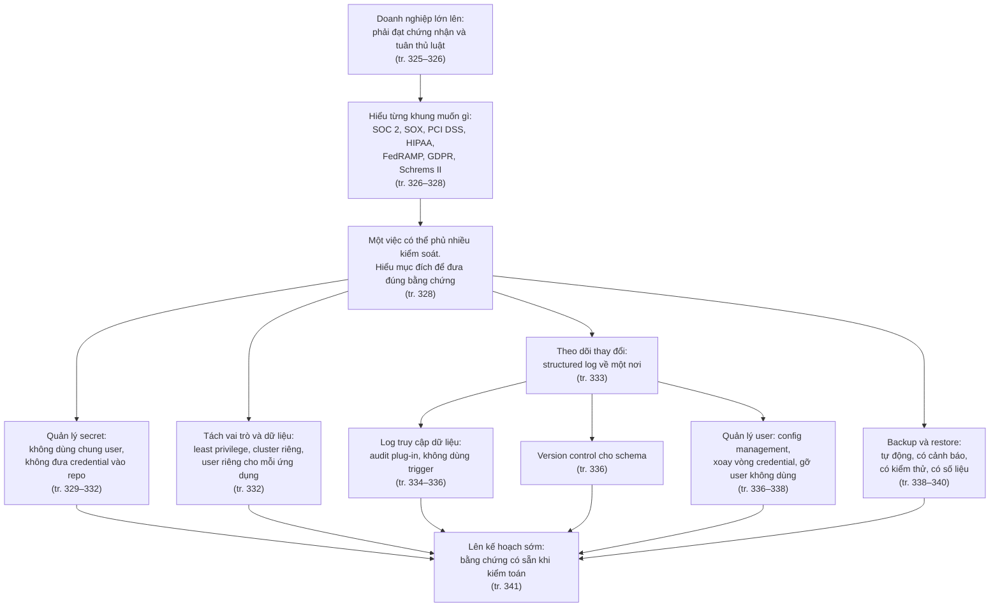
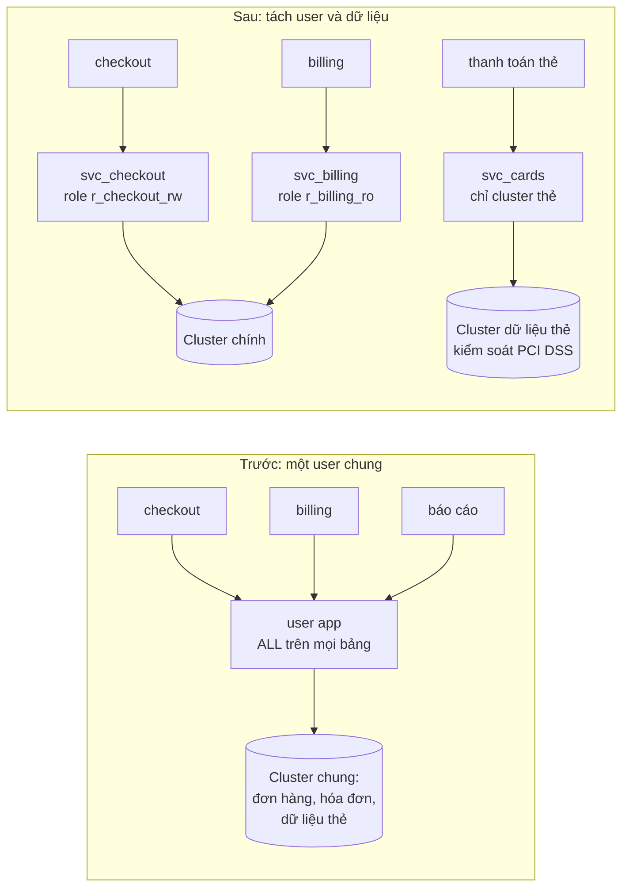
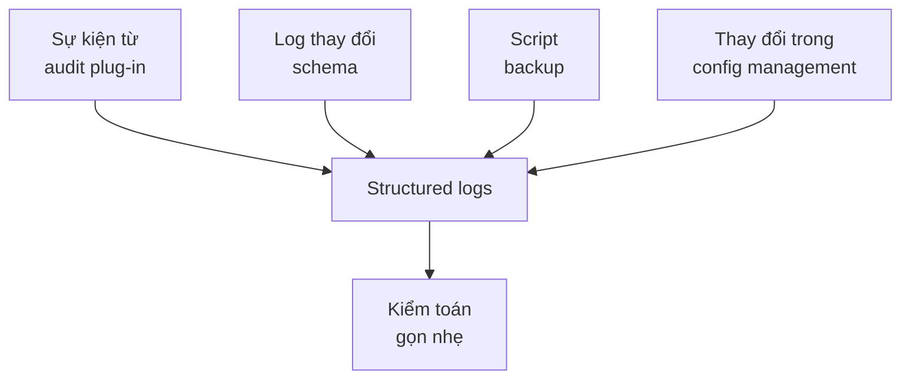
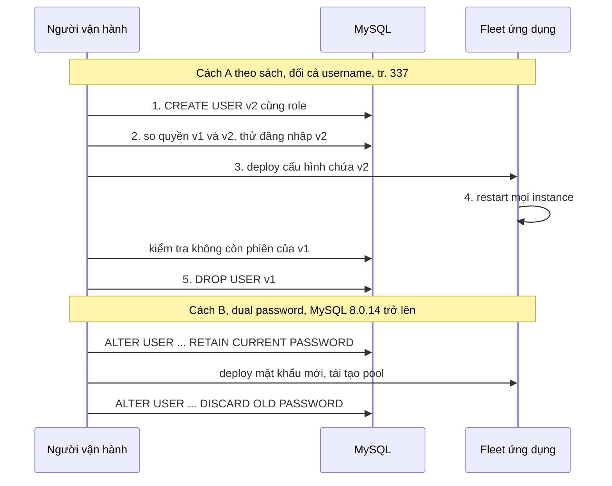
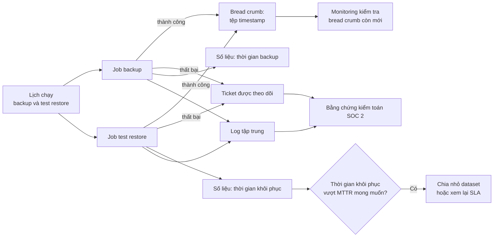
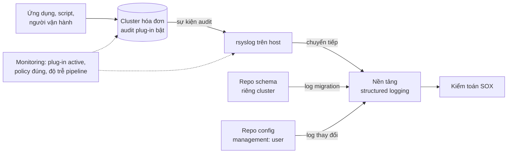
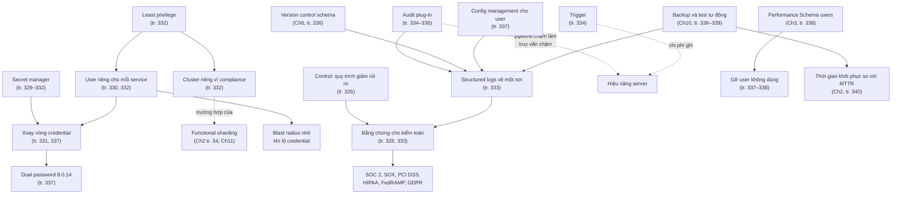

# Chương 13 — Compliance với MySQL

*Compliance with MySQL*

> **Nguồn:** *High Performance MySQL: Proven Strategies for Operating at Scale*, Silvia Botros và Jeremy Tinley, O'Reilly, **Fourth Edition (11/2021)**, Chương 13, **tr. 325–341 (trang PDF 347–363)**; tr. 342 (PDF 364) để trắng.
> "tr. N" là số trang in; trang PDF = N + 22 (xem [README](README.md#page-convention)).
>
> **Quy ước nhãn:**
> - Nội dung không nhãn là diễn giải từ sách, luôn kèm "(tr. N)".
> - **Bổ sung ngoài sách** là kiến thức thêm hoặc phép tính tự làm, kèm nguồn nếu dùng tài liệu ngoài.
> - **Ví dụ minh họa do AI xây dựng** là ví dụ, SQL hay tình huống giả định, không phải của tác giả.
> - **Dự đoán** là điều kỳ vọng nhưng chưa đo. **Kết quả đã đo** chỉ dùng cho thí nghiệm đã chạy thật (MySQL 8.0.42 Community, Windows 11, instance riêng).
>
> **Không phải tư vấn pháp lý.** Chương này nói rõ nó không đưa ra tư vấn pháp lý và khuyên hỏi đội pháp chế khi cần đáp ứng một kiểm soát cụ thể (tr. 325). Ghi chú này cũng vậy. Mọi phát biểu về luật và chứng nhận phản ánh **thời điểm sách viết (2021)**; luật và tiêu chuẩn đã thay đổi từ đó.
>
> **Phiên bản.** Sách viết cho giai đoạn MySQL 8.0. Dual password có từ **MySQL 8.0.14** (tr. 337). Audit log plug-in mà sách dùng thuộc **Percona Server** (tr. 334); bản tương đương của Oracle (MySQL Enterprise Audit) **không có** trong bản Community (xem [mục 2.2.3](#data-access-logging)). Thí nghiệm chạy trên **MySQL 8.0.42 Community**.
>
> **Liên kết:** [Lộ trình học, chương 13](learning-roadmap.md#ch13) · [Bài thực hành](experiments/chapter-13.md) · [Đáp án tự kiểm tra](answers/chapter-13.md)

## Mục lục ghi chú

- [1. Bức tranh lớn](#big-picture)
- [2. Giải thích sâu](#deep)
  - [2.1 What Is Compliance? (tr. 326–328)](#s2-1)
  - [2.2 Building for Compliance Controls (tr. 328–340)](#s2-2)
    - [2.2.1 Secrets Management (tr. 329–332)](#secrets-management)
    - [2.2.2 Separation of Roles and Data (tr. 332)](#separation-roles-data)
    - [2.2.3 Tracking Changes (tr. 333–338)](#tracking-changes)
    - [2.2.4 Backup and Restore Procedures (tr. 338–340)](#backup-restore)
  - [2.3 Summary (tr. 341)](#s2-3)
- [3. Phân tích tình huống](#situations)
- [4. Đo lường và thực hành](#measure)
- [5. Liên kết kiến thức và điều cần nhớ](#takeaways)
- [Ghi chú kiểm tra nguồn](#kiem-tra)

---

<a id="big-picture"></a>

## 1. Bức tranh lớn

### Chương này muốn trả lời câu hỏi gì?

Các chương trước lo cho hiệu năng, uptime, chi phí hạ tầng và khôi phục sau thảm họa. Chương 13 thêm một loại yêu cầu nữa: **doanh nghiệp phải bảo vệ dữ liệu và đạt các chứng nhận**, hoặc vì luật bắt buộc, hoặc vì khách hàng đòi (tr. 325). Câu hỏi của chương có thể diễn giải như sau:

> Khi công ty lớn lên và phải qua kiểm toán, kỹ sư database cần thiết kế quyền truy cập, quản lý secret, ghi log thay đổi và quy trình backup **từ trước** như thế nào, để bằng chứng kiểm toán có sẵn thay vì phải chạy đôn chạy đáo gom lại?

Sách nhấn mạnh ba ý ngay từ đầu (tr. 325):

- Yêu cầu compliance phải đi vào **mọi thiết kế kiến trúc dữ liệu**: cách tự động hóa tác vụ vận hành, cách quản lý quyền truy cập, và cách biến tác vụ quản trị thành code.
- Chương bàn các loại chứng nhận và luật thường gặp, cách thiết kế cho chúng, vai trò của **access logging**, và **data sovereignty** (chủ quyền dữ liệu) như một mối lo mới của kiến trúc dữ liệu.
- Chương **không** tư vấn pháp lý (hộp cảnh báo, tr. 325).

> **Cảnh báo của sách** (tr. 325). Chương không nhằm đưa lời khuyên pháp lý. Mục tiêu là giúp quản lý nhu cầu compliance khi chạy nhiều database và thiết kế cho compliance từ sớm. Muốn biết cách đáp ứng đúng một kiểm soát cụ thể, luôn hỏi đội pháp chế của công ty.

### Vị trí trong mục tiêu chung của sách

Preface nói ấn bản thứ tư mở rộng phần compliance và bảo mật, vì luật về quyền riêng tư và chủ quyền dữ liệu đã thay đổi cách công ty xây sản phẩm (Preface, tr. xv; xem [roadmap](learning-roadmap.md#muc-tieu)). Chương 13 là chương **tổng hợp**: nó không giới thiệu cơ chế mới của InnoDB, mà dùng lại những thứ đã học (Performance Schema, quản lý schema, backup, SLO) dưới một góc nhìn khác: **làm sao chứng minh với kiểm toán viên rằng ta làm đúng**.

Liên hệ với hiệu năng không nằm ở bề mặt, nhưng có thật:

- Trigger dùng để theo dõi thay đổi gây **tốn chi phí ghi** (tr. 334).
- Audit log plug-in nếu đường chuyển log bị chậm có thể làm **truy vấn chậm đi** mà không có triệu chứng nào khác (tr. 336).
- Kích thước database ảnh hưởng mạnh tới **thời gian khôi phục**, mà biết DR mất bao lâu lại là một phần của kế hoạch DR mà SOC 2 đòi (tr. 340).

### Kiến thức cần biết trước

| Kiến thức | Ở đâu |
| --- | --- |
| Xác thực trong MySQL dựa trên username, host gốc và password; mỗi truy vấn được kiểm tra quyền | [Chương 1](chapter-01.md#connection-management) (tr. 2) |
| MTTR, SLO, kích thước instance và thời gian khôi phục | [Chương 2](chapter-02.md) (tr. 26, 34–35) |
| Performance Schema: instrument, consumer, bảng tóm tắt | [Chương 3](chapter-03.md) |
| Quản lý thay đổi schema bằng source control và CI | [Chương 6](chapter-06.md#s2-3) (tr. 146–154) |
| Các loại backup, kiểm tra backup, RTO | [Chương 10](chapter-10.md) (tr. 259–286) |
| Khái niệm chung: secret, hash mật khẩu, log tập trung | **Bổ sung ngoài sách**: kiến thức vận hành cơ bản |

### Liên hệ với các chương khác

| Ý trong chương 13 | Chương | Căn cứ |
| --- | --- | --- |
| Backup và DR là một phần nghĩa vụ compliance; xem lại mục tiêu DR định kỳ | [Chương 2](chapter-02.md#backup-restore-time) | tr. 34 nhắc tới chương 13; tr. 340 nhắc lại chương 2 |
| Functional sharding tách bảng ra cluster riêng để quản lý cả **access control** | [Chương 2](chapter-02.md#functional-horizontal-sharding) | tr. 34 (định nghĩa), tr. 332 (sharding vì compliance) |
| Dùng Performance Schema để biết một user còn được dùng không | [Chương 3](chapter-03.md) | tr. 338 |
| Source control cho schema "thường do đội compliance yêu cầu" | [Chương 6](chapter-06.md#source-control) | tr. 147 nhắc tới chương 13; tr. 336 nhắc lại chương 6 |
| Trigger có chi phí hiệu năng (trong bối cảnh pt-online-schema-change) | [Chương 6](chapter-06.md#pt-osc) | tr. 151; chương 13 tr. 334 |
| Các loại backup; bảo mật và kiểm toán backup bị chương 10 để ngoài phạm vi | [Chương 10](chapter-10.md#s2-0) | tr. 258–259; chương 13 tr. 338 |
| ProxySQL với user riêng cho từng shard giúp ghi log thao tác cho compliance | [Chương 11](chapter-11.md#proxysql-sharding) | tr. 309–310 |
| Dịch vụ managed (Aurora, Cloud SQL) có sẵn audit logging | [Chương 12](chapter-12.md) | tr. 314; chú thích 3 tr. 317 |
| Dual password xuất hiện ở một bản point release (8.0.14); phụ lục A nói Oracle hay đưa tính năng mới vào point release, và lỗ hổng bảo mật là một lý do nâng cấp | [Phụ lục A](appendix-a.md#ly-do-nang-cap) | tr. 337; phụ lục A tr. 343–344 |

### Mạch lập luận



*(Sơ đồ do người viết ghi chú tổng hợp theo thứ tự các mục của chương.)*

---

<a id="deep"></a>

## 2. Giải thích sâu

<a id="s2-1"></a>

### 2.1 What Is Compliance? (tr. 326–328)

<a id="grc-controls"></a>

**What: GRC và "control"** (tr. 326). ***Governance, risk management, and compliance*** (**GRC**) là tập hợp nguyên tắc, quy trình và luật hướng dẫn doanh nghiệp:

- đánh giá và xếp ưu tiên **rủi ro** đối với tài sản của mình;
- tuân thủ luật về **xử lý và chuyển giao** dữ liệu cá nhân hay dữ liệu sức khỏe mà sản phẩm dùng.

Từ hay gặp nhất là ***control*** (**kiểm soát**): quy trình và quy tắc mà công ty **tự định nghĩa và thực hành** để giảm xác suất một kết cục rủi ro không mong muốn (tr. 326).

**Why: compliance đến theo giai đoạn** (tr. 326). Startup giai đoạn đầu, khi còn tìm *product-market fit*, thường không có nhiều yêu cầu compliance. Khi doanh nghiệp lớn lên, các quy định bắt đầu xuất hiện. Có quy định áp cho **toàn bộ** dữ liệu, có quy định chỉ áp cho **một phần** (*scoped*). Ý "chỉ một phần" này là nền cho lời khuyên tách dữ liệu ở [mục 2.2.2](#separation-roles-data).

> **Hiểu lầm phổ biến.** "Compliance là việc của đội pháp chế." Sách nói ngược lại: chính kỹ sư database sẽ là người trình bằng chứng cho kiểm toán viên (tr. 328), và bằng chứng đó chỉ có nếu kiến trúc đã được thiết kế để sinh ra nó (tr. 329, 333).

<a id="soc2"></a>

#### 2.1.1 Service Organization Controls Type 2 (tr. 326)

***SOC 2*** là một bộ kiểm soát mà tổ chức cung cấp dịch vụ dùng để **báo cáo** về cách làm liên quan tới năm chủ đề: **security, availability, processing integrity, confidentiality, privacy** (tr. 326).

Với kỹ sư database ở công ty muốn đạt SOC 2, sách nêu ba thực hành phải "đã thành nếp" (tr. 326):

1. quản lý **thay đổi database** (*change management*);
2. quy trình **backup và restore**;
3. quản lý **quyền truy cập** vào các instance.

Cả ba sẽ quay lại ở mục 2.2: thay đổi ở [2.2.3](#tracking-changes), backup ở [2.2.4](#backup-restore), truy cập ở [2.2.2](#separation-roles-data).

> **Bổ sung ngoài sách.** SOC 2 là một **báo cáo kiểm toán** do kiểm toán viên độc lập lập theo tiêu chí của AICPA, không phải luật. "Type 2" nghĩa là kiểm toán viên đánh giá kiểm soát **có vận hành hiệu quả trong một khoảng thời gian** (thường vài tháng tới một năm), khác với Type 1 chỉ đánh giá thiết kế tại một thời điểm. Hệ quả cho người vận hành: bằng chứng phải **liên tục** theo thời gian (log, lịch sử ticket), không chỉ là một ảnh chụp cấu hình. Điều này khớp với yêu cầu "track record" về backup ở tr. 339.

<a id="sox"></a>

#### 2.1.2 Sarbanes–Oxley Act (tr. 326)

***SOX*** (2002) là luật mà **mọi công ty niêm yết** phải tuân thủ. Mục đích là bảo vệ nhà đầu tư bằng cách tăng độ chính xác và tin cậy của báo cáo công bố theo luật chứng khoán (tr. 326).

Với đội kỹ thuật, nghĩa vụ SOX là **chứng minh** (tr. 326):

- database chứa **dữ liệu ảnh hưởng doanh thu** chỉ được truy cập bởi người **có nhu cầu**;
- mọi thay đổi trên dữ liệu đó **được ghi log** và có **lý do được ghi lại**.

Sách gọi "**SOX control 404**" là kiểm soát bắt buộc theo luật với công ty niêm yết. Nó nhằm bảo đảm **có bằng chứng** rằng số liệu tài chính được báo cáo dựa trên quy trình truy cập dữ liệu và quản lý thay đổi **ghi nhận đúng** dịch vụ đã cung cấp so với doanh thu đã thu, và có **audit trail** cho mọi thay đổi trên dữ liệu đó (tr. 326).

> **Bổ sung ngoài sách.** Trong luật, đây là **Section 404** của SOX (đánh giá kiểm soát nội bộ đối với báo cáo tài chính). Chữ "control 404" là cách gọi của sách. Với database, điều quan trọng là xác định **bảng nào, cluster nào** chứa dữ liệu "ảnh hưởng doanh thu" (hóa đơn, thanh toán, hợp đồng), vì phạm vi kiểm soát càng rõ thì bằng chứng càng dễ gom.

<a id="pci-dss"></a>

#### 2.1.3 Payment Card Industry Data Security Standard (tr. 327)

***PCI DSS*** là tiêu chuẩn bắt buộc với tổ chức xử lý dữ liệu thẻ tín dụng. Mục đích: ngăn dữ liệu chủ thẻ bị lộ và bị dùng cho giao dịch gian lận (tr. 327).

Phần liên quan nhất tới kỹ sư database là **quản lý truy cập tới cardholder data**. Kiến trúc phải tính tới kiểm soát này để **dữ liệu thẻ được quản lý riêng**. Sách hẹn sẽ bàn cách làm ở phần tách vai trò (tr. 327), tức [mục 2.2.2](#separation-roles-data).

> **Bổ sung ngoài sách.** Sách viết PCI DSS áp cho "financial institutions". Thực tế tiêu chuẩn do PCI Security Standards Council ban hành áp cho **mọi tổ chức lưu, xử lý hay truyền dữ liệu chủ thẻ**, kể cả cửa hàng trực tuyến. Một hệ quả kiến trúc hay gặp là thu hẹp phạm vi (*scope*): càng ít hệ thống chạm vào dữ liệu thẻ, càng ít hệ thống phải qua kiểm toán. Đây cũng là lý do tách dữ liệu thẻ ra cluster riêng. Phiên bản tiêu chuẩn đã thay đổi sau 2021 (PCI DSS v4.0 ra năm 2022); hãy kiểm tra bản hiện hành với đội bảo mật.

<a id="hipaa"></a>

#### 2.1.4 Health Insurance Portability and Accountability Act (tr. 327)

***HIPAA*** (1996) là quy định của Mỹ bảo vệ quyền riêng tư của **dữ liệu sức khỏe** cá nhân khi được thu thập và xử lý bởi cơ sở y tế, chương trình bảo hiểm sức khỏe hay đối tác kinh doanh của họ. Luật áp cho dữ liệu gọi là ***ePHI*** (tr. 327).

Sản phẩm phải tuân thủ HIPAA cần kỹ sư database triển khai (tr. 327):

- **kiểm soát truy cập** tới ePHI;
- **mã hóa toàn bộ** ePHI;
- **ghi log hoạt động** mỗi khi ePHI được truy cập.

Ý thứ ba quan trọng: HIPAA đòi log cả **truy cập đọc**, không chỉ thay đổi. Đây là lý do sách loại trigger ở [mục 2.2.3](#triggers-audit): trigger không thấy được câu đọc.

> **Bổ sung ngoài sách.** Sách viết ePHI là "electronic personal health information". Trong văn bản HIPAA, PHI là ***protected health information***; ePHI là PHI ở dạng điện tử. Nghĩa thực tế giống nhau, nhưng khi nói chuyện với đội pháp chế nên dùng đúng thuật ngữ gốc.

<a id="fedramp"></a>

#### 2.1.5 Federal Risk and Authorization Management Program (tr. 327)

***FedRAMP*** dành cho công ty ở Mỹ muốn làm ăn với cơ quan chính phủ liên bang. Đây là chứng nhận của chính phủ liên bang cho phép doanh nghiệp làm **nhà cung cấp cloud** cho các cơ quan đó. Nó là một tập tiêu chuẩn bắt buộc để đủ điều kiện nhận khách hàng liên bang, gồm (tr. 327):

- **configuration management**;
- **access control**;
- **security assessment**;
- **kiểm toán truy cập và thay đổi** dữ liệu.

<a id="gdpr"></a>

#### 2.1.6 General Data Protection Regulation (tr. 327)

***GDPR*** là quy định của Liên minh châu Âu, ra đời năm 2016, điều chỉnh cách thông tin định danh cá nhân của người ở EU được lưu và quản lý bởi các tổ chức **xử lý dữ liệu**, **bất kể trụ sở ở đâu** (tr. 327). Sách nêu ba bước đầu của GDPR về quyền riêng tư (tr. 327):

- phải có **sự đồng ý** trước khi thu thập dữ liệu riêng tư;
- **giới hạn truy cập** dữ liệu đó bên trong tổ chức xử lý;
- cho cá nhân con đường pháp lý để yêu cầu **xóa dữ liệu** của mình khỏi hệ thống của bất kỳ bên nào đã thu thập qua hoạt động trực tuyến. Đây là ***right to be forgotten*** (quyền được lãng quên).

> **Bổ sung ngoài sách.** GDPR được thông qua năm 2016 và **có hiệu lực áp dụng từ 25/5/2018**; nó áp cho cả *controller* lẫn *processor*. Với MySQL, "quyền được lãng quên" chạm tới những nơi dữ liệu còn sống sau khi bị `DELETE`: **binary log**, **backup**, replica bị trễ, bảng tổng hợp và log truy vấn. Một yêu cầu xóa phải tính tới vòng đời của những bản sao này (thời hạn giữ binlog, thời hạn giữ backup). DDIA bàn mâu thuẫn giữa log bất biến và nghĩa vụ xóa ở [chương 11, giới hạn của immutability](../../DDIA/ddia-notes/chapter-11.md#immutability-limits).

<a id="schrems-ii"></a>

#### 2.1.7 Schrems II (tr. 328)

**Sự kiện** (tr. 328). Năm 2020, tòa án công lý EU ra phán quyết trong một vụ liên quan tới pháp nhân Ireland của Facebook. Phán quyết, thường gọi là ***Schrems II***, có tác động rộng tới mọi công ty Mỹ thu thập dữ liệu về người ở EU.

**Nội dung theo cách sách tóm tắt** (tr. 328):

- ***Privacy Shield*** là cơ sở pháp lý mà công ty Mỹ dựa vào suốt nhiều năm để hoạt động ở EU.
- Phán quyết cho rằng Privacy Shield **không đủ** bảo vệ người ở EU khỏi bị chính phủ Mỹ giám sát qua cơ chế pháp lý của Mỹ (cụ thể là **FISA**, đạo luật năm 1978).
- Theo cách hiểu của sách, vì vậy dữ liệu định danh cá nhân của người ở EU do công ty Mỹ thu thập **phải ở lại EU**, không được đi vào tài sản ở Mỹ hay để người ở Mỹ truy cập.

**Hệ quả cho kiến trúc** (tr. 328). Schrems II làm việc suy luận về kiến trúc dữ liệu **phức tạp hơn** GDPR ban đầu. Vì phán quyết còn mới, **chưa rõ** sẽ được thực thi ra sao; mỗi doanh nghiệp tự xác định dữ liệu nào thuộc phạm vi và theo cách nào. Sách cho rằng nếu có khách hàng ở châu Âu, hiện tại hay tương lai, thì nên giả định Schrems II **sẽ chạm tới** ứng dụng và hạ tầng dữ liệu của bạn. Đây là ***data sovereignty*** mà phần mở đầu nhắc tới (tr. 325).

> **Bổ sung ngoài sách (lưu ý về thời điểm và cách diễn đạt).** Vụ án có tên chính thức là *Data Protection Commissioner v Facebook Ireland và Maximillian Schrems* (C-311/18, phán quyết 16/7/2020). Phán quyết vô hiệu Privacy Shield và đặt điều kiện cho việc dùng điều khoản hợp đồng mẫu (SCC); nó không viết thành một quy tắc đơn giản "dữ liệu phải ở lại EU". Câu "phải ở lại EU" là **cách hiểu thận trọng** của tác giả năm 2021. Sau thời điểm sách viết, EU và Mỹ đã thông qua khung mới (EU–US Data Privacy Framework, 2023). Đây là ví dụ rõ nhất vì sao phải hỏi pháp chế với tình hình hiện tại thay vì dựa vào một cuốn sách kỹ thuật.

<a id="frameworks-table"></a>

**Bảng tổng hợp: mỗi khung đòi gì ở tầng database** (tổng hợp từ tr. 326–328)

| Khung | Loại (theo sách) | Ai phải quan tâm | Yêu cầu với kỹ sư database mà sách nêu | Bằng chứng điển hình (**Bổ sung ngoài sách**) |
| --- | --- | --- | --- | --- |
| SOC 2 | Bộ kiểm soát để báo cáo | Tổ chức cung cấp dịch vụ | Quản lý thay đổi, backup và restore, quản lý truy cập (tr. 326) | Lịch sử PR thay đổi schema và user, log backup, log test restore |
| SOX | Luật | Công ty niêm yết | Chỉ người cần mới truy cập dữ liệu doanh thu; mọi thay đổi có log và lý do (tr. 326) | Danh sách quyền, audit trail thay đổi dữ liệu tài chính |
| PCI DSS | Tiêu chuẩn | Bên xử lý dữ liệu thẻ | Quản lý truy cập dữ liệu chủ thẻ, quản lý riêng (tr. 327) | Sơ đồ phạm vi, cluster riêng, danh sách user có quyền |
| HIPAA | Quy định Mỹ | Bên xử lý dữ liệu sức khỏe | Kiểm soát truy cập, mã hóa, log mọi truy cập ePHI (tr. 327) | Audit log đọc và ghi, cấu hình mã hóa |
| FedRAMP | Chứng nhận liên bang | Nhà cung cấp cloud cho chính phủ Mỹ | Config management, access control, đánh giá bảo mật, kiểm toán truy cập và thay đổi (tr. 327) | Repo cấu hình, log truy cập |
| GDPR | Quy định EU | Bên xử lý dữ liệu người ở EU | Đồng ý, giới hạn truy cập, quyền được lãng quên (tr. 327) | Quy trình xóa dữ liệu kể cả backup |
| Schrems II | Phán quyết tòa EU | Công ty Mỹ có dữ liệu người ở EU | Dữ liệu ở lại EU theo cách hiểu của sách (tr. 328) | Vị trí lưu trữ, ai truy cập được từ đâu |

> **Hiểu lầm phổ biến.** "Mỗi khung là một dự án riêng." Phần tiếp theo của sách nói rõ cùng một việc có thể phủ **nhiều** kiểm soát (tr. 328). Ví dụ, user riêng cho từng service vừa phục vụ SOX (ai truy cập dữ liệu doanh thu), vừa phục vụ PCI DSS (truy cập dữ liệu thẻ), vừa thu nhỏ phạm vi ảnh hưởng khi lộ credential (tr. 330, 332).

#### Tự kiểm tra 2.1

**Câu 2.1.1.** Sách định nghĩa *control* là gì? Vì sao định nghĩa này khiến một việc kỹ thuật như "mỗi service một database user" có thể phục vụ cùng lúc nhiều khung compliance? [đáp án](answers/chapter-13.md#q2-1-1)

**Câu 2.1.2.** Trong các khung sách nêu, khung nào đòi log cả **truy cập đọc** tới dữ liệu nhạy cảm? Điều đó loại bỏ ngay một cách theo dõi thay đổi nào ở mục sau? [đáp án](answers/chapter-13.md#q2-1-2)

**Câu 2.1.3.** Một công ty SaaS chưa niêm yết, không xử lý thẻ hay dữ liệu y tế, nhưng có khách hàng doanh nghiệp đòi báo cáo SOC 2. Ba thực hành database nào sách nói họ cần có nếp? [đáp án](answers/chapter-13.md#q2-1-3)

**Câu 2.1.4.** Vì sao "quyền được lãng quên" của GDPR khó hơn một câu `DELETE` trong MySQL? Nêu ít nhất ba nơi dữ liệu có thể còn tồn tại. [đáp án](answers/chapter-13.md#q2-1-4)

**Câu 2.1.5.** Theo sách, Schrems II thay đổi cách suy luận về kiến trúc dữ liệu thế nào so với GDPR ban đầu? Vì sao ghi chú khuyên không dùng phát biểu của sách như kết luận pháp lý ở thời điểm hiện tại? [đáp án](answers/chapter-13.md#q2-1-5)

---

<a id="s2-2"></a>

### 2.2 Building for Compliance Controls (tr. 328–340)

**Tin tốt và việc cần làm** (tr. 328). Thế giới compliance rất rộng; số kiểm soát có thể rất nhiều tùy mục tiêu của từng luật hay chứng nhận. Tin tốt là **cùng một việc có thể phủ nhiều kiểm soát**, giúp làm hiệu quả và nhất quán hơn. Nhưng bạn vẫn phải hiểu **kiểm soát nào là bắt buộc** với doanh nghiệp và **để làm gì**.

**Bạn sẽ là người trình bằng chứng** (tr. 328). Khi công ty đủ lớn để triển khai một phần các kiểm soát này, kỹ sư database sẽ là người **trình bằng chứng** cho nhiều loại kiểm toán viên. Hiểu mỗi kiểm soát nhắm tới điều gì giúp đưa **đúng loại bằng chứng**, làm buổi kiểm toán nhẹ hơn.

> **Mẹo của sách** (tr. 329). Xây cho compliance là quá trình **liên tục**, không thể "gắn thêm" khi cần. Phần lớn lời khuyên kiến trúc trong chương (tách vai trò, theo dõi thay đổi…) nên được nghĩ tới và vận động cho từ khi công ty qua giai đoạn "còn tìm product-market fit". Khi compliance thành nhu cầu thật, những thực hành này sẽ giúp doanh nghiệp sẵn sàng.

<a id="secrets-management"></a>

#### 2.2.1 Secrets Management (tr. 329–332)

**What: thế nào là secret** (tr. 329). Sách liệt kê những thứ trong hạ tầng có thể tính là ***secret***:

- chuỗi mật khẩu để **ứng dụng** làm việc với database;
- chuỗi mật khẩu để **nhân viên hỗ trợ và vận hành** quản lý instance;
- **API token** truy cập hay sửa được dữ liệu;
- **SSH private key**;
- **khóa của certificate**.

**Why: năng lực cốt lõi** (tr. 329). Nhiều kiểm soát bảo mật dựa vào một năng lực: **quản lý secret an toàn và tách riêng khỏi quản lý cấu hình**. Bạn cần cách **phân phối và xoay vòng** dữ liệu nhạy cảm như credential database, cho ứng dụng hay cho đội làm báo cáo.

**How: chọn ở đâu** (tr. 329–330).

- Chạy trên cloud: sách **khuyên mạnh** tìm giải pháp secrets management mà nhà cung cấp cloud ưa dùng **trước** khi tự xây.
- Giải pháp phải có mức mã hóa **được chuẩn NIST chấp nhận**, vì nhiều quy định đòi điều đó, trong đó có HIPAA và FedRAMP (tr. 329).
- Nếu cloud không có giải pháp chấp nhận được, có thể phải tự host. Đó là nỗ lực rộng hơn phạm vi của sách (tr. 329).

> Chú thích 1 (tr. 329). Muốn biết thêm về các chuẩn này, hãy bắt đầu trò chuyện với đội an ninh thông tin, hoặc đọc cuốn bỏ túi về *NIST Cybersecurity Framework* của O'Reilly.

**Trade-offs: secret manager không được thành điểm hỏng duy nhất** (tr. 329–330). Dù dùng dịch vụ managed hay tự chạy, giải pháp này thêm độ phức tạp vào kiến trúc. Mục tiêu của nó là quản lý secret, **không phải** trở thành *single point of failure* của sản phẩm. Sách khuyên:

- viết rõ đánh đổi: điều gì xảy ra khi secret manager **không sẵn sàng** (bản gốc in "is available", theo ngữ cảnh nghĩa là "không sẵn sàng"; xem [ghi chú kiểm tra nguồn](#kiem-tra));
- nói chuyện trước với **đội pháp chế và đội bảo mật** về việc secret nào được **cache** và cache theo cách nào, để tránh kỳ vọng lệch nhau về sau.

**Gỡ lại các quyết định "cho tiện"** (tr. 330). Những quyết định thời đầu dựa trên sự tiện lợi thường phải được **tháo ngược** trước khi lên kế hoạch kiểm soát compliance. Hãy sẵn sàng giải thích với lãnh đạo vì sao việc này quan trọng: nó cải thiện tư thế bảo mật và giảm rủi ro.

<a id="do-not-share-users"></a>

**Do not share users** (tr. 330). **Không dùng chung credential database giữa các service.** Quyết định này "trả lãi gấp nhiều bậc" khi một credential bị lộ: lúc đó bạn phải đánh giá ***blast radius***, tức bao nhiêu phần của ứng dụng và quy trình phải nhận cặp credential mới. Sách kể một cảnh quen thuộc: vào một startup và thấy "mọi code dùng chung một cặp user/password". Đó là đường tắt **rất đắt**. Hãy giới hạn mỗi database user chỉ ở **đúng service cần nó**.

<a id="secret-repo"></a>

**Do not check production database credentials in code repositories** (tr. 330). Điều này nghe hiển nhiên nhưng **vẫn liên tục xảy ra**, như nhiều báo cáo sau sự cố bảo mật của công ty lớn nhỏ cho thấy. Sách khuyên:

- giữ thái độ khiêm tốn, đừng nghĩ tổ chức mình khó mắc lỗi này;
- áp dụng ***trust but verify***: **quét repo** tìm chuỗi giống secret **trước khi** merge pull request (các dịch vụ repo như GitHub làm được việc này);
- nếu tổ chức chưa nghĩ tới, kỹ sư database có thể phải là người **vận động**. Không phải mọi việc đều do đội database làm, nhưng đội database là một bên liên quan trong cách tổ chức kỹ thuật bàn về các ưu tiên này.

Hai thực hành trên là nền móng. Chúng làm các thao tác dùng secret manager về sau đơn giản hơn và giảm rủi ro khi cần thay đổi **khẩn cấp** (tr. 330).

<a id="choosing-secret-solution"></a>

**Choosing a secret management solution** (tr. 331–332). Lựa chọn phụ thuộc môi trường đang chạy và thứ gì **tích hợp dễ nhất** với cả database lẫn ứng dụng. Luôn có đánh đổi giữa tiện lợi và đáp ứng đủ nhu cầu, nên phải nói rõ với mọi bên liên quan (kể cả người ngoài kỹ thuật) về giới hạn và đánh đổi về availability, resilience. Ba điểm cần kiểm tra:

| Đánh đổi | Sách nói gì | Vì sao quan trọng |
| --- | --- | --- |
| ***Space limitations*** | Nhiều dịch vụ secret của cloud giả định secret **ngắn**. Nếu kiểm soát đòi coi chuỗi dài (SSH key, private certificate cho SSL) là secret, phải kiểm tra **kích thước tối đa** của một key (tr. 331). | "Bãi mìn": khi lượng secret lớn lên, phải thêm một giải pháp thứ hai. Khi đó hoặc **di chuyển** (có thể ảnh hưởng uptime), hoặc vận hành **hai hệ thống** song song, với độ phức tạp riêng (tr. 331). |
| ***Secret rotation*** | Cả ba cloud lớn (lúc sách viết) có cách **tự động xoay vòng** secret kèm **versioning**, giúp chuyển sang secret mới êm. Nếu giải pháp không hỗ trợ, phải lên kế hoạch xoay vòng cả **theo lịch** (kiểm soát đòi xoay theo chu kỳ) lẫn **khẩn cấp** (ai đó lỡ đẩy mật khẩu lên repo công khai) (tr. 331). | Làm sao không ảnh hưởng ứng dụng đang chạy? Phụ thuộc cách đưa cấu hình tới ứng dụng và pipeline deploy. **Thay đổi này là một lần deploy**: kể cả khi credential chỉ là một dòng cấu hình, vẫn phải lan ra toàn fleet và thường phải **restart** mà không làm mất availability của dịch vụ (tr. 331). |
| ***Regional availability*** | Secret manager không chỉ lưu mà còn **phân phối** secret. Không lưu secret trong code nghĩa là ứng dụng phải **lấy secret lúc runtime** (tr. 331–332). | Phải nghĩ: lấy secret thế nào, chuyện gì xảy ra nếu không gọi được secret manager, **failure mode mới** nào xuất hiện. Nếu chạy nhiều region: dịch vụ của cloud có tự **nhân bản secret sang region khác** không, hay phải tự xây (tr. 332). |

> **Bổ sung ngoài sách: MySQL lưu mật khẩu thế nào.** Phần Summary nói mật khẩu phải luôn được lưu ở dạng mã hóa, không bao giờ ở dạng văn bản thô (tr. 341). Phía server MySQL đã làm phần của nó: `mysql.user` lưu **hash** (với `caching_sha2_password`, chuỗi bắt đầu bằng `$A$005$`), và các câu `CREATE USER`, `ALTER USER`, `SET PASSWORD` được **viết lại** trong general log thành `IDENTIFIED BY <secret>`. **Kết quả đã đo** ([thí nghiệm 4](experiments/chapter-13.md#tn4)): chuỗi mật khẩu không xuất hiện trong general log, `events_statements_history` hay binary log; binary log chứa **hash** của mật khẩu. Nhưng một secret nằm trong câu SQL thường (ví dụ `INSERT` một API token) thì **không** được viết lại và xuất hiện nguyên văn trong general log. Rủi ro lớn nhất vì vậy nằm **ngoài** server: file cấu hình ứng dụng, biến môi trường, repo, lịch sử shell, ticket, chat.

> **Hiểu lầm phổ biến.** "Có secret manager là xong." Sách chỉ ra secret manager tạo **phụ thuộc runtime mới** với failure mode riêng (tr. 332). Nếu ứng dụng lấy secret mỗi lần tạo kết nối và secret manager sập, database khỏe vẫn có thể mất kết nối mới. Quyết định cache secret ở đâu, bao lâu là **quyết định có đánh đổi** cần bàn với bảo mật và pháp chế (tr. 330).

#### Tự kiểm tra 2.2 (phần 1/4: Secrets Management)

**Câu 2.2.1.** Vì sao sách nói xoay vòng credential "là một lần deploy", kể cả khi credential chỉ là một dòng cấu hình? Hệ quả với availability là gì? [đáp án](answers/chapter-13.md#q2-2-1)

**Câu 2.2.2.** Một đội lưu mật khẩu database trong dịch vụ secret của cloud. Hai năm sau, kiểm soát mới đòi quản lý cả private key TLS như secret. Sách cảnh báo "bãi mìn" nào, và hai lựa chọn khó chịu nào xuất hiện? [đáp án](answers/chapter-13.md#q2-2-2)

**Câu 2.2.3.** Ứng dụng chạy ở ba region và đọc credential từ secret manager lúc khởi động. Liệt kê các câu hỏi về failure mode mà sách muốn bạn trả lời trước khi chọn giải pháp. [đáp án](answers/chapter-13.md#q2-2-3)

**Câu 2.2.4.** "Không dùng chung user" và "không đưa credential vào repo" giảm rủi ro theo hai cơ chế khác nhau. Mỗi cái giảm phần nào: xác suất bị lộ hay phạm vi ảnh hưởng khi bị lộ? [đáp án](answers/chapter-13.md#q2-2-4)

<a id="separation-roles-data"></a>

#### 2.2.2 Separation of Roles and Data (tr. 332)

<a id="least-privilege"></a>

**What và Why** (tr. 332). Một mục tiêu quan trọng của các luật này là **tách dữ liệu theo mức rủi ro** mà nó gây ra cho doanh nghiệp hay khách hàng nếu bị lộ. Đây là khái niệm ***least privilege*** (đặc quyền tối thiểu), áp cho **cả người lẫn code ứng dụng**. Tách như vậy cho phép áp kiểm soát và theo dõi thay đổi **phù hợp** với loại dữ liệu và rủi ro của nó, thay vì áp mức nghiêm ngặt nhất cho mọi thứ.

<a id="sharding-compliance"></a>

**Sharding for compliance reasons** (tr. 332). Một trục có thể **buộc** tách dataset ra **cluster riêng** là khi các phần dữ liệu có yêu cầu compliance với kiểm soát rất khác nhau.

- **Ví dụ của sách.** Một nhà cung cấp dịch vụ truyền thông marketing ra sản phẩm mới về công nghệ y tế. Dữ liệu cũ không liên quan sức khỏe và không chịu nhiều yêu cầu pháp lý. Khi bước vào lĩnh vực y tế, công ty có một nhóm khách hàng mà với dữ liệu của họ, công ty mang gánh nặng pháp lý của bên xử lý **PHI**.
- **Decision.** Phát triển sản phẩm mới **ngay từ đầu** trên kho dữ liệu riêng, để áp kiểm soát HIPAA đúng chỗ mà **không đè gánh nặng** lên dataset cũ và các ứng dụng phụ thuộc nó.

Liên hệ: chương 2 định nghĩa ***functional sharding*** là tách các bảng phục vụ một chức năng nghiệp vụ ra cluster riêng để quản lý riêng uptime, hiệu năng, **hay cả access control** (tr. 34). Sharding vì compliance là một trường hợp của functional sharding.

> **Bổ sung ngoài sách: đánh đổi.** Tách cluster vì compliance có giá: không còn `JOIN` giữa dữ liệu y tế và dữ liệu cũ trong một câu SQL; cần thêm cluster để vận hành, giám sát, backup; và phải quyết định dữ liệu nào **thật sự** thuộc phạm vi. Bù lại, phạm vi kiểm toán nhỏ hơn, quyền và log chặt hơn chỉ áp cho phần cần. Khi dữ liệu nhạy cảm đã trộn sẵn vào bảng chung, tách về sau đắt hơn nhiều; đó là lý do sách nói "từ đầu".

<a id="separate-users"></a>

**Separate database users** (tr. 332). Khi sản phẩm và tech stack phức tạp lên, sẽ có **nhiều hơn một ứng dụng** truy cập dữ liệu. Rất quan trọng là bắt đầu kiểm soát truy cập **sớm**, bằng cách **không dùng chung** credential giữa nhiều code base. Sự cố bảo mật và lộ credential xảy ra với công ty mọi cỡ. Khi nó xảy ra, bạn muốn secret bị lộ chỉ ảnh hưởng một **blast radius đã biết và cô lập** trong lúc gấp rút xoay vòng secret đó.

<a id="mysql-roles"></a>

> **Bổ sung ngoài sách: cài least privilege bằng role của MySQL 8.0.** Sách không nói tới cú pháp. MySQL 8.0 có ***role*** (tập quyền có tên, gán được cho nhiều user). Một cách tổ chức là: **một role cho một mức quyền**, **một user cho một service**, user chỉ nhận role. Khi xoay vòng bằng user mới (xem [2.2.3](#credential-rotation)), chỉ cần gán cùng role. Có một bẫy dễ gặp: **gán role chưa đủ**. Mặc định `activate_all_roles_on_login = OFF`, nên user phải có **default role** (`SET DEFAULT ROLE`, hoặc `CREATE USER … DEFAULT ROLE`) thì role mới có hiệu lực khi đăng nhập. **Kết quả đã đo** ([thí nghiệm 1](experiments/chapter-13.md#tn1)): user đã được `GRANT` role nhưng chưa có default role thì `CURRENT_ROLE()` trả về `NONE` và `SELECT` bị từ chối với `ERROR 1142`.

**Ví dụ minh họa do AI xây dựng** (MySQL 8.0; mật khẩu là giá trị giả):

```sql
-- Mỗi mức quyền là một role; mỗi service là một user riêng
CREATE ROLE 'r_checkout_rw', 'r_billing_ro';
GRANT SELECT, INSERT, UPDATE ON shop.orders TO 'r_checkout_rw';
GRANT SELECT ON shop.invoices TO 'r_billing_ro';

-- DEFAULT ROLE vừa cấp role vừa kích hoạt nó khi đăng nhập
CREATE USER 'svc_checkout_v1'@'10.0.%' IDENTIFIED BY 'Fake-Example-NOT-REAL-1'
  DEFAULT ROLE 'r_checkout_rw';
CREATE USER 'svc_billing_v1'@'10.0.%'  IDENTIFIED BY 'Fake-Example-NOT-REAL-2'
  DEFAULT ROLE 'r_billing_ro';

-- Kiểm tra quyền hiệu lực, kể cả quyền đến từ role
SHOW GRANTS FOR 'svc_checkout_v1'@'10.0.%' USING 'r_checkout_rw';
```



*(Ví dụ minh họa do AI xây dựng, dựa trên tr. 327 và 332.)*

#### Tự kiểm tra 2.2 (phần 2/4: Separation of Roles and Data)

**Câu 2.2.5.** Trong ví dụ công ty marketing mở sản phẩm y tế (tr. 332), điều gì sẽ xảy ra nếu dữ liệu PHI được thêm vào cluster cũ? Vì sao sách nhấn mạnh "từ đầu"? [đáp án](answers/chapter-13.md#q2-2-5)

**Câu 2.2.6.** Một user `svc_x` đã được `GRANT 'r_orders_rw'`. `SHOW GRANTS FOR svc_x` hiện đúng dòng gán role. Ứng dụng vẫn bị `ERROR 1142` khi `SELECT`. Nguyên nhân gốc có thể là gì trong MySQL 8.0, và kiểm tra bằng cách nào? [đáp án](answers/chapter-13.md#q2-2-6)

**Câu 2.2.7.** Least privilege áp cho "cả người lẫn code" (tr. 332). Cho một ví dụ về mỗi loại trong vận hành MySQL, và chỉ ra bằng chứng kiểm toán tương ứng. [đáp án](answers/chapter-13.md#q2-2-7)

<a id="tracking-changes"></a>

#### 2.2.3 Tracking Changes (tr. 333–338)

**What** (tr. 333). Nhiều quy định có kiểm soát về **theo dõi thay đổi**: thay đổi trên phần dữ liệu ảnh hưởng báo cáo tài chính, thay đổi trên hệ thống sinh hóa đơn, và cách các thay đổi đó được **review, test và ghi lại**. Database là một trong những chỗ đầu tiên kiểm soát này chạm tới.

**Why: từ "kỹ sư đăng nhập và sửa" sang quy trình có bằng chứng** (tr. 333). Khi trách nhiệm compliance mở rộng, quy trình kiểu "một thay đổi schema được review, áp và ghi lại thế nào trên production" cần **chặt chẽ** hơn nhiều so với "một kỹ sư đăng nhập vào source node trên production và sửa". Gánh nặng nhẹ hơn nhiều nếu chuẩn bị cùng **đội kiểm toán nội bộ** hay đội compliance.

**How: bằng chứng "nướng sẵn"** (tr. 333). Mục tiêu là để **kiểm toán hằng năm** không thành sự kiện gây xáo trộn lớn, khi cả đội cuống cuồng gom bằng chứng. Nếu thay đổi cách vận hành bình thường, bằng chứng sẽ được **"baked in"**, dễ thu thập hơn nhiều. Chủ đề lặp lại của mục này là **sinh structured log từ mọi thứ**. Sách nói đây là cố ý: mọi loại thay đổi được theo dõi **cùng một cách**, và sự nhất quán đó giúp kiểm toán ít xáo trộn hơn.



*(Vẽ lại Hình 13-1, tr. 333: các tác vụ vận hành khác nhau cùng gửi structured log về một nơi, giúp kiểm toán dễ hơn. Đã đối chiếu với ảnh trang PDF 355.)*

<a id="data-access-logging"></a>

**Data access logging** (tr. 334). Nhiều kiểm soát đòi giữ log **thay đổi hay truy cập** một số dataset: để theo dõi thay đổi trên dữ liệu tài chính, hoặc vì quy định như PCI, HIPAA coi dữ liệu nhạy cảm tới mức **mọi truy cập** phải được ghi.

Sách đề xuất làm việc này **ngay ở tầng database** bằng audit plug-in (tr. 334):

- **Percona audit log plug-in** nếu chạy bản fork của Percona;
- **MySQL Enterprise Audit plug-in** của Oracle, mà sách viết là bản tương đương "nếu chạy MySQL Community Server".

Lợi ích: ghi được thay đổi ở **chặng cuối** trước khi dữ liệu đổi, đặc biệt hữu ích khi database có thể bị thay đổi qua **nhiều đường** (ứng dụng, script, người vận hành).

> **Bổ sung ngoài sách: Community Server không có Enterprise Audit.** MySQL Enterprise Audit là thành phần của **MySQL Enterprise Edition** (thương mại), không có trong bản Community. **Kết quả đã đo** ([thí nghiệm 5](experiments/chapter-13.md#tn5)): trên MySQL 8.0.42 Community, `INSTALL PLUGIN audit_log SONAME 'audit_log.dll'` báo `ERROR 1126 … Can't open shared library`, thư mục plugin không có tệp audit log, và `information_schema.PLUGINS` chỉ có hai plugin loại AUDIT nội bộ (`sha2_cache_cleaner`, `mysqlx_cache_cleaner`). Với Community Server, lựa chọn thực tế là chuyển sang Percona Server, dùng Enterprise Edition, ghi log ở tầng proxy (ProxySQL có audit log, [chương 11](chapter-11.md#proxysql), tr. 310) hay dùng audit log của dịch vụ managed ([chương 12](chapter-12.md), tr. 314, 317).

<a id="triggers-audit"></a>

**Undesirable options for tracking changes: trigger** (tr. 334). Câu hỏi tự nhiên: sao không dùng ***trigger*** để ghi mọi thay đổi trên các bảng quan tâm? Sách đã thấy cách này nhưng **không khuyên**, vì bốn lý do:

1. Trigger gây **giảm hiệu năng ghi**, và sẽ ảnh hưởng bạn đúng vào **lúc tệ nhất** (lúc tải ghi cao nhất).
2. Trigger là **đặt business logic trong database**, điều không được khuyên.
3. Code trong database dễ **né** quy trình test, staging và deploy. Trigger dễ thành **bất ngờ** cho đội trong lúc sự cố.
4. Trigger **chỉ** theo dõi được **ghi**. Nó không mở rộng được để theo dõi **đọc** khi cần (mà HIPAA cần, tr. 327).

> **Kết quả đã đo** ([thí nghiệm 5](experiments/chapter-13.md#tn5), MySQL 8.0.42, Windows 11, laptop nhiều nhiễu, bảng 200.001 hàng, `sync_binlog=1`, `innodb_flush_log_at_trx_commit=1`). Một trigger `AFTER UPDATE` ghi mỗi hàng đổi vào bảng audit:
>
> | Workload | Không trigger | Có trigger |
> | --- | --- | --- |
> | Một câu `UPDATE` 200.001 hàng: `Handler_write` | 0 | 200.001 |
> | Cùng câu đó: byte binlog sinh ra | 7.633.958 | 34.400.659 (khoảng 4,5 lần) |
> | Cùng câu đó: thời gian, trung vị 3 lần | 2,30 s | 22,08 s |
> | 2.000 `UPDATE` một hàng, autocommit: thời gian, trung vị 3 lần | 4,13 s | 3,90 s |
>
> Diễn giải: số lần ghi gấp đôi là **tất định** (mỗi hàng thêm một `INSERT`). Với cập nhật hàng loạt, chi phí thời gian rất lớn. Với cập nhật nhỏ có commit mỗi câu, thời gian bị chi phối bởi fsync khi commit, nên trên máy này **không thấy** khác biệt về thời gian, dù số lần ghi vẫn gấp đôi. Vậy "write performance hit" của sách đúng, nhưng độ lớn **phụ thuộc workload**: lô lớn bị nặng nhất, đúng là "lúc tệ nhất" như backfill hay job cuối tháng. Nguyên nhân chi tiết của mức chậm 10 lần ở lô lớn chưa được đo riêng.

> **Bổ sung ngoài sách: trigger còn sai về quy kết.** Trigger chạy với quyền của **definer**. **Kết quả đã đo**: khi user `svc_orders_v2` cập nhật một hàng, `CURRENT_USER()` bên trong trigger trả về `root@localhost` (definer), còn `USER()` mới cho `svc_orders_v2@localhost`. Một audit trigger viết sai hàm sẽ ghi nhầm người thay đổi. Thêm nữa, ai có quyền `TRIGGER` hay `DROP` trên bảng có thể gỡ trigger, nên bằng chứng phụ thuộc vào chính người cần bị giám sát.

<a id="percona-audit"></a>

**Installing and tuning Percona audit logs** (tr. 334–335). Plug-in đi kèm Percona Server nhưng **không cài và không bật mặc định**. Sách cài bằng `INSTALL PLUGIN audit_log SONAME 'audit_log.so'` trong quy trình bootstrap mỗi instance mới, rồi dùng `SHOW PLUGINS` để xác nhận plug-in đang chạy trong tiến trình server (tr. 334). Bật lên mới là bước dễ; **phần lập kế hoạch thật** là quyết định **thu nhận output** thế nào (tr. 334).

Các điểm tinh chỉnh sách nêu:

- **Chọn loại câu lệnh cần theo dõi.** Plug-in cho định nghĩa những *statement verb* cần ghi, để đáp ứng kiểm soát mà **không** làm log đầy nhiễu. Sách khuyên đọc tài liệu để cấu hình "biến đó" (tr. 334–335); sách không nêu tên biến.
- **Cài nhưng không giám sát truy vấn.** Có thể để plug-in được cài mà **không ghi** truy vấn (chú thích 2). Hữu ích khi đang hoàn thiện cách thu log và muốn bật tắt mà **không ảnh hưởng uptime** (tr. 335).
- **Linh hoạt kéo theo phức tạp.** Ngoài quản lý biến cấu hình, phải **giám sát** plug-in luôn chạy. Vì plug-in có thể bị **tắt ngay khi đang chạy** mà không cần restart, kiểm tra tệp `my.cnf` trên đĩa là **không đủ**. Cách tốt nhất là truy vấn **trạng thái hiện tại** từ shell (tr. 335).

Sách đưa hai lệnh một dòng (tr. 335): một lệnh lọc kết quả `show plugins` để thấy `audit_log` ở trạng thái active; một lệnh lọc `mysqladmin variables` để thấy `audit_log_policy` có chứa giá trị `queries`. Hai lệnh này giả định chỉ muốn giám sát truy vấn; nếu dùng plug-in để ghi cả **đăng nhập**, phải sửa lệnh kiểm tra (tr. 335).

> Chú thích 2 (tr. 335). Xem tài liệu của plug-in để biết thêm.

> **Bổ sung ngoài sách (theo tài liệu Percona Server; chưa kiểm chứng trên máy này vì không có Percona Server).** Plug-in của Percona có các biến như `audit_log_policy` (giá trị `ALL`, `LOGINS`, `QUERIES`, `NONE`), `audit_log_handler` (`FILE` hoặc `SYSLOG`), `audit_log_strategy` (cách ghi buffer) và các biến lọc theo lệnh như `audit_log_include_commands`, `audit_log_exclude_commands`. Lệnh kiểm tra của sách tìm chữ `queries` nên sẽ **báo lỗi giả** nếu policy là `ALL` (vẫn ghi truy vấn). Tên biến và hành vi có thể khác giữa các bản Percona Server; hãy đọc tài liệu đúng phiên bản.

<a id="audit-ingest"></a>

**Ingesting and using audit plug-in logs** (tr. 335–336). Plug-in **chỉ sinh sự kiện**. Phần còn lại là việc của bạn: thu log, đặt ở nơi **tìm kiếm và phân tích được**, và phát hiện bất thường mà không thành gánh nặng lớn (tr. 335). Hai cách:

| Cách | Ưu | Nhược |
| --- | --- | --- |
| Ghi ra **tệp cục bộ** | Đơn giản | Tăng nguy cơ **đầy đĩa** host database, gây sự cố (tr. 335) |
| Gửi ra **`rsyslog`** rồi chuyển tiếp tới nền tảng structured logging của tổ chức | Dữ liệu về **cùng chỗ** với log khác, nên người ngoài đội database cũng tìm và phân tích được (tr. 335) | Phải hiểu `rsyslog`; phải quyết định và **viết tài liệu có chủ đích** cấu hình luồng này (chú thích 3); nhiều mặc định của `rsyslog` có thể không hợp mục tiêu (tr. 335–336) |

> Chú thích 3 (tr. 335). Để bắt đầu, có hẳn một trang tài liệu về "reliable log forwarding".

> **Cảnh báo của sách** (tr. 336). Phải ghi rõ output của audit plug-in được lưu thế nào trên host database, kể cả lưu tạm. Nếu đường chuyển các tệp này **chậm lại**, việc plug-in **buffer** sự kiện có thể ảnh hưởng **hiệu năng của chính database server**. Trạng thái lỗi này **khó debug**, vì triệu chứng duy nhất là **truy vấn chạy chậm hơn**. Hãy lên kế hoạch **chaos testing** cho cả pipeline log với tư duy resilience.

**Kết luận của sách về plug-in** (tr. 336). Theo kinh nghiệm của tác giả, audit log plug-in của Percona **hiệu năng tốt hơn nhiều** so với trigger, và tích hợp tốt với phần mềm configuration management và structured logging, nên hiệu quả với nhiều đội liên quan.

> **Bổ sung ngoài sách: liên hệ với chẩn đoán "MySQL chậm".** Cảnh báo tr. 336 nghĩa là audit pipeline nên nằm trong danh sách nghi vấn khi server chậm đều mà không có truy vấn nào tự nó chậm hơn. Hướng kiểm tra: độ trễ của đích log (rsyslog, collector), dung lượng buffer của plug-in, đĩa nơi lưu tạm. Đây là ví dụ một kiểm soát compliance trở thành **nút thắt hiệu năng** ẩn.

<a id="schema-version-control"></a>

**Version control for schema changes** (tr. 336). Chương 6 đã bàn chiến lược và công cụ chạy thay đổi schema ở quy mô lớn. Ở đây sách nói về **lợi ích compliance** của chúng:

- Dùng version control để **vừa theo dõi vừa chạy** thay đổi schema cho sẵn bằng chứng: **ai yêu cầu**, **ai review và duyệt**, **chạy trên production ra sao**.
- Đó cũng là lý do nên có **một repository cho mỗi cluster**. Không phải database nào cũng như nhau: có cái cần chặt hơn vì compliance (ví dụ chứa dữ liệu tài chính), có cái phục vụ thử nghiệm sản phẩm, ít quan trọng hơn. Khi kiểm toán, có sẵn lịch sử thay đổi theo từng dataset và cluster là rất tiện.
- Tách quản lý schema theo nhu cầu compliance cũng giúp **kiểm soát ai được đề xuất hay duyệt** thay đổi. Kiểm toán thường hỏi ai có quyền thay đổi database. Giữ **vòng tròn người vận hành nhỏ** là đúng tinh thần least privilege.

> **Bổ sung ngoài sách: mâu thuẫn bề ngoài với chương 6.** Chương 6 khuyên **tránh** một repository duy nhất cho mọi database và mọi thay đổi schema để không tạo nút thắt giả cho tốc độ của đội (tr. 149). Chương 13 khuyên một repository cho mỗi cluster vì compliance. Hai lời khuyên **cùng chiều**: tách theo cluster vừa tránh nút thắt, vừa cho phép áp quy tắc duyệt chặt hơn chỉ ở cluster nhạy cảm.

<a id="user-management"></a>

**Database user management** (tr. 336–338). Thay đổi trên database **không chỉ** là thay đổi schema. User và quyền chi tiết của họ cũng phải được quản lý theo cách **theo dõi được và lặp lại được** (tr. 336). Sách nêu ba thực hành.

**Use configuration management** (tr. 337). Cách đơn giản là dùng **cùng quy trình** đang dùng để làm thay đổi cấu hình database đạt compliance: quản lý user trong một repo configuration management, dùng source control, pull request và **peer review** làm bằng chứng mọi thay đổi user đều **kiểm toán được**.

<a id="credential-rotation"></a>

**Plan for credential rotation** (tr. 337). Dù vì sự cố bảo mật bất ngờ hay vì kiểm soát đòi xoay theo lịch, phải có kế hoạch xoay vòng database user **không ảnh hưởng uptime** của ứng dụng. Sách nói việc này **có lẽ** nghĩa là đổi **cả username lẫn password**. Nếu chưa chạy bản có dual password, các bước là:

1. Tạo cặp username/password **mới** trong database trước.
2. Kiểm tra credential mới có **đúng quyền** như cái cũ. Lý tưởng là làm **tự động** khi deploy credential mới, bằng cách so `SHOW GRANTS` và xác nhận quyền giống hệt.
3. Tạo một **deployment** của ứng dụng thay credential trong cấu hình.
4. **Restart mọi instance** của service để chắc chắn cặp mới được dùng.
5. **Drop** cặp username/password cũ.

Quy trình này nên **giống nhau** dù là thay đổi thường lệ hay khẩn cấp do lộ credential. Vì sự cố lộ không kiểm soát hay ngăn hoàn toàn được, tốt nhất là **tự động hóa**, hoặc ít nhất có **runbook** và làm **thường xuyên**, để khi chuyện bất ngờ xảy ra thì không thành một cuộc diễn tập cháy nhà đáng sợ (tr. 337).

<a id="dual-password"></a>

> **Mẹo của sách** (tr. 337). Xoay mật khẩu database user trong MySQL từng là việc điều phối phức tạp nếu không muốn ảnh hưởng availability. **MySQL 8.0.14** giới thiệu **dual password**; kết hợp với hỗ trợ **chính sách hết hạn mật khẩu**, việc làm đúng trở nên dễ hơn nhiều về mặt vận hành.

> **Bổ sung ngoài sách: dual password chạy thế nào** (MySQL 8.0.14+; **Kết quả đã đo** trên 8.0.42 ở [thí nghiệm 2](experiments/chapter-13.md#tn2)).
>
> - `ALTER USER … IDENTIFIED BY '<mới>' RETAIN CURRENT PASSWORD` giữ mật khẩu hiện tại làm **mật khẩu phụ**. Cả hai đều đăng nhập được. `mysql.user.User_attributes` có khóa `additional_password`.
> - Chỉ có **hai** mật khẩu cùng lúc. Đổi thêm lần nữa với `RETAIN` thì mật khẩu cũ nhất bị loại (đo được: A → B → C thì A bị từ chối, B và C đăng nhập được).
> - `ALTER USER … DISCARD OLD PASSWORD` bỏ mật khẩu phụ. **Phiên đang mở** dùng mật khẩu cũ **vẫn chạy tiếp**, vì mật khẩu chỉ được kiểm lúc xác thực; kết nối **mới** bằng mật khẩu cũ bị `ERROR 1045`.
> - Không giữ được mật khẩu rỗng làm mật khẩu phụ (`ERROR 3878`).
>
> Khác biệt với quy trình 5 bước: dual password giữ **cùng username**, nên không cần so `SHOW GRANTS` hay tạo lại quyền. Đổi lại, trong cửa sổ chuyển tiếp **mật khẩu cũ vẫn hợp lệ**. Nếu xoay vì mật khẩu cũ đã lộ, cửa sổ đó phải ngắn, hoặc nên dùng cách đổi username của sách.

**Ví dụ minh họa do AI xây dựng** (cả hai cách; mật khẩu là giá trị giả):

```sql
-- Cách A (mọi phiên bản có role, theo 5 bước của sách): user mới, cùng role
CREATE USER 'svc_checkout_v2'@'10.0.%' IDENTIFIED BY 'Fake-Example-NOT-REAL-3'
  DEFAULT ROLE 'r_checkout_rw';
-- ... deploy cấu hình mới, restart, rồi xác nhận không còn phiên của v1:
SELECT PROCESSLIST_HOST, COUNT(*) AS sessions
FROM performance_schema.threads
WHERE PROCESSLIST_USER = 'svc_checkout_v1'
GROUP BY PROCESSLIST_HOST;
DROP USER 'svc_checkout_v1'@'10.0.%';

-- Cách B (MySQL 8.0.14+): giữ username, dùng dual password
ALTER USER 'svc_checkout_v1'@'10.0.%'
  IDENTIFIED BY 'Fake-Example-NOT-REAL-4' RETAIN CURRENT PASSWORD;
-- ... deploy cấu hình mới, tái tạo connection pool ...
ALTER USER 'svc_checkout_v1'@'10.0.%' DISCARD OLD PASSWORD;
```



*(Sơ đồ do người viết ghi chú dựng từ tr. 337; bước "kiểm tra không còn phiên" là **Bổ sung ngoài sách**.)*

> **Bổ sung ngoài sách: ba bẫy khi làm theo 5 bước** (**Kết quả đã đo**, [thí nghiệm 1–3](experiments/chapter-13.md)):
>
> 1. **So `SHOW GRANTS` là cần nhưng chưa đủ** khi dùng role. Đo được: `svc_orders_v1` và `svc_orders_v2` có `SHOW GRANTS` giống hệt (sau khi thay tên user), nhưng v2 chưa có default role nên bị `ERROR 1142`. Cần kiểm thêm `mysql.default_roles`, hoặc tốt hơn: **đăng nhập thật bằng credential mới và chạy một truy vấn đại diện**.
> 2. **`DROP USER` không chờ phiên cũ.** Đo được: `DROP USER` thành công không cảnh báo khi v1 còn một phiên mở; phiên đó vẫn kết nối nhưng câu lệnh kế tiếp bị `ERROR 1142`. Nghĩa là bước 5 làm trước khi mọi instance đã restart xong sẽ gây lỗi ngay cho connection pool còn sót. Hãy kiểm tra `performance_schema.threads` trước khi drop.
> 3. **Chính sách khóa và hết hạn có thể quay lại cắn.** Với `FAILED_LOGIN_ATTEMPTS 3 PASSWORD_LOCK_TIME 1` (MySQL 8.0.19+), đo được: sau ba lần sai, **cả mật khẩu đúng** cũng bị từ chối (`ERROR 3955`). Vài instance còn dùng mật khẩu đã discard có thể **khóa tài khoản của cả fleet**. Với `PASSWORD EXPIRE`, client hỗ trợ chế độ hạn chế (ví dụ `mysql --connect-expired-password`) vào được nhưng mọi câu lệnh bị `ERROR 1820` cho tới khi đổi mật khẩu; client `mysql` ở chế độ batch thì từ chối kết nối luôn. Áp chính sách hết hạn cho service account mà không có quy trình xoay tự động là tự hẹn một sự cố.

<a id="retire-users"></a>

**Retire database users not in use** (tr. 337–338). User **không dùng** mà vẫn active là **rủi ro bảo mật không cần thiết**. Phải định kỳ kiểm tra user đang active trên instance, **so với** cấu hình của các ứng dụng, và drop user không ứng dụng nào dùng (tr. 337).

Sách nối việc này với bức tranh lớn (tr. 338): nhiều kiểm soát đòi tổ chức theo dõi **mọi thay đổi** trên một số tài sản. Kiểm soát kiểu này điển hình trong báo cáo như SOC 2, nơi mối quan tâm chính là bằng chứng về **toàn vẹn dữ liệu và bảo mật**.

**Cách biết một user còn được dùng không** (tr. 338):

- **Performance Schema** (chương 3) có bảng `users` lưu thông tin lịch sử về các user **đã kết nối**. Lịch sử kéo dài tới **đời của tiến trình server** hoặc tới **kích thước tối đa** của bảng, cái nào tới trước.
- Bảng chỉ ghi user **đã** kết nối, không ghi user **chưa**. Vì vậy phải **lặp qua danh sách user đã biết** và xem user nào **không có** trong bảng; đó là tín hiệu user có thể không còn được dùng.
- Sách đưa một câu `UPDATE performance_schema.setup_instruments` bật instrument `memory/sql/user_conn`, kèm output báo một hàng thay đổi, rồi nói bảng cần xem là `performance_schema.users`.
- Nếu đã có audit log (như plug-in của Percona), có thể dùng log đó để biết user có kết nối trong một số tuần gần đây không.
- Dù dùng cách nào, sách khuyên đặt chính sách: **sau sáu tháng không hoạt động**, user chưa kết nối sẽ bị gỡ.

> **Bổ sung ngoài sách: kiểm chứng bước bật instrument** (**Kết quả đã đo**, [thí nghiệm 3](experiments/chapter-13.md#tn3), MySQL 8.0.42):
>
> - `memory/sql/user_conn` đã **bật sẵn** (`ENABLED = YES`); chạy câu của sách (với nháy thẳng) cho `ROW_COUNT() = 0`. Output "1 row affected" của sách có lẽ đến từ môi trường mà instrument này đang tắt. Đây là **Dự đoán**, chưa kiểm trên bản cũ.
> - **Tắt** instrument đó đi thì bảng `users` **vẫn** ghi user mới kết nối (`svc_probe`, `TOTAL_CONNECTIONS = 3`). Trên 8.0.42, bảng `users` không phụ thuộc instrument này; nó phụ thuộc Performance Schema bật và `performance_schema_users_size` (mặc định tự điều chỉnh, giá trị `-1`).
> - Câu trong sách in **nháy cong** quanh `YES`; gõ y nguyên sẽ lỗi `ERROR 1054 Unknown column`.
> - Thay đổi `setup_instruments` lúc chạy **mất khi restart**; muốn giữ phải đặt trong tệp cấu hình.
> - Bảng `users` gom theo **tên user**, không theo host; bảng `accounts` gom theo user và host. Đăng nhập **sai mật khẩu** không tạo hàng. Sau **restart**, mọi bộ đếm về 0.
>
> Hệ quả: chính sách "sáu tháng" của sách **không** thể dựa riêng vào Performance Schema, vì server restart (nâng cấp, failover) xóa lịch sử. Cần một job định kỳ chụp bảng `users` hay `accounts` vào nơi lưu bền, hoặc dựa vào audit log tập trung.

**Ví dụ minh họa do AI xây dựng** (MySQL 8.0): liệt kê tài khoản đăng nhập được mà chưa kết nối lần nào từ khi server khởi động. Role và tài khoản hệ thống `mysql.*` có `account_locked = 'Y'` nên tự bị loại.

```sql
SELECT u.User, u.Host, u.password_last_changed,
       COALESCE(pu.TOTAL_CONNECTIONS, 0) AS conns_since_startup
FROM mysql.user AS u
LEFT JOIN performance_schema.users AS pu ON pu.USER = u.User
WHERE u.account_locked = 'N'
ORDER BY conns_since_startup, u.User;
```

> **Bổ sung ngoài sách: gỡ user theo hai bước.** `ALTER USER … ACCOUNT LOCK` (có từ MySQL 5.7.6) chặn đăng nhập (`ERROR 3118 … Account is locked`, đã đo) mà vẫn **đảo ngược được** bằng `ACCOUNT UNLOCK`. Khóa trước, chờ một thời gian ân hạn để xem có ai kêu, rồi mới `DROP USER`, an toàn hơn drop ngay một user mà ta chỉ **đoán** là không dùng.

**Câu nối sang backup** (tr. 338). Database bạn quản lý sẽ thuộc phạm vi các kiểm soát đòi mức cẩn trọng này. Khi công ty trưởng thành, bạn cần có câu chuyện về cách **chứng minh** thay đổi trên production được **review và ghi lại trước khi áp**. Điều thứ hai các kiểm soát sẽ tập trung là chứng minh khả năng **khôi phục dữ liệu và dịch vụ** khi có thảm họa.

#### Tự kiểm tra 2.2 (phần 3/4: Tracking Changes)

**Câu 2.2.8.** Nêu bốn lý do sách không khuyên dùng trigger để theo dõi thay đổi. Kết quả đo ở thí nghiệm 5 ủng hộ và làm rõ lý do thứ nhất thế nào? [đáp án](answers/chapter-13.md#q2-2-8)

**Câu 2.2.9.** Server MySQL có audit plug-in gửi log qua rsyslog. Một ngày p99 latency của mọi truy vấn tăng, nhưng không truy vấn nào có plan thay đổi. Theo cảnh báo của sách, nguyên nhân gốc nào cần nghi, và vì sao khó debug? [đáp án](answers/chapter-13.md#q2-2-9)

**Câu 2.2.10.** Vì sao sách nói kiểm tra `my.cnf` không đủ để chứng minh audit plug-in đang chạy? Kiểm tra đúng phải nhìn vào đâu? [đáp án](answers/chapter-13.md#q2-2-10)

**Câu 2.2.11.** Trong 5 bước xoay vòng credential của sách, bước nào dễ gây lỗi nếu làm sai thứ tự? Dựa vào kết quả đo, giải thích chuyện gì xảy ra với một phiên đang mở khi user cũ bị drop. [đáp án](answers/chapter-13.md#q2-2-11)

**Câu 2.2.12.** Vì sao chính sách "gỡ user không hoạt động sáu tháng" không thể chỉ dựa vào `performance_schema.users`? Đề xuất cách bổ sung. [đáp án](answers/chapter-13.md#q2-2-12)

<a id="backup-restore"></a>

#### 2.2.4 Backup and Restore Procedures (tr. 338–340)

**Why** (tr. 338–339). Chương 10 bàn các loại backup. Backup rõ ràng quan trọng: rất hữu ích khi có sự cố, và là phần chính của **nhiều kiểm soát compliance**. Trong phần lớn triển khai SOC 2, sẽ có kiểm soát cho **cả việc tạo lẫn việc test backup** (sách thêm: dù sao bạn cũng nên test backup). Khi số cluster tăng, bạn sẽ thấy **không thể** làm backup, test backup hay báo cáo thành công, thất bại bằng tay hay bằng cách đọc logfile thủ công.

**Bốn yêu cầu** khi đánh giá cách quản lý backup cho compliance (tr. 339):

1. **Tự động hóa** quy trình backup.
2. Quy trình backup **cảnh báo** khi thất bại.
3. **Tự động hóa test** backup.
4. Test backup **thất bại** cũng phải là sự kiện **theo dõi được** ở đâu đó.

<a id="backup-automation"></a>

**Running automated backups and backup tests** (tr. 339).

- Cần một cơ chế không chỉ **chạy theo lịch** (như `crond` trên Linux) mà còn **gửi sự kiện** tới hệ thống monitoring và hệ thống **ticket**, để vừa cảnh báo khi lỗi vừa lưu vết cho kiểm toán sau này.
- Một cách là chạy backup và test backup **như một monitoring check** (chú thích 4). Nhưng backup có thể chạy lâu, nhất là với instance cỡ **terabyte**. Cách này chỉ được nếu hệ thống monitoring xử lý được check chạy **lâu hơn nhiều** so với vài giây thông thường; đội vận hành monitoring phải biết trường hợp sử dụng này.
- Nếu monitoring không làm được, hãy để lại ***bread crumbs*** chứng tỏ backup đã chạy và **xong thành công**, test backup cũng vậy. Ví dụ: một tệp chứa **timestamp** mà quy trình backup sửa ở cuối mỗi lần chạy. Monitoring chỉ cần làm check **nhanh** là bread crumb có tồn tại (và đủ mới) không.
- Dù cách nào, thứ bạn cần, và thứ kiểm soát SOC 2 đòi, là **hồ sơ liên tục** (*track record*) các backup **thành công**, cùng các backup **thất bại** đã được biến thành **work item được theo dõi đúng cách**.

> Chú thích 4 (tr. 339). Bài blog "Using Sensu for DBA tasks" có ví dụ biến các tác vụ như backup thành một phần của giải pháp giám sát database.

<a id="backup-central-logs"></a>

**Centralized logs for backups and backup tests** (tr. 340). Kiểm toán có thể đòi **log chứng minh** backup và test backup đã hoàn tất. Hãy chuẩn bị bằng một giải pháp **log tập trung**. Giải pháp nên giả định server **dễ thay thế, thay nhiều lần**, không phải máy "may đo". Log cục bộ trên một instance là **không ổn** nếu máy đó bị thay trước kỳ kiểm toán. Mọi tài sản liên quan nghiệp vụ, như log của quy trình backup, nên ở **một nơi tập trung** mà ai có đúng quyền đều truy cập được.

<a id="dr-planning"></a>

**Disaster-recovery planning through backups** (tr. 340). SOC 2 còn đòi có kế hoạch DR đúng nghĩa. Nghĩa là có bằng chứng:

- bạn **test** mọi backup hệ thống tạo ra;
- bạn **theo dõi** khi test thất bại và lỗi **đã được sửa**;
- lý tưởng là bạn biết **DR dữ liệu mất bao lâu**.

Ý cuối đòi **đo thời gian** của mỗi lần test backup. Chương 2 đã nói kích thước instance là chỉ số để biết nó có đang quá lớn so với **thời gian khôi phục mục tiêu** không. Cách biến việc này thành vòng **tự cải thiện**: cho script backup và script test backup **gửi số liệu** thời gian của từng lần. Khi đó có số liệu theo từng cluster về backup mất bao lâu, khôi phục và test mất bao lâu, và biết dataset nào đang **quá lớn** so với **MTTR** mà doanh nghiệp kỳ vọng. Nếu đúng vậy, bạn có dữ liệu để hoặc **ưu tiên chia nhỏ** dataset, hoặc **xem lại SLA khôi phục** với doanh nghiệp (tr. 340).

<a id="backup-access"></a>

**Kiểm soát truy cập backup** (tr. 340). Lưu ý cuối: các bên bảo mật cần kiểm soát truy cập tới **cả** database đang chạy **lẫn** backup. Đảm bảo thiết lập backup trên cloud không mặc định **quyền rộng** cho bucket chứa backup. Nhiều vụ lộ dữ liệu **không** đến từ việc xâm nhập hạ tầng đang chạy, mà từ **backup rò rỉ** khỏi một storage bucket nào đó.



*(Sơ đồ do người viết ghi chú tổng hợp từ tr. 339–340.)*

> **Hiểu lầm phổ biến.** "Có backup là có DR." Với SOC 2, sách đòi **bằng chứng test** và **số liệu thời gian khôi phục** (tr. 340). Một backup chưa từng được khôi phục thử không chứng minh được gì về khả năng phục hồi, và một backup khôi phục mất 10 giờ không đáp ứng MTTR 4 giờ, dù nó "thành công".

#### Tự kiểm tra 2.2 (phần 4/4: Backup and Restore Procedures)

**Câu 2.2.13.** Hệ thống monitoring của công ty chỉ cho check chạy tối đa 30 giây, còn backup mất 3 giờ. Theo sách, làm sao vẫn có bằng chứng backup thành công trong monitoring? [đáp án](answers/chapter-13.md#q2-2-13)

**Câu 2.2.14.** Vì sao sách coi log backup nằm trên đĩa cục bộ của một instance là không ổn cho kiểm toán, dù log đó đầy đủ? [đáp án](answers/chapter-13.md#q2-2-14)

**Câu 2.2.15.** Một cluster tăng 40% dung lượng mỗi năm. Giải thích vòng "tự cải thiện" mà sách đề xuất giúp phát hiện sớm rằng cluster sắp vượt mục tiêu MTTR, và hai quyết định có thể đưa ra. [đáp án](answers/chapter-13.md#q2-2-15)

---

<a id="s2-3"></a>

### 2.3 Summary (tr. 341)

**Compliance rộng và có nhiều cách hiểu** (tr. 341). Compliance là một thế giới rộng gồm chính sách, kiểm soát và **cách diễn giải** từng thứ. Nó ảnh hưởng không chỉ cách chạy database mà cả bộ phận pháp chế, tài chính, IT, thậm chí cách deploy phần mềm. Chương đã đi qua cách từng loại quy định ảnh hưởng nhiệm vụ của kỹ sư database, rồi tới các thực hành và quyết định kiến trúc chịu ảnh hưởng.

**Lời khuyên chính: lên kế hoạch sớm** (tr. 341). Sách gom thành năm việc:

1. **Tách user** của các ứng dụng.
2. Có **chiến lược xoay vòng** credential.
3. Mật khẩu luôn được **lưu mã hóa**, không bao giờ ở dạng văn bản thô.
4. **Trước khi** cần log truy cập database, có sẵn một **pipeline log đáng tin**.
5. Thay đổi schema được **kiểm soát và ghi log**.

**Mục tiêu của chương** (tr. 341). Không phải làm bạn choáng với mọi kiểm soát trên toàn hạ tầng cùng lúc, mà làm việc **cung cấp bằng chứng** cho phần thuộc phạm vi của từng quy định dễ hơn, tự động hơn hoặc đơn giản hơn. Rốt cuộc các kiểm soát này để bảo vệ doanh nghiệp và **quyền riêng tư của khách hàng**. Hiểu rõ mỗi kiểm soát nhắm tới điều gì giúp việc này dễ quản lý hơn khi công ty lớn lên và vào thị trường rộng hơn.

| Việc trong Summary | Mục giải thích | Kiểm chứng trong ghi chú này |
| --- | --- | --- |
| Tách user ứng dụng | [2.2.1](#do-not-share-users), [2.2.2](#separate-users) | [Thí nghiệm 1](experiments/chapter-13.md#tn1) |
| Chiến lược xoay vòng | [2.2.3](#credential-rotation) | [Thí nghiệm 2](experiments/chapter-13.md#tn2) |
| Không lưu mật khẩu dạng thô | [2.2.1](#choosing-secret-solution) | [Thí nghiệm 4](experiments/chapter-13.md#tn4) |
| Pipeline log đáng tin | [2.2.3](#audit-ingest) | Chưa thực thi (không có Percona Server) |
| Schema change có kiểm soát | [2.2.3](#schema-version-control) | Không có thí nghiệm (quy trình) |

#### Tự kiểm tra 2.3

**Câu 2.3.1.** Summary nói "ensure that your passwords are always stored encrypted". Phía MySQL server đã làm gì cho yêu cầu này, và phần nào vẫn là trách nhiệm của đội vận hành? [đáp án](answers/chapter-13.md#q2-3-1)

**Câu 2.3.2.** Vì sao "có pipeline log đáng tin **trước khi** cần log truy cập" lại quan trọng, xét cả góc compliance lẫn góc hiệu năng? [đáp án](answers/chapter-13.md#q2-3-2)

**Câu 2.3.3.** Chọn một trong năm việc của Summary và chỉ ra nó phục vụ ít nhất hai khung compliance khác nhau ở mục 2.1. [đáp án](answers/chapter-13.md#q2-3-3)

---

<a id="situations"></a>

## 3. Phân tích tình huống

Chương này về vận hành, nên các tình huống dưới đây là **tình huống vận hành**, không ép một truy vấn SQL vào phân tích. Tất cả là **Ví dụ minh họa do AI xây dựng**; mọi mật khẩu là giá trị giả.

<a id="th1"></a>

### Tình huống 1: Thiết kế kiểm soát truy cập khi bắt đầu nhận dữ liệu thẻ

**Bối cảnh.** Một startup thương mại điện tử có ba service (checkout, billing, báo cáo) cùng dùng user `app` với quyền `ALL` trên schema `shop`. Công ty sắp tự lưu token thẻ để thanh toán một chạm và phải chuẩn bị cho PCI DSS. Đồng thời, khách hàng doanh nghiệp đòi báo cáo SOC 2.

**Phân tích theo sách.**

1. **Phạm vi.** PCI DSS đòi quản lý truy cập dữ liệu chủ thẻ và quản lý nó **riêng** (tr. 327). Áp lời khuyên "sharding for compliance reasons" (tr. 332): dữ liệu thẻ vào **cluster riêng ngay từ đầu**, để kiểm soát PCI chỉ áp cho cluster đó.
2. **User.** Một user cho mỗi service, không dùng chung (tr. 330, 332). Blast radius khi lộ credential của billing chỉ còn là billing.
3. **Quyền.** Least privilege (tr. 332): checkout cần `SELECT, INSERT, UPDATE` trên `orders`; billing chỉ đọc `invoices`; báo cáo chỉ đọc, nên trỏ vào replica. Trong MySQL 8.0, gói quyền thành role (**Bổ sung ngoài sách**).
4. **Bằng chứng.** User và quyền quản lý trong repo configuration management với pull request và review (tr. 337). Thay đổi schema trên cluster thẻ đi qua **repository riêng** với nhóm người duyệt nhỏ (tr. 336).
5. **Secret.** Credential vào secret manager, không vào repo (tr. 330); quét repo trước khi merge.

| Service | User | Role | Cluster | Ai duyệt thay đổi quyền |
| --- | --- | --- | --- | --- |
| checkout | `svc_checkout_v1` | `r_checkout_rw` | chính | đội database |
| billing | `svc_billing_v1` | `r_billing_ro` | chính | đội database |
| báo cáo | `svc_report_v1` | `r_report_ro` | replica của cluster chính | đội database |
| thanh toán thẻ | `svc_cards_v1` | `r_cards_rw` | **cluster thẻ** | đội database và đội bảo mật |

**Đánh đổi.** Không còn `JOIN` trực tiếp giữa đơn hàng và token thẻ; service thanh toán phải gọi qua API hay ghép ở tầng ứng dụng. Thêm một cluster để vận hành và backup. Bù lại, kiểm toán PCI chỉ cần nhìn vào một cluster nhỏ với ít user.

**Bẫy cần test trước khi bật** (**Kết quả đã đo**, [thí nghiệm 1](experiments/chapter-13.md#tn1)): sau khi gán role, nhớ đặt default role; đăng nhập thử bằng từng user mới và chạy truy vấn đại diện, kể cả truy vấn **phải bị từ chối** (ví dụ `svc_billing_v1` đọc bảng thẻ phải nhận `ERROR 1142`).

<a id="th2"></a>

### Tình huống 2: Mật khẩu production bị đẩy lên repo công khai lúc 2 giờ sáng

**Bối cảnh.** Hệ thống quét secret báo user `svc_checkout_v1` và mật khẩu của nó vừa xuất hiện trong một commit công khai. Server chạy MySQL 8.0.42. Fleet có 40 instance ứng dụng, mỗi cái giữ connection pool 20 kết nối. Tài khoản đang đặt `FAILED_LOGIN_ATTEMPTS 5 PASSWORD_LOCK_TIME 1`.

**Hai đường xoay vòng** (tr. 337):

| Tiêu chí | Cách A: user mới (5 bước của sách) | Cách B: dual password (8.0.14+) |
| --- | --- | --- |
| Username bị lộ còn hiệu lực? | Không, sau khi drop | **Có**, username giữ nguyên |
| Mật khẩu bị lộ còn hiệu lực trong lúc chuyển? | Có, tới khi drop v1 | Có, tới khi `DISCARD OLD PASSWORD` |
| Phải tái tạo quyền? | Có (gán cùng role, đặt default role) | Không |
| Rủi ro khi bước cuối làm sớm | Pool còn kết nối v1 bị `ERROR 1142` ngay câu kế tiếp (đã đo) | Pool cũ vẫn chạy; chỉ kết nối **mới** bằng mật khẩu cũ bị từ chối (đã đo) |
| Rủi ro với khóa đăng nhập | Instance cũ thử v1 sau khi drop: lỗi 1045 nhưng không khóa v2 | Instance cũ thử mật khẩu cũ nhiều lần có thể **khóa cả tài khoản** (`ERROR 3955`, đã đo với ngưỡng 3) |

**Quyết định.** Vì cả username lẫn mật khẩu đã lộ, cách A loại bỏ hẳn danh tính bị lộ; đó cũng là lý do sách nói xoay vòng "có lẽ" đổi cả hai (tr. 337). Cách B nhanh hơn và ít bước hơn, hợp với **xoay vòng theo lịch** khi chưa có gì lộ. Trong sự cố, có thể kết hợp: thu hẹp host của tài khoản bị lộ (ví dụ chỉ từ dải IP nội bộ) trong lúc chuyển sang user mới (**Bổ sung ngoài sách**).

**Runbook rút gọn cho cách A** (thứ tự quan trọng):

1. `CREATE USER 'svc_checkout_v2'@'10.0.%' … DEFAULT ROLE 'r_checkout_rw'`.
2. Kiểm tra quyền: so `SHOW GRANTS` sau khi thay tên, **và** kiểm `mysql.default_roles`, **và** đăng nhập thật bằng v2.
3. Đưa mật khẩu v2 vào secret manager; deploy cấu hình mới (tr. 331: đây là một lần deploy).
4. Restart hoặc tái tạo pool trên mọi instance.
5. Theo dõi `performance_schema.threads` tới khi không còn phiên của v1; xem cả `performance_schema.accounts` để biết host nào còn dùng v1.
6. `ALTER USER v1 ACCOUNT LOCK` (đảo ngược được), quan sát vài phút, rồi `DROP USER v1`.
7. Ghi toàn bộ vào ticket sự cố; thay đổi user đi qua repo configuration management (tr. 337) để có bằng chứng.

**Chỉ số theo dõi trong lúc làm** (**Bổ sung ngoài sách**): tỷ lệ lỗi kết nối của ứng dụng; `Aborted_connects`; số phiên theo user trong `performance_schema.threads`; `Connection_errors_*`. Mục tiêu là số lỗi không tăng ngoài các lần thử đã biết của instance chưa deploy.

<a id="th3"></a>

### Tình huống 3: Chuẩn bị kiểm toán SOX cho cluster dữ liệu doanh thu

**Bối cảnh.** Công ty vừa niêm yết. Kiểm toán viên hỏi: ai truy cập được dữ liệu hóa đơn, mọi thay đổi trên dữ liệu đó có log và lý do không (tr. 326)?

**Bản đồ bằng chứng theo sách:**

| Câu hỏi của kiểm toán | Nguồn bằng chứng | Trang |
| --- | --- | --- |
| Ai có quyền thay đổi schema của cluster hóa đơn? | Quyền duyệt trên repository schema **riêng** của cluster đó | tr. 336 |
| Thay đổi schema nào đã chạy, ai yêu cầu, ai duyệt? | Lịch sử PR và log chạy migration | tr. 336 |
| Ai có user database, ai cấp? | Repo configuration management, PR, peer review | tr. 337 |
| Ai đã đọc hay sửa dữ liệu hóa đơn? | Audit plug-in → rsyslog → structured logging | tr. 334–335 |
| Có user thừa không? | Đối chiếu user active với cấu hình ứng dụng; chính sách sáu tháng | tr. 337–338 |

**Thiết kế pipeline audit.**

- Bật audit plug-in (Percona Server) trong bootstrap instance; chỉ ghi loại lệnh cần cho kiểm soát, tránh log nhiễu (tr. 334–335).
- Không ghi ra đĩa cục bộ lâu dài vì nguy cơ đầy đĩa (tr. 335); chuyển qua rsyslog tới nền tảng log của tổ chức, cấu hình rsyslog có chủ đích và có tài liệu (tr. 335–336).
- Giám sát trạng thái **đang chạy** của plug-in và policy, không chỉ tệp cấu hình (tr. 335).
- Chaos test pipeline: làm chậm đích log và quan sát latency của database (tr. 336).

**Điều cần cảnh giác về hiệu năng.** Nếu rsyslog hay collector chậm, plug-in buffer sự kiện và **truy vấn chậm đi** (tr. 336). Khi điều tra latency tăng đều trên mọi truy vấn mà plan không đổi, hãy kiểm tra pipeline audit **trước khi** đổ lỗi cho truy vấn.

**Vì sao không dùng trigger cho bảng hóa đơn.** Trigger chỉ thấy ghi (tr. 334), làm chậm các job ghi hàng loạt (đo được: lô 200.001 hàng chậm khoảng 10 lần, binlog lớn khoảng 4,5 lần), và nếu dùng `CURRENT_USER()` thì ghi nhầm definer thay vì người thay đổi (đã đo).



*(Ví dụ minh họa do AI xây dựng, dựa trên tr. 333–337.)*

<a id="th4"></a>

### Tình huống 4: Bằng chứng backup và DR cho SOC 2

**Bối cảnh.** Công ty có 25 cluster MySQL, lớn nhất 3 TB. Backup chạy bằng cron trên từng host, log nằm ở `/var/log` cục bộ. Kiểm toán SOC 2 đòi bằng chứng backup, test backup và kế hoạch DR (tr. 338–340).

**Khoảng trống so với sách:**

| Yêu cầu của sách | Hiện trạng | Việc cần làm |
| --- | --- | --- |
| Tự động backup (tr. 339) | Có (cron) | Giữ, nhưng thêm gửi sự kiện |
| Cảnh báo khi backup lỗi (tr. 339) | Không | Gửi sự kiện tới monitoring và ticket |
| Tự động test backup (tr. 339) | Không | Job khôi phục định kỳ vào máy tạm, kiểm tra dữ liệu |
| Test lỗi được theo dõi (tr. 339) | Không | Mỗi lỗi thành ticket |
| Log tập trung (tr. 340) | Log cục bộ | Chuyển về nơi tập trung; host có thể bị thay trước kỳ kiểm toán |
| Biết DR mất bao lâu (tr. 340) | Không | Script gửi số liệu thời gian backup và khôi phục theo cluster |
| Kiểm soát truy cập backup (tr. 340) | Bucket dùng chung quyền rộng | Rà quyền bucket; tách quyền đọc backup khỏi quyền ghi |

**Ví dụ minh họa do AI xây dựng (phép tính).** Giả sử test restore của cluster 3 TB mất 5 giờ và MTTR mong muốn cho chức năng này là 4 giờ. Nếu dữ liệu tăng 40% mỗi năm và thời gian khôi phục tăng xấp xỉ tuyến tính theo kích thước (một giả định cần kiểm bằng số liệu thật), thì năm sau sẽ khoảng 7 giờ. Số liệu này là đầu vào cho đúng quyết định sách nêu (tr. 340): chia nhỏ dataset (ví dụ functional sharding) hoặc thương lượng lại SLA khôi phục. Không có số liệu, quyết định đó chỉ là cảm tính.

**Monitoring không chạy được check 5 giờ.** Dùng bread crumb (tr. 339): job backup ghi timestamp vào một tệp hay một key ở nơi trung tâm khi xong; monitoring kiểm tra "bread crumb mới hơn 26 giờ không" mỗi phút.

---

<a id="measure"></a>

## 4. Đo lường và thực hành

Chương 13 không có số liệu hiệu năng, nhưng nhiều khẳng định của nó kiểm chứng được trên một instance MySQL: hành vi của user, role, dual password, Performance Schema, cách log xử lý mật khẩu và chi phí của trigger. Chi tiết, lệnh chạy lại và output thật nằm ở [experiments/chapter-13.md](experiments/chapter-13.md).

**Môi trường:** MySQL 8.0.42 Community, Windows 11, instance riêng ở cổng 3323, khởi tạo `--initialize-insecure`, cấu hình mặc định; dữ liệu tổng hợp 200.000 hàng `orders`, 100 hàng `cards`. Mọi mật khẩu là giá trị giả.

| Thí nghiệm | Giả thuyết (Dự đoán trước khi chạy) | Cách quan sát | Kết quả đã đo |
| --- | --- | --- | --- |
| [TN1: role và least privilege](experiments/chapter-13.md#tn1) | User có role chỉ làm được đúng việc của role | `CURRENT_ROLE()`, mã lỗi khi vượt quyền | Thiếu default role thì `CURRENT_ROLE() = NONE`, `ERROR 1142`; có default role thì chỉ `SELECT, INSERT, UPDATE` trên `orders`, mọi thứ khác bị 1142 |
| [TN2: xoay vòng credential](experiments/chapter-13.md#tn2) | Dual password cho hai mật khẩu cùng lúc; drop user cũ an toàn sau khi chuyển | Đăng nhập thử từng mật khẩu; phiên mở trong lúc drop hay discard | `SHOW GRANTS` giống nhau nhưng thiếu default role vẫn lỗi; `DROP USER` không chờ phiên mở, phiên đó lỗi 1142 ngay câu sau; dual password giữ tối đa hai mật khẩu; discard không cắt phiên đang mở; `PASSWORD EXPIRE` gây `ERROR 1820` |
| [TN3: user còn được dùng không](experiments/chapter-13.md#tn3) | Theo sách, cần bật `memory/sql/user_conn` để có dữ liệu trong `users` | `setup_instruments`, `performance_schema.users`, restart | Instrument đã bật sẵn; tắt đi bảng `users` vẫn ghi; login sai không tạo hàng; restart xóa bộ đếm; `ACCOUNT LOCK` cho lỗi 3118; `FAILED_LOGIN_ATTEMPTS` khóa cả mật khẩu đúng (3955) |
| [TN4: mật khẩu trong log](experiments/chapter-13.md#tn4) | Mật khẩu không xuất hiện dạng thô trong log của server | General log dạng bảng, `events_statements_history`, `mysqlbinlog` | Câu quản lý tài khoản được viết lại thành `<secret>`; binlog chứa hash; secret trong câu SQL thường vẫn hiện nguyên văn |
| [TN5: trigger để audit](experiments/chapter-13.md#tn5) | Trigger làm tăng số lần ghi và thời gian ghi | `Handler_write`, vị trí binlog, `TIMER_WAIT`, trung vị 3 lần | Ghi gấp đôi (tất định); lô 200.001 hàng: 2,30 s → 22,08 s, binlog x4,5; 2.000 câu nhỏ autocommit: không khác biệt thời gian rõ; trigger ghi `CURRENT_USER()` là definer; Community không cài được `audit_log` |

**Tiêu chí so sánh trước và sau** (cho người tự chạy lại):

- Với quyền: **mã lỗi** là chỉ số tất định (1142 cho thiếu quyền trên bảng, 1045 cho sai xác thực, 3118 cho tài khoản bị khóa, 3955 cho khóa tạm do đăng nhập sai, 1820 cho mật khẩu hết hạn).
- Với audit bằng trigger: `Handler_write` và số byte binlog là chỉ số tất định; thời gian chỉ tham khảo (laptop Windows, nhiều nhiễu, không phải benchmark production).
- Với Performance Schema: `TOTAL_CONNECTIONS` theo user trước và sau restart.

**Chưa thực thi:** audit log plug-in của Percona (cần Percona Server), rsyslog (công cụ Linux), secret manager của cloud, quy trình backup tự động có bread crumb. Phần này được viết thành quy trình ở [experiments, mục "Chưa thực thi"](experiments/chapter-13.md#chua-thuc-thi).

---

<a id="takeaways"></a>

## 5. Liên kết kiến thức và điều cần nhớ

### Liên kết khái niệm



*(Sơ đồ do người viết ghi chú tổng hợp. Nét đứt là quan hệ gián tiếp.)*

**Bổ sung ngoài sách:** góc nhìn chung về auditability và luật bảo vệ dữ liệu có ở DDIA: [chương 12, thiết kế cho auditability](../../DDIA/ddia-notes/chapter-12.md#auditability) và [luật và tự điều chỉnh](../../DDIA/ddia-notes/chapter-12.md#legislation).

### Điều cần nhớ

1. **Compliance phải thiết kế từ sớm**, không gắn thêm được; bằng chứng tốt nhất là bằng chứng sinh ra tự động từ quy trình thường ngày (tr. 329, 333, 341).
2. **Hiểu mục đích của từng kiểm soát** để đưa đúng bằng chứng; một việc có thể phủ nhiều khung (tr. 328).
3. **Mỗi service một database user**, không bao giờ dùng chung; blast radius khi lộ credential là lý do chính (tr. 330, 332).
4. **Credential không bao giờ vào repo**; quét secret trước khi merge (tr. 330).
5. **Xoay vòng credential là một lần deploy**; phải chạy được cả theo lịch lẫn khẩn cấp mà không mất availability. Dual password từ 8.0.14 giúp việc này dễ hơn (tr. 331, 337).
6. **Tách dữ liệu theo rủi ro**: dữ liệu chịu kiểm soát khác nhau nên ở cluster khác nhau, quyết định từ đầu (tr. 332).
7. **Theo dõi truy cập bằng audit plug-in, không bằng trigger**: trigger tốn chi phí ghi, giấu logic trong database và không thấy câu đọc (tr. 334, 336).
8. **Pipeline log là một phụ thuộc hiệu năng**: chậm ở đích log có thể làm truy vấn chậm mà không có triệu chứng khác (tr. 336).
9. **Gỡ user không dùng** theo chính sách (sách gợi ý sáu tháng); Performance Schema chỉ nhớ từ lần khởi động gần nhất (tr. 337–338).
10. **Backup chỉ có giá trị compliance khi có test, có cảnh báo, có log tập trung và có số liệu thời gian khôi phục**; quyền truy cập bucket backup cũng là bề mặt tấn công (tr. 339–340).

### Dấu hiệu nhận diện trong thực tế

- Một user database tên chung chung (`app`, `web`) xuất hiện trong cấu hình của nhiều repo: blast radius lớn, xoay vòng sẽ đau.
- Không ai trả lời được "user này còn dùng không?" mà không đi hỏi từng đội.
- Lần xoay mật khẩu gần nhất là "từ khi dựng hệ thống" (`mysql.user.password_last_changed` rất cũ).
- Trước mỗi kỳ kiểm toán, đội database mất hàng tuần gom ảnh chụp màn hình và log rải rác.
- Thay đổi schema được chạy bằng tay bởi người có quyền `ALL` trên production.
- Latency tăng đều trên mọi truy vấn trong lúc hệ thống log chậm hay đầy.
- Bảng có trigger ghi vào bảng `*_audit` lớn hơn nhiều lần bảng gốc (đo được: 44,6 MB so với 8,5 MB sau ba lần cập nhật toàn bảng).
- Backup "thành công" nhưng không có lần khôi phục thử nào được ghi lại; bucket backup có quyền đọc rộng.

### Câu hỏi còn mở

- Sách không nói cách đo và giới hạn overhead của audit plug-in khi pipeline khỏe. Overhead thực của Percona audit log với `audit_log_policy = QUERIES` trên workload OLTP là bao nhiêu? (Chưa đo; cần Percona Server.)
- Với hệ thống dùng connection pool sống lâu, làm sao **chứng minh** mọi kết nối đã chuyển sang credential mới? `performance_schema.threads` cho biết hiện tại, nhưng bằng chứng cho kiểm toán cần lưu lại theo thời gian.
- Quyền được lãng quên của GDPR và chính sách giữ backup, binlog mâu thuẫn thế nào, và ai quyết định thời hạn giữ? Sách không bàn.
- Secret manager nên cache credential ở ứng dụng bao lâu để vừa chịu được sự cố của secret manager, vừa xoay vòng nhanh khi lộ? Sách để câu này cho cuộc trao đổi với bảo mật và pháp chế (tr. 330).
- Nguyên nhân chính xác của việc cập nhật hàng loạt chậm khoảng 10 lần khi có trigger trong thí nghiệm 5 (chi phí thực thi trigger theo hàng, binlog cache tràn ra đĩa, hay cả hai) chưa được tách riêng.

---

<a id="kiem-tra"></a>

## Ghi chú kiểm tra nguồn

### Đối chiếu mục lục

Bookmark của PDF (`toc.txt`) so với các mục trong ghi chú:

| Mục trong sách | Trang in | Trang PDF | Mục ghi chú |
| --- | --- | --- | --- |
| Chapter 13. Compliance with MySQL (mở đầu) | 325 | 347 | [1. Bức tranh lớn](#big-picture) |
| What Is Compliance? | 326 | 348 | [2.1](#s2-1) |
| Service Organization Controls Type 2 | 326 | 348 | [2.1.1](#soc2) |
| Sarbanes–Oxley Act | 326 | 348 | [2.1.2](#sox) |
| Payment Card Industry Data Security Standard | 327 | 349 | [2.1.3](#pci-dss) |
| Health Insurance Portability and Accountability Act | 327 | 349 | [2.1.4](#hipaa) |
| Federal Risk and Authorization Management Program | 327 | 349 | [2.1.5](#fedramp) |
| General Data Protection Regulation | 327 | 349 | [2.1.6](#gdpr) |
| Schrems II | 328 | 350 | [2.1.7](#schrems-ii) |
| Building for Compliance Controls | 328 | 350 | [2.2](#s2-2) |
| Secrets Management | 329 | 351 | [2.2.1](#secrets-management) |
| Separation of Roles and Data | 332 | 354 | [2.2.2](#separation-roles-data) |
| Tracking Changes | 333 | 355 | [2.2.3](#tracking-changes) |
| Backup and Restore Procedures | 338 | 360 | [2.2.4](#backup-restore) |
| Summary | 341 | 363 | [2.3](#s2-3) |

Các tiêu đề nhỏ hơn (không có trong bookmark) đều có trong ghi chú dưới dạng đoạn in đậm: *Do not share users*, *Do not check production database credentials in code repositories*, *Choosing a secret management solution* (với *Space limitations*, *Secret rotation*, *Regional availability*), *Sharding for compliance reasons*, *Separate database users*, *Data access logging*, *Undesirable options for tracking changes*, *Installing and tuning Percona audit logs*, *Ingesting and using audit plug-in logs*, *Version control for schema changes*, *Database user management* (với *Use configuration management*, *Plan for credential rotation*, *Retire database users not in use*), *Running automated backups and backup tests*, *Centralized logs for backups and backup tests*, *Disaster-recovery planning through backups*.

### Hình, bảng, listing đã xem trên ảnh trang

Đã render và xem **toàn bộ** PDF 347–364 (tr. 325–342):

- **Hình 13-1** (tr. 333, PDF 355): bốn ô (Audit plug-in events, Schema change logs, Backup scripts, Config management changes) → Structured logs → Streamlined audits. Vẽ lại ở [2.2.3](#tracking-changes).
- **Listing** tr. 334 (PDF 356): hai câu cài và kiểm tra plug-in. Không chép, mô tả bằng lời.
- **Listing** tr. 335 (PDF 357): hai lệnh shell một dòng kiểm tra plug-in. Mô tả bằng lời.
- **Listing** tr. 338 (PDF 360): câu `UPDATE … setup_instruments` và output. Mô tả bằng lời; đã chạy thử.
- **Hộp**: cảnh báo tr. 325 (biểu tượng bọ cạp), mẹo tr. 329 (biểu tượng sóc), cảnh báo tr. 336, mẹo tr. 337.
- **Chú thích cuối trang**: 1 (tr. 329), 2 và 3 (tr. 335), 4 (tr. 339).
- Chương không có bảng nào. Tr. 342 (PDF 364) trắng.

### Lỗi trích xuất và chỗ không chắc chắn

- **Nháy cong trong listing tr. 338.** Ảnh trang in `ENABLED=‘YES’` bằng nháy cong, trong khi phần còn lại dùng nháy thẳng. Chạy nguyên văn trên 8.0.42 cho `ERROR 1054 (42S22): Unknown column '‘YES’'`. Đây là lỗi dàn trang của bản in, không phải lỗi trích xuất.
- **Output trong listing tr. 338** ("1 rows affected… Changed: 1") không tái hiện được trên 8.0.42, vì instrument đã bật sẵn (`ROW_COUNT() = 0`).
- **Tr. 334**: sách viết MySQL Enterprise Audit là bản tương đương "nếu chạy MySQL Community Server". Enterprise Audit thuộc Enterprise Edition; trên Community 8.0.42 không cài được (đã đo). Ghi chú nêu ở [2.2.3](#data-access-logging).
- **Tr. 329–330**: câu "what happens when the secret management solution is available" (chữ trích xuất và ảnh trang giống nhau). Theo ngữ cảnh "không phải điểm hỏng duy nhất", ý hợp lý là "không sẵn sàng". Ghi chú diễn giải theo nghĩa đó và đánh dấu.
- **Tr. 334–335**: sách bảo cấu hình "that variable" cho các statement verb nhưng không nêu tên biến. Ghi chú không đoán; tên biến của Percona ở hộp Bổ sung ngoài sách có ghi nguồn và mức chắc chắn.
- **Tr. 330**: "postsecurity incident reports" là cách viết của bản in (đã xem ảnh trang), nghĩa là báo cáo sau sự cố bảo mật.
- **Tr. 338**: chữ trích xuất tách "perform ance_ schema.users" do ngắt dòng trong bản in; tên đúng là `performance_schema.users`.
- **Tr. 327**: sách dùng "electronic personal health information"; thuật ngữ trong HIPAA là *protected* health information (Bổ sung ngoài sách).

### Điều kiện phiên bản

| Tính năng | Phiên bản | Nguồn |
| --- | --- | --- |
| Dual password (`RETAIN CURRENT PASSWORD`, `DISCARD OLD PASSWORD`) | MySQL 8.0.14+ | Sách tr. 337; đo trên 8.0.42 |
| Role, `SET DEFAULT ROLE`, `activate_all_roles_on_login` | MySQL 8.0 | **Bổ sung ngoài sách** (MySQL 8.0 Reference Manual); đo trên 8.0.42 |
| `ACCOUNT LOCK` | MySQL 5.7.6+ | **Bổ sung ngoài sách**; đo trên 8.0.42 |
| `FAILED_LOGIN_ATTEMPTS`, `PASSWORD_LOCK_TIME` | MySQL 8.0.19+ | **Bổ sung ngoài sách**; đo trên 8.0.42 |
| `PASSWORD EXPIRE INTERVAL`, `default_password_lifetime` (mặc định 0 trên 8.0.42) | MySQL 5.7+ | **Bổ sung ngoài sách**; đo trên 8.0.42 |
| `PS_CURRENT_THREAD_ID()` dùng trong thí nghiệm | MySQL 8.0.16+ | **Bổ sung ngoài sách** |
| Percona audit log plug-in | Percona Server (không có trong MySQL Community) | Sách tr. 334; chưa kiểm chứng |
| MySQL Enterprise Audit | MySQL Enterprise Edition | **Bổ sung ngoài sách**; đo: không có trong Community 8.0.42 |

### Nội dung Bổ sung ngoài sách

- Bản chất SOC 2 Type 2; Section 404 của SOX; phạm vi PCI DSS và phiên bản v4.0; thuật ngữ PHI; GDPR có hiệu lực 2018; tên vụ Schrems II và khung EU–US Data Privacy Framework 2023 ([2.1](#s2-1)).
- Cách MySQL lưu hash và viết lại mật khẩu trong log ([2.2.1](#choosing-secret-solution)).
- Đánh đổi khi tách cluster vì compliance; role của MySQL 8.0 và bẫy default role ([2.2.2](#separation-roles-data)).
- Community Server không có Enterprise Audit; lựa chọn thay thế; tên biến của Percona; trigger ghi nhầm definer; liên hệ audit pipeline với chẩn đoán chậm; quan hệ với lời khuyên repository ở chương 6 ([2.2.3](#tracking-changes)).
- Cơ chế dual password chi tiết; ba bẫy của quy trình 5 bước; kiểm chứng bước bật instrument; gỡ user hai bước bằng `ACCOUNT LOCK` ([2.2.3](#credential-rotation)).
- Toàn bộ tình huống ở mục 3 (Ví dụ minh họa do AI xây dựng), phép tính MTTR ở tình huống 4.

### Trạng thái thực hành

- **Đã chạy** 5 thí nghiệm trên MySQL 8.0.42 Community, cổng 3323, instance riêng: xem [experiments/chapter-13.md](experiments/chapter-13.md).
- **Chưa thực thi**: Percona audit log plug-in, rsyslog, secret manager trên cloud, pipeline backup có bread crumb (lý do: cần Percona Server, công cụ Linux hoặc dịch vụ cloud).
- Instance đã được tắt bằng `mysqladmin shutdown` sau khi chạy.
