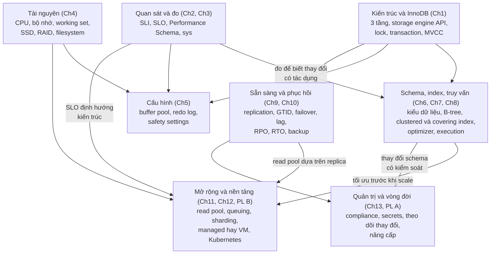
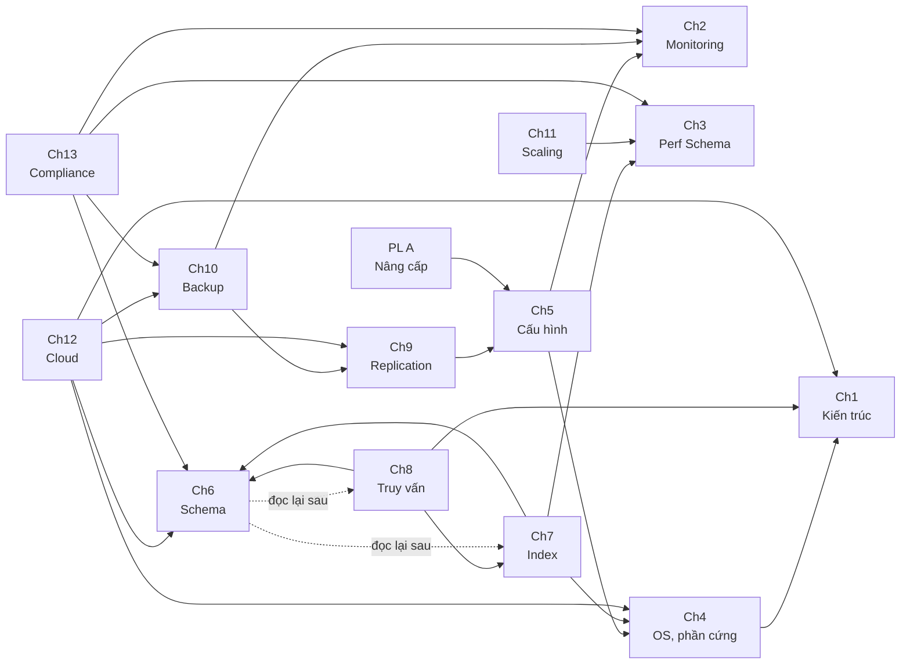
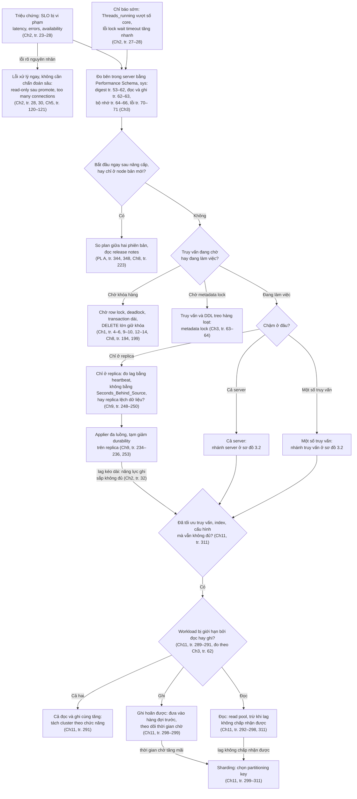
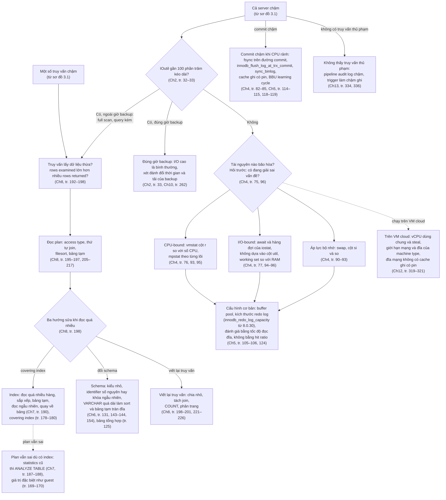

# Bản đồ khái niệm — High Performance MySQL

> **Đã cập nhật sau khi viết xong mọi chương.** Bản đầu được dựng từ mục lục, trang mở đầu và phần Summary. Nay cả 13 chương và 2 phụ lục đã được đọc đầy đủ và có ghi chú chi tiết. Bản đồ đã thêm các tham chiếu chéo còn sót (nhiều chữ "Chap‐ter" bị ngắt dòng trong bản trích xuất), sửa các tham chiếu sai của sách theo kết quả kiểm chứng, thêm bảng liên hệ theo nội dung, chỉnh luồng chẩn đoán, và thêm liên kết tới từng mục ghi chú.
>
> "tr. N" là số trang in; trang PDF = N + 22. Cách nhóm khái niệm, các sơ đồ tổng hợp, luồng chẩn đoán và bảng liên hệ theo nội dung (mục 2.2) là **gợi ý của người viết ghi chú**. Bảng tham chiếu chéo ở mục 2.1 là **của sách**.

## Mục lục

- [1. Bản đồ tổng quát](#tong-quat)
- [2. Quan hệ giữa các chương](#chapter-links)
  - [2.1 Tham chiếu chéo trong chữ của sách](#tham-chieu-sach)
  - [2.2 Liên hệ theo nội dung](#lien-he-noi-dung)
- [3. Luồng chẩn đoán "MySQL chậm"](#chan-doan)
- [4. Khái niệm và nơi sách giải thích](#khai-niem)
- [5. Trạng thái](#trang-thai)
- [6. Tra cứu nhanh theo chương](#tra-cuu)

---

## 1. Bản đồ tổng quát

Mỗi cụm là một nhóm khái niệm, kèm chương chính. Mũi tên chỉ cụm này **dựa vào** hoặc **dẫn tới** cụm kia.

*(Sơ đồ do người viết ghi chú tổng hợp từ trang mở đầu và Summary của các chương: tr. 1, 18, 39, 41, 73, 96–97, 99, 124, 125, 154, 155, 189–191, 226, 227, 255, 257, 286, 287, 311, 313, 324, 325, 341.)*

---

## 2. Quan hệ giữa các chương

Mục này có hai bảng tách bạch. **Bảng 2.1** chỉ gồm các chỗ sách **tự trỏ** tới chương khác: câu "Chapter N" hay "Appendix A", tên mục kèm trang, "the previous chapter", "the next chapter", hay số hình. Bảng đã được dựng lại bằng cách tìm trên toàn bộ chữ của sách sau khi nối các từ bị ngắt dòng, nên bắt được các tham chiếu bị sót ở bản đầu như Ch11 tr. 290 → Ch3, Ch5 tr. 122 → PL A, Ch12 tr. 320 → Ch1. **Bảng 2.2** là liên hệ theo nội dung do người viết ghi chú tìm ra khi đọc chi tiết; sách không ghi số chương ở những chỗ đó.

Sơ đồ dưới chỉ vẽ các tham chiếu **ngược** của bảng 2.1 (chương sau nhắc lại chương trước), tức những chỗ chương sau dựa trên kiến thức đã học. Nét đứt là lời khuyên đọc lại của chương 6.

*(Mũi tên A → B nghĩa là chương A nhắc lại nội dung của chương B. Chương 11 có một tham chiếu ngược, tới chương 3 (tr. 290). Không có tham chiếu ngược nào: chương 1 và 2 (chỉ trỏ xuôi), chương 6 (chỉ trỏ xuôi tới chương 7, 8, 13), chương 3 và phụ lục B (không có câu "Chapter N" nào). Phụ lục B chỉ có liên hệ theo nội dung, xem bảng 2.2. Các tham chiếu xuôi, như Ch5 → PL A hay Ch7 → Ch8, chỉ có trong bảng 2.1.)*

### 2.1 Tham chiếu chéo trong chữ của sách

Các dòng ghi **"sách ghi nhầm"** đã được kiểm chứng; kết quả ở [roadmap mục 8](learning-roadmap.md#can-kiem-chung).

| Từ | Tới | Trang | Nội dung được nhắc |
| --- | --- | --- | --- |
| Ch1 | Ch5 (sách ghi nhầm; nội dung ở Ch11) | tr. 2 | Chú thích 2: thread pooling thường làm ở tầng truy cập. Chương 5 chỉ có thread cache (tr. 111) và concurrency (tr. 119); connection pooling ở tầng truy cập là Vitess (Ch11, tr. 303) và ProxySQL (Ch11, tr. 306–307). Roadmap A2 |
| Ch1 | Ch8 | tr. 3, 4 | Optimizer; tối ưu truy vấn để tránh vấn đề hiệu năng do lock |
| Ch1 | Ch6, Ch7 | tr. 3 | Engine ảnh hưởng tới tối ưu; schema optimization và indexing "in Chapters 6 and 7" |
| Ch1 | Ch7 | tr. 10 | Index ảnh hưởng hiệu năng, trong ngữ cảnh deadlock |
| Ch1 | Ch5 | tr. 14 | Kích thước redo log và undo log ảnh hưởng transaction ở concurrency cao |
| Ch1 | Ch9 | tr. 15 | Replication chi tiết |
| Ch1 | Ch8 (sách ghi nhầm; nội dung ở Ch7) | tr. 16 | Clustered index "khi bàn thiết kế schema"; mục *Clustered Indexes* thực tế ở Ch7, tr. 170–178, còn thiết kế schema là Ch6. Roadmap A3 |
| Ch1 | Ch4 (sách ghi nhầm; nội dung rải ở Ch4, Ch5, Ch7, Ch10) | tr. 17 | Read-ahead (Ch4, tr. 84, 88), adaptive hash index (Ch5, tr. 110; Ch7, tr. 159, 173), insert buffer hay change buffer (Ch5, tr. 110, 116; Ch10, tr. 265). Không chương nào giải thích cơ chế. Roadmap A1 |
| Ch1 | Ch10 | tr. 17 | Backup nóng với InnoDB |
| Ch1 | Ch6 | tr. 17 | Thay đổi schema online; kiểu JSON ("JSON Data", tr. 139) |
| Ch2 | Ch3 | tr. 25 | Dùng Performance Schema để profile và tìm nút thắt |
| Ch2 | Ch5 | tr. 27 | "Safety Settings" (tr. 120) để giới hạn quá tải |
| Ch2 | Ch4 | tr. 30 | Cấu hình hệ điều hành và phần cứng khi lo dung lượng đĩa |
| Ch2 | Ch9 | tr. 32 | Chiến lược giảm replication lag |
| Ch2 | Ch6 | tr. 34 | Chọn primary key và quản lý auto-increment |
| Ch2 | Ch10, Ch13 | tr. 34–35 | Disaster recovery (Ch10, tr. 34); vai trò của nó trong compliance (Ch13, chỉ ở tr. 34); ví dụ tự động kiểm tra backup (Ch10, tr. 35) |
| Ch2 | Ch11 | tr. 39 | SLI, SLO cho biết khi nào cần sharding |
| Ch4 | Ch5 | tr. 76 | "Configuring Memory Usage" (tr. 109) |
| Ch4 | Ch1 | tr. 90 | InnoDB dùng bộ nhớ làm cache |
| Ch5 | Ch2 | tr. 104 | Theo dõi SLO khi đổi cấu hình |
| Ch5 | Ch9 | tr. 118 | GTID và khả năng phục hồi |
| Ch5 | Ch4 | tr. 118 | RAID |
| Ch5 | PL A | tr. 122 | Kiểm tra thay đổi của `sql_mode` mặc định khi lên kế hoạch nâng cấp ("We talk more about upgrading in Appendix A") |
| Ch6 | Ch7, Ch8 | tr. 125 | Nên đọc lại chương 6 sau khi đọc chương 7 và 8 |
| Ch6 | Ch13 | tr. 147 | Compliance đòi hỏi quản lý thay đổi schema |
| Ch7 | Ch4 | tr. 155 | Chú thích 1: SSD có đặc tính hiệu năng khác |
| Ch7 | Ch6 | tr. 165 | "In the previous chapter": cách lưu identifier hex dài hiệu quả hơn; prefix index là cách lách khi không sửa được schema |
| Ch7 | Ch3 | tr. 185 | Tìm index không dùng bằng `performance_schema` và `sys` |
| Ch7 | Ch8 | tr. 190 | "The next chapter": viết lại truy vấn để dùng được index |
| Ch8 | Ch6, Ch7 | tr. 191 | "In the previous chapters": schema optimization và indexing là điều kiện cần |
| Ch8 | Ch7 | tr. 195, 209, 226 | "The previous chapter": index giúp access type tốt hơn (tr. 195); covering index (tr. 209); cách MySQL truy cập bảng và index (tr. 226) |
| Ch8 | Ch7 | tr. 198 | Covering index |
| Ch8 | Ch6 | tr. 198 | Summary table; chương 6 chỉ nhắc khái niệm này ở đoạn mở đầu (tr. 125), không có mục riêng |
| Ch8 | Ch9 (không có nội dung tương ứng) | tr. 202 | "The next chapter" sẽ bàn đường thực thi của prepared statement; chương 9 là Replication. Roadmap A4 |
| Ch8 | Ch1 | tr. 211 | Hình 1-1: tầng server không lưu statistics, storage engine cung cấp |
| Ch8 | Ch1 | tr. 218 | Lock ở tầng server so với lock của storage engine |
| Ch9 | Ch5 | tr. 241, 249 | Thiết lập ACID và durability |
| Ch9 | Ch10 | tr. 242 | "Defining Recovery Requirements" (tr. 259) |
| Ch10 | Ch2 | tr. 260 | RPO và RTO giống SLO |
| Ch10 | Ch9 | tr. 268 | GTID; "Delayed Replication" (tr. 233) |
| Ch11 | Ch3 | tr. 290 | "Examining Read Versus Write Performance" (tr. 62): đo latency đọc so với ghi để biết workload bị giới hạn ở đâu. Chữ "Chap‐ter 3" bị ngắt dòng nên bản đầu bỏ sót |
| Ch11 | Ch13 | tr. 309 | Tách database user cho compliance |
| Ch12 | Ch6 | tr. 315 | Thay đổi schema online bằng công cụ ngoài |
| Ch12 | Ch4 | tr. 318, 319, 320, 321 | Loại máy, chọn CPU, RAM, RAID |
| Ch12 | Ch1 | tr. 320 | "As discussed in Chapters 1 and 4": RAM ảnh hưởng lớn tới hiệu năng |
| Ch12 | Ch10 | tr. 321 | Tự backup trên VM (LVM, XtraBackup) |
| Ch12 | Ch9 | tr. 322 | "Replication Failover" (tr. 239) |
| Ch13 | Ch6 | tr. 336 | Version control cho thay đổi schema |
| Ch13 | Ch3 | tr. 338 | Performance Schema để biết một user có còn được dùng |
| Ch13 | Ch10 | tr. 338 | Các loại backup |
| Ch13 | Ch2 | tr. 340 | Kích thước instance và thời gian phục hồi |
| PL A | Ch5 | tr. 346 | Cờ `read_only` |

> Không có trong bảng vì không trỏ tới chương của sách này: "Chapter 1, 2, 5" ở tr. 19 thuộc *The Site Reliability Workbook* (roadmap A7), và "Chapter 11" ở chú thích 2, tr. 315, thuộc *Designing Data-Intensive Applications*.

### 2.2 Liên hệ theo nội dung (không phải tham chiếu của sách)

Ở những chỗ dưới đây, hai chương bàn cùng một cơ chế nhưng sách **không** ghi số chương. Đây là phát hiện của người viết ghi chú khi đọc chéo; một số dòng có kèm kết quả đo ở bài thực hành.

| Chương | Trang | Liên hệ |
| --- | --- | --- |
| Ch1 ↔ Ch3 | Ch1 tr. 6 (chú thích 4); Ch3 tr. 63–64 | Metadata lock dùng khi đổi tên bảng hay đổi schema; quan sát bằng bảng `metadata_locks` |
| Ch1 ↔ Ch4 | Ch1 tr. 10–11; Ch4 tr. 77 | Write-ahead logging: chương 4 giải thích vì sao ghi log tuần tự rẻ hơn flush trang |
| Ch1 ↔ Ch5 | Ch1 tr. 10, 13–15; Ch5 tr. 113, 115–118 | Redo log biến ghi ngẫu nhiên thành tuần tự; undo log nằm trong tablespace; transaction mở lâu giữ phiên bản cũ và làm history list dài |
| Ch1 ↔ Ch7 | Ch1 tr. 16–17; Ch7 tr. 173, 178 | Leaf của clustered index chứa transaction ID và rollback pointer cho MVCC; chèn theo thứ tự primary key tranh chấp next-key lock |
| Ch1 ↔ Ch10 | Ch1 tr. 15, 18; Ch10 tr. 258, 270–278, 286 | Backup phải đọc data dictionary thay vì file metadata; crash recovery bằng redo log và LSN là nền của XtraBackup và snapshot không khóa; replica không phải backup |
| Ch1 ↔ Ch11 | Ch11 tr. 298 | Lock timeout, deadlock và ghi thất bại phải thử lại là lý do đưa phần ghi hoãn được vào hàng đợi |
| Ch1 ↔ Ch13 | Ch1 tr. 2; Ch13 tr. 332, 337 | Xác thực theo username, host, password và kiểm quyền từng truy vấn là nền của user riêng và least privilege |
| Ch2 ↔ Ch1 | Ch2 tr. 28–29 | Lỗi lock wait timeout là tranh chấp row lock; transaction dài với undo log lớn làm đĩa tăng |
| Ch2 ↔ Ch3 | Ch2 tr. 28, 38; Ch3 tr. 57, 70–71 | Đếm lỗi phía server bằng `events_errors_summary_*`; view sys "95th percentile" xếp theo thời gian trung bình của từng statement, khác p95 của SLO |
| Ch2 ↔ Ch4 | Ch2 tr. 32–33; Ch4 tr. 76–77, 92–95 | I/O wait khi working set không vừa bộ nhớ; theo dõi bằng `iostat` |
| Ch2 ↔ Ch5 | Ch2 tr. 27–28, 30, 33; Ch5 tr. 120–121, 123 | "Too many connections" là lỗi xử lý ngay; chương 5 coi `max_connections` là phanh khẩn cấp và khuyên theo dõi `max_used_connections`; `innodb_autoinc_lock_mode` khi nhiều transaction chờ khóa auto-increment |
| Ch2 ↔ Ch7, Ch8 | Ch2 tr. 33 | `IOutil` gần 100% kéo dài trên host không chạy backup thường là full table scan và query kém, không chỉ là thiếu phần cứng |
| Ch2 ↔ Ch9 | Ch2 tr. 26, 28; Ch9 tr. 239–241, 247–249 | MTTR khi chuyển sang source mới là bài toán failover; lỗi read-only sau khi promote; chương 9 giám sát trạng thái, lỗi và lag của replication |
| Ch2 ↔ Ch10 | Ch2 tr. 33 | Backup là nguồn I/O hợp lệ, nên I/O cao trong giờ backup không phải bất thường |
| Ch2 ↔ Ch11 | Ch2 tr. 30, 34–35; Ch11 tr. 291, 295–296, 299, 306–311 | Hộp ở chương 2 định nghĩa functional sharding và horizontal sharding cho cả sách; ProxySQL tách tăng trưởng kết nối khỏi database; chương 11 gắn quyết định read pool với SLO và kiểm `read_only` khi health check |
| Ch3 ↔ Ch5 | Ch3 tr. 55, 64, 69; Ch5 tr. 102–103, 106 | Bảng 3-4 gợi ý tăng `sort_buffer_size` và giới hạn bảng tạm; chương 5 nói không đặt được cận trên bộ nhớ nên phải đo bằng instrument bộ nhớ; nguồn gốc biến qua `variables_info` |
| Ch3 ↔ Ch7, Ch8 | Ch3 tr. 54–57, 61–62; Ch8 tr. 194 | Các cột `NO_INDEX_USED`, `SELECT_FULL_JOIN`, bảng tạm, sort và rows examined của từng câu lệnh dẫn tới `EXPLAIN`, index và viết lại truy vấn |
| Ch3 ↔ Ch9 | Ch9 tr. 235–236 | Đo mức bận của từng applier worker bằng `events_transactions_summary_by_thread_by_event_name` và `replication_applier_status_by_worker`; chú thích 4 nhắc chi phí CPU của consumer |
| Ch3 ↔ Ch13, PL A | Ch3 tr. 70–71; Ch13 tr. 336 | Gộp lỗi theo account phát hiện câu lỗi và truy vấn viết cho bản cũ (`ER_DEPRECATED_UTF8_ALIAS`), tín hiệu cần sửa trước khi nâng cấp; pipeline audit log chậm làm truy vấn chậm mà Performance Schema không chỉ ra thủ phạm |
| Ch3 ↔ PL A | Ch3 tr. 63–64; PL A tr. 348 | Metadata lock giải thích vì sao `ALTER ... INSTANT` vẫn có thể bị chặn và chặn truy vấn khác (đã đo ở [TN3 phụ lục A](experiments/appendix-a.md#tn3)) |
| Ch4 ↔ Ch3 | Ch4 tr. 92–96 | Công cụ hệ điều hành cho biết thiết bị nào bận; Performance Schema cho biết file và truy vấn nào gây ra |
| Ch4 ↔ Ch5 | Ch4 tr. 77, 83, 85–86, 88, 90–92; Ch5 tr. 101, 105–109, 113–121 | Cache ghi có pin làm `fsync` nhanh, `O_DIRECT` khi có BBU; hạ `innodb_flush_log_at_trx_commit` là phương án cuối khi RAID về write-through; `skip_name_resolve`; chừa bộ nhớ cho hệ điều hành; không ước lượng working set bằng hit ratio |
| Ch4 ↔ Ch6 | Ch4 tr. 77, 96; Ch6 tr. 143–144 | Identifier ngẫu nhiên (UUID) rải dữ liệu nóng khắp bảng, working set không còn vừa bộ nhớ |
| Ch4 ↔ Ch9 | Ch4 tr. 83; Ch9 tr. 232–233, 243–244, 253 | Durability của replication; CPU là chỉ số tải của read pool (nhắm 50–60%); failover sang node có working set khác làm buffer pool bị churn |
| Ch4 ↔ Ch10 | Ch4 tr. 82, 88; Ch10 tr. 260, 272–277, 286 | RAID không phải backup; snapshot LVM để backup và khởi tạo replica |
| Ch4 ↔ Ch12 | Ch4 tr. 76, 78–79, 85, 93, 95; Ch12 tr. 319–322 | Chọn CPU và RAM theo working set; cột steal `st` của `vmstat` trên VM; cloud không có cache ghi có pin; SSD, IOPS và `pt-diskstats` |
| Ch5 ↔ Ch7 | Ch5 tr. 110, 123; Ch7 tr. 159, 173, 178 | Adaptive hash index nằm trong buffer pool; `innodb_autoinc_lock_mode` và hot spot của khóa auto-increment |
| Ch5 ↔ Ch8 | Ch5 tr. 102; Ch8 tr. 216 | `sort_buffer_size`, `join_buffer_size` là biến theo session |
| Ch5 ↔ Ch9 | Ch5 tr. 118, 122; Ch9 tr. 232–233, 240, 244, 253 | `innodb_flush_log_at_trx_commit = 1` và `sync_binlog = 1` cho replication crash safe; tạm hạ trên replica để đuổi lag; `super_read_only` |
| Ch5 ↔ Ch10 | Ch5 tr. 115–116, 122; Ch10 tr. 265, 268, 276–277, 284 | `sysdate_is_now` để PITR đáng tin; system tablespace, doublewrite và file-per-table khi restore; chế độ full ACID cho snapshot không khóa; `super_read_only` cho replica dùng để backup |
| Ch5 ↔ Ch11 | Ch5 tr. 119 | Gặp nút thắt concurrency của InnoDB thì cách tốt nhất là shard dữ liệu |
| Ch5 ↔ Ch12 | Ch5 tr. 105, 108; Ch12 tr. 319–321, 323 | `innodb_dedicated_server` khi resize VM; chọn RAM theo tốc độ đọc vật lý, không theo hit ratio; thiết lập ACID cho snapshot; `read_only` sau reboot |
| Ch6 ↔ Ch1 | Ch6 tr. 145 | "Too Many Columns" giải thích bằng row buffer chép qua storage engine API |
| Ch6 ↔ Ch7 | Ch6 tr. 133–134, 143–144; Ch7 tr. 174–178 | Primary key nhỏ làm mọi index nhỏ; giá trị ngẫu nhiên gây page split (Bảng 7-1); `ORDER BY FIELD()` không dùng được index để sắp xếp |
| Ch6 ↔ Ch8 | Ch6 tr. 131, 145, 154; Ch8 tr. 216–217 | VARCHAR khai báo dư làm filesort và bảng tạm tốn bộ nhớ; chi phí lập plan tăng theo số bảng trong join |
| Ch6 ↔ Ch9 | Ch6 tr. 151–152 | gh-ost kết nối như một replica và đọc binlog dạng row |
| Ch6 ↔ Ch11 | Ch6 tr. 149 | Vitess cũng quản lý thay đổi schema |
| Ch6 ↔ Ch13 | Ch6 tr. 149, 151; Ch13 tr. 334, 336 | Chi phí của trigger (pt-online-schema-change) là lý do không audit bằng trigger; một repository schema cho mỗi cluster |
| Ch6 ↔ PL A | Ch6 tr. 149–150; PL A tr. 348 | DDL native `INSTANT`, `INPLACE`; thêm cột tức thì là lý do nâng cấp |
| Ch7 ↔ Ch10 | Ch7 tr. 186 | Backup bằng `rsync` hay làm hỏng InnoDB; khôi phục bảng hỏng từ backup |
| Ch7 ↔ PL A | Ch7 tr. 185; PL A tr. 346 | pt-upgrade kiểm tra thay đổi index và kiểm tra trước nâng cấp |
| Ch7, Ch8 ↔ Ch9 | Ch9 tr. 230, 250 | Statement-based với `LIMIT` không `ORDER BY` có thể lệch vì access path khác nhau giữa source và replica (đã tái hiện ở [TN2 chương 9](experiments/chapter-09.md#tn2)) |
| Ch8 ↔ Ch9 | Ch8 tr. 199 | Chia nhỏ DELETE lớn giảm replication lag |
| Ch8 ↔ Ch11 | Ch8 tr. 200; Ch11 tr. 291 | Join trong ứng dụng cho phép đặt bảng ở server khác, gần với functional sharding |
| Ch8 ↔ PL A | Ch8 tr. 221, 223 | Lời khuyên tối ưu phụ thuộc phiên bản; nâng cấp từng đổi cú pháp join và độ ưu tiên toán tử |
| Ch9 ↔ Ch10 | Ch9 tr. 228, 233, 238, 242, 253; Ch10 tr. 268 | Replica không phải backup nhưng là nơi chạy backup; delayed replica cứu `DROP TABLE`; filter làm PITR không khả thi; hạ durability trên replica có thể làm snapshot không phục hồi được |
| Ch9 ↔ Ch11 | Ch9 tr. 228, 242–243, 248–249, 253; Ch11 tr. 292–296 | Replica không scale được ghi; read pool chấp nhận đọc cũ; heartbeat cho health check lag; "scale đọc bằng replica, scale ghi bằng sharding" |
| Ch9 ↔ Ch12 | Ch9 tr. 233, 240–242, 253; Ch12 tr. 318, 321–323 | Dư thừa n+1 nhờ provisioning động; chờ source quay lại hay failover; `read_only` sau reboot; delayed replica trên VM; snapshot đĩa cloud |
| Ch9 ↔ Ch13 | Ch9 tr. 238 | Không dùng filter để chặn GRANT sang replica; quản lý user qua source |
| Ch9 ↔ PL A | Ch9 tr. 228–229, 239–240, 243–244; PL A tr. 346–348 | Replica bản mới để thử nâng cấp; planned promotion bằng `super_read_only` ghép với playbook nâng cấp |
| Ch10 ↔ Ch6 | Ch10 tr. 274 | Backup riêng schema vào version control |
| Ch10 ↔ Ch12 | Ch10 tr. 263, 269, 272; Ch12 tr. 317, 321, 323 | Snapshot đĩa cloud và "Myth #2"; binlog lên bucket; Cloud SQL "tắt" `mysqldump` trong khi chương 10 khuyên logical backup khi không truy cập được filesystem (chưa rõ, roadmap D6) |
| Ch10 ↔ Ch13 | Ch10 tr. 258–259; Ch13 tr. 338–340 | Chương 10 để bảo mật và kiểm toán backup ngoài phạm vi; chương 13 bổ khuyết: tự động hóa, kiểm thử, bread crumb |
| Ch10 ↔ PL A | Ch10 tr. 273; PL A tr. 345 | Snapshot làm đường lui; hạ cấp chỉ bằng restore backup |
| Ch11 ↔ Ch12 | Ch11 tr. 293, 295, 303, 306; Ch12 tr. 315, 323 | RDS Proxy cùng vai trò connection pooling với Vitess, ProxySQL; service discovery trả lời câu hỏi "máy nào nhận ghi" |
| Ch11 ↔ Ch13 | Ch11 tr. 310; Ch13 tr. 332 | ProxySQL có audit log; tách cluster vì compliance là một dạng functional sharding |
| Ch11 ↔ PL B | Ch11 tr. 304–305; PL B tr. 351 | Vitess có operator chạy trên Kubernetes và ưa instance nhỏ; phụ lục B khuyên học Vitess làm control plane |
| Ch12 ↔ Ch2 | Ch12 tr. 315, 318, 324; Ch2 tr. 30–31 | RDS Proxy chống connection storm; cửa sổ bảo trì so với SLO; auto-extend phải chạy dày hơn thời gian lấp đầy đĩa |
| Ch12 ↔ Ch13 | Ch12 tr. 314, 317, 323; Ch13 tr. 334, 340 | Audit logging của dịch vụ managed (Cloud SQL không nạp được plugin); quyền đọc, xóa của bucket backup |
| Ch12 ↔ PL A | Ch12 tr. 314, 318 | Managed MySQL: kiểm major version tương thích; nâng cấp qua cửa sổ bảo trì có downtime |
| Ch13 ↔ Ch2 | Ch13 tr. 332, 340; Ch2 tr. 26, 34–35 | MTTR và kích thước instance; sharding vì compliance dựa trên lý do functional sharding (quản lý riêng access control) |
| Ch13 ↔ Ch5 | Ch5 tr. 121 | `skip_name_resolve` ảnh hưởng phần host của tài khoản service |
| Ch13 ↔ PL A | Ch13 tr. 337; PL A tr. 343–344 | Dual password ra ở point release 8.0.14; bảo mật là một lý do nâng cấp |
| PL B ↔ Ch2, Ch9, Ch10, Ch12, Ch13, PL A | PL B tr. 350–351 | Tám câu hỏi với đội Kubernetes: kích thước dataset và thời gian khôi phục, backup và restore, failover, thay đổi cấu hình và nâng cấp; SLO cho đội dùng; cân rủi ro và lợi ích như "không có bữa trưa miễn phí" (Ch12, tr. 324) |

---

## 3. Luồng chẩn đoán "MySQL chậm"

Hai sơ đồ ghép lời khuyên của nhiều chương thành một hướng suy luận khi hệ thống chậm. Mỗi nút dẫn trang. Đây là **sơ đồ tổng hợp của người viết ghi chú**, đã chỉnh theo nội dung chi tiết của các chương; sách không có sơ đồ này. Sơ đồ 3.1 phân loại triệu chứng và dẫn tới quyết định scale. Sơ đồ 3.2 đi sâu vào hai nhánh "một số truy vấn chậm" và "cả server chậm".

**Sơ đồ 3.1 — Phân loại triệu chứng và quyết định scale**

**Sơ đồ 3.2 — Nhánh truy vấn và nhánh server**

*(Hai sơ đồ do người viết ghi chú tổng hợp. Căn cứ chính: thứ tự "tối ưu trước, scale sau" và cây quyết định đọc, ghi ở Summary chương 11 (tr. 311); hàng đợi đặt trước sharding và thời gian chờ là tín hiệu chuyển sang sharding ở thân chương 11 (tr. 298–299); `Threads_running` là chỉ báo sớm (tr. 27); `IOutil` cao ngoài giờ backup gợi ý full scan (tr. 33); CPU là nút thắt hay gặp nhất (tr. 75); chờ khóa trông như truy vấn chậm (Ch1, tr. 10; Ch8, tr. 194). Nhánh "sau nâng cấp", "thành phần phụ" và "VM cloud" là suy luận của người viết từ phụ lục A, chương 13 và chương 12. Nếu đã sửa ở sơ đồ 3.2 mà vẫn chưa đủ, quay về câu hỏi scale ở sơ đồ 3.1.)*

---

## 4. Khái niệm và nơi sách giải thích

Trang đã đối chiếu với bookmark của PDF và với ghi chú chương. Cột "Liên quan" ghi chương khác nhắc tới khái niệm (theo bảng 2.1 hoặc 2.2). Cột "Ghi chú" dẫn tới mục ghi chú chương tương ứng. Định nghĩa ngắn nằm trong [`glossary.md`](glossary.md).

### Kiến trúc, lock và transaction

| Khái niệm | Mục trong sách | Trang | Liên quan | Ghi chú |
| --- | --- | --- | --- | --- |
| Kiến trúc logic ba tầng, storage engine API | Ch1 · MySQL’s Logical Architecture | tr. 1–3 | Ch6 (row buffer, tr. 145), Ch8 (thực thi; Hình 1-1 được nhắc ở tr. 211) | [Ch1 §2.1](chapter-01.md#logical-architecture) |
| Connection management, security | Ch1 · Connection Management and Security | tr. 2 | Ch5 (thread cache, tr. 111), Ch11 (connection pooling, tr. 303, 306–307), Ch13 | [Ch1 §2.1.1](chapter-01.md#connection-management) |
| Optimization, execution | Ch1 · Optimization and Execution | tr. 3 | Ch8 (Query Execution Basics, tr. 201–218) | [Ch1 §2.1.2](chapter-01.md#optimizer-execution) |
| Read/write lock, lock granularity | Ch1 · Concurrency Control | tr. 3–6 | Ch3 (metadata lock, tr. 63–64), Ch8 (tr. 218) | [Ch1 §2.2](chapter-01.md#s2-2) |
| Transaction, ACID, isolation level, deadlock | Ch1 · Transactions | tr. 6–10 | Ch7 (Ch1 tr. 10 trỏ tới), Ch8 (Ch1 tr. 4 trỏ tới: tối ưu truy vấn để tránh vấn đề do khóa) | [Ch1 §2.3](chapter-01.md#s2-3) |
| Transaction logging | Ch1 · Transaction Logging | tr. 10–11 | Ch4 (WAL, tr. 77), Ch5 (transaction log, log buffer, tr. 113–115) | [Ch1 §2.3.3](chapter-01.md#transaction-logging) |
| AUTOCOMMIT, two-phase locking, `LOCK TABLES` | Ch1 · Transactions in MySQL | tr. 11–13 | Ch8 (lock tầng server, tr. 218) | [Ch1 §2.3.4](chapter-01.md#transactions-in-mysql) |
| MVCC, undo log, purge | Ch1 · Multiversion Concurrency Control | tr. 13–15 | Ch5 (kích thước redo, undo do Ch1 tr. 14 trỏ tới; undo trong tablespace, history list, tr. 115–118), Ch7 (rollback pointer, tr. 173) | [Ch1 §2.4](chapter-01.md#mvcc) |
| Replication (tổng quan) | Ch1 · Replication | tr. 15 | Ch9 | [Ch1 §2.5](chapter-01.md#replication) |
| Data dictionary, SDI | Ch1 · Datafiles Structure | tr. 16 | Ch10 (backup đọc data dictionary, Ch1 tr. 18), PL A (suy luận của người viết: vì sao từ 8.0 khó hạ cấp; không phải tham chiếu của sách) | [Ch1 §2.6](chapter-01.md#data-dictionary) |
| Next-key locking, clustered index, secondary index | Ch1 · The InnoDB Engine | tr. 16–17 | Ch7 (Clustered Indexes, tr. 170–178; sách ghi nhầm Chapter 8) | [Ch1 §2.7](chapter-01.md#innodb) |
| Read-ahead, adaptive hash index, insert buffer | Ch1 · The InnoDB Engine | tr. 17 | Ch4 (tr. 84, 88), Ch5 (tr. 110, 116), Ch7 (tr. 159, 173), Ch10 (tr. 265); sách ghi nhầm Chapter 4 | [Ch1 §2.7](chapter-01.md#internal-optimizations-check) |
| JSON, data dictionary changes, atomic DDL | Ch1 · The InnoDB Engine | tr. 17–18 | Ch6 (JSON, tr. 139), Ch10 | [Ch1 §2.7.1](chapter-01.md#json) |

### Quan sát và đo

| Khái niệm | Mục trong sách | Trang | Liên quan | Ghi chú |
| --- | --- | --- | --- | --- |
| SLI, SLO, SLA | Ch2 · Defining Service Level Goals; Defining SLIs and SLOs | tr. 21–24 | Ch10 (RPO, RTO giống SLO, tr. 260), Ch11 (tr. 295–296), Ch12 (tr. 318), PL B (tr. 351) | [Ch2 §2.2](chapter-02.md#sli-slo-sla) |
| Số 9, Bảng 2-1 | Ch2 · What Does It Take to Make Customers Happy? | tr. 22–23 | | [Ch2 §2.2.1](chapter-02.md#nines) |
| Giám sát availability, query latency, lỗi | Ch2 · What to Measure | tr. 25–28 | Ch3 (lỗi, tr. 70–71), Ch9 (read-only sau promote, tr. 240) | [Ch2 §2.3.3](chapter-02.md#availability) |
| `Threads_running`, `Threads_connected`, `max_connections` | Ch2 · Monitoring Availability; Connection growth | tr. 27, 30–31 | Ch5 (tr. 120–121) | [Ch2 §2.3.3](chapter-02.md#threads-running) |
| Proactive monitoring: đĩa, kết nối, lag, I/O, auto-increment, thời gian restore | Ch2 · Proactive Monitoring | tr. 29–35 | Ch4 (tr. 30 trỏ tới; `iostat`, tr. 92–95), Ch5 (tr. 120–121, 123), Ch6 (tr. 34), Ch9 (tr. 32), Ch10, Ch13 (tr. 34–35), Ch11 (ProxySQL, tr. 30) | [Ch2 §2.3.6](chapter-02.md#proactive-monitoring) |
| Functional sharding, horizontal sharding (định nghĩa dùng cho cả sách) | Ch2 · hộp trong Backup creation/restore time | tr. 34–35 | Ch11 (tr. 291, 299), Ch13 (tr. 332) | [Ch2 §2.3.6](chapter-02.md#functional-horizontal-sharding) |
| Nhịp kinh doanh, chỉ số dài hạn | Ch2 · Measuring Long-Term Performance | tr. 36–37 | Ch11 (tr. 287) | [Ch2 §2.4](chapter-02.md#business-cadence) |
| Percentile, nói không với trung bình | Ch2 · Using Monitoring Tools to Inspect the Performance | tr. 38 | Ch3 (view sys "95th percentile", tr. 57, khác p95 của SLO) | [Ch2 §2.4.3](chapter-02.md#say-no-to-averages) |
| SLO định hướng kiến trúc | Ch2 · Using SLOs to Guide Your Overall Architecture | tr. 38–39 | Ch11 (Ch2 tr. 39 trỏ tới) | [Ch2 §2.4.4](chapter-02.md#slo-architecture) |
| Instrument, consumer | Ch3 · Introduction to Performance Schema | tr. 41–45 | | [Ch3 §2.1](chapter-03.md#instrument) |
| Chi phí, giới hạn, sys schema, thread | Ch3 · Resource Consumption … Understanding Threads | tr. 45–48 | | [Ch3 §2.1.5](chapter-03.md#sys-schema) |
| Cấu hình và mặc định | Ch3 · Configuration | tr. 48–53 | | [Ch3 §2.2](chapter-03.md#filter-chain), [mặc định 8.0.42](chapter-03.md#defaults-8042) |
| Phân tích câu SQL, stage, đọc so với ghi | Ch3 · Examining SQL Statements; Read Versus Write Performance | tr. 53–63 | Ch7 (tr. 185), Ch8 (rows examined, tr. 194), Ch9 (applier, tr. 235–236), Ch11 (tr. 290 trỏ tới tr. 62) | [Ch3 §2.3.1](chapter-03.md#statement-indicators) |
| Metadata lock | Ch3 · Examining Metadata Locks | tr. 63–64 | Ch1 (tr. 6), PL A (INSTANT vẫn cần metadata lock) | [Ch3 §2.3.3](chapter-03.md#metadata-locks) |
| Bộ nhớ, biến, lỗi, chính Performance Schema | Ch3 · Examining Memory Usage … Performance Schema Itself | tr. 64–73 | Ch2 (lỗi, tr. 28), Ch5 (tr. 102–103, 106), Ch13 (tr. 338) | [Ch3 §2.3.4](chapter-03.md#memory-usage) |

### Tài nguyên và cấu hình

| Khái niệm | Mục trong sách | Trang | Liên quan | Ghi chú |
| --- | --- | --- | --- | --- |
| Cạn CPU, chọn CPU | Ch4 · What Limits…, How to Select CPUs… | tr. 75–76 | Ch9 (CPU của read pool, tr. 243), Ch12 (tr. 319) | [Ch4 §2.1](chapter-04.md#cpu-exhaustion) |
| Working set, cache cho đọc và ghi | Ch4 · Balancing Memory and Disk Resources | tr. 76–77 | Ch5 (buffer pool), Ch6 (tr. 143–144), Ch9 (tr. 244), Ch12 (tr. 320) | [Ch4 §2.3](chapter-04.md#working-set) |
| SSD, flash, garbage collection | Ch4 · Solid-State Storage | tr. 78–79 | Ch7 (tr. 155), Ch12 (SSD so với HDD, tr. 322) | [Ch4 §2.4](chapter-04.md#ssd) |
| RAID, BBU, cache ghi | Ch4 · RAID Performance Optimization | tr. 79–86 | Ch5 (tr. 115, 118), Ch10 (RAID không phải backup, tr. 260, 286), Ch12 (tr. 321) | [Ch4 §2.5](chapter-04.md#raid-levels) |
| Mạng: latency, mất gói, DNS, `skip_name_resolve` | Ch4 · Network Configuration | tr. 86–87 | Ch5 (tr. 120–121) | [Ch4 §2.6](chapter-04.md#network) |
| Filesystem, journaling, XFS | Ch4 · Choosing a Filesystem | tr. 87–89 | Ch10 (snapshot LVM, tr. 272–277) | [Ch4 §2.7](chapter-04.md#filesystem) |
| Disk queue scheduler | Ch4 · Choosing a Disk Queue Scheduler | tr. 89–90 | | [Ch4 §2.7.1](chapter-04.md#io-scheduler) |
| Swap, OOM killer, `O_DIRECT`, `memlock` | Ch4 · Memory and Swapping | tr. 90–92 | Ch5 (tr. 101, 107, 109, 115) | [Ch4 §2.7.2](chapter-04.md#swapping) |
| `vmstat`, `iostat`, Little's law, `mpstat`, `pt-diskstats`, `perf` | Ch4 · Operating System Status; Other Helpful Tools | tr. 92–96 | Ch2 (tr. 32–33), Ch3, Ch12 (steal, tr. 319; `pt-diskstats`, tr. 322) | [Ch4 §2.7.3](chapter-04.md#os-status) |
| Biến hệ thống: scope, dynamic, persisted | Ch5 · How MySQL’s Configuration Works | tr. 101–104 | Ch3 (`variables_info`, tr. 69) | [Ch5 §2.1](chapter-05.md#scope) |
| Những điều không nên làm: tune theo tỉ lệ, script, công thức bộ nhớ | Ch5 · What Not to Do | tr. 105–106 | Ch4 (working set, tr. 77), Ch12 (tr. 320) | [Ch5 §2.2](chapter-05.md#tuning-by-ratio) |
| File cấu hình tối thiểu, `innodb_dedicated_server` | Ch5 · Minimal Configuration | tr. 107–108 | Ch12 (resize VM, tr. 319) | [Ch5 §2.3.1](chapter-05.md#innodb-dedicated-server) |
| Buffer pool, thread cache | Ch5 · Configuring Memory Usage | tr. 109–111 | Ch4, Ch7 (AHI trong buffer pool, tr. 110) | [Ch5 §2.4.3](chapter-05.md#buffer-pool) |
| Transaction log, log buffer, tablespace | Ch5 · Configuring MySQL’s I/O Behavior | tr. 112–119 | Ch1, Ch4 (tr. 77, 83–85), Ch10 (tr. 265, 284) | [Ch5 §2.5](chapter-05.md#redo-log) |
| Phiên bản cũ của hàng, purge, history list | Ch5 · The InnoDB Tablespace | tr. 117–118 | Ch1 (MVCC, tr. 13–15) | [Ch5 §2.5.3](chapter-05.md#history-list) |
| `innodb_flush_log_at_trx_commit`, `sync_binlog` | Ch5 · Log Buffer; Other I/O Configuration Options | tr. 114, 118–119 | Ch4 (tr. 83), Ch9 (tr. 232–233, 253), Ch10 (tr. 276), Ch12 (tr. 321) | [Ch5 §2.5.2](chapter-05.md#flush-log-at-trx-commit) |
| Concurrency | Ch5 · Configuring MySQL Concurrency | tr. 119–120 | Ch11 (shard khi nghẽn concurrency, Ch5 tr. 119) | [Ch5 §2.6](chapter-05.md#innodb-thread-concurrency) |
| Safety settings | Ch5 · Safety Settings | tr. 120–122 | Ch2 (tr. 27), Ch9 (tr. 232–233, 241, 249), PL A (`sql_mode`, tr. 122; `read_only`, PL A tr. 346 trỏ tới) | [Ch5 §2.7](chapter-05.md#safety-table) |
| InnoDB nâng cao: buffer pool instances, `innodb_io_capacity`, `innodb_old_blocks_time`, `innodb_autoinc_lock_mode` | Ch5 · Advanced InnoDB Settings | tr. 122–124 | Ch2 (auto-increment, tr. 33), Ch7 (hot spot auto-increment, tr. 178) | [Ch5 §2.8](chapter-05.md#old-blocks-time) |

### Schema, index và truy vấn

| Khái niệm | Mục trong sách | Trang | Liên quan | Ghi chú |
| --- | --- | --- | --- | --- |
| Kiểu dữ liệu tối ưu | Ch6 · Choosing Optimal Data Types | tr. 126–145 | Ch8 (VARCHAR dài trong filesort, tr. 217) | [Ch6 §2.1](chapter-06.md#guidelines) |
| JSON, cột sinh có index | Ch6 · JSON Data | tr. 139–142 | Ch1 (tr. 17), Ch7 (index) | [Ch6 §2.1.6](chapter-06.md#json-data) |
| Identifier, UUID | Ch6 · Choosing Identifiers | tr. 142–144 | Ch2 (tr. 34), Ch4 (working set), Ch7 (clustered index, tr. 174–178) | [Ch6 §2.1.7](chapter-06.md#identifiers) |
| Bẫy thiết kế schema của MySQL | Ch6 · Schema Design Gotchas in MySQL | tr. 145–146 | Ch1 (row buffer), Ch8 (chi phí lập plan) | [Ch6 §2.2](chapter-06.md#s2-2) |
| Quản lý thay đổi schema | Ch6 · Schema Management | tr. 146–153 | Ch12 (tr. 315), Ch13 (tr. 333, 336) | [Ch6 §2.3](chapter-06.md#s2-3) |
| DDL native `INSTANT`, `INPLACE` | Ch6 · Native DDL statements | tr. 149–150 | PL A (tr. 348), Ch12 (fast DDL, tr. 315) | [Ch6 §2.3.1](chapter-06.md#native-ddl) |
| pt-online-schema-change, gh-ost | Ch6 · Using external tools | tr. 150–152 | Ch9 (binlog dạng row), Ch11 (Vitess, Ch6 tr. 149), Ch13 (trigger, tr. 334) | [Ch6 §2.3.1](chapter-06.md#external-tools) |
| B-tree, full-text | Ch7 · Types of Indexes | tr. 156–161 | | [Ch7 §2.1](chapter-07.md#b-tree) |
| Adaptive hash index | Ch7 · Types of Indexes | tr. 159, 173 | Ch5 (tr. 110), Ch1 (tr. 17) | [Ch7 §2.1](chapter-07.md#adaptive-hash-index) |
| Lợi ích của index, hệ ba sao | Ch7 · Benefits of Indexes; Summary | tr. 161–162, 189–190 | | [Ch7 §2.1](chapter-07.md#three-star) |
| Prefix index, selectivity | Ch7 · Prefix Indexes and Index Selectivity | tr. 162–165 | Ch6 (Ch7 tr. 165 trỏ về chương trước) | [Ch7 §2.2](chapter-07.md#selectivity) |
| Index nhiều cột, index merge | Ch7 · Multicolumn Indexes | tr. 165–167 | Ch8 | [Ch7 §2.2](chapter-07.md#index-merge) |
| Thứ tự cột, giá trị đặc biệt | Ch7 · Choosing a Good Column Order | tr. 167–170 | | [Ch7 §2.2](chapter-07.md#column-order) |
| Clustered index, hidden primary key, secondary index | Ch7 · Clustered Indexes | tr. 170–178 | Ch1 (tr. 16), Ch6 (identifier) | [Ch7 §2.2](chapter-07.md#clustered-index) |
| Thứ tự chèn primary key, page split, UUID | Ch7 · Clustered Indexes | tr. 174–178 | Ch6 (tr. 143–144), Ch5 (tr. 123) | [Ch7 §2.2](chapter-07.md#pk-order) |
| Covering index | Ch7 · Covering Indexes | tr. 178–180 | Ch8 (tr. 198, 209) | [Ch7 §2.2](chapter-07.md#covering-index) |
| Dùng index để sắp xếp | Ch7 · Using Index Scans for Sorts | tr. 180–182 | Ch6 (`ORDER BY FIELD()`, tr. 133), Ch8 (filesort) | [Ch7 §2.2](chapter-07.md#index-sort) |
| Index thừa, trùng, invisible, không dùng | Ch7 · Redundant and Duplicate Indexes; Unused Indexes | tr. 182–186 | Ch3 (tr. 185), PL A (pt-upgrade) | [Ch7 §2.2](chapter-07.md#redundant-index) |
| Hỏng bảng, index statistics, phân mảnh | Ch7 · Index and Table Maintenance | tr. 186–189 | Ch8 (optimizer, tr. 206, 211), Ch10 (backup bằng `rsync`, Ch7 tr. 186) | [Ch7 §2.3](chapter-07.md#index-statistics) |
| Response time và nhiệm vụ con | Ch8 · Why Are Queries Slow? | tr. 191–192 | Ch2 | [Ch8 §2.1](chapter-08.md#response-time) |
| Tối ưu truy cập dữ liệu: rows examined, access type | Ch8 · Slow Query Basics | tr. 192–198 | Ch3 (tr. 54–55), Ch7 | [Ch8 §2.2](chapter-08.md#rows-examined) |
| Tái cấu trúc truy vấn | Ch8 · Ways to Restructure Queries | tr. 198–201 | Ch9 (chia nhỏ DELETE giảm lag), Ch11 (tách join) | [Ch8 §2.3](chapter-08.md#chopping) |
| Giao thức client/server, trạng thái truy vấn | Ch8 · Query Execution Basics | tr. 202–204 | | [Ch8 §2.4.1](chapter-08.md#client-server-protocol) |
| Quá trình tối ưu, join, filesort, execution engine | Ch8 · Query Execution Basics | tr. 205–218 | Ch1 (tr. 3; Hình 1-1 ở tr. 211), Ch5 (buffer theo session), Ch6 (tr. 131) | [Ch8 §2.4.3](chapter-08.md#cost-based-optimizer) |
| Giới hạn của optimizer | Ch8 · Limitations of the MySQL Query Optimizer | tr. 219–221 | | [Ch8 §2.5](chapter-08.md#s2-5) |
| COUNT, JOIN, GROUP BY WITH ROLLUP, LIMIT và OFFSET, `SQL_CALC_FOUND_ROWS`, UNION | Ch8 · Optimizing Specific Types of Queries | tr. 221–226 | PL A (tr. 223) | [Ch8 §2.6](chapter-08.md#s2-6) |

### Sẵn sàng và phục hồi

| Khái niệm | Mục trong sách | Trang | Liên quan | Ghi chú |
| --- | --- | --- | --- | --- |
| Replication bất đồng bộ, binlog, relay log | Ch9 · Replication Overview | tr. 227–230 | Ch1 (tr. 15), PL A (tương thích phiên bản, tr. 228–229) | [Ch9 §2.1.1](chapter-09.md#how-replication-works) |
| Định dạng replication, GTID, crash safe | Ch9 · Replication Under the Hood | tr. 230–233 | Ch5 (tr. 118; tr. 232–233), Ch7, Ch8 (truy vấn không tất định, tr. 230), Ch10 (tr. 268) | [Ch9 §2.2.1](chapter-09.md#binlog-format) |
| Delayed, multithreaded, semisync, filter | Ch9 · Replication Under the Hood | tr. 233–239 | Ch3 (tr. 235–236), Ch10 (tr. 233, 238, 268) | [Ch9 §2.2.4](chapter-09.md#delayed-replication) |
| Failover | Ch9 · Replication Failover | tr. 239–241 | Ch2 (tr. 26, 28), Ch12 (tr. 322), PL A (playbook) | [Ch9 §2.3](chapter-09.md#failover) |
| Topology: active/passive, read pool | Ch9 · Replication Topologies | tr. 241–247 | Ch4 (CPU, tr. 243), Ch11 (tr. 292–298), Ch12 (n+1, tr. 242) | [Ch9 §2.4.2](chapter-09.md#read-pool) |
| Replication lag, heartbeat, kiểm tra nhất quán | Ch9 · Replication Administration and Maintenance | tr. 247–250 | Ch2 (tr. 32), Ch11 (health check lag, tr. 296) | [Ch9 §2.5.2](chapter-09.md#replication-lag) |
| Sự cố replication: server ID, temporary table, lag quá lớn, gói tin, hết đĩa | Ch9 · Replication Problems and Solutions | tr. 251–254 | Ch5, Ch8 (chia nhỏ DELETE, tr. 199), Ch10 | [Ch9 §2.6](chapter-09.md#s2-6) |
| Restore khác recovery, crash recovery | Ch10 · phần mở đầu | tr. 257–258 | Ch1, Ch5 (redo log) | [Ch10 §2.0](chapter-10.md#restore-recover) |
| RPO, RTO; replica không phải backup (Myth #1) | Ch10 · Defining Recovery Requirements | tr. 259–260 | Ch2 (Ch10 tr. 260 nhắc SLO; Ch2 tr. 34–35), Ch9 (tr. 242), Ch4 (RAID, tr. 82) | [Ch10 §2.2](chapter-10.md#rpo-rto) |
| Online hay offline, logical hay raw, incremental, backup từ replica | Ch10 · Designing a MySQL Backup Solution | tr. 260–268 | Ch9 (GTID, delayed replica, tr. 268) | [Ch10 §2.3](chapter-10.md#s2-3) |
| Backup binary log | Ch10 · Managing and Backing Up Binary Logs | tr. 269 | Ch5 (`sysdate_is_now`, tr. 122), Ch9 (filter làm PITR không khả thi, tr. 238), Ch12 (bucket, tr. 323) | [Ch10 §2.4](chapter-10.md#binlog-backup) |
| Công cụ: Enterprise Backup, XtraBackup, mydumper, mysqldump | Ch10 · Backup and Recovery Tools | tr. 269–270 | Ch12 (tr. 321) | [Ch10 §2.5](chapter-10.md#s2-5) |
| Snapshot filesystem, LVM, copy-on-write; Myth #2 | Ch10 · Backing Up Data | tr. 272–277 | Ch4 (tr. 88), Ch12 (snapshot đĩa cloud, tr. 321) | [Ch10 §2.6.2](chapter-10.md#myth-snapshot) |
| XtraBackup: LSN, prepare | Ch10 · Backing Up Data; Recovering from a Backup | tr. 270, 278–285 | Ch1, Ch5 (redo log) | [Ch10 §2.6.3](chapter-10.md#xtrabackup-how) |
| Phục hồi | Ch10 · Recovering from a Backup | tr. 281–286 | Ch13 (tr. 338–340), PL A (hạ cấp bằng restore, tr. 345) | [Ch10 §2.7](chapter-10.md#recovery-steps) |

### Mở rộng, nền tảng và quản trị

| Khái niệm | Mục trong sách | Trang | Liên quan | Ghi chú |
| --- | --- | --- | --- | --- |
| Scaling: chi phí, độ đơn giản, capacity | Ch11 · What Is Scaling? | tr. 287–289 | | [Ch11 §2.1](chapter-11.md#scaling-definition) |
| Workload đọc hay ghi | Ch11 · Read- Versus Write-Bound Workloads | tr. 289–291 | Ch3 (tr. 62, được trỏ tới ở tr. 290) | [Ch11 §2.2](chapter-11.md#read-write-bound) |
| Functional sharding | Ch11 · Functional Sharding | tr. 291–292 | Ch2 (định nghĩa, tr. 34–35; tr. 39), Ch8 (tách join, tr. 200), Ch13 (tr. 332) | [Ch11 §2.3](chapter-11.md#functional-sharding) |
| Read pool: cấu hình, health check, cân bằng tải | Ch11 · Scaling Reads with Read Pools | tr. 292–298 | Ch9 (tr. 242–243, 248–249) | [Ch11 §2.4](chapter-11.md#read-pool) |
| Queuing | Ch11 · Queuing | tr. 298–299 | Ch1 (lock timeout, deadlock, Ch11 tr. 298) | [Ch11 §2.5](chapter-11.md#queuing) |
| Sharding: khóa phân vùng, truy vấn xuyên shard | Ch11 · Scaling Writes with Sharding | tr. 299–303 | Ch5 (tr. 119), Ch9 (tr. 253) | [Ch11 §2.6](chapter-11.md#partitioning-key) |
| Vitess, ProxySQL | Ch11 · Vitess, ProxySQL | tr. 303–311 | Ch1 (tr. 2), Ch6 (tr. 149), Ch12 (RDS Proxy, tr. 315), Ch13 (tr. 309–310), PL B (tr. 351) | [Ch11 §2.6](chapter-11.md#vitess) |
| Managed MySQL: Aurora, Cloud SQL | Ch12 · Managed MySQL | tr. 313–318 | Ch2 (connection storm, SLO), Ch6 (fast DDL, tr. 315), Ch13 (audit logging), PL A (tr. 314, 318) | [Ch12 §2.1](chapter-12.md#managed-mysql) |
| MySQL trên VM: loại máy, loại đĩa | Ch12 · MySQL on Virtual Machines | tr. 318–322 | Ch1, Ch4 (tr. 318–321), Ch5, Ch9 (failover, tr. 322), Ch10 (backup, tr. 321) | [Ch12 §2.2](chapter-12.md#mysql-on-vm) |
| Mẹo vận hành: host reboot, binlog lên bucket, auto-extend | Ch12 · Additional Tips | tr. 322–324 | Ch2 (tr. 30), Ch5, Ch9 (`read_only`, tr. 240), Ch10 (tr. 269), Ch13 (tr. 340) | [Ch12 §2.2.4](chapter-12.md#host-reboots) |
| Các khung compliance (SOC 2, SOX, PCI DSS, HIPAA, FedRAMP, GDPR, Schrems II) | Ch13 · What Is Compliance? | tr. 326–328 | | [Ch13 §2.1](chapter-13.md#frameworks-table) |
| Quản lý secret | Ch13 · Secrets Management | tr. 329–332 | | [Ch13 §2.2.1](chapter-13.md#secrets-management) |
| Tách vai trò và dữ liệu | Ch13 · Separation of Roles and Data | tr. 332–333 | Ch2 (tr. 34), Ch11 (tr. 309) | [Ch13 §2.2.2](chapter-13.md#least-privilege) |
| Theo dõi thay đổi, version control cho schema | Ch13 · Tracking Changes | tr. 333–338 | Ch6 (Ch13 tr. 336 trỏ tới) | [Ch13 §2.2.3](chapter-13.md#tracking-changes) |
| Data access logging, audit plug-in, trigger | Ch13 · Tracking Changes | tr. 334–336 | Ch6 (tr. 151), Ch11 (tr. 310), Ch12 (tr. 314, 317) | [Ch13 §2.2.3](chapter-13.md#data-access-logging) |
| Quản lý database user: xoay vòng, dual password, gỡ user | Ch13 · Tracking Changes | tr. 336–338 | Ch3 (Ch13 tr. 338 trỏ tới), PL A (point release 8.0.14) | [Ch13 §2.2.3](chapter-13.md#user-management) |
| Backup và restore như một kiểm soát | Ch13 · Backup and Restore Procedures | tr. 338–340 | Ch2 (MTTR, tr. 26, 34–35), Ch10 | [Ch13 §2.2.4](chapter-13.md#backup-restore) |
| Lý do nâng cấp, vòng đời nâng cấp | PL A · Why Upgrade?, Upgrade Life Cycle | tr. 343–345 | Ch10 (hạ cấp bằng restore) | [PL A §2.1](appendix-a.md#ly-do-nang-cap) |
| Thử nghiệm nâng cấp | PL A · Testing Upgrades | tr. 345–346 | Ch7 (pt-upgrade, tr. 185), Ch9 (tr. 228–229) | [PL A §2.3](appendix-a.md#s2-3) |
| Nâng cấp hàng loạt, playbook, verify target | PL A · Upgrading at Scale | tr. 346–348 | Ch5 (`read_only`, tr. 122; PL A tr. 346 trỏ tới), Ch9 (tr. 239–240, 243–244) | [PL A §2.4](appendix-a.md#playbook-nang-cap) |
| Thêm cột tức thì | PL A · Summary | tr. 348 | Ch6 (tr. 149–150), Ch3 (metadata lock, tr. 63–64) | [PL A §2.5](appendix-a.md#instant-add-column) |
| MySQL trên Kubernetes | PL B · Provisioning Resources with Kubernetes | tr. 349–351 | Ch2 (SLO), Ch9 (failover), Ch10 (backup), Ch11 (Vitess), Ch12 (tr. 324), PL A (nâng cấp) | [PL B §2.1](appendix-b.md#provisioning-stack) |

---

## 5. Trạng thái

Tệp này đã được cập nhật sau khi viết xong cả 13 chương và 2 phụ lục.

| Phần | Trạng thái |
| --- | --- |
| Quan hệ giữa các chương (mục 2) | Bảng 2.1 đã đối chiếu với toàn bộ chữ của sách, kể cả chữ bị ngắt dòng; các tham chiếu sai đã được kiểm chứng. Bảng 2.2 tổng hợp liên hệ theo nội dung từ ghi chú các chương |
| Luồng chẩn đoán (mục 3) | Đã chỉnh theo nội dung chi tiết; là sơ đồ tổng hợp của người viết ghi chú |
| Khái niệm và trang (mục 4) | Trang đã đối chiếu với bookmark và ghi chú chương; mỗi dòng có liên kết tới mục ghi chú |
| Tra cứu nhanh (mục 6) | Đủ 13 chương và 2 phụ lục |
| Định nghĩa khái niệm | Trong [`glossary.md`](glossary.md) |
| Điểm sách tham chiếu sai, in sai, lỗi thời | Tổng hợp ở [roadmap mục 8](learning-roadmap.md#can-kiem-chung) |

---

## 6. Tra cứu nhanh theo chương

Mỗi bảng nối một khái niệm của chương với mục ghi chú giải thích nó. Lộ trình, đáp án và bài thực hành của từng chương có liên kết ở [roadmap mục 4](learning-roadmap.md#tung-chuong).

### Chương 1 — MySQL Architecture

| Khái niệm | Mục ghi chú |
| --- | --- |
| Kiến trúc logic ba tầng (tr. 1–2) | [§2.1 Kiến trúc logic](chapter-01.md#logical-architecture) |
| Storage engine API, "chuyền hàng qua lại" (tr. 2, 18) | [§2.1 Storage engine API](chapter-01.md#storage-engine-api) |
| Thread cho mỗi connection, thread cache, xác thực (tr. 2) | [§2.1.1 Connection management](chapter-01.md#connection-management) |
| Optimizer, hint, query cache (tr. 3) | [§2.1.2 Optimization and execution](chapter-01.md#optimizer-execution) |
| Read/write lock (tr. 4) | [§2.2.1 Read/write locks](chapter-01.md#read-write-locks) |
| Lock granularity: table lock, row lock (tr. 4–6) | [§2.2.2 Lock granularity](chapter-01.md#lock-granularity) |
| Transaction, ACID (tr. 6–7) | [§2.3 ACID](chapter-01.md#acid) |
| Isolation level, Bảng 1-1 (tr. 8–9) | [§2.3.1 Isolation levels](chapter-01.md#isolation-levels) |
| Phantom: consistent read so với locking read (tr. 9, 16) | [§2.3.1 Phantom](chapter-01.md#phantom-read) |
| Deadlock, chọn transaction để rollback (tr. 9–10) | [§2.3.2 Deadlocks](chapter-01.md#deadlocks) |
| Transaction logging, write-ahead logging (tr. 10–11) | [§2.3.3 WAL](chapter-01.md#wal) |
| AUTOCOMMIT, commit ngầm, trộn engine (tr. 11–12) | [§2.3.4 AUTOCOMMIT](chapter-01.md#autocommit) |
| Two-phase locking, `FOR SHARE`, `FOR UPDATE`, `LOCK TABLES` (tr. 12–13) | [§2.3.4 Two-phase locking](chapter-01.md#two-phase-locking) |
| MVCC: undo log, rollback pointer, read view (tr. 13–15) | [§2.4 MVCC](chapter-01.md#mvcc) |
| Giá của snapshot dài: purge, history list length (tr. 14) | [§2.4 Purge](chapter-01.md#purge-history) |
| Replication: một node nhận ghi, binary log (tr. 15) | [§2.5 Replication](chapter-01.md#replication) |
| Data dictionary, dictionary object cache, SDI (tr. 16–18) | [§2.6 Data dictionary](chapter-01.md#data-dictionary) |
| Next-key locking (tr. 16) | [§2.7 Next-key locking](chapter-01.md#next-key-locking) |
| Clustered index, secondary index chứa primary key (tr. 16–17) | [§2.7 Clustered index](chapter-01.md#clustered-index) |
| Atomic DDL (tr. 18) | [§2.7.3 Atomic DDL](chapter-01.md#atomic-ddl) |

### Chương 2 — Monitoring in a Reliability Engineering World

| Khái niệm | Mục ghi chú |
| --- | --- |
| Outcome thay vì output (lý do SRE thuộc hiệu năng MySQL, tr. 20) | [§2.0](chapter-02.md#outcomes-vs-outputs) |
| DBA thành DBRE, service level để chia thời gian (tr. 20) | [§2.1](chapter-02.md#dbre) |
| SLI, SLO, SLA và khoảng thời gian của SLO (tr. 21–22) | [§2.2](chapter-02.md#sli-slo-sla) |
| Không đặt 100%, số 9 và Bảng 2-1 (tr. 22) | [§2.2.1](chapter-02.md#nines) |
| Tách nhu cầu của các nhóm stakeholder trên cùng data set (tr. 23) | [§2.2.1](chapter-02.md#stakeholder-split) |
| Ba chủ đề SLI cho MySQL: availability, latency, lỗi (tr. 23) | [§2.3.1](chapter-02.md#three-themes) |
| Công cụ: thương mại, PMM, slow log và pt-query-digest, Performance Schema (tr. 24–25) | [§2.3.2](chapter-02.md#monitoring-solutions) |
| Kiểm availability từ client, probe `SELECT 1` hay ghi rồi đọc (tr. 26) | [§2.3.3](chapter-02.md#availability-probes) |
| `Threads_running` là chỉ báo sớm (tr. 27, 31) | [§2.3.3](chapter-02.md#threads-running) |
| Latency phía client so với phía server (tr. 27) | [§2.3.4](chapter-02.md#client-side-latency) |
| Lỗi theo tốc độ và lỗi một lần là đủ (tr. 28) | [§2.3.5](chapter-02.md#errors-rate-vs-single) |
| Steady state monitoring, cảnh báo hành động được (tr. 29) | [§2.3.6](chapter-02.md#steady-state) |
| Tăng trưởng đĩa: tốc độ tăng, nhiều ngưỡng, một ngưỡng (tr. 29–30) | [§2.3.6](chapter-02.md#disk-growth) |
| Hai trạng thái tăng kết nối, connection storm (tr. 30–31) | [§2.3.6](chapter-02.md#connection-growth) |
| Replication lag: SLI cấp tính và chỉ báo năng lực ghi (tr. 31–32) | [§2.3.6](chapter-02.md#replication-lag) |
| I/O utilization, `IOutil` gần 100% gợi ý full scan (tr. 32–33) | [§2.3.6](chapter-02.md#io-utilization) |
| Không gian auto-increment (tr. 33–34) | [§2.3.6](chapter-02.md#auto-increment-space) |
| Thời gian restore, functional và horizontal sharding (tr. 34–35) | [§2.3.6](chapter-02.md#functional-horizontal-sharding) |
| Nhịp kinh doanh, nói không với trung bình, percentile (tr. 36–38) | [§2.4.3](chapter-02.md#say-no-to-averages) |
| SLO định hướng kiến trúc: khi nào chia dữ liệu (tr. 38–39) | [§2.4.4](chapter-02.md#slo-architecture) |

### Chương 3 — Performance Schema

| Khái niệm | Mục ghi chú |
| --- | --- |
| Instrument và consumer | [§2.1 Instrument, consumer](chapter-03.md#instrument) |
| Cách đặt tên instrument | [§2.1.1 Instrument Elements](chapter-03.md#instrument-elements) |
| Bảng current, history, history_long; summary; digest | [§2.1.2 Consumer Organization](chapter-03.md#consumer-organization) |
| Chi phí CPU và bộ nhớ của Performance Schema | [§2.1.3 Resource Consumption](chapter-03.md#resource-consumption) |
| Ba giới hạn của Performance Schema | [§2.1.4 Limitations](chapter-03.md#limitations) |
| sys schema | [§2.1.5 sys Schema](chapter-03.md#sys-schema) |
| THREAD_ID và PROCESSLIST_ID | [§2.1.6 Understanding Threads](chapter-03.md#thread-id) |
| Các tầng lọc: setup_instruments, setup_actors, setup_threads, setup_objects, consumer | [§2.2 Configuration](chapter-03.md#filter-chain) |
| Bật/tắt instrument, tùy chọn khởi động, luật chuỗi dài thắng | [§2.2.2 Enabling and Disabling Instruments](chapter-03.md#enable-instruments) |
| Mặc định (sách và đo trên 8.0.42) | [§2.2.7 Defaults](chapter-03.md#defaults-8042) |
| Chỉ số cần tối ưu trong câu lệnh (Bảng 3-4) | [§2.3.1 Examining SQL Statements](chapter-03.md#statement-indicators) |
| Đơn vị thời gian picosecond | [§2.3.1 Đơn vị thời gian](chapter-03.md#timer-units) |
| Prepared statement và stored routine | [§2.3.1 Prepared statements](chapter-03.md#prepared-statements) |
| Stage profiling | [§2.3.1 Statements profiling](chapter-03.md#stages) |
| Workload đọc hay ghi | [§2.3.2 Read Versus Write](chapter-03.md#read-write) |
| Metadata lock và hàng đợi MDL | [§2.3.3 Metadata Locks](chapter-03.md#metadata-locks) |
| Bộ nhớ theo thành phần và thread | [§2.3.4 Memory Usage](chapter-03.md#memory-usage) |
| Biến server, status, biến người dùng, nguồn gốc biến | [§2.3.5 Variables](chapter-03.md#variables) |
| Lỗi gộp theo mã, account, thread | [§2.3.6 Most Frequent Errors](chapter-03.md#errors) |
| Bộ nhớ của chính Performance Schema | [§2.3.7 Performance Schema Itself](chapter-03.md#pfs-itself) |

### Chương 4 — Operating System and Hardware Optimization

| Khái niệm | Mục ghi chú |
| --- | --- |
| Cạn CPU là nút thắt hay gặp nhất; I/O ít bão hòa hơn nhờ SSD (tr. 75) | [§2.1 What Limits MySQL’s Performance?](chapter-04.md#cpu-exhaustion) |
| Chọn CPU: lõi nhanh cho latency, nhiều lõi cho throughput; mỗi truy vấn một CPU (tr. 76) | [§2.2 Low latency và high throughput](chapter-04.md#latency-throughput) |
| Cache khử được đọc, chỉ trì hoãn và gom được ghi (tr. 76–77) | [§2.3.1 Caching, Reads, and Writes](chapter-04.md#caching-writes) |
| Write-ahead logging, ghi đồng bộ và bất đồng bộ (tr. 77) | [§2.3.1 Write-ahead logging](chapter-04.md#wal) |
| Working set: thêm RAM hay thêm I/O (tr. 77, 96) | [§2.3.2 What’s Your Working Set?](chapter-04.md#working-set) |
| SSD: random I/O và concurrency (tr. 78) | [§2.4 Solid-State Storage](chapter-04.md#ssd) |
| Write amplification, wear leveling (tr. 79) | [§2.4.1 Write amplification](chapter-04.md#write-amplification) |
| Garbage collection: SSD chậm dần khi đầy (tr. 79) | [§2.4.2 Garbage Collection](chapter-04.md#garbage-collection) |
| Các mức RAID và Bảng 4-1 (tr. 79–81) | [§2.5 Các mức RAID](chapter-04.md#raid-levels) |
| Giám sát RAID, hỏng kép, hot spare; RAID không thay backup (tr. 81–82) | [§2.5.1 RAID Failure, Recovery, and Monitoring](chapter-04.md#raid-monitoring) |
| BBU, write-back và write-through, learning cycle (tr. 82–83) | [§2.5.1 Pin và chính sách cache](chapter-04.md#bbu) |
| RAID cache: dành cho ghi; cache ổ đĩa nói dối fsync; chunk size (tr. 83–86) | [§2.5.2 RAID Configuration and Caching](chapter-04.md#raid-cache) |
| Latency mạng, mất gói, DNS và `skip_name_resolve` (tr. 86) | [§2.6 Network Configuration](chapter-04.md#skip-name-resolve) |
| Filesystem: journaling, chế độ `data=`, XFS (tr. 87–89) | [§2.7 Choosing a Filesystem](chapter-04.md#data-journaling) |
| Disk queue scheduler: tránh `cfq` (tr. 89–90) | [§2.7.1 Choosing a Disk Queue Scheduler](chapter-04.md#io-scheduler) |
| Swap, swappiness, `O_DIRECT`, `memlock`, OOM killer (tr. 90–92) | [§2.7.2 Memory and Swapping](chapter-04.md#swapping) |
| Đọc `vmstat` (tr. 92–93) | [§2.7.3 How to read vmstat output](chapter-04.md#vmstat) |
| Đọc `iostat`, `%util` không phải mức bão hòa, Little's law (tr. 93–95) | [§2.7.3 How to read iostat output](chapter-04.md#little-law) |
| Công cụ bổ trợ: `mpstat`, `pt-diskstats`, `perf` (tr. 95–96) | [§2.7.4 Other Helpful Tools](chapter-04.md#other-tools) |

### Chương 5 — Optimizing Server Settings

| Khái niệm | Mục ghi chú |
| --- | --- |
| Nguồn cấu hình: option file, dòng lệnh, section | [Cấu hình đến từ đâu](chapter-05.md#config-sources) |
| Scope global và session, biến dynamic, `SET ... = DEFAULT` | [Scope](chapter-05.md#scope), [Dynamic variables](chapter-05.md#dynamic-variables), [DEFAULT](chapter-05.md#set-default) |
| `SET PERSIST`, `mysqld-auto.cnf` | [Persisted system variables](chapter-05.md#persisted-variables) |
| Tác dụng phụ khi đổi biến online | [Side effects](chapter-05.md#side-effects) |
| Không tune theo tỉ lệ (hit ratio), script, công thức bộ nhớ | [Tuning by ratio](chapter-05.md#tuning-by-ratio), [Công thức bộ nhớ](chapter-05.md#memory-formula) |
| File cấu hình tối thiểu và phụ thuộc phiên bản | [Sample config](chapter-05.md#sample-config), [Bảng phiên bản](chapter-05.md#phien-ban) |
| `innodb_dedicated_server` | [Dedicated server](chapter-05.md#innodb-dedicated-server) |
| Status variable, đọc theo thời gian | [Status variables](chapter-05.md#status-variables) |
| Bộ nhớ theo kết nối, chừa cho hệ điều hành | [Per-connection memory](chapter-05.md#per-connection-memory) |
| Buffer pool, trang bẩn, warm-up | [Buffer pool](chapter-05.md#buffer-pool), [Dirty pages](chapter-05.md#dirty-pages), [Warm-up](chapter-05.md#buffer-pool-warmup) |
| Thread cache (khác thread pool, connection pooling) | [Thread cache](chapter-05.md#thread-cache), [Phân biệt](chapter-05.md#thread-pool-vs-cache) |
| Chuỗi buffer và tệp của InnoDB (Hình 5-1), redo log, `innodb_redo_log_capacity` | [Hình 5-1](chapter-05.md#figure-5-1), [Redo log](chapter-05.md#redo-log), [Redo capacity](chapter-05.md#redo-log-capacity) |
| Log buffer, group commit, `innodb_flush_log_at_trx_commit` | [Log buffer](chapter-05.md#log-buffer), [Group commit](chapter-05.md#group-commit), [Flush at commit](chapter-05.md#flush-log-at-trx-commit) |
| `innodb_flush_method`, `O_DIRECT` | [Flush method](chapter-05.md#flush-method) |
| Tablespace, `innodb_file_per_table` | [Tablespace](chapter-05.md#tablespace), [File per table](chapter-05.md#file-per-table) |
| Phiên bản cũ của hàng, purge, history list | [Old row versions](chapter-05.md#old-row-versions), [History list](chapter-05.md#history-list) |
| `sync_binlog` | [sync_binlog](chapter-05.md#sync-binlog) |
| Giới hạn concurrency trong InnoDB | [innodb_thread_concurrency](chapter-05.md#innodb-thread-concurrency) |
| Safety settings: `max_connections`, `skip_name_resolve`, `sql_mode`, `read_only` | [Bảng safety](chapter-05.md#safety-table), [max_connections](chapter-05.md#max-connections) |
| LRU hai phần, `innodb_old_blocks_time` | [Old blocks time](chapter-05.md#old-blocks-time) |

### Chương 6 — Schema Design and Management

| Khái niệm | Mục ghi chú |
| --- | --- |
| Ba nguyên tắc chọn kiểu: nhỏ, đơn giản, tránh NULL (tr. 126) | [Nguyên tắc chọn kiểu](chapter-06.md#guidelines) |
| Số nguyên, `UNSIGNED`, độ rộng hiển thị (tr. 127) | [2.1.1 Whole Numbers](chapter-06.md#whole-numbers) |
| `DECIMAL`, dấu phẩy động, lưu tiền bằng `BIGINT` (tr. 127–128) | [2.1.2 Real Numbers](chapter-06.md#real-numbers) |
| `VARCHAR` và `CHAR`, byte độ dài, `CHAR` trong utf8mb4 (tr. 128–130) | [VARCHAR và CHAR](chapter-06.md#varchar-char) |
| Khai báo dư độ dài: bảng tạm và sort (tr. 131, 154) | [Generosity Can Be Unwise](chapter-06.md#generosity) |
| `BLOB`/`TEXT`, `max_sort_length` (tr. 131) | [BLOB và TEXT](chapter-06.md#blob-text) |
| `ENUM`: lưu bằng vị trí, join với chuỗi, Bảng 6-1 (tr. 132–134) | [ENUM](chapter-06.md#enum) |
| `DATETIME` so với `TIMESTAMP`, epoch (tr. 135–136) | [2.1.4 Date and Time Types](chapter-06.md#datetime-timestamp) |
| `BIT`, `SET`, phép toán bit (tr. 136–138) | [2.1.5 Bit-Packed Data Types](chapter-06.md#bit-packed) |
| JSON so với cột thường, cột sinh có index (tr. 139–142) | [2.1.6 JSON Data](chapter-06.md#json-data) |
| Identifier: số nguyên, cùng kiểu ở bảng liên quan (tr. 142–143) | [2.1.7 Choosing Identifiers](chapter-06.md#identifiers) |
| Chuỗi ngẫu nhiên, UUID: page split, phân mảnh, cache kém (tr. 143–144) | [UUID và đo đạc](chapter-06.md#uuid-measured) |
| Schema tự sinh, ORM (tr. 144) | [Beware of Autogenerated Schemas](chapter-06.md#autogenerated-schemas) |
| Bảng quá rộng, row buffer (tr. 145) | [2.2.1 Too Many Columns](chapter-06.md#too-many-columns) |
| EAV, giới hạn 61 bảng mỗi join (tr. 145) | [2.2.2 Too Many Joins](chapter-06.md#too-many-joins) |
| NULL so với hằng ma thuật (tr. 146) | [2.2.5 NULL Not Invented Here](chapter-06.md#null-not-invented) |
| Quản lý schema như nền tảng, source control, Skeema (tr. 146–149) | [2.3.1](chapter-06.md#s2-3-1) |
| DDL native `INSTANT`/`INPLACE` và giới hạn (tr. 149–150) | [DDL native](chapter-06.md#native-ddl) |
| pt-online-schema-change và gh-ost, khóa ngoại (tr. 150–152) | [Công cụ ngoài](chapter-06.md#external-tools) |
| Pipeline CI/CD cho thay đổi schema (tr. 152–153) | [Pipeline](chapter-06.md#cicd-pipeline) |

### Chương 7 — Indexing for High Performance

| Khái niệm | Mục ghi chú |
| --- | --- |
| B-tree, B+tree, page 16 KB | [B-tree indexes](chapter-07.md#b-tree) |
| Adaptive hash index | [Adaptive hash index](chapter-07.md#adaptive-hash-index) |
| Leftmost prefix, giới hạn sau điều kiện khoảng | [Types of queries that can use a B-tree index](chapter-07.md#leftmost-prefix) |
| Skip scan (8.0.13, bổ sung) | [Skip scan](chapter-07.md#skip-scan) |
| Ba lợi ích của index, hệ ba sao | [Benefits of Indexes](chapter-07.md#three-star) |
| Selectivity, cardinality, prefix index | [Prefix Indexes and Index Selectivity](chapter-07.md#selectivity) |
| Index nhiều cột, index merge | [Multicolumn Indexes](chapter-07.md#index-merge) |
| Thứ tự cột, giá trị đặc biệt | [Choosing a Good Column Order](chapter-07.md#column-order) |
| Clustered index của InnoDB | [Clustered Indexes](chapter-07.md#clustered-index) |
| Secondary index chứa PK, hai lần tra | [Secondary index](chapter-07.md#secondary-index) |
| Bố cục dữ liệu InnoDB (TID, rollback pointer) | [InnoDB's data layout](chapter-07.md#innodb-layout) |
| Thứ tự chèn PK, page split, UUID | [Inserting rows in primary key order](chapter-07.md#pk-order) |
| Covering index | [Covering Indexes](chapter-07.md#covering-index) |
| Sắp xếp bằng index, filesort, descending index | [Using Index Scans for Sorts](chapter-07.md#index-sort) |
| Index thừa, trùng; invisible index | [Redundant and Duplicate Indexes](chapter-07.md#redundant-index) |
| Index không dùng | [Unused Indexes](chapter-07.md#unused-index) |
| Hỏng bảng, `CHECK TABLE` | [Finding and Repairing Table Corruption](chapter-07.md#corruption) |
| Index statistics, `ANALYZE TABLE` | [Updating Index Statistics](chapter-07.md#index-statistics) |
| Phân mảnh, `OPTIMIZE TABLE` | [Reducing Index and Data Fragmentation](chapter-07.md#fragmentation) |
| Ba nguyên tắc, đánh giá theo response time | [Summary](chapter-07.md#summary-principles) |

### Chương 8 — Query Performance Optimization

| Khái niệm | Mục ghi chú |
| --- | --- |
| Logical query processing và physical execution (khung tư duy, Bổ sung ngoài sách) | [Khung tư duy](chapter-08.md#logical-physical) |
| Response time = tổng thời gian các nhiệm vụ con; ba hướng tối ưu (tr. 191–192, 226) | [§2.1](chapter-08.md#response-time) |
| Lấy dữ liệu thừa: hàng, cột, `SELECT *`, lấy lặp (tr. 192–194) | [§2.2.1](chapter-08.md#unneeded-data) |
| Rows examined so với rows returned (tr. 194–195) | [§2.2.2](chapter-08.md#rows-examined) |
| Access type và ba cách áp WHERE (tr. 195–197) | [§2.2.2](chapter-08.md#access-type) |
| Chia nhỏ truy vấn (DELETE theo lô) (tr. 199–200) | [§2.3.2](chapter-08.md#chopping) |
| Join decomposition (tr. 200) | [§2.3.3](chapter-08.md#join-decomposition) |
| Giao thức half-duplex, buffered và unbuffered result (tr. 202–204) | [§2.4.1](chapter-08.md#client-server-protocol) |
| Trạng thái truy vấn (tr. 204) | [§2.4.2](chapter-08.md#query-states) |
| Cost-based optimizer, `Last_query_cost`, statistics (tr. 205–206, 211) | [§2.4.3](chapter-08.md#cost-based-optimizer) |
| Vì sao optimizer chọn sai plan (tr. 206) | [§2.4.3](chapter-08.md#optimizer-mistakes) |
| Các loại tối ưu: đổi thứ tự join, hằng số hóa, kết thúc sớm, equality propagation (tr. 207–211) | [§2.4.3](chapter-08.md#optimization-types) |
| Nested-loop join và hash join (8.0.20) (tr. 212) | [§2.4.3](chapter-08.md#join-execution) |
| Execution plan dạng left-deep tree (tr. 212–213) | [§2.4.3](chapter-08.md#execution-plan) |
| Join optimizer, `STRAIGHT_JOIN`, search space (tr. 213–216) | [§2.4.3](chapter-08.md#join-optimizer) |
| Filesort: hai thuật toán, bảng tạm khi join (tr. 216–217) | [§2.4.3](chapter-08.md#filesort) |
| Execution engine và handler API (tr. 217–218) | [§2.4.4](chapter-08.md#execution-engine) |
| Giới hạn của optimizer: UNION, IN() lớn, không song song, lỗi 1093 (tr. 219–221) | [§2.5](chapter-08.md#s2-5) |
| COUNT(\*) so với COUNT(expr) (tr. 221–223) | [§2.6.1](chapter-08.md#count) |
| Phân trang: OFFSET, deferred join, nhớ vị trí; `SQL_CALC_FOUND_ROWS` (tr. 223–225) | [§2.6.4](chapter-08.md#limit-offset) |

### Chương 9 — Replication

| Khái niệm | Mục ghi chú |
| --- | --- |
| Replication bất đồng bộ, lag không có cận trên | [§2.1 Replication Overview](chapter-09.md#async-replication) |
| Binary log → relay log → replay (I/O thread, SQL thread) | [§2.1.1 How Replication Works](chapter-09.md#how-replication-works) |
| Định dạng binlog: statement, row, mixed; truy vấn không tất định | [§2.2.1 Choosing Replication Format](chapter-09.md#binlog-format) |
| GTID và auto-position | [§2.2.2 Global Transaction Identifiers](chapter-09.md#gtid) |
| Replication crash safe (`sync_binlog`, flush mỗi commit, vị trí trong bảng, `relay_log_recovery`) | [§2.2.3 Making Replication Crash Safe](chapter-09.md#crash-safe) |
| Delayed replica | [§2.2.4 Delayed Replication](chapter-09.md#delayed-replication) |
| Applier đa luồng, binary log group commit | [§2.2.5 Multithreaded Replication](chapter-09.md#multithreaded-replication) |
| Semisynchronous replication và việc rơi về bất đồng bộ | [§2.2.6 Semisynchronous Replication](chapter-09.md#semisync) |
| Replication filter lọc theo database mặc định | [§2.2.7 Replication Filters](chapter-09.md#replication-filters) |
| Planned promotion (bảy bước) | [§2.3.1 Planned Promotions](chapter-09.md#planned-promotion) |
| Unplanned promotion và đánh đổi "failover hay chờ" | [§2.3.3 Trade-Offs of Promotion](chapter-09.md#promotion-tradeoffs) |
| Errant transaction (Bổ sung ngoài sách) | [§2.3.1](chapter-09.md#errant-transaction) |
| Topology active/passive, dự phòng n+1 và n+2 | [§2.4.1 Active/Passive](chapter-09.md#active-passive) |
| Read pool, stale read, traffic weighting | [§2.4.2 Active/Read Pool](chapter-09.md#read-pool) |
| Topology không khuyến khích: dual source, ring, multisource | [§2.4.3 Discouraged Topologies](chapter-09.md#discouraged-topologies) |
| Đo lag: `Seconds_Behind_Source` so với heartbeat | [§2.5.2 Measuring Replication Lag](chapter-09.md#replication-lag) |
| Tính nhất quán của replica, `super_read_only` | [§2.5.3](chapter-09.md#replica-consistency) |
| Server ID trùng hoặc chưa đặt | [§2.6.2](chapter-09.md#server-id) |
| Lag quá lớn: đa luồng, sharding, tạm giảm durability | [§2.6.6 Excessive Replication Lag](chapter-09.md#excessive-lag) |

### Chương 10 — Backup and Recovery

| Khái niệm | Mục ghi chú |
| --- | --- |
| Restore khác recovery; crash recovery khác recovery | [§2.0 Restore và recover](chapter-10.md#restore-recover) |
| RPO và RTO (giống SLO của chương 2) | [§2.2 RPO, RTO](chapter-10.md#rpo-rto) |
| Replica, RAID không phải backup (Myth #1) | [§2.2 Myth #1](chapter-10.md#myth-replica) |
| Point-in-time recovery, PITR mềm và cứng | [§2.3 PITR](chapter-10.md#pitr) |
| Online hay offline; backup time, backup load, recovery time | [§2.3.1](chapter-10.md#backup-time-load) |
| Logical backup: ưu nhược, restore khó đoán | [§2.3.2 Logical](chapter-10.md#logical-backup) |
| Raw backup: ưu nhược, lưu giữ dài hạn | [§2.3.2 Raw](chapter-10.md#raw-backup) |
| Backup chỉ tốt khi đã thử: khởi động instance, `CHECK TABLES` | [§2.3.2 Kiểm tra backup](chapter-10.md#kiem-tra-backup) |
| Incremental và differential backup | [§2.3.4](chapter-10.md#incremental-differential) |
| Backup từ replica, GTID, delayed replica | [§2.3.5](chapter-10.md#backup-from-replica) |
| Binlog: sao lưu, hết hạn khi xoay vòng | [§2.4](chapter-10.md#binlog-expire) |
| XtraBackup: đọc đuổi redo, LSN, prepare | [§2.5.2](chapter-10.md#xtrabackup-tool) |
| `mysqldump`: các chế độ nhất quán (Bổ sung) | [§2.6.1](chapter-10.md#single-transaction) |
| Snapshot không phải backup (Myth #2), copy-on-write LVM | [§2.6.2](chapter-10.md#myth-snapshot) |
| Backup InnoDB không khóa bằng snapshot (MySQL 8+, InnoDB, GTID, full ACID) | [§2.6.2](chapter-10.md#lvm-lockfree) |
| Dung lượng snapshot | [§2.6.2](chapter-10.md#lvm-planning) |
| Mười bước phục hồi, cô lập server khi phục hồi | [§2.7](chapter-10.md#recovery-steps) |
| Restore logical: tắt binlog, nạp theo khúc, PITR theo vị trí hay GTID | [§2.7.1](chapter-10.md#pitr-howto) |
| Restore raw: log khớp tablespace, import `.ibd` | [§2.7.2](chapter-10.md#file-per-table-restore) |
| Khởi động sau restore raw: quyền file, error log, `SHOW TABLE STATUS` | [§2.7.4](chapter-10.md#start-after-raw) |

### Chương 11 — Scaling MySQL

| Khái niệm | Mục ghi chú |
| --- | --- |
| Scaling đo bằng chi phí và độ đơn giản (tr. 287) | [Scaling là gì](chapter-11.md#scaling-definition) |
| Capacity, maximum throughput, actual capacity (tr. 288) | [Capacity](chapter-11.md#capacity) |
| Bốn góc nhìn về tải (tr. 288–289) | [Bốn góc nhìn về tải](chapter-11.md#load-dimensions) |
| Workload là hỗn hợp truy vấn và latency (tr. 289–290) | [Hiểu workload](chapter-11.md#understanding-workload) |
| Read-bound workload (tr. 290) | [Read-bound](chapter-11.md#read-bound) |
| Write-bound workload; cả đọc và ghi cùng tăng (tr. 291) | [Write-bound](chapter-11.md#write-bound) |
| Functional sharding (tr. 291–292) | [Functional sharding](chapter-11.md#functional-sharding) |
| Replica read pool, virtual IP (tr. 292–294) | [Read pool](chapter-11.md#read-pool) |
| Service discovery cho read pool (tr. 294–295) | [Quản lý cấu hình read pool](chapter-11.md#service-discovery) |
| Health check, `read_only`/`super_read_only`, pool fallback (tr. 295–296) | [Health check](chapter-11.md#health-check) |
| Thuật toán cân bằng tải, `leastconn` và cache lạnh (tr. 297–298) | [Chọn thuật toán](chapter-11.md#lb-algorithm) |
| Hàng đợi cho tải ghi, 202 Accepted, thời gian chờ (tr. 298–299) | [Queuing](chapter-11.md#queuing) |
| Functional partitioning và data sharding (tr. 299) | [Sharding](chapter-11.md#functional-vs-data-sharding) |
| Partitioning key, unit of sharding (tr. 300–301) | [Chọn partitioning key](chapter-11.md#partitioning-key) |
| Nhiều partitioning key (tr. 302) | [Nhiều khóa](chapter-11.md#multiple-partitioning-keys) |
| Truy vấn xuyên shard, summary table, global node (tr. 302–303) | [Truy vấn xuyên shard](chapter-11.md#cross-shard-queries) |
| Nhất quán xuyên shard: không foreign key, XA hiếm, job dọn dẹp (tr. 303) | [Nhất quán xuyên shard](chapter-11.md#cross-shard-consistency) |
| Vitess: kiến trúc, triết lý, chuyển đổi (tr. 303–306) | [Vitess](chapter-11.md#vitess) |
| ProxySQL: connection pooling, định tuyến theo user và schema (tr. 306–311) | [ProxySQL](chapter-11.md#proxysql) |
| Cây quyết định cuối chương (tr. 311) | [Summary](chapter-11.md#summary-decision) |

### Chương 12 — MySQL in the Cloud

| Khái niệm | Mục ghi chú |
| --- | --- |
| Managed MySQL: tiện lợi đổi lấy mất quyền kiểm soát và quan sát | [Managed MySQL](chapter-12.md#managed-mysql) |
| "MySQL-compatible" khác Oracle MySQL; kiểm tra bản lớn | [MySQL-compatible](chapter-12.md#mysql-compatible) |
| Aurora: tách compute khỏi storage, storage 6 bản | [Aurora](chapter-12.md#aurora) |
| Replication độc quyền trong Aurora cluster; binlog cho replicate ra ngoài và CDC | [Replication trong Aurora](chapter-12.md#aurora-replication) |
| RDS Proxy và connection storm | [RDS Proxy](chapter-12.md#rds-proxy) |
| Các flavor Aurora và cây quyết định Hình 12-1 | [Flavor Aurora và Hình 12-1](chapter-12.md#aurora-flavors) |
| Cloud SQL: community server tắt `SUPER`, plugin; downtime bảo trì so với SLO | [Cloud SQL](chapter-12.md#cloud-sql) |
| MySQL trên VM: toàn quyền như bare metal | [MySQL trên VM](chapter-12.md#mysql-on-vm) |
| Machine type và resize | [Machine types](chapter-12.md#machine-types) |
| vCPU dùng chung; công thức ước lượng vCPU | [vCPU và công thức](chapter-12.md#vcpu) |
| Mục tiêu CPU 50%, đỉnh 65–70%, context switching | [Mục tiêu CPU](chapter-12.md#cpu-utilization-target) |
| Network egress giữa zone, region | [Network egress](chapter-12.md#network-egress) |
| Loại đĩa là quyết định khó đổi nhất | [Disk type](chapter-12.md#disk-type) |
| Đĩa local (ephemeral) so với đĩa qua mạng | [Local hay qua mạng](chapter-12.md#local-vs-network-disk) |
| Snapshot đĩa và thiết lập ACID | [Snapshot](chapter-12.md#disk-snapshot) |
| Cloud không có write cache có pin | [Write cache](chapter-12.md#write-cache) |
| IOPS, throughput, `pt-diskstats` | [IOPS và throughput](chapter-12.md#iops-throughput) |
| Host reboot: chờ hay failover, script `@reboot` tắt `read_only` | [Host reboot](chapter-12.md#host-reboots) |
| Backup binlog lên bucket chỉ cho ghi | [Binlog bucket](chapter-12.md#binlog-bucket) |
| Auto-extend đĩa và thời gian tới khi đầy | [Auto-extend](chapter-12.md#auto-extend) |

### Chương 13 — Compliance with MySQL

| Khái niệm | Mục ghi chú |
| --- | --- |
| GRC và control (kiểm soát) | [§2.1 GRC, control](chapter-13.md#grc-controls) |
| Bảng tổng hợp các khung và yêu cầu ở tầng database | [§2.1 bảng tổng hợp](chapter-13.md#frameworks-table) |
| SOC 2: quản lý thay đổi, backup và restore, quản lý truy cập | [§2.1.1 SOC 2](chapter-13.md#soc2) |
| SOX và audit trail cho dữ liệu doanh thu | [§2.1.2 SOX](chapter-13.md#sox) |
| GDPR và quyền được lãng quên | [§2.1.6 GDPR](chapter-13.md#gdpr) |
| Schrems II và data sovereignty | [§2.1.7 Schrems II](chapter-13.md#schrems-ii) |
| Secrets management | [§2.2.1 Secrets Management](chapter-13.md#secrets-management) |
| Không dùng chung user, blast radius | [§2.2.1 Do not share users](chapter-13.md#do-not-share-users) |
| Chọn secret manager: kích thước, xoay vòng, region | [§2.2.1 Choosing a secret management solution](chapter-13.md#choosing-secret-solution) |
| Least privilege, tách vai trò và dữ liệu | [§2.2.2 Separation of Roles and Data](chapter-13.md#least-privilege) |
| Sharding vì compliance (cluster riêng cho dữ liệu chịu kiểm soát khác) | [§2.2.2 Sharding for compliance reasons](chapter-13.md#sharding-compliance) |
| Role và default role của MySQL 8.0 (Bổ sung ngoài sách) | [§2.2.2 role](chapter-13.md#mysql-roles) |
| Theo dõi thay đổi bằng structured log (Hình 13-1) | [§2.2.3 Tracking Changes](chapter-13.md#tracking-changes) |
| Data access logging, audit log plug-in | [§2.2.3 Data access logging](chapter-13.md#data-access-logging) |
| Vì sao không dùng trigger để audit | [§2.2.3 trigger](chapter-13.md#triggers-audit) |
| Pipeline log audit như một phụ thuộc hiệu năng | [§2.2.3 Ingesting audit logs](chapter-13.md#audit-ingest) |
| Version control cho thay đổi schema theo cluster | [§2.2.3 Version control](chapter-13.md#schema-version-control) |
| Xoay vòng credential, dual password (8.0.14) | [§2.2.3 Plan for credential rotation](chapter-13.md#credential-rotation) |
| Gỡ user không dùng bằng `performance_schema.users` | [§2.2.3 Retire database users](chapter-13.md#retire-users) |
| Backup như một kiểm soát: test tự động, bread crumb, MTTR | [§2.2.4 Backup and Restore Procedures](chapter-13.md#backup-restore) |

### Phụ lục A — Upgrading MySQL

| Khái niệm | Mục ghi chú |
| --- | --- |
| Đánh đổi ổn định và tính năng, dot-20 rule (tr. 343) | [Ổn định và tính năng](appendix-a.md#on-dinh-va-tinh-nang), [dot-20 rule](appendix-a.md#dot-20-rule) |
| Bốn lý do nâng cấp: bảo mật, bug đã biết, tính năng mới, EOL (tr. 343–344) | [Lý do nâng cấp](appendix-a.md#ly-do-nang-cap) |
| Đọc release notes từ bản đang chạy để chẩn đoán (tr. 344) | [Release notes](appendix-a.md#release-notes) |
| Mô hình phát hành Innovation và LTS (Bổ sung ngoài sách) | [Mô hình phát hành](appendix-a.md#release-model) |
| Vòng đời nâng cấp bốn bước (tr. 344) | [Vòng đời nâng cấp](appendix-a.md#vong-doi-nang-cap) |
| Hạ cấp chỉ bằng restore backup; từ 8.0 cả point release (tr. 344–345) | [Downgrade](appendix-a.md#downgrade), [cảnh báo point release](appendix-a.md#khong-ha-cap-point-release) |
| Phương án lùi và điểm không quay lại (suy luận từ tr. 228, 345) | [Phương án lùi](appendix-a.md#rollback-plan), [điểm không quay lại](appendix-a.md#point-of-no-return) |
| Rà tệp cấu hình: biến bị đổi tên, bỏ, deprecated (tr. 345) | [Rà cấu hình](appendix-a.md#config-review) |
| Thay đổi tầng logical và physical giữa hai phiên bản | [Khung logical, physical](appendix-a.md#logical-vs-physical) |
| Thử trên môi trường dev: 10 hàng và 10 triệu hàng (tr. 345) | [Dev environment](appendix-a.md#dev-env-testing) |
| Production mirror bằng tcpdump và pt-query-digest (tr. 345) | [Production mirror](appendix-a.md#production-mirror) |
| Nâng cấp một replica trước, depool (tr. 346) | [Replica](appendix-a.md#replica-testing) |
| pt-upgrade trên hai hệ giống nhau (tr. 346) | [pt-upgrade](appendix-a.md#pt-upgrade) |
| In-place upgrade (tr. 346) | [In-place upgrade](appendix-a.md#in-place-upgrade) |
| Playbook 11 bước, chạy lại được (tr. 346–348) | [Playbook](appendix-a.md#playbook-nang-cap) |
| Verify target bằng `read_only` (tr. 346) | [Verify target](appendix-a.md#verify-target) |
| `mysql_upgrade` chuyển vào lúc khởi động, `--upgrade` (tr. 347) | [Server tự nâng cấp](appendix-a.md#server-upgrade-startup) |
| Thêm cột tức thì, row version (tr. 348) | [INSTANT ADD COLUMN](appendix-a.md#instant-add-column) |
| Điều kiện của INSTANT, âm thầm rebuild, metadata lock (đo trên 8.0.42) | [Điều kiện INSTANT](appendix-a.md#instant-conditions) |

### Phụ lục B — MySQL on Kubernetes

| Khái niệm | Mục ghi chú |
| --- | --- |
| FUD quanh MySQL trên Kubernetes (tr. 349) | [Bức tranh lớn](appendix-b.md#big-picture) |
| Kubernetes làm stack provisioning chung; stateful bị bỏ lại (tr. 349) | [Provisioning stack](appendix-b.md#provisioning-stack) |
| Stateless và stateful: vì sao MySQL khác | [Stateless, stateful](appendix-b.md#stateless-stateful) |
| Giới hạn mục tiêu: "muốn lấy lại giá trị gì" (tr. 349–350) | [Scope your goal](appendix-b.md#scope-goal) |
| Control plane: operator làm tất cả hay chỉ provisioning (tr. 350) | [Control plane](appendix-b.md#control-plane) |
| Tám câu hỏi với đội Kubernetes (tr. 350) | [The Finer Details](appendix-b.md#finer-details), [tám câu hỏi](appendix-b.md#tam-cau-hoi) |
| SLO cho đội tính năng (tr. 351) | [SLO](appendix-b.md#slo-hop-tac) |
| Vitess như control plane đã kiểm chứng (tr. 351) | [Control plane](appendix-b.md#control-plane) |
| Bò trước khi chạy: stateless trước, dataset nhỏ, ít quan trọng (tr. 351) | [Crawl before run](appendix-b.md#crawl-before-run) |
| Chế độ hỏng: dựng lại thế nào, có mất dữ liệu không (tr. 351) | [Failure modes](appendix-b.md#failure-modes) |
| Rủi ro và phần thưởng (tr. 351) | [Summary](appendix-b.md#rui-ro-loi-ich) |
