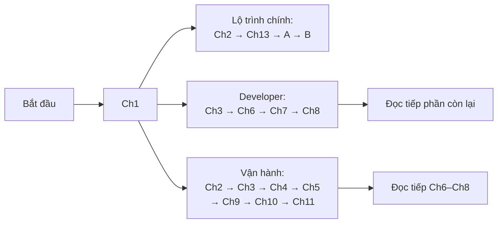

# Lộ trình học High Performance MySQL

> **Nguồn:** *High Performance MySQL: Proven Strategies for Operating at Scale*, Silvia Botros và Jeremy Tinley, O'Reilly, **Fourth Edition (11/2021)**. "tr. N" là số trang in; trang PDF = N + 22 (xem [README](README.md#page-convention)).
>
> Bản đầu của roadmap được dựng từ trang nhan đề, mục lục, Foreword, Preface, trang mở đầu và Summary của các chương, cùng các câu tham chiếu chéo trong sách. **Nay cả 13 chương và 2 phụ lục đã được đọc đầy đủ và có ghi chú chi tiết.** Mục 4 đã được hiệu chỉnh trang và nội dung theo ghi chú chương, kèm liên kết tới ghi chú, đáp án và bài thực hành. Mục 6.2 mô tả môi trường thực hành đã dùng thật. Mục 8 là danh sách các điểm đã kiểm chứng.
>
> **Quy ước nhãn:** nội dung không nhãn là diễn giải từ sách, kèm trang. **Bổ sung ngoài sách** là kiến thức hay gợi ý thêm. **Ví dụ minh họa do AI xây dựng** là ví dụ giả định. **Kết quả đã đo** là số liệu từ thí nghiệm đã chạy thật. Cách nhóm chương và các lộ trình thay thế là **gợi ý của người viết ghi chú**, không phải cấu trúc của sách.

## Mục lục

- [1. Sách muốn giúp bạn làm được gì?](#muc-tieu)
- [2. Kiến thức nền](#kien-thuc-nen)
- [3. Bức tranh tổng thể](#buc-tranh)
- [4. Từng chương: câu hỏi, nội dung, thông điệp, chuẩn bị](#tung-chuong)
- [5. Lộ trình học đề xuất](#lo-trinh)
- [6. Cách học, thực hành và tự kiểm tra](#cach-hoc)
- [7. Liên hệ với bộ ghi chú DDIA](#lien-he-ddia)
- [8. Các điểm đã kiểm chứng](#can-kiem-chung)

---

## 1. Sách muốn giúp bạn làm được gì?

**Vai trò của sách** (Preface, tr. xv). Tài liệu chính thức của Oracle cho bạn kiến thức để cài đặt, cấu hình và làm việc với MySQL. Cuốn sách là **người đồng hành** của tài liệu đó: giúp bạn hiểu cách dùng MySQL tốt nhất như một nền tảng dữ liệu cho bài toán của mình. Ấn bản này còn mở rộng phần **compliance và bảo mật**, vì luật về quyền riêng tư và chủ quyền dữ liệu (*data sovereignty*) đã thay đổi cách công ty xây sản phẩm và kiến trúc kỹ thuật.

**Sách viết cho ai** (tr. xv):

- Trước hết là **kỹ sư muốn nâng chuyên môn vận hành MySQL**.
- Sách giả định bạn đã quen với lý do dùng một hệ quản trị cơ sở dữ liệu quan hệ (RDBMS), và có kinh nghiệm quản trị hệ thống, mạng và hệ điều hành.
- Tác giả hứa đưa ra các chiến lược đã được kiểm chứng để chạy MySQL **ở quy mô lớn** với kiến trúc, công cụ và cách làm hiện đại.
- Mong muốn cuối cùng: bạn hiểu nội bộ MySQL và các chiến lược scaling, rồi thực hành một **cách tiếp cận có phương pháp** để thiết kế, duy trì và **xử lý sự cố** một kiến trúc xây trên MySQL.

**Ấn bản này khác các ấn bản trước thế nào** (tr. xvi). Các ấn bản 2004, 2008, 2012 dạy cách vắt kiệt hiệu năng: nội bộ sâu, ý nghĩa từng thiết lập tuning, cách đổi chúng. Ấn bản thứ tư giữ mục tiêu nhưng đổi trọng tâm:

- Hệ sinh thái MySQL đã đổi nhiều: thêm ba phiên bản lớn, công cụ trưởng thành vượt khỏi script Perl và Bash, có những dự án mã nguồn mở mới thay đổi cách scale MySQL.
- Vai trò DBA cũng đổi. Trước đây DBA hay bị coi là "gờ giảm tốc" của vòng đời phát triển phần mềm. Nay kỹ sư database được kỳ vọng là **người tạo điều kiện cho tăng trưởng**: dạy developer thiết kế schema và tối ưu truy vấn, và vận hành hệ thống cho developer tự triển khai thay đổi schema nhanh và an toàn.
- Vì vậy trọng tâm **không còn** là làm MySQL nhanh thêm vài phần trăm. Sách muốn cung cấp thông tin để **ra quyết định có hiểu biết** về cách dùng MySQL, bắt đầu từ việc hiểu MySQL được thiết kế ra sao, nên nó **giỏi gì và không giỏi gì**.
- Chú thích 1 (tr. xvi) cho một ví dụ: nhiều người dùng MySQL làm **hàng đợi** rồi mới vỡ lẽ vì sao đó là ý tồi. Lý do hay được nhắc là chi phí polling, việc quản lý khóa bản ghi đang xử lý, và bảng hàng đợi phình to theo thời gian.
- MySQL hiện đại có mặc định khá hợp lý, và rất ít khi phải tuning, trừ khi gặp một vấn đề scaling cụ thể. Các đội ngày nay phải lo **thay đổi schema, compliance và sharding**. Sách muốn là hướng dẫn toàn diện về cách các công ty hiện đại chạy MySQL ở quy mô lớn.

**Mục tiêu học của dự án này** (theo [`../init/DETAIL.md`](../init/DETAIL.md)). Sau khi học, bạn cần:

- giải thích được kiến trúc MySQL, cơ chế truy cập dữ liệu, transaction và concurrency;
- hiểu schema, index, statistics, optimizer và execution plan ảnh hưởng truy vấn ra sao;
- đo và phân tích hiệu năng dựa trên workload, monitoring, latency, throughput và tài nguyên;
- tìm nguyên nhân gốc của truy vấn chậm hay hệ thống chậm, và **phân biệt giả thuyết với kết quả đo**;
- lý giải đánh đổi giữa CPU, RAM, disk I/O, mạng, độ tin cậy, chi phí và độ phức tạp vận hành;
- vận dụng kiến thức của toàn bộ sách: kiến trúc, quan sát hệ thống, phần cứng và cấu hình, schema, index, query, replication, backup, scaling, cloud và compliance.

---

## 2. Kiến thức nền

| Kiến thức | Sách giả định hay giải thích? | Dùng nhiều ở | Gợi ý ôn |
| --- | --- | --- | --- |
| Nguyên lý RDBMS, SQL cơ bản (SELECT, JOIN, GROUP BY, transaction) | **Giả định** (tr. xv) | Mọi chương, nhất là 6–8 | **Bổ sung ngoài sách:** tài liệu SQL nhập môn bất kỳ; [DDIA chương 2](../../DDIA/ddia-notes/chapter-02.md) cho mô hình quan hệ |
| Quản trị hệ thống, mạng, hệ điều hành | **Giả định** (tr. xv) | 4, 5, 9–12 | Chương 4 gợi ý *Systems Performance* (Brendan Gregg) để đọc sâu thêm (tr. 96) |
| Thiết kế database cơ bản (chuẩn hóa, quan hệ) | **Giả định** ở chương 6; sách gợi ý *Beginning Database Design* của Clare Churcher (tr. 125) | 6 | Có thể đọc thêm *Database Design for Mere Mortals* (sách gợi ý ở chú thích 8, tr. 154) |
| SRE: SLI, SLO, alerting | **Giả định** ở chương 2; sách gợi ý chương 1, 2, 5 của *The Site Reliability Workbook* (tr. 19) | 2, 10, 11, 13 | Đọc ba chương đó trước chương 2 nếu chưa quen |
| Latency, percentile, throughput | Chương 2 dùng | 2, 3, 8, 11 | **Bổ sung ngoài sách:** [DDIA chương 1, percentile](../../DDIA/ddia-notes/chapter-01.md#percentiles) |
| Transaction, isolation, MVCC, lock | **Giải thích** ở chương 1 (tr. 3–16, gồm next-key locking ở tr. 16) | 1, 5, 8, 9 | **Bổ sung ngoài sách:** [DDIA chương 7](../../DDIA/ddia-notes/chapter-07.md#acid) |
| B-tree, clustered index, secondary index | **Giải thích** ở chương 7 (B-tree tr. 157–161, clustered và secondary tr. 170–178, covering tr. 178–180) | 6–8 | **Bổ sung ngoài sách:** [DDIA chương 3, B-tree](../../DDIA/ddia-notes/chapter-03.md#b4) |
| Replication, partitioning (khái niệm chung) | **Giải thích** ở chương 9 và 11 | 9–12 | **Bổ sung ngoài sách:** [DDIA chương 5](../../DDIA/ddia-notes/chapter-05.md#b1) và [chương 6](../../DDIA/ddia-notes/chapter-06.md#b2) |

> **Ví dụ minh họa do AI xây dựng — tự kiểm tra kiến thức nền.** Nếu trả lời được phần lớn các câu dưới đây, bạn đã sẵn sàng. Nếu chưa, hãy ôn mục tương ứng ở bảng trên trước.
> 1. Một câu `SELECT ... JOIN ... GROUP BY ... ORDER BY ... LIMIT` được viết theo thứ tự nào, và về mặt logic được xử lý theo thứ tự nào?
> 2. Transaction bảo đảm những tính chất gì? "Isolation level" kiểm soát điều gì?
> 3. Trung bình (mean) và percentile p99 của thời gian phản hồi khác nhau thế nào? Vì sao người ta hay dùng p99?
> 4. Vì sao đọc ngẫu nhiên trên đĩa thường chậm hơn đọc tuần tự? Trên SSD điều đó còn đúng không?
> 5. Một tiến trình hết RAM và bắt đầu swap thì điều gì xảy ra với thời gian phản hồi?

---

## 3. Bức tranh tổng thể

Sách đi theo một mạch khá rõ, dù không chia Part. Cách nhóm dưới đây là **gợi ý của người viết ghi chú** để dễ nhớ; thứ tự chương vẫn đúng như sách.

| Nhóm (gợi ý) | Chương | Câu hỏi trung tâm |
| --- | --- | --- |
| **Nền tảng kiến trúc** | 1 | MySQL được thiết kế ra sao, để làm việc *cùng* nó chứ không chống lại nó? |
| **Quan sát và đo** | 2, 3 | Khách hàng có hài lòng không (SLI, SLO)? Bên trong server đang tốn thời gian ở đâu (Performance Schema)? |
| **Tài nguyên và cấu hình** | 4, 5 | Phần cứng và hệ điều hành giới hạn MySQL ở đâu? Thiết lập nào thực sự đáng chỉnh? |
| **Schema, index, truy vấn** | 6, 7, 8 | Thiết kế dữ liệu, index và câu truy vấn sao cho MySQL làm ít việc nhất? Sách nói ba chương này **đan vào nhau** (tr. 125, 191, 226) |
| **Sẵn sàng và an toàn dữ liệu** | 9, 10 | Giữ bản sao đồng bộ, failover, và phục hồi được dữ liệu khi mất mát? |
| **Mở rộng và nền tảng chạy** | 11, 12, phụ lục B | Scale đọc, scale ghi, chạy trên cloud hay Kubernetes ra sao? |
| **Quản trị và vòng đời** | 13, phụ lục A | Đáp ứng yêu cầu compliance và nâng cấp phiên bản an toàn thế nào? |

```mermaid
flowchart LR
    subgraph G1["Nền tảng"]
        C1["Ch1 Kiến trúc"]
    end
    subgraph G2["Quan sát và đo"]
        C2["Ch2 SLI, SLO,<br/>monitoring"]
        C3["Ch3 Performance<br/>Schema"]
    end
    subgraph G3["Tài nguyên và cấu hình"]
        C4["Ch4 Hệ điều hành,<br/>phần cứng"]
        C5["Ch5 Cấu hình<br/>server"]
    end
    subgraph G4["Schema, index, truy vấn"]
        C6["Ch6 Schema"]
        C7["Ch7 Index"]
        C8["Ch8 Tối ưu<br/>truy vấn"]
    end
    subgraph G5["Sẵn sàng và an toàn"]
        C9["Ch9 Replication"]
        C10["Ch10 Backup,<br/>recovery"]
    end
    subgraph G6["Mở rộng và nền tảng"]
        C11["Ch11 Scaling"]
        C12["Ch12 Cloud"]
        PB["Phụ lục B<br/>Kubernetes"]
    end
    subgraph G7["Quản trị và vòng đời"]
        C13["Ch13 Compliance"]
        PA["Phụ lục A<br/>Nâng cấp"]
    end
    G1 --> G2 --> G3 --> G4 --> G5 --> G6 --> G7
```

*(Sơ đồ do người viết ghi chú dựng theo thứ tự mục lục; ranh giới các nhóm là gợi ý.)*

Quan hệ chi tiết giữa các chương, gồm tham chiếu chéo của sách và liên hệ theo nội dung, nằm trong [`concept-map.md`](concept-map.md#chapter-links).

---

## 4. Từng chương: câu hỏi, nội dung, thông điệp, chuẩn bị

Mỗi mục dưới đây tóm tắt **câu hỏi** ở trang mở đầu, **nội dung chính** theo mục của sách (trang đã đối chiếu với bookmark của PDF và với ghi chú chương), **thông điệp** ở phần Summary, cần **chuẩn bị** gì, rồi liên kết tới ghi chú, đáp án và bài thực hành. Theo mục 5 của `DETAIL.md`, chương về query, index, schema dùng SQL và walkthrough; chương vận hành dùng tình huống vận hành.

### Chương 1 — MySQL Architecture (tr. 1–18)

- **Câu hỏi.** Hiểu thiết kế của MySQL để làm việc cùng nó chứ không chống lại nó: tổng quan kiến trúc server, khác biệt giữa các storage engine và vì sao khác biệt đó quan trọng (tr. 1).
- **Nội dung chính.** Kiến trúc logic ba tầng: quản lý kết nối, optimizer và thực thi (tr. 1–3); concurrency control: read/write lock, lock granularity (tr. 3–6); transaction, ACID, isolation level, deadlock (tr. 6–10); transaction logging (tr. 10–11); transaction trong MySQL: autocommit, trộn engine, two-phase locking, khóa tường minh, `LOCK TABLES` (tr. 11–13); MVCC (tr. 13–15); replication (tr. 15); cấu trúc datafile (tr. 16); InnoDB: next-key locking, clustered index, tối ưu nội bộ, backup nóng, online DDL (tr. 16–17); JSON, data dictionary, atomic DDL (tr. 17–18).
- **Thông điệp** (Summary, tr. 18). MySQL có kiến trúc phân tầng: dịch vụ toàn server và thực thi truy vấn ở trên, storage engine ở dưới. Storage engine API là quan trọng nhất: nếu hiểu MySQL thực thi truy vấn bằng cách **chuyền các hàng qua lại qua storage engine API**, bạn đã nắm nền tảng kiến trúc. InnoDB là engine mặc định, phủ gần như mọi use case, nên các chương sau tập trung vào InnoDB.
- **Chuẩn bị.** SQL và khái niệm transaction cơ bản.
- **Ghi chú và thực hành.** [Ghi chú](chapter-01.md) · [Đáp án](answers/chapter-01.md) · [Thực hành](experiments/chapter-01.md). Bốn thí nghiệm đã chạy trên MySQL 8.0.42 (cổng 3311): isolation level và MVCC, row lock và gap lock theo access path, deadlock và cách chọn nạn nhân, transaction và data dictionary của 8.0.

### Chương 2 — Monitoring in a Reliability Engineering World (tr. 19–39)

- **Câu hỏi.** Dùng nguyên lý SRE để trả lời: trải nghiệm khách hàng có chấp nhận được không, có nên dồn sức cho reliability không, cân bằng tính năng mới với *toil* thế nào (tr. 19). Chương giả định bạn biết các nguyên lý SRE.
- **Nội dung chính.** Tác động của reliability engineering lên đội DBA (tr. 20); mục tiêu mức dịch vụ: định nghĩa SLI, SLO, SLA (tr. 21), số 9 và Bảng 2-1 (tr. 22), làm khách hàng hài lòng (tr. 22–23); đo gì: SLI và SLO cho MySQL, công cụ, availability, query latency, lỗi (tr. 23–28); proactive monitoring: đĩa, kết nối, replication lag, I/O, auto-increment, thời gian backup và restore, kèm hộp định nghĩa functional sharding và horizontal sharding (tr. 29–35); đo hiệu năng dài hạn: nhịp kinh doanh, percentile, dùng SLO định hướng kiến trúc (tr. 36–39).
- **Thông điệp** (Summary, tr. 39). SLI và SLO không đặt một lần là xong; phải liên tục xem lại khi hiểu khách hàng hơn. Chọn chỉ số **đại diện cho trải nghiệm khách hàng**. Đừng chỉ đo khi sự cố đang xảy ra; hãy theo dõi cả những thứ giúp **ngăn** sự cố. Nên đặt mục tiêu cho ba vùng **latency, availability, errors**, cùng proactive monitoring cho **tăng trưởng kết nối, dung lượng đĩa, disk I/O và latency**. Mục ngay trước Summary (*Using SLOs to Guide Your Overall Architecture*, tr. 38–39) thêm một ý: cũng chính các SLI và SLO đó cho biết khi nào nên đầu tư scale, ví dụ sharding.
- **Chuẩn bị.** Chương 1, 2, 5 của *The Site Reliability Workbook* (tr. 19).
- **Ghi chú và thực hành.** [Ghi chú](chapter-02.md) · [Đáp án](answers/chapter-02.md) · [Thực hành](experiments/chapter-02.md). Năm thí nghiệm đã chạy (cổng 3312): hai trạng thái tăng kết nối, chạm `max_connections`, lỗi theo tốc độ và probe availability, trung bình so với percentile, theo dõi không gian auto-increment.

### Chương 3 — Performance Schema (tr. 41–73, tác giả Sveta Smirnova)

- **Câu hỏi.** Tuning là một **vòng lặp**: mỗi lần đổi gì đó, phải biết thay đổi có tác dụng không (truy vấn nhanh hơn? lock còn không? bộ nhớ đổi ra sao? thời gian chờ đĩa đổi ra sao?) (tr. 41). Performance Schema lưu dữ liệu để trả lời các câu đó.
- **Nội dung chính.** Instrument và consumer (tr. 41–45); chi phí tài nguyên, giới hạn, sys schema, thread (tr. 45–48); cấu hình và mặc định (tr. 48–53); dùng Performance Schema để soi câu SQL (tr. 53–62), đọc so với ghi (tr. 62–63), metadata lock (tr. 63–64), bộ nhớ (tr. 64–66), biến (tr. 66–69), lỗi hay gặp (tr. 70–71) và chính Performance Schema (tr. 71–73).
- **Thông điệp** (Summary, tr. 73). Performance Schema từng bị chê tốn tài nguyên và khó hiểu, nên lời khuyên cũ là tắt nó. Thực ra consumer chỉ là bảng trong bộ nhớ, truy vấn bằng SQL thường. MySQL không rò rỉ bộ nhớ, nó chỉ giữ dữ liệu consumer tới khi khởi động lại. Lời khuyên: **giữ Performance Schema bật**, bật động các instrument và consumer cần thiết, dùng **sys schema** làm lối tắt.
- **Chuẩn bị.** Chương 1 (thread, lock, transaction). Khi chạy ví dụ của sách trên 8.0.42, nhớ rằng các cột thời gian tính bằng **picosecond**, consumer `_history_long` và `events_stages_*` mặc định tắt, biến `tx_isolation` đã bị bỏ và stage "Sending data" không còn (xem [mục 8](#can-kiem-chung), B4, B5, C3, và [mặc định đo trên 8.0.42](chapter-03.md#defaults-8042)).
- **Ghi chú và thực hành.** [Ghi chú](chapter-03.md) · [Đáp án](answers/chapter-03.md) · [Thực hành](experiments/chapter-03.md). Năm thí nghiệm đã chạy (cổng 3313): instrument và consumer mặc định, workload tốt và tệ qua digest, stage và đọc/ghi, metadata lock chặn ba session, bộ nhớ theo thành phần và thread, lỗi, biến, prepared statement và stored routine.

### Chương 4 — Operating System and Hardware Optimization (tr. 75–97)

- **Câu hỏi.** MySQL chỉ mạnh bằng mắt xích yếu nhất; đĩa, bộ nhớ, CPU, mạng và các thành phần nối chúng giới hạn năng lực hệ thống (tr. 75). Nút thắt hay gặp nhất là **cạn CPU**; bão hòa I/O ít gặp hơn nhờ SSD (tr. 75). Cạn bộ nhớ vẫn xảy ra, nhưng thường do cấp phát quá nhiều cho MySQL (tr. 76).
- **Nội dung chính.** Chọn CPU (tr. 76); cân bằng bộ nhớ và đĩa, working set (tr. 76–77); SSD và flash (tr. 78–79); RAID (tr. 79–86); mạng (tr. 86–87); filesystem (tr. 87–89); disk queue scheduler (tr. 89–90); bộ nhớ và swap (tr. 90–92); công cụ quan sát hệ điều hành: `vmstat`, `iostat`, `mpstat`, `pt-diskstats`, `perf` (tr. 92–96).
- **Thông điệp** (Summary, tr. 96–97). Cân bằng hiệu năng và chi phí, ưu tiên máy *commodity*: một máy 5.000 USD dễ rút ra để chẩn đoán hay hoán đổi hơn máy 50.000 USD. Bốn tài nguyên cơ bản là CPU, bộ nhớ, đĩa, mạng; mạng hiếm khi là nút thắt. Càng nhiều concurrency càng cần nhiều CPU. Trước khi ném tài nguyên vào vấn đề, hỏi xem có đang giải sai vấn đề không: I/O bound thì cần thêm I/O hay chỉ cần thêm RAM? Câu trả lời phụ thuộc **working set**. SSD nên là chuẩn cho database, nhất là OLTP. Trên Linux, nên dùng XFS và đặt swappiness, disk queue scheduler phù hợp cho server; các chỉnh khác như tắt SELinux chỉ là sở thích.
- **Chuẩn bị.** Kiến thức Linux cơ bản; chương 1 (InnoDB dùng bộ nhớ làm cache, được nhắc ở tr. 90; transaction log, tr. 10–11).
- **Ghi chú và thực hành.** [Ghi chú](chapter-04.md) · [Đáp án](answers/chapter-04.md) · [Thực hành](experiments/chapter-04.md). Bốn thí nghiệm đã chạy (cổng 3314): cache đọc khi dữ liệu vừa và không vừa buffer pool, working set nóng so với rải đều, cache trì hoãn ghi nhưng không khử được ghi, một truy vấn dùng một CPU. Diễn tập `vmstat`, `iostat`, `mpstat` cần Linux nên chưa thực thi.

### Chương 5 — Optimizing Server Settings (tr. 99–124)

- **Câu hỏi.** Quy trình tạo file cấu hình phù hợp. Không bắt đầu từ danh sách tùy chọn, mà từ hiểu nội bộ và hành vi của MySQL. Cấu hình theo **workload, dữ liệu và yêu cầu ứng dụng**, không chỉ theo phần cứng. Chỉ vài thiết lập thực sự quan trọng; phần lớn thời gian nên dành cho schema, index và truy vấn. Đổi mặc định mà không hiểu có thể gây crash, treo hoặc chậm (tr. 99).
- **Nội dung chính.** Cách cấu hình hoạt động: scope, dynamic, persisted, tác dụng phụ (tr. 100–105); những điều không nên làm (tr. 105–106); tạo file cấu hình: file tối thiểu, biến trạng thái (tr. 106–109); bộ nhớ: theo kết nối, chừa cho hệ điều hành, buffer pool, thread cache (tr. 109–111); I/O: transaction log, log buffer, tablespace, `sync_binlog` (tr. 112–119); concurrency (tr. 119–120); safety settings (tr. 120–122); thiết lập InnoDB nâng cao (tr. 122–124).
- **Thông điệp** (Summary, tr. 124). Bắt đầu từ file cấu hình mẫu, đặt các tùy chọn cơ bản, thêm tùy chọn an toàn. Với server dành riêng cho database, `innodb_dedicated_server` xử lý khoảng 90% cấu hình hiệu năng; nếu không dùng được thì hai tùy chọn quan trọng nhất là `innodb_buffer_pool_size` và `innodb_log_file_size`. Đừng "tune" theo tỉ lệ, công thức hay script tuning.
  - **Bổ sung ngoài sách.** Từ MySQL 8.0.30, `innodb_log_file_size` bị deprecated; biến cần đặt là `innodb_redo_log_capacity`. Trên 8.0.42, `innodb_dedicated_server` quản lý buffer pool và `innodb_redo_log_capacity`, khác danh sách bốn biến ở tr. 108. Nhiều mặc định khác của chương đã đổi (xem [mục 8](#can-kiem-chung), C4–C7).
- **Chuẩn bị.** Chương 1 (InnoDB, transaction logging) và chương 4 (bộ nhớ, đĩa).
- **Ghi chú và thực hành.** [Ghi chú](chapter-05.md) · [Đáp án](answers/chapter-05.md) · [Thực hành](experiments/chapter-05.md). Năm thí nghiệm đã chạy (cổng 3315): scope, dynamic và `SET PERSIST`; file cấu hình mẫu của sách trên 8.0.42; buffer pool, hit ratio, `innodb_old_blocks_time` và thread cache; durability và thông lượng commit; transaction dài, history list và purge.

### Chương 6 — Schema Design and Management (tr. 125–154)

- **Câu hỏi.** Thiết kế logic và vật lý tốt là nền của hiệu năng; schema phải thiết kế cho **chính các truy vấn sẽ chạy**, với đánh đổi như denormalization hay bảng tổng hợp. Schema sẽ tiến hóa, nên phải coi thay đổi schema là việc thường xuyên (tr. 125). Chương này, cùng chương 7 và 8, khám phá tương tác giữa thiết kế logic, thiết kế vật lý và thực thi truy vấn; sách khuyên đọc lại chương 6 sau khi đọc chương 7 và 8 (tr. 125).
- **Nội dung chính.** Chọn kiểu dữ liệu: số, chuỗi, thời gian, bit, JSON, identifier, kiểu đặc biệt như địa chỉ IP (tr. 126–145); các "bẫy" thiết kế schema riêng của MySQL (tr. 145–146); quản lý schema như một phần của nền tảng dữ liệu: source control, DDL native, pt-online-schema-change và gh-ost, pipeline CI/CD (tr. 146–153).
- **Thông điệp** (Summary, tr. 154). Giữ mọi thứ **nhỏ và đơn giản**: tránh thiết kế cực đoan; kiểu dữ liệu nhỏ, đơn giản, phù hợp; tránh NULL trừ khi đúng với thực tế dữ liệu; cùng kiểu cho các giá trị liên quan, nhất là cột dùng để join; cẩn thận chuỗi độ dài thay đổi, vì có thể bị cấp phát bộ nhớ theo độ dài tối đa trong bảng tạm và khi sắp xếp; ưu tiên số nguyên làm identifier; tránh các thói quen cũ của MySQL; cẩn thận với ENUM, SET và tránh BIT. Cần một vòng đời phần mềm chặt chẽ cho thay đổi schema.
  - **Kết quả đã đo.** Trên 8.0.42, cảnh báo về chuỗi độ dài thay đổi có điều kiện: với TempTable và collation NO PAD mặc định không thấy khác biệt; với engine MEMORY và collation PAD SPACE thì vẫn đúng ([E5](experiments/chapter-06.md#e5)).
- **Chuẩn bị.** Thiết kế database cơ bản; chương 1.
- **Ghi chú và thực hành.** [Ghi chú](chapter-06.md) · [Đáp án](answers/chapter-06.md) · [Thực hành](experiments/chapter-06.md). Sáu thí nghiệm đã chạy (cổng 3316, dữ liệu tự sinh tới 1 triệu hàng): hành vi phụ thuộc phiên bản, kích thước bảng và index theo kiểu, identifier (`AUTO_INCREMENT`, UUID chuỗi, `UUID_TO_BIN`), JSON so với cột thường, VARCHAR dài trong bảng tạm và sort, DDL native. gh-ost và pt-online-schema-change chưa thực thi vì cần tải công cụ.

### Chương 7 — Indexing for High Performance (tr. 155–190)

- **Câu hỏi.** Index là cấu trúc dữ liệu để tìm hàng nhanh; index kém là nguyên nhân hàng đầu của vấn đề hiệu năng thực tế, nên chương này được đặt **trước** chương tối ưu truy vấn. Index tối ưu có thể nhanh hơn index "tốt" khoảng hai bậc độ lớn, và thường phải viết lại truy vấn (tr. 155). Chương dùng cơ sở dữ liệu mẫu **Sakila** (tr. 155).
- **Nội dung chính.** Cơ bản về index: chương chỉ bàn **B-tree và full-text**, cộng adaptive hash index như tính năng nội bộ của InnoDB (tr. 156–161), lợi ích của index (tr. 161–162); chiến lược: prefix index và selectivity, index nhiều cột, thứ tự cột, clustered index, covering index, dùng index để sắp xếp, index thừa và không dùng (tr. 162–186); bảo trì: hỏng bảng, cập nhật statistics, phân mảnh (tr. 186–189).
- **Thông điệp** (Summary, tr. 189–190). Phần lớn thời gian bạn dùng B-tree index. Ba nguyên tắc: **truy cập từng hàng lẻ thì chậm**; **truy cập một khoảng hàng theo thứ tự thì nhanh**; **chỉ đọc index (index-only) thì nhanh**. Tương ứng hệ "ba sao" của Lahdenmaki và Leach. Hãy suy luận dựa trên cách index hoạt động, không theo mẹo như "cột chọn lọc nhất đặt đầu" hay "index mọi cột trong WHERE". Đánh giá theo response time: truy vấn có đọc quá nhiều hàng, phải sắp xếp hay dùng bảng tạm, đọc ngẫu nhiên, hay phải quay về bảng lấy cột không có trong index không.
- **Chuẩn bị.** Chương 1 và 6; chương 3 để tìm index không dùng (tr. 185); chương 4 (SSD giảm hình phạt của random I/O, chú thích 1, tr. 155); chương 5 (buffer pool, tr. 110).
- **Ghi chú và thực hành.** [Ghi chú](chapter-07.md) · [Đáp án](answers/chapter-07.md) · [Thực hành](experiments/chapter-07.md). Năm thí nghiệm đã chạy (cổng 3317) trên dữ liệu tự sinh có cấu trúc giống Sakila, đo bằng `EXPLAIN ANALYZE`, `Handler_%`, page của buffer pool và `mysql.innodb_index_stats`: leftmost prefix và skip scan, selectivity và thứ tự cột, clustered và covering index, sắp xếp bằng index so với filesort, thứ tự chèn PK, statistics và adaptive hash index.

### Chương 8 — Query Performance Optimization (tr. 191–226)

- **Câu hỏi.** Schema và index tốt chưa đủ; truy vấn tệ thì vẫn chậm. Chương đi từ những điều cần xét đầu tiên khi truy vấn chậm, tới nội bộ: MySQL thực thi một truy vấn thế nào và cách thay đổi execution plan, rồi các giới hạn của optimizer và các mẫu tối ưu (tr. 191). Truy vấn là một nhiệm vụ gồm nhiều nhiệm vụ con tốn thời gian (tr. 191).
- **Nội dung chính.** Tối ưu truy cập dữ liệu: có lấy dữ liệu thừa không, có đọc quá nhiều dữ liệu không (tr. 192–198); tái cấu trúc truy vấn (tr. 198–201); cơ bản về thực thi: giao thức client/server, trạng thái truy vấn, quá trình tối ưu, execution engine, trả kết quả (tr. 201–218); giới hạn của optimizer (tr. 219–221); tối ưu COUNT, JOIN, GROUP BY WITH ROLLUP, LIMIT và OFFSET, `SQL_CALC_FOUND_ROWS`, UNION (tr. 221–226).
- **Thông điệp** (Summary, tr. 226). Tối ưu truy vấn là mảnh cuối của bộ ba schema, index, truy vấn. Mọi thứ quy về **response time** và hiểu truy vấn thực thi thế nào để biết thời gian tiêu ở đâu. Cách tiếp cận ba hướng: **thôi làm việc không cần, làm ít lần hơn, làm nhanh hơn**.
- **Chuẩn bị.** Chương 6 và 7; chương 1 (Hình 1-1: storage engine cung cấp statistics cho optimizer, được nhắc ở tr. 211; lock ở tầng server, tr. 218); chương 3 (đo rows examined, bảng tạm, sort của từng câu lệnh, tr. 54–55).
- **Ghi chú và thực hành.** [Ghi chú](chapter-08.md) · [Đáp án](answers/chapter-08.md) · [Thực hành](experiments/chapter-08.md). Năm thí nghiệm đã chạy (cổng 3318, dữ liệu tự sinh mô phỏng kích thước Sakila, nên số hàng khác sách): rows examined và access type; optimizer, hash join và cost model; phân trang bằng OFFSET, deferred join, keyset; COUNT, UNION so với UNION ALL, ROLLUP, lỗi 1093; chia nhỏ một DELETE lớn.

### Chương 9 — Replication (tr. 227–255)

- **Câu hỏi.** Replication có sẵn của MySQL là nền cho kiến trúc *scale-out*, và cho nhiều chiến lược high availability, disaster recovery, backup, phân tích. Chương tập trung vào **khi nào** dùng tính năng, không phải tính năng là gì (tr. 227). Sách dùng thuật ngữ **source** và **replica** thay cho master và slave (tr. 227).
- **Nội dung chính.** Tổng quan và cách hoạt động (tr. 227–230); bên dưới: định dạng replication, GTID, crash safe, delayed, multithreaded, semisynchronous, filter (tr. 230–239); failover (tr. 239–241); topology (tr. 241–247); quản trị: giám sát, đo lag, kiểm tra tính nhất quán (tr. 247–250); sự cố thường gặp (tr. 251–254).
- **Thông điệp** (Summary, tr. 255). Replication là "con dao đa năng" của MySQL; phần lớn giới hạn dễ tránh. Phương châm: **giữ đơn giản**. Đừng dùng vòng replication hay filter trừ khi thật cần; replica nên là bản sao đầy đủ của dữ liệu, kể cả quyền. Thân chương thêm ba ý thực dụng: dùng row-based và GTID (tr. 231–232); `Seconds_Behind_Source` không đáng tin, nên đo lag bằng heartbeat (tr. 248–249); semisync không phải công cụ chống mất dữ liệu (tr. 237).
- **Chuẩn bị.** Chương 1 và 5 (cấu hình durability, tr. 118); chương 2 (lag như một chỉ số); chương 3 (đo mức bận của applier thread, tr. 235–236); chương 7–8 (vì sao câu lệnh không tất định chọn hàng khác nhau trên source và replica, tr. 230, 250).
- **Ghi chú và thực hành.** [Ghi chú](chapter-09.md) · [Đáp án](answers/chapter-09.md) · [Thực hành](experiments/chapter-09.md). Năm thí nghiệm đã chạy trên ba instance riêng (cổng 3319, 3333, 3334), không dùng container: dựng replication GTID với auto-position; ROW so với STATEMENT và lệch thầm lặng; tạo lag và đo bằng bốn cách; delayed replica cứu một `DROP TABLE`; failover có kế hoạch, semisync và failover ngoài kế hoạch.

### Chương 10 — Backup and Recovery (tr. 257–286)

- **Câu hỏi.** Không lên kế hoạch backup từ đầu thì sau này có thể đã tự loại các lựa chọn tốt nhất; không luyện phục hồi thì phục hồi sẽ không suôn sẻ (tr. 257). Chương chỉ bàn phần riêng của MySQL; bảo mật, nơi lưu, chính sách lưu giữ… nằm ngoài phạm vi (tr. 257).
- **Nội dung chính.** Vì sao cần backup (tr. 258); yêu cầu phục hồi: RPO, RTO, "Myth #1" replica không phải backup (tr. 259–260); thiết kế: online hay offline, logical hay raw, backup gì, incremental, backup từ replica (tr. 260–268); binary log (tr. 269); công cụ (tr. 269–270); thực hiện backup: logical, snapshot LVM và "Myth #2", XtraBackup (tr. 270–281); phục hồi (tr. 281–286).
- **Thông điệp** (Summary, tr. 286). Cần backup **phục hồi được**. Xác định và ghi lại **RPO và RTO**. Thường xuyên thử phục hồi: một backup chạy vài giờ có thể mất vài tuần để phục hồi. **Replica không phải backup**; RAID, SAN, snapshot filesystem cũng không. Tác giả ưa dùng Percona XtraBackup cho backup raw và mydumper cho backup logical, và backup cả binary log. Thân chương nhấn mạnh thêm: snapshot không phải backup (Myth #2, tr. 272), và backup chỉ tốt khi đã thử khởi động instance và chạy `CHECK TABLES` (tr. 265).
- **Chuẩn bị.** Chương 9 (GTID, delayed replication); chương 2 (RPO, RTO giống SLO, tr. 260); chương 1 và 5 (redo log, crash recovery, `sync_binlog`, `innodb_flush_log_at_trx_commit`, `super_read_only`), vì XtraBackup, snapshot không khóa (tr. 270, 276, 278) và replica dùng để backup (tr. 268, 286) dựa trực tiếp vào chúng.
- **Ghi chú và thực hành.** [Ghi chú](chapter-10.md) · [Đáp án](answers/chapter-10.md) · [Thực hành](experiments/chapter-10.md). Năm thí nghiệm đã chạy (cổng 3320 và 3335): `mysqldump` khi có ghi đồng thời; thời gian backup và restore logic theo kích thước; PITR sau một `DROP TABLE` theo vị trí và theo GTID; transportable tablespace và clone; hết hạn binlog và khóa backup. XtraBackup, mydumper và LVM chưa thực thi.

### Chương 11 — Scaling MySQL (tr. 287–311)

- **Câu hỏi.** Scale MySQL khác scale web server vì dữ liệu có trạng thái. Chương giải thích scaling là gì, các trục cần scale, scale đọc an toàn, dùng hàng đợi để ghi dễ dự đoán hơn, và sharding với ProxySQL, Vitess (tr. 287). Scaling được đánh giá qua **chi phí và độ đơn giản** (tr. 287).
- **Nội dung chính.** Scaling là gì: capacity, bốn góc nhìn về tải (tr. 287–289); workload đọc hay ghi (tr. 289–291); functional sharding (tr. 291–292); read pool: cấu hình, health check, thuật toán cân bằng tải (tr. 292–298); queuing (tr. 298–299); sharding để scale ghi: chọn khóa phân vùng, nhiều khóa, truy vấn xuyên shard, Vitess, ProxySQL (tr. 299–311).
- **Thông điệp** (Summary, tr. 311). Trước khi lo nút thắt scaling, hãy **tối ưu truy vấn, kiểm tra index và có cấu hình tốt**. Sau đó xác định workload bị giới hạn bởi đọc hay ghi. Đọc thì dùng read pool, trừ khi replication lag không thể chấp nhận; lag là vấn đề hoặc workload bị giới hạn bởi ghi thì cân nhắc sharding. Summary cũng nói hàng đợi giúp tăng trưởng lưu lượng **dễ dự đoán hơn**; thân chương đặt hàng đợi cho phần ghi hoãn được **trước** sharding, và lấy thời gian chờ trong hàng đợi làm tín hiệu chuyển sang sharding (tr. 298–299).
- **Chuẩn bị.** Chương 7–9 (read pool, tr. 242–243; đo lag, tr. 248–249); chương 2 (SLO cho biết khi nào cần scale, tr. 39); chương 3 (tr. 290 dẫn ví dụ đo đọc và ghi ở tr. 62); chương 1 (lock timeout, deadlock là lý do cần hàng đợi, tr. 298).
- **Ghi chú và thực hành.** [Ghi chú](chapter-11.md) · [Đáp án](answers/chapter-11.md) · [Thực hành](experiments/chapter-11.md). Bốn thí nghiệm đã chạy trên một instance (cổng 3321): phân loại workload đọc hay ghi bằng Performance Schema, `read_only` và `super_read_only` cho health check, mô phỏng hai cách chọn partitioning key, chi phí kết nối và `max_connections`. HAProxy, ProxySQL và Vitess chưa thực thi; có bài tập trên giấy.

### Chương 12 — MySQL in the Cloud (tr. 313–324)

- **Câu hỏi.** Bạn thường không chọn được có lên cloud hay lên nhà cung cấp nào, nhưng chọn được cách xây môi trường database: **managed MySQL** (ít phải lo, đắt hơn, ít kiểm soát) hay **tự chạy trên VM** (linh hoạt hơn, tốn công vận hành) (tr. 313). Chương không bàn lỗi của từng dịch vụ cloud (tr. 313).
- **Nội dung chính.** Managed MySQL: Aurora, Cloud SQL (tr. 313–318); MySQL trên VM: loại máy, chọn CPU, RAM, mạng (tr. 318–320), chọn loại đĩa (tr. 320–322); mẹo vận hành: host reboot, tách hệ điều hành và dữ liệu, backup binlog lên bucket, auto-extend đĩa (tr. 322–324).
- **Thông điệp** (Summary, tr. 324). **Không có bữa trưa miễn phí**: lựa chọn nào cũng có đánh đổi. Hãy đặt đánh đổi trong bối cảnh cách doanh nghiệp vận hành và giai đoạn trưởng thành của nó.
- **Thời điểm của thông tin.** Nhận định về Aurora, Cloud SQL là ảnh chụp năm 2021 (sách tự nói ở tr. 313), ví dụ "Aurora chưa có bản tương thích 8.0" (tr. 314) và "Multi-Master chạy lõi 5.6" (tr. 316).
- **Chuẩn bị.** Chương 1, 4, 6, 9, 10 (chương 12 tham chiếu cả năm; chương 1 và 4 ở tr. 320). Nên ôn thêm chương 2 (SLO, connection storm, tăng trưởng đĩa) và chương 5 (thiết lập ACID, `read_only`), dù sách không nhắc tên hai chương này.
- **Ghi chú và thực hành.** [Ghi chú](chapter-12.md) · [Đáp án](answers/chapter-12.md) · [Bài tập quyết định](experiments/chapter-12.md). Không chạy MySQL cho chương này vì cần môi trường cloud thật; có năm bài tập trên giấy: ước lượng vCPU, tần suất auto-extend, khoảng an toàn CPU, runbook host reboot, managed hay VM.

### Chương 13 — Compliance with MySQL (tr. 325–341)

- **Câu hỏi.** Ngoài hiệu năng và uptime, phải giúp doanh nghiệp bảo vệ dữ liệu và đạt các chứng nhận bắt buộc. Yêu cầu đó phải có mặt trong thiết kế kiến trúc dữ liệu, tự động hóa vận hành và quản lý truy cập (tr. 325). Chương không phải tư vấn pháp lý (tr. 325).
- **Nội dung chính.** Các loại compliance: SOC 2, SOX, PCI DSS, HIPAA, FedRAMP, GDPR, Schrems II (tr. 326–328); xây kiểm soát (tr. 328–340): quản lý secret (tr. 329–332), tách vai trò và dữ liệu (tr. 332–333), theo dõi thay đổi (tr. 333–338) với hai phần dày nhất là data access logging bằng audit plug-in và lý do không dùng trigger (tr. 334–336), quản lý database user: configuration management, xoay vòng credential bằng dual password của 8.0.14, gỡ user không dùng bằng Performance Schema (tr. 336–338); quy trình backup và restore (tr. 338–340).
- **Thông điệp** (Summary, tr. 341). Lên kế hoạch **sớm**: tách user của ứng dụng, có chiến lược xoay vòng thông tin xác thực, không lưu mật khẩu dạng văn bản thô, có pipeline log truy cập đáng tin trước khi cần, kiểm soát và ghi log thay đổi schema.
- **Chuẩn bị.** Chương 2, 3, 6, 10 (các chương được tham chiếu). Không bắt buộc: chương 1 (xác thực và quyền, tr. 2), chương 11 (ProxySQL, user riêng, audit log, tr. 309–310), chương 12 (audit logging của dịch vụ managed, tr. 314, 317).
- **Ghi chú và thực hành.** [Ghi chú](chapter-13.md) · [Đáp án](answers/chapter-13.md) · [Thực hành](experiments/chapter-13.md). Năm thí nghiệm đã chạy (cổng 3323): user riêng, role và quyền tối thiểu; xoay vòng credential bằng user mới và dual password; tìm user còn được dùng bằng Performance Schema và khóa tài khoản; mật khẩu có lộ trong log không; chi phí trigger để audit và audit plug-in trên Community.

### Phụ lục A — Upgrading MySQL (tr. 343–348)

- **Câu hỏi.** Nâng cấp là đánh đổi giữa **ổn định và tính năng** (tr. 343).
- **Nội dung chính.** Why Upgrade?: bảo mật, bug đã biết, tính năng mới, hết hỗ trợ (tr. 343–344); Upgrade Life Cycle: hạ cấp chỉ bằng restore backup, từ 8.0 không hạ cấp được cả point release (tr. 344–345); Testing Upgrades: môi trường dev, production mirror, replica, pt-upgrade (tr. 345–346); Upgrading at Scale: playbook 11 bước (tr. 346–348).
- **Thông điệp** (Summary, tr. 348). Lý do thuyết phục nhất là sửa bug đang gặp hoặc dùng tính năng mới (ví dụ MySQL 8.0 cho phép thêm cột tức thì mà không dựng lại bảng). Thử nghiệm kỹ, triển khai từ từ, có quy trình rollback, và tự động hóa nếu có nhiều server.
  - **Bổ sung ngoài sách, đã đo trên 8.0.42.** Thêm cột tức thì có từ 8.0.12 (chỉ cuối bảng) và mở rộng ở 8.0.29; có giới hạn 64 row version, không áp dụng cho đổi kiểu cột hay thêm index, và vẫn cần metadata lock ([TN2](experiments/appendix-a.md#tn2), [TN3](experiments/appendix-a.md#tn3)).
- **Chuẩn bị.** Chương 5 (`read_only`, `super_read_only`, `sql_mode`, tr. 122); chương 6 (INPLACE, INSTANT, tr. 149–150); chương 9 (tương thích phiên bản, tr. 228; planned promotion, tr. 239–240); chương 10 (backup là đường hạ cấp duy nhất; snapshot, tr. 273).
- **Ghi chú và thực hành.** [Ghi chú](appendix-a.md) · [Đáp án](answers/appendix-a.md) · [Thực hành](experiments/appendix-a.md). Bốn thí nghiệm đã chạy (cổng 3324, bảng 1 triệu hàng): INSTANT, INPLACE và COPY khi thêm một cột; điều kiện của INSTANT và giới hạn 64 row version; INSTANT vẫn cần metadata lock; kiểm tra trước nâng cấp trên một phiên bản. Nâng cấp thật giữa hai phiên bản và thử hạ cấp chưa thực thi.

### Phụ lục B — MySQL on Kubernetes (tr. 349–351)

- **Câu hỏi.** Có nên chạy MySQL trên Kubernetes không, và vì lý do gì (tr. 349).
- **Nội dung chính.** Provisioning Resources with Kubernetes (tr. 349); Carefully Scope Your Goal (tr. 349–350); Choose Your Control Plane (tr. 350); The Finer Details: tám câu hỏi với đội Kubernetes, SLO, lời khuyên áp dụng, chế độ hỏng (tr. 350–351).
- **Thông điệp** (tr. 349–351). Xác định rõ giá trị muốn lấy lại (tr. 349); học một control plane đã được kiểm chứng như Vitess; chứng minh với workload stateless trước, bắt đầu với dataset nhỏ và ít quan trọng; luôn biết cách dựng lại và có mất dữ liệu không nếu mọi thứ hỏng (tr. 351). Phần Summary (tr. 351) nhấn mạnh nhìn quyết định qua **rủi ro và phần thưởng**, có **hiểu biết chung** về vị trí của dịch vụ stateful trên hành trình Kubernetes của tổ chức, và **cân bằng** mong muốn tận dụng Kubernetes với nhu cầu ổn định của tầng dữ liệu.
- **Chuẩn bị.** Chương 11 (Vitess, tr. 303–311), chương 9 (failover), chương 10 (backup, restore), chương 2 (SLO), chương 12 (đánh đổi nền tảng, tr. 324), phụ lục A (nâng cấp). Kiến thức Kubernetes cơ bản sách không giải thích.
- **Ghi chú và thực hành.** [Ghi chú](appendix-b.md) · [Đáp án](answers/appendix-b.md). Không có bài thực hành chạy được (không có Kubernetes trên máy); ghi chú có hai tình huống (giới hạn phạm vi, rút node) và kế hoạch đo ở trạng thái chưa thực thi.

---

## 5. Lộ trình học đề xuất

### 5.1 Lộ trình chính: theo đúng thứ tự sách

Học **chương 1 → 13, rồi phụ lục A, B**. Thứ tự này có lý do từ chính sách:

1. **Chương 1 trước tiên**: mọi chương sau giả định bạn hiểu kiến trúc phân tầng và InnoDB (tr. 18).
2. **Chương 2–3 trước khi tuning**: tuning là vòng lặp đo, đổi, đo lại (tr. 41); không có cách đo thì không biết thay đổi có tác dụng.
3. **Chương 4–5**: hiểu tài nguyên rồi mới cấu hình; chương 5 nói phần lớn công sức nên dành cho schema, index và truy vấn (tr. 99).
4. **Chương 6–8 là một khối**: sách nói ba chương đan vào nhau và nên đọc lại chương 6 sau khi đọc 7, 8 (tr. 125); index được đặt trước tối ưu truy vấn có chủ đích (tr. 155).
5. **Chương 9 trước 10**: backup dùng GTID và delayed replication của chương 9 (tr. 268).
6. **Chương 11 sau khi đã tối ưu**: chương 11 bảo tối ưu truy vấn, index và cấu hình trước khi tính chuyện scale (tr. 311), read pool dựa trên replication, và cách phân loại workload dùng ví dụ đo của chương 3 (tr. 290).
7. **Chương 12–13 tổng hợp**: chương 12 tham chiếu chương 1, 4, 6, 9, 10; chương 13 tham chiếu chương 2, 3, 6, 10.

Số trang mỗi chương (để ước lượng khối lượng): 1: 18 · 2: 21 · 3: 33 · 4: 23 · 5: 26 · 6: 30 · 7: 36 · 8: 36 · 9: 29 · 10: 30 · 11: 25 · 12: 12 · 13: 17 · A: 6 · B: 3. Chương 3, 7 và 8 dày và nặng thực hành nhất.

### 5.2 Lộ trình thay thế theo vai trò (gợi ý của người viết ghi chú)

Chỉ dùng khi bạn cần kết quả nhanh cho một vai trò cụ thể; sau đó vẫn nên đọc phần còn lại.

| Vai trò | Lộ trình | Lý do |
| --- | --- | --- |
| Developer muốn truy vấn nhanh hơn | 1 → 3 → 6 → 7 → 8, rồi 2, 5 | Đi thẳng vào bộ ba schema, index, truy vấn, có công cụ đo (chương 3) |
| DBA / SRE vận hành | 1 → 2 → 3 → 4 → 5 → 9 → 10 → 11 → 12 → 13 → A → B, rồi 6–8 | Ưu tiên quan sát, tài nguyên, sẵn sàng, phục hồi, mở rộng |

---

## 6. Cách học, thực hành và tự kiểm tra

### 6.1 Mỗi chương học thế nào

Ghi chú từng chương theo cấu trúc trong `DETAIL.md`:

1. **Big picture:** câu hỏi của chương, vị trí trong sách, kiến thức cần trước, liên hệ chương khác.
2. **Deep explanation:** đi theo từng mục và tiểu mục của sách; giải thích lập luận, cơ chế, hệ quả về hiệu năng, đánh đổi, hiểu lầm phổ biến.
3. **Phân tích tình huống:** chương về query, index, schema dùng SQL và đi từ dữ liệu tới access path, optimizer, toán tử thực thi và chi phí; chương vận hành dùng tình huống vận hành.
4. **Đo lường và thực hành:** giả thuyết, cách quan sát, chỉ số, thí nghiệm lặp lại, tiêu chí so sánh trước và sau.
5. **Liên kết và điều cần nhớ:** 5–10 ý, dấu hiệu nhận biết trong thực tế, câu hỏi còn mở.
6. **Active recall:** 3–5 câu hỏi sau mỗi đơn vị học; đáp án ở `answers/chapter-XX.md`.

Cách dùng hiệu quả (**Bổ sung ngoài sách**):

- Đọc mục sách trước, rồi mới đọc ghi chú tương ứng.
- Trả lời câu hỏi active recall **trước khi** mở đáp án; viết câu trả lời ra, dù ngắn.
- Khi học qua chat, bạn trả lời trước, tôi đánh giá rồi mới đi tiếp (theo `DETAIL.md`).
- Sau mỗi nhóm chương (ví dụ 6–8), quay lại [`concept-map.md`](concept-map.md) để nối các khái niệm; mục [tra cứu nhanh](concept-map.md#tra-cuu) dẫn thẳng tới từng mục ghi chú.

### 6.2 Môi trường thực hành

> **Bổ sung ngoài sách.** Mô tả môi trường đã dùng thật cho các bài thực hành. Mỗi bài thực hành ghi lại chi tiết môi trường của riêng nó.

- **Phiên bản.** MySQL Community Server **8.0.42** (Win64), dùng chính binary đã cài trên máy. Sách viết vào giai đoạn MySQL 8.0 (ví dụ 8.0.22, 8.0.25), nên phần lớn ví dụ chạy được, nhưng nhiều mặc định và tên biến đã đổi ([mục 8](#can-kiem-chung), nhóm C). Tính năng phụ thuộc phiên bản được nêu điều kiện tại chỗ.
- **Cô lập.** Mỗi chương chạy trên một **instance MySQL riêng** khởi chạy từ binary đã cài: datadir mới tạo bằng `mysqld --no-defaults --initialize-insecure`, chạy với `--no-defaults` (không đọc file cấu hình của máy), `--bind-address=127.0.0.1` và một cổng riêng trong dải 33xx (ví dụ 3311 cho chương 1; ba cổng 3319, 3333, 3334 cho replication ở chương 9). Không instance nào kết nối tới hay thay đổi MySQL của người dùng ở cổng 3306. Không dùng Docker hay container.
- **An toàn.** Không chạy bài thực hành trên MySQL đang dùng thật hay trên database có dữ liệu thật. Thí nghiệm về cấu hình, lock, replication hay backup làm thay đổi trạng thái server, nên mỗi bài có bước dọn dẹp và khôi phục. Trước mỗi phép đo, kiểm `SELECT @@port, @@datadir` để chắc đang ở đúng instance; xong thì tắt bằng `mysqladmin shutdown`. Mật khẩu trong bài là giá trị giả.
- **Dữ liệu mẫu.** Toàn bộ dữ liệu được **tự sinh bằng SQL** (recursive CTE, stored procedure), từ vài hàng tới khoảng 1 triệu hàng. Sách dùng **Sakila** ở chương 7 và 8 (tr. 155); bài thực hành không tải Sakila mà dựng bảng có cấu trúc và kích thước tương tự, nên số hàng có thể khác sách (ví dụ 5.400 thay vì 5.462 hàng `film_actor`).
- **Giới hạn của môi trường.** Máy là laptop Windows 11 có nhiều tiến trình nền, nên số đo thời gian chỉ dùng để so sánh tương đối, **không phải benchmark production**; các bài ưu tiên bộ đếm tất định (trang đọc từ đĩa, số fsync, `Handler_*`). Công cụ Linux (`vmstat`, `iostat`), Percona Toolkit, XtraBackup, ProxySQL, Vitess, Kubernetes và dịch vụ cloud không có trên máy: các phần đó chỉ có quy trình và ghi **Chưa thực thi**.
- **Công cụ đo xuất hiện dần theo sách:** SLI và SLO (chương 2); Performance Schema và sys (chương 3); công cụ hệ điều hành (chương 4); biến trạng thái server (chương 5); `EXPLAIN` và thông tin thực thi (chương 7–8).

### 6.3 Quy tắc với số liệu và kết quả

Theo `DETAIL.md`:

- Phân biệt rõ **dự đoán**, **ví dụ giả định** và **kết quả đã đo**.
- Không dựng benchmark, execution plan hay số liệu latency rồi trình bày như dữ liệu thật.
- Nếu thí nghiệm chưa được chạy, ghi rõ "chưa thực thi" và chỉ đưa quy trình.
- Không suy ra một plan cụ thể chỉ từ cú pháp SQL khi thiếu schema, kích thước dữ liệu, thống kê và phiên bản.
- Không áp mặc định cách giải thích của PostgreSQL hay database khác cho MySQL.

---

## 7. Liên hệ với bộ ghi chú DDIA

> **Bổ sung ngoài sách.** Bộ ghi chú *Designing Data-Intensive Applications* trong cùng repo bàn các nguyên lý **chung** cho mọi hệ thống dữ liệu. *High Performance MySQL* bàn cách các nguyên lý đó hiện ra **cụ thể trong MySQL và InnoDB**. Khi hai nguồn khác nhau về chi tiết, hành vi cụ thể của MySQL theo sách này được ưu tiên.

| Chủ đề trong HPM | Chương HPM | Ôn ở DDIA |
| --- | --- | --- |
| Transaction, ACID, isolation level | 1 | [Chương 7: ACID](../../DDIA/ddia-notes/chapter-07.md#acid), [isolation](../../DDIA/ddia-notes/chapter-07.md#isolation) |
| MVCC, snapshot | 1 | [Chương 7: MVCC](../../DDIA/ddia-notes/chapter-07.md#mvcc), [snapshot isolation](../../DDIA/ddia-notes/chapter-07.md#snapshot-isolation) |
| Lock, deadlock | 1, 8 | [Chương 7: two-phase locking](../../DDIA/ddia-notes/chapter-07.md#two-phase-locking) |
| Transaction logging (redo log) | 1, 5 | [Chương 3: write-ahead log](../../DDIA/ddia-notes/chapter-03.md#wal) |
| B-tree, clustered index, secondary index | 7 | [Chương 3: B-tree](../../DDIA/ddia-notes/chapter-03.md#b4), [clustered index](../../DDIA/ddia-notes/chapter-03.md#clustered-index), [secondary index](../../DDIA/ddia-notes/chapter-03.md#secondary-index) |
| Latency, percentile, SLO | 2 | [Chương 1: percentile](../../DDIA/ddia-notes/chapter-01.md#percentiles), [SLA](../../DDIA/ddia-notes/chapter-01.md#sla) |
| Scale up và scale out | 4, 11 | [Chương 1: scale up, scale out](../../DDIA/ddia-notes/chapter-01.md#scale-up-out) |
| Replication: đồng bộ, bán đồng bộ, failover | 9 | [Chương 5: sync/async](../../DDIA/ddia-notes/chapter-05.md#sync-async), [failover](../../DDIA/ddia-notes/chapter-05.md#failover) |
| Định dạng replication (statement, row) | 9 | [Chương 5: replication log](../../DDIA/ddia-notes/chapter-05.md#replication-logs), [logical log](../../DDIA/ddia-notes/chapter-05.md#logical-log) |
| Replication lag, đọc từ replica | 9, 11 | [Chương 5: replication lag](../../DDIA/ddia-notes/chapter-05.md#b2) |
| Sharding, khóa phân vùng, định tuyến | 11 | [Chương 6: phân vùng key-value](../../DDIA/ddia-notes/chapter-06.md#b2), [hash partitioning](../../DDIA/ddia-notes/chapter-06.md#hash-partitioning), [request routing](../../DDIA/ddia-notes/chapter-06.md#request-routing) |
| Thay đổi schema, tương thích | 6, A | [Chương 4: backward và forward compatibility](../../DDIA/ddia-notes/chapter-04.md#compatibility) |
| Change data capture, luồng thay đổi dữ liệu | 12 (Aurora vẫn ghi binary log để replicate ra ngoài hay làm change data capture; chú thích 2, tr. 315, tự dẫn DDIA chương 11); 11 (VReplication của Vitess phục vụ pipeline ETL và luồng thay đổi dữ liệu, tr. 311; trang này không nhắc binlog) | [Chương 11: change data capture](../../DDIA/ddia-notes/chapter-11.md#cdc) |

---

## 8. Các điểm đã kiểm chứng

Trong lúc viết ghi chú, mọi điểm nghi vấn đã được đối chiếu với ảnh trang PDF và với toàn bộ chữ của sách; khi có thể, chúng được chạy thử trên MySQL 8.0.42 (môi trường ở [mục 6.2](#cach-hoc)). Danh sách chia bốn nhóm, mỗi mục có mã để tiện dẫn. Chi tiết nằm ở mục "Ghi chú kiểm tra nguồn" của từng chương.

> **Bốn điểm của bản roadmap đầu tiên** nay đều có kết quả: điểm 1 (tr. 17, "Chapter 4") là **A1**, sai chương; điểm 2 (tr. 2, "Chapter 5") là **A2**, sai chương; điểm 3 (tr. 75, "SSH") là **B1**, lỗi in; điểm 4 (tr. 19, "Chapter 1, 2, 5") là **A7**, không phải lỗi.

### 8.1 Nhóm A — Tham chiếu chéo sai, hoặc lời hẹn không có nội dung

- **A1 — tr. 17 (Ch1): read-ahead, adaptive hash index, insert buffer "in Chapter 4".** Sai chương. Chương 4 chỉ nhắc rằng InnoDB tự read-ahead nên read-ahead của RAID controller và filesystem có thể thừa (tr. 84, 88). Adaptive hash index (AHI) được định nghĩa ở chương 7 (tr. 159, 173) và chỉ được nhắc tên ở chương 5 (tr. 110). Insert buffer, tên mới là change buffer, chỉ được nhắc ở chương 5 (tr. 110, 116) và chương 10 (tr. 265). Không chương nào giải thích cơ chế của ba tối ưu này. **Kết quả đã đo:** trên 8.0.42, AHI bật mặc định, tắt được khi đang chạy, và phục vụ một phần lượt tìm B-tree ở thí nghiệm chương 7. Xem [Ch1](chapter-01.md#internal-optimizations-check), [Ch4](chapter-04.md#kiem-chung-roadmap), [Ch7](chapter-07.md#kiem-chung-ahi).
- **A2 — tr. 2, chú thích 2 (Ch1): thread pooling ở tầng truy cập "in Chapter 5".** Sai chương. Chương 5 chỉ có thread cache (tr. 111) và `innodb_thread_concurrency` (tr. 119), không có thread pool. Connection pooling ở tầng truy cập nằm ở chương 11: Vitess (tr. 303), ProxySQL (tr. 306–307). **Kết quả đã đo:** bản Community 8.0.42 không có plugin thread pool (`thread_handling` = `one-thread-per-connection`). Xem [Ch1](chapter-01.md#thread-pooling-check), [Ch5](chapter-05.md#kiem-chung-roadmap).
- **A3 — tr. 16 (Ch1): clustered index "in Chapter 8 when we discuss schema design".** Sai chương: mục *Clustered Indexes* ở chương 7 (tr. 170–178), còn thiết kế schema là chương 6. Đã xác nhận trên ảnh trang PDF 38. Xem [Ch1](chapter-01.md#clustered-index), [Ch7](chapter-07.md#clustered-index).
- **A4 — tr. 202, 207, 216, 223 (Ch8): các lời hẹn không có nội dung.** Prepared statement được hẹn "in the next chapter" (tr. 202), nhưng chương 9 là Replication. "Later in this chapter" cho conditional queries (tr. 207) và subquery (tr. 216), "hints we mentioned earlier in this section" (tr. 223) cũng không có nội dung tương ứng. Xem [Ch8](chapter-08.md#kiem-tra).
- **A5 — tr. 105, 109 (Ch5).** Chương hẹn giải thích "ở phần sau" vì sao cache hit ratio vô nghĩa (tr. 105) và hẹn bàn thêm về data dictionary (tr. 109), nhưng không quay lại cả hai. Xem [Ch5](chapter-05.md#kiem-tra).
- **A6 — tr. 272, 282 (Ch10).** Chương hẹn hai cách dùng snapshot LVM nhưng chỉ trình bày cách không khóa (tr. 276); hẹn hai kiểu restore logic nhưng chỉ trình bày SQL dump. Xem [Ch10](chapter-10.md#kiem-tra).
- **A7 — tr. 19 (Ch2): "Chapter 1, 2, 5".** **Không phải lỗi.** Đó là chương của *The Site Reliability Workbook*, cuốn sách được giới thiệu ngay trước danh sách. Concept map không tính chúng là quan hệ giữa các chương.

### 8.2 Nhóm B — Lỗi in, lỗi trong listing, bảng, hình

- **B1 — tr. 75 (Ch4): SSD "10 to 20 times faster than SSH".** Lỗi in có thật trong bản in (ảnh trang PDF 97); nên đọc là **HDD**, vì câu trước và cả đoạn đang so SSD với HDD. **Bổ sung ngoài sách:** con số 10–20 lần không nói đo theo chỉ số nào; với random I/O, khoảng cách thường lớn hơn nhiều. Xem [Ch4](chapter-04.md#ssd-typo).
- **B2 — tr. 22 (Ch2): Bảng 2-1.** Vài ô khác phép tính (1 − availability) × độ dài kỳ. Ví dụ: 99,999% mỗi ngày in 0,14 giây, tính ra 0,86 giây; 99,5% mỗi tuần in "50 hrs, 32 mins", thực ra khoảng 50 phút 32 giây; 99,95% mỗi tháng in 31 phút 54 giây, tính ra 21 phút 54 giây. Thông điệp của bảng không đổi. Bảng tự tính ở [Ch2](chapter-02.md#nines).
- **B3 — tr. 28, 33–34 (Ch2).** Query theo dõi auto-increment đặt bí danh `max_value` cho cột thực chất là phần trăm đã dùng (đã chạy). `Connection_errors_xxx` được gọi là server variable, thực ra là status variable. Xem [Ch2](chapter-02.md#auto-increment-space), [TN5](experiments/chapter-02.md#tn5).
- **B4 — tr. 56, 61 (Ch3): đơn vị picosecond.** Điều kiện `TIMER_WAIT > 5000000000` được gọi là "hơn năm giây", thực ra là 5 ms. Phép chia cho 10¹⁰ ở tr. 61 cho đơn vị 10 ms, không phải giây. **Kết quả đã đo:** `SELECT SLEEP(1)` có `TIMER_WAIT` khoảng 1,01 × 10¹². Join stage với statement chỉ bằng `EVENT_ID` có thể ghép nhầm giữa các thread; nên thêm `THREAD_ID`. Xem [Ch3](chapter-03.md#timer-units).
- **B5 — tr. 62 (Ch3; chương 11 dẫn lại ở tr. 290): `LOCK_TIME` bị gọi là latency.** Truy vấn cộng `LOCK_TIME/1000000` và đặt tên `latency_ms`. `LOCK_TIME` là thời gian chờ khóa bảng, tính bằng picosecond, nên phép chia ra micro giây; nó không phải latency của câu lệnh. **Kết quả đã đo** hai lần, thứ hạng đều bị đảo so với `TIMER_WAIT`: ở chương 3, `insert` đứng trên `update` dù `update` tốn gần 40 lần thời gian; ở chương 11, `SELECT` đứng đầu dù `UPDATE` tốn nhiều thời gian hơn. Nên dùng `SUM_TIMER_WAIT`. Xem [Ch3](chapter-03.md#read-write), [TN2 chương 3](experiments/chapter-03.md#e2), [TN1 chương 11](experiments/chapter-11.md#tn1).
- **B6 — tr. 42, 59, 63, 64, 70 (Ch3): chữ và listing khác.** Tên instrument "sync" phải là `synch` (tr. 42). Tên procedure để trong nháy đơn `'sp_test'` là cú pháp không hợp lệ (tr. 59). `Handler_*` đếm lời gọi handler theo hàng, kể cả với bảng tạm nội bộ, không phải "bytes and rows" (tr. 63; đã đo: `Handler_update` tăng 1.505.204 khi chỉ 15 hàng bị sửa). Bảng `memory_summary_*` là summary table, không phải digest table (tr. 64). Bộ lọc `SUM_ERROR_RAISED > 10` bỏ sót lỗi đã bị handler bắt (tr. 70; đã đo). Xem [Ch3](chapter-03.md#kiem-tra).
- **B7 — tr. 8, 9, 11 (Ch1).** Listing StockPrice dùng nháy cong nên không chạy được nếu chép nguyên (tr. 9); chữ "MySQLlets" bị dính (tr. 11); chú thích 6 in "Adrian Coyler", tên đúng là Colyer (tr. 8). Xem [Ch1](chapter-01.md#kiem-tra).
- **B8 — tr. 134, 145 (Ch6).** Truy vấn benchmark join `webservicecalls` với chính nó mà không có alias (tr. 134); listing `enum(','0',...)` thiếu một dấu nháy (tr. 145). Cả hai có trong bản in. Xem [Ch6](chapter-06.md#kiem-tra).
- **B9 — tr. 163, 175, 184 (Ch7).** `ORDER BY cc DESC` phải là `ORDER BY c DESC` (tr. 163); `gender ('M','F')` thiếu từ khóa `ENUM` (tr. 175); chữ ghi "gần 115 QPS" và "dưới 10 QPS" trong khi Bảng 7-2 ghi 108,55 và 12,12 (tr. 184). Xem [Ch7](chapter-07.md#kiem-tra).
- **B10 — tr. 205, 207, 209 (Ch8).** Chú thích 6 (tr. 207): plan "range checked for each record" làm tăng `Select_range_check`, không phải `Select_full_range_join` (đã đo). Tr. 209 nói `film_actor` có kiểu `const`, nhưng output in ở tr. 208 là `index`; khi có index, đo được `ref` với `ref: const`. `Last_query_cost` là status variable, không phải session variable (tr. 205). Xem [Ch8](chapter-08.md#kiem-tra), [TN2](experiments/chapter-08.md#tn2).
- **B11 — tr. 234, 236, 240, 254 (Ch9).** Listing ở tr. 236 thiếu từ khóa `SELECT` (ảnh trang PDF 258). Hình 9-2 (tr. 234) vẽ song song ở I/O thread, trong khi chữ nói song song ở SQL applier thread. Tr. 254 viết `relay_log_space`, biến thật là `relay_log_space_limit` (đã kiểm trên 8.0.42). Tr. 240 viết `AUTO_POSITION=1`, tên tùy chọn là `SOURCE_AUTO_POSITION`. Xem [Ch9](chapter-09.md#kiem-tra).
- **B12 — tr. 261, 269, 278, 281, 286 (Ch10).** "-compress-threads" mất một dấu gạch, đúng là `--compress-threads` (tr. 281). Output in "binlog.40" và "binlog.04" có vẻ bị cắt (tr. 278). Tr. 286 gọi mydumper là backup "raw", trong khi tr. 269–270 xếp nó vào logical. Tr. 261 dùng `expire_logs_days` còn tr. 269 dùng `binlog_expire_logs_seconds`. Xem [Ch10](chapter-10.md#kiem-tra).
- **B13 — tr. 315 (Ch12), tr. 338 (Ch13).** Chú thích 2 ở tr. 315 in "Kleppman", tên đúng là Kleppmann. Listing ở tr. 338 in nháy cong quanh `YES` (ảnh trang PDF 360); gõ nguyên văn sẽ gặp `ERROR 1054`. Xem [Ch12](chapter-12.md#kiem-tra), [Ch13](chapter-13.md#kiem-tra).

### 8.3 Nhóm C — Điểm sách đã lỗi thời hoặc không khớp MySQL 8.0.42

Mọi mục dưới đây là **Kết quả đã đo** trên MySQL Community 8.0.42 (Windows 11, instance riêng, xem mục 6.2), trừ chỗ ghi khác.

- **C1 — tr. 13, 16 (Ch1).** Transaction ID thật chỉ được cấp ở câu ghi đầu tiên, không phải "lần đọc đầu"; read view ở REPEATABLE READ được tạo ở câu consistent read đầu tiên. `.frm` đã bị bỏ, nhưng `.ibd` vẫn còn và chứa SDI bên trong; tệp `.sdi` riêng chỉ có cho bảng không phải InnoDB (sách nói `.ibd` và `.frm` được thay bằng `.sdi`). Xem [Ch1 read view](chapter-01.md#read-view), [Ch1 SDI](chapter-01.md#sdi), [TN1](experiments/chapter-01.md#tn1), [TN4](experiments/chapter-01.md#tn4).
- **C2 — tr. 33–34 (Ch2).** Giá trị `AUTO_INCREMENT` đọc từ `information_schema.TABLES` bị cache theo `information_schema_stats_expiry` (mặc định 86.400 giây), nên query của sách có thể trả số cũ. Xem [TN5](experiments/chapter-02.md#tn5).
- **C3 — tr. 44, 48, 50, 61, 67, 71 (Ch3).** 8.0.42 có 111 bảng (sách: 110) và 16 consumer (sách: 15); `statement/sql/select` bật sẵn; stage `Sending data` không còn, thời gian thực thi nằm ở `executing`; biến `tx_isolation` đã bị bỏ, phải dùng `transaction_isolation`; truy vấn chạy khi database mặc định là `performance_schema` vẫn được ghi, trái với tr. 71. Xem [Ch3](chapter-03.md#defaults-8042), [TN1](experiments/chapter-03.md#e1), [TN5](experiments/chapter-03.md#e5).
- **C4 — tr. 107, 110, 113, 116, 117, 122 (Ch5).** File mẫu "xây quanh 8.0" có `log_slow_queries`, khiến 8.0.42 từ chối khởi động. `SHOW INNODB STATUS` báo lỗi 1064, phải dùng `SHOW ENGINE INNODB STATUS`. Log buffer mặc định là 16 MiB, không phải 1 MB; tablespace hệ thống là 12 MB, không phải 10 MB. Undo log nằm trong undo tablespace riêng. `sysdate_is_now` là tùy chọn dòng lệnh, không phải system variable. Xem [bảng phiên bản Ch5](chapter-05.md#phien-ban), [TN2](experiments/chapter-05.md#tn2).
- **C5 — tr. 108, 113, 124 (Ch5): redo log.** Từ 8.0.30, `innodb_log_file_size` bị deprecated; biến cần đặt là `innodb_redo_log_capacity` (mặc định 100 MiB, đổi online được). `innodb_dedicated_server` của 8.0.42 quản lý buffer pool và `innodb_redo_log_capacity`, không phải bốn biến sách liệt kê (đọc từ `mysqld --verbose --help`). Xem [Ch5](chapter-05.md#redo-log-capacity).
- **C6 — tr. 124 (Ch5): `innodb_old_blocks_time`.** Sách nói mặc định là 0 và trang mới vào phần "young" trước. Trên 8.0.42, mặc định là **1000**; theo tài liệu MySQL, trang mới được chèn vào đầu phần old và chỉ lên phần young khi được truy cập lại sau ít nhất ngần ấy mili giây. **Đo:** sau khi quét một bảng 300 MB, bảng nóng chỉ phải đọc lại 3 và 0 trang khi đặt 1000, nhưng 1.645 và 1.263 trang khi đặt 0. Lời khuyên của sách đúng và nay đã là mặc định. Xem [Ch5](chapter-05.md#old-blocks-time), [TN3](experiments/chapter-05.md#tn3).
- **C7 — tr. 103–104, 118 (Ch5).** Thu nhỏ `thread_cache_size` có hiệu lực ngay (`Threads_cached` từ 5 về 0), trái với sách. History list length phản ánh số transaction chờ purge, chính xác hơn cách gọi "kích thước undo log". Xem [Ch5](chapter-05.md#thread-cache), [TN3](experiments/chapter-05.md#tn3), [TN5](experiments/chapter-05.md#tn5).
- **C8 — tr. 131, 135–136, 140 (Ch6): kiểu dữ liệu.** MySQL không có `SMALLBLOB`, `SMALLTEXT` (lỗi 1064). `DATETIME` chiếm 5 byte, và `TIMESTAMP` không tự khởi tạo vì `explicit_defaults_for_timestamp=ON`; sách mô tả hành vi cũ. JSON native không lưu khoảng trắng (đo bằng `JSON_STORAGE_SIZE()`). Xem [Ch6](chapter-06.md#datetime-8-0), [E1](experiments/chapter-06.md#e1).
- **C9 — tr. 131, 154 (Ch6): VARCHAR khai báo dư.** Với TempTable và collation NO PAD mặc định của 8.0, không thấy khác biệt khi sort hay dùng bảng tạm; cảnh báo của sách vẫn đúng với engine MEMORY và collation PAD SPACE. Xem [Ch6](chapter-06.md#generosity-measured), [E5](experiments/chapter-06.md#e5).
- **C10 — tr. 149–150 (Ch6): DDL native.** Đổi charset dữ liệu và bật mã hóa đúng là không làm `INPLACE` được. Nhưng `DROP PRIMARY KEY, ADD PRIMARY KEY` trong một câu, thêm khóa ngoại khi `foreign_key_checks=0` và bỏ khóa ngoại đều chạy được `INPLACE, LOCK=NONE`. Xem [Ch6](chapter-06.md#native-ddl), [E6](experiments/chapter-06.md#e6).
- **C11 — tr. 159, 181, 188 (Ch7).** Skip scan, mà chú thích 3 coi là tính năng tương lai, có từ 8.0.13 và đo được. Nhận định AHI "không cấu hình được" chỉ đúng một phần: có `innodb_adaptive_hash_index` (bật, tắt động) và `innodb_adaptive_hash_index_parts` = 8. Chú thích 12: 8.0.42 tự dùng index để sắp xếp khi khoảng hẹp hoặc có `LIMIT`; với khoảng gần toàn bảng, nó chọn quét bảng và filesort, và lựa chọn này nhanh hơn 2,2 lần. `innodb_stats_sample_pages` không còn; thay bằng `innodb_stats_persistent_sample_pages` (20) và `innodb_stats_transient_sample_pages` (8). Xem [Ch7](chapter-07.md#skip-scan), [E1](experiments/chapter-07.md#e1), [E4](experiments/chapter-07.md#e4), [E5](experiments/chapter-07.md#e5).
- **C12 — tr. 205, 206, 212, 225, 226 (Ch8).** Cost model có tính cache: chi phí quét bảng giảm từ 107.138 khi buffer pool lạnh xuống 101.203 khi nóng, khớp `io_block_read_cost` 1,0 và `memory_block_read_cost` 0,25 (sách nói không tính). `UNION ALL` không dùng bảng tạm khi không có `ORDER BY` chung. `EXPLAIN EXTENDED` báo lỗi 1064; `SQL_NO_CACHE` và `SQL_CALC_FOUND_ROWS` sinh cảnh báo deprecated. Xem [TN2](experiments/chapter-08.md#tn2), [TN3](experiments/chapter-08.md#tn3), [TN4](experiments/chapter-08.md#tn4).
- **C13 — tr. 249, 251–252 (Ch9).** Nhận định transaction dài làm `Seconds_Behind_Source` nhảy đúng với applier một luồng, nhưng không tái hiện với applier 4 luồng mặc định của 8.0.42. `server_id` mặc định là 1, không phải 0; hai replica trùng ID không bị vòng ngắt và nối lại trong 2,5 phút quan sát (sách đã lưu ý hành vi này tùy phiên bản). Xem [TN3](experiments/chapter-09.md#tn3), [Ch9](chapter-09.md#server-id).
- **C14 — tr. 261, 269, 284 (Ch10).** Ràng buộc "chỉ restore `.ibd` vào đúng server đã backup" đã lỗi thời từ 5.6: import sang instance khác thành công. `expire_logs_days` bị deprecated và xung đột với `binlog_expire_logs_seconds` (lỗi 3683). Nhận định binlog chỉ hết hạn khi xoay vòng (tr. 269) thì **đúng**. Xem [TN4](experiments/chapter-10.md#exp4), [TN5](experiments/chapter-10.md#exp5).
- **C15 — tr. 334, 338 (Ch13).** MySQL Enterprise Audit không phải lựa chọn khi "chạy MySQL Community Server": trên Community 8.0.42 không có plugin này, `INSTALL PLUGIN audit_log` báo `ERROR 1126`. Bước bật instrument `memory/sql/user_conn` là không cần: instrument đã bật sẵn, và `performance_schema.users` vẫn ghi khi tắt nó. Xem [TN5](experiments/chapter-13.md#tn5), [TN3](experiments/chapter-13.md#tn3).

### 8.4 Nhóm D — Điểm còn chưa chắc chắn hoặc chưa kiểm được

- **D1 — tr. 17 (Ch1).** Multivalued index được ghi có từ "MySQL 8.0.7"; theo tài liệu MySQL là 8.0.17 (**Bổ sung ngoài sách**). Không có bản 8.0.7 để kiểm. Xem [Ch1](chapter-01.md#kiem-tra).
- **D2 — tr. 44, 53 (Ch3).** `_history_long` được mô tả là giữ 10.000 event "mỗi thread"; theo MySQL Reference Manual, đó là 10.000 event gần nhất của cả server. Chưa đo riêng. Xem [Ch3](chapter-03.md#history-long).
- **D3 — tr. 150–151 (Ch6).** Giới hạn một trigger cho mỗi hành động trên bảng được gắn với "trước 8.0"; theo tài liệu MySQL, giới hạn này đã bỏ từ 5.7.2. Chưa đo. Xem [Ch6](chapter-06.md#kiem-tra).
- **D4 — tr. 270, 278–279 (Ch10).** Sách nói XtraBackup không cần kết nối MySQL, nhưng output in ở tr. 278–279 cho thấy nó chạy lệnh SQL để khóa và lấy tọa độ. Chưa chạy XtraBackup vì không có trên máy. Xem [Ch10](chapter-10.md#xtrabackup-tool).
- **D5 — tr. 302, 309 (Ch11).** Listing ProxySQL dùng `LOAD MYSQL USERS RULES TO RUNTIME` và `SAVE MYSQL USERS RULES TO DISK` (có trong bản in, ảnh trang PDF 331). Theo hiểu biết của người viết ghi chú, cú pháp đúng không có chữ `RULES`, và bảng `mysql_rules` có lẽ là `mysql_query_rules`. Ví dụ câu lạc bộ sách (tr. 302) có câu "a user ID and a post ID", có vẻ phải là "book ID". Chưa chạy được ProxySQL. Xem [Ch11](chapter-11.md#kiem-tra).
- **D6 — tr. 313–319 (Ch12).** Công thức vCPU (tr. 319) ghi "95% Total CPU Usage" nhưng ví dụ dùng "peak CPU usage"; cần thống nhất p95 hay đỉnh, và đơn vị core với vCPU. Câu "`mysqldump` và `mysqlimport` bị tắt" trên Cloud SQL (tr. 317) không được giải thích, và có vẻ trái với chương 10 (tr. 263). Mọi nhận định về dịch vụ cloud là ảnh chụp năm 2021. Xem [Ch12 công thức vCPU](chapter-12.md#cpu-sizing-formula), [Ch12 Cloud SQL](chapter-12.md#cloud-sql).
- **D7 — tr. 329–330, 334–335 (Ch13).** Câu "what happens when the secret management solution is available" có lẽ thiếu chữ "not" (ảnh trang in đúng như chữ trích xuất). Sách bảo cấu hình "that variable" cho các statement verb của audit plug-in nhưng không nêu tên biến. Xem [Ch13](chapter-13.md#kiem-tra).
- **D8 — Mặc định của MySQL 8.4 (Bổ sung ngoài sách).** Theo release notes, 8.4 tắt mặc định `innodb_adaptive_hash_index`, đặt `innodb_change_buffering` thành `none`, đổi `innodb_flush_method` trên Linux sang `O_DIRECT` và tăng `innodb_io_capacity`. Chưa kiểm trên máy; cần xác minh nếu bạn dùng 8.4 trở lên. Xem [bảng phiên bản Ch5](chapter-05.md#phien-ban).
